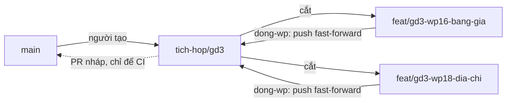

# Chạy tự động nhiều phiên cho WP **code** GĐ3 — "chuỗi"

> **§0. Trạng thái: ĐÃ CHỐT** — `D-216` (người, 25/11/2026): phương án **B** (nhánh xếp chồng) + danh sách chuỗi 1.
> Nối tiếp bộ chạy WP-14 ([huong-dan-chay-tu-dong.md](huong-dan-chay-tu-dong.md)); dựa trên M2/M3 của [hồ sơ uỷ quyền](uy-quyen-chu-du-an.md) (`D-114`, `D-115`).
> Bảng chuỗi 1: [bang-phien-gd3-1.md](bang-phien-gd3-1.md).

## 1. Mục tiêu

Chạy tự động qua nhiều phiên như WP-14 (`tools/agents/chay-tu-dong.ps1`), **không tạo PR cho mỗi phiên**, mà vẫn giữ: một phiên một hàng,
dừng ở điểm xanh, cổng máy chấm bằng exit code, `main` chỉ người merge.

## 2. Mô hình

- **Hàng:** một WP code = 5–8 hàng: `doc-gate` (cổng tài liệu dạng "BA sửa P2 → DOCREV kiểm nhanh", khi `07` yêu cầu) → `code` F0–F2b →
  `code` F3 BE → `code` F3 FE → `code` F4–F5 → `dong-wp` F6–G6. Trường `buoc` của hàng nói đúng bước của `feature-pipeline` phải chạy.
- **Hàng 👤** (`nguoi`): cổng cần người (WP-17: G1 ký phần sửa `rep-003`, G2 duyệt ARCH giá vốn). Bộ chạy bỏ qua, chọn hàng độc lập kế;
  chuỗi 1 tuyến tính nên thực tế dừng ở đó — WP-17 xếp **cuối** để không chặn các WP khác.
- **Cổng tài liệu máy:** hàng `code` chỉ chạy khi `tools/probe-cong-tai-lieu.ps1 -CheDo Code -WP <WP>` exit 0 (khuôn `D-212`).
- **G1/G2** "người duyệt" của `feature-pipeline`: theo **M2** — `decider` tạm duyệt khi mã **ngoài danh sách đỏ** và DOCREV `DOC-OK`; mã đỏ ⇒ hàng 👤.

## 3. Nhánh và PR (phương án B)

- WP mới **cắt từ đỉnh `tich-hop/gd3`** ⇒ đã chứa mọi WP trước của chuỗi; hàng sau của cùng WP làm tiếp trên nhánh WP (không merge giữa phiên).
- Hàng `dong-wp`: G6 xanh ⇒ `git push origin <nhánh WP>:tich-hop/gd3` — **chỉ fast-forward** (bị từ chối ⇒ dừng, không force/merge).
- **Một PR nháp** `tich-hop/gd3` → `main` (người mở) để CI chạy mỗi lần đẩy. **Cầu dao CI** của bộ chạy: lần `ci` **hoàn tất** mới nhất trên
  `tich-hop/gd3` = `failure` ⇒ dừng trước phiên kế (lần đang chạy / bị huỷ do `cancel-in-progress` ⇒ chạy tiếp).
- **Cuối chuỗi:** `chay-tu-dong.ps1 -Chuoi gd3-1 -MoPRCuoi` mở **mỗi WP một PR xếp chồng** (WP đầu → `main`, WP sau → nhánh WP trước); người
  review + merge lần lượt, GitHub tự đổi base khi nhánh trước được merge và xoá. Merge `main` vẫn cần biên bản người ký + cổng OPS (`D-115` ⑤).

## 4. Hàng rào khi không có người

| Rủi ro | Hàng rào |
|---|---|
| Code đỏ bị commit | Cổng cuối mỗi hàng = exit code (G3/G4/G5/G6 của `feature-pipeline` §3); đỏ ⇒ `stash` có tên, `dodang`, không commit phần đỏ |
| Vòng lặp tốn hạn mức | Trần 2 vòng/vai; cầu dao "2 phiên liền không tiến triển"; hết hạn mức ⇒ ngủ tới giờ hồi |
| Ghi ngoài vùng | Hook vùng ghi theo vai (B5) + ORCH `git restore` tệp ngoài vùng trước commit |
| Mất dữ liệu DB dev | `pg_dump` vào `artifacts/pg-dump/` trước mọi lần áp migration; migration expand-only, một chủ (tuần tự) |
| Máy hết bộ nhớ (N69) | Không chạy `-DayDu` song song build/test; một phiên một lúc (tệp khoá) |
| Lỗi chỉ CI thấy | PR nháp `tich-hop/gd3` + cầu dao CI |
| Lịch sử bị sửa | Cấm `--force`, `rebase`, `reset --hard`, merge `main`, mở/merge PR trong phiên |

## 5. Chuỗi 1 (`gd3-1`) — 47 hàng

WP-16 (`PRC-002`) → WP-18 (`ADDR-001`/`002`) → WP-22 (`NOT-001`) → WP-26 (`REP-001`) → WP-24 (`PRO-002`) → WP-25 (`PRO-001`) →
WP-23 (`NOT-002`, chỉ hợp đồng adapter + `fake` sender) → WP-17 (`PRC-001` giá vốn — đỏ, cổng có người).
Ước 35–45 phiên (~1–2 tuần với gói Pro, kể cả chờ hạn mức; vai Opus `arch`/`rev` ăn hạn mức tuần nhiều nhất).
**Ngoài chuỗi 1** (cần người / sandbox / kế toán): WP-19, 20, 21, 27–34 ⇒ chuỗi 2.

## 6. Công cụ

| Tệp | Thêm gì |
|---|---|
| `tools/agents/phien.ps1` | `-Chuoi <tên>` (registry + bảng riêng) · lệnh `show -Id` (JSON hàng + thông tin chuỗi) · prompt bảng theo `skill` của registry |
| `tools/agents/chay-tu-dong.ps1` | `-Chuoi` · cầu dao CI (`-KhongKiemCI` để tắt) · `-MoPRCuoi` · bọc ngoặc lệnh có dấu cách khi gọi `claude -p` |
| `.claude/skills/chay-phien-code/SKILL.md` | phiên của chuỗi: chọn hàng, chuyển/cắt nhánh, `doc-gate`/`code`/`dong-wp`, commit + push, đẩy `tich-hop` |
| `agents/state/phien-gd3-1.json` + `bang-phien-gd3-1.md` | chuỗi 1 |
| `tools/agents/test-phien.ps1` · `test-chay-tu-dong.ps1` | C39–C48 · T14–T19 |

## 7. Ghi chú kèm

- Lệnh thật của skill là `/feature-pipeline` (trường `name`); một số tài liệu ghi `/feature` — thống nhất khi có dịp.
- `pnpm lint` không tồn tại trong `apps/admin-web` (handover N69 §5): cổng FE của `CLAUDE.md` §3 cần chủ quyết trước khi hàng `F3 FE` chạy
  không người — tới lúc đó hàng FE chạy `typecheck` · `test` · `build` · `gen:api`.
