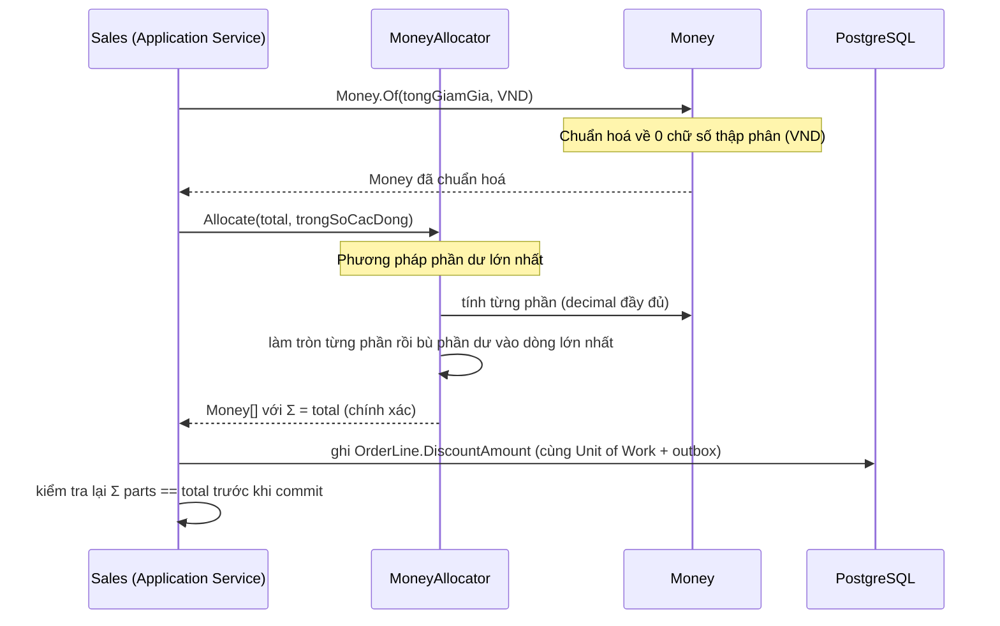
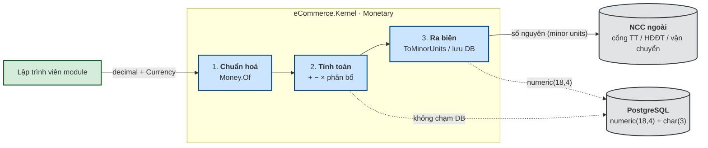

# `XC-001` — Money, Currency & chính sách làm tròn

| Thuộc tính | Nội dung |
|---|---|
| **Mã** | `XC-001` |
| **Module** | Kernel dùng chung (`shared/eCommerce.Kernel`) |
| **Giai đoạn** | **Nền — phải xong TRƯỚC GĐ1** (mọi module đều phụ thuộc) |
| **Ưu tiên** | **Must have** |
| **Trạng thái** | `Draft` — chờ review |
| **Người viết / người review** | *(điền)* / **Kiến trúc trưởng + Kế toán** |
| **Phiên bản / ngày** | `v0.1 — 12/10/2026` |
| **Tài liệu liên quan** | `PRC-002` (pipeline tính giá) · `SAL-002` (đặt hàng) · `EINV-001` (hoá đơn) · `REC-001` (đối soát) · `structure-and-techstack.md` |

---

## 0. Tóm tắt & quyết định thiết kế

**Tóm tắt:** định nghĩa **value object `Money`** + **`Currency`** + **chính sách làm tròn** + **thuật toán phân bổ tiền**
dùng chung cho toàn hệ thống. Đây là nền của mọi module: sai ở đây thì sai ở mọi nơi, và **sai tiền là loại lỗi
không sửa được về sau** (đã có tiền thật, đã xuất hoá đơn, đã đối soát với sàn/ngân hàng).

**Phạm vi:**
- Value object `Money` + `Currency` (immutable), phép toán, so sánh, chuẩn hoá.
- Chính sách làm tròn (theo số chữ số thập phân của từng tiền tệ) + cấu hình qua ABP Setting.
- **Thuật toán phân bổ** (chia giảm giá/phí cho các dòng đơn) **bảo toàn tổng**.
- Chuyển đổi sang **minor units** để gọi NCC (cổng thanh toán, hoá đơn điện tử, vận chuyển).
- Mapping EF Core + quy ước cột DB.

**Không nằm trong phạm vi:**
- ❌ **Đa tiền tệ hoạt động thật** + bảng tỷ giá (quyết định #6: để tương lai — nhưng `Currency` có sẵn từ đầu).
- ❌ Bảng thuế suất / quy tắc thuế GTGT theo mặt hàng (thuộc `EINV-001` / module Tax).
- ❌ Quy tắc làm tròn **theo luật thuế VN** — tài liệu này chỉ định **cơ chế**, còn **con số cụ thể phải do kế toán xác nhận** (xem §15).
- ❌ Format hiển thị theo locale (thuộc UI, `WEB-*`).

### 0.1 Quyết định thiết kế (ADR ngắn)

| # | Quyết định | Phương án đã cân nhắc | Lý do chọn | Hệ quả |
|---|---|---|---|---|
| **D1** | `Money` là **`readonly record struct`** (immutable) | `class` / `record class` / `struct` | Không cấp phát heap cho phép toán tiền (được gọi rất nhiều); immutable ⇒ không sửa nhầm | Không có identity; `default(Money)` = tiền tệ rỗng ⇒ **phải luôn tạo qua `Money.Of(...)`** |
| **D2** | Lưu **`decimal` + số chữ số thập phân của tiền tệ**, KHÔNG lưu minor units | Lưu `long` minor units (kiểu Stripe) | `decimal` đọc được trực tiếp trong DB, dễ đối soát bằng SQL; minor units `long` khó debug và phải convert mọi nơi | Mọi thao tác phải **chuẩn hoá về `Currency.Decimals`** |
| **D3** | **So sánh tiền theo minor units** (`long`), **cấm so `==` trên `decimal`** | So `decimal` bằng `==` | ⚠️ Bài học: EShop so `ActualTotalPrice == OriginalPaymentAmount` ⇒ **vỡ ngay với VND/payOS** khi lệch làm tròn | API `ToMinorUnits()` là **đường so sánh chính thức**; `CompareTo` dùng minor units |
| **D4** | Làm tròn mặc định **`MidpointRounding.AwayFromZero`** | `ToEven` (banker's) | Phổ biến trong kế toán VN; dễ giải thích với kế toán/khách hàng | Cấu hình được qua Setting, nhưng **đổi phải có audit** (xem §9) |
| **D5** | Entity lưu **net + tax riêng**, `Gross` tính ra | Lưu **cả** incl-tax và excl-tax (kiểu nopCommerce) | nopCommerce có ~12 cột tiền nhân đôi vì lưu cả 2 chiều ⇒ dễ lệch nhau; ta lưu 1 chiều và tính | Mọi truy vấn báo cáo phải cộng `Net + Tax` khi cần gross |
| **D6** | Mapping EF Core bằng **complex type** (`ComplexProperty`) cho tiền **bắt buộc có**; **cột rời** cho tiền **nullable** | (a) cột rời cho tất cả · (b) `Owned` entity type · (c) complex type cho tất cả | Domain code sạch (`Money Total` thay vì `TotalAmount` + `TotalCurrency`); EF Core 10 **hỗ trợ `struct`/`readonly record struct`** cho complex type | ✅ **ĐÃ XÁC MINH** (xem §15 Q3): complex type nullable **có** hỗ trợ từ EF Core 10, **nhưng** có **bug #37559** (`ReloadAsync` ném lỗi khi giá trị null) chỉ được vá ở **EF Core 11** ⇒ tiền nullable **vẫn dùng cột rời** trên EF 10 |
| **D7** | Phân bổ dùng **phương pháp phần dư lớn nhất** (largest remainder), **bảo toàn tổng tuyệt đối** | Chia đều rồi làm tròn từng phần | Chia đều + làm tròn từng phần ⇒ **mất/thừa 1–2 đồng** ⇒ hoá đơn không khớp | Có property-based test bắt buộc (§14) |

---

## 1. Use Case Specification

| Thuộc tính | Nội dung |
|---|---|
| **Use Case ID** | `XC-001` |
| **Use Case Name** | Biểu diễn và tính toán tiền tệ nhất quán |
| **Description** | *"Là một lập trình viên module nghiệp vụ, tôi muốn một kiểu tiền tệ duy nhất để mọi module tính tiền giống nhau, không mất chữ số, không lệch 1 đồng khi phân bổ, và không so sánh sai."* |
| **Actor(s)** | **Lập trình viên** (người dùng thư viện) · **Hệ thống** (module nghiệp vụ, job đối soát, adapter NCC) |
| **Priority** | **Must have** |
| **Trigger** | Bất kỳ module nào cần biểu diễn hoặc tính một số tiền |
| **Pre-Condition(s)** | • `Currency` đã được đăng ký trong registry (mặc định: `VND` với 0 chữ số thập phân).<br>• Tenant hiện tại (`TenantId` từ `ICurrentTenant`) — vì **chính sách làm tròn có thể cấu hình theo tenant**.<br>• Không áp dụng `ChannelCode` ở tầng này (tiền tệ giống nhau giữa các kênh trong phạm vi hiện tại). |
| **Post-Condition(s)** | • Mọi giá trị tiền trả về **đã chuẩn hoá** về `Currency.Decimals`.<br>• Kết quả phân bổ có `Σ parts == total` **chính xác**.<br>• Không có exception nào bị nuốt: cộng/trừ khác tiền tệ ⇒ ném `BusinessException`. |
| **Basic Flow** | 1. Module tạo tiền: `Money.Of(amount, Currency.Vnd)` → hệ thống **làm tròn** về 0 chữ số thập phân.<br>2. Module cộng/trừ: `a + b` → hệ thống kiểm tra **cùng `Currency`**, trả về `Money` đã chuẩn hoá.<br>3. Module nhân với hệ số: `total * 0.08m` (VAT 8%) → hệ thống tính bằng `decimal` độ chính xác đầy đủ rồi **làm tròn theo policy**.<br>4. Module so sánh: `a.ToMinorUnits() == b.ToMinorUnits()` → không dùng `==` trên `decimal`.<br>5. Module phân bổ: `MoneyAllocator.Allocate(total, weights)` → hệ thống trả mảng mà **tổng bằng đúng `total`**.<br>6. Module gọi NCC: `money.ToMinorUnits()` → truyền số nguyên (VND: chính số tiền; USD: ×100). |
| **Alternative Flow** | **A1: Tiền nullable** — module có trường tiền không bắt buộc (ví dụ `ChannelFeeAmount`): dùng `Money?`; các phép toán phải kiểm tra trước (`HasValue`).<br>**A2: Đổi chính sách làm tròn** — quản trị đặt Setting ⇒ áp cho tenant đó; **chỉ áp cho tính toán MỚI**, không hồi tố dữ liệu đã ghi. |
| **Exception Flow** | **E1:** cộng/trừ hai `Money` khác tiền tệ ⇒ `BusinessException` `eCommerce:Money:0001`.<br>**E2:** mã tiền tệ không có trong registry ⇒ `BusinessException` `eCommerce:Money:0002`.<br>**E3:** phân bổ với tổng trọng số = 0 (chia cho 0) ⇒ `BusinessException` `eCommerce:Money:0003`.<br>**E4:** tràn `decimal` khi nhân ⇒ `OverflowException` bị bọc thành `BusinessException` `eCommerce:Money:0004`.<br>**E5:** trọng số phân bổ **âm** ⇒ `BusinessException` `eCommerce:Money:0005` (không hỗ trợ — Q6 đã đóng). |
| **Business Rules** | • **BR-XC-001-001**: Mọi `Money` **luôn ở trạng thái đã làm tròn** theo `Currency.Decimals`.<br>• **BR-XC-001-002**: **Cấm** cộng/trừ/so sánh hai `Money` khác `Currency` ⇒ ném lỗi (không tự quy đổi).<br>• **BR-XC-001-003**: **Cấm** so sánh tiền bằng `==` trên `decimal`; so theo `ToMinorUnits()`.<br>• **BR-XC-001-004**: Làm tròn mặc định `AwayFromZero`, cấu hình theo tenant, **có audit** khi đổi.<br>• **BR-XC-001-005**: Thuế/VAT làm tròn **theo TỪNG DÒNG**; tổng đơn = **tổng các dòng đã làm tròn** (không làm tròn tổng).<br>• **BR-XC-001-006**: Phân bổ (giảm giá, phí vận chuyển, hoàn tiền từng phần) **phải bảo toàn tổng tuyệt đối**: `Σ Allocate(total, w) == total`.<br>• **BR-XC-001-007**: Khi gọi NCC, tiền truyền dưới dạng **minor units (số nguyên)**; **không** truyền `decimal`.<br>• **BR-XC-001-008**: **Không tồn tại `double`/`float`** trong bất kỳ biểu thức tiền nào (kể cả DTO, entity, adapter).<br>• **BR-XC-001-009**: `Currency` mặc định của hệ thống = `VND` (0 chữ số thập phân); đa tiền tệ **chưa hoạt động**. |
| **Non-Functional Requirement** | • **NFR-XC-001-001**: Phân bổ 1.000 dòng < **5 ms** (p95) trên máy dev.<br>• **NFR-XC-001-002**: Property-based test 10.000 bộ ngẫu nhiên: `Σ Allocate == total` **100%**.<br>• **NFR-XC-001-003**: JSON round-trip bảo toàn giá trị (0 mất mát chữ số).<br>• **NFR-XC-001-004**: 0 lần xuất hiện `double`/`float` trong `eCommerce.Kernel` (kiểm bằng test reflection). |

---

## 2. Sơ đồ Use Case

**Không áp dụng — lý do:** `XC-001` là **thư viện domain dùng chung**, không có actor người dùng cuối và không có
endpoint HTTP. Actor duy nhất là **lập trình viên** (đọc §1). Sơ đồ luồng dữ liệu thay thế ở §4.2.

---

## 3. Sơ đồ trạng thái (state machine)

**Không áp dụng — lý do:** `Money` là **value object bất biến**, không có vòng đời/không có chuyển trạng thái.
Bất biến thay cho state machine được liệt kê ở §8.1.

---

## 4. Sequence Diagram & luồng dữ liệu

### 4.1 Sequence — phân bổ giảm giá cho các dòng đơn



### 4.2 DFD — đường đi của một số tiền



---

## 5. Mô hình dữ liệu

### 5.1 ERD

**Không có entity mới.** `XC-001` là **value object**, không có bảng riêng.
Bảng `Currency` trong DB **không tạo ở giai đoạn này** (registry nằm trong code — quyết định #6).
ERD vì vậy không áp dụng; thay vào đó là **quy ước cột** ở §5.2.

### 5.2 Quy ước cột DB cho tiền (Data Dictionary)

| Cột | Kiểu | Null? | Ý nghĩa | Ghi chú |
|---|---|---|---|---|
| `<Ten>Amount` | `numeric(18,4)` | tuỳ | số tiền | ⚠️ **không bao giờ `double`/`real`**; 4 chữ số thập phân để chứa cả tiền tệ 2–4 chữ số |
| `<Ten>Currency` | `char(3)` | tuỳ | mã ISO-4217 | **HOA**, 3 ký tự (`VND`, `USD`) |

**Tại sao `numeric(18,4)` chứ không phải `numeric(18,0)`:** hiện chỉ dùng VND (0 chữ số), nhưng 4 chữ số thập phân
cho phép nhận tiền tệ khác **không phải migrate schema** khi bật đa tiền tệ sau này.

**Index & ràng buộc**

| Loại | Cột | Mục đích |
|---|---|---|
| CHECK *(khuyến nghị, chưa bắt buộc)* | `Currency ~ '^[A-Z]{3}$'` | chặn mã tiền tệ sai ở tầng DB |
| Ghi chú | — | **Không** đặt `CHECK (Amount > 0)` vì có số tiền hợp lệ âm (điều chỉnh, hoàn tiền, ledger âm) |

**Mapping EF Core**

| Trường hợp | Cách map |
|---|---|
| Tiền **bắt buộc có** (`Money Total`) | `ComplexProperty` ⇒ 2 cột `TotalAmount`, `TotalCurrency` |
| Tiền **nullable** (`Money? ChannelFee`) | 2 cột nullable rời + property tiện ích trong domain |

**Ba ràng buộc của EF Core đã xác minh** (nguồn: [EF Core — Complex Types](https://learn.microsoft.com/en-us/ef/core/modeling/complex-types), cập nhật 05/08/2026):

1. ⚠️ **Complex type KHÔNG được phát hiện theo quy ước** — phải khai báo tường minh bằng
   `[ComplexType]` trên type **hoặc** `ComplexProperty(...)` trong `OnModelCreating`. Quên ⇒ EF coi đó là
   entity thường và sẽ sinh bảng/khoá ngoài ngoài ý muốn.
2. ✅ **`readonly record struct` được hỗ trợ từ EF Core 10** ⇒ `Money` dạng struct dùng được làm complex type.
3. 🚨 **Complex type nullable cần ít nhất MỘT property `required`** (EF cần cột non-nullable để phân biệt
   "complex value = null" với "complex value có mọi property = null"). Nếu type không có property required
   thì phải cấu hình `HasDiscriminator()`. ⇒ Đây là lý do **D6 chọn cột rời cho tiền nullable** thay vì
   `Money?` dạng complex type, cùng với bug #37559 bên dưới.

> 📌 Thú vị: tài liệu EF Core dùng **chính `Money`** làm ví dụ value object cho complex type
> (*"For example, `Address`, `Coordinate`, `Money`. These are called value objects"*).

---

## 6. Hợp đồng API

### 6.1 API của thư viện (không phải app service)

```csharp
namespace eCommerce.Kernel.Monetary;

public readonly record struct Currency
{
    public string Code { get; }        // ISO-4217, 3 ký tự HOA
    public byte Decimals { get; }      // VND = 0 · USD = 2

    public static Currency Vnd { get; }             // ("VND", 0)
    public static Currency Usd { get; }             // ("USD", 2)
    public static Currency FromCode(string code);   // registry; không có ⇒ ném eCommerce:Money:0002
}

public readonly record struct Money : IComparable<Money>
{
    public decimal Amount { get; }
    public Currency Currency { get; }
    public bool IsZero { get; }

    public static Money Of(decimal amount, Currency currency);  // CHUẨN HOÁ (làm tròn)
    public static Money Zero(Currency currency);

    public long ToMinorUnits();                                  // VND: chính số tiền · USD: ×100
    public static Money FromMinorUnits(long minorUnits, Currency currency);

    public static Money operator +(Money a, Money b);             // khác Currency ⇒ ném 0001
    public static Money operator -(Money a, Money b);
    public static Money operator -(Money a);
    public static Money operator *(Money a, decimal factor);      // làm tròn theo policy

    public int CompareTo(Money other);                            // theo minor units (BR-003)
}

public static class MoneyAllocator
{
    /// Σ kết quả == total (chính xác) — BR-XC-001-006
    public static Money[] Allocate(Money total, IReadOnlyList<decimal> weights);
}

public interface IRoundingPolicy
{
    decimal Round(decimal value, Currency currency);
}
```

### 6.2 REST endpoint

**Không áp dụng — lý do:** đây là thư viện nội bộ, không expose endpoint.
Cấu hình làm tròn được đọc qua **ABP Settings** (xem §9).

**Mã lỗi nghiệp vụ**

| Mã | HTTP *(nếu lộ ra ngoài qua app service)* | Khi nào | Thông điệp |
|---|---|---|---|
| `eCommerce:Money:0001` | `400` | Cộng/trừ/so sánh khác tiền tệ | `Không thể tính toán hai loại tiền tệ khác nhau ({a} và {b}).` |
| `eCommerce:Money:0002` | `400` | Mã tiền tệ không có trong registry | `Mã tiền tệ '{code}' không được hỗ trợ.` |
| `eCommerce:Money:0003` | `400` | Phân bổ với tổng trọng số = 0 | `Không thể phân bổ vì tổng trọng số bằng 0.` |
| `eCommerce:Money:0004` | `500` | Tràn `decimal` | `Giá trị tiền vượt giới hạn cho phép.` |
| `eCommerce:Money:0005` | `400` | Trọng số phân bổ **âm** (không hỗ trợ — Q6) | `Không hỗ trợ phân bổ với trọng số âm.` |

---

## 7. Sự kiện, tích hợp ngoài & idempotency

### 7.1 Sự kiện phát ra (ETO)

**Không áp dụng — lý do:** thư viện thuần, không phát sự kiện. Việc "chính sách làm tròn bị đổi" được ghi vào
**audit log của ABP** (§9), không phát ETO.

### 7.2 Sự kiện / webhook nhận vào

**Không áp dụng — lý do:** không nhận dữ liệu từ bên ngoài.
⚠️ Nhưng **adapter NCC** (thuộc module khác) khi nhận số tiền từ webhook **phải** chuyển sang `Money` bằng
`Money.FromMinorUnits(...)` và **đối chiếu với số tiền nội bộ theo `ToMinorUnits()`** — không so `decimal`.
Quy tắc này được ghi vào `XC-002` và tài liệu của từng adapter.

### 7.3 Gọi API ra ngoài

**Không áp dụng trực tiếp.** Nhưng `XC-001` **quy định cách** mọi adapter phải truyền tiền:

| NCC | Kiểu nhận | Cách chuyển từ `Money` |
|---|---|---|
| VNPay | số nguyên × 100 | `money.ToMinorUnits() * 100` (VND 0 chữ số ⇒ minor units = số đồng) |
| payOS | số nguyên VND | `money.ToMinorUnits()` |
| MoMo / ZaloPay | số nguyên VND | `money.ToMinorUnits()` |
| Hoá đơn điện tử | chuỗi số thập phân | `money.Amount.ToString(CultureInfo.InvariantCulture)` |
| Sàn TMĐT | số thập phân | như trên |

> ⚠️ **Bắt buộc:** mỗi adapter phải có test đối chiếu `FromMinorUnits(NCC gửi) == money nội bộ`.

---

## 8. Bất biến & xử lý đồng thời

### 8.1 Bất biến

| # | Bất biến | Cơ chế bảo vệ |
|---|---|---|
| 1 | `Money.Amount` luôn đã làm tròn theo `Currency.Decimals` | Constructor private; chỉ tạo qua `Money.Of` / `FromMinorUnits` (có chuẩn hoá) |
| 2 | Hai `Money` khác `Currency` **không thể** cộng/trừ/so sánh | Kiểm tra trong operator và `CompareTo`, ném `BusinessException` `0001` |
| 3 | `Σ Allocate(total, w) == total` | Thuật toán phần dư lớn nhất + **kiểm tra lại trước khi trả về** (ném lỗi nếu lệch ⇒ phát hiện sớm) |
| 4 | Không có `double`/`float` trong biểu thức tiền | Test reflection duyệt toàn bộ type trong `eCommerce.Kernel` + review checklist |
| 5 | `Money` là **bất biến** | `readonly record struct`, mọi property chỉ-đọc |

### 8.2 Xử lý đồng thời

| # | Tình huống | Cơ chế |
|---|---|---|
| 1 | Đổi chính sách làm tròn **trong khi** đang tính tiền | Chính sách đọc **một lần** vào đầu request (snapshot) ⇒ request đang chạy dùng chính sách cố định |
| 2 | Hai luồng cùng ghi tiền cho cùng đơn | Không thuộc phạm vi `XC-001`; xử lý bằng UoW + khoá của module sở hữu (`SAL-*`, `INV-*`) |

**Khoá phân tán dùng trong feature:** **Không có.** `Money` là phép tính thuần trong bộ nhớ, không chia sẻ tài nguyên
⇒ không cần lock. (Đây là lý do tài liệu này không dùng lock key nào.)

**Idempotency key:** **Không áp dụng** (không gọi NCC, không nhận webhook).

---

## 9. Phân quyền

**Không có API ⇒ không có permission cho endpoint.** Nhưng có **2 setting toàn hệ thống** cần bảo vệ:

| Setting | Kiểu | Mặc định | Ai được đổi |
|---|---|---|---|
| `eCommerce.Money.RoundingPolicy` | `AwayFromZero` \| `ToEven` | `AwayFromZero` | **Admin tenant** (qua màn hình cấu hình, `WEB-001`) |
| `eCommerce.Money.DefaultCurrency` | mã ISO | `VND` | Chỉ **host admin** (đổi ⇒ ảnh hưởng toàn hệ thống) |

> ⚠️ **Đổi `RoundingPolicy` phải ghi audit** (BR-XC-001-004): ai đổi, từ giá trị nào sang giá trị nào, lúc nào.
> Và **không hồi tố** dữ liệu đã ghi — tiền đã lưu là tiền đã chốt.

---

## 10. UI Mockup & mapping dữ liệu

**Không có UI riêng.** Ảnh hưởng tới UI ở 2 chỗ (do `WEB-*` thực hiện):

| Vùng UI | Dữ liệu | Nguồn | Quy tắc hiển thị |
|---|---|---|---|
| Mọi chỗ hiển thị tiền | số tiền + tiền tệ | `Money` | Format theo locale (`vi-VN`), VND **0 chữ số thập phân**; dùng `CultureInfo` |
| Màn hình cấu hình hệ thống | chính sách làm tròn | Setting | Chỉ admin thấy; có ghi chú cảnh báo "không hồi tố" |

> 📌 **Ghi rõ chênh lệch (theo thói quen tốt của tài liệu SRS gốc):** với VND, **tổng các dòng đã làm tròn**
> có thể **khác** `Round(tổng chưa làm tròn)` **1–2 đồng**. UI **phải hiển thị tổng = tổng các dòng** (BR-XC-001-005),
> không được tính lại từ tổng gốc. Đây là loại lệch rất dễ bị coi là bug.

---

## 11. Migration & seed

| Mục | Nội dung |
|---|---|
| Migration | **Không có migration mới bắt buộc.** Cột tiền hiện tại (`OrdOrders.*`, `PayTransactions.Amount`…) đã đúng quy ước `numeric(18,4)` + `varchar` currency |
| Bảng tạo mới | **Không** (quyết định #6: registry tiền tệ nằm trong code) |
| Thay đổi schema khuyến nghị *(tuỳ chọn)* | `CHECK (Currency ~ '^[A-Z]{3}$')` trên các cột currency; thu `Currency` từ `varchar(8)` → `char(3)` |
| Seed | **Không** — `Currency` là hằng số trong code (`Currency.Vnd`, `Currency.Usd`); thêm tiền tệ mới = thêm dòng trong registry + release |
| Ảnh hưởng dữ liệu cũ | **Không backfill.** Dữ liệu đã lưu đã đúng 0 chữ số thập phân với VND |
| Rollback | Không cần (không đổi schema) |

---

## 12. Xử lý lỗi & trường hợp biên

| Tình huống | Nguyên nhân | Hành vi hệ thống | Phản hồi |
|---|---|---|---|
| Cộng 2 tiền tệ khác nhau | lập trình sai | **Ném** `BusinessException` `0001` | `400` + thông điệp có cả 2 mã tiền tệ |
| Mã tiền tệ lạ (`"usd"` viết thường, `"XXX"`) | dữ liệu vào sai | `FromCode` chuẩn hoá HOA rồi tra registry; không có ⇒ **ném** `0002` | `400` |
| `Money` mặc định (`default(Money)`) | quên khởi tạo | `Currency.Code` = null/`Amount` = 0 | ⚠️ **Cần phòng ngừa:** test reflection/analyzer cấm `default(Money)`; review checklist |
| Trọng số phân bổ đều bằng 0 | dữ liệu giảm giá sai | **Ném** `0003` (không chia 0, không trả mảng 0 đồng) | `400` |
| Trọng số âm trong phân bổ | dữ liệu sai | **Ném** `BusinessException` `0005` — **không hỗ trợ** phân bổ số âm (Q6 đã đóng) | `400` |
| Làm tròn ra 0 đồng (ví dụ 0,4 đồng với VND) | chia nhỏ quá mức | Trả `Money.Zero` — **không phải lỗi** | bình thường |
| Số tiền âm (hoàn tiền, điều chỉnh) | nghiệp vụ hợp lệ | **Cho phép**; không có ràng buộc `Amount > 0` | bình thường |
| Phân bổ mà tổng lệch | lỗi thuật toán | **Ném `InvalidOperationException`** (lỗi lập trình, phải lộ ra CI) | `500` + log |
| Tràn `decimal` | nhân với hệ số cực lớn | Bọc `OverflowException` ⇒ `BusinessException` `0004` | `400` |

**Chiến lược transaction:** **Không áp dụng** — thư viện thuần, không chạm DB.

---

## 13. Phi chức năng

| Mã | Yêu cầu | Ngưỡng đo được | Cách kiểm chứng |
|---|---|---|---|
| NFR-XC-001-001 | Hiệu năng phân bổ | 1.000 dòng < **5 ms** (p95, máy dev) | Benchmark trong integration test |
| NFR-XC-001-002 | Bảo toàn tổng khi phân bổ | **10.000** bộ ngẫu nhiên ⇒ `Σ == total` **100%** | Property-based test (`FsCheck` hoặc vòng lặp seed cố định) |
| NFR-XC-001-003 | JSON round-trip | không mất chữ số | Unit test serialize/deserialize |
| NFR-XC-001-004 | Không dùng `double`/`float` | 0 xuất hiện trong `eCommerce.Kernel` | Test reflection duyệt mọi property/field |
| NFR-XC-001-005 | Cách ly tenant cho setting | tenant A đổi chính sách **không** ảnh hưởng tenant B | Integration test 2 tenant |
| NFR-XC-001-006 | Audit khi đổi setting | có bản ghi audit đủ (ai, cũ, mới, khi nào) | Integration test đọc audit log |

---

## 14. Test cases & Acceptance Criteria

### 14.1 Danh sách test case

| ID | Mục tiêu | Loại | Input chính | Expected | Phủ |
|---|---|---|---|---|---|
| TC-01 | Chuẩn hoá VND về 0 chữ số thập phân | Unit | `Money.Of(1234.4m, Vnd)` | `1234` (away-from-zero) | BR-001, BR-004 |
| TC-02 | Chuẩn hoá USD về 2 chữ số | Unit | `Money.Of(1234.567m, Usd)` | `1234.57` | BR-001 |
| TC-03 | Cộng cùng tiền tệ | Unit | `1000 + 2000` (VND) | `3000` | — |
| TC-04 | Cộng khác tiền tệ ⇒ ném lỗi | Unit | `1000 VND + 10 USD` | `BusinessException` `0001` | **BR-002** |
| TC-05 | So sánh theo minor units | Unit | `1234.0 VND` vs `1234.00 VND` | **bằng nhau** (không dùng `==`) | **BR-003** |
| TC-06 | Phân bổ bảo toàn tổng (ca lẻ) | Unit | `total=1000`, `w=[1,1,1]` | `[334,333,333]`, `Σ=1000` | **BR-006**, NFR-002 |
| TC-07 | Phân bổ 10.000 bộ ngẫu nhiên | Unit (property) | seed cố định | `Σ == total` 100% | NFR-002 |
| TC-08 | Phân bổ có trọng số 0 | Unit | `w=[0,0,0]` | `BusinessException` `0003` | BR-006 |
| TC-09 | VAT làm tròn theo từng dòng | Unit | 3 dòng, VAT 8%, tổng lẻ | tổng = Σ dòng đã làm tròn (**khác** `Round(tổng chưa làm tròn)`) | **BR-005** |
| TC-10 | Minor units cho NCC | Unit | `1.234.567 VND` → VNPay | `123456700` | **BR-007** |
| TC-11 | Không có `double`/`float` | Unit (reflection) | duyệt assembly `eCommerce.Kernel` | 0 xuất hiện | **BR-008**, NFR-004 |
| TC-12 | JSON round-trip | Unit | `Money` → JSON → `Money` | giá trị bằng nhau | NFR-003 |
| TC-13 | Cách ly tenant của setting | **Integration** | tenant A đổi `ToEven` | tenant B vẫn `AwayFromZero` | NFR-005 |
| TC-14 | Ghi audit khi đổi setting | **Integration** | đổi chính sách | có bản ghi audit đủ trường | NFR-006, BR-004 |
| TC-15 | Mã tiền tệ sai | Unit | `Currency.FromCode("usd ")`, `FromCode("XXX")` | chuẩn hoá/`BusinessException` `0002` | — |

### 14.2 Fixture skeleton (xUnit)

```csharp
public class MoneyTests
{
    [Fact]
    public void TC01_VND_lam_tron_ve_0_chu_so_thap_phan()
    {
        var m = Money.Of(1234.4m, Currency.Vnd);
        Assert.Equal(1234m, m.Amount);
        Assert.Equal(0, m.Currency.Decimals);
    }

    [Fact]
    public void TC04_cong_khac_tien_te_thi_nem_loi()
    {
        var ex = Assert.Throws<BusinessException>(() => Money.Of(1000m, Currency.Vnd) + Money.Of(10m, Currency.Usd));
        Assert.Equal("eCommerce:Money:0001", ex.Code);
    }

    [Theory]
    [InlineData(1000, new[] { 1, 1, 1 }, new[] { 334, 333, 333 })]
    [InlineData(100,  new[] { 1, 1, 1 }, new[] { 34, 33, 33 })]
    public void TC06_phan_bo_bao_toan_tong(decimal total, int[] w, int[] expected)
    {
        var parts = MoneyAllocator.Allocate(Money.Of(total, Currency.Vnd), w.Select(x => (decimal)x).ToList());
        Assert.Equal(total, parts.Sum(p => p.Amount));
        Assert.Equal(expected, parts.Select(p => (int)p.Amount).ToArray());
    }

    [Fact]
    public void TC11_khong_co_double_float_trong_kernel()
    {
        var bad = typeof(Money).Assembly.GetTypes()
            .SelectMany(t => t.GetProperties().Select(p => (t, p.PropertyType))
                              .Concat(t.GetFields().Select(f => (t, f.FieldType))))
            .Where(x => x.Item2 == typeof(double) || x.Item2 == typeof(float))
            .ToList();
        Assert.Empty(bad);
    }
}
```

### 14.3 Acceptance Criteria (Definition of Done)

- [ ] 15 test case ở §14.1 pass, phủ **hết 9 BR** và **6 NFR**
- [ ] Property-based test 10.000 bộ phân bổ: `Σ == total` 100% (NFR-002)
- [ ] Test reflection chứng minh **0** `double`/`float` trong `eCommerce.Kernel` (BR-008)
- [ ] Test đối chiếu **minor units** cho **từng** NCC sẽ tích hợp (VNPay làm mẫu)
- [ ] Setting làm tròn: cách ly tenant + có audit
- [ ] `Money` không có constructor public nào bỏ qua chuẩn hoá
- [ ] Không có API nào nhận `decimal` tiền mà không kèm `Currency`
- [ ] Tài liệu này đã cập nhật khớp code thực tế
- [ ] **Kế toán đã xác nhận** quy tắc làm tròn VAT (§15 Q1)

### 14.4 Definition of Ready

- [ ] Tài liệu được review & **Approved** (Kiến trúc trưởng + Kế toán)
- [ ] **Q1** (quy tắc làm tròn VAT theo luật VN) đã có câu trả lời — nếu chưa, ghi rõ "dùng mặc định `AwayFromZero`, per-line, sẽ rà lại khi có kế toán"
- [ ] **Q3** (EF Core 10 complex type nullable) đã xác minh
- [ ] Chốt tên namespace `eCommerce.Kernel.Monetary`

---

## 15. Câu hỏi mở, giả định & lịch sử thay đổi

### 15.1 Câu hỏi mở

| # | Câu hỏi | Cần ai trả lời | Trạng thái | Ảnh hưởng nếu chưa trả lời |
|---|---|---|---|---|
| **Q1** | **Quy tắc làm tròn VAT theo quy định VN**: làm tròn theo **từng dòng** hay theo **tổng**? `AwayFromZero` hay `ToEven`? Có văn bản nào quy định cụ thể? | **Kế toán** (+ luật sư nếu cần) | `Open` | 🔴 Sai ⇒ **hoá đơn sai số tiền thuế** ⇒ sai nghĩa vụ thuế. Tạm dùng `AwayFromZero` + per-line |
| **Q2** | VAT VN có **nhiều mức** (0/5/8/10%) và **giảm tạm thời theo Nghị quyết** ⇒ có cần **bảng thuế suất theo thời gian**? | Kế toán + BA | `Open` | Ảnh hưởng thiết kế `EINV-001`; **không chặn** `XC-001` |
| **Q3** | EF Core 10 có hỗ trợ **complex type nullable** (`Money?`) không? | Dev | ✅ **`Closed`** — xem khung dưới | — |
| **Q4** | Có cần **bảng `Currency` trong DB** (thay registry trong code) không? | Kiến trúc trưởng | ✅ **`Closed` — KHÔNG dùng bảng** *(chốt 12/10/2026)* | Registry tiền tệ là **hằng số trong code** (`Currency.Vnd`, `Currency.Usd`); chỉ tạo bảng khi bật đa tiền tệ + tỷ giá |
| **Q5** | VND có luôn **0 chữ số thập phân** trong mọi ngữ cảnh nghiệp vụ (kể cả giá nhập/giá vốn)? | Kế toán | `Open` | ISO 4217 ghi VND = 0; nếu có ngoại lệ phải thêm quy tắc riêng |
| **Q6** | Có cần hỗ trợ **phân bổ với trọng số âm** (ví dụ điều chỉnh giảm một dòng) không? | BA | ✅ **`Closed` — KHÔNG hỗ trợ ở giai đoạn này** *(chốt 12/10/2026)* | Trọng số âm ⇒ **ném `BusinessException` mã `eCommerce:Money:0005`**. Lý do: "từ chối rõ ràng" tốt hơn "hỗ trợ nửa vời" — sẽ thiết kế lại nếu có yêu cầu nghiệp vụ thật |

#### 15.1.1 ✅ Q3 — ĐÃ GIẢI ĐÁP (có nguồn chính thức)

| Câu hỏi con | Kết luận | Bằng chứng |
|---|---|---|
| EF Core 10 có hỗ trợ **complex type nullable** không? | ✅ **CÓ**, từ EF Core 10 | [EF Core — Complex Types](https://learn.microsoft.com/en-us/ef/core/modeling/complex-types) mục *Optional complex types*: *"Starting with EF Core 10, a complex property can be made optional by declaring it as nullable"* |
| Ràng buộc kèm theo? | ⚠️ **Phải có ≥ 1 property `required`** trên complex type; nếu không, phải cấu hình `HasDiscriminator()` | Cùng trang: *"An optional complex type currently requires at least one required property to be defined on the complex type. This is because EF needs at least one non-nullable column to distinguish a null complex value from a complex value whose properties all happen to be null."* |
| `readonly record struct` (dạng của `Money`) có dùng được làm complex type? | ✅ **CÓ**, từ EF Core 10 | Cùng trang, mục *Reference and value types*: *"a `struct` or `record struct`, introduced in EF Core 10"* |
| Complex type có được phát hiện tự động? | ❌ **KHÔNG** — phải khai báo tường minh | *"Unlike most entity types, complex types are not discovered by convention."* |
| Có dùng được `Money?` (nullable) trên **EF Core 10.0.11** — bản ta đang dùng — không? | ❌ **KHÔNG NÊN**: có bug đã biết, **chỉ vá ở EF Core 11** | [dotnet/efcore#37559](https://github.com/dotnet/efcore/issues/37559): `EntityEntry.ReloadAsync` ném `InvalidOperationException: The property 'Amount' contains null on entity ... but the property is marked as required`. Báo cáo trên **EF Core 10.0.2 + Npgsql 10.0.0**; **đã đóng 06/02/2026, milestone 11.0.0** ⇒ vá ở EF 11, **không** backport về 10.0.x |

**⇒ Chốt:** giữ nguyên **D6** — tiền **bắt buộc** dùng `ComplexProperty`; tiền **nullable** (`Money?`) dùng **2 cột rời**.
Khi nâng lên EF Core 11 có thể xem lại và dùng `Money?` cho cả hai (khi đó bỏ được ghi chú này).

### 15.2 Giả định

| # | Giả định | Nếu giả định SAI thì sao |
|---|---|---|
| 1 | Hệ thống chỉ vận hành **1 tiền tệ (VND)** trong giai đoạn này | Schema `numeric(18,4)` vẫn chứa được ⇒ chỉ cần thêm registry + UI, không migrate |
| 2 | Mọi số tiền đều nằm trong khoảng `decimal(18,4)` (tối đa ~10^14) | Đủ cho VND (nghìn tỷ); nếu vượt phải đổi kiểu cột |
| 3 | Không có nghiệp vụ cần **lãi suất/tỷ giá** ở tầng tiền | Phải thêm loại value object riêng (rate) — không nhét vào `Money` |
| 4 | Đối tác NCC nhận tiền dạng **số nguyên** cho VND | Nếu có NCC nhận chuỗi thập phân ⇒ đã có đường `Amount.ToString(InvariantCulture)` (§7.3) |
| 5 | Chính sách làm tròn **không hồi tố** là chấp nhận được | Nếu kế toán yêu cầu hồi tố ⇒ cần job tính lại + versioning dữ liệu tiền (rất tốn kém) |

### 15.3 Lịch sử thay đổi

| Phiên bản | Ngày | Người | Thay đổi |
|---|---|---|---|
| v0.1 | 12/10/2026 | *(điền)* | Bản nháp đầu — chờ review |
| v0.2 | 12/10/2026 | *(điền)* | **Đóng `Q3`** (EF Core 10 hỗ trợ complex type nullable + `record struct`, nhưng bug #37559 chỉ vá ở EF 11 ⇒ tiền nullable dùng cột rời) · **Đóng `Q4`** (không dùng bảng `Currency` trong DB) · **Đóng `Q6`** (không hỗ trợ trọng số âm) — thêm mã lỗi `eCommerce:Money:0005` |
