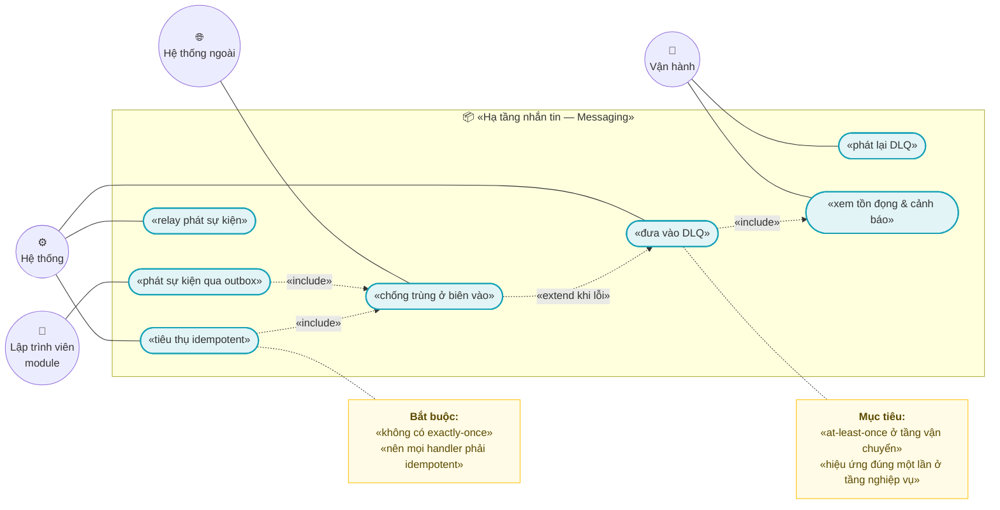
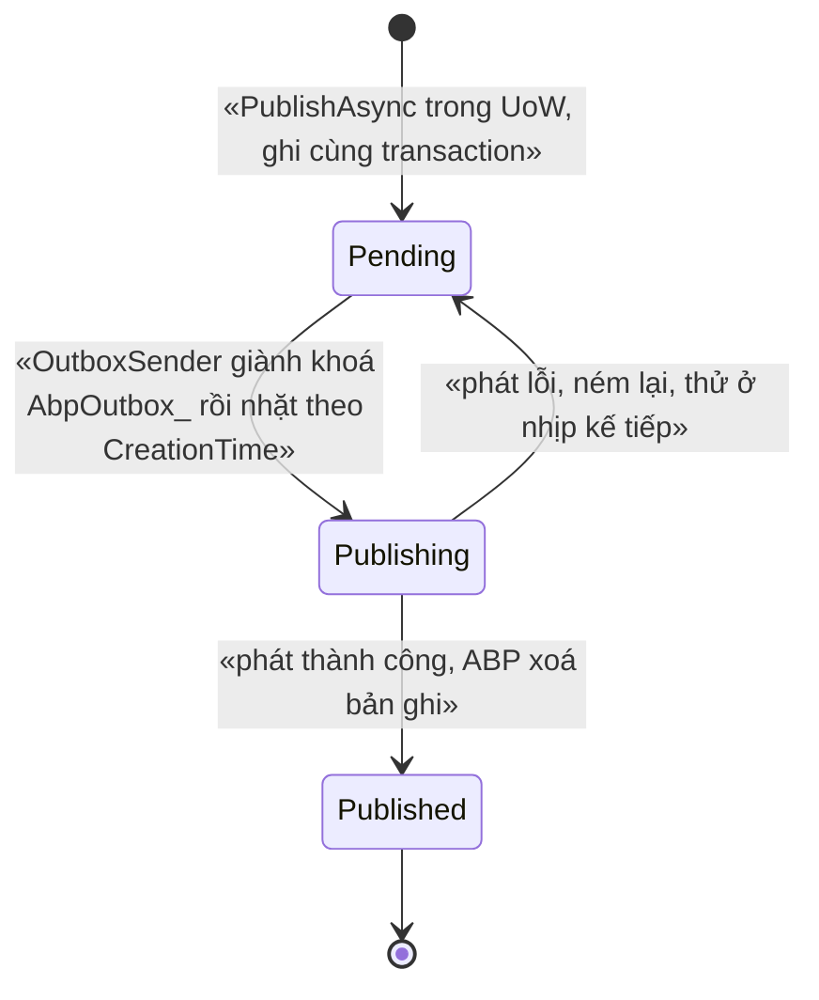
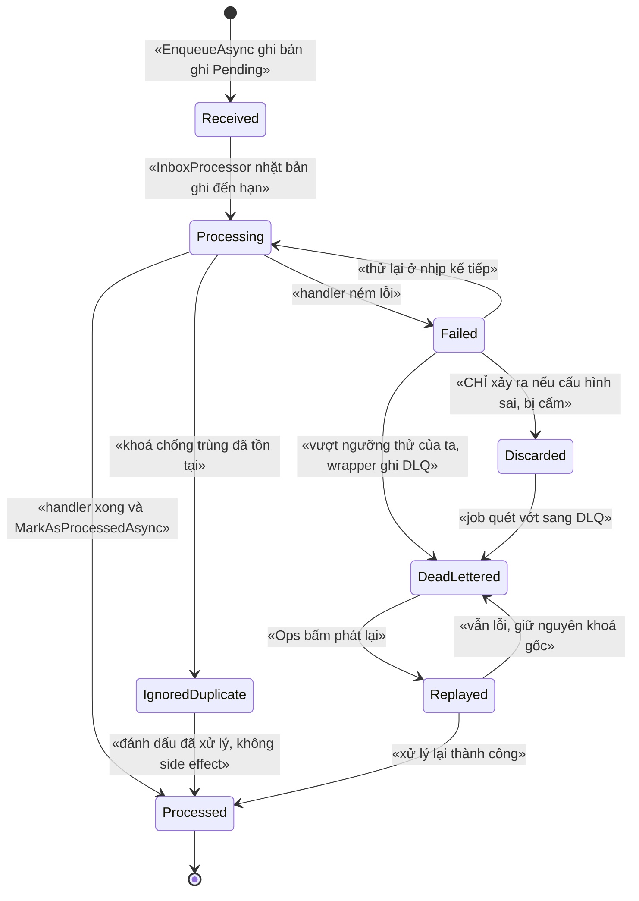
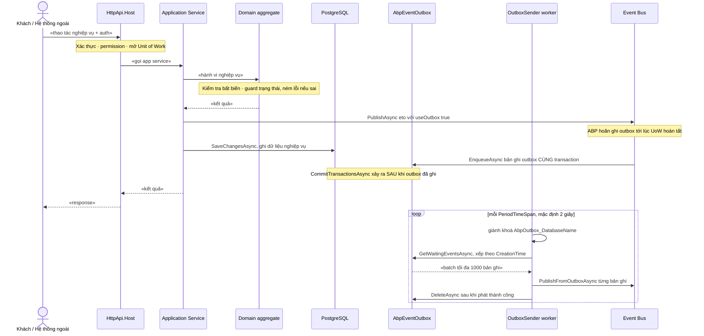
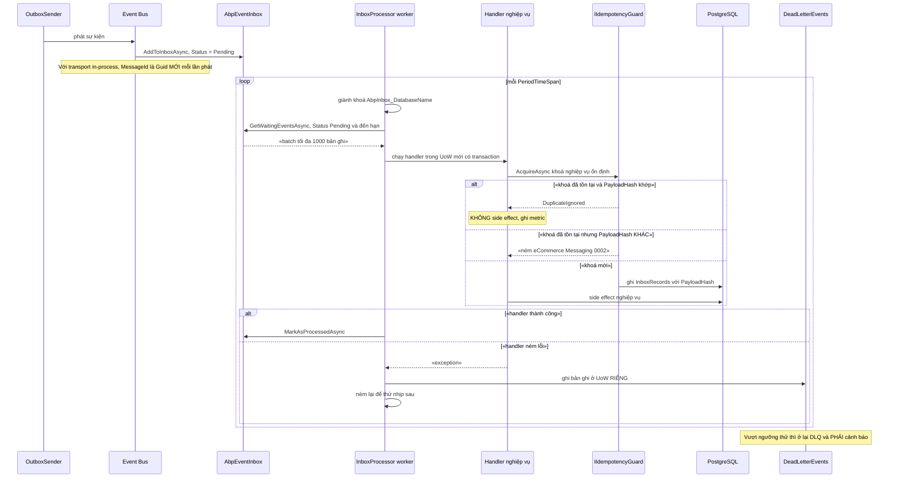
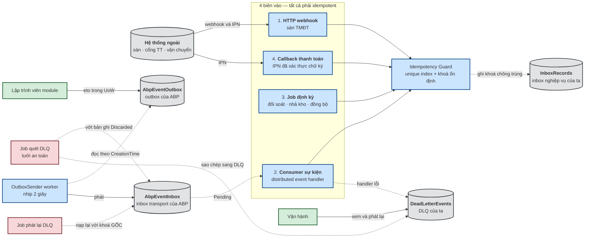
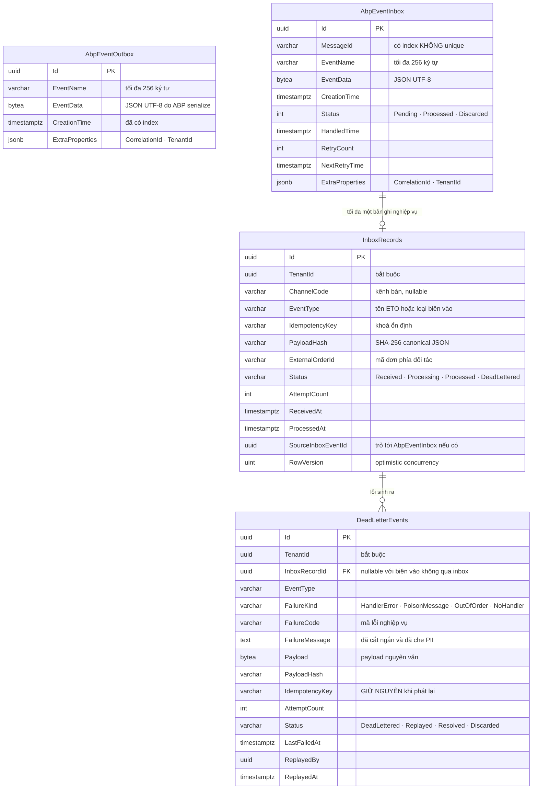

# `XC-002` — Outbox / Inbox & chống trùng sự kiện

| Thuộc tính | Nội dung |
|---|---|
| **Mã** | `XC-002` |
| **Module** | **Nền dùng chung** — hạ tầng nhắn tin, đề xuất module `Messaging` (`eCommerce.Messaging.Domain` / `.Application` / `.Contracts`) + bảng ABP nằm trên **DbContext hợp nhất** ở `src/eCommerce.EntityFrameworkCore` |
| **Giai đoạn** | **Nền — phải xong TRƯỚC GĐ1** (mọi module phát/tiêu thụ sự kiện đều phụ thuộc) |
| **Ưu tiên** | **Must have** |
| **Trạng thái** | `Draft` — chờ review |
| **Người viết / người review** | *(điền)* / **Kiến trúc trưởng + toàn nhóm** (theo `design-doc-guidelines.md` §6: `XC-*` do kiến trúc trưởng viết, toàn nhóm review) |
| **Phiên bản / ngày** | `v0.1 — 12/10/2026` |
| **Tài liệu liên quan** | `XC-001` (BR-003 cấm so tiền bằng `==`) · `XC-003` (khoá phân tán) · `XC-005` (observability) · `XC-006` (BR-011 state machine phải ném lỗi) · `SAL-005` (webhook đơn từ sàn) · `REC-001` (đối soát thanh toán) · `INV-001` (sổ cái kho append-only) · `docs/structure-and-techstack.md` · `docs/design-doc-guidelines.md` · `docs/phase-0-execution-report.md` |

---

## 0. Tóm tắt & quyết định thiết kế

**Tóm tắt:** `XC-002` định nghĩa **cách mọi module phát và tiêu thụ sự kiện** trong hệ thống: **outbox ghi cùng transaction với dữ liệu nghiệp vụ**, **relay là background worker thật của ABP**, **inbox nghiệp vụ có đủ chiều chống trùng**, **DLQ + job phát lại**, và **kỷ luật idempotency bắt buộc ở mọi biên vào**. Đây là nền của toàn hệ thống vì thực tế vận chuyển là **at-least-once**: sự kiện **sẽ** được giao lại (relay retry, broker redelivery, webhook gửi trùng, job chạy lại). **Exactly-once không đạt được** — thứ đạt được là **hiệu ứng đúng một lần (effectively-once)** nhờ idempotency.

**Vì sao phải viết tài liệu này trước khi code (bài học đã khảo sát thật từ `dotnet/eShop`):**

| # | Bài học từ eShop (Microsoft) | Hệ quả bắt buộc cho ta |
|---|---|---|
| 1 | eShop **có** bảng outbox nhưng **thiếu relay**: `RetrieveEventLogsPendingToPublishAsync` lọc theo `TransactionId` **vừa commit** ⇒ thực chất vẫn là **dual-write**, sự kiện có thể **mất** | **Relay phải là background worker thật**, quét theo thời gian, **không** lọc theo transaction vừa commit (xem **D3**, **BR-XC-002-003**) |
| 2 | Consumer **luôn `BasicAckAsync` kể cả khi handler ném lỗi** và **không có DLX** ⇒ **handler lỗi là mất sự kiện vĩnh viễn** | Bắt buộc **DLQ do ta sở hữu** + bản ghi lỗi **phải** để lại dấu vết (xem **D4**, **BR-XC-002-010…011**) |
| 3 | Chống trùng chỉ ở **tầng HTTP endpoint** (`IdentifiedCommand` + `ClientRequest`/`IRequestManager`), **không** ở tầng consumer ⇒ **redelivery bị xử lý 2 lần** — ví dụ thật: `OrderStatusChangedToPaid` giao lại ⇒ **trừ kho 2 lần** | Chống trùng ở **mọi biên vào**: HTTP webhook, consumer sự kiện, job định kỳ, callback thanh toán (xem **BR-XC-002-004**) |
| 4 | "Guard trạng thái" kiểu `SetPaidStatus()` chỉ hành động nếu `StockConfirmed`, còn lại **no-op im lặng** ⇒ **không đủ** chống trùng và làm sự kiện rơi **không để lại dấu vết** | Guard sai phải **NÉM LỖI** (quy ước #11 của dự án) — xem **BR-XC-002-009** và §3 |

**Phạm vi:**

- ✅ Cấu hình + sử dụng **outbox/inbox có sẵn của ABP 10.7** (`IEventOutbox`, `IEventInbox`, `OutboxSender`, `InboxProcessor`, store EF Core) trên **DbContext hợp nhất**.
- ✅ Bảng **inbox nghiệp vụ** do ta sở hữu, có các chiều `TenantId` · `ChannelCode` · `ExternalOrderId` · `EventType` · `PayloadHash` + **unique index** chống trùng.
- ✅ Hợp đồng idempotency dùng chung (`IIdempotencyGuard`) + quy tắc **idempotency key ổn định** cho thanh toán.
- ✅ **DLQ** (`DeadLetterEvents`) + **job phát lại** + **cảnh báo** khi có bản ghi mới.
- ✅ Quy tắc **ordering**: chỗ nào cần, chỗ nào không, và cách xử lý khi đến sai thứ tự.
- ✅ Quy ước khoá phân tán dùng cho tài nguyên dùng chung (`tax:...`, `order:...`) — phần còn lại thuộc `XC-003`.
- ✅ Hợp đồng payload ETO (trường bắt buộc, version hoá event name, không chứa PII).
- ✅ App service + endpoint vận hành để xem tồn đọng và phát lại DLQ.

**Không nằm trong phạm vi:**

- ❌ **Định nghĩa nghiệp vụ của từng ETO** — thuộc tài liệu của module phát (`SAL-*`, `INV-*`, `EINV-*`…). Tài liệu này chỉ định **khuôn** và **quy tắc**.
- ❌ **Quy ước đặt tên & phạm vi khoá phân tán đầy đủ** — thuộc `XC-003`; ở đây chỉ liệt kê khoá mà feature này dùng.
- ❌ **Log có cấu trúc / `CorrelationId` / dashboard metric** — thuộc `XC-005`; ở đây chỉ nêu **ngưỡng** và **tên metric** cần có.
- ❌ **Cấu hình & vận hành RabbitMQ** (exchange, queue, DLX native của broker). Giai đoạn này transport là **in-process** (`LocalDistributedEventBus`) vì **chưa có gói `Volo.Abp.EventBus.RabbitMQ`** trong `Directory.Packages.props` (đã kiểm chứng). Khi tách service sẽ mở lại — xem **Q1/Q8** ở §15.
- ❌ **Saga / process manager** (điều phối nhiều bước có bù trừ) — thuộc `SAL-004` (compensation) và tài liệu sau.
- ❌ **Cam kết exactly-once** — khẳng định rõ: **không** nằm trong phạm vi vì **không đạt được** (xem §8.1 bất biến 1).

### 0.1 Quyết định thiết kế (ADR ngắn)

| # | Quyết định | Phương án đã cân nhắc | Lý do chọn | Hệ quả |
|---|---|---|---|---|
| **D1** | **Dùng outbox/inbox có sẵn của ABP 10.7**, không tự viết bảng outbox | (a) tự viết bảng outbox + relay (kiểu eShop) · (b) thư viện ngoài (Wolverine / CAP / NServiceBus) · (c) **outbox/inbox của ABP** | ✅ **Đã kiểm chứng bằng mã nguồn ABP 10.7**: `OutboxSender` là **`AbpAsyncTimer` thật**, nhịp `PeriodTimeSpan` = **2 s**, có **khoá phân tán** `AbpOutbox_{DatabaseName}`; `UnitOfWork.CompleteAsync` gọi `SaveChangesAsync` (ghi bản ghi outbox) **TRƯỚC** `CommitTransactionsAsync` ⇒ outbox **thực sự cùng transaction** với dữ liệu nghiệp vụ. Viết lại = lặp lại đúng lỗi eShop | Phải implement `IHasEventOutbox` + `IHasEventInbox` trên **DbContext hợp nhất** và khai báo `ConfigureEventOutbox()` / `ConfigureEventInbox()`; outbox/inbox **không** có cột `TenantId` (xem D2/D3) |
| **D2** | **Bật outbox/inbox TƯỜNG MINH**, không dựa vào mặc định | (a) dựa vào default · (b) `Configure<AbpDistributedEventBusOptions>` tường minh | Trong ABP, `AddToOutboxAsync` chỉ chạy khi `AbpDistributedEventBusOptions.Outboxes` có cấu hình khớp selector; `AddToInboxAsync` trả `false` ngay khi `Inboxes.Count <= 0` ⇒ **im lặng rơi về publish trực tiếp** (dual-write!) nếu cấu hình thiếu | Cấu hình bắt buộc ở §6.3; có **test khởi động** khẳng định outbox/inbox đã bật (**TC-05**) |
| **D3** | **Bảng inbox nghiệp vụ riêng (`InboxRecords`)** với `TenantId` + `ChannelCode` + `ExternalOrderId` + `EventType` + `PayloadHash` + **unique index** | (a) chỉ dùng `AbpEventInbox` của ABP · (b) chỉ dùng chống trùng ở tầng HTTP · (c) **bảng inbox nghiệp vụ của ta** + `AbpEventInbox` làm tầng transport | ✅ **Đã kiểm chứng 2 lỗ hổng thật của ABP 10.7**: (1) `IncomingEventRecord` **không có cột `TenantId`** (chỉ `ExtraProperties`) và index `MessageId` là **NON-unique** ⇒ không thể là hàng rào chống trùng theo tenant; (2) `LocalDistributedEventBus` sinh **`Guid.NewGuid().ToString()` MỚI mỗi lần phát lại** (`PublishToEventBusAsync` và `PublishFromOutboxAsync`) ⇒ `ExistsByMessageIdAsync` **vô hiệu** với transport in-process, **đúng loại lỗi redelivery của eShop** | Hai tầng chống trùng: **transport** (ABP, chỉ là tối ưu) + **nghiệp vụ** (bảng ta, là hàng rào thật). Mọi handler **bắt buộc** gọi `IIdempotencyGuard` |
| **D4** | **DLQ do ta sở hữu** (`DeadLetterEvents`) + job phát lại | (a) tin vào retry vô hạn của ABP · (b) DLX native của RabbitMQ · (c) **bảng DLQ + job replay của ta** | ✅ **Đã kiểm chứng**: `InboxProcessorFailurePolicy.RetryLater` **xoá sự kiện** (`MarkAsDiscardAsync`) khi `RetryCount >= InboxProcessorMaxRetryCount` (mặc định **10**) — chỉ còn **1 dòng log warning**; `DbContextEventInbox.DeleteOldEventsAsync` **`ExecuteDeleteAsync`** các bản ghi `Processed`/`Discarded` cũ hơn `WaitTimeToDeleteProcessedInboxEvents` (mặc định **2 giờ**) ⇒ **mất dấu vết**. DLX của RabbitMQ chưa dùng được vì **chưa có gói RabbitMQ** | Bảng + job + cảnh báo phải tự xây; **cấm** đặt `InboxProcessorFailurePolicy = RetryLater`/`Discard` trên môi trường có nghiệp vụ |
| **D5** | Ghi DLQ **ngay trong wrapper handler** (đồng bộ), **không** chỉ chờ job quét | (a) chỉ job quét `AbpEventInbox` · (b) chỉ wrapper · (c) **wrapper + job quét là lưới an toàn** | Cửa sổ sống của bản ghi `Discarded` chỉ **2 giờ**; nếu job quét chết/trễ quá cửa sổ ⇒ **mất sự kiện**. Wrapper ghi DLQ **trước khi** ném lại ⇒ bất biến "lỗi luôn để lại dấu vết" | Wrapper cần UoW **riêng** để bản ghi DLQ không bị rollback theo transaction của handler |
| **D6** | **Ordering: tự xử lý**, không có option của ABP | (a) tin vào thứ tự của outbox · (b) khoá cứng 1 consumer · (c) **`AggregateVersion` trong payload + guard ở consumer** | ✅ **Đã kiểm chứng**: `AbpDistributedEventBusOptions` chỉ có `Handlers`, `Outboxes`, `Inboxes`; chuỗi `IsEventOrderingEnabled` **không tồn tại** trong bất kỳ DLL ABP 10.7 nào có trong máy ⇒ **không có cấu hình ordering**. Đồng thời `DbContextEventOutbox.GetWaitingEventsAsync` chỉ `OrderBy(CreationTime)` — mà mọi sự kiện trong **cùng một UoW** được ghi với **cùng `Clock.Now`** ⇒ **thứ tự không xác định** giữa chúng | ETO **bắt buộc** có `AggregateId` + `AggregateVersion`; consumer phải **từ chối bản cũ** và **không im lặng** (xem §7.4) |
| **D7** | **Idempotency key ổn định** cho thanh toán | (a) `Guid.NewGuid()` mỗi lần gọi · (b) khoá sinh từ dữ liệu nghiệp vụ và **lưu lại** | Khoá mới mỗi lần retry ⇒ **mỗi retry là một giao dịch mới** ⇒ trừ tiền 2 lần. Khoá phải **bất biến** qua các lần thử | Có cột `IdempotencyKey` trên giao dịch; lần retry **đọc lại từ DB**, không sinh mới (**BR-XC-002-007**) |
| **D8** | Guard chuyển trạng thái ở **tầng DB** | (a) chỉ kiểm tra trong domain · (b) `RowVersion` · (c) **`UPDATE … WHERE Status = …` + `RowVersion`** | Kiểm tra trong bộ nhớ **không** chống được 2 luồng song song (đã gặp thật ở Phase 0). DB là hàng rào cuối | Mọi bảng trạng thái có `RowVersion`; luồng chuyển trạng thái dùng `ExecuteUpdateAsync` có điều kiện và **kiểm số dòng bị ảnh hưởng** |
| **D9** | Khoá phân tán dùng `IAbpDistributedLock` + **Redis** (`DistributedLock.Redis` 1.0.1) | (a) khoá trong bộ nhớ · (b) tự viết lock trên PostgreSQL · (c) **ABP DistributedLocking + Redis** | Redis 7 đã có trong `docker-compose.yml`; ABP đã dùng chính cơ chế này cho `AbpOutbox_*`/`AbpInbox_*`; Redis chết **không** làm sập app (`AbortOnConnectFail=false` — đã sửa ở Phase 0) | **Cấm** đặt tên khoá trùng `AbpOutbox_{DatabaseName}` / `AbpInbox_{DatabaseName}`; nhớ rằng mất Redis ⇒ lock không có ⇒ phải dựa vào ràng buộc DB |
| **D10** | Sự kiện **liên module** đi qua `IDistributedEventBus`; **cấm** `ILocalEventBus` cho nghiệp vụ | (a) local event bus cho mọi thứ · (b) distributed + outbox | `ILocalEventBus` chạy **trong cùng tiến trình, cùng transaction** ⇒ không có biên, không retry, mất khi tiến trình chết; nhưng nó vẫn hữu dụng cho **domain event trong cùng module** | Có allowlist sự kiện được phép local (§7.1); kiểm bằng review + test |
| **D11** | **ETO có khuôn bắt buộc** + version hoá event name | (a) DTO tuỳ ý · (b) base class `IntegrationEvent` của ta | Cần tối thiểu `EventId`, `OccurredOn`, `AggregateId`, `AggregateVersion`, `TenantId`, `ChannelCode`, `CorrelationId` để chống trùng, xếp thứ tự và truy vết | Payload to hơn (~100 byte/sự kiện); **cấm** phá vỡ tương thích ngược — thêm event name mới `...V2` |
| **D12** | Entity của feature nằm ở **module `Messaging`** (project riêng), abstraction ở `.Contracts` | (a) đặt trong `eCommerce.Kernel` dùng chung · (b) đặt trong `src/eCommerce.Domain` (app) · (c) **module `Messaging`** | Quy ước #3/#4: **cấm** module tham chiếu `src/`; `eCommerce.Kernel` là thư viện dùng chung **không nên** mang EF entity + migration | Mọi module tham chiếu `eCommerce.Messaging.Contracts` (chỉ interface/DTO) để gọi `IIdempotencyGuard` — **không** tham chiếu `.Domain` |

> Ghi lại cả phương án **BỊ LOẠI** và lý do — để 6 tháng sau không ai hỏi lại "sao không làm cách kia".
> 📌 **Mọi kết luận về ABP ở trên đều lấy từ mã nguồn/gói thật đang dùng trong máy** (`ABP 10.7.0`, đọc tại `%USERPROFILE%\.nuget\packages\volo.abp.eventbus\10.7.0` và `...\volo.abp.entityframeworkcore\10.7.0`, đối chiếu nhánh `rel-10.7`). Chi tiết + phần **cần xác minh** ở §15.

> 🔍 **XÁC MINH ĐỘC LẬP (người review, 13/10/2026)** — quét trực tiếp **424 DLL** của ABP 10.7 trong NuGet cache, tìm chuỗi metadata:
> • ✅ **Tồn tại** đúng các API/member mà tài liệu dựa vào: `ExistsByMessageIdAsync`, `MarkAsDiscardAsync`, `IHasEventInbox`, `IncomingEventRecord`, `AbpEventBusBoxesOptions`, `WaitTimeToDeleteProcessedInboxEvents`, `InboxProcessorMaxRetryCount`, `BatchPublishOutboxEvents`, `OutboxWaitingEventMaxCount`, `PeriodTimeSpan`, `Outboxes`, `Inboxes`.
> • ✅ **KHÔNG tồn tại** `IsEventOrderingEnabled` trong bất kỳ DLL ABP 10.7 nào ⇒ **xác nhận độc lập cho D6**: ABP 10.7 **không có** tuỳ chọn ordering.
> • ⚠️ **Không thấy chuỗi literal `AbpEventOutbox` / `AbpEventInbox`** — chỉ thấy `EventOutbox` / `EventInbox` rời ⇒ tên bảng được **ghép lúc chạy** (tiền tố + `EventOutbox`), nên **không thể kết luận từ DLL**. Cách kiểm dứt điểm: bật outbox/inbox rồi **đọc DDL trong migration thật** — đúng như **§15.1.1 V1** đã ghi.
> • ⚠️ **Giới hạn của cách xác minh này:** quét DLL chỉ chứng minh **tên tồn tại**, **không** chứng minh **ngữ nghĩa** (ví dụ index `MessageId` có unique hay không, `IncomingEventRecord` có cột `TenantId` hay không). Các kết luận ngữ nghĩa ở **D3/D4** vẫn cần một lần kiểm chứng bằng **runtime thật** (bật outbox, chạy migration, chèn dữ liệu trùng).

---

## 1. Use Case Specification

| Thuộc tính | Nội dung |
|---|---|
| **Use Case ID** | `XC-002` |
| **Use Case Name** | Phát & tiêu thụ sự kiện **không mất, không trùng** |
| **Description** | *"Là một hệ thống đa kênh, tôi muốn mọi sự kiện nghiệp vụ được phát đi **không mất** và mọi biên vào được xử lý **đúng một lần về mặt nghiệp vụ**, để retry/redelivery/webhook gửi trùng không bao giờ trừ kho 2 lần hay tạo 2 đơn."* |
| **Actor(s)** | **Lập trình viên module** (người phát/tiêu thụ sự kiện) · **Hệ thống** (`IDistributedEventBus`, `OutboxSender`, `InboxProcessor`, job định kỳ) · **Vận hành (Ops)** (xem DLQ, phát lại) · **Hệ thống ngoài** (sàn TMĐT, cổng thanh toán, vận chuyển — gửi webhook/IPN) |
| **Priority** | **Must have** |
| **Trigger** | (a) một use case nghiệp vụ ghi dữ liệu trong Unit of Work và phát sự kiện; (b) webhook/IPN đến từ hệ thống ngoài; (c) job định kỳ chạy lại; (d) Ops phát lại bản ghi trong DLQ |
| **Pre-Condition(s)** | • **Tenant hiện tại** (`TenantId` từ `ICurrentTenant`) — sự kiện **phải** mang `TenantId` nếu phát sinh trong ngữ cảnh tenant.<br>• **Kênh bán** (`ChannelCode`) — **bắt buộc** cho sự kiện có nguồn gốc từ kênh (sàn/webhook); **không** áp dụng cho sự kiện hạ tầng thuần (ví dụ xoá cache thuế).<br>• **DbContext hợp nhất** đã implement `IHasEventOutbox` + `IHasEventInbox` và đã gọi `ConfigureEventOutbox()` / `ConfigureEventInbox()`.<br>• `AbpDistributedEventBusOptions.Outboxes` / `.Inboxes` **đã được cấu hình tường minh** (§6.3) — nếu thiếu, hệ thống **rơi về dual-write** mà không báo lỗi.<br>• Redis 7 sẵn sàng (dùng cho khoá phân tán; **không** phải điều kiện bắt buộc để phát sự kiện). |
| **Post-Condition(s)** | • Sự kiện đã ghi **cùng transaction** với dữ liệu nghiệp vụ ⇒ **hoặc** cả hai cùng có, **hoặc** cả hai cùng không (**BR-XC-002-001**).<br>• Mọi lần tiêu thụ **có** bản ghi trong `InboxRecords`; nếu khoá chống trùng đã tồn tại ⇒ **không** phát sinh side effect thứ hai (**BR-XC-002-004/005**).<br>• Mọi lỗi xử lý **có** dấu vết: hoặc `RetryCount` tăng trong `AbpEventInbox`, hoặc một dòng trong `DeadLetterEvents` (**BR-XC-002-010/011**).<br>• Số dòng `AbpEventOutbox` tồn đọng **không** tăng đơn điệu (có cảnh báo — **NFR-XC-002-003**). |
| **Basic Flow** | 1. App service mở **Unit of Work**, ghi dữ liệu nghiệp vụ.<br>2. App service gọi `IDistributedEventBus.PublishAsync(eto)` **mặc định `useOutbox: true`**; ABP **hoãn** việc ghi outbox tới lúc hoàn tất UoW (`AddToUnitOfWork`).<br>3. Khi UoW hoàn tất: ABP **ghi bản ghi outbox vào cùng DbContext** rồi `SaveChangesAsync`, **sau đó** mới `CommitTransactionsAsync` ⇒ **outbox và dữ liệu nghiệp vụ cùng một transaction**.<br>4. **Relay** (`OutboxSender`) thức dậy theo nhịp `PeriodTimeSpan` (mặc định **2 s**), giành khoá phân tán `AbpOutbox_{DatabaseName}`, lấy tối đa `OutboxWaitingEventMaxCount` (mặc định **1000**) bản ghi **cũ nhất theo `CreationTime`**.<br>5. Relay phát từng bản ghi (`PublishFromOutboxAsync`) rồi **xoá** bản ghi khỏi outbox (bản ghi outbox **không** có cột trạng thái).<br>6. Phía nhận: nếu `Inboxes` được cấu hình, sự kiện được **enqueue** vào `AbpEventInbox` (`Status = Pending`); `InboxProcessor` (cũng theo nhịp 2 s, khoá `AbpInbox_{DatabaseName}`) nhặt bản ghi **Pending** có `NextRetryTime` đến hạn, chạy handler trong **UoW mới có transaction**, rồi `MarkAsProcessedAsync`.<br>7. **Handler bắt buộc** mở đầu bằng `IIdempotencyGuard.AcquireAsync(...)` với khoá nghiệp vụ ổn định ⇒ ghi/khẳng định bản ghi `InboxRecords`; chỉ khi **giành được** khoá mới thực hiện side effect.<br>8. Kết thúc: bản ghi inbox `Processed`, sự kiện outbox đã bị xoá, metric ghi nhận. |
| **Alternative Flow** | **A1: Xử lý lỗi tạm thời (DB timeout, NCC timeout)** — handler ném lỗi ⇒ wrapper ghi `DeadLetterEvents` (`Status = DeadLettered`, `RetryCount` hiện tại) rồi **ném lại** để ABP thử nhịp sau; khi thành công, job dọn đóng bản ghi DLQ (`Status = Resolved`).<br>**A2: Vượt ngưỡng thử** — `RetryCount >= ngưỡng cấu hình của ta` (mặc định **5**, **nhỏ hơn** `InboxProcessorMaxRetryCount = 10` của ABP) ⇒ bản ghi ở lại DLQ và **cảnh báo**; **không** để ABP tự `Discard`.<br>**A3: Phát lại DLQ** — Ops chọn bản ghi `DeadLettered`, bấm **Phát lại**; hệ thống **giữ nguyên `IdempotencyKey` gốc** (BR-XC-002-012), nạp lại payload vào `AbpEventInbox` với `MessageId` **mới**, ghi vết `Replayed` + `ReplayedBy`/`ReplayedAt`.<br>**A4: Sự kiện đến muộn/sai thứ tự** — consumer so `AggregateVersion` với version đã áp dụng: **nhỏ hơn hoặc bằng** ⇒ **bỏ qua có ghi log + metric** (không phải lỗi, không vào DLQ); **lớn hơn nhưng thiếu bản trung gian** ⇒ đẩy vào DLQ với `FailureKind = OutOfOrder` + cảnh báo (§7.4).<br>**A5: Sự kiện không cần chống trùng và không cần ordering** (ví dụ: xoá cache) — được phép chạy ở chế độ "làm lại được nhiều lần" (idempotent tự nhiên), **nhưng** vẫn đi qua outbox nếu là sự kiện liên module. |
| **Exception Flow** | **E1:** cùng `IdempotencyKey` nhưng **`PayloadHash` khác** ⇒ `BusinessException` **`eCommerce:Messaging:0002`** (đây **không** phải bản ghi trùng — là **xung đột khoá**, phải điều tra).<br>**E2:** handler ném lỗi ⇒ **không** nuốt: wrapper ghi DLQ (`eCommerce:Messaging:0003` chỉ dùng làm **mã log/metric**, không trả cho client) rồi ném lại.<br>**E3:** phát lại bản ghi **không** ở trạng thái `DeadLettered` ⇒ **`eCommerce:Messaging:0005`**.<br>**E4:** payload không deserialize được về kiểu ETO / event name không có handler ⇒ `FailureKind = PoisonMessage`, **không** retry vô hạn, vào DLQ (**`eCommerce:Messaging:0007`** / **`0008`**).<br>**E5:** payload vượt ngưỡng kích thước của ta (> **100 KB**) ⇒ **`eCommerce:Messaging:0007`** — **cấm** nhét blob lớn vào outbox; ETO phải mang **tham chiếu** (id) để consumer tự đọc.<br>**E6:** chuyển trạng thái sai (ví dụ `Processed → Processing`) ⇒ **`eCommerce:Messaging:0006`**, **không** im lặng.<br>**E7:** `UPDATE … WHERE Status = …` ảnh hưởng **0 dòng** (đã bị luồng khác đổi) ⇒ **ném lỗi** (không coi là thành công).<br>**E8:** `AbpEventOutbox` tồn đọng vượt `OutboxWaitingEventMaxCount` liên tục ⇒ **cảnh báo** (không ném lỗi nghiệp vụ) + metric `messaging_outbox_pending`. |
| **Business Rules** | • **BR-XC-002-001**: Mọi sự kiện nghiệp vụ liên module **phải** phát qua `IDistributedEventBus` với `useOutbox: true` **trong Unit of Work**; bản ghi outbox **phải** được ghi **cùng transaction** với dữ liệu nghiệp vụ.<br>• **BR-XC-002-002**: **Cấm** phát sự kiện nghiệp vụ trực tiếp (dual-write) — chỉ những sự kiện nằm trong **allowlist** "làm lại được nhiều lần" mới được phát ngoài outbox (§7.1).<br>• **BR-XC-002-003**: Relay **phải** là **background worker** quét theo thời gian; **cấm** lọc theo "transaction vừa commit" (bài học eShop).<br>• **BR-XC-002-004**: **Mọi** biên vào — HTTP webhook, consumer sự kiện, job định kỳ, callback thanh toán — **phải** idempotent: gọi `IIdempotencyGuard` **trước** mọi side effect.<br>• **BR-XC-002-005**: `InboxRecords` **phải** có `TenantId`, `ChannelCode`, `ExternalOrderId`, `EventType`, `PayloadHash` và **unique index** `(TenantId, EventType, IdempotencyKey)`; `PayloadHash` = SHA-256 của payload **chuẩn hoá** (canonical JSON).<br>• **BR-XC-002-006**: Cùng `IdempotencyKey` + **khác** `PayloadHash` ⇒ **NÉM** `eCommerce:Messaging:0002` — **cấm** coi là bản ghi trùng và **cấm** ghi đè.<br>• **BR-XC-002-007**: Idempotency key của thanh toán **ổn định**: sinh **một lần** ở lần thử đầu và **lưu vào DB**; mọi retry **đọc lại** khoá đó; **cấm** `Guid.NewGuid()` cho mỗi lần gọi.<br>• **BR-XC-002-008**: Mọi chuyển trạng thái **phải** có guard ở **tầng DB**: `UPDATE … WHERE Status = @expected` **hoặc** optimistic concurrency (`RowVersion`); số dòng ảnh hưởng **0** ⇒ **NÉM LỖI**.<br>• **BR-XC-002-009**: Guard sai **phải NÉM LỖI có mã** (quy ước #11) — **cấm** no-op im lặng (bài học `SetPaidStatus()` của eShop).<br>• **BR-XC-002-010**: Handler ném lỗi ⇒ **phải** có bản ghi `DeadLetterEvents` (**trước khi** ném lại), ghi ở **UoW riêng** để không bị rollback.<br>• **BR-XC-002-011**: Sự kiện vượt ngưỡng thử của ta **phải** nằm trong DLQ **trước** khi ABP xoá bản ghi inbox (cửa sổ `WaitTimeToDeleteProcessedInboxEvents` = **2 giờ**); ngưỡng thử của ta (**5**) **phải nhỏ hơn** `InboxProcessorMaxRetryCount` (**10**); **cấm** đặt `InboxProcessorFailurePolicy = RetryLater` hoặc `Discard`.<br>• **BR-XC-002-012**: Phát lại DLQ chỉ khi `Status = DeadLettered`, và **giữ nguyên `IdempotencyKey` gốc** — **cấm** sinh khoá mới khi phát lại.<br>• **BR-XC-002-013**: Có bản ghi mới trong DLQ ⇒ **phải có cảnh báo** (metric + alert), không chỉ ghi log.<br>• **BR-XC-002-014**: Đảm bảo thứ tự **chỉ theo từng aggregate**; consumer **phải** từ chối bản có `AggregateVersion` **≤** version đã áp dụng (bỏ qua + log/metric, **không** im lặng hoàn toàn) và đẩy DLQ `OutOfOrder` khi phát hiện **thiếu bản trung gian**.<br>• **BR-XC-002-015**: Mỗi ETO **phải** ghi rõ trong tài liệu module là **có** hay **không** yêu cầu ordering — **không** được để ngầm hiểu.<br>• **BR-XC-002-016**: Consumer chạm tồn kho **chỉ được ghi thêm** vào sổ cái kho (append-only) — **cấm** `UPDATE` số lượng; xử lý lại **không** được tạo bút toán thứ hai (liên kết `INV-001`, `XC-001`).<br>• **BR-XC-002-017**: Payload ETO chứa tiền **phải** là `decimal` + `Currency`; **cấm** `double`/`float` và **cấm** so sánh tiền bằng `==` (liên kết `XC-001` BR-003/BR-008).<br>• **BR-XC-002-018**: `InboxRecords` và `DeadLetterEvents` **phải** là `IMultiTenant` có `TenantId` bắt buộc; consumer chạy handler trong `ICurrentTenant.Change(tenantId của sự kiện)`.<br>• **BR-XC-002-019**: **Cấm** dùng `AbpEventInbox` / `AbpEventOutbox` cho **truy vấn vận hành theo tenant** (không có cột `TenantId`, `EventData` là `byte[]`) — mọi màn hình/báo cáo dùng bảng của ta.<br>• **BR-XC-002-020**: Mọi ETO **phải** có tối thiểu: `EventId` (Guid), `OccurredOn` (UTC), `AggregateId`, `AggregateVersion` (long), `TenantId?`, `ChannelCode?`, `CorrelationId?`.<br>• **BR-XC-002-021**: **Cấm** đưa PII nhạy cảm, mật khẩu, token, số thẻ, khoá API vào payload ETO (payload được lưu **nguyên văn** trong outbox/inbox/DLQ và không mã hoá ở tầng này). |
| **Non-Functional Requirement** | • **NFR-XC-002-001**: Độ trễ phát sự kiện (từ commit tới khi relay phát) **p95 ≤ 2 s** khi hệ thống rảnh (khớp `PeriodTimeSpan` mặc định).<br>• **NFR-XC-002-002**: Thông lượng outbox **≥ 500 sự kiện/s** khi `BatchPublishOutboxEvents = true` và batch 1000.<br>• **NFR-XC-002-003**: Tồn đọng `AbpEventOutbox` **p99 < 1000** bản ghi; cảnh báo nếu chạm trần `OutboxWaitingEventMaxCount` **liên tục 5 phút**.<br>• **NFR-XC-002-004**: **0 sự kiện mất** khi kill tiến trình sau commit và trước relay (test 10.000 sự kiện, mất **0**).<br>• **NFR-XC-002-005**: Gửi lại cùng một webhook **100 lần** ⇒ **đúng 1** side effect (0 bản ghi nghiệp vụ trùng).<br>• **NFR-XC-002-006**: Handler lỗi ⇒ có bản ghi DLQ trong **≤ 1 s** (đo ở integration test).<br>• **NFR-XC-002-007**: Phát hiện bản ghi DLQ mới trong **< 60 s**.<br>• **NFR-XC-002-008**: Phát lại **1000** bản ghi DLQ trong **< 5 phút**.<br>• **NFR-XC-002-009**: **100%** log xử lý sự kiện có `CorrelationId` + `EventId` + `EventName`; tồn tại metric `messaging_outbox_pending`, `messaging_inbox_failed`, `messaging_dlq_size`, `messaging_dlq_replayed`.<br>• **NFR-XC-002-010**: Cách ly tenant: tenant A **không** đọc được inbox/DLQ của tenant B (test 2 tenant).<br>• **NFR-XC-002-011**: **0** `double`/`float` trong payload ETO có tiền (test reflection).<br>• **NFR-XC-002-012**: Payload ETO **≤ 100 KB** (ngưỡng của ta); vượt ⇒ ném `eCommerce:Messaging:0007`.<br>• **NFR-XC-002-013**: Độ trễ xử lý inbox end-to-end (enqueue → handler xong) **p95 < 5 s**. |

> **Ghi chú về tenant + kênh (theo mẫu §1):** Pre-condition **bắt buộc** ghi `TenantId`; `ChannelCode` **có** mặt với sự kiện phát sinh từ kênh bán (webhook sàn, IPN cổng thanh toán), và **không** áp dụng cho sự kiện hạ tầng thuần — nhưng **vẫn phải** là cột trong `InboxRecords` (nullable) để tra cứu vận hành theo kênh (**BR-XC-002-005**).

---

## 2. Sơ đồ Use Case



### Chú giải

| Ký hiệu | Ý nghĩa |
|---|---|
| ⭕ Xanh lá | Actor (người dùng + hệ thống) |
| 🟦 Bầu dục xanh dương | Use Case |
| 🟨 Khung vàng | Note |
| `───` | Liên kết Actor ↔ Use Case |
| `-.«include».->` | Quan hệ bao hàm |
| `-.«extend khi lỗi».->` | Quan hệ mở rộng (chỉ xảy ra khi lỗi) |

---

## 3. Sơ đồ trạng thái (state machine)

> Feature này có **hai vòng đời** cần tách bạch: **outbox** (phía phát) và **inbox** (phía nhận).
> Cả hai đều phải **ném lỗi** khi chuyển sai — quy ước bất di bất dịch #11 của dự án.

### 3.1 Vòng đời bản ghi **outbox** (phía phát)



⚠️ **Sự thật quan trọng (đã kiểm chứng trong mã nguồn):** bảng outbox của ABP **không có cột trạng thái** — trạng thái được **suy ra** từ việc bản ghi còn hay đã bị xoá; `DbContextEventOutbox.DeleteAsync` / `DeleteManyAsync` dùng **`ExecuteDeleteAsync`** (xoá cứng) sau khi phát thành công. `Published` vì vậy **chỉ quan sát được qua log/metric**, **không** truy vấn được từ DB. Đây là lý do **BR-XC-002-019** cấm dùng bảng outbox cho báo cáo và **Q6** (§15) hỏi có cần bảng lưu vết outbox hay không.

| # | Từ → Sang | Guard (điều kiện cho phép) | Hành động kèm theo | Nếu guard sai thì? |
|---|---|---|---|---|
| 1 | `[*]` → `Pending` | Có `UnitOfWork` đang mở **và** `Outboxes` đã cấu hình khớp selector | Ghi `OutgoingEventRecord` vào **cùng DbContext**; `SaveChangesAsync` **trước** `CommitTransactionsAsync` | Nếu **không** có `Outboxes` cấu hình ⇒ ABP **rơi về publish trực tiếp** (dual-write) — đây là **lỗi cấu hình**, phát hiện bằng test khởi động (**TC-05**) |
| 2 | `Pending` → `Publishing` | Giành được khoá phân tán `AbpOutbox_{DatabaseName}`; bản ghi nằm trong batch `Take(1000)` cũ nhất theo `CreationTime` | Phát từng bản ghi (hoặc theo lô nếu `BatchPublishOutboxEvents`) | Không giành được khoá ⇒ **chờ** `DistributedLockWaitDuration` (mặc định **15 s**) rồi thử lại — **không phải lỗi** |
| 3 | `Publishing` → `Published` | `PublishFromOutboxAsync` không ném lỗi | `DeleteAsync`/`DeleteManyAsync` (xoá cứng) + log `Found N events in the outbox` | — |
| 4 | `Publishing` → `Pending` | `PublishFromOutboxAsync` ném lỗi | Ném lại; bản ghi **còn nguyên** ⇒ nhịp sau thử lại | **Ném lỗi** (không nuốt) — đây là **at-least-once**, tức là **có thể phát trùng** và phía nhận **phải** chịu được |
| 5 | `Pending` → `Pending` (quá hạn) | `Pending` lâu hơn **ngưỡng cảnh báo** (mặc định 5 phút) | Metric `messaging_outbox_pending` + **cảnh báo** | **Không** ném lỗi nghiệp vụ (đây là sự cố vận hành) — nhưng **phải** cảnh báo, không im lặng |

### 3.2 Vòng đời bản ghi **inbox** (phía nhận) — dùng cho `InboxRecords` của ta



**Ánh xạ với trạng thái thật của ABP** (`IncomingEventStatus` — đã kiểm chứng trong mã nguồn):

| Trạng thái của ta | Trạng thái ABP tương ứng (`AbpEventInbox.Status`) | Ghi chú |
|---|---|---|
| `Received` | `Pending` (`NextRetryTime = null`) | vừa `EnqueueAsync` |
| `Processing` | `Pending` (đang được `InboxProcessor` xử lý) | ABP **không** có trạng thái "đang xử lý" ⇒ **không** có cột ghi nhận; suy ra từ log |
| `Failed` | `Pending` + `RetryCount > 0` | ABP cập nhật `RetryCount`/`NextRetryTime` khi policy là `RetryLater`; với policy `Retry` (mặc định, ta dùng) thì `RetryCount` **không** tăng ⇒ **ta** đếm ở `DeadLetterEvents` |
| `Processed` | `Processed` | `MarkAsProcessedAsync` → `ExecuteUpdateAsync` |
| `DeadLettered` | `Pending` hoặc `Discarded` | **nguồn sự thật là `DeadLetterEvents` của ta** |
| `Discarded` | `Discarded` | **bị cấm** bởi BR-XC-002-011; chỉ tồn tại như lưới an toàn |

**Bảng chuyển trạng thái & guard (bắt buộc ném lỗi, không im lặng):**

| # | Từ → Sang | Guard (điều kiện cho phép) | Hành động kèm theo | Nếu guard sai thì? |
|---|---|---|---|---|
| 1 | `[*]` → `Received` | `MessageId` **không** rỗng **và** event name có handler đã đăng ký | `EnqueueAsync(IncomingEventInfo)` — ghi trong UoW của lần phát | Nếu event name **không** có handler ⇒ vẫn ghi inbox, nhưng lần xử lý sẽ vào DLQ `PoisonMessage` (**E4**) — **không** nuốt im lặng |
| 2 | `Received` → `Processing` | `Status = Pending` **và** (`NextRetryTime == null` **hoặc** `<= now`) | `InboxProcessor` mở **UoW mới có transaction**, chạy handler | Không đến hạn ⇒ **ở lại `Received`** (không lỗi, không log lỗi) |
| 3 | `Processing` → `Processed` | Handler chạy xong **và** `MarkAsProcessedAsync` ảnh hưởng **≥ 1 dòng** | Đóng UoW (commit) | Nếu `UPDATE` ảnh hưởng **0 dòng** (bị luồng khác đổi) ⇒ **NÉM** `eCommerce:Messaging:0006` |
| 4 | `Processing` → `IgnoredDuplicate` | `IIdempotencyGuard` thấy `IdempotencyKey` **đã tồn tại** **và** `PayloadHash` **khớp** | **Không** side effect; ghi metric `messaging_inbox_duplicate`; kết thúc coi như `Processed` | Nếu `PayloadHash` **khác** ⇒ **NÉM** `eCommerce:Messaging:0002` (**BR-XC-002-006**) — **cấm** coi là trùng |
| 5 | `Processing` → `Failed` | Handler ném bất kỳ exception nào | Wrapper ghi `DeadLetterEvents` **ở UoW riêng** rồi **ném lại** để ABP thử nhịp sau | Nếu **không** ghi được DLQ (DB lỗi) ⇒ **vẫn phải ném lại** + log `Critical` + metric `messaging_dlq_write_failed` (**không** được nuốt) |
| 6 | `Failed` → `Processing` | `AttemptCount < MaxAttempts` (mặc định **5**) | Tăng `AttemptCount` trong DLQ; chờ nhịp kế tiếp | Nếu `AttemptCount >= MaxAttempts` ⇒ chuyển sang `DeadLettered` + **cảnh báo** (**BR-XC-002-011/013**) |
| 7 | `Failed` → `Discarded` | `InboxProcessorFailurePolicy` là `RetryLater`/`Discard` **và** vượt `InboxProcessorMaxRetryCount` | ABP `MarkAsDiscardAsync` — **chỉ còn 1 dòng log warning** | 🚫 **Đây là cấu hình BỊ CẤM.** Nếu xảy ra (cấu hình sai) ⇒ job quét `Discarded → DeadLettered` **phải** vớt trong **< 2 giờ** (cửa sổ `WaitTimeToDeleteProcessedInboxEvents`) và **phát cảnh báo cấu hình sai** |
| 8 | `DeadLettered` → `Replayed` | Người bấm có permission `eCommerce.Messaging.DeadLetter.Replay` **và** `Status = DeadLettered` | `Replayed` + `ReplayedBy` + `ReplayedAt`; nạp lại vào `AbpEventInbox` với `MessageId` **mới** nhưng **giữ nguyên `IdempotencyKey`** (**BR-XC-002-012**) | Nếu `Status ≠ DeadLettered` ⇒ **NÉM** `eCommerce:Messaging:0005` (E3) |
| 9 | `Replayed` → `Processed` | Xử lý lại thành công | DLQ ghi `Resolved` + `ResolvedAt` | Nếu vẫn lỗi ⇒ quay lại `DeadLettered` (`AttemptCount` **cộng dồn**, không reset) |
| 10 | `Processed` → bất kỳ | **KHÔNG** có guard nào cho phép | — | **Trạng thái hấp thụ (absorbing)**: mọi chuyển dịch khỏi `Processed` ⇒ **NÉM** `eCommerce:Messaging:0006` |

> ⚠️ **Quy tắc bất di bất dịch #11: guard sai phải NÉM LỖI (hoặc ghi log có cấu trúc), không im lặng.**
> **Ai được phép chuyển:** `Received → Processing` do **`InboxProcessor`** (không phải người dùng); `DeadLettered → Replayed` do **Ops có permission**; `Discarded → DeadLettered` do **job quét**.
> **Trạng thái hấp thụ:** `Processed` (cuối cùng của một bản ghi), `Resolved` (cuối cùng của một bản ghi DLQ). `DeadLettered` **không** hấp thụ vì còn đường phát lại.
> **Với 4 trục trạng thái đơn hàng:** `XC-002` **không** sở hữu trạng thái đơn hàng (thuộc `SAL-003`) — nhưng **mọi** sự kiện đổi trạng thái đơn **phải** mang `AggregateVersion` để consumer từ chối bản cũ (BR-XC-002-014).

---

## 4. Sequence Diagram & luồng dữ liệu

### 4.1 Sequence — phát sự kiện (outbox ghi cùng transaction, relay là worker thật)



### 4.2 Sequence — tiêu thụ idempotent, lỗi đi vào DLQ



### 4.3 DFD — đường đi của một sự kiện và 4 biên vào



---

## 5. Mô hình dữ liệu

### 5.1 ERD



### 5.2 Bảng & cột (Data Dictionary)

> **Đọc kỹ:** tài liệu này mô tả **4 bảng**, trong đó **2 bảng là của ABP** (đã kiểm chứng từ mã nguồn `rel-10.7`) và **2 bảng do ta sở hữu**.
> Cột nào **chưa** đối chiếu được với migration thật được đánh dấu ⚠️ **cần xác minh** (xem §15.1).

#### 5.2.1 Bảng `AbpEventOutbox` — outbox của ABP (KHÔNG tự tạo, KHÔNG sửa cấu trúc)

Tên bảng thật = `AbpCommonDbProperties.DbTablePrefix + "EventOutbox"` (mặc định tiền tố `Abp`) — ⚠️ **cần xác minh giá trị tiền tố thực tế** của dự án trong migration đầu tiên.

| Cột | Kiểu | Null? | Nguồn / ý nghĩa | Ghi chú |
|---|---|---|---|---|
| `Id` | `uuid` | ✖ | `BasicAggregateRoot<Guid>` | khoá chính; **chính là** `OutgoingEventInfo.Id` |
| `EventName` | `varchar(256)` | ✖ | tên ETO (hoặc `[EventName]`) | `MaxEventNameLength = 256`; `IsRequired()` |
| `EventData` | `bytea` | ✖ | `JsonSerializer.SerializeToUtf8Bytes(eto)` | ⚠️ **cần xác minh** kiểu cột Postgres thực tế (`bytea` theo mặc định Npgsql cho `byte[]`) |
| `CreationTime` | `timestamptz` | ✖ | `Clock.Now` tại thời điểm **ghi outbox** | ⚠️ mọi sự kiện **trong cùng một UoW** có **cùng** giá trị ⇒ **không dùng để xếp thứ tự** (xem §7.4) |
| `ExtraProperties` | `jsonb` | ✖ | `IHasExtraProperties` | chứa `CorrelationId` (**có** `SetCorrelationId`) và `TenantId` (**chỉ** khi publish qua `DynamicEventData`) |
| ~~`Status`~~ | — | — | **KHÔNG TỒN TẠI** | bản ghi **bị xoá cứng** sau khi phát thành công |

**Index & ràng buộc** (nguyên văn từ `EventOutboxDbContextModelBuilderExtensions`)

| Loại | Cột | Mục đích |
|---|---|---|
| INDEX | `(CreationTime)` | relay lấy batch cũ nhất — **KHÔNG unique**, **KHÔNG** có khoá phụ ⇒ thứ tự giữa các bản ghi cùng `CreationTime` **không xác định** |
| PK | `(Id)` | theo quy ước `ConfigureByConvention()` |
| — | — | **Không** có cột `TenantId`, **không** có khoá ngoại, **không** có check constraint |

#### 5.2.2 Bảng `AbpEventInbox` — inbox transport của ABP (KHÔNG tự tạo)

Tên bảng thật = tiền tố + `"EventInbox"`.

| Cột | Kiểu | Null? | Nguồn / ý nghĩa | Ghi chú |
|---|---|---|---|---|
| `Id` | `uuid` | ✖ | `BasicAggregateRoot<Guid>` | khoá chính |
| `MessageId` | `varchar` | ✖ | id thông điệp do **transport** cung cấp | ⚠️ **với transport in-process, đây là `Guid.NewGuid()` MỚI mỗi lần phát** ⇒ **không** dùng được để chống trùng |
| `EventName` | `varchar(256)` | ✖ | tên ETO | |
| `EventData` | `bytea` | ✖ | JSON UTF-8 | |
| `CreationTime` | `timestamptz` | ✖ | thời điểm enqueue | `OrderBy(CreationTime)` khi lấy batch |
| `Status` | `int` | ✖ | `Pending = ?` · `Processed = ?` · `Discarded = ?` | ⚠️ **cần xác minh giá trị số** của enum `IncomingEventStatus` (đọc từ migration) — không suy đoán |
| `HandledTime` | `timestamptz` | ✔ | thời điểm `Processed`/`Discarded` | |
| `RetryCount` | `int` | ✖ | mặc định `0` | ⚠️ **chỉ tăng** khi policy là `RetryLater`; với policy `Retry` (ta dùng) giá trị **không** tăng |
| `NextRetryTime` | `timestamptz` | ✔ | `null` = xử lý ngay | |
| `ExtraProperties` | `jsonb` | ✖ | `IHasExtraProperties` | chứa `CorrelationId`, `TenantId` — **KHÔNG** phải cột riêng |

**Index & ràng buộc** (nguyên văn từ `EventInboxDbContextModelBuilderExtensions`)

| Loại | Cột | Mục đích |
|---|---|---|
| INDEX | `(Status, CreationTime)` | `InboxProcessor` lấy batch `Pending` cũ nhất |
| INDEX | `(MessageId)` | tra `ExistsByMessageIdAsync` — ⚠️ **KHÔNG unique** ⇒ **2 luồng enqueue đồng thời có thể tạo 2 dòng cùng `MessageId`** |
| — | — | **Không** có cột `TenantId`, **không** có khoá ngoại |

> 🚨 **Ba kết luận rút ra (là cơ sở của D3):** (1) **không có cột `TenantId`** ⇒ không thể là hàng rào chống trùng theo tenant; (2) index `MessageId` **không unique** ⇒ tranh chấp có thể lọt; (3) với **transport in-process**, `MessageId` **đổi mỗi lần phát** ⇒ `ExistsByMessageIdAsync` **luôn trả `false`** trên đường phát lại ⇒ **sự kiện giao lại sẽ chạy handler lần thứ hai**. Đây **chính xác** là lỗi eShop (`OrderStatusChangedToPaid` giao lại ⇒ trừ kho 2 lần) và là lý do **bắt buộc** có `InboxRecords`.

#### 5.2.3 Bảng `InboxRecords` — **inbox nghiệp vụ của ta** (hàng rào chống trùng thật)

Mục đích: ghi nhận **khoá chống trùng nghiệp vụ** của **mọi** biên vào (không chỉ sự kiện). Một bảng phục vụ **3 việc**: (a) chống trùng; (b) tra cứu vận hành theo tenant/kênh/đối tác; (c) đối soát "đã nhận gì từ đối tác".

| Cột | Kiểu | Null? | Nguồn / ý nghĩa | Ghi chú |
|---|---|---|---|---|
| `Id` | `uuid` | ✖ | khoá chính | |
| `TenantId` | `uuid` | ✖ | tenant sở hữu | **bắt buộc** — `IMultiTenant` + query filter (**BR-XC-002-018**) |
| `ChannelCode` | `varchar(32)` | ✔ | kênh bán (`SHOPEE`, `LAZADA`, `WEB`, `POS`…) | **chiều mà eShop thiếu**; `null` cho sự kiện hạ tầng thuần |
| `EventType` | `varchar(256)` | ✖ | tên ETO **hoặc** loại biên vào (`Webhook:Shopee:OrderCreated`) | nằm trong khoá unique |
| `IdempotencyKey` | `varchar(256)` | ✖ | khoá **ổn định** của nghiệp vụ | ví dụ webhook sàn: `{EventType}:{ExternalOrderId}:{đối tác event id}` |
| `PayloadHash` | `char(64)` | ✖ | **SHA-256** của payload **canonical JSON** | **chiều mà eShop thiếu** — phát hiện xung đột khoá |
| `ExternalOrderId` | `varchar(128)` | ✔ | mã đơn **phía đối tác** | **chiều mà eShop thiếu**; dùng để tra cứu & đối soát |
| `Status` | `int` | ✖ | `Received=0` · `Processing=1` · `Processed=2` · `DeadLettered=3` | theo §3.2 |
| `AttemptCount` | `int` | ✖ | số lần đã thử | mặc định `0`; ngưỡng của ta **5** |
| `ReceivedAt` | `timestamptz` | ✖ | thời điểm nhận | |
| `ProcessedAt` | `timestamptz` | ✔ | thời điểm xử lý xong | |
| `SourceInboxEventId` | `uuid` | ✔ | `AbpEventInbox.Id` nếu biên vào là sự kiện | **không** đặt FK (ABP có thể xoá bản ghi) — chỉ là tham chiếu mềm |
| `CorrelationId` | `varchar(64)` | ✔ | truy vết end-to-end | liên kết `XC-005` |
| `RowVersion` | `xmin` (ánh xạ `uint`) | ✖ | optimistic concurrency | Npgsql map `IsRowVersion()` ⇒ **cột hệ thống `xmin`**, không thêm cột thật |
| `ExtraProperties` | `jsonb` | ✔ | dữ liệu mở rộng | theo quy ước ABP |

**Index & ràng buộc**

| Loại | Cột | Mục đích |
|---|---|---|
| **UNIQUE** | `(TenantId, EventType, IdempotencyKey)` | ⭐ **hàng rào chống trùng chính** — **BR-XC-002-005**. Đây là thứ eShop **không có** ở tầng consumer |
| UNIQUE **có filter** | `(TenantId, ChannelCode, ExternalOrderId) WHERE ExternalOrderId IS NOT NULL` | chống tạo 2 đơn từ cùng webhook sàn — lưới an toàn thứ hai |
| INDEX | `(TenantId, Status, ReceivedAt)` | màn hình vận hành: "còn tồn đọng" |
| INDEX | `(TenantId, ChannelCode, ExternalOrderId)` | tra cứu theo đơn đối tác |
| INDEX | `(PayloadHash)` | điều tra xung đột khoá (**E1**) |
| CHECK | `AttemptCount >= 0` | bất biến ở tầng DB |
| CHECK | `PayloadHash ~ '^[0-9a-f]{64}$'` | bắt buộc là SHA-256 hex thường |

> ⚠️ **Ghi chú kỹ thuật về unique index:** ràng buộc DB là **hàng rào cuối**; tầng ứng dụng **vẫn phải** kiểm tra trước (đọc ⇒ nếu chưa có thì ghi) và **bắt** `DbUpdateException` do vi phạm unique để trả về `DuplicateIgnored` **thay vì** lỗi 500. Hai luồng song song: **đúng 1** thắng ở DB (**TC-09**).

#### 5.2.4 Bảng `DeadLetterEvents` — **DLQ của ta**

Mục đích: **không bao giờ** để một sự kiện lỗi biến mất không dấu vết (bài học eShop: consumer `BasicAck` kể cả khi handler lỗi + không DLX).

| Cột | Kiểu | Null? | Nguồn / ý nghĩa | Ghi chú |
|---|---|---|---|---|
| `Id` | `uuid` | ✖ | khoá chính | |
| `TenantId` | `uuid` | ✖ | tenant | `IMultiTenant` |
| `InboxRecordId` | `uuid` | ✔ | bản ghi inbox nghiệp vụ liên quan | `null` với biên vào không qua inbox (ví dụ webhook sai định dạng) |
| `EventType` | `varchar(256)` | ✖ | tên ETO / loại biên vào | |
| `FailureKind` | `int` | ✖ | `HandlerError=0` · `PoisonMessage=1` · `OutOfOrder=2` · `NoHandler=3` | phân loại để **quyết định có phát lại được hay không** |
| `FailureCode` | `varchar(64)` | ✔ | mã lỗi nghiệp vụ (`eCommerce:...`) | |
| `FailureMessage` | `text` | ✔ | thông điệp lỗi **đã cắt ngắn** (≤ 2000 ký tự) | **cấm** ghi PII; phải qua hàm che dữ liệu |
| `Payload` | `bytea` | ✖ | payload **nguyên văn** để phát lại | **lý do** BR-XC-002-021 cấm PII/token trong ETO |
| `PayloadHash` | `char(64)` | ✖ | SHA-256 payload | **phải khớp** `InboxRecords.PayloadHash` khi phát lại |
| `IdempotencyKey` | `varchar(256)` | ✖ | khoá **gốc** | **GIỮ NGUYÊN** khi phát lại (**BR-XC-002-012**) |
| `AttemptCount` | `int` | ✖ | số lần đã thử (**cộng dồn**, không reset khi phát lại) | |
| `Status` | `int` | ✖ | `DeadLettered=0` · `Replayed=1` · `Resolved=2` · `Discarded=3` | `Resolved` là trạng thái **hấp thụ** |
| `FirstFailedAt` | `timestamptz` | ✖ | lần lỗi đầu | |
| `LastFailedAt` | `timestamptz` | ✖ | lần lỗi gần nhất | dùng cho cảnh báo "nằm lâu trong DLQ" |
| `ReplayedBy` | `uuid` | ✔ | người phát lại | |
| `ReplayedAt` | `timestamptz` | ✔ | thời điểm phát lại | |
| `RowVersion` | `xmin` | ✖ | optimistic concurrency | tránh 2 người phát lại cùng lúc |

**Index & ràng buộc**

| Loại | Cột | Mục đích |
|---|---|---|
| **UNIQUE** | `(TenantId, EventType, PayloadHash, FailureKind)` | chống ghi DLQ **trùng** cho cùng một payload lỗi (retry 5 lần ⇒ **1** bản ghi DLQ, `AttemptCount` tăng) |
| INDEX | `(TenantId, Status, LastFailedAt)` | màn hình DLQ + job cảnh báo |
| INDEX | `(TenantId, IdempotencyKey)` | tra chéo với `InboxRecords` |
| CHECK | `AttemptCount >= 0` | |
| CHECK | `PayloadHash ~ '^[0-9a-f]{64}$'` | |

> 📌 **Vì sao DLQ có unique index:** nếu mỗi lần retry lại `INSERT` một dòng mới thì DLQ **phình** và Ops không biết bản ghi nào là "một sự kiện". Thiết kế: **một sự kiện lỗi = một dòng**, `AttemptCount` tăng, `LastFailedAt` cập nhật.

---

## 6. Hợp đồng API

### 6.1 Application Service (cho vận hành — **không** phải API nghiệp vụ)

| Mục | Giá trị |
|---|---|
| Interface | `IMessagingAdminAppService` (đặt tại `eCommerce.Messaging.Contracts`) |
| Implementation | `MessagingAdminAppService` (đặt tại `eCommerce.Messaging.Application`) |
| `[Authorize]` | **cấp CLASS** + permission cụ thể ở từng method (⚠️ ABP **không** tự bảo vệ app service — đã gặp thật ở Phase 0) |

| Method | Input (DTO) | Output (DTO) | Permission | Ghi chú |
|---|---|---|---|---|
| `GetInboxAsync` | `GetInboxRecordsInput` | `PagedResultDto<InboxRecordDto>` | `eCommerce.Messaging.Inbox.View` | lọc theo `Status`, `EventType`, `ChannelCode`, khoảng thời gian |
| `GetDeadLettersAsync` | `GetDeadLettersInput` | `PagedResultDto<DeadLetterDto>` | `eCommerce.Messaging.DeadLetter.View` | **không** trả `Payload` đầy đủ (chỉ xem trước 4 KB) |
| `GetDeadLetterPayloadAsync` | `Guid id` | `RemoteStreamContent` | `eCommerce.Messaging.DeadLetter.View` | tải payload để điều tra |
| `ReplayAsync` | `Guid id` | `ReplayResultDto` | `eCommerce.Messaging.DeadLetter.Replay` | chỉ khi `Status = DeadLettered` |
| `ReplayBatchAsync` | `ReplayBatchInput` | `ReplayBatchResultDto` | `eCommerce.Messaging.DeadLetter.Replay` | tối đa **1000** bản ghi/lần; **giữ nguyên** khoá |
| `DiscardAsync` | `Guid id` + `string reason` | `void` | `eCommerce.Messaging.DeadLetter.Discard` | chuyển `Discarded` + **bắt buộc** lý do (audit) |
| `GetStatsAsync` | — | `MessagingStatsDto` | `eCommerce.Messaging.Stats.View` | `outboxPending`, `inboxPending`, `dlqSize`, `duplicateIgnored24h` |
| `GetOutboxBacklogAsync` | `GetBacklogInput` | `PagedResultDto<OutboxBacklogDto>` | `eCommerce.Messaging.Stats.View` | đọc `AbpEventOutbox` **chỉ để vận hành**, trả `EventName` + `CreationTime` — **không** trả `EventData` |

> ⚠️ **BR-XC-002-019:** `GetOutboxBacklogAsync` **được phép** đọc bảng ABP **vì** đây là màn hình vận hành hạ tầng (không lọc theo tenant, không dùng làm số liệu nghiệp vụ) — và **phải** ghi rõ điều đó trong XML doc của method.

### 6.2 REST endpoint

| Method / Route | Permission | Mô tả |
|---|---|---|
| `GET /api/app/messaging/inbox` | `eCommerce.Messaging.Inbox.View` | danh sách bản ghi inbox nghiệp vụ |
| `GET /api/app/messaging/dead-letters` | `eCommerce.Messaging.DeadLetter.View` | danh sách DLQ |
| `GET /api/app/messaging/dead-letters/{id}/payload` | `eCommerce.Messaging.DeadLetter.View` | tải payload |
| `POST /api/app/messaging/dead-letters/{id}/replay` | `eCommerce.Messaging.DeadLetter.Replay` | phát lại 1 bản ghi |
| `POST /api/app/messaging/dead-letters/replay-batch` | `eCommerce.Messaging.DeadLetter.Replay` | phát lại theo lô |
| `POST /api/app/messaging/dead-letters/{id}/discard` | `eCommerce.Messaging.DeadLetter.Discard` | bỏ qua (có lý do) |
| `GET /api/app/messaging/stats` | `eCommerce.Messaging.Stats.View` | số liệu tồn đọng |
| `GET /api/app/messaging/outbox-backlog` | `eCommerce.Messaging.Stats.View` | tồn đọng outbox (chỉ vận hành) |

| Mục | Giá trị |
|---|---|
| Authentication | `Bearer (OpenIddict)` |
| Content-Type | `application/json` |
| Phân trang | chuẩn ABP (`SkipCount`/`MaxResultCount`, tối đa `100` cho DLQ) |

**Request mẫu — phát lại theo lô**

```json
{
  "filter": {
    "eventType": "OrderStatusChangedEto",
    "failureKind": 0,
    "failedBefore": "2026-10-12T00:00:00Z"
  },
  "maxCount": 200,
  "reason": "Đã sửa lỗi ánh xạ SKU, phát lại các sự kiện trừ kho lỗi"
}
```

**Response mẫu**

```json
{
  "accepted": 200,
  "skippedNotDeadLettered": 3,
  "skippedPayloadMismatch": 0,
  "replayBatchId": "0f4c1f9e-6f1e-4a3c-9a1f-2b6a4c7d8e90"
}
```

**Mã lỗi nghiệp vụ**

| Mã | HTTP | Khi nào | Thông điệp |
|---|---|---|---|
| `eCommerce:Messaging:0001` | *(không lộ ra ngoài)* | Bản ghi trùng được bỏ qua | **Không phải lỗi** — ghi log `Information` + metric `messaging_inbox_duplicate` |
| `eCommerce:Messaging:0002` | `409` | Cùng `IdempotencyKey` nhưng khác `PayloadHash` | `Khoá chống trùng {key} đã tồn tại với nội dung khác. Cần điều tra thủ công.` |
| `eCommerce:Messaging:0003` | *(không lộ ra ngoài)* | Handler ném lỗi | mã dùng cho log/metric; bản ghi vào DLQ |
| `eCommerce:Messaging:0004` | *(không lộ ra ngoài)* | Vượt ngưỡng thử của ta | DLQ `DeadLettered` + **cảnh báo** |
| `eCommerce:Messaging:0005` | `409` | Phát lại bản ghi không ở `DeadLettered` | `Chỉ phát lại được bản ghi đang ở trạng thái DeadLettered.` |
| `eCommerce:Messaging:0006` | `409` | Chuyển trạng thái sai / `UPDATE` 0 dòng | `Không thể chuyển trạng thái từ {from} sang {to}.` |
| `eCommerce:Messaging:0007` | `400` | Payload không deserialize được **hoặc** > 100 KB | `Payload không hợp lệ hoặc vượt ngưỡng cho phép.` |
| `eCommerce:Messaging:0008` | *(không lộ ra ngoài)* | Không có handler cho event name | DLQ `FailureKind = NoHandler` + cảnh báo (thường do **sai cấu hình module**) |

### 6.3 Cấu hình **bắt buộc** (ABP 10.7 — bật outbox/inbox tường minh)

```csharp
// Trong module khởi động (ví dụ eCommerceEntityFrameworkCoreModule hoặc Messaging module)
Configure<AbpDistributedEventBusOptions>(options =>
{
    // 1) BẮT BUỘC: nếu thiếu, AddToOutboxAsync trả false và ABP rơi về publish TRỰC TIẾP
    options.Outboxes.Configure(config =>
    {
        config.UseDbContext<eCommerceDbContext>();   // EfCoreOutboxConfigExtensions
        // config.Selector = null  ⇒ mọi sự kiện (mặc định)
    });

    // 2) BẮT BUỘC cho phía nhận: nếu Inboxes.Count == 0, AddToInboxAsync trả false
    options.Inboxes.Configure(config =>
    {
        config.UseDbContext<eCommerceDbContext>();   // EfCoreInboxConfigExtensions
        // config.EventSelector = null ⇒ mọi sự kiện (mặc định)
    });
});

Configure<AbpEventBusBoxesOptions>(options =>
{
    options.PeriodTimeSpan = TimeSpan.FromSeconds(2);            // mặc định ABP = 2 s
    options.InboxWaitingEventMaxCount = 1000;                     // mặc định ABP = 1000
    options.OutboxWaitingEventMaxCount = 1000;                    // mặc định ABP = 1000
    options.BatchPublishOutboxEvents = true;                      // mặc định ABP = true
    options.WaitTimeToDeleteProcessedInboxEvents = TimeSpan.FromHours(2); // mặc định ABP = 2 h

    // 3) 🚫 CẤM đổi sang RetryLater/Discard — ABP sẽ MarkAsDiscardAsync và CHỈ ghi log warning
    options.InboxProcessorFailurePolicy = InboxProcessorFailurePolicy.Retry;
    options.InboxProcessorMaxRetryCount = 10;                     // mặc định ABP = 10
});

// DbContext hợp nhất: bắt buộc để outbox/inbox có DbSet (bài học Phase 0: thiếu DbSet ⇒ IRepository không đăng ký)
public class eCommerceDbContext : AbpDbContext<eCommerceDbContext>, IHasEventOutbox, IHasEventInbox
{
    public DbSet<OutgoingEventRecord> OutgoingEvents { get; set; } = default!;
    public DbSet<IncomingEventRecord> IncomingEvents { get; set; } = default!;

    protected override void OnModelCreating(ModelBuilder builder)
    {
        base.OnModelCreating(builder);
        builder.ConfigureEventOutbox();
        builder.ConfigureEventInbox();
        // ... các Configure<Module>() khác
    }
}
```

### 6.4 Hợp đồng idempotency dùng chung (`eCommerce.Messaging.Contracts`)

```csharp
namespace eCommerce.Messaging;

/// Mọi biên vào BẮT BUỘC gọi qua đây TRƯỚC mọi side effect (BR-XC-002-004)
public interface IIdempotencyGuard
{
    /// Trả về kết quả quyết định: xử lý tiếp / bỏ qua vì trùng / ném lỗi vì xung đột khoá.
    /// <param name="key">khoá ỔN ĐỊNH (không sinh mới mỗi lần thử)</param>
    /// <param name="payload">payload gốc dùng để tính PayloadHash (canonical JSON)</param>
    Task<IdempotencyDecision> AcquireAsync(IdempotencyRequest request, CancellationToken ct = default);
}

public sealed record IdempotencyRequest(
    string EventType,
    string IdempotencyKey,
    string? ChannelCode,
    string? ExternalOrderId,
    string PayloadJson,            // canonical JSON (thứ tự khoá xác định)
    Guid? TenantId = null);

public enum IdempotencyOutcome
{
    Proceed = 0,        // khoá mới ⇒ được phép side effect
    AlreadyProcessed = 1, // trùng, hash KHỚP ⇒ KHÔNG side effect (mã log 0001)
    Conflict = 2,       // trùng khoá, hash KHÁC ⇒ NÉM 0002
    InProgress = 3      // bản ghi đang Processing ⇒ chờ/không side effect
}

public sealed record IdempotencyDecision(
    IdempotencyOutcome Outcome,
    Guid InboxRecordId,
    int AttemptCount);

/// Chuẩn hoá payload để hash ổn định (thứ tự khoá, bỏ khoảng trắng, UTC)
public interface IPayloadCanonicalizer
{
    string Canonicalize(object payload);
    string ComputeSha256Hex(string canonicalJson);
}
```

> ⚠️ **Bắt buộc:** `IdempotencyKey` **phải** là khoá ổn định (BR-XC-002-007). Ví dụ **đúng**: `Webhook:Shopee:{shopId}:{orderSn}:OrderCreated` · `Pay:{tenantId}:{orderId}:{paymentAttemptNo}`. Ví dụ **sai**: `Guid.NewGuid().ToString()`.

---

## 7. Sự kiện, tích hợp ngoài & idempotency

### 7.1 Sự kiện phát ra (ETO)

**Hợp đồng payload bắt buộc — `IntegrationEventBase` (BR-XC-002-020):**

```csharp
public abstract class IntegrationEventBase
{
    public Guid EventId { get; init; }              // định danh sự kiện (duy nhất)
    public DateTime OccurredOn { get; init; }       // UTC
    public string AggregateId { get; init; }        // khoá aggregate (vd OrderId) — dạng chuỗi để không ràng buộc kiểu
    public long AggregateVersion { get; init; }     // ⭐ cơ sở xử lý sai thứ tự (BR-XC-002-014)
    public Guid? TenantId { get; init; }            // null = sự kiện cấp host
    public string? ChannelCode { get; init; }       // kênh bán nếu có
    public string? CorrelationId { get; init; }     // truy vết (XC-005)
}
```

| ETO | Khi nào phát | Trường nghiệp vụ chính | Ai tiêu thụ | Cần ordering? | Handler có idempotent? |
|---|---|---|---|---|---|
| `OrderPlacedEto` *(ví dụ — thuộc `SAL-002`)* | sau khi đơn được tạo & commit | `OrderId`, `Lines`, tiền (`decimal`+`Currency`) | `Inventory`, `Notifications`, `AccountingHub` | ✅ **có** (theo `OrderId`) | ✅ qua `IIdempotencyGuard` với `Key = Order:{orderId}:Placed` |
| `OrderStatusChangedEto` *(thuộc `SAL-003`)* | mỗi lần đổi trạng thái 1 trong 4 trục | `OrderId`, `Axis`, `From`, `To`, `AggregateVersion` | `Notifications`, `Reconciliation`, `Reporting` | ✅ **có** | ✅ **bắt buộc** — đây đúng là ca eShop bị trừ kho 2 lần |
| `StockReservedEto` / `StockReleasedEto` *(thuộc `INV-002`)* | sau khi giữ/nhả kho | `Sku`, `Quantity`, `ReservationId` | `Sales` | ✅ **có** (theo SKU + reservation) | ✅ — ledger append-only, chống ghi trùng bằng `ReservationId` |
| `PaymentSucceededEto` *(thuộc `PaymentHub`)* | khi IPN đã xác thực chữ ký & commit | `PaymentTransactionId`, `OrderId`, tiền, `ProviderTransactionId` | `Sales`, `Reconciliation`, `EInvoiceHub` | ✅ **có** | ✅ khoá `Pay:{orderId}:{providerTransactionId}` |
| `TaxClassificationApprovedEto` *(thuộc `XC-006`)* | khi phân loại thuế được duyệt | `TargetType`, `TargetId`, `EffectiveFrom` | `Tax` (xoá cache), `EInvoiceHub` | ❌ **không** (xoá cache làm lại được nhiều lần) | ✅ tự nhiên (idempotent) |
| `ProductVariantCreatedEto` *(thuộc `CAT-001`)* | khi tạo SKU | `ProductVariantId`, `Sku` | `Tax` (tạo dòng `NeedsClassification`) | ❌ **không** | ✅ nhờ unique `(TenantId, TargetType, TargetId, EffectiveFrom)` ở `XC-006` |

> 📌 **BR-XC-002-002 — allowlist phát ngoài outbox (dual-write được phép):** **duy nhất** các sự kiện **hạ tầng, làm lại được nhiều lần, mất cũng không sai dữ liệu** — ví dụ `CacheInvalidationEto`, `DistributedEventSent/Received` (do ABP tự phát qua `ILocalEventBus`). **Cấm** mọi sự kiện chạm tiền, kho, trạng thái đơn. Allowlist **phải** nằm trong code review checklist + có test (**TC-05**).

### 7.2 Sự kiện / webhook **nhận vào** — 4 biên vào

| Nguồn | Loại | Xác thực | Chống trùng bằng | Nếu xử lý lỗi? | Thứ tự đến |
|---|---|---|---|---|---|
| Sàn TMĐT (`SAL-005`) | `webhook` | chữ ký HMAC **nếu sàn có** (⚠️ GHTK chỉ có `hash` trên URL ⇒ cần IP allowlist + đối soát chủ động — thuộc `SHP-002`) | `InboxRecords` unique `(TenantId, EventType, IdempotencyKey)` với `Key` gồm **event id của sàn**; + unique filter `(TenantId, ChannelCode, ExternalOrderId)` | vào **DLQ** (`FailureKind = HandlerError`) + retry nhịp sau; **KHÔNG** rollback dữ liệu đã ghi | ✅ **có thể sai** — webhook không đảm bảo thứ tự ⇒ dùng `AggregateVersion` theo đơn |
| Cổng thanh toán | `IPN` / `callback` | **chữ ký** (VNPay/payOS/MoMo) — **cấm** tin `ReturnUrl` (quy ước #10) | khoá **ổn định** `Pay:{orderId}:{providerTransactionId}` — **lưu DB**, đọc lại mỗi retry | DLQ + **đối soát** `querydr` định kỳ (`REC-001`) | ✅ có thể sai thứ tự (IPN đến trước/sau redirect) |
| Consumer sự kiện nội bộ | `distributed event` | không (nội bộ, đã qua outbox) | `InboxRecords` với `Key` = `{EventType}:{AggregateId}:{nghiệp vụ}` | DLQ + retry; **không** nuốt lỗi | ✅ **có thể sai** (xem §7.4) |
| Job định kỳ (đối soát, nhả kho, đồng bộ) | `schedule` | nội bộ | `InboxRecords` với `Key` = `{JobName}:{kỳ}` (ví dụ `Reconcile:2026-10-12`) ⇒ chạy lại cùng kỳ **không** nhân đôi kết quả | DLQ + retry; job **phải** chạy lại được (idempotent) | ❌ không cần (job tự xác định kỳ) |

### 7.3 Gọi API **ra ngoài** & idempotency key

| NCC | Endpoint (base URL) | Auth | Timeout | Retry | Nếu thất bại |
|---|---|---|---|---|---|
| *(thuộc các module `PaymentHub` / `SHP-*` / `EINV-*` — `XC-002` không gọi NCC nào)* | — | — | — | — | — |

**Idempotency key — bảng quy tắc (phần `XC-002` chịu trách nhiệm):**

| Đối tượng | Cách sinh khoá | ⚠️ Lưu ý |
|---|---|---|
| Giao dịch cổng thanh toán (`PaymentHub`) | `Pay:{tenantId}:{orderId}:{paymentAttemptNo}` — sinh **một lần** ở lần thử đầu, **lưu vào** `PaymentTransaction.IdempotencyKey` | **Khoá phải ổn định qua các lần retry** (BR-XC-002-007). **Cấm** `Guid.NewGuid()` mỗi lần gọi |
| Webhook sàn | `Webhook:{channelCode}:{shopId}:{partnerEventId}` **hoặc** `Webhook:{channelCode}:{orderSn}:{eventType}` nếu sàn không có event id | Nếu sàn **không** cung cấp id duy nhất ⇒ dùng tổ hợp `(orderSn, eventType, occurredOn)` và ghi rõ rủi ro vào tài liệu connector |
| Import file (đối soát, phân loại thuế) | `Import:{tenantId}:{sha256(fileContent)}` (theo `XC-006` §7.3) | Import lại **cùng file** ⇒ trả kết quả cũ + cờ `AlreadyImported` |
| Job định kỳ | `{JobName}:{tenantId}:{kỳ}` | Kỳ phải xác định được (**không** dùng `DateTime.Now` làm khoá) |

### 7.4 Ordering — chỗ nào cần, chỗ nào không, và khi đến sai thứ tự

**Sự thật đã kiểm chứng (cơ sở cho D6):**

1. ABP 10.7 **không** có cấu hình ordering cho distributed event bus (`AbpDistributedEventBusOptions` chỉ có `Handlers`, `Outboxes`, `Inboxes`).
2. `DbContextEventOutbox.GetWaitingEventsAsync` chỉ `OrderBy(CreationTime)` — **không có khoá phụ**. Mọi sự kiện **trong cùng một UoW** được ghi với **cùng một `Clock.Now`** ⇒ **thứ tự giữa chúng không xác định ở tầng DB** (dù trước đó ABP có sắp theo `EventOrder` **trong bộ nhớ** khi enqueue).
3. `DbContextEventInbox.GetWaitingEventsAsync` chỉ nhặt `Status = Pending` đến hạn, `OrderBy(CreationTime)`, `Take(1000)` — và vì **batch** có thể bị cắt ở mốc 1000, thứ tự **chỉ được đảm bảo trong phạm vi một batch**.
4. Với policy `RetryLater`, một sự kiện lỗi bị **bỏ qua để thử sau** trong khi các sự kiện sau nó vẫn được xử lý ⇒ **đảo thứ tự** (thêm một lý do **cấm** policy này — BR-XC-002-011).

**Quy tắc của ta:**

| Nhóm sự kiện | Cần ordering? | Cách xử lý |
|---|---|---|
| Đổi trạng thái đơn (4 trục), sổ cái kho, thanh toán | ✅ **CÓ** — theo **từng aggregate** (`AggregateId`) | ETO mang `AggregateVersion` (tăng đơn điệu theo aggregate). Consumer giữ `AppliedVersion` (trong `InboxRecords`/bảng trạng thái của module). `version <= AppliedVersion` ⇒ **bỏ qua + log + metric** (không phải lỗi). `version > AppliedVersion + 1` ⇒ **thiếu bản trung gian** ⇒ DLQ `FailureKind = OutOfOrder` + **cảnh báo** |
| Xoá cache, thông báo, thống kê lại, đồng bộ danh mục | ❌ **KHÔNG** | Xử lý theo kiểu "làm lại được nhiều lần", **không** so version. **Phải ghi rõ** trong tài liệu module (BR-XC-002-015) |
| Sự kiện có nhiều aggregate trong 1 payload | ❌ **KHÔNG** đảm bảo thứ tự giữa các aggregate | Nếu nghiệp vụ cần ⇒ tách thành nhiều ETO theo từng aggregate |

> 🚫 **Cấm** "sửa" vấn đề ordering bằng cách **giảm `PeriodTimeSpan`** hoặc **khoá cứng 1 consumer cho mọi sự kiện** — đây là cách chữa **triệu chứng** và làm mất thông lượng (NFR-XC-002-002). Thứ tự **phải** được mã hoá trong **dữ liệu** (`AggregateVersion`), không dựa vào thời gian.

---

## 8. Bất biến & xử lý đồng thời

### 8.1 Bất biến

| # | Bất biến / tình huống | Cơ chế bảo vệ |
|---|---|---|
| 1 | **Không có exactly-once** — vận chuyển là **at-least-once** | Không cố đạt exactly-once; mọi handler **phải** idempotent (`IIdempotencyGuard`) |
| 2 | Sự kiện nghiệp vụ **và** dữ liệu nghiệp vụ **cùng sống hoặc cùng chết** | Outbox ghi **cùng transaction** (BR-XC-002-001) — đã kiểm chứng `SaveChangesAsync` **trước** `CommitTransactionsAsync` |
| 3 | Một sự kiện nghiệp vụ **không** gây side effect 2 lần | UNIQUE `(TenantId, EventType, IdempotencyKey)` + `PayloadHash` |
| 4 | Cùng khoá nhưng **khác nội dung** ⇒ **không** im lặng | `BusinessException` `eCommerce:Messaging:0002` (BR-XC-002-006) |
| 5 | Handler lỗi **không** mất sự kiện | `DeadLetterEvents` ghi ở UoW riêng **trước khi** ném lại (BR-XC-002-010) |
| 6 | Sự kiện vượt ngưỡng thử **không** bị ABP xoá âm thầm | Ngưỡng của ta (**5**) < `InboxProcessorMaxRetryCount` (**10**); **cấm** policy `RetryLater`/`Discard` (BR-XC-002-011) |
| 7 | `Processed` là **trạng thái hấp thụ** | Guard ném `eCommerce:Messaging:0006` khi cố chuyển khỏi `Processed` |
| 8 | Sổ cái kho là **append-only** | Bút toán chỉ được **thêm**; chống trùng bằng `ReservationId`/`IdempotencyKey` (**BR-XC-002-016**, liên kết `INV-001`) |
| 9 | Sự kiện đến muộn **không** ghi đè trạng thái mới hơn | `AggregateVersion` + `AppliedVersion` (BR-XC-002-014) |
| 10 | Tiền trong payload là `decimal` + `Currency` | Không `double`/`float`; **cấm** so `==` (liên kết `XC-001` BR-003/BR-008) |
| 11 | Cách ly tenant | `InboxRecords`/`DeadLetterEvents` là `IMultiTenant` + `ICurrentTenant.Change(tenantId của sự kiện)` trong handler |
| 12 | **Không** rò PII qua outbox/DLQ | BR-XC-002-021 + hàm che dữ liệu ở `FailureMessage` |

### 8.2 Xử lý đồng thời

| # | Tình huống | Cơ chế |
|---|---|---|
| 1 | Nhiều instance cùng chạy relay | ABP **đã** dùng khoá phân tán `AbpOutbox_{DatabaseName}` ⇒ chỉ 1 instance phát. **Không** tạo khoá riêng trùng tên |
| 2 | Nhiều instance cùng chạy `InboxProcessor` | Khoá `AbpInbox_{DatabaseName}` (của ABP) |
| 3 | 2 webhook giống nhau đến **cùng lúc** | UNIQUE index `(TenantId, EventType, IdempotencyKey)` ⇒ **1 thắng**, luồng kia bắt `DbUpdateException` ⇒ trả `DuplicateIgnored` (**TC-09**) |
| 4 | 2 người bấm **phát lại** cùng bản ghi DLQ | `RowVersion` + `UPDATE … WHERE Status = DeadLettered` ⇒ 1 thắng; luồng kia **ném** `0005`/`0006` |
| 5 | Cùng lúc: relay phát lại sự kiện **và** handler đang xử lý bản ghi cũ | Chống trùng ở tầng nghiệp vụ (`InboxRecords`) là **chốt cuối** — tầng transport **không** đảm bảo |
| 6 | Job định kỳ chạy **chồng** (instance trước chưa xong) | Khoá phân tán theo tên job: `ecommerce:messaging:job:{jobName}:{tenantId}` + `InboxRecords` khoá `{JobName}:{kỳ}` |
| 7 | Đổi trạng thái bản ghi inbox đồng thời | `RowVersion` (`xmin` của PostgreSQL) + `ExecuteUpdateAsync` có điều kiện |

**Khoá phân tán dùng trong feature** *(tên chính xác — theo quy ước `XC-003`)*

| Tên khoá | Phạm vi | Vì sao cần |
|---|---|---|
| `AbpOutbox_{DatabaseName}` | toàn hệ thống (do **ABP** tạo) | chỉ 1 instance relay phát sự kiện — **không** được đặt tên khác/trùng |
| `AbpInbox_{DatabaseName}` | toàn hệ thống (do **ABP** tạo) | chỉ 1 instance xử lý inbox |
| `order:{tenantId}:{orderId}` | theo đơn | chống 2 luồng cùng đổi trạng thái/ghi nhận thanh toán cho cùng đơn |
| `tax:classification:{tenantId}:{targetId}` | theo SKU/danh mục (theo `XC-006`) | chống 2 kế toán cùng sửa phân loại — consumer của `TaxClassificationApprovedEto` cũng dùng khoá này |
| `payment:{tenantId}:{orderId}` | theo đơn | chống 2 IPN song song tạo 2 giao dịch |
| `ecommerce:messaging:dlq-replay:{tenantId}` | theo tenant | chỉ 1 tiến trình phát lại DLQ cho một tenant tại một thời điểm (tránh replay chồng) |
| `ecommerce:messaging:job:{jobName}:{tenantId}` | theo job + tenant | chống job định kỳ chạy chồng |

> ⚠️ **Mất Redis ⇒ mất khoá** ⇒ **không** được dựa **duy nhất** vào lock. Bất biến **phải** được bảo vệ thêm bằng **ràng buộc DB** (unique index, `RowVersion`, `UPDATE … WHERE`).

**Idempotency key** *(bảng đầy đủ ở §7.3 — nhắc lại nguyên tắc)*

| Đối tượng | Cách sinh khoá | ⚠️ Lưu ý |
|---|---|---|
| Giao dịch cổng TT | `Pay:{tenantId}:{orderId}:{paymentAttemptNo}`, lưu DB ở lần thử đầu | Khoá phải **ổn định** qua các lần retry — **cấm** sinh mới mỗi lần |
| Webhook sàn | `Webhook:{channelCode}:{shopId}:{partnerEventId}` | Nếu sàn không có event id ⇒ ghi rõ rủi ro + đối soát chủ động |
| Job định kỳ | `{JobName}:{tenantId}:{kỳ}` | Kỳ phải xác định, không dùng `DateTime.Now` |

---

## 9. Phân quyền

| Permission | Nhóm | Method được gán | Vai trò mặc định |
|---|---|---|---|
| `eCommerce.Messaging.Inbox.View` | Messaging | `GetInboxAsync` | Admin tenant · Nhân viên vận hành |
| `eCommerce.Messaging.DeadLetter.View` | Messaging | `GetDeadLettersAsync`, `GetDeadLetterPayloadAsync` | Admin tenant · Nhân viên vận hành |
| `eCommerce.Messaging.DeadLetter.Replay` | Messaging | `ReplayAsync`, `ReplayBatchAsync` | **Admin tenant** (thao tác có ảnh hưởng nghiệp vụ) |
| `eCommerce.Messaging.DeadLetter.Discard` | Messaging | `DiscardAsync` | **Admin tenant** — bỏ qua một sự kiện là **quyết định có rủi ro**, phải có lý do |
| `eCommerce.Messaging.Stats.View` | Messaging | `GetStatsAsync`, `GetOutboxBacklogAsync` | Admin tenant · Nhân viên vận hành |

> ⚠️ **Nhắc lại (đã gặp thật ở Phase 0):** ABP **không** tự bảo vệ application service ⇒ **bắt buộc `[Authorize]` ở cấp CLASS**
> trên `MessagingAdminAppService`; và **phải** khai báo các permission trong `*PermissionDefinitionProvider` —
> **thiếu file này thì `[Authorize]` luôn từ chối** kể cả với admin.
> 📌 Phát lại DLQ **không** được gán cho vai trò chỉ-xem, vì phát lại sai có thể tạo bút toán kho/hoá đơn trùng về mặt **vận hành** (dù tầng nghiệp vụ đã idempotent).

---

## 10. UI Mockup & mapping dữ liệu

**Có UI** (màn hình vận hành trong `eCommerce.Web`, do `WEB-*` thực thi). **Không** có UI cho lập trình viên.

| Vùng UI | Thành phần | Dữ liệu hiển thị | Nguồn (DTO / trường) | Quy tắc |
|---|---|---|---|---|
| **Header — thẻ số liệu** | 4 ô số | `outboxPending` · `inboxPending` · `dlqSize` · `duplicateIgnored24h` | `MessagingStatsDto` | `dlqSize > 0` ⇒ ô **đỏ**; hiện nhãn thời điểm đo (`asOf`) để tránh hiểu là số thời gian thực |
| **Tab "Tồn đọng outbox"** | bảng | `EventName`, `CreationTime`, tuổi bản ghi | `OutboxBacklogDto` | **Chỉ vận hành**, **không** hiển thị `EventData` (BR-XC-002-019); sắp theo `CreationTime` tăng dần |
| **Tab "Inbox nghiệp vụ"** | bảng + lọc | `EventType`, `ChannelCode`, `ExternalOrderId`, `IdempotencyKey` (rút gọn), `Status`, `AttemptCount`, `ReceivedAt`, `ProcessedAt` | `InboxRecordDto` | lọc theo `Status`/`EventType`/`ChannelCode`/khoảng ngày; **bản ghi tenant khác không hiển thị** |
| **Tab "DLQ"** | bảng + lọc | `EventType`, `FailureKind`, `FailureCode`, `AttemptCount`, `FirstFailedAt`, `LastFailedAt`, `Status` | `DeadLetterDto` | mặc định lọc `Status = DeadLettered`; sắp theo `LastFailedAt` **giảm dần** |
| **Chi tiết DLQ** | ngăn kéo | payload xem trước 4 KB + nút tải đầy đủ; `PayloadHash`; **so sánh** với `InboxRecords.PayloadHash` | `DeadLetterDetailDto` | nếu hash **lệch** ⇒ hiện cảnh báo đỏ "payload đã bị thay đổi, **không** được phát lại" |
| **Hành động** | nút | **Phát lại** / **Phát lại theo lô** / **Bỏ qua** | `ReplayAsync`, `ReplayBatchAsync`, `DiscardAsync` | "Bỏ qua" **bắt buộc** nhập lý do; cả 3 hành động **bắt buộc** hộp thoại xác nhận ghi rõ **số bản ghi sẽ tác động** |
| **Banner cấu hình** | cảnh báo | "Phát hiện `InboxProcessorFailurePolicy = RetryLater/Discard`" | `MessagingStatsDto` | hiện **banner đỏ** vì đây là cấu hình **bị cấm** (BR-XC-002-011) |

> 📌 **Ghi rõ chênh lệch (thói quen tốt của tài liệu SRS gốc):**
> 1. **`dlqSize` (số đếm) ≠ số dòng hiển thị** khi người dùng đang lọc (ví dụ lọc `FailureKind = HandlerError`). UI **phải** hiển thị `dlqSize` là **tổng theo tenant** và ghi rõ "đang lọc: N/M".
> 2. **`outboxPending` là số liệu của toàn bộ database**, **không** lọc được theo tenant (bảng ABP không có cột `TenantId`) ⇒ UI **phải** ghi chú "số liệu toàn hệ thống" **ngay cạnh** con số, nếu không người vận hành sẽ hiểu sai là số của tenant mình.
> 3. `duplicateIgnored24h` **đếm số lần bỏ qua**, không phải số bản ghi ⇒ nhãn phải ghi rõ "lượt".

**Trạng thái rỗng:** khi DLQ trống ⇒ hiện **"Không có sự kiện lỗi"** kèm thời điểm cập nhật gần nhất (đây là **tin tốt**, **không phải** lỗi — theo nguyên tắc "không có dữ liệu ≠ lỗi").

---

## 11. Migration & seed

| Mục | Nội dung |
|---|---|
| Migration | `Added_Messaging_OutboxInboxDeadLetter` (trong `src/eCommerce.EntityFrameworkCore/Migrations`) |
| Bảng tạo mới | `InboxRecords`, `DeadLetterEvents` (**của ta**) + `AbpEventOutbox`, `AbpEventInbox` (**do `builder.ConfigureEventOutbox()` / `builder.ConfigureEventInbox()` sinh ra**) |
| Điều kiện bắt buộc | `eCommerceDbContext` **phải** implement `IHasEventOutbox` + `IHasEventInbox` và có `DbSet<OutgoingEventRecord>` / `DbSet<IncomingEventRecord>` — **thiếu `DbSet` thì `IRepository<T>` không được đăng ký** (lỗi đã gặp thật ở Phase 0 với `ChannelShop`) |
| Index | Toàn bộ index ở §5.2 — **đặc biệt**: `UNIQUE (TenantId, EventType, IdempotencyKey)`, `UNIQUE có filter (TenantId, ChannelCode, ExternalOrderId)`, `UNIQUE (TenantId, EventType, PayloadHash, FailureKind)` |
| Seed | **Không seed dữ liệu nghiệp vụ.** Chỉ seed **permission** (`eCommerce.Messaging.*`) qua `PermissionDefinitionProvider` — seed này **idempotent** (ABP tự xử lý) |
| Ảnh hưởng dữ liệu cũ | **Không backfill.** Chưa có sự kiện nào tồn đọng ở giai đoạn này. ⚠️ **Từ giai đoạn có dữ liệu thật**: nếu đổi `PayloadHash`/canonical hoá ⇒ **phải** có kế hoạch riêng, **không** sửa tại chỗ (xem Q9 ở §15) |
| Rollback | `Down()` xoá 4 bảng. ⚠️ **An toàn chỉ khi chưa có nghiệp vụ chạy**; nếu đã có ⇒ **phải** xử lý `InboxRecords`/`DeadLetterEvents` còn `DeadLettered` **trước khi** rollback (không được xoá mất dấu vết sự kiện lỗi) |
| Kiểm chứng | Migration phải chạy được **từ DB trống** *và* trên **DB đã có dữ liệu** (DoD §14.3) |

---

## 12. Xử lý lỗi & trường hợp biên

> Giữ đúng tinh thần tài liệu gốc: phân biệt **(a) không có dữ liệu — KHÔNG phải lỗi** với **(b) lỗi thật**.

| Tình huống | Nguyên nhân | Hành vi hệ thống | Phản hồi tới client |
|---|---|---|---|
| Sự kiện đến lần thứ 2 (redelivery) | at-least-once — **bình thường**, không phải lỗi | `IIdempotencyGuard` trả `AlreadyProcessed` ⇒ **0 side effect**; log `Information` + metric | — *(không có client)* |
| Webhook gửi trùng | sàn retry theo lịch của họ | **Không** tạo bản ghi thứ 2; trả `200` **như lần đầu** (để sàn ngừng retry) | `200` + `alreadyProcessed: true` |
| Cùng `IdempotencyKey`, khác `PayloadHash` | dữ liệu bị sửa, hoặc lỗi sinh khoá | **NÉM** `eCommerce:Messaging:0002`; **không** ghi đè; **không** vào DLQ (đây là lỗi **lập trình/dữ liệu**, không phải sự kiện lỗi) | `409` nếu lộ ra qua API |
| **Không có sự kiện trong outbox** | hàng đợi rỗng | Relay **thoát vòng lặp ngay** (`count <= 0`) — **không phải lỗi**, không log lỗi | — |
| **Không có bản ghi DLQ** | hệ thống khoẻ | Trả danh sách rỗng | `200` + mảng rỗng (UI hiện "Không có sự kiện lỗi") |
| Handler ném `BusinessException` do **vi phạm bất biến** (hết tồn kho) | nghiệp vụ chặn | Ghi DLQ `FailureKind = HandlerError` + `FailureCode`; **KHÔNG** rollback dữ liệu đã ghi ở transaction khác; retry nhịp sau | — |
| Handler ném do `DbUpdateException` vi phạm unique | 2 luồng trùng | Coi là **trùng hợp lệ** ⇒ chuyển `IgnoredDuplicate` (**không** vào DLQ) — **phải** phân biệt với lỗi DB khác | — |
| Payload không deserialize được | ETO đổi cấu trúc / message cũ | DLQ `FailureKind = PoisonMessage`, **không** retry vô hạn | — |
| Event name **không có handler** | module sai cấu hình / thiếu `[DependsOn]` | DLQ `FailureKind = NoHandler` + **cảnh báo** (thường là lỗi triển khai) | — |
| Vượt ngưỡng thử (5) | lỗi hệ thống kéo dài | Bản ghi ở lại DLQ + **cảnh báo**; **không** để ABP `Discard` | — |
| `AbpEventOutbox` tồn đọng tăng | relay chết / broker lỗi / DB chậm | Metric + cảnh báo; **không** ném lỗi nghiệp vụ | — |
| Redis chết | hạ tầng | Khoá phân tán **không** lấy được ⇒ relay/`InboxProcessor` **không** chạy (chờ) ⇒ **tồn đọng tăng + cảnh báo**; **không** sập app (`AbortOnConnectFail=false` — đã sửa ở Phase 0) | — |
| Sự kiện đến muộn (`AggregateVersion` ≤ đã áp dụng) | đảo thứ tự | **Bỏ qua + log + metric** — **không phải lỗi**; **không** vào DLQ | — |
| Thiếu bản trung gian (`version > applied + 1`) | mất sự kiện / xử lý lệch | DLQ `FailureKind = OutOfOrder` + **cảnh báo** | — |
| Payload > 100 KB | nhét blob/danh sách lớn vào ETO | **NÉM** `eCommerce:Messaging:0007` **ngay tại chỗ phát** (trước khi ghi outbox) | `400` nếu là API |
| Phát lại bản ghi không `DeadLettered` | thao tác sai / 2 người cùng bấm | **NÉM** `eCommerce:Messaging:0005` (luồng thua trong `RowVersion`) | `409` |
| Cố chuyển khỏi trạng thái `Processed` | lỗi lập trình | **NÉM** `eCommerce:Messaging:0006` | `409` |
| Lỗi runtime DB (deadlock, timeout) | hạ tầng | **Rollback** UoW của ABP; bản ghi outbox **còn** ⇒ phát lại nhịp sau; log có `CorrelationId` | `500` cho API đồng bộ |
| Sai quyền (thiếu permission) | auth | **Chặn** | `403` |
| Sai/chưa xác thực | auth | **Chặn** | `401` |

**Chiến lược transaction:**

1. **Phía phát:** **một** UoW cho cả dữ liệu nghiệp vụ **và** bản ghi outbox. ABP hoãn ghi outbox tới `CompleteAsync` và gọi `SaveChangesAsync` **trước** `CommitTransactionsAsync` ⇒ **cùng transaction** (đã kiểm chứng trong `UnitOfWork.CompleteAsync`). **Cấm** tự gọi `SaveChangesAsync` + `CompleteAsync` thủ công theo thứ tự khác.
2. **Phía nhận:** `InboxProcessor` mở `UnitOfWorkManager.Begin(isTransactional: true, requiresNew: true)` và gọi `MarkAsProcessedAsync` **trong cùng UoW** ⇒ side effect của handler **và** việc đánh dấu `Processed` **cùng transaction**. ⚠️ Vì vậy handler **nên** dùng **ambient UoW** (không tự mở UoW mới) — nếu handler mở UoW riêng thì mất tính nguyên tử và **bắt buộc** phải idempotent (điều này luôn đúng theo BR-XC-002-004).
3. **Ghi DLQ:** **UoW riêng** (`requiresNew`) để bản ghi lỗi **không** bị rollback cùng transaction của handler.
4. **Phát lại:** mỗi bản ghi là một UoW riêng; **không** gộp 1000 bản ghi vào 1 transaction (tránh transaction dài + khoá bảng).

---

## 13. Phi chức năng

| Mã | Yêu cầu | Ngưỡng đo được | Cách kiểm chứng |
|---|---|---|---|
| NFR-XC-002-001 | Độ trễ phát sự kiện | **p95 ≤ 2 s** (hệ thống rảnh) | integration test đo từ `CommitAsync` tới lúc handler chạy (khớp `PeriodTimeSpan` = 2 s) |
| NFR-XC-002-002 | Thông lượng outbox | **≥ 500 sự kiện/s** với batch 1000 | integration test bơm 50.000 sự kiện, đo thời gian relay xả hết |
| NFR-XC-002-003 | Tồn đọng outbox | **p99 < 1000** bản ghi; cảnh báo nếu chạm trần `OutboxWaitingEventMaxCount` **liên tục 5 phút** | integration test + đọc metric `messaging_outbox_pending` |
| NFR-XC-002-004 | Không mất sự kiện | **0 mất** trên 10.000 sự kiện khi kill tiến trình giữa commit và relay | integration test `SIGKILL` rồi khởi động lại, đếm số handler đã chạy |
| NFR-XC-002-005 | Chống trùng ở biên vào | gửi lại **100 lần** ⇒ **đúng 1** side effect | integration test webhook + đếm bản ghi nghiệp vụ |
| NFR-XC-002-006 | DLQ đồng bộ | bản ghi DLQ có trong **≤ 1 s** kể từ khi handler lỗi | integration test đo |
| NFR-XC-002-007 | Cảnh báo DLQ | phát hiện bản ghi mới trong **< 60 s** | integration test + kiểm tra alert/notification |
| NFR-XC-002-008 | Phát lại DLQ | **1000** bản ghi trong **< 5 phút** | integration test đo |
| NFR-XC-002-009 | Observability | **100%** log xử lý có `CorrelationId` + `EventId` + `EventName`; có 4 metric bắt buộc | đọc log + kiểm tra metric registry |
| NFR-XC-002-010 | Cách ly tenant | tenant A **không** đọc được inbox/DLQ của tenant B | integration test 2 tenant |
| NFR-XC-002-011 | Không `double`/`float` cho tiền | **0** xuất hiện trong payload ETO | test reflection duyệt mọi property ETO |
| NFR-XC-002-012 | Kích thước payload | **≤ 100 KB**; vượt ⇒ `eCommerce:Messaging:0007` | unit test biên 99 KB / 101 KB |
| NFR-XC-002-013 | Độ trễ xử lý inbox | **p95 < 5 s** (enqueue → handler xong) | integration test 10.000 sự kiện |

---

## 14. Test cases & Acceptance Criteria

### 14.1 Danh sách test case

| ID | Mục tiêu | Loại | Input chính | Expected | Phủ BR/NFR |
|---|---|---|---|---|---|
| TC-01 | Outbox ghi **cùng transaction** với dữ liệu nghiệp vụ | **Integration** | 1 UoW: tạo đơn + phát ETO | **1** dòng `AbpEventOutbox`; đọc trong cùng transaction thấy bản ghi | **BR-001** |
| TC-02 | Rollback ⇒ **không** có outbox | **Integration** | ném lỗi sau khi phát ETO | 0 dòng outbox, 0 đơn | **BR-001** |
| TC-03 | Không mất sự kiện khi tiến trình chết | **Integration** | commit 10.000 ETO rồi `SIGKILL` trước khi relay chạy | sau khi khởi động lại: **10.000** handler đã chạy, mất **0** | **NFR-004** |
| TC-04 | Relay **không** lọc theo transaction vừa commit | **Integration** | chèn thẳng 2 dòng outbox với `CreationTime` **cũ** (giả lập restart) | **cả 2** được phát (khác hẳn hành vi eShop) | **BR-003** |
| TC-05 | Outbox/inbox **đã bật** + cấm phát ngoài allowlist | **Integration** + Unit | (a) publish 1 ETO rồi kiểm tra có dòng outbox; (b) rà soát mọi `PublishAsync` trong code nghiệp vụ | (a) có dòng outbox; (b) **0** chỗ publish ngoài allowlist | **BR-002** |
| TC-06 | Trùng khoá + hash khớp ⇒ **không** side effect | Unit | gọi `AcquireAsync` 2 lần cùng `(TenantId, EventType, Key)` cùng payload | lần 2: `AlreadyProcessed`, **0** bản ghi nghiệp vụ thêm | **BR-004**, **BR-005** |
| TC-07 | Trùng khoá + hash **khác** ⇒ ném lỗi | Unit | cùng khoá, payload khác 1 ký tự | `BusinessException` `eCommerce:Messaging:0002` | **BR-006** |
| TC-08 | Webhook gửi trùng 100 lần | **Integration** | cùng webhook × 100 (song song 10 luồng) | **1** đơn; 99 lần trả `alreadyProcessed` | **BR-004**, **NFR-005** |
| TC-09 | 2 request **đồng thời** cùng khoá | **Integration** | 2 `Task` song song (PostgreSQL thật) | **đúng 1** thắng; luồng kia bắt `DbUpdateException` ⇒ `DuplicateIgnored` | **BR-005** |
| TC-10 | Idempotency key thanh toán **ổn định** | Unit | 3 lần retry gọi thanh toán cho cùng đơn | **cùng một** `IdempotencyKey` ở cả 3 lần (đọc từ DB) | **BR-007** |
| TC-11 | `UPDATE … WHERE Status` ảnh hưởng 0 dòng ⇒ ném | Unit | 2 luồng cùng `CompleteProcessing(id)` | luồng 2: **ném** `eCommerce:Messaging:0006` (không trả `true` âm thầm) | **BR-008** |
| TC-12 | `RowVersion` conflict ⇒ ném | **Integration** | sửa cùng bản ghi bằng 2 DbContext | `AbpDbConcurrencyException` bị bọc thành lỗi nghiệp vụ | **BR-008** |
| TC-13 | Guard sai từ trạng thái **hấp thụ** | Unit | chuyển `Processed → Processing` | **ném** `eCommerce:Messaging:0006` | **BR-009** |
| TC-14 | Handler lỗi ⇒ có DLQ **và** ném lại | **Integration** | handler ném `BusinessException` | có **1** dòng DLQ trong **≤ 1 s**; exception **được ném lại** (không nuốt) | **BR-010**, **NFR-006** |
| TC-15 | Vượt ngưỡng thử (5) | **Integration** | handler lỗi liên tục 6 nhịp | DLQ `AttemptCount = 6`, `Status = DeadLettered`, **có cảnh báo** | **BR-011**, **BR-013** |
| TC-16 | Cấu hình sai `RetryLater` ⇒ job quét **vớt** | **Integration** | đặt `WaitTimeToDeleteProcessedInboxEvents = 5 s`, policy `RetryLater` | job quét sao chép sang DLQ **trước** khi ABP xoá + **cảnh báo cấu hình sai** | **BR-011** |
| TC-17 | Phát lại bản ghi **không** `DeadLettered` | Unit | `ReplayAsync` trên bản ghi `Resolved` | **ném** `eCommerce:Messaging:0005` | **BR-012** |
| TC-18 | Phát lại **giữ nguyên** khoá gốc | **Integration** | phát lại 1 bản ghi DLQ | `InboxRecords.IdempotencyKey` **không đổi**; không sinh khoá mới | **BR-012** |
| TC-19 | Cảnh báo DLQ | **Integration** | ghi 1 bản ghi DLQ | metric `messaging_dlq_size` tăng + thông báo trong **< 60 s** | **BR-013**, **NFR-007** |
| TC-20 | Sự kiện đến **muộn** (`version` ≤ đã áp dụng) | Unit | áp dụng `v5` rồi nhận `v3` | **bỏ qua** + log `Information` + metric; **không** DLQ; trạng thái **không** đổi | **BR-014** |
| TC-21 | **Thiếu bản trung gian** | Unit | áp dụng `v5` rồi nhận `v7` | DLQ `FailureKind = OutOfOrder` + cảnh báo | **BR-014** |
| TC-22 | Sổ cái kho **append-only**, replay không nhân đôi | **Integration** | xử lý `StockReservedEto` 2 lần (lần 2 phát lại) | **1** bút toán kho; **0** `UPDATE` số lượng | **BR-016** |
| TC-23 | Payload tiền là `decimal` | Unit (reflection) | duyệt mọi property của mọi ETO | **0** `double`/`float`; tiền có `Currency` đi kèm | **BR-017**, **NFR-011** |
| TC-24 | Cách ly tenant | **Integration** | tenant A có DLQ, tenant B đọc | B **không** thấy gì; handler chạy đúng tenant của sự kiện | **BR-018**, **NFR-010** |
| TC-25 | Không truy vấn vận hành qua bảng ABP theo tenant | Unit + **Integration** | (a) kiểm tra schema `AbpEventInbox` **không** có cột `TenantId`; (b) rà soát repository | (a) xác nhận đúng; (b) **0** truy vấn theo tenant trên bảng ABP | **BR-019** |
| TC-26 | ETO đủ trường bắt buộc | Unit (reflection) | mọi ETO kế thừa `IntegrationEventBase` | có đủ 7 trường §7.1 | **BR-020** |
| TC-27 | Mọi ETO **khai báo** yêu cầu ordering | Unit (reflection) | thuộc tính `[EventOrdering]` | ETO nào thiếu khai báo ⇒ test **fail** | **BR-015** |
| TC-28 | Payload không deserialize được | Unit | message rác (`{`) | DLQ `PoisonMessage`; **không** retry vô hạn | **BR-010** |
| TC-29 | Không có handler cho event name | **Integration** | publish ETO không handler | DLQ `NoHandler` + cảnh báo | **BR-013** |
| TC-30 | Quét PII trong payload | Unit | quét mẫu payload ETO đã serialize | **0** khớp mẫu (số thẻ, token, `password`, `secret`) | **BR-021** |
| TC-31 | Thông lượng outbox | **Integration** (perf) | 50.000 sự kiện, batch 1000 | **≥ 500 sự kiện/s** | **NFR-002** |
| TC-32 | Độ trễ phát sự kiện | **Integration** | 1.000 sự kiện, đo từ commit tới handler | **p95 ≤ 2 s** | **NFR-001** |
| TC-33 | Tồn đọng outbox + cảnh báo chạm trần | **Integration** | chặn relay 6 phút, bơm 1.100 sự kiện | metric phản ánh; **có cảnh báo** khi chạm `1000` liên tục 5 phút | **NFR-003** |
| TC-34 | Phát lại DLQ theo lô | **Integration** | 1.000 bản ghi `DeadLettered` | xong trong **< 5 phút**; đúng 1.000 bản ghi `Replayed` | **NFR-008** |
| TC-35 | Log + metric | Unit | chạy 1 vòng publish → consume → fail | log có `CorrelationId`/`EventId`/`EventName`; 4 metric tồn tại | **NFR-009** |
| TC-36 | Kích thước payload | Unit | 99 KB và 101 KB | 99 KB OK; 101 KB **ném** `eCommerce:Messaging:0007` | **NFR-012** |
| TC-37 | Độ trễ xử lý inbox end-to-end | **Integration** | 10.000 sự kiện | **p95 < 5 s** | **NFR-013** |
| TC-38 | Bảo vệ endpoint vận hành | **Integration** | gọi `/api/app/messaging/dead-letters` không token / thiếu permission | `401` / `403`; có permission ⇒ `200` | §9 |

### 14.2 Fixture skeleton (xUnit + ABP + Testcontainers.PostgreSql)

```csharp
public class MessagingTests : eCommerceTestBase<eCommerceEntityFrameworkCoreTestModule>
{
    private readonly IIdempotencyGuard _guard;
    private readonly IDistributedEventBus _bus;
    private readonly IRepository<InboxRecord, Guid> _inbox;
    private readonly IRepository<DeadLetterEvent, Guid> _dlq;

    public MessagingTests()
    {
        _guard = GetRequiredService<IIdempotencyGuard>();
        _bus = GetRequiredService<IDistributedEventBus>();
        _inbox = GetRequiredService<IRepository<InboxRecord, Guid>>();
        _dlq = GetRequiredService<IRepository<DeadLetterEvent, Guid>>();
    }

    // TC-01 · BR-001 — outbox ghi CÙNG transaction với dữ liệu nghiệp vụ
    [Fact]
    public async Task TC01_outbox_ghi_cung_transaction()
    {
        using var uow = GetRequiredService<IUnitOfWorkManager>().Begin();
        await _bus.PublishAsync(new DonHangDaTaoEto { EventId = Guid.NewGuid(), AggregateId = "DH-001", AggregateVersion = 1 });
        await uow.CompleteAsync();

        // Assert: 1 dòng AbpEventOutbox (đọc qua DbContext hợp nhất)
        (await GetOutboxRowsAsync()).ShouldHaveSingleItem();
    }

    // TC-06 + TC-07 · BR-004/005/006 — trùng khoá: hash khớp thì bỏ qua, hash khác thì NÉM
    [Fact]
    public async Task TC06_trung_khoa_hash_khop_thi_bo_qua()
    {
        var req = new IdempotencyRequest("Webhook:Shopee:OrderCreated", "SHOP:1:SN-9", "SHOPEE", "SN-9", CanonicalJson);
        (await _guard.AcquireAsync(req)).Outcome.ShouldBe(IdempotencyOutcome.Proceed);
        (await _guard.AcquireAsync(req)).Outcome.ShouldBe(IdempotencyOutcome.AlreadyProcessed);
    }

    [Fact]
    public async Task TC07_trung_khoa_hash_khac_thi_nem_0002()
    {
        var ex = await Should.ThrowAsync<BusinessException>(() => AcquireWithDifferentPayloadAsync());
        ex.Code.ShouldBe("eCommerce:Messaging:0002");
    }

    // TC-09 · BR-005 — 2 luồng song song: ĐÚNG 1 thắng (PostgreSQL thật, KHÔNG dùng SQLite)
    [Fact]
    public async Task TC09_hai_luong_dong_thoi_chi_mot_thanh_cong()
    {
        var ketQua = await Task.WhenAll(Enumerable.Range(0, 2).Select(_ => TryAcquireAsync()));
        ketQua.Count(x => x == IdempotencyOutcome.Proceed).ShouldBe(1);
    }

    // TC-14 · BR-010 + NFR-006 — handler lỗi ⇒ DLQ trong ≤ 1 giây VÀ exception được ném lại
    [Fact]
    public async Task TC14_handler_loi_thi_ghi_dlq_va_nem_lai()
    {
        var sw = Stopwatch.StartNew();
        await Should.ThrowAsync<InvalidOperationException>(() => RunFailingHandlerAsync());
        (await _dlq.GetListAsync()).Count.ShouldBe(1);
        sw.Elapsed.ShouldBeLessThan(TimeSpan.FromSeconds(1));
    }

    // TC-20 · BR-014 — sự kiện đến muộn ⇒ bỏ qua, KHÔNG vào DLQ, trạng thái KHÔNG đổi
    [Fact]
    public async Task TC20_su_kien_den_muon_thi_bo_qua()
    {
        await ApplyVersionAsync(5);
        var r = await ApplyVersionAsync(3);
        r.Ignored.ShouldBeTrue();
        (await _dlq.GetListAsync()).ShouldBeEmpty();
    }
}
```

> 📌 **Bắt buộc dùng PostgreSQL thật (Testcontainers)** cho các test `Integration`: SQLite **không** phản ánh đúng
> `UNIQUE` + `xmin`/`RowVersion` + transaction ⇒ test sẽ **pass giả**. ⚠️ `Testcontainers.PostgreSql` **chưa** được ghim
> trong `Directory.Packages.props` (chưa có trong NuGet cache) — cần chốt version khi thêm (Q10).

### 14.3 Acceptance Criteria (Definition of Done)

- [ ] **38 test case** ở §14.1 pass, phủ **hết 21 BR** và **13 NFR**
- [ ] **Mọi nhánh của 2 state machine (§3.1, §3.2) đều có test** — kể cả nhánh **guard sai** (TC-11/13/17)
- [ ] **TC-03 chứng minh không mất sự kiện** khi tiến trình chết giữa commit và relay (NFR-004) — đây là test **quan trọng nhất** của tài liệu
- [ ] **TC-04 chứng minh relay KHÔNG lọc theo transaction vừa commit** (khác eShop — BR-003)
- [ ] **TC-06/07/08/09** chứng minh chống trùng hoạt động ở **tầng consumer**, không chỉ tầng HTTP
- [ ] **Không có** `InboxProcessorFailurePolicy` nào khác `Retry` trong mọi `appsettings*.json` (kiểm bằng test/CI grep)
- [ ] Không có `double`/`float` trong ETO; tiền luôn kèm `Currency`
- [ ] `[Authorize]` ở cấp class + 5 permission đã định nghĩa; test `401`/`403`
- [ ] Cách ly tenant đúng (TC-24)
- [ ] Migration chạy được **từ DB trống** **và** trên **DB đã có dữ liệu**
- [ ] Mọi khoá phân tán dùng **đúng tên** ở §8.2; có test khẳng định **không** đặt tên trùng `AbpOutbox_*`/`AbpInbox_*`
- [ ] Toàn bộ test pass trong CI
- [ ] **Tài liệu này đã cập nhật khớp với code thực tế** (nếu có sai khác khi code)
- [ ] **Mọi mục ⚠️ "cần xác minh" ở §15.1.1 đã được đóng** (bằng cách đọc migration/cấu hình thật)

### 14.4 Definition of Ready (trước khi bắt đầu code)

- [ ] Tài liệu đã được **review và Approved** (Kiến trúc trưởng + toàn nhóm)
- [ ] **Mọi câu hỏi mở §15.1 đã được trả lời** (đặc biệt **Q1** transport, **Q2** tên module, **Q6** lưu vết outbox)
- [ ] **Mọi mục "cần xác minh" §15.1.1 đã được kiểm chứng** — đặc biệt: tên bảng thật, giá trị số của `IncomingEventStatus`, kiểu cột `EventData`
- [ ] `BR`/`NFR` đã có mã và **kiểm chứng được**
- [ ] Đã chốt ngưỡng của ta: `MaxAttempts = 5`, payload **≤ 100 KB**, cảnh báo DLQ **< 60 s**
- [ ] `Testcontainers.PostgreSql` đã có version trong `Directory.Packages.props`

---

## 15. Câu hỏi mở, giả định & lịch sử thay đổi

### 15.1 Câu hỏi mở

| # | Câu hỏi | Cần ai trả lời | Trạng thái | Ảnh hưởng nếu chưa trả lời |
|---|---|---|---|---|
| **Q1** | Giai đoạn này chạy **transport in-process** (`LocalDistributedEventBus`, chưa có gói RabbitMQ) hay **đầu tư RabbitMQ ngay**? | Kiến trúc trưởng | ✅ **`Closed` — TRANSPORT IN-PROCESS** *(chốt 13/10/2026)* | Chấp nhận hệ quả đã kiểm chứng: chống trùng tầng transport **vô hiệu** và **không** có DLX native ⇒ **bắt buộc** bảng inbox nghiệp vụ + DLQ của ta (**D3/D4**). RabbitMQ để lại khi tách service (**Q8**) |
| **Q2** | Tên module/project chứa hạ tầng này: `Messaging` hay đặt khác? Có cần `.Contracts` riêng không? | Kiến trúc trưởng | ✅ **`Closed` — `Messaging`** *(chốt 13/10/2026)*: `eCommerce.Messaging.Domain` / `.Application` / `.Contracts`; mã lỗi **`eCommerce:Messaging:*`** | ✅ Có `.Contracts` riêng (mọi module chỉ tham chiếu `.Contracts`). Xem **quy ước tiền tố** ngay dưới bảng (module `Messaging` ↔ định danh vận hành `messaging`) |
| **Q3** | Ngưỡng thử của ta = **5** và cửa sổ cảnh báo DLQ = **60 s** có phù hợp vận hành thực tế (đội mỏng, có thể không trực 24/7)? | Vận hành + Kiến trúc trưởng | ✅ **`Closed` — CHẤP NHẬN (5 và 60 s)** *(chốt 13/10/2026)* | 5 **nhỏ hơn** `InboxProcessorMaxRetryCount = 10` của ABP ⇒ ta phát hiện lỗi **trước khi** ABP xoá bản ghi inbox |
| **Q4** | **Job quét DLQ** (lưới an toàn cho `Discarded`) chạy với nhịp bao nhiêu? | Kiến trúc trưởng | ✅ **`Closed` — 1 PHÚT** *(chốt 13/10/2026)* | 1 phút **≪ 2 giờ** (`WaitTimeToDeleteProcessedInboxEvents`) ⇒ an toàn. 🔒 **Bất biến:** nhịp job **phải** nhỏ hơn nhiều cửa sổ xoá, nếu không ⇒ **mất sự kiện** |
| **Q5** | Có cần **thông báo cho khách/nhân viên** khi một sự kiện vào DLQ (email/Zalo OA), hay chỉ cần alert kỹ thuật? | BA + Vận hành | ✅ `Closed` — **CHỈ cảnh báo kỹ thuật** (metric `messaging_dlq_size` + cảnh báo sau 60 s). **KHÔNG** thông báo cho khách/nhân viên ở giai đoạn này; thông báo nghiệp vụ (email/Zalo OA) thuộc nhóm `NOT-*` (GĐ3) | Ảnh hưởng `Notifications`; hiện phạm vi chỉ nêu **alert kỹ thuật** |
| **Q6** | Outbox của ABP **xoá cứng** bản ghi sau khi phát ⇒ **không có lịch sử**. Có cần bảng **lưu vết outbox** (archive) để đối soát/audit không? | Kiến trúc trưởng + Kế toán | ✅ `Closed` — **KHÔNG** thêm bảng lưu vết outbox. ABP hard-delete sau khi phát nên thêm bảng = thêm phạm vi phải đồng bộ; truy vết dựa vào **log có `CorrelationId`** + metric. ⚠️ **Đánh đổi đã ghi nhận:** không đối soát được "đã gửi hay chưa" sau khi xoá ⇒ nếu cần đối soát **tài chính** thì dùng **sổ cái append-only của module nghiệp vụ** (nguồn sự thật), KHÔNG dùng outbox | Nếu cần ⇒ thêm bảng + job archive (tăng phạm vi ~1 pd). Nếu không ⇒ chỉ dựa vào log/metric (đã ghi ở §3.1) |
| **Q7** | Có cần **API/CLI phát lại theo `IdempotencyKey`** (thay vì theo `Id` bản ghi DLQ) cho Ops? | Vận hành | ✅ `Closed` — **CÓ**: hỗ trợ phát lại/tra cứu theo `IdempotencyKey` (chi phí thấp, giá trị vận hành cao khi gỡ sự cố) | Ảnh hưởng thiết kế endpoint; hiện chỉ có theo `Id` và theo **bộ lọc** |
| **Q8** | Khi chuyển sang **RabbitMQ** (tách service), `MessageId` sẽ do broker cung cấp (`basicProperties.MessageId`) — có cần **buộc** đặt `MessageId = OutgoingEventInfo.Id` để tầng inbox dedupe được không? | Kiến trúc trưởng | ✅ `Closed` — **CÓ, BẮT BUỘC** khi chuyển sang broker thật: đặt `MessageId = OutgoingEventInfo.Id` để tầng inbox dedupe được và đối soát end-to-end | Nếu **không** đặt ⇒ dedupe tầng transport **vẫn** vô hiệu; nếu đặt ⇒ giảm tải cho bảng nghiệp vụ (chỉ là tối ưu, **không** thay thế) |
| **Q9** | Khi **đổi thuật toán canonical JSON** (để hash), dữ liệu `InboxRecords` cũ có `PayloadHash` theo thuật toán cũ ⇒ cần **version hoá hash** (`PayloadHashVersion`) không? | Kiến trúc trưởng | ✅ `Closed` — **CÓ**: thêm `PayloadHashVersion` (mặc định `1`) để tránh "xung đột khoá GIẢ" khi đổi thuật toán hash sau này | Nếu không ⇒ mọi bản ghi cũ trở thành "xung đột khoá" giả (E1) sau khi nâng cấp |
| **Q10** | Version của `Testcontainers.PostgreSql` (và `xunit` runner) để ghim vào `Directory.Packages.props`? | Dev | ✅ `Closed` — **GHIM `Testcontainers.PostgreSql` = 4.16.0** (bản mới nhất trên NuGet, tra ngày 13/10/2026); ghim trong `Directory.Packages.props` và dùng cho `test/eCommerce.IntegrationTests` | Chưa ghim được ⇒ chưa viết được test `Integration` (NFR quan trọng nhất phụ thuộc nó) |

> ✅ **Nhật ký quyết định (13/10/2026):** Q1 = **transport in-process** · Q2 = module **`Messaging`**
> (3 project + `.Contracts`, mã lỗi `eCommerce:Messaging:*`) · Q3 = ngưỡng thử **5**, cảnh báo DLQ **60 s** ·
> Q4 = job quét DLQ **1 phút**. Còn mở: **Q5** (thông báo cho khách/nhân viên), **Q6** (bảng lưu vết outbox),
> **Q7** (API phát lại theo `IdempotencyKey`), **Q8** (đặt `MessageId` khi sang RabbitMQ), **Q9** (version hoá `PayloadHash`),
> **Q10** (ghim version `Testcontainers.PostgreSql`).

> 📌 **Quy ước tiền tố (nhất quán):** tên **module/project** là `Messaging`
> (`eCommerce.Messaging.Domain` / `.Application` / `.Contracts`), mã lỗi `eCommerce:Messaging:*`.
> Các **định danh vận hành** dùng tiền tố **chữ thường** `messaging`: route `/api/app/messaging/*` ·
> metric `messaging_outbox_pending`, `messaging_inbox_failed`, `messaging_dlq_size`, `messaging_dlq_replayed` ·
> lock key `ecommerce:messaging:job:{jobName}:{tenantId}`, `ecommerce:messaging:dlq-replay:{tenantId}`.
> ⇒ **Cùng một từ, chỉ khác hoa/thường** theo quy ước .NET (type/namespace viết hoa; route/metric/khoá viết thường)
> ⇒ nếu grep thấy `messaging` chữ thường thì đó **không phải** chỗ sót.

#### 15.1.1 ⚠️ Danh sách **cần xác minh** (KHÔNG được khẳng định khi chưa đọc mã/migration thật)

> Nguyên tắc: **không bịa**. Những điểm dưới đây **đã suy ra từ mã nguồn ABP 10.7** nhưng **chưa** đối chiếu với migration/cấu hình thật của dự án.

| # | Điểm cần xác minh | Cách xác minh | Vì sao quan trọng |
|---|---|---|---|
| V1 | **Tên bảng thật** của outbox/inbox (`AbpCommonDbProperties.DbTablePrefix + "EventOutbox"` — tiền tố thực tế là gì?) | đọc migration đầu tiên sau khi thêm `ConfigureEventOutbox()` | Sai tên ⇒ mọi script vận hành/rollback sai |
| V2 | **Giá trị số** của enum `IncomingEventStatus` (`Pending`, `Processed`, `Discarded`) | đọc dữ liệu thật / migration | `Status` là `int`; ghi sai số ⇒ hỏng luồng xử lý |
| V3 | Kiểu cột Postgres thật của `EventData` (`bytea` hay `jsonb`) | đọc migration | Ảnh hưởng truy vấn vận hành/điều tra payload |
| V4 | `ExtraProperties` có chứa `TenantId` **trong mọi trường hợp** không (chỉ có khi publish qua `DynamicEventData`) | viết test nhỏ + đọc bản ghi outbox thật | Ảnh hưởng khả năng lọc theo tenant khi điều tra sự cố |
| V5 | ABP có bọc **UoW ambient** cho handler không, hay handler tự mở UoW riêng? | đọc `TriggerHandlersAsync` của `EventBusBase` + thực nghiệm | Quyết định side effect của handler có **cùng transaction** với `MarkAsProcessedAsync` hay không (§12 chiến lược transaction) |
| V6 | `IEventOutbox` có **đầy đủ** `EnqueueAsync`/`GetWaitingEventsAsync`/`DeleteAsync`/`DeleteManyAsync`, `IEventInbox` có `RetryLaterAsync`/`MarkAsDiscardAsync`/`ExistsByMessageIdAsync`/`DeleteOldEventsAsync` | đọc interface trong DLL/gói | Nếu ta viết store riêng (decorator) thì phải implement **đủ** — thiếu ⇒ lỗi runtime |
| V7 | `IsEventOrderingEnabled` có xuất hiện ở **gói RabbitMQ/Kafka** không (bản 10.7) | kiểm tra khi thêm gói RabbitMQ | Nếu **có** ⇒ có thể bật ordering tầng transport **thay vì** chỉ dựa vào `AggregateVersion` |
| V8 | `DatabaseName` mặc định của `OutboxConfig`/`InboxConfig` là gì (dùng để đặt tên khoá `AbpOutbox_*`) | đọc `OutboxConfig.cs` + log khởi động | Tên khoá trùng nhau ⇒ 2 worker chặn nhau sai |

**Nguồn đã đọc để viết tài liệu này (ABP 10.7 — nhánh `rel-10.7`):**
[`OutboxSender.cs`](https://github.com/abpframework/abp/blob/rel-10.7/framework/src/Volo.Abp.EventBus/Volo/Abp/EventBus/Distributed/OutboxSender.cs) ·
[`InboxProcessor.cs`](https://github.com/abpframework/abp/blob/rel-10.7/framework/src/Volo.Abp.EventBus/Volo/Abp/EventBus/Distributed/InboxProcessor.cs) ·
[`DistributedEventBusBase.cs`](https://github.com/abpframework/abp/blob/rel-10.7/framework/src/Volo.Abp.EventBus/Volo/Abp/EventBus/Distributed/DistributedEventBusBase.cs) ·
[`LocalDistributedEventBus.cs`](https://github.com/abpframework/abp/blob/rel-10.7/framework/src/Volo.Abp.EventBus/Volo/Abp/EventBus/Distributed/LocalDistributedEventBus.cs) ·
[`AbpEventBusBoxesOptions.cs`](https://github.com/abpframework/abp/blob/rel-10.7/framework/src/Volo.Abp.EventBus/Volo/Abp/EventBus/Distributed/AbpEventBusBoxesOptions.cs) ·
[`AbpDistributedEventBusOptions.cs`](https://github.com/abpframework/abp/blob/rel-10.7/framework/src/Volo.Abp.EventBus/Volo/Abp/EventBus/Distributed/AbpDistributedEventBusOptions.cs) ·
[`OutboxConfigDictionary.cs`](https://github.com/abpframework/abp/blob/rel-10.7/framework/src/Volo.Abp.EventBus.Abstractions/Volo/Abp/EventBus/Distributed/OutboxConfigDictionary.cs) ·
[`UnitOfWork.cs`](https://github.com/abpframework/abp/blob/rel-10.7/framework/src/Volo.Abp.Uow/Volo/Abp/Uow/UnitOfWork.cs) ·
[`DbContextEventOutbox.cs`](https://github.com/abpframework/abp/blob/rel-10.7/framework/src/Volo.Abp.EntityFrameworkCore/Volo/Abp/EntityFrameworkCore/DistributedEvents/DbContextEventOutbox.cs) ·
[`DbContextEventInbox.cs`](https://github.com/abpframework/abp/blob/rel-10.7/framework/src/Volo.Abp.EntityFrameworkCore/Volo/Abp/EntityFrameworkCore/DistributedEvents/DbContextEventInbox.cs) ·
[`OutgoingEventRecord.cs`](https://github.com/abpframework/abp/blob/rel-10.7/framework/src/Volo.Abp.EntityFrameworkCore/Volo/Abp/EntityFrameworkCore/DistributedEvents/OutgoingEventRecord.cs) ·
[`IncomingEventRecord.cs`](https://github.com/abpframework/abp/blob/rel-10.7/framework/src/Volo.Abp.EntityFrameworkCore/Volo/Abp/EntityFrameworkCore/DistributedEvents/IncomingEventRecord.cs) ·
[`EventOutboxDbContextModelBuilderExtensions.cs`](https://github.com/abpframework/abp/blob/rel-10.7/framework/src/Volo.Abp.EntityFrameworkCore/Volo/Abp/EntityFrameworkCore/DistributedEvents/EventOutboxDbContextModelBuilderExtensions.cs) ·
[`EventInboxDbContextModelBuilderExtensions.cs`](https://github.com/abpframework/abp/blob/rel-10.7/framework/src/Volo.Abp.EntityFrameworkCore/Volo/Abp/EntityFrameworkCore/DistributedEvents/EventInboxDbContextModelBuilderExtensions.cs)
— và gói NuGet thật trong máy (`volo.abp.eventbus` 10.7.0, `volo.abp.entityframeworkcore` 10.7.0).
Bài học eShop: [dotnet/eShop](https://github.com/dotnet/eShop) (khảo sát mã nguồn: `RetrieveEventLogsPendingToPublishAsync` lọc theo transaction vừa commit · consumer `BasicAck` khi handler lỗi · chống trùng chỉ ở tầng HTTP với `IdentifiedCommand`/`IRequestManager` · guard `SetPaidStatus()` no-op im lặng).

### 15.2 Giả định

| # | Giả định | Nếu giả định SAI thì sao |
|---|---|---|
| 1 | Hệ thống chạy **1 database** cho outbox/inbox (kiến trúc **modular monolith**) | Nếu tách service ⇒ phải cấu hình `Outbox`/`Inbox` theo **từng database**, kiểm tra lại `DatabaseName` và khoá phân tán; `MessageId` phải do broker cung cấp (Q8) |
| 2 | Transport ở giai đoạn này là **in-process** nên **không** có DLX native | Nếu có RabbitMQ ⇒ **thêm** DLX nhưng **vẫn giữ** bảng DLQ (DLX không cho biết `FailureKind`/`IdempotencyKey` nghiệp vụ) |
| 3 | Khối lượng sự kiện **< 1000 bản ghi** tồn đọng tại một thời điểm (khớp `*WaitingEventMaxCount`) | Nếu vượt thường xuyên ⇒ phải tăng batch hoặc chạy **nhiều relay theo `DatabaseName`/phân vùng** — thiết kế hiện tại **không** đáp ứng |
| 4 | Relay trễ tối đa **2 s** là chấp nhận được cho mọi nghiệp vụ | Nếu có nghiệp vụ cần tức thời (ví dụ khoá tồn ngay khi đặt hàng) ⇒ phải gọi **đồng bộ trong cùng transaction**, **không** dựa vào sự kiện |
| 5 | Mọi consumer **chấp nhận** `AggregateVersion` (các module phải ghi version vào aggregate của mình) | Nếu module không có version ⇒ **không** xử lý được sai thứ tự ⇒ phải bổ sung cột version ở module đó (việc của module, không phải `XC-002`) |
| 6 | Handler dùng **ambient UoW** (không tự mở UoW mới) | Nếu tự mở ⇒ mất tính nguyên tử với `MarkAsProcessedAsync` ⇒ **bắt buộc** idempotency (đã là BR-004) |
| 7 | Bảng `AbpEventOutbox`/`AbpEventInbox` **không** bị truy vấn trong đường nóng nghiệp vụ | Nếu bị ⇒ vi phạm BR-019 và tạo phụ thuộc vào chi tiết nội bộ của ABP (rủi ro khi nâng version) |

### 15.3 Lịch sử thay đổi

| Phiên bản | Ngày | Người | Thay đổi |
|---|---|---|---|
| v0.1 | 12/10/2026 | *(điền)* | Bản nháp đầu — thiết kế **outbox/inbox có relay thật**, **inbox nghiệp vụ có đủ 5 chiều chống trùng**, **DLQ + job phát lại + cảnh báo**, quy tắc **ordering theo aggregate**, **idempotency key ổn định**, 2 state machine (outbox/inbox) có bảng guard ném lỗi. **21 BR · 13 NFR · 38 test case**. Toàn bộ kết luận về ABP 10.7 được **kiểm chứng từ mã nguồn + gói NuGet thật**; 8 điểm chưa chắc chắn được đưa vào **§15.1.1 "cần xác minh"** thay vì khẳng định |


---

## 14.6 ✅ TRẠNG THÁI TRIỂN KHAI (13/10/2026) — **mục (a) đã xong phần LÕI**

Module **`Messaging`** đã được tạo theo **Q2** (`modules/Messaging/eCommerce.Messaging.Domain/`), và hợp đồng
**chống trùng ở biên vào** đã có code + test:

| Thành phần | Tệp | Ghi chú |
|---|---|---|
| `IIdempotencyGuard` + `IdempotencyGuard` | `Idempotency/IdempotencyGuard.cs` | Bọc **toàn bộ** xử lý (kiểm tra + chạy) trong **một** lần gọi, **tuần tự hoá bằng khoá phân tán** — chống đúng lỗi "kiểm tra rồi mới xử lý" ở hai bước rời nhau |
| `IdempotencyKey` | `Idempotency/IdempotencyModels.cs` | Có **scope** (cùng giá trị khác miền là hai yêu cầu khác nhau); chuẩn hoá `trim` |
| `IdempotencyRecord` | `Idempotency/IdempotencyRecord.cs` | State machine **NÉM LỖI** khi chuyển sai; có `PayloadHashVersion` (**Q9**) |
| `CanonicalJsonHasher` | `Idempotency/CanonicalJsonHasher.cs` | JSON **chuẩn hoá** (thứ tự thuộc tính, khoảng trắng, `1` vs `1.0`); **phiên bản nằm trong đầu vào băm** ⇒ không sinh xung đột GIẢ sau nâng cấp |
| `IIdempotencyStore` + `InMemoryIdempotencyStore` | `Idempotency/IIdempotencyStore.cs` | Cổng lưu trữ; bản in-memory **⚠️ chỉ cho test** (đã ghi rõ trong XML doc) |
| `MessagingErrorCodes` | `Idempotency/MessagingErrorCodes.cs` | `eCommerce:Messaging:0001` xung đột payload · `0002` đang xử lý (**409** theo `XC-003` Q4) |

**Kết quả kiểm chứng:** `117/117` unit test + `9/9` integration test · build **0 lỗi / 0 cảnh báo**.

**3 lỗi THẬT do test bắt được trong chính code vừa viết** (ghi lại để thấy giá trị của test):
1. **`decimal` giữ scale** ⇒ `1.0m.ToString()` = `"1.0"` ⇒ `{"x":1}` và `{"x":1.0}` cho **hash khác nhau**
   ⇒ hệ thống sẽ **từ chối yêu cầu hợp lệ** (xung đột giả). Sửa bằng định dạng `G29`.
2. **Dùng lại bản ghi hết hạn**: chỉ gia hạn mà **không khởi động lại** trạng thái ⇒ `HoanThanh` ném lỗi
   vì `State` cũ vẫn là `HoanThanh` ⇒ **yêu cầu hợp lệ bị chặn bởi dữ liệu cũ**. Đã thêm `BatDauLai(...)`.
3. **Đường dẫn `ProjectReference` sai** (`..\..\` thay vì `..\..\..\`) ⇒ `dotnet sln add` báo project không tải được.

**⚠️ CÒN LẠI của `XC-002` (chưa làm):**
- **Bảng PostgreSQL** cho `IdempotencyRecord` + migration với unique `(TenantId, Scope, KeyValue)`
  **`NULLS NOT DISTINCT`** — bắt buộc, nếu thiếu thì ràng buộc **mất tác dụng khi `TenantId` NULL**
  (đúng lỗi C4/F1 đã kiểm chứng). Hiện mới có bản lưu in-memory.
- **Outbox/relay + job quét DLQ 1 phút** (Q4) + **7 metric** đã đăng ký ở `XC-005` nhưng **chưa wire nơi phát**.
- **API phát lại theo `IdempotencyKey`** (Q7 đã chốt **CÓ**).