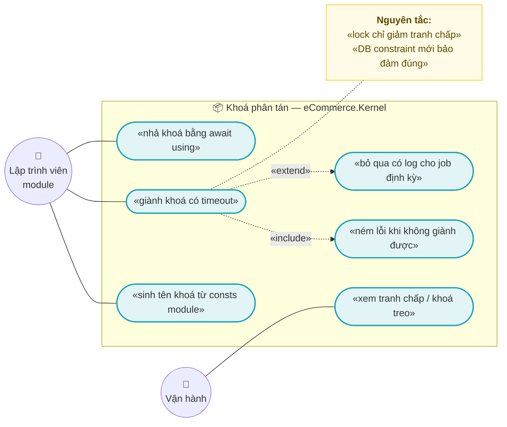
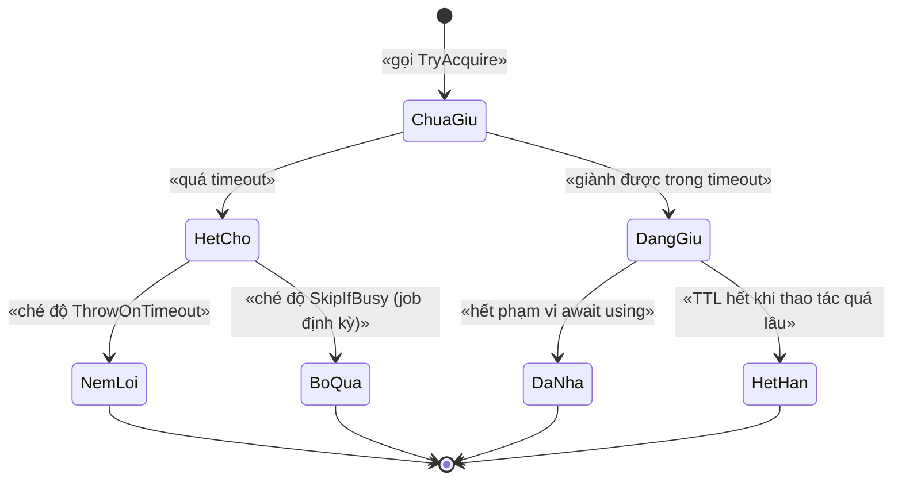
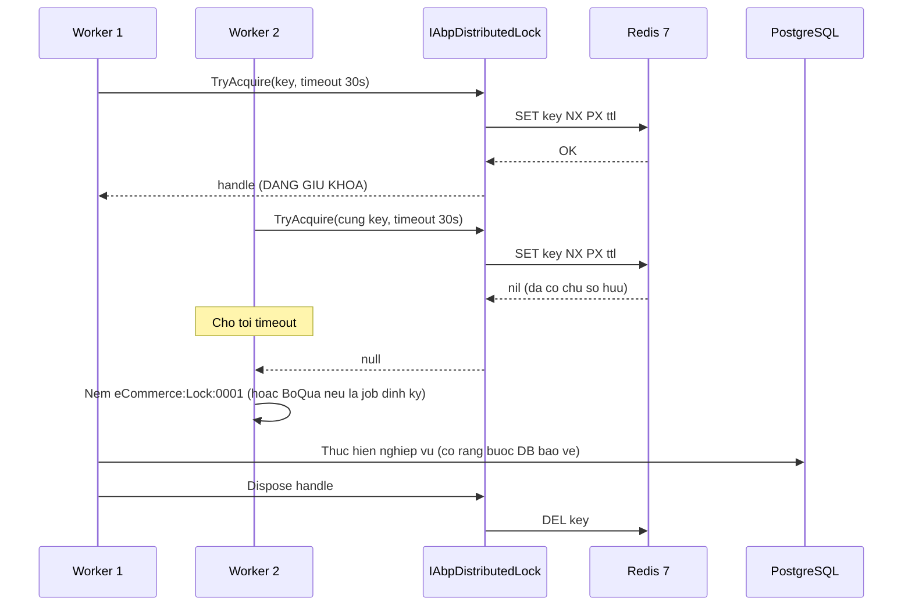
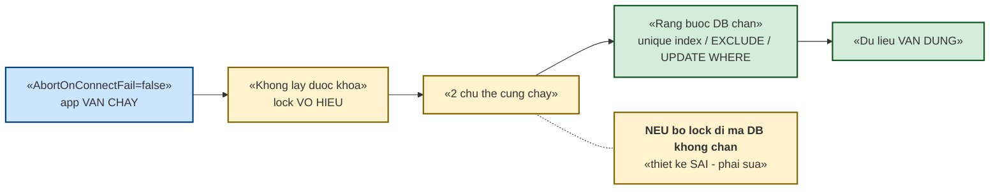

# `XC-003` — Khoá phân tán: quy ước & phạm vi

| Thuộc tính | Nội dung |
|---|---|
| **Mã** | `XC-003` |
| **Module** | **Nền dùng chung** — helper ở `eCommerce.Kernel`; **tên khoá do từng module tự sở hữu** (consts của module) |
| **Giai đoạn** | **Nền — phải xong TRƯỚC GĐ1** (mọi module cần khoá đều phụ thuộc) |
| **Ưu tiên** | **Must have** |
| **Trạng thái** | 🟡 `Draft` — chờ review |
| **Người viết / người review** | *(điền)* / **Kiến trúc trưởng** |
| **Phiên bản / ngày** | `v0.1 — 13/10/2026` |
| **Tài liệu liên quan** | `XC-001` · `XC-002` (D9 nói khoá phân tán; tài liệu đó **nợ** quy ước đầy đủ ở đây) · `XC-005` (observability: metric contention) · `INV-001` · `CHN-002` · `SAL-005` |

---

## 0. Tóm tắt & quyết định thiết kế

**Tóm tắt:** `XC-003` chốt **một quy ước duy nhất** cho tên khoá phân tán, **bảng đăng ký khoá** (key registry) đang dùng
trong hệ thống, và — quan trọng nhất — **giới hạn của lock**: lock là **tối ưu để giảm tranh chấp**, **không phải**
hàng rào bảo đảm tính đúng. Hàng rào cuối cùng luôn là **ràng buộc ở tầng DB**.

**Vì sao phải có tài liệu này (đã phát hiện lỗi thật, xem §15.2):** cùng một khái niệm "khoá refresh token của shop"
từng được định nghĩa ở **hai nơi** và cho ra **hai chuỗi khác nhau** (`ecommerce:channel:…` và `channel:…`).
Nếu hai đoạn code dùng hai bản khác nhau thì **khoá không bảo vệ gì cả** — và **không có lỗi biên dịch nào**.
Đây là loại lỗi im lặng, chỉ lộ ra khi có tranh chấp thật.

**Phạm vi:**
- ✅ Quy ước **tên khoá** (`ecommerce:<module>:<đối tượng>:<id>[:<hậu tố>]`).
- ✅ **Bảng đăng ký khoá** — nguồn sự thật duy nhất, sinh từ **code thật** (không viết theo trí nhớ).
- ✅ Quy tắc **thời gian chờ / TTL**, hành vi khi **không giành được khoá**, và khi **Redis chết**.
- ✅ Hợp đồng helper dùng chung + mã lỗi.
- ✅ Phát hiện & kế hoạch sửa các **sai lệch đang tồn tại** (§15.2).

**Không nằm trong phạm vi:**
- ❌ **Idempotency / chống trùng sự kiện** — thuộc `XC-002` (xem §7: lock **không** thay thế được idempotency).
- ❌ **Bảo đảm tính đúng ở tầng DB** (unique index, `EXCLUDE`, `UPDATE … WHERE`) — thuộc tài liệu của từng module.
- ❌ **Vận hành Redis** (HA/Sentinel/persistence) — chỉ nêu yêu cầu tối thiểu ở §11.
- ❌ **Saga / điều phối nhiều bước** — thuộc `SAL-004`.

### 0.1 Quyết định thiết kế (ADR ngắn)

| # | Quyết định | Phương án đã cân nhắc | Lý do chọn | Hệ quả |
|---|---|---|---|---|
| **D1** | Dùng **`IAbpDistributedLock` của ABP + `DistributedLock.Redis`** | (a) tự viết lock trên PostgreSQL · (b) lock trong bộ nhớ · (c) ABP + Redis | Redis 7 **đã có** trong stack; ABP đã dùng chính cơ chế này cho `AbpOutbox_*`/`AbpInbox_*` ⇒ một cách vận hành duy nhất | Phụ thuộc Redis; **lock không reentrant** (xem D6) |
| **D2** | **Lock KHÔNG phải hàng rào duy nhất** — mọi bất biến vẫn phải có ràng buộc DB | (a) tin vào lock · (b) lock + ràng buộc DB | Redis chết ⇒ `AbortOnConnectFail=false` (đã sửa ở Phase 0) ⇒ app **vẫn chạy** nhưng **lock trở nên vô hiệu**. Nếu bất biến chỉ dựa vào lock thì **sai dữ liệu âm thầm** | Mỗi bất biến phải trả lời được: *"nếu bỏ lock đi, DB có chặn không?"* — nếu **không** ⇒ thiết kế **sai** |
| **D3** | **Một nguồn sự thật cho tên khoá**: module tự sở hữu hàm sinh khoá | (a) ghép chuỗi tại chỗ · (b) hằng số tập trung ở app | Ghép chuỗi rải rác ⇒ **lệch khoá** (đúng lỗi đã xảy ra). Tập trung ở app ⇒ module không tách được và app phải biết mọi module | **Cấm** viết literal khoá trong code nghiệp vụ; chỉ gọi `…Consts.LockKeys.Xyz(...)` |
| **D4** | Tiền tố bắt buộc **`ecommerce:`** (chữ thường) | (a) không tiền tố · (b) `ecommerce:` | Không tiền tố ⇒ dễ đụng khoá của ABP (`AbpOutbox_*`) hoặc hệ thống khác **dùng chung Redis**. Chữ thường để grep/so khớp không phụ thuộc hoa-thường | Sửa các khoá đang thiếu tiền tố (§15.2 F1/F3) |
| **D5** | Đoạn `<module>` trong khoá = **tên module viết thường** (`channel`, `inventory`, `tax`, `messaging`, `order`) | (a) tên project đầy đủ `eCommerce.ChannelHub` · (b) tên ngắn | Khoá Redis nên **ngắn**; tên ngắn ổn định hơn tên project (project có thể đổi tiền tố) | Cần bảng ánh xạ module → đoạn khoá (§5) |
| **D6** | **Coi lock là KHÔNG reentrant** | (a) hy vọng ABP cho lồng · (b) thiết kế như không reentrant | `IAbpDistributedLock` dựa trên `DistributedLock` — **acquire lồng nhau trên cùng tên khoá sẽ chờ chính mình** ⇒ hết timeout rồi ném lỗi. Không có cơ chế đếm reentrancy | **Cấm** acquire lồng trong cùng luồng; nếu cần ⇒ **truyền cờ** "đã giữ khoá" xuống dưới thay vì acquire lại |
| **D7** | Khoá luôn **theo tenant** khi tài nguyên thuộc tenant | (a) khoá toàn cục · (b) có `tenantId` | Khoá toàn cục làm **tenant A chặn tenant B** vô cớ ⇒ giảm thông lượng | Chỉ khoá hạ tầng dùng chung mới **không** có tenant (ví dụ `AbpOutbox_*` của ABP) |
| **D8** | **Luôn có timeout** khi acquire | (a) chờ vô hạn · (b) timeout ngắn + ném lỗi | Chờ vô hạn ⇒ **treo request/worker** khi có sự cố; timeout biến sự cố thành **lỗi quan sát được** | Timeout mặc định **10 s** cho HTTP, **30 s** cho job nền; cấu hình được |
| **D9** | **Không** dùng distributed lock cho việc thuần trong 1 tiến trình | (a) dùng mọi nơi cho "an toàn" · (b) chỉ dùng khi vượt tiến trình | Lock qua Redis cho việc trong bộ nhớ là **chậm hơn + tạo ảo giác an toàn** (vì nếu Redis chết thì "khoá" biến mất) | Việc trong 1 tiến trình dùng `SemaphoreSlim`/`lock` |
| **D10** | Khi **không giành được khoá** ⇒ **mặc định NÉM LỖI**, không im lặng bỏ qua | (a) bỏ qua im lặng · (b) chờ tới timeout rồi ném | Im lặng bỏ qua ⇒ **mất việc** mà không ai biết (đúng bài học `SetPaidStatus()` của eShop). Riêng job định kỳ thì **bỏ qua có log + metric** là hợp lý (chạy lại nhịp sau) | Hai chế độ tường minh: `ThrowOnTimeout` (mặc định) và `SkipIfBusy` (chỉ cho job định kỳ, **bắt buộc** log + metric) |

---

## 1. Use Case Specification

| Thuộc tính | Nội dung |
|---|---|
| **Use Case ID** | `XC-003` |
| **Use Case Name** | Bảo vệ tài nguyên dùng chung bằng khoá phân tán **nhất quán và quan sát được** |
| **Description** | *"Là lập trình viên module, tôi muốn một cách duy nhất để sinh tên khoá và giành khoá, để hai worker/two instance không cùng sửa một tài nguyên — và để khi Redis chết thì hệ thống vẫn không sai dữ liệu."* |
| **Actor(s)** | **Lập trình viên module** · **Hệ thống** (`IAbpDistributedLock`, `DistributedLock.Redis`) · **Vận hành** (xem tranh chấp/khoá treo) |
| **Priority** | **Must have** |
| **Trigger** | (a) nhiều instance cùng xử lý một tài nguyên (refresh token, đẩy tồn lên sàn, trừ kho); (b) job định kỳ chạy trên nhiều instance |
| **Pre-Condition(s)** | • **Tenant hiện tại** (`TenantId`) — trừ khoá hạ tầng dùng chung.<br>• **Redis 7** sẵn sàng (nếu không: lock **vô hiệu** nhưng app **vẫn chạy** — xem D2).<br>• Tài nguyên được bảo vệ **đã có ràng buộc DB** tương ứng (D2).<br>• `<ChannelCode>` chỉ có mặt với khoá thuộc miền kênh (không áp dụng cho `inventory`/`tax`). |
| **Post-Condition(s)** | • Tại một thời điểm, **tối đa một** chủ thể giữ khoá cho một tên khoá.<br>• Khoá **luôn được nhả** (kể cả khi lỗi) — dùng `await using`.<br>• Mọi lần **không giành được** khoá đều **có dấu vết**: hoặc exception có mã, hoặc log + metric (D10). |
| **Basic Flow** | 1. Module gọi hàm sinh khoá của mình: `ChannelHubConsts.LockKeys.ChannelTokenRefresh(channelCode, shopId)`.<br>2. Mở phạm vi khoá: `await using var handle = await _distributedLock.TryAcquireAsync(key, timeout, ct);`<br>3. Nếu `handle is null` ⇒ **ném** `eCommerce:Lock:0001` (hoặc log + metric nếu chế độ `SkipIfBusy`).<br>4. Thực hiện nghiệp vụ **bên trong** phạm vi khoá.<br>5. Ra khỏi `using` ⇒ khoá được nhả **kể cả khi có exception**. |
| **Alternative Flow** | **A1: Job định kỳ** — dùng `SkipIfBusy`: không giành được khoá ⇒ **bỏ qua nhịp này**, ghi log `Information` + metric `lock_skipped_total{key}`; **không** ném lỗi.<br>**A2: Đã giữ khoá ở tầng trên** — truyền cờ/`handle` xuống dưới, **không** acquire lại (D6). |
| **Exception Flow** | **E1:** quá timeout mà không giành được ⇒ `BusinessException` `eCommerce:Lock:0001` (kèm tên khoá + thời gian chờ).<br>**E2:** Redis **không kết nối được** ⇒ `eCommerce:Lock:0002` **chỉ khi** chế độ yêu cầu cứng; mặc định **fail-open** (cho chạy tiếp) + **log `Error` + metric** — vì bất biến đã được DB bảo vệ (D2).<br>**E3:** acquire **lồng** cùng tên khoá ⇒ chờ tới timeout rồi `0001`; **cấm** thiết kế như vậy (D6). |
| **Business Rules** | • **BR-XC-003-001**: Tên khoá **chỉ** được sinh từ hàm trong consts của module sở hữu; **cấm** viết literal khoá trong code nghiệp vụ.<br>• **BR-XC-003-002**: Mọi khoá **phải** có tiền tố `ecommerce:` (chữ thường) và theo khuôn `ecommerce:<module>:<đối tượng>:<id>[:<hậu tố>]`.<br>• **BR-XC-003-003**: Khoá **phải** chứa `tenantId` **trừ** khoá hạ tầng dùng chung; **cấm** khoá toàn cục cho tài nguyên của tenant.<br>• **BR-XC-003-004**: Mọi lần acquire **phải** có timeout hữu hạn; **cấm** chờ vô hạn.<br>• **BR-XC-003-005**: **Cấm** acquire lồng trên cùng tên khoá (lock không reentrant).<br>• **BR-XC-003-006**: **Cấm** dùng tên khoá trùng với khoá của ABP (`AbpOutbox_*`, `AbpInbox_*`).<br>• **BR-XC-003-007**: Mọi bất biến được bảo vệ bằng khoá **phải** đồng thời có ràng buộc DB (D2) — kiểm bằng review: *"bỏ lock đi, DB có chặn không?"*.<br>• **BR-XC-003-008**: Distributed lock **không** thay thế idempotency (xem §7) — hai cơ chế giải hai bài toán khác nhau.<br>• **BR-XC-003-009**: Khoá **phải** được nhả qua `await using`; **cấm** gọi acquire mà không có phạm vi.<br>• **BR-XC-003-010**: Không giành được khoá ⇒ **mặc định ném lỗi**; chỉ job định kỳ được `SkipIfBusy` **và phải** log + metric. |
| **Non-Functional Requirement** | • **NFR-XC-003-001**: `TryAcquire` khi **rảnh** ⇒ p95 **< 10 ms**.<br>• **NFR-XC-003-002**: **0** deadlock/treo vô hạn (mọi acquire có timeout).<br>• **NFR-XC-003-003**: Tỉ lệ **không giành được** khoá trên môi trường bình thường **< 1 %**; vượt ⇒ cảnh báo.<br>• **NFR-XC-003-004**: Khoá **luôn** được nhả sau khi phạm vi kết thúc (kể cả exception) — test 1.000 vòng.<br>• **NFR-XC-003-005**: Redis chết ⇒ app **không** sập và **không** sai dữ liệu (nhờ ràng buộc DB) — test tích hợp.<br>• **NFR-XC-003-006**: Mọi khoá đều **grep được**: `grep "ecommerce:"` liệt kê đủ toàn bộ khoá của hệ thống. |

---

## 2. Sơ đồ Use Case



---

## 3. Vòng đời một khoá (state machine)



**Bảng chuyển trạng thái & guard (mọi chuyển sai **phải ném lỗi**, không im lặng):**

| Từ | Sang | Guard | Nếu vi phạm |
|---|---|---|---|
| `ChuaGiu` | `DangGiu` | Giành được khoá trong `timeout` | Sang `HetCho` |
| `ChuaGiu` | `HetCho` | Quá `timeout` **hoặc** Redis không kết nối được (E2) | — |
| `HetCho` | `NemLoi` | Chế độ mặc định | `BusinessException` `eCommerce:Lock:0001` |
| `HetCho` | `BoQua` | **Chỉ** job định kỳ **và** đã ghi log + metric | Thiếu log/metric ⇒ vi phạm BR-010 |
| `DangGiu` | `DaNha` | `await using` kết thúc (kể cả exception) | Rò khoá ⇒ tới `HetHan` |
| `DangGiu` | `HetHan` | TTL hết **trước khi** thao tác xong | 🚨 **Nguy hiểm**: chủ thể thứ hai có thể vào ⇒ phải bảo đảm **TTL > thời gian thao tác** |
| `DaNha`/`HetHan` | `[*]` | — | — |

> ⚠️ **`HetHan` là trạng thái nguy hiểm nhất:** nếu TTL ngắn hơn thời gian thao tác, **hai chủ thể cùng chạy** mà
> **không có cảnh báo nào**. Vì vậy với thao tác dài (đẩy tồn lên sàn, phát lại DLQ) **phải** đặt TTL lớn hơn
> thời gian tối đa của thao tác và **có metric** đếm số lần thao tác vượt TTL (§13 NFR-004).

---

## 4. Sequence Diagram & luồng dữ liệu

### 4.1 Hai instance tranh một tài nguyên



### 4.2 Redis chết — vì sao hệ thống **không** sai dữ liệu



---

## 5. Bảng đăng ký khoá (Data Dictionary của khoá)

**Không có bảng DB** — khoá sống trong Redis. "Mô hình dữ liệu" của feature này là **bảng đăng ký khoá** dưới đây,
được lập từ **code thật** (không viết theo trí nhớ):

| Khoá (mẫu) | Module sở hữu | Hàm sinh khoá | Dùng cho | TTL đề xuất |
|---|---|---|---|---|
| `ecommerce:inventory:{warehouseId}:{sku}` | **Inventory** *(hiện ở `eCommerceConsts` — xem F2 §15.2)* | `eCommerceConsts.LockKeys.InventorySku` | giữ/trừ tồn kho, chống bán vượt | **30 s** |
| `ecommerce:channel:{channelCode}:{shopId}:token-refresh` | **ChannelHub** | `ChannelHubConsts.LockKeys.ChannelTokenRefresh` | refresh token (Shopee rotate token ⇒ phải tuần tự) | **60 s** |
| `ecommerce:channel:{channelCode}:{shopId}:stock-push` | **ChannelHub** | `ChannelHubConsts.LockKeys.ChannelStockPush` | đẩy tồn/giá lên sàn | **120 s** |
| `ecommerce:channel:{channelCode}:{shopId}:order-pull` | **ChannelHub** | `ChannelHubConsts.LockKeys.ChannelOrderPull` | kéo đơn (tránh 2 worker cùng dịch con trỏ) | **120 s** |
| `ecommerce:tax:classification:{tenantId}:{targetId}` | **Tax** | `TaxLockKeys.Classification` | import/sửa phân loại thuế của một SKU/danh mục | **30 s** |
| `ecommerce:tax:rate-schedule:{tenantId}` | **Tax** | `TaxLockKeys.RateSchedule` | đổi khung hiệu lực mức thuế suất | **30 s** |
| `ecommerce:messaging:job:{jobName}:{tenantId}` | **Messaging** (`XC-002`) | `MessagingLockKeys.Job` *(đề xuất)* | chống job định kỳ chạy chồng | **300 s** |
| `ecommerce:messaging:dlq-replay:{tenantId}` | **Messaging** (`XC-002`) | `MessagingLockKeys.DlqReplay` *(đề xuất)* | chỉ 1 tiến trình phát lại DLQ cho một tenant | **300 s** |
| `AbpOutbox_{DatabaseName}` · `AbpInbox_{DatabaseName}` | **ABP** | — | relay outbox/inbox của ABP | ABP tự quản |

**Bảng ánh xạ module → đoạn khoá (D5):**

| Module / project | Đoạn `<module>` trong khoá |
|---|---|
| `eCommerce.ChannelHub.*` | `channel` |
| `eCommerce.Tax.*` | `tax` |
| `eCommerce.Messaging.*` | `messaging` |
| Inventory (hiện trong `src/eCommerce.Domain`) | `inventory` |
| Sales / Orders | `order` |
| PaymentHub | `payment` |

> 📌 **Quy tắc:** đoạn khoá dùng **tên miền nghiệp vụ ngắn**, **không** dùng tên project đầy đủ — để khoá Redis ngắn
> và **không đổi** khi project đổi tiền tố (bài học: `ChannelHub.Domain` → `eCommerce.ChannelHub.Domain` vừa rồi).

---

## 6. Hợp đồng API

### 6.1 Helper dùng chung (đề xuất đặt ở `eCommerce.Kernel`)

```csharp
namespace eCommerce.Kernel.Locking;

/// Quy ước tên khoá — nguồn sự thật duy nhất cho TIỀN TỐ.
public static class LockKeyPrefix
{
    public const string Root = "ecommerce";

    /// Ghép theo khuôn: ecommerce:<module>:<đối tượng>:<id>[:<hậu tố>]
    public static string Build(string module, string subject, string id, string? suffix = null)
        => suffix is null
            ? $"{Root}:{module}:{subject}:{id}"
            : $"{Root}:{module}:{subject}:{id}:{suffix}";
}

/// Chế độ khi không giành được khoá (D10).
public enum LockBusyBehavior
{
    /// Mặc định cho HTTP/nghiệp vụ: ném BusinessException eCommerce:Lock:0001.
    ThrowOnTimeout = 0,

    /// Chỉ cho JOB ĐỊNH KỲ: bỏ qua nhịp này, BẮT BUỘC ghi log + metric.
    SkipIfBusy = 1
}

public interface ILockScope : IAsyncDisposable
{
    string Key { get; }
    DateTimeOffset AcquiredAtUtc { get; }
}

public interface ILockManager
{
    Task<ILockScope> AcquireAsync(
        string key,
        TimeSpan timeout,
        LockBusyBehavior busyBehavior = LockBusyBehavior.ThrowOnTimeout,
        CancellationToken cancellationToken = default);
}
```

### 6.2 Mã lỗi

| Mã | HTTP | Khi nào | Thông điệp |
|---|---|---|---|
| `eCommerce:Lock:0001` | `409` | Quá timeout mà không giành được khoá | `Tài nguyên đang được xử lý bởi tiến trình khác, vui lòng thử lại.` |
| `eCommerce:Lock:0002` | `503` | Redis không kết nối được **và** chế độ yêu cầu cứng | `Không kết nối được dịch vụ khoá phân tán.` |

> 📌 Tiền tố `eCommerce:Lock:*` (không gắn module) là **nhất quán với tiền lệ `eCommerce:Money:*`** ở `XC-001`:
> đây là **nguyên thuỷ dùng chung**, không thuộc module nào.

---

## 7. Sự kiện, tích hợp ngoài & idempotency

### 7.1–7.2 Sự kiện phát ra / nhận vào

**Không áp dụng — lý do:** lock là cơ chế đồng bộ **trong thời gian thực**, không phát và không nhận sự kiện.

### 7.3 ⚠️ Lock **KHÔNG** thay thế idempotency (BR-008)

| | Khoá phân tán (`XC-003`) | Idempotency (`XC-002`) |
|---|---|---|
| Giải bài toán | **Hai việc chạy ĐỒNG THỜI** | **Cùng một việc chạy LẶP LẠI** (retry, redelivery, webhook gửi trùng) |
| Cơ chế | Redis lock (có TTL) | Bảng inbox + unique index (bền vững) |
| Nếu Redis chết | Mất tác dụng | **Vẫn hoạt động** (nằm ở DB) |
| Ví dụ | 2 worker cùng đẩy tồn lên sàn | Sàn gửi lại cùng webhook đơn hàng |

⇒ **Bắt buộc có CẢ HAI** ở biên vào: lock giảm tranh chấp, idempotency bảo đảm đúng. **Không** cái nào thay thế cái kia.

---

## 8. Bất biến & xử lý đồng thời

### 8.1 Bất biến

| # | Bất biến | Cơ chế bảo vệ |
|---|---|---|
| 1 | Một tên khoá chỉ có **tối đa một** chủ sở hữu tại một thời điểm | Redis `SET NX PX` |
| 2 | Khoá **luôn được nhả** kể cả khi exception | `await using` (BR-009) — không có đường code nhả thủ công |
| 3 | **Không** có acquire không timeout | API helper **bắt buộc** tham số `timeout` |
| 4 | **Không** có acquire lồng cùng tên khoá | Review + test `TC-08`; tài liệu hoá ở D6 |
| 5 | Mọi khoá **grep được** bằng `ecommerce:` | BR-002 + test quét mã nguồn `TC-12` |
| 6 | Bất biến nghiệp vụ **vẫn đúng khi Redis chết** | Ràng buộc DB (D2) + test tích hợp `TC-11` |

### 8.2 Xử lý đồng thời

| # | Tình huống | Cơ chế |
|---|---|---|
| 1 | 2 instance cùng refresh token của 1 shop | Khoá `…:token-refresh` ⇒ instance thứ hai **chờ tới timeout** rồi đọc lại token **đã được instance 1 cập nhật** (double-check sau khi giành khoá — đã có trong `ChannelTokenManager`) |
| 2 | Job định kỳ chạy trên nhiều instance | Khoá `…:job:{jobName}:{tenantId}` + `SkipIfBusy` |
| 3 | Thao tác dài hơn TTL | 🚨 Nguy hiểm — phải đặt TTL > thời gian tối đa + metric đếm vượt TTL |
| 4 | Redis chết | Fail-open (app vẫn chạy) + **DB là hàng rào cuối** |

**Idempotency key:** **Không áp dụng** — không có biên vào ngoài (xem §7.3 để phân biệt với `XC-002`).

---

## 9. Phân quyền

**Không áp dụng — lý do:** đây là cơ chế hạ tầng, không có endpoint và không có thao tác người dùng.
Quyền xem **tranh chấp/khoá treo** thuộc màn hình vận hành của `XC-005`.

---

## 10. UI Mockup & mapping dữ liệu

**Không có UI riêng.** Ảnh hưởng tới UI duy nhất: khi khoá bận, API trả **`409` kèm thông điệp thân thiện**
(`eCommerce:Lock:0001`), và UI **phải** hiển thị "đang xử lý, vui lòng thử lại" — **không** hiển thị lỗi hệ thống,
vì đây là tình huống **bình thường** khi có tranh chấp, không phải sự cố.

| Vùng UI | Dữ liệu | Nguồn | Quy tắc |
|---|---|---|---|
| Mọi màn hình gọi API có khoá | mã lỗi `0001` | response | hiển thị thông điệp **thân thiện** + nút thử lại; **không** log như lỗi hệ thống |
| Màn hình vận hành (XC-005) | metric tranh chấp | Redis/metric | chỉ đọc |

---

## 11. Migration & seed

| Mục | Nội dung |
|---|---|
| Migration | **Không có** — khoá sống trong Redis, không có bảng DB |
| Seed | **Không có** |
| Cấu hình Redis | Khoá **không cần** persistence (mất khoá ⇒ chỉ mất tính tuần tự, không mất dữ liệu) ⇒ **không** cần AOF/RDB cho mục đích khoá |
| Bắt buộc đã có | `AbortOnConnectFail = false` (đã sửa ở Phase 0) — **nếu không**, Redis chết sẽ **làm sập app** thay vì chỉ làm mất khoá |
| Rollback | Không cần |

---

## 12. Xử lý lỗi & trường hợp biên

| Tình huống | Nguyên nhân | Hành vi | Phản hồi |
|---|---|---|---|
| Không giành được khoá trong timeout | instance khác đang chạy | **Ném** `eCommerce:Lock:0001` (hoặc bỏ qua nếu job định kỳ) | `409` |
| Redis không kết nối được | sự cố hạ tầng | **Fail-open** (mặc định): chạy tiếp + log `Error` + metric; ràng buộc DB bảo vệ | bình thường |
| Redis không kết nối được **và** tài nguyên không có ràng buộc DB | 🚨 **thiết kế sai** | **Phát hiện ở review** (BR-007) — không phải xử lý runtime | — |
| Thao tác vượt TTL | TTL đặt quá ngắn | 2 chủ thể cùng chạy ⇒ ràng buộc DB chặn; **metric** đếm số lần vượt TTL | `409`/DB error |
| Acquire lồng cùng tên khoá | lập trình sai | Chờ tới timeout rồi ném `0001` — **khó chẩn đoán** ⇒ tài liệu hoá + test `TC-08` | `409` |
| Quên nhả khoá | không dùng `await using` | Khoá tự hết theo TTL (lưới an toàn); **review** phải chặn (BR-009) | — |
| Tên khoá đặt trùng `AbpOutbox_*` | lập trình sai | **Cấm** (BR-006) — sẽ phá relay của ABP | — |
| `tenantId` rỗng trong khoá có tenant | thiếu ngữ cảnh tenant | **Ném lỗi** tham số — **cấm** khoá toàn cục cho tài nguyên tenant (BR-003) | `500`/`400` |

**Chiến lược transaction:** phạm vi khoá **bao ngoài** Unit of Work (`await using` ở tầng app service/job),
**không** nằm trong transaction ⇒ khoá được nhả **sau** khi transaction kết thúc.

---

## 13. Phi chức năng

| Mã | Yêu cầu | Ngưỡng đo được | Cách kiểm chứng |
|---|---|---|---|
| NFR-XC-003-001 | Độ trễ giành khoá khi rảnh | p95 **< 10 ms** | benchmark |
| NFR-XC-003-002 | Không deadlock/treo vô hạn | **0** trường hợp | review API (**bắt buộc** có `timeout`) + test |
| NFR-XC-003-003 | Tỉ lệ không giành được khoá | **< 1 %** trên môi trường bình thường | metric `lock_timeout_total` |
| NFR-XC-003-004 | Khoá luôn được nhả | **1.000/1.000** vòng (kể cả khi ném exception) | unit/integration test |
| NFR-XC-003-005 | Redis chết ⇒ app vẫn chạy, dữ liệu vẫn đúng | không sập; **0** bản ghi vi phạm bất biến | integration test (dừng Redis) |
| NFR-XC-003-006 | Mọi khoá grep được | `grep "ecommerce:"` liệt kê đủ | test quét mã nguồn |
| NFR-XC-003-007 | Thao tác vượt TTL | **0** lần trên môi trường bình thường | metric `lock_ttl_exceeded_total` |

---

## 14. Test cases & Acceptance Criteria

### 14.1 Danh sách test case

| ID | Mục tiêu | Loại | Input | Expected | Phủ |
|---|---|---|---|---|---|
| TC-01 | Giành & nhả khoá | Unit | 1 chủ thể | giành được, nhả sạch | BR-001 |
| TC-02 | Chủ thể 2 chờ tới timeout | **Integration** (cần Redis) | 2 chủ thể, cùng khoá | chủ thể 2 nhận `null` sau timeout | D8 |
| TC-03 | Không giành được ⇒ **ném** `0001` | Unit | chế độ mặc định | `BusinessException` `eCommerce:Lock:0001` | **BR-010** |
| TC-04 | Job định kỳ ⇒ **bỏ qua** + log/metric | Unit | `SkipIfBusy` | không ném; có log **và** metric | **BR-010** |
| TC-05 | Ném exception trong phạm vi ⇒ khoá **vẫn** được nhả | Unit | handler ném | khoá đã nhả | **BR-009**, NFR-004 |
| TC-06 | 1.000 vòng acquire/release | Unit | lặp 1.000 | không rò khoá | NFR-004 |
| TC-07 | Quy ước tên khoá | Unit | `LockKeyPrefix.Build("tax","classification","abc")` | `ecommerce:tax:classification:abc` | **BR-002** |
| TC-08 | Acquire **lồng** cùng tên khoá | **Integration** | acquire 2 lần cùng khoá trong 1 luồng | lần 2 **timeout** (tài liệu hoá D6) | BR-005 |
| TC-09 | Mọi khoá có tiền tố `ecommerce:` | Unit (quét mã nguồn) | grep literal khoá | **0** literal ngoài consts | **BR-001/002** |
| TC-10 | Khoá có `tenantId`, không toàn cục | Unit (quét) | các hàm sinh khoá | **100 %** có `tenantId` (trừ hạ tầng) | **BR-003** |
| TC-11 | **Redis chết** ⇒ app chạy, bất biến vẫn đúng | **Integration** | dừng Redis, 2 luồng cùng trừ kho | DB **chặn** (không âm kho) | **BR-007**, NFR-005 |
| TC-12 | Không đặt trùng khoá ABP | Unit (quét) | so với `AbpOutbox_`/`AbpInbox_` | 0 trùng | **BR-006** |
| TC-13 | Không có API acquire thiếu `timeout` | Unit (reflection) | quét `ILockManager` | **0** overload thiếu `timeout` | **BR-004**, NFR-002 |
| TC-14 | Metric vượt TTL được ghi | Integration | thao tác dài hơn TTL | `lock_ttl_exceeded_total` tăng | NFR-007 |

### 14.2 Fixture skeleton (xUnit)

```csharp
public class LockConventionTests
{
    [Fact]
    public void TC07_quy_uoc_ten_khoa()
    {
        Assert.Equal("ecommerce:tax:classification:abc",
            LockKeyPrefix.Build("tax", "classification", "abc"));

        Assert.Equal("ecommerce:messaging:job:dlq-scan:tenant-1",
            LockKeyPrefix.Build("messaging", "job", "tenant-1", suffix: "dlq-scan"));
    }

    [Fact]
    public async Task TC03_khong_gianh_duoc_thi_nem_0001()
    {
        var sut = TaoLockManagerDaGiuKhoa("ecommerce:inventory:wh1:SKU1");

        var ex = await Assert.ThrowsAsync<BusinessException>(() =>
            sut.AcquireAsync("ecommerce:inventory:wh1:SKU1", TimeSpan.FromMilliseconds(50)));

        Assert.Equal("eCommerce:Lock:0001", ex.Code);
    }

    [Fact]
    public async Task TC05_khoa_van_duoc_nha_khi_handler_nem()
    {
        var sut = TaoLockManagerThat();
        var key = "ecommerce:tax:rate-schedule:t1";

        await Assert.ThrowsAsync<InvalidOperationException>(async () =>
        {
            await using var scope = await sut.AcquireAsync(key, TimeSpan.FromSeconds(1));
            throw new InvalidOperationException("loi nghiep vu");
        });

        // Sau khi pham vi ket thuc, khoa PHAI da duoc nha
        await using var again = await sut.AcquireAsync(key, TimeSpan.FromSeconds(1));
        Assert.NotNull(again);
    }
}
```

### 14.3 Acceptance Criteria (Definition of Done)

- [ ] 14 test case pass, phủ **hết 10 BR** và **7 NFR**
- [ ] **Bảng đăng ký khoá (§5) khớp 100 % với code** — có test quét mã nguồn phát hiện khoá không có trong bảng
- [ ] **0** literal khoá trong code nghiệp vụ (BR-001)
- [ ] **0** overload `AcquireAsync` thiếu `timeout` (BR-004)
- [ ] Test **Redis chết** chứng minh DB vẫn chặn (BR-007, NFR-005) — ⚠️ **cần Redis + PostgreSQL**
- [ ] Các sai lệch **F1/F3** ở §15.2 **đã sửa**; **F2** đã ghi vào `coding-conventions.md` hoặc tài liệu kế tiếp
- [ ] Tài liệu này cập nhật khớp code

### 14.4 Definition of Ready

- [x] ✅ Vị trí helper đã chốt: **`eCommerce.Kernel`** (nguyên thuỷ dùng chung, không mang EF)
- [x] ✅ Tên module hạ tầng đã chốt: **`Messaging`** (`XC-002`) ⇒ đề xuất `MessagingLockKeys`
- [ ] Chốt ngưỡng timeout mặc định (đề xuất **10 s** HTTP / **30 s** job)
- [ ] Chốt TTL cho từng khoá trong bảng §5 (đang là **đề xuất**)
- [ ] Xác nhận Redis production có cần HA/Sentinel không (ảnh hưởng §11)

---

## 15. Câu hỏi mở, giả định & lịch sử thay đổi

### 15.1 Câu hỏi mở

| # | Câu hỏi | Cần ai | Trạng thái | Ảnh hưởng |
|---|---|---|---|---|
| **Q1** | Timeout mặc định: **10 s** (HTTP) / **30 s** (job) có phù hợp? | Kiến trúc trưởng | `Open` | Quá ngắn ⇒ 409 giả; quá dài ⇒ treo request |
| **Q2** | TTL từng khoá (cột cuối §5) — chấp nhận đề xuất hay cần chỉnh? | Kiến trúc trưởng | `Open` | TTL < thời gian thao tác ⇒ 2 chủ thể cùng chạy |
| **Q3** | Redis production có cần **HA/Sentinel** không? | Vận hành | `Open` | Mất Redis ⇒ mất tính tuần tự (không mất dữ liệu) |
| **Q4** | Khi **không giành được khoá ở tầng HTTP**, trả `409` hay `423 Locked`? | Kiến trúc trưởng | `Open` | Ảnh hưởng UI và retry policy của client |
| **Q5** | Có cần **API/CLI liệt kê khoá đang giữ** (để gỡ khoá treo khi cần) không? | Vận hành | `Open` | Thuộc `XC-005`; khoá có TTL nên hiếm khi cần gỡ tay |
| **Q6** | Có cần **cảnh báo khi tranh chấp cao** (NFR-003) gửi tới đâu? | Vận hành | `Open` | Thuộc `XC-005`/`NOT-*` |

### 15.2 🚨 Sai lệch phát hiện được (nguồn gốc của tài liệu này)

| # | Sai lệch | Bằng chứng | Mức độ | Xử lý |
|---|---|---|---|---|
| **F1** | **Khoá kênh định nghĩa 2 nơi và cho ra 2 CHUỖI KHÁC NHAU**: `eCommerceConsts.LockKeys.ChannelTokenRefresh` → `ecommerce:channel:…` còn `ChannelHubConsts.LockKeys.ChannelTokenRefresh` → `channel:…` (thiếu `ecommerce:`). Nếu hai đoạn code dùng hai bản ⇒ **khoá không bảo vệ gì** | `src/eCommerce.Domain.Shared/eCommerceConsts.cs:91,95` vs `modules/ChannelHub/…/ChannelHubConsts.cs:23,27` | 🔴 **Cao** (lỗi im lặng) | ✅ **Đã sửa 13/10/2026**: xoá bản trùng ở `eCommerceConsts`, giữ bản của **module sở hữu**, sửa 3 XML comment trỏ đúng |
| **F2** | **Mã lỗi kênh định nghĩa 2 nơi, khác định dạng**: `eCommerceConsts.ErrorCodes.ChannelShopNotFound` = `eCommerce:Channel:0001` vs `ChannelHubErrorCodes.ChannelShopNotFound` = `ChannelHub:0001` | `eCommerceConsts.cs:59` vs `ChannelHubConsts.cs:38` | 🟠 **Trung bình** (không gây mất an toàn, nhưng chống đối soát/log) | ⬜ **Chưa sửa** — cần thống nhất về `eCommerce:Channel:*` và **module sở hữu**; việc này thuộc `coding-conventions.md`, **không** thuộc phạm vi lock. Đã ghi nhận để xử lý riêng |
| **F3** | Khoá của `Messaging` (`XC-002`) viết `messaging:…` — **thiếu tiền tố** `ecommerce:` | `XC-002` §8.2 | 🟠 Trung bình | ✅ **Đã sửa 13/10/2026** trong `XC-002` → `ecommerce:messaging:…` |
| **F4** | `eCommerceConsts.LockKeys.InventorySku` nằm ở **app** trong khi mọi khoá khác do **module** sở hữu | `eCommerceConsts.cs:99` | 🟡 Thấp | ⬜ Ghi nhận: khi tách module Inventory (GĐ1) thì chuyển khoá này về module (đúng quy ước D3) |

### 15.3 Giả định

| # | Giả định | Nếu SAI |
|---|---|---|
| 1 | Redis dùng chung **một** database cho lock + cache | Nếu tách DB ⇒ tiền tố `ecommerce:` vẫn đủ phân biệt; không cần đổi |
| 2 | Không có hệ thống khác dùng chung Redis instance | Nếu có ⇒ tiền tố `ecommerce:` là **bắt buộc** (đúng BR-002) |
| 3 | Thời gian thao tác trong phạm vi khoá **< TTL** | Nếu vượt ⇒ 2 chủ thể cùng chạy; DB chặn, nhưng cần metric cảnh báo |
| 4 | `IAbpDistributedLock` **không reentrant** (D6) | Nếu ABP đổi hành vi ⇒ gỡ bỏ hạn chế ở BR-005; **không** làm hỏng thiết kế |

### 15.4 Lịch sử thay đổi

| Phiên bản | Ngày | Người | Thay đổi |
|---|---|---|---|
| v0.1 | 13/10/2026 | *(điền)* | Bản nháp đầu — lập **bảng đăng ký khoá từ code thật**; phát hiện & sửa **F1** (khoá kênh trùng nhưng khác chuỗi) và **F3**; ghi nhận **F2/F4** |
