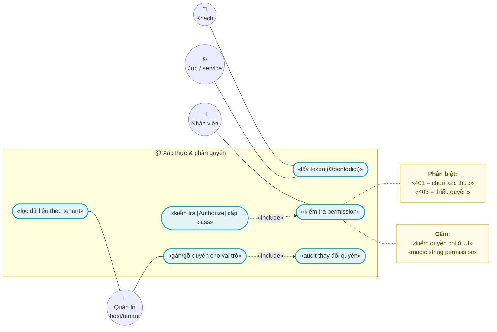
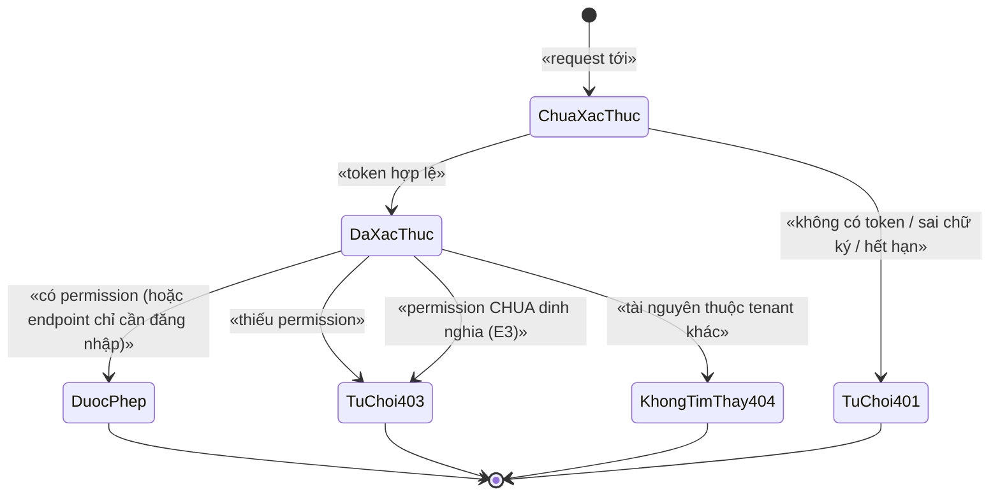
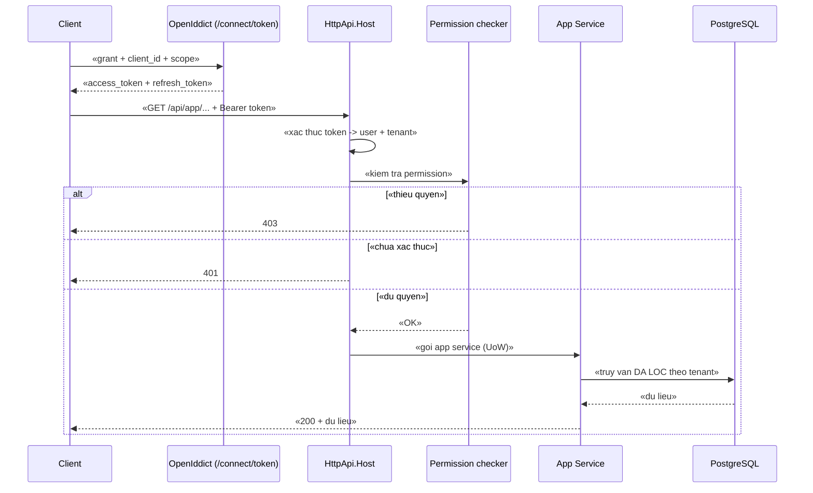
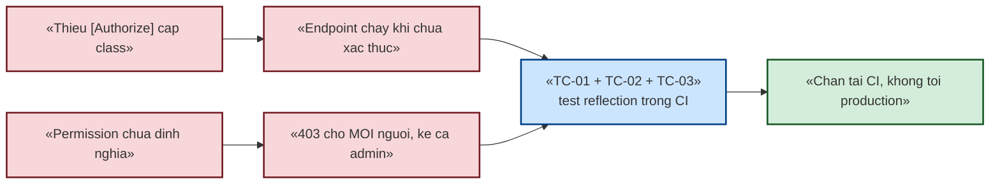

# `XC-004` — Xác thực, phân quyền & chiều tenant

| Thuộc tính | Nội dung |
|---|---|
| **Mã** | `XC-004` |
| **Module** | **Nền dùng chung** — permission ở `eCommerce.Application.Contracts`; auth server ở `eCommerce.HttpApi.Host` (OpenIddict) |
| **Giai đoạn** | **Nền — phải xong TRƯỚC GĐ1** (mọi app service đều cần permission định nghĩa trước khi code) |
| **Ưu tiên** | **Must have** |
| **Trạng thái** | 🟡 `Draft` — chờ review |
| **Người viết / người review** | *(điền)* / **Kiến trúc trưởng + Security review** |
| **Phiên bản / ngày** | `v0.1 — 13/10/2026` |
| **Tài liệu liên quan** | `XC-001` · `XC-002` · `XC-003` · `XC-006` · `docs/phase-0-execution-report.md` · `docs/abp-modules-plan.md` · `README.md` (cách lấy token) |

---

## 0. Tóm tắt & quyết định thiết kế

**Tóm tắt:** `XC-004` chốt **ai được làm gì** (xác thực + phân quyền) và **dữ liệu thuộc về ai** (chiều tenant).
Ba trụ: **OpenIddict** làm auth server (không tự viết), **kỷ luật định nghĩa permission** (thiếu định nghĩa ⇒ từ chối
**tất cả**, kể cả admin), và **chiều tenant** — nơi tài liệu này **phát hiện một lỗ hổng toàn hệ thống** về
ngữ nghĩa `NULL` trong unique index (§15.2 **F1**).

**Vì sao phải viết trước khi code:** hai lỗi loại này **đã xảy ra thật** ở Phase 0 —
(1) một app service **chạy được khi chưa xác thực** vì thiếu `[Authorize]` cấp class;
(2) API trả **403 dù user có role admin** vì permission **chưa được định nghĩa** trong `PermissionDefinitionProvider`.
Cả hai đều **không có lỗi biên dịch**. Vì vậy tài liệu này biến chúng thành **test tự động** (§14, TC-01/TC-02/TC-03).

**Phạm vi:**
- ✅ Mô hình **2 tầng**: permission cấp **host** (toàn hệ thống) và cấp **tenant**.
- ✅ Quy ước **tên permission** + bảng đăng ký (27 hằng số / 21 định nghĩa — **khớp nhau**, đã kiểm).
- ✅ Kỷ luật `[Authorize]`, allowlist cho `[AllowAnonymous]`, quy tắc **401 vs 403**.
- ✅ Luồng lấy token (OpenIddict) + ràng buộc **flow nào được dùng ở đâu**.
- ✅ **Chiều tenant**: `IMultiTenant` + `TenantId` + ảnh hưởng tới **unique index** và **query filter**.
- ✅ **Test tự động** chống tái phát 2 lỗi Phase 0.

**Không nằm trong phạm vi:**
- ❌ **Tenant management** (tạo/quản lý tenant, connection string riêng) — thuộc **GĐ4 (SaaS hoá)**; tài liệu này chỉ chốt **ràng buộc dữ liệu** để GĐ4 không phải migrate lại.
- ❌ **UI đăng nhập** — thuộc `WEB-001`.
- ❌ **Ký số / HSM** — thuộc `SIGN-001`.
- ❌ **Chính sách mật khẩu, 2FA** — nêu ở §15 (Q4) chứ chưa chốt.

### 0.1 Quyết định thiết kế (ADR ngắn)

| # | Quyết định | Phương án đã cân nhắc | Lý do chọn | Hệ quả |
|---|---|---|---|---|
| **D1** | **OpenIddict** làm auth server, **không** tự viết | (a) tự viết JWT + refresh · (b) IdentityServer · (c) OpenIddict | OpenIddict nằm trong ABP, **miễn phí** (IdentityServer bản thương mại mới rẻ/hợp lệ về license); đã cấu hình ở Phase 0 (scope `eCommerce`, client `eCommerce_App`) | Token do ta phát; phải tự quản **vòng đời token** và **flow** (D7) |
| **D2** | Permission **phải được ĐỊNH NGHĨA**; thiếu định nghĩa ⇒ **từ chối tất cả** | (a) chỉ dùng `[Authorize]` trần · (b) định nghĩa đầy đủ | ABP coi permission **chưa định nghĩa** là **luôn bị từ chối** ⇒ `403` dù user là admin. **Đã xảy ra thật** ở Phase 0 | Có **test tự động** `TC-02`: mọi chuỗi permission dùng trong `[Authorize]` **phải** tồn tại trong provider |
| **D3** | **`[Authorize]` ở CẤP CLASS bắt buộc** cho mọi app service | (a) chỉ đặt ở từng method · (b) cấp class | Đặt ở method ⇒ **quên một method là hở endpoint**. **Đã xảy ra thật**: `GetShopsAsync` chạy được khi chưa xác thực | Có **test reflection** `TC-01` chặn tái phát |
| **D4** | **Cấm** magic string cho tên permission | (a) `[Authorize("eCommerce.Products.Create")]` · (b) dùng `eCommerceConsts.Permissions.*` | Magic string **không** được kiểm tra khi biên dịch; gõ sai một ký tự ⇒ 403 không rõ nguyên nhân | Mọi `[Authorize]` dùng hằng số; `TC-02` kiểm cả hai chiều |
| **D5** | `[AllowAnonymous]` **chỉ** trong **allowlist** có lý do | (a) cho phép tuỳ ý endpoint công khai · (b) allowlist + review | Endpoint công khai là **bề mặt tấn công**; cần nhìn thấy **toàn bộ** danh sách ở một chỗ | `TC-03` chặn `[AllowAnonymous]` ngoài allowlist. Hiện **0** chỗ dùng |
| **D6** | Ủy quyền ở **tầng app service**, **không** ở UI | (a) ẩn nút trên UI · (b) ẩn nút **và** chặn ở server | Ẩn nút chỉ là **trải nghiệm**, không phải bảo mật — gọi API trực tiếp vẫn phải bị chặn | UI đọc permission để ẩn/hiện, nhưng **luôn** có kiểm tra phía server |
| **D7** | **Flow**: `authorization_code` + **PKCE** cho web/admin; `client_credentials` cho job/service; **`password` CHỈ ở môi trường dev** | (a) `password` cho mọi thứ · (b) `authorization_code`+PKCE | `password` grant (**ROPC**) bị coi là **không an toàn** (OAuth 2.1 khuyến nghị loại bỏ) — hiện `README` đang hướng dẫn `password` để lấy token. Chấp nhận cho dev, **cấm** ở production | Phải thêm client `authorization_code` khi làm UI (`WEB-001`); **cấm** bật `password` ở production (kiểm bằng cấu hình + test `TC-11`) |
| **D8** | **Chiều tenant**: giữ `IMultiTenant` + `TenantId` trên entity **ngay bây giờ**, nhưng **phải** xử lý ngữ nghĩa `NULL` | (a) bỏ `TenantId` cho tới GĐ4 · (b) giữ nhưng sửa unique index · (c) giữ nguyên và hy vọng | Bỏ `TenantId` ⇒ GĐ4 phải **migrate lại mọi bảng**; giữ nguyên ⇒ **F1** (unique index **mất tác dụng** khi `TenantId = NULL`) ⇒ mất toàn vẹn dữ liệu | 🚨 **Bắt buộc** một migration `NULLS NOT DISTINCT` (§15.2 F1) — **chưa thực hiện** vì máy dev không có PostgreSQL |
| **D9** | **Không** dùng tên permission gắn với **vai trò** | (a) `eCommerce.AdminOnly` · (b) tên theo **hành động/đối tượng** | Tên gắn vai trò ⇒ khi tổ chức đổi vai trò phải sửa code | Vai trò ↔ permission là **dữ liệu** (ABP quản lý), không phải code |
| **D10** | Mọi thay đổi **gán/gỡ quyền cho vai trò** phải **audit** | (a) không audit · (b) audit | Đây là thay đổi **bảo mật**; khi có sự cố phải biết **ai đổi quyền gì, lúc nào** | Dùng audit log của ABP; `TC-12` kiểm tra có bản ghi |

---

## 1. Use Case Specification

| Thuộc tính | Nội dung |
|---|---|
| **Use Case ID** | `XC-004` |
| **Use Case Name** | Xác thực người dùng và ủy quyền theo permission, có cách ly tenant |
| **Description** | *"Là hệ thống bán hàng đa kênh, tôi muốn mọi API đều yêu cầu xác thực và đúng quyền, để không ai xem/sửa được dữ liệu ngoài phạm vi của mình — và để lỗi phân quyền bị CI phát hiện thay vì phát hiện trên production."* |
| **Actor(s)** | **Khách** (chưa xác thực) · **Nhân viên** (đã xác thực, có permission) · **Quản trị tenant** · **Quản trị host** · **Job/service** (client credentials) |
| **Priority** | **Must have** |
| **Trigger** | Mọi request tới endpoint nghiệp vụ; mọi lần đăng nhập/lấy token; mọi lần đổi quyền cho vai trò |
| **Pre-Condition(s)** | • **Permission đã được định nghĩa** trong `eCommercePermissionDefinitionProvider` (thiếu ⇒ D2 từ chối tất cả).<br>• Client/scope đã seed trong OpenIddict (`eCommerce_App`, scope `eCommerce`).<br>• **Tenant hiện tại** (`ICurrentTenant`) — hiện hệ thống chạy **1 tenant** ⇒ `TenantId` **có thể là `NULL`** (đây là gốc của F1).<br>• `ChannelCode` **không** tham gia quyết định phân quyền (ràng buộc theo tenant + permission, không theo kênh). |
| **Post-Condition(s)** | • Request không có token hợp lệ ⇒ **`401`**; có token nhưng thiếu quyền ⇒ **`403`** (phân biệt rõ — xem §12).<br>• **Không** endpoint nghiệp vụ nào chạy được khi chưa xác thực (`TC-01`).<br>• Mọi thay đổi quyền có **bản ghi audit**.<br>• Dữ liệu trả về **chỉ** thuộc tenant hiện tại (khi bật multi-tenant ở GĐ4). |
| **Basic Flow** | 1. Client lấy token từ `/connect/token` (dev: `password`; web: `authorization_code` + PKCE — D7).<br>2. Client gọi API kèm `Authorization: Bearer …`.<br>3. ABP xác thực token ⇒ xác định **user** + **tenant**.<br>4. Kiểm tra `[Authorize]` **cấp class** ⇒ xác thực **danh tính**.<br>5. Kiểm tra permission khai báo (nếu có) ⇒ xác thực **quyền**.<br>6. App service chạy trong **Unit of Work**; truy vấn đã được lọc theo tenant.<br>7. Trả kết quả. |
| **Alternative Flow** | **A1: Job/service** — dùng `client_credentials` với scope hẹp; **không** có user ⇒ permission gán cho **client**, không gán cho người.<br>**A2: UI ẩn/hiện theo quyền** — UI đọc danh sách permission của user để ẩn nút, **nhưng** server **vẫn** kiểm tra (D6).<br>**A3: Quản trị host** — quyền cấp host (`TenantId = null`) **không** bị giới hạn theo tenant. |
| **Exception Flow** | **E1:** không có token / token sai chữ ký / hết hạn ⇒ **`401`**.<br>**E2:** token hợp lệ nhưng **thiếu permission** ⇒ **`403`**.<br>**E3:** permission **chưa được định nghĩa** ⇒ **`403` cho MỌI người** (kể cả host admin) — 🚨 đúng lỗi Phase 0; **phải** bị `TC-02` chặn từ CI.<br>**E4:** token có `scope` không đủ ⇒ **`403`** + log rõ scope thiếu.<br>**E5:** tenant trong token **khác** tenant của tài nguyên ⇒ **`404`** (không phải `403` — xem §12: **không** tiết lộ sự tồn tại của tài nguyên tenant khác). |
| **Business Rules** | • **BR-XC-004-001**: **Mọi** app service **phải** có `[Authorize]` ở **cấp class**.<br>• **BR-XC-004-002**: **Mọi** permission dùng trong `[Authorize]` **phải** được định nghĩa trong `PermissionDefinitionProvider`.<br>• **BR-XC-004-003**: **Cấm** magic string cho tên permission — **bắt buộc** dùng `eCommerceConsts.Permissions.*`.<br>• **BR-XC-004-004**: `[AllowAnonymous]` **chỉ** được dùng cho endpoint trong **allowlist** và **phải** ghi lý do.<br>• **BR-XC-004-005**: **Cấm** kiểm tra quyền **chỉ** ở UI — server **luôn** phải kiểm tra.<br>• **BR-XC-004-006**: Tên permission theo khuôn `eCommerce.<Nhóm>[.<NhómCon>].<HànhĐộng>`; **cấm** đặt tên theo **vai trò**.<br>• **BR-XC-004-007**: Phân biệt **`401`** (chưa/không xác thực) và **`403`** (đã xác thực, thiếu quyền).<br>**BR-XC-004-008**: Tài nguyên của tenant khác ⇒ trả **`404`**, **không** trả `403` (không tiết lộ sự tồn tại).<br>• **BR-XC-004-009**: Mọi entity thuộc tenant **phải** có `TenantId`; mọi **unique index có `TenantId`** **phải** dùng **`NULLS NOT DISTINCT`** (hoặc thiết kế tương đương) để **không mất tác dụng khi `TenantId` là `NULL`**.<br>• **BR-XC-004-010**: `password` grant **chỉ** được bật ở môi trường **dev**; production **cấm** (BR + kiểm cấu hình).<br>• **BR-XC-004-011**: Mọi thay đổi **gán/gỡ quyền cho vai trò** phải sinh **audit log**.<br>• **BR-XC-004-012**: **Cấm** chia sẻ client secret / đưa secret vào repo; secret đọc từ cấu hình ngoài (đã có `.gitignore` cho `appsettings.Production.json`).<br>• **BR-XC-004-013**: Job/service dùng `client_credentials` **phải** có scope **hẹp nhất** đủ dùng; **cấm** cấp client admin.<br>• **BR-XC-004-014**: **Không** tin `ReturnUrl`/callback từ client (bài học PaymentHub) — chỉ dùng redirect URI **đã đăng ký**. |
| **Non-Functional Requirement** | • **NFR-XC-004-001**: Kiểm tra permission (đã cache) p95 **< 5 ms**.<br>• **NFR-XC-004-002**: **100 %** app service có `[Authorize]` cấp class (đo bằng test reflection).<br>• **NFR-XC-004-003**: **0** permission dùng trong `[Authorize]` mà chưa định nghĩa (đo bằng test).<br>• **NFR-XC-004-004**: **0** `[AllowAnonymous]` ngoài allowlist (đo bằng test).<br>• **NFR-XC-004-005**: Thời gian sống access token ≤ **1 giờ**; refresh token ≤ **14 ngày** (đề xuất — xem Q3).<br>• **NFR-XC-004-006**: **0** secret trong repo (kiểm bằng quét).<br>• **NFR-XC-004-007**: Cách ly tenant: tenant A **không** đọc/ghi được dữ liệu tenant B (integration test 2 tenant — cần PostgreSQL).<br>• **NFR-XC-004-008**: Mọi thay đổi quyền có audit trong **< 1 s**. |

---

## 2. Sơ đồ Use Case



---

## 3. Vòng đời một request (state machine)



**Bảng quyết định & guard:**

| Từ | Sang | Guard | Ghi chú |
|---|---|---|---|
| `ChuaXacThuc` | `DaXacThuc` | Token hợp lệ, chưa hết hạn, đúng issuer/audience | — |
| `ChuaXacThuc` | `TuChoi401` | Không token / sai chữ ký / hết hạn | **401** — client phải lấy token mới rồi thử lại |
| `DaXacThuc` | `DuocPhep` | Có permission, **hoặc** endpoint chỉ yêu cầu đăng nhập | — |
| `DaXacThuc` | `TuChoi403` | Thiếu permission | **403** — thử lại **không** giúp được; cần cấp quyền |
| `DaXacThuc` | `TuChoi403` | 🚨 **Permission chưa định nghĩa** | Đúng lỗi Phase 0 — **phải** bị CI chặn (`TC-02`) |
| `DaXacThuc` | `KhongTimThay404` | Tài nguyên thuộc tenant khác | **404** cố ý — **không** tiết lộ sự tồn tại (BR-008) |

> ⚠️ **Không được "im lặng cho qua".** Nếu không xác định được quyền mà vẫn cho chạy (fail-open) thì đó là lỗ
> hổng bảo mật, **không** phải "tiện lợi". Fail-closed là mặc định.

---

## 4. Sequence Diagram & luồng dữ liệu

### 4.1 Gọi một API nghiệp vụ



### 4.2 Vì sao phải có test tự động — hai lỗi Phase 0



---

## 5. Mô hình dữ liệu & chiều tenant

### 5.1 Bảng của ABP (không tự tạo)

| Bảng | Nội dung |
|---|---|
| `AbpUsers` / `AbpRoles` / `AbpUserRoles` | người dùng, vai trò (module Identity của ABP) |
| `AbpPermissionGrants` | **gán quyền** theo `(Name, ProviderName, ProviderKey)` — ví dụ provider `R` (role) + key = tên vai trò |
| `AbpPermissionGroups` / `AbpPermissions` | **định nghĩa** quyền (sinh từ `PermissionDefinitionProvider`) |
| `AbpAuditLogs` | audit, gồm thay đổi quyền (BR-011) |

> 📌 **Đã kiểm trong repo:** permission định nghĩa **21** và hằng số trong `eCommerceConsts.Permissions` là **21** ⇒ **khớp** (không có hằng số "mồ côi"). Đây là điều **phải** giữ: `TC-02` kiểm tự động.

### 5.2 🚨 Ngữ nghĩa `NULL` của `TenantId` trong unique index — **F1**

**Sự kiện đã kiểm chứng trong repo:**

| Bằng chứng | Nội dung |
|---|---|
| Entity | **9+ entity** khai `IMultiTenant` + cột `TenantId` (`Product`, `ProductVariant`, `InventoryItem`, `ChannelShop`, `ChannelListing`, `PaymentTransaction`, `TaxRateSchedule`, `TaxClassification`, …) |
| Migration | Mọi unique index đều bắt đầu bằng `TenantId` và sinh bằng `unique: true` **thường** — ví dụ `CatProducts (TenantId, Code)`, `CatProductVariants (TenantId, Sku)`, `OrdOrders (TenantId, Number)`, `TaxRateSchedules (TenantId, Code)`, `TaxClassifications (TenantId, TargetType, TargetId, EffectiveFrom)` |
| Hệ quả SQL | PostgreSQL mặc định **`NULLS DISTINCT`**: hai dòng có `TenantId IS NULL` và **cùng `Code`** được coi là **khác nhau** ⇒ **unique index KHÔNG chặn** |
| Bối cảnh | Hệ thống hiện chạy **1 tenant**; `AbpTenantManagement` **chưa** cài và `ICurrentTenant` **chưa** dùng ở đâu ⇒ `TenantId` **rất có thể là `NULL`** cho mọi dòng |

⇒ 🔴 **Unique index đang KHÔNG bảo vệ** ở chế độ 1 tenant: có thể tạo **2 sản phẩm cùng `Code`**, **2 đơn cùng `Number`**, v.v.
Đây là **mất toàn vẹn dữ liệu**, và **không có lỗi biên dịch** nào.

**Cách sửa (chọn 1):**

| Phương án | Cách làm | Ưu / nhược |
|---|---|---|
| **A. `NULLS NOT DISTINCT`** *(khuyến nghị)* | `CREATE UNIQUE INDEX … ON … (…) NULLS NOT DISTINCT;` — **PostgreSQL 15+** hỗ trợ (ta dùng **PG 17**) | ✅ Sửa đúng bản chất, một dòng SQL mỗi index · ❌ EF Core **không** khai báo được ⇒ phải SQL thô trong migration (giống ràng buộc `EXCLUDE` của `XC-006`) |
| **B. Hai partial index** | một index `WHERE "TenantId" IS NULL` + một index thường cho `NOT NULL` | ✅ Chạy được trên PG cũ · ❌ Gấp đôi số index, dễ quên khi thêm bảng mới |
| **C. Sentinel tenant** | Ghi Guid rỗng thay vì `NULL` cho tenant mặc định | ✅ Unique index hoạt động như thường · ❌ Phải can thiệp tầng ghi dữ liệu + ảnh hưởng query filter của ABP ⇒ **rủi ro cao hơn** |

🔒 **Bất biến mới (BR-009):** *"Mọi unique index có `TenantId` phải dùng `NULLS NOT DISTINCT` (hoặc tương đương);
và **phải có test** chứng minh chèn trùng bị chặn khi `TenantId` là `NULL`."*

> ⚠️ **Chưa thực hiện được trong môi trường hiện tại:** máy dev **không có PostgreSQL/Docker** ⇒ migration này
> **chưa viết** và **chưa kiểm chứng**. Đã ghi vào việc bắt buộc của §11 và checklist kế hoạch.

### 5.3 Quy ước tên permission (Bảng đăng ký)

Khuôn: **`eCommerce.<Nhóm>[.<NhómCon>].<HànhĐộng>`** — PascalCase, **không** gắn vai trò (BR-006/D9).

| Nhóm | Hành động hiện có | Ghi chú |
|---|---|---|
| `Products` | `Create` `Edit` `Delete` (+ `Default`) | danh từ **số nhiều** cho thực thể đếm được |
| `Inventory` | `Adjust` | không đếm được ⇒ **số ít** |
| `Channels` | `Manage` `Sync` | |
| `Orders` | `Manage` | |
| `Payments` | `Refund` | |
| `Tax.Classification` | `View` `Manage` `Approve` `Import` `ExportMau01` | **2 tầng** nhóm — dùng khi miền có nhiều đối tượng |
| `Tax.RateSchedule` | `Manage` | |

**Bộ hành động chuẩn nên dùng** (tránh mỗi nơi một kiểu): `View` · `Create` · `Edit` · `Delete` · `Manage` ·
`Approve` · `Import` · `Export…` · `Sync` · `Refund` · `Adjust`.

**Phân tầng host / tenant:**

| Tầng | Ai có | Ví dụ | `TenantId` của grant |
|---|---|---|---|
| **Host** | quản trị hệ thống | `eCommerce.Tax.RateSchedule.Manage` (ảnh hưởng toàn hệ thống) | `null` |
| **Tenant** | quản trị/nhân viên tenant | `eCommerce.Products.Create`, `eCommerce.Tax.Classification.Approve` | tenant tương ứng |

---

## 6. Hợp đồng API

### 6.1 Khai báo (app service)

```csharp
// ĐÚNG: [Authorize] ở CẤP CLASS (D3) + tên quyền lấy từ hằng số (D4)
[Authorize(eCommerceConsts.Permissions.Products.Default)]
public class ProductAppService : eCommerceAppService, IProductAppService
{
    [Authorize(eCommerceConsts.Permissions.Products.Create)]
    public Task<ProductDto> CreateAsync(CreateProductDto input) { ... }
}

// SAI (đã từng xảy ra ở Phase 0): không có [Authorize] ở cấp class
public class SomeAppService : eCommerceAppService { public Task DoAsync() { ... } } // ❌ hở endpoint
```

### 6.2 Mã lỗi & mã trạng thái

| HTTP | Khi nào | Client nên làm gì | Ghi chú |
|---|---|---|---|
| **`401`** | Không token / sai chữ ký / hết hạn | lấy token mới (refresh) rồi thử lại | Phân biệt với `403` (BR-007) |
| **`403`** | Đã xác thực nhưng **thiếu quyền**, **hoặc** permission **chưa định nghĩa** (E3) | **không** thử lại; báo người dùng/ quản trị cấp quyền | E3 phải bị CI chặn (`TC-02`) |
| **`404`** | Tài nguyên **thuộc tenant khác** | như không tồn tại | Cố ý — **không** tiết lộ (BR-008) |
| `eCommerce:Auth:0001` *(đề xuất)* | `scope` không đủ | lấy token với scope đúng | Dùng cho log/metric, không lộ chi tiết ra client |

---

## 7. Sự kiện, tích hợp ngoài & idempotency

### 7.1 Sự kiện phát ra

| ETO | Khi nào | Ai tiêu thụ | Ghi chú |
|---|---|---|---|
| `PermissionsChangedEto` *(đề xuất)* | khi gán/gỡ quyền cho vai trò | cache permission (**bắt buộc** xoá cache đa instance) | Nếu không xoá cache ⇒ user giữ quyền cũ tới khi cache hết hạn ⇒ **lỗ hổng** |
| `UserRolesChangedEto` *(ABP cung cấp)* | đổi vai trò của user | như trên | Ưu tiên dùng sự kiện có sẵn của ABP nếu đủ |

> 🚨 **Bắt buộc:** cache permission **phải** bị xoá khi quyền thay đổi, trên **mọi instance** — cơ chế ở `XC-002`
> (distributed event bus + outbox). Nếu chỉ xoá cache cục bộ ⇒ instance khác vẫn cho qua.

### 7.2–7.3 Nhận sự kiện từ ngoài / gọi API ra ngoài

**Không áp dụng** — trừ **redirect URI** của OpenIddict: **chỉ** dùng URI **đã đăng ký**, **cấm** tin `ReturnUrl` từ client (BR-014).

**Idempotency key:** **Không áp dụng** — nhưng **mọi** webhook/IPN của NCC **phải** đi qua idempotency của `XC-002` (§7.3 của tài liệu đó).

---

## 8. Bất biến & xử lý đồng thời

### 8.1 Bất biến

| # | Bất biến | Cơ chế bảo vệ |
|---|---|---|
| 1 | **Mọi** app service có `[Authorize]` cấp class | **Test reflection** `TC-01` (chặn ở CI, không chờ review) |
| 2 | **Mọi** permission dùng trong `[Authorize]` **đã** được định nghĩa | **Test** `TC-02` (quét hằng số vs provider) |
| 3 | **Không** `[AllowAnonymous]` ngoài allowlist | **Test** `TC-03` |
| 4 | Unique index **có hiệu lực kể cả khi `TenantId` là `NULL`** | `NULLS NOT DISTINCT` (BR-009) + **test chèn trùng** `TC-08` |
| 5 | Tenant A không đọc/ghi được dữ liệu tenant B | Query filter của ABP + test 2 tenant `TC-09` |
| 6 | Không secret nào nằm trong repo | Quét `TC-10` (BR-012) |
| 7 | `password` grant **không** bật ở production | Kiểm cấu hình `TC-11` (BR-010) |

### 8.2 Xử lý đồng cơn

| # | Tình huống | Cơ chế |
|---|---|---|
| 1 | Đổi quyền trong khi user đang có request | Request đang chạy giữ quyền đã kiểm; **cache bị xoá** ⇒ request sau thấy quyền mới |
| 2 | Nhiều instance cùng cache permission | Xoá cache qua **distributed event** (không chỉ cục bộ) |
| 3 | Hai quản trị cùng sửa quyền một vai trò | Optimistic concurrency của ABP + audit ghi cả hai |

**Khoá phân tán:** **không dùng** cho việc kiểm quyền (chỉ đọc). Nếu job gán quyền hàng loạt ⇒ dùng khoá theo
quy ước `XC-003`: `ecommerce:auth:role-grant:{tenantId}:{roleName}`.

**Idempotency key:** **Không áp dụng**.

---

## 9. Phân quyền (của chính tài liệu này)

**Không áp dụng — lý do:** đây là **cơ chế** phân quyền, không phải một feature có endpoint riêng.
Các permission **cụ thể** do từng module khai báo; bảng đăng ký ở §5.3.

---

## 10. UI Mockup & mapping dữ liệu

**Không có UI riêng** (UI đăng nhập thuộc `WEB-001`). Quy tắc **bắt buộc** cho mọi UI:

| Vùng UI | Dữ liệu | Nguồn | Quy tắc |
|---|---|---|---|
| Nút/menu theo quyền | danh sách permission của user | `GET /api/app/...` (ABP có sẵn) | Ẩn nút nếu thiếu quyền — **nhưng** server **vẫn** kiểm tra (BR-005) |
| Khi nhận `401` | — | response | chuyển sang đăng nhập / refresh token rồi thử lại |
| Khi nhận `403` | — | response | hiển thị **"Bạn không có quyền"** + mã quyền cần có (giúp quản trị cấp đúng) — **không** hiển thị lỗi hệ thống |

> 📌 **Ghi rõ:** ẩn nút trên UI **không** được coi là biện pháp bảo mật. Test `TC-01` chỉ kiểm phía server.

---

## 11. Migration & seed

| Mục | Nội dung |
|---|---|
| Migration **bắt buộc** *(F1)* | Thay các unique index có `TenantId` sang **`NULLS NOT DISTINCT`** (SQL thô — EF Core không hỗ trợ). ⚠️ **CHƯA viết** — cần PostgreSQL để kiểm chứng |
| Migration khác | **Không** (bảng permission/role là của ABP, đã có ở Phase 0) |
| Seed | `IdentityDataSeedContributor`: tạo `admin@abp.io` + vai trò `admin` + **gán TẤT CẢ permission** cho vai trò (`SetForRoleAsync(roleName, permission, true)`) — đã có, chạy **idempotent** |
| Seed OpenIddict | scope `eCommerce` + client `eCommerce_App` — đã có, dạng **descriptor** |
| ⚠️ **Thiếu khi làm SaaS (GĐ4)** | **Chưa** có seed **vai trò mặc định cho tenant mới** ⇒ tenant mới sẽ **không ai có quyền**. Ghi nhận cho GĐ4 |
| Rủi ro cấu hình | `password` grant đang được `README` hướng dẫn cho dev — **phải** bảo đảm **không** bật ở production (BR-010, `TC-11`) |
| Rollback | Đổi index về `NULLS DISTINCT` (chấp nhận mất ràng buộc — **không** khuyến nghị) |

---

## 12. Xử lý lỗi & trường hợp biên

| Tình huống | Nguyên nhân | Hành vi | Phản hồi |
|---|---|---|---|
| Không có token | gọi trực tiếp | **`401`** | client lấy token rồi thử lại |
| Token hết hạn | phiên dài | **`401`** + header `WWW-Authenticate` | refresh token |
| Token sai chữ ký/issuer | cấu hình sai hoặc giả mạo | **`401`** + log `Warning` | **không** tiết lộ chi tiết |
| Thiếu permission | chưa cấp quyền | **`403`** | báo quyền cần có |
| 🚨 **Permission chưa định nghĩa** | thiếu khai báo trong provider | **`403` cho MỌI người** (kể cả admin) | 🚨 **Phải bị CI chặn** — `TC-02`. Đây là lỗi Phase 0 |
| Tài nguyên tenant khác | cố truy cập | **`404`** | **không** tiết lộ sự tồn tại (BR-008) |
| Unique index không chặn khi `TenantId` NULL (F1) | ngữ nghĩa `NULLS DISTINCT` | 🚨 **Cho phép trùng** ⇒ hỏng dữ liệu | **Phải** sửa bằng migration (§5.2) + `TC-08` |
| Vai trò bị xoá nhưng user còn phiên | quản trị | Cache permission **phải** bị xoá; user mất quyền ở request kế tiếp | — |
| Job dùng `client_credentials` quá quyền | cấu hình sai | Vi phạm BR-013 | review + scope hẹp |

**Chiến lược transaction:** không đổi — mọi thao tác ghi qua **Unit of Work**; kiểm quyền **trước** khi mở nghiệp vụ.

---

## 13. Phi chức năng

| Mã | Yêu cầu | Ngưỡng | Cách kiểm chứng |
|---|---|---|---|
| NFR-XC-004-001 | Độ trễ kiểm quyền | p95 **< 5 ms** (cache hit) | benchmark |
| NFR-XC-004-002 | Độ phủ `[Authorize]` | **100 %** app service | test reflection `TC-01` |
| NFR-XC-004-003 | Permission định nghĩa đủ | **0** permission "mồ côi" | test `TC-02` |
| NFR-XC-004-004 | `[AllowAnonymous]` | **0** ngoài allowlist | test `TC-03` |
| NFR-XC-004-005 | Vòng đời token | access **≤ 1 h**, refresh **≤ 14 ngày** | kiểm cấu hình (Q3) |
| NFR-XC-004-006 | Secret trong repo | **0** | quét `TC-10` |
| NFR-XC-004-007 | Cách ly tenant | tenant A **không** thấy dữ liệu B | integration 2 tenant `TC-09` (cần PostgreSQL) |
| NFR-XC-004-008 | Audit thay đổi quyền | **100 %** có bản ghi | `TC-12` |

---

## 14. Test cases & Acceptance Criteria

### 14.1 Danh sách test case

| ID | Mục tiêu | Loại | Input | Expected | Phủ |
|---|---|---|---|---|---|
| **TC-01** | **Mọi app service có `[Authorize]` cấp class** | Unit (**reflection**) | quét mọi type `*AppService` | **100 %** có `[Authorize]` | **BR-001**, NFR-002 |
| **TC-02** | **Mọi permission dùng trong `[Authorize]` đã định nghĩa** | Unit | so hằng số vs `PermissionDefinitionProvider` | **0** mồ côi (cả 2 chiều: hằng số không định nghĩa + định nghĩa không hằng số) | **BR-002**, BR-003 |
| **TC-03** | `[AllowAnonymous]` chỉ trong allowlist | Unit (reflection) | quét | **0** ngoài allowlist | **BR-004** |
| TC-04 | Cấm magic string permission | Unit | quét mã nguồn `[Authorize("` | **0** match | **BR-003** |
| TC-05 | `401` khi không token | **Integration** | gọi API không header | `401` | BR-007 |
| TC-06 | `403` khi thiếu quyền | **Integration** | token user thiếu quyền | `403` | **BR-007** |
| TC-07 | `404` khi tài nguyên tenant khác | **Integration** | 2 tenant | `404` (**không** `403`) | **BR-008** |
| **TC-08** | **Unique index chặn trùng khi `TenantId` NULL** | **Integration** | chèn 2 `Product` cùng `Code`, `TenantId = NULL` | **DB từ chối** (unique) | **BR-009** |
| TC-09 | Cách ly tenant | **Integration** | tenant A đọc dữ liệu B | không thấy | NFR-007 |
| TC-10 | Không secret trong repo | Unit (quét) | quét file cấu hình | **0** secret | **BR-012** |
| TC-11 | `password` grant tắt ở production | Unit (cấu hình) | `appsettings.Production.json` | không bật `password` | **BR-010** |
| TC-12 | Audit khi đổi quyền vai trò | **Integration** | gán quyền | có bản ghi audit | **BR-011** |
| TC-13 | Xoá cache permission đa instance | **Integration** | instance 1 đổi quyền | instance 2 thấy trong < 5 s | §7.1 |
| TC-14 | Client credentials chỉ scope hẹp | Unit (cấu hình) | seed OpenIddict | không client nào có quyền admin | **BR-013** |

### 14.2 Fixture skeleton (xUnit) — **hai test quan trọng nhất**

```csharp
public class AuthorizationGuardTests
{
    /// TC-01 — chặn tái phát lỗi Phase 0: app service chạy được khi chưa xác thực.
    [Fact]
    public void TC01_moi_app_service_phai_co_Authorize_o_cap_class()
    {
        var thieu = typeof(eCommerceApplicationModule).Assembly.GetTypes()
            .Where(t => t.Name.EndsWith("AppService") && !t.IsAbstract && !t.IsInterface)
            .Where(t => !t.GetCustomAttributes(typeof(AuthorizeAttribute), inherit: true).Any())
            .Select(t => t.FullName)
            .ToList();

        Assert.True(thieu.Count == 0,
            "App service thieu [Authorize] cap class:\n" + string.Join("\n", thieu));
    }

    /// TC-02 — chặn tái phát lỗi Phase 0: 403 cho MỌI người vì permission chưa được định nghĩa.
    [Fact]
    public void TC02_moi_permission_dung_trong_Authorize_phai_duoc_dinh_nghia()
    {
        var daDinhNghia = LayTatCaPermissionDaDinhNghia();   // đọc từ PermissionDefinitionProvider
        var dungTrongCode = typeof(eCommerceApplicationModule).Assembly.GetTypes()
            .SelectMany(t => t.GetCustomAttributes<AuthorizeAttribute>(true)
                              .Concat(t.GetMethods().SelectMany(m => m.GetCustomAttributes<AuthorizeAttribute>(true))))
            .Select(a => a.Policy)
            .Where(p => !string.IsNullOrWhiteSpace(p))
            .Distinct()
            .ToList();

        var moCoi = dungTrongCode.Except(daDinhNghia).ToList();
        Assert.True(moCoi.Count == 0,
            "Permission dung trong [Authorize] nhung CHUA dinh nghia (=> 403 cho moi nguoi):\n"
            + string.Join("\n", moCoi));
    }
}
```

### 14.3 Acceptance Criteria (Definition of Done)

- [ ] 14 test case pass, phủ **hết 14 BR** và **8 NFR**
- [ ] **`TC-01` + `TC-02` chạy trong CI** — đây là **điều kiện quan trọng nhất** của tài liệu này
- [ ] **F1 đã sửa**: migration `NULLS NOT DISTINCT` cho **mọi** unique index có `TenantId` + `TC-08` chứng minh
      ⚠️ *(chưa làm được vì thiếu PostgreSQL — xem §15.2)*
- [ ] `README` ghi rõ `password` grant **chỉ** cho dev; production dùng `authorization_code` + PKCE
- [ ] Không secret trong repo; client credentials chỉ có scope hẹp
- [ ] Tài liệu này cập nhật khớp code

### 14.4 Definition of Ready

- [x] ✅ Đã kiểm: **21 định nghĩa = 21 hằng số** (không có permission mồ côi)
- [x] ✅ Đã kiểm: **0** `[AllowAnonymous]` trong repo
- [x] ✅ Đã kiểm: OpenIddict + 2 seeder đã có; `AbpTenantManagement` **chưa** cài
- [ ] Chốt **vòng đời token** (Q3) và **có bật 2FA cho admin không** (Q4)
- [ ] Chốt **danh sách allowlist `[AllowAnonymous]`** (đề xuất: health check, `/.well-known/*`, `/connect/*`; Swagger **chỉ** dev)
- [ ] Xác nhận **multi-tenant thật ở GĐ4** để chốt F1 (D8 đã chọn sửa ngay)

---

## 15. Câu hỏi mở, giả định & lịch sử thay đổi

### 15.1 Câu hỏi mở

| # | Câu hỏi | Cần ai | Trạng thái | Ảnh hưởng |
|---|---|---|---|---|
| **Q1** | Allowlist `[AllowAnonymous]` gồm những endpoint nào? | Kiến trúc trưởng | `Open` | Endpoint công khai = bề mặt tấn công |
| **Q2** | `admin@abp.io / 1q2w3E*` (tài khoản seed) — có **bắt buộc đổi mật khẩu** ở lần đăng nhập đầu không? | Kiến trúc trưởng + Security | `Open` | 🔴 Tài khoản seed có mật khẩu **trong tài liệu** ⇒ rủi ro nếu lên production nguyên trạng |
| **Q3** | Vòng đời token: access **≤ 1 h**, refresh **≤ 14 ngày** — chấp nhận? | Kiến trúc trưởng | `Open` | Ảnh hưởng trải nghiệm + bảo mật |
| **Q4** | Có cần **2FA/OTP** cho tài khoản quản trị không? | Kiến trúc trưởng + Security | `Open` | Nếu cần ⇒ thêm luồng + phụ thuộc SMS/Zalo OA (`NOT-002`) |
| **Q5** | Có cần **đăng nhập Google/Zalo** cho khách hàng không? | BA | `Open` | Ảnh hưởng `WEB-001` + OpenIddict external provider |
| **Q6** | GĐ4 dùng **multi-tenant chung DB** hay **DB riêng mỗi tenant**? | Kiến trúc trưởng | `Open` | Ảnh hưởng F1: nếu **DB riêng** thì `TenantId` có thể bỏ ⇒ F1 nhẹ hơn |
| **Q7** | Ai được sửa **quyền của vai trò** — chỉ host admin, hay cả tenant admin (trong phạm vi tenant)? | BA | `Open` | Ảnh hưởng thiết kế UI quản trị quyền |

### 15.2 🚨 Sai lệch & lỗ hổng phát hiện được

| # | Vấn đề | Bằng chứng | Mức độ | Xử lý |
|---|---|---|---|---|
| **F1** | **Unique index mất tác dụng khi `TenantId` là `NULL`** (PostgreSQL `NULLS DISTINCT`). Ảnh hưởng **mọi** unique index bắt đầu bằng `TenantId` (`CatProducts`, `CatProductVariants`, `InvItems`, `OrdOrders`, `TaxRateSchedules`, `TaxClassifications`…) ⇒ có thể tạo **trùng `Code`/`Number`/`Sku`** | 9+ entity `IMultiTenant` + migration dùng `unique: true` thường; `AbpTenantManagement` chưa cài, `ICurrentTenant` chưa dùng ở đâu | 🔴 **Cao** — **mất toàn vẹn dữ liệu**, im lặng | ⬜ **Chưa sửa** — cần migration `NULLS NOT DISTINCT` (§5.2). **Không thể kiểm chứng** vì máy dev không có PostgreSQL. **Đã ghi vào việc bắt buộc** |
| **F2** | **Multi-tenancy chưa thực sự bật**: entity đã `IMultiTenant` + có `TenantId`, nhưng **không** có `AbpMultiTenantManagement`, **0** chỗ dùng `ICurrentTenant` | grep toàn repo | 🟠 **Trung bình** | ✅ **Đã ghi nhận** ở D8 + Q6. Hệ quả query filter cần **kiểm chứng runtime** (chưa làm được) |
| **F3** | `README` hướng dẫn lấy token bằng **`password` grant** | `README.md` mục "Lấy token" | 🟠 **Trung bình** (dev) / 🔴 nếu lọt production | ⬜ Ghi rõ **chỉ dev** trong README (BR-010, `TC-11`) |
| **F4** | Tài khoản seed **`admin@abp.io / 1q2w3E*`** có mật khẩu **viết trong tài liệu** | `IdentityDataSeedContributor` + README | 🟠 **Trung bình** | ⬜ Q2: buộc đổi mật khẩu lần đầu, hoặc sinh mật khẩu ngẫu nhiên khi seed production |
| **F5** | Mã lỗi trùng/khác định dạng giữa app và module (`eCommerce:Channel:0001` vs `ChannelHub:0001`) | Đã ghi ở `XC-003` §15.2 **F2** | 🟡 Thấp | ⬜ Vẫn chưa sửa — thuộc `coding-conventions.md` |

### 15.3 Giả định

| # | Giả định | Nếu SAI |
|---|---|---|
| 1 | Giai đoạn này chạy **1 tenant**, `TenantId` **có thể NULL** | Nếu luôn có tenant ⇒ F1 nhẹ hơn, **nhưng** vẫn nên sửa để an toàn |
| 2 | OpenIddict đủ cho mọi nhu cầu xác thực hiện tại | Nếu cần SSO/SAML ⇒ thêm provider, không đổi mô hình permission |
| 3 | Không có yêu cầu **audit truy cập dữ liệu** (chỉ audit thay đổi) | Nếu cần ⇒ bật audit log chi tiết, tăng khối lượng dữ liệu lớn |
| 4 | Cache permission **phải** bị xoá khi quyền đổi (không có ngoại lệ) | Nếu không xoá ⇒ **lỗ hổng**: user giữ quyền cũ |

### 15.4 Lịch sử thay đổi

| Phiên bản | Ngày | Người | Thay đổi |
|---|---|---|---|
| v0.1 | 13/10/2026 | *(điền)* | Bản nháp đầu — số liệu lấy **từ code thật** (21 permission định nghĩa = 21 hằng số; 0 `[AllowAnonymous]`); phát hiện **F1** (unique index + `TenantId NULL`), **F2** (multi-tenancy chưa bật), **F3/F4** (password grant + mật khẩu seed trong tài liệu); **F5** kế thừa từ `XC-003` |
