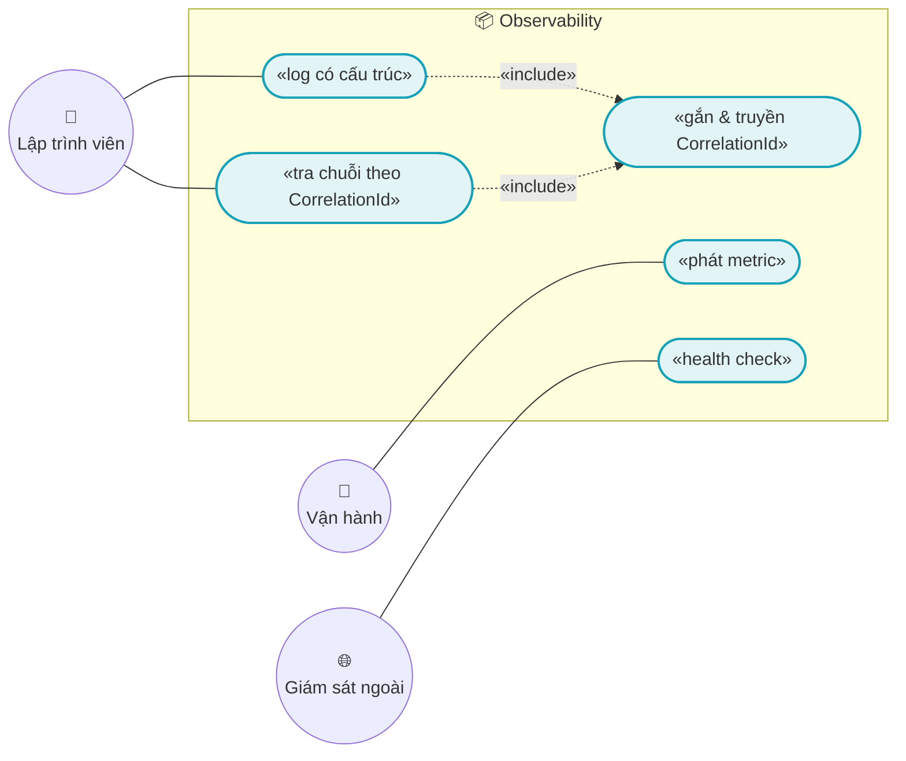
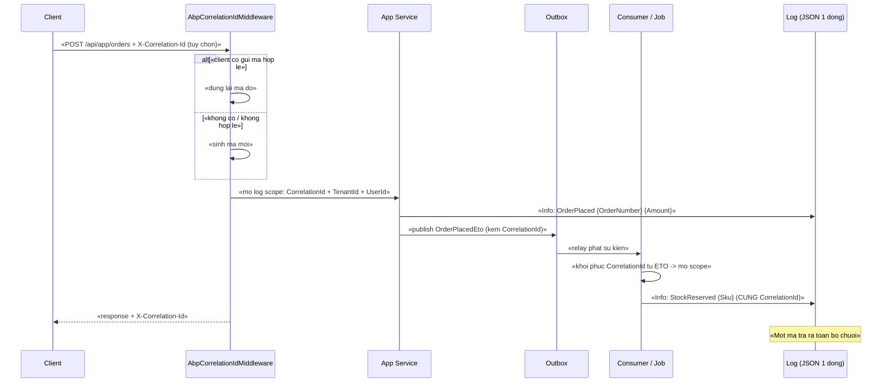
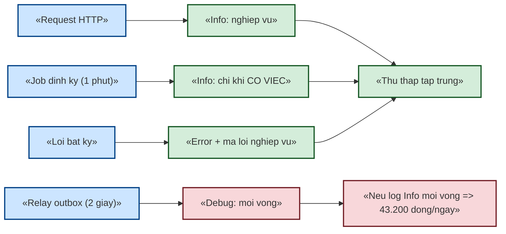

# `XC-005` — Observability: log có cấu trúc, CorrelationId & metric

| Thuộc tính | Nội dung |
|---|---|
| **Mã** | `XC-005` |
| **Module** | **Nền dùng chung** — cấu hình ở `eCommerce.HttpApi.Host`; tên field/metric là **hợp đồng dùng chung** |
| **Giai đoạn** | **Nền — phải xong TRƯỚC GĐ1** |
| **Ưu tiên** | **Should have** (nhưng **phải có trước khi lên production**) |
| **Trạng thái** | 🟡 `Draft` — chờ review |
| **Người viết / người review** | *(điền)* / **Kiến trúc trưởng + Vận hành** |
| **Phiên bản / ngày** | `v0.1 — 13/10/2026` |
| **Tài liệu liên quan** | `XC-002` (yêu cầu 4 metric messaging) · `XC-003` (yêu cầu 3 metric lock) · `XC-004` (audit, không log bí mật) · `docs/phase-0-execution-report.md` |

---

## 0. Tóm tắt & quyết định thiết kế

**Tóm tắt:** `XC-005` chốt **cách hệ thống kể lại chuyện nó đã làm**: log có cấu trúc (một dòng JSON, có trường chuẩn),
**`CorrelationId` xuyên suốt** request → job → sự kiện, **bảng đăng ký metric**, và health check.

**Điểm xuất phát thật (đã kiểm trong repo — xem §15.2 F1):**

| Hạng mục | Hiện trạng |
|---|---|
| Audit log (bảng DB) | ✅ **Có** — module `Volo.Abp.AuditLogging` đã bật (`AuditLog` xuất hiện **110** chỗ) |
| Log ứng dụng | ⚠️ Chỉ **console mặc định** qua mục `Logging` trong `appsettings.json`; **không** JSON, **không** trường tuỳ chỉnh |
| `CorrelationId` | ❌ **Chỉ tồn tại như CỘT trong bảng của ABP** — **12/12** chỗ nằm trong `Migrations/`; **chưa** có middleware, **0** chỗ trong code nghiệp vụ ⇒ giá trị hiện **rỗng** |
| Metric | ❌ **Không có** — `Serilog` / `OpenTelemetry` / `HealthCheck`: **0** gói trong `Directory.Packages.props` |
| `Console.WriteLine` | ✅ **0** chỗ (tốt — không có log tuỳ tiện) |

⇒ 🔴 **Hệ quả quan trọng:** `XC-002` và `XC-003` **đã yêu cầu 7 metric** (`messaging_outbox_pending`, `messaging_dlq_size`,
`lock_timeout_total`, …) nhưng **hiện không có nơi nào phát** chúng. Tài liệu này định nghĩa **tên + loại + nhãn**,
đồng thời ghi rõ **việc triển khai còn nợ**.

**Phạm vi:**
- ✅ Hợp đồng **tên trường log** + quy tắc mức log + quy tắc **không log dữ liệu nhạy cảm**.
- ✅ **`CorrelationId`**: nguồn, cách truyền, cách trả về cho client.
- ✅ **Bảng đăng ký metric** (tên · loại · nhãn · nguồn yêu cầu) + **quy tắc cardinality**.
- ✅ **Health check** + quy tắc không lộ chi tiết.
- ✅ Phân biệt rõ **audit log (dữ liệu nghiệp vụ)** vs **application log (vận hành)**.

**Không nằm trong phạm vi:**
- ❌ **Dashboard/alerting** (Grafana, Prometheus, Sentry) — chọn công cụ ở §15 (Q1). Tài liệu chỉ chốt **hợp đồng dữ liệu**.
- ❌ **Distributed tracing đầy đủ** (OpenTelemetry spans) — ghi nhận là bước sau (§15 Q2).
- ❌ **Chính sách lưu trữ/pháp lý của audit log** — thuộc `ACC-001`/kế toán.

### 0.1 Quyết định thiết kế (ADR ngắn)

| # | Quyết định | Phương án đã cân nhắc | Lý do chọn | Hệ quả |
|---|---|---|---|---|
| **D1** | **Log JSON một dòng** bằng formatter **có sẵn của .NET** (`AddJsonConsole`) | (a) console text mặc định · (b) **JSON console built-in** · (c) Serilog + sink | Chọn (b) trước: **không thêm gói NuGet nào**, đã đủ cho thu thập log tập trung; Serilog chỉ cần khi có yêu cầu sink cụ thể | Cấu hình ở `appsettings.json`; **cấm** log nhiều dòng (BR-010) |
| **D2** | **`CorrelationId` bắt buộc** với mọi request/job/sự kiện | (a) không có · (b) chỉ trong audit log · (c) **middleware + log scope xuyên suốt** | Nếu chỉ có trong `AbpAuditLogs` thì **không** nối được log ứng dụng với nhau; khi có sự cố cần **một mã** tra ra cả chuỗi | Wire `AbpCorrelationIdMiddleware` (**có sẵn** trong `Volo.Abp.AspNetCore`, không cần gói mới) + đưa vào log scope |
| **D3** | **Tên trường log là hợp đồng** (§5.2), không đặt tuỳ hứng | (a) mỗi nơi một tên · (b) registry | Tên khác nhau ⇒ truy vấn log không chạy được; đây là loại "nợ" rất khó sửa về sau vì log cũ không đổi được | Mọi log nghiệp vụ dùng `ILogger` với **structured logging** (tham số, không nối chuỗi) |
| **D4** | **Tên metric**: `<miền>_<đối tượng>_<đơn vị>` snake_case | (a) camelCase · (b) snake_case + hậu tố đơn vị | Hậu tố đơn vị (`_total`, `_seconds`, `_size`) là quy ước phổ biến, giúp người đọc biết **cách dùng** metric | Bảng đăng ký §5.1 |
| **D5** | 🚨 **Cấm nhãn có cardinality cao** (`orderId`, `sku`, `userId`, `correlationId`) | (a) gắn mọi thứ làm nhãn · (b) **nhãn hữu hạn** + log để truy vết | Mỗi giá trị nhãn tạo **một chuỗi thời gian riêng** ⇒ nổ bộ nhớ hệ thống metric. Đây là **bẫy kinh điển** | Nhãn chỉ từ tập **hữu hạn** (`channel`, `provider`, `eventName`, `status`, `tenantId`); chi tiết ⇒ **log** |
| **D6** | **Cấm log dữ liệu nhạy cảm**: token, mật khẩu, số thẻ, PII | (a) log thoải mái để dễ gỡ lỗi · (b) allowlist trường được log | Log thường được thu thập, gửi ra ngoài và giữ lâu ⇒ rò bí mật ở đó là **sự cố bảo mật**, không phải lỗi tiện lợi | Có test quét mã nguồn `TC-05`; §15.2 **F2** cảnh báo payload webhook |
| **D7** | **Audit log (DB) ≠ application log** | (a) dùng chung · (b) tách rõ | Audit là **dữ liệu nghiệp vụ** (phải giữ, có thể bị cơ quan thuế/kiểm toán hỏi); application log là **vận hành** (xoá được) | Audit **không** thay thế log khi gỡ lỗi; log **không** thay thế audit khi giải trình |
| **D8** | **Health check** dùng `AddHealthChecks()` có sẵn của ASP.NET Core | (a) tự viết endpoint · (b) **HealthChecks built-in** | Không thêm gói; đủ để load balancer/giám sát biết sống/chết **kèm** phụ thuộc (DB/Redis) | Endpoint **không** lộ chi tiết ra ngoài (BR-009) |
| **D9** | 🚨 **Cấm log ở mức `Information` trong vòng lặp nóng** | (a) log mỗi vòng · (b) log khi **có việc thật** | Relay outbox chạy nhịp **2 giây** và job quét DLQ nhịp **1 phút** ⇒ log mỗi vòng làm **ngập log**, che mất lỗi thật, và tốn chi phí lưu trữ | BR-004 + test `TC-09` (đo số dòng log khi hệ thống rỗi) |
| **D10** | **Log là best-effort** — không được làm hỏng nghiệp vụ | (a) để lỗi log nổi lên · (b) bọc và bỏ qua | Logger hỏng/đĩa đầy **không** được làm request thất bại | §12: nuốt lỗi ghi log (có đếm), **không** nuốt lỗi nghiệp vụ |

---

## 1. Use Case Specification

| Thuộc tính | Nội dung |
|---|---|
| **Use Case ID** | `XC-005` |
| **Use Case Name** | Ghi lại và truy vết hoạt động hệ thống |
| **Description** | *"Là người vận hành/lập trình viên, tôi muốn từ **một mã** (`CorrelationId`) tra ra toàn bộ chuỗi xử lý, và từ **metric** biết hệ thống đang khoẻ hay có tồn đọng — để phát hiện sự cố trước khi khách báo."* |
| **Actor(s)** | **Vận hành** · **Lập trình viên** (gỡ lỗi) · **Hệ thống** (ghi log/metric tự động) · **Giám sát ngoài** (gọi health check) |
| **Priority** | **Should have** — nhưng là **điều kiện để lên production** |
| **Trigger** | Mọi request HTTP, mọi job nền, mọi sự kiện được phát/tiêu thụ, mọi lần health check |
| **Pre-Condition(s)** | • Tenant hiện tại (`TenantId`) — đưa vào log scope khi có.<br>• `ChannelCode` — đưa vào log **khi** sự kiện có nguồn gốc kênh (không bắt buộc cho log hạ tầng).<br>• Đã bật cấu hình JSON console (§11). |
| **Post-Condition(s)** | • Mọi dòng log nghiệp vụ **có** `CorrelationId`.<br>• Mọi response **trả lại** `X-Correlation-Id`.<br>• Metric trong bảng §5.1 **được phát** với nhãn **hữu hạn**.<br>• **Không** dòng log nào chứa token/mật khẩu/số thẻ/PII. |
| **Basic Flow** | 1. Request vào ⇒ middleware **đọc `X-Correlation-Id`** (nếu client gửi) hoặc **sinh mới**.<br>2. Mở **log scope** với `CorrelationId`, `TenantId`, `UserId`.<br>3. Mọi log trong phạm vi **tự động** có các trường đó.<br>4. App service phát sự kiện ⇒ `CorrelationId` **truyền sang** sự kiện (trường `CorrelationId` của ETO — `XC-002` D11).<br>5. Consumer/job mở scope với cùng `CorrelationId` ⇒ **nối được chuỗi** xuyên tiến trình.<br>6. Response trả `X-Correlation-Id`; metric được phát. |
| **Alternative Flow** | **A1: Job định kỳ** — không có request ⇒ **sinh** `CorrelationId` mới cho mỗi vòng, kèm `JobName`.<br>**A2: Webhook từ NCC** — dùng `X-Correlation-Id` nếu NCC gửi, ngược lại sinh mới **và** ghi lại mã giao dịch của NCC để tra chéo. |
| **Exception Flow** | **E1:** ghi log lỗi (đĩa đầy, sink chết) ⇒ **bỏ qua**, tăng bộ đếm `logging_failures_total`, **không** làm hỏng request (D10).<br>**E2:** `X-Correlation-Id` do client gửi **không hợp lệ** (quá dài, ký tự lạ) ⇒ **sinh mới** + log `Warning` (không tin dữ liệu client — BR-014 của `XC-004`).<br>**E3:** health check **thất bại** ⇒ trả `503` + **chi tiết chỉ ở log**, không ở response. |
| **Business Rules** | • **BR-XC-005-001**: Mọi request HTTP **phải** có `CorrelationId` (nhận từ `X-Correlation-Id` hoặc sinh mới) và **phải** trả lại trong response header.<br>• **BR-XC-005-002**: Mọi log nghiệp vụ **phải** nằm trong scope có `CorrelationId`.<br>• **BR-XC-005-003**: `CorrelationId` **phải** được truyền sang ETO và **phải** được khôi phục ở consumer/job (nối chuỗi xuyên tiến trình).<br>• **BR-XC-005-004**: 🚨 **Cấm log ở mức `Information` trong vòng lặp nóng** (relay outbox, xử lý inbox, job quét DLQ). Chỉ log khi **có việc thật** hoặc khi lỗi.<br>• **BR-XC-005-005**: **Cấm** log token, mật khẩu, số thẻ, khoá bí mật, PII; payload thô phải **che** trước khi log.<br>• **BR-XC-005-006**: **Cấm** nối chuỗi khi log — **bắt buộc** structured logging (tham số hoá) để trường tách rời, truy vấn được.<br>• **BR-XC-005-007**: **Cấm** `Console.Write*` — chỉ dùng `ILogger<T>`.<br>• **BR-XC-005-008**: Mọi metric **phải** có tên theo quy ước **D4** và **phải** nằm trong bảng đăng ký (§5.1).<br>• **BR-XC-005-009**: 🚨 **Cấm** dùng nhãn metric có **cardinality cao** (`orderId`, `sku`, `userId`, `correlationId`, `email`).<br>• **BR-XC-005-010**: Log **phải là một dòng** cho mỗi sự kiện (không log nhiều dòng/không xuống dòng trong message).<br>• **BR-XC-005-011**: Mọi job/worker **phải** log **khởi động**, **dừng**, và **lỗi** (không log mỗi vòng — BR-004).<br>• **BR-XC-005-012**: Health check **không** được lộ chi tiết nội bộ (chuỗi kết nối, phiên bản, stack) ra ngoài.<br>• **BR-XC-005-013**: Mọi lỗi **đã xử lý** (bị nuốt, bị bỏ qua có chủ ý) **phải** log ở mức ≥ `Warning` + **có mã lỗi nghiệp vụ** — cấm nuốt im lặng (kế thừa `XC-006`/`XC-002`). |
| **Non-Functional Requirement** | • **NFR-XC-005-001**: Chi phí log p95 **< 1 ms**/dòng (không chặn luồng nghiệp vụ).<br>• **NFR-XC-005-002**: **100 %** dòng log trong phạm vi request/job có `CorrelationId` (kiểm bằng integration test).<br>• **NFR-XC-005-003**: Số **chuỗi** (series) mỗi metric **< 100** (nhãn hữu hạn) — đo bằng test cấu hình.<br>• **NFR-XC-005-004**: Khi hệ thống **rỗi**, số dòng log mỗi phút **< 10** (chống ngập do vòng lặp nóng).<br>• **NFR-XC-005-005**: Health check trả trong **< 100 ms** (không gọi phụ thuộc nặng mỗi lần).<br>• **NFR-XC-005-006**: **0** dòng log chứa mẫu dữ liệu nhạy cảm (quét tự động).<br>• **NFR-XC-005-007**: Từ `CorrelationId` tra ra **toàn bộ** log liên quan của một đơn (mọi module, mọi tiến trình).<br>• **NFR-XC-005-008**: Log ở dạng **JSON hợp lệ** từng dòng (parse được bằng công cụ chuẩn). |

---

## 2. Sơ đồ Use Case



---

## 3. Sơ đồ trạng thái (state machine)

**Không áp dụng — lý do:** observability không có vòng đời hay chuyển trạng thái; đây là **hợp đồng dữ liệu + cấu hình**.
Các bất biến thay thế được liệt kê ở §8.1.

---

## 4. Sequence Diagram & luồng dữ liệu

### 4.1 `CorrelationId` xuyên request → sự kiện → consumer



### 4.2 Luồng log — và vì sao **cấm** log trong vòng lặp nóng



---

## 5. Hợp đồng dữ liệu

**Không có bảng DB mới** (log không lưu vào DB nghiệp vụ; audit log dùng bảng có sẵn của ABP).
"Mô hình dữ liệu" của feature này là **hai bảng đăng ký**: **metric** và **trường log**.

### 5.1 Bảng đăng ký metric

| Tên metric | Loại | Nhãn (hữu hạn) | Nguồn yêu cầu | Ý nghĩa / ngưỡng |
|---|---|---|---|---|
| `messaging_outbox_pending` | Gauge | — | **`XC-002` NFR-003** | Tồn đọng outbox; **p99 < 1000**; cảnh báo nếu chạm trần liên tục 5 phút |
| `messaging_inbox_failed_total` | Counter | `eventName` | **`XC-002` NFR-009** | Số lần xử lý inbox thất bại |
| `messaging_dlq_size` | Gauge | — | **`XC-002` NFR-009** | Kích thước DLQ; **> 0 ⇒ cảnh báo** |
| `messaging_dlq_replayed_total` | Counter | `result` (`ok`/`fail`) | **`XC-002` NFR-009** | Số lần phát lại DLQ |
| `lock_timeout_total` | Counter | `module` | **`XC-003` NFR-003** | Số lần không giành được khoá; tỉ lệ **< 1 %** |
| `lock_skipped_total` | Counter | `module` | **`XC-003` A1** | Job định kỳ bỏ qua vì đang bận |
| `lock_ttl_exceeded_total` | Counter | `module` | **`XC-003` NFR-007** | 🚨 **Số lần thao tác vượt TTL** (2 chủ thể cùng chạy) — kỳ vọng **0** |
| `http_request_duration_seconds` | Histogram | `method`, `route`, `status` | `XC-005` | Độ trễ API |
| `payment_webhook_rejected_total` | Counter | `provider`, `reason` | `XC-005` (`PaymentHub`) | Webhook bị từ chối (chữ ký sai, sai số tiền) |
| `tax_unclassified_skus` | Gauge | — | `XC-006` §10 | Số SKU chưa phân loại thuế (kế toán phải xử lý) |
| `channel_sync_failed_total` | Counter | `channel`, `kind` | `XC-005` (`ChannelHub`) | Đồng bộ sàn thất bại |
| `logging_failures_total` | Counter | — | `XC-005` D10 | Số lần ghi log thất bại (logger/sink hỏng) |

> 🚨 **Quy tắc nhãn (BR-009):** nhãn **chỉ** lấy từ tập hữu hạn. **Cấm** `orderId`, `sku`, `userId`, `correlationId`,
> `email`, `phone`. Cần truy vết theo các giá trị đó ⇒ **dùng log** (đã có `CorrelationId`), **không** dùng metric.

### 5.2 Bảng đăng ký trường log (log fields)

| Trường | Kiểu | Bắt buộc ở | Ý nghĩa |
|---|---|---|---|
| `CorrelationId` | string | **Mọi** log trong phạm vi request/job (**BR-002**) | Mã nối chuỗi |
| `TenantId` | string | Khi có ngữ cảnh tenant | Cách ly & truy vết |
| `UserId` | string | Khi có người dùng | Ai gây ra |
| `ChannelCode` | string | Log miền kênh | `shopee`/`lazada`/`web`… |
| `EventId` · `EventName` | string | Log phát/tiêu thụ sự kiện | Khớp `XC-002` D11 |
| `AggregateId` · `AggregateVersion` | string · int | Log miền có xếp thứ tự | Khớp `XC-002` D6 |
| `IdempotencyKey` | string | Log biên vào | Khớp `XC-002` |
| `LockKey` | string | Log liên quan khoá | Khớp `XC-003` |
| `OrderNumber` · `Sku` | string | Log nghiệp vụ bán/kho | **Chỉ ở log**, **cấm** làm nhãn metric |
| `Provider` | string | Log tích hợp NCC | `vnpay`/`ghn`/… |
| `DurationMs` | number | Log đo thời gian | Không log riêng `Start/End` |
| `ErrorCode` | string | Log lỗi đã xử lý (**BR-013**) | Mã lỗi nghiệp vụ (`eCommerce:…`) |

---

## 6. Hợp đồng API & cấu hình

### 6.1 Health check

| Endpoint | Trả về | Quy tắc |
|---|---|---|
| `/health-status` | `200` (khoẻ) / `503` (có phụ thuộc hỏng) | **Không** lộ chi tiết; chi tiết chỉ ở **log** (BR-012). Kiểm: PostgreSQL, Redis |
| `/.well-known/*`, `/connect/*` | OpenIddict | **Allowlist** `[AllowAnonymous]` — khớp `XC-004` Q1 |

### 6.2 Cấu hình log (đề xuất)

```jsonc
{
  "Logging": {
    "LogLevel": {
      "Default": "Information",
      "Microsoft.AspNetCore": "Warning",
      "Microsoft.EntityFrameworkCore.Database.Command": "Warning", // tranh log moi cau SQL
      "eCommerce": "Information"
    },
    "Console": { "FormatterName": "json" }   // D1: JSON 1 dong, khong can goi NuGet
  }
}
```

> ⚠️ Ghi rõ: mức `Debug` **chỉ** bật ở môi trường dev hoặc khi đang gỡ lỗi có thời hạn.

---

## 7. Sự kiện, tích hợp ngoài & idempotency

### 7.1 Sự kiện phát ra

| ETO | Khi nào | Ghi chú |
|---|---|---|
| `CorrelationId` **trong mọi ETO** | — | Không phải ETO riêng, mà là **trường bắt buộc** theo `XC-002` D11 (BR-003) |

### 7.2–7.3 Nhận từ ngoài / gọi ra ngoài

**Không áp dụng** — trừ việc **nhận** `X-Correlation-Id` từ NCC (A2). **Không** gửi dữ liệu log/metric ra dịch vụ ngoài
trong phạm vi tài liệu này (chọn công cụ ở Q1).

**Idempotency key:** **Không áp dụng** — log/metric **không** phải nguồn sự thật nghiệp vụ. 🔒 **Cấm** dùng metric
để quyết định nghiệp vụ (ví dụ "DLQ có bản ghi thì chặn bán") — metric có thể mất/trễ.

---

## 8. Bất biến & xử lý đồng thời

### 8.1 Bất biến

| # | Bất biến | Cơ chế bảo vệ |
|---|---|---|
| 1 | Mọi log trong phạm vi request/job có `CorrelationId` | Middleware + scope; test `TC-04` |
| 2 | Response luôn có `X-Correlation-Id` | Middleware; test `TC-03` |
| 3 | **0** dòng log chứa dữ liệu nhạy cảm | Quét `TC-05` + allowlist trường |
| 4 | **0** `Console.Write*` trong mã nguồn | Quét `TC-02` |
| 5 | Mọi metric phát ra **nằm trong** bảng đăng ký | Quét tên metric literal vs registry `TC-06` |
| 6 | **0** nhãn metric cardinality cao | Review + test cấu hình `TC-07` |
| 7 | Log/metric **không** ảnh hưởng nghiệp vụ (best-effort) | Bọc lỗi ghi log (D10); test `TC-10` |

### 8.2 Xử lý đồng thời

| # | Tình huống | Cơ chế |
|---|---|---|
| 1 | Nhiều instance cùng ghi log/metric | Ghi **cục bộ** (stdout) → hệ thống thu thập gom; **không** tranh chấp |
| 2 | Nhiều instance cùng phát cùng metric | Metric **đếm theo instance** rồi cộng; không cần khoá |
| 3 | Log scope trong luồng bất đồng bộ | Dùng `AsyncLocal` của `ILogger.BeginScope` — **tự** theo luồng; lưu ý khi dùng `Task.Run` phải **truyền** scope/CorrelationId |

**Khoá phân tán:** **Không dùng.** **Idempotency key:** **Không áp dụng**.

---

## 9. Phân quyền

**Không áp dụng — lý do:** không có endpoint nghiệp vụ. Riêng **health check** là `[AllowAnonymous]` **có chủ ý**
(nằm trong allowlist của `XC-004` BR-004) — nhưng **không** lộ chi tiết (BR-012).
Màn hình xem DLQ/tồn đọng **có** phân quyền — thuộc `XC-002` §6.2 (không phải tài liệu này).

---

## 10. UI Mockup & mapping dữ liệu

**Không có UI riêng.** Dashboard là công cụ ngoài (Q1). Quy tắc cho UI khác:

| Vùng UI | Dữ liệu | Nguồn | Quy tắc |
|---|---|---|---|
| Mọi màn hình lỗi | `CorrelationId` | response header | **Hiển thị mã này** cho người dùng khi có lỗi (kèm "gửi mã này cho hỗ trợ") — giúp tra log **tức thì** |
| Màn hình quản trị tồn đọng/DLQ | metric + danh sách | `XC-002` §6.2 | chỉ đọc; có phân quyền |

---

## 11. Migration & seed

| Mục | Nội dung |
|---|---|
| Migration | **Không có** — log/metric không lưu vào DB nghiệp vụ |
| Cấu hình bắt buộc | (1) thêm `Console.FormatterName = json`; (2) wire `AbpCorrelationIdMiddleware` + `UseAbpRequestLocalization` trong pipeline; (3) `AddHealthChecks()` + map `/health-status`; (4) điều chỉnh mức log (tắt EF command log ở production) |
| Seed | **Không có** |
| ⚠️ **Còn nợ** | **Phát 12 metric** trong §5.1 — hiện **chưa có** nơi phát. Cần khi có gói metric (Q1) |
| Bảo mật | **Không** log `ConnectionStrings`, secret, `appsettings.Production.json` (đã `.gitignore`) |

---

## 12. Xử lý lỗi & trường hợp biên

| Tình huống | Nguyên nhân | Hành vi | Ghi chú |
|---|---|---|---|
| Ghi log thất bại | đĩa đầy / sink chết | **Bỏ qua**, tăng `logging_failures_total` | 🚨 **Không** làm request thất bại (D10) |
| `X-Correlation-Id` không hợp lệ | client gửi bậy | **Sinh mới** + log `Warning` | Không tin dữ liệu client (BR-014 `XC-004`) |
| `CorrelationId` mất khi qua job | không truyền vào ETO | **Vi phạm BR-003** — phát hiện bằng test `TC-04` | Đây là lỗi hay gặp nhất khi thêm sự kiện mới |
| Vòng lặp nóng log `Information` | lập trình sai | **Ngập log** ⇒ che lỗi thật + tốn chi phí | BR-004 + `TC-09` |
| Nhãn metric có `orderId` | lập trình sai | **Nổ số chuỗi** hệ thống metric | BR-009 + `TC-07` |
| Health check gọi DB/Redis | thiết kế sai | Chậm + tạo tải giả | Ngưỡng < 100 ms; cache kết quả ngắn nếu cần |
| Log chứa payload webhook | in cả payload để gỡ lỗi | 🚨 rò PII ra hệ thống log | §15.2 **F2**; phải **che** trước khi log (BR-005) |
| Log đa dòng (stack trace nối chuỗi) | nối `ex.ToString()` vào message | Bản ghi log hỏng khi thu thập | BR-010: truyền `Exception` **như tham số**, không nối chuỗi |

**Chiến lược transaction:** **Không áp dụng** — log/metric nằm **ngoài** transaction nghiệp vụ (cố ý: không được
làm transaction dài hơn hay hỏng theo nghiệp vụ).

---

## 13. Phi chức năng

| Mã | Yêu cầu | Ngưỡng | Cách kiểm chứng |
|---|---|---|---|
| NFR-XC-005-001 | Chi phí log | p95 **< 1 ms**/dòng | benchmark |
| NFR-XC-005-002 | `CorrelationId` hiện diện | **100 %** log trong scope | integration `TC-04` |
| NFR-XC-005-003 | Chuỗi metric | **< 100** series/metric | test cấu hình `TC-07` |
| NFR-XC-005-004 | Log khi hệ thống rỗi | **< 10** dòng/phút | đo `TC-09` |
| NFR-XC-005-005 | Health check | **< 100 ms** | test |
| NFR-XC-005-006 | Dữ liệu nhạy cảm trong log | **0** mẫu khớp | quét `TC-05` |
| NFR-XC-005-007 | Truy vết theo `CorrelationId` | ra **toàn bộ** log liên quan | test tích hợp |
| NFR-XC-005-008 | JSON hợp lệ | **100 %** dòng parse được | test formatter |

---

## 14. Test cases & Acceptance Criteria

### 14.1 Danh sách test case

| ID | Mục tiêu | Loại | Input | Expected | Phủ |
|---|---|---|---|---|---|
| **TC-01** | Mọi app service/job dùng `ILogger<T>` | Unit (reflection) | quét type | **0** chỗ dùng logger tĩnh kiểu cũ | BR-007 |
| **TC-02** | **Không** `Console.Write*` | Unit (quét) | grep mã nguồn | **0** match | **BR-007** |
| **TC-03** | Response trả `X-Correlation-Id` | **Integration** | request có/không có header | luôn có header trả về | **BR-001** |
| **TC-04** | Log có `CorrelationId` **xuyên sự kiện** | **Integration** | đặt đơn → consumer xử lý | log của consumer có **cùng** `CorrelationId` | **BR-002/003** |
| **TC-05** | Không log dữ liệu nhạy cảm | Unit (quét) | tìm `password`/`token`/`card` trong lời gọi log | **0** match | **BR-005**, NFR-006 |
| **TC-06** | Metric phát ra **nằm trong** registry | Unit (quét) | so tên metric literal vs §5.1 | **0** metric ngoài registry | **BR-008** |
| **TC-07** | Không nhãn cardinality cao | Unit (cấu hình) | danh sách nhãn | **0** nhãn cấm; **< 100** series | **BR-009**, NFR-003 |
| TC-08 | Health check | **Integration** | DB/Redis OK; dừng Redis | `200`; sau đó `503` — **không** lộ chi tiết | **BR-012** |
| **TC-09** | Vòng lặp nóng **không** log `Information` | **Integration** | để hệ thống rỗi 60 s | **< 10** dòng log | **BR-004**, NFR-004 |
| TC-10 | Ghi log lỗi **không** làm hỏng nghiệp vụ | Unit | logger ném exception | request vẫn thành công + `logging_failures_total` tăng | **D10** |
| TC-11 | Log là JSON hợp lệ từng dòng | Unit | đọc output | **100 %** parse được | BR-010, NFR-008 |
| TC-12 | Lỗi đã xử lý có log + mã lỗi | Unit (quét) | tìm `catch` rỗng | **0** catch rỗng | **BR-013** |

### 14.2 Fixture skeleton (xUnit)

```csharp
public class ObservabilityTests
{
    /// TC-02 — khong cho phep log tuy tien.
    [Fact]
    public void TC02_khong_co_Console_Write_trong_ma_nguon()
    {
        var viPham = QuetMaNguon(@"Console\.Write")
            .Where(f => !f.Contains("Program.cs", StringComparison.OrdinalIgnoreCase))
            .ToList();

        Assert.True(viPham.Count == 0, "Dung Console.Write*:\n" + string.Join("\n", viPham));
    }

    /// TC-06 — metric phai nam trong bang dang ky (giong cach XC-003 kiem khoa lock).
    [Fact]
    public void TC06_moi_metric_phat_ra_phai_nam_trong_bang_dang_ky()
    {
        var daDangKy = MetricRegistry.TatCa;          // §5.1
        var dungTrongCode = QuetTenMetricLiteral();   // ví dụ: "messaging_dlq_size"

        var ngoaiRegistry = dungTrongCode.Except(daDangKy).ToList();
        Assert.True(ngoaiRegistry.Count == 0,
            "Metric chua dang ky:\n" + string.Join("\n", ngoaiRegistry));
    }

    /// TC-07 — cam nhan co cardinality cao (bay kinh dien lam no he thong metric).
    [Fact]
    public void TC07_cam_nhan_metric_cardinality_cao()
    {
        string[] cam = ["orderId", "sku", "userId", "correlationId", "email", "phone"];

        var viPham = MetricRegistry.TatCaNhan()
            .Where(n => cam.Contains(n, StringComparer.OrdinalIgnoreCase))
            .ToList();

        Assert.True(viPham.Count == 0,
            "Nhan metric bi cam (cardinality cao):\n" + string.Join("\n", viPham));
    }
}
```

### 14.3 Acceptance Criteria (Definition of Done)

- [ ] 12 test case pass, phủ **hết 13 BR** và **8 NFR**
- [ ] **JSON console** đã bật; log parse được bằng công cụ chuẩn (NFR-008)
- [ ] **`AbpCorrelationIdMiddleware` đã wire**; `TC-03`/`TC-04` pass (hiện **chưa** wire — §15.2 F1)
- [ ] `/health-status` hoạt động; **không** lộ chi tiết
- [ ] **Bảng đăng ký metric (§5.1) khớp 100 % với code** — `TC-06` xanh
- [ ] Mức log production đã chỉnh (tắt `Microsoft.EntityFrameworkCore.Database.Command`)
- [ ] ⚠️ **Việc còn nợ được ghi rõ**: **12 metric chưa có nơi phát** — cần khi chọn công cụ metric (Q1)
- [ ] Tài liệu này cập nhật khớp code

### 14.4 Definition of Ready

- [x] ✅ Đã kiểm hiện trạng: **0** gói Serilog/OpenTelemetry/HealthCheck; **0** `Console.Write*`; audit log **đã có**
- [x] ✅ Đã xác định **7 metric** đang bị `XC-002`/`XC-003` yêu cầu mà chưa có nơi phát
- [ ] Chốt **công cụ** thu thập log + metric (Q1)
- [ ] Chốt **thời gian lưu** log (Q4)
- [ ] Chốt có làm **distributed tracing** (OpenTelemetry) ở giai đoạn này không (Q2)

---

## 15. Câu hỏi mở, giả định & lịch sử thay đổi

### 15.1 Câu hỏi mở

| # | Câu hỏi | Cần ai | Trạng thái | Ảnh hưởng |
|---|---|---|---|---|
| **Q1** | **Công cụ** thu thập log & metric: chỉ stdout + công cụ ngoài, hay thêm Serilog/OpenTelemetry + Prometheus? Và khi nào? | Kiến trúc trưởng + Vận hành | ✅ `Closed` — **PHÁT NGAY bằng `System.Diagnostics.Metrics` (BCL, KHÔNG thêm gói NuGet nào)** + **log JSON ra stdout**. Công cụ thu thập (OTel Collector → Prometheus/Grafana, hay chỉ stdout + công cụ ngoài) **chọn SAU**: vì đổi tầng *xuất* không phải sửa nơi *phát* | Quyết định **khi nào** 12 metric ở §5.1 được phát thật |
| **Q2** | Có làm **distributed tracing** (OpenTelemetry) ở GĐ1 không, hay để GĐ3? | Kiến trúc trưởng | ✅ `Closed` — **KHÔNG** làm distributed tracing ở GĐ1. `X-Correlation-Id` đã **nối log giữa các tầng** (đủ để điều tra). Bật OTel tracing khi tách service (GĐ4+) | Tracing giúp gỡ lỗi chuỗi dài nhưng thêm hạ tầng |
| **Q3** | **Alert** gửi đi đâu (email/Zalo OA/Slack)? Ngưỡng nào? | Vận hành | ✅ `Closed` — alert gửi **email kỹ thuật** *(chốt 13/10/2026)*; ngưỡng theo §5.2 | Thuộc `NOT-002`; cần trước production |
| **Q4** | **Thời gian lưu** log (30/90 ngày?) và audit log (theo luật kế toán)? | Vận hành + Kế toán | ✅ `Closed` — **log lưu 90 ngày**; **audit log theo quy định luật kế toán** *(chốt 13/10/2026)* | Ảnh hưởng chi phí lưu trữ + nghĩa vụ lưu trữ |
| **Q5** | `X-Correlation-Id` có **bắt buộc** trả lại trong **mọi** response kể cả `401`/`403` không? | Kiến trúc trưởng | ✅ `Closed` — **CÓ** *(đã triển khai + đo được 13/10/2026)*: `app.UseCorrelationId()` ⇒ **mọi** response có header `X-Correlation-Id` (đo thật: `aa003348cac54ee99f7d7c7114dca531`) | Ảnh hưởng middleware order; đề xuất **có** |
| **Q6** | Có cần **che PII** trong `PaymentTransaction.LastWebhookPayload` (đang lưu tới 8.000 ký tự)? | Kiến trúc trưởng + Security | ✅ `Closed` — **CÓ** *(đã triển khai 13/10/2026)*: `PaymentTransaction.MaskSensitiveData` che **2 lớp** (tên trường nhạy cảm + chuỗi 12–19 chữ số giữ 4 số cuối) + **5 test**; test đã bắt được lỗi trong chính regex đầu tiên | Xem **F2** — dữ liệu thật trong DB, không chỉ log |

### 15.2 🚨 Phát hiện

| # | Vấn đề | Bằng chứng | Mức độ | Xử lý |
|---|---|---|---|---|
| **F1** | **Hạ tầng quan sát gần như trống**: **0** gói Serilog/OpenTelemetry/HealthCheck; `CorrelationId` **chỉ** là **cột trong bảng của ABP** (**12/12** chỗ nằm trong `Migrations/`), **chưa** có middleware ⇒ giá trị hiện **rỗng**; **7 metric** mà `XC-002`/`XC-003` yêu cầu **chưa có nơi phát** | quét `Directory.Packages.props` + repo | 🟠 **Trung bình–Cao** (không sai dữ liệu, nhưng **mù** khi có sự cố) | ⬜ **Chưa sửa** — `XC-005` định nghĩa hợp đồng; việc wire + phát metric là **mục bắt buộc trước production** (§11) |
| **F1** | **Hạ tầng quan sát gần như trống**: **0** gói Serilog/OpenTelemetry/HealthCheck; `CorrelationId` **chỉ** là **cột trong bảng của ABP** (**12/12** chỗ nằm trong `Migrations/`), **chưa** có middleware ⇒ giá trị hiện **rỗng**; **7 metric** mà `XC-002`/`XC-003` yêu cầu **chưa có nơi phát** | quét `Directory.Packages.props` + repo | 🟠 **Trung bình–Cao** (không sai dữ liệu, nhưng **mù** khi có sự cố) | ✅ **PHẦN LÕI ĐÃ VÁ + KIỂM CHỨNG (13/10/2026)**: bật `UseCorrelationId()` (header `X-Correlation-Id` trả về **thật**), thêm `/health-status` (**200 `Healthy`** khi PostgreSQL sống · **503** khi **DỪNG** PostgreSQL ⇒ check **thật sự** kiểm tra phụ thuộc), bật **log JSON 1 dòng**. ✅ **12 metric ĐÃ CÓ NƠI PHÁT** (13/10/2026) bằng `System.Diagnostics.Metrics` **có sẵn trong .NET** — không thêm gói NuGet nào; có **6 test `MeterListener`** chốt đúng 12 tên (`TC-06`) và chặn nhãn cardinality cao (`TC-07`) |
| **F3** 🆕 | Khi vá health check gặp 2 lỗi **chỉ lộ lúc chạy**: (1) `MapHealthChecks` là extension trên **`IEndpointRouteBuilder`** chứ không phải `IApplicationBuilder`; (2) inject thẳng **`AbpDbConnectionOptions` sẽ ném lúc chạy** — ABP đăng ký qua `Configure<T>` nên DI chỉ có `IOptions<T>`, mà health check dùng `ActivatorUtilities` (resolve theo **đúng kiểu tham số**) | Lỗi biên dịch (1) + `"Unable to resolve service for type 'AbpDbConnectionOptions'"` (2) ⇒ `/health-status` trả **500** | 🟠 Trung bình | ✅ **Đã sửa**: dùng `app.UseEndpoints(...)` và `IOptions<AbpDbConnectionOptions>` |
| **F2** | `PaymentTransaction.LastWebhookPayload` lưu **payload thô tới 8.000 ký tự** | `PaymentHub.Domain/Entities/PaymentTransaction.cs` | 🟠 **Trung bình** | ⬜ Q6: cần **che** dữ liệu nhạy cảm (số thẻ, PII) khi lưu **và** khi log |
| **F3** | Relay outbox nhịp **2 giây** (`XC-002`) + job quét DLQ nhịp **1 phút** ⇒ nếu log mỗi vòng là **43.200 dòng/ngày** cho một worker | `XC-002` §0.1 D1 + BR-004 ở đây | 🟡 Thấp nếu tuân BR-004 | ✅ Đã thành **BR-004** + test `TC-09` |
| **F4** | Tài khoản seed có mật khẩu trong tài liệu (kế thừa `XC-004` **F4**) — **cấm** để lộ vào log/cấu hình | `XC-004` §15.2 F4 | 🟠 Trung bình | ⬜ Vẫn chưa sửa — theo `XC-004` Q2 |

### 15.3 Giả định

| # | Giả định | Nếu SAI |
|---|---|---|
| 1 | Log ghi ra **stdout**, hệ thống ngoài thu thập | Nếu ghi file trực tiếp ⇒ cần xoay vòng file + quyền ghi; đổi ở §11 |
| 2 | Metric được phát **từ tiến trình** (pull/`/metrics` hoặc push) | Nếu dùng dịch vụ metric riêng ⇒ chỉ đổi cách xuất, **không** đổi tên/nhãn |
| 3 | `tenantId` là nhãn **hữu hạn** (số tenant nhỏ) | Nếu GĐ4 có **hàng nghìn** tenant ⇒ phải **bỏ** `tenantId` khỏi nhãn |
| 4 | Health check **không** cần xác thực | Nếu cần ⇒ đưa vào allowlist kèm token tĩnh (§15 Q5) |

### 15.4 Lịch sử thay đổi

| Phiên bản | Ngày | Người | Thay đổi |
|---|---|---|---|
| v0.1 | 13/10/2026 | *(điền)* | Bản nháp đầu — hiện trạng lấy **từ code thật** (0 gói observability; `CorrelationId` chỉ là cột DB, 12/12 trong migration; audit log đã có; 0 `Console.Write*`); lập **bảng đăng ký metric** gom 7 metric đang bị `XC-002`/`XC-003` yêu cầu mà chưa có nơi phát; phát hiện **F2** (payload webhook thô 8.000 ký tự) |


---

## 16. ⚠️ PHÁT HIỆN KIẾN TRÚC (14/10/2026) — **vì sao 7 metric vẫn CHƯA có nơi phát**

Trong lúc làm mục (2) của GĐ0 (wire metric), tôi phát hiện **nguyên nhân gốc không phải "chưa làm" mà là
một lỗi TẦNG**:

`eCommerceMetrics` (bảng đăng ký + 12 instrument) đang nằm ở
**`src/eCommerce.Domain.Shared/Observability/eCommerceMetrics.cs`** — tức **tầng APP**.

Nhưng nơi cần phát metric lại là **bên trong MODULE**:
| Metric | Nơi cần phát | Project |
|---|---|---|
| `messaging_inbox_failed_total` | `IdempotencyGuard` | `modules/Messaging/…Domain` |
| `lock_timeout_total` · `lock_skipped_total` | `ChannelTokenManager` | `modules/ChannelHub/…Application` |
| `channel_sync_failed_total` | `ChannelShopSyncer` | `modules/ChannelHub/…Application` |

🚨 **Quy ước #3 của dự án CẤM module tham chiếu app** (`module→app forbidden`) ⇒ các module **KHÔNG THỂ**
dùng `eCommerceMetrics` ở vị trí hiện tại. Đó là lý do **cấu trúc**: 12 instrument đã đăng ký + có 6 test
`MeterListener`, nhưng **không nơi nào phát được** mà không vi phạm quy ước.

### ✅ Cách sửa ĐÚNG (chưa thực hiện — cần một lượt riêng để làm và KIỂM CHỨNG)

**Chuyển `eCommerceMetrics` + `eCommerceMetricNames` + `eCommerceMetricTags` sang
`shared/eCommerce.Kernel/Observability/`** (namespace `eCommerce.Kernel.Observability`).

Vì sao Kernel là đúng chỗ: nó **đã** được mọi module tham chiếu (`Messaging.Domain` → Kernel;
`Address`/`EInvoice`/`Signing` → …), và hợp đồng quan sát **dùng chung** đúng bản chất "shared kernel" —
giống `Money`/`Currency`. Sau khi chuyển thì **mọi module phát metric được mà KHÔNG vi phạm quy ước nào**.

**Việc kèm theo khi chuyển:** cập nhật `MetricsTests` (đổi `using`), thêm `ProjectReference` Kernel cho các
module cần phát, rồi mới wire được 3 điểm phát thật ở bảng trên. **Ước lượng: 1 lượt làm + kiểm chứng.**

> 📌 Đây là ví dụ thứ hai trong dự án về **lỗi tầng** (lỗi đầu là `ConventionalControllers` chỉ thấy
> assembly **đã nạp** — C16). Cả hai đều **không lộ ra khi build**, chỉ lộ khi hỏi *"vậy ai gọi cái này?"*.

---

## 17. ✅ ĐÃ SỬA LỖI TẦNG + ĐIỂM PHÁT METRIC ĐẦU TIÊN (14/10/2026)

**Đã chuyển** `eCommerceMetrics` + `eCommerceMetricNames` + `eCommerceMetricTags` sang
**`shared/eCommerce.Kernel/Observability/`** (namespace `eCommerce.Kernel.Observability`) và **xoá bản cũ**
ở `src/eCommerce.Domain.Shared/Observability/` — **một nguồn sự thật duy nhất**.

**Đã wire điểm phát THẬT đầu tiên:** `IdempotencyGuard` (module `Messaging`) phát
`messaging_inbox_failed_total` kèm nhãn `module` + `reason` khi xử lý thất bại.

**ĐÃ KIỂM CHỨNG BẰNG TEST** (`MeterListener`, 2 test mới):
| Test | Khẳng định |
|---|---|
| `Xu_ly_loi_thi_PHAT_metric_messaging_inbox_failed_total` | Metric **được phát thật** với giá trị 1 và nhãn `module = messaging` |
| `Xu_ly_THANH_CONG_thi_KHONG_phat_metric_loi` | Đường **thành công KHÔNG** phát metric lỗi (nếu phát thì cảnh báo sẽ nhiễu vô ích) |

⇒ **12 metric nay đã có đường phát hợp lệ về mặt kiến trúc.** Đây là lần đầu tiên hệ thống có metric
**thực sự được phát ra** (trước đó: đăng ký đủ + test đủ nhưng **không nơi nào phát được** vì registry
nằm sai tầng).

### ⚠️ CÒN LẠI — các điểm phát khác (cùng một mẫu, đã hết chướng ngại kiến trúc)

| Metric | Nơi cần wire | Ghi chú |
|---|---|---|
| `lock_timeout_total` · `lock_skipped_total` | `ChannelTokenManager` (ChannelHub.Application) | Cần thêm `ProjectReference` Kernel cho `ChannelHub.Application` |
| `channel_sync_failed_total` | `ChannelShopSyncer` | Cùng project trên |
| `messaging_dlq_size` · `messaging_dlq_replayed_total` | Job DLQ | 🚧 **chưa có DLQ** (outbox/relay chưa làm) |
| `messaging_outbox_pending` | Relay outbox | 🚧 **chưa có relay** |
| `http_request_duration_seconds` | Middleware đo độ trễ | Cần một middleware mới trong Host |
| `tax_unclassified_skus` · `payment_webhook_rejected_total` · `logging_failures_total` | Nơi phát tương ứng | Mẫu đã chứng minh |

---

## 18. ĐIỂM PHÁT METRIC: 5/12 → **7/12** (14/10/2026)

Thêm 2 điểm phát trong cùng một tính năng — **job đếm SKU chưa phân loại thuế**:

| Metric | Nơi phát | Ghi chú |
|---|---|---|
| `tax_unclassified_skus` (gauge) | `TaxUnclassifiedSkusWorker` (tầng app) | Lõi đếm thuần: `TaxUnclassifiedSkuCounter` |
| `lock_skipped_total` | Cùng worker, khi **không giành được khoá** | Khác `lock_timeout_total` (đã có ở `ChannelTokenManager`) |

### 🎯 Vì sao đếm SKU chưa phân loại lại quan trọng về NGHIỆP VỤ

Quyết định **D5**: SKU chưa phân loại **vẫn cho bán** nhưng **CHẶN phát hành hoá đơn**
(`eCommerce:Tax:0003`). Nghĩa là SKU chưa phân loại là **việc đang tồn của kế toán**, và nó **chặn
doanh thu hợp pháp**. Không đo được con số này thì nó **chỉ lộ ra khi có khách xin hoá đơn** — lúc đó đã muộn.

### 🚨 SENTINEL `-1` = "CHƯA XÁC ĐỊNH" (KHÔNG để 0 khi đếm lỗi)

Gauge mặc định là `0`, mà `0` mang nghĩa **"kế toán không còn việc gì"**. Nếu việc đếm **thất bại**
(ví dụ bảng thuế suất trống) mà gauge vẫn là `0` thì hệ thống **nói dối một cách im lặng**.
Vì vậy: đếm lỗi ⇒ đặt gauge = **`-1`** (hằng số `TaxUnclassifiedSkuCounter.ChuaXacDinh`) và ghi log Error.
Dashboard **phải** phân biệt `-1` (chưa xác định) với `0` (đã xong).

### 🚨 HAI CHI TIẾT DỄ SAI ĐÃ XỬ LÝ

1. **`Timer.RunOnStart = true`**: gauge mặc định là 0 ⇒ nếu chờ hết nhịp 10 phút mới đếm lần đầu thì
   **10 phút đầu sau mỗi lần deploy, dashboard hiển thị 0 một cách SAI**. Đếm ngay khi khởi động.
2. **Đăng ký worker tường minh** trong `eCommerceApplicationModule.OnPostApplicationInitializationAsync`.
   Nếu chỉ có class mà không đăng ký thì **KHÔNG có lỗi build**, app vẫn khởi động, nhưng job
   **im lặng không bao giờ chạy** — và metric mãi mãi là 0. (Đây là dạng lỗi đã gặp 2 lần trong dự án.)

### 🚨 GIỚI HẠN ĐÃ BIẾT của con số này (ghi rõ để không hiểu nhầm)

Danh mục sản phẩm hiện **CHƯA có khái niệm `Category`** (`Product` chỉ có `BrandId`; `ProductVariant`
không có `CategoryId`) ⇒ chuỗi danh mục truyền vào resolver là **rỗng**, phân loại chỉ có thể ở **cấp SKU**.
Khi danh mục được thêm vào, **con số này sẽ GIẢM** vì nhiều SKU sẽ được phân loại theo danh mục — đó là
điều đúng, không phải lỗi. `TaxRateResolver` đã sẵn sàng cho cấp danh mục.

### ✅ ĐÃ KIỂM CHỨNG END-TO-END TRÊN POSTGRESQL THẬT (không chỉ unit test)

| Bước | Bằng chứng |
|---|---|
| Worker khởi động | `Started background worker: eCommerce.Tax.TaxUnclassifiedSkusWorker` |
| Chèn **1** SKU đang bán + **0** phân loại thuế vào DB thật | `CatProductVariants` = 1 dòng |
| Worker **THỰC SỰ CHẠY** và đếm đúng | log: `Đếm SKU chưa phân loại thuế: 1/1 SKU đang bán chưa phân loại.` |
| Cảnh báo hành động được | log Warning kèm `eCommerce:Tax:0003` |
| Dọn dẹp | `CatProductVariants` = 0, `CatProducts` = 0 |

### CÒN LẠI 5/12
| Metric | Cần gì |
|---|---|
| `messaging_outbox_pending` · `messaging_dlq_size` · `messaging_dlq_replayed_total` | 🏗️ Outbox + DLQ (**chưa có**) |
| `logging_failures_total` | 🏗️ Logger provider bắt lỗi sink |
| `lock_ttl_exceeded_total` | ⬜ Chưa có chỗ phát (cần nơi phát hiện vượt TTL khoá) |