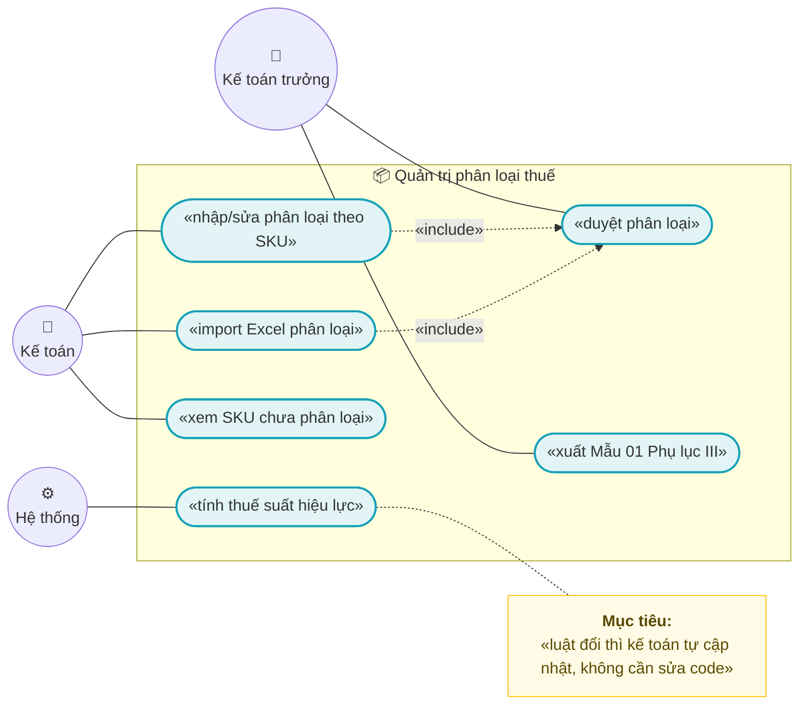
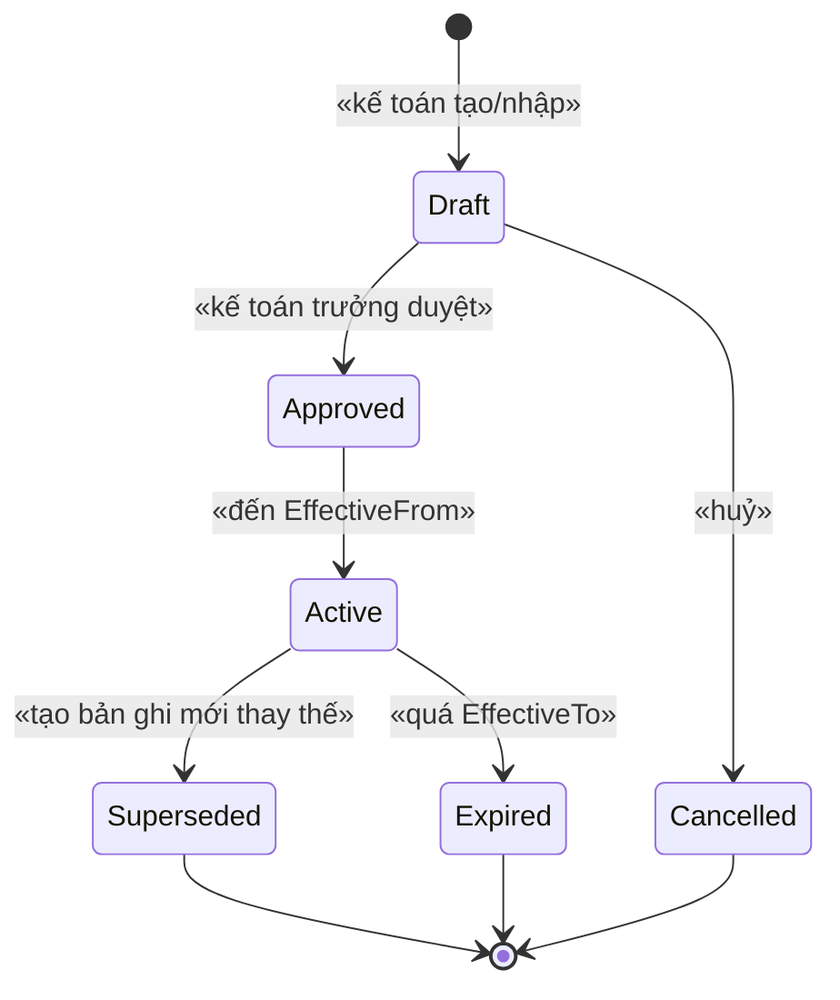
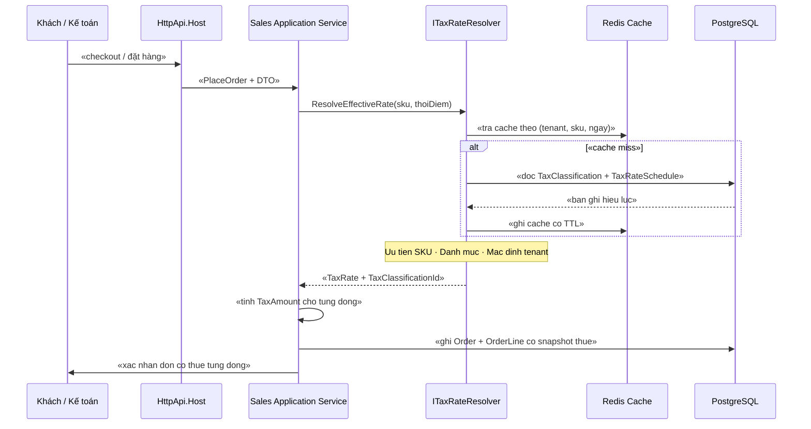
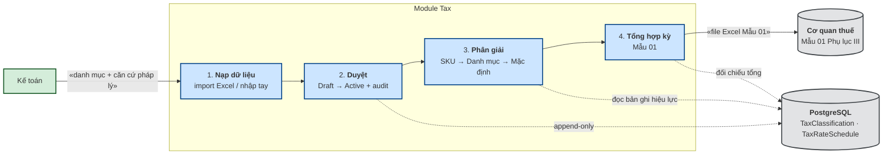
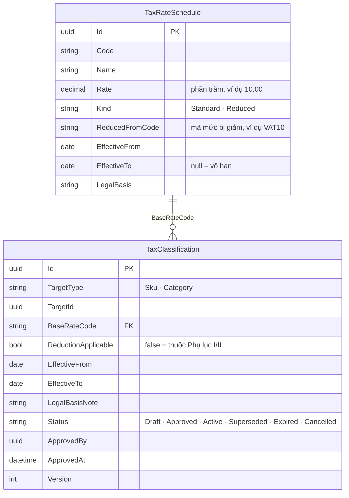

# `XC-006` — Phân loại thuế GTGT theo SKU & mức thuế suất theo thời gian

| Thuộc tính | Nội dung |
|---|---|
| **Mã** | `XC-006` |
| **Module** | Kernel/Tax dùng chung (`shared/eCommerce.Kernel` + module `Tax`) |
| **Giai đoạn** | **Nền — phải xong trước `EINV-001`** (hoá đơn phụ thuộc phân loại này) |
| **Ưu tiên** | **Must have** (là **yêu cầu pháp lý**, không phải tính năng) |
| **Trạng thái** | 🟡 `Draft` → **ĐANG TRIỂN KHAI** — phần lõi (Domain + EF Core + seed + test) **đã xong**, xem **§14.5** |
| **Người viết / người review** | *(điền)* / **Kế toán trưởng + Kiến trúc trưởng** |
| **Phiên bản / ngày** | `v0.1 — 12/10/2026` |
| **Tài liệu liên quan** | `XC-001` (BR-012, BR-010) · `CAT-001` · `PRC-002` · `SAL-002` · `EINV-001` · `ACC-001` |

---

## 0. Tóm tắt & quyết định thiết kế

**Vấn đề nghiệp vụ:** Nghị quyết **204/2025/QH15** + Nghị định **174/2025/NĐ-CP** giảm thuế GTGT
**10% → 8%** cho hàng hoá/dịch vụ thuộc khoản 3 Điều 9 Luật 48/2024/QH15, **TRỪ** một số nhóm hàng hoá
(viễn thông, tài chính–ngân hàng–chứng khoán–bảo hiểm, bất động sản, sản phẩm kim loại, khai khoáng (trừ than),
hàng chịu thuế TTĐB (trừ xăng)) — danh mục chi tiết nằm ở **Phụ lục I & II NĐ 174/2025**, phân loại theo **mã ngành/HS**.

**Ba ràng buộc pháp lý định hình thiết kế:**

| # | Ràng buộc | Nguồn |
|---|---|---|
| 1 | Doanh nghiệp **phải kê khai hàng hoá/dịch vụ được giảm thuế theo Mẫu số 01 tại PHỤ LỤC III**, nộp **cùng Tờ khai thuế GTGT** | ✅ **Đã đọc file gốc** Phụ lục III (Mẫu số 01) — đặc tả đầy đủ ở **§6.3**. ⚠️ Nguồn thứ cấp (trang phổ biến pháp luật tỉnh Quảng Ninh) ghi *"Phụ lục III"* — **SAI**; bản gốc ghi **PHỤ LỤC III** |
| 2 | Hoá đơn **phải ghi rõ thuế suất của từng hàng hoá, dịch vụ** khi áp nhiều mức thuế suất | NĐ 174/2025 |
| 3 | Mức **8% chỉ có hiệu lực đến hết 31/12/2026**; chưa có văn bản gia hạn | NQ 204/2025/QH15 |

### 0.1 Quyết định thiết kế (ADR ngắn)

| # | Quyết định | Phương án đã cân nhắc | Lý do chọn | Hệ quả |
|---|---|---|---|---|
| **D1** | **Danh mục Phụ lục I/II là DỮ LIỆU do kế toán quản trị, KHÔNG hard-code** | (a) hard-code danh mục vào code; (b) import file Excel → DB; (c) gọi API cơ quan thuế | Danh mục thay đổi theo văn bản pháp luật; hard-code ⇒ **phải release phần mềm mỗi lần luật đổi**. Ta **không cần biết trước hàng nào bị loại** — kế toán quyết định | Cần UI quản trị + import Excel + audit + lịch sử |
| **D2** | **Thuế suất áp dụng = hàm của THỜI GIAN** (khung hiệu lực), không phải hằng số | Lưu `TaxRate = 8` trên SKU | Mức 8% hết hạn **31/12/2026**; lưu hằng số ⇒ **tự động sai từ 01/01/2027** | Bảng `TaxRateSchedule` có `EffectiveFrom/To`; hệ thống tự chuyển về 10% mà **không cần sửa code** |
| **D3** | **Chốt (snapshot) thuế suất + số thuế vào dòng đơn/hoá đơn** | Tính lại thuế mỗi lần xem đơn | Đổi cấu hình sau không được làm thay đổi đơn/hóa đơn **đã phát hành** | Thêm cột `TaxRate`, `TaxAmount`, `TaxClassificationId` trên dòng; đơn cũ bất biến |
| **D4** | **Thứ tự ưu tiên tường minh: SKU → Danh mục → Mặc định tenant** | Chỉ theo danh mục | Cho phép ngoại lệ ở cấp SKU (ví dụ 1 mã hàng đặc thù) nhưng vẫn quản lý theo nhóm | Có test cho thứ tự; xung đột phải log rõ đã chọn cái nào |
| **D5** | SKU **chưa phân loại** ⇒ mặc định **KHÔNG được giảm** (áp mức chuẩn) + cờ `NeedsClassification` + **chặn phát hành hoá đơn** | (a) áp 8% mặc định; (b) chặn bán | Áp 8% khi không chắc ⇒ **kê khai thiếu thuế** (rủi ro pháp lý). Áp 10% ⇒ nộp thừa (an toàn hơn). Nhưng **hoá đơn là chứng từ pháp lý** nên phải chặn cho tới khi phân loại | ✅ **ĐÃ CHỐT 12/10/2026: chặn phát hành hoá đơn** (vẫn **cho bán**). Kèm **giảm thiểu tác động vận hành** ở §1 A3 |
| **D6** | Lịch sử phân loại là **append-only, có version** | Sửa đè bản ghi | Cần **giải trình với cơ quan thuế** tại sao kỳ trước áp mức đó | Không xoá/sửa; thay đổi = bản ghi mới + `Superseded` bản cũ |

**Phạm vi:**
- ✅ Mô hình **mức thuế suất theo thời gian** + **phân loại thuế theo SKU/danh mục** + thứ tự ưu tiên.
- ✅ **Import/Export Excel** danh mục phân loại (kế toán tự làm).
- ✅ **Xuất Mẫu 01 (Phụ lục III)** theo kỳ — **chỉ Phần II (bán ra)**, vì hệ thống không có phân hệ mua vào (xem §6.3).
- ✅ Snapshot thuế vào dòng đơn + bất biến "hoá đơn ghi rõ thuế suất từng dòng".
- ✅ Audit + lịch sử phục vụ giải trình thuế.

**Không nằm trong phạm vi:**
- ❌ **Nội dung chi tiết Phụ lục I/II** (danh mục hàng hoá cụ thể) — chính là **dữ liệu** do kế toán nhập theo D1.
- ❌ Quy tắc làm tròn thuế (thuộc `XC-001`).
- ❌ Kết nối API cơ quan thuế, phát hành hoá đơn (thuộc `EINV-001`).
- ❌ Thuế nhà thầu / thuế xuất nhập khẩu / thuế tiêu thụ đặc biệt.

---

## 1. Use Case Specification

| Thuộc tính | Nội dung |
|---|---|
| **Use Case ID** | `XC-006` |
| **Use Case Name** | Quản trị phân loại thuế GTGT theo hàng hoá và thời gian |
| **Description** | *"Là kế toán, tôi muốn tự khai báo hàng hoá/dịch vụ nào thuộc nhóm được giảm thuế và từ ngày nào, để hệ thống tính đúng thuế mà không cần lập trình viên sửa code mỗi khi luật thay đổi."* |
| **Actor(s)** | **Kế toán** (nhập/import phân loại) · **Kế toán trưởng** (duyệt) · **Hệ thống** (`Sales`, `EInvoice`, `Reporting`) |
| **Priority** | **Must have** |
| **Trigger** | (a) có văn bản pháp luật mới về thuế suất; (b) thêm SKU mới cần phân loại; (c) đến kỳ lập tờ khai thuế GTGT |
| **Pre-Condition(s)** | • Tenant hiện tại (`TenantId` từ `ICurrentTenant`).<br>• SKU/danh mục đã tồn tại trong `Catalog`.<br>• `TaxRateSchedule` có bản ghi **hiệu lực tại thời điểm lập hoá đơn**.<br>• `ChannelCode` **không** tham gia quyết định thuế suất (thuế theo hàng hoá, không theo kênh bán). |
| **Post-Condition(s)** | • Mọi dòng hoá đơn có `TaxRate` **chốt tại thời điểm lập**.<br>• Bản ghi phân loại có `Status = Approved` và **audit đầy đủ**.<br>• Xuất được **Mẫu 01** với tổng **khớp** dữ liệu hoá đơn đã phát hành trong kỳ. |
| **Basic Flow** | 1. Kế toán mở màn hình **Phân loại thuế** → import file Excel (hoặc nhập tay) gồm: mã SKU/danh mục, mã mức thuế cơ sở, cờ **được giảm**, hiệu lực từ/đến, căn cứ pháp lý.<br>2. Hệ thống **validate**: SKU tồn tại, mã mức thuế hợp lệ, **không chồng khung hiệu lực**, không thiếu cột bắt buộc → hiện **báo cáo lỗi theo dòng**.<br>3. Kế toán bấm **Lưu nháp** ⇒ bản ghi `Draft` (chưa ảnh hưởng tính thuế).<br>4. Kế toán trưởng **Duyệt** ⇒ `Approved` → `Active`; hệ thống **xoá cache** thuế suất.<br>5. Tại checkout/đặt hàng: hệ thống gọi `ResolveEffectiveRate(sku, now)` → **chốt** `TaxRate` + `TaxAmount` vào dòng đơn.<br>6. Cuối kỳ: kế toán bấm **Xuất Mẫu 01 Phụ lục III** ⇒ file Excel tổng hợp theo mức thuế suất. |
| **Alternative Flow** | **A1: Sửa phân loại đã Active** — không sửa đè; tạo bản ghi mới có hiệu lực từ ngày X, bản cũ chuyển `Superseded` (kết thúc hiệu lực ngày X−1).<br>**A2: Đến hạn 31/12/2026** — không cần làm gì: hệ thống **tự** tra bảng, hết khung 8% ⇒ tự áp 10% lần tính tiếp theo.<br>**A3: SKU mới chưa phân loại** — bán được nhưng hiện **cảnh báo**; khi lập hoá đơn bị **chặn** cho tới khi phân loại.
**Giảm thiểu tác động vận hành (bắt buộc, vì D5 đã chốt chặn hoá đơn):**
1. Khi tạo SKU mới, `Catalog` phát `ProductVariantCreatedEto` ⇒ hệ thống **tự tạo dòng phân loại `Draft`** với `NeedsClassification = true`.
2. Dòng đó xuất hiện ngay trong **"Báo cáo SKU chưa phân loại"** (ưu tiên theo doanh thu) ⇒ kế toán có **danh sách việc cần làm**, không bị bất ngờ lúc lập hoá đơn.
3. Cảnh báo hiện **ngay trên màn hình bán hàng/admin** khi SKU chưa phân loại (không đợi tới bước lập hoá đơn).
4. Thông điệp lỗi `eCommerce:Tax:0003` phải **chỉ rõ mã SKU** và **hướng dẫn** "vào Phân loại thuế để xử lý" — không chỉ báo "không thể phát hành hoá đơn". |
| **Exception Flow** | **E1:** chồng khung hiệu lực cho cùng SKU ⇒ `BusinessException` `eCommerce:Tax:0001`.<br>**E2:** mã SKU trong file không tồn tại ⇒ gom vào **báo cáo lỗi**, **không ghi dòng nào** (all-or-nothing theo lô).<br>**E3:** SKU chưa phân loại mà cố phát hành hoá đơn ⇒ `BusinessException` `eCommerce:Tax:0003` (chặn).<br>**E4:** không có mức thuế suất nào hiệu lực tại thời điểm lập hoá đơn ⇒ `eCommerce:Tax:0002`.<br>**E5:** file import sai định dạng/cột ⇒ `eCommerce:Tax:0004` + báo cáo cột thiếu. |
| **Business Rules** | • **BR-XC-006-001**: Thuế suất áp dụng xác định **theo khung hiệu lực tại thời điểm lập hoá đơn**; **cấm hard-code** thuế suất trong code.<br>• **BR-XC-006-002**: Khi ghi dòng đơn/hoá đơn, **chốt** `TaxRate` + `TaxAmount` + `TaxClassificationId`; thay đổi cấu hình **không** làm đổi chứng từ cũ.<br>• **BR-XC-006-003**: Thứ tự ưu tiên **SKU → Danh mục → Mặc định tenant**; luôn ghi log đã chọn nguồn nào.<br>• **BR-XC-006-004**: SKU **chưa phân loại** ⇒ áp mức **chuẩn (không giảm)** + cờ `NeedsClassification` + **chặn phát hành hoá đơn**.<br>• **BR-XC-006-005**: Mọi thay đổi phân loại **phải audit** (ai · cũ · mới · căn cứ pháp lý · thời điểm) và **append-only**.<br>• **BR-XC-006-006**: Hoá đơn **phải ghi rõ thuế suất từng dòng**; `Σ thuế theo từng mức == tổng cộng tiền thuế` (liên kết `XC-001` BR-010).<br>• **BR-XC-006-007**: Bản ghi phân loại chỉ có hiệu lực khi `Status = Approved ∩ Active`; `Draft` **không** ảnh hưởng tính thuế.<br>• **BR-XC-006-008**: **Phải xuất được Mẫu 01 (Phụ lục III)** theo kỳ — **chỉ phần II (bán ra)** vì hệ thống không có phân hệ mua vào; tổng khớp dữ liệu hoá đơn đã phát hành.<br>• **BR-XC-006-009**: Không tồn tại 2 bản ghi phân loại **hiệu lực chồng nhau** cho cùng (SKU, tenant).<br>• **BR-XC-006-010**: Cách ly tenant: phân loại của tenant A **không** ảnh hưởng tenant B.<br>• **BR-XC-006-011**: Thay đổi **khung hiệu lực của mức thuế suất** (`TaxRateSchedule`) phải **qua duyệt + audit**, và **cấm đặt hiệu lực lùi về quá khứ** (không được làm thay đổi cách tính của hoá đơn **đã phát hành**). |
| **Non-Functional Requirement** | • **NFR-XC-006-001**: `ResolveEffectiveRate` < **2 ms** (p95, có cache).<br>• **NFR-XC-006-002**: Import **10.000 dòng** < 30 s.<br>• **NFR-XC-006-003**: Đổi cấu hình ⇒ cache làm mới < **5 s** trên mọi instance.<br>• **NFR-XC-006-004**: Test được mốc chuyển mức thuế bằng **đồng hồ giả** (`TimeProvider`) — không phụ thuộc ngày hệ thống.<br>• **NFR-XC-006-005**: Audit đủ trường để giải trình với cơ quan thuế. |

---

## 2. Sơ đồ Use Case



---

## 3. Sơ đồ trạng thái (state machine)



**Bảng chuyển trạng thái & guard (bắt buộc ném lỗi, không im lặng):**

| Từ | Sang | Điều kiện (guard) | Nếu vi phạm |
|---|---|---|---|
| `Draft` | `Approved` | Người duyệt có quyền `eCommerce.Tax.Classification.Approve` **và** không chồng khung hiệu lực | `BusinessException` `eCommerce:Tax:0001` / `403` |
| `Approved` | `Active` | `now >= EffectiveFrom` | Ở lại `Approved` (không lỗi) |
| `Active` | `Superseded` | Có bản ghi mới **đã Approved** thay thế, `EffectiveFrom` mới > hiện tại | `eCommerce:Tax:0005` |
| `Active` | `Expired` | `now > EffectiveTo` | Ở lại `Active` (không lỗi) |
| bất kỳ | `Cancelled` | Chỉ khi `Status = Draft` | `eCommerce:Tax:0006` — **không cho sửa/xoá bản ghi đã Active** (BR-005) |

> ⚠️ **Bài học từ eShop (đã khảo sát):** guard **phải ném lỗi**, không được "im lặng bỏ qua" (EShop `SetPaidStatus()`
> chỉ hành động khi `StockConfirmed`, còn lại no-op ⇒ sự kiện rơi **không để lại dấu vết**). Vì vậy mọi chuyển
> trạng thái không hợp lệ ở đây **ném exception có mã**.

---

## 4. Sequence Diagram & luồng dữ liệu

### 4.1 Sequence — tính thuế tại checkout và chốt vào dòng đơn



### 4.2 DFD — từ luật đến hoá đơn



---

## 5. Mô hình dữ liệu

### 5.1 ERD



### 5.2 Data Dictionary

**Bảng `TaxRateSchedules`**

| Cột | Kiểu | Null? | Ý nghĩa | Ghi chú |
|---|---|---|---|---|
| `Id` | `uuid` | ✗ | khoá chính | |
| `TenantId` | `uuid` | ✓ | tenant | `null` = dùng chung toàn hệ thống |
| `Code` | `varchar(32)` | ✗ | mã mức, ví dụ `VAT10`, `VAT8` | **unique** theo tenant |
| `Name` | `varchar(128)` | ✗ | tên hiển thị | |
| `Rate` | `numeric(9,4)` | ✗ | **phần trăm** (10.0000 = 10%) | theo `XC-001` §5.2 |
| `Kind` | `int` | ✗ | `Standard=0`, `Reduced=1` | |
| `ReducedFromCode` | `varchar(32)` | ✓ | mức bị giảm (ví dụ `VAT10`) | chỉ có khi `Kind=Reduced` |
| `EffectiveFrom` | `date` | ✗ | hiệu lực từ | |
| `EffectiveTo` | `date` | ✓ | hiệu lực đến | `null` = vô hạn; **8% = 31/12/2026** |
| `LegalBasis` | `varchar(512)` | ✓ | căn cứ pháp lý | ví dụ *"NQ 204/2025/QH15 + NĐ 174/2025/NĐ-CP"* |

**Bảng `TaxClassifications`** — **đây là chỗ kế toán quyết định**

| Cột | Kiểu | Null? | Ý nghĩa | Ghi chú |
|---|---|---|---|---|
| `Id` | `uuid` | ✗ | khoá chính | |
| `TenantId` | `uuid` | ✗ | tenant | |
| `TargetType` | `int` | ✗ | `Sku=0`, `Category=1` | |
| `TargetId` | `uuid` | ✗ | `ProductVariantId` hoặc `CategoryId` | |
| `BaseRateCode` | `varchar(32)` | ✗ | mức cơ sở (`VAT10`/`VAT5`/`VAT0`) | FK → `TaxRateSchedules.Code` |
| `ReductionApplicable` | `bool` | ✗ | **`true` = KHÔNG thuộc Phụ lục I/II ⇒ được giảm** | **Đây là quyết định của kế toán** |
| `EffectiveFrom` | `date` | ✗ | hiệu lực từ | |
| `EffectiveTo` | `date` | ✓ | hiệu lực đến | |
| `LegalBasisNote` | `varchar(512)` | ✓ | ghi chú căn cứ (số công văn, mã HS…) | phục vụ giải trình |
| `Status` | `int` | ✗ | theo §3 | |
| `ApprovedBy` / `ApprovedAt` | `uuid` / `timestamptz` | ✓ | người & thời điểm duyệt | |
| `Version` | `int` | ✗ | phiên bản bản ghi | append-only |

**Index & ràng buộc**

| Loại | Cột | Mục đích |
|---|---|---|
| **UNIQUE** | `(TenantId, TargetType, TargetId, EffectiveFrom)` | chống trùng khung |
| **EXCLUSION / CHECK nghiệp vụ** | `(TenantId, TargetType, TargetId)` + daterange | 🚨 **chặn chồng khung hiệu lực** (BR-009). PostgreSQL hỗ trợ `EXCLUDE USING gist (tenant_id WITH =, target_id WITH =, daterange(effective_from, effective_to, '[]') WITH &&)` |
| INDEX | `(TenantId, TargetType, TargetId, Status)` | tra phân giải thuế |
| INDEX | `(TenantId, EffectiveFrom, EffectiveTo)` trên `TaxRateSchedules` | tra mức hiệu lực |
| CHECK | `EffectiveTo IS NULL OR EffectiveTo >= EffectiveFrom` | dữ liệu hợp lệ |
| CHECK | `Rate >= 0 AND Rate <= 100` | |

---

## 6. Hợp đồng API

### 6.1 Application Service

```csharp
public interface ITaxClassificationAppService : IApplicationService
{
    Task<PagedResultDto<TaxClassificationDto>> GetListAsync(GetTaxClassificationsInput input);
    Task<TaxClassificationDto> CreateAsync(CreateTaxClassificationDto input);         // → Draft
    Task<TaxClassificationDto> UpdateDraftAsync(Guid id, UpdateTaxClassificationDto input);
    Task ApproveAsync(Guid id);                                                      // Draft → Approved
    Task CancelAsync(Guid id, string reason);                                        // chỉ khi Draft
    Task<ImportResultDto> ImportAsync(ImportTaxClassificationDto input);             // Excel, all-or-nothing
    Task<IRemoteStreamContent> ExportTemplateAsync();
    Task<PagedResultDto<UnclassifiedSkuDto>> GetUnclassifiedSkusAsync(...);           // báo cáo SKU chưa phân loại
    Task<IRemoteStreamContent> ExportMau01Async(ExportMau01Input input);             // Mẫu 01 Phụ lục III
}

public interface ITaxClassificationRepository : IRepository<TaxClassification, Guid>
{
    Task<TaxClassification?> FindEffectiveAsync(TaxClassificationTarget target, DateTime at, CancellationToken ct);
}

/// Hàm lõi — dùng bởi Sales/Pricing/EInvoice
public interface ITaxRateResolver
{
    Task<TaxRateResolution> ResolveEffectiveRateAsync(Guid productVariantId, DateTime at, CancellationToken ct);
}

public sealed record TaxRateResolution(
    decimal Rate,                 // phần trăm, ví dụ 8.0000
    string RateCode,              // VAT8
    string BaseRateCode,          // VAT10
    bool ReductionApplicable,
    Guid? ClassificationId,
    TaxClassificationSource Source,   // Sku | Category | TenantDefault | Unclassified
    bool NeedsClassification);
```

### 6.2 REST endpoint

| Method | Route | Quyền | Mô tả |
|---|---|---|---|
| `GET` | `/api/tax/classifications` | `eCommerce.Tax.Classification.View` | danh sách + lọc theo SKU/danh mục/trạng thái |
| `POST` | `/api/tax/classifications` | `.Manage` | tạo (Draft) |
| `PUT` | `/api/tax/classifications/{id}` | `.Manage` | sửa khi còn Draft |
| `POST` | `/api/tax/classifications/{id}/approve` | `.Approve` | duyệt |
| `POST` | `/api/tax/classifications/{id}/cancel` | `.Manage` | huỷ (chỉ Draft) |
| `POST` | `/api/tax/classifications/import` | `.Import` | import Excel (multipart) |
| `GET` | `/api/tax/classifications/import-template` | `.Import` | tải file mẫu |
| `GET` | `/api/tax/unclassified-skus` | `.View` | báo cáo SKU chưa phân loại |
| `POST` | `/api/tax/mau-01/export` | `.ExportMau01` | xuất Mẫu 01 Phụ lục III |

**Mã lỗi nghiệp vụ**

| Mã | HTTP | Khi nào | Thông điệp |
|---|---|---|---|
| `eCommerce:Tax:0001` | `400` | Chồng khung hiệu lực | `Khoảng hiệu lực bị chồng với bản ghi đã có.` |
| `eCommerce:Tax:0002` | `400` | Không có mức thuế hiệu lực tại thời điểm | `Không tìm thấy mức thuế suất hiệu lực tại {time}.` |
| `eCommerce:Tax:0003` | `409` | SKU chưa phân loại mà phát hành hoá đơn | `SKU {sku} chưa được phân loại thuế, không thể phát hành hoá đơn.` |
| `eCommerce:Tax:0004` | `400` | File import sai định dạng/thiếu cột | `File không hợp lệ: thiếu cột {columns}.` |
| `eCommerce:Tax:0005` | `400` | Thay thế bản ghi chưa Approved | `Bản ghi thay thế phải được duyệt trước.` |
| `eCommerce:Tax:0006` | `400` | Sửa/xoá bản ghi đã Active | `Không thể sửa bản ghi đã có hiệu lực; hãy tạo bản ghi mới.` |
| `eCommerce:Tax:0007` | `400` | Lùi hiệu lực về quá khứ đã có chứng từ | `Không thể đặt hiệu lực lùi về quá khứ vì đã có chứng từ phát sinh.` |

### 6.3 Đặc tả **Mẫu 01 — Phụ lục III NĐ 174/2025/NĐ-CP** (đọc từ file gốc)

> 🚨 **ĐỌC TRƯỚC KHI CODE — ngữ nghĩa cột (6) ĐÃ ĐƯỢC KẾ TOÁN CHỐT (13/10/2026):**
> Kế toán chọn **CÂU 1 = B** ⇒ cột **(6) = (3) × thuế suất SAU GIẢM (8%)** = *số thuế ở mức 8%*,
> **KHÔNG** dùng công thức in trong biểu mẫu `(3) × [(4) − (5)]` ở bảng dưới.
> Đáp án **B** làm Phần III (`[09] = [08] − [06]`) **nhất quán**; còn công thức in trong mẫu thì mâu thuẫn với chính Phần III.
> ⚠️ Vẫn **nên** chạy phép thử HTKK 5 phút (nhập 1 dòng) trước khi code — chênh lệch **6 triệu/100 triệu doanh thu**.
> Chi tiết + cảnh báo đầy đủ: **§15.1.5**.

Nguồn: file gốc *"PHỤ LỤC III (Kèm theo Nghị định số 174/2025/NĐ-CP ngày 30 tháng 6 năm 2025 của Chính phủ) — **Mẫu số 01**"*,
tiêu đề: *"GIẢM THUẾ GIÁ TRỊ GIA TĂNG THEO NGHỊ QUYẾT SỐ 204/2025/QH15 (Kèm theo Tờ khai thuế GTGT — Kỳ tính thuế: Tháng…/Quý…/Lần phát sinh ngày…)"*

**Phần đầu:** [01] Tên người nộp thuế · [02] Mã số thuế · [03] Tên đại lý thuế (nếu có) · [04] Mã số thuế · **Đơn vị tiền: Đồng Việt Nam**

**Phần I — Hàng hoá/dịch vụ MUA VÀO trong kỳ được áp dụng mức thuế suất 8%** *(chỉ với NNT kê khai theo phương pháp khấu trừ)*

| Cột | Nội dung |
|---|---|
| (1) | STT |
| (2) | Tên hàng hoá, dịch vụ |
| (3) | Giá trị hàng hoá, dịch vụ mua vào **chưa có thuế GTGT** được khấu trừ trong kỳ |
| (4) | Thuế GTGT của hàng hoá, dịch vụ mua vào **được khấu trừ** trong kỳ |
| **Tổng cộng** | **[05]** = tổng cột (3) · **[06]** = tổng cột (4) |

**Phần II — Hàng hoá/dịch vụ BÁN RA trong kỳ** ← ⭐ **đây là phần hệ thống ta xuất được**

| Cột | Nội dung | Công thức trong biểu mẫu |
|---|---|---|
| (1) | STT | |
| (2) | Tên hàng hoá, dịch vụ | |
| (3) | Giá trị hàng hoá, dịch vụ chưa có thuế GTGT / Doanh thu hàng hoá, dịch vụ chịu thuế | |
| (4) | Thuế suất / Tỷ lệ tính thuế GTGT **theo quy định** | = `10%` |
| (5) | Thuế suất / Tỷ lệ tính thuế GTGT **sau giảm** | **(5) = (4) × 80%** |
| (6) | Thuế GTGT của hàng hoá, dịch vụ bán ra **được giảm** | **(6) = (3) × [(4) − (5)]** |
| **Tổng cộng** | **[07]** · **[08]** | |

**Phần III — Chênh lệch:** `[09] = [08] − [06]`

⚠️ **Ba điểm kỹ thuật suy ra từ bản gốc (quan trọng cho lập trình):**
1. **Công thức đã được quy định cứng ngay trong biểu mẫu** ⇒ phần mềm **không được tự chọn cách tính**;
   phải tính đúng (5) và (6) theo công thức trên, và **đối chiếu [07]/[08]** với dữ liệu hoá đơn đã phát hành.
2. **`(4) × 80% = 8%` chỉ đúng khi mức cơ sở là 10%** — khớp đúng phạm vi pháp lý của NQ 204/2025 (chỉ giảm 10% → 8%).
   ⇒ **Cấm** dùng công thức ×80% cho mức cơ sở khác (ví dụ 5%) — sẽ ra sai (4%).
3. **Phần I (mua vào) và Phần III nằm NGOÀI phạm vi hệ thống**: ta **không** có phân hệ mua vào/kế toán nhà cung cấp.
   Hệ thống **chỉ xuất Phần II** (và cấp số [07], [08]); kế toán hoàn thiện Phần I & III trên phần mềm kế toán của họ.

### 6.4 Mẫu Excel **import** phân loại thuế — ✅ ĐÃ CHỐT 12/10/2026

Đây là file kế toán upload để nạp phân loại (thay vì nhập tay từng SKU). **7 cột đã được xác nhận** — parser import bám đúng theo bảng này:

| Cột | Bắt buộc | Ví dụ | Ghi chú |
|---|:--:|---|---|
| `MaLoaiDoiTuong` | ✗ | `SKU` / `DANHMUC` | để trống ⇒ mặc định `SKU` |
| `MaDoiTuong` | ✓ | `SP-001` / `DM-DIEN-TU` | mã SKU hoặc mã danh mục, **phải tồn tại** trong `Catalog` |
| `MucThueCoSo` | ✓ | `VAT10` | phải có trong `TaxRateSchedules` |
| `DuocGiam` | ✓ | `C` / `K` | **`C`** = không thuộc Phụ lục I/II (**được** giảm); **`K`** = thuộc Phụ lục I/II (**không** được giảm) |
| `HieuLucTu` | ✓ | `01/07/2025` | `dd/MM/yyyy` |
| `HieuLucDen` | ✗ | `31/12/2026` | để trống = vô hạn |
| `CanCuPhapLy` | ✗ | `Phụ lục I NĐ 174/2025 – mã ngành 4651` | phục vụ **giải trình thuế** |

**Quy tắc validate:** mã đối tượng & mã mức thuế phải tồn tại · không chồng khung hiệu lực · `DuocGiam` chỉ nhận `C`/`K` ·
**cả lô là all-or-nothing** (1 dòng sai ⇒ không ghi dòng nào) · có **dry-run** để kế toán xem trước.

> ✅ **Đã chốt 12/10/2026:** 7 cột trên là **chuẩn chính thức** cho import. Tên cột, thứ tự và giá trị `C`/`K` **không đổi**
> nếu không có quyết định mới. Hệ thống cũng cung cấp **file mẫu tải về** (`GET /import-template`) đúng 7 cột này
> kèm 1 dòng ví dụ + sheet `HuongDan` giải thích `C`/`K`.
> 🔒 Sau khi chốt, **mọi thay đổi cột phải sửa tài liệu này trước** (quy tắc vàng: code lệch tài liệu ⇒ sửa tài liệu trước).

---

## 7. Sự kiện, tích hợp ngoài & idempotency

### 7.1 Sự kiện phát ra (ETO)

| ETO | Phát khi | Ai tiêu thụ | Ghi chú |
|---|---|---|---|
| `TaxClassificationApprovedEto` | `Draft → Approved` | Tax (xoá cache), EInvoice | kèm `TenantId`, `TargetType`, `TargetId`, `EffectiveFrom` |
| `TaxRateScheduleChangedEto` | thêm/sửa mức thuế | Tax (xoá cache), Reporting | |
| `SkuClassifiedEto` | SKU được phân loại | Catalog (bỏ cờ `NeedsClassification`) | |

📌 **Cơ chế: Outbox của ABP + relay** (chi tiết ở `XC-002`). ⚠️ **Bài học eShop:** outbox **thiếu relay** ⇒ vẫn dual-write;
và consumer **luôn `BasicAck` kể cả khi handler lỗi** ⇒ **mất sự kiện vĩnh viễn**. Ở đây: relay bắt buộc + DLQ.

### 7.2 Sự kiện / webhook nhận vào

| Nguồn | Loại | Chống trùng |
|---|---|---|
| `Catalog` — `ProductVariantCreatedEto` | nội bộ | tạo dòng "SKU chưa phân loại" (`NeedsClassification`) |
| Không có webhook bên ngoài | — | — |

### 7.3 Gọi API ra ngoài

**Không áp dụng** — module này không gọi NCC. Việc gửi Mẫu 01 là **xuất file Excel** cho kế toán nộp,
**không** gọi API cơ quan thuế (thuộc phạm vi tương lai).

**Idempotency key (import):** `SHA-256(fileContent) + TenantId` ⇒ import lại cùng file **không** tạo bản ghi trùng;
lần import thứ 2 trả về kết quả cũ kèm cờ `AlreadyImported`.

---

## 8. Bất biến & xử lý đồng thời

### 8.1 Bất biến

| # | Bất biến | Cơ chế bảo vệ |
|---|---|---|
| 1 | Không có 2 phân loại **hiệu lực chồng nhau** cho cùng (tenant, target) | **Ràng buộc `EXCLUDE USING gist`** ở DB (không chỉ kiểm tra ở code) |
| 2 | Bản ghi `Active` **không sửa/xoá được** | Guard ném `eCommerce:Tax:0006`; DB không cấp quyền `UPDATE` `Status` từ `Active` ngoài luồng `Supersede` |
| 3 | Dòng hoá đơn **luôn** có `TaxRate` chốt | Cột NOT NULL trên dòng hoá đơn + test |
| 4 | `Σ thuế theo từng mức == tổng cộng tiền thuế` | Liên kết `XC-001` **BR-010**; test trước khi phát hành |
| 5 | `Draft` không ảnh hưởng tính thuế | `ResolveEffectiveRate` chỉ đọc `Status IN (Approved, Active)` |
| 6 | Hoá đơn không phát hành được nếu SKU chưa phân loại | Guard `eCommerce:Tax:0003` |
| 7 | Phân loại **append-only** | Chỉ tạo mới + `Superseded`; test chặn `DELETE` |

### 8.2 Xử lý đồng thời

| # | Tình huống | Cơ chế |
|---|---|---|
| 1 | 2 kế toán cùng import/sửa phân loại cho cùng SKU | **Distributed lock** `tax:classification:{tenantId}:{targetId}` (Redis, theo `XC-003`); ràng buộc DB là chốt cuối |
| 2 | Duyệt bản ghi đồng thời | Optimistic concurrency `RowVersion` + `UPDATE … WHERE Status = Draft` |
| 3 | Cache thuế suất cũ sau khi duyệt (nhiều instance) | Invalidate qua **distributed event bus** (`TaxClassificationApprovedEto`); TTL ngắn (5 phút) là lưới an toàn |
| 4 | Đổi cấu hình **đúng lúc** đang lập hoá đơn | Thuế suất đọc **1 lần** cho cả hoá đơn (snapshot) ⇒ hoá đơn không bị "nửa cũ nửa mới" |

**Idempotency key:** `import:{tenantId}:{sha256(file)}`.

---

## 9. Phân quyền

| Permission | Ai | Việc |
|---|---|---|
| `eCommerce.Tax.Classification.View` | Kế toán, kế toán trưởng | xem danh sách + báo cáo SKU chưa phân loại |
| `eCommerce.Tax.Classification.Manage` | Kế toán | tạo/sửa Draft, import, huỷ Draft |
| `eCommerce.Tax.Classification.Approve` | **Kế toán trưởng** | duyệt ⇒ Active |
| `eCommerce.Tax.Classification.ExportMau01` | Kế toán trưởng | xuất Mẫu 01 Phụ lục III |
| `eCommerce.Tax.RateSchedule.Manage` | **Kế toán trưởng** *(không phải host admin — theo Q6)* | quản lý bảng mức thuế suất; **mọi thay đổi phải qua duyệt + audit** (BR-011). Vì ảnh hưởng toàn hệ thống nên quyền này cần **grant ở cấp host** |

📌 **Nguyên tắc ABP (đã kiểm chứng ở Phase 0):** app service **không tự được bảo vệ** ⇒ **bắt buộc `[Authorize]` ở cấp class**
(dự án đã từng có lỗi `GetShopsAsync` chạy được khi chưa xác thực).

---

## 10. UI Mockup & mapping dữ liệu

| Vùng UI | Thành phần | Dữ liệu | Nguồn | Quy tắc |
|---|---|---|---|---|
| **Danh sách phân loại** | bảng + lọc | SKU, mức cơ sở, cờ giảm, hiệu lực, trạng thái, căn cứ | `TaxClassifications` | dòng `Active` **chỉ đọc** (nút Sửa bị ẩn) |
| **Form tạo/sửa** | chọn SKU/danh mục + mức + ngày | | | validate chồng khung **ngay trên UI** và ở server |
| **Import Excel** | kéo-thả file | | | hiện **báo cáo lỗi theo dòng** trước khi ghi; có **dry-run** |
| **Duyệt** | nút + hộp thoại xác nhận | | | hiện rõ **ảnh hưởng**: "sẽ áp cho N SKU từ ngày X" |
| **Báo cáo SKU chưa phân loại** | bảng + đếm | SKU, doanh thu 30 ngày | `Catalog` + `Sales` | ưu tiên theo **doanh thu** để kế toán xử lý trước |
| **Xuất Mẫu 01** | chọn kỳ + nút tải | tổng theo mức thuế suất | dữ liệu hoá đơn đã phát hành | hiện **đối chiếu tổng** trước khi tải |

> 📌 **Ghi rõ chênh lệch:** tổng trên Mẫu 01 phải khớp **dữ liệu hoá đơn đã phát hành**. Nếu lệch, UI
> **phải hiện cảnh báo chặn** thay vì để kế toán tự phát hiện — đây là loại sai sót bị cơ quan thuế chất vấn.

**Trạng thái rỗng:** khi chưa có mức thuế nào hiệu lực ⇒ hiện **hướng dẫn thiết lập**, **không** hiện bảng trống
(không có dữ liệu **khác** lỗi — theo thói quen tốt của tài liệu SRS gốc).

---

## 11. Migration & seed

| Mục | Nội dung |
|---|---|
| Migration mới | **Có** — tạo `TaxRateSchedules`, `TaxClassifications` + index + ràng buộc `EXCLUDE` |
| Seed bắt buộc | `VAT0` (0%), `VAT5` (5%), `VAT10` (10%, `Standard`), **`VAT8` (`Reduced`, `ReducedFromCode=VAT10`, `EffectiveFrom=2025-07-01`, `EffectiveTo=2026-12-31`, `LegalBasis="NQ 204/2025/QH15 + NĐ 174/2025/NĐ-CP"`)** |
| **KHÔNG seed** | 🚫 **Danh mục hàng hoá Phụ lục I/II** — theo **D1**, đây là **dữ liệu do kế toán nhập**. Hệ thống **không** biết trước hàng nào bị loại |
| Mặc định tenant | `DefaultReductionApplicable = false` (không được giảm) + `NeedsClassification = true` |
| Ảnh hưởng dữ liệu cũ | Đơn/hóa đơn cũ **giữ nguyên** (đã snapshot); chạy job backfill **không** bắt buộc |
| Rollback | Xoá 2 bảng (chưa có dữ liệu nghiệp vụ phụ thuộc ngoài snapshot trên dòng đơn) |

---

## 12. Xử lý lỗi & trường hợp biên

| Tình huống | Nguyên nhân | Hành vi | Phản hồi |
|---|---|---|---|
| Chồng khung hiệu lực | nhập sai/import trùng | **Ném** `0001`; DB cũng chặn | `400` + chỉ rõ khung bị chồng |
| SKU chưa phân loại | SKU mới | Bán được, **cảnh báo**; **chặn phát hành hoá đơn** `0003` | `409` khi lập hoá đơn |
| Không có mức hiệu lực tại thời điểm | thiếu seed / ngày sai | **Ném** `0002` — **không** tự đoán | `400` |
| Import file có SKU lạ | dữ liệu sai | **Không ghi dòng nào** (all-or-nothing) + báo cáo dòng lỗi | `400` + file lỗi |
| `EffectiveTo < EffectiveFrom` | nhập sai | CHECK ở DB + validate ở app | `400` |
| Mức 8% hết hạn 31/12/2026 | luật hết hiệu lực | **Tự** áp lại 10% từ 00:00 01/01/2027 — **không lỗi, không cần thao tác** | bình thường |
| SKU thuộc **cả** danh mục cha và con có phân loại khác nhau | cấu hình mâu thuẫn | Ưu tiên **SKU**, rồi **danh mục gần nhất** (con trước cha); **log rõ nguồn** | bình thường |
| Kế toán sửa bản ghi đã Active | thao tác sai | **Ném** `0006` — hướng dẫn tạo bản ghi mới | `400` |
| Hoá đơn đã phát hành, sau đó phân loại bị đổi | luật đổi | Hoá đơn cũ **không đổi** (snapshot); nếu phải điều chỉnh ⇒ quy trình **điều chỉnh/thay thế hoá đơn** (`EINV-003`) | — |
| Tenant A đổi phân loại | — | Tenant B **không** bị ảnh hưởng | — |

**Chiến lược transaction:** mọi thao tác ghi ⇒ **Unit of Work** của ABP; import là **1 transaction** (all-or-nothing);
phát sự kiện qua **outbox trong cùng transaction**.

---

## 13. Phi chức năng

| Mã | Yêu cầu | Ngưỡng | Cách kiểm chứng |
|---|---|---|---|
| NFR-XC-006-001 | Phân giải thuế suất | < **2 ms** (p95, cache hit) | micro-benchmark |
| NFR-XC-006-002 | Import 10.000 dòng | < **30 s** | integration test |
| NFR-XC-006-003 | Làm mới cache sau khi duyệt | < **5 s** mọi instance | integration test 2 instance |
| NFR-XC-006-004 | Mốc chuyển mức thuế kiểm thử được | dùng **`TimeProvider` giả** | unit test tại 31/12/2026 23:59 và 01/01/2027 00:01 |
| NFR-XC-006-005 | Audit đủ để giải trình | ai · cũ · mới · căn cứ · khi nào | integration test đọc audit |
| NFR-XC-006-006 | Cách ly tenant | A không ảnh hưởng B | integration test 2 tenant |
| NFR-XC-006-007 | Mẫu 01 khớp dữ liệu hoá đơn | lệch **0 đồng** | integration test đối chiếu tổng |
| NFR-XC-006-008 | Không hard-code thuế suất | **0** hằng số thuế suất trong code nghiệp vụ | test reflection/grep trong CI |

---

## 14. Test cases & Acceptance Criteria

### 14.1 Danh sách test case

| ID | Mục tiêu | Loại | Input | Expected | Phủ |
|---|---|---|---|---|---|
| TC-01 | Seed đúng 4 mức thuế | Unit | — | `VAT0/5/10/8`, `VAT8` có `EffectiveTo=2026-12-31` | BR-001 |
| TC-02 | **Qua mốc 31/12/2026** | Unit (clock giả) | tại `2026-12-31 23:59` và `2027-01-01 00:01` | `8%` → **`10%`** | **BR-001** |
| TC-03 | SKU được giảm ⇒ 8% | Unit | `ReductionApplicable=true` trong khung 8% | `8.0000` | BR-001 |
| TC-04 | SKU thuộc Phụ lục I/II ⇒ 10% | Unit | `ReductionApplicable=false` | `10.0000` | BR-001 |
| TC-05 | Ưu tiên SKU > Danh mục | Unit | SKU=false, Category=true | chọn **SKU** (`10%`), `Source=Sku` | **BR-003** |
| TC-06 | Ưu tiên danh mục con > cha | Unit | con=true, cha=false | chọn **con** | BR-003 |
| TC-07 | SKU chưa phân loại | Unit | không có bản ghi | `10%` + `NeedsClassification=true` + `Source=Unclassified` | **BR-004** |
| TC-08 | Chặn phát hành hoá đơn khi chưa phân loại | **Integration** | SKU chưa phân loại | `BusinessException` `eCommerce:Tax:0003` | **BR-004** |
| TC-09 | **Chồng khung hiệu lực** | **Integration** | 2 bản ghi cùng SKU, khung giao nhau | DB **chặn** (`EXCLUDE`) + `0001` | **BR-009** |
| TC-10 | **Snapshot** — đổi cấu hình sau khi đặt hàng | **Integration** | đặt đơn → đổi phân loại | dòng đơn cũ **giữ nguyên** `TaxRate` | **BR-002** |
| TC-11 | `Draft` không ảnh hưởng tính thuế | Unit | bản ghi `Draft` | vẫn dùng bản `Active` | BR-007 |
| TC-12 | Không sửa bản ghi `Active` | **Integration** | gọi update | `0006` | **BR-005**, bất biến 2 |
| TC-13 | Import all-or-nothing | **Integration** | file 100 dòng, 1 dòng SKU lạ | **0 dòng** được ghi + báo cáo lỗi | BR-005 |
| TC-14 | Import idempotent | **Integration** | import cùng file 2 lần | lần 2 `AlreadyImported`, không nhân bản | §7.3 |
| TC-15 | Xuất Mẫu 01 khớp hoá đơn | **Integration** | kỳ có N hoá đơn | tổng lệch **0 đồng** | **BR-008**, NFR-007 |
| TC-16 | Σ thuế theo từng mức == tổng cộng | Unit | nhiều mức trong 1 hoá đơn | khớp | **BR-006** |
| TC-17 | Cách ly tenant | **Integration** | A đổi, B đọc | B không đổi | BR-010 |
| TC-18 | Làm mới cache sau duyệt | **Integration** | duyệt bản ghi mới | instance 2 thấy trong < 5 s | NFR-003 |
| TC-19 | Audit đầy đủ khi duyệt | **Integration** | duyệt | có ai/cũ/mới/căn cứ/khi nào | BR-005 |
| TC-20 | Không hard-code thuế suất | Unit (reflection/grep) | quét assembly nghiệp vụ | 0 hằng số thuế suất | NFR-008 |
| TC-21 | **Cấm lùi hiệu lực về quá khứ** | **Integration** | đặt `EffectiveTo` của `VAT8` **trước** ngày đã phát hành hoá đơn | **Từ chối** `eCommerce:Tax:0007` + **audit** | **BR-011** |
| TC-22 | Đổi khung hiệu lực hợp lệ (gia hạn) | **Integration** | dời `EffectiveTo` 31/12/2026 → 31/12/2027 | Thành công + audit đủ; hoá đơn **cũ** không đổi | **BR-011**, BR-002 |

### 14.2 Fixture skeleton (xUnit)

```csharp
public class TaxRateResolverTests
{
    // Dùng TimeProvider giả để kiểm thử mốc 31/12/2026 -> 01/01/2027 (NFR-004)
    [Theory]
    [InlineData("2026-12-31T23:59:00", 8)]
    [InlineData("2027-01-01T00:01:00", 10)]
    public async Task TC02_qua_moc_het_han_muc_8_phan_tram(string thoiDiem, int mongDoi)
    {
        var clock = new FakeTimeProvider(DateTimeOffset.Parse(thoiDiem));
        var sut = CreateResolver(clock);

        var kq = await sut.ResolveEffectiveRateAsync(SkuDuocGiam, clock.GetUtcNow().UtcDateTime, default);

        Assert.Equal(mongDoi, kq.Rate);
    }

    [Fact]
    public async Task TC05_uu_tien_SKU_hon_danh_muc()
    {
        var kq = await CreateResolver().ResolveEffectiveRateAsync(SkuCoNgoaiLe, ThoiDiem, default);

        Assert.Equal(TaxClassificationSource.Sku, kq.Source);
        Assert.False(kq.ReductionApplicable);
    }

    [Fact]
    public async Task TC09_chong_khung_hieu_luc_bi_DB_chan()
    {
        await Assert.ThrowsAsync<BusinessException>(() => TaoHaiBanGhiChongNhau());
    }
}
```

### 14.3 Acceptance Criteria (Definition of Done)

- [ ] 22 test case pass, phủ **hết 11 BR** và **8 NFR**
- [ ] **Test TC-02 bằng đồng hồ giả** chứng minh tự chuyển 8% → 10% qua mốc 01/01/2027
- [ ] **Ràng buộc `EXCLUDE` ở DB** chặn chồng khung (kiểm bằng test chèn trực tiếp SQL)
- [ ] Bảng `TaxClassifications` là **append-only**: test chứng minh không có đường UPDATE/DELETE bản ghi `Active`
- [ ] Xuất **Mẫu 01** khớp dữ liệu hoá đơn đã phát hành (lệch 0 đồng)
- [ ] **Có văn bản của kế toán trưởng** xác nhận: (a) ai phân loại, (b) hành vi SKU chưa phân loại, (c) mẫu Mẫu 01
- [ ] UI: SKU chưa phân loại bị **chặn ở bước lập hoá đơn**, có thông điệp chỉ rõ SKU nào
- [ ] Tài liệu này cập nhật khớp code

### 14.4 Definition of Ready

- [ ] Tài liệu **Approved** (Kế toán trưởng + Kiến trúc trưởng)
- [x] **Q2** ✅ **đã chốt 12/10/2026**: SKU chưa phân loại ⇒ **CHẶN phát hành hoá đơn** (vẫn cho bán) + 4 biện pháp giảm thiểu ở §1 A3
- [x] ✅ **Mẫu Excel import 7 cột đã chốt** (Q3 — §6.4)
- [x] ✅ **Đã có file gốc Mẫu 01 (Phụ lục III)** — đặc tả ở §6.3; còn cần kế toán xác nhận **Q8** (ngữ nghĩa cột (6) và chỉ tiêu [09])
- [x] ✅ **Đã chốt (Q1): hỗ trợ cả hai, SKU ưu tiên** — không cần quyết định thêm

---

### 14.5 Trạng thái triển khai *(cập nhật 13/10/2026)*

| Hạng mục | Trạng thái | Bằng chứng / ghi chú |
|---|:--:|---|
| Module `Tax` — 2 project `Domain` + `EntityFrameworkCore` | ✅ | `modules/Tax/` |
| `TaxRateSchedule` — khung hiệu lực theo thời gian + **cấm lùi hiệu lực** (BR-011) | ✅ | guard ném `eCommerce:Tax:0007` |
| `TaxClassification` — state machine **ném lỗi**, append-only | ✅ | `Draft→Approved→Active→Superseded/Expired`; `Cancel` chỉ khi Draft |
| `TaxRateResolver` — **hàm thuần**, tự chuyển **8% → 10%** qua mốc 01/01/2027 | ✅ | `Classifications/TaxRateResolver.cs` |
| Unit test | ✅ **17 test** (tổng solution **37**) | gồm mốc `31/12/2026` → `01/01/2027`, ưu tiên SKU > danh mục, SKU chưa phân loại |
| Migration 2 bảng + index + CHECK | ✅ | `20261013012648_Add_Tax_Module` |
| Ràng buộc **`EXCLUDE USING gist`** chống chồng khung (BR-009) | ⚠️ **sinh migration nhưng CHƯA chạy thử** | 🚨 Máy dev **không có PostgreSQL/Docker** ⇒ SQL thô này **chưa được kiểm chứng thực tế** |
| Seed 4 mức thuế (`VAT0/5/10/8`, `VAT8` hết hạn 31/12/2026) | ✅ | `TaxRateScheduleDataSeedContributor` — idempotent |
| 7 permission của module Tax | ✅ | `eCommerceConsts.Permissions.Tax*` + permission provider |
| **Application service** (CRUD, duyệt, import Excel, xuất Mẫu 01) | ⬜ **chưa** | cần project `eCommerce.Tax.Application` (**phần Mẫu 01 chờ Q8/Q9**) |
| Giao diện quản trị phân loại thuế | ⬜ chưa | thuộc `WEB-001` |

> 🚨 **Giới hạn cần biết:** toàn bộ test hiện tại là **unit test không cần DB**. Ràng buộc `EXCLUDE`,
> migration và seed **chưa từng chạy trên PostgreSQL thật** (máy dev không có Docker/PostgreSQL).
> Việc đầu tiên khi có môi trường DB là chạy `dotnet ef database update` + 1 test chèn 2 khung chồng nhau.

---

## 15. Câu hỏi mở, giả định & lịch sử thay đổi

### 15.1 Câu hỏi mở

| # | Câu hỏi | Cần ai | Trạng thái | Ảnh hưởng |
|---|---|---|---|---|
| **Q1** | Kế toán muốn phân loại chủ yếu theo **SKU** hay theo **danh mục**? | Kế toán trưởng | ✅ **`Closed` — HỖ TRỢ CẢ HAI, SKU ƯU TIÊN** *(chốt 12/10/2026)* | Đúng như **D4**/**BR-003**: SKU thắng danh mục; dùng danh mục cho nhóm lớn để **giảm khối lượng nhập liệu**. UI cho nhập/import theo cả hai |
| **Q2** | SKU chưa phân loại: **chặn phát hành hoá đơn** hay **chỉ cảnh báo**? | Kế toán trưởng | ✅ **`Closed` — CHẶN PHÁT HÀNH HOÁ ĐƠN** *(chốt 12/10/2026)* | Vẫn **cho bán** (không chặn bán). Giảm thiểu: khi tạo SKU mới, hệ thống **tự tạo dòng phân loại `Draft`** + đưa vào **báo cáo việc cần làm của kế toán** ⇒ kế toán xử lý **trước khi phát sinh đơn**, không phải phát hiện lúc lập hoá đơn (xem §1 A3) |
| **Q3** | Mẫu Excel import gồm cột nào? | Kế toán | ✅ **`Closed`** — **7 cột đã chốt 12/10/2026** (xem §6.4) | Parser import bám đúng 7 cột; thay đổi sau này phải sửa tài liệu trước |
| **Q4** | **Mẫu 01** có cột chính xác nào? | Kế toán | ✅ **`Closed`** — đã đọc **file gốc Phụ lục III**; đặc tả đầy đủ ở **§6.3** | Còn lại: xác nhận **ngữ nghĩa cột (6)** và chỉ tiêu **[09]** — xem **Q8** |
| **Q5** | Bản ghi phân loại có cần **đính kèm** văn bản/công văn làm căn cứ? | Kế toán trưởng | ✅ **`Closed` — CHƯA CẦN ở giai đoạn này** *(chốt 12/10/2026)* | Dùng trường **văn bản** `LegalBasisNote` (số công văn / mã HS). Nếu sau này cần tệp đính kèm ⇒ thêm bảng attachment, **không đổi mô hình dữ liệu hiện tại** |
| **Q6** | Khi luật **gia hạn** mức 8% sau 31/12/2026: ai cập nhật, có cần duyệt không? | Kế toán trưởng | ✅ **`Closed` — KẾ TOÁN TRƯỞNG sửa, CÓ DUYỆT + AUDIT** *(chốt 12/10/2026)* | Thành **BR-011**: đổi khung hiệu lực phải **duyệt + audit**, và **cấm lùi hiệu lực về quá khứ**. Quyền đổi chuyển từ *host admin* → **kế toán trưởng** (§9). Kiểm bằng **TC-21** |
| **Q7** | Có cần **báo cáo đối chiếu** giữa phân loại và doanh thu theo SKU để phát hiện phân loại sai? | Kiến trúc trưởng | ✅ **`Closed` — CÓ** *(chốt 12/10/2026)* | Yêu cầu được ghi nhận và **giao cho module `REP-*`** (báo cáo đối chiếu phân loại ↔ doanh thu theo SKU). **Không** thuộc phạm vi `XC-006`; tài liệu này chỉ cung cấp dữ liệu phân loại |
| **Q8** | 🚩 Cột **(6)** của Mẫu 01: nhãn ghi *"Thuế GTGT của hàng hóa, dịch vụ bán ra **được giảm**"* nhưng công thức in trong mẫu là `(3) × [(4) − (5)]` = **(3) × 2%** ⇒ cho ra **số thuế ĐƯỢC GIẢM**, không phải số thuế ở mức 8%. Cách hiểu nào đúng? *(chi tiết + ví dụ số ở §15.1.4)* | **Kế toán trưởng** | ✅ `Closed` — **CÂU 1 = B**: cột **(6) = (3) × thuế suất SAU GIẢM (8%)** = **8.000.000 đ** cho ví dụ 100 triệu (KHÔNG dùng công thức in trong mẫu `(3)×[(4)−(5)]` = 2.000.000 đ). ⚠️ **Kèm cảnh báo bắt buộc** — xem §15.1.5 | 🔴 Hiểu sai ⇒ **xuất Mẫu 01 sai số** ⇒ phải sửa và kê khai lại |
| **Q9** | Mẫu 01 cần xuất **đúng định dạng file nộp được** của cơ quan thuế/HTKK, hay chỉ cần **bảng số liệu** để kế toán nhập lại? *(chi tiết ở §15.1.4)* | Kế toán trưởng | ✅ `Closed` — **CÂU 2 = A**: cần **file NỘP ĐƯỢC LUÔN** (import HTKK/eTax). 🚧 **CHẶN**: phải có **1 file mẫu do HTKK xuất ra** ⇒ thiết kế lớp ánh xạ định dạng tách riêng (HTKK đổi theo phiên bản). Xem §15.1.5 | Nếu phải đúng định dạng ⇒ cần **file mẫu chính thức**; nếu chỉ cần số liệu ⇒ tự thiết kế bảng |

#### 15.1.4 ❓ Q8 & Q9 — nội dung để hỏi kế toán *(copy gửi thẳng được)*

**Bối cảnh:** Mẫu 01 (Phụ lục III NĐ 174/2025), **Phần II — Hàng hoá, dịch vụ bán ra trong kỳ**, có 6 cột:

| Cột | Nội dung (nguyên văn trong mẫu) |
|---|---|
| (1) | STT |
| (2) | Tên hàng hóa, dịch vụ |
| (3) | Giá trị hàng hóa, dịch vụ chưa có thuế GTGT/Doanh thu hàng hóa, dịch vụ chịu thuế |
| (4) | Thuế suất/Tỷ lệ tính thuế GTGT theo quy định |
| (5) | Thuế suất/Tỷ lệ tính thuế GTGT sau giảm |
| (6) | Thuế GTGT của hàng hóa, dịch vụ bán ra được giảm |

Công thức **in sẵn trong biểu mẫu**: **(5) = (4) × 80%** · **(6) = (3) × [(4) − (5)]**

---

**❓ Q8 — Cột (6) là con số nào?**

Ví dụ: doanh thu chưa thuế = **100.000.000 đồng**; (4) = 10%; (5) = 8%.

| Cách hiểu | Phép tính | Cột (6) | Ý nghĩa |
|---|---|---|---|
| **A. Theo CÔNG THỨC in trong mẫu** | `100.000.000 × (10% − 8%)` | **2.000.000** | **số thuế ĐƯỢC GIẢM** (phần ngân sách giảm do chính sách) |
| **B. Theo NHÃN của cột** (*"thuế GTGT của hàng bán ra"*) | `100.000.000 × 8%` | **8.000.000** | **số thuế ở mức 8%** của hàng bán ra |

⚠️ **Nhãn và công thức trong biểu mẫu KHÔNG khớp nhau**, và hai cách hiểu **lệch 6.000.000 đồng cho mỗi 100 triệu doanh thu**.

**Cách trả lời dễ nhất:** mở **HTKK**, nhập thử 1 dòng rồi xem phần mềm tự tính cột (6) ra **2.000.000** hay **8.000.000**;
hoặc xem chỉ tiêu **[08]** và **[09]** mà HTKK sinh ra rồi đối chiếu ngược lại.

**❓ Q8b — Phần II liệt kê những hàng nào?** Chỉ hàng hoá/dịch vụ **thuộc diện được giảm (8%)**, hay **tất cả** hàng bán ra trong kỳ?

---

**❓ Q9 — Cần xuất file dạng nào?**

| Phương án | Nghĩa là | Cần gì thêm |
|---|---|---|
| **A. File nộp được luôn** | Xuất file **import vào HTKK / nộp qua eTax** là dùng được | ⚠️ Cần **file mẫu chính thức** (hoặc 1 file do HTKK xuất ra) để khớp **chính xác** định dạng cột/ô |
| **B. Bảng số liệu** | Chỉ cần bảng đúng cột để kế toán **nhập lại** vào HTKK | Không cần gì thêm — tự thiết kế bảng Excel |

💡 **Lưu ý nghiệp vụ:** nếu chọn **A**, định dạng file do **HTKK** quyết định, mà phần mềm này **đổi theo phiên bản**;
⇒ chi phí bảo trì sẽ cao hơn. Nếu chọn **B**, rủi ro nhập tay sai thấp hơn nhưng tốn công kế toán.

### 15.2 Giả định

| # | Giả định | Nếu SAI |
|---|---|---|
| 1 | Mức thuế suất là **phần trăm** với 4 chữ số thập phân | Nếu cần mức khác (ví dụ 4,5%) vẫn chứa được |
| 2 | **Không** có mức thuế suất phụ thuộc **kênh bán** | Nếu có ⇒ phải thêm chiều `ChannelId` vào khoá phân giải (ảnh hưởng lớn) |
| 3 | Danh mục Phụ lục I/II **doanh nghiệp tự xác định** theo mã ngành/HS của mình | Nếu cơ quan thuế yêu cầu **đúng mã HS** do họ cấp ⇒ cần thêm bảng mã HS |
| 4 | Việc gửi Mẫu 01 là **nộp file Excel**, không qua API | Nếu có API ⇒ thêm adapter, không đổi mô hình dữ liệu |
| 5 | Mức 8% **không** được gia hạn quá 31/12/2026 (tra ngày 12/10/2026) | Nếu được gia hạn ⇒ **chỉ cần thêm/sửa 1 dòng** `TaxRateSchedule` (đúng mục đích thiết kế D2) |

### 15.3 Lịch sử thay đổi

| Phiên bản | Ngày | Người | Thay đổi |
|---|---|---|---|
| v0.1 | 12/10/2026 | *(điền)* | Bản nháp đầu — thiết kế theo yêu cầu: **không hard-code danh mục Phụ lục I/II**, để **kế toán tự quyết định** |
| v0.4 | 13/10/2026 | *(điền)* | 🚀 **Bắt đầu triển khai**: thêm module `Tax` (Domain + EF Core), migration 2 bảng + ràng buộc `EXCLUDE USING gist`, seed 4 mức thuế, 7 permission, **17 unit test** (solution: **37/37 pass**, build 0 lỗi/0 warning). Thêm **§14.5 trạng thái triển khai** và **`XC-006-phieu-hoi-ke-toan.md`** (phiếu hỏi kế toán cho Q8/Q9). ⚠️ Ghi rõ phần **chưa kiểm chứng**: `EXCLUDE`/migration/seed chưa chạy trên PostgreSQL thật |

#### 15.1.5 ✅ TRẢ LỜI Q8 & Q9 (nhận 13/10/2026) + ⚠️ CẢNH BÁO BẮT BUỘC

**Kế toán trả lời:** **Câu 1 = B** · **Câu 1b = A** · **Câu 2 = A**

| Câu | Trả lời | Hệ quả cho hệ thống |
|---|---|---|
| **1** | **B** — cột (6) theo **tên cột**: `(3) × 8%` | Cột (6) = **số thuế GTGT ở mức 8%** của hàng bán ra (ví dụ 100 tr ⇒ **8.000.000 đ**) |
| **1b** | **A** — Phần II **CHỈ liệt kê hàng thuộc diện giảm (8%)** | ✅ Đơn giản cho hệ thống: lọc theo `TaxClassification.Kind = Reduced` (mã `VAT8`), **không** đưa dòng 10%/5% vào Phần II |
| **2** | **A** — cần **file nộp được luôn** | 🚧 **Chặn triển khai** cho tới khi có **1 file mẫu do HTKK xuất ra** |

##### 🚩 CẢNH BÁO 1 — Trả lời "B" **MÂU THUẪN** với công thức in trong biểu mẫu

| | Công thức | Kết quả cho ví dụ 100 triệu |
|---|---|---|
| **Công thức in trong mẫu** | `(6) = (3) × [(4) − (5)]` = `(3) × 2%` | **2.000.000 đ** |
| **Trả lời "B"** | `(6) = (3) × (5)` = `(3) × 8%` | **8.000.000 đ** |

⇒ **Lệch 6.000.000 đ cho mỗi 100 triệu doanh thu.** Nếu chọn sai ⇒ **kê khai sai, phải làm lại tờ khai**.

**📌 Nhưng "B" lại có cơ sở nội tại — đây là lý do tôi KHÔNG bác bỏ câu trả lời:**
Phần III của mẫu tính `[09] = [08] − [06]`.
- Nếu **(6) = thuế ở mức 8%** (đáp án B) ⇒ `[09] = [08] − [06]` = **đúng số thuế ĐƯỢC GIẢM** ✅ **nhất quán**
- Nếu **(6) = số thuế được giảm** (công thức in trong mẫu) ⇒ `[08] − [06]` sẽ **trừ hai lần** ❌ **mâu thuẫn**

⇒ Biểu mẫu **tự mâu thuẫn** giữa công thức của cột (6) và công thức của Phần III. Đáp án **B** chọn cách hiểu làm Phần III **nhất quán**.

##### ✅ Việc kiểm chứng 5 phút — **NÊN LÀM trước khi viết code xuất file**

Phiếu hỏi đã đề nghị cách dễ nhất: **mở HTKK, nhập thử 1 dòng** (doanh thu 100.000.000 · (4) = 10% · (5) = 8%) rồi đọc **cột (6)** và **[08] / [09]**.
Kế toán **chưa** ghi lại 2 con số này (mới chọn theo tên cột).

> 🔒 **Khuyến nghị:** coi Q8 là **`Closed` về mặt nghiệp vụ** (theo kế toán trưởng — người có thẩm quyền), nhưng
> **trước khi code** hãy chạy phép thử HTKK ở trên. Với mức lệch **6 triệu/100 triệu doanh thu**, một phép thử
> 5 phút là rẻ hơn rất nhiều so với việc xuất sai rồi kê khai lại.

##### 🚧 CẢNH BÁO 2 — Q9 = A tạo **điều kiện chặn**

Cần **1 file mẫu do HTKK xuất ra** (hoặc file nộp mẫu của cơ quan thuế) để khớp **chính xác** định dạng ô/cột.
Chưa có file ⇒ **chưa thể code phần xuất file**.

**Thiết kế để giảm rủi ro bảo trì** (HTKK đổi định dạng theo phiên bản):
1. Tách **lớp ánh xạ định dạng** (`IMau01Exporter`) khỏi lớp tính số ⇒ đổi định dạng **chỉ sửa 1 chỗ**.
2. Số liệu tính bằng **cùng một hàm thuần** dùng chung cho cả bản Excel "bảng số liệu" (dự phòng).
3. Ghi **version định dạng** đã dùng vào tệp xuất (truy vết được kỳ nào xuất bằng format nào).
