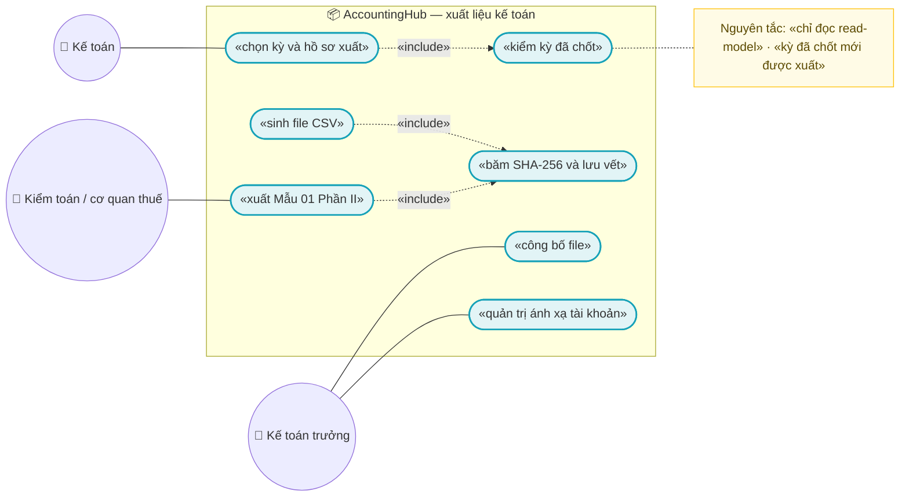
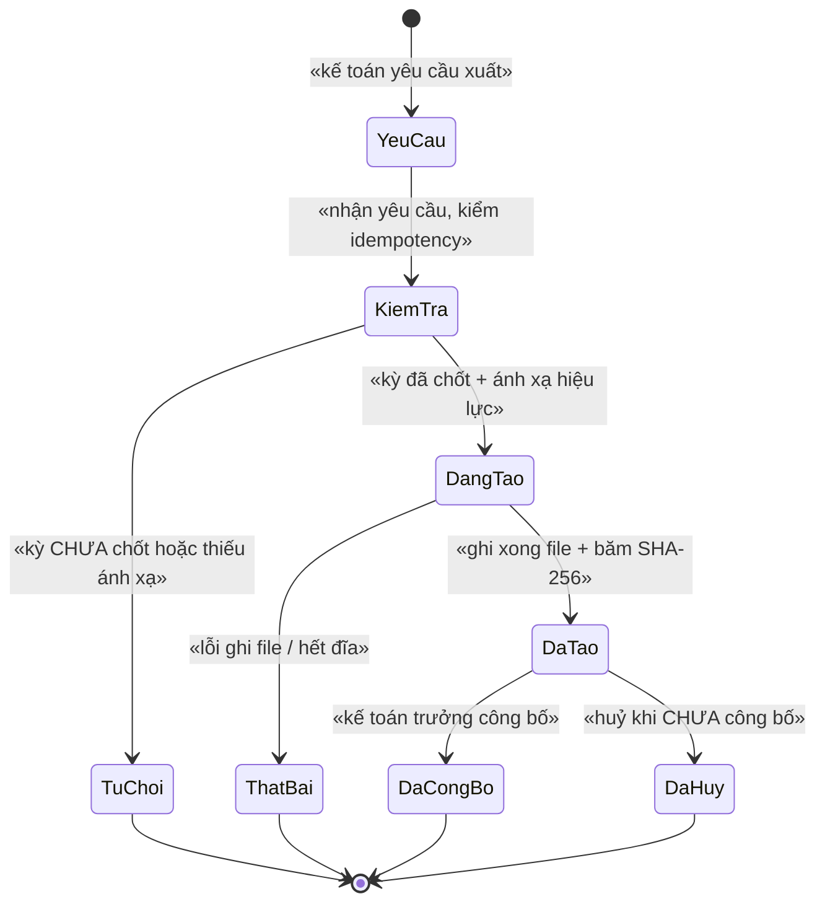
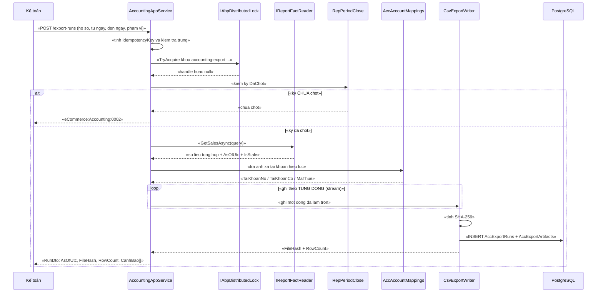

# `ACC-001` — Xuất liệu kế toán Excel/CSV

| Thuộc tính | Nội dung |
|---|---|
| **Mã** | `ACC-001` |
| **Module** | **AccountingHub** — khuôn mới `modules/AccountingHub/eCommerce.AccountingHub.*` |
| **Giai đoạn** | **GĐ3 — Điều hành** (`docs/implementation-plan.md:114`) |
| **Ưu tiên** | **Must have** — là một trong **6** tài liệu GĐ3 |
| **Trạng thái** | 🟡 `Draft` — chờ review |
| **Người viết / người review** | *(điền)* / **Kế toán trưởng + Kiến trúc trưởng** |
| **Phiên bản / ngày** | `v0.1 — 13/10/2026` |
| **Tài liệu liên quan** | `REP-001` (read-model — **tài liệu nền bắt buộc**) · `REP-002` · `REP-003` · `XC-001` (Money/làm tròn) · `XC-002` (outbox/inbox) · `XC-003` (khoá phân tán) · `XC-004` (phân quyền/tenant) · `XC-005` (log/metric) · `XC-006` (thuế GTGT + Mẫu 01) · `EINV-001` · `EINV-002` · `SAL-002` · `SAL-003` · `SHP-002` · `NOT-002` · `LOY-001` · `docs/implementation-plan.md` · `docs/structure-and-techstack.md` |

---

## 0. Tóm tắt & quyết định thiết kế

**Tóm tắt:** `ACC-001` chốt **cách hệ thống bàn giao số liệu cho kế toán** dưới dạng **file** (CSV trước, XLSX sau): ai được xuất, xuất **từ nguồn nào**, file gồm những cột gì, **bảo đảm gì** để kế toán tin được con số, và **lưu vết** ra sao khi cơ quan thuế/kiểm toán hỏi lại.

**Nguyên tắc gốc — điều quyết định toàn bộ thiết kế:** kế toán **không** nhận "số liệu sống". Kế toán nhận **một file bất biến, có băm (hash), gắn với một kỳ đã chốt**. Nếu lần xuất sau cho ra con số khác lần trước mà không ai giải thích được thì đó là **thảm hoạ giải trình**, không phải "báo cáo bị lệch".

**Vì sao phải có tài liệu này (yêu cầu đã chốt ở kế hoạch):**

| Nguồn | Yêu cầu nguyên văn |
|---|---|
| `docs/implementation-plan.md:215` | `AccountingHub` — xuất liệu kế toán **Excel/CSV trước** (Bravo/MISA công bố hỗ trợ), API sau. **DoD:** *"File xuất được kiểm tra bằng **1 kế toán thật**; có **test đối chiếu tổng**"* |
| `docs/implementation-plan.md:441` | `ACC-001` — Xuất liệu kế toán Excel/CSV |
| `docs/structure-and-techstack.md:78` | `AccountingHub/  B6  xuất liệu kế toán (Excel/CSV trước, API sau)  (P3)` |
| `docs/business-modules-proposal.md:94` | MISA/Bravo/Fast **không công bố spec .NET**; **Bravo chính thức hỗ trợ Excel/CSV** ⇒ `P3` |
| `docs/features/rep-001-read-model-job-tong-hop.md:59` | ❌ **Định dạng file xuất kế toán** (Excel/CSV, **ánh xạ tài khoản**, Mẫu 01) — **thuộc `ACC-001`**. `REP-001` **chỉ cấp số liệu** qua API |
| `docs/features/rep-001-read-model-job-tong-hop.md:746` | *"Đường 'ra ngoài' duy nhất là **file xuất kế toán**, và việc đó do `ACC-001` làm (dựa trên `IReportFactReader`)"* |
| `docs/features/XC-006-phan-loai-thue-gtgt.md:549` | Hệ thống **phải xuất được dữ liệu Mẫu 01** (thuộc `EINV-001`/`ACC-001`) — do NĐ 174/2025 yêu cầu kê khai **Mẫu số 01 Phụ lục III** |

**Hiện trạng thật của code (đã kiểm bằng `read`/`grep`/`glob` trên repo `D:\Projects\Tools\eCommerce` — không viết theo trí nhớ):**

| Hạng mục | Hiện trạng | Bằng chứng |
|---|---|---|
| Module `AccountingHub` | ❌ **chưa có trong code** — `eCommerce.slnx` chỉ có `ChannelHub`, `PaymentHub`, `Tax` | `eCommerce.slnx` (mục `/modules/`) |
| App service xuất file | ❌ **chưa có trong code** — `0` kết quả khi tìm `Export`, `IRemoteStreamContent` trên `*.cs` | `grep` toàn repo `*.cs` |
| **Thư viện Excel/CSV** | ❌ **chưa có gói nào** — `Directory.Packages.props` **0** gói `ClosedXML`/`EPPlus`/`CsvHelper`/`MiniExcel`/`OpenXml` | `Directory.Packages.props:21-99` |
| Module `Reporting` + read-model | ❌ **chưa có trong code** (đúng kế hoạch GĐ3) | `docs/features/rep-001-read-model-job-tong-hop.md:1138` (F1) |
| **Hàm tính Mẫu 01 (thuần)** | ✅ **có** — hàm thuần, không DI/DB, đã có test | `modules/Tax/eCommerce.Tax.Domain/Mau01/Mau01Part2Calculator.cs:58` · `test/eCommerce.Tests/Tax/Mau01Part2CalculatorTests.cs` |
| Chế độ cột (6) của Mẫu 01 | ✅ **có** — enum, kế toán trưởng đã chốt "Câu 1 = B" | `modules/Tax/eCommerce.Tax.Domain/Mau01/Mau01Column6Mode.cs:22-34` |
| Mã lỗi module Tax | ✅ **có** — 8 mã `eCommerce:Tax:0001…0008` | `modules/Tax/eCommerce.Tax.Domain/TaxErrorCodes.cs:13-34` |
| Bảng `TaxRateSchedules` / `TaxClassifications` | ✅ **có** (migration đã sinh) | `src/eCommerce.EntityFrameworkCore/eCommerceDbContext.cs:63-64` · `src/eCommerce.EntityFrameworkCore/Migrations/20261013012648_Add_Tax_Module.cs:48` |
| **Snapshot thuế trên dòng đơn** | ❌ **chưa có** — `OrderLine` chỉ có `UnitPrice`, `DiscountAmount`, `TaxAmount`; **không** có `TaxRate`/`TaxClassificationId` | `src/eCommerce.Domain/Entities/Orders/Order.cs:118-149` · `rep-001:1139` (F2) |
| Bảng hoá đơn điện tử | ❌ **chưa có trong code** — chỉ có đặc tả | `docs/features/einv-001-phat-hanh-hoa-don-dien-tu.md:407-456` |
| Đăng ký permission | ✅ **có** khuôn — 6 nhóm permission | `src/eCommerce.Application.Contracts/Permissions/eCommercePermissionDefinitionProvider.cs:23-60` |
| `[Authorize]` cấp CLASS | ✅ **có** tiền lệ + đã ghi bài học | `src/eCommerce.Application/Channels/ChannelAppService.cs:22-28` |
| Registry metric | ✅ **có** — **12** metric, test chốt cứng con số **12** | `src/eCommerce.Domain.Shared/Observability/eCommerceMetrics.cs:38-52` · `test/eCommerce.Tests/Observability/MetricsTests.cs:39,44,62,64` |
| Hạ tầng lưu trữ | ⚠️ chỉ có **PostgreSQL 17 + Redis 7**; **0** object storage (S3/MinIO) | `docker-compose.yml:6-40` |
| Test tích hợp có DB thật | ✅ **có** — `Testcontainers.PostgreSql 4.16.0` + schema sinh từ migration thật | `test/eCommerce.IntegrationTests/eCommerce.IntegrationTests.csproj` · `test/eCommerce.IntegrationTests/PostgreSqlSchemaFixture.cs:31-38` |

⇒ 🔴 **Hệ quả:** `ACC-001` **viết mới hoàn toàn** (module + bảng + writer + API). Thứ duy nhất **tái dùng được** là: `Mau01Part2Calculator` (số liệu Mẫu 01), `eCommerceMetrics` (nơi phát metric), `eCommercePermissionDefinitionProvider` (khuôn khai báo quyền), `ChannelSyncSupervisorWorker` (khuôn worker định kỳ), và **hợp đồng `IReportFactReader`** của `REP-001` (nguồn số liệu).

**Phạm vi:**

- ✅ **Hồ sơ xuất** (`AccExportProfiles`) — kế toán tự cấu hình đích xuất, dấu phân cách, kiểu số, bộ cột.
- ✅ **Ánh xạ tài khoản** (`AccAccountMappings`) — **dữ liệu** do kế toán trưởng quản trị, **có hiệu lực theo thời gian**, **append-only**.
- ✅ **Nhật ký lần xuất** (`AccExportRuns`) + **tệp đã sinh** (`AccExportArtifacts`) — **append-only**, có `SHA-256`.
- ✅ **Writer CSV** (không cần gói NuGet) và **writer XLSX** (cần thêm **1 dòng** `PackageVersion`).
- ✅ **Xuất Mẫu 01 Phụ lục III — Phần II** dùng lại **đúng** `Mau01Part2Calculator` (không viết lại công thức).
- ✅ **Bất biến "xuất lại cho ra file y hệt"** khi cùng `RunId` (khớp băm).
- ✅ **Chỉ xuất trên kỳ đã chốt** (`RepPeriodClose` của `REP-001`) — nền tảng của tính bất biến.
- ✅ Khoá phân tán, idempotency ở mọi biên vào, cách ly tenant, phân quyền, metric, test.

**Không nằm trong phạm vi:**

- ❌ **Số liệu** (doanh thu, lãi gộp, tồn kho luân chuyển) — thuộc `REP-002`/`REP-003`. `ACC-001` **chỉ đọc** qua `IReportFactReader` (`rep-001:596`).
- ❌ **Chốt/mở kỳ kế toán** — thuộc `REP-001` §3.3 (`rep-001:220-241`).
- ❌ **Read-model & job tổng hợp** — thuộc `REP-001`. `ACC-001` **cấm** query bảng giao dịch.
- ❌ **Phát hành hoá đơn điện tử** — thuộc `EINV-001`. `ACC-001` chỉ **báo cáo tình hình sử dụng hoá đơn** khi `EINV-*` đã có (`einv-002:49`).
- ❌ **Định nghĩa luật phân loại thuế** — thuộc `XC-006`.
- ❌ **Ghi ngược vào module nguồn** — **cấm tuyệt đối** (kế thừa `rep-001:63`).
- ❌ **API đẩy dữ liệu sang Bravo/MISA** — giai đoạn sau (kế hoạch: *"Excel/CSV trước, API sau"* — `implementation-plan.md:215`).
- ❌ **Tích hợp trao đổi dữ liệu với cơ quan thuế** — thuộc `EINV-002`.

### 0.1 Quyết định thiết kế (ADR ngắn)

| # | Quyết định | Phương án đã cân nhắc | Lý do chọn | Hệ quả |
|---|---|---|---|---|
| **ADR-01** | **`ACC-001` CHỈ đọc read-model qua `IReportFactReader`**; **cấm** query `OrdOrders`/`OrdOrderLines`/`InvStockLedger` | (a) query thẳng bảng giao dịch cho "nhanh" · (b) đọc read-model | (a) **bị cấm** bởi `implementation-plan.md:213` (*"Không báo cáo nào query trực tiếp trên bảng giao dịch"*) và `rep-001:613` (*"**cấm** các module này tự query bảng giao dịch"*). Ngoài ra query nặng theo kỳ 90 ngày sẽ **chặn** luồng bán hàng | Phụ thuộc `REP-001` (GĐ3). Nếu `REP-001` chưa xong ⇒ `ACC-001` **không thể** bắt đầu. Xuất file **không** làm chậm checkout |
| **ADR-02** | **Tách "tính số liệu" khỏi "ghi định dạng file"** — số liệu bằng **hàm thuần**, định dạng bằng lớp riêng | (a) vừa tính vừa ghi ra file · (b) tách hai tầng | Khuôn **đã có và đã chứng minh**: `Mau01Part2Calculator` là hàm thuần *"dùng chung cho mọi định dạng xuất (bảng số liệu, HTKK, eTax)"* (`Mau01Part2Calculator.cs:50-57`); `REP-003` D12 đã chốt cùng nguyên tắc (`rep-003:70`) | Đổi định dạng xuất (CSV → XLSX → HTKK) **không** đụng tới số liệu; số liệu **test được toàn bộ** không cần DB |
| **ADR-03** | **CSV là định dạng GĐ3**; XLSX là **bước 2** (cần thêm **1 gói** vào `Directory.Packages.props`) | (a) chỉ XLSX · (b) chỉ CSV · (c) CSV trước, XLSX sau | `Directory.Packages.props:21-99` hiện **0** gói Excel ⇒ CSV **không cần dependency nào** và đúng kế hoạch *"Excel/CSV trước"* (`implementation-plan.md:215`). Thêm gói phải **sửa `Directory.Packages.props`** (central package management) — một quyết định **có ảnh hưởng bảo mật/license** nên tách riêng | GĐ3 giao được **ngay** với CSV; XLSX là **cùng bộ số liệu**, chỉ khác writer |
| **ADR-04** | 🔒 **"File nộp được luôn (HTKK/eTax)" CHƯA làm ở GĐ3** — GĐ3 giao **"bảng số liệu"** | (a) đoán định dạng HTKK rồi code · (b) **chờ file mẫu** | Kế toán trưởng đã chọn **phương án A** (*"cần file nộp được luôn"*) **nhưng** đã ghi rõ **BLOCKER**: *"Phương án A của Câu 2 cần **1 file mẫu do HTKK xuất ra** — hiện **CHƯA có** ⇒ **chưa thể code** phần xuất file"* (`XC-006-phieu-hoi-ke-toan.md:88,94`). Đoán định dạng của một phần mềm thuế là **rủi ro pháp lý**, không phải rủi ro kỹ thuật | ⚠️ **Cần bạn cung cấp file mẫu HTKK** (1 file .xls/.xlsx do HTKK xuất) ⇒ mở khoá **GĐ3.1**. Trước đó giao **đúng bảng số liệu** để kế toán **nhập tay** — đúng phương án B |
| **ADR-05** | **Chỉ xuất trên kỳ `DaChot` của `REP-001`** | (a) cho xuất mọi kỳ · (b) chỉ kỳ đã chốt | `REP-001` D8: *"`ACC-001` xuất liệu cho kế toán ⇒ nếu lần xuất sau **khác** lần trước (do event đến muộn/rebuild) thì kế toán **không biết tin bản nào**, và việc giải trình thuế (`XC-006` BR-008) mất căn cứ"* (`rep-001:76`). Kỳ đã chốt ⇒ job **không ghi** vào khoảng ngày đó nữa ⇒ số liệu **đứng yên** | Xuất kỳ chưa chốt ⇒ **ném** `eCommerce:Accounting:0002`. Muốn xuất kỳ cũ đã chốt mà số đã đổi ⇒ phải **mở kỳ** (`eCommerce.Reporting.PeriodReopen`) — thao tác có **2 vai trò** + audit |
| **ADR-06** | **File sinh ra là BẤT BIẾN, lưu vết append-only, có `SHA-256`** | (a) sinh lại file mỗi lần tải · (b) **lưu file + băm** | `REP-003` §7.5 đã chốt cùng nguyên tắc: *"Xuất lại cùng `RunId` ⇒ file **giống hệt** (hash khớp)"* (`rep-003:554`). Và `rep-003:674` cảnh báo: *"nếu đã xuất file cho `ACC-001` thì **phải** giữ lại file + hash ở phía `ACC-001`"* | Cần nơi lưu file (đĩa/DbFile/object storage — xem Q4). **Cấm** sửa/xoá artifact; sai sót ⇒ sinh `RunId` mới và ghi rõ `SupersedesRunId` |
| **ADR-07** | **Ánh xạ tài khoản là DỮ LIỆU do kế toán trưởng quản trị, KHÔNG hard-code** | (a) hard-code `TK 511`/`TK 3331` trong code · (b) bảng dữ liệu có hiệu lực theo thời gian | Cùng bài học `XC-006` **D1**: *"Danh mục ... là **DỮ LIỆU** do kế toán quản trị, **KHÔNG hard-code**"* — hard-code ⇒ **phải release phần mềm mỗi lần luật/chuẩn mực đổi** (`XC-006-phan-loai-thue-gtgt.md:35`). Hệ thống tài khoản kế toán **thay đổi theo thông tư** | Cần bảng + UI quản trị + **duyệt** + **audit** + lịch sử. **Test bắt buộc:** `0` literal số hiệu tài khoản trong code nghiệp vụ |
| **ADR-08** | **Mọi số tiền đi qua `decimal`, làm tròn `AwayFromZero`, làm tròn theo TỪNG DÒNG** | (a) `double` · (b) làm tròn trên **tổng** | `XC-001` BR-008 cấm `double`; BR-005 chốt *"Thuế/VAT làm tròn **theo TỪNG DÒNG**; tổng đơn = **tổng các dòng đã làm tròn** (không làm tròn tổng)"* (`XC-001-money-currency-lam-tron.md:64`). Tiền lệ **đã có trong code**: `Mau01Part2Calculator.LamTron` dùng `AwayFromZero` 0 chữ số (`Mau01Part2Calculator.cs:106-107`) | ⚠️ `Σ` các dòng đã làm tròn **có thể khác** `Round(tổng chưa làm tròn)` **1–2 đồng** — UI/file **phải** hiện tổng = **tổng các dòng** (`XC-001-money-currency-lam-tron.md:330-332`) |
| **ADR-09** | 🔒 **Cấm so sánh tiền bằng `==`**; so theo **minor units** | (a) so `decimal` · (b) so `ToMinorUnits()` | `XC-001` D3 + BR-003: bài học eShop *"so `ActualTotalPrice == OriginalPaymentAmount` ⇒ **vỡ ngay** với VND/payOS khi lệch làm tròn"* (`XC-001-money-currency-lam-tron.md:41,64`). Kiểm tra "tổng file khớp số liệu" **phải** dùng hiệu số tuyệt đối so với `0`, không dùng `==` | Test đối chiếu tổng viết dạng `Assert.True(hiệuSo == 0m)` trên **giá trị đã chuẩn hoá**, không so hai `decimal` thô |
| **ADR-10** | **Múi giờ nghiệp vụ = `Asia/Ho_Chi_Minh`**; `FactDate` **không** lấy theo UTC | (a) dùng `UtcNow.Date` · (b) chuyển sang giờ VN | `REP-001` giả định #3: *"**Múi giờ nghiệp vụ duy nhất** là `Asia/Ho_Chi_Minh`. Nếu SAI: `FactDate` sẽ **lệch 1 ngày** cho đơn tạo gần nửa đêm ⇒ **sai kỳ thuế** (`XC-006` BR-008)"* (`rep-001:1152`) | Đơn tạo 23:30 giờ VN (16:30 UTC) **phải** nằm trong **đúng ngày VN**. Có test biên `23:59` / `00:01` |
| **ADR-11** | **Mọi entity cần `IRepository` ⇒ phải có `DbSet` trên `eCommerceDbContext` hợp nhất** | (a) DbContext riêng cho AccountingHub · (b) `DbSet` trên DbContext chung | `AddDefaultRepositories(includeAllEntities: true)` **chỉ** tạo `IRepository<T>` cho entity **có `DbSet`** — lỗi này **đã gặp thật** với `ChannelShop` (runtime: *"The requested service 'IRepository<ChannelShop, Guid>' has not been registered"*) | Phải khai `DbSet` cho **mọi** entity của `AccountingHub`. Module **không** tham chiếu DbContext của app — giữ nguyên khuôn `Tax` |
| **ADR-12** | **Module tự sở hữu hằng số của mình** (mã lỗi, khoá lock) — **khoá lock KHÔNG chứa tiền tố `ecommerce:`** | (a) dùng `eCommerceConsts` của app · (b) consts riêng của module | (a) **vi phạm** quy ước bất biến #3 (*"module gọi app **BỊ CẤM**"*) — tiền lệ `TaxErrorCodes.cs:6-8`: *"Module tự sở hữu hằng số của mình — giống cách `ChannelHubConsts` tự sở hữu lock key"*. Về **tiền tố**: `XC-003` §5.4 hệ quả #2 — *"**Tên khoá do module sinh KHÔNG chứa tiền tố** ... nếu không sẽ thành **tiền tố đôi**"* (`XC-003-khoa-phan-tan-quy-uoc.md:255-256`) | Khoá của `AccountingHub` sinh ra dạng `accounting:...` (không tiền tố). ⚠️ **Đã phát hiện 2 chỗ trong code vi phạm quy tắc này** — xem **F1** ở §15.2 |
| **ADR-13** | **Chỉ ghi nhận doanh thu khi đơn đã được XÁC NHẬN, không theo webhook thô** | (a) tin webhook `Delivered` · (b) đối soát chủ động rồi mới ghi | `SHP-002`: webhook là **gợi ý**, không phải sự thật; GHTK **không có HMAC**. Yêu cầu nguyên văn: *"🔴 `EINV-001`/`ACC-001`: **cấm** lập chứng từ/ghi nhận doanh thu chỉ dựa vào webhook `Delivered`; **bắt buộc** có `ConfirmedAtUtc` (BR-004)"* (`shp-002:662`). `ShipmentDeliveredEto` *"kèm cờ `ConfirmedAtUtc` — consumer **phải** kiểm"* (`shp-002:633`) | Xuất liệu **chỉ** gồm đơn có `ConfirmedAtUtc`. Nếu không, số doanh thu **có thể bị thổi phồng do webhook giả mạo** ⇒ kê khai thừa thuế. ⚠️ `SHP-002` **Q6** còn `Open` (`shp-002:1054`) |
| **ADR-14** | **Idempotency ở MỌI biên vào** (yêu cầu API xuất + tiêu thụ ETO + job định kỳ) | (a) chỉ chống trùng ở API · (b) mọi biên vào | Quy ước bất biến của dự án + `XC-002` BR-004. `REP-003` §7.5 đã làm mẫu cho **5** biên vào (`rep-003:547-554`). *"Khoá idempotency ở mọi biên vào (chống gửi trùng thông báo)"* | Mỗi biên vào có **khoá idempotency** + **hàng rào DB** (unique index). Redis chết ⇒ DB vẫn chặn (`XC-003` D2) |

---

## 1. Use Case Specification

| Thuộc tính | Nội dung |
|---|---|
| **Use Case ID** | `ACC-001` |
| **Use Case Name** | Bàn giao số liệu kế toán dưới dạng file **bất biến, có kiểm chứng** |
| **Description** | *"Là kế toán, tôi muốn xuất số liệu của một kỳ đã chốt ra file (CSV/Excel) theo đúng bộ cột mà phần mềm kế toán của tôi nhận được, để tôi nhập vào Bravo/MISA/HTKK và **giải trình được với cơ quan thuế** — và để **lần xuất sau không cho ra con số khác** lần trước mà không ai giải thích được."* |
| **Actor(s)** | **Kế toán** (yêu cầu xuất, tải file) · **Kế toán trưởng** (duyệt ánh xạ tài khoản, công bố file) · **Hệ thống** (sinh file, băm, lưu vết) · **Kiểm toán / cơ quan thuế** (gián tiếp — đối chiếu file đã công bố) |
| **Priority** | **Must have** |
| **Trigger** | (a) đến kỳ lập tờ khai/quyết toán; (b) kế toán trưởng chốt kỳ ở `REP-001` ⇒ có nhu cầu lấy số liệu ra; (c) yêu cầu cung cấp số liệu cho kiểm toán |
| **Pre-Condition(s)** | • **Tenant hiện tại** (`TenantId` từ `ICurrentTenant`) — `XC-004` BR-009.<br>• **Kỳ đã `DaChot`** ở `RepPeriodClose` của `REP-001` (`rep-001:220-241`) — **bắt buộc** (ADR-05).<br>• **Read-model đã có số liệu** cho khoảng ngày (watermark không `IsStale`) — `rep-001:626-637`.<br>• **Ánh xạ tài khoản hiệu lực** tại ngày hạch toán (ADR-07).<br>• `<ChannelCode>` **chỉ** để đối soát/phân nhóm, **không** tham gia quyết định tài khoản — kế thừa `XC-006` §1 (*"thuế theo hàng hoá, không theo kênh bán"*). |
| **Post-Condition(s)** | • Sinh **1 hoặc nhiều** artifact bất biến, mỗi artifact có `SHA-256`.<br>• `AccExportRuns` có **đúng 1** dòng cho một `IdempotencyKey`.<br>• Mọi lần xuất **có dấu vết**: `RequestedBy`, `RequestedAtUtc`, kỳ, `AsOfUtc`, `RowCount`, `FileHash`, `CorrelationId` (`XC-005`).<br>• **Tổng trên file khớp số liệu read-model, lệch 0 đồng** (ADR-08/ADR-09). |
| **Basic Flow** | 1. Kế toán mở **màn hình Xuất liệu kế toán**, chọn **hồ sơ xuất** + **kỳ** (Từ ngày/Đến ngày) + phạm vi (`DoanhThu` / `HoaDon` / `Mau01PhanII` / `PhiGuiTin`).<br>2. Hệ thống kiểm tra: kỳ **đã chốt**; watermark **không** `IsStale`; ánh xạ tài khoản **có** hiệu lực cho khoảng ngày.<br>3. Hệ thống tạo `AccExportRun` trạng thái `YeuCau`→`KiemTra`→`DangTao` (idempotency: khoá đã tồn tại ⇒ **trả lại run cũ**, không tạo mới).<br>4. Hệ thống đọc số liệu qua `IReportFactReader`, áp **ánh xạ tài khoản**, ghi file **theo từng dòng** (stream, không nạp cả kỳ vào bộ nhớ).<br>5. Hệ thống tính `SHA-256`, ghi `AccExportArtifacts`, chuyển run sang `DaTao`.<br>6. Kế toán trưởng **công bố** ⇒ `DaCongBo` (bất biến, đã ghi audit).<br>7. Kế toán tải file; UI hiển thị **`AsOfUtc` + `FileHash` + `RowCount`** để đối chiếu. |
| **Alternative Flow** | **A1: Kỳ chưa chốt** ⇒ hệ thống **không** cho xuất; hiện thông điệp **chỉ rõ** kỳ và **hướng dẫn** *"vào Reporting để chốt kỳ"* (không chỉ báo "không thể xuất").<br>**A2: Xuất lại y hệt** (cùng tham số) ⇒ **trả lại run cũ** + artifact cũ, **không** sinh file mới ⇒ kế toán **luôn** nhận đúng một con số.<br>**A3: Số liệu đã công bố bị sai** ⇒ **cấm** sửa artifact; sinh **run mới** có `SupersedesRunId` + **lý do ≥ 20 ký tự** + audit (khuôn `ReopenPeriodAsync`, `rep-001:611`).<br>**A4: Kế toán cần cột khác** ⇒ sửa **hồ sơ xuất** (`AccExportProfiles`), **không** sửa code.<br>**A5: Cần file nộp thẳng HTKK/eTax** ⇒ ⚠️ **CHƯA LÀM** ở GĐ3 (ADR-04) — chờ **file mẫu HTKK**; hiện giao "bảng số liệu". |
| **Exception Flow** | **E1:** kỳ **chưa chốt** ⇒ `BusinessException` `eCommerce:Accounting:0002` (`409`).<br>**E2:** **không** có ánh xạ tài khoản hiệu lực cho một `SourceKind` ⇒ `eCommerce:Accounting:0003` — **không** tự đoán tài khoản.<br>**E3:** read-model **`IsStale`** quá ngưỡng ⇒ `eCommerce:Accounting:0004` — **không** xuất số liệu cũ mà không cảnh báo (kế thừa tinh thần `REP-001` D7).<br>**E4:** lỗi ghi file/đĩa đầy ⇒ run `ThatBai` + `ErrorCode` + metric; **không** để lại artifact dở dang (xoá file tạm).<br>**E5:** yêu cầu xuất **trùng** đang chạy ⇒ trả run **đang chạy** (`409` + `RunId`) hoặc chờ khoá — **không** tạo 2 file.<br>**E6:** mở/khoá kỳ **đổi giữa chừng** ⇒ phát hiện khi ghi ⇒ **huỷ** run + `eCommerce:Accounting:0005`. |
| **Business Rules** | • **BR-01**: Mọi số liệu xuất ra **phải** lấy từ **read-model** qua `IReportFactReader`; **cấm** query bảng giao dịch.<br>• **BR-02**: **Chỉ** xuất được kỳ có `RepPeriodClose.Status = DaChot`; kỳ chưa chốt ⇒ **ném** `0002`.<br>• **BR-03**: Mọi lần xuất **phải** lưu vết **append-only**: ai · khi nào · kỳ · hồ sơ · `RowCount` · `FileHash` · `AsOfUtc` · `CorrelationId`.<br>• **BR-04**: Artifact đã `DaCongBo` **bất biến**; **cấm** sửa/xoá; thay đổi ⇒ run mới + `SupersedesRunId` + lý do.<br>• **BR-05**: Xuất **cùng tham số** ⇒ **cùng** file (khớp `FileHash`); **cấm** sinh artifact mới cho cùng `IdempotencyKey`.<br>• **BR-06**: Mọi số tiền dùng `decimal`; **cấm** `double`/`float`; **cấm** so `==` trên tiền (so hiệu số tuyệt đối).<br>• **BR-07**: Thuế & tiền **làm tròn theo TỪNG DÒNG**, `AwayFromZero`, theo số chữ số thập phân của hồ sơ; tổng = **tổng các dòng đã làm tròn**.<br>• **BR-08**: **Bất biến tổng:** `Σ tiền thuế theo từng mức thuế suất == tổng cộng tiền thuế` (`XC-001` BR-010) và `tổng thanh toán == thành tiền chưa thuế + tổng thuế` (`XC-001` BR-011).<br>• **BR-09**: **Cấm hard-code** số hiệu tài khoản / mã mức thuế / tên cột trong code nghiệp vụ — **tất cả** là dữ liệu cấu hình (`AccAccountMappings`, `AccExportProfiles`).<br>• **BR-10**: `FactDate`/ngày hạch toán theo **`Asia/Ho_Chi_Minh`**; **cấm** dùng `UtcNow.Date`.<br>• **BR-11**: **Chỉ** ghi nhận doanh thu cho đơn đã **xác nhận** (`ConfirmedAtUtc`); **cấm** dựa vào webhook thô (ADR-13).<br>• **BR-12**: Mọi biên vào **phải** idempotent (khoá + unique index DB); Redis chết ⇒ DB **vẫn** chặn.<br>• **BR-13**: Cách ly tenant tuyệt đối: file của tenant A **không** chứa **1 dòng** nào của tenant B.<br>• **BR-14**: **Cấm** đưa dữ liệu cá nhân không cần thiết vào file; thông tin người mua chỉ gồm trường **bắt buộc** (kế thừa `XC-005` BR-005 + `XC-004` BR-014). |
| **Non-Functional Requirement** | • **NFR-01**: Xuất **50.000** dòng ⇒ **< 30 s** (p95, máy dev).<br>• **NFR-02**: Bộ nhớ đỉnh khi xuất 50.000 dòng **< 200 MB** (ghi theo **stream**, không nạp cả kỳ).<br>• **NFR-03**: **Đối chiếu tổng lệch 0 đồng** trên mẫu **1.000** dòng (DoD của `implementation-plan.md:215`).<br>• **NFR-04**: Xuất lại cùng tham số ⇒ `FileHash` **giống hệt** (**100 %**).<br>• **NFR-05**: Xử lý lại **1.000** lần cùng `IdempotencyKey` ⇒ **đúng 1** artifact.<br>• **NFR-06**: **0** literal số hiệu tài khoản trong code nghiệp vụ (test quét mã nguồn).<br>• **NFR-07**: **3** instance chạy song song ⇒ **0** artifact trùng, tổng **bằng** chạy 1 instance.<br>• **NFR-08**: Cách ly tenant: tenant A **không** thấy **1** dòng/dòng file nào của tenant B.<br>• **NFR-09**: **100 %** lần xuất có `CorrelationId` + dòng `AccExportRuns`; mọi thất bại có metric + log ≥ `Warning`.<br>• **NFR-10**: File **mở được** bằng Excel/LibreOffice **không** hỏng dấu tiếng Việt (kiểm bằng file mẫu, xem §6.4). |

---

## 2. Sơ đồ Use Case



---

## 3. Sơ đồ trạng thái (state machine)



**Bảng chuyển trạng thái & guard (mọi chuyển sai **phải ném lỗi**, không im lặng — kế thừa `XC-006` §3 và `XC-003` BR-010):**

| Từ | Sang | Guard | Nếu vi phạm |
|---|---|---|---|
| `[*]` | `YeuCau` | Có quyền `eCommerce.Accounting.Export.Request`; `FromDate <= ToDate` | `403` |
| `YeuCau` | `KiemTra` | `IdempotencyKey` **chưa** tồn tại **hoặc** run cũ đã kết thúc | Trả **run cũ** (A2) — **không** tạo mới |
| `KiemTra` | `TuChoi` | Kỳ **không** `DaChot` **hoặc** thiếu ánh xạ tài khoản **hoặc** `IsStale` | `BusinessException` `0002`/`0003`/`0004` |
| `KiemTra` | `DangTao` | Giành được **khoá phân tán** (ADR-12) | Không giành được ⇒ **ném** `eCommerce:Lock:0001` (kế thừa `XC-003`) |
| `DangTao` | `DaTao` | Ghi **đủ** artifact + tính `FileHash` + `Σ` dòng khớp số liệu | Lệch tổng ⇒ **huỷ** artifact + **ném** `0006` (**không** công bố file sai) |
| `DangTao` | `ThatBai` | Lỗi I/O (đĩa đầy, mất kết nối) | Ghi `ErrorCode`, metric, log `Error`; **xoá file tạm** |
| `DaTao` | `DaCongBo` | Có quyền `eCommerce.Accounting.Export.Publish` | `403` |
| `DaTao` | `DaHuy` | Người yêu cầu **hoặc** kế toán trưởng; lý do ≥ 10 ký tự | Thiếu lý do ⇒ `0007` |
| `DaCongBo` | *bất kỳ* | — | 🔒 **CẤM** — artifact đã công bố **bất biến**; muốn thay ⇒ run mới + `SupersedesRunId` + lý do ≥ 20 ký tự (`0008`) |
| `ThatBai`/`TuChoi`/`DaHuy` | `[*]` | — | — |

> ⚠️ **Vì sao `DaCongBo` là trạng thái "chết":** file đã công bố là **chứng từ đối chiếu** với cơ quan thuế/kiểm toán.
> Nếu cho sửa tại chỗ thì **không còn gì để đối chiếu** — đúng lớp lỗi mà `REP-001` D8 (`rep-001:76`) và `REP-003` §7.5 (`rep-003:554`) đã cảnh báo.
> Sửa sai sót ⇒ **run mới** và **giữ** run cũ để giải trình "đã sửa cái gì, vì sao".

---

## 4. Sequence Diagram & luồng dữ liệu

### 4.1 Xuất một kỳ — từ yêu cầu tới file có băm



### 4.2 Luồng dữ liệu — vì sao `ACC-001` **không** chạm DB giao dịch

| Bước | Việc | Nguồn | Ghi chú |
|---|---|---|---|
| 1 | Job tổng hợp nuôi read-model | `REP-001` (sự kiện + đối chiếu) | `rep-001:50-51` |
| 2 | Kế toán trưởng **chốt kỳ** ⇒ số liệu **đứng yên** | `RepPeriodClose` | `rep-001:220-241` |
| 3 | `ACC-001` đọc số qua `IReportFactReader` | **read-model** | `rep-001:613` — **cấm** query bảng giao dịch |
| 4 | Áp **ánh xạ tài khoản** đang hiệu lực | `AccAccountMappings` | ADR-07 |
| 5 | Ghi file **stream** + băm | Writer | ADR-02 |
| 6 | Lưu vết append-only | `AccExportRuns` + `AccExportArtifacts` | ADR-06 |
| 7 | **Cấm** ghi ngược về module nguồn | — | kế thừa `rep-001:63` |

> 📌 **Vì sao tách hai tầng (số liệu / định dạng) lại quan trọng ở đây:** mục tiêu cuối của kế toán là **file nộp được luôn**
> cho HTKK/eTax (ADR-04), nhưng **định dạng** đó do **phần mềm thuế** quyết định và **đổi theo phiên bản**.
> Nếu trộn công thức vào writer thì mỗi lần HTKK nâng cấp phải **sửa lại số liệu** — sai lầm tốn kém nhất.
> `Mau01Part2Calculator` đã được thiết kế **chính xác** để tránh điều này (`Mau01Part2Calculator.cs:50-57`).

---

## 5. Mô hình dữ liệu

### 5.1 Bảng đăng ký định dạng xuất (export format registry)

**Nguồn sự thật duy nhất về định dạng.** Mọi writer **phải** nằm trong bảng này (khuôn tư duy giống **bảng đăng ký metric** `XC-005` §5.1 và **bảng đăng ký khoá** `XC-003` §5).

| Mã hồ sơ | Định dạng | Gói NuGet cần | Trạng thái | Ghi chú |
|---|---|---|---|---|
| `csv-generic` | CSV UTF-8 **có BOM**, dấu `,`, số thập phân `.` | **Không cần** | ✅ **GĐ3** | Mặc định; mở được bằng Excel/LibreOffice |
| `csv-bravo` | CSV, dấu `;`, số thập phân `,` | **Không cần** | ⚠️ **GĐ3 — chưa kiểm chứng** | Cột/kiểu số phải **xác minh với Bravo** — xem Q2 |
| `csv-misa` | CSV, dấu `;`, số thập phân `,` | **Không cần** | ⚠️ **GĐ3 — chưa kiểm chứng** | Xem Q2 |
| `xlsx-generic` | XLSX (OOXML) | **Có — phải thêm 1 dòng** vào `Directory.Packages.props` | ⬜ **GĐ3.1** | ADR-03 |
| `htkk-mau01` | XLSX/XLS **theo mẫu HTKK** | Có | ⛔ **BỊ CHẶN** | ADR-04 — **chưa có file mẫu** (`XC-006-phieu-hoi-ke-toan.md:94`) |

### 5.2 Data Dictionary

**Bảng `AccExportProfiles`** — *hồ sơ xuất do kế toán cấu hình; **dữ liệu**, không hard-code*

| Cột | Kiểu | Null? | Ý nghĩa | Ghi chú |
|---|---|---|---|---|
| `Id` | `uuid` | ✖ | khoá chính | |
| `TenantId` | `uuid` | ✖ | tenant | bắt buộc vì entity là `IMultiTenant` (`XC-004` BR-009) |
| `Code` | `varchar(32)` | ✖ | mã hồ sơ (`csv-generic`, `csv-bravo`…) | **unique** theo tenant |
| `Name` | `varchar(128)` | ✖ | tên hiển thị | |
| `FormatKind` | `int` | ✖ | `Csv=0`, `Xlsx=1` | |
| `Delimiter` | `varchar(4)` | ✖ | `,` hoặc `;` | |
| `DecimalSeparator` | `varchar(4)` | ✖ | `.` hoặc `,` | ⚠️ Excel vi-VN cần `,` |
| `Encoding` | `varchar(32)` | ✖ | `utf-8-bom` \| `utf-8` | ⚠️ **không BOM ⇒ mất dấu tiếng Việt** (NFR-10) |
| `MoneyDecimals` | `int` | ✖ | số chữ số thập phân của tiền | Cấu hình; **không** hard-code (ADR-08) |
| `ColumnSetJson` | `jsonb` | ✖ | danh sách cột + thứ tự + tiêu đề | 🔒 **Cấm** cột ngoài **allowlist** (§5.4) |
| `IsActive` | `bool` | ✖ | đang dùng | |

**Bảng `AccAccountMappings`** — ***đây là chỗ kế toán trưởng quyết định*** (ADR-07); **append-only, có version**

| Cột | Kiểu | Null? | Ý nghĩa | Ghi chú |
|---|---|---|---|---|
| `Id` | `uuid` | ✖ | khoá chính | |
| `TenantId` | `uuid` | ✖ | tenant | |
| `SourceKind` | `int` | ✖ | `Revenue=0`, `Discount=1`, `ShippingFee=2`, `ChannelFee=3`, `OutputTax=4`, `ReducedTaxDiff=5`, `LoyaltyDiscount=6`, `NotificationCost=7` | tập **ĐÓNG** — xem §5.5 |
| `DebitAccount` | `varchar(32)` | ✖ | tài khoản **Nợ** | ví dụ `131`, `511`, `521` |
| `CreditAccount` | `varchar(32)` | ✖ | tài khoản **Có** | ví dụ `511`, `3331` |
| `TaxRateCode` | `varchar(32)` | ✔ | mã mức thuế | tra `TaxRateSchedules.Code` (`modules/Tax/eCommerce.Tax.Domain/RateSchedules/TaxRateSchedule.cs`) |
| `EffectiveFrom` / `EffectiveTo` | `date` | ✖ / ✔ | hiệu lực | **không** chồng khung (kế thừa `XC-006` BR-009) |
| `LegalBasisNote` | `varchar(512)` | ✔ | căn cứ (thông tư, quyết định) | phục vụ **giải trình** |
| `Status` | `int` | ✖ | `Draft=0`, `Approved=1`, `Superseded=2`, `Expired=3`, `Cancelled=4` | kế thừa `XC-006` §3 |
| `ApprovedBy` / `ApprovedAtUtc` | `uuid` / `timestamptz` | ✔ | ai duyệt · khi nào | |
| `Version` | `int` | ✖ | phiên bản | append-only |

**Bảng `AccExportRuns`** — *nhật ký mỗi lần xuất; **append-only***

| Cột | Kiểu | Null? | Ý nghĩa | Ghi chú |
|---|---|---|---|---|
| `Id` | `uuid` | ✖ | khoá chính | |
| `TenantId` | `uuid` | ✖ | tenant | |
| `ProfileId` | `uuid` | ✖ | hồ sơ xuất | FK nội bộ module |
| `Scope` | `int` | ✖ | `DoanhThu=0`, `HoaDon=1`, `Mau01PhanII=2`, `PhiGuiTin=3` | tập **ĐÓNG** |
| `PeriodFrom` / `PeriodTo` | `date` | ✖ | kỳ xuất | **bắt buộc tường minh** — **cấm** khoảng mở (kế thừa `REP-001` D10, `rep-001:78`) |
| `Status` | `int` | ✖ | theo §3 | |
| `IdempotencyKey` | `varchar(256)` | ✖ | khoá chống trùng | **unique** theo tenant |
| `RequestedBy` / `RequestedAtUtc` | `uuid` / `timestamptz` | ✖ | ai · khi nào | |
| `AsOfUtc` | `timestamptz` | ✔ | **tuổi dữ liệu** tại lúc xuất | kế thừa `REP-001` D7 (`rep-001:75`) |
| `RowCount` | `bigint` | ✔ | số dòng đã ghi | |
| `TotalNet` / `TotalTax` / `TotalGross` | `numeric(18,4)` | ✔ | tổng kiểm chứng | **bất biến** BR-08 |
| `FileHash` | `varchar(64)` | ✔ | `SHA-256` của artifact | so khớp khi xuất lại |
| `PublishedBy` / `PublishedAtUtc` | `uuid` / `timestamptz` | ✔ | công bố | |
| `SupersedesRunId` | `uuid` | ✔ | run bị thay thế | kèm `Reason` ≥ 20 ký tự |
| `ErrorCode` | `varchar(64)` | ✔ | mã lỗi nếu `ThatBai`/`TuChoi` | `eCommerce:Accounting:*` |
| `CorrelationId` | `varchar(64)` | ✖ | nối chuỗi log | `XC-005` BR-002 |

**Bảng `AccExportArtifacts`** — *tệp đã sinh; **bất biến***

| Cột | Kiểu | Null? | Ý nghĩa | Ghi chú |
|---|---|---|---|---|
| `Id` | `uuid` | ✖ | khoá chính | |
| `TenantId` | `uuid` | ✖ | tenant | |
| `RunId` | `uuid` | ✖ | FK nội bộ, **cascade** | |
| `FileName` | `varchar(256)` | ✖ | tên file tải về | **tất định** (chứa kỳ + `RunId` rút gọn) |
| `ContentType` | `varchar(128)` | ✖ | `text/csv`, `application/vnd.openxmlformats-officedocument.spreadsheetml.sheet` | |
| `StorageKind` | `int` | ✖ | `Disk=0`, `Database=1`, `ObjectStorage=2` | ⚠️ `ObjectStorage` **chưa có hạ tầng** (`docker-compose.yml:6-40` chỉ có PostgreSQL + Redis) — xem Q4 |
| `StorageKey` | `varchar(512)` | ✖ | đường dẫn/khoá lưu | **cấm** lộ ra API |
| `SizeBytes` | `bigint` | ✖ | kích thước | |
| `Sha256` | `varchar(64)` | ✖ | băm nội dung | ⭐ cột **đối chiếu** chính |
| `CreatedAtUtc` | `timestamptz` | ✖ | thời điểm sinh | |

### 5.3 Index & ràng buộc

| Loại | Cột / biểu thức | Mục đích |
|---|---|---|
| **UNIQUE** | `AccExportProfiles (TenantId, Code)` | một mã hồ sơ / tenant |
| **UNIQUE** | `AccExportRuns (TenantId, IdempotencyKey)` | ⭐ **hàng rào cuối** chống xuất trùng (BR-05, NFR-05) |
| **EXCLUDE** hoặc **UNIQUE** + guard | `AccAccountMappings (TenantId, SourceKind)` + `daterange(EffectiveFrom, EffectiveTo, '[]')` | **chặn chồng khung hiệu lực** (kế thừa `XC-006` BR-009 — dùng `EXCLUDE USING gist`) |
| CHECK | `AccAccountMappings.EffectiveTo IS NULL OR EffectiveTo >= EffectiveFrom` | dữ liệu hợp lệ |
| CHECK | `AccExportRuns.PeriodTo >= AccExportRuns.PeriodFrom` | kỳ hợp lệ |
| INDEX | `AccExportRuns (TenantId, Scope, PeriodFrom, PeriodTo)` | tra lịch sử theo kỳ |
| INDEX | `AccExportArtifacts (TenantId, RunId)` | lấy file của một run |
| **KHÔNG** FK chéo miền | — | **cấm** FK tới `OrdOrders`/`EInvInvoices` — kế thừa `REP-001` D14 (`rep-001:82`): liên kết bằng **giá trị tham chiếu mềm** |

> ⚠️ **Ghi rõ giới hạn đã biết:** ràng buộc `EXCLUDE USING gist` **chưa từng chạy thật** trên PostgreSQL trong dự án này —
> `XC-006` §14.5 ghi *"sinh migration nhưng **CHƯA chạy thử**… chưa được kiểm chứng thực tế"* (`XC-006-phan-loai-thue-gtgt.md:665`), và `rep-001:1144` (F7) kế thừa cảnh báo.
> Nay **đã có** hạ tầng để kiểm: `Testcontainers.PostgreSql 4.16.0` + schema sinh từ migration thật (`test/eCommerce.IntegrationTests/PostgreSqlSchemaFixture.cs:31-38`) ⇒ **việc đầu tiên khi code `ACC-001`** là chạy `TC-09` trên container thật.

### 5.4 Allowlist cột xuất — **cấm** đưa cột ngoài danh sách

Kế toán có thể cấu hình cột (`ColumnSetJson`), nhưng **chỉ** trong **allowlist**. Lý do: file xuất chứa dữ liệu khách hàng và **bị gửi ra ngoài** (email, kiểm toán) ⇒ đây là **biên rò dữ liệu**, không phải chuyện tiện lợi (kế thừa tư duy `XC-005` D6, `XC-005-observability-log-metric.md:56`).

| Nhóm | Cột **được** phép | Cột **CẤM** vào file | Lý do |
|---|---|---|---|
| Đơn | `SoDonHang`, `NgayHachToan`, `KenhBan`, `TienTe` | — | |
| Hàng | `MaSKU`, `TenHangHoa`, `SoLuong`, `DonGiaChuaThue` | ảnh, mô tả dài | không cần cho hạch toán |
| Tiền | `ThanhTienChuaThue`, `ChietKhau`, `TienThue`, `TongThanhToan`, `PhiSan`, `PhiVanChuyen` | — | `decimal` + làm tròn theo dòng |
| Thuế | `MaThue`, `ThueSuat`, `TienThueTheoMuc` | — | khớp `XC-001` BR-010 |
| Hạch toán | `TaiKhoanNo`, `TaiKhoanCo`, `DienGiai` | — | từ `AccAccountMappings` |
| Người mua | `TenNguoiMua`, `MstNguoiMua` (**chỉ khi** hồ sơ hoá đơn) | `SoDienThoai`, `Email`, `SoCanCuoc`, `DiaChiDayDu` | 🔒 **BR-14** + `XC-005` BR-005 — PII **không** cần cho sổ sách |

### 5.5 Ánh xạ `SourceKind` → nguồn số liệu (registry)

| `SourceKind` | Nguồn số liệu | Đã có trong code? | Ghi chú |
|---|---|---|---|
| `Revenue` | read-model bán hàng | ❌ **chưa** — `REP-001` GĐ3 | qua `IReportFactReader.GetSalesAsync` (`rep-001:622`) |
| `Discount` | read-model bán hàng | ❌ chưa | |
| `ShippingFee` | read-model bán hàng | ❌ chưa | `REP-003` D12 (`rep-003:70`) |
| `ChannelFee` | read-model bán hàng | ❌ chưa | phí sàn — `Order.ChannelFeeAmount` **có** trong code (`src/eCommerce.Domain/Entities/Orders/Order.cs:50`) nhưng **chưa** vào read-model |
| `OutputTax` / `ReducedTaxDiff` | `Mau01Part2Calculator` | ✅ **CÓ** (`Mau01Part2Calculator.cs:58`) | ⚠️ **chặn một phần** bởi F2 (`OrderLine` thiếu snapshot thuế) |
| `LoyaltyDiscount` | read-model/Loyalty | ❌ chưa | ⚠️ `LOY-001` Q còn mở: kế toán phải xác nhận điểm thưởng là **chi phí/giảm trừ doanh thu** (`loy-001-diem-thuong.md:738`) |
| `NotificationCost` | `NotificationCostLedger` | ❌ chưa | `not-002:382` — *"sổ này là **nguồn dữ liệu** cho `ACC-001`"*; ⚠️ `NOT-002` Q9 `Open` (`not-002:954`) |

### 5.6 ⚠️ CƠ CHẾ TIỀN TỐ KHOÁ THẬT (kế thừa `XC-003` §5.4)

Khoá Redis **không** bằng đúng chuỗi hàm sinh khoá trả về. ABP ghép thêm tiền tố theo công thức **không có dấu phân cách**:

```
khoá_thật = AbpDistributedLockOptions.KeyPrefix + tên_khoá
```

**Bằng chứng trong code (đã kiểm bằng `read`):**

| Hạng mục | Giá trị | File |
|---|---|---|
| `KeyPrefix` | `"ecommerce:"` (chữ thường, **có** dấu `:`) | `src/eCommerce.HttpApi.Host/eCommerceHttpApiHostModule.cs:127` |
| Cách ghép | *"ABP ghép tiền tố với tên khoá **KHÔNG có dấu phân cách**: `KeyPrefix + name`"* | `src/eCommerce.HttpApi.Host/eCommerceHttpApiHostModule.cs:119` |
| ✅ Mẫu **ĐÚNG** — khoá module **không** chứa tiền tố | `channel:{channelCode}:{shopId}:token-refresh` ⇒ khoá thật `ecommerce:channel:…` | `modules/ChannelHub/eCommerce.ChannelHub.Domain/ChannelHubConsts.cs:23` |
| 🔒 Quy tắc | *"**Tên khoá do module sinh KHÔNG chứa tiền tố** … nếu không sẽ thành **tiền tố đôi**"* | `docs/features/XC-003-khoa-phan-tan-quy-uoc.md:255-256` |

⇒ **Khoá của `ACC-001` PHẢI** sinh dạng **`accounting:…`** (không tiền tố):

| Khoá (mẫu) | Hàm sinh khoá | Dùng cho | TTL đề xuất |
|---|---|---|---|
| `accounting:export:{tenantId}:{scope}:{from}:{to}` | `AccountingLockKeys.Export(tenantId, scope, from, to)` | đảm bảo **1 kỳ chỉ 1 lần sinh file** đồng thời | **300 s** |
| `accounting:mapping:{tenantId}:{sourceKind}` | `AccountingLockKeys.AccountMapping(tenantId, sourceKind)` | sửa/duyệt ánh xạ tài khoản | **30 s** |

> 🚨 **Phát hiện khi viết tài liệu này (chi tiết ở `F1` §15.2):** **hai** hàm sinh khoá trong code hiện **CÓ** chứa tiền tố `ecommerce:`
> — trái với hệ quả #2 của `XC-003` §5.4 ⇒ khoá thật sẽ thành **`ecommerce:ecommerce:…`**.
> `ACC-001` **phải** làm đúng, và **không** sao chép khuôn sai đó.

---

## 6. Hợp đồng API

### 6.1 Application Service

```csharp
namespace eCommerce.Accounting;

/// 🔒 [Authorize] Ở CẤP CLASS — BẮT BUỘC.
/// ABP KHÔNG tự bảo vệ application service; tiền lệ lỗi đã xảy ra thật ở ChannelAppService
/// (src/eCommerce.Application/Channels/ChannelAppService.cs:22-28).
[Authorize]
public interface IAccountingExportAppService : IApplicationService
{
    Task<PagedResultDto<ExportProfileDto>> GetProfilesAsync(GetExportProfilesInput input);

    /// Tạo yêu cầu xuất. Idempotent theo IdempotencyKey: gọi lại ⇒ trả LẠI run cũ (BR-05).
    Task<ExportRunDto> CreateRunAsync(CreateExportRunDto input);

    Task<ExportRunDto> GetRunAsync(Guid id);

    Task<PagedResultDto<ExportRunDto>> GetRunsAsync(GetExportRunsInput input);

    /// Công bố ⇒ DaCongBo (bất biến). Cần quyền riêng (BR-04).
    Task<ExportRunDto> PublishAsync(Guid id);

    /// Huỷ khi CHƯA công bố; lý do >= 10 ký tự (Bảng §3).
    Task<ExportRunDto> CancelAsync(Guid id, string reason);

    /// Tải artifact đã công bố. KHÔNG sinh lại file (BR-05).
    Task<IRemoteStreamContent> DownloadArtifactAsync(Guid artifactId);

    /// Đối chiếu tổng: so tổng của run với read-model, trả về số lệch (phải = 0).
    Task<ExportReconciliationDto> ReconcileRunAsync(Guid id);

    /// Sinh run mới thay thế run đã công bố (lý do >= 20 ký tự) — CẤM sửa artifact cũ.
    Task<ExportRunDto> SupersedeRunAsync(SupersedeExportRunInput input);

    /// Ánh xạ tài khoản — kế toán nhập, kế toán trưởng duyệt (ADR-07).
    Task<AccountMappingDto> CreateMappingDraftAsync(CreateAccountMappingDto input);
    Task<AccountMappingDto> ApproveMappingAsync(Guid id);
}

/// Cổng đọc DUY NHẤT — do REP-001 cung cấp (rep-001:619).
/// ACC-001 CẤM tự query bảng giao dịch (BR-01).
public interface IAccountingFactSource
{
    Task<AccountingFactPage> GetAsync(AccountingFactQuery query, CancellationToken ct = default);
}

/// Hàm THUẦN — tách khỏi I/O (ADR-02). Test được toàn bộ, không cần DB.
public interface IAccountingLedgerBuilder
{
    AccountingLedger Build(AccountingFactPage facts, IReadOnlyList<AccountMapping> mappings);
}

/// Writer theo định dạng — 1 implementation cho mỗi FormatKind (ADR-03).
public interface IExportWriter
{
    ExportFormatKind Kind { get; }
    Task<ExportWriteResult> WriteAsync(
        AccountingLedger ledger, ExportProfile profile, Stream output, CancellationToken ct = default);
}

public sealed record ExportWriteResult(long RowCount, string Sha256, decimal TotalNet, decimal TotalTax, decimal TotalGross);
```

**Ghi chú thiết kế (đều có căn cứ):**

| # | Ghi chú | Căn cứ |
|---|---|---|
| 1 | **Không** dùng AutoMapper — **map tay** | `Directory.Packages.props:70` đã bỏ `Volo.Abp.AutoMapper` vì advisory |
| 2 | `IRemoteStreamContent` là kiểu ABP dùng cho tải file | `XC-006` §6.1 dùng cùng kiểu (`ExportMau01Async`) — `XC-006-phan-loai-thue-gtgt.md:310` |
| 3 | Mọi ghi đi qua **Unit of Work** | quy ước bất biến #8 của dự án; `rep-001:80` (D12) |
| 4 | `[Authorize]` cấp class **bắt buộc** | `ChannelAppService.cs:22-28` + `XC-006-phan-loai-thue-gtgt.md:497` |
| 5 | Khoá phân tán bao **ngoài** UoW | `XC-003` §12 (`XC-003-khoa-phan-tan-quy-uoc.md:412-413`) |

### 6.2 REST endpoint

| Method | Route | Quyền | Mô tả |
|---|---|---|---|
| `GET` | `/api/accounting/export-profiles` | `eCommerce.Accounting.Export.View` | danh sách hồ sơ xuất |
| `POST` | `/api/accounting/export-runs` | `eCommerce.Accounting.Export.Request` | tạo yêu cầu xuất (idempotent) |
| `GET` | `/api/accounting/export-runs` | `eCommerce.Accounting.Export.View` | lịch sử lần xuất |
| `GET` | `/api/accounting/export-runs/{id}` | `eCommerce.Accounting.Export.View` | chi tiết 1 lần xuất |
| `POST` | `/api/accounting/export-runs/{id}/publish` | ⭐ `eCommerce.Accounting.Export.Publish` | công bố (bất biến hoá) |
| `POST` | `/api/accounting/export-runs/{id}/cancel` | `eCommerce.Accounting.Export.Request` | huỷ khi chưa công bố |
| `GET` | `/api/accounting/artifacts/{id}/download` | `eCommerce.Accounting.Export.Download` | tải file |
| `POST` | `/api/accounting/export-runs/{id}/reconcile` | `eCommerce.Accounting.Export.Reconcile` | đối chiếu tổng (phải lệch 0) |
| `POST` | `/api/accounting/export-runs/{id}/supersede` | ⭐ `eCommerce.Accounting.Export.Publish` | sinh run thay thế |
| `GET` | `/api/accounting/account-mappings` | `eCommerce.Accounting.Mapping.View` | xem ánh xạ tài khoản |
| `POST` | `/api/accounting/account-mappings` | `eCommerce.Accounting.Mapping.Manage` | tạo bản nháp ánh xạ |
| `POST` | `/api/accounting/account-mappings/{id}/approve` | ⭐ `eCommerce.Accounting.Mapping.Approve` | duyệt ánh xạ |

### 6.3 Mã lỗi nghiệp vụ

| Mã | HTTP | Khi nào | Thông điệp |
|---|---|---|---|
| `eCommerce:Accounting:0001` | `400` | Tham số kỳ không hợp lệ (`PeriodTo < PeriodFrom`), thiếu hồ sơ | `Kỳ xuất không hợp lệ: từ {from} đến {to}.` |
| `eCommerce:Accounting:0002` | `409` | Kỳ **chưa chốt** | `Kỳ {from}–{to} chưa được chốt; hãy chốt kỳ ở Reporting trước khi xuất liệu.` |
| `eCommerce:Accounting:0003` | `400` | **Thiếu** ánh xạ tài khoản hiệu lực | `Chưa có ánh xạ tài khoản cho {sourceKind} trong khoảng {from}–{to}.` |
| `eCommerce:Accounting:0004` | `409` | Read-model **`IsStale`** | `Số liệu tổng hợp đã cũ ({lagSeconds} giây); chưa thể xuất liệu.` |
| `eCommerce:Accounting:0005` | `409` | Kỳ bị **đổi trạng thái** giữa chừng | `Kỳ đã thay đổi trạng thái trong khi đang xuất; yêu cầu đã bị huỷ.` |
| `eCommerce:Accounting:0006` | `500` | **Lệch tổng** khi kiểm tra bất biến BR-08 | `Số liệu không khớp bất biến tổng; file đã bị huỷ.` |
| `eCommerce:Accounting:0007` | `400` | Huỷ **thiếu lý do** | `Cần nêu lý do huỷ (tối thiểu 10 ký tự).` |
| `eCommerce:Accounting:0008` | `409` | Sửa artifact **đã công bố** | `Không thể sửa file đã công bố; hãy tạo bản thay thế.` |
| `eCommerce:Accounting:0009` | `400` | Cột cấu hình **ngoài allowlist** | `Cột {column} không được phép xuất ra file.` |
| `eCommerce:Accounting:0010` | `400` | Trùng khung hiệu lực ánh xạ | `Khoảng hiệu lực ánh xạ bị chồng với bản ghi đã có.` |

### 6.4 Đặc tả file CSV (GĐ3) — ✅ **đã chốt kỹ thuật, chưa kiểm chứng với Bravo/MISA**

> ⚠️ **Trạng thái: chưa kiểm chứng.** Cột và kiểu số của **Bravo/MISA** *"không công bố spec .NET"* — chỉ biết **Bravo chính thức hỗ trợ Excel/CSV** (`docs/business-modules-proposal.md:94`).
> Bảng dưới là **đặc tả kỹ thuật của ta**; khớp cột với phần mềm kế toán **phải** xác minh bằng **1 file thật** (DoD `implementation-plan.md:215`: *"File xuất được kiểm tra bằng **1 kế toán thật**"*).

| # | Cột | Kiểu | Bắt buộc | Nguồn | Ghi chú |
|---|---|:--:|:--:|---|---|
| 1 | `STT` | int | ✖ | sinh | |
| 2 | `NgayHachToan` | `dd/MM/yyyy` | ✖ | `FactDate` (**giờ VN**) | ADR-10 |
| 3 | `SoChungTu` | string | ✖ | `AccExportRuns.Id` rút gọn | truy vết về run |
| 4 | `SoDonHang` | string | ✖ | read-model | `Order.Number` (`Order.cs:15`) |
| 5 | `KenhBan` | string | ✖ | read-model | `Order.ChannelCode` (`Order.cs:18`) |
| 6 | `MaSKU` | string | ✖ | read-model | `OrderLine.Sku` (`Order.cs:124`) |
| 7 | `TenHangHoa` | string | ✖ | read-model | |
| 8 | `SoLuong` | int | ✖ | read-model | `OrderLine.Quantity` |
| 9 | `DonGiaChuaThue` | decimal | ✖ | read-model | `OrderLine.UnitPrice` |
| 10 | `ThanhTienChuaThue` | decimal | ✖ | tính | `SoLuong × DonGiaChuaThue` |
| 11 | `ChietKhau` | decimal | ✖ | read-model | `OrderLine.DiscountAmount` |
| 12 | `MaThue` | string | ✖ | `AccAccountMappings.TaxRateCode` | ví dụ `VAT8` |
| 13 | `ThueSuat` | decimal | ✖ | `TaxRateSchedules.Rate` | **phần trăm** (`numeric(9,4)`) |
| 14 | `TienThue` | decimal | ✖ | tính, **làm tròn từng dòng** | BR-07 |
| 15 | `TongThanhToan` | decimal | ✖ | tính | BR-08 |
| 16 | `TaiKhoanNo` | string | ✖ | `AccAccountMappings` | **không** hard-code |
| 17 | `TaiKhoanCo` | string | ✖ | `AccAccountMappings` | **không** hard-code |
| 18 | `DienGiai` | string | ✖ | template trong hồ sơ | |

**Quy tắc kỹ thuật file (bắt buộc):**

| # | Quy tắc | Lý do |
|---|---|---|
| 1 | **UTF-8 có BOM** (`EF BB BF`) | ⚠️ **Không BOM ⇒ Excel mở ra mất dấu tiếng Việt** — kiểm bằng `TC-16` (NFR-10) |
| 2 | Dòng tiêu đề **đúng** thứ tự cột trong hồ sơ | `ColumnSetJson` |
| 3 | Trường chứa dấu phân cách / `"` / xuống dòng ⇒ **bọc trong `"`** và nhân đôi `"` | RFC 4180 |
| 4 | Số thập phân **không** dùng dấu phân cách nghìn | tránh Excel hiểu sai |
| 5 | Kết thúc dòng `CRLF` | Excel/Win |
| 6 | **Không** dòng trống cuối file | một số parser kế toán hiểu là dòng rỗng |
| 7 | **Tất định**: cùng dữ liệu + cùng hồ sơ ⇒ **byte y hệt** | NFR-04 |
| 8 | Tiền tệ ghi kèm cột `TienTe` (`VND`) | `XC-001` giả định #2 (`XC-001-money-currency-lam-tron.md:618`) |

> 📌 **Ghi rõ chênh lệch (theo thói quen tốt của SRS gốc):** với VND, **tổng các dòng đã làm tròn** có thể **khác**
> `Round(tổng chưa làm tròn)` **1–2 đồng**. File **phải** ghi tổng = **tổng các dòng** (BR-07) — đúng `XC-001` BR-005
> và cảnh báo ở `XC-001-money-currency-lam-tron.md:330-332`. Nếu kế toán đối chiếu bằng cách làm tròn **tổng**,
> họ sẽ thấy lệch và tưởng là lỗi.

---

## 7. Sự kiện, tích hợp ngoài & idempotency

### 7.1 Sự kiện phát ra (ETO)

| ETO | Phát khi | Ai tiêu thụ | Payload | Ghi chú |
|---|---|---|---|---|
| `AccountingExportPublishedEto` | `DaTao → DaCongBo` | `NOT-*` (gửi thông báo cho kế toán trưởng) · `REP-*` | **chỉ tham chiếu**: `TenantId`, `RunId`, `Scope`, `PeriodFrom`, `PeriodTo`, `FileHash`, `RowCount`, `CorrelationId` | 🔒 **Cấm** nhét số liệu/dòng vào ETO — kế thừa `REP-003`: *"Payload **chỉ mang tham chiếu** … **cấm** nhét số liệu vào ETO (> 100 KB ⇒ `eCommerce:Messaging:0007`)"* (`rep-003:523`) |
| `AccountingExportFailedEto` | `DangTao → ThatBai` | `NOT-*` | `RunId`, `ErrorCode`, `CorrelationId` | |

📌 **Cơ chế: Outbox của ABP + relay** — chi tiết ở `XC-002`. Không ghi trực tiếp vào bus.

### 7.2 Sự kiện / dữ liệu nhận vào (dùng để **đánh dấu** kỳ cần xuất lại)

| Nguồn | Loại | Dùng để | Chống trùng |
|---|---|---|---|
| `ReportingRunPublishedEto` | nội bộ (`REP-003`) | biết kỳ đã sẵn sàng ⇒ gợi ý kế toán xuất | theo `RunId` (`rep-003:523`) |
| `OrderStatusChangedEto` | nội bộ (`SAL-003`) | ⚠️ **ghi nhận** biến động để **cảnh báo kỳ cũ bị ảnh hưởng**; **cấm** ghi vào run đã công bố | theo `(AggregateId, Axis)` + `AggregateVersion` (`sal-003-state-machine-4-truc.md:618`) |
| `ShipmentDeliveredEto` | nội bộ (`SHP-002`) | điều kiện **ghi nhận doanh thu** — **phải** có `ConfirmedAtUtc` | kèm cờ xác nhận (`shp-002:633`) |
| `ShipmentReturnedEto` | nội bộ (`SHP-002`) | giảm trừ doanh thu | `shp-002:634` |
| `EInvoiceSentToTaxAuthorityEto` | nội bộ (`EINV-002`) | báo cáo **tình hình sử dụng hoá đơn** theo kỳ | theo `SubmissionId` (`einv-002:471`) |
| Webhook bên ngoài | — | **Không áp dụng** — `ACC-001` **không** nhận webhook trực tiếp | — |

> ⚠️ **`ACC-001` KHÔNG tự tiêu thụ ETO để ghi số.** Nguồn số liệu **duy nhất** là **read-model** (`BR-01`).
> Các ETO trên chỉ dùng để **đánh dấu/cảnh báo**. Ghi số trực tiếp từ ETO sẽ **phá** ADR-01 và tạo **nguồn sự thật thứ hai**.

### 7.3 Gọi API ra ngoài

**Không áp dụng ở GĐ3 — lý do:** kế hoạch đã chốt *"Excel/CSV **trước**, API **sau**"* (`implementation-plan.md:215`); `MISA/Bravo/Fast` **không công bố spec .NET** (`business-modules-proposal.md:94`).
`ACC-001` bàn giao qua **file**. Việc tích hợp API là **giai đoạn sau**, khi có spec chính thức.

### 7.4 Idempotency ở **mọi biên vào** (ADR-14)

| Biên vào | Idempotency key | Hàng rào DB | Ghi chú |
|---|---|---|---|
| API yêu cầu xuất | `acc:export:{tenantId}:{scope}:{profileId}:{from}:{to}` | **UNIQUE** `(TenantId, IdempotencyKey)` | Gọi 2 lần ⇒ lần 2 **trả run cũ** (BR-05) |
| Công bố / thay thế | `acc:publish:{tenantId}:{runId}` | `UPDATE … WHERE Status = DaTao` | `UPDATE … WHERE` là hàng rào **nguyên tử** |
| Huỷ | `acc:cancel:{tenantId}:{runId}` | `UPDATE … WHERE Status = DaTao` | |
| Tiêu thụ ETO (đánh dấu) | `{EventType}:{AggregateId}:{AggregateVersion}` | **UNIQUE** khoá nghiệp vụ | kế thừa `XC-002` BR-007 · `rep-003:551` |
| Sinh file (job/worker) | `acc:generate:{runId}` | Trạng thái `DangTao` + khoá phân tán | Redis chết ⇒ trạng thái + unique index **vẫn** chặn |
| Tải file | — | — | thao tác **chỉ đọc**, không cần idempotency |

> 🔒 **Lock KHÔNG thay thế idempotency** — hai cơ chế giải hai bài toán khác nhau (`XC-003` §7.3, `XC-003-khoa-phan-tan-quy-uoc.md:328-337`).
> Redis chết ⇒ `AbortOnConnectFail = false` ⇒ app **vẫn chạy** nhưng lock **vô hiệu** — nên **hàng rào cuối** phải là **unique index** (`eCommerceHttpApiHostModule.cs:135-144`).

---

## 8. Bất biến & xử lý đồng thời

### 8.1 Bất biến

| # | Bất biến | Cơ chế bảo vệ |
|---|---|---|
| 1 | File xuất **khớp** read-model, **lệch 0 đồng** | `ReconcileRunAsync` + **kiểm tra lại trước khi công bố** (lệch ⇒ `0006`, huỷ artifact) |
| 2 | `Σ tiền thuế theo từng mức == tổng cộng tiền thuế` | Bất biến **trước khi ghi** file; kế thừa `XC-001` BR-010 (`XC-001-money-currency-lam-tron.md:64`) |
| 3 | `tổng thanh toán == thành tiền chưa thuế + tổng thuế` | Kế thừa `XC-001` BR-011 |
| 4 | Một `IdempotencyKey` ⇒ **đúng 1** artifact | **UNIQUE** `(TenantId, IdempotencyKey)` — DB là hàng rào cuối |
| 5 | Artifact `DaCongBo` **không** sửa/xoá được | Guard state machine ném `0008`; **cấm** API ghi đè |
| 6 | **Không** xuất kỳ chưa chốt | Guard ném `0002`; kết hợp `RepPeriodClose` |
| 7 | **0** literal số hiệu tài khoản trong code nghiệp vụ | Test quét mã nguồn (`NFR-06`) — khuôn `XC-006` NFR-008 (`XC-006-phan-loai-thue-gtgt.md:565`) |
| 8 | **0** `double`/`float` trong biểu thức tiền | Test reflection/quét (`XC-001` BR-008) |
| 9 | Mọi lần xuất **có** `CorrelationId` + dòng `AccExportRuns` | Middleware `XC-005` + UoW cùng transaction |
| 10 | `AccAccountMappings` **append-only** | Chỉ tạo mới + `Superseded`; test chặn `DELETE` (khuôn `XC-006` §8.1 bất biến 7) |
| 11 | File **không** chứa cột ngoài allowlist | Validate `ColumnSetJson` ⇒ `0009` |
| 12 | Tenant A **không** thấy dòng/file nào của tenant B | Filter `IMultiTenant` + test 2 tenant (`NFR-08`) |

### 8.2 Xử lý đồng thời

| # | Tình huống | Cơ chế |
|---|---|---|
| 1 | 2 kế toán cùng bấm xuất 1 kỳ | **Khoá phân tán** `accounting:export:{tenantId}:{scope}:{from}:{to}` (ADR-12) + **UNIQUE** `IdempotencyKey` là chốt cuối |
| 2 | Xuất nặng (50.000 dòng) chạy 2 instance | Khoá phân tán **bao ngoài** UoW (`XC-003` §12); ghi theo **cửa sổ** để không giữ transaction dài |
| 3 | Công bố **đồng thời** 2 lần | `UPDATE … WHERE Status = DaTao` — nguyên tử; lần 2 **0 dòng** ⇒ ném `0008` |
| 4 | Sửa ánh xạ **đúng lúc** đang xuất | Ánh xạ đọc **1 lần** vào đầu run (**snapshot**) ⇒ file không "nửa cũ nửa mới" (kế thừa `XC-001` §8.2 và `XC-006` §8.2) |
| 5 | Kỳ bị **mở lại** giữa chừng | Phát hiện khi ghi ⇒ huỷ run + `0005`; **không** công bố file không còn đối chiếu được |
| 6 | Redis chết | Fail-open (app chạy) + **DB là hàng rào cuối** (unique index + `UPDATE … WHERE`) — `XC-003` D2 |
| 7 | 2 luồng cùng ghi artifact cho 1 run | Cấm bởi trạng thái `DangTao` + khoá; unique `(TenantId, RunId, FileName)` |

**Chiến lược transaction:** phạm vi khoá **bao ngoài** Unit of Work (`await using` ở tầng app service)
⇒ khoá được nhả **sau** khi transaction kết thúc (`XC-003-khoa-phan-tan-quy-uoc.md:412-413`).
Sinh file theo **cửa sổ**, mỗi cửa sổ **commit** rồi sang cửa sổ sau (kế thừa `REP-001` D12, `rep-001:80`).

### 8.3 Bảng ánh xạ module → đoạn khoá

| Module / project | Đoạn `<module>` trong khoá |
|---|---|
| `modules/AccountingHub/*` | `accounting` |

> 📌 **Việc cần làm để giữ nhất quán:** bổ sung dòng này vào **bảng ánh xạ module → đoạn khoá** của `XC-003` §5
> (hiện bảng đó có `channel` · `tax` · `messaging` · `inventory` · `order` · `payment` — `XC-003-khoa-phan-tan-quy-uoc.md:218-225`).
> `REP-001` cũng đã ghi nhận việc tương tự cho `reporting` (`rep-001:819`) ⇒ **gộp một lần sửa** cho cả `reporting` và `accounting`.

---

## 9. Phân quyền

| Permission | Nhóm | Method được gán | Vai trò mặc định | Ghi chú |
|---|---|---|---|---|
| `eCommerce.Accounting.Export.View` | Accounting | `GetProfilesAsync`, `GetRunsAsync`, `GetRunAsync` | Kế toán · Kế toán trưởng | chỉ đọc |
| `eCommerce.Accounting.Export.Request` | Accounting | `CreateRunAsync`, `CancelAsync` | Kế toán | sinh yêu cầu xuất |
| ⭐ `eCommerce.Accounting.Export.Publish` | Accounting | `PublishAsync`, `SupersedeRunAsync` | **Kế toán trưởng** | 🔒 **bất biến hoá** số liệu ⇒ quyền **hẹp nhất** (khuôn `rep-001:832`) |
| `eCommerce.Accounting.Export.Download` | Accounting | `DownloadArtifactAsync` | Kế toán · Kế toán trưởng | ⚠️ file chứa **doanh thu + phí + MST** ⇒ dữ liệu nhạy cảm (`rep-003:611`) |
| `eCommerce.Accounting.Export.Reconcile` | Accounting | `ReconcileRunAsync` | Kế toán trưởng | |
| `eCommerce.Accounting.Mapping.View` | Accounting | `GetMappingsAsync` | Kế toán · Kế toán trưởng | |
| `eCommerce.Accounting.Mapping.Manage` | Accounting | `CreateMappingDraftAsync` | Kế toán | nhập bản nháp |
| ⭐ `eCommerce.Accounting.Mapping.Approve` | Accounting | `ApproveMappingAsync` | **Kế toán trưởng** | ảnh hưởng **toàn bộ** sổ sách — khuôn `TaxClassification.Approve` (`eCommerceConsts.cs:63`) |

**Cách khai báo (bắt buộc, theo khuôn có sẵn):**

| Việc | File | Bằng chứng hiện trạng |
|---|---|---|
| Khai hằng số permission | `src/eCommerce.Domain.Shared/eCommerceConsts.cs` — thêm `public static class Accounting` vào `Permissions` | khuôn `TaxClassification` ở `eCommerceConsts.cs:58-73`; ⚠️ **chưa có trong code — kế hoạch GĐ3** |
| **Đăng ký** permission | `src/eCommerce.Application.Contracts/Permissions/eCommercePermissionDefinitionProvider.cs` — thêm khối như `:50-59` | 🚨 **BẮT BUỘC**: permission **không** được định nghĩa ⇒ ABP **luôn** từ chối ⇒ `403` kể cả admin (lỗi đã ghi trong XML doc của file: `eCommercePermissionDefinitionProvider.cs:8-11`) |
| `[Authorize]` **cấp class** | `AccountingExportAppService` | ⭐ **BẮT BUỘC** — lỗi đã xảy ra thật ở `ChannelAppService` (`ChannelAppService.cs:22-28`) |

> 📌 **Ghi chú kế thừa:** `XC-004` yêu cầu **test quét mã nguồn** chứng minh mọi `*AppService` có `[Authorize]` cấp class
> (`rep-001:843`). `AccountingExportAppService` **phải** nằm trong phạm vi test đó.

---

## 10. UI Mockup & mapping dữ liệu

| Vùng UI | Thành phần | Dữ liệu | Nguồn | Quy tắc |
|---|---|---|---|---|
| **Danh sách hồ sơ xuất** | bảng + trạng thái | mã, định dạng, dấu phân cách, số cột | `AccExportProfiles` | `IsActive = false` ⇒ **ẩn** khỏi ô chọn khi tạo run |
| **Tạo yêu cầu xuất** | chọn hồ sơ + kỳ + phạm vi | — | — | ⚠️ **chỉ cho chọn kỳ `DaChot`**; kỳ chưa chốt **hiện mờ + hướng dẫn** "vào Reporting để chốt kỳ" (A1) |
| **Cảnh báo tuổi dữ liệu** | nhãn vàng | `AsOfUtc`, `LagSeconds`, `IsStale` | `AccExportRuns` / watermark | ⭐ **BẮT BUỘC hiển thị `AsOfUtc`** — kế thừa `REP-001` D7 (`rep-001:75`); `IsStale` ⇒ **chặn** nút xuất |
| **Chi tiết lần xuất** | bảng tổng | `RowCount`, `TotalNet`, `TotalTax`, `TotalGross`, `FileHash` | `AccExportRuns` | hiện `FileHash` **rút gọn** + nút copy **đầy đủ** để đối chiếu với kiểm toán |
| **Đối chiếu tổng** | nút + kết quả | số lệch | `ReconcileRunAsync` | `lệch != 0` ⇒ **cảnh báo chặn** + **không** cho công bố (khuôn `XC-006` §10, `XC-006-phan-loai-thue-gtgt.md:513-514`) |
| **Tải file** | nút | `FileName`, `SizeBytes`, `Sha256` | `AccExportArtifacts` | tải lại **luôn** cho ra **cùng** file (BR-05) |
| **Công bố** | nút + hộp thoại xác nhận | — | — | hiện rõ **ảnh hưởng**: "sẽ bất biến hoá N dòng, kỳ X–Y; **không sửa được** sau khi công bố" |
| **Ánh xạ tài khoản** | bảng + lọc theo `SourceKind` | Nợ/Có/mã thuế/hiệu lực/trạng thái | `AccAccountMappings` | dòng `Approved` **chỉ đọc** (nút Sửa bị ẩn) — khuôn `XC-006` §10 (`XC-006-phan-loai-thue-gtgt.md:506`) |
| **Cảnh báo cột bị cấm** | nhãn đỏ | tên cột | allowlist §5.4 | chọn cột ngoài allowlist ⇒ **không** cho lưu hồ sơ (`0009`) |

**Trạng thái rỗng:** khi **chưa có kỳ nào đã chốt** ⇒ hiện **hướng dẫn thiết lập**
(*"Chưa có kỳ kế toán nào được chốt. Vào Reporting → Chốt kỳ để bắt đầu."*), **không** hiện bảng trống vô nghĩa.

> 📌 **Ghi rõ:** UI **không** được phép hứa "file nộp thẳng HTKK" ở GĐ3 — đó là **GĐ3.1** và **đang bị chặn** (ADR-04).
> Nếu hiện nhầm, kế toán sẽ tin và **phát hiện sai vào lúc nộp tờ khai**.

---

## 11. Migration & seed

| Mục | Nội dung |
|---|---|
| **Migration mới** | **Có** — tạo `AccExportProfiles`, `AccAccountMappings`, `AccExportRuns`, `AccExportArtifacts` + index + CHECK (+ `EXCLUDE` cho ánh xạ nếu PostgreSQL hỗ trợ) |
| **`DbSet` trên DbContext hợp nhất** | ⭐ **BẮT BUỘC** — thêm 4 `DbSet` vào `src/eCommerce.EntityFrameworkCore/eCommerceDbContext.cs` (khối "AccountingHub") + gọi `builder.ConfigureAccounting()`. **Thiếu ⇒ runtime ném** *"The requested service 'IRepository<AccExportRun, Guid>' has not been registered"* — lỗi này **đã gặp thật** với `ChannelShop` (`eCommerceDbContext.cs:48-52`) |
| **Package mới** | ⬜ **GĐ3.1** (XLSX) — thêm **1 dòng** `PackageVersion` vào `Directory.Packages.props`. GĐ3 (**CSV**) **không** cần gói nào (`Directory.Packages.props:21-99`) |
| **Module mới** | `modules/AccountingHub/` với 4 project theo khuôn **bắt buộc** của `structure-and-techstack.md:87-90`: `eCommerce.AccountingHub.Domain` · `.Application` · `.Application.Contracts` · `.EntityFrameworkCore` — ⚠️ dùng **đúng tiền tố** `eCommerce.AccountingHub.*` (bài học F5 của `rep-001:1142`: đã có **thư mục mồ côi** do đổi tiền tố) |
| **Seed bắt buộc** | 1 hồ sơ `csv-generic` (UTF-8 BOM, `,`, `.`, `MoneyDecimals = 0`) |
| **KHÔNG seed** | 🚫 **Ánh xạ tài khoản** — theo ADR-07 đây là **dữ liệu do kế toán trưởng nhập**. Hệ thống **không** biết trước doanh nghiệp dùng hệ thống tài khoản nào. ⚠️ Hệ quả: **ngay sau migrate, nút xuất sẽ ném `0003`** cho tới khi kế toán nhập ánh xạ ⇒ UI **phải** hướng dẫn thay vì báo lỗi khô khan (A1) |
| **Permission seed** | 8 permission (§9) — qua `eCommercePermissionDefinitionProvider` |
| **Ảnh hưởng dữ liệu cũ** | **Không** — module mới, chưa có dữ liệu |
| **Rollback** | `Down()` xoá 4 bảng. ⚠️ **Mất lịch sử lần xuất + băm** ⇒ **trước khi rollback** phải **tải và lưu** các artifact đã công bố (kế thừa cảnh báo `rep-003:674`) |
| **Dữ liệu file** | ⚠️ `StorageKind = Disk` ⇒ file nằm **ngoài** migration. Rollback **không** xoá file ⇒ phải có **job dọn** hoặc dọn tay (xem Q4) |

---

## 12. Xử lý lỗi & trường hợp biên

| Tình huống | Nguyên nhân | Hành vi | Phản hồi |
|---|---|---|---|
| Kỳ **chưa chốt** | kế toán xuất sớm | **Ném** `0002` + hướng dẫn chốt kỳ | `409` |
| Thiếu **ánh xạ tài khoản** | chưa cấu hình / hết hiệu lực | **Ném** `0003` + chỉ rõ `SourceKind` và khoảng ngày | `400` |
| Read-model **cũ** (`IsStale`) | job tổng hợp tụt lại | **Ném** `0004`; **không** xuất số liệu cũ im lặng | `409` |
| **Lệch tổng** khi kiểm tra BR-08 | lỗi làm tròn / lỗi tổng hợp | **Huỷ** artifact + **ném** `0006` + log `Error` + metric. 🚨 **Không** công bố file sai | `500` |
| Đĩa đầy / lỗi ghi file | hạ tầng | Run `ThatBai`; **xoá** file tạm; metric `accounting_export_failed_total`; log `Error` | — |
| Kỳ **mở lại** giữa chừng | kế toán trưởng mở kỳ | **Huỷ** run + `0005`; **không** công bố | `409` |
| Yêu cầu xuất **trùng** | bấm 2 lần / retry | Trả **run cũ** (idempotent) — **không** tạo file thứ hai | `200` |
| Sửa artifact **đã công bố** | thao tác sai | **Ném** `0008`; hướng dẫn tạo bản thay thế | `409` |
| Cột **ngoài allowlist** | cấu hình hồ sơ sai | **Ném** `0009` — **cấm** lưu hồ sơ | `400` |
| Chồng **khung hiệu lực** ánh xạ | nhập sai | **Ném** `0010`; DB cũng chặn (`EXCLUDE`) | `400` |
| Khoá bận (instance khác đang xuất) | tranh chấp | **Ném** `eCommerce:Lock:0001` (kế thừa `XC-003`) | `409` |
| Redis chết | sự cố hạ tầng | **Fail-open** (app chạy) + log `Error` + metric; **unique index** vẫn chặn trùng | bình thường |
| Đơn gần nửa đêm (23:30 giờ VN) | chênh múi giờ | Phải vào **đúng ngày VN**; sai ⇒ **rơi sai kỳ thuế** (ADR-10) | — |
| Doanh thu từ webhook **chưa xác nhận** | webhook giả mạo | **Không** đưa vào file (ADR-13); log `Warning` + metric | — |
| Kế toán muốn **file HTKK** | chưa có mẫu | UI **không** hứa; ghi rõ đang chờ file mẫu (ADR-04) | — |
| Tải file **sau khi rollback** | bảng đã xoá | `404` + hướng dẫn dùng bản lưu ngoài | `404` |

**Chiến lược transaction:** mọi thao tác ghi ⇒ **Unit of Work** của ABP; ghi run + artifact **trong cùng** transaction với việc đổi trạng thái; file vật lý ghi **trước** khi commit và **xoá** nếu commit thất bại (compensating action — **chưa kiểm chứng**, xem TC-19).

---

## 13. Phi chức năng

| Mã | Yêu cầu | Ngưỡng đo được | Cách kiểm chứng |
|---|---|---|---|
| **NFR-01** | Hiệu năng xuất | **50.000** dòng < **30 s** (p95, máy dev) | integration test với `Testcontainers.PostgreSql` |
| **NFR-02** | Bộ nhớ đỉnh | < **200 MB** cho 50.000 dòng | đo trong integration test (ghi **stream**) |
| **NFR-03** | Đối chiếu tổng | lệch **0 đồng** trên mẫu **1.000** dòng | `TC-10` — DoD `implementation-plan.md:215` |
| **NFR-04** | Xuất lại **tất định** | `FileHash` giống hệt **100 %** | `TC-11` lặp 10 lần |
| **NFR-05** | Idempotent | **1.000** lần cùng `IdempotencyKey` ⇒ **đúng 1** artifact | `TC-12` lặp 1.000 vòng |
| **NFR-06** | Không hard-code tài khoản | **0** literal `TK`/`511`/`3331` trong code nghiệp vụ | `TC-06` (quét mã nguồn) |
| **NFR-07** | Mở rộng ngang | **3** instance ⇒ **0** artifact trùng, tổng **bằng** 1 instance | `TC-13` |
| **NFR-08** | Cách ly tenant | tenant A **0** dòng của tenant B | `TC-14` (2 tenant) |
| **NFR-09** | Quan sát được | **100 %** run có `CorrelationId` + dòng `AccExportRuns`; mọi thất bại có metric + log ≥ `Warning` | `TC-15` + `XC-005` |
| **NFR-10** | Tiếng Việt trong file | mở bằng Excel/LibreOffice **không** hỏng dấu | `TC-16` (kiểm byte BOM + round-trip) |
| **NFR-11** | Bất biến artifact | **0** đường sửa/xoá artifact `DaCongBo` | `TC-17` + test chặn `DELETE`/`UPDATE` |
| **NFR-12** | Tải file | p95 < **2 s** cho file **50 MB** | benchmark |

**Metric — ⚠️ đây là phần cần thay đổi registry của `XC-005` (đọc kỹ trước khi code)**

Hiện `src/eCommerce.Domain.Shared/Observability/eCommerceMetrics.cs` phát **đúng 12** metric, và test
`test/eCommerce.Tests/Observability/MetricsTests.cs:39,44` (`TC06_phat_ra_DUNG_12_metric_da_dang_ky`) cùng `:62,64`
(`Bang_dang_ky_co_du_12_ten_va_khong_trung` → `Assert.Equal(12, eCommerceMetricNames.All.Count)`) **chốt cứng con số 12**.
File `:112-125` **bắt buộc** hậu tố tên metric thuộc `{_total, _seconds, _size, _pending, _skus}`.

⇒ `ACC-001` **đề xuất 4 metric mới**, đặt tên **theo đúng** quy tắc hậu tố để **không** phải sửa test quy tắc:

| Metric đề xuất | Loại | Nhãn (hữu hạn) | Ý nghĩa / ngưỡng | Vì sao hợp lệ với test hiện có |
|---|---|---|---|---|
| `accounting_export_rows_total` | Counter | `kind` | số dòng đã xuất (thông lượng) | kết thúc `_total` ✅ |
| `accounting_export_failed_total` | Counter | `kind`, `reason` | số lần xuất thất bại | kết thúc `_total` ✅ |
| `accounting_export_duration_seconds` | Histogram | `kind` | thời gian sinh file; cảnh báo > 30 s | kết thúc `_seconds` ✅ |
| `accounting_export_pending` | Gauge | — | số run đang `DangTao`/chờ công bố | kết thúc `_pending` ✅ |

✅ **Tin tốt: KHÔNG cần thêm nhãn mới** — `kind` **đã** nằm trong allowlist (`eCommerceMetrics.cs:69`) và `reason` cũng vậy (`:68`).
🔒 **Cấm** dùng nhãn cardinality cao (`sku`, `orderId`, `lockKey`) — danh sách cấm ở `eCommerceMetrics.cs:83`; cần truy vết theo SKU/đơn ⇒ **dùng log** với `CorrelationId` (`XC-005` BR-009).

**Năm việc bắt buộc khi thêm metric (quy tắc vàng: sửa tài liệu trước, rồi mới code):**

| # | Việc | File | Bằng chứng hiện trạng |
|---|---|---|---|
| 1 | Bổ sung 4 tên vào `eCommerceMetricNames` + `All` | `src/eCommerce.Domain.Shared/Observability/eCommerceMetrics.cs:16-52` | `All` hiện có **12** phần tử (`:38-52`) |
| 2 | Tạo instrument trong constructor | cùng file, `:137-165` | mỗi metric hiện được tạo tường minh ở đây |
| 3 | ⚠️ **Sửa số trong `TC-06`** | `test/eCommerce.Tests/Observability/MetricsTests.cs:39`, `:44`, `:62`, `:64` | test **chốt cứng 12** — **quên ⇒ CI đỏ**, và đó là **chủ ý** |
| 4 | Cập nhật bảng đăng ký metric `XC-005` §5.1 | `docs/features/XC-005-observability-log-metric.md:183-196` | hiện bảng có **12** dòng |

> 🚨 **Tương tác với `REP-001` (phải xử lý cùng lúc, tránh sửa test 2 lần):** `REP-001` §13 **đã** đề xuất **4** metric mới
> (`reporting_watermark_lag_seconds`, `reporting_projection_failed_total`, `reporting_rows_upserted_total`, `reporting_upsert_conflict_total` — `rep-001:957-960`) và **đã** ghi rõ việc sửa `TC-06` **12 → 16** (`rep-001:968`).
> ⇒ Nếu **cả hai** tài liệu cùng vào GĐ3 thì con số đúng là **20** (`12 + 4 + 4`), **không** phải 16.
> **Đề xuất:** gộp một lần sửa `TC-06` khi triển khai GĐ3, và **ghi rõ** con số cuối cùng trong PR — tránh cảnh hai PR cùng sửa một dòng test.

**Log (theo `XC-005`):**

| Sự kiện | Mức | Trường bắt buộc |
|---|---|---|
| Bắt đầu / kết thúc xuất | `Information` | `RunId`, `Scope`, `PeriodFrom`, `PeriodTo`, `RowCount`, `DurationMs`, `CorrelationId` |
| Sinh file xong | `Information` | `RunId`, `FileHash`, `SizeBytes`, `RowCount` |
| Không giành được khoá | `Warning` | `LockKey`, `TimeoutMs` — khuôn `ChannelTokenManager.cs:78-80` |
| Kỳ chưa chốt / thiếu ánh xạ | `Warning` | `RunId`, `ErrorCode`, `PeriodFrom`, `PeriodTo` |
| Lệch tổng (bất biến BR-08) | `Error` | `RunId`, `ExpectedTotal`, `ActualTotal`, `Delta` |
| 🔒 **Cấm** | — | **Không** log nội dung file, **không** log MST/PII/token (`XC-005` BR-005) |
| 🔒 **Cấm** log trong vòng lặp nóng | — | **Không** log `Information` cho **từng dòng** — chỉ log **tổng kết** mỗi run (`XC-005` BR-004) |

---

## 14. Test cases & Acceptance Criteria

### 14.1 Danh sách test case

| ID | Mục tiêu | Loại | Input | Expected | Phủ |
|---|---|---|---|---|---|
| **TC-01** | Hàm thuần dựng sổ cái | Unit | fact + ánh xạ cố định | số dòng + tổng đúng | **BR-01** |
| **TC-02** | Làm tròn **theo từng dòng** `AwayFromZero` | Unit | 3 dòng, thuế 8%, số lẻ | tổng = Σ dòng đã làm tròn (**khác** `Round(tổng)`) | **BR-07** |
| **TC-03** | **Bất biến BR-08** | Unit | nhiều mức thuế trong 1 kỳ | `Σ thuế theo mức == tổng thuế`; `tổng == net + thuế` | **BR-08** |
| **TC-04** | **Cấm** `==` trên tiền | Unit (quét) | tìm `==` giữa 2 biểu thức tiền | **0** match | **BR-06** |
| **TC-05** | Múi giờ VN | Unit (clock giả) | `2026-06-30 23:59` và `2026-07-01 00:01` giờ VN | rơi **đúng** ngày/kỳ | **BR-10** |
| **TC-06** | **0** literal tài khoản trong code | Unit (quét) | grep `511`, `3331`, `131` trong `*.cs` nghiệp vụ | **0** match | **BR-09**, **NFR-06** |
| **TC-07** | Xuất Mẫu 01 Phần II dùng **đúng** hàm có sẵn | Unit | dữ liệu giống `Mau01Part2CalculatorTests` | cột (6) = `(3) × (5)` theo `Mau01Column6Mode.ReducedRateTax` | **BR-01** |
| **TC-08** | Chỉ xuất kỳ **đã chốt** | **Integration** | kỳ `Mo` | `BusinessException` `eCommerce:Accounting:0002` | **BR-02** |
| **TC-09** | **Chồng khung hiệu lực** ánh xạ bị DB chặn | **Integration** | 2 bản ghi cùng `SourceKind`, khung giao nhau | DB **chặn** (`EXCLUDE`) + `0010` | **BR-09** |
| **TC-10** | **Đối chiếu tổng lệch 0 đồng** | **Integration** | kỳ 1.000 dòng | `ReconcileRunAsync.Delta == 0` | **NFR-03** |
| **TC-11** | **Tất định** | **Integration** | xuất cùng tham số 10 lần | `FileHash` **giống hệt** cả 10 | **BR-05**, **NFR-04** |
| **TC-12** | **Idempotent** | **Integration** | 1.000 lần cùng `IdempotencyKey` | **đúng 1** artifact, **1** run | **BR-12**, **NFR-05** |
| **TC-13** | 3 instance song song | **Integration** | 3 UoW cùng kỳ | **0** artifact trùng | **BR-12**, **NFR-07** |
| **TC-14** | Cách ly tenant | **Integration** | A xuất, B đọc | B **0** dòng của A | **BR-13**, **NFR-08** |
| **TC-15** | Quan sát được | **Integration** | xuất thành công + thất bại | **100 %** run có `CorrelationId` + dòng `AccExportRuns`; metric tăng | **NFR-09** |
| **TC-16** | File tiếng Việt | Unit | ghi tên có dấu `Đặng Thị Hòa` | byte đầu `EF BB BF`; đọc lại **đúng** chuỗi | **NFR-10** |
| **TC-17** | Artifact đã công bố **bất biến** | **Integration** | `UPDATE`/`DELETE` artifact `DaCongBo` | bị chặn + `0008` | **NFR-11**, **BR-04** |
| **TC-18** | **Cột ngoài allowlist** bị từ chối | Unit | hồ sơ có cột `Email` | `BusinessException` `eCommerce:Accounting:0009` | **BR-14** |
| **TC-19** | File **không** còn khi transaction rollback | **Integration** | lỗi sau khi ghi file, trước commit | **0** file rác trên đĩa | **BR-03** |
| **TC-20** | Chỉ ghi doanh thu cho đơn **đã xác nhận** | **Integration** | đơn có webhook `Delivered` **thiếu** `ConfirmedAtUtc` | **không** xuất hiện trong file + log `Warning` | **BR-11** |
| **TC-21** | **Cấm** xuất kỳ khoảng mở | Unit | thiếu `PeriodTo` | `BusinessException` `eCommerce:Accounting:0001` | **BR-03** |
| **TC-22** | Ma trận chuyển trạng thái **ném lỗi** | Unit | mọi cặp `(From, To)` | chỉ cặp hợp lệ đi qua; còn lại **ném** | **BR-04** |

### 14.2 Fixture skeleton (xUnit)

```csharp
public class AccountingExportTests
{
    /// TC-02 — lam tron theo TUNG DONG (XC-001 BR-005). Tong CO THE khac Round(tong).
    [Fact]
    public void TC02_lam_tron_theo_tung_dong()
    {
        // 3 dong, thue 8%, so le
        var ledger = AccountingLedgerBuilder.Build(
            facts: BaDongLe(),
            mappings: AnhXaChuan(),
            moneyDecimals: 0,
            midpoint: MidpointRounding.AwayFromZero);

        var tongTheoDong = ledger.Lines.Sum(l => l.TienThue);
        var lamTronTong = decimal.Round(BaDongLe().Sum(f => f.ThanhTien * 0.08m), 0, MidpointRounding.AwayFromZero);

        Assert.Equal(lamTronTong, tongTheoDong);
        Assert.Equal(tongTheoDong, ledger.TotalTax); // tong = TONG CAC DONG, khong lam tron lai
    }

    /// TC-03 — bat bien hoa don: Sum thue theo tung muc == tong thue (XC-001 BR-010/BR-011).
    [Fact]
    public void TC03_bat_bien_tong_thue_va_tong_thanh_toan()
    {
        var ledger = AccountingLedgerBuilder.Build(NhieuMucThue(), AnhXaChuan(), 0, MidpointRounding.AwayFromZero);

        var theoMuc = ledger.Lines.GroupBy(l => l.MaThue).Sum(g => g.Sum(l => l.TienThue));

        Assert.True(Equals(tien: theoMuc, khac: ledger.TotalTax), $"{theoMuc} != {ledger.TotalTax}");
        Assert.True(Equals(tien: ledger.TotalNet + ledger.TotalTax, khac: ledger.TotalGross), "net + thue != gross");
    }

    /// TC-08 — ky CHUA chot thi KHONG duoc xuat (REP-001 D8 + ADR-05). Guard PHAI nem loi.
    [Fact]
    public async Task TC08_ky_chua_chot_thi_nem_0002()
    {
        var sut = TaoAppServiceVoiKy(trangThaiKy: RepPeriodStatus.Mo);

        var ex = await Assert.ThrowsAsync<BusinessException>(() =>
            sut.CreateRunAsync(new CreateExportRunDto
            {
                Scope = AccountingExportScope.DoanhThu,
                ProfileId = ProfileCsvGenericId,
                PeriodFrom = new DateTime(2026, 7, 1),
                PeriodTo = new DateTime(2026, 7, 31)
            }));

        Assert.Equal("eCommerce:Accounting:0002", ex.Code);
    }

    /// TC-16 — file tieng Viet PHAI co BOM, neu khong Excel mo ra mat dau (NFR-10).
    [Fact]
    public async Task TC16_file_csv_co_BOM_utf8()
    {
        using var ms = new MemoryStream();
        await new CsvExportWriter().WriteAsync(LedgerCoDau(), ProfileCsvGeneric(), ms, default);

        var bytes = ms.ToArray();
        Assert.Equal(new byte[] { 0xEF, 0xBB, 0xBF }, bytes.Take(3).ToArray());

        var text = System.Text.Encoding.UTF8.GetString(bytes, 3, bytes.Length - 3);
        Assert.Contains("Đặng Thị Hòa", text);
    }

    /// TC-06 — cam hard-code so hieu tai khoan (ADR-07 · NFR-06).
    [Fact]
    public void TC06_khong_hard_code_tai_khoan_ke_toan()
    {
        var viPham = QuetMaNguon(@"\b(511|515|521|632|641|642|131|3331[0-9]?)\b")
            .Where(f => !f.Contains("Test", StringComparison.OrdinalIgnoreCase))
            .ToList();

        Assert.True(viPham.Count == 0, "Hard-code tai khoan:\n" + string.Join("\n", viPham));
    }

    // ⚠️ So sanh tien KHONG dung == (XC-001 BR-003) — dung hieu so tuyet doi tren gia tri da chuan hoa.
    private static bool Equals(decimal tien, decimal khac) => Math.Abs(tien - khac) == 0m;
}
```

### 14.3 Acceptance Criteria (Definition of Done)

- [ ] 22 test case pass, phủ **hết 14 BR** và **12 NFR**
- [ ] ⭐ **File xuất được kiểm tra bằng 1 KẾ TOÁN THẬT** — DoD nguyên văn của `implementation-plan.md:215`
- [ ] ⭐ **Có test đối chiếu tổng** (lệch 0 đồng) — DoD của `implementation-plan.md:215`
- [ ] **0** literal số hiệu tài khoản trong code nghiệp vụ (BR-09, `TC-06`)
- [ ] **Không** query bảng giao dịch: test/`grep` chứng minh `ACC-001` **không** tham chiếu `OrdOrders`/`OrdOrderLines`/`InvStockLedger` (BR-01)
- [ ] **4 `DbSet`** đã khai trên `eCommerceDbContext` **và** runtime resolve được `IRepository<AccExportRun, Guid>` (ADR-11)
- [ ] **`EXCLUDE USING gist`** đã **chạy thật** trên PostgreSQL container (`TC-09`) — 🚨 khắc phục nợ đã ghi ở `XC-006` §14.5 (`XC-006-phan-loai-thue-gtgt.md:665`) và `rep-001:1144` (F7)
- [ ] **File CSV mở được** bằng Excel **giữ đúng dấu tiếng Việt** (NFR-10)
- [ ] **8 permission** đã khai ở `eCommerceConsts` **và** đăng ký ở `eCommercePermissionDefinitionProvider` (thiếu ⇒ `403` kể cả admin)
- [ ] **`[Authorize]` cấp class** trên `AccountingExportAppService`
- [ ] **4 metric mới** đã thêm + cập nhật `TC-06` (số cuối cùng **chốt khi triển khai GĐ3** — xem §13)
- [ ] ⚠️ **Việc còn nợ ghi rõ:** `csv-bravo`/`csv-misa` **chưa kiểm chứng** với phần mềm thật; `htkk-mau01` **bị chặn** chờ file mẫu (ADR-04)
- [ ] Tài liệu này cập nhật khớp code

### 14.4 Definition of Ready

- [x] ✅ Đã kiểm hiện trạng: **0** module `AccountingHub`, **0** app service export, **0** gói Excel/CSV (`Directory.Packages.props`)
- [x] ✅ Đã xác định **nguồn số liệu duy nhất** = read-model qua `IReportFactReader` (`rep-001:596,613`)
- [x] ✅ Đã xác định **điều kiện tiên quyết** = `RepPeriodClose.DaChot` (`rep-001:220-241`)
- [x] ✅ Đã xác định **khuôn tái dùng** = `Mau01Part2Calculator` (hàm thuần) + `Mau01Column6Mode`
- [ ] ⬜ **`REP-001` phải xong trước** (GĐ3) — `ACC-001` **không** tự query DB giao dịch
- [ ] ⬜ Chốt **cột chuẩn** với **Bravo** hoặc **MISA** (Q2) — cần **1 file mẫu** từ phần mềm kế toán
- [ ] ⬜ Chốt **hệ thống tài khoản** kế toán dùng (Q1) — cần **Kế toán trưởng**
- [ ] ⬜ Chốt **nơi lưu file** (Q4): đĩa / bảng DB / object storage (hạ tầng hiện **chỉ** có PostgreSQL + Redis)
- [ ] ⬜ Cung cấp **file mẫu HTKK** (ADR-04) để mở khoá `htkk-mau01` (GĐ3.1)
- [ ] ⬜ Chốt `SHP-002` **Q6** (`shp-002:1054`) và `NOT-002` **Q9** (`not-002:954`) — đều ảnh hưởng nội dung file

---

## 15. Câu hỏi mở, giả định & lịch sử thay đổi

### 15.1 Câu hỏi mở

| # | Câu hỏi | Cần ai | Trạng thái | Ảnh hưởng |
|---|---|---|---|---|
| **Q1** | Kế toán dùng **hệ thống tài khoản** nào, và ánh xạ `SourceKind → Nợ/Có` ra sao? | **Kế toán trưởng** | ⬜ `Open` | 🔴 **Chặn** nội dung file. Hệ thống **không** được tự đoán (ADR-07) |
| **Q2** | Cột/kiểu số **chính xác** mà **Bravo** (hoặc MISA) nhận khi import? Có cần file `.xlsx` thay vì `.csv`? | Kế toán trưởng + Kế toán | ⬜ `Open` — cần **1 file mẫu** do phần mềm kế toán xuất ra | 🔴 Quyết định §6.4 và việc có phải thêm gói NuGet ở GĐ3 hay GĐ3.1 |
| **Q3** | Giao diện file nộp **HTKK/eTax**: lấy file mẫu ở đâu? | Kế toán trưởng | ⛔ **BỊ CHẶN** — kế toán đã chọn **phương án A** nhưng ghi rõ *"hiện **CHƯA có** ⇒ **chưa thể code** phần xuất file"* (`XC-006-phieu-hoi-ke-toan.md:88,94`) | 🔴 **Chặn `htkk-mau01`**. Cần **1 file do HTKK xuất ra** |
| **Q4** | Lưu file ở đâu: **đĩa** / **bảng DB** / **object storage**? Ai dọn file cũ? | Kiến trúc trưởng + Vận hành | ⬜ `Open` | 🔴 Hạ tầng hiện **chỉ** có PostgreSQL + Redis (`docker-compose.yml:6-40`) — **0** object storage. Ảnh hưởng `StorageKind`, rollback và dung lượng |
| **Q5** | File xuất có chứa **thông tin người mua** (tên/MST) không, hay **chỉ** số liệu tổng? | Kế toán trưởng + Kiến trúc trưởng | ⬜ `Open` | Ảnh hưởng allowlist §5.4 và **mức độ nhạy cảm** của file (BR-14) |
| **Q6** | Có cần **khoá file bằng mật khẩu** khi gửi ra ngoài (email cho kiểm toán) không? | Kiến trúc trưởng + Security | ⬜ `Open` | File chứa doanh thu + MST ⇒ gửi email **không** mã hoá là **rủi ro** |
| **Q7** | `ACC-001` **tự lấy** read-model hay để `REP-003` **xuất file hộ**? | Kiến trúc trưởng + Kế toán | ⬜ `Open` — **kế thừa nguyên văn `REP-003` Q8** (`rep-003:911`): đề xuất `REP-003` cấp **file + hash**, `ACC-001` lưu vết | 🔴 Ảnh hưởng **ranh giới 2 module** và trách nhiệm lưu vết. Tài liệu này giả định **`ACC-001` tự xuất** (§5, §6) |
| **Q8** | Số liệu **điểm thưởng** (`LOY-001`) là **chi phí** hay **giảm trừ doanh thu**? | Kế toán trưởng | ⬜ `Open` — kế thừa `loy-001:738` | Ảnh hưởng `SourceKind.LoyaltyDiscount` |
| **Q9** | **Chi phí gửi thông báo** vào **giá vốn đơn** hay **chi phí kỳ**? | Kế toán trưởng | ⬜ `Open` — kế thừa `not-002:954` | Ảnh hưởng `SourceKind.NotificationCost` |
| **Q10** | Ngưỡng `IsStale` để **chặn** xuất là bao nhiêu giây? | Kiến trúc trưởng + Vận hành | ⬜ `Open` — `REP-001` dùng **900 s** cho cảnh báo (`rep-001:939`) | Quá thấp ⇒ chặn oan; quá cao ⇒ xuất số liệu cũ im lặng |

### 15.2 🚨 Sai lệch & nợ kỹ thuật phát hiện được khi viết tài liệu này

| # | Vấn đề | Bằng chứng | Mức độ | Xử lý |
|---|---|---|---|---|
| **F1** 🆕 | **HAI hàm sinh khoá lock CÓ chứa tiền tố `ecommerce:`** ⇒ khoá thật thành **tiền tố đôi** `ecommerce:ecommerce:…`, **trái** `XC-003` §5.4 hệ quả #2 | • `modules/Tax/eCommerce.Tax.Domain/TaxErrorCodes.cs:46` → `ecommerce:tax:classification:{tenantId}:{targetId}`<br>• `TaxErrorCodes.cs:50` → `ecommerce:tax:rate-schedule:{tenantId}`<br>• `src/eCommerce.Domain.Shared/eCommerceConsts.cs:103-104` → `ecommerce:inventory:{warehouseId}:{sku}`<br>• `KeyPrefix = "ecommerce:"` tại `src/eCommerce.HttpApi.Host/eCommerceHttpApiHostModule.cs:127`, ghép **không** dấu phân cách (`:119`)<br>• Quy tắc bị vi phạm: `docs/features/XC-003-khoa-phan-tan-quy-uoc.md:255-256`<br>• Mẫu **ĐÚNG** (không tiền tố): `modules/ChannelHub/eCommerce.ChannelHub.Domain/ChannelHubConsts.cs:23` | 🔴 **Cao** về **bản chất** (đúng lớp lỗi im lặng mà `XC-003` ra đời để chặn) · 🟡 **Thực tế chưa gây hậu quả**: `grep` cho thấy **0 call site** — `TaxLockKeys` **chưa được gọi ở đâu** | ⬜ **Chưa sửa.** Đề xuất: (a) bỏ tiền tố trong `TaxLockKeys.*` và `eCommerceConsts.LockKeys.InventorySku` cho khớp `XC-003` §5.4; (b) thêm **test quét mã nguồn** chặn literal `ecommerce:` trong hàm sinh khoá của module (mở rộng `TC-09` của `XC-003`). ⚠️ `ACC-001` **phải** sinh khoá dạng `accounting:…` (ADR-12) |
| **F2** | **Chưa có module `AccountingHub` và chưa có bất kỳ mã xuất file nào** — toàn bộ `ACC-001` là **viết mới** | `eCommerce.slnx` (mục `/modules/` chỉ có `ChannelHub`/`PaymentHub`/`Tax`); `grep Export/IRemoteStreamContent` trên `*.cs` = **0** | 🟠 Trung bình (đúng kế hoạch GĐ3) | ✅ Đã ghi rõ **phạm vi triển khai** ở §0 và §11 |
| **F3** | **0 gói Excel/CSV** trong `Directory.Packages.props` ⇒ **không thể** ghi `.xlsx` ở GĐ3 nếu không thêm gói | `Directory.Packages.props:21-99` — không có `ClosedXML`/`EPPlus`/`CsvHelper`/`MiniExcel`/`OpenXml` | 🟠 Trung bình | ✅ Đã xử lý **trong thiết kế**: ADR-03 (CSV GĐ3, XLSX GĐ3.1) và §11 ghi rõ **1 dòng** `PackageVersion` cần thêm |
| **F4** | **`OrderLine` CHƯA có snapshot thuế** (`TaxRate`, `TaxClassificationId`) — `XC-006` D3/BR-002 yêu cầu có | `src/eCommerce.Domain/Entities/Orders/Order.cs:118-149` — chỉ có `UnitPrice`, `DiscountAmount`, `TaxAmount` | 🔴 **Cao** — **chặn một phần** `Scope.Mau01PhanII` và mọi xuất liệu **theo mức thuế suất** | ⬜ **Chưa sửa** — thuộc `SAL-002` (GĐ1); kế thừa `rep-001:1139` (F2). `ACC-001` **phải chờ** |
| **F5** | **`REP-001` chưa tồn tại** (`Reporting` GĐ3) ⇒ **nguồn số liệu duy nhất của `ACC-001` chưa có** | `eCommerce.slnx` không có `modules/Reporting`; `rep-001:1138` (F1) | 🔴 **Cao** (chặn phụ thuộc) | ✅ Đã ghi ở §0 và §14.4 — **`ACC-001` không thể bắt đầu trước `REP-001`** |
| **F6** | **12 metric hiện tại KHÔNG có metric nào cho xuất liệu** ⇒ khi xuất thất bại thì **không có gì cảnh báo** | `src/eCommerce.Domain.Shared/Observability/eCommerceMetrics.cs:39-52` — 12 tên, **0** tên có tiền tố `accounting_` | 🟠 Trung bình–Cao | ✅ Đã đề xuất **4 metric mới** + **4 việc phải sửa** ở §13 (kèm cảnh báo **tương tác `TC-06` với `REP-001`**) |
| **F7** | `TC-06` của `XC-005` **chốt cứng số 12**; `REP-001` **đã** đề xuất 12 → 16 ⇒ nếu `ACC-001` thêm 4 nữa mà hai PR **không phối hợp** thì **CI đỏ** | `test/eCommerce.Tests/Observability/MetricsTests.cs:39,44,62,64`; `rep-001:968` | 🟡 Thấp (nhưng gây **CI đỏ khó hiểu**) | ✅ Đã ghi rõ ở §13: con số đúng là **20** nếu cả hai cùng vào GĐ3; đề xuất **gộp một lần sửa** |
| **F8** | Ràng buộc **`EXCLUDE USING gist`** là kỹ thuật **chưa từng chạy thật** trong dự án này | `XC-006-phan-loai-thue-gtgt.md:665` — *"sinh migration nhưng **CHƯA chạy thử**… chưa được kiểm chứng thực tế"*; `rep-001:1144` (F7) kế thừa | 🟠 Trung bình | ✅ **Nay có thể kiểm được**: `Testcontainers.PostgreSql 4.16.0` + schema sinh từ migration thật (`test/eCommerce.IntegrationTests/PostgreSqlSchemaFixture.cs:31-38`) ⇒ đưa vào `TC-09` + DoD §14.3 |
| **F9** | **Chưa có hạ tầng lưu file** ngoài đĩa container | `docker-compose.yml:6-40` — chỉ `postgres` + `redis`; **0** object storage | 🟡 Thấp–Trung bình | ⬜ Ghi nhận ở **Q4** + `AccExportArtifacts.StorageKind` để **đổi được sau** mà không sửa mô hình |
| **F10** | **Chưa có cách xác minh định dạng Bravo/MISA** — không nhà cung cấp nào công bố spec | `docs/business-modules-proposal.md:94` — *"MISA/Bravo/Fast **không công bố spec .NET**; Bravo chính thức hỗ trợ **Excel/CSV**"* | 🟠 Trung bình | ✅ Đã ghi **Q2** + trạng thái **"chưa kiểm chứng"** ngay trên §6.4 (không trình bày như đã xác nhận) |

### 15.3 Giả định

| # | Giả định | Nếu SAI |
|---|---|---|
| 1 | **`REP-001` hoàn thành trước `ACC-001`** (cùng GĐ3) | `ACC-001` không có nguồn số liệu. **Cấm** vá bằng cách query bảng giao dịch (BR-01) — phải **chờ** hoặc **đổi giai đoạn** |
| 2 | **Kỳ đã chốt ⇒ số liệu không đổi nữa** | Nếu `REP-001` vẫn ghi được vào kỳ đã chốt thì **BR-05** (tất định) **sai** ⇒ file xuất lại **khác** lần trước ⇒ mất căn cứ giải trình |
| 3 | Mọi tiền là **VND** (`XC-001` Q4: đa tiền tệ **chưa hoạt động**, `XC-001-money-currency-lam-tron.md:479`) | Mọi phép tổng phải nhóm thêm theo `Currency`; `SUM` không nhóm ⇒ **cộng VND với USD** ⇒ số liệu vô nghĩa |
| 4 | **Múi giờ nghiệp vụ duy nhất** là `Asia/Ho_Chi_Minh` (kế thừa `rep-001:1152`) | `FactDate` lệch 1 ngày cho đơn gần nửa đêm ⇒ **sai kỳ thuế** |
| 5 | **File là kênh bàn giao duy nhất** ở GĐ3 (không có API cho Bravo/MISA) | Nếu kế toán **yêu cầu API ngay** ⇒ phải có spec chính thức (**chưa có**) ⇒ chặn GĐ3 |
| 6 | **Đĩa của app đủ chỗ** cho artifact đã công bố | Hết đĩa ⇒ run `ThatBai` + **không** xuất được. Cần **Q4** + job dọn file theo thời hạn lưu |
| 7 | Việc **kiểm tra bất biến tổng** (BR-08) bắt được **mọi** sai lệch số | Nếu sai lệch **bù trừ** nhau (một dòng +X, một dòng −X) thì tổng **vẫn khớp** ⇒ cần **thêm** kiểm tra ở mức dòng (kế thừa `rep-001:1156`, giả định #7) |
| 8 | Thời gian lưu artifact **theo quy định luật kế toán** | `XC-005` Q4 đã chốt **log 90 ngày** nhưng **audit log theo luật kế toán** (`XC-005-observability-log-metric.md:450`) ⇒ **file xuất kế toán** phải theo luật, **không** theo 90 ngày. Nếu xoá sớm ⇒ **không** giải trình được |

### 15.4 Lịch sử thay đổi

| Phiên bản | Ngày | Người | Thay đổi |
|---|---|---|---|
| `v0.1` | 13/10/2026 | *(điền)* | Bản nháp đầu — lập **hiện trạng từ code thật** (**0** module `AccountingHub`, **0** app service export, **0** gói Excel/CSV trong `Directory.Packages.props`); chốt **14 ADR**; xác định **nguồn số liệu duy nhất** = read-model `IReportFactReader` của `REP-001` và **điều kiện tiên quyết** = kỳ `DaChot`; ghi **BLOCKER** định dạng HTKK/eTax (kế toán đã chọn phương án A nhưng **chưa có file mẫu** — `XC-006-phieu-hoi-ke-toan.md:94`); phát hiện **F1** (2 hàm sinh khoá lock chứa tiền tố `ecommerce:` ⇒ **tiền tố đôi**, trái `XC-003` §5.4) và **F7** (tương tác sửa `TC-06` giữa `REP-001` và `ACC-001` ⇒ con số đúng là **20**) |
