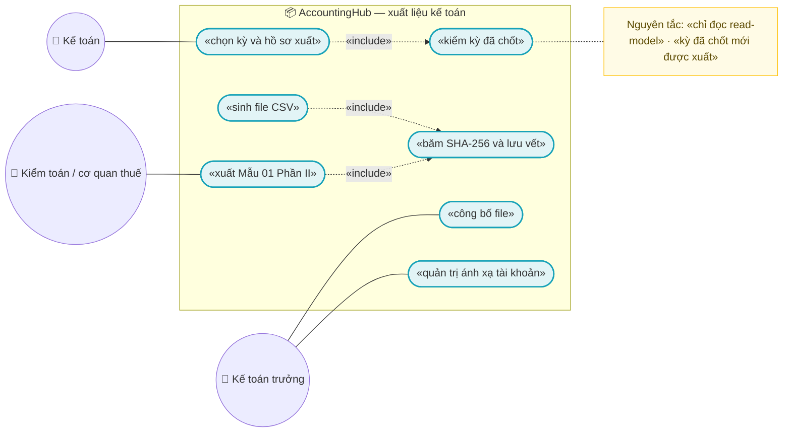
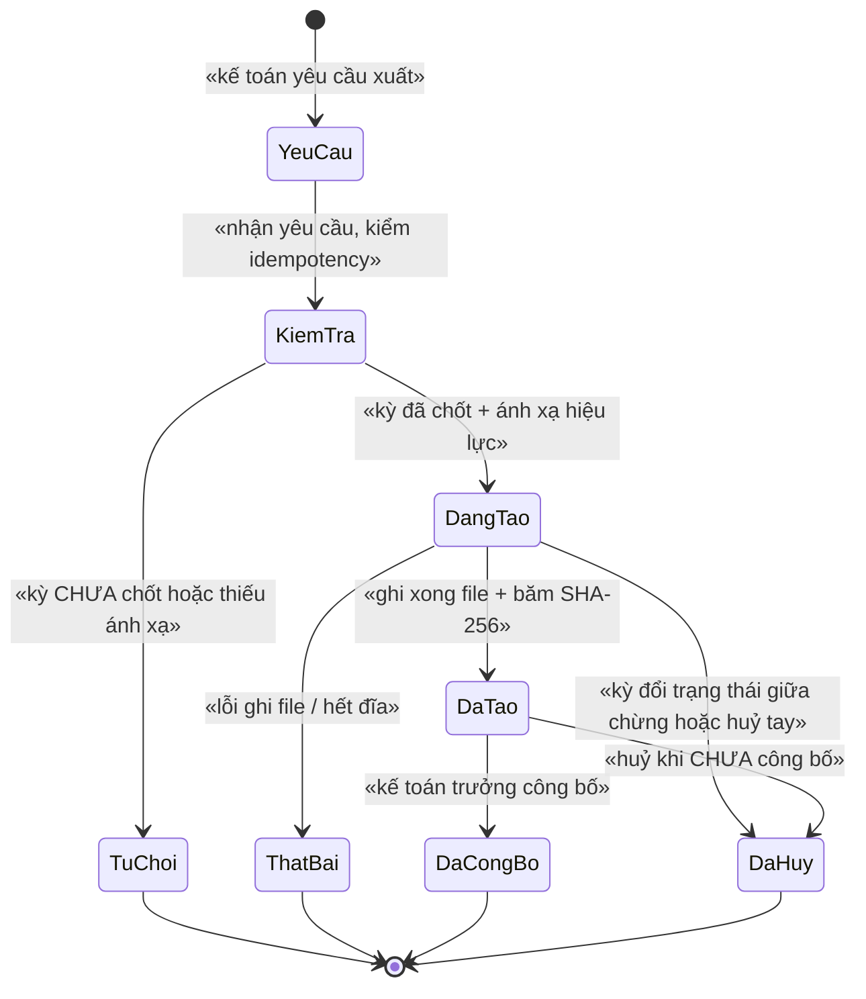
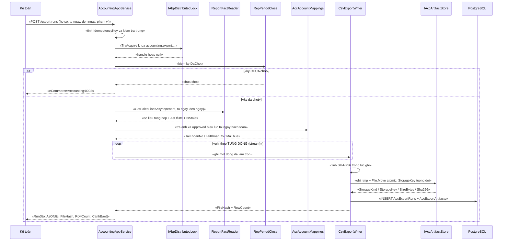

# `ACC-001` — Xuất liệu kế toán Excel/CSV

| Thuộc tính | Nội dung |
|---|---|
| **Mã** | `ACC-001` |
| **Module** | **AccountingHub** — khuôn mới `modules/AccountingHub/eCommerce.AccountingHub.*` |
| **Giai đoạn** | **GĐ3 — Điều hành** (`docs/implementation-plan.md:114`) |
| **Ưu tiên** | **Must have** — là một trong **6** tài liệu GĐ3 |
| **Trạng thái** | 🟡 `Draft` — chờ review |
| **Người viết / người review** | *(điền)* / **Kế toán trưởng + Kiến trúc trưởng** |
| **Phiên bản / ngày** | `v0.3 — 24/11/2026` (v0.1: 13/10/2026; v0.2: 24/11/2026) |
| **Tài liệu liên quan** | `REP-001` (read-model — **tài liệu nền bắt buộc**) · `REP-002` · `REP-003` · `PRC-001` (giá vốn — `D-186`) · `XC-001` (Money/làm tròn) · `XC-002` (outbox/inbox) · `XC-003` (khoá phân tán) · `XC-004` (phân quyền/tenant) · `XC-005` (log/metric) · `XC-006` (thuế GTGT + Mẫu 01) · `EINV-001` · `EINV-002` · `SAL-002` · `SAL-003` · `SHP-002` · `NOT-002` · `LOY-001` · `docs/implementation-plan.md` · `docs/structure-and-techstack.md` |

---

## 0. Tóm tắt & quyết định thiết kế

**Tóm tắt:** `ACC-001` chốt **cách hệ thống bàn giao số liệu cho kế toán** dưới dạng **file** (CSV trước, XLSX sau): ai được xuất, xuất **từ nguồn nào**, file gồm những cột gì, **bảo đảm gì** để kế toán tin được con số, và **lưu vết** ra sao khi cơ quan thuế/kiểm toán hỏi lại.

**Nguyên tắc gốc — điều quyết định toàn bộ thiết kế:** kế toán **không** nhận "số liệu sống". Kế toán nhận **một file bất biến, có băm (hash), gắn với một kỳ đã chốt**. Nếu lần xuất sau cho ra con số khác lần trước mà không ai giải thích được thì đó là **thảm hoạ giải trình**, không phải "báo cáo bị lệch".

**Vì sao phải có tài liệu này (yêu cầu đã chốt ở kế hoạch):**

| Nguồn | Yêu cầu nguyên văn |
|---|---|
| `docs/implementation-plan.md:215` | `AccountingHub` — xuất liệu kế toán **Excel/CSV trước** (Bravo/MISA công bố hỗ trợ), API sau. **DoD:** *"File xuất được kiểm tra bằng **1 kế toán thật**; có **test đối chiếu tổng**"* |
| `docs/implementation-plan.md:441` | `ACC-001` — Xuất liệu kế toán Excel/CSV |
| `docs/structure-and-techstack.md:78` | `AccountingHub/  B6  xuất liệu kế toán (Excel/CSV trước, API sau)  (P3)` |
| `docs/business-modules-proposal.md:94` | MISA/Bravo/Fast **không công bố spec .NET**; **Bravo chính thức hỗ trợ Excel/CSV** ⇒ `P3` |
| `docs/features/reporting/rep-001-read-model-job-tong-hop.md:59` | ❌ **Định dạng file xuất kế toán** (Excel/CSV, **ánh xạ tài khoản**, Mẫu 01) — **thuộc `ACC-001`**. `REP-001` **chỉ cấp số liệu** qua API |
| `docs/features/reporting/rep-001-read-model-job-tong-hop.md:746` | *"Đường 'ra ngoài' duy nhất là **file xuất kế toán**, và việc đó do `ACC-001` làm (dựa trên `IReportFactReader`)"* |
| `docs/features/cross-cutting/XC-006-phan-loai-thue-gtgt.md:549` | Hệ thống **phải xuất được dữ liệu Mẫu 01** (thuộc `EINV-001`/`ACC-001`) — do NĐ 174/2025 yêu cầu kê khai **Mẫu số 01 Phụ lục III** |

**Hiện trạng thật của code (đã kiểm bằng `read`/`grep`/`glob` trên repo `D:\Projects\Tools\eCommerce` — không viết theo trí nhớ):**

| Hạng mục | Hiện trạng | Bằng chứng |
|---|---|---|
| Module `AccountingHub` | ❌ **chưa có trong code** — `eCommerce.slnx` có 15 module (`Address`, `Customers`, `Sales`, `Pos`, `Reporting`, `Reconciliation`, `Inventory`, `Catalog`, `ChannelHub`, `EInvoice`, `Messaging`, `PaymentHub`, `Pricing`, `Signing`, `Tax`), **không** có `AccountingHub` | `eCommerce.slnx:2-84` |
| App service xuất file | ❌ **chưa có trong code** — `0` kết quả khi tìm `Export`, `IRemoteStreamContent` trên `*.cs` | `grep` toàn repo `*.cs` |
| **Thư viện Excel/CSV** | ❌ **chưa có gói nào** — `Directory.Packages.props` **0** gói `ClosedXML`/`EPPlus`/`CsvHelper`/`MiniExcel`/`OpenXml` | `Directory.Packages.props:21-99` |
| Module `Reporting` + read-model | 🔶 **một phần** — module + **4** bảng `Rpt*` (`RptFactSalesLines`, `RptFactInventorySnapshots`, `RptAggDailySales`, `RptWatermarks`) + worker đã có; **thiếu** `IReportFactReader`, `RepPeriodClose`, `RptChannelDailyPerformance`, `RptFactInvoiceLines` và cột giá vốn trên fact | `modules/Reporting/eCommerce.Reporting.Domain/BangSuKien/FactSalesLine.cs:17` · `BangSuKien/FactInventorySnapshot.cs:24` · `BangTongHop/AggDailySales.cs:19,103` · `modules/Reporting/eCommerce.Reporting.Application/ReportingAggregationWorker.cs:33` |
| **`IReportFactReader`** (hợp đồng đọc dòng chi tiết theo kỳ) | ❌ **chưa có** — `IReportAppService` chỉ **5** method **tổng hợp** cho UI, **không** có dòng chi tiết theo kỳ (`D-183`) | `modules/Reporting/eCommerce.Reporting.Application.Contracts/IReportAppService.cs:13-29` |
| **Giá vốn (`Pricing`)** | 🔶 **đường đọc có, đường ghi/động cơ chưa** — `CostPrice`/`PrcCostPrices` + duyệt đã có; `ICostPriceAppService` **2** method đọc; **chưa có** method hợp đồng mở rộng trả `(Amount, CurrencyCode \| null)` (`D-186`) | `modules/Pricing/eCommerce.Pricing.Domain/CostPrice.cs:36,68,114,121` · `modules/Pricing/eCommerce.Pricing.Application.Contracts/IPriceAppServices.cs:42,49,51` |
| **`Money`** (kernel) | ✅ **có** — `Money.Cua`, cộng/trừ/so sánh có kiểm loại tiền | `shared/eCommerce.Kernel/Money/Money.cs:23-45` |
| **Hàm tính Mẫu 01 (thuần)** | ✅ **có** — hàm thuần, không DI/DB, đã có test | `modules/Tax/eCommerce.Tax.Domain/Mau01/Mau01Part2Calculator.cs:58` · `test/eCommerce.Tests/Tax/Mau01Part2CalculatorTests.cs` |
| Chế độ cột (6) của Mẫu 01 | ✅ **có** — enum, kế toán trưởng đã chốt "Câu 1 = B" | `modules/Tax/eCommerce.Tax.Domain/Mau01/Mau01Column6Mode.cs:22-34` |
| Mã lỗi module Tax | ✅ **có** — 8 mã `eCommerce:Tax:0001…0008` | `modules/Tax/eCommerce.Tax.Domain/TaxErrorCodes.cs:13-34` |
| Bảng `TaxRateSchedules` / `TaxClassifications` | ✅ **có** (migration đã sinh) | `src/eCommerce.EntityFrameworkCore/eCommerceDbContext.cs:63-64` · `src/eCommerce.EntityFrameworkCore/Migrations/20261013012648_Add_Tax_Module.cs:48` |
| **Snapshot thuế trên dòng đơn** | ❌ **chưa có** — `OrderLine` chỉ có `UnitPrice`, `DiscountAmount`, `TaxAmount`; **không** có `TaxRate`/`TaxClassificationId` | `src/eCommerce.Domain/Entities/Orders/Order.cs:118-149` · `rep-001:1139` (F2) |
| Bảng hoá đơn điện tử | ❌ **chưa có trong code** — chỉ có đặc tả | `docs/features/einvoice/einv-001-phat-hanh-hoa-don-dien-tu.md:407-456` |
| Đăng ký permission | ✅ **có** khuôn — 6 nhóm permission | `src/eCommerce.Application.Contracts/Permissions/eCommercePermissionDefinitionProvider.cs:23-60` |
| `[Authorize]` cấp CLASS | ✅ **có** tiền lệ + đã ghi bài học | `src/eCommerce.Application/Channels/ChannelAppService.cs:22-28` |
| Registry metric | ✅ **có** — **16** metric (`eCommerceMetrics.cs:226`); test **không** đếm cứng số lượng, chỉ đối chiếu **tập tên thật** với `All` | `shared/eCommerce.Kernel/Observability/eCommerceMetrics.cs:81-107` · `test/eCommerce.Tests/Observability/MetricsTests.cs:39-46,70-74` |
| Hạ tầng lưu trữ | ⚠️ chỉ có **PostgreSQL 17 + Redis 7**; **0** object storage (S3/MinIO) | `docker-compose.yml:6-40` |
| Test tích hợp có DB thật | ✅ **có** — `Testcontainers.PostgreSql 4.16.0` + schema sinh từ migration thật | `test/eCommerce.IntegrationTests/eCommerce.IntegrationTests.csproj` · `test/eCommerce.IntegrationTests/PostgreSqlSchemaFixture.cs:31-38` |

⇒ 🔴 **Hệ quả:** `ACC-001` **viết mới hoàn toàn** (module + bảng + writer + API). **Tái dùng được**: `RptFactSalesLines`/`RptFactInventorySnapshots` (`FactSalesLine.cs:17` · `FactInventorySnapshot.cs:24`), `Mau01Part2Calculator`, `Money` (`Money.cs:23`), `eCommerceMetrics`, khuôn permission/worker — và **hợp đồng `IReportFactReader`** khai ở `modules/Reporting/eCommerce.Reporting.Application.Contracts` (**phải bổ sung** — `D-183`).

**Phạm vi:**

- ✅ **Hồ sơ xuất** (`AccExportProfiles`) — kế toán tự cấu hình đích xuất, dấu phân cách, kiểu số, bộ cột; **mọi** tham số định dạng là dữ liệu, seed đúng **1** hồ sơ `csv-generic` (`D-188`).
- ✅ **Ánh xạ tài khoản** (`AccAccountMappings`) — **dữ liệu** do kế toán trưởng quản trị, **có hiệu lực theo thời gian**, **append-only**; số hiệu là **chuỗi tự do** `varchar(32)`, chỉ **1** bản `Approved` hiệu lực, seed **0** dòng (`D-187`).
- ✅ **Nhật ký lần xuất** (`AccExportRuns`) + **tệp đã sinh** (`AccExportArtifacts`) — **append-only**, có `SHA-256`, lưu trên đĩa qua **một cổng** `IAccArtifactStore` (`D-190`).
- ✅ **Writer CSV** (không cần gói NuGet, GĐ3) — **0** gói NuGet; `FormatKind = Xlsx` và hồ sơ `htkk-mau01` **fail-closed** (`D-188`/`D-189`).
- ✅ **Xuất Mẫu 01 Phụ lục III — Phần II** dùng lại **đúng** `Mau01Part2Calculator` (không viết lại công thức).
- ✅ **Bất biến "xuất lại cho ra file y hệt"** khi cùng `RunId` (khớp băm).
- ✅ **Chỉ xuất trên kỳ đã chốt** (`RepPeriodClose` của `REP-001`) — nền tảng của tính bất biến.
- ✅ Khoá phân tán, idempotency ở mọi biên vào, cách ly tenant, phân quyền, metric, test.

**Không nằm trong phạm vi:**

- ❌ **Số liệu** (doanh thu, lãi gộp, tồn kho luân chuyển) — thuộc `REP-002`/`REP-003`. `ACC-001` **chỉ đọc** qua `IReportFactReader` (`D-183`); lãi gộp dùng `GrossMargin1Amount`/`GrossMargin2Amount` ở nguồn, **không** tính lại (`D-181`).
- ❌ **Chủ động cơ giá vốn** — bảng `PrcCostPrices` + đường ghi + duyệt + định giá bình quân gia quyền di động thuộc **Pricing/`PRC-001`**; `ACC-001` **chỉ tiêu thụ**, **cấm** ghi ngược (`D-186`, `D-177`).
- ❌ **Bút toán kép/sổ cái** — GĐ3 **chưa** có sổ cái kép, chỉ công nợ + xuất file (`D-03`).
- ❌ **Phí sàn thực tế** — GĐ3 **chưa có** nguồn settlement: `ChannelFeeActualAmount` **luôn `NULL`** + cờ `SettlementPending`, **cấm** ghi `0` thay "chưa biết" (`D-179`).
- ❌ **Chốt/mở kỳ kế toán** — thuộc `REP-001` §3.3 (`rep-001:220-241`).
- ❌ **Read-model & job tổng hợp** — thuộc `REP-001`. `ACC-001` **cấm** query bảng giao dịch.
- ❌ **Phát hành hoá đơn điện tử** — thuộc `EINV-001`. `ACC-001` chỉ **báo cáo tình hình sử dụng hoá đơn** khi `EINV-*` đã có (`einv-002:49`).
- ❌ **Định nghĩa luật phân loại thuế** — thuộc `XC-006`.
- ❌ **Ghi ngược vào module nguồn** — **cấm tuyệt đối** (kế thừa `rep-001:63`).
- ❌ **API đẩy dữ liệu sang Bravo/MISA** — giai đoạn sau (kế hoạch: *"Excel/CSV trước, API sau"* — `implementation-plan.md:215`).
- ❌ **`.xlsx` và mẫu HTKK/eTax ở GĐ3** — `FormatKind = Xlsx` là bước 2 (GĐ3.1) chỉ khi đủ 4 điều kiện; `htkk-mau01` **bị chặn**, chọn ⇒ `0013` (`D-188`/`D-189`).
- ❌ **Xoá artifact đã công bố** — mặc định **không xoá** (`Accounting.ArtifactRetentionMonths = 0`); bật cần kết luận `Q12` bằng văn bản + `D-xx` mới (`D-196`).
- ❌ **Tích hợp trao đổi dữ liệu với cơ quan thuế** — thuộc `EINV-002`.

### 0.1 Quyết định thiết kế (ADR ngắn)

| # | Quyết định | Phương án đã cân nhắc | Lý do chọn | Hệ quả |
|---|---|---|---|---|
| **ADR-01** | **`ACC-001` CHỈ đọc read-model qua `IReportFactReader`** — hợp đồng khai trong `modules/Reporting/eCommerce.Reporting.Application.Contracts`, cài đặt trên `Rpt*`, **in-process** (`[RemoteService(IsEnabled = false)]`), **không** mở endpoint HTTP mới, **không** thêm permission (`D-183`); **cấm** `IRepository<Rpt*>`, `Reporting.Domain` và query `OrdOrders`/`OrdOrderLines`/`InvStockLedger` ở phía `ACC-001` | (a) query thẳng bảng giao dịch cho "nhanh" · (b) đọc read-model | (a) **bị cấm** bởi `implementation-plan.md:213` (*"Không báo cáo nào query trực tiếp trên bảng giao dịch"*) và `rep-001:613`; `D-183` chốt **một** hợp đồng đọc, **một** chủ lưu vết. Ngoài ra query nặng theo kỳ 90 ngày sẽ **chặn** luồng bán hàng | Phụ thuộc `REP-001`. Nếu `REP-001` chưa xong ⇒ `ACC-001` **không thể** bắt đầu. Xuất file **không** làm chậm checkout |
| **ADR-02** | **Tách "tính số liệu" khỏi "ghi định dạng file"** — số liệu bằng **hàm thuần**, định dạng bằng lớp riêng | (a) vừa tính vừa ghi ra file · (b) tách hai tầng | Khuôn **đã có và đã chứng minh**: `Mau01Part2Calculator` là hàm thuần *"dùng chung cho mọi định dạng xuất (bảng số liệu, HTKK, eTax)"* (`Mau01Part2Calculator.cs:50-57`); `REP-003` D12 đã chốt cùng nguyên tắc (`rep-003:70`) | Đổi định dạng xuất (CSV → XLSX → HTKK) **không** đụng tới số liệu; số liệu **test được toàn bộ** không cần DB |
| **ADR-03** | **CSV là định dạng GĐ3** (cấu hình được); XLSX là **bước 2** (GĐ3.1), cần thêm **1 gói** vào `Directory.Packages.props` | (a) chỉ XLSX · (b) chỉ CSV · (c) CSV trước, XLSX sau | **`D-188`**: tham số định dạng là **dữ liệu** `AccExportProfiles`, seed **1** hồ sơ `csv-generic` (`;` · `,` · UTF-8 BOM · CRLF), **0** gói NuGet; XLSX chỉ khi đủ 4 điều kiện | GĐ3 giao **ngay** với CSV; `FormatKind = Xlsx` **fail-closed** `0013`, **0** artifact |
| **ADR-04** | 🔒 **"File nộp được luôn (HTKK/eTax)" CHƯA làm ở GĐ3** — GĐ3 giao **"bảng số liệu"** | (a) đoán định dạng HTKK rồi code · (b) **chờ file mẫu** | **`D-189`**: **cấm** dựng `.xls`/`.xlsx`/XML theo mẫu HTKK bằng suy đoán; chọn `htkk-mau01` ⇒ `0013` (dùng chung nhánh `D-188`), **0** artifact | Mở khoá chỉ khi có file mẫu thật + `D-xx` mới + P9 + golden-file; UI **không** hứa "nộp thẳng HTKK/eTax" |
| **ADR-05** | **Chỉ xuất trên kỳ `DaChot` của `REP-001`** | (a) cho xuất mọi kỳ · (b) chỉ kỳ đã chốt | `REP-001` D8: *"`ACC-001` xuất liệu cho kế toán ⇒ nếu lần xuất sau **khác** lần trước (do event đến muộn/rebuild) thì kế toán **không biết tin bản nào**, và việc giải trình thuế (`XC-006` BR-008) mất căn cứ"* (`rep-001:76`). Kỳ đã chốt ⇒ job **không ghi** vào khoảng ngày đó nữa ⇒ số liệu **đứng yên** | Xuất kỳ chưa chốt ⇒ **ném** `eCommerce:Accounting:0002`. Muốn xuất kỳ cũ đã chốt mà số đã đổi ⇒ phải **mở kỳ** (`eCommerce.Reporting.PeriodReopen`) — thao tác có **2 vai trò** + audit |
| **ADR-06** | **File sinh ra là BẤT BIẾN, lưu append-only, có `SHA-256`, lưu đĩa qua MỘT cổng** | (a) sinh lại file mỗi lần tải · (b) **lưu file + băm** | **`D-190`**: `Disk(0)` qua `IAccArtifactStore`, `RootPath` là Setting, ghi `.tmp` + `File.Move`, tải qua app service lọc `TenantId`. **`D-196`**: artifact công bố **append-only**; job chỉ xoá tạm/mồ côi; hạn lưu mặc định **`0` = TẮT** | **Cấm** sửa/xoá artifact; sai sót ⇒ run mới + `SupersedesRunId`. Hết đĩa ⇒ run `ThatBai`, **không** tự xoá chứng từ |
| **ADR-07** | **Ánh xạ tài khoản là DỮ LIỆU do kế toán trưởng quản trị, KHÔNG hard-code** | (a) hard-code `TK 511`/`TK 3331` trong code · (b) bảng dữ liệu có hiệu lực theo thời gian | **`D-187`**: seed **0** dòng; số hiệu **chuỗi tự do** `varchar(32)` (chỉ trim + ≤ 32, **cấm** quy tắc hình thức); chỉ `Approved` hiệu lực, thiếu ⇒ `0003` + **0 file**; `LegalBasisNote` bắt buộc khi duyệt (`0012`). Cùng bài học `XC-006` **D1** (*"danh mục là **DỮ LIỆU**, **KHÔNG hard-code**"*) | Cần bảng + UI + **duyệt** + **audit**. **Test bắt buộc:** `0` literal số hiệu tài khoản trong code nghiệp vụ |
| **ADR-08** | **Mọi số tiền đi qua `decimal`, làm tròn `AwayFromZero`, làm tròn theo TỪNG DÒNG** | (a) `double` · (b) làm tròn trên **tổng** | `XC-001` BR-008 cấm `double`; BR-005 chốt *"Thuế/VAT làm tròn **theo TỪNG DÒNG**; tổng đơn = **tổng các dòng đã làm tròn** (không làm tròn tổng)"* (`XC-001-money-currency-lam-tron.md:64`). Tiền lệ **đã có trong code**: `Mau01Part2Calculator.LamTron` dùng `AwayFromZero` 0 chữ số (`Mau01Part2Calculator.cs:106-107`) | ⚠️ `Σ` các dòng đã làm tròn **có thể khác** `Round(tổng chưa làm tròn)` **1–2 đồng** — UI/file **phải** hiện tổng = **tổng các dòng** (`XC-001-money-currency-lam-tron.md:330-332`) |
| **ADR-09** | 🔒 **Cấm so sánh tiền bằng `==`**; so theo **minor units** | (a) so `decimal` · (b) so `ToMinorUnits()` | `XC-001` D3 + BR-003: bài học eShop *"so `ActualTotalPrice == OriginalPaymentAmount` ⇒ **vỡ ngay** với VND/payOS khi lệch làm tròn"* (`XC-001-money-currency-lam-tron.md:41,64`). Kiểm tra "tổng file khớp số liệu" **phải** dùng hiệu số tuyệt đối so với `0`, không dùng `==` | Test đối chiếu tổng viết dạng `Assert.True(hiệuSo == 0m)` trên **giá trị đã chuẩn hoá**, không so hai `decimal` thô |
| **ADR-10** | **Múi giờ nghiệp vụ = `Asia/Ho_Chi_Minh`**; `FactDate` **không** lấy theo UTC | (a) dùng `UtcNow.Date` · (b) chuyển sang giờ VN | `REP-001` giả định #3: *"**Múi giờ nghiệp vụ duy nhất** là `Asia/Ho_Chi_Minh`. Nếu SAI: `FactDate` sẽ **lệch 1 ngày** cho đơn tạo gần nửa đêm ⇒ **sai kỳ thuế** (`XC-006` BR-008)"* (`rep-001:1152`) | Đơn tạo 23:30 giờ VN (16:30 UTC) **phải** nằm trong **đúng ngày VN**. Có test biên `23:59` / `00:01` |
| **ADR-11** | **Mọi entity cần `IRepository` ⇒ phải có `DbSet` trên `eCommerceDbContext` hợp nhất** | (a) DbContext riêng cho AccountingHub · (b) `DbSet` trên DbContext chung | `AddDefaultRepositories(includeAllEntities: true)` **chỉ** tạo `IRepository<T>` cho entity **có `DbSet`** — lỗi này **đã gặp thật** với `ChannelShop` (runtime: *"The requested service 'IRepository<ChannelShop, Guid>' has not been registered"*) | Phải khai `DbSet` cho **mọi** entity của `AccountingHub`. Module **không** tham chiếu DbContext của app — giữ nguyên khuôn `Tax` |
| **ADR-12** | **Module tự sở hữu hằng số của mình** (mã lỗi, khoá lock) — **khoá lock KHÔNG chứa tiền tố `ecommerce:`** | (a) dùng `eCommerceConsts` của app · (b) consts riêng của module | (a) **vi phạm** quy ước bất biến #3 (*"module gọi app **BỊ CẤM**"*) — tiền lệ `TaxErrorCodes.cs:6-8`: *"Module tự sở hữu hằng số của mình — giống cách `ChannelHubConsts` tự sở hữu lock key"*. Về **tiền tố**: `XC-003` §5.4 hệ quả #2 — *"**Tên khoá do module sinh KHÔNG chứa tiền tố** ... nếu không sẽ thành **tiền tố đôi**"* (`XC-003-khoa-phan-tan-quy-uoc.md:255-256`) | Khoá của `AccountingHub` sinh ra dạng `accounting:...` (không tiền tố). ✅ Kiểm lại 24/11/2026: `TaxLockKeys.*` và `eCommerceConsts.LockKeys.InventorySku` **không** chứa tiền tố — code đã đúng (xem **F1** §15.2) |
| **ADR-13** | **Chỉ ghi nhận doanh thu khi đơn đã được XÁC NHẬN, không theo webhook thô** | (a) tin webhook `Delivered` · (b) đối soát chủ động rồi mới ghi | `SHP-002`: webhook là **gợi ý**, không phải sự thật; GHTK **không có HMAC**. Yêu cầu nguyên văn: *"🔴 `EINV-001`/`ACC-001`: **cấm** lập chứng từ/ghi nhận doanh thu chỉ dựa vào webhook `Delivered`; **bắt buộc** có `ConfirmedAtUtc` (BR-004)"* (`shp-002:662`). `ShipmentDeliveredEto` *"kèm cờ `ConfirmedAtUtc` — consumer **phải** kiểm"* (`shp-002:633`) | Xuất liệu **chỉ** gồm đơn có `ConfirmedAtUtc`. Nếu không, số doanh thu **có thể bị thổi phồng do webhook giả mạo** ⇒ kê khai thừa thuế. ⚠️ `SHP-002` **Q6** còn `Open` (`shp-002:1054`) |
| **ADR-14** | **Idempotency ở MỌI biên vào** (yêu cầu API xuất + tiêu thụ ETO + job định kỳ) | (a) chỉ chống trùng ở API · (b) mọi biên vào | Quy ước bất biến của dự án + `XC-002` BR-004. `REP-003` §7.5 đã làm mẫu cho **5** biên vào (`rep-003:547-554`). *"Khoá idempotency ở mọi biên vào (chống gửi trùng thông báo)"* | Mỗi biên vào có **khoá idempotency** + **hàng rào DB** (unique index). Redis chết ⇒ DB vẫn chặn (`XC-003` D2) |
| **ADR-15** | **Giá vốn & phí sàn: CHỈ TIÊU THỤ, không sở hữu động cơ** | (a) `ACC-001` tự tính/ghi giá vốn · (b) đọc từ read-model + hợp đồng module sở hữu | `D-186`: chủ = **Pricing/`PRC-001`**, **chỉ** Pricing ghi `PrcCostPrices`; tra cứu bổ sung **chỉ** qua **một** method hợp đồng mở rộng **additive** của `ICostPriceAppService` trả `(Amount, CurrencyCode \| null)` theo `(Sku, ngày hiệu lực)`, **chỉ** dòng `DaDuyet = true` (`IPriceAppServices.cs:42`). `D-177`: thiếu giá vốn ⇒ `CostUnitAmount = NULL` + `CostMissing = true`, **cấm `0`**; `D-179`: `ChannelFeeActualAmount` **luôn `NULL`** + `SettlementPending`, **cấm `0`** | Không có bảng/động cơ giá vốn trong `AccountingHub`; thiếu nguồn ⇒ ô **rỗng** + cờ; hồ sơ yêu cầu số **chưa có nguồn** ⇒ chặn `0011`. **`D-195`**: GĐ3 **0** dòng giá vốn — §6.4 giữ **18** cột, không cột giá vốn/cờ `CostMissing`; mở lại cần `D-xx` mới |

---

## 1. Use Case Specification

| Thuộc tính | Nội dung |
|---|---|
| **Use Case ID** | `ACC-001` |
| **Use Case Name** | Bàn giao số liệu kế toán dưới dạng file **bất biến, có kiểm chứng** |
| **Description** | *"Là kế toán, tôi muốn xuất số liệu của một kỳ đã chốt ra file (CSV/Excel) theo đúng bộ cột mà phần mềm kế toán của tôi nhận được, để tôi nhập vào Bravo/MISA/HTKK và **giải trình được với cơ quan thuế** — và để **lần xuất sau không cho ra con số khác** lần trước mà không ai giải thích được."* |
| **Actor(s)** | **Kế toán** (yêu cầu xuất, tải file) · **Kế toán trưởng** (duyệt ánh xạ tài khoản, công bố file) · **Hệ thống** (sinh file, băm, lưu vết) · **Kiểm toán / cơ quan thuế** (gián tiếp — đối chiếu file đã công bố) |
| **Priority** | **Must have** |
| **Trigger** | (a) đến kỳ lập tờ khai/quyết toán; (b) kế toán trưởng chốt kỳ ở `REP-001` ⇒ có nhu cầu lấy số liệu ra; (c) yêu cầu cung cấp số liệu cho kiểm toán |
| **Pre-Condition(s)** | • **Tenant hiện tại** (`TenantId` từ `ICurrentTenant`) — `XC-004` BR-009.<br>• **Kỳ đã `DaChot`** ở `RepPeriodClose` của `REP-001` (`rep-001:220-241`) — **bắt buộc** (ADR-05).<br>• **Read-model đã có số liệu** cho khoảng ngày (watermark không `IsStale`) — `rep-001:626-637`.<br>• **Ánh xạ tài khoản hiệu lực** tại ngày hạch toán — đúng **một** bản `Status = Approved` cho mỗi `SourceKind` (ADR-07; `D-187`).<br>• `<ChannelCode>` **chỉ** để đối soát/phân nhóm, **không** tham gia quyết định tài khoản — kế thừa `XC-006` §1 (*"thuế theo hàng hoá, không theo kênh bán"*). |
| **Post-Condition(s)** | • Sinh **1 hoặc nhiều** artifact bất biến, mỗi artifact có `SHA-256`.<br>• `AccExportRuns` có **đúng 1** dòng cho một `IdempotencyKey`.<br>• Mọi lần xuất **có dấu vết**: `RequestedBy`, `RequestedAtUtc`, kỳ, `AsOfUtc`, `RowCount`, `FileHash`, `CorrelationId` (`XC-005`).<br>• **Tổng trên file khớp số liệu read-model, lệch 0 đồng** (ADR-08/ADR-09). |
| **Basic Flow** | 1. Kế toán mở **màn hình Xuất liệu kế toán**, chọn **hồ sơ xuất** + **kỳ** (Từ ngày/Đến ngày) + phạm vi (`DoanhThu` / `HoaDon` / `Mau01PhanII` / `PhiGuiTin`).<br>2. Hệ thống kiểm tra: kỳ **đã chốt**; `IsStale` **không** bật; ánh xạ tài khoản **`Approved`** hiệu lực cho khoảng ngày; hồ sơ dùng **`FormatKind` đã hỗ trợ** (`Csv`).<br>3. Hệ thống tạo `AccExportRun` trạng thái `YeuCau`→`KiemTra`→`DangTao` (idempotency: khoá đã tồn tại ⇒ **trả lại run cũ**, không tạo mới).<br>4. Hệ thống đọc số liệu qua `IReportFactReader`, áp **ánh xạ tài khoản**, ghi file **theo từng dòng** (stream, không nạp cả kỳ vào bộ nhớ).<br>5. Hệ thống tính `SHA-256`, ghi `AccExportArtifacts`, chuyển run sang `DaTao`.<br>6. Kế toán trưởng **công bố** ⇒ `DaCongBo` (bất biến, đã ghi audit).<br>7. Kế toán tải file; UI hiển thị **`AsOfUtc` + `FileHash` + `RowCount`** để đối chiếu. |
| **Alternative Flow** | **A1: Kỳ chưa chốt** ⇒ hệ thống **không** cho xuất; hiện thông điệp **chỉ rõ** kỳ và **hướng dẫn** *"vào Reporting để chốt kỳ"* (không chỉ báo "không thể xuất").<br>**A2: Xuất lại y hệt** (cùng tham số) ⇒ **trả lại run cũ** + artifact cũ, **không** sinh file mới ⇒ kế toán **luôn** nhận đúng một con số.<br>**A3: Số liệu đã công bố bị sai** ⇒ **cấm** sửa artifact; sinh **run mới** có `SupersedesRunId` + **lý do ≥ 20 ký tự** + audit (khuôn `ReopenPeriodAsync`, `rep-001:611`).<br>**A4: Kế toán cần cột khác** ⇒ sửa **hồ sơ xuất** (`AccExportProfiles`), **không** sửa code.<br>**A5: Cần file nộp thẳng HTKK/eTax** ⇒ ⚠️ **CHƯA LÀM** ở GĐ3 (ADR-04) — chờ **file mẫu HTKK**; hiện giao "bảng số liệu". |
| **Exception Flow** | **E1:** kỳ **chưa chốt** ⇒ `BusinessException` `eCommerce:Accounting:0002` (`409`).<br>**E2:** **không** có ánh xạ `Status = Approved` hiệu lực cho một `SourceKind` ⇒ `eCommerce:Accounting:0003`, **0 file** — **không** tự đoán tài khoản, **không** dùng bản `Draft` (`D-187`).<br>**E3:** read-model trả `IsStale = true` (ngưỡng là Setting `Reporting:StaleSeconds` của `REP-001`, mặc định **900 s**) ⇒ `eCommerce:Accounting:0004` (`409`) kèm `lagSeconds`, **0 artifact**; Setting trống/sai/≤ 0 ⇒ dùng 900, **cấm** tắt kiểm (`D-194`).<br>**E4:** lỗi ghi file/đĩa đầy ⇒ run `ThatBai` + `ErrorCode` + metric; **không** để lại artifact dở dang (xoá file `.tmp`).<br>**E5:** yêu cầu xuất **trùng** đang chạy ⇒ trả run **đang chạy** (`409` + `RunId`) hoặc chờ khoá — **không** tạo 2 file.<br>**E6:** mở/khoá kỳ **đổi giữa chừng** ⇒ phát hiện khi ghi ⇒ **huỷ** run + `eCommerce:Accounting:0005`.<br>**E7:** hồ sơ dùng `FormatKind = Xlsx` hoặc `htkk-mau01` (chưa hỗ trợ ở GĐ3) ⇒ **ném** `eCommerce:Accounting:0013` "định dạng chưa hỗ trợ", **0 artifact**, **0** run `DaCongBo` (`D-188`/`D-189`). |
| **Business Rules** | • **BR-01**: Mọi số liệu xuất ra **phải** lấy từ **read-model** qua `IReportFactReader`; **cấm** query bảng giao dịch, **cấm** `IRepository<Rpt*>`/`Reporting.Domain` (`D-183`).<br>• **BR-02**: **Chỉ** xuất được kỳ có `RepPeriodClose.Status = DaChot`; kỳ chưa chốt ⇒ **ném** `0002`.<br>• **BR-03**: Mọi lần xuất **phải** lưu vết **append-only**: ai · khi nào · kỳ · hồ sơ · `RowCount` · `FileHash` · `AsOfUtc` · `CorrelationId`; mỗi lần tải ghi audit ABP + **đúng một** dòng `[ACC-DOWNLOAD]` (`RunId`/`ArtifactId`/`Sha256`/`SizeBytes`/`UserId`/`CorrelationId`), **0** PII (`D-192`).<br>• **BR-04**: Artifact đã `DaCongBo` **bất biến**; **cấm** sửa/xoá; hạn lưu = Setting `Accounting.ArtifactRetentionMonths` mặc định **`0` = TẮT** (không xoá), job dọn **chỉ** xoá file tạm/mồ côi (`D-190`/`D-196`); thay đổi ⇒ run mới + `SupersedesRunId` + lý do.<br>• **BR-05**: Xuất **cùng tham số** ⇒ **cùng** file (khớp `FileHash`); **cấm** sinh artifact mới cho cùng `IdempotencyKey`; tải về **đúng byte** đã băm, **cấm** bọc/gia cố (`D-192`).<br>• **BR-06**: Mọi số tiền dùng `decimal`; **cấm** `double`/`float`; **cấm** so `==` trên tiền (so hiệu số tuyệt đối).<br>• **BR-07**: Thuế & tiền **làm tròn theo TỪNG DÒNG**, `AwayFromZero`, theo số chữ số thập phân của hồ sơ; tổng = **tổng các dòng đã làm tròn**.<br>• **BR-08**: **Bất biến tổng:** `Σ tiền thuế theo từng mức thuế suất == tổng cộng tiền thuế` (`XC-001` BR-010) và `TongThanhToan == (ThanhTienChuaThue − ChietKhau) + TienThue` — **net sau chiết khấu**, không phải thành tiền gộp (`XC-001` BR-011).<br>• **BR-09**: **Cấm hard-code** số hiệu tài khoản / mã mức thuế / tên cột / dấu phân cách / định dạng trong code nghiệp vụ — **tất cả** là dữ liệu (`AccAccountMappings`, `AccExportProfiles`, `D-188`). Số hiệu tài khoản là **chuỗi tự do** `varchar(32)`: chỉ trim khác rỗng + ≤ 32, **cấm** quy tắc hình thức; duyệt ánh xạ **bắt buộc** `LegalBasisNote` (`0012`); chỉ bản `Approved` hiệu lực, thiếu ⇒ `0003` + **0 file** (`D-187`). Hồ sơ chưa có writer ⇒ `0013` (`D-188`/`D-189`).<br>• **BR-10**: `FactDate`/ngày hạch toán theo **`Asia/Ho_Chi_Minh`**; **cấm** dùng `UtcNow.Date`.<br>• **BR-11**: **Chỉ** ghi nhận doanh thu cho đơn đã **xác nhận** (`ConfirmedAtUtc`); **cấm** dựa vào webhook thô (ADR-13).<br>• **BR-12**: Mọi biên vào **phải** idempotent (khoá + unique index DB); Redis chết ⇒ DB **vẫn** chặn.<br>• **BR-13**: Cách ly tenant tuyệt đối: file của tenant A **không** chứa **1 dòng** nào của tenant B; tải file **phải** lọc `TenantId` trên **dòng** `AccExportArtifacts` **trước khi** mở file, `StorageKey` **không** lộ ra API (`D-190`).<br>• **BR-14**: Mặc định file **0 PII** — chỉ số liệu tổng + `SoChungTu`/`SoDonHang`; **duy nhất** `Scope.HoaDon` được đúng 2 cột `TenNguoiMua`/`MstNguoiMua`, bật theo hồ sơ + permission `Export.BuyerPii` + cờ `ContainsBuyerPii` + audit; **cấm** SĐT/email/CCCD/địa chỉ; **cấm** PII trong ETO/log/metric/DTO; nguồn buyer chỉ từ `GetInvoiceLinesAsync`, thiếu ⇒ ô rỗng + cảnh báo, **cấm** bịa (căn cứ hồ sơ **P7** + `R3-5`/NĐ 13/2023 — **không** kết luận "đã tuân thủ", `D-191`).<br>• **BR-15**: **Cấm** `ACC-001` sở hữu/tính/ghi giá vốn: số giá vốn **chỉ** lấy từ read-model (`CostUnitAmount`/`CostMissing`, `D-177`); GĐ3 **0** dòng giá vốn (`D-195`); **cấm** query `PrcCostPrices`/`Pricing.Domain`.<br>• **BR-16**: Phí sàn GĐ3 **chỉ** có phí **dự kiến** + `SettlementPending`; `ChannelFeeActualAmount` **luôn** `NULL`, **cấm** ghi `0`; hồ sơ yêu cầu phí **thực tế** ⇒ chặn `0011` (`D-179`).<br>• **BR-17**: **Fail-closed khi không chắc chắn:** `IsStale = true` hoặc không đọc được `AsOfUtc` ⇒ `0004`; `FormatKind`/hồ sơ chưa hỗ trợ ⇒ `0013`; mọi nhánh này **0 artifact**, **không** xuất số 0 thay "chưa biết" (`D-188`/`D-189`/`D-194`).<br>• **BR-18**: **Huỷ run** chỉ khi **chưa công bố**: `DangTao` bị huỷ khi kỳ đổi trạng thái giữa chừng (E6) ⇒ `DaHuy` + `0005`; `DaTao` huỷ tay cần lý do **≥ 10 ký tự** lưu `CancelReason` (thiếu ⇒ `0007`); `DaCongBo` **cấm** huỷ (⇒ `0008`); supersede **bắt buộc** lý do **≥ 20 ký tự** lưu `SupersedeReason`. |
| **Non-Functional Requirement** | • **NFR-01**: Xuất **50.000** dòng ⇒ **< 30 s** (p95, máy dev).<br>• **NFR-02**: Bộ nhớ đỉnh khi xuất 50.000 dòng **< 200 MB** (ghi theo **stream**, không nạp cả kỳ).<br>• **NFR-03**: **Đối chiếu tổng lệch 0 đồng** trên mẫu **1.000** dòng (DoD của `implementation-plan.md:215`).<br>• **NFR-04**: Xuất lại cùng tham số ⇒ `FileHash` **giống hệt** (**100 %**).<br>• **NFR-05**: Xử lý lại **1.000** lần cùng `IdempotencyKey` ⇒ **đúng 1** artifact.<br>• **NFR-06**: **0** literal số hiệu tài khoản trong code nghiệp vụ (test quét mã nguồn).<br>• **NFR-07**: **3** instance chạy song song ⇒ **0** artifact trùng, tổng **bằng** chạy 1 instance.<br>• **NFR-08**: Cách ly tenant: tenant A **không** thấy **1** dòng/dòng file nào của tenant B.<br>• **NFR-09**: **100 %** lần xuất có `CorrelationId` + dòng `AccExportRuns`; mọi thất bại có metric + log ≥ `Warning`.<br>• **NFR-10**: File **mở được** bằng Excel/LibreOffice **không** hỏng dấu tiếng Việt (kiểm bằng file mẫu, xem §6.4). |

---

## 2. Sơ đồ Use Case



---

## 3. Sơ đồ trạng thái (state machine)



**Bảng chuyển trạng thái & guard (mọi chuyển sai **phải ném lỗi**, không im lặng — kế thừa `XC-006` §3 và `XC-003` BR-010):**

| Từ | Sang | Guard | Nếu vi phạm |
|---|---|---|---|
| `[*]` | `YeuCau` | Có quyền `eCommerce.Accounting.Export.Request`; `FromDate <= ToDate` | `403` |
| `YeuCau` | `KiemTra` | `IdempotencyKey` **chưa** tồn tại **hoặc** run cũ đã kết thúc | Trả **run cũ** (A2) — **không** tạo mới |
| `KiemTra` | `TuChoi` | Kỳ **không** `DaChot` **hoặc** thiếu ánh xạ `Approved` hiệu lực **hoặc** `IsStale` **hoặc** hồ sơ yêu cầu nguồn **chưa có** ở GĐ3 (phí sàn thực tế) **hoặc** định dạng/hồ sơ chưa hỗ trợ | `BusinessException` `0002`/`0003`/`0004`/`0011`/`0013` |
| `KiemTra` | `DangTao` | Giành được **khoá phân tán** (ADR-12) | Không giành được ⇒ **ném** `eCommerce:Lock:0001` (kế thừa `XC-003`) |
| `DangTao` | `DaTao` | Ghi **đủ** artifact + tính `FileHash` + `Σ` dòng khớp số liệu | Lệch tổng ⇒ **huỷ** artifact + **ném** `0006` (**không** công bố file sai) |
| `DangTao` | `ThatBai` | Lỗi I/O (đĩa đầy, mất kết nối) | Ghi `ErrorCode`, metric, log `Error`; **xoá** file `.tmp` — **không** tự xoá chứng từ để "chạy tiếp" (`D-190`) |
| `DangTao` | `DaHuy` | Kỳ **đổi trạng thái** giữa chừng (E6, §8.2 #5) **hoặc** người huỷ có quyền `eCommerce.Accounting.Export.Request`; lý do ≥ 10 ký tự lưu `CancelReason` | Không đủ điều kiện ⇒ giữ `DangTao`; huỷ tay thiếu lý do ⇒ `0007` |
| `DaTao` | `DaCongBo` | Có quyền `eCommerce.Accounting.Export.Publish` | `403` |
| `DaTao` | `DaHuy` | Người yêu cầu **hoặc** kế toán trưởng; lý do ≥ 10 ký tự (lưu `CancelReason`) | Thiếu lý do ⇒ `0007` |
| `DaCongBo` | *bất kỳ* | — | 🔒 **CẤM** — artifact đã công bố **bất biến**; muốn thay ⇒ run mới + `SupersedesRunId` + lý do ≥ 20 ký tự (lưu `SupersedeReason`, `0008`) |
| `ThatBai`/`TuChoi`/`DaHuy` | `[*]` | — | — |

> ⚠️ **Vì sao `DaCongBo` là trạng thái "chết":** file đã công bố là **chứng từ đối chiếu** với cơ quan thuế/kiểm toán.
> Nếu cho sửa tại chỗ thì **không còn gì để đối chiếu** — đúng lớp lỗi mà `REP-001` D8 (`rep-001:76`) và `REP-003` §7.5 (`rep-003:554`) đã cảnh báo.
> Sửa sai sót ⇒ **run mới** và **giữ** run cũ để giải trình "đã sửa cái gì, vì sao".

---

## 4. Sequence Diagram & luồng dữ liệu

### 4.1 Xuất một kỳ — từ yêu cầu tới file có băm



### 4.2 Luồng dữ liệu — vì sao `ACC-001` **không** chạm DB giao dịch

| Bước | Việc | Nguồn | Ghi chú |
|---|---|---|---|
| 1 | Job tổng hợp nuôi read-model | `REP-001` (sự kiện + đối chiếu) | `rep-001:50-51` |
| 2 | Kế toán trưởng **chốt kỳ** ⇒ số liệu **đứng yên** | `RepPeriodClose` | `rep-001:220-241` |
| 3 | `ACC-001` đọc số qua `IReportFactReader` (hợp đồng của **Reporting**, in-process — `D-183`) | **read-model** | `rep-001:613` — **cấm** query bảng giao dịch |
| 4 | Áp **ánh xạ tài khoản** `Approved` đang hiệu lực (thiếu ⇒ `0003`, **0 file**) | `AccAccountMappings` | ADR-07, `D-187` |
| 5 | Ghi file **stream** + băm qua `IAccArtifactStore` (đĩa, `RootPath` là Setting) | Writer + Store | ADR-02, `D-190` |
| 6 | Lưu vết append-only | `AccExportRuns` + `AccExportArtifacts` | ADR-06 |
| 7 | **Cấm** ghi ngược về module nguồn | — | kế thừa `rep-001:63` |

> 📌 **Vì sao tách hai tầng (số liệu / định dạng) lại quan trọng ở đây:** mục tiêu cuối của kế toán là **file nộp được luôn**
> cho HTKK/eTax (ADR-04), nhưng **định dạng** đó do **phần mềm thuế** quyết định và **đổi theo phiên bản**.
> Nếu trộn công thức vào writer thì mỗi lần HTKK nâng cấp phải **sửa lại số liệu** — sai lầm tốn kém nhất.
> `Mau01Part2Calculator` đã được thiết kế **chính xác** để tránh điều này (`Mau01Part2Calculator.cs:50-57`).

---

## 5. Mô hình dữ liệu

### 5.1 Bảng đăng ký định dạng xuất (export format registry)

**Nguồn sự thật duy nhất về định dạng.** Mọi writer **phải** nằm trong bảng này (khuôn tư duy giống **bảng đăng ký metric** `XC-005` §5.1 và **bảng đăng ký khoá** `XC-003` §5).

| Mã hồ sơ | Định dạng | Gói NuGet cần | Trạng thái | Ghi chú |
|---|---|---|---|---|
| `csv-generic` | CSV cấu hình được: **`;`** · thập phân **`,`** · **UTF-8 BOM** · **CRLF** · **không** dấu nghìn | **Không cần** | ✅ **GĐ3 — seed DUY NHẤT** | `D-188`; mở trực tiếp bằng Excel/LibreOffice; đổi định dạng = **sửa hồ sơ** |
| `csv-bravo` | CSV (dấu/kiểu số theo hồ sơ) | **Không cần** | ⚠️ **chưa kiểm chứng — KHÔNG seed** | `D-188` (3): là **dữ liệu do kế toán tạo** khi có file thật; **cấm** đánh dấu "đã xác minh" |
| `csv-misa` | CSV (dấu/kiểu số theo hồ sơ) | **Không cần** | ⚠️ **chưa kiểm chứng — KHÔNG seed** | như trên |
| `xlsx-generic` | XLSX (OOXML) | Có — phải thêm **1 dòng** `PackageVersion` | ⛔ **chưa có ở GĐ3** → chọn ⇒ `0013` | GĐ3.1 chỉ khi đủ **4** điều kiện của `D-188` (5) |
| `htkk-mau01` | XLSX/XLS **theo mẫu HTKK** | Có | ⛔ **BỊ CHẶN** — chọn ⇒ `0013` | `D-189`: **0** writer/hồ sơ, **cấm** dựng file theo mẫu bằng suy đoán; `xlsx-generic` **không** mở khoá hồ sơ này |

> 🔒 **GĐ3 chỉ có CSV** (`D-188`): một hàm ghi thuần RFC 4180 (bọc/nhân đôi `"`, BOM **một lần**, `CRLF`, không dòng trống cuối, byte **tất định**), **0** gói NuGet; mọi tham số là dữ liệu `AccExportProfiles`; `Xlsx`/`htkk-mau01` ⇒ fail-closed `0013`, **0** artifact (`D-189`).

### 5.2 Data Dictionary

**Bảng `AccExportProfiles`** — *hồ sơ xuất do kế toán cấu hình; **dữ liệu**, không hard-code*

| Cột | Kiểu | Null? | Ý nghĩa | Ghi chú |
|---|---|---|---|---|
| `Id` | `uuid` | ✖ | khoá chính | |
| `TenantId` | `uuid` | ✖ | tenant | bắt buộc vì entity là `IMultiTenant` (`XC-004` BR-009) |
| `Code` | `varchar(32)` | ✖ | mã hồ sơ (`csv-generic`, `csv-bravo`…) | **unique** theo tenant |
| `Name` | `varchar(128)` | ✖ | tên hiển thị | |
| `FormatKind` | `int` | ✖ | `Csv=0`, `Xlsx=1` | `Xlsx` **fail-closed** ở GĐ3 ⇒ `0013` (`D-188`) |
| `Delimiter` | `varchar(4)` | ✖ | mặc định `;` | dữ liệu, **không** literal trong code (`D-188`) |
| `DecimalSeparator` | `varchar(4)` | ✖ | mặc định `,` | ⚠️ Excel vi-VN cần `,` (`D-188`) |
| `Encoding` | `varchar(32)` | ✖ | `utf-8-bom` \| `utf-8` | mặc định `utf-8-bom`; **không BOM ⇒ mất dấu tiếng Việt** (NFR-10) |
| `MoneyDecimals` | `int` | ✖ | số chữ số thập phân của tiền | Cấu hình; **không** hard-code (ADR-08) |
| `ColumnSetJson` | `jsonb` | ✖ | danh sách cột + thứ tự + tiêu đề | 🔒 **Cấm** cột ngoài **allowlist** (§5.4) |
| `IsActive` | `bool` | ✖ | đang dùng | |

**Bảng `AccAccountMappings`** — ***đây là chỗ kế toán trưởng quyết định*** (ADR-07); **append-only, có version**

| Cột | Kiểu | Null? | Ý nghĩa | Ghi chú |
|---|---|---|---|---|
| `Id` | `uuid` | ✖ | khoá chính | |
| `TenantId` | `uuid` | ✖ | tenant | |
| `SourceKind` | `int` | ✖ | `Revenue=0`, `Discount=1`, `ShippingFee=2`, `ChannelFee=3`, `OutputTax=4`, `ReducedTaxDiff=5`, `LoyaltyDiscount=6`, `NotificationCost=7` | tập **ĐÓNG** — xem §5.5 |
| `DebitAccount` | `varchar(32)` | ✖ | tài khoản **Nợ** — **chuỗi tự do** | chỉ kiểm trim khác rỗng + độ dài ≤ 32; **cấm** quy tắc hình thức (`D-187`) |
| `CreditAccount` | `varchar(32)` | ✖ | tài khoản **Có** — **chuỗi tự do** | như trên; **cấm** hard-code |
| `TaxRateCode` | `varchar(32)` | ✔ | mã mức thuế | tra `TaxRateSchedules.Code` (`modules/Tax/eCommerce.Tax.Domain/RateSchedules/TaxRateSchedule.cs`) |
| `EffectiveFrom` / `EffectiveTo` | `date` | ✖ / ✔ | hiệu lực | **không** chồng khung (kế thừa `XC-006` BR-009) |
| `LegalBasisNote` | `varchar(512)` | ✔ | căn cứ (thông tư, quyết định) | **bắt buộc khi duyệt** `Approved`; rỗng ⇒ `0012` (`D-187`) |
| `Status` | `int` | ✖ | `Draft=0`, `Approved=1`, `Superseded=2`, `Expired=3`, `Cancelled=4` | **chỉ `Approved`** hiệu lực tại ngày hạch toán (kế thừa `XC-006` §3) |
| `ApprovedBy` / `ApprovedAtUtc` | `uuid` / `timestamptz` | ✔ | ai duyệt · khi nào | |
| `Version` | `int` | ✖ | phiên bản | append-only |

**Bảng `AccExportRuns`** — *nhật ký mỗi lần xuất; **append-only***

| Cột | Kiểu | Null? | Ý nghĩa | Ghi chú |
|---|---|---|---|---|
| `Id` | `uuid` | ✖ | khoá chính | |
| `TenantId` | `uuid` | ✖ | tenant | |
| `ProfileId` | `uuid` | ✖ | hồ sơ xuất | FK nội bộ module |
| `Scope` | `int` | ✖ | `DoanhThu=0`, `HoaDon=1`, `Mau01PhanII=2`, `PhiGuiTin=3` | tập **ĐÓNG** |
| `PeriodFrom` / `PeriodTo` | `date` | ✖ | kỳ xuất | **bắt buộc tường minh** — **cấm** khoảng mở (kế thừa `REP-001` D10, `rep-001:78`) |
| `Status` | `int` | ✖ | theo §3 | |
| `IdempotencyKey` | `varchar(256)` | ✖ | khoá chống trùng | **unique** theo tenant |
| `RequestedBy` / `RequestedAtUtc` | `uuid` / `timestamptz` | ✖ | ai · khi nào | |
| `AsOfUtc` | `timestamptz` | ✔ | **tuổi dữ liệu** tại lúc xuất | kế thừa `REP-001` D7 (`rep-001:75`) |
| `RowCount` | `bigint` | ✔ | số dòng đã ghi | |
| `TotalNet` / `TotalTax` / `TotalGross` | `numeric(18,4)` | ✔ | tổng kiểm chứng | **bất biến** BR-08 |
| `FileHash` | `varchar(64)` | ✔ | `SHA-256` của artifact | so khớp khi xuất lại |
| `PublishedBy` / `PublishedAtUtc` | `uuid` / `timestamptz` | ✔ | công bố | |
| `SupersedesRunId` | `uuid` | ✔ | run bị thay thế | chỉ điền khi sinh run mới; đi kèm `SupersedeReason` |
| `CancelReason` | `varchar(512)` | ✔ | lý do huỷ run | **bắt buộc khi `Status = DaHuy`** (≥ 10 ký tự); thiếu ⇒ `0007` |
| `SupersedeReason` | `varchar(512)` | ✔ | lý do thay thế run | **bắt buộc khi `SupersedesRunId` khác `NULL`** (≥ 20 ký tự) |
| `ErrorCode` | `varchar(64)` | ✔ | mã lỗi nếu `ThatBai`/`TuChoi` | `eCommerce:Accounting:*` |
| `CorrelationId` | `varchar(64)` | ✖ | nối chuỗi log | `XC-005` BR-002 |

**Bảng `AccExportArtifacts`** — *tệp đã sinh; **bất biến***

| Cột | Kiểu | Null? | Ý nghĩa | Ghi chú |
|---|---|---|---|---|
| `Id` | `uuid` | ✖ | khoá chính | |
| `TenantId` | `uuid` | ✖ | tenant | |
| `RunId` | `uuid` | ✖ | FK nội bộ, **cascade** | |
| `FileName` | `varchar(256)` | ✖ | tên file tải về | **tất định** (chứa kỳ + `RunId` rút gọn) |
| `ContentType` | `varchar(128)` | ✖ | `text/csv`, `application/vnd.openxmlformats-officedocument.spreadsheetml.sheet` | |
| `StorageKind` | `int` | ✖ | `Disk=0`, `Database=1`, `ObjectStorage=2` | GĐ3 ghi **`Disk=0`** qua `IAccArtifactStore`; `ObjectStorage` **giữ chỗ** (`D-190`) |
| `StorageKey` | `varchar(512)` | ✖ | `{TenantId:N}/{yyyy}/{MM}/{RunId:N}/{FileName}` | tương đối; làm sạch `/\`/`..`/tuyệt đối/control; ra ngoài root ⇒ từ chối; **cấm** lộ ra API (`D-190`) |
| `SizeBytes` | `bigint` | ✖ | kích thước | tính trong lúc ghi |
| `Sha256` | `varchar(64)` | ✖ | băm nội dung | ⭐ cột **đối chiếu** chính; tải = **đúng byte** này (`D-192`) |
| `ContainsBuyerPii` | `bool` | ✔ | file chứa tên/MST người mua | nullable, mặc định `NULL`/`false`; chỉ `Scope.HoaDon` bật (`D-191`) |
| `CreatedAtUtc` | `timestamptz` | ✖ | thời điểm sinh | |

### 5.3 Index & ràng buộc

| Loại | Cột / biểu thức | Mục đích |
|---|---|---|
| **UNIQUE** | `AccExportProfiles (TenantId, Code)` | một mã hồ sơ / tenant |
| **UNIQUE** | `AccExportRuns (TenantId, IdempotencyKey)` | ⭐ **hàng rào cuối** chống xuất trùng (BR-05, NFR-05) |
| **EXCLUDE** hoặc **UNIQUE** + guard | `AccAccountMappings (TenantId, SourceKind)` + `daterange(EffectiveFrom, EffectiveTo, '[]')` | **chặn chồng khung hiệu lực** (kế thừa `XC-006` BR-009 — dùng `EXCLUDE USING gist`) |
| CHECK | `AccAccountMappings.EffectiveTo IS NULL OR EffectiveTo >= EffectiveFrom` | dữ liệu hợp lệ |
| CHECK | `AccExportRuns.PeriodTo >= AccExportRuns.PeriodFrom` | kỳ hợp lệ |
| CHECK | `AccExportRuns.Status <> DaHuy OR char_length(CancelReason) >= 10` | huỷ **phải** có lý do lưu vết (BR-18; `D-190`) |
| CHECK | `AccExportRuns.SupersedesRunId IS NULL OR char_length(SupersedeReason) >= 20` | thay thế **phải** có lý do ≥ 20 ký tự (BR-18) |
| INDEX | `AccExportRuns (TenantId, Scope, PeriodFrom, PeriodTo)` | tra lịch sử theo kỳ |
| INDEX | `AccExportArtifacts (TenantId, RunId)` | lấy file của một run |
| **KHÔNG** FK chéo miền | — | **cấm** FK tới `OrdOrders`/`EInvInvoices` — kế thừa `REP-001` D14 (`rep-001:82`): liên kết bằng **giá trị tham chiếu mềm** |

> ✅ **Đã kiểm chứng (`D-171`, 24/11/2026):** `CREATE EXTENSION btree_gist` + `EXCLUDE USING gist` **chạy thật** trên PostgreSQL 17 (migration `Add_Tax_Module.cs:118-130`, `PostgreSqlSchemaTests` 96/96 pass, lỗi `23P01`).
> `ACC-001` dùng cùng khuôn cho `AccAccountMappings`; vì `EXCLUDE` **không** có mệnh đề `WHERE`, phải mã hoá `Status` vào khoá (`D-171` (2)) — chọn cách ở WP, kèm **4 ca đối chứng** trước `migrations add` (`D-171` (3)).

### 5.4 Allowlist cột xuất — **cấm** đưa cột ngoài danh sách

Kế toán có thể cấu hình cột (`ColumnSetJson`), nhưng **chỉ** trong **allowlist**. Lý do: file xuất chứa dữ liệu khách hàng và **bị gửi ra ngoài** (email, kiểm toán) ⇒ đây là **biên rò dữ liệu**, không phải chuyện tiện lợi (kế thừa tư duy `XC-005` D6, `XC-005-observability-log-metric.md:56`).

| Nhóm | Cột **được** phép | Cột **CẤM** vào file | Lý do |
|---|---|---|---|
| Đơn | `SoDonHang`, `NgayHachToan`, `KenhBan` | `TienTe` | GĐ3 **đơn tiền tệ VND** — 18 cột (`D-195`); đơn vị tiền do `Money` + cấu hình tenant quyết định, **không** thành cột; đa tiền tệ ⇒ `D-xx` mới |
| Hàng | `MaSKU`, `TenHangHoa`, `SoLuong`, `DonGiaChuaThue` | ảnh, mô tả dài | không cần cho hạch toán |
| Tiền | `ThanhTienChuaThue`, `ChietKhau`, `TienThue`, `TongThanhToan`, `PhiSan`, `PhiVanChuyen` | — | `decimal` + làm tròn theo dòng |
| Thuế | `MaThue`, `ThueSuat`, `TienThueTheoMuc` | — | khớp `XC-001` BR-010 |
| Hạch toán | `TaiKhoanNo`, `TaiKhoanCo`, `DienGiai` | — | từ `AccAccountMappings` |
| Người mua | `TenNguoiMua`, `MstNguoiMua` (**duy nhất** `Scope.HoaDon`, **không** có trong `ColumnSetJson` mặc định, bật theo hồ sơ + permission `Export.BuyerPii`) | `SoDienThoai`, `Email`, `SoCanCuoc`, `DiaChiDayDu`, mọi PII khác | 🔒 **BR-14** — mặc định **TẮT**; cờ `ContainsBuyerPii` + audit; cột ngoài allowlist ⇒ `0009`, **0** file (`D-191`) |

> 🔒 **Căn cứ PII:** hồ sơ **P7** + `R3-5` (NĐ 13/2023) — **không** phải `XC-005` BR-005 (log) hay `XC-004` BR-014 (redirect URI); **không** kết luận "đã tuân thủ" (`D-191`). Scope `DoanhThu`/`Mau01PhanII`/`PhiGuiTin`: **0** cột người mua; buyer **chỉ** từ `GetInvoiceLinesAsync`, thiếu ⇒ ô rỗng + cảnh báo, **cấm** bịa.

### 5.5 Ánh xạ `SourceKind` → nguồn số liệu (registry)

| `SourceKind` | Nguồn số liệu | Đã có trong code? | Ghi chú |
|---|---|---|---|
| `Revenue` | `RptFactSalesLines` qua `IReportFactReader.GetSalesLinesAsync` (`D-183`) | 🔶 bảng **có** (`FactSalesLine.cs:17`), **hợp đồng đọc chưa có** | doanh thu = `Σ thành tiền dòng − chiết khấu chứng từ`, VAT tách (`D-47`; `ReportingConsts.cs:13`) |
| `Discount` | như `Revenue` | 🔶 như trên | |
| `ShippingFee` | như `Revenue` | 🔶 như trên | `REP-003` D12 (`rep-003:70`) |
| `ChannelFee` | `RptChannelDailyPerformance` (`ChannelFeeEstimatedAmount`; `ChannelFeeActualAmount` **luôn `NULL`** + `SettlementPending`) | ❌ chưa | **Cấm** đọc `Order.ChannelFeeAmount` (BR-01/`D-183`); **cấm** ghi `0` thay "chưa biết" (`D-179`) |
| `OutputTax` / `ReducedTaxDiff` | `Mau01Part2Calculator` | ✅ **CÓ** (`Mau01Part2Calculator.cs:58`) | ⚠️ **chặn một phần** bởi F2 (`OrderLine` thiếu snapshot thuế) |
| `LoyaltyDiscount` | read-model/Loyalty — **dòng giảm riêng** của scope `DoanhThu` | ❌ chưa | **Đã chốt** `D-166`: giảm trừ doanh thu khi điểm **được dùng cho đơn bán**; **cấm** cộng trùng vào `Discount`; thiếu ánh xạ ⇒ `0003` |
| `NotificationCost` | read-model (scope `PhiGuiTin` qua `IReportFactReader`) | ❌ chưa | **`D-193`**: **chi phí kỳ** (không vào giá vốn); kỳ = `OccurredAtUtc` UTC+7; giữ đúng 8 cột sổ chi phí, **không** `OrderId`, **cấm** join sổ chi phí với bảng đơn; thuế GTGT đầu vào thuộc Phần I Mẫu 01 ⇒ **0** dòng thuế mua vào; số hiệu Nợ/Có = `D-187` |

> 📌 **Giá vốn (bút toán 632/156) — TẠM ĐÓNG bởi `D-195`:** GĐ3 **0** giá trị `SourceKind.CostPrice`, **0** cột giá vốn/`CostMissing` ở §6.4; giá vốn ở báo cáo (`D-177`/`D-181`/`D-186`). Mở lại cần đủ 4 điều kiện của `D-195` (fact có cột giá vốn, `PRC-001` có đường ghi, ánh xạ Nợ/Có do kế toán trưởng cấp, thiếu ⇒ `NULL` **cấm `0`**). Lãi gộp (`GrossMargin1/2`, `D-181`) **không** phải số liệu kế toán ⇒ **không** xuất.

### 5.6 ⚠️ CƠ CHẾ TIỀN TỐ KHOÁ THẬT (kế thừa `XC-003` §5.4)

Khoá Redis **không** bằng đúng chuỗi hàm sinh khoá trả về. ABP ghép thêm tiền tố theo công thức **không có dấu phân cách**:

```
khoá_thật = AbpDistributedLockOptions.KeyPrefix + tên_khoá
```

**Bằng chứng trong code (đã kiểm bằng `read`):**

| Hạng mục | Giá trị | File |
|---|---|---|
| `KeyPrefix` | `"ecommerce:"` (chữ thường, **có** dấu `:`) | `src/eCommerce.HttpApi.Host/eCommerceHttpApiHostModule.cs:127` |
| Cách ghép | *"ABP ghép tiền tố với tên khoá **KHÔNG có dấu phân cách**: `KeyPrefix + name`"* | `src/eCommerce.HttpApi.Host/eCommerceHttpApiHostModule.cs:119` |
| ✅ Mẫu **ĐÚNG** — khoá module **không** chứa tiền tố | `channel:{channelCode}:{shopId}:token-refresh` ⇒ khoá thật `ecommerce:channel:…` | `modules/ChannelHub/eCommerce.ChannelHub.Domain/ChannelHubConsts.cs:23` |
| 🔒 Quy tắc | *"**Tên khoá do module sinh KHÔNG chứa tiền tố** … nếu không sẽ thành **tiền tố đôi**"* | `docs/features/cross-cutting/XC-003-khoa-phan-tan-quy-uoc.md:255-256` |

⇒ **Khoá của `ACC-001` PHẢI** sinh dạng **`accounting:…`** (không tiền tố):

| Khoá (mẫu) | Hàm sinh khoá | Dùng cho | TTL đề xuất |
|---|---|---|---|
| `accounting:export:{tenantId}:{scope}:{from}:{to}` | `AccountingLockKeys.Export(tenantId, scope, from, to)` | đảm bảo **1 kỳ chỉ 1 lần sinh file** đồng thời | **300 s** |
| `accounting:mapping:{tenantId}:{sourceKind}` | `AccountingLockKeys.AccountMapping(tenantId, sourceKind)` | sửa/duyệt ánh xạ tài khoản | **30 s** |

> ✅ **Kiểm lại 24/11/2026 (`F1` §15.2):** các hàm sinh khoá hiện có — `TaxLockKeys.Classification`/`RateSchedule` (`tax:…`) và
> `eCommerceConsts.LockKeys.InventorySku` (`inventory:…`) — **không** chứa tiền tố, đúng `XC-003` §5.4; đã có test chặn tiền tố
> (`LockKeyPrefixTests`). `ACC-001` **phải** sinh khoá dạng `accounting:…` như bảng trên.

---

## 6. Hợp đồng API

### 6.1 Application Service

```csharp
namespace eCommerce.Accounting;

/// 🔒 [Authorize] Ở CẤP CLASS — BẮT BUỘC.
/// ABP KHÔNG tự bảo vệ application service; tiền lệ lỗi đã xảy ra thật ở ChannelAppService
/// (src/eCommerce.Application/Channels/ChannelAppService.cs:22-28).
[Authorize]
public interface IAccountingExportAppService : IApplicationService
{
    Task<PagedResultDto<ExportProfileDto>> GetProfilesAsync(GetExportProfilesInput input);

    /// Tạo yêu cầu xuất. Idempotent theo IdempotencyKey: gọi lại ⇒ trả LẠI run cũ (BR-05).
    Task<ExportRunDto> CreateRunAsync(CreateExportRunDto input);

    Task<ExportRunDto> GetRunAsync(Guid id);

    Task<PagedResultDto<ExportRunDto>> GetRunsAsync(GetExportRunsInput input);

    /// Công bố ⇒ DaCongBo (bất biến). Cần quyền riêng (BR-04).
    Task<ExportRunDto> PublishAsync(Guid id);

    /// Huỷ khi CHƯA công bố (gồm cả `DangTao`); lý do >= 10 ký tự lưu `CancelReason` (Bảng §3).
    Task<ExportRunDto> CancelAsync(Guid id, string reason);

    /// Tải artifact đã công bố. KHÔNG sinh lại file (BR-05).
    Task<IRemoteStreamContent> DownloadArtifactAsync(Guid artifactId);

    /// Đối chiếu tổng: so tổng của run với read-model, trả về số lệch (phải = 0).
    Task<ExportReconciliationDto> ReconcileRunAsync(Guid id);

    /// Sinh run mới thay thế run đã công bố (lý do >= 20 ký tự, lưu `SupersedeReason`) — CẤM sửa artifact cũ.
    Task<ExportRunDto> SupersedeRunAsync(SupersedeExportRunInput input);

    /// Ánh xạ tài khoản — kế toán nhập, kế toán trưởng duyệt (ADR-07).
    Task<AccountMappingDto> CreateMappingDraftAsync(CreateAccountMappingDto input);
    /// Duyệt bắt buộc có LegalBasisNote (không rỗng) — thiếu ⇒ 0012 (D-187).
    Task<AccountMappingDto> ApproveMappingAsync(Guid id);
}

/// Hợp đồng đọc read-model — do REPORTING khai (D-183), KHÔNG phải ACC-001.
/// Khai tại modules/Reporting/eCommerce.Reporting.Application.Contracts; cài đặt trên Rpt*.
/// In-process ([RemoteService(IsEnabled = false)]): KHÔNG endpoint HTTP, KHÔNG permission riêng.
/// Tên method chốt theo D-183; chữ ký tham số do WP GĐ3 chốt.
public interface IReportFactReader
{
    Task<IReadOnlyList<«SalesFactLine»>> GetSalesLinesAsync(«tenant + kỳ»);
    Task<IReadOnlyList<«InvoiceFactLine»>> GetInvoiceLinesAsync(«tenant + kỳ»);
    Task<IReadOnlyList<«InventorySnapshotFact»>> GetInventorySnapshotsAsync(«tenant + ngày»);
    Task<IReadOnlyList<«ChannelPerformanceFact»>> GetChannelPerformanceAsync(«tenant + kỳ»);
}

/// Hàm THUẦN — tách khỏi I/O (ADR-02). Test được toàn bộ, không cần DB.
public interface IAccountingLedgerBuilder
{
    AccountingLedger Build(IReadOnlyList<«FactLine»> facts, IReadOnlyList<AccountMapping> mappings);
}

/// Writer theo định dạng — 1 implementation cho mỗi FormatKind (ADR-03).
/// GĐ3 chỉ có Csv; FormatKind khác ⇒ ném "định dạng chưa hỗ trợ" 0013 (D-188/D-189).
public interface IExportWriter
{
    ExportFormatKind Kind { get; }
    Task<ExportWriteResult> WriteAsync(
        AccountingLedger ledger, ExportProfile profile, Stream output, CancellationToken ct = default);
}

/// Cổng DUY NHẤT ghi/đọc artifact (D-190) — cấm File.Write*/File.OpenRead rải rác.
public interface IAccArtifactStore
{
    Task<StoredArtifact> GhiAsync(Guid runId, string fileName, Stream content, CancellationToken ct = default);
    Task<Stream> MoDeDocAsync(Guid artifactId, CancellationToken ct = default);
}

public sealed record ExportWriteResult(long RowCount, string Sha256, decimal TotalNet, decimal TotalTax, decimal TotalGross);
```

> 🔒 **`ACC-001` cấm** tham chiếu `Reporting.Domain`, `IRepository<Rpt*>`, `OrdOrders`/`OrdOrderLines`/`InvStockLedger`; **cấm** dùng `IReportAppService` cho số kế toán — nó chỉ có số **tổng hợp** cho UI (`IReportAppService.cs:13-29`, `D-183`).
> Việc bổ sung `IReportFactReader` thuộc **WP GĐ3 của Reporting**, không phải `ACC-001`; `ACC-001` chỉ tiêu thụ.

**Ghi chú thiết kế (đều có căn cứ):**

| # | Ghi chú | Căn cứ |
|---|---|---|
| 1 | **Không** dùng AutoMapper — **map tay** | `Directory.Packages.props:70` đã bỏ `Volo.Abp.AutoMapper` vì advisory |
| 2 | `IRemoteStreamContent` là kiểu ABP dùng cho tải file | `XC-006` §6.1 dùng cùng kiểu (`ExportMau01Async`) — `XC-006-phan-loai-thue-gtgt.md:310` |
| 3 | Mọi ghi đi qua **Unit of Work** | quy ước bất biến #8 của dự án; `rep-001:80` (D12) |
| 4 | `[Authorize]` cấp class **bắt buộc** | `ChannelAppService.cs:22-28` + `XC-006-phan-loai-thue-gtgt.md:497` |
| 5 | Khoá phân tán bao **ngoài** UoW | `XC-003` §12 (`XC-003-khoa-phan-tan-quy-uoc.md:412-413`) |

### 6.2 REST endpoint

| Method | Route | Quyền | Mô tả |
|---|---|---|---|
| `GET` | `/api/accounting/export-profiles` | `eCommerce.Accounting.Export.View` | danh sách hồ sơ xuất |
| `POST` | `/api/accounting/export-runs` | `eCommerce.Accounting.Export.Request` | tạo yêu cầu xuất (idempotent) |
| `GET` | `/api/accounting/export-runs` | `eCommerce.Accounting.Export.View` | lịch sử lần xuất |
| `GET` | `/api/accounting/export-runs/{id}` | `eCommerce.Accounting.Export.View` | chi tiết 1 lần xuất |
| `POST` | `/api/accounting/export-runs/{id}/publish` | ⭐ `eCommerce.Accounting.Export.Publish` | công bố (bất biến hoá) |
| `POST` | `/api/accounting/export-runs/{id}/cancel` | `eCommerce.Accounting.Export.Request` | huỷ khi chưa công bố |
| `GET` | `/api/accounting/artifacts/{id}/download` | `eCommerce.Accounting.Export.Download` | tải file — **lọc `TenantId`** trên dòng artifact **trước khi** mở file; trả **đúng byte** đã băm (`D-190`/`D-192`) |
| `POST` | `/api/accounting/export-runs/{id}/reconcile` | `eCommerce.Accounting.Export.Reconcile` | đối chiếu tổng (phải lệch 0) |
| `POST` | `/api/accounting/export-runs/{id}/supersede` | ⭐ `eCommerce.Accounting.Export.Publish` | sinh run thay thế |
| `GET` | `/api/accounting/account-mappings` | `eCommerce.Accounting.Mapping.View` | xem ánh xạ tài khoản |
| `POST` | `/api/accounting/account-mappings` | `eCommerce.Accounting.Mapping.Manage` | tạo bản nháp ánh xạ |
| `POST` | `/api/accounting/account-mappings/{id}/approve` | ⭐ `eCommerce.Accounting.Mapping.Approve` | duyệt ánh xạ — **bắt buộc** `LegalBasisNote`, thiếu ⇒ `0012` |

> 🔒 **Bảng này là bề mặt ra ngoài DUY NHẤT của `ACC-001`.** `IReportFactReader` **không** có endpoint và **không** có permission riêng — in-process theo `D-183`; cửa quyền duy nhất là các endpoint xuất ở trên.
> **Tải file (`D-192`):** audit mỗi lần tải qua audit log ABP + đúng một dòng `[ACC-DOWNLOAD]` (không PII); **không** mã hoá/ZIP, **không** bọc lại byte (phá `FileHash`); OPS: HTTPS + **cấm** thư mục tĩnh.

### 6.3 Mã lỗi nghiệp vụ

| Mã | HTTP | Khi nào | Thông điệp |
|---|---|---|---|
| `eCommerce:Accounting:0001` | `400` | Tham số kỳ không hợp lệ (`PeriodTo < PeriodFrom`), thiếu hồ sơ | `Kỳ xuất không hợp lệ: từ {from} đến {to}.` |
| `eCommerce:Accounting:0002` | `409` | Kỳ **chưa chốt** | `Kỳ {from}–{to} chưa được chốt; hãy chốt kỳ ở Reporting trước khi xuất liệu.` |
| `eCommerce:Accounting:0003` | `400` | **Thiếu** ánh xạ `Status = Approved` hiệu lực (hoặc chỉ có `Draft`/hết hiệu lực) | `Chưa có ánh xạ tài khoản cho {sourceKind} trong khoảng {from}–{to}.` — **0 file** (`D-187`) |
| `eCommerce:Accounting:0004` | `409` | Read-model trả `IsStale = true` (hoặc không đọc được `AsOfUtc`/`IsStale`) | `Số liệu tổng hợp đã cũ ({lagSeconds} giây); chưa thể xuất liệu.` — **0 artifact**, fail-closed (`D-194`) |
| `eCommerce:Accounting:0005` | `409` | Kỳ bị **đổi trạng thái** giữa chừng | `Kỳ đã thay đổi trạng thái trong khi đang xuất; yêu cầu đã bị huỷ.` |
| `eCommerce:Accounting:0006` | `500` | **Lệch tổng** khi kiểm tra bất biến BR-08 | `Số liệu không khớp bất biến tổng; file đã bị huỷ.` |
| `eCommerce:Accounting:0007` | `400` | Huỷ **thiếu lý do** | `Cần nêu lý do huỷ (tối thiểu 10 ký tự).` |
| `eCommerce:Accounting:0008` | `409` | Sửa artifact **đã công bố** | `Không thể sửa file đã công bố; hãy tạo bản thay thế.` |
| `eCommerce:Accounting:0009` | `400` | Cột cấu hình **ngoài allowlist** | `Cột {column} không được phép xuất ra file.` |
| `eCommerce:Accounting:0010` | `400` | Trùng khung hiệu lực ánh xạ | `Khoảng hiệu lực ánh xạ bị chồng với bản ghi đã có.` |
| `eCommerce:Accounting:0011` | `409` | Hồ sơ yêu cầu số **chưa có nguồn** ở GĐ3 (phí sàn thực tế khi `SettlementPending`) | `Chưa có nguồn {nguon} cho kỳ {from}–{to}; không xuất số 0 thay cho "chưa biết".` |
| `eCommerce:Accounting:0012` | `400` | Duyệt ánh xạ khi `LegalBasisNote` rỗng | `Cần nêu căn cứ pháp lý (thông tư/quyết định) khi duyệt ánh xạ tài khoản.` (`D-187`) |
| `eCommerce:Accounting:0013` | `400` | Hồ sơ/`FormatKind` **chưa hỗ trợ** ở GĐ3 (`Xlsx`, `htkk-mau01`) | `Định dạng {format} chưa được hỗ trợ; hãy dùng hồ sơ CSV.` — **0 artifact** (`D-188`/`D-189`) |

### 6.4 Đặc tả file CSV (GĐ3) — ✅ **đã chốt kỹ thuật, chưa kiểm chứng với Bravo/MISA**

> ⚠️ **Trạng thái: chưa kiểm chứng với Bravo/MISA.** Cột và kiểu số của họ *"không công bố spec .NET"* — chỉ biết **Bravo chính thức hỗ trợ Excel/CSV** (`docs/business-modules-proposal.md:94`).
> Bảng dưới là **mặc định của TA** (18 cột, **0** cột giá vốn — `D-195`), **không** phải spec Bravo/MISA (`D-188` (7)); khớp cột với phần mềm kế toán **phải** xác minh bằng **1 file thật** (DoD `implementation-plan.md:215`).

| # | Cột | Kiểu | Bắt buộc | Nguồn | Ghi chú |
|---|---|:--:|:--:|---|---|
| 1 | `STT` | int | ✖ | sinh | |
| 2 | `NgayHachToan` | `dd/MM/yyyy` | ✖ | `FactDate` (**giờ VN**) | ADR-10 |
| 3 | `SoChungTu` | string | ✖ | `AccExportRuns.Id` rút gọn | truy vết về run |
| 4 | `SoDonHang` | string | ✖ | read-model | `Order.Number` (`Order.cs:15`) |
| 5 | `KenhBan` | string | ✖ | read-model | `Order.ChannelCode` (`Order.cs:18`) |
| 6 | `MaSKU` | string | ✖ | read-model | `OrderLine.Sku` (`Order.cs:124`) |
| 7 | `TenHangHoa` | string | ✖ | read-model | |
| 8 | `SoLuong` | `numeric(18,3)` | ✖ | read-model | **Không** `int` (`D-31`); `OrderLine.Quantity` |
| 9 | `DonGiaChuaThue` | decimal | ✖ | read-model | `OrderLine.UnitPrice` |
| 10 | `ThanhTienChuaThue` | decimal | ✖ | tính | `SoLuong × DonGiaChuaThue` (**trước** chiết khấu) |
| 11 | `ChietKhau` | decimal | ✖ | read-model | `OrderLine.DiscountAmount` |
| 12 | `MaThue` | string | ✖ | `AccAccountMappings.TaxRateCode` | ví dụ `VAT8` |
| 13 | `ThueSuat` | decimal | ✖ | `TaxRateSchedules.Rate` | **phần trăm** (`numeric(9,4)`) |
| 14 | `TienThue` | decimal | ✖ | tính, **làm tròn từng dòng** | BR-07 |
| 15 | `TongThanhToan` | decimal | ✖ | tính | `(ThanhTienChuaThue − ChietKhau) + TienThue` — **net sau chiết khấu** (BR-08) |
| 16 | `TaiKhoanNo` | string | ✖ | `AccAccountMappings` | **không** hard-code |
| 17 | `TaiKhoanCo` | string | ✖ | `AccAccountMappings` | **không** hard-code |
| 18 | `DienGiai` | string | ✖ | template trong hồ sơ | |

**Quy tắc kỹ thuật file (bắt buộc):**

| # | Quy tắc | Lý do |
|---|---|---|
| 1 | **UTF-8 có BOM** (`EF BB BF`) — BOM **một lần** ở đầu stream | ⚠️ **Không BOM ⇒ Excel mở ra mất dấu tiếng Việt** — kiểm bằng `TC-16` (NFR-10); `D-188` |
| 2 | Dòng tiêu đề **đúng** thứ tự cột trong hồ sơ | `ColumnSetJson` |
| 3 | Trường chứa dấu phân cách / `"` / xuống dòng ⇒ **bọc trong `"`** và nhân đôi `"` | RFC 4180 |
| 4 | Số thập phân **không** dùng dấu phân cách nghìn | tránh Excel hiểu sai (`D-188`) |
| 5 | Kết thúc dòng `CRLF` | Excel/Win (`D-188`) |
| 6 | **Không** dòng trống cuối file | một số parser kế toán hiểu là dòng rỗng |
| 7 | **Tất định**: cùng dữ liệu + cùng hồ sơ ⇒ **byte y hệt** — số in **invariant** rồi **thay dấu** theo hồ sơ; **cấm** `ToString()` culture; số lượng giữ **3** chữ số | NFR-04; `D-188` (2) |
| 8 | **Đơn tiền tệ VND** — file **không** có cột `TienTe` (bộ 18 cột, `D-195`); đơn vị tiền do `Money` + cấu hình tenant quyết định, **không** thành cột; đa tiền tệ ⇒ `D-xx` mới | `XC-001` giả định #2/#3 (`XC-001-money-currency-lam-tron.md:618`); `D-195` |

> 🔒 **Cột thiếu nguồn:** GĐ3 **0** cột giá vốn/`CostMissing` (`D-195`); phí sàn **thực tế** **luôn** rỗng; thiếu số liệu ⇒ ô **rỗng** + cảnh báo, **cấm** ghi `0` thay "chưa biết" (`D-177`/`D-179`/`D-191`).
> Đơn giá/giá vốn đi qua `Money` khi cộng (không cộng `decimal` trần khác loại tiền — `Money.cs:23-45`).

> 📌 **Ghi rõ chênh lệch (theo thói quen tốt của SRS gốc):** với VND, **tổng các dòng đã làm tròn** có thể **khác**
> `Round(tổng chưa làm tròn)` **1–2 đồng**. File **phải** ghi tổng = **tổng các dòng** (BR-07) — đúng `XC-001` BR-005
> và cảnh báo ở `XC-001-money-currency-lam-tron.md:330-332`. Nếu kế toán đối chiếu bằng cách làm tròn **tổng**,
> họ sẽ thấy lệch và tưởng là lỗi.

---

## 7. Sự kiện, tích hợp ngoài & idempotency

### 7.1 Sự kiện phát ra (ETO)

| ETO | Phát khi | Ai tiêu thụ | Payload | Ghi chú |
|---|---|---|---|---|
| `AccountingExportPublishedEto` | `DaTao → DaCongBo` | `NOT-*` (gửi thông báo cho kế toán trưởng) · `REP-*` | **chỉ tham chiếu**: `TenantId`, `RunId`, `Scope`, `PeriodFrom`, `PeriodTo`, `FileHash`, `RowCount`, `CorrelationId` | 🔒 **Cấm** nhét số liệu/dòng vào ETO — kế thừa `REP-003`: *"Payload **chỉ mang tham chiếu** … **cấm** nhét số liệu vào ETO (> 100 KB ⇒ `eCommerce:Messaging:0007`)"* (`rep-003:523`) |
| `AccountingExportFailedEto` | `DangTao → ThatBai` | `NOT-*` | `RunId`, `ErrorCode`, `CorrelationId` | |

📌 **Cơ chế: Outbox của ABP + relay** — chi tiết ở `XC-002`. Không ghi trực tiếp vào bus.

### 7.2 Sự kiện / dữ liệu nhận vào (dùng để **đánh dấu** kỳ cần xuất lại)

| Nguồn | Loại | Dùng để | Chống trùng |
|---|---|---|---|
| `ReportingRunPublishedEto` | nội bộ (`REP-003`) | biết kỳ đã sẵn sàng ⇒ gợi ý kế toán xuất | theo `RunId` (`rep-003:523`) |
| `OrderStatusChangedEto` | nội bộ (`SAL-003`) | ⚠️ **ghi nhận** biến động để **cảnh báo kỳ cũ bị ảnh hưởng**; **cấm** ghi vào run đã công bố | theo `(AggregateId, Axis)` + `AggregateVersion` (`sal-003-state-machine-4-truc.md:618`) |
| `ShipmentDeliveredEto` | nội bộ (`SHP-002`) | điều kiện **ghi nhận doanh thu** — **phải** có `ConfirmedAtUtc` | kèm cờ xác nhận (`shp-002:633`) |
| `ShipmentReturnedEto` | nội bộ (`SHP-002`) | giảm trừ doanh thu | `shp-002:634` |
| `EInvoiceSentToTaxAuthorityEto` | nội bộ (`EINV-002`) | báo cáo **tình hình sử dụng hoá đơn** theo kỳ | theo `SubmissionId` (`einv-002:471`) |
| Webhook bên ngoài | — | **Không áp dụng** — `ACC-001` **không** nhận webhook trực tiếp | — |

> ⚠️ **`ACC-001` KHÔNG tự tiêu thụ ETO để ghi số.** Nguồn số liệu **duy nhất** là **read-model** (`BR-01`).
> Các ETO trên chỉ dùng để **đánh dấu/cảnh báo**. Ghi số trực tiếp từ ETO sẽ **phá** ADR-01 và tạo **nguồn sự thật thứ hai**.

### 7.3 Gọi API ra ngoài

**Không áp dụng ở GĐ3 — lý do:** kế hoạch đã chốt *"Excel/CSV **trước**, API **sau**"* (`implementation-plan.md:215`); `MISA/Bravo/Fast` **không công bố spec .NET** (`business-modules-proposal.md:94`).
`ACC-001` bàn giao qua **file**; **không** có đường tự động gửi ra ngoài — người có quyền tải rồi tự gửi, đường ra duy nhất là `DownloadArtifactAsync` (`D-192`). Việc tích hợp API là **giai đoạn sau**, khi có spec chính thức.

### 7.4 Idempotency ở **mọi biên vào** (ADR-14)

| Biên vào | Idempotency key | Hàng rào DB | Ghi chú |
|---|---|---|---|
| API yêu cầu xuất | `acc:export:{tenantId}:{scope}:{profileId}:{from}:{to}` | **UNIQUE** `(TenantId, IdempotencyKey)` | Gọi 2 lần ⇒ lần 2 **trả run cũ** (BR-05) |
| Công bố / thay thế | `acc:publish:{tenantId}:{runId}` | `UPDATE … WHERE Status = DaTao` | `UPDATE … WHERE` là hàng rào **nguyên tử** |
| Huỷ | `acc:cancel:{tenantId}:{runId}` | `UPDATE … WHERE Status IN (DangTao, DaTao)` | phủ huỷ tay run `DangTao` (§3, `TC-34`) — khớp 0 dòng ⇒ ném lỗi, không im lặng |
| Tiêu thụ ETO (đánh dấu) | `{EventType}:{AggregateId}:{AggregateVersion}` | **UNIQUE** khoá nghiệp vụ | kế thừa `XC-002` BR-007 · `rep-003:551` |
| Sinh file (job/worker) | `acc:generate:{runId}` | Trạng thái `DangTao` + khoá phân tán | Redis chết ⇒ trạng thái + unique index **vẫn** chặn |
| Tải file | — | — | thao tác **chỉ đọc**; nhưng **mỗi** lần tải ghi audit + một dòng `[ACC-DOWNLOAD]` (`D-192`) |

> 🔒 **Lock KHÔNG thay thế idempotency** — hai cơ chế giải hai bài toán khác nhau (`XC-003` §7.3, `XC-003-khoa-phan-tan-quy-uoc.md:328-337`).
> Redis chết ⇒ `AbortOnConnectFail = false` ⇒ app **vẫn chạy** nhưng lock **vô hiệu** — nên **hàng rào cuối** phải là **unique index** (`eCommerceHttpApiHostModule.cs:135-144`).

---

## 8. Bất biến & xử lý đồng thời

### 8.1 Bất biến

| # | Bất biến | Cơ chế bảo vệ |
|---|---|---|
| 1 | File xuất **khớp** read-model, **lệch 0 đồng** | `ReconcileRunAsync` + **kiểm tra lại trước khi công bố** (lệch ⇒ `0006`, huỷ artifact) |
| 2 | `Σ tiền thuế theo từng mức == tổng cộng tiền thuế` | Bất biến **trước khi ghi** file; kế thừa `XC-001` BR-010 (`XC-001-money-currency-lam-tron.md:64`) |
| 3 | `TongThanhToan == (ThanhTienChuaThue − ChietKhau) + TienThue` (**net** sau chiết khấu) | Kế thừa `XC-001` BR-011 |
| 4 | Một `IdempotencyKey` ⇒ **đúng 1** artifact | **UNIQUE** `(TenantId, IdempotencyKey)` — DB là hàng rào cuối |
| 5 | Artifact `DaCongBo` **không** sửa/xoá được | Guard state machine ném `0008`; **cấm** API ghi đè |
| 6 | **Không** xuất kỳ chưa chốt | Guard ném `0002`; kết hợp `RepPeriodClose` |
| 7 | **0** literal số hiệu tài khoản trong code nghiệp vụ | Test quét mã nguồn (`NFR-06`) — khuôn `XC-006` NFR-008 (`XC-006-phan-loai-thue-gtgt.md:565`) |
| 8 | **0** `double`/`float` trong biểu thức tiền | Test reflection/quét (`XC-001` BR-008) |
| 9 | Mọi lần xuất **có** `CorrelationId` + dòng `AccExportRuns` | Middleware `XC-005` + UoW cùng transaction |
| 10 | `AccAccountMappings` **append-only** | Chỉ tạo mới + `Superseded`; test chặn `DELETE` (khuôn `XC-006` §8.1 bất biến 7) |
| 11 | File **không** chứa cột ngoài allowlist | Validate `ColumnSetJson` ⇒ `0009` |
| 12 | Tenant A **không** thấy dòng/file nào của tenant B | Filter `IMultiTenant` + test 2 tenant (`NFR-08`) |
| 13 | Số liệu **thiếu nguồn** ghi `NULL`/rỗng + cờ, **không** ghi `0`; GĐ3 **0** dòng giá vốn (`D-195`) | Guard đọc read-model: `SettlementPending`/buyer thiếu ⇒ ô rỗng (`D-179`/`D-191`); test `TC-24` |
| 14 | Artifact `DaCongBo` **không** bị job chạm; hạn lưu Setting `Accounting.ArtifactRetentionMonths` mặc định **`0` = TẮT** | `AccArtifactRetentionJob` **chỉ** xoá `.tmp`/mồ côi > `TempTtlHours` (24) (`D-190`/`D-196`); test `TC-32` |
| 15 | `StorageKey` **không** thoát khỏi `RootPath` | làm sạch `/`, `\`, `..`, tuyệt đối, ký tự điều khiển; resolve ra ngoài root ⇒ **từ chối** (`D-190`); test `TC-29` |

### 8.2 Xử lý đồng thời

| # | Tình huống | Cơ chế |
|---|---|---|
| 1 | 2 kế toán cùng bấm xuất 1 kỳ | **Khoá phân tán** `accounting:export:{tenantId}:{scope}:{from}:{to}` (ADR-12) + **UNIQUE** `IdempotencyKey` là chốt cuối |
| 2 | Xuất nặng (50.000 dòng) chạy 2 instance | Khoá phân tán **bao ngoài** UoW (`XC-003` §12); ghi theo **cửa sổ** để không giữ transaction dài |
| 3 | Công bố **đồng thời** 2 lần | `UPDATE … WHERE Status = DaTao` — nguyên tử; lần 2 **0 dòng** ⇒ ném `0008` |
| 4 | Sửa ánh xạ **đúng lúc** đang xuất | Ánh xạ đọc **1 lần** vào đầu run (**snapshot**) ⇒ file không "nửa cũ nửa mới" (kế thừa `XC-001` §8.2 và `XC-006` §8.2) |
| 5 | Kỳ bị **mở lại** giữa chừng | Phát hiện khi ghi ⇒ huỷ run + `0005`; **không** công bố file không còn đối chiếu được |
| 6 | Redis chết | Fail-open (app chạy) + **DB là hàng rào cuối** (unique index + `UPDATE … WHERE`) — `XC-003` D2 |
| 7 | 2 luồng cùng ghi artifact cho 1 run | Cấm bởi trạng thái `DangTao` + khoá; unique `(TenantId, RunId, FileName)` |

**Chiến lược transaction:** phạm vi khoá **bao ngoài** Unit of Work (`await using` ở tầng app service)
⇒ khoá được nhả **sau** khi transaction kết thúc (`XC-003-khoa-phan-tan-quy-uoc.md:412-413`).
Sinh file theo **cửa sổ**, mỗi cửa sổ **commit** rồi sang cửa sổ sau (kế thừa `REP-001` D12, `rep-001:80`).

### 8.3 Bảng ánh xạ module → đoạn khoá

| Module / project | Đoạn `<module>` trong khoá |
|---|---|
| `modules/AccountingHub/*` | `accounting` |

> 📌 **Việc cần làm để giữ nhất quán:** bổ sung dòng này vào **bảng ánh xạ module → đoạn khoá** của `XC-003` §5
> (hiện bảng đó có `channel` · `tax` · `messaging` · `inventory` · `order` · `payment` — `XC-003-khoa-phan-tan-quy-uoc.md:218-225`).
> `REP-001` cũng đã ghi nhận việc tương tự cho `reporting` (`rep-001:819`) ⇒ **gộp một lần sửa** cho cả `reporting` và `accounting`.

---

## 9. Phân quyền

| Permission | Nhóm | Method được gán | Vai trò mặc định | Ghi chú |
|---|---|---|---|---|
| `eCommerce.Accounting.Export.View` | Accounting | `GetProfilesAsync`, `GetRunsAsync`, `GetRunAsync` | Kế toán · Kế toán trưởng | chỉ đọc |
| `eCommerce.Accounting.Export.Request` | Accounting | `CreateRunAsync`, `CancelAsync` | Kế toán | sinh yêu cầu xuất |
| ⭐ `eCommerce.Accounting.Export.Publish` | Accounting | `PublishAsync`, `SupersedeRunAsync` | **Kế toán trưởng** | 🔒 **bất biến hoá** số liệu ⇒ quyền **hẹp nhất** (khuôn `rep-001:832`) |
| `eCommerce.Accounting.Export.Download` | Accounting | `DownloadArtifactAsync` | Kế toán · Kế toán trưởng | ⚠️ lọc `TenantId` trước khi mở file + audit `[ACC-DOWNLOAD]` (`D-190`/`D-192`) |
| ⭐ `eCommerce.Accounting.Export.BuyerPii` | Accounting | bật cột `TenNguoiMua`/`MstNguoiMua` (chỉ `Scope.HoaDon`) | **admin tenant** (cấp thêm là hành động có chủ) | mặc định **TẮT**; thiếu quyền ⇒ `403`; audit ai bật/xuất/tải (`D-191`) |
| `eCommerce.Accounting.Export.Reconcile` | Accounting | `ReconcileRunAsync` | Kế toán trưởng | |
| `eCommerce.Accounting.Mapping.View` | Accounting | `GetMappingsAsync` | Kế toán · Kế toán trưởng | |
| `eCommerce.Accounting.Mapping.Manage` | Accounting | `CreateMappingDraftAsync` | Kế toán | nhập bản nháp |
| ⭐ `eCommerce.Accounting.Mapping.Approve` | Accounting | `ApproveMappingAsync` | **Kế toán trưởng** | ảnh hưởng **toàn bộ** sổ sách — khuôn `TaxClassification.Approve` (`eCommerceConsts.cs:63`) |

> 🔒 `D-183`: **không** thêm permission nào ở Reporting cho hợp đồng đọc; cửa quyền duy nhất là **9** permission ở bảng trên. Quyền `.View` của Reporting (`eCommerce.Reports`, `eCommerceConsts.cs:340-347`) **không** thay được `Export.View` — người chỉ xem báo cáo **không** được tải file kế toán.

**Cách khai báo (bắt buộc, theo khuôn có sẵn):**

| Việc | File | Bằng chứng hiện trạng |
|---|---|---|
| Khai hằng số permission | `src/eCommerce.Domain.Shared/eCommerceConsts.cs` — thêm `public static class Accounting` vào `Permissions` | khuôn `TaxClassification` ở `eCommerceConsts.cs:58-73`; ⚠️ **chưa có trong code — kế hoạch GĐ3** |
| **Đăng ký** permission | `src/eCommerce.Application.Contracts/Permissions/eCommercePermissionDefinitionProvider.cs` — thêm khối như `:50-59` | 🚨 **BẮT BUỘC**: permission **không** được định nghĩa ⇒ ABP **luôn** từ chối ⇒ `403` kể cả admin (lỗi đã ghi trong XML doc của file: `eCommercePermissionDefinitionProvider.cs:8-11`) |
| `[Authorize]` **cấp class** | `AccountingExportAppService` | ⭐ **BẮT BUỘC** — lỗi đã xảy ra thật ở `ChannelAppService` (`ChannelAppService.cs:22-28`) |

> 📌 **Ghi chú kế thừa:** `XC-004` yêu cầu **test quét mã nguồn** chứng minh mọi `*AppService` có `[Authorize]` cấp class
> (`rep-001:843`). `AccountingExportAppService` **phải** nằm trong phạm vi test đó.

---

## 10. UI Mockup & mapping dữ liệu

| Vùng UI | Thành phần | Dữ liệu | Nguồn | Quy tắc |
|---|---|---|---|---|
| **Danh sách hồ sơ xuất** | bảng + trạng thái | mã, định dạng, dấu phân cách, số cột | `AccExportProfiles` | `IsActive = false` ⇒ **ẩn** khỏi ô chọn khi tạo run |
| **Tạo yêu cầu xuất** | chọn hồ sơ + kỳ + phạm vi | — | — | ⚠️ **chỉ cho chọn kỳ `DaChot`**; kỳ chưa chốt **hiện mờ + hướng dẫn** "vào Reporting để chốt kỳ" (A1) |
| **Cảnh báo tuổi dữ liệu** | nhãn vàng | `AsOfUtc`, `LagSeconds`, `IsStale` | `AccExportRuns` / watermark | ⭐ **BẮT BUỘC hiển thị `AsOfUtc`** — kế thừa `REP-001` D7 (`rep-001:75`); `IsStale` ⇒ **chặn** nút xuất |
| **Chi tiết lần xuất** | bảng tổng | `RowCount`, `TotalNet`, `TotalTax`, `TotalGross`, `FileHash` | `AccExportRuns` | hiện `FileHash` **rút gọn** + nút copy **đầy đủ** để đối chiếu với kiểm toán |
| **Đối chiếu tổng** | nút + kết quả | số lệch | `ReconcileRunAsync` | `lệch != 0` ⇒ **cảnh báo chặn** + **không** cho công bố (khuôn `XC-006` §10, `XC-006-phan-loai-thue-gtgt.md:513-514`) |
| **Tải file** | nút | `FileName`, `SizeBytes`, `Sha256` | `AccExportArtifacts` | tải lại **luôn** cho ra **cùng** file (BR-05); mỗi lần tải ghi audit `[ACC-DOWNLOAD]` (`D-192`) |
| **Bật cột người mua** | công tắc trong hồ sơ `HoaDon` | `ContainsBuyerPii` | `AccExportProfiles` | **mặc định TẮT**; cần `Export.BuyerPii`, thiếu ⇒ `403`; bật ⇒ audit (`D-191`) |
| **Công bố** | nút + hộp thoại xác nhận | — | — | hiện rõ **ảnh hưởng**: "sẽ bất biến hoá N dòng, kỳ X–Y; **không sửa được** sau khi công bố" |
| **Ánh xạ tài khoản** | bảng + lọc theo `SourceKind` | Nợ/Có/mã thuế/hiệu lực/trạng thái | `AccAccountMappings` | dòng `Approved` **chỉ đọc** (nút Sửa bị ẩn) — khuôn `XC-006` §10 (`XC-006-phan-loai-thue-gtgt.md:506`) |
| **Cảnh báo cột bị cấm** | nhãn đỏ | tên cột | allowlist §5.4 | chọn cột ngoài allowlist ⇒ **không** cho lưu hồ sơ (`0009`) |

**Trạng thái rỗng:** khi **chưa có kỳ nào đã chốt** ⇒ hiện **hướng dẫn thiết lập**
(*"Chưa có kỳ kế toán nào được chốt. Vào Reporting → Chốt kỳ để bắt đầu."*), **không** hiện bảng trống vô nghĩa.

> 📌 **Ghi rõ:** UI **không** được phép hứa "file nộp thẳng HTKK/eTax" ở GĐ3 — đó là GĐ3.1 và **đang bị chặn** (`D-189`); hồ sơ `htkk-mau01`/`xlsx-generic` khi chọn ⇒ báo "định dạng chưa hỗ trợ" (`0013`).
> Nếu hiện nhầm, kế toán sẽ tin và **phát hiện sai vào lúc nộp tờ khai**.

---

## 11. Migration & seed

| Mục | Nội dung |
|---|---|
| **Migration mới** | **Có** — tạo `AccExportProfiles`, `AccAccountMappings`, `AccExportRuns`, `AccExportArtifacts` (kèm cột `ContainsBuyerPii` nullable) + index + CHECK (+ `EXCLUDE` cho ánh xạ nếu PostgreSQL hỗ trợ) |
| **`DbSet` trên DbContext hợp nhất** | ⭐ **BẮT BUỘC** — thêm 4 `DbSet` vào `src/eCommerce.EntityFrameworkCore/eCommerceDbContext.cs` (khối "AccountingHub") + gọi `builder.ConfigureAccounting()`. **Thiếu ⇒ runtime ném** *"The requested service 'IRepository<AccExportRun, Guid>' has not been registered"* — lỗi này **đã gặp thật** với `ChannelShop` (`eCommerceDbContext.cs:48-52`) |
| **Package mới** | ⬜ **GĐ3.1** (XLSX) — thêm **1 dòng** `PackageVersion` vào `Directory.Packages.props`. GĐ3 (**CSV**) **không** cần gói nào (`Directory.Packages.props:21-99`) |
| **Module mới** | `modules/AccountingHub/` với 4 project theo khuôn **bắt buộc** của `structure-and-techstack.md:87-90`: `eCommerce.AccountingHub.Domain` · `.Application` · `.Application.Contracts` · `.EntityFrameworkCore` — ⚠️ dùng **đúng tiền tố** `eCommerce.AccountingHub.*` (bài học F5 của `rep-001:1142`: đã có **thư mục mồ côi** do đổi tiền tố) |
| **Seed bắt buộc** | **Đúng 1** hồ sơ `csv-generic`: `;` · thập phân `,` · `utf-8-bom` · `CRLF` · không dấu nghìn · `MoneyDecimals = 0` (`D-188`) |
| **KHÔNG seed** | 🚫 **Ánh xạ tài khoản** — **0** dòng (ADR-07, `D-187`); số hiệu là chuỗi tự do `varchar(32)`. 🚫 **Hồ sơ mang tên Bravo/MISA** — là dữ liệu kế toán tạo khi có file thật (`D-188`). ⚠️ Hệ quả: **ngay sau migrate, nút xuất sẽ ném `0003`** (0 file) cho tới khi kế toán nhập và duyệt ánh xạ ⇒ UI **phải** hướng dẫn thay vì báo lỗi khô khan (A1) |
| **Permission seed** | 9 permission (§9) — qua `eCommercePermissionDefinitionProvider` |
| **Ảnh hưởng dữ liệu cũ** | **Không** — module mới, chưa có dữ liệu |
| **Rollback** | `Down()` xoá 4 bảng. ⚠️ **Mất lịch sử lần xuất + băm** ⇒ **trước khi rollback** phải **tải và lưu** các artifact đã công bố (kế thừa cảnh báo `rep-003:674`) |
| **Dữ liệu file** | ⚠️ `StorageKind = Disk(0)` qua `IAccArtifactStore`; `RootPath` = Setting `Accounting.ArtifactStorage.RootPath` (mặc định `App_Data/acc-artifacts`, ngoài thư mục web tĩnh). Rollback **không** xoá file ⇒ tải/lưu artifact đã công bố trước; **OPS** đưa `RootPath` vào backup (`D-190`) |
| **Dọn & hạn lưu** | Job `AccArtifactRetentionJob` hằng ngày **chỉ** xoá `.tmp`/file mồ côi > `TempTtlHours` (24) **không** có dòng `AccExportArtifacts`; artifact `DaCongBo` **không xoá** (hạn lưu = Setting `Accounting.ArtifactRetentionMonths` mặc định **`0` = TẮT**) (`D-190`/`D-196`) |
| **Chủ sở hữu artifact** | `ACC-001` sinh CSV/XLSX theo `AccExportProfiles`, áp `AccAccountMappings`, ghi `AccExportRuns`/`AccExportArtifacts` **append-only** + `SHA-256`; **Reporting không** sinh artifact kế toán, **không** giữ hash (`D-183`) |

---

## 12. Xử lý lỗi & trường hợp biên

| Tình huống | Nguyên nhân | Hành vi | Phản hồi |
|---|---|---|---|
| Kỳ **chưa chốt** | kế toán xuất sớm | **Ném** `0002` + hướng dẫn chốt kỳ | `409` |
| Thiếu **ánh xạ `Approved`** | chưa cấu hình / hết hiệu lực / chỉ có `Draft` | **Ném** `0003` + chỉ rõ `SourceKind` và khoảng ngày; **0 file** (`D-187`) | `400` |
| Read-model **cũ** (`IsStale = true`) | job tổng hợp tụt lại (Setting `Reporting:StaleSeconds`, mặc định 900 s) | **Ném** `0004` + `lagSeconds`; Setting trống/sai/≤ 0 ⇒ 900; **0 artifact** (`D-194`) | `409` |
| **Lệch tổng** khi kiểm tra BR-08 | lỗi làm tròn / lỗi tổng hợp | **Huỷ** artifact + **ném** `0006` + log `Error` + metric. 🚨 **Không** công bố file sai | `500` |
| Đĩa đầy / lỗi ghi file | hạ tầng | Run `ThatBai`; **xoá** file `.tmp`; metric `accounting_export_failed_total`; log `Error`; **không** tự xoá chứng từ (`D-190`) | — |
| Kỳ **mở lại** giữa chừng | kế toán trưởng mở kỳ | **Huỷ** run + `0005`; **không** công bố | `409` |
| Yêu cầu xuất **trùng** | bấm 2 lần / retry | Trả **run cũ** (idempotent) — **không** tạo file thứ hai | `200` |
| Sửa artifact **đã công bố** | thao tác sai | **Ném** `0008`; hướng dẫn tạo bản thay thế | `409` |
| Cột **ngoài allowlist** | cấu hình hồ sơ sai | **Ném** `0009` — **cấm** lưu hồ sơ | `400` |
| Hồ sơ **yêu cầu phí sàn thực tế** | GĐ3 chưa có settlement (`SettlementPending`) | **Ném** `0011`; **cấm** xuất `0` thay "chưa biết" (`D-179`) | `409` |
| Duyệt ánh xạ **thiếu căn cứ** | `LegalBasisNote` rỗng | **Ném** `0012`; không chuyển `Approved` (`D-187`) | `400` |
| Hồ sơ/định dạng **chưa hỗ trợ** | `Xlsx` hoặc `htkk-mau01` ở GĐ3 | **Ném** `0013`; **0 artifact**, **0** run `DaCongBo` (`D-188`/`D-189`) | `400` |
| `StorageKey`/`FileName` **không an toàn** | chứa `/`, `\`, `..`, tuyệt đối, ký tự điều khiển | **Từ chối** trước khi mở file; run `ThatBai`; không thoát `RootPath` (`D-190`) | — |
| **Thiếu giá vốn** của một dòng | **chỉ khi** mở lại `D-195` | Ghi ô giá vốn **rỗng** + cờ; **cấm** ghi `0` (`D-177`); run có **cảnh báo**, vẫn công bố được nếu kế toán chấp nhận | `200` |
| Chồng **khung hiệu lực** ánh xạ | nhập sai | **Ném** `0010`; DB cũng chặn (`EXCLUDE`) | `400` |
| Khoá bận (instance khác đang xuất) | tranh chấp | **Ném** `eCommerce:Lock:0001` (kế thừa `XC-003`) | `409` |
| Redis chết | sự cố hạ tầng | **Fail-open** (app chạy) + log `Error` + metric; **unique index** vẫn chặn trùng | bình thường |
| Đơn gần nửa đêm (23:30 giờ VN) | chênh múi giờ | Phải vào **đúng ngày VN**; sai ⇒ **rơi sai kỳ thuế** (ADR-10) | — |
| Doanh thu từ webhook **chưa xác nhận** | webhook giả mạo | **Không** đưa vào file (ADR-13); log `Warning` + metric | — |
| Kế toán muốn **file HTKK** | chưa có mẫu | UI **không** hứa; chọn `htkk-mau01` ⇒ `0013` (`D-189`) | `400` |
| Tải file **sau khi rollback** | bảng đã xoá | `404` + hướng dẫn dùng bản lưu ngoài | `404` |

**Chiến lược transaction:** mọi thao tác ghi ⇒ **Unit of Work** của ABP; ghi run + artifact **trong cùng** transaction với việc đổi trạng thái; file vật lý ghi **trước** khi commit và **xoá** nếu commit thất bại (compensating action — **chưa kiểm chứng**, xem TC-19).

---

## 13. Phi chức năng

| Mã | Yêu cầu | Ngưỡng đo được | Cách kiểm chứng |
|---|---|---|---|
| **NFR-01** | Hiệu năng xuất | **50.000** dòng < **30 s** (p95, máy dev) | integration test với `Testcontainers.PostgreSql` |
| **NFR-02** | Bộ nhớ đỉnh | < **200 MB** cho 50.000 dòng | đo trong integration test (ghi **stream**) |
| **NFR-03** | Đối chiếu tổng | lệch **0 đồng** trên mẫu **1.000** dòng | `TC-10` — DoD `implementation-plan.md:215` |
| **NFR-04** | Xuất lại **tất định** (số in invariant, thay dấu theo hồ sơ — **cấm** `ToString()` culture) | `FileHash` giống hệt **100 %** | `TC-11` lặp 10 lần + test culture khác nhau cho cùng output |
| **NFR-05** | Idempotent | **1.000** lần cùng `IdempotencyKey` ⇒ **đúng 1** artifact | `TC-12` lặp 1.000 vòng |
| **NFR-06** | Không hard-code tài khoản | **0** literal `TK`/`511`/`3331` trong code nghiệp vụ | `TC-06` (quét mã nguồn) |
| **NFR-07** | Mở rộng ngang | **3** instance ⇒ **0** artifact trùng, tổng **bằng** 1 instance | `TC-13` |
| **NFR-08** | Cách ly tenant | tenant A **0** dòng của tenant B | `TC-14` (2 tenant) |
| **NFR-09** | Quan sát được | **100 %** run có `CorrelationId` + dòng `AccExportRuns`; mọi thất bại có metric + log ≥ `Warning` | `TC-15` + `XC-005` |
| **NFR-10** | Tiếng Việt trong file | mở bằng Excel/LibreOffice **không** hỏng dấu | `TC-16` (kiểm byte BOM + round-trip) |
| **NFR-11** | Bất biến artifact | **0** đường sửa/xoá artifact `DaCongBo` (hạn lưu mặc định **không xoá**) | `TC-17` + `TC-32` + test chặn `DELETE`/`UPDATE` |
| **NFR-12** | Tải file | p95 < **2 s** cho file **50 MB** | benchmark |

**Metric — ⚠️ đây là phần cần thay đổi registry của `XC-005` (đọc kỹ trước khi code)**

Hiện `shared/eCommerce.Kernel/Observability/eCommerceMetrics.cs` phát **đúng 16** metric (`:226`; `All` 16 tên ở `:81-107`).
`test/eCommerce.Tests/Observability/MetricsTests.cs:39-46` đối chiếu **tập tên thật** với `All` (hai chiều); `:70-74` **đã bỏ**
`Assert.Equal(12, …)` có chủ ý (*"KHÔNG đếm cứng số lượng nữa"*) ⇒ **không** còn chỗ nào chốt số 12.
Quy tắc hậu tố tên metric `{_total, _seconds, _size, _pending, _skus}` ở `MetricsTests.cs:155-164`.

⇒ `ACC-001` **đề xuất 4 metric mới**, đặt tên **theo đúng** quy tắc hậu tố để **không** phải sửa test quy tắc:

| Metric đề xuất | Loại | Nhãn (hữu hạn) | Ý nghĩa / ngưỡng | Vì sao hợp lệ với test hiện có |
|---|---|---|---|---|
| `accounting_export_rows_total` | Counter | `kind` | số dòng đã xuất (thông lượng) | kết thúc `_total` ✅ |
| `accounting_export_failed_total` | Counter | `kind`, `reason` | số lần xuất thất bại | kết thúc `_total` ✅ |
| `accounting_export_duration_seconds` | Histogram | `kind` | thời gian sinh file; cảnh báo > 30 s | kết thúc `_seconds` ✅ |
| `accounting_export_pending` | Gauge | — | số run đang `DangTao`/chờ công bố | kết thúc `_pending` ✅ |

✅ **Tin tốt: KHÔNG cần thêm nhãn mới** — `kind`/`reason` **đã** nằm trong allowlist (`eCommerceMetrics.cs:190-216`).
🔒 **Cấm** dùng nhãn cardinality cao (`sku`, `orderId`, `lockKey`) — danh sách cấm ở `eCommerceMetrics.cs:219-222`; cần truy vết theo SKU/đơn ⇒ **dùng log** với `CorrelationId` (`XC-005` BR-009).

**Việc bắt buộc khi thêm metric (quy tắc vàng: sửa tài liệu trước, rồi mới code):**

| # | Việc | File | Bằng chứng hiện trạng |
|---|---|---|---|
| 1 | Bổ sung 4 tên vào `eCommerceMetricNames` + `All` | `shared/eCommerce.Kernel/Observability/eCommerceMetrics.cs:81-107` | `All` hiện có **16** phần tử |
| 2 | Tạo instrument trong constructor | cùng file, `:295-360` | mỗi metric hiện được tạo tường minh ở đây |
| 3 | **Không** phải sửa số trong test | `test/eCommerce.Tests/Observability/MetricsTests.cs:70-74` | test **không** đếm cứng; tên mới **phải** nằm trong `All` **và** có instrument — thiếu một trong hai ⇒ `TC06_phat_ra_DUNG_bang_metric_da_dang_ky` đỏ (đúng chủ ý) |
| 4 | Cập nhật bảng đăng ký metric `XC-005` §5.1 | `docs/features/cross-cutting/XC-005-observability-log-metric.md:192-207` | bảng hiện có **16** dòng |

> 🚨 **Tương tác với `REP-001`:** `REP-001` §13 **đã** đề xuất **4** metric mới
> (`reporting_watermark_lag_seconds`, `reporting_projection_failed_total`, `reporting_rows_upserted_total`, `reporting_upsert_conflict_total` — `rep-001:957-960`).
> Vì test **không** đếm cứng, **không** có "con số cuối" phải sửa; nếu đối chiếu số học: **16** hiện có + 4 (`REP-001`) + 4 (`ACC-001`) = **24**
> (bản cũ ghi 20 là sai — dựa trên baseline 12 đã lỗi thời). Mỗi PR chỉ cần thêm tên vào `All` + tạo instrument.

**Log (theo `XC-005`):**

| Sự kiện | Mức | Trường bắt buộc |
|---|---|---|
| Bắt đầu / kết thúc xuất | `Information` | `RunId`, `Scope`, `PeriodFrom`, `PeriodTo`, `RowCount`, `DurationMs`, `CorrelationId` |
| Sinh file xong | `Information` | `RunId`, `FileHash`, `SizeBytes`, `RowCount` |
| Không giành được khoá | `Warning` | `LockKey`, `TimeoutMs` — khuôn `ChannelTokenManager.cs:78-80` |
| Kỳ chưa chốt / thiếu ánh xạ | `Warning` | `RunId`, `ErrorCode`, `PeriodFrom`, `PeriodTo` |
| Lệch tổng (bất biến BR-08) | `Error` | `RunId`, `ExpectedTotal`, `ActualTotal`, `Delta` |
| 🔒 **Cấm** | — | **Không** log nội dung file, **không** log MST/PII/token (`XC-005` BR-005) |
| 🔒 **Cấm** log trong vòng lặp nóng | — | **Không** log `Information` cho **từng dòng** — chỉ log **tổng kết** mỗi run (`XC-005` BR-004) |

---

## 14. Test cases & Acceptance Criteria

### 14.1 Danh sách test case

| ID | Mục tiêu | Loại | Input | Expected | Phủ |
|---|---|---|---|---|---|
| **TC-01** | Hàm thuần dựng sổ cái | Unit | fact + ánh xạ cố định | số dòng + tổng đúng | **BR-01** |
| **TC-02** | Làm tròn **theo từng dòng** `AwayFromZero` | Unit | 3 dòng, thuế 8%, số lẻ | tổng = Σ dòng đã làm tròn (**khác** `Round(tổng)`) | **BR-07** |
| **TC-03** | **Bất biến BR-08** | Unit | nhiều mức thuế trong 1 kỳ | `Σ thuế theo mức == tổng thuế`; `tổng == net + thuế` | **BR-08** |
| **TC-04** | **Cấm** `==` trên tiền | Unit (quét) | tìm `==` giữa 2 biểu thức tiền | **0** match | **BR-06** |
| **TC-05** | Múi giờ VN | Unit (clock giả) | `2026-06-30 23:59` và `2026-07-01 00:01` giờ VN | rơi **đúng** ngày/kỳ | **BR-10** |
| **TC-06** | **0** literal tài khoản trong code | Unit (quét) | grep `511`, `3331`, `131` trong `*.cs` nghiệp vụ | **0** match | **BR-09**, **NFR-06** |
| **TC-07** | Xuất Mẫu 01 Phần II dùng **đúng** hàm có sẵn | Unit | dữ liệu giống `Mau01Part2CalculatorTests` | cột (6) = `(3) × (5)` theo `Mau01Column6Mode.ReducedRateTax` | **BR-01** |
| **TC-08** | Chỉ xuất kỳ **đã chốt** | **Integration** | kỳ `Mo` | `BusinessException` `eCommerce:Accounting:0002` | **BR-02** |
| **TC-09** | **Chồng khung hiệu lực** ánh xạ bị DB chặn | **Integration** | 2 bản ghi cùng `SourceKind`, khung giao nhau | DB **chặn** (`EXCLUDE`) + `0010` | **BR-09** |
| **TC-10** | **Đối chiếu tổng lệch 0 đồng** | **Integration** | kỳ 1.000 dòng | `ReconcileRunAsync.Delta == 0` | **NFR-03** |
| **TC-11** | **Tất định** | **Integration** | xuất cùng tham số 10 lần | `FileHash` **giống hệt** cả 10 | **BR-05**, **NFR-04** |
| **TC-12** | **Idempotent** | **Integration** | 1.000 lần cùng `IdempotencyKey` | **đúng 1** artifact, **1** run | **BR-12**, **NFR-05** |
| **TC-13** | 3 instance song song | **Integration** | 3 UoW cùng kỳ | **0** artifact trùng | **BR-12**, **NFR-07** |
| **TC-14** | Cách ly tenant | **Integration** | A xuất, B đọc | B **0** dòng của A | **BR-13**, **NFR-08** |
| **TC-15** | Quan sát được | **Integration** | xuất thành công + thất bại | **100 %** run có `CorrelationId` + dòng `AccExportRuns`; metric tăng | **NFR-09** |
| **TC-16** | File tiếng Việt | Unit | ghi tên có dấu `Đặng Thị Hòa` | byte đầu `EF BB BF`; đọc lại **đúng** chuỗi | **NFR-10** |
| **TC-17** | Artifact đã công bố **bất biến** | **Integration** | `UPDATE`/`DELETE` artifact `DaCongBo` | bị chặn + `0008` | **NFR-11**, **BR-04** |
| **TC-18** | **Cột ngoài allowlist** bị từ chối | Unit | hồ sơ có cột `Email` | `BusinessException` `eCommerce:Accounting:0009` | **BR-14** |
| **TC-19** | File **không** còn khi transaction rollback | **Integration** | lỗi sau khi ghi file, trước commit | **0** file rác trên đĩa | **BR-03** |
| **TC-20** | Chỉ ghi doanh thu cho đơn **đã xác nhận** | **Integration** | đơn có webhook `Delivered` **thiếu** `ConfirmedAtUtc` | **không** xuất hiện trong file + log `Warning` | **BR-11** |
| **TC-21** | **Cấm** xuất kỳ khoảng mở | Unit | thiếu `PeriodTo` | `BusinessException` `eCommerce:Accounting:0001` | **BR-03** |
| **TC-22** | Ma trận chuyển trạng thái **ném lỗi** | Unit | mọi cặp `(From, To)` | chỉ cặp hợp lệ đi qua; còn lại **ném** | **BR-04** |
| **TC-23** | GĐ3 **0** dòng giá vốn / **0** cột `CostMissing` | Unit | file `csv-generic` + enum `SourceKind` | 18 cột, **0** cột giá vốn; enum **không** có `CostPrice` (`D-195`) | **BR-15** |
| **TC-24** | Phí sàn **thực tế** khi `SettlementPending` | **Integration** | hồ sơ yêu cầu cột phí thực tế | `BusinessException` `eCommerce:Accounting:0011`; **0** file sinh ra | **BR-16** |
| **TC-25** | Số hiệu tài khoản là **chuỗi tự do** | Unit | `TK-ABC`, `5111-1`, ` 511 `, chuỗi 33 ký tự | 3 chuỗi đầu **nhận** (trim), chuỗi 33 ký tự **từ chối** (`D-187`) | **BR-09** |
| **TC-26** | Thiếu ánh xạ `Approved` hiệu lực | **Integration** | chỉ có bản `Draft`/hết hiệu lực | `0003`; **0** artifact, **0** file (`D-187`) | **BR-09** |
| **TC-27** | Duyệt ánh xạ **thiếu** `LegalBasisNote` | Unit | `ApproveMappingAsync` với `LegalBasisNote` rỗng | `BusinessException` `eCommerce:Accounting:0012`; trạng thái **không** đổi (`D-187`) | **BR-09** |
| **TC-28** | Hồ sơ/định dạng **chưa hỗ trợ** | Unit | `FormatKind = Xlsx`; hồ sơ `htkk-mau01` | `0013`; **0** artifact, **0** run `DaCongBo` (`D-188`/`D-189`) | **BR-17** |
| **TC-29** | `StorageKey` **không thoát** `RootPath` | Unit | `FileName` chứa `../`, `\`, đường dẫn tuyệt đối, ký tự điều khiển | **Từ chối**; resolve ra ngoài root ⇒ **từ chối**; **0** file ghi (`D-190`) | **BR-13** |
| **TC-30** | Tải file **lọc tenant** + audit | **Integration** | tenant A tải artifact của tenant B; A tải của A | B: `404`/`403` trước khi mở file; A: **đúng byte**; **đúng một** dòng `[ACC-DOWNLOAD]`, **0** PII (`D-190`/`D-192`) | **BR-03**, **BR-13** |
| **TC-31** | PII người mua **mặc định TẮT** | **Integration** | scope `DoanhThu` + hồ sơ `HoaDon` thiếu/có `Export.BuyerPii` | DoanhThu: **0** cột người mua; HoaDon thiếu quyền: `403`; có quyền: **2** cột + `ContainsBuyerPii = true` + audit (`D-191`) | **BR-14** |
| **TC-32** | Job dọn **không** xoá artifact đã công bố | **Integration** | file `.tmp` mồ côi 25 h; artifact `DaCongBo` cũ 3 năm; Setting `= 0` | `.tmp`/mồ côi **bị xoá**; artifact công bố **còn**; `0` ⇒ **0** xoá (`D-190`/`D-196`) | **BR-04** |
| **TC-33** | `IsStale` ⇒ chặn fail-closed | **Integration** | reader trả `IsStale = true`; rồi Setting trống/`-1` | `0004` + `lagSeconds`, **0** artifact; Setting sai ⇒ dùng **900 s**, **không** tắt kiểm (`D-194`) | **BR-17** |
| **TC-34** | Huỷ run giữa chừng (`DangTao`) | Unit | run `DangTao` + kỳ đổi trạng thái; huỷ tay thiếu lý do | `DangTao → DaHuy` + `0005` + `CancelReason` ghi lại; huỷ tay thiếu lý do ⇒ `0007`; `DaCongBo → DaHuy` ⇒ `0008` | **BR-18** |

### 14.2 Fixture skeleton (xUnit)

```csharp
public class AccountingExportTests
{
    /// TC-02 — lam tron theo TUNG DONG (XC-001 BR-005). Tong CO THE khac Round(tong).
    [Fact]
    public void TC02_lam_tron_theo_tung_dong()
    {
        // 3 dong, thue 8%, so le
        var ledger = AccountingLedgerBuilder.Build(
            facts: BaDongLe(),
            mappings: AnhXaChuan(),
            moneyDecimals: 0,
            midpoint: MidpointRounding.AwayFromZero);

        var tongTheoDong = ledger.Lines.Sum(l => l.TienThue);
        var lamTronTong = decimal.Round(BaDongLe().Sum(f => f.ThanhTien * 0.08m), 0, MidpointRounding.AwayFromZero);

        Assert.Equal(lamTronTong, tongTheoDong);
        Assert.Equal(tongTheoDong, ledger.TotalTax); // tong = TONG CAC DONG, khong lam tron lai
    }

    /// TC-03 — bat bien hoa don: Sum thue theo tung muc == tong thue (XC-001 BR-010/BR-011).
    [Fact]
    public void TC03_bat_bien_tong_thue_va_tong_thanh_toan()
    {
        var ledger = AccountingLedgerBuilder.Build(NhieuMucThue(), AnhXaChuan(), 0, MidpointRounding.AwayFromZero);

        var theoMuc = ledger.Lines.GroupBy(l => l.MaThue).Sum(g => g.Sum(l => l.TienThue));

        Assert.True(Equals(tien: theoMuc, khac: ledger.TotalTax), $"{theoMuc} != {ledger.TotalTax}");
        Assert.True(Equals(tien: ledger.TotalNet + ledger.TotalTax, khac: ledger.TotalGross), "net + thue != gross");
    }

    /// TC-08 — ky CHUA chot thi KHONG duoc xuat (REP-001 D8 + ADR-05). Guard PHAI nem loi.
    [Fact]
    public async Task TC08_ky_chua_chot_thi_nem_0002()
    {
        var sut = TaoAppServiceVoiKy(trangThaiKy: RepPeriodStatus.Mo);

        var ex = await Assert.ThrowsAsync<BusinessException>(() =>
            sut.CreateRunAsync(new CreateExportRunDto
            {
                Scope = AccountingExportScope.DoanhThu,
                ProfileId = ProfileCsvGenericId,
                PeriodFrom = new DateTime(2026, 7, 1),
                PeriodTo = new DateTime(2026, 7, 31)
            }));

        Assert.Equal("eCommerce:Accounting:0002", ex.Code);
    }

    /// TC-16 — file tieng Viet PHAI co BOM, neu khong Excel mo ra mat dau (NFR-10).
    [Fact]
    public async Task TC16_file_csv_co_BOM_utf8()
    {
        using var ms = new MemoryStream();
        await new CsvExportWriter().WriteAsync(LedgerCoDau(), ProfileCsvGeneric(), ms, default);

        var bytes = ms.ToArray();
        Assert.Equal(new byte[] { 0xEF, 0xBB, 0xBF }, bytes.Take(3).ToArray());

        var text = System.Text.Encoding.UTF8.GetString(bytes, 3, bytes.Length - 3);
        Assert.Contains("Đặng Thị Hòa", text);
    }

    /// TC-06 — cam hard-code so hieu tai khoan (ADR-07 · NFR-06).
    [Fact]
    public void TC06_khong_hard_code_tai_khoan_ke_toan()
    {
        var viPham = QuetMaNguon(@"\b(511|515|521|632|641|642|131|3331[0-9]?)\b")
            .Where(f => !f.Contains("Test", StringComparison.OrdinalIgnoreCase))
            .ToList();

        Assert.True(viPham.Count == 0, "Hard-code tai khoan:\n" + string.Join("\n", viPham));
    }

    // ⚠️ So sanh tien KHONG dung == (XC-001 BR-003) — dung hieu so tuyet doi tren gia tri da chuan hoa.
    private static bool Equals(decimal tien, decimal khac) => Math.Abs(tien - khac) == 0m;
}
```

### 14.3 Acceptance Criteria (Definition of Done)

- [ ] 34 test case pass, phủ **hết 18 BR** và **12 NFR**
- [ ] **Giá vốn/phí sàn chỉ tiêu thụ:** `ACC-001` **0** tham chiếu `PrcCostPrices`/`Pricing.Domain`/`Reporting.Domain`/`IRepository<Rpt*>`; thiếu nguồn ghi `NULL` + cờ, **0** chỗ ghi `0` thay "chưa biết" (`TC-23`, `TC-24`; `D-177`/`D-179`/`D-186`)
- [ ] ⭐ **File xuất được kiểm tra bằng 1 KẾ TOÁN THẬT** — DoD nguyên văn của `implementation-plan.md:215`
- [ ] ⭐ **Có test đối chiếu tổng** (lệch 0 đồng) — DoD của `implementation-plan.md:215`
- [ ] **0** literal số hiệu tài khoản trong code nghiệp vụ (BR-09, `TC-06`)
- [ ] **Không** query bảng giao dịch: test/`grep` chứng minh `ACC-001` **không** tham chiếu `OrdOrders`/`OrdOrderLines`/`InvStockLedger` (BR-01)
- [ ] **4 `DbSet`** đã khai trên `eCommerceDbContext` **và** runtime resolve được `IRepository<AccExportRun, Guid>` (ADR-11)
- [ ] **`EXCLUDE USING gist`** đã **chạy thật** trên PostgreSQL container (`TC-09`) — 🚨 khắc phục nợ đã ghi ở `XC-006` §14.5 (`XC-006-phan-loai-thue-gtgt.md:665`) và `rep-001:1144` (F7)
- [ ] **File CSV mở được** bằng Excel **giữ đúng dấu tiếng Việt** (NFR-10)
- [ ] **9 permission** đã khai ở `eCommerceConsts` **và** đăng ký ở `eCommercePermissionDefinitionProvider` (thiếu ⇒ `403` kể cả admin)
- [ ] **0** literal dấu phân cách/thập phân/tên cột/định dạng trong `modules/AccountingHub/**` (quét mã nguồn, khuôn `TC-06`; `D-188`); seed **đúng 1** hồ sơ `csv-generic`
- [ ] Artifact đã công bố **không** bị job xoá; hạn lưu mặc định `Accounting.ArtifactRetentionMonths = 0` (`TC-32`; `D-196`); `StorageKey` không thoát `RootPath` (`TC-29`; `D-190`)
- [ ] **`[Authorize]` cấp class** trên `AccountingExportAppService`
- [ ] **4 metric mới** đã thêm vào `All` + có instrument; **không** sửa số đếm trong test (test **không** đếm cứng — xem §13)
- [ ] ⚠️ **Việc còn nợ ghi rõ:** `csv-bravo`/`csv-misa` **chưa kiểm chứng** và **không seed**; `htkk-mau01` **bị chặn** chờ file mẫu (`D-188`/`D-189`)
- [ ] Tài liệu này cập nhật khớp code

### 14.4 Definition of Ready

- [x] ✅ Đã kiểm hiện trạng: **0** module `AccountingHub`, **0** app service export, **0** gói Excel/CSV (`Directory.Packages.props`)
- [x] ✅ Đã kiểm hiện trạng read-model (`24/11/2026`): **có** `RptFactSalesLines`/`RptFactInventorySnapshots`/`RptAggDailySales`/`RptWatermarks`; **thiếu** `IReportFactReader`, `RepPeriodClose`, `RptChannelDailyPerformance`, cột giá vốn trên fact
- [x] ✅ Đã xác định **nguồn số liệu duy nhất** = read-model qua `IReportFactReader` (`rep-001:596,613`)
- [x] ✅ Đã xác định **điều kiện tiên quyết** = `RepPeriodClose.DaChot` (`rep-001:220-241`)
- [x] ✅ Đã xác định **khuôn tái dùng** = `Mau01Part2Calculator` (hàm thuần) + `Mau01Column6Mode`
- [ ] ⬜ **`REP-001` phải xong trước** (GĐ3) — `ACC-001` **không** tự query DB giao dịch; hợp đồng `IReportFactReader` **phải** được khai bổ sung ở `Reporting.Application.Contracts` (`D-183`)
- [x] ✅ **Q2 đóng (`D-188`)**: GĐ3 = CSV cấu hình được, seed **1** hồ sơ `csv-generic`, **0** gói; cột chi tiết chờ **1 file mẫu** thật (`R3-3`) — chưa kiểm chứng với Bravo/MISA
- [x] ✅ **Q1 đóng (`D-187`)**: số hiệu tài khoản là **dữ liệu**, chuỗi tự do; ⬜ **còn chờ giá trị thật** (bảng Nợ/Có từng `SourceKind`, `R3-3`) trước khi code
- [x] ✅ **Q4 đóng (`D-190`)**: lưu trên đĩa qua `IAccArtifactStore`, `RootPath` là Setting; OPS đưa vào backup
- [ ] ⬜ **File mẫu HTKK** chỉ cần để mở khoá `htkk-mau01` (GĐ3.1) — **không** chặn GĐ3 (`D-189`)
- [ ] ⬜ Chốt `SHP-002` **Q6** (`shp-002:1054`) — ảnh hưởng nội dung file; `NOT-002` **Q9** đã đóng (`D-193`)

---

## 15. Câu hỏi mở, giả định & lịch sử thay đổi

### 15.1 Câu hỏi mở

| # | Câu hỏi | Cần ai | Trạng thái | Ảnh hưởng |
|---|---|---|---|---|
| **Q1** | Kế toán dùng **hệ thống tài khoản** nào, và ánh xạ `SourceKind → Nợ/Có` ra sao? | **Kế toán trưởng** | ✅ **Closed (D-187)** | Seed **0** dòng; số hiệu **chuỗi tự do** `varchar(32)`; chỉ `Approved` hiệu lực; thiếu ⇒ `0003` + 0 file; `LegalBasisNote` bắt buộc (`0012`). **Giá trị thật** chờ `R3-3` |
| **Q2** | Cột/kiểu số **chính xác** mà **Bravo**/MISA nhận? Có cần `.xlsx`? | Kế toán trưởng + Kế toán | ✅ **Closed (D-188)** | GĐ3 = **CSV cấu hình được**, seed **1** `csv-generic` (`;` · `,` · UTF-8 BOM · CRLF), **0** gói; XLSX = GĐ3.1. Cột chi tiết chờ file thật — **chưa** kiểm chứng |
| **Q3** | Giao diện file nộp **HTKK/eTax**: lấy file mẫu ở đâu? | Kế toán trưởng | ✅ **Closed (D-189)** | `htkk-mau01` **BỊ CHẶN** — chọn ⇒ `0013`, 0 artifact; mở khoá cần **4** điều kiện (file mẫu thật + `D-xx` mới + P9 + golden-file) |
| **Q4** | Lưu file ở đâu? Ai dọn file cũ? | Kiến trúc trưởng + Vận hành | ✅ **Closed (D-190)** | `Disk(0)` qua **một cổng** `IAccArtifactStore`, `RootPath` là Setting; job dọn **chỉ** xoá tạm/mồ côi; OPS backup `RootPath` |
| **Q5** | File xuất có **thông tin người mua** không? | Kế toán trưởng + Kiến trúc trưởng | ✅ **Closed (D-191)** — căn cứ pháp lý còn chờ `R3-5` | Mặc định **0 PII**; **chỉ** `Scope.HoaDon` được đúng 2 cột `TenNguoiMua`/`MstNguoiMua` + permission `Export.BuyerPii` + `ContainsBuyerPii` + audit |
| **Q6** | Có cần **khoá file bằng mật khẩu** khi gửi ra ngoài không? | Kiến trúc trưởng + Security | ✅ **Closed (D-192)** | **Không** mã hoá/ZIP; quyền tải + lọc `TenantId` + audit `[ACC-DOWNLOAD]` + `SHA-256` + HTTPS |
| **Q7** | `ACC-001` **tự lấy** read-model hay để `REP-003` **xuất file hộ**? | Kiến trúc trưởng + Kế toán | ✅ **Đã chốt — `D-183`**: `ACC-001` **tự đọc** qua hợp đồng chỉ đọc `IReportFactReader` (in-process) và **tự sở hữu** file + `SHA-256` + `AccExportRuns`/`AccExportArtifacts` append-only; Reporting **không** sinh artifact kế toán, **không** giữ hash | Không còn chặn ranh giới module; còn phụ thuộc WP GĐ3 bổ sung hợp đồng |
| **Q8** | Số liệu **điểm thưởng** (`LOY-001`) là **chi phí** hay **giảm trừ doanh thu**? | Kế toán trưởng | ✅ **Đã chốt — `D-166`**: **giảm trừ doanh thu** khi điểm được dùng cho một đơn bán, là **một dòng giảm riêng** (`SourceKind.LoyaltyDiscount`); **cấm** cộng trùng vào `Discount`; **không** seed ánh xạ, thiếu ⇒ `0003` | §5.5 đã sửa theo; không còn mở |
| **Q9** | **Chi phí gửi thông báo** vào **giá vốn đơn** hay **chi phí kỳ**? | Kế toán trưởng | ✅ **Closed (D-193)** | **Chi phí kỳ** (không vào giá vốn); kỳ = `OccurredAtUtc` UTC+7; giữ 8 cột sổ chi phí, **không** `OrderId`, **cấm** join với bảng đơn; 0 đổi `CogsAmount`/`GrossMargin` |
| **Q10** | Ngưỡng `IsStale` để **chặn** xuất là bao nhiêu giây? | Kiến trúc trưởng + Vận hành | ✅ **Closed (D-194)** | **Một** nguồn: Setting theo tenant `Reporting:StaleSeconds` (mặc định **900 s** = 3× nhịp job 5 phút; `NFR-REP-001-003`, `rep-001:803`); chặn khi `IsStale = true` ⇒ `0004`; Setting trống/sai/≤ 0 ⇒ 900, không tắt kiểm |
| **Q11** | Có xuất **dòng giá vốn** (bút toán 632/156) không, hay chỉ xuất doanh thu/thuế? | **Kế toán trưởng** | ✅ **Closed (D-195)** | GĐ3 **KHÔNG** xuất dòng giá vốn: **0** `SourceKind.CostPrice`, §6.4 giữ **18** cột, **0** cột giá vốn/`CostMissing`; giá vốn ở báo cáo (`D-177`/`D-181`/`D-186`); mở lại = `D-xx` mới |
| **Q12** | **Hạn lưu trữ artifact** kế toán theo luật là bao nhiêu tháng? | **Kế toán trưởng** + chủ dự án (R3-3) | ⬜ **`Open`** — `D-196` chốt **mặc định KHÔNG xoá** (Setting `Accounting.ArtifactRetentionMonths = 0`); **`24` tháng chỉ là đề xuất** (`D-182`), **không** phải kết luận pháp lý | 🔴 Bật đường xoá cần **kết luận bằng văn bản** (`R3-3`) + `D-xx` mới + BA sửa cùng PR; job mặc định dry-run, fail-closed về `0` |

### 15.2 🚨 Sai lệch & nợ kỹ thuật phát hiện được khi viết tài liệu này

| # | Vấn đề | Bằng chứng | Mức độ | Xử lý |
|---|---|---|---|---|
| **F1** ✅ | Bản cũ khẳng định **hai** hàm sinh khoá lock **CÓ** chứa tiền tố `ecommerce:` — **kiểm lại 24/11/2026: SAI**, code **không** chứa tiền tố, đúng `XC-003` §5.4 hệ quả #2 | • `modules/Tax/eCommerce.Tax.Domain/TaxErrorCodes.cs:45-46` → `tax:classification:{tenantId}:{targetId}`<br>• `TaxErrorCodes.cs:49-50` → `tax:rate-schedule:{tenantId}`<br>• `src/eCommerce.Domain.Shared/eCommerceConsts.cs:816-817` → `inventory:{warehouseId}:{sku}`<br>• `KeyPrefix = "ecommerce:"` do ABP cấp tại `src/eCommerce.HttpApi.Host/eCommerceHttpApiHostModule.cs:127`, ghép **không** dấu phân cách (`:119`)<br>• Quy tắc: `docs/features/cross-cutting/XC-003-khoa-phan-tan-quy-uoc.md:255-256`<br>• Test chặn tiền tố **đã có**: `test/eCommerce.Tests/DistributedLocking/LockKeyPrefixTests.cs:32,42,66` | ✅ **Đã đóng** (bản cũ đọc nhầm chuỗi, thêm một tiền tố không tồn tại) | Không phải sửa code. `ACC-001` vẫn **phải** sinh khoá dạng `accounting:…` (ADR-12) |
| **F2** | **Chưa có module `AccountingHub` và chưa có bất kỳ mã xuất file nào** — toàn bộ `ACC-001` là **viết mới** | `eCommerce.slnx:2-84` (15 module, **không** có `AccountingHub`); `grep Export/IRemoteStreamContent` trên `*.cs` = **0** | 🟠 Trung bình (đúng kế hoạch GĐ3) | ✅ Đã ghi rõ **phạm vi triển khai** ở §0 và §11 |
| **F3** | **0 gói Excel/CSV** trong `Directory.Packages.props` ⇒ **không thể** ghi `.xlsx` ở GĐ3 nếu không thêm gói | đo 24/11/2026: **64** `PackageVersion`, **0** `ClosedXML`/`EPPlus`/`CsvHelper`/`MiniExcel`/`OpenXml` | 🟠 Trung bình | ✅ Đã xử lý **trong thiết kế**: `D-188` chốt CSV GĐ3 + XLSX GĐ3.1 (4 điều kiện); §11 ghi rõ **1 dòng** `PackageVersion` khi mở XLSX |
| **F4** | **`OrderLine` CHƯA có snapshot thuế** (`TaxRate`, `TaxClassificationId`) — `XC-006` D3/BR-002 yêu cầu có | `src/eCommerce.Domain/Entities/Orders/Order.cs:118-149` — chỉ có `UnitPrice`, `DiscountAmount`, `TaxAmount` | 🔴 **Cao** — **chặn một phần** `Scope.Mau01PhanII` và mọi xuất liệu **theo mức thuế suất** | ⬜ **Chưa sửa** — thuộc `SAL-002` (GĐ1); kế thừa `rep-001:1139` (F2). `ACC-001` **phải chờ** |
| **F5** | **`REP-001` mới có một phần** ⇒ nguồn số liệu của `ACC-001` **chưa đủ**: có 4 bảng `Rpt*` + worker, nhưng **thiếu** `IReportFactReader`, `RepPeriodClose`, `RptChannelDailyPerformance`, `RptFactInvoiceLines` và cột `CostUnitAmount`/`CostMissing` | `modules/Reporting/eCommerce.Reporting.Domain/BangSuKien/FactSalesLine.cs:17` (không có cột giá vốn) · `BangTongHop/AggDailySales.cs:19,103` · `IReportAppService.cs:13-29` · `grep` toàn repo: **0** `RepPeriodClose`/`IReportFactReader`/`RptChannelDailyPerformance` (codegraph 24/11/2026 báo "not in the index"; `grep` xác nhận) | 🔴 **Cao** (chặn phụ thuộc) | ✅ Đã ghi ở §0/§14.4; phần thiếu thuộc **WP GĐ3 của Reporting** (`D-183`, `D-177`, `D-179`), `ACC-001` **không** tự bù |
| **F6** | **16 metric hiện tại KHÔNG có metric nào cho xuất liệu** ⇒ khi xuất thất bại thì **không có gì cảnh báo** | `shared/eCommerce.Kernel/Observability/eCommerceMetrics.cs:81-107` — **16** tên (`:226`), **0** tên có tiền tố `accounting_` | 🟠 Trung bình–Cao | ✅ Đã đề xuất **4 metric mới** + **các việc phải làm** ở §13 |
| **F7** ✅ | Bản cũ: `TC-06` **chốt cứng số 12** ⇒ hai PR sửa cùng dòng test sẽ **CI đỏ** | `test/eCommerce.Tests/Observability/MetricsTests.cs:39-46,70-74` | 🟡 Thấp | ✅ **Đã đóng (24/11/2026):** test **đã bỏ** `Assert.Equal(12, …)`; rủi ro còn lại chỉ là quên thêm tên vào `All` hoặc quên tạo instrument (test đỏ — đúng chủ ý). §13: 16 + 4 + 4 = **24** nếu đối chiếu số học |
| **F8** | ~~Ràng buộc `EXCLUDE USING gist` chưa từng chạy thật~~ — **nay ĐÃ kiểm chứng** | `D-171`: migration `Add_Tax_Module.cs:118-130` + `PostgreSqlSchemaTests` **96/96 pass** trên `postgres:17-alpine`, lỗi `23P01` | ✅ **Đã đóng** | `ACC-001` dùng cùng khuôn; vẫn **bắt buộc** 4 ca đối chứng + mã hoá `Status` vào khoá (`D-171` (2)(3)) |
| **F9** | **Chưa có hạ tầng lưu file** ngoài đĩa container | `docker-compose.yml:6-40` — chỉ `postgres` + `redis`; **0** object storage | 🟡 Thấp–Trung bình | ✅ **Q4 đóng (`D-190`)**: GĐ3 lưu đĩa qua `IAccArtifactStore`, `RootPath` là Setting; `ObjectStorage=2` **giữ chỗ**, đổi sau không sửa mô hình |
| **F10** | **Chưa có cách xác minh định dạng Bravo/MISA** — không nhà cung cấp nào công bố spec | `docs/business-modules-proposal.md:94` — *"MISA/Bravo/Fast **không công bố spec .NET**; Bravo chính thức hỗ trợ **Excel/CSV**"* | 🟠 Trung bình | ✅ **Q2 đóng (`D-188`)**: **không** seed hồ sơ mang tên Bravo/MISA; §6.4 ghi rõ bảng cột là **mặc định của TA**; cột chi tiết chờ `R3-3` |

### 15.3 Giả định

| # | Giả định | Nếu SAI |
|---|---|---|
| 1 | **`REP-001` hoàn thành trước `ACC-001`** (cùng GĐ3) | `ACC-001` không có nguồn số liệu. **Cấm** vá bằng cách query bảng giao dịch (BR-01) — phải **chờ** hoặc **đổi giai đoạn** |
| 2 | **Kỳ đã chốt ⇒ số liệu không đổi nữa** | Nếu `REP-001` vẫn ghi được vào kỳ đã chốt thì **BR-05** (tất định) **sai** ⇒ file xuất lại **khác** lần trước ⇒ mất căn cứ giải trình |
| 3 | Mọi tiền là **VND** (`XC-001` Q4: đa tiền tệ **chưa hoạt động**, `XC-001-money-currency-lam-tron.md:479`) | Mọi phép tổng phải nhóm thêm theo `Currency`; `SUM` không nhóm ⇒ **cộng VND với USD** ⇒ số liệu vô nghĩa |
| 4 | **Múi giờ nghiệp vụ duy nhất** là `Asia/Ho_Chi_Minh` (kế thừa `rep-001:1152`) | `FactDate` lệch 1 ngày cho đơn gần nửa đêm ⇒ **sai kỳ thuế** |
| 5 | **File là kênh bàn giao duy nhất** ở GĐ3 (không có API cho Bravo/MISA) | Nếu kế toán **yêu cầu API ngay** ⇒ phải có spec chính thức (**chưa có**) ⇒ chặn GĐ3 |
| 6 | **Đĩa của app đủ chỗ** cho artifact đã công bố | Hết đĩa ⇒ run `ThatBai` + **không** xuất được; **không** tự xoá chứng từ để "chạy tiếp"; OPS xử lý hạ tầng (`D-190`) |
| 7 | Việc **kiểm tra bất biến tổng** (BR-08) bắt được **mọi** sai lệch số | Nếu sai lệch **bù trừ** nhau (một dòng +X, một dòng −X) thì tổng **vẫn khớp** ⇒ cần **thêm** kiểm tra ở mức dòng (kế thừa `rep-001:1156`, giả định #7) |
| 8 | Thời gian lưu artifact **theo quy định luật kế toán** | `D-196`: mặc định **không xoá** (`Accounting.ArtifactRetentionMonths = 0`); `24` tháng chỉ là **đề xuất** (`D-182`). Nếu xoá sớm ⇒ **không** giải trình được; bật xoá cần kết luận `Q12` + `D-xx` mới |
| 9 | Read-model có **giá vốn** cho mọi dòng bán | GĐ3 **không** xuất dòng giá vốn nên không phụ thuộc (`D-195`); mở lại mới áp: thiếu (`CostMissing = true`) ⇒ ô **rỗng** + cờ, **cấm `0`** (`D-177`) |

### 15.4 Lịch sử thay đổi

| Phiên bản | Ngày | Người | Thay đổi |
|---|---|---|---|
| `v0.1` | 13/10/2026 | *(điền)* | Bản nháp đầu — lập **hiện trạng từ code thật** (**0** module `AccountingHub`, **0** app service export, **0** gói Excel/CSV trong `Directory.Packages.props`); chốt **14 ADR**; xác định **nguồn số liệu duy nhất** = read-model `IReportFactReader` của `REP-001` và **điều kiện tiên quyết** = kỳ `DaChot`; ghi **BLOCKER** định dạng HTKK/eTax (kế toán đã chọn phương án A nhưng **chưa có file mẫu** — `XC-006-phieu-hoi-ke-toan.md:94`); phát hiện **F1** (2 hàm sinh khoá lock chứa tiền tố `ecommerce:` ⇒ **tiền tố đôi**, trái `XC-003` §5.4) và **F7** (tương tác sửa `TC-06` giữa `REP-001` và `ACC-001` ⇒ con số đúng là **20**) |
| `v0.2` | 24/11/2026 | BA (phiên N59, WP-14) | Đối chiếu **`D-183`/`D-186`/`D-177`/`D-181`/`D-179`/`D-166`/`D-171`/`D-31`/`D-47`/`D-03`**: chốt ranh giới `ACC-001` ↔ Reporting (hợp đồng chỉ đọc `IReportFactReader` in-process, **0** endpoint/permission mới) và **chỉ tiêu thụ** giá vốn (chủ = Pricing); cập nhật **hiện trạng thật**; sửa `SoLuong` → `numeric(18,3)`; thêm **BR-15/16**, lỗi `0011`, **TC-23/24**; đóng **Q7/Q8/F8**, thêm **Q11/Q12** |
| `v0.3` | 24/11/2026 | BA (phiên N59, WP-14 lượt 2) | Áp **`D-187`…`D-196`**: Q1/Q2/Q3/Q4/Q5/Q6/Q9/Q10/Q11 đóng (Q12 giữ `Open`, `D-196` chỉ chốt mặc định không xoá); ánh xạ tài khoản là **chuỗi tự do** `varchar(32)`, chỉ `Approved` hiệu lực, `LegalBasisNote` bắt buộc (`0012`); GĐ3 = **CSV cấu hình được**, seed **1** hồ sơ `csv-generic`, **0** gói, XLSX/HTKK fail-closed (`0013`); lưu đĩa qua `IAccArtifactStore`; PII mặc định **0**, chỉ `HoaDon` + permission `BuyerPii`; tải = đúng byte + audit `[ACC-DOWNLOAD]`; GĐ3 **0** dòng giá vốn; thêm **BR-17**, `TC-25`…`TC-33` |
| `v0.4` | 24/11/2026 | BA (phiên N59, WP-14 lượt 3) | Sửa **6 P2** theo `docs/reviews/ACC-001-docreview.md`: baseline metric **16** (bỏ "chốt cứng 12"/"sửa TC-06", số học 20 → **24**); **F1 đóng** — khoá lock **không** có tiền tố `ecommerce:`; `TongThanhToan` = **(thành tiền − chiết khấu) + thuế** (BR-08/§8.1 #3); thêm `CancelReason`/`SupersedeReason` + CHECK độ dài; cột `TienTe` ra khỏi bộ 18 cột (`D-195`); thêm cạnh `DangTao → DaHuy` + **BR-18**/`TC-34` |

---

## Đối chiếu mô hình Nhanh (24/11/2026)

| D-xx | Tài liệu cũ nói (§mục) | Đã sửa thành (§mục) | Code thật (file:dòng) / kế hoạch |
|---|---|---|---|
| `D-183` | §6.1: hợp đồng riêng `IAccountingFactSource` "do REP-001 cấp"; §5.5 gọi `GetSalesAsync` | §0/§6.1: `IReportFactReader` khai ở `modules/Reporting/eCommerce.Reporting.Application.Contracts`, cài trên `Rpt*`, in-process, **0** endpoint/permission mới; §5.5 dùng `GetSalesLinesAsync` và **cấm** `IRepository<Rpt*>`/`Reporting.Domain` | `IReportAppService.cs:13-29` (chỉ **5** method tổng hợp); `IReportFactReader` **chưa có** — kế hoạch WP GĐ3 của Reporting |
| `D-186` | §0: chỉ nói "không thuộc phạm vi", không nói ai sở hữu giá vốn | §0/ADR-15/§5.5: chủ = **Pricing/`PRC-001`**, **chỉ** Pricing ghi `PrcCostPrices`; `ACC-001` chỉ tiêu thụ, **cấm** ghi ngược | `CostPrice.cs:36,68,114,121`; `IPriceAppServices.cs:42,49,51` (**2** method đọc; method mở rộng additive **chưa có** — kế hoạch) |
| `D-177` | §5.5/§6.4: không có khái niệm giá vốn thiếu; không nói nguồn giá vốn | §0/§5.5/§6.4/§8.1: `CostUnitAmount`/`CostMissing`; thiếu ⇒ **`NULL`** + cờ, **cấm `0`** | `FactSalesLine.cs:17-61` **chưa có** cột giá vốn — kế hoạch bổ sung fact |
| `D-179` | §5.5: phí sàn đọc `Order.ChannelFeeAmount`; không phân biệt thực tế/dự kiến | §5.5/§6.3/§12: `ChannelFeeEstimatedAmount` + `ChannelFeeActualAmount` **luôn `NULL`** + `SettlementPending`; hồ sơ yêu cầu phí thực tế ⇒ `0011` | `grep` toàn repo: **0** `RptChannelDailyPerformance`/`ChannelFeeActualAmount` — kế hoạch |
| `D-181` | Không nhắc lãi gộp | §0: lãi gộp **chỉ** đọc `GrossMargin1Amount`/`GrossMargin2Amount`, **không** tính lại; **không** phải số liệu kế toán ⇒ không xuất | Kế hoạch `REP-002` (chưa có cột) |
| `D-166` | §5.5: điểm thưởng còn `Open`, "kế toán phải xác nhận" | §5.5/§15.1 Q8: **giảm trừ doanh thu**, **dòng giảm riêng** `LoyaltyDiscount`, **cấm** cộng trùng, không seed ánh xạ | Kế hoạch (read-model chưa có dòng điểm) |
| `D-171` | §5.3/F8: `EXCLUDE USING gist` "chưa từng chạy thật" | §5.3/F8: **đã chạy thật** trên PG17 (96/96); vẫn cần mã hoá `Status` vào khoá + 4 ca đối chứng | `Migrations/20261013012648_Add_Tax_Module.cs:118-130`; `PostgreSqlSchemaTests` 96/96 |
| `D-31` | §6.4: cột `SoLuong` kiểu `int` | §6.4: `numeric(18,3)` | `RptFactSalesLine.Quantity` kiểu `decimal` (`FactSalesLine.cs:47`) |
| `D-47`/`D-48` | §5.5: định nghĩa doanh thu không nêu | §5.5: `Σ thành tiền dòng − chiết khấu chứng từ`, VAT **tách**, loại chứng từ huỷ | `ReportingConsts.cs:13`; `AggDailySales.cs:15-17,39-40` |
| `D-03` | Không nhắc giới hạn sổ cái kép | §0: GĐ3 **không** bút toán kép — chỉ công nợ + xuất file | Kế hoạch (GĐ4) |
| `D-187` | §5.2/§11/Q1: tài khoản "ví dụ `131`/`511`"; chưa nói chỉ `Approved` | §5.2/§11/BR-09/Q1: **chuỗi tự do** `varchar(32)` (trim + ≤ 32), chỉ `Approved`, thiếu ⇒ `0003` + **0 file**, `LegalBasisNote` bắt buộc (`0012`) | `AccAccountMappings` **chưa có** (codegraph 24/11) — kế hoạch |
| `D-188` | §5.1/§6.4: `csv-generic` dấu `,` + thập phân `.`; bravo/misa ghi "GĐ3" | §5.1/§6.4/§11: seed **1** `csv-generic` (`;` · `,` · UTF-8 BOM · CRLF), **0** gói, `Xlsx` fail-closed `0013` | `Directory.Packages.props`: 64 `PackageVersion`, **0** gói Excel/CSV — đo 24/11 |
| `D-189` | ADR-04: chặn HTKK nhưng **chưa có mã lỗi** | ADR-04/§5.1/§6.3: chọn `htkk-mau01` ⇒ `0013`, **0** artifact; UI không hứa | Kế hoạch |
| `D-190` | §5.2/Q4/§11: "xem Q4", chưa có cổng/root/job | §5.2/§6.1/§11: `Disk(0)` qua `IAccArtifactStore`, `RootPath` Setting, `.tmp` + `File.Move`, `StorageKey` tương đối | `IAccArtifactStore` **chưa có** (codegraph 24/11) — kế hoạch |
| `D-191` | §5.4/BR-14: trích `XC-005` BR-005 + `XC-004` BR-014 | §5.4/BR-14/§9: mặc định **0 PII**, chỉ `HoaDon` + permission `BuyerPii` + `ContainsBuyerPii`; căn cứ P7 + `R3-5` | Kế hoạch |
| `D-192` | Q6 `Open`; chưa có audit tải | §6.2/§7.3/BR-05: **không** mã hoá/ZIP, tải **đúng byte**, audit `[ACC-DOWNLOAD]` | Kế hoạch |
| `D-193` | §5.5: nguồn `NotificationCostLedger`, Q9 `Open` | §5.5/Q9: **chi phí kỳ**, giữ 8 cột, cấm join bảng đơn, **0** dòng thuế mua vào | `not-002` §8.3 giữ nguyên — kế hoạch |
| `D-194` | §1 E3/Q10: ngưỡng `Open`, trích `rep-001:939` | §1/§6.3/§12/Q10: Setting `Reporting:StaleSeconds` (900 s), fail-closed `0004`; trích `rep-001:803` | `IsStale` **chưa có** — kế hoạch |
| `D-195` | §5.5: "đề xuất `CostPrice` … chờ Q11" | §5.5/§6.4/TC-23: GĐ3 **0** dòng giá vốn, 18 cột, 0 cột `CostMissing`; mở lại = `D-xx` mới | `FactSalesLine.cs:17-61` chưa có cột giá vốn — kế hoạch |
| `D-196` | §11/§15.3 #8: "dọn tay (xem Q4)", hạn lưu = Q12 | §11/§12/Q12: Setting `Accounting.ArtifactRetentionMonths = 0` = **TẮT**; job chỉ tạm/mồ côi; `24` tháng là đề xuất | Kế hoạch |

Đã đối chiếu `D-03`, `D-31`, `D-47`, `D-48`, `D-166`, `D-171`, `D-177`, `D-179`, `D-181`, `D-183`, `D-186`, `D-187`…`D-196` — các chỗ lệch còn lại đều thuộc phần **kế hoạch** đã ghi rõ, không phải mâu thuẫn với code hiện có.

> ↻ **Lượt 3 (24/11/2026):** ngoài các dòng `D-xx` trên, đã đối chiếu **code thật** cho 6 điểm P2 (metric 16 · khoá lock không tiền tố · công thức `TongThanhToan` · cột lý do huỷ/thay thế · cột `TienTe` · cạnh `DangTao→DaHuy`) — chi tiết `docs/reviews/ACC-001-docreview.md`.
