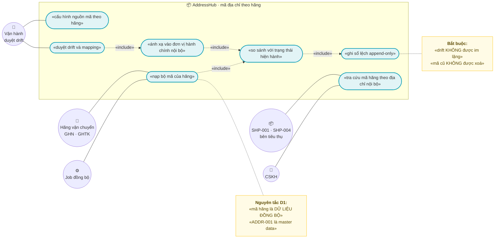
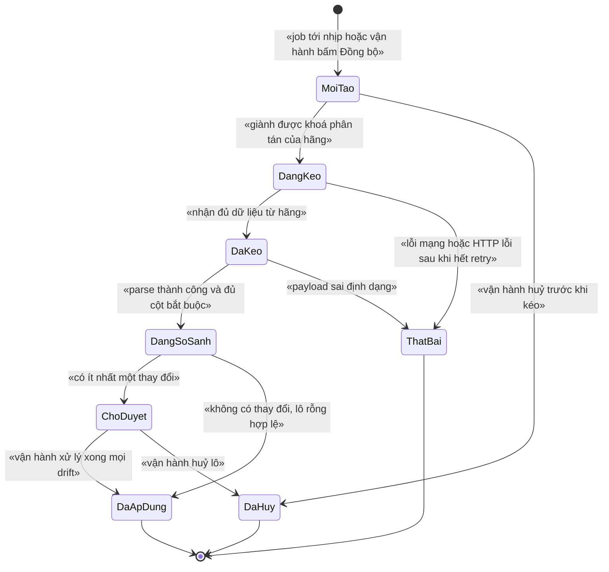
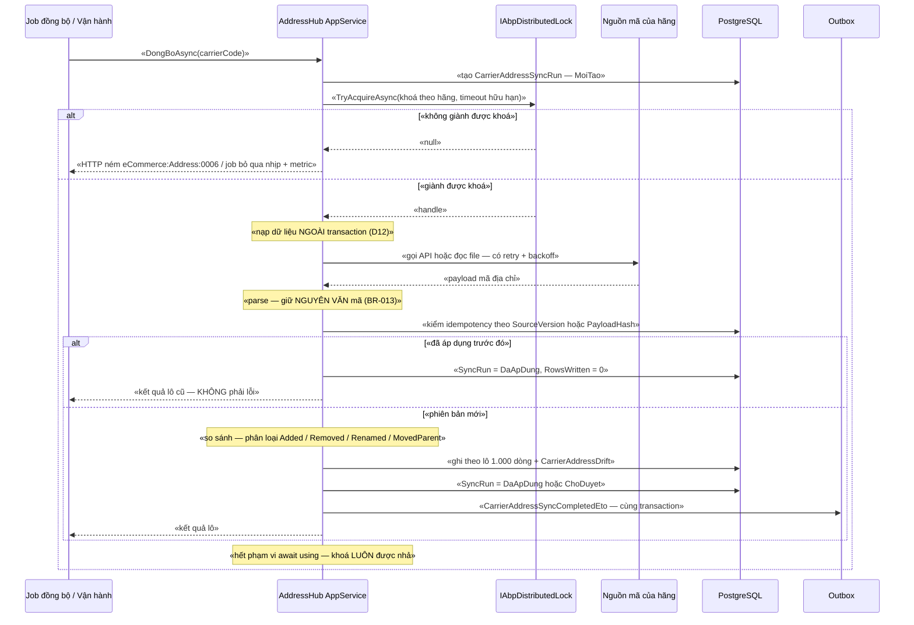

# `ADDR-002` — Đồng bộ mã địa chỉ theo từng hãng vận chuyển

> 🚨 **TRẠNG THÁI CODE — ĐỌC TRƯỚC MỌI MỤC KHÁC:** module **AddressHub CHƯA TỒN TẠI** tính đến thời điểm viết tài liệu.
> Bằng chứng đã kiểm bằng `glob`/`grep`/`read` trên chính repo này:
> - `modules/` **chỉ có 3 module**: `ChannelHub`, `PaymentHub`, `Tax` — **không** có `modules/Address*` (nguồn: `modules/`).
> - Grep `Address|Province|Ward|District|Carrier|GHN|GHTK` trên **mọi `*.cs`** trong repo ⇒ **0** kết quả nghiệp vụ;
>   các match duy nhất là `ClientIpAddress`/`IpAddresses` trong `src/eCommerce.EntityFrameworkCore/Migrations/20261009102044_Added_Identity.cs:115,137`.
> - `src/eCommerce.EntityFrameworkCore/eCommerceDbContext.cs:36-64` khai báo **12 `DbSet`**, **không** có `Province`/`Ward`/`District`/`CarrierAddressCode`.
> - `Test-Path shared` ⇒ **`False`**: `shared/eCommerce.Kernel` (nơi `docs/implementation-plan.md:65` dự kiến đặt `Address`) **chưa có**.
>
> ⇒ Vì vậy **mọi mục dưới đây là THIẾT KẾ**, không phải mô tả code đang chạy. Chỗ nào suy luận từ code hiện có,
> tài liệu ghi rõ **đường dẫn file thật**; chỗ nào chưa kiểm chứng được, ghi rõ **"chưa kiểm chứng"**.

| Thuộc tính | Nội dung |
|---|---|
| **Mã** | `ADDR-002` |
| **Module** | **AddressHub** — dự kiến `modules/AddressHub/eCommerce.Address.{Domain, EntityFrameworkCore, Application.Contracts, Application}` (**chưa tồn tại trong repo**) |
| **Giai đoạn** | **GĐ0 — Pháp lý** (`docs/implementation-plan.md:91`, `docs/implementation-plan.md:111`, `docs/implementation-plan.md:388`) |
| **Ưu tiên** | **Must have** (không có nó thì `SHP-001`/`SHP-004` không gửi được địa chỉ cho hãng) |
| **Trạng thái** | 🟡 `Draft` — chờ review |
| **Người viết / người review** | *(điền)* / **Kiến trúc trưởng + người đã liên hệ GHN/GHTK** |
| **Phiên bản / ngày** | `v0.1 — 13/10/2026` |
| **Tài liệu liên quan** | `ADDR-001` (tra cứu đơn vị hành chính 2 cấp + 3 cấp cũ — **master data của ta**) · `ADDR-003` (chuẩn hoá địa chỉ khách hàng, convert 3↔2 cấp) · `SHP-001` (adapter GHN) · `SHP-004` (adapter GHTK) · `XC-001` (Money) · `XC-002` (outbox/inbox, idempotency) · `XC-003` (khoá phân tán) · `XC-004` (phân quyền/tenant) · `XC-005` (log/metric) · `docs/implementation-plan.md` · `docs/business-modules-proposal.md` |

---

## 0. Tóm tắt & quyết định thiết kế

**Tóm tắt:** `ADDR-002` chốt **cách lấy bộ mã địa chỉ riêng của từng hãng vận chuyển** (GHN, GHTK…),
**cách ánh xạ** bộ mã đó vào **master data hành chính nội bộ** (`ADDR-001`), và **cách phát hiện khi hãng đổi mã**.
Điểm cốt lõi: mã của hãng là **DỮ LIỆU ĐỒNG BỘ (dữ liệu dẫn xuất)**, **KHÔNG** phải master data —
đúng như `docs/implementation-plan.md:130` đã ghi: *"'địa chỉ gửi đối tác' là **dữ liệu đồng bộ**, không phải master data"*.

**Vì sao phải có tài liệu này (không phải thủ tục):**
1. **Breaking change đang diễn ra:** từ **01/07/2025** Việt Nam **bỏ cấp huyện** và sáp nhập tỉnh (**63 → 34**)
   (`docs/implementation-plan.md:99`, `docs/business-modules-proposal.md:507-511`).
   ⚠️ Đo trực tiếp: `provinces.open-api.vn/api/` → **63** tỉnh **có** `districts`; `/api/v2/` → **34** tỉnh **không** huyện,
   **nhưng `wards` trả RỖNG khi test** ⇒ *phải kiểm tra lại* (`docs/implementation-plan.md:131`). **Chưa kiểm chứng lại.**
2. **Hai hãng đang ở hai mô hình khác nhau:** GHN **đã thích ứng** (thêm cờ `is_new_to_address` / `is_new_from_address` /
   `is_new_return_address`; `to_district_name` **required khi cờ = false**), còn **GHTK vẫn dùng payload 3 cấp**
   (`province`/`district`/`ward`) và **KHÔNG tìm thấy** cờ tương đương
   (`docs/business-modules-proposal.md:513-514`, `docs/business-modules-proposal.md:546`).
   Đây là **rủi ro mức CAO** trong bảng rủi ro: *"GHTK chưa xác nhận địa chỉ 2 cấp"* (`docs/implementation-plan.md:290`).
3. **Nếu coi mã hãng là master data thì sai về bản chất:** mỗi hãng có bộ mã riêng, đổi theo phiên bản API;
   đơn hàng cũ tham chiếu mã cũ ⇒ **không được xoá**, nhưng **được phép dựng lại** bộ mã mới từ hãng.
   Nhầm hai thứ này ⇒ **migrate toàn bộ đơn hàng mỗi lần hãng đổi mã**.

**Phạm vi:**
- ✅ **Bảng đăng ký nguồn mã** theo hãng (`CarrierCode` → nguồn dữ liệu + cấp địa chỉ hãng hỗ trợ).
- ✅ **Hai tầng dữ liệu tách biệt:** (a) **snapshot mã thô của hãng** theo từng lần đồng bộ; (b) **ánh xạ đã kiểm duyệt**
  (auto / người duyệt) tới `ProvinceId`/`DistrictId`/`WardId` nội bộ.
- ✅ **Đồng bộ theo lô có phiên bản** (`SyncRun`) + **sổ lệch append-only** (`CarrierAddressDrift`).
- ✅ **Idempotency ở mọi biên vào** (API kéo của hãng, import file Excel/CSV — xem `docs/implementation-plan.md:200`
  cho tiền lệ "bảng kê là file Excel tải thủ công").
- ✅ **Khoá phân tán theo hãng** + state machine **NÉM LỖI** khi chuyển sai.
- ✅ **API tra cứu** để `SHP-001`/`SHP-004` hỏi "địa chỉ nội bộ này ứng với mã nào của hãng".
- ✅ Permission + tenant + observability theo `XC-004`/`XC-005`.

**Không nằm trong phạm vi:**
- ❌ **Master data đơn vị hành chính** (tỉnh/xã/huyện của ta, nguồn `provinces.open-api.vn`, chính sách cấp hành chính) — thuộc **`ADDR-001`**.
- ❌ **Chuẩn hoá địa chỉ khách hàng** (convert 3 cấp ↔ 2 cấp, ca **sáp nhập tỉnh**) — thuộc **`ADDR-003`**.
- ❌ **Entity `Carrier` / `ShippingService` / `ShippingRate`** — thuộc **ShippingHub** (GĐ2, `docs/implementation-plan.md:199`).
  `ADDR-002` **chỉ giữ `CarrierCode` dạng chuỗi**, **không** tạo entity `Carrier` (quy ước "module sở hữu entity của mình").
- ❌ **Tính phí & tạo vận đơn** (gọi API hãng) — thuộc `SHP-001`/`SHP-004`.
- ❌ **Đối soát COD / webhook trạng thái vận đơn** — thuộc `REC-003`/`SHP-002`.

### 0.1 Quyết định thiết kế (ADR ngắn)

| # | Quyết định | Phương án đã cân nhắc | Lý do chọn | Hệ quả |
|---|---|---|---|---|
| **D1** | **Master data hành chính (`ADDR-001`) là NGUỒN SỰ THẬT DUY NHẤT**; bảng mã hãng là **dữ liệu dẫn xuất, dựng lại được** | (a) coi mã hãng là master · (b) **master nội bộ + bảng dẫn xuất** | `docs/implementation-plan.md:130` đã chốt *"địa chỉ gửi đối tác là dữ liệu đồng bộ, không phải master data"*. Chọn (a) ⇒ mỗi lần hãng đổi mã phải migrate đơn hàng | 🔒 **Cấm** khoá ngoại nghiệp vụ trỏ vào mã hãng. Nghiệp vụ luôn tham chiếu `ProvinceId`/`WardId` nội bộ **+** `CarrierCode` |
| **D2** | **Hai tầng tách biệt**: `CarrierAddressCode` (snapshot thô theo lô) **≠** `CarrierAddressMapping` (ánh xạ đã kiểm duyệt) | (a) một bảng gộp · (b) **hai bảng** | Gộp ⇒ mỗi lần hãng đổi mã sẽ **ghi đè** mất ánh xạ người đã duyệt (bài học F1 của `XC-003`: cùng khái niệm ở 2 nơi ⇒ lệch âm thầm) | Có thêm một tầng join; đổi lại **không bao giờ mất công duyệt tay** |
| **D3** | **Đồng bộ theo lô có phiên bản** (`SyncRun`): **cấm** `UPDATE` đè bản ghi của lô trước; thay đổi ⇒ **bản ghi mới + đóng khung hiệu lực** bản cũ | (a) upsert theo khoá hãng · (b) **append theo lô + hiệu lực thời gian** | Đơn hàng/vận đơn cũ tham chiếu mã cũ; upsert làm **mất khả năng tra lại** và phá vỡ tính append-only (bài học `XC-006` BR-005) | Bảng phình theo thời gian (chấp nhận — dữ liệu tra cứu, không phải giao dịch); cần index theo `(TenantId, CarrierCode, Level, IsCurrent)` |
| **D4** | **Idempotency ở MỌI biên vào**, khoá **ổn định** `AddressCarrierSync:{CarrierCode}:{SourceVersion}` (API) hoặc `…:{PayloadHash}` (file) | (a) chỉ unique index · (b) chỉ guard nghiệp vụ · (c) **cả hai** | `XC-002` D3 đã chứng minh tầng transport **không đủ**; nhưng unique index ở DB vẫn là **hàng rào cuối** (`XC-003` D2: *"bỏ lock đi, DB có chặn không?"*) | ⚠️ **Phụ thuộc `XC-002`**: hiện **chưa có** `IIdempotencyGuard` trong code (xem §15.2 **F4**) |
| **D5** | **Phát hiện lệch (drift) là bắt buộc, không im lặng**: mã hãng **mất đi / đổi tên / đổi cấp** ⇒ ghi `CarrierAddressDrift` | (a) coi là "hãng cập nhật, cứ ghi đè" · (b) **ghi sổ lệch + chờ duyệt** | Quy ước bất biến #11 của dự án (`docs/implementation-plan.md:54`): *"State machine phải NÉM lỗi, không im lặng"*. Mã địa chỉ sai ⇒ **giao hàng thất bại** (tốn tiền thật) | Lô có drift ⇒ **không tự áp dụng** ngay; cần người duyệt (A1 §1) |
| **D6** | **Mapping đã được người duyệt (`VerifiedBy != null`) KHÔNG bị ghi đè tự động** | (a) auto-map ghi đè mọi thứ · (b) **tôn trọng bản đã duyệt** | Công duyệt tay là **tài sản**; auto-map sai một lần rồi tự "sửa lại" sẽ phá công đó mà không ai biết | Hãng đổi mã ⇒ bản ghi **mới** + bản cũ `Superseded`; hiệu lực theo thời gian |
| **D7** | **`CarrierCode` là chuỗi, KHÔNG tạo entity `Carrier` trong AddressHub** | (a) tạo `Carrier` ở AddressHub · (b) **chuỗi + registry trong code** | Entity `Carrier` thuộc **ShippingHub** (`docs/implementation-plan.md:199`). Hai module cùng sở hữu một khái niệm = **hai nguồn sự thật** (đúng lỗi F1 của `XC-003`) | Cần **kiểm tra tồn tại** `CarrierCode` khi ghi (fail-closed); registry đặt trong `AddressHubConsts` |
| **D8** | **Mọi unique index có `TenantId` PHẢI `NULLS NOT DISTINCT`** | (a) `unique: true` thường · (b) **SQL thô `NULLS NOT DISTINCT`** | Đã **chứng minh bằng PostgreSQL thật**: với `TenantId = NULL` thì unique index **KHÔNG chặn trùng** (`src/eCommerce.EntityFrameworkCore/Migrations/20261013024226_Fix_NullableTenantId_UniqueIndexes.cs:14-21`; `XC-004` §15.2 **F1**) | EF Core **không** mô hình hoá được ⇒ phải **SQL thô** trong migration. **Bắt buộc** cập nhật `test/eCommerce.IntegrationTests/PostgreSqlSchemaTests.cs:144-174` (đang assert **11** index) |
| **D9** | **Khoá phân tán `ecommerce:address:carrier-sync:{carrierCode}`** cho mọi lần chạy đồng bộ | (a) không khoá · (b) khoá toàn cục · (c) **khoá theo hãng** | Khoá toàn cục làm **hãng A chặn hãng B** vô cớ (`XC-003` D7). Job định kỳ dùng `SkipIfBusy` + **log + metric** (`XC-003` D10/BR-010) | ⚠️ Đoạn `<module>` = `address` **CHƯA có** trong bảng ánh xạ module→khoá của `XC-003` §5 (`docs/features/XC-003-khoa-phan-tan-quy-uoc.md:218-225`) ⇒ **phải bổ sung** vào `XC-003` trong cùng PR |
| **D10** | **Không hard-code endpoint/bộ mã hãng** — mọi thứ qua **cấu hình** `AddressHubOptions` hoặc **dữ liệu** | (a) hằng số trong code · (b) cấu hình + dữ liệu | Endpoint của hãng **chưa kiểm chứng** (§15.1 Q1) và **thay đổi theo phiên bản API** | Phải có mục cấu hình cho từng hãng; đổi endpoint **không cần release** |
| **D11** | **`Province/Ward` do `ADDR-001` sở hữu; `ADDR-002` chỉ ĐỌC** | (a) `ADDR-002` tự nhập đơn vị hành chính · (b) **chỉ đọc + map** | Tránh mô hình địa chỉ **hai nguồn sự thật** — điều `docs/implementation-plan.md:181` đã cảnh báo cho module Customers | Ranh giới module rõ; `ADDR-002` **không** chạy được trước `ADDR-001` (phụ thuộc cứng) |
| **D12** | **Nạp dữ liệu hãng (HTTP/file) NGOÀI transaction; ghi DB trong transaction NGẮN theo lô 1.000 dòng** | (a) một transaction bao cả lần gọi HTTP · (b) **tách** | Giữ transaction mở trong lúc chờ HTTP ⇒ **giữ kết nối DB + khoá** suốt thời gian chờ ⇒ dễ deadlock/timeout | Lô ghi **không nguyên tử toàn phần**: phải có `SyncRun.Status` phản ánh đúng **đã ghi bao nhiêu** (`RowsWritten`) và **thử lại phần còn lại** |

---

## 1. Use Case Specification

| Thuộc tính | Nội dung |
|---|---|
| **Use Case ID** | `ADDR-002` |
| **Use Case Name** | Đồng bộ mã địa chỉ của hãng vận chuyển và ánh xạ vào đơn vị hành chính nội bộ |
| **Description** | *"Là hệ thống bán hàng đa kênh, tôi muốn có bộ mã địa chỉ của từng hãng vận chuyển (GHN/GHTK) được đồng bộ định kỳ và ánh xạ rõ ràng vào đơn vị hành chính nội bộ — để gửi đúng địa chỉ cho hãng, và để khi hãng đổi mã thì tôi BIẾT ngay thay vì giao hàng thất bại âm thầm."* |
| **Actor(s)** | **Hãng vận chuyển** (nguồn mã — hệ thống ngoài) · **Job đồng bộ** (hệ thống) · **Nhân viên vận hành** (duyệt drift/mapping) · **`SHP-001`/`SHP-004`** (bên tiêu thụ — hỏi mã qua API) · **CSKH** (tra cứu) · **Quản trị** (cấu hình nguồn mã theo hãng) |
| **Priority** | **Must have** |
| **Trigger** | (a) job đồng bộ chạy theo nhịp (đề xuất **24 h** — mã địa chỉ đổi rất chậm); (b) vận hành **bấm đồng bộ** khi hãng thông báo đổi mã; (c) **import file** mã địa chỉ hãng cung cấp thủ công; (d) `SHP-*` gọi API tra cứu và **không** tìm được mã ⇒ sinh yêu cầu rà soát |
| **Pre-Condition(s)** | • **`ADDR-001` đã có dữ liệu** `Province`/`Ward` (và `District` chỉ để tương thích 3 cấp cũ). **Thiếu ⇒ `eCommerce:Address:0002`** (không map được vào hư không).<br>• **`CarrierCode` đã được đăng ký** trong `AddressHubConsts.Carriers` — chưa đăng ký ⇒ **từ chối** (fail-closed), **không** đoán.<br>• **Nguồn dữ liệu của hãng đã cấu hình** (`AddressHubOptions`): endpoint/đường dẫn file + cấp địa chỉ hãng hỗ trợ. Thiếu cấu hình ⇒ **từ chối**, **không** chạy mặc định.<br>• **Tenant hiện tại** — hệ thống đang chạy **1 tenant**, `TenantId` **có thể là `NULL`** (`XC-004` §5.2, đã chứng minh bằng PostgreSQL thật) ⇒ mọi index phải `NULLS NOT DISTINCT` (BR-007).<br>• `ChannelCode` **không** tham gia: mã địa chỉ hãng là **dùng chung toàn tenant**, không theo kênh bán.<br>• `CorrelationId` có giá trị theo `XC-005` (⚠️ `CorrelationId` **chưa** được wire middleware — `XC-005` **F1**; đây là **phụ thuộc chưa xong**). |
| **Post-Condition(s)** | • Mỗi lần chạy có **đúng 1** dòng `CarrierAddressSyncRun` (append-only) với `RowsFetched`/`RowsWritten`/`DriftCount`.<br>• Mọi mã hãng nhận được **hoặc** được map (auto/manual) **hoặc** có dòng `CarrierAddressDrift` — **0 mã bị bỏ qua im lặng**.<br>• **0** bản ghi `CarrierAddressCode`/`Mapping` của lô cũ bị `UPDATE` ở cột nội dung; chỉ cột xử lý (`IsCurrent`, `SupersededAtUtc`) được đổi.<br>• Lô **có drift** chưa được duyệt ⇒ `Status = AwaitingReview`, **không** tự `Applied`.<br>• `CarrierAddressSyncCompletedEto` nằm trong **outbox cùng transaction** với lần chuyển `Applied` (`XC-002` BR-001 — ⚠️ outbox/relay hiện **chưa** bật, xem §15.2 **F4**). |
| **Basic Flow** | 1. Job (hoặc vận hành) gọi `DongBoAsync(carrierCode)`; hệ thống tạo `SyncRun` trạng thái `MoiTao`.<br>2. **Giành khoá phân tán** `ecommerce:address:carrier-sync:{carrierCode}` với **timeout hữu hạn** (D9). Không giành được ⇒ §12.<br>3. **Nạp dữ liệu hãng NGOÀI transaction** (D12): gọi API hoặc đọc file; **retry có backoff** cho lỗi tạm thời.<br>4. Parse ⇒ danh sách `(Level, CarrierLocationCode, CarrierName, ParentCarrierCode)`; **giữ nguyên văn** mã (BR-013).<br>5. Kiểm **idempotency** (D4): nếu `SourceVersion`/`PayloadHash` đã áp dụng ⇒ kết thúc **không ghi gì**, `Status = Applied`, `RowsWritten = 0` — **không phải lỗi** (A2).<br>6. **So sánh (diff)** với trạng thái hiện hành ⇒ phân loại `Added` / `Removed` / `Renamed` / `MovedParent` / `Unchanged`.<br>7. Ghi DB **theo lô 1.000 dòng**: bản ghi mã hãng mới + `CarrierAddressDrift` cho mọi thay đổi (BR-005/BR-012).<br>8. `DriftCount == 0` ⇒ `Status = DaApDung` + phát ETO. `DriftCount > 0` ⇒ `Status = ChoDuyet` + phát ETO cảnh báo.<br>9. Nhả khoá (kết thúc phạm vi `await using`, **kể cả khi lỗi**). |
| **Alternative Flow** | **A1: Vận hành duyệt drift** — mỗi drift được `ChapNhan` (áp mapping mới) hoặc `TuChoi` (giữ nguyên + ghi lý do); duyệt hết ⇒ `SyncRun` → `DaApDung`.<br>**A2: Chạy lại cùng phiên bản (retry, job chạy trùng)** — khoá idempotency khớp ⇒ **không ghi gì**, trả kết quả lô cũ; **không phải lỗi** (D4).<br>**A3: Import file thay vì API** — cùng luồng, khác nguồn; khoá idempotency theo `PayloadHash` của file.<br>**A4: Hãng ngừng phát hành một mã** — **KHÔNG xoá** bản ghi cũ (vận đơn cũ còn tham chiếu); đánh dấu `NgungPhatHanh` + ghi `CarrierAddressDrift` loại `Removed` (BR-005, NFR-009).<br>**A5: Vận hành huỷ lô đang chờ duyệt** — chỉ cho huỷ khi **chưa** `DaApDung`; bản ghi đã ghi ở `ChoDuyet` được giữ và đánh dấu `Cancelled` (**không** xoá). |
| **Exception Flow** | **E1:** `CarrierCode` chưa đăng ký ⇒ `eCommerce:Address:0001`, **không** gọi hãng.<br>**E2:** `ADDR-001` chưa có master data ⇒ `eCommerce:Address:0002`.<br>**E3:** payload hãng sai định dạng / thiếu cột bắt buộc ⇒ `eCommerce:Address:0003`, `SyncRun.Status = ThatBai` + giữ payload thô **đã che** để điều tra.<br>**E4:** khoá idempotency trùng nhưng `PayloadHash` **KHÁC** ⇒ `eCommerce:Address:0004` (**xung đột khoá — cấm ghi đè**, phải điều tra thủ công).<br>**E5:** chuyển trạng thái `SyncRun` không hợp lệ ⇒ **NÉM** `eCommerce:Address:0005` (§3).<br>**E6:** không giành được khoá phân tán mà **không** phải job định kỳ (gọi từ HTTP) ⇒ **NÉM** `eCommerce:Address:0006` (`XC-003` D10); job định kỳ ⇒ **bỏ qua nhịp** + log + metric (**không** ném).<br>**E7:** mã hãng ở cấp **hãng không hỗ trợ** (ví dụ hãng chỉ có 2 cấp nhưng payload có `DistrictCode`) ⇒ `eCommerce:Address:0008` + ghi drift, **không** âm thầm bỏ qua.<br>**E8:** hãng trả **nhiều bản ghi cùng `(Level, CarrierLocationCode)`** (dữ liệu hãng bẩn) ⇒ `eCommerce:Address:0009` + **dừng lô** (`ThatBai`) — **cấm** chọn bừa một bản ghi.<br>**E9:** API hãng lỗi/timeout sau khi hết retry ⇒ `SyncRun.Status = ThatBai`, `FailureCode` + `FailureMessage`; **giữ** lô cũ đang hiệu lực, **không** rollback dữ liệu đã ghi ở lô trước.<br>**E10:** `UPDATE … WHERE IsCurrent = true` ảnh hưởng **0 dòng** khi đóng khung bản cũ (luồng khác vừa đổi) ⇒ **NÉM** `eCommerce:Address:0010` — **cấm** coi là thành công (`XC-002` BR-008). |
| **Business Rules** | • **BR-ADDR-002-001**: Master data hành chính (`ADDR-001`) là **nguồn sự thật duy nhất**; bảng mã hãng là **dữ liệu dẫn xuất dựng lại được**; **cấm** dùng mã hãng làm khoá nghiệp vụ hoặc khoá ngoại trong module khác.<br>• **BR-ADDR-002-002**: **Mọi** bản ghi mã hãng **phải** gắn `CarrierCode` + `CarrierLevel` + khoá tới thực thể hành chính nội bộ **hoặc** có dòng drift tương ứng — **cấm** trạng thái "có mã mà không ai biết nó là gì".<br>• **BR-ADDR-002-003**: **Đồng bộ theo lô có phiên bản**; **cấm** `UPDATE` nội dung bản ghi của lô trước; thay đổi ⇒ **bản ghi mới + đóng khung hiệu lực** bản cũ.<br>• **BR-ADDR-002-004**: **Idempotency ở MỌI biên vào** (API kéo, import file, retry của job): khoá **ổn định** `AddressCarrierSync:{CarrierCode}:{SourceVersion|PayloadHash}` **+** unique index ở DB; **cấm** `Guid.NewGuid()` làm khoá chống trùng.<br>• **BR-ADDR-002-005**: Mọi **thay đổi mã của hãng** (`Added`/`Removed`/`Renamed`/`MovedParent`) **phải** sinh `CarrierAddressDrift`; **cấm** xoá hoặc ghi đè im lặng.<br>• **BR-ADDR-002-006**: Mapping có `VerifiedBy != null` **không** bị ghi đè tự động; hãng đổi mã ⇒ bản ghi **mới**, bản cũ `Superseded` (D6).<br>• **BR-ADDR-002-007**: Mọi **unique index có `TenantId`** **phải** dùng `NULLS NOT DISTINCT` (SQL thô — EF Core không hỗ trợ) — kế thừa `XC-004` BR-009 + `docs/features/XC-004-xac-thuc-phan-quyen-tenant.md:240-241`.<br>• **BR-ADDR-002-008**: **Mọi** app service **phải** có `[Authorize]` ở **cấp CLASS**; **mọi** permission dùng trong `[Authorize]` **phải** được định nghĩa trong `eCommercePermissionDefinitionProvider` **trước** khi dùng (`XC-004` D2/D3 — 2 lỗi đã xảy ra thật ở Phase 0).<br>• **BR-ADDR-002-009**: Mọi chuyển trạng thái `SyncRun` **phải** qua guard ở §3; guard sai ⇒ **NÉM LỖI có mã** `eCommerce:Address:0005`; **cấm** gán trực tiếp `Status`.<br>• **BR-ADDR-002-010**: Mọi lần ghi đồng bộ **phải** nằm trong **phạm vi khoá phân tán theo hãng**; **mọi** acquire **phải** có **timeout hữu hạn**; **cấm** acquire lồng cùng tên khoá (`XC-003` BR-004/BR-005).<br>• **BR-ADDR-002-011**: **Cấm** hard-code endpoint / bộ mã / cấp địa chỉ của hãng trong code nghiệp vụ — thuộc **cấu hình** (`AddressHubOptions`) hoặc **dữ liệu**.<br>• **BR-ADDR-002-012**: `CarrierAddressSyncRun` và `CarrierAddressDrift` là **sổ APPEND-ONLY**: **cấm** `UPDATE`/`DELETE` nội dung đã ghi; chỉ được đổi **cột xử lý** (`Status`, `ResolvedBy`, `ResolvedAtUtc`, `Resolution`).<br>• **BR-ADDR-002-013**: Mã địa chỉ của hãng **phải giữ nguyên văn** (không `Trim`, không đổi hoa–thường, không bỏ số 0 đầu) — mã hãng có thể **phân biệt hoa–thường**; so khớp **chính xác** theo `(CarrierCode, CarrierLevel, CarrierLocationCode)`.<br>• **BR-ADDR-002-014**: Mọi thao tác ghi **phải** qua **Unit of Work**; nạp dữ liệu hãng **cấm** nằm trong transaction (D12).<br>• **BR-ADDR-002-015**: Mã lỗi **phải** theo khuôn `eCommerce:Address:NNNN` và **do module AddressHub sở hữu** (`AddressHubErrorCodes`) — **cấm** khai ở `eCommerceConsts.ErrorCodes` (kế thừa `XC-003` F2 và cách làm của `modules/Tax/eCommerce.Tax.Domain/TaxErrorCodes.cs:10-35`).<br>• **BR-ADDR-002-016**: **Tiền: Không áp dụng** — ADDR-002 **không có** trường tiền nào (không phí, không giá). Nếu sau này thêm phí/giá ⇒ **bắt buộc** theo `XC-001` (`decimal` + `Money`, **cấm** so `==`, so bằng `ToMinorUnits()`). |
| **Non-Functional Requirement** | • **NFR-ADDR-002-001**: Đồng bộ **một hãng đầy đủ (~3.000 đơn vị cấp xã)** ⇒ p95 **≤ 5 phút** (không tính thời gian chờ hãng); ghi DB theo lô **1.000** dòng.<br>• **NFR-ADDR-002-002**: **Idempotent 100 %**: chạy lại cùng `SourceVersion`/`PayloadHash` **10 lần** ⇒ **0** bản ghi mã mới, **0** drift giả.<br>• **NFR-ADDR-002-003**: **0** mã hãng bị bỏ qua im lặng: `RowsFetched == RowsWritten + DriftCount + UnchangedCount` (bất biến số học — kiểm bằng test).<br>• **NFR-ADDR-002-004**: **0** dòng bị `UPDATE`/`DELETE` ở cột nội dung của bảng append-only (test quét mã nguồn + test DB).<br>• **NFR-ADDR-002-005**: **Tỉ lệ ánh xạ tự động** được **đo cho từng lần chạy**; **< 95 %** ⇒ log `Warning` + metric.<br>• **NFR-ADDR-002-006**: Cách ly tenant: **0** bản ghi tenant khác lọt vào truy vấn (integration test 2 tenant — ⚠️ **cần PostgreSQL**).<br>• **NFR-ADDR-002-007**: `CorrelationId` hiện diện trong **100 %** log của luồng đồng bộ (⚠️ **phụ thuộc `XC-005` F1** — middleware chưa wire).<br>• **NFR-ADDR-002-008**: **0** acquire khoá thiếu `timeout`; **0** acquire lồng; **100 %** lần bỏ qua nhịp của job có **log + metric** (`XC-003` BR-010).<br>• **NFR-ADDR-002-009**: Bản ghi mã hãng **đã ngừng phát hành vẫn tra cứu được** vô thời hạn (phục vụ tra vận đơn cũ) — test chèn rồi truy vấn lại.<br>• **NFR-ADDR-002-010**: **0** endpoint/mã hãng hard-code trong `*.cs` nghiệp vụ (test quét mã nguồn). |

---

## 2. Sơ đồ Use Case



**Chú giải:**

| Ký hiệu | Ý nghĩa |
|---|---|
| ⭕ Xanh lá | Actor (hãng vận chuyển, job, vận hành, module tiêu thụ, CSKH) |
| 🟦 Bầu dục xanh dương | Use case |
| 🟨 Khung vàng | Note (nguyên tắc thiết kế) |
| `───` | Liên kết Actor ↔ Use Case |
| `-.«include».->` | Quan hệ bao hàm |

---

## 3. Sơ đồ trạng thái (state machine) — **BẮT BUỘC ném lỗi khi chuyển sai**

### 3.1 Vòng đời một lần đồng bộ (`CarrierAddressSyncRun`)



**Bảng chuyển trạng thái & guard (mọi chuyển sai **phải ném lỗi**, không im lặng):**

| # | Từ → Sang | Guard (điều kiện cho phép) | Hành động kèm theo | Nếu guard sai thì? |
|---|---|---|---|---|
| 1 | `MoiTao` → `DangKeo` | Giành được khoá `ecommerce:address:carrier-sync:{carrierCode}` **trong timeout** | Ghi `LockAcquiredAtUtc` | Không giành được ⇒ `XC-003` D10: **NÉM** `eCommerce:Address:0006` (HTTP) **hoặc** bỏ qua nhịp + log + metric (job định kỳ) |
| 2 | `MoiTao` → `DaHuy` | Người dùng có permission `.Sync` và lô **chưa** gọi hãng | Ghi `CancelledBy`, `CancelledAtUtc` | Cố huỷ lô đã `DangKeo` ⇒ **NÉM** `eCommerce:Address:0005` |
| 3 | `DangKeo` → `DaKeo` | Nhận đủ payload, **kích thước ≤ ngưỡng** cấu hình | Ghi `RowsFetched`, `SourceVersion`, `PayloadHash` | Vượt ngưỡng ⇒ **NÉM** `eCommerce:Address:0003` (không parse) |
| 4 | `DangKeo` → `ThatBai` | Lỗi mạng/HTTP sau khi **hết retry** | Ghi `FailureCode` + `FailureMessage`; **KHÔNG** đổi lô đang hiệu lực | — |
| 5 | `DaKeo` → `DangSoSanh` | Parse được **100 %** dòng, đủ cột bắt buộc, **không** trùng `(Level, CarrierLocationCode)` | — | Thiếu cột ⇒ `eCommerce:Address:0003`; trùng khoá trong payload ⇒ `eCommerce:Address:0009` + **dừng lô** |
| 6 | `DangSoSanh` → `ChoDuyet` | `DriftCount > 0` | Ghi `CarrierAddressDrift` cho **mọi** thay đổi; phát ETO cảnh báo | Bỏ sót drift (không ghi dòng) ⇒ vi phạm **BR-005** |
| 7 | `DangSoSanh` → `DaApDung` | `DriftCount == 0` | Đánh dấu bản ghi mới `IsCurrent = true`; đóng khung bản cũ | `UPDATE … WHERE IsCurrent = true` ra **0 dòng** ⇒ **NÉM** `eCommerce:Address:0010` |
| 8 | `ChoDuyet` → `DaApDung` | **Mọi** drift có `Resolution` khác rỗng **và** người xử lý có permission `.ResolveDrift` | Ghi `ResolvedBy`/`ResolvedAtUtc` từng drift; phát ETO hoàn tất | Còn drift chưa xử lý ⇒ **NÉM** `eCommerce:Address:0011` |
| 9 | `ChoDuyet` → `DaHuy` | Chưa có drift nào được `ChapNhan` | Giữ nguyên bản ghi đã ghi; đánh dấu `Cancelled` | — |
| 10 | `DaApDung`/`ThatBai`/`DaHuy` → bất kỳ | — | — | 🚫 **Trạng thái hấp thụ (absorbing)** — mọi chuyển ra khỏi đây ⇒ **NÉM** `eCommerce:Address:0005` |

> ⚠️ **Vì sao guard phải NÉM LỖI:** quy ước bất biến #11 của dự án (`docs/implementation-plan.md:54`):
> *"State machine phải NÉM lỗi, không im lặng"* — bài học eShop: guard im lặng làm **event rơi không dấu vết**.
> Ở đây hậu quả cụ thể: một lô đồng bộ "thành công giả" ⇒ **mã địa chỉ cũ được coi là mới** ⇒ `SHP-001` gửi
> địa chỉ **sai** cho hãng ⇒ **giao hàng thất bại**, tốn tiền thật và không ai biết vì sao.

### 3.2 Vòng đời một mã hãng (`CarrierAddressCode`)

**Không có sơ đồ riêng** (giới hạn tối đa 3 sơ đồ Mermaid) — mô tả bằng bảng:

| # | Từ → Sang | Guard | Hành động kèm theo | Nếu guard sai thì? |
|---|---|---|---|---|
| 1 | `Moi` → `DaMap` | Tìm được **đúng 1** thực thể hành chính nội bộ khớp | Ghi `Mapping.MatchKind = Auto`, `Confidence` | 0 hoặc > 1 ứng viên ⇒ **KHÔNG** tự map; tạo `CarrierAddressDrift` loại `Unmapped` |
| 2 | `DaMap` → `DaDuyet` | Người có permission `.VerifyMapping` xác nhận | Ghi `VerifiedBy`, `VerifiedAtUtc`; **bản ghi này không bao giờ bị auto ghi đè** (BR-006) | — |
| 3 | `DaMap`/`DaDuyet` → `Superseded` | Hãng phát hành mã **thay thế** ở **lô mới** | Đóng khung `EffectiveToUtc = now`; **KHÔNG** xoá | Cố `UPDATE` nội dung bản cũ ⇒ vi phạm **BR-003/BR-012** |
| 4 | `DaMap`/`DaDuyet` → `NgungPhatHanh` | Mã **không còn** trong payload của hãng | Ghi `CarrierAddressDrift` loại `Removed`; vẫn tra cứu được (NFR-009) | Xoá bản ghi ⇒ vi phạm **BR-005** + mất khả năng tra vận đơn cũ |

---

## 4. Sequence Diagram & luồng dữ liệu

### 4.1 Sequence — một lần đồng bộ (job hoặc HTTP)



### 4.2 DFD (luồng dữ liệu)

**Không có sơ đồ riêng** (giới hạn tối đa 3 sơ đồ Mermaid) — mô tả bằng bảng:

| # | Bước | Vào | Ra | Ghi chú |
|---|---|---|---|---|
| 1 | Nạp mã hãng | `AddressHubOptions` của hãng (endpoint/đường dẫn file) | Payload thô | **Ngoài transaction** (D12); **cấm** hard-code endpoint (BR-011) |
| 2 | Chuẩn hoá & parse | Payload thô | `(CarrierLevel, CarrierLocationCode, CarrierName, ParentCarrierCode)` | Giữ **nguyên văn** mã (BR-013) |
| 3 | So sánh | Danh sách mới + bản ghi `IsCurrent = true` trong `AddrCarrierAddressCodes` | Tập `Added/Removed/Renamed/MovedParent/Unchanged` | Không chạm DB ngoài truy vấn đọc |
| 4 | Ánh xạ | Tên/đường dẫn hành chính của hãng + dữ liệu `ADDR-001` | `CarrierAddressMapping` (auto) | ⚠️ **`ADDR-001` chưa có dữ liệu thật** — phụ thuộc cứng |
| 5 | Ghi | Tập thay đổi | `AddrCarrierAddressCodes` + `AddrCarrierMappings` + `AddrCarrierDrifts` + `SyncRun` | Transaction **ngắn**, theo lô 1.000 dòng |
| 6 | Phát sự kiện | Lô đã áp dụng | `CarrierAddressSyncCompletedEto` (outbox) | ⚠️ Outbox/relay **chưa bật** (§15.2 **F4**) |

---

## 5. Mô hình dữ liệu

### 5.1 ERD

**Không dùng sơ đồ Mermaid** (giới hạn tối đa 3 sơ đồ). Quan hệ giữa các bảng:

| Bảng | Quan hệ | Bảng đích | Kiểu |
|---|---|---|---|
| `AddrCarrierSyncRuns` | 1 → n | `AddrCarrierAddressCodes` | `SyncRunId` (bản ghi mã thuộc về **một lô**) |
| `AddrCarrierSyncRuns` | 1 → n | `AddrCarrierDrifts` | `SyncRunId` |
| `AddrCarrierAddressCodes` | 1 → 0..1 | `AddrCarrierMappings` | theo `(CarrierCode, CarrierLevel, CarrierLocationCode)` |
| `AddrCarrierMappings` | n → 1 | `Province` / `District` / `Ward` (**thuộc `ADDR-001` — chưa có trong code**) | khoá ngoại **theo cấp** (`Level`) |
| `AddrCarrierDrifts` | n → 1 | `AddrCarrierAddressCodes` | bản ghi bị ảnh hưởng |

> ⚠️ **Chưa có bảng nào trong code:** `src/eCommerce.EntityFrameworkCore/eCommerceDbContext.cs:36-64` khai báo **12 `DbSet`**
> (Products, ProductVariants, InventoryItems, StockLedgerEntries, Orders, OrderLines, Channels, ChannelShops, ChannelListings,
> PaymentTransactions, TaxRateSchedules, TaxClassifications) — **không** có bảng nào của AddressHub.
> `docs/implementation-plan.md:128` liệt kê entity dự kiến của AddressHub (`Province`, `Ward`, `District`,
> `AddressLevelPolicy`, `CarrierAddressCode`) — **kế hoạch GĐ0**, chưa triển khai.

### 5.2 Bảng & cột (Data Dictionary)

**Bảng `AddrCarrierSyncRuns`** — *sổ APPEND-ONLY: mỗi lần đồng bộ một dòng, không sửa nội dung sau khi ghi*

| Cột | Kiểu | Null? | Nguồn / ý nghĩa | Ghi chú |
|---|---|---|---|---|
| `Id` | `uuid` | ✖ | khoá chính | |
| `TenantId` | `uuid` | ✔ | tenant sở hữu | **có thể `NULL`** (`XC-004` §5.2) ⇒ index phải `NULLS NOT DISTINCT` |
| `CarrierCode` | `varchar(32)` | ✖ | `GHN`, `GHTK`… | thuộc **registry** `AddressHubConsts.Carriers` (D7) |
| `SourceKind` | `int` (enum) | ✖ | `Api` / `ImportFile` | **cấm** hard-code nhánh xử lý theo hãng (BR-011) |
| `SourceVersion` | `varchar(128)` | ✔ | phiên bản/ETag/ngày công bố của hãng | dùng cho khoá idempotency (D4) |
| `PayloadHash` | `varchar(64)` | ✔ | `SHA-256` payload (hex) | dùng khi hãng **không** có `SourceVersion` |
| `IdempotencyKey` | `varchar(192)` | ✖ | `AddressCarrierSync:{CarrierCode}:{SourceVersion\|PayloadHash}` | **ổn định** qua retry (BR-004) |
| `Status` | `int` (enum) | ✖ | trạng thái ở §3.1 | **chỉ** đổi qua guard (BR-009) |
| `RowsFetched` | `int` | ✖ | số dòng hãng trả về | |
| `RowsWritten` | `int` | ✖ | số dòng đã ghi | bất biến `RowsFetched == RowsWritten + DriftCount + UnchangedCount` (NFR-003) |
| `DriftCount` | `int` | ✖ | số thay đổi phát hiện | `> 0` ⇒ `ChoDuyet` |
| `UnchangedCount` | `int` | ✖ | số dòng không đổi | |
| `AutoMatchedCount` | `int` | ✖ | số map tự động thành công | dùng tính NFR-005 |
| `StartedAtUtc` / `FinishedAtUtc` | `timestamptz` | ✖ / ✔ | thời gian chạy | |
| `LockAcquiredAtUtc` | `timestamptz` | ✔ | thời điểm giành khoá | `NULL` ⇒ chưa từng giành khoá |
| `FailureCode` | `varchar(64)` | ✔ | mã lỗi `eCommerce:Address:*` | |
| `FailureMessage` | `varchar(1024)` | ✔ | thông điệp **đã che** dữ liệu nhạy cảm | **cấm** lưu payload thô (BR-012 tinh thần `SHP-002` BR-006) |
| `CreatedBy` / `CancelledBy` / `CancelledAtUtc` | `uuid` / `uuid` / `timestamptz` | ✔ | vết người thao tác | phục vụ audit |

**Bảng `AddrCarrierAddressCodes`** — *snapshot mã thô của hãng theo từng lô*

| Cột | Kiểu | Null? | Nguồn / ý nghĩa | Ghi chú |
|---|---|---|---|---|
| `Id` | `uuid` | ✖ | khoá chính | |
| `TenantId` | `uuid` | ✔ | tenant | như trên |
| `SyncRunId` | `uuid` | ✖ | lô sinh ra bản ghi | **cấm** sửa để trỏ sang lô khác |
| `CarrierCode` | `varchar(32)` | ✖ | mã hãng | |
| `CarrierLevel` | `int` (enum) | ✖ | `Province` / `District` / `Ward` | hãng quyết định **hỗ trợ cấp nào** (D10) |
| `CarrierLocationCode` | `varchar(64)` | ✖ | mã của hãng | ⚠️ **giữ NGUYÊN VĂN** (BR-013) — **không** `Trim`, **không** đổi hoa–thường |
| `CarrierLocationName` | `varchar(512)` | ✖ | tên hãng đặt | **không** dùng để so khớp tự động một mình (tên hay đổi) |
| `ParentCarrierLocationCode` | `varchar(64)` | ✔ | mã cấp cha của hãng | `NULL` ở cấp tỉnh |
| `IsCurrent` | `bool` | ✖ | bản ghi đang hiệu lực | chuyển `false` khi bị thay thế — **không** xoá |
| `EffectiveFromUtc` / `EffectiveToUtc` | `timestamptz` | ✖ / ✔ | khung hiệu lực | `EffectiveToUtc = NULL` ⇒ còn hiệu lực |
| `LifecycleStatus` | `int` (enum) | ✖ | `Moi` / `DaMap` / `DaDuyet` / `Superseded` / `NgungPhatHanh` | §3.2 |

**Bảng `AddrCarrierMappings`** — *ánh xạ đã kiểm duyệt tới đơn vị hành chính **nội bộ***

| Cột | Kiểu | Null? | Nguồn / ý nghĩa | Ghi chú |
|---|---|---|---|---|
| `Id` | `uuid` | ✖ | khoá chính | |
| `TenantId` | `uuid` | ✔ | tenant | |
| `CarrierCode` + `CarrierLevel` + `CarrierLocationCode` | như trên | ✖ | bên hãng | **duy nhất** theo `(TenantId, CarrierCode, CarrierLevel, CarrierLocationCode)` + hiệu lực |
| `InternalLevel` | `int` (enum) | ✖ | cấp nội bộ tương ứng | ⚠️ **có thể KHÁC** cấp hãng (GHN 2 cấp ↔ GHTK 3 cấp) |
| `ProvinceId` | `uuid` | ✔ | FK → `Province` (**`ADDR-001`**) | khoá ngoại **chỉ** tới master data nội bộ (D1) |
| `DistrictId` | `uuid` | ✔ | FK → `District` (**`ADDR-001`**) | **chỉ** dùng cho hãng còn 3 cấp |
| `WardId` | `uuid` | ✔ | FK → `Ward` (**`ADDR-001`**) | |
| `MatchKind` | `int` (enum) | ✖ | `Auto` / `Manual` | |
| `Confidence` | `numeric(5,4)` | ✔ | độ tin cậy 0..1 của auto-map | **không** phải tiền ⇒ `numeric` thuần, **không** liên quan `XC-001` |
| `VerifiedBy` / `VerifiedAtUtc` | `uuid` / `timestamptz` | ✔ | người duyệt | `!= NULL` ⇒ **auto không được ghi đè** (BR-006) |
| `EffectiveFromUtc` / `EffectiveToUtc` | `timestamptz` | ✖ / ✔ | khung hiệu lực | giữ lịch sử map để tra vận đơn cũ |

**Bảng `AddrCarrierDrifts`** — *sổ APPEND-ONLY: mọi thay đổi của hãng đều để lại vết*

| Cột | Kiểu | Null? | Nguồn / ý nghĩa | Ghi chú |
|---|---|---|---|---|
| `Id` | `uuid` | ✖ | khoá chính | |
| `TenantId` | `uuid` | ✔ | tenant | |
| `SyncRunId` | `uuid` | ✖ | lô phát hiện | |
| `CarrierCode` + `CarrierLevel` + `CarrierLocationCode` | như trên | ✖ | đối tượng bị ảnh hưởng | |
| `Kind` | `int` (enum) | ✖ | `Added` / `Removed` / `Renamed` / `MovedParent` / `Unmapped` | `Unmapped` = **không** map được (NFR-003) |
| `BeforeJson` / `AfterJson` | `jsonb` | ✔ | trạng thái trước/sau | **chỉ** trường mã + tên; **cấm** dữ liệu cá nhân |
| `Resolution` | `varchar(512)` | ✔ | `ChapNhan` / `TuChoi` + lý do | **cột xử lý** — được đổi (BR-012) |
| `ResolvedBy` / `ResolvedAtUtc` | `uuid` / `timestamptz` | ✔ | người xử lý | phục vụ audit |
| `DetectedAtUtc` | `timestamptz` | ✖ | thời điểm phát hiện | |

**Index & ràng buộc** *(phần hay bị bỏ sót nhất — phải liệt kê hết)*

| Loại | Cột | Mục đích |
|---|---|---|
| UNIQUE **`NULLS NOT DISTINCT`** | `AddrCarrierSyncRuns (TenantId, CarrierCode, IdempotencyKey)` | **Idempotency** — hàng rào DB (BR-004) |
| UNIQUE **`NULLS NOT DISTINCT`** | `AddrCarrierAddressCodes (TenantId, CarrierCode, CarrierLevel, CarrierLocationCode, SyncRunId)` | chống trùng trong cùng lô + chống ghi 2 lần cùng lô (BR-004) |
| UNIQUE **`NULLS NOT DISTINCT`** | `AddrCarrierMappings (TenantId, CarrierCode, CarrierLevel, CarrierLocationCode, EffectiveFromUtc)` | chống 2 mapping cùng mốc hiệu lực |
| INDEX | `AddrCarrierAddressCodes (TenantId, CarrierCode, CarrierLevel, IsCurrent)` | truy vấn nóng: "mã đang hiệu lực của hãng" |
| INDEX | `AddrCarrierMappings (TenantId, CarrierCode, ProvinceId, WardId)` | tra ngược: địa chỉ nội bộ → mã hãng (UC7) |
| INDEX | `AddrCarrierDrifts (TenantId, SyncRunId, Kind)` | màn hình duyệt drift |
| INDEX **có filter** | `AddrCarrierDrifts (TenantId, ResolvedAtUtc) WHERE "ResolvedAtUtc" IS NULL` | đếm drift **chưa** xử lý (hiệu năng màn hình) |
| CHECK | `Confidence >= 0 AND Confidence <= 1` | giới hạn giá trị |
| CHECK | `RowsFetched = RowsWritten + DriftCount + UnchangedCount` | **bất biến số học** ở tầng DB (NFR-003) |
| CHECK | `EffectiveToUtc IS NULL OR EffectiveToUtc >= EffectiveFromUtc` | khuôn mẫu đã dùng ở `modules/Tax/eCommerce.Tax.EntityFrameworkCore/TaxDbContextModelCreatingExtensions.cs:23-25` |

> 🚨 **Bắt buộc:** 3 unique index trên **đều bắt đầu bằng `TenantId`** ⇒ **phải** tạo bằng **SQL thô `NULLS NOT DISTINCT`**
> (D8), vì EF Core **không** mô hình hoá được thuộc tính này — đúng cách đã làm ở
> `src/eCommerce.EntityFrameworkCore/Migrations/20261013024226_Fix_NullableTenantId_UniqueIndexes.cs:39-86`.
> Và **phải** cập nhật `test/eCommerce.IntegrationTests/PostgreSqlSchemaTests.cs:144-174` — test này hiện assert
> **đúng 11** index có `NULLS NOT DISTINCT`; thêm 3 index mới mà quên ⇒ **test ĐỎ** (đây là hành vi mong muốn: nó là lưới an toàn).

---

## 6. Hợp đồng API

### 6.1 Application Service

| Mục | Giá trị |
|---|---|
| Interface | `ICarrierAddressAdminAppService` · `ICarrierAddressLookupAppService` (đặt tại `modules/AddressHub/eCommerce.Address.Application.Contracts` — **chưa tồn tại**) |
| Implementation | `CarrierAddressAdminAppService` · `CarrierAddressLookupAppService` (đặt tại `modules/AddressHub/eCommerce.Address.Application` — **chưa tồn tại**) |
| `[Authorize]` | **cấp CLASS** + permission cụ thể ở từng method (BR-008) — khuôn mẫu đã có: `src/eCommerce.Application/Channels/ChannelAppService.cs:27` (`[Authorize]` cấp class) |
| Namespace | `eCommerce.Address.*` (khuôn `eCommerce.Tax.*` ở `modules/Tax/eCommerce.Tax.Domain/TaxErrorCodes.cs:1`) |

**`ICarrierAddressAdminAppService`** — dành cho **vận hành**

| Method | Input (DTO) | Output (DTO) | Ghi chú |
|---|---|---|---|
| `DongBoAsync` | `DongBoMaDiaChiDto { CarrierCode, ForceRefresh }` | `CarrierAddressSyncRunDto` | Tạo + chạy một lô; **có khoá phân tán** |
| `GetSyncRunAsync` | `Guid id` | `CarrierAddressSyncRunDto` | |
| `ListSyncRunsAsync` | `PagedAndSortedResultRequestDto { CarrierCode? }` | `PagedResultDto<CarrierAddressSyncRunDto>` | |
| `ListDriftsAsync` | `PagedAndSortedResultRequestDto { SyncRunId?, CarrierCode?, OnlyUnresolved }` | `PagedResultDto<CarrierAddressDriftDto>` | |
| `XuLyDriftAsync` | `XuLyDriftDto { DriftId, ChapNhan, LyDo, InternalProvinceId?, InternalWardId? }` | `CarrierAddressDriftDto` | Ghi `Resolution`; **bắt buộc** `LyDo` khi `TuChoi` |
| `VerifyMappingAsync` | `VerifyMappingDto { MappingId, GhiChu? }` | `CarrierAddressMappingDto` | Đặt `VerifiedBy` ⇒ bản ghi **hết bị auto ghi đè** (BR-006) |
| `ImportFileAsync` | `ImportMaDiaChiDto { CarrierCode, FileName, Content (base64) }` | `CarrierAddressSyncRunDto` | Biên vào **thứ hai**; idempotency theo `PayloadHash` (A3) |

**`ICarrierAddressLookupAppService`** — dành cho **`SHP-001`/`SHP-004`** (bên tiêu thụ)

| Method | Input (DTO) | Output (DTO) | Ghi chú |
|---|---|---|---|
| `ResolveAsync` | `ResolveMaDiaChiDto { CarrierCode, ProvinceId, DistrictId?, WardId? }` | `CarrierAddressResolvedDto { CarrierProvinceCode, CarrierDistrictCode?, CarrierWardCode?, CarrierLevelSupport, MatchKind }` | Trả **`null`/`NotFound`** nếu chưa map (⚠️ **không** phải lỗi hệ thống) |
| `ResolveByCarrierCodeAsync` | `{ CarrierCode, CarrierLocationCode, CarrierLevel }` | `CarrierAddressResolvedDto` | Chiều ngược — tra vận đơn cũ (NFR-009) |

### 6.2 REST endpoint

| Mục | Giá trị |
|---|---|
| Method / Route | `POST /api/app/carrier-address/dong-bo` · `GET /api/app/carrier-address/sync-runs` · `GET /api/app/carrier-address/drifts` · `POST /api/app/carrier-address/drifts/xu-ly` · `POST /api/app/carrier-address/mappings/verify` · `POST /api/app/carrier-address/import-file` · `GET /api/app/carrier-address/resolve` |
| Authentication | `Bearer` (OpenIddict) — đã cấu hình ở Phase 0 |
| Permission | xem §9 (**chưa định nghĩa** — kế hoạch GĐ0) |
| Content-Type | `application/json` |
| Cơ chế sinh route | **auto API controller** (`src/eCommerce.HttpApi.Host/eCommerceHttpApiHostModule.cs:152-156` dùng `ConventionalControllers.Create(...)`) ⇒ **phải** thêm assembly của module Address vào đây khi tạo module |

**Request mẫu — `POST /api/app/carrier-address/dong-bo`**

```json
{ "carrierCode": "GHN", "forceRefresh": false }
```

**Response mẫu (rút gọn)**

```json
{
  "id": "3f1c…",
  "carrierCode": "GHN",
  "status": "ChoDuyet",
  "rowsFetched": 3012,
  "rowsWritten": 3,
  "driftCount": 3,
  "unchangedCount": 3009,
  "startedAtUtc": "2026-10-13T02:00:00Z",
  "finishedAtUtc": "2026-10-13T02:01:12Z"
}
```

**Mã lỗi nghiệp vụ** — **do module AddressHub sở hữu** (`AddressHubErrorCodes`, BR-015):

| Mã | HTTP | Khi nào | Thông điệp |
|---|---|---|---|
| `eCommerce:Address:0001` | `400` | `CarrierCode` chưa đăng ký | `Hãng vận chuyển '{carrierCode}' chưa được đăng ký.` |
| `eCommerce:Address:0002` | `409` | `ADDR-001` chưa có master data để map | `Chưa có dữ liệu đơn vị hành chính — không thể ánh xạ mã địa chỉ.` |
| `eCommerce:Address:0003` | `400` | Payload hãng sai định dạng / thiếu cột / vượt ngưỡng kích thước | `Dữ liệu mã địa chỉ của hãng không hợp lệ.` |
| `eCommerce:Address:0004` | `409` | Cùng khoá idempotency nhưng `PayloadHash` **khác** | `Xung đột khoá chống trùng — cần điều tra thủ công.` |
| `eCommerce:Address:0005` | `409` | Chuyển trạng thái `SyncRun` không hợp lệ | `Không thể chuyển trạng thái lô đồng bộ từ '{from}' sang '{to}'.` |
| `eCommerce:Address:0006` | `409` | Không giành được khoá phân tán (đường HTTP) | `Đang có lần đồng bộ khác cho hãng '{carrierCode}', vui lòng thử lại.` |
| `eCommerce:Address:0007` | `500` | Trạng thái nội bộ không nhất quán (lỗi lập trình) | `Trạng thái dữ liệu đồng bộ không nhất quán.` |
| `eCommerce:Address:0008` | `422` | Hãng trả cấp địa chỉ **không** hỗ trợ | `Hãng '{carrierCode}' không hỗ trợ cấp địa chỉ '{level}'.` |
| `eCommerce:Address:0009` | `422` | Payload có **trùng** `(CarrierLevel, CarrierLocationCode)` | `Dữ liệu hãng có mã trùng ở cùng cấp — dừng lô để rà soát.` |
| `eCommerce:Address:0010` | `409` | `UPDATE … WHERE IsCurrent = true` ảnh hưởng **0 dòng** | `Bản ghi đã bị thay đổi bởi tiến trình khác.` |
| `eCommerce:Address:0011` | `409` | Còn drift **chưa** xử lý mà định áp dụng lô | `Còn {count} thay đổi chưa được xử lý.` |
| `eCommerce:Address:0012` | `400` | Mã hãng rỗng / chứa ký tự ngoài allowlist | `Mã địa chỉ của hãng không hợp lệ.` |

> 📌 **Tiền tố `eCommerce:Address:*`** (không gắn tên hãng) là **nhất quán với tiền lệ `eCommerce:Tax:*`** ở
> `modules/Tax/eCommerce.Tax.Domain/TaxErrorCodes.cs:13-34` và `eCommerce:Channel:*` ở
> `modules/ChannelHub/eCommerce.ChannelHub.Domain/ChannelHubConsts.cs:38-41`: **module sở hữu hằng số của mình**
> (`XC-003` §15.2 F2 — bản trùng ở `eCommerceConsts.ErrorCodes` **đã được xoá**, xem
> `src/eCommerce.Domain.Shared/eCommerceConsts.cs:80-84`).

---

## 7. Sự kiện, tích hợp ngoài & idempotency

### 7.1 Sự kiện phát ra (ETO) — *đề xuất, chưa có trong code*

| ETO | Khi nào phát | Trường dữ liệu | Ai tiêu thụ | Handler có idempotent? |
|---|---|---|---|---|
| `CarrierAddressSyncCompletedEto` *(đề xuất)* | `SyncRun` → `DaApDung` | `TenantId`, `SyncRunId`, `CarrierCode`, `RowsWritten`, `DriftCount`, `FinishedAtUtc` | `Reporting` (`REP-001`) · CSKH (thông báo) | ✅ Bắt buộc — **idempotent theo `SyncRunId`** (`XC-002` D3) |
| `CarrierAddressDriftDetectedEto` *(đề xuất)* | `DriftCount > 0` ⇒ `ChoDuyet` | `TenantId`, `SyncRunId`, `CarrierCode`, `DriftCount`, `Kinds` | `Notifications` (`NOT-001/002`) · màn hình vận hành | ✅ theo `SyncRunId` |
| `CarrierAddressMappingVerifiedEto` *(đề xuất)* | Khi `VerifyMappingAsync` thành công | `TenantId`, `MappingId`, `CarrierCode`, `VerifiedBy` | cache tra cứu của `SHP-*` (**phải** xoá cache đa instance — bài học `XC-004` §7.1) | ✅ theo `MappingId` |

> ⚠️ **Chưa có hạ tầng outbox/relay trong code** — `XC-002` (outbox/inbox) là tài liệu, module `Messaging` **chưa tồn tại**
> (`modules/` chỉ có `ChannelHub`, `PaymentHub`, `Tax`). ⇒ Việc "ghi outbox **cùng transaction**" là **yêu cầu thiết kế**,
> **chưa kiểm chứng** được ở thời điểm viết.

### 7.2 Sự kiện / webhook nhận vào

**Không áp dụng một phần — lý do:** hãng vận chuyển **không** có webhook thông báo "đổi mã địa chỉ"
(**chưa kiểm chứng** — chưa có tài khoản sandbox; xem §15.1 Q1/Q2). Vì vậy ADDR-002 **chỉ có 2 biên vào chủ động**:

| Nguồn | Loại | Xác thực | Chống trùng bằng | Nếu xử lý lỗi? | Thứ tự đến |
|---|---|---|---|---|---|
| API của hãng (kéo) | `poll` (job định kỳ) | Token/API key của hãng, đọc từ **cấu hình** (BR-011) | `IdempotencyKey = AddressCarrierSync:{CarrierCode}:{SourceVersion}` **+** unique index DB | `SyncRun = ThatBai`; **giữ** lô cũ đang hiệu lực; thử lại nhịp sau | Không áp dụng (kéo **toàn bộ** bộ mã mỗi lần ⇒ không phụ thuộc thứ tự) |
| **File Excel/CSV** do hãng/vận hành cung cấp | `import` thủ công | Quyền `.Import` + audit | `IdempotencyKey` theo `PayloadHash` (SHA-256 của file) **+** unique index DB | `eCommerce:Address:0003`; **không** ghi gì | như trên |
| Phản hồi của `SHP-*` ("không tìm thấy mã") | **nội bộ** (không phải biên ngoài) | — | Ghi `CarrierAddressDrift` loại `Unmapped` | — | — |

> 📌 **Nếu** sau này phát hiện hãng **có** webhook đổi mã ⇒ **bổ sung** vào bảng này **trước** khi code
> (quy tắc vàng `docs/design-doc-guidelines.md:102`), và **bắt buộc** thêm khoá chống trùng theo event id của hãng.

### 7.3 Gọi API ra ngoài

| Hãng | Endpoint (base URL) | Auth | Timeout | Retry | Nếu thất bại |
|---|---|---|---|---|---|
| **GHN** | **chưa kiểm chứng** — GHN có publish `llms.txt`/`llms-full.txt` (`docs/business-modules-proposal.md:559-560`) nhưng ADDR-002 **chưa** đọc tài liệu API mã địa chỉ | API token (cấu hình) | đề xuất **30 s** | **3** lần, backoff **2×** | `SyncRun = ThatBai`, `FailureCode`, giữ lô cũ; thử lại nhịp sau |
| **GHTK** | **chưa kiểm chứng** — GHTK **vẫn dùng payload 3 cấp** và **KHÔNG** tìm thấy cờ tương đương `is_new_to_address` (`docs/business-modules-proposal.md:546`) | API token (cấu hình) | đề xuất **30 s** | **3** lần, backoff **2×** | như trên |

> 🔴 **Chưa kiểm chứng — không được hard-code:** tài liệu này **không** khẳng định endpoint cụ thể nào.
> Việc cần làm: **email GHTK hỏi địa chỉ 2 cấp** và **đăng ký GHN/GHTK lấy token sandbox**
> (`docs/implementation-plan.md:321`, `docs/implementation-plan.md:555`) — kết quả điền vào **cấu hình** `AddressHubOptions`
> và cập nhật bảng này. **Cấm** đưa endpoint nghi vấn vào code (BR-011).

---

## 8. Bất biến & xử lý đồng thời

### 8.1 Bất biến

| # | Bất biến | Cơ chế bảo vệ |
|---|---|---|
| 1 | Mã hãng là **dữ liệu dẫn xuất**; master data duy nhất là `ADDR-001` | **Không** có FK từ module khác tới `AddrCarrier*` (review + test quét); BR-001 |
| 2 | **0 mã bị bỏ qua im lặng** | Bất biến số học `RowsFetched == RowsWritten + DriftCount + UnchangedCount` — **CHECK constraint ở DB** (NFR-003) |
| 3 | Sổ `SyncRun` + `Drift` là **append-only** | Chỉ cột xử lý được đổi; test quét mã nguồn + test DB (NFR-004) |
| 4 | **Không** ghi trùng một phiên bản nguồn | Unique `NULLS NOT DISTINCT` trên `IdempotencyKey` + guard nghiệp vụ (BR-004) |
| 5 | Mapping đã duyệt **không** bị auto ghi đè | `VerifiedBy != null` ⇒ nhánh auto-map **bỏ qua** bản ghi đó (BR-006) + test |
| 6 | Unique index **có hiệu lực kể cả khi `TenantId = NULL`** | SQL thô `NULLS NOT DISTINCT` (BR-007) + cập nhật `PostgreSqlSchemaTests` |
| 7 | Mã cũ **luôn** tra cứu được | **Cấm** `DELETE`; chỉ `IsCurrent = false` / `NgungPhatHanh` (NFR-009) |
| 8 | Mọi chuyển trạng thái `SyncRun` qua guard | §3.1 + **NÉM** `eCommerce:Address:0005`; BR-009 |
| 9 | **Tiền: không áp dụng** | ADDR-002 **không** có trường tiền (BR-016). Nếu thêm ⇒ bắt buộc theo `XC-001` |
| 10 | Mọi lần ghi trong khoá phân tán; mọi acquire có timeout | BR-010 + `XC-003` BR-004/BR-005 (test reflection/quét) |

### 8.2 Xử lý đồng thời

| # | Tình huống | Cơ chế |
|---|---|---|
| 1 | Job định kỳ chạy trên **2 instance** cùng lúc | Khoá `ecommerce:address:carrier-sync:{carrierCode}` + `SkipIfBusy` ⇒ **1** lần chạy; lần kia **bỏ qua nhịp** + log + metric |
| 2 | Vận hành **bấm đồng bộ** trong khi job đang chạy | Cùng khoá; đường HTTP **NÉM** `eCommerce:Address:0006` (`XC-003` D10) — **không** bỏ qua im lặng |
| 3 | 2 hãng khác nhau đồng bộ **cùng lúc** | **Được phép** — khoá **theo hãng** (D9); đây là lý do **không** dùng khoá toàn cục (`XC-003` D7) |
| 4 | Vận hành duyệt drift **trong khi** lô mới đang ghi | Đóng khung bản cũ bằng `UPDATE … WHERE IsCurrent = true`; ra **0 dòng** ⇒ **NÉM** `eCommerce:Address:0010` (`XC-002` BR-008) |
| 5 | Hãng đổi mã **trong khi** `SHP-001` đang tạo vận đơn | Vận đơn giữ **snapshot** mã tại thời điểm tạo (thuộc `SHP-001`); ADDR-002 **không** sửa vận đơn đã tạo |
| 6 | Redis chết | `AbortOnConnectFail = false` **đã bật** (`src/eCommerce.HttpApi.Host/eCommerceHttpApiHostModule.cs:137-145`) ⇒ app **vẫn chạy** nhưng **khoá vô hiệu** ⇒ hàng rào cuối là **unique index DB** (`XC-003` D2) |

**Khoá phân tán dùng trong feature** *(liệt kê chính xác tên khoá)*

| Tên khoá | Phạm vi | Vì sao cần | Trạng thái |
|---|---|---|---|
| `ecommerce:address:carrier-sync:{carrierCode}` | **theo hãng**, dùng chung mọi tenant (dữ liệu mã hãng là dữ liệu tham chiếu, không thuộc tenant) | Chống 2 lần đồng bộ chồng nhau ghi 2 lô cùng phiên bản | ⚠️ **Đề xuất** — đoạn `<module>` = `address` **CHƯA có** trong bảng ánh xạ module→khoá của `XC-003` §5 (`docs/features/XC-003-khoa-phan-tan-quy-uoc.md:218-225`) ⇒ **phải bổ sung** vào `XC-003` **trong cùng PR** |

> 📌 **Ghi chú về tiền tố khoá — phát hiện khi kiểm code (xem §15.2 F1):** cổng cấu hình đặt
> `AbpDistributedLockOptions.KeyPrefix = "ecommerce:"` (`src/eCommerce.HttpApi.Host/eCommerceHttpApiHostModule.cs:127`) và ABP **ghép không có dấu phân cách**
> (`KeyPrefix + name`). Trong repo hiện tồn tại **hai quy ước trái nhau**:
> `modules/ChannelHub/eCommerce.ChannelHub.Domain/ChannelHubConsts.cs:22-31` sinh khoá **KHÔNG** có tiền tố (`channel:…`) — **đúng** `XC-003` §5.4 mục 2;
> còn `modules/Tax/eCommerce.Tax.Domain/TaxErrorCodes.cs:46,50` sinh khoá **CÓ** tiền tố (`ecommerce:tax:…`) ⇒ khoá thật sẽ là **`ecommerce:ecommerce:tax:…`** (tiền tố đôi).
> **Chưa kiểm chứng bằng `redis-cli MONITOR`.** ADDR-002 chọn **KHÔNG** đặt tiền tố trong hàm sinh khoá của module.

**Idempotency key**

| Đối tượng | Cách sinh khoá | ⚠️ Lưu ý |
|---|---|---|
| Đồng bộ qua API hãng | `AddressCarrierSync:{CarrierCode}:{SourceVersion}` | `SourceVersion` **phải** ổn định giữa các lần thử lại (ETag/ngày công bố/hash nội dung của hãng) |
| Import file | `AddressCarrierSync:{CarrierCode}:{PayloadHash}` | `PayloadHash` = SHA-256 nội dung file ⇒ upload lại **cùng file** ⇒ **không** tạo lô mới (A2) |
| Handler tiêu thụ ETO | theo `SyncRunId` / `MappingId` | **Cấm** `Guid.NewGuid()` làm khoá chống trùng (BR-004) |

---

## 9. Phân quyền

| Permission *(đề xuất)* | Nhóm | Method được gán | Vai trò mặc định |
|---|---|---|---|
| `eCommerce.Address.CarrierCode` | `Address` | `[Authorize]` **cấp class** cả 2 app service | **đăng nhập** là đủ để vào service |
| `eCommerce.Address.CarrierCode.View` | `Address` | `GetSyncRunAsync`, `ListSyncRunsAsync`, `ListDriftsAsync`, `ResolveAsync` | nhân viên vận hành, CSKH |
| `eCommerce.Address.CarrierCode.Sync` | `Address` | `DongBoAsync` | vận hành |
| `eCommerce.Address.CarrierCode.Import` | `Address` | `ImportFileAsync` | vận hành (có audit) |
| `eCommerce.Address.CarrierCode.ResolveDrift` | `Address` | `XuLyDriftAsync` | vận hành cấp cao |
| `eCommerce.Address.CarrierCode.VerifyMapping` | `Address` | `VerifyMappingAsync` | **chỉ** người được chỉ định (vì khoá vĩnh viễn khỏi auto-map — BR-006) |

> 🚨 **CHƯA CÓ TRONG CODE — kế hoạch GĐ0.** Bằng chứng:
> `src/eCommerce.Domain.Shared/eCommerceConsts.cs:15-74` hiện **chỉ** có 7 nhóm permission
> (`Products`, `Inventory`, `Channels`, `Orders`, `Payments`, `TaxClassification`, `TaxRateSchedule`) — **không** có `Address`;
> và `src/eCommerce.Application.Contracts/Permissions/eCommercePermissionDefinitionProvider.cs:25-59` định nghĩa đúng các nhóm đó.
>
> ⚠️ **Hệ quả bắt buộc (2 lỗi Phase 0 đã xảy ra thật):**
> 1. Nếu `[Authorize(eCommerceConsts.Permissions.Address.…)]` được dùng **trước khi** hằng số + định nghĩa tồn tại
>    ⇒ **`403` cho MỌI người kể cả admin** (`XC-004` D2/E3). `TC-02` của `XC-004` phải chặn ở CI.
> 2. `XC-004` §5.1 ghi nhận *"**21** định nghĩa = **21** hằng số"* (`docs/features/XC-004-xac-thuc-phan-quyen-tenant.md:216`).
>    Thêm 6 permission mới ⇒ con số này **đổi** ⇒ **phải** cập nhật `XC-004` trong **cùng PR**, nếu không phép kiểm "khớp 2 chiều" **mất giá trị**.
>
> 📌 **Phân tầng host/tenant:** các permission trên là **cấp tenant** (nhân viên vận hành tenant).
> Nếu cho phép **host admin** nạp bộ mã hãng dùng chung ⇒ cần **thêm** permission cấp host riêng (`TenantId = null`) theo
> bảng phân tầng ở `docs/features/XC-004-xac-thuc-phan-quyen-tenant.md:265-268` — **câu hỏi mở Q3 (§15.1)**.

---

## 10. UI Mockup & mapping dữ liệu

**Có UI** — màn hình vận hành **"Mã địa chỉ theo hãng"** (thuộc `WEB-001`, nhưng dữ liệu do ADDR-002 cung cấp).

| Vùng UI | Dữ liệu hiển thị | Nguồn (DTO / trường) | Hành động |
|---|---|---|---|
| **Thanh trên** | Chọn hãng · lần đồng bộ gần nhất · trạng thái lô | `CarrierCode`, `SyncRunDto.Status`, `FinishedAtUtc` | Đổi hãng; nút **"Đồng bộ ngay"** (permission `.Sync`); nút **"Nạp file"** (permission `.Import`) |
| **Thẻ tổng hợp lô** | `RowsFetched` · `RowsWritten` · `DriftCount` · `UnchangedCount` · `AutoMatchedCount` | `CarrierAddressSyncRunDto` | — |
| **Bảng thay đổi (drift)** | mã · cấp · tên trước → tên sau · `Kind` · trạng thái xử lý | `CarrierAddressDriftDto` | Chọn dòng ⇒ **"Chấp nhận"** / **"Từ chối"** (**bắt buộc** nhập lý do) — permission `.ResolveDrift` |
| **Chi tiết mapping** | mã hãng ↔ tỉnh/xã nội bộ · `MatchKind` · `Confidence` · người duyệt | `CarrierAddressMappingDto` | **"Xác nhận mapping"** (permission `.VerifyMapping`) ⇒ **khoá khỏi auto-map** |
| **Bảng tra ngược** | địa chỉ nội bộ → mã của hãng | `ResolveMaDiaChiDto` / `CarrierAddressResolvedDto` | — |
| **Khi nhận `409` `0006`** | — | response | hiển thị **"Đang có lần đồng bộ khác cho hãng này, vui lòng thử lại"** — **không** hiển thị lỗi hệ thống |

> 📌 **Ghi rõ chênh lệch số liệu (thói quen tốt của tài liệu gốc):**
> `RowsFetched` là **số hãng trả về**, còn số dòng **đang hiển thị** có thể **nhỏ hơn** khi có bộ lọc
> (`OnlyUnresolved`, phân trang). UI **phải** hiển thị cả hai và ghi rõ "đang lọc" — nếu không, người vận hành sẽ tưởng
> "mất dữ liệu". Và `DriftCount` **không** bằng số dòng trong bảng drift khi có phân trang.

---

## 11. Migration & seed

| Mục | Nội dung |
|---|---|
| Migration | **CHƯA VIẾT — kế hoạch GĐ0.** Dự kiến `Added_AddressHub_CarrierAddressSync` (tên tham chiếu khuôn `20261013012648_Add_Tax_Module.cs`) |
| Bảng tạo mới | `AddrCarrierSyncRuns`, `AddrCarrierAddressCodes`, `AddrCarrierMappings`, `AddrCarrierDrifts` (+ bảng của `ADDR-001`: `Province`, `Ward`, `District`, `AddressLevelPolicy` — **thuộc `ADDR-001`**) |
| 🚨 **SQL thô BẮT BUỘC** | 3 unique index có `TenantId` **phải** tạo bằng `… NULLS NOT DISTINCT` (D8/BR-007), vì EF Core **không** mô hình hoá được — cách đã dùng ở `src/eCommerce.EntityFrameworkCore/Migrations/20261013024226_Fix_NullableTenantId_UniqueIndexes.cs:39-86`. ⚠️ Rủi ro đã ghi nhận ở migration đó (dòng 23-25): migration **do EF sinh tự động** sau này có thể **tạo lại index và làm mất** thuộc tính ⇒ phải chạy lại SQL |
| 🚨 **Cập nhật test bắt buộc** | `test/eCommerce.IntegrationTests/PostgreSqlSchemaTests.cs:144-174` hiện assert **11** index `NULLS NOT DISTINCT` + **11 tên đích danh** ⇒ thêm 3 index mới **phải** cập nhật **cả** con số **và** danh sách; nếu không test ĐỎ (mong muốn) |
| `DbSet` | **BẮT BUỘC** khai báo `DbSet` cho **mọi** entity mới trên `src/eCommerce.EntityFrameworkCore/eCommerceDbContext.cs` — nếu không, `IRepository<T>` **không** được đăng ký. Bài học đã ghi rõ tại `eCommerceDbContext.cs:48-52` và `:61-62` (`"The requested service 'IRepository<ChannelShop, Guid>' has not been registered."`) |
| Gọi cấu hình model | Thêm `builder.ConfigureAddress()` vào `eCommerceDbContext.OnModelCreating` (khuôn `builder.ConfigureTax()` ở `eCommerceDbContext.cs:78`) |
| Đăng ký route | Thêm assembly module Address vào `ConventionalControllers.Create(...)` (`src/eCommerce.HttpApi.Host/eCommerceHttpApiHostModule.cs:152-156`) |
| Seed | **Không seed mã địa chỉ của hãng** — đây là **dữ liệu đồng bộ**, lấy từ hãng (D1). ✅ **Có** seed **registry hãng** (`AddressHubConsts.Carriers`: `GHN`, `GHTK`) như **hằng số trong code** (khuôn `Currency` của `XC-001` §11: "registry nằm trong code") — thêm hãng = thêm dòng + release |
| Ảnh hưởng dữ liệu cũ | **Không backfill** (đây là bảng **mới**, chưa có dữ liệu). ⚠️ **Nhưng**: khi bật đồng bộ lần đầu, **mọi** vận đơn/địa chỉ đã có sẽ hiện là drift `Unmapped` ⇒ **cần** cơ chế "áp dụng lô đầu tiên" (A1/§15.1 Q4) |
| Rollback | `Down()` drop 4 bảng mới. ⚠️ **Mất** lịch sử đồng bộ ⇒ chỉ dùng khi lô chưa được dùng bởi `SHP-*` |
| Idempotent | Seed registry hãng là **hằng số trong code** ⇒ **không** cần seed DB ⇒ **không** có vấn đề idempotency |
| Rủi ro cấu hình | Nếu chưa cấu hình nguồn mã của hãng ⇒ `DongBoAsync` **từ chối** (fail-closed, Pre-Condition §1), **không** chạy mặc định |

---

## 12. Xử lý lỗi & trường hợp biên

> Phân biệt đúng tinh thần tài liệu gốc: **(a) không có dữ liệu — KHÔNG phải lỗi** với **(b) lỗi thật**.

| Tình huống | Nguyên nhân | Hành vi hệ thống | Phản hồi tới client |
|---|---|---|---|
| **Chưa đồng bộ hãng lần nào** | triển khai mới | Trả danh sách rỗng + `SyncRun = null` | **không phải lỗi** |
| **Lô không có thay đổi** (`DriftCount = 0`) | hãng không đổi mã | `SyncRun = DaApDung`, `RowsWritten = 0` | `200` — **không phải lỗi** |
| **Chạy lại cùng phiên bản nguồn** | job chồng nhịp / bấm 2 lần | **Không** ghi gì; trả kết quả lô cũ (A2) | `200` — **không phải lỗi** |
| **Địa chỉ nội bộ chưa có mã hãng** | chưa map | `ResolveAsync` trả **`NotFound`** + ghi drift `Unmapped` (qua luồng `SHP-*`) | `200` + `null` — **không phải lỗi** |
| `CarrierCode` chưa đăng ký | cấu hình sai / gõ sai | **NÉM** `eCommerce:Address:0001`, **không** gọi hãng | `400` |
| `ADDR-001` chưa có master data | chưa chạy `ADDR-001` | **NÉM** `eCommerce:Address:0002`; **không** map mù | `409` |
| Payload hãng sai định dạng / thiếu cột / quá lớn | hãng đổi format | **NÉM** `eCommerce:Address:0003`; `SyncRun = ThatBai`; **giữ** lô cũ | `400` |
| 🚨 **Trùng khoá idempotency nhưng `PayloadHash` khác** | hãng đổi nội dung **không** đổi `SourceVersion` | **NÉM** `eCommerce:Address:0004` — **cấm** ghi đè, phải điều tra thủ công | `409` |
| 🚨 **Chuyển trạng thái sai** | lập trình sai / gọi sai thứ tự | **NÉM** `eCommerce:Address:0005` — đúng quy ước bất biến #11 | `409` |
| **Đang có lần đồng bộ khác** | tranh chấp cùng hãng | HTTP ⇒ **NÉM** `0006`; job định kỳ ⇒ **bỏ qua nhịp** + log + metric | `409` (HTTP) |
| **Hãng trả cấp không hỗ trợ** | hãng chỉ có 2 cấp mà payload có `DistrictCode` | **NÉM** `0008` + ghi drift; **cấm** âm thầm bỏ qua | `422` |
| 🚨 **Payload có mã trùng ở cùng cấp** | dữ liệu hãng bẩn | **NÉM** `0009` + **dừng lô** (`ThatBai`) — **cấm** chọn bừa | `422` |
| **`UPDATE … WHERE IsCurrent = true` ra 0 dòng** | luồng khác vừa đóng khung | **NÉM** `0010` — **cấm** coi là thành công (`XC-002` BR-008) | `409` |
| **Áp dụng lô khi còn drift chưa xử lý** | thao tác sai | **NÉM** `0011` | `409` |
| **Hãng lỗi/timeout sau retry** | sự cố hạ tầng/NCC | `SyncRun = ThatBai` + `FailureCode`; **KHÔNG** rollback lô trước; thử lại nhịp sau | — (job) |
| **Redis chết** | sự cố hạ tầng | App **vẫn chạy** (`AbortOnConnectFail = false`, `eCommerceHttpApiHostModule.cs:137-145`); **khoá vô hiệu** ⇒ ràng buộc **unique index DB** là hàng rào cuối | bình thường / `409` nếu DB chặn |
| **Mã hãng biến mất khỏi payload** | hãng ngừng phát hành | Đánh dấu `NgungPhatHanh` + drift `Removed`; **KHÔNG** xoá (tra vận đơn cũ) | `200` + hiện trong bảng drift |
| **Lỗi runtime (DB, deadlock)** | hạ tầng | Rollback UoW hiện tại + log có `CorrelationId` (⚠️ `XC-005` F1: chưa wire ⇒ giá trị **rỗng**) | lỗi chung |

**Chiến lược transaction:**
- **Nạp dữ liệu hãng (HTTP/file) — NGOÀI transaction** (D12). Giữ transaction mở trong lúc chờ HTTP ⇒ giữ kết nối + khoá DB.
- **Ghi DB theo lô 1.000 dòng, mỗi lô một transaction ngắn**; `SyncRun.RowsWritten` cập nhật **sau mỗi lô** ⇒ lô chết giữa đường vẫn biết **đã ghi tới đâu** và **thử lại phần còn lại**.
- **Phạm vi khoá phân tán BAO NGOÀI** cả quá trình (mở ở tầng app service/job), **không** nằm trong transaction ⇒ khoá được nhả **sau** khi transaction kết thúc (kế thừa `XC-003` §12).
- Đóng khung bản ghi cũ dùng **"so-sánh-rồi-ghi"** (`UPDATE … WHERE IsCurrent = true`) ⇒ **0 dòng** = **NÉM LỖI**, không im lặng.

---

## 13. Phi chức năng

| Mã | Yêu cầu | Ngưỡng đo được | Cách kiểm chứng |
|---|---|---|---|
| NFR-ADDR-002-001 | Hiệu năng đồng bộ | ~3.000 đơn vị cấp xã ⇒ p95 **≤ 5 phút** (không tính chờ hãng); ghi lô **1.000** dòng | Integration test đo trên PostgreSQL thật (`test/eCommerce.IntegrationTests` + Testcontainers) |
| NFR-ADDR-002-002 | Idempotency | chạy lại cùng phiên bản **10 lần** ⇒ **0** bản ghi mã mới, **0** drift giả | Unit + integration test |
| NFR-ADDR-002-003 | Không bỏ sót im lặng | `RowsFetched == RowsWritten + DriftCount + UnchangedCount` **100 %** | **CHECK constraint** + test |
| NFR-ADDR-002-004 | Append-only | **0** `UPDATE`/`DELETE` ở cột nội dung | Test quét mã nguồn + test DB |
| NFR-ADDR-002-005 | Chất lượng auto-map | Tỉ lệ auto-map **< 95 %** ⇒ log `Warning` + metric | Đo trong `SyncRun.AutoMatchedCount` |
| NFR-ADDR-002-006 | Cách ly tenant | tenant A **không** thấy dữ liệu tenant B | Integration test 2 tenant (⚠️ **cần PostgreSQL**) |
| NFR-ADDR-002-007 | Observability | `CorrelationId` trong **100 %** log luồng đồng bộ | Test đọc log (⚠️ **phụ thuộc `XC-005` F1** — middleware chưa wire ⇒ **chưa kiểm chứng được**) |
| NFR-ADDR-002-008 | Khoá phân tán | **0** acquire thiếu `timeout`; **0** acquire lồng; **100 %** lần bỏ qua nhịp có log + metric | Test quét mã nguồn (khuôn `XC-003` TC-13) |
| NFR-ADDR-002-009 | Tra cứu lịch sử | Bản ghi `NgungPhatHanh` **vẫn** tra cứu được sau **≥ 2** lô | Integration test |
| NFR-ADDR-002-010 | Không hard-code | **0** endpoint/mã hãng hard-code trong `*.cs` nghiệp vụ | Test quét mã nguồn |

> 📌 **Metric — trạng thái thật:** `src/eCommerce.Domain.Shared/Observability/eCommerceMetrics.cs:13-53` hiện đăng ký **12 metric**
> (`eCommerceMetricNames.All`) — trong đó **chưa** có metric nào cho AddressHub. ⇒ Nếu ADDR-002 cần metric
> (`address_carrier_sync_failed_total`, `address_carrier_drift_total`, `lock_skipped_total{module="address"}`), **phải thêm vào
> danh sách này** (nguồn sự thật duy nhất cho test `TC-06` của `XC-005`), **không** được phát tên metric rời rạc.
> Ngoài ra `eCommerceMetricTags.Forbidden` (`eCommerceMetrics.cs:81-85`) **cấm** nhãn cardinality cao — **cấm** gắn `carrierLocationCode`/`syncRunId` làm nhãn metric.

---

## 14. Test cases & Acceptance Criteria

### 14.1 Danh sách test case

| ID | Mục tiêu | Loại | Input chính | Expected | Phủ |
|---|---|---|---|---|---|
| **TC-01** | Happy path: đồng bộ lô **không** đổi | Unit | payload giống trạng thái hiện hành | `Status = DaApDung`, `DriftCount = 0`, `RowsWritten = 0` | BR-003 |
| **TC-02** | Lô có thay đổi ⇒ **chờ duyệt** | Unit | payload có 1 mã đổi tên | `Status = ChoDuyet`, **đúng 1** `CarrierAddressDrift(Kind=Renamed)` | **BR-005** |
| **TC-03** | Idempotency: chạy lại cùng `SourceVersion` | **Integration** | cùng payload **10 lần** | **0** bản ghi mã mới, **0** drift giả, `IdempotencyKey` chặn ở DB | **BR-004**, NFR-002 |
| **TC-04** | Trùng khoá nhưng `PayloadHash` khác ⇒ **NÉM** | Unit | same key, khác payload | `BusinessException` `eCommerce:Address:0004` | **BR-004** |
| **TC-05** | State machine: mọi nhánh **hợp lệ** đi đúng | Unit | gọi tuần tự các chuyển hợp lệ | `Status` đúng từng bước | **BR-009** |
| **TC-06** | State machine: **mọi nhánh sai NÉM LỖI** | Unit | `DaApDung → DangKeo`, `MoiTao → ChoDuyet`… | `BusinessException` `eCommerce:Address:0005` mỗi ca | **BR-009** |
| **TC-07** | Bất biến số học số dòng | Unit + **Integration** | payload 3.012 dòng, 3 drift | `RowsFetched == RowsWritten + DriftCount + UnchangedCount`; DB **chặn** nếu vi phạm | **NFR-003** |
| **TC-08** | Mã hãng **mất** khỏi payload ⇒ drift `Removed`, **không** xoá | Unit | bỏ 1 mã | bản ghi cũ còn, `LifecycleStatus = NgungPhatHanh`, **1** drift | **BR-005**, NFR-009 |
| **TC-09** | Mapping đã duyệt **không** bị auto ghi đè | Unit | `VerifiedBy != null` + payload đổi | mapping cũ nguyên vẹn; bản ghi **mới** + bản cũ `Superseded` | **BR-006** |
| **TC-10** | Mã giữ **nguyên văn** | Unit | mã có số 0 đầu + chữ hoa | lưu/lấy lại **đúng nguyên văn**; so khớp **phân biệt** hoa–thường | **BR-013** |
| **TC-11** | Unique index chặn trùng khi `TenantId = NULL` | **Integration** | chèn 2 `SyncRun` cùng `(NULL, 'GHN', key)` | DB **từ chối** (`UniqueViolation`) | **BR-007**, `XC-004` BR-009 |
| **TC-12** | Cập nhật test schema: **14** index có `NULLS NOT DISTINCT` | **Integration** | đọc `pg_indexes` | **14**, gồm 11 index cũ + 3 index mới | **BR-007** |
| **TC-13** | Append-only: **0** `UPDATE`/`DELETE` cột nội dung | Unit (quét) | quét mã nguồn + test DB | 0 vi phạm | **BR-012**, NFR-004 |
| **TC-14** | Khoá phân tán: bỏ qua nhịp **có** log + metric | Unit | job thứ hai không giành được khoá | **không** ném; **có** log **và** metric `lock_skipped_total{module="address"}` | **BR-010**, NFR-008 |
| **TC-15** | HTTP không giành được khoá ⇒ **NÉM** `0006` | Unit | 2 request cùng hãng | `BusinessException` `eCommerce:Address:0006` | **BR-010** |
| **TC-16** | `GET resolve` trả `NotFound` khi chưa map (**không** phải lỗi) | Unit | địa chỉ chưa map | `null` + **1** drift `Unmapped`; **không** exception | BR-002, NFR-003 |
| **TC-17** | **0** endpoint/mã hãng hard-code | Unit (quét) | grep `*.cs` module Address | 0 match | **BR-011**, NFR-010 |
| **TC-18** | Mọi app service Address có `[Authorize]` cấp class + permission **đã định nghĩa** | Unit (reflection) | quét assembly module Address | **100 %** có `[Authorize]`; **0** permission mồ côi | **BR-008** |
| **TC-19** | Cách ly tenant | **Integration** | tenant A đọc dữ liệu B | không thấy | NFR-006 |
| **TC-20** | Payload lỗi định dạng ⇒ `ThatBai`, giữ lô cũ | Unit | payload mất cột bắt buộc | `BusinessException` `0003`; lô cũ **vẫn** `IsCurrent` | §12 (E3) |

### 14.2 Fixture skeleton (xUnit)

```csharp
public class CarrierAddressSyncTests
{
    // TC-06 — mọi nhánh state machine SAI phải NÉM LỖI (quy ước bất biến #11).
    [Theory]
    [InlineData(SyncRunStatus.DaApDung, SyncRunStatus.DangKeo)]
    [InlineData(SyncRunStatus.MoiTao, SyncRunStatus.ChoDuyet)]
    [InlineData(SyncRunStatus.DaHuy, SyncRunStatus.DaApDung)]
    public void TC06_chuyen_trang_thai_sai_thi_nem_0005(SyncRunStatus tu, SyncRunStatus sang)
    {
        var run = TaoSyncRun(tu);

        var ex = Assert.Throws<BusinessException>(() => run.ChuyenSang(sang));

        Assert.Equal("eCommerce:Address:0005", ex.Code);
    }

    // TC-10 — mã hãng phải giữ NGUYÊN VĂN (BR-013).
    [Fact]
    public void TC10_ma_hang_giu_nguyen_van()
    {
        var ban = GhiMaHang("GHN", CarrierLevel.Ward, "  W01203  ");   // có khoảng trắng + số 0 đầu

        Assert.Equal("  W01203  ", ban.CarrierLocationCode);
    }

    // TC-17 — 0 endpoint/mã hãng hard-code (BR-011, NFR-010).
    [Fact]
    public void TC17_khong_hard_code_endpoint_trong_module_address()
    {
        var viPham = QuetMaNguon("modules/AddressHub")
            .Where(d => d.Chua("https://") || d.Chua("online-gateway"))
            .ToList();

        Assert.Empty(viPham);
    }
}

// TC-12 — bổ sung vào test schema ĐANG CÓ (11 index) ⇒ phải thành 14.
// File thật cần sửa: test/eCommerce.IntegrationTests/PostgreSqlSchemaTests.cs:144-174
public class CarrierAddressSchemaTests
{
    [Fact]
    public async Task TC12_ba_index_moi_dung_NULLS_NOT_DISTINCT()
    {
        Assert.Equal(14L, await DemAsync(
            "select count(*) from pg_indexes where schemaname = 'public' and indexdef like '%NULLS NOT DISTINCT%'"));
    }
}
```

### 14.3 Acceptance Criteria (Definition of Done)

- [ ] 20 test case ở §14.1 pass, phủ **hết 16 BR** và **10 NFR**
- [ ] **Bất biến số học** `RowsFetched == RowsWritten + DriftCount + UnchangedCount` có **CHECK constraint** ở DB **và** test
- [ ] **3 unique index mới** dùng `NULLS NOT DISTINCT`; `test/eCommerce.IntegrationTests/PostgreSqlSchemaTests.cs:144-174` đã cập nhật **14** index + **14 tên** đích danh
- [ ] **Mọi** entity mới có `DbSet` trên `src/eCommerce.EntityFrameworkCore/eCommerceDbContext.cs` (nếu không: `IRepository<T>` không đăng ký — lỗi Phase 0 đã gặp)
- [ ] `builder.ConfigureAddress()` được gọi trong `OnModelCreating`; assembly module Address được thêm vào `ConventionalControllers.Create(...)`
- [ ] **Permission đã định nghĩa TRƯỚC khi dùng** — `TC-01`/`TC-02` của `XC-004` xanh; `XC-004` §5.1 cập nhật **con số 21** ⇒ **27**
- [ ] **`XC-003` §5 cập nhật**: thêm đoạn `<module>` = `address` + khoá `ecommerce:address:carrier-sync:{carrierCode}` (**cùng PR**)
- [ ] **`XC-001`**: xác nhận ADDR-002 **không** có trường tiền (BR-016); nếu có ⇒ đã theo `decimal` + `Money`
- [ ] **Khoá phân tán**: **0** acquire thiếu `timeout`; **0** acquire lồng; đường bỏ qua nhịp **có** log **và** metric
- [ ] Migration chạy được từ **DB trống** **và** trên **DB đã có dữ liệu** (`docs/implementation-plan.md:442`)
- [ ] **`ADDR-001` đã có dữ liệu** trước khi bật đồng bộ; có kịch bản xử lý **lô đầu tiên** (mọi thứ là drift `Unmapped`)
- [ ] Tài liệu này **cập nhật khớp code** sau khi triển khai (quy tắc vàng `docs/design-doc-guidelines.md:102`)

### 14.4 Definition of Ready (trước khi bắt đầu code)

- [ ] Tài liệu đã **review & Approved** (Kiến trúc trưởng + người đã liên hệ GHN/GHTK)
- [ ] **`ADDR-001` đã Approved** (phụ thuộc cứng — D11) và đã xác minh **nguồn `wards`** (⚠️ `docs/implementation-plan.md:131`: `wards` trả **rỗng** khi test)
- [ ] **Q1/Q2 (§15.1)** đã có câu trả lời: endpoint + auth của GHN/GHTK, và **GHTK có hỗ trợ 2 cấp hay không**
- [ ] **`XC-002`**: đã chốt hợp đồng idempotency (`IIdempotencyGuard`) — hiện **chưa có trong code** (§15.2 **F4**)
- [ ] **`XC-005`**: `CorrelationId` middleware đã wire (hiện **F1** của `XC-005` chưa sửa)
- [ ] **Q3 (§15.1)** đã chốt: permission cấp **tenant** hay **host**
- [ ] Mọi **BR/NFR** đã có mã và **kiểm chứng được**

---

## 15. Câu hỏi mở, giả định & lịch sử thay đổi

### 15.1 Câu hỏi mở

| # | Câu hỏi | Cần ai | Trạng thái | Ảnh hưởng nếu chưa trả lời |
|---|---|---|---|---|
| **Q1** | **Endpoint + cách xác thực** API mã địa chỉ của **GHN** và **GHTK** là gì? | **GHN · GHTK** (liên hệ NCC) | ⬜ `Open` — **chưa kiểm chứng** | Không viết được adapter; **cấm** hard-code endpoint (BR-011) |
| **Q2** | **GHTK có hỗ trợ địa chỉ 2 cấp** không, và có cờ tương đương `is_new_to_address` của GHN không? | **GHTK** | ⬜ `Open` — rủi ro **mức CAO** (`docs/implementation-plan.md:290`; `docs/business-modules-proposal.md:546`) | Nếu GHTK **chỉ** 3 cấp ⇒ **phải** giữ `District` trong mô hình (`ADDR-001`/`ADDR-003`) và bảng map của ADDR-002 **bắt buộc** hỗ trợ cấp huyện |
| **Q3** | Bộ mã địa chỉ của hãng là **dùng chung (host)** hay **mỗi tenant tự đồng bộ**? | Kiến trúc trưởng + BA | ⬜ `Open` — tài liệu này **tạm** thiết kế **theo tenant** + khoá phân tán dùng chung | Ảnh hưởng §9 (permission host/tenant), §5 (`TenantId`), và **có cần khoá theo tenant** không |
| **Q4** | **Lô đồng bộ ĐẦU TIÊN** (khi mọi thứ đều là `Unmapped`) có cần **duyệt tay từng dòng** không, hay cho phép **auto-apply**? | BA + vận hành | ⬜ `Open` | Nếu bắt duyệt tay ~3.000 dòng ⇒ cần công cụ duyệt hàng loạt + tiêu chí auto |
| **Q5** | Nhịp job đồng bộ: **24 h** là phù hợp? | Vận hành | ⬜ `Open` — **đề xuất 24 h** (mã địa chỉ đổi rất chậm) | Nhịp quá ngắn ⇒ tốn quota API hãng |
| **Q6** | Có cần **lưu payload thô** của hãng để điều tra không? Nếu có thì lưu ở đâu và **bao lâu**? | Kiến trúc trưởng + vận hành | ⬜ `Open` | Hiện thiết kế **chỉ** lưu `PayloadHash` + `jsonb` trước/sau của drift; không có payload thô toàn phần |
| **Q7** | Hãng có **webhook** thông báo đổi mã địa chỉ không? | GHN · GHTK | ⬜ `Open` — **chưa kiểm chứng** | Nếu **có** ⇒ phải bổ sung §7.2 (biên vào mới + chống trùng) **TRƯỚC** khi code |

### 15.2 🚨 Sai lệch phát hiện được khi kiểm code (nguồn gốc của tài liệu này)

| # | Vấn đề | Bằng chứng (đường dẫn thật) | Mức độ | Xử lý |
|---|---|---|---|---|
| **F1** | **Hai quy ước sinh khoá phân tán TRÁI NHAU trong cùng repo**: `ChannelHub` sinh khoá **KHÔNG** tiền tố (`channel:…`), `Tax` sinh khoá **CÓ** tiền tố (`ecommerce:tax:…`). Cổng cấu hình lại đặt `KeyPrefix = "ecommerce:"` và ABP ghép **không** dấu phân cách ⇒ khoá Tax thật sẽ là **`ecommerce:ecommerce:tax:…`** (tiền tố **đôi**) | `modules/ChannelHub/eCommerce.ChannelHub.Domain/ChannelHubConsts.cs:22-31` · `modules/Tax/eCommerce.Tax.Domain/TaxErrorCodes.cs:45-50` · `src/eCommerce.HttpApi.Host/eCommerceHttpApiHostModule.cs:115-128` · quy ước ghi ở `docs/features/XC-003-khoa-phan-tan-quy-uoc.md:252-257` | 🔴 **Cao** (lỗi im lặng: lock vẫn "chạy" nhưng **khoá không đúng quy ước**, vận hành gỡ khoá tay sẽ gõ sai) | ⚠️ **CHƯA sửa** — **chưa kiểm chứng bằng `redis-cli MONITOR`**. ADDR-002 chọn **KHÔNG** đặt tiền tố trong hàm sinh khoá (theo `ChannelHub`). **Cần** thống nhất 1 quy ước + ghi vào `coding-conventions.md` |
| **F2** | **Bỏ qua nhịp vì bận khoá KHÔNG phát metric** — vi phạm `XC-003` BR-010 (*"job định kỳ `SkipIfBusy` **bắt buộc** log + metric"*) | `modules/ChannelHub/eCommerce.ChannelHub.Application/Sync/ChannelTokenManager.cs:74-83` chỉ có `_logger.LogWarning`, **không** có metric; danh sách field (dòng 26-32) **không** inject `eCommerceMetrics` | 🟠 **Trung bình** (mất khả năng quan sát tranh chấp) | ⚠️ **CHƯA sửa.** ADDR-002 **không** lặp lại: `TC-14` bắt buộc **cả** log **và** metric (`lock_skipped_total{module="address"}`) |
| **F3** | **`shared/eCommerce.Kernel` CHƯA tồn tại** ⇒ `LockKeyPrefix` của `XC-003` §6.1, `Money`/`Currency` của `XC-001` §6.1 **chưa có** trong code | `Test-Path shared` ⇒ `False`; `docs/implementation-plan.md:65` và `docs/implementation-plan.md:164` dự kiến tạo ở **GĐ1 hạ tầng** | 🟠 **Trung bình** (kế hoạch, không phải lỗi) | ⬜ Ghi nhận — ADDR-002 **không** phụ thuộc `Kernel` (chỉ dùng chuỗi khoá), nhưng **nếu** `XC-003` chốt helper thì ADDR-002 **phải** gọi helper đó |
| **F4** | **Chưa có `IIdempotencyGuard`** (hợp đồng `XC-002` §6.4) trong code — **0** match khi grep; module `Messaging` **chưa tồn tại**; outbox/relay **chưa bật** | Grep `IIdempotencyGuard` trên `*.cs` ⇒ **0**; `modules/` chỉ có `ChannelHub`, `PaymentHub`, `Tax` | 🔴 **Cao** đối với ADDR-002 (BR-004 **phụ thuộc**) | ⬜ **Phụ thuộc `XC-002`** (GĐ1). Trước khi có ⇒ ADDR-002 **vẫn** phải có **unique index ở DB** làm hàng rào (D4) |
| **F5** | **Toàn bộ entity của AddressHub chưa tồn tại**: `docs/implementation-plan.md:128` liệt kê `Province`, `Ward`, `District`, `AddressLevelPolicy`, `CarrierAddressCode` — grep `*.cs` ⇒ **0** kết quả | `docs/implementation-plan.md:128` · `src/eCommerce.EntityFrameworkCore/eCommerceDbContext.cs:36-64` (12 `DbSet`, không có Address) | 🟠 **Trung bình** (đúng kế hoạch GĐ0) | ⬜ Kế hoạch **GĐ0** — `ADDR-001` (master data) **trước**, `ADDR-002` (map mã hãng) **sau** |
| **F6** | **Nguồn master data có lỗ hổng chưa kiểm chứng**: `provinces.open-api.vn/api/v2/` trả **34** tỉnh **không** huyện nhưng **`wards` trả RỖNG khi test** ⇒ chưa có dữ liệu cấp xã | `docs/implementation-plan.md:131` · `docs/business-modules-proposal.md:510-511` | 🔴 **Cao** đối với ADDR-002 (không có cấp xã thì **không** map được cấp xã của hãng) | ⬜ **Phải kiểm tra lại** (`ADDR-001` DoD #1: *"import được cả 2 bộ dữ liệu"* — `docs/implementation-plan.md:133`) hoặc import từ **file chính thức** |

### 15.3 Giả định

| # | Giả định | Nếu SAI |
|---|---|---|
| 1 | Mã địa chỉ hãng **đổi rất chậm** ⇒ nhịp **24 h** là đủ | Nếu hãng đổi thường xuyên ⇒ cần nhịp ngắn hơn + `SourceVersion`/ETag để tránh kéo thừa |
| 2 | Hãng cung cấp **`SourceVersion` ổn định** (ETag/ngày công bố/hash) | Nếu **không** ⇒ dùng `PayloadHash`; ⚠️ nếu payload có thứ tự dòng ngẫu nhiên ⇒ hash **đổi mỗi lần** ⇒ **idempotency hỏng** ⇒ phải **chuẩn hoá thứ tự trước khi hash** |
| 3 | Hãng trả **toàn bộ** bộ mã mỗi lần (full snapshot) | Nếu hãng trả **delta** ⇒ phải thêm cơ chế `Removed` khác (không thể suy ra "mất" từ delta) |
| 4 | Hãng **không** đổi **ý nghĩa** của một mã (tái sử dụng mã cũ cho địa điểm khác) | Nếu tái sử dụng ⇒ phải thêm kiểm tra **phát hiện tái sử dụng mã** (drift loại `Reused`) — hiện **chưa** thiết kế |
| 5 | Mã địa chỉ hãng **không** phân biệt tenant ⇒ dùng chung được | Nếu mỗi tenant có bộ mã riêng (Q3) ⇒ phải khoá phân tán **theo tenant** và `TenantId` **bắt buộc** khác `NULL` |
| 6 | `ADDR-001` cung cấp đủ **3 cấp** (`Province`/`District`/`Ward`) ở dạng tra được | Nếu `ADDR-001` **chỉ** có 2 cấp mà GHTK **chỉ** dùng 3 cấp (Q2) ⇒ **không map được** ⇒ phải làm `ADDR-003` trước hoặc lấy `District` từ nguồn v1 |

### 15.4 Lịch sử thay đổi

| Phiên bản | Ngày | Người | Thay đổi |
|---|---|---|---|
| `v0.1` | 13/10/2026 | *(điền)* | Bản nháp đầu — thiết kế 2 tầng (snapshot hãng ≠ mapping đã duyệt), state machine `SyncRun` **ném lỗi**, sổ drift append-only, idempotency + khoá phân tán theo hãng; **ghi nhận 6 sai lệch F1–F6** phát hiện khi **kiểm code thật**; 16 BR · 10 NFR · 20 test case |


---

## 17. TRẠNG THÁI TRIỂN KHAI (14/10/2026) — **lõi Domain đã xong** (mục 3 của GĐ0)

`modules/Address/eCommerce.Address.Domain/Carrier/`:

| Thành phần | Nội dung |
|---|---|
| `CarrierAddressMapping` | Ánh xạ (hãng, cấp, mã hãng) → đơn vị hành chính của ta; lưu **nguồn + thời điểm đồng bộ + cách khớp + trạng thái xác minh** |
| `CarrierAddressMappingResolver` | `Tra(...)` **fail-closed** · `PhatHienSaiLech(...)` phát hiện mã biến mất / tên đổi / mã mới · `LayChuaXacMinh(...)` danh sách cần người xử lý |
| `CarrierAddressErrorCodes` | `eCommerce:Address:0501…0505` |

**Kết quả:** unit **253 → 273** (thêm **20** test) · build **0 lỗi**.

### 🔒 Bốn bất biến chống lỗi IM LẶNG (đã khoá bằng test)

1. **Chưa xác minh ⇒ KHÔNG dùng được** (`0502`). Kể cả khi ánh xạ chỉ tới **một** đơn vị và tên khớp — vẫn **không** được dùng. Khớp theo tên chỉ là **gợi ý** (dấu tiếng Việt, "Phường" vs "Xã", tỉnh sáp nhập). Dùng nó nghĩa là **gửi hàng tới địa chỉ suy đoán** — hàng đã đi thì **không thu hồi được**, và **không có cảnh báo nào** để biết là đã sai.
2. **Scope theo HÃNG** — cùng mã `P-001` có thể là **hai địa chỉ khác nhau** ở GHN và GHTK. Test dựng đúng ca này và khẳng định hai kết quả **khác nhau**.
3. **Trùng lặp cùng (hãng, mã) ⇒ NÉM LỖI**, KHÔNG chọn bừa cái đầu tiên (`0503`).
4. **Đơn vị đích đã đóng** (sáp nhập) ⇒ **không** dùng cho vận đơn mới (`0504`).

### 🚩 Điểm đáng chú ý về đồng bộ lại

`CapNhatTuDongBo` **hạ mức tin cậy xuống `NghiNgo` khi TÊN đổi** — kể cả ánh xạ do con người đã xác minh.
Lý do: người xác minh trước đó đã xác minh trên **thông tin CŨ**; hãng đổi tên nghĩa là **cơ sở của xác minh đã thay đổi** ⇒ phải xem lại. Đây là bài học trực tiếp từ `XC-006` (danh mục luật là **dữ liệu**, không hard-code) áp cho danh mục địa chỉ của hãng.

### ⚠️ CÒN LẠI của `ADDR-002`
| # | Việc |
|---|---|
| 1 | **Bảng DB + migration** cho `CarrierAddressMapping` — unique `(TenantId, CarrierCode, CarrierAddressCode)` **`NULLS NOT DISTINCT`** |
| 2 | **Job đồng bộ danh mục** từ API từng hãng — 🚧 **chưa có endpoint/tài liệu thật của GHN & GHTK** ⇒ phần này chỉ có thể làm tới khi có thông số |
| 3 | **API xác minh ánh xạ** (màn hình cho vận hành) |
| 4 | **Cảnh báo khi có sai lệch** — nối vào `NOT-*` (GĐ3) |

---

## 18. TRẠNG THÁI TRIỂN KHAI (14/10/2026) — **việc C: worker + adapter CẮM ĐƯỢC**

### 🚨 MÂU THUẪN THIẾT KẾ ĐÃ PHÁT HIỆN VÀ GIẢI QUYẾT

Adapter của hãng **CHỈ** cho biết **mã + tên phía hãng** — nó **KHÔNG** cho biết mã đó ứng với **đơn vị
hành chính nào của ta**. Mà `CarrierAddressMapping` **BẮT BUỘC** có đơn vị đích (`OurAdministrativeUnitId`
không được rỗng).

⇒ **Hệ thống KHÔNG THỂ tự tạo ánh xạ mới.** Muốn tạo thì phải **khớp theo tên** — mà khớp theo tên chỉ là
**gợi ý** (dấu tiếng Việt, "Phường" vs "Xã", tỉnh sáp nhập) ⇒ **giao hàng sai địa chỉ, không thu hồi được**.

**Thiết kế đúng theo đó — worker chỉ làm 3 việc KHÔNG cần đoán:**
| Việc | Hành động |
|---|---|
| Hãng **đổi tên** | Cập nhật tên (đối tượng đích đã có) — entity **tự hạ mức tin cậy** xuống `NghiNgo` vì cơ sở xác minh cũ đã đổi |
| Mã **biến mất** | Đánh dấu `NghiNgo` (**KHÔNG xoá** — vận đơn cũ còn tham chiếu) ⇒ mã đó **không dùng được** cho vận đơn mới |
| Mã **MỚI** | **Chỉ BÁO** là cần người ánh xạ (**0 bản ghi được tạo**) — có test khẳng định |

### 🚧 TRẠNG THÁI THẬT VỀ ADAPTER (trung thực)

`IKhungDiaChiHangSource` là **interface cắm được**; **CHƯA có hiện thực nào** cho GHN/GHTK vì **chưa có
tài liệu API**. Khi hãng được cấu hình mà **không có adapter**, job ghi log **Warning** nêu **đúng tên hãng**
và nói rõ *"cần tài liệu API để viết một lớp mỏng"* — **KHÔNG giả vờ đồng bộ thành công**.

**ĐÃ KIỂM CHỨNG Ở RUNTIME** (bật `Address:CarrierSync:Enabled=true`, `Carriers=GHN,GHTK`):
```
Started background worker: eCommerce.Address.CarrierAddressSyncWorker
CHƯA CÓ ADAPTER cho hãng GHN  ⇒ bỏ qua. Cần tài liệu API danh mục địa chỉ của hãng…
CHƯA CÓ ADAPTER cho hãng GHTK ⇒ bỏ qua. Cần tài liệu API danh mục địa chỉ của hãng…
D?ng b? danh m?c DVHC dang T?T (Address:Sync:Enabled = false)     ← job ĐVHC KHÔNG bị bật nhầm
```
DB: `AddrCarrierMappings` = **0** bản ghi ⇒ không đoán, không tạo rác.

### 🔒 BA HÀNG RÀO (đã có test)
| # | Hàng rào | Mã lỗi |
|---|---|---|
| 1 | Danh mục hãng **RỖNG** — hoặc **không khớp mã hãng** (không được đồng bộ danh mục hãng A lên ánh xạ hãng B) | `eCommerce:Address:0506` |
| 2 | Danh mục hãng **quá ít** đơn vị | `0507` |
| 3 | Số ánh xạ bị **đánh dấu nghi ngờ vượt 20%** | `0508` |

*Lý do hàng rào 3:* đánh dấu nghi ngờ làm ánh xạ **không dùng được** (`0502`) ⇒ nếu áp dụng danh mục
khuyết thì **mọi vận đơn mới fail-closed** ⇒ **sập luồng giao hàng** chỉ vì một lần gọi API hỏng.

### 📌 CẤU HÌNH
| Khoá | Mặc định | Ý nghĩa |
|---|---|---|
| `Address:CarrierSync:Enabled` | **`false`** | Bật/tắt job (mặc định TẮT: job gọi API ngoài + sửa dữ liệu tạo vận đơn) |
| `Address:CarrierSync:PeriodSeconds` | `86400` | Nhịp |
| `Address:CarrierSync:Carriers` | rỗng | Danh sách mã hãng, ví dụ `GHN,GHTK` |

### ⚠️ CÒN LẠI ĐÚNG MỘT VIỆC — và nó KHÔNG phải việc code thuần
Viết `IKhungDiaChiHangSource` cho **GHN** và **GHTK** khi có **tài liệu API danh mục địa chỉ**.
Toàn bộ luật (kế hoạch · 3 hàng rào · áp dụng · 14 test) **đã xong** ⇒ phần còn lại là **lớp mỏng đọc JSON**.