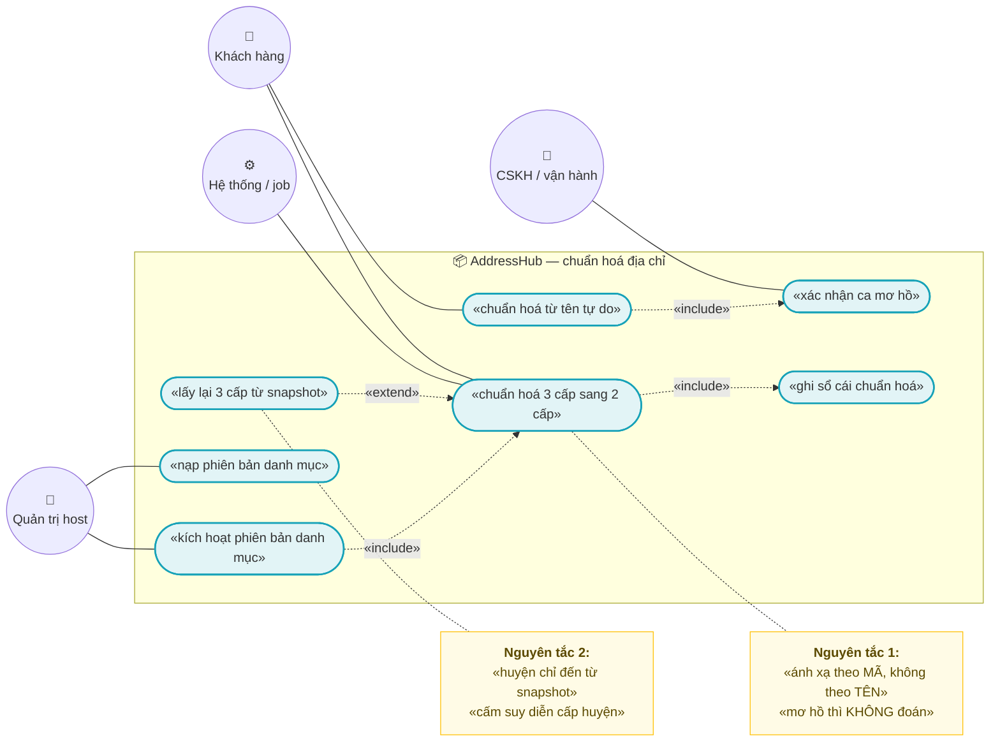
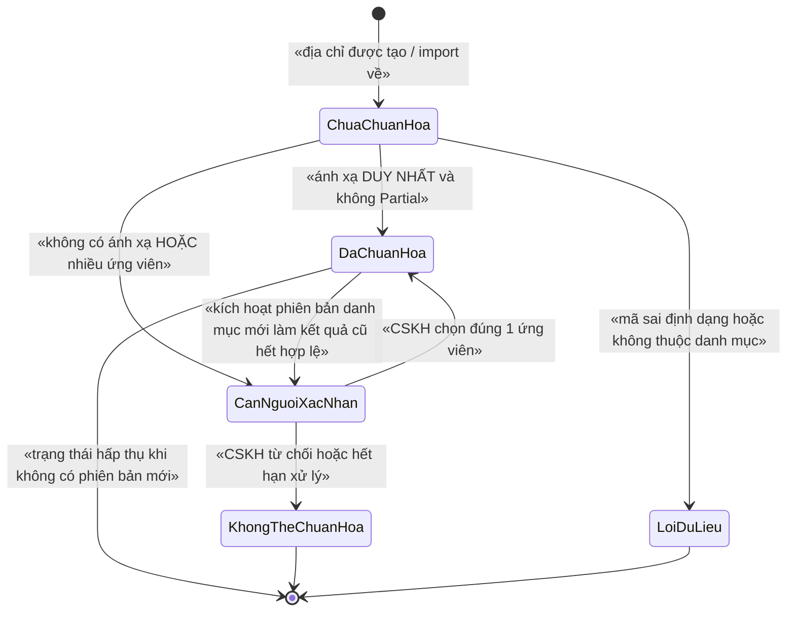
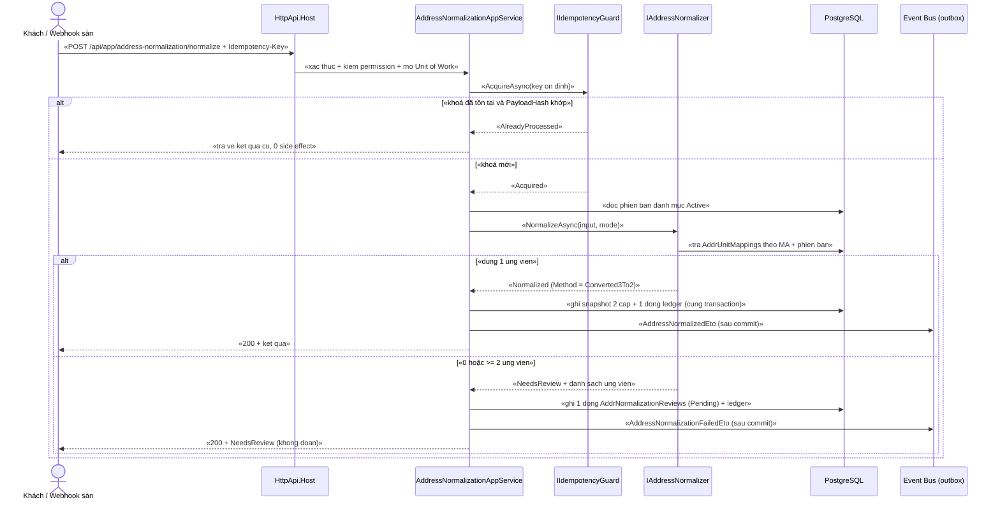

# `ADDR-003` — Chuẩn hoá địa chỉ khách hàng: convert 3 cấp ↔ 2 cấp, xử lý ca sáp nhập tỉnh

| Thuộc tính | Nội dung |
|---|---|
| **Mã** | `ADDR-003` |
| **Module** | **AddressHub** (module mới ở `modules/AddressHub/`) · value object `Address` ở `eCommerce.Kernel` |
| **Giai đoạn** | **GĐ0 — Pháp lý** (theo `docs/implementation-plan.md` §5 dòng 111 và Phụ lục A.3 dòng 389) |
| **Ưu tiên** | **Must have** — sai mô hình địa chỉ ở GĐ0 ⇒ phải migrate lại **toàn bộ đơn hàng** (`docs/implementation-plan.md` dòng 99) |
| **Trạng thái** | 🟡 `Draft` — chờ review |
| **Người viết / người review** | *(điền)* / **Kiến trúc trưởng + BA** (có yếu tố pháp lý: cần thêm người đã đọc Nghị quyết sắp xếp ĐVHC) |
| **Phiên bản / ngày** | `v0.1 — 13/10/2026` |
| **Tài liệu liên quan** | `ADDR-001` (tra cứu ĐVHC 2 cấp & 3 cấp — **chưa viết**) · `ADDR-002` (mã địa chỉ theo hãng vận chuyển — **chưa viết**) · `CUS-001` (sổ địa chỉ — **chưa viết**) · `SAL-002` (checkout/đặt hàng) · `XC-001` · `XC-002` · `XC-003` · `XC-004` · `XC-005` · `docs/implementation-plan.md` §6.1 · `docs/structure-and-techstack.md` dòng 14 |

> 📌 **Quy ước mã trong tài liệu này:** `ADR-nn` (quyết định thiết kế) · `BR-nn` (business rule) ·
> `NFR-nn` (phi chức năng) · `TC-nn` (test case) — tất cả thuộc `ADDR-003`.

---

## 0. Tóm tắt & quyết định thiết kế

**Tóm tắt:** từ **01/7/2025**, Việt Nam bỏ **cấp huyện** và sắp xếp lại **cấp tỉnh** (63 → **34**) và
**cấp xã** (→ **3.321** đơn vị). Mọi địa chỉ đang có — trong dữ liệu cũ, trong file của sàn TMĐT, trong
địa chỉ khách tự nhập — đều thuộc **mô hình 3 cấp cũ**. `ADDR-003` định nghĩa **một chiều chuẩn hoá duy
nhất**: địa chỉ được lưu dưới dạng **snapshot 2 cấp (tỉnh + xã) kèm phiên bản danh mục**, việc chuyển
**3 cấp → 2 cấp** là **TRA CỨU ÁNH XẠ có căn cứ pháp lý**, và **2 cấp → 3 cấp** chỉ được phép **đọc lại
snapshot cũ**, **tuyệt đối không suy diễn ra huyện**.

**Vì sao phải viết trước khi code:** đây là **breaking change đang diễn ra** (`docs/implementation-plan.md`
dòng 99: *"việc bỏ cấp huyện (01/07/2025) thay đổi mô hình dữ liệu địa chỉ ⇒ làm sai từ đầu phải migrate
lại toàn bộ đơn hàng"*). Và có **hai cái bẫy im lặng** đã nhận diện được:

1. **Mã đơn vị hành chính 3 cấp cũ và 2 cấp mới nằm CÙNG một không gian số** (cấp tỉnh 02 chữ số,
   cấp xã 05 chữ số — `Quyết định 19/2025/QĐ-TTg`). Lưu `WardCode` mà **không** kèm phiên bản danh mục
   ⇒ không biết đang tra vào bản 63 tỉnh hay bản 34 tỉnh, và **không có lỗi biên dịch nào**.
2. **Tên tỉnh sau sáp nhập KHÔNG suy ra được mã tỉnh**: tỉnh hợp nhất mang **mã của tỉnh nơi đặt trụ sở
   UBND**, không phải mã của tỉnh "được lấy tên" (`Quyết định 19/2025/QĐ-TTg`). Ánh xạ theo **tên** là
   hỏng dữ liệu âm thầm.

**Phạm vi:**
- ✅ Value object `Address` (bất biến, snapshot) + quy ước cột DB (2 cấp **và** snapshot 3 cấp cũ).
- ✅ Bảng **ánh xạ đơn vị hành chính** cũ → mới (nhiều-nhiều, có ca `Partial`) + **phiên bản danh mục**.
- ✅ Dịch vụ chuẩn hoá: 3 → 2 (chính) và 2 → 3 (**chỉ từ snapshot**).
- ✅ **Hàng đợi ca cần người xác nhận** (`NeedsReview`) — không đoán.
- ✅ **Sổ cái append-only** mọi lần chuẩn hoá + idempotency ở **mọi** biên vào.
- ✅ Xử lý ca sáp nhập tỉnh / sáp nhập xã / bỏ huyện / điều chỉnh một phần địa giới.

**Không nằm trong phạm vi:**
- ❌ **API tra cứu danh mục** (dropdown tỉnh/xã, autocomplete) — thuộc **`ADDR-001`** (**chưa viết**).
- ❌ **Bản đồ mã địa chỉ của từng hãng vận chuyển** (GHN/GHTK/ViettelPost) — thuộc **`ADDR-002`**
  (**chưa viết**); `ADDR-003` chỉ định nghĩa **hợp đồng dữ liệu** mà `ADDR-002` tiêu thụ.
- ❌ **Sổ địa chỉ của khách** (entity `Address` của `Customers`) — theo `docs/implementation-plan.md`
  dòng 181, entity đó thuộc module **Customers (`CUS-001`)**; `ADDR-003` cung cấp **dịch vụ + dữ liệu**.
- ❌ Sửa lỗi **tiền tố đôi** của lock key ở module Tax/Inventory — **phát hiện** ở §15.2 **F7** nhưng
  thuộc phạm vi tài liệu đó, không sửa ở đây.
- ❌ Địa chỉ **ngoài Việt Nam**, chia tách/hợp nhất đơn vị **hành chính trong tương lai** (chỉ nêu quy
  trình nạp phiên bản ở §11).

### 0.1 Quyết định thiết kế (ADR ngắn)

| # | Quyết định | Phương án đã cân nhắc | Lý do chọn | Hệ quả |
|---|---|---|---|---|
| **ADR-01** | **Mô hình CHUẨN là 2 cấp (tỉnh + xã)**; snapshot 3 cấp cũ được giữ như **dữ liệu hiển thị** | (a) giữ 3 cấp làm chuẩn, thêm huyện ảo · (b) 2 cấp làm chuẩn + snapshot 3 cấp | Cấp huyện **không còn tồn tại** (`Luật số 72/2025/QH15`, hiệu lực 01/7/2025) ⇒ lấy 3 cấp làm chuẩn là mô hình hoá một cấp **không có thật**; mọi hãng vận chuyển đang chuyển sang 2 cấp | Phải có đường chuyển 2 → 3 cho hãng chưa kịp chuyển — nhưng **chỉ từ snapshot** (**ADR-04**) |
| **ADR-02** | **CẤM lưu mã đơn vị hành chính mà không kèm `DatasetVersionId`** | (a) chỉ lưu mã · (b) lưu mã + phiên bản | Mã cấp tỉnh 02 chữ số và cấp xã 05 chữ số dùng **chung không gian số** cho cả bản 63 tỉnh (3 cấp) và bản 34 tỉnh (2 cấp) (`Quyết định 19/2025/QĐ-TTg`); mã "đã đóng" vẫn nằm trong dữ liệu cũ | Mọi truy vấn/validate phải có ngữ cảnh phiên bản; thêm 1 cột ở **mọi** bảng có mã ĐVHC |
| **ADR-03** | **Ánh xạ cũ → mới là DỮ LIỆU có phiên bản** (`AddrUnitMappings`), **không** hard-code, **không** suy luận theo tên | (a) viết bảng ánh xạ trong code · (b) import từ file chính thức | Danh mục luật là **dữ liệu**, không phải code — cùng nguyên tắc đã chốt ở `XC-006` (`docs/implementation-plan.md` Phụ lục A.3 dòng 381: *"danh mục luật là **dữ liệu**, không hard-code"*) | Có quy trình nạp phiên bản mới không cần release (§11) |
| **ADR-04** | **2 cấp → 3 cấp CHỈ đọc lại snapshot đã lưu**; thiếu snapshot ⇒ **NÉM LỖI** | (a) tra ngược sang một xã cũ đại diện · (b) chọn huyện theo tên · (c) ném lỗi | Ánh xạ là **N:1** (nhiều xã cũ → 1 xã mới) ⇒ tra ngược là **mơ hồ**; huyện đã bị bỏ nên mọi giá trị "huyện" sinh ra đều là **bịa** | Hãng vận chuyển còn cần 3 cấp ⇒ địa chỉ phải có snapshot; nếu không ⇒ `CarrierIncompatible` (§12) |
| **ADR-05** | **Mơ hồ ⇒ `NeedsReview`, KHÔNG đoán**; nhưng **không im lặng**: luôn có bản ghi review + metric + ETO | (a) chọn ứng viên "giống nhất" · (b) từ chối và bắt nhập lại | (a) tạo địa chỉ **sai** mà không ai biết (đúng loại lỗi "guard im lặng" bị cấm ở quy ước #11); (b) chặn cả luồng bán hàng | Có hàng đợi vận hành + màn hình xác nhận (§10); thêm bảng `AddrNormalizationReviews` |
| **ADR-06** | **Danh mục ĐVHC + ánh xạ là dữ liệu CẤP HOST** (không có `TenantId`) | (a) `IMultiTenant` như mọi bảng khác · (b) cấp host | Đây là **dữ liệu pháp lý giống nhau cho mọi tenant**; nhân bản theo tenant là vô nghĩa và làm lệch dữ liệu giữa các tenant | Bảng host dùng unique index thường; **bảng có `TenantId`** (review, ledger) **vẫn** phải `NULLS NOT DISTINCT` (**BR-09**) |
| **ADR-07** | **Sổ cái `AddrNormalizationLedger` APPEND-ONLY** | (a) chỉ ghi log text · (b) bảng append-only | Quy ước bất biến: *"sổ cái APPEND-ONLY"*; cần **truy vết được** vì sao một địa chỉ ra kết quả đó (phục vụ khiếu nại giao sai) | Cấm UPDATE/DELETE; sửa sai bằng **bút toán mới** |
| **ADR-08** | **`Address` value object ở `eCommerce.Kernel`**, dữ liệu + dịch vụ ở module `AddressHub` | (a) tất cả trong module · (b) tất cả trong `src/` · (c) tách như trên | `docs/structure-and-techstack.md` dòng 52 quy định `eCommerce.Kernel/ Money · Currency · **Address (value object)**`; kernel **không mang EF** nên không thể chứa entity/migration | `eCommerce.Kernel` **chưa tồn tại** trong code (§15.2 **F2**) — đây là việc của `docs/implementation-plan.md` §7.0 mục 1 |
| **ADR-09** | **Module `AddressHub` KHÔNG tham chiếu `src/`**; module/app khác gọi qua `.Application.Contracts` | (a) đặt entity vào `src/eCommerce.Domain` · (b) module riêng | Quy ước bất biến #3 — tiền lệ đã ghi rõ ở `modules/Tax/eCommerce.Tax.Domain/TaxErrorCodes.cs:6-8` và `modules/ChannelHub/eCommerce.ChannelHub.Domain/ChannelHubConsts.cs:8-10` | Phải tạo 4 project `modules/AddressHub/*` + thêm vào `eCommerce.slnx` |
| **ADR-10** | **Tên khoá lock của module KHÔNG chứa tiền tố `ecommerce:`** (tiền tố do `AbpDistributedLockOptions.KeyPrefix` ghép) | (a) hàm sinh khoá trả về chuỗi đầy đủ · (b) hàm trả về phần **sau** tiền tố | `XC-003` §5.4 đã **chứng minh bằng `redis-cli MONITOR`**: khoá thật = `KeyPrefix + name` (**ghép không dấu phân cách**), và cấu hình thật là `KeyPrefix = "ecommerce:"` (`src/eCommerce.HttpApi.Host/eCommerceHttpApiHostModule.cs:127`). Nếu hàm trả về cả tiền tố ⇒ khoá thật thành `ecommerce:ecommerce:…` | ⚠️ **Code hiện tại KHÔNG nhất quán** ⇒ ghi nhận ở §15.2 **F7**; `ADDR-003` theo (b) |
| **ADR-11** | **Idempotency ở MỌI biên vào**: `Idempotency-Key` ổn định + unique index + `IIdempotencyGuard` (`XC-002`) | (a) chỉ chống trùng ở job · (b) mọi biên | Quy ước bất biến: *"idempotency ở MỌI biên vào"*; import file là biên vào **dễ gây trùng nhất** (cùng một file luật được nạp 2 lần) | Có cột `IdempotencyKey` + `DatasetSourceHash`; nạp lại cùng file ⇒ **0 dòng thêm** (**BR-10**) |
| **ADR-12** | **Không thêm gói NuGet nào**; giữ **một** phiên bản ABP duy nhất | (a) thêm thư viện chuẩn hoá địa chỉ/`unaccent` của bên thứ ba · (b) dùng PostgreSQL | `Directory.Packages.props` đang ghim **ABP 10.7.0** cho **mọi** gói (`Directory.Packages.props:21-99`); nhu cầu tìm kiếm không dấu giải quyết bằng `unaccent`/`pg_trgm` của PostgreSQL 17 | Không đụng `Directory.Packages.props`; cần bật extension trong migration (§11) |

---

## 1. Use Case Specification

| Thuộc tính | Nội dung |
|---|---|
| **Use Case ID** | `ADDR-003` |
| **Use Case Name** | Chuẩn hoá địa chỉ khách hàng sang mô hình **2 cấp**, xử lý ca sáp nhập tỉnh/xã |
| **Description** | *"Là hệ thống bán hàng đa kênh, tôi muốn mọi địa chỉ giao hàng — dù đến từ dữ liệu cũ 3 cấp, từ sàn TMĐT, hay khách tự nhập — đều được chuẩn hoá về **2 cấp (tỉnh + xã) có căn cứ pháp lý**, để không giao sai hàng và không phải migrate lại đơn hàng về sau."* |
| **Actor(s)** | **Khách hàng** (nhập/chọn địa chỉ) · **Nhân viên CSKH** (xác nhận ca mơ hồ — `NeedsReview`) · **Quản trị host** (nạp/kích hoạt phiên bản danh mục) · **Hệ thống** (chuẩn hoá tự động, job nền, event bus) · **Sàn TMĐT / hãng vận chuyển** (nguồn địa chỉ ngoài) |
| **Priority** | **Must have** |
| **Trigger** | (a) khách tạo/sửa địa chỉ trong sổ địa chỉ; (b) đơn từ sàn TMĐT kéo về mang địa chỉ 3 cấp; (c) job chuẩn hoá lại dữ liệu cũ; (d) **quản trị kích hoạt phiên bản danh mục mới** ⇒ làm kết quả cũ trở nên cần soát lại |
| **Pre-Condition(s)** | • **Tenant hiện tại** (`TenantId` từ `ICurrentTenant`) — theo `XC-004` D8/BR-009, hệ thống đang chạy **1 tenant** ⇒ `TenantId` **có thể là `NULL`** ⇒ mọi unique index có `TenantId` **phải** `NULLS NOT DISTINCT` (tiền lệ: `src/eCommerce.EntityFrameworkCore/Migrations/20261013024226_Fix_NullableTenantId_UniqueIndexes.cs:39-86`).<br>• **`ChannelCode`** của đơn (nếu có) **chỉ để đối soát** — **không** tham gia quyết định chuẩn hoá địa chỉ (địa chỉ là thuộc tính của **người nhận**, không của kênh).<br>• **Tồn tại một phiên bản danh mục `Active`** cho từng cấu trúc cần dùng (2 cấp và 3 cấp). Thiếu ⇒ **NÉM** `eCommerce:Address:0011`, **không** mặc định ngầm (**BR-14**).<br>• **Ánh xạ cũ → mới đã được nạp** và có `LegalBasis` (**BR-05**).<br>• `[Authorize]` cấp class + permission **đã định nghĩa** (theo `XC-004` D2/D3; tiền lệ `src/eCommerce.Application/Channels/ChannelAppService.cs:27` và `src/eCommerce.Application.Contracts/Permissions/eCommercePermissionDefinitionProvider.cs:21-60`).<br>• **Redis 7** sẵn sàng cho khoá phân tán; nếu không, **vẫn phải đúng** nhờ unique index (theo `XC-003` D2). |
| **Post-Condition(s)** | • Mọi địa chỉ đã chuẩn hoá có **`ProvinceCode` + `WardCode` + `DatasetVersionId`** và **snapshot tên** tại thời điểm chuẩn hoá.<br>• Mọi lần chuẩn hoá có **đúng một** bản ghi `AddrNormalizationLedger` (append-only).<br>• Ca mơ hồ **không** bị đoán: tồn tại **đúng một** bản ghi `AddrNormalizationReviews` ở trạng thái `Pending` (**BR-06/BR-07**).<br>• **Không** trường nào chứa "huyện" được sinh ra ngoài snapshot cũ (**BR-04**). |
| **Basic Flow** | 1. Client gửi `NormalizeAddressDto` (3 cấp cũ **hoặc** 2 cấp **hoặc** chỉ chuỗi tự do) kèm `Idempotency-Key`.<br>2. App service `[Authorize]` kiểm permission, mở **Unit of Work**, gọi `IIdempotencyGuard.AcquireAsync(...)` (`XC-002`).<br>3. `IAddressNormalizer` tra `AddrUnitMappings` theo **(DatasetFrom, DatasetTo, Level, Code)** — **chỉ theo MÃ** (**BR-03**).<br>4. Tìm thấy **duy nhất** một đích và `MappingKind ≠ Partial` ⇒ ghi `NormalizedAddress` + 1 dòng ledger, phát `AddressNormalizedEto`.<br>5. Ghi **cùng transaction** dữ liệu địa chỉ + ledger + outbox (`XC-002` BR-001).<br>6. Trả `AddressNormalizationResultDto` (kèm `DatasetVersionId` và `Method`). |
| **Alternative Flow** | **A1: Ca sáp nhập tỉnh** — mã tỉnh cũ **đã đóng** ⇒ ánh xạ sang mã tỉnh mới **theo bảng**, không theo tên; tên tỉnh trong snapshot giữ **tên cũ** ở trường `LegacyProvinceName` và **tên mới** ở `ProvinceName` (**BR-03**, §5.2).<br>**A2: Ca `Partial` (điều chỉnh một phần địa giới)** — một xã cũ được tách một phần sang xã mới khác ⇒ **nhiều ứng viên** ⇒ `NeedsReview` + danh sách ứng viên, **không** tự chọn (**BR-06**).<br>**A3: Yêu cầu 3 cấp cho hãng vận chuyển** — chỉ trả về từ `Legacy*` snapshot; thiếu ⇒ ném `eCommerce:Address:0005` (**BR-04**).<br>**A4: Job chuẩn hoá hàng loạt** — khoá phân tán `SkipIfBusy`, ghi ledger theo khoá `Address:Batch:{batchId}:{addressId}`, **không** dừng cả lô vì 1 ca mơ hồ.<br>**A5: Nạp lại cùng một file danh mục** — `DatasetSourceHash` trùng + metadata khớp ⇒ trả về phiên bản đã có, **0 dòng thêm** (**BR-10**). |
| **Exception Flow** | **E1:** mã tỉnh/xã **sai định dạng** hoặc không thuộc phiên bản danh mục ⇒ `eCommerce:Address:0001`.<br>**E2:** cùng `IdempotencyKey` nhưng payload **khác** ⇒ **`eCommerce:Messaging:0002`** (theo `XC-002` BR-006) — **không** ghi đè.<br>**E3:** yêu cầu chuyển 2 → 3 mà **không** có snapshot ⇒ `eCommerce:Address:0005` — **cấm** bịa huyện.<br>**E4:** dùng đơn vị hành chính **đã đóng mã** làm đích ⇒ `eCommerce:Address:0010`.<br>**E5:** chuyển trạng thái sai (dataset/review) ⇒ `eCommerce:Address:0003` / `0004`; `UPDATE … WHERE Status = @expected` ảnh hưởng **0 dòng** ⇒ `eCommerce:Address:0008`.<br>**E6:** phiên bản danh mục chưa `Active` ⇒ `eCommerce:Address:0011`.<br>**E7:** file import thiếu cột/sai định dạng ⇒ `eCommerce:Address:0006`; `SourceHash` trùng nhưng metadata khác ⇒ `eCommerce:Address:0007`. |
| **Business Rules** | • **BR-01**: Mọi địa chỉ đã lưu là **SNAPSHOT bất biến** (mã + tên + `DatasetVersionId`); sửa địa chỉ ⇒ ghi **bút toán mới** vào ledger, **cấm** UPDATE ngầm không vết.<br>• **BR-02**: **CẤM** lưu `ProvinceCode`/`WardCode`/`DistrictCode` mà **không** kèm `DatasetVersionId`.<br>• **BR-03**: **CẤM** ánh xạ đơn vị hành chính theo **TÊN**; chỉ ánh xạ theo **MÃ** (nhiều tên tỉnh trùng/đổi sau sáp nhập).<br>• **BR-04**: **CẤM** suy diễn/tự sinh cấp huyện khi chuyển 2 → 3; chỉ dùng snapshot 3 cấp đã lưu; thiếu ⇒ `eCommerce:Address:0005`.<br>• **BR-05**: Mọi bản ghi ánh xạ **phải** có `LegalBasis` không rỗng (số hiệu + mục phụ lục), ràng buộc bằng `CHECK` ở DB.<br>• **BR-06**: Chỉ coi là **chuẩn hoá tự động** khi ánh xạ **duy nhất** và `MappingKind ≠ Partial`; mọi trường hợp khác ⇒ `NeedsReview`.<br>• **BR-07**: Trạng thái `NeedsReview` **phải** sinh bản ghi review + metric + ETO; **cấm** bỏ qua im lặng (quy ước #11).<br>• **BR-08**: `AddrNormalizationLedger` **append-only** — **cấm** UPDATE/DELETE kể cả soft-delete.<br>• **BR-09**: Mọi unique index có `TenantId` **phải** `NULLS NOT DISTINCT` (theo `XC-004` BR-009) — tiền lệ migration đã có.<br>• **BR-10**: Mọi biên vào (import file · HTTP · webhook · job) **phải** idempotent bằng khoá **ỔN ĐỊNH** + unique index + `IIdempotencyGuard` (`XC-002`).<br>• **BR-11**: Chuyển trạng thái sai **PHẢI NÉM LỖI**; `UPDATE` 0 dòng ⇒ **NÉM LỖI**, không coi là thành công.<br>• **BR-12**: Mọi thao tác ghi qua **Unit of Work**; dữ liệu địa chỉ + ledger + review + outbox ghi **cùng transaction**.<br>• **BR-13**: Mọi app service của `AddressHub` **phải** có `[Authorize]` ở **cấp class** và permission **đã định nghĩa** (`XC-004` BR-001/BR-002).<br>• **BR-14**: **CẤM hard-code** danh mục/ánh xạ đơn vị hành chính trong code — danh mục là **DỮ LIỆU có phiên bản**.<br>• **BR-15**: Module `AddressHub` **cấm** tham chiếu `src/`; bên gọi dùng `eCommerce.AddressHub.Application.Contracts`.<br>• **BR-16**: Đơn vị hành chính `IsClosed = true` **cấm** dùng làm **đích** chuẩn hoá; chỉ được hiển thị ở trường `Legacy*` ⇒ ném `eCommerce:Address:0010`. |
| **Non-Functional Requirement** | • **NFR-01**: Chuẩn hoá 1 địa chỉ (tra cứu đã warm cache) p95 **< 20 ms**.<br>• **NFR-02**: Import danh mục **3.321** xã + bộ 3 cấp cũ < **60 s**; chạy lại **2 lần ⇒ +0 dòng**.<br>• **NFR-03**: **Tái lập 100 %**: cùng input + cùng `DatasetVersionId` ⇒ cùng kết quả (10.000 ca).<br>• **NFR-04**: **0** chỗ suy diễn huyện (test quét mã nguồn).<br>• **NFR-05**: **100 %** bản ghi mapping có `LegalBasis` (CHECK ở DB) .<br>• **NFR-06**: **100 %** lần chuẩn hoá có ledger + `CorrelationId` (`XC-005`).<br>• **NFR-07**: Cách ly tenant: tenant A **không** đọc review/ledger của tenant B.<br>• **NFR-08**: **0** `double`/`float` trong `AddressHub`; nếu có trường tiền (phí ước tính) **phải** dùng `Money` + minor units (`XC-001`).<br>• **NFR-09**: Tra ứng viên theo tên (không dấu) p95 **< 100 ms**; bộ danh mục trong bộ nhớ **≤ 50 MB**.<br>• **NFR-10**: **100 %** endpoint trả `401` khi không token và `403` khi thiếu quyền (`XC-004`). |

---

## 2. Sơ đồ Use Case



### Chú giải

| Ký hiệu | Ý nghĩa |
|---|---|
| ⭕ Xanh lá | Actor |
| 🟦 Bầu dục xanh dương | Use Case |
| 🟨 Khung vàng | Note (nguyên tắc bất di bất dịch) |
| `-.«include».->` | Quan hệ bao hàm (use case con **luôn** chạy) |

---

## 3. Sơ đồ trạng thái (state machine)

### 3.1 Vòng đời trạng thái chuẩn hoá của một địa chỉ



**Bảng chuyển trạng thái & guard — mọi chuyển sai **PHẢI NÉM LỖI** (quy ước #11):**

| # | Từ → Sang | Ai được phép | Guard (điều kiện cho phép) | Hành động kèm theo | Nếu guard sai thì? |
|---|---|---|---|---|---|
| 1 | `[*]` → `ChuaChuanHoa` | Khách · hệ thống · webhook | Có `TenantId` (có thể `NULL`) + tồn tại phiên bản danh mục `Active` | Tạo bản ghi địa chỉ, `NormalizationStatus = ChuaChuanHoa` | Không có danh mục `Active` ⇒ **NÉM** `eCommerce:Address:0011` |
| 2 | `ChuaChuanHoa` → `DaChuanHoa` | Hệ thống (tự động) | Tìm thấy **đúng 1** đích, `MappingKind ≠ Partial`, đích `IsClosed = false` | Ghi snapshot 2 cấp + 1 dòng ledger + phát `AddressNormalizedEto` | Đích đã đóng mã ⇒ **NÉM** `eCommerce:Address:0010` |
| 3 | `ChuaChuanHoa` → `CanNguoiXacNhan` | Hệ thống (tự động) | **0** hoặc **≥ 2** ứng viên, hoặc có `Partial` | Tạo **đúng 1** bản ghi `AddrNormalizationReviews` (`Pending`) + metric + `AddressNormalizationFailedEto` | Thiếu bản ghi review ⇒ **vi phạm BR-07** (bắt ở review + `TC-08`) |
| 4 | `ChuaChuanHoa` → `LoiDuLieu` | Hệ thống | Mã sai định dạng ( không khớp `^[0-9]{2}$` / `^[0-9]{5}$` ) hoặc không thuộc phiên bản | Ledger ghi `Outcome = InvalidInput` + metric | — |
| 5 | `CanNguoiXacNhan` → `DaChuanHoa` | CSKH (`eCommerce.Address.Normalization.Review`) | `Status = Pending` **và** ứng viên được chọn **nằm trong** tập ứng viên đã lưu **và** `RowVersion` khớp | Ghi snapshot + ledger `Method = ManualConfirmed`, `ConfirmedBy`/`ConfirmedAtUtc` | Ứng viên ngoài tập ⇒ **NÉM** `eCommerce:Address:0009`; `RowVersion` lệch ⇒ **NÉM** `eCommerce:Address:0008` |
| 6 | `CanNguoiXacNhan` → `KhongTheChuanHoa` | CSKH · job hết hạn | `Status = Pending` **và** (CSKH từ chối **hoặc** quá `ReviewDeadlineUtc`) | Ledger `Outcome = Unresolvable`; địa chỉ **không** dùng được để tạo vận đơn | Chuyển khi `Status ≠ Pending` ⇒ **NÉM** `eCommerce:Address:0004` |
| 7 | `DaChuanHoa` → `CanNguoiXacNhan` | Job (khi kích hoạt phiên bản mới) | Tồn tại phiên bản `Active` mới **và** ánh xạ lại cho ra kết quả **khác** | Tạo review **mới** (không sửa review cũ); ledger `Outcome = ReNormalizeRequired` | Kích hoạt phiên bản chưa `Validating` xong ⇒ **NÉM** `eCommerce:Address:0003` |
| 8 | `DaChuanHoa` → `DaChuanHoa` | — | **Không** có guard cho phép khi `DatasetVersionId` **không đổi** | — | Gọi chuẩn hoá lại **cùng phiên bản** ⇒ trả kết quả cũ (**idempotent**, `BR-10`), **không** ghi ledger thứ hai |
| 9 | `KhongTheChuanHoa` / `LoiDuLieu` → bất kỳ | — | **KHÔNG** có guard nào cho phép | — | 🚨 **Trạng thái hấp thụ (absorbing)**: mọi chuyển dịch khỏi 2 trạng thái này ⇒ **NÉM** `eCommerce:Address:0004` — sửa sai bằng **bản ghi địa chỉ mới**, không hồi sinh bản ghi cũ |

> ⚠️ **Trạng thái nguy hiểm nhất là `DaChuanHoa` + phiên bản danh mục bị thay:** kết quả cũ vẫn "trông
> đúng" nhưng có thể trỏ vào đơn vị hành chính đã đổi. Vì vậy việc **kích hoạt phiên bản mới bắt buộc**
> chạy job soát lại và **đếm** số bản ghi bị ảnh hưởng (§11, metric `address_renormalize_required_total`).

### 3.2 Vòng đời phiên bản danh mục (`AddrDatasets.Status`)

| # | Từ → Sang | Guard | Nếu guard sai |
|---|---|---|---|
| 1 | `[*]` → `Draft` | Có `DatasetCode` + `Structure` (2 hoặc 3) + `LegalBasis` | **NÉM** `eCommerce:Address:0006` |
| 2 | `Draft` → `Validating` | File đã nhận, `DatasetSourceHash` **mới** (chưa có phiên bản nào dùng hash này) | Trùng hash + metadata khác ⇒ **NÉM** `eCommerce:Address:0007` |
| 3 | `Validating` → `Imported` | **0** lỗi toàn vẹn: mọi `Ward.ProvinceId` tồn tại, mọi mã khớp regex, **100 %** mapping có `LegalBasis` | Còn lỗi ⇒ `Validating` → `Failed` + báo cáo dòng lỗi |
| 4 | `Imported` → `Active` | Người có quyền `eCommerce.Address.Dataset.Activate` **và** phiên bản cùng `Structure` trước đó chuyển `Superseded` **trong cùng transaction** | **NÉM** `eCommerce:Address:0003` |
| 5 | `Active` → `Superseded` | Có phiên bản mới hơn được kích hoạt | `Superseded` là **hấp thụ** (không quay lại `Active`) |
| 6 | `Failed` / `Superseded` → bất kỳ | **KHÔNG** cho phép | **NÉM** `eCommerce:Address:0003` |

---

## 4. Sequence Diagram & luồng dữ liệu

### 4.1 Chuẩn hoá một địa chỉ 3 cấp (có nhánh mơ hồ)



### 4.2 DFD — đường đi của một địa chỉ (mô tả bằng bảng, không dùng sơ đồ thứ 4)

| Bước | Nguồn | Xử lý | Đích | Ghi chú |
|---|---|---|---|---|
| 1 | Khách nhập / webhook sàn / job | Chuẩn hoá định dạng thô (trim, gộp khoảng trắng, chuẩn hoá tiếng Việt có dấu) | `Address` thô | **Không** sửa chuỗi địa chỉ đường/phố (giữ nguyên văn của khách) |
| 2 | `Address` thô (3 cấp) | Tra `AddrUnitMappings` theo **(DatasetFrom, DatasetTo, Level, Code)** | Ứng viên 2 cấp | **Chỉ theo MÃ** (**BR-03**) |
| 3 | Ứng viên | Quyết định: duy nhất ⇒ tự động; còn lại ⇒ review | `NormalizedAddress` **hoặc** `AddrNormalizationReviews` | **ADR-05** |
| 4 | `NormalizedAddress` | Ghi snapshot + ledger + outbox **cùng transaction** | PostgreSQL | **BR-12** |
| 5 | Yêu cầu 3 cấp (hãng vận chuyển) | Đọc `Legacy*` snapshot | `LegacyThreeLevelAddress` | Thiếu ⇒ `eCommerce:Address:0005` (**BR-04**) |
| 6 | `AddressNormalizedEto` | Consumer: `Customers` (sổ địa chỉ) · `Sales` (đơn) · `ShippingHub` (mã hãng — `ADDR-002`) | Module khác | Qua outbox (`XC-002` BR-001) |

> 📌 **Chênh lệch cần ghi rõ (thói quen tốt của tài liệu gốc):** số **"địa chỉ cần xác nhận"** trên màn hình
> vận hành là số bản ghi review `Pending`, **không** bằng số địa chỉ có `NormalizationStatus = CanNguoiXacNhan`
> (một địa chỉ có thể sinh review mới sau khi kích hoạt phiên bản danh mục, và review cũ đã `Confirmed`).
> UI **phải** hiển thị cả hai con số và nhãn bộ lọc — nếu không sẽ bị báo "đếm sai".

---

## 5. Mô hình dữ liệu

### 5.1 ERD (mô tả dạng bảng — sơ đồ Mermaid của tài liệu này đã dùng đủ 3 khối ở §2, §3, §4)

| Quan hệ | Bội số | Ghi chú |
|---|---|---|
| `AddrDatasets` → `AddrProvinces` | 1 → N | mỗi phiên bản danh mục có bộ tỉnh riêng |
| `AddrDatasets` → `AddrDistricts` | 1 → N | **rỗng** với phiên bản 2 cấp (huyện không còn tồn tại) |
| `AddrDatasets` → `AddrWards` | 1 → N | cấp xã/phường/đặc khu |
| `AddrProvinces` → `AddrDistricts` | 1 → N | **chỉ** có ở phiên bản 3 cấp |
| `AddrProvinces` → `AddrWards` | 1 → N | **luôn** có (kể cả mô hình 2 cấp — quan hệ này là đường chuẩn) |
| `AddrDistricts` → `AddrWards` | 1 → N | **nullable**: `NULL` ở phiên bản 2 cấp |
| `AddrDatasets` (from) → `AddrUnitMappings` → `AddrDatasets` (to) | N → N | ánh xạ **giữa hai phiên bản**; một đơn vị cũ có thể có **nhiều** đích |
| `AddrNormalizationReviews` → `AddrNormalizationLedger` | 1 → N | mọi lần xác nhận/từ chối đều ghi ledger |

### 5.2 Bảng & cột (Data Dictionary)

**Bảng `AddrDatasets`** — *phiên bản danh mục đơn vị hành chính* — **dữ liệu cấp HOST** (ADR-06)

| Cột | Kiểu | Null? | Nguồn / ý nghĩa | Ghi chú |
|---|---|---|---|---|
| `Id` | `uuid` | ✖ | khoá chính | |
| `DatasetCode` | `varchar(64)` | ✖ | ví dụ `VN-2025-2LEVEL`, `VN-2024-3LEVEL` | **không** có `TenantId` (ADR-06) |
| `Structure` | `smallint` | ✖ | `TwoLevel = 2` · `ThreeLevel = 3` | |
| `Status` | `smallint` | ✖ | `Draft=0` · `Validating=1` · `Imported=2` · `Active=3` · `Superseded=4` · `Failed=5` | state machine §3.2 |
| `LegalBasis` | `varchar(512)` | ✖ | số hiệu văn bản (ví dụ `19/2025/QĐ-TTg`) | **BR-05** |
| `EffectiveFrom` / `EffectiveTo` | `date` | ✖ / ✔ | hiệu lực của danh mục | |
| `DatasetSourceHash` | `char(64)` | ✖ | **SHA-256** của file nguồn | **idempotency import** (**BR-10**) |
| `RowCounts` | `jsonb` | ✖ | `{"provinces":34,"wards":3321,"districts":0}` | để đối soát sau import |
| `ImportedAtUtc` / `ActivatedAtUtc` | `timestamptz` | ✔ | | mọi thời điểm là **UTC** (quy ước `eCommerceDomainModule.cs`: ép `AbpClockOptions.Kind = Utc`) |
| `RowVersion` | `bytea`/`xmin` | ✖ | optimistic concurrency | 2 người cùng kích hoạt |

**Bảng `AddrProvinces`** *(cấp tỉnh)* — host

| Cột | Kiểu | Null? | Ý nghĩa | Ghi chú |
|---|---|---|---|---|
| `Id` | `uuid` | ✖ | | |
| `DatasetId` | `uuid` | ✖ | FK → `AddrDatasets` | **mọi** truy vấn phải kèm `DatasetId` (**BR-02**) |
| `Code` | `char(2)` | ✖ | mã tỉnh 02 chữ số | `Quyết định 19/2025/QĐ-TTg`: cấp tỉnh = 02 chữ số `01`–`99` |
| `Name` | `varchar(128)` | ✖ | tên hiện hành | |
| `UnitType` | `smallint` | ✖ | `Tinh=0` · `ThanhPho=1` | 34 đơn vị gồm 28 tỉnh + 6 thành phố |
| `IsClosed` | `boolean` | ✖ | mã **đã đóng**, không cấp lại | **BR-16** |
| `ClosedAtUtc` | `timestamptz` | ✔ | | |

**Bảng `AddrDistricts`** *(cấp huyện — **chỉ để tương thích 3 cấp cũ**)* — host

| Cột | Kiểu | Null? | Ý nghĩa | Ghi chú |
|---|---|---|---|---|
| `Id` | `uuid` | ✖ | | |
| `DatasetId` | `uuid` | ✖ | FK | |
| `ProvinceId` | `uuid` | ✖ | FK | |
| `Code` | `char(3)` | ✖ | mã huyện 03 chữ số (bộ cũ) | |
| `Name` | `varchar(128)` | ✖ | | |
| `IsClosed` | `boolean` | ✖ | **luôn `true`** ở phiên bản 2 cấp | 🚨 Xem **F6** §15.2: bảng này **không** được trở thành nguồn sự thật thứ hai |

**Bảng `AddrWards`** *(cấp xã/phường/đặc khu)* — host

| Cột | Kiểu | Null? | Ý nghĩa | Ghi chú |
|---|---|---|---|---|
| `Id` | `uuid` | ✖ | | |
| `DatasetId` | `uuid` | ✖ | FK | |
| `ProvinceId` | `uuid` | ✖ | FK — **luôn** có | |
| `DistrictId` | `uuid` | ✔ | FK — `NULL` ở phiên bản 2 cấp | |
| `Code` | `char(5)` | ✖ | mã xã 05 chữ số | `Quyết định 19/2025/QĐ-TTg`: cấp xã = 05 chữ số `00001`–`99999` |
| `Name` | `varchar(160)` | ✖ | | |
| `UnitType` | `smallint` | ✖ | `Xa=0` · `Phuong=1` · `DacKhu=2` | sau sắp xếp còn **3.321** đơn vị cấp xã |
| `NameNormalized` | `varchar(160)` | ✖ | tên **bỏ dấu**, chữ thường | tìm kiếm bằng `unaccent` + `pg_trgm` (ADR-12) |
| `IsClosed` | `boolean` | ✖ | mã đã đóng | **BR-16** |

**Bảng `AddrUnitMappings`** — *ánh xạ đơn vị hành chính cũ → mới* — host, **append-only theo phiên bản**

| Cột | Kiểu | Null? | Ý nghĩa | Ghi chú |
|---|---|---|---|---|
| `Id` | `uuid` | ✖ | | |
| `DatasetFromId` / `DatasetToId` | `uuid` | ✖ | hai phiên bản danh mục | |
| `FromLevel` / `ToLevel` | `smallint` | ✖ | `1`=tỉnh · `2`=huyện · `3`=xã | cho phép ánh xạ `3→3`, `1→1`, `2→3` |
| `FromCode` / `ToCode` | `varchar(5)` | ✖ | **mã**, không phải tên (**BR-03**) | |
| `MappingKind` | `smallint` | ✖ | `Exact=0` (nhập nguyên đơn vị) · `Partial=1` (chỉ **một phần** diện tích/dân số) · `RenamedOnly=2` (chỉ đổi tên, mã không đổi) | `Partial` ⇒ **buộc** `NeedsReview` (**BR-06**) |
| `CoverageNote` | `varchar(512)` | ✔ | mô tả phần bị tách, ví dụ *"phần còn lại của thị trấn X"* | **bắt buộc** khi `MappingKind = Partial` |
| `LegalBasis` | `varchar(512)` | ✖ | số hiệu Nghị quyết + mục phụ lục | **BR-05**, CHECK ở DB |
| `IsActive` | `boolean` | ✖ | có hiệu lực áp dụng | |

**Bảng `AddrNormalizationReviews`** — *hàng đợi ca cần người xác nhận* — **có `TenantId`**

| Cột | Kiểu | Null? | Ý nghĩa | Ghi chú |
|---|---|---|---|---|
| `Id` | `uuid` | ✖ | | |
| `TenantId` | `uuid` | ✔ | tenant sở hữu | **có thể `NULL`** ⇒ index phải `NULLS NOT DISTINCT` |
| `SourceEntityType` | `varchar(32)` | ✖ | `CustomerAddress` · `OrderShippingAddress` · `ImportedOrder` | |
| `SourceEntityId` | `uuid` | ✖ | tham chiếu **mềm** (không FK sang module khác) | |
| `InputHash` | `char(64)` | ✖ | SHA-256 của **đầu vào đã chuẩn hoá** | chống tạo review trùng |
| `ReasonCode` | `smallint` | ✖ | `NoMapping=0` · `MultipleCandidates=1` · `PartialMapping=2` · `NameOnlyInput=3` | |
| `Candidates` | `jsonb` | ✖ | danh sách ứng viên (mã + tên + `MappingKind`) để UI hiển thị | |
| `Status` | `smallint` | ✖ | `Pending=0` · `Confirmed=1` · `Rejected=2` · `Expired=3` | state machine §3.1 |
| `ChosenToCode` | `varchar(5)` | ✔ | mã xã được chọn | **phải** nằm trong `Candidates` (**E5**) |
| `ReviewDeadlineUtc` | `timestamptz` | ✖ | hạn xử lý | quá hạn ⇒ job chuyển `Expired` |
| `ConfirmedBy` / `ConfirmedAtUtc` | `uuid` / `timestamptz` | ✔ | người xác nhận | |
| `RowVersion` | `bytea`/`xmin` | ✖ | optimistic concurrency | 2 CSKH cùng xác nhận |

**Bảng `AddrNormalizationLedger`** — **SỔ CÁI APPEND-ONLY** — có `TenantId`

| Cột | Kiểu | Null? | Ý nghĩa | Ghi chú |
|---|---|---|---|---|
| `Id` | `uuid` | ✖ | | |
| `TenantId` | `uuid` | ✔ | | `NULLS NOT DISTINCT` |
| `IdempotencyKey` | `varchar(256)` | ✖ | khoá **ổn định** của biên vào | **BR-10** |
| `SourceEntityType` / `SourceEntityId` | `varchar(32)` / `uuid` | ✖ | đối tượng được chuẩn hoá | |
| `InputSnapshot` | `jsonb` | ✖ | đầu vào **nguyên trạng** (mã cũ + chuỗi tự do) | cần cho khiếu nại |
| `Outcome` | `smallint` | ✖ | `Normalized=0` · `NeedsReview=1` · `InvalidInput=2` · `Unresolvable=3` · `ReNormalizeRequired=4` | |
| `Method` | `smallint` | ✖ | `Converted3To2=0` · `AlreadyTwoLevel=1` · `ManualConfirmed=2` · `FromCarrierData=3` | |
| `DatasetFromId` / `DatasetToId` | `uuid` | ✔ | phiên bản dùng để suy ra kết quả | **BR-02** |
| `FromProvinceCode`/`FromDistrictCode`/`FromWardCode` | `varchar(5)` | ✔ | mã cũ | |
| `ToProvinceCode` / `ToWardCode` | `varchar(5)` | ✔ | mã mới | |
| `OccurredAtUtc` | `timestamptz` | ✖ | | |
| `CorrelationId` | `varchar(128)` | ✖ | truy vết (`XC-005`) | |
| `Note` | `varchar(2048)` | ✔ | | |

> 🔒 **APPEND-ONLY (BR-08):** không có cột `LastModificationTime`, không soft-delete; **cấm** UPDATE/DELETE.
> Sửa sai ⇒ ghi **bút toán mới** với `Outcome` tương ứng.

**Index & ràng buộc**

| Bảng | Loại | Cột / biểu thức | Mục đích |
|---|---|---|---|
| `AddrDatasets` | UNIQUE | `(DatasetCode)` | một mã phiên bản định nghĩa một lần (**host — index thường**) |
| `AddrDatasets` | UNIQUE | `(Structure) WHERE Status = 3` | 🚩 **tối đa MỘT phiên bản `Active` cho mỗi cấu trúc** |
| `AddrDatasets` | UNIQUE | `(DatasetSourceHash)` | nạp lại cùng file ⇒ không tạo phiên bản mới (**BR-10**) |
| `AddrProvinces` | UNIQUE | `(DatasetId, Code)` | mã tỉnh duy nhất trong phiên bản |
| `AddrDistricts` | UNIQUE | `(DatasetId, Code)` | |
| `AddrWards` | UNIQUE | `(DatasetId, Code)` | mã xã duy nhất trong phiên bản (**BR-02**) |
| `AddrWards` | INDEX | `(DatasetId, ProvinceId)` · `(DatasetId, DistrictId)` | tra cứu dropdown — `ADDR-001` |
| `AddrWards` | INDEX | `gin (NameNormalized gin_trgm_ops)` | tìm theo tên không dấu (ADR-12) |
| `AddrUnitMappings` | UNIQUE | `(DatasetFromId, DatasetToId, FromLevel, FromCode, ToLevel, ToCode)` | một cặp ánh xạ khai báo một lần |
| `AddrUnitMappings` | INDEX | `(DatasetFromId, DatasetToId, FromLevel, FromCode)` | **truy vấn nóng nhất** của normalizer |
| `AddrNormalizationReviews` | **UNIQUE `NULLS NOT DISTINCT`** | `(TenantId, SourceEntityType, SourceEntityId, InputHash)` | chống tạo review trùng (**BR-09**) |
| `AddrNormalizationReviews` | INDEX | `(TenantId, Status, CreatedAtUtc)` | hàng đợi vận hành |
| `AddrNormalizationLedger` | **UNIQUE `NULLS NOT DISTINCT`** | `(TenantId, IdempotencyKey)` | ⭐ **hàng rào idempotency chính** (**BR-10**) |
| `AddrNormalizationLedger` | INDEX | `(TenantId, SourceEntityId, OccurredAtUtc)` | tra vết một địa chỉ |
| `AddrProvinces`/`AddrWards`/`AddrDistricts` | CHECK | `Code ~ '^[0-9]{2}$'` / `'^[0-9]{5}$'` / `'^[0-9]{3}$'` | chặn mã sai định dạng ở tầng DB (**BR-14**) |
| `AddrUnitMappings` | CHECK | `LegalBasis <> ''` | **BR-05** — 100 % ánh xạ phải có căn cứ |
| `AddrUnitMappings` | CHECK | `MappingKind <> 1 OR CoverageNote IS NOT NULL` | `Partial` **bắt buộc** có mô tả phần bị tách |
| `AddrDatasets` | CHECK | `Structure IN (2,3)` | |

> 📌 **Tiền lệ `NULLS NOT DISTINCT`:** mọi unique index **có `TenantId`** phải sinh bằng **SQL thô** trong
> migration (EF Core **không** mô hình hoá thuộc tính này) — xem
> `src/eCommerce.EntityFrameworkCore/Migrations/20261013024226_Fix_NullableTenantId_UniqueIndexes.cs:39-86`
> và test chống tái phát `test/eCommerce.IntegrationTests/PostgreSqlSchemaTests.cs:144-174`.
> ⚠️ **Với `ADDR-003` phải viết NGAY trong migration tạo bảng**, không để nợ như `XC-004` F1 đã phải sửa lại.

> 💰 **Tiền tệ — ghi rõ để không hiểu nhầm là bỏ sót:** `ADDR-003` **không có trường tiền nào**
> ⇒ quy ước `decimal`/`Money`/**cấm `==` trên tiền** (`XC-001`) **không áp dụng trực tiếp** ở đây.
> Nhưng có **hai ràng buộc kế thừa** vẫn hiệu lực: (1) **cấm** `double`/`float` trong module (**NFR-08**);
> (2) khi `SHP-*` tính **phí vận chuyển** từ địa chỉ, phí **phải** dùng `Money` + minor units
> (`XC-001` BR-007) và so sánh theo `ToMinorUnits()` — **tuyệt đối không** `==` trên `decimal`.

---

## 6. Hợp đồng API

### 6.1 Thư viện dùng chung + module

```csharp
// ── eCommerce.Kernel (shared — CHƯA CÓ trong code, xem §15.2 F2) ────────────────
namespace eCommerce.Kernel.Addressing;

/// Snapshot 2 cấp — BẤT BIẾN. Mọi giá trị đã lưu KHÔNG bao giờ tự đổi khi danh mục đổi (BR-01).
public readonly record struct Address
{
    public string CountryCode { get; }        // "VN"
    public string ProvinceCode { get; }       // 02 chữ số
    public string ProvinceName { get; }       // snapshot TÊN tại thời điểm chuẩn hoá
    public string WardCode { get; }           // 05 chữ số
    public string WardName { get; }           // snapshot TÊN
    public string StreetLine { get; }         // nguyên văn của khách — không chuẩn hoá
    public Guid DatasetVersionId { get; }     // 🚨 BẮT BUỘC (BR-02)

    // Snapshot LỊCH SỬ 3 cấp — chỉ để HIỂN THỊ và trả cho hãng vận chuyển (BR-04)
    public string? LegacyProvinceCode { get; }
    public string? LegacyProvinceName { get; }
    public string? LegacyDistrictCode { get; }
    public string? LegacyDistrictName { get; }
    public string? LegacyWardCode { get; }
    public string? LegacyWardName { get; }

    public bool HasLegacyThreeLevel => LegacyDistrictCode is not null;
}

// ── modules/AddressHub/eCommerce.AddressHub.Application.Contracts ──────────────
namespace eCommerce.AddressHub.Contracts;

public enum AddressNormalizationMode
{
    /// Chế độ tương tác (HTTP): mơ hồ ⇒ NÉM LỖI để client buộc phải xử lý.
    Strict = 0,

    /// Chế độ lô (job/webhook): mơ hồ ⇒ trả NeedsReview + TẠO bản ghi review.
    /// ⚠️ Đây KHÔNG phải "im lặng": luôn có dòng review + ledger + metric + ETO (BR-07).
    CreateReview = 1
}

public enum AddressNormalizationStatus
{
    Normalized = 0, NeedsReview = 1, InvalidInput = 2, Unresolvable = 3
}

public sealed record AddressInput(
    string? RawText,
    string? LegacyProvinceCode,
    string? LegacyDistrictCode,
    string? LegacyWardCode,
    string StreetLine,
    string? RecipientName,
    string? Phone,
    string IdempotencyKey,           // 🚨 BẮT BUỘC, khoá ỔN ĐỊNH (BR-10)
    string SourceEntityType,
    Guid SourceEntityId);

public sealed record AddressCandidateDto(
    string ProvinceCode, string ProvinceName,
    string WardCode, string WardName,
    string MappingKind, string? CoverageNote, string LegalBasis);

public sealed record AddressNormalizationResult(
    AddressNormalizationStatus Status,
    Address? Normalized,
    IReadOnlyList<AddressCandidateDto> Candidates,
    string? ReasonCode,
    Guid? DatasetVersionId);

/// Không phụ thuộc EF, không phụ thuộc HTTP ⇒ test được bằng unit test thuần.
public interface IAddressNormalizer
{
    Task<AddressNormalizationResult> NormalizeAsync(
        AddressInput input, AddressNormalizationMode mode, CancellationToken ct = default);

    /// 2 cấp → 3 cấp: CHỈ đọc lại snapshot. Thiếu ⇒ ném eCommerce:Address:0005 (BR-04).
    Task<Address> ToThreeLevelAsync(Address address, CancellationToken ct = default);
}
```

> 🚨 **`ToThreeLevelAsync` CỐ Ý không truy vấn `AddrDistricts`.** Đây là chỗ dễ "tiện tay" tra ngược
> sang bộ huyện cũ nhất — và đó chính là **bịa dữ liệu**. Test `TC-09` là **test quét mã nguồn** chặn
> việc này tái phát (**BR-04**, **NFR-04**).

### 6.2 Application Service

| Mục | Giá trị |
|---|---|
| Interface | `IAddressNormalizationAppService` (tại `eCommerce.AddressHub.Application.Contracts`) |
| Implementation | `AddressNormalizationAppService` (tại `eCommerce.AddressHub.Application`) |
| `[Authorize]` | **cấp CLASS** + permission ở từng method (**BR-13**; tiền lệ `src/eCommerce.Application/Channels/ChannelAppService.cs:27`) |

| Method | Input (DTO) | Output (DTO) | Permission | Ghi chú |
|---|---|---|---|---|
| `NormalizeAsync` | `NormalizeAddressDto` (+ header `Idempotency-Key`) | `AddressNormalizationResultDto` | `eCommerce.Address.Normalization.Execute` | idempotent theo header |
| `GetReviewQueueAsync` | `PagedAndSortedResultRequestDto` | `PagedResultDto<AddressReviewDto>` | `eCommerce.Address.Normalization.Review` | lọc theo `Status`/`ReasonCode`/khoảng ngày |
| `GetCandidatesAsync` | `Guid reviewId` | `IReadOnlyList<AddressCandidateDto>` | `eCommerce.Address.Normalization.Review` | đọc từ `Candidates` jsonb |
| `ConfirmAsync` | `ConfirmAddressReviewDto` (`ReviewId`, `ChosenWardCode`, `RowVersion`) | `AddressReviewDto` | `eCommerce.Address.Normalization.Review` | guard theo §3.1 dòng 5 |
| `RejectAsync` | `RejectAddressReviewDto` (`ReviewId`, `Reason`, `RowVersion`) | `AddressReviewDto` | `eCommerce.Address.Normalization.Review` | |
| `ImportDatasetAsync` | `ImportAddressDatasetDto` (`DatasetCode`, `Structure`, `LegalBasis`, `EffectiveFrom`, `FileSha256`, `ContentBase64`) | `AddressDatasetDto` | `eCommerce.Address.Dataset.Import` | **host** |
| `ActivateDatasetAsync` | `ActivateAddressDatasetDto` (`DatasetId`, `RowVersion`) | `AddressDatasetDto` | `eCommerce.Address.Dataset.Activate` | **host**; `Superseded` phiên bản cũ **cùng transaction** |
| `GetDatasetsAsync` | `PagedAndSortedResultRequestDto` | `PagedResultDto<AddressDatasetDto>` | `eCommerce.Address.Dataset.View` | **host** |
| `GetMappingsAsync` | `GetAddressMappingsDto` (`FromDatasetId`, `ToDatasetId`, `Level`, `Code`) | `IReadOnlyList<AddressMappingDto>` | `eCommerce.Address.Mapping.View` | dùng để điều tra ca `Partial` |

### 6.3 REST endpoint

| Mục | Giá trị |
|---|---|
| Method / Route | `POST /api/app/address-normalization/normalize` |
| Authentication | `Bearer` (OpenIddict — `XC-004` D1) |
| Permission | `eCommerce.Address.Normalization.Execute` |
| Content-Type | `application/json` |
| Header bắt buộc | `Idempotency-Key` (**BR-10**) |

**Request mẫu**

```json
{
  "rawText": null,
  "legacyProvinceCode": "01",
  "legacyDistrictCode": "001",
  "legacyWardCode": "00004",
  "streetLine": "Số 1 Đường X",
  "recipientName": "Nguyễn Văn A",
  "phone": "0900000000",
  "sourceEntityType": "CustomerAddress",
  "sourceEntityId": "6f1e0000-0000-0000-0000-000000000001"
}
```

**Response mẫu — chuẩn hoá tự động thành công**

```json
{
  "status": "Normalized",
  "normalized": {
    "countryCode": "VN",
    "provinceCode": "01",
    "provinceName": "Thành phố Hà Nội",
    "wardCode": "00004",
    "wardName": "Phường ...",
    "streetLine": "Số 1 Đường X",
    "datasetVersionId": "b1a2...",
    "legacyProvinceCode": "01",
    "legacyDistrictCode": "001",
    "legacyWardCode": "00004"
  },
  "candidates": [],
  "reasonCode": null
}
```

**Response mẫu — ca mơ hồ (`CreateReview`)**

```json
{
  "status": "NeedsReview",
  "normalized": null,
  "candidates": [
    { "provinceCode": "79", "provinceName": "Thành phố Hồ Chí Minh",
      "wardCode": "26734", "wardName": "Phường ...",
      "mappingKind": "Partial", "coverageNote": "phần còn lại của thị trấn X",
      "legalBasis": "<số hiệu Nghị quyết UBTVQH> — Phụ lục ..." }
  ],
  "reasonCode": "PartialMapping",
  "datasetId": null
}
```

**Mã lỗi nghiệp vụ** (mã module do **module tự sở hữu** — quy ước đã ghi ở
`modules/Tax/eCommerce.Tax.Domain/TaxErrorCodes.cs:6-8`; `ADDR-003` khai báo trong `AddressHubErrorCodes`)

| Mã | HTTP | Khi nào | Thông điệp |
|---|---|---|---|
| `eCommerce:Address:0001` | `400` | Mã ĐVHC sai định dạng hoặc không thuộc phiên bản danh mục | `Đơn vị hành chính '{code}' không hợp lệ trong phiên bản danh mục '{dataset}'.` |
| `eCommerce:Address:0002` | `422` | **Chế độ `Strict`**: không tìm thấy ánh xạ | `Không tìm thấy ánh xạ cho đơn vị hành chính cũ. Vui lòng chọn lại địa chỉ.` |
| `eCommerce:Address:0003` | `409` | Chuyển trạng thái phiên bản danh mục không hợp lệ | `Không thể chuyển phiên bản danh mục từ {from} sang {to}.` |
| `eCommerce:Address:0004` | `409` | Chuyển trạng thái review không hợp lệ (kể cả từ trạng thái **hấp thụ**) | `Không thể chuyển bản ghi cần xác nhận từ {from} sang {to}.` |
| `eCommerce:Address:0005` | `422` | Yêu cầu 3 cấp nhưng **không** có snapshot (**BR-04**) | `Địa chỉ không có thông tin cấp huyện lịch sử. Không thể suy diễn.` |
| `eCommerce:Address:0006` | `400` | File danh mục thiếu cột/sai định dạng | `File danh mục không hợp lệ: {chi tiết}.` |
| `eCommerce:Address:0007` | `409` | `DatasetSourceHash` trùng nhưng metadata khác | `File danh mục đã được nạp với thông tin khác. Cần điều tra thủ công.` |
| `eCommerce:Address:0008` | `409` | `UPDATE … WHERE Status = @expected` ảnh hưởng **0 dòng** / `RowVersion` lệch | `Bản ghi đã bị thay đổi bởi người khác. Vui lòng tải lại.` |
| `eCommerce:Address:0009` | `400` | Ứng viên được chọn **không** nằm trong tập ứng viên | `Ứng viên được chọn không thuộc danh sách ứng viên của bản ghi này.` |
| `eCommerce:Address:0010` | `422` | Dùng đơn vị hành chính **đã đóng mã** làm đích (**BR-16**) | `Đơn vị hành chính '{code}' đã ngừng hiệu lực, không thể dùng làm đích chuẩn hoá.` |
| `eCommerce:Address:0011` | `409` | Không có phiên bản danh mục `Active` cho cấu trúc cần dùng | `Chưa có phiên bản danh mục đơn vị hành chính đang hiệu lực.` |
| `eCommerce:Messaging:0002` | `409` | Cùng `IdempotencyKey` nhưng `PayloadHash` **khác** | *(dùng lại mã của `XC-002` — **không** định nghĩa mã trùng nghĩa)* |

---

## 7. Sự kiện, tích hợp ngoài & idempotency

### 7.1 Sự kiện phát ra (ETO)

| ETO | Khi nào phát | Trường dữ liệu | Ai tiêu thụ | Idempotent? |
|---|---|---|---|---|
| `AddressNormalizedEto` | sau khi ghi snapshot 2 cấp (commit) | `EventId`, `OccurredOn`, `AggregateId` (địa chỉ), `AggregateVersion`, `TenantId`, `SourceEntityType`, `SourceEntityId`, `ProvinceCode`, `WardCode`, `DatasetVersionId`, `Method` | `Customers` (sổ địa chỉ), `Sales` (đơn), `ShippingHub`/`ADDR-002` (map mã hãng) | ✅ theo `AggregateId` + `AggregateVersion` |
| `AddressNormalizationFailedEto` | khi `NeedsReview` / `InvalidInput` / `Unresolvable` | `EventId`, `TenantId`, `SourceEntityId`, `ReasonCode`, `Candidates` (**không** kèm PII) | `Customers` (hiển thị "cần xác nhận địa chỉ"), `Notifications` (GĐ3) | ✅ theo `(SourceEntityId, InputHash)` |
| `AddressDatasetActivatedEto` | khi `Imported → Active` | `DatasetId`, `Structure`, `EffectiveFrom`, `RowCounts` | `ADDR-002` (bỏ cache mã hãng), `ADDR-001` (bỏ cache tra cứu), job soát lại | ✅ theo `DatasetId` |

> 🚨 **Bắt buộc qua outbox** (`useOutbox: true`, trong Unit of Work) — theo `XC-002` BR-001; eShop đã
> chứng minh outbox **thiếu relay** thì dual-write vẫn còn nguyên.

### 7.2 Sự kiện / dữ liệu nhận vào (mọi biên vào **PHẢI** idempotent — **BR-10**)

| Nguồn | Loại | Xác thực | Khoá chống trùng | Nếu xử lý lỗi? | Thứ tự đến |
|---|---|---|---|---|---|
| Quản trị host — **file danh mục** | upload HTTP | Bearer + `eCommerce.Address.Dataset.Import` (chỉ host — `XC-004` Q7) | `DatasetSourceHash` = **SHA-256** file + UNIQUE `(DatasetSourceHash)` | `400` + báo cáo dòng lỗi; **không** ghi gì | 1 file 1 phiên bản; nạp lại **idempotent** |
| Sàn TMĐT — địa chỉ giao trong đơn | webhook → **đi qua inbox `SAL-005`** (`XC-002`) | HMAC/allowlist do `SAL-005` lo | `Address:Normalize:{orderId}:{payloadHash}` + UNIQUE `(TenantId, IdempotencyKey)` | DLQ + retry nhịp sau (**không** nuốt lỗi) | ⚠️ **có thể sai thứ tự** — không phụ thuộc thứ tự vì mỗi địa chỉ độc lập |
| Khách — nhập/sửa địa chỉ | HTTP | Bearer + `eCommerce.Address.Normalization.Execute` | `Idempotency-Key` (**client sinh, ỔN ĐỊNH qua retry**) | `422`/`409` theo §6.3 | — |
| Hãng vận chuyển — trả địa chỉ đã chuẩn hoá | webhook (`SHP-002`) | theo `SHP-002` | `Address:Carrier:{carrierCode}:{trackingNo}:{payloadHash}` | DLQ | **có thể sai thứ tự** |
| Job nền — soát lại sau khi kích hoạt phiên bản mới | job định kỳ | nội bộ | `Address:ReNormalize:{datasetId}:{addressId}` | `SkipIfBusy` + log + metric | — |

> 📌 **Idempotency key phải ỔN ĐỊNH** (`XC-002` BR-007): **cấm** `Guid.NewGuid()` mỗi lần gọi.
> Ví dụ **đúng**: `Address:Normalize:{tenantId}:{sourceEntityId}:{inputHash}` ·
> `Address:Dataset:{sha256}`. Ví dụ **sai**: `Guid.NewGuid().ToString()`.

### 7.3 Gọi API ra ngoài

| NCC | Endpoint | Auth | Timeout | Retry | Nếu thất bại |
|---|---|---|---|---|---|
| **Không có** trong `ADDR-003` | — | — | — | — | `ADDR-003` **không** gọi NCC nào: chuẩn hoá là **tra bảng nội bộ** |

> ⚠️ **Không áp dụng (có lý do):** hiện **chưa** dùng dịch vụ chuẩn hoá địa chỉ của bên thứ ba
> (Vietnam Post / GHN address API / Google Places). Nếu BA muốn dùng để xử lý **địa chỉ nhập tự do**,
> đó là **câu hỏi mở Q4** (§15.1) — và khi đó endpoint **phải** vào cấu hình, **cấm** hard-code
> (`docs/design-doc-guidelines.md` §5 quy tắc 8).

---

## 8. Bất biến & xử lý đồng thời

### 8.1 Bất biến

| # | Bất biến | Cơ chế bảo vệ |
|---|---|---|
| 1 | Địa chỉ đã lưu là **snapshot bất biến** (mã + tên + `DatasetVersionId`) | Value object `readonly record struct Address`; sửa ⇒ **bút toán mới** trong ledger (**BR-01**) |
| 2 | **Không** tồn tại mã ĐVHC mà thiếu `DatasetVersionId` | Cột `NOT NULL`; test reflection/quét cột (**TC-02**) |
| 3 | **Không** có "huyện" nào được sinh ra ngoài snapshot | `ToThreeLevelAsync` **không** truy vấn `AddrDistricts`; test quét mã nguồn (**TC-09**) |
| 4 | Mọi ánh xạ **có căn cứ pháp lý** | `CHECK (LegalBasis <> '')` (**BR-05**) |
| 5 | **Tối đa MỘT** phiên bản danh mục `Active` cho mỗi `Structure` | UNIQUE `(Structure) WHERE Status = 3` |
| 6 | Ca mơ hồ **không** bị đoán ⇒ luôn có bản ghi review | UNIQUE `(TenantId, SourceEntityType, SourceEntityId, InputHash)` + `TC-08` (**BR-06/07**) |
| 7 | `AddrNormalizationLedger` **chỉ được thêm** | Không có setter/nhánh UPDATE; review + test quét (**BR-08**) |
| 8 | Gửi lại cùng một yêu cầu **100 lần** ⇒ **đúng 1** hiệu ứng | UNIQUE `(TenantId, IdempotencyKey)` + `IIdempotencyGuard` (`XC-002`) |
| 9 | Unique index có `TenantId` **vẫn chặn trùng khi `TenantId = NULL`** | `NULLS NOT DISTINCT` sinh bằng SQL thô (**BR-09**) |
| 10 | Không có `double`/`float` trong module | Test reflection (**NFR-08**, tiền lệ `XC-001` NFR-004) |

### 8.2 Xử lý đồng thời

| # | Tình huống | Cơ chế |
|---|---|---|
| 1 | Hai CSKH cùng xác nhận một bản ghi review | `RowVersion` (optimistic concurrency) ⇒ luồng thua nhận `eCommerce:Address:0008` — **không** ghi đè |
| 2 | Hai quản trị cùng kích hoạt hai phiên bản danh mục | UNIQUE `(Structure) WHERE Status = 3` + khoá phân tán + `RowVersion` ⇒ chỉ **một** thắng |
| 3 | Job soát lại chạy trên nhiều instance | Khoá phân tán + `SkipIfBusy` + log + metric (`XC-003` D10) |
| 4 | Nạp cùng một file danh mục từ 2 request song song | UNIQUE `(DatasetSourceHash)` ⇒ request thứ hai nhận `eCommerce:Address:0007` (nếu metadata khác) hoặc trả phiên bản đã có |
| 5 | Kích hoạt phiên bản mới **trong khi** đang chuẩn hoá địa chỉ | Normalizer **ghim** `DatasetVersionId` một lần ở đầu UoW (snapshot) ⇒ request đang chạy dùng phiên bản cố định; job soát lại xử lý phần còn thiếu |
| 6 | Redis chết | Fail-open (`AbortOnConnectFail = false`, `src/eCommerce.HttpApi.Host/eCommerceHttpApiHostModule.cs:141`) ⇒ **vẫn đúng** nhờ unique index (`XC-003` D2) |

**Khoá phân tán dùng trong feature** — theo `XC-003` §5 khuôn `ecommerce:<module>:<đối tượng>:<id>[:<hậu tố>]`

| Hàm sinh khoá (trong `AddressHubLockKeys`) | Chuỗi hàm trả về | **Khoá THẬT trong Redis** | Phạm vi | Vì sao cần |
|---|---|---|---|---|
| `DatasetImport(datasetCode)` | `address:dataset-import:{datasetCode}` | `ecommerce:address:dataset-import:{datasetCode}` | **host** (không tenant) | 2 request cùng nạp một phiên bản ⇒ tránh chèn đôi |
| `DatasetActivate(structure)` | `address:dataset-activate:{structure}` | `ecommerce:address:dataset-activate:{structure}` | **host** | chỉ 1 phiên bản `Active` cho mỗi cấu trúc |
| `BatchNormalize(tenantId, batchId)` | `address:batch-normalize:{tenantId}:{batchId}` | `ecommerce:address:batch-normalize:{tenantId}:{batchId}` | theo tenant | job soát lại chỉ chạy 1 instance |
| `ReviewClaim(tenantId, reviewId)` | `address:review-claim:{tenantId}:{reviewId}` | `ecommerce:address:review-claim:{tenantId}:{reviewId}` | theo tenant | 2 CSKH cùng mở một ca ⇒ tránh tranh chấp UI |

> 🚨 **Vì sao cột "chuỗi hàm trả về" KHÔNG có tiền tố `ecommerce:` (ADR-10):** `XC-003` §5.4 đã chứng minh
> bằng `redis-cli MONITOR` rằng **khoá thật = `KeyPrefix + name`** (ghép **không** dấu phân cách), và cấu
> hình thật là `options.KeyPrefix = "ecommerce:"` (`src/eCommerce.HttpApi.Host/eCommerceHttpApiHostModule.cs:127`).
> Nếu hàm trả về cả tiền tố thì khoá thật thành `ecommerce:ecommerce:address:…`.
> ⚠️ **Code hiện tại không nhất quán** ở điểm này ⇒ xem §15.2 **F7**.

**Idempotency key — bảng đăng ký**

| Đối tượng | Cách sinh khoá | ⚠️ Lưu ý |
|---|---|---|
| Chuẩn hoá một địa chỉ (HTTP) | `Address:Normalize:{tenantId}:{sourceEntityId}:{inputHash}` | `inputHash` = SHA-256 của **đầu vào đã chuẩn hoá thứ tự**; **ổn định** qua retry |
| Nạp file danh mục | `Address:Dataset:{sha256(file)}` | **chính là** `DatasetSourceHash` — một nguồn sự thật |
| Webhook sàn | `Address:Normalize:{orderId}:{payloadHash}` | đi qua inbox `SAL-005` trước |
| Job soát lại | `Address:ReNormalize:{datasetId}:{addressId}` | chạy lại cùng phiên bản ⇒ **0** hiệu ứng mới |

---

## 9. Phân quyền

| Permission | Nhóm | Tầng | Gán cho | Vai trò mặc định |
|---|---|---|---|---|
| `eCommerce.Address.Dataset.View` | `Address` | **host** (`TenantId = null`) | `GetDatasetsAsync` | host admin |
| `eCommerce.Address.Dataset.Import` | `Address` | **host** | `ImportDatasetAsync` | host admin |
| `eCommerce.Address.Dataset.Activate` | `Address` | **host** | `ActivateDatasetAsync` | host admin |
| `eCommerce.Address.Mapping.View` | `Address` | **host** | `GetMappingsAsync` | host admin · kế toán/vận hành (chỉ đọc) |
| `eCommerce.Address.Normalization.Execute` | `Address` | **tenant** | `NormalizeAsync` | khách đã đăng nhập · job (client credentials) |
| `eCommerce.Address.Normalization.Review` | `Address` | **tenant** | `GetReviewQueueAsync`, `GetCandidatesAsync`, `ConfirmAsync`, `RejectAsync` | CSKH |

**Quy tắc bắt buộc** (theo `XC-004`):
- `[Authorize]` ở **cấp class** cho **mọi** app service của `AddressHub` (**BR-13**).
- Tên permission **phải** là hằng số trong `AddressHubConsts.Permissions` (**cấm** magic string) và **phải**
  được **định nghĩa** trong `PermissionDefinitionProvider` (**XC-004** D2/D4; thiếu định nghĩa ⇒ `403` cho
  **mọi** người, kể cả host admin — **lỗi đã xảy ra thật ở Phase 0**).
- Sửa **ánh xạ** và **danh mục** là thao tác **host-level** (nhất quán `XC-004` §5.3: `Tax.RateSchedule.Manage`
  là ví dụ quyền host; `XC-004` Q7 chốt: **chỉ host admin** được sửa cấu hình ở tầng này).
- Bật/tắt quyền cho vai trò **phải** sinh **audit log** (`XC-004` BR-011).

> 📌 `ADDR-003` **không tạo** permission `Normalize` cho khách vãng lai; đặt hàng cho khách vãng lai (SAL-002 A4)
> **vẫn** phải chuẩn hoá địa chỉ, nhưng thực hiện bằng **client credentials của Sales**, không mở endpoint công khai.

---

## 10. UI Mockup & mapping dữ liệu

### 10.1 Màn hình "Xác nhận địa chỉ" (hàng đợi ca mơ hồ) — tenant

| Vùng UI | Dữ liệu hiển thị | Nguồn (DTO) | Hành động |
|---|---|---|---|
| Bộ lọc | `Status`, `ReasonCode`, khoảng ngày, `SourceEntityType` | query params | lọc — **mặc định `Pending`** |
| Cột trái: **địa chỉ GỐC** | 3 cấp cũ (mã + tên) + chuỗi phố | `AddressReviewDto.InputSnapshot` | chỉ đọc — **cấm** sửa để "cho khớp" |
| Cột phải: **ỨNG VIÊN** | mã + tên tỉnh/xã mới + `MappingKind` + `CoverageNote` + `LegalBasis` | `GetCandidatesAsync` | chọn 1 ⇒ bật nút **Xác nhận** |
| Cảnh báo đỏ | hiện khi `MappingKind = Partial` | `Candidates` | yêu cầu người xác nhận **đọc `CoverageNote`** trước khi bấm |
| Nút **Xác nhận** | — | `ConfirmAsync` | gửi kèm `RowVersion`; `409` ⇒ tải lại |
| Nút **Từ chối** | — | `RejectAsync` | bắt buộc nhập lý do; địa chỉ chuyển `KhongTheChuanHoa` |

### 10.2 Form địa chỉ của khách — storefront/admin

| Vùng UI | Dữ liệu | Nguồn | Quy tắc |
|---|---|---|---|
| Chọn **Tỉnh/Thành** | 34 đơn vị | `ADDR-001` (danh mục `Active`, `Structure = 2`) | **không** hiển thị huyện |
| Chọn **Xã/Phường/Đặc khu** | theo tỉnh đã chọn | `ADDR-001` | |
| Ô **Địa chỉ cũ (chỉ đọc)** | 3 cấp snapshot | `Address.Legacy*` | **chỉ hiện** khi có snapshot; ghi rõ *"địa chỉ theo danh mục trước 01/7/2025"* |
| Nhãn trạng thái | `NormalizationStatus` | `AddressNormalizationResultDto` | `CanNguoiXacNhan` ⇒ hiện *"đang chờ xác nhận, đơn có thể bị chậm"* — **không** hiện lỗi hệ thống |

### 10.3 Màn hình "Phiên bản danh mục" — host

| Vùng UI | Dữ liệu | Nguồn | Quy tắc |
|---|---|---|---|
| Bảng phiên bản | `DatasetCode`, `Structure`, `Status`, `EffectiveFrom`, `RowCounts`, `LegalBasis` | `GetDatasetsAsync` | hiển thị **rõ** phiên bản nào đang `Active` |
| Nút **Nạp file** | `FileSha256` tính ở client + server | `ImportDatasetAsync` | cảnh báo *"nạp cùng file sẽ không tạo phiên bản mới"* |
| Nút **Kích hoạt** | `RowVersion` | `ActivateDatasetAsync` | **hộp thoại xác nhận 2 bước** + hiển thị **số bản ghi sẽ phải soát lại** |

> 📌 **Chênh lệch số liệu (bắt buộc ghi rõ):** trên màn hình 10.1, số ở tiêu đề *"đang chờ xác nhận"* là
> **số bản ghi review `Pending`**, còn số ở cột `NormalizationStatus` của danh sách khách là
> **số địa chỉ**. Hai số này **khác nhau hợp lệ** khi đang có bộ lọc hoặc khi một địa chỉ đã được soát lại
> nhiều lần. UI **phải** ghi nhãn rõ — nếu không sẽ bị báo là "đếm sai".

---

## 11. Migration & seed

| Mục | Nội dung |
|---|---|
| Migration | `Added_AddressHub` — tạo **7 bảng** ở §5.2 + bật `CREATE EXTENSION IF NOT EXISTS unaccent` · `pg_trgm` (ADR-12) |
| **Bắt buộc trong chính migration này** | 🚨 Sinh **SQL thô** `NULLS NOT DISTINCT` cho `AddrNormalizationReviews` và `AddrNormalizationLedger` — **không** để nợ như `XC-004` F1 (tiền lệ: `src/eCommerce.EntityFrameworkCore/Migrations/20261013024226_Fix_NullableTenantId_UniqueIndexes.cs:39-86`) |
| DbSet trên DbContext hợp nhất | **BẮT BUỘC**: thêm 7 `DbSet<…>` vào `src/eCommerce.EntityFrameworkCore/eCommerceDbContext.cs` — **nếu không**, `IRepository<AddrWard, Guid>` **không** được đăng ký (runtime ném *"The requested service … has not been registered"*; ghi chú dài ở `eCommerceDbContext.cs:47-52`) |
| Gọi mapping của module | `builder.ConfigureAddressHub()` trong `OnModelCreating` — theo khuôn `builder.ConfigureTax()` (`eCommerceDbContext.cs:76-78`) và `modules/Tax/eCommerce.Tax.EntityFrameworkCore/TaxDbContextModelCreatingExtensions.cs:14-70` |
| Seed **bắt buộc** | `AddressDatasetDataSeedContributor`: (1) phiên bản **3 cấp cũ** (63 tỉnh, có huyện); (2) phiên bản **2 cấp mới** (34 tỉnh + **3.321** xã). **Idempotent** theo khuôn `src/eCommerce.DbMigrator/TaxRateScheduleDataSeedContributor.cs:49-57` (đếm > 0 ⇒ thoát) |
| Seed **ánh xạ** | `AddrUnitMappings` **phải** được nạp từ **phụ lục Nghị quyết sắp xếp** + **`Quyết định 19/2025/QĐ-TTg`**; **cấm** viết tay theo trí nhớ (**BR-05**, **BR-14**) — ⚠️ **chưa có nguồn file máy đọc được** (xem §15.1 **Q2**) |
| Ảnh hưởng dữ liệu cũ | ✅ **KHÔNG cần backfill ngay**: đã kiểm tra code thật — `src/eCommerce.Domain/Entities/Orders/Order.cs:10-52` **không có cột địa chỉ nào**; `docs/features/sal-002-checkout-va-dat-hang.md:503-504` mới chỉ **thiết kế** `ShippingAddressId?`. ⇒ Ngay khi `SAL-002`/`CUS-001` có cột địa chỉ, job soát lại **phải** chạy **trước** khi bật tính năng tạo vận đơn |
| Khi kích hoạt phiên bản mới | Job `AddressRenormalizeJob`: quét địa chỉ có `DatasetVersionId` cũ, soát lại, đếm số cần xác nhận, ghi metric `address_renormalize_required_total`. **Không** tự đổi snapshot (BR-01) |
| Rollback | `Down` của `Added_AddressHub` = `DROP TABLE` 7 bảng (chấp nhận mất dữ liệu danh mục vì **nạp lại được từ file**); `Down` **phải** khôi phục các index về trạng thái không `NULLS NOT DISTINCT` **chỉ khi** rollback thật sự cần. ⚠️ Nếu đã có dữ liệu địa chỉ thật ⇒ **cấm** rollback, phải sửa tiến |
| Rủi ro đã biết | EF Core **không** mô hình hoá `NULLS NOT DISTINCT` ⇒ một migration **do EF sinh tự động** sau này có thể **tạo lại** index và **làm mất** thuộc tính ⇒ test `TC-16` phải bắt được |

---

## 12. Xử lý lỗi & trường hợp biên

| Tình huống | Nguyên nhân | Hành vi hệ thống | Phản hồi tới client |
|---|---|---|---|
| Mã xã cũ **không có** trong bảng ánh xạ | dữ liệu cũ chưa phủ / nguồn ngoài lạ | **`NeedsReview`** + tạo bản ghi review + metric (chế độ `CreateReview`) | `200` + `NeedsReview` — **không** phải lỗi hệ thống |
| Cùng mã cũ có **≥ 2** đích (điều chỉnh một phần) | thành lập xã mới từ **một phần** đơn vị cũ | **`NeedsReview`** + danh sách ứng viên, `ReasonCode = PartialMapping` | `200` + `NeedsReview` |
| Yêu cầu **3 cấp** nhưng **không** có snapshot | địa chỉ mới (2 cấp) hoặc dữ liệu vào không có huyện | **NÉM** `eCommerce:Address:0005` — **cấm** bịa (**BR-04**) | `422` |
| Mã tỉnh/xã **sai định dạng** | client gửi rác | **NÉM** `eCommerce:Address:0001`; ledger `Outcome = InvalidInput` | `400` |
| Dùng **mã đã đóng** làm đích | chọn nhầm đơn vị cũ | **NÉM** `eCommerce:Address:0010` | `422` |
| Không có phiên bản danh mục `Active` | chưa seed / chưa kích hoạt | **NÉM** `eCommerce:Address:0011` (**BR-14**) | `409` |
| Nạp lại **cùng file** danh mục | thao tác lặp | `DatasetSourceHash` trùng + metadata khớp ⇒ trả phiên bản **đã có**, **0 dòng thêm** | `200` |
| Nạp file **cùng hash nhưng metadata khác** | file bị sửa cục bộ hoặc nhầm | **NÉM** `eCommerce:Address:0007` — **không** ghi đè | `409` |
| Hai CSKH cùng xác nhận | tranh chấp | `RowVersion` lệch ⇒ **NÉM** `eCommerce:Address:0008` | `409` |
| Chọn ứng viên **ngoài** danh sách | lỗi client / gian lận | **NÉM** `eCommerce:Address:0009` | `400` |
| Gửi lại webhook sàn **cùng nội dung** | at-least-once — **bình thường** | `IIdempotencyGuard` trả `AlreadyProcessed` ⇒ **0** side effect | `200` |
| Redis chết | sự cố hạ tầng | Fail-open; **vẫn đúng** nhờ unique index | bình thường |
| **Không có dữ liệu** — tỉnh chưa có xã nào | danh mục chưa nạp đủ | Trả **danh sách rỗng** | `200` — **không phải lỗi** |
| Địa chỉ **chỉ có chuỗi tự do** (không mã) | khách tự gõ từ sàn khác | `ReasonCode = NameOnlyInput` ⇒ **`NeedsReview`** + tra ứng viên theo tên (`unaccent`) để **gợi ý**, **không** tự chọn | `200` + `NeedsReview` |
| Phiên bản danh mục mới đổi kết quả của địa chỉ cũ | kích hoạt phiên bản | Job soát lại tạo review **mới**; snapshot cũ **không** bị sửa (**BR-01**) | — (job) |

**Chiến lược transaction:** App service mở **Unit of Work**; trong **cùng transaction** ghi
(dữ liệu địa chỉ) + (`AddrNormalizationLedger`) + (`AddrNormalizationReviews` nếu có) + (bản ghi **outbox**)
— theo `XC-002` BR-001. Sự kiện **chỉ được phát sau khi commit**; import file danh mục chạy theo **lô có
batch** để không giữ transaction dài trên 3.321 dòng.

---

## 13. Phi chức năng

| Mã | Yêu cầu | Ngưỡng đo được | Cách kiểm chứng |
|---|---|---|---|
| NFR-01 | Độ trễ chuẩn hoá 1 địa chỉ | p95 **< 20 ms** (cache danh mục đã warm) | benchmark trong integration test |
| NFR-02 | Import danh mục | 3.321 xã + bộ 3 cấp cũ < **60 s**; chạy **2 lần ⇒ +0 dòng** | integration test (PostgreSQL thật) |
| NFR-03 | Tính **tái lập** của kết quả | 10.000 ca ngẫu nhiên: cùng input + cùng `DatasetVersionId` ⇒ cùng kết quả **100 %** | property-based test (seed cố định) |
| NFR-04 | **0** chỗ suy diễn huyện | test quét mã nguồn: trong luồng 2 → 3 **không** có truy vấn `AddrDistricts` | test quét mã (`TC-09`) |
| NFR-05 | Căn cứ pháp lý của ánh xạ | **100 %** bản ghi có `LegalBasis` khác rỗng | `CHECK` ở DB + `TC-11` |
| NFR-06 | Truy vết | **100 %** lần chuẩn hoá có bản ghi ledger + `CorrelationId` | integration test (`XC-005`) |
| NFR-07 | Cách ly tenant | tenant A **không** đọc review/ledger của tenant B | integration test 2 tenant |
| NFR-08 | Kiểu số | **0** `double`/`float` trong assembly `AddressHub` | test reflection (tiền lệ `XC-001` NFR-004) |
| NFR-09 | Tra cứu theo tên không dấu | p95 **< 100 ms**; bộ danh mục trong bộ nhớ **≤ 50 MB** | benchmark · đo bộ nhớ |
| NFR-10 | Bảo mật endpoint | **100 %** trả `401` khi không token, `403` khi thiếu quyền | integration test (`XC-004` TC-05/TC-06) |

---

## 14. Test cases & Acceptance Criteria

### 14.1 Danh sách test case

| ID | Mục tiêu | Loại | Input chính | Expected | Phủ |
|---|---|---|---|---|---|
| **TC-01** | Chuẩn hoá 3 → 2 thành công, **duy nhất** 1 đích | Unit | địa chỉ 3 cấp có ánh xạ `Exact` | `Normalized`, có `ProvinceCode`+`WardCode`+`DatasetVersionId` | BR-06 |
| **TC-02** | **Cấm** lưu mã ĐVHC thiếu phiên bản | Unit (reflection/DTO) | `Address` không có `DatasetVersionId` | **không** biên dịch được / bị từ chối | **BR-02** |
| **TC-03** | **Ca sáp nhập tỉnh**: mã tỉnh cũ đã đóng → mã tỉnh mới | Unit | mã tỉnh cũ thuộc nhóm hợp nhất | `ToProvinceCode` = mã **tỉnh nơi đặt trụ sở**, **không** suy từ tên | **BR-03** |
| **TC-04** | Ánh xạ **theo tên** bị cấm | Unit | input 2 tên tỉnh **trùng nhau** ("Thành phố Hồ Chí Minh" cũ/mới) | kết quả **chỉ** phụ thuộc **mã**; tên không ảnh hưởng | **BR-03** |
| **TC-05** | Ca `Partial` ⇒ **không** tự chọn | Unit | 1 mã cũ có **2** dòng mapping `Partial` | `NeedsReview`, `ReasonCode = PartialMapping`, **2** ứng viên | **BR-06** |
| **TC-06** | Không có ánh xạ ⇒ `NeedsReview`, **không** đoán | Unit | mã cũ chưa có trong bảng | `NeedsReview`; **không** có `Normalized` | **BR-06** |
| **TC-07** | Chế độ `Strict` ⇒ **NÉM LỖI** | Unit | input mơ hồ + `mode = Strict` | `BusinessException` `eCommerce:Address:0002` | **BR-11** |
| **TC-08** | `NeedsReview` **luôn** tạo **đúng 1** bản ghi review | **Integration** | gọi 2 lần cùng `(entity, inputHash)` | **1** bản ghi review; lần 2 **không** tạo thêm | **BR-07**, BR-10 |
| **TC-09** | **Cấm** suy diễn huyện khi 2 → 3 | Unit (**quét mã nguồn**) | quét luồng `ToThreeLevelAsync` | **0** truy vấn `AddrDistricts`; thiếu snapshot ⇒ `eCommerce:Address:0005` | **BR-04**, **NFR-04** |
| **TC-10** | Sổ cái **append-only** | Unit + review | cố UPDATE/DELETE ledger | **không** có đường code nào cho phép | **BR-08** |
| **TC-11** | Căn cứ pháp lý là **bắt buộc** | **Integration** | chèn mapping `LegalBasis = ''` | DB **từ chối** (`CHECK`) | **BR-05**, **NFR-05** |
| **TC-12** | Nạp cùng file danh mục **2 lần** | **Integration** | cùng `DatasetSourceHash` | lần 2: **0** dòng thêm; trả phiên bản đã có | **BR-10**, **NFR-02** |
| **TC-13** | Cùng hash nhưng metadata khác | **Integration** | sửa `EffectiveFrom` rồi nạp lại | **NÉM** `eCommerce:Address:0007` | **BR-10** |
| **TC-14** | **Tối đa 1** phiên bản `Active` mỗi `Structure` | **Integration** | kích hoạt phiên bản thứ hai | UNIQUE index chặn; phiên bản cũ ⇒ `Superseded` **cùng transaction** | BR-11 |
| **TC-15** | Chuyển trạng thái sai ⇒ ném lỗi | Unit | `Superseded → Active`; `Rejected → Confirmed` | `eCommerce:Address:0003` / `0004` | **BR-11** |
| **TC-16** | Unique index có `TenantId` **vẫn chặn** khi `TenantId = NULL` | **Integration** | chèn 2 ledger cùng `IdempotencyKey`, `TenantId = NULL` | **DB từ chối** (`NULLS NOT DISTINCT`) | **BR-09** |
| **TC-17** | Chỉ số **duy nhất** cho `(Structure) WHERE Status = Active` + index `NULLS NOT DISTINCT` còn nguyên | **Integration** | đọc `pg_indexes` | đúng số index, đúng định nghĩa | **BR-09** |
| **TC-18** | Kết quả **tái lập** | Unit (property) | 10.000 ca ngẫu nhiên (seed cố định) | cùng input + cùng phiên bản ⇒ cùng kết quả **100 %** | **NFR-03** |
| **TC-19** | **0** `double`/`float` | Unit (reflection) | duyệt assembly `AddressHub` | **0** xuất hiện | **NFR-08** |
| **TC-20** | `401` / `403` | **Integration** | không token · token thiếu quyền | `401` · `403` | **NFR-10**, **BR-13** |
| **TC-21** | Cách ly tenant | **Integration** | tenant A đọc review/ledger của B | **không** thấy | **NFR-07** |
| **TC-22** | Mọi app service có `[Authorize]` cấp class + permission đã định nghĩa | Unit (reflection) | quét assembly | **0** vi phạm | **BR-13** (`XC-004` TC-01/TC-02) |
| **TC-23** | `UPDATE` 0 dòng ⇒ **NÉM LỖI** | Unit | 2 luồng cùng `ConfirmAsync` | luồng 2 nhận `eCommerce:Address:0008` | **BR-11** |
| **TC-24** | Mã ĐVHC sai định dạng | Unit | `"1"`, `"ABCDE"` | `eCommerce:Address:0001` | BR-14 |

### 14.2 Fixture skeleton (xUnit)

```csharp
public class AddressNormalizationTests
{
    /// TC-05 — ca điều chỉnh MỘT PHẦN địa giới: nhiều đích ⇒ KHÔNG được tự chọn.
    [Fact]
    public async Task TC05_partial_mapping_thi_phai_cho_nguoi_xac_nhan()
    {
        var sut = TaoNormalizerVoiAnhXa(
            from: ("3", "00004"),
            to: [("3", "26734", MappingKind.Partial), ("3", "26735", MappingKind.Partial)]);

        var r = await sut.NormalizeAsync(Input3Cap("00004"), AddressNormalizationMode.CreateReview);

        Assert.Equal(AddressNormalizationStatus.NeedsReview, r.Status);
        Assert.Equal("PartialMapping", r.ReasonCode);
        Assert.Equal(2, r.Candidates.Count);
        Assert.Null(r.Normalized);            // KHÔNG đoán
    }

    /// TC-09 — bất biến: huyện CHỈ đến từ snapshot; thiếu ⇒ ném lỗi, không tra bảng huyện.
    [Fact]
    public async Task TC09_khong_co_snapshot_3_cap_thi_nem_loi()
    {
        var sut = TaoNormalizerVoiAnhXa(from: ("3", "00004"), to: [("3", "26734", MappingKind.Exact)]);

        var r = await sut.NormalizeAsync(Input3Cap("00004"), AddressNormalizationMode.CreateReview);
        var addressHaiCap = r.Normalized!.Value with
        {
            LegacyDistrictCode = null, LegacyDistrictName = null, LegacyWardCode = null, LegacyWardName = null
        };

        var ex = await Assert.ThrowsAsync<BusinessException>(() => sut.ToThreeLevelAsync(addressHaiCap));
        Assert.Equal("eCommerce:Address:0005", ex.Code);
    }

    /// TC-03 — sáp nhập tỉnh: ánh xạ theo MÃ, KHÔNG theo tên.
    [Fact]
    public void TC03_sap_nhap_tinh_anh_xa_theo_ma_khong_theo_ten()
    {
        var map = BangAnhXaTinhMau();   // (maCu -> maMoi) nap tu du lieu chinh thuc

        // Hai tỉnh cũ khác mã có thể cùng TÊN với tỉnh mới ⇒ tra theo tên là SAI.
        Assert.Equal("79", map.TraTheoMa("77"));   // ví dụ: tỉnh cũ hợp nhất vào TP.HCM
        Assert.NotEqual("79", map.TraTheoMa("79")); // chính nó vẫn là 79 (không đổi)
    }
}

public class AddressSchemaTests
{
    /// TC-16 — chống tái phát F1 của XC-004 ở phạm vi ADDR-003.
    [Fact]
    public async Task TC16_ledger_chan_trung_khi_TenantId_NULL()
    {
        await ChenLedgerAsync(Guid.NewGuid(), null, "Address:Normalize:KEY-1");
        var ex = await Assert.ThrowsAsync<PostgresException>(
            () => ChenLedgerAsync(Guid.NewGuid(), null, "Address:Normalize:KEY-1"));
        Assert.Equal(PostgresErrorCodes.UniqueViolation, ex.SqlState);
    }

    /// TC-17 — index phải còn `NULLS NOT DISTINCT` (migration EF tự sinh có thể làm mất).
    [Fact]
    public async Task TC17_index_ledger_va_review_dung_NULLS_NOT_DISTINCT()
    {
        Assert.Equal(2L, await DemAsync(
            "select count(*) from pg_indexes where schemaname='public' " +
            "and indexdef like '%NULLS NOT DISTINCT%' " +
            "and (indexname like 'IX_AddrNormalizationLedger%' or indexname like 'IX_AddrNormalizationReviews%')"));
    }
}
```

### 14.3 Acceptance Criteria (Definition of Done)

- [ ] 24 test case ở §14.1 pass, phủ **hết 16 BR** và **10 NFR**
- [ ] **`TC-02` + `TC-09` chạy trong CI** — đây là **hai test quan trọng nhất** (chặn 2 cái bẫy im lặng ở §0)
- [ ] **`NULLS NOT DISTINCT` viết ngay trong `Added_AddressHub`** — không để nợ (khác `XC-004` F1)
- [ ] **7 `DbSet`** đã khai báo trên `eCommerceDbContext` ⇒ `IRepository<…>` resolve được ở runtime
- [ ] **Bảng ánh xạ khớp 100 % nguồn chính thức** (`Quyết định 19/2025/QĐ-TTg` + phụ lục Nghị quyết) — có test đối soát **số dòng**
- [ ] Seed **idempotent**: chạy `DbMigrator` 2 lần ⇒ **0** dòng thêm
- [ ] **0** hard-code danh mục/ánh xạ trong code nghiệp vụ (**BR-14**)
- [ ] `[Authorize]` cấp class + **permission đã định nghĩa** cho **mọi** app service (**BR-13**, `TC-22`)
- [ ] Migration chạy được từ **DB trống** và trên **DB đã có dữ liệu**
- [ ] Tài liệu này cập nhật khớp code; **`ADDR-001`/`ADDR-002`** đã chốt để không có **hai nguồn sự thật**

### 14.4 Definition of Ready

- [x] ✅ Vị trí đã chốt: value object `Address` ở `eCommerce.Kernel`; dữ liệu + dịch vụ ở **module `AddressHub`** (ADR-08)
- [x] ✅ Ranh giới đã chốt: **sổ địa chỉ của khách thuộc `Customers`** (theo `docs/implementation-plan.md` dòng 181)
- [x] ✅ Quy ước lock key đã chốt theo `XC-003` §5.4 (ADR-10)
- [ ] ⬜ **Q2 (§15.1)**: có **nguồn file máy đọc được** của phụ lục Nghị quyết sắp xếp ⇒ **chặn seed ánh xạ**
- [ ] ⬜ **Q1 (§15.1)**: chặn ở bước **đặt hàng** hay chỉ ở bước **tạo vận đơn** khi địa chỉ chưa chuẩn hoá
- [ ] ⬜ **Q3 (§15.1)**: có cần hỗ trợ địa chỉ **ngoài Việt Nam** không
- [ ] ⬜ Chốt ngưỡng `ReviewDeadlineUtc` (đề xuất **7 ngày**)
- [ ] ⬜ `ADDR-001` + `ADDR-002` đã có bản nháp để đối chiếu ranh giới dữ liệu

---

## 15. Câu hỏi mở, giả định & lịch sử thay đổi

### 15.1 Câu hỏi mở

| # | Câu hỏi | Cần ai | Trạng thái | Ảnh hưởng |
|---|---|---|---|---|
| **Q1** | Địa chỉ **chưa chuẩn hoá** thì **chặn ở đâu**: `PlaceOrderAsync` (`SAL-002`) hay chỉ chặn khi **tạo vận đơn** (`SHP-001`)? | BA + Kiến trúc trưởng | ⬜ `Open` | Chặn sớm ⇒ rõ ràng nhưng mất đơn; chặn muộn ⇒ đơn vào hệ thống nhưng **không giao được** ⇒ phải có màn hình xử lý |
| **Q2** | 🔴 **BLOCKER** — Có **file máy đọc được** (Excel/CSV/PDF có lớp text) của **phụ lục các Nghị quyết sắp xếp ĐVHC cấp xã** và của **`Quyết định 19/2025/QĐ-TTg`** không? | Bạn / BA / luật sư | ⬜ `Open` | **Chặn seed ánh xạ** ⇒ chặn `ADDR-003` + `ADDR-002`. Không có ⇒ phải nhập tay **3.321** dòng và **không** kiểm chứng được (**rủi ro sai dữ liệu pháp lý**) |
| **Q3** | Có cần hỗ trợ địa chỉ **ngoài Việt Nam** (khách nước ngoài, kho nước ngoài)? | BA | ⬜ `Open` | Nếu CÓ ⇒ `ProvinceCode`/`WardCode` phải nullable và thêm `CountryCode` bắt buộc; mô hình §5.2 phải sửa **trước** khi migration |
| **Q4** | Dùng **dịch vụ chuẩn hoá địa chỉ bên thứ ba** cho địa chỉ nhập tự do (Vietnam Post / GHN address API) không? | BA + Kiến trúc trưởng | ⬜ `Open` | Nếu CÓ ⇒ thêm NCC, `§7.3` phải mở rộng + endpoint vào **cấu hình** (cấm hard-code); phát sinh chi phí & phụ thuộc |
| **Q5** | Có cho **tenant override** bảng ánh xạ không? | Kiến trúc trưởng | ✅ `Closed` — **KHÔNG** (ADR-06) | Dữ liệu pháp lý phải giống nhau mọi tenant; nếu cho override ⇒ hai nguồn sự thật |
| **Q6** | `ReviewDeadlineUtc` mặc định bao lâu? | BA | ⬜ `Open` | Quá ngắn ⇒ địa chỉ thành `Unresolvable` oan; quá dài ⇒ đơn treo |
| **Q7** | Khi có **Nghị quyết sắp xếp tiếp** (sau 2025), quy trình nạp phiên bản mới đã đủ chưa? | Kiến trúc trưởng | ✅ `Closed` — **ĐỦ**: nạp phiên bản mới ⇒ `Activate` ⇒ job soát lại; **không** sửa snapshot cũ (**BR-01**) | Chỉ cần file dữ liệu mới, không release code (**BR-14**) |
| **Q8** | Có cần **API tra ngược** "xã mới này gồm những xã cũ nào"? | BA | ⬜ `Open` | Hữu ích cho CSKH giải thích với khách; ánh xạ **N:1** nên tra ngược trả **danh sách**, không trả một giá trị |

### 15.2 🚨 Sai lệch, rủi ro & khoảng trống phát hiện được (từ **code thật**)

| # | Vấn đề | Bằng chứng | Mức độ | Xử lý |
|---|---|---|---|---|
| **F1** | **Không tồn tại bất kỳ entity/thành phần địa chỉ nào trong code.** Quét toàn repo: `Address` chỉ xuất hiện dưới dạng `ClientIpAddress`/`IpAddresses` trong migration **của ABP**; **0** kết quả cho `Province`/`Ward`/`District`/`AddressHub` trong `src/` và `modules/` | `src/eCommerce.EntityFrameworkCore/Migrations/20261009102044_Added_Identity.Designer.cs:217,295` · cây thư mục `modules/` chỉ có `ChannelHub`, `PaymentHub`, `Tax` | 🟠 **Trung bình** (chưa có gì để hỏng, nhưng **toàn bộ** `ADDR-001…003` phải làm mới) | ✅ **Đúng kế hoạch**: GĐ0 chưa bắt đầu code. Ghi vào DoD |
| **F2** | **`shared/eCommerce.Kernel` CHƯA tồn tại** ⇒ **không có chỗ** cho value object `Address` (và cả `Money`/`Currency` của `XC-001`) | `Test-Path shared` = **False**; `<Solution>` trong `eCommerce.slnx` chỉ có `modules/`, `src/`, `test/` | 🔴 **Cao** (là **phụ thuộc chặn**: `docs/implementation-plan.md` §7.0 mục 1) | ⬜ **Chưa làm** — việc của `docs/implementation-plan.md` §7.0 mục 1 (trước GĐ1) |
| **F3** | **`ADDR-001` và `ADDR-002` chưa có tài liệu** dù `ADDR-003` định nghĩa **chính dữ liệu** mà hai tài liệu đó sẽ dùng (bảng `AddrWards`, `AddrUnitMappings`) | `docs/features/` **không** có file `addr-001-*` / `addr-002-*` (chỉ có `XC-*`, `CAT-*`, `SAL-*`, `CHN-*`, `INV-*`, `NOT-*`, `PRC-*`, `REP-*`, `REV-*`, `SHP-*`, `WEB-*`, `LOY-*`, `EINV-*`) | 🔴 **Cao** (nguy cơ **hai nguồn sự thật** cho cùng dữ liệu danh mục — đúng bài học `XC-003` F1 với lock key, và bài học *"mô hình địa chỉ hai nguồn sự thật"* ở `docs/business-modules-proposal.md:259`) | ⬜ Viết `ADDR-001` + `ADDR-002` **trước/đồng thời**, chốt ranh giới bảng nào thuộc tài liệu nào (§14.3) |
| **F4** | **Chưa có dữ liệu địa chỉ để backfill**: `Order` **không có** cột địa chỉ nào; `ShippingAddressId?` mới chỉ là **thiết kế** trong `SAL-002` | `src/eCommerce.Domain/Entities/Orders/Order.cs:10-52` (chỉ có `Number`, `ChannelCode`, `ChannelShopId`, `ExternalOrderId`, `CustomerId`, `Status`, `PaymentStatus`, `Currency`, tiền, `Note`) · `docs/features/sal-002-checkout-va-dat-hang.md:503-504` | 🟡 **Thấp** (giảm rủi ro GĐ0) — **nhưng** là **cửa sổ thời gian**: phải xong `ADDR-003` **trước** khi `SAL-002`/`CUS-001` ghi cột địa chỉ | ⬜ Dùng khoảng thời gian này để làm `ADDR-003` (**không** để nợ) |
| **F5** | **Rủi ro không gian mã**: mã ĐVHC cấp xã mới (05 chữ số) và mã cấp xã cũ (05 chữ số) **dùng chung dải số**; code hiện tại **không có gì** phân biệt ⇒ một `WardCode` "trần" là **mơ hồ** | `Quyết định 19/2025/QĐ-TTg`: cấp tỉnh **02 chữ số** `01–99`, cấp xã **05 chữ số** `00001–99999` ([nguồn](https://vietnamhoinhap.vn/vi/bang-danh-muc-va-ma-so-cua-34-tinh-thanh-moi-52507.htm) · [bảng chính thức](https://xaydungchinhsach.chinhphu.vn/bang-danh-muc-va-ma-so-cua-34-tinh-thanh-moi-cac-don-vi-hanh-chinh-cap-xa-moi-11925070418263625.htm)) | 🔴 **Cao** (lỗi **im lặng**: tra đúng mã nhưng **sai phiên bản**) | ✅ **Đã xử lý trong thiết kế**: **BR-02** + cột `DatasetVersionId` **NOT NULL** + `TC-02` |
| **F6** | **Nguy cơ bảng `AddrDistricts` trở thành "nguồn sự thật thứ hai"** về địa chỉ — đúng loại lỗi đã bị loại bỏ ở nền tảng khác (`docs/business-modules-proposal.md:259`: *"Hai mô hình địa chỉ song song … ⇒ một nguồn sự thật"*) | `docs/implementation-plan.md` dòng 128 vẫn liệt kê `District` là entity (*"chỉ để tương thích 3 cấp cũ"*) | 🟠 **Trung bình** (lỗi thiết kế, phát hiện trên giấy) | ✅ **Đã xử lý**: `AddrDistricts` **chỉ** đọc để chuyển **3 → 2** và hiển thị legacy; **BR-04** + **BR-16** + **NFR-04** + `TC-09` |
| **F7** 🆕 | **Quy ước tiền tố lock key ĐANG KHÔNG NHẤT QUÁN trong code thật** ⇒ khoá thật có **tiền tố ĐÔI**. `AbpDistributedLockOptions.KeyPrefix = "ecommerce:"` (ghép **không** dấu phân cách), nhưng `TaxLockKeys` và `eCommerceConsts.LockKeys` **vẫn trả về chuỗi đã có** `ecommerce:` ⇒ khoá thật thành `ecommerce:ecommerce:tax:…`. Trong khi `ChannelHubConsts.LockKeys` trả về **không** tiền tố (đúng theo `XC-003` §5.4) | `src/eCommerce.HttpApi.Host/eCommerceHttpApiHostModule.cs:127` · `modules/Tax/eCommerce.Tax.Domain/TaxErrorCodes.cs:46,50` · `src/eCommerce.Domain.Shared/eCommerceConsts.cs:104` · `modules/ChannelHub/eCommerce.ChannelHub.Domain/ChannelHubConsts.cs:23,27,31` · `XC-003` §5.4 (bằng chứng `redis-cli MONITOR`) | 🔴 **Cao** (đúng **cùng loại lỗi im lặng** mà `XC-003` F1/F5 đã phát hiện: *"khoá vẫn 'hoạt động', chỉ là **không ai giữ đúng khoá**"*) | ⬜ **KHÔNG sửa ở đây** (ngoài phạm vi `ADDR-003`). `ADDR-003` theo **ADR-10** (không tiền tố). **Cần** một việc riêng: sửa `TaxLockKeys` + `eCommerceConsts.LockKeys.InventorySku` và thêm test quét mã nguồn (đề xuất bổ sung `TC` cho `XC-003` §15.2) |
| **F8** 🆕 | **Chưa kiểm chứng được yêu cầu 2 cấp của các hãng vận chuyển** (GHN/GHTK đã nhận 2 cấp chưa, bộ mã riêng là gì) | `docs/implementation-plan.md` dòng 199 cảnh báo: *"⚠️ **GHTK: xác minh địa chỉ 2 cấp TRƯỚC khi thiết kế**"*; dòng 131: nguồn `provinces.open-api.vn` **"`wards` trả rỗng khi test, phải kiểm tra lại"** | 🟠 **Trung bình** | ⬜ Thuộc **`ADDR-002`/`SHP-004`**; `ADDR-003` **chỉ** cam kết hợp đồng dữ liệu 2 cấp + snapshot 3 cấp để **không chặn** hãng nào |

### 15.3 Giả định

| # | Giả định | Nếu giả định SAI thì sao |
|---|---|---|
| 1 | Mọi đơn vị hành chính cấp xã cũ được sắp xếp vào **đúng một** đơn vị mới, **trừ** các ca **điều chỉnh một phần** địa giới | Mô hình `MappingKind` + `CoverageNote` đã bao được ca nhiều đích; nếu luật cho phép **tách** phức tạp hơn ⇒ thêm `MappingKind` mới, **không** đổi schema |
| 2 | Mã đã cấp **không** được cấp lại cho đơn vị khác cùng cấp | Nếu bị cấp lại ⇒ **BR-02** (`DatasetVersionId`) là hàng rào duy nhất còn đúng; phải thêm cả **khoảng hiệu lực** vào khoá tra cứu |
| 3 | Cấp huyện **không** quay trở lại trong kỳ kế hoạch | Nếu quay lại ⇒ phải thêm cấp 2 vào mô hình chuẩn; thiết kế hiện tại (`Level` 1/2/3 + `DistrictId` nullable) **chịu được** mà không đổi bảng |
| 4 | Dữ liệu danh mục lấy được ở dạng **file có cấu trúc** | Nếu chỉ có PDF scan ⇒ phải nhập tay **3.321** dòng ⇒ **rủi ro sai** rất cao ⇒ **Q2 là blocker** |
| 5 | Khách hàng chấp nhận việc phải **chọn lại địa chỉ** ở ca mơ hồ | Nếu không ⇒ phải bổ sung lớp "gợi ý tốt nhất" — và **vẫn** phải để người xác nhận (**ADR-05** giữ nguyên) |
| 6 | Hệ thống chạy **1 tenant** ở giai đoạn này (`TenantId` có thể `NULL`) | Nếu multi-tenant bật sớm ⇒ `NULLS NOT DISTINCT` **đã** sẵn, không phải sửa (**BR-09**) |

### 15.4 Lịch sử thay đổi

| Phiên bản | Ngày | Người | Thay đổi |
|---|---|---|---|
| v0.1 | 13/10/2026 | *(điền)* | Bản nháp đầu — lập từ **code thật** + văn bản pháp lý: 12 ADR · 16 BR · 10 NFR · 24 test case · **7 bảng dữ liệu**; phát hiện **F1–F6** (khoảng trống code/danh mục/tài liệu) và **F7** 🆕 (**tiền tố đôi của lock key** — lỗi im lặng cùng loại với `XC-003` F1/F5), **F8** (yêu cầu 2 cấp của hãng vận chuyển **chưa kiểm chứng**) |

### 15.5 Nguồn pháp lý đã dùng — **đã kiểm chứng** vs **chưa kiểm chứng**

| # | Nội dung dùng trong tài liệu | Nguồn | Trạng thái |
|---|---|---|---|
| 1 | **Bỏ cấp huyện**, mô hình chính quyền địa phương **2 cấp** (tỉnh + xã), hiệu lực **01/7/2025** | **Luật số 72/2025/QH15** — [toàn văn trên Cổng TTĐT Chính phủ](https://xaydungchinhsach.chinhphu.vn/toan-van-luat-so-72-2025-qh15-to-chuc-chinh-quyen-dia-phuong-119250618161434371.htm) | ✅ **Đã xác nhận** (số hiệu + hiệu lực) |
| 2 | **Chủ trương sáp nhập**: danh sách **11 tỉnh không sáp nhập** + **23 nhóm hợp nhất** lấy tên/trụ sở cụ thể; **63 → 34** đơn vị cấp tỉnh | **Nghị quyết số 60-NQ/TW** ngày **12/4/2025** (Hội nghị lần thứ 11 BCH TW Đảng khoá XIII) — [danh sách trên Báo Chính phủ](https://baochinhphu.vn/print/danh-sach-du-kien-ten-goi-cac-tinh-thanh-pho-va-trung-tam-chinh-tri-hanh-chinh-cua-34-don-vi-hanh-chinh-cap-tinh-102250414091740777.htm) | ✅ **Đã đọc toàn văn danh sách** (dùng cho `TC-03`) |
| 3 | **34 đơn vị cấp tỉnh + 3.321 đơn vị cấp xã**; **cấu trúc mã**: cấp tỉnh **02 chữ số** (`01–99`), cấp xã **05 chữ số** (`00001–99999`); **mã không đổi khi đổi tên**; **nhập tỉnh ⇒ tỉnh hợp nhất mang mã của tỉnh nơi đặt trụ sở UBND, mã tỉnh còn lại BỊ ĐÓNG và không cấp lại**; nhập xã cũng theo nguyên tắc tương tự | **Quyết định số 19/2025/QĐ-TTg** (ban hành *Bảng danh mục và mã số các đơn vị hành chính Việt Nam*), hiệu lực **01/7/2025** — [bảng danh mục & mã số (Cổng TTĐT Chính phủ)](https://xaydungchinhsach.chinhphu.vn/bang-danh-muc-va-ma-so-cua-34-tinh-thanh-moi-cac-don-vi-hanh-chinh-cap-xa-moi-11925070418263625.htm) · [toàn văn bảng 34 tỉnh + mã số](https://vietnamhoinhap.vn/vi/bang-danh-muc-va-ma-so-cua-34-tinh-thanh-moi-52507.htm) | ✅ **Đã xác nhận** nguyên tắc mã + **bảng 34 mã tỉnh**; ⚠️ **chưa kiểm chứng**: danh sách cặp **mã cũ → mã mới** đầy đủ và bảng **3.321 mã xã** (nguồn công bố ở dạng bảng không trích được toàn bộ qua `web_fetch`) |
| 4 | Tồn tại **ca điều chỉnh MỘT PHẦN** địa giới (đơn vị cũ bị tách một phần sang đơn vị mới khác) ⇒ ánh xạ **1 cũ → N mới** | Trích trong Nghị quyết sắp xếp cấp xã, ví dụ *"Thành lập xã Đất Mới trên cơ sở nhập toàn bộ diện tích tự nhiên và quy mô dân số xã Lâm Hải, xã Đất Mới; **một phần** thị trấn N…"* — [Công báo tỉnh Cà Mau](https://congbao.camau.gov.vn/Admin/OfficialGazetteStorage/SoCongBao/cong_bao_so_40-41_05-05-2025-signed.pdf) | ✅ **Đã xác nhận sự tồn tại** của ca `Partial`; ⚠️ **chưa kiểm chứng**: số lượng ca `Partial` cụ thể trên toàn quốc |
| 5 | **Danh mục các Nghị quyết của UBTVQH** về sắp xếp ĐVHC cấp xã (2025) — nguồn phải dùng để build `AddrUnitMappings` | [Bộ Tư pháp — "34 Nghị quyết của UBTVQH về sắp xếp các đơn vị hành chính cấp xã"](https://demothads.moj.gov.vn/tuyenquang/tin-tuc/chi-tiet/34-nghi-quyet-cua-uy-ban-thuong-vu-quoc-hoi-ve-sap-xep-cac-on-vi-hanh-chinh-cap-xa-ta68a0.html) · [VOV — "cả nước còn 3.321 xã, phường, đặc khu"](https://vovlive.vn/uy-ban-thuong-vu-quoc-hoi-quyet-dinh-ca-nuoc-con-3-321-xa-phuong-dac-khu-489827.html) | ⚠️ **CHƯA kiểm chứng**: **số lượng** nghị quyết (một nguồn nêu **34**, một nguồn khác nêu **14** nghị quyết của UBTVQH) và **phụ lục chi tiết** của từng nghị quyết — **đây chính là Q2 (blocker)** |

> 🔴 **Kết luận về mức độ kiểm chứng:** các **nguyên tắc** (bỏ huyện · 2 cấp · cấu trúc mã · mã đã cấp không
> cấp lại · mã không đổi khi đổi tên · ca `Partial` tồn tại) là **đã kiểm chứng** và **đủ** để thiết kế
> (ADR-01…ADR-06). Nhưng **dữ liệu** (bảng mã cũ → mã mới + 3.321 mã xã) là **CHƯA kiểm chứng** trong môi
> trường này ⇒ **cấm** seed bằng suy luận; phải có file chính thức (**Q2**). Đây là **cùng loại blocker**
> mà `XC-001` §15.1.2 đã gặp với Phụ lục I/II của NĐ 174/2025 (bản scan không có lớp văn bản).
