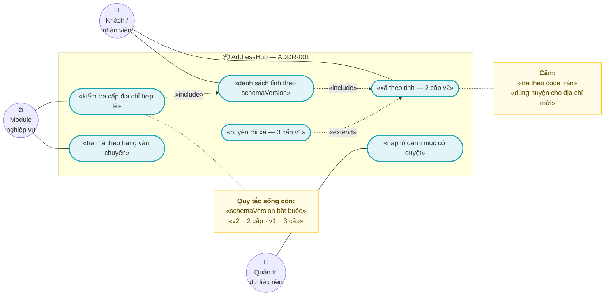
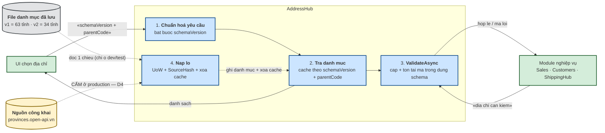
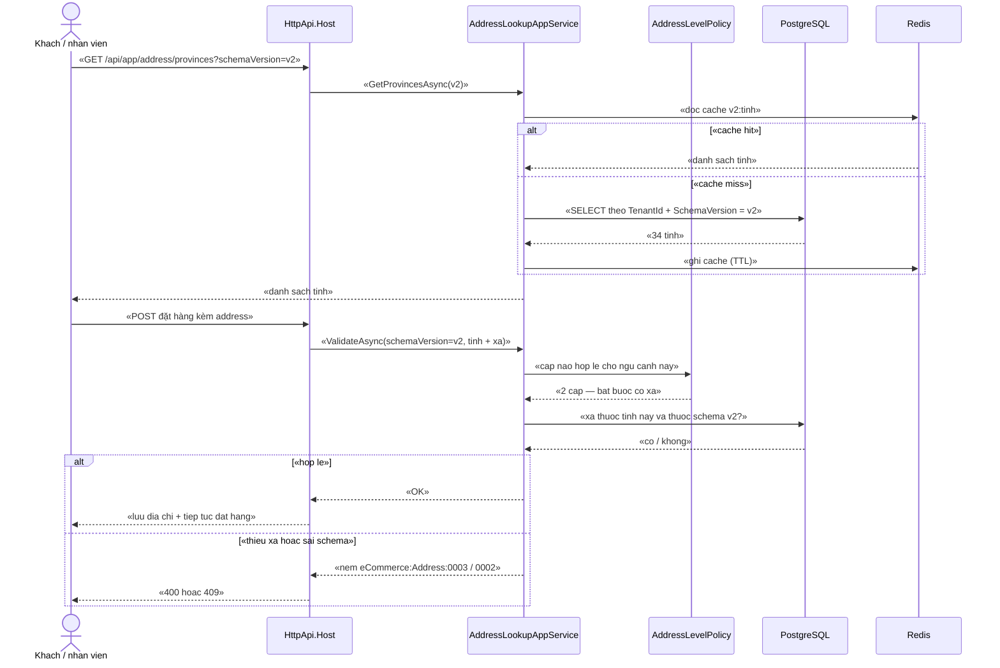

# `ADDR-001` — Tra cứu đơn vị hành chính 2 cấp (tỉnh + xã) và 3 cấp cũ

| Thuộc tính | Nội dung |
|---|---|
| **Mã** | `ADDR-001` |
| **Module** | **AddressHub** — module **chưa tồn tại trong code**; kế hoạch tạo ở **GĐ0** (xem §15.2 **F1**) |
| **Giai đoạn** | **GĐ0 — Pháp lý** (`docs/implementation-plan.md` §5: `ADDR-001`…`003` thuộc GĐ0) |
| **Ưu tiên** | **Must have** |
| **Trạng thái** | 🟡 `Draft` — chờ review |
| **Người viết / người review** | *(điền)* / **Kiến trúc trưởng + BA** |
| **Phiên bản / ngày** | `v0.1 — 13/10/2026` |
| **Tài liệu liên quan** | `ADDR-002` (mã địa chỉ theo hãng vận chuyển) · `ADDR-003` (chuẩn hoá & convert 3 cấp ↔ 2 cấp) · `CUS-001` (sổ địa chỉ khách) · `SAL-002` (đặt hàng) · `SHP-004` (GHTK — ⚠️ chưa xác minh địa chỉ 2 cấp) · `XC-001` · `XC-003` · `XC-004` · `XC-005` · `docs/implementation-plan.md` §6.1 + Phụ lục A.3 · `docs/structure-and-techstack.md` §2 |

---

## 0. Tóm tắt & quyết định thiết kế

**Tóm tắt:** `ADDR-001` chốt **danh mục đơn vị hành chính (ĐVHC)** của Việt Nam và **hợp đồng tra cứu** cho toàn hệ thống:
**2 cấp mới** (tỉnh + xã, hiệu lực từ **01/07/2025**) và **3 cấp cũ** (tỉnh + huyện + xã, dùng cho dữ liệu lịch sử).
Giá trị của tài liệu này không nằm ở việc "gọi API lấy danh sách tỉnh" — mà ở **hai phát hiện kiểm chứng được** khiến
thiết kế ngây thơ sẽ **sai dữ liệu địa chỉ một cách im lặng**: (1) **mã ĐVHC trùng số giữa hai bộ dữ liệu nhưng
trỏ tới hai đơn vị KHÁC NHAU**; (2) bảng `AddressLevelPolicy` phải bảo đảm **không cấu hình sai cấp** được.

**Vì sao phải làm trước khi bán hàng:** địa chỉ là **dữ liệu in trên hoá đơn điện tử** và **dữ liệu tạo vận đơn**.
Làm sai từ đầu ⇒ phải migrate lại **toàn bộ đơn hàng và hoá đơn đã phát hành**. `docs/implementation-plan.md`
dòng 99 ghi đúng rủi ro này: *"việc bỏ cấp huyện (01/07/2025) **thay đổi mô hình dữ liệu địa chỉ** ⇒ làm sai từ đầu
phải migrate lại toàn bộ đơn hàng"*. Đây cũng là **quyết định #3** của kế hoạch: *"Địa chỉ: hỗ trợ cả 2 cấp mới và 3 cấp cũ"*.

**Phạm vi:**
- ✅ **Danh mục** `Province` / `Ward` / `District` — **cả hai bộ dữ liệu** (`schemaVersion` = `v1` và `v2`), **bất biến** sau khi seed.
- ✅ **Hợp đồng tra cứu**: danh sách tỉnh, xã theo tỉnh (2 cấp), huyện theo tỉnh + xã theo huyện (3 cấp cũ), tra một mã.
- ✅ **`AddressLevelPolicy`**: quy tắc **cấp nào hợp lệ cho ngữ cảnh nào** + **kiểm tra hợp lệ** (`ValidateAsync`) — cửa vào duy nhất cho mọi module.
- ✅ **`CarrierAddressCode`**: tầng **ánh xạ** mã ĐVHC nội bộ ↔ mã địa chỉ của hãng vận chuyển (**đồng bộ, không phải master data**).
- ✅ **Nguồn dữ liệu + seed idempotent**: ghi rõ nguồn, **băm (hash) tập dữ liệu** đã nạp để tái lập và chống nạp lẫn hai bộ.
- ✅ **Hai test chặn tái phát**: `TC-04` (mã trùng giữa 2 schema không được lẫn) và `TC-05` (mọi truy vấn tra cứu **bắt buộc** có `schemaVersion`).

**Không nằm trong phạm vi:**
- ❌ **Thuật toán convert 3 cấp ↔ 2 cấp** (kể cả ca sáp nhập tỉnh) — thuộc **`ADDR-003`**. Tài liệu này chỉ cung cấp **danh mục** cho việc đó.
- ❌ **Nguồn dữ liệu mã của từng hãng vận chuyển** (GHN/GHTK dùng mã gì, có API tra không) — thuộc **`ADDR-002`**; ở đây chỉ chốt **khuôn bảng** và **quy ước khoá**.
- ❌ **Sổ địa chỉ khách hàng** — thuộc [`ADDR-004`](addr-004-so-dia-chi-khach.md) (entity `Address` do module `Address` sở hữu, `Customers` giữ bảng liên kết; 🟢 Approved 17/10/2026).
- ❌ **Tính phí vận chuyển / tạo vận đơn** — thuộc `SHP-001`…`SHP-004`.
- ❌ **Tự động cập nhật danh mục theo API công khai trên production** — xem **D4** (chỉ nạp theo lô có phê duyệt) và **Q2** (§15.1).
- ❌ **Địa chỉ quốc tế** — hệ thống bán trong nước (kế hoạch §1).

### 0.1 Quyết định thiết kế (ADR ngắn)

| # | Quyết định | Phương án đã cân nhắc | Lý do chọn | Hệ quả |
|---|---|---|---|---|
| **D1** | **Danh mục ĐVHC là `IMultiTenant` (có `TenantId`), đồng thời có bộ dữ liệu quốc gia dùng chung** | (a) **global** — không `TenantId` · (b) **tenant** — mỗi tenant một bản sao | `XC-004` BR-009 + D8 chốt **mọi entity thuộc tenant phải có `TenantId`** và **mọi unique index có `TenantId` phải `NULLS NOT DISTINCT`**; hệ thống hiện chạy **1 tenant** ⇒ `TenantId = NULL` (đã kiểm chứng thật ở `20261013024226_Fix_NullableTenantId_UniqueIndexes.cs`). Chọn (b) để **không phải sửa mô hình khi bật SaaS (GĐ4)** — đúng lý do D8 của `XC-004` | Bộ dữ liệu quốc gia là **một bản ghi `TenantId = NULL`** dùng chung; tenant muốn khác biệt (ví dụ ghim mã riêng của hãng) thì **ghi đè ở bảng map của ADDR-002**, **không** sao chép danh mục |
| **D2** | **BẮT BUỘC `schemaVersion`** (`v1`/`v2`) trên **mọi** bản ghi và **mọi** truy vấn | (a) một bảng chung, tra theo `code` · (b) tách bảng v1/v2 · (c) một bảng + cột `schemaVersion` | 🚨 **Bằng chứng thật**: mã `4` là **"Phường Ba Đình"** ở `v2` nhưng là **"Phường Trúc Bạch" (Quận Ba Đình)** ở `v1`; mã `1` là **tỉnh Hà Nội** ở `v2` nhưng là **Quận Ba Đình (huyện cấp 2)** ở `v1`. Tra theo `code` trần ⇒ **im lặng trả sai đơn vị**. Chọn (c) vì **một bảng = một khuôn seed/migration**, không nhân đôi code | `schemaVersion` vào **mọi** unique index; **cấm** overload tra cứu thiếu tham số này (test `TC-05`) |
| **D3** | **`District` chỉ để TƯƠNG THÍCH**: là entity thật, **cấm** dùng làm cấp địa chỉ giao hàng | (a) xoá hẳn cấp huyện · (b) giữ nhưng cho phép chọn cấp huyện | Bỏ hẳn ⇒ **không đọc/convert được dữ liệu 3 cấp cũ** (đơn cũ, vận đơn cũ, hoá đơn đã phát hành); cho chọn ⇒ **vi phạm pháp luật hiện hành** (không còn cấp huyện từ 01/07/2025). Chọn giữ-nhưng-chặn: đúng tinh thần **quyết định #3** | `AddressLevelPolicy` phải **từ chối** mọi cấu hình cho phép nhập cấp huyện cho **địa chỉ MỚI** (BR-006) |
| **D4** | **Nạp danh mục theo LÔ có phê duyệt**, **cấm** tự động lấy API công khai ở production | (a) gọi API công khai mỗi lần tra cứu · (b) job đồng bộ định kỳ · (c) nạp lô có duyệt + băm dữ liệu | Danh mục ĐVHC là **dữ liệu pháp lý** — phải biết **chính xác phiên bản nào đang chạy** và **ai duyệt**. Gọi API công khai lúc chạy ⇒ phụ thuộc dịch vụ bên thứ ba **không cam kết SLA**, và **không** để lại dấu vết pháp lý | Có 2 giai đoạn: (1) **dev/test** được phép gọi API; (2) **production** chỉ nạp từ **file đã lưu** + `SourceHash` |
| **D5** | **`AddressLevelPolicy` được SUY RA từ bộ dữ liệu**, không nhập tay tự do | (a) admin tự khai · (b) suy ra + cho ghi đè có kiểm tra | Nhập tay ⇒ cấu hình **3 cấp cho tỉnh chỉ có 2 cấp** (hoặc ngược lại) là loại lỗi **không có lỗi biên dịch**, chỉ lộ khi khách không chọn được xã | Không cần cấu hình gì để hệ thống đúng; cấu hình chỉ để **chặn/cho phép theo ngữ cảnh nghiệp vụ** (ví dụ: hoá đơn điện tử bắt buộc 2 cấp) |
| **D6** | **Tra cứu chỉ ĐỌC + cache**; mọi thao tác ghi (nạp lô) đi qua **Unit of Work** | (a) cho app service đọc ghi trực tiếp DbContext của app · (b) chỉ dùng `IRepository<T>` + UoW | Quy ước bất biến #13 *"mọi thao tác ghi qua Unit of Work"*; và quy ước #3 *"module → app là cấm"* | Module **không** tham chiếu `eCommerceDbContext`; entity AddressHub được cấu hình qua `ConfigureAddressHub()` (giống `ConfigureTax()` ở `TaxDbContextModelCreatingExtensions.cs`) |
| **D7** | **Khoá cache theo `(schemaVersion, parentCode)`**, **TTL dài**, xoá khi nạp lô | (a) không cache · (b) cache theo `parentCode` trần | Tra cứu này được gọi ở **mọi lần checkout** và **mọi lần tạo vận đơn** ⇒ không cache là lãng phí; nhưng cache theo `parentCode` trần sẽ **lẫn 2 schema** (đúng lỗi D2) | Xoá cache **bắt buộc** trong cùng luồng nạp lô; nếu quên ⇒ dữ liệu cũ tồn tại tới hết TTL |
| **D8** | **Danh mục là dữ liệu BẤT BIẾN sau khi phát hành** (`EffectiveFrom`/`EffectiveTo`, không UPDATE tên) | (a) UPDATE tên khi có đổi tên · (b) bất biến + bản ghi mới | Đổi tên/đổi mã **hồi tố** làm hoá đơn **đã phát hành** không còn giải trình được — bài học **BR-011 của `XC-006`** (`ChangeEffectiveTo` **cấm** lùi quá khứ, `TaxRateSchedule.cs:94-112`) | Cần đổi ⇒ **thêm bản ghi mới** với `EffectiveFrom` mới; truy vấn "đang hiệu lực tại ngày X" như `IsEffectiveAt` của `TaxRateSchedule.cs:84` |

---

## 1. Use Case Specification

| Thuộc tính | Nội dung |
|---|---|
| **Use Case ID** | `ADDR-001` |
| **Use Case Name** | Tra cứu **đơn vị hành chính** (2 cấp mới và 3 cấp cũ) và kiểm tra **cấp địa chỉ hợp lệ** |
| **Description** | *"Là module nghiệp vụ (Sales/Customers/ShippingHub/EInvoiceHub), tôi muốn tra cứu danh mục tỉnh–xã (2 cấp) và tỉnh–huyện–xã (3 cấp cũ) từ **một nguồn sự thật duy nhất** và được **kiểm tra cấp địa chỉ** trước khi lưu, để không bao giờ lưu một địa chỉ mà mã tỉnh/xã trỏ sai đơn vị hoặc sai cấp."* |
| **Actor(s)** | **Nhân viên/khách** (chọn địa chỉ trên UI) · **Module nghiệp vụ** (Sales, Customers, ShippingHub, EInvoiceHub) · **Quản trị dữ liệu nền** (nạp lô danh mục) |
| **Priority** | **Must have** |
| **Trigger** | (a) người dùng mở form chọn địa chỉ; (b) checkout cần kiểm tra địa chỉ giao hàng; (c) tạo vận đơn cần mã ĐVHC để gửi hãng; (d) phát hành hoá đơn cần địa chỉ đúng cấp; (e) admin nạp lô danh mục mới |
| **Pre-Condition(s)** | • **`TenantId`** của ngữ cảnh hiện tại — danh mục quốc gia là bản ghi `TenantId = NULL`, tenant ghi đè ở tầng map (D1).<br>• **`schemaVersion`** được xác định **tường minh** ở mọi truy vấn (D2) — **không** có giá trị mặc định ngầm.<br>• **Seed đã chạy** cho `v1` và `v2` (nếu chưa ⇒ trả danh sách rỗng, **không** phải lỗi — §12).<br>• **`ChannelCode` KHÔNG** tham gia tra cứu địa chỉ (danh mục ĐVHC không phụ thuộc kênh bán); `ChannelCode` chỉ xuất hiện ở `CarrierAddressCode` của `ADDR-002`. |
| **Post-Condition(s)** | • Mọi kết quả tra cứu **thuộc đúng `schemaVersion`** yêu cầu — **không** lẫn hai bộ dữ liệu (BR-002).<br>• Mọi lần lưu địa chỉ **đã đi qua** `ValidateAsync` và **đã** bị từ chối nếu sai cấp (BR-005).<br>• Danh mục **không bị UPDATE hồi tố**: bản ghi cũ chỉ được thay bằng bản ghi mới (D8).<br>• Nạp lô để lại **dấu vết**: `SourceHash`, `ImportedAtUtc`, `ImportedBy`, số dòng thêm/giữ. |
| **Basic Flow** | 1. UI gọi `GetProvincesAsync(schemaVersion)` → danh sách tỉnh **của đúng bộ dữ liệu**.<br>2. UI gọi `GetChildrenAsync(schemaVersion, parentCode)` với `parentCode = provinceCode`:<br>&nbsp;&nbsp;• `v2` ⇒ trả **xã/phường** trực thuộc tỉnh (đúng **2 cấp**);<br>&nbsp;&nbsp;• `v1` ⇒ trả **quận/huyện**, sau đó gọi tiếp với `parentCode = districtCode` để lấy **xã/phường** (đúng **3 cấp**).<br>3. Module nghiệp vụ gọi `ValidateAsync(request)` trước khi lưu địa chỉ.<br>4. `ValidateAsync` kiểm theo `AddressLevelPolicy`: đủ cấp chưa, mã có tồn tại **trong đúng schema** không, có dùng cấp huyện cho địa chỉ **mới** không.<br>5. Hợp lệ ⇒ module lưu địa chỉ (**kèm `schemaVersion` đã dùng**) và mở Unit of Work cho phần ghi của mình.<br>6. Không hợp lệ ⇒ **ném** `BusinessException` với mã lỗi tương ứng (§6.2). |
| **Alternative Flow** | **A1: Tra cứu từ cache** — cùng `(schemaVersion, parentCode)` ⇒ trả từ cache, **không** chạm DB (D7).<br>**A2: Ẩn đơn vị ngừng hiệu lực** — đơn vị có `EffectiveTo` trong quá khứ **không** xuất hiện trong danh sách chọn **mới**, nhưng **vẫn tra được theo mã** để hiển thị đơn cũ (§12).<br>**A3: Ghi đè mã theo hãng** — `CarrierAddressCode` trả mã của hãng cho cặp `(internalCode, carrierCode, schemaVersion)`; nếu chưa có ⇒ xem E4.<br>**A4: Tra cứu ngược từ tên (autocomplete)** — tìm theo `codename`/tên không dấu; **vẫn** bắt buộc lọc theo `schemaVersion`. |
| **Exception Flow** | **E1:** `schemaVersion` thiếu/không hợp lệ ⇒ `BusinessException` `eCommerce:Address:0001` — 🔒 **cấm** tự đoán `v1`/`v2` (D2).<br>**E2:** mã tỉnh/xã/huyện **không tồn tại trong `schemaVersion` yêu cầu** ⇒ `eCommerce:Address:0002` (kèm `code` + `schemaVersion`) — 🚨 **không** thử tra ở schema kia.<br>**E3:** cấu hình/đầu vào **vi phạm `AddressLevelPolicy`** (thiếu xã, dùng huyện cho địa chỉ **mới**) ⇒ `eCommerce:Address:0003`.<br>**E4:** **không có mã của hãng vận chuyển** cho đơn vị này ⇒ `eCommerce:Address:0005` **khi** ngữ cảnh bắt buộc map; nếu chỉ hiển thị ⇒ cảnh báo và **không** chặn.<br>**E5:** bộ dữ liệu nạp vào **xung đột** với bộ đang chạy (cùng `(schemaVersion, code)` nhưng `name`/`codename` khác) ⇒ `eCommerce:Address:0004`, **rollback toàn bộ lô** (không nạp một phần). |
| **Business Rules** | • **BR-ADDR-001-001**: Danh mục ĐVHC là **dữ liệu**, **cấm** hard-code danh sách tỉnh/xã/huyện trong code nghiệp vụ.<br>• **BR-ADDR-001-002**: **Mọi** bản ghi ĐVHC và **mọi** truy vấn tra cứu **phải** có `schemaVersion` (`v1`/`v2`); **cấm** tra cứu theo `code` trần.<br>• **BR-ADDR-001-003**: Mọi unique index của AddressHub **phải** bắt đầu bằng `(TenantId, SchemaVersion, …)` và **phải** dùng **`NULLS NOT DISTINCT`**.<br>• **BR-ADDR-001-004**: Cặp cấp hợp lệ bắt buộc: **`v2` ⇒ 2 cấp (tỉnh + xã)**, **`v1` ⇒ 3 cấp (tỉnh + huyện + xã)**; **cấm** trộn cấp giữa hai bộ.<br>• **BR-ADDR-001-005**: **Mọi** địa chỉ **được lưu** **phải** đi qua `ValidateAsync`; **cấm** lưu địa chỉ ở tầng app mà bỏ qua kiểm tra.<br>• **BR-ADDR-001-006**: **Cấm** dùng cấp **huyện** cho **địa chỉ MỚI** (từ 01/07/2025 không còn cấp huyện); cấp huyện **chỉ** để đọc/convert dữ liệu cũ (`ADDR-003`).<br>• **BR-ADDR-001-007**: Danh mục **bất biến hồi tố** — **cấm** UPDATE `Code`/`Name`/`Codename` của bản ghi đã phát hành; đổi ⇒ tạo bản ghi mới với `EffectiveFrom` mới (D8).<br>• **BR-ADDR-001-008**: Seed/nạp lô **phải idempotent** — chạy lại cùng một lô **không** tạo bản ghi trùng và **không** đổi `SourceHash` đã ghi.<br>• **BR-ADDR-001-009**: **Mọi** lô nạp **phải** ghi nguồn + `SourceHash` + số dòng; **cấm** nạp danh mục không rõ nguồn.<br>• **BR-ADDR-001-010**: **Cấm** gọi API công khai bên thứ ba ở production (D4); chỉ nạp từ file đã lưu.<br>• **BR-ADDR-001-011**: `AddressLevelPolicy` **phải** được **suy ra** từ bộ dữ liệu; `ValidateAsync` **phải** kiểm **cả** cấp **và** sự tồn tại của mã **trong đúng schema**.<br>• **BR-ADDR-001-012**: Mọi entity AddressHub **phải** có `DbSet` trên DbContext hợp nhất; **cấm** dựa vào việc module tự có DbContext riêng.<br>• **BR-ADDR-001-013**: Tra cứu địa chỉ **được phép** `[AllowAnonymous]` (form checkout khách chưa đăng nhập) **nhưng phải** nằm trong allowlist của `XC-004` Q1; **cấm** mở `[AllowAnonymous]` cho API nạp lô.<br>• **BR-ADDR-001-014**: Cache tra cứu **phải** khoá theo `(schemaVersion, parentCode)` và **phải** bị xoá trong cùng luồng nạp lô (D7). |
| **Non-Functional Requirement** | • **NFR-ADDR-001-001**: Tra cứu xã theo tỉnh (`v2`, tỉnh lớn nhất) p95 **< 100 ms** khi **nguội** (chưa cache) và **< 10 ms** khi **nóng** (cache).<br>• **NFR-ADDR-001-002**: Danh mục 2 cấp nạp đủ **34 tỉnh** (`v2`); danh mục 3 cấp nạp đủ **63 tỉnh** (`v1`); **0** bản ghi thiếu `code`.<br>• **NFR-ADDR-001-003**: **0** kết quả tra cứu lẫn `schemaVersion` (test `TC-04`).<br>• **NFR-ADDR-001-004**: **0** truy vấn tra cứu thiếu `schemaVersion` (test reflection `TC-05`).<br>• **NFR-ADDR-001-005**: Seed lại từ đầu (DB trống) **< 60 s** cho cả hai bộ.<br>• **NFR-ADDR-001-006**: **0** UPDATE hồi tố trên danh mục đã phát hành (test `TC-12`).<br>• **NFR-ADDR-001-007**: Nạp lô **nguyên tử**: lô lỗi ⇒ **0** bản ghi được ghi (test `TC-11`). |

---

## 2. Sơ đồ Use Case



---

## 3. Sơ đồ trạng thái (state machine)

**Không áp dụng — lý do:** `ADDR-001` **không có thực thể nào có vòng đời trạng thái**. Cụ thể:
`Province`/`Ward`/`District` là **danh mục bất biến** (D8) — không có `Status`, chỉ có `EffectiveFrom`/`EffectiveTo`;
`AddressLevelPolicy` là **cấu hình**; `CarrierAddressCode` là **ánh xạ**.

Bất biến thay thế state machine (và **phải** được kiểm bằng test) — xem §8.1:

| # | Bất biến | Vì sao **không** dùng state machine mà dùng bất biến |
|---|---|---|
| 1 | Bản ghi đã phát hành **không** bị UPDATE hồi tố (D8) | Trạng thái không đổi — bản ghi **vĩnh viễn** giữ nguyên; thay đổi = **bản ghi mới**, không phải "chuyển trạng thái" |
| 2 | `(TenantId, SchemaVersion, Code)` là **duy nhất** | Ràng buộc tĩnh ở DB |
| 3 | Tập `(SchemaVersion, Code)` của `v1` và `v2` **độc lập** với nhau | Bất biến về **tính đúng của tra cứu**, không phải vòng đời |

> ⚠️ **Ghi rõ để tránh hiểu nhầm:** ở **`ADDR-003`** mới có "vòng đời chuyển đổi" (3 cấp → 2 cấp, ca sáp nhập tỉnh).
> Tài liệu này **cố ý không** mô hình hoá nó, để **không** tạo hai nguồn sự thật cho cùng một logic.

---

## 4. Sequence Diagram & luồng dữ liệu

### 4.1 DFD — luồng dữ liệu tra cứu & kiểm tra cấp địa chỉ



> 📌 **Nguồn công khai chỉ được dùng ở dev/test** (BR-010). Ghi rõ để người review thấy **mũi tên duy nhất** đi từ Internet vào hệ thống, và nó **không** đi vào production.

### 4.2 Sequence — `ValidateAsync` khi lưu địa chỉ giao hàng (ngữ cảnh 2 cấp)



---

## 5. Mô hình dữ liệu

### 5.1 Quan hệ giữa các bảng

**Không dùng sơ đồ ERD Mermaid** — lý do: tài liệu này **đã đạt giới hạn 3 sơ đồ** (§2, §4.1, §4.2), và toàn bộ cột/index của 5 bảng đã được liệt kê **đầy đủ và chi tiết hơn** ở §5.2. Quan hệ giữa các bảng mô tả bằng bảng dưới đây:

| Quan hệ | Bội số | Ghi chú |
|---|---|---|
| `AddrProvinces` → `AddrWards` | 1 : n | qua `ProvinceCode` |
| `AddrProvinces` → `AddrDistricts` | 1 : n | **chỉ `v1`** (`v2` **không** có bản ghi huyện) |
| `AddrDistricts` → `AddrWards` | 1 : n | **chỉ `v1`**; ở `v2`, `AddrWards.DistrictCode` là `NULL` |
| `AddrProvinces` → `AddrLevelPolicies` | 1 : n | chính sách cấp địa chỉ tham chiếu `SchemaVersion`, không tham chiếu một tỉnh cụ thể |
| `AddrProvinces`/`AddrWards`/`AddrDistricts` → `AddrCarrierCodes` | 1 : n | qua `(SchemaVersion, InternalLevel, InternalCode)` — **không** dùng khoá ngoại cứng (dữ liệu đồng bộ theo hãng) |

> 📌 **Chi tiết quyết định sự đúng/sai của tra cứu 2 cấp:** `AddrWards.DistrictCode` là **`NULL` ở `v2`** (vì **không còn cấp huyện**) và **có giá trị ở `v1`**. Nếu để `DistrictCode` **bắt buộc**, `v2` **không thể** nạp được. Nhưng nếu tra xã **chỉ** theo `ProvinceCode`, dữ liệu `v1` sẽ trả **lẫn** xã của nhiều huyện khác nhau trong cùng tỉnh — và **đã kiểm chứng có tên trùng nhau thật**: **"Xã Đông Xuân"** xuất hiện ở `Huyện Sóc Sơn` (mã `436`) **và** ở `Huyện Quốc Oai` (mã `4939`) của Hà Nội trong `v1`. ⇒ Tra xã ở `v1` **bắt buộc** phải lọc theo `(ProvinceCode, DistrictCode)`, và index `(TenantId, SchemaVersion, ProvinceCode, DistrictCode)` ở §5.2 là để phục vụ **đúng** truy vấn đó.

### 5.2 Bảng & cột (Data Dictionary)

**Bảng `AddrProvinces`** — *danh mục tỉnh/thành phố, **cả hai** bộ dữ liệu*

| Cột | Kiểu | Null? | Nguồn / ý nghĩa | Ghi chú |
|---|---|---|---|---|
| `Id` | `uuid` | ✖ | khoá chính kỹ thuật | |
| `TenantId` | `uuid` | ✔ | `NULL` = **bộ dữ liệu quốc gia** dùng chung (D1) | ⚠️ **bắt buộc** vì entity là `IMultiTenant` (`XC-004` BR-009) |
| `SchemaVersion` | `varchar(4)` | ✖ | `v1` (63 tỉnh, có huyện) hoặc `v2` (34 tỉnh, không huyện) | 🚨 **D2** — **không** bao giờ được null |
| `Code` | `integer` | ✖ | mã ĐVHC từ nguồn dữ liệu | 🚨 **trùng số giữa 2 schema** (xem cảnh báo dưới) |
| `Name` | `varchar(256)` | ✖ | tên đầy đủ có tiền tố loại ("Thành phố Hà Nội") | |
| `Codename` | `varchar(256)` | ✔ | tên không dấu dạng snake ("ha_noi") | dùng cho autocomplete/SEO |
| `DivisionType` | `varchar(64)` | ✔ | "thành phố trung ương" / "tỉnh" | |
| `PhoneCode` | `integer` | ✔ | mã vùng điện thoại từ nguồn (`phone_code`) | chỉ để hiển thị |
| `EffectiveFrom` | `date` | ✖ | ngày bắt đầu hiệu lực **theo nguồn pháp lý** | v2 = **2025-07-01** |
| `EffectiveTo` | `date` | ✔ | `NULL` = còn hiệu lực (D8) | |

**Bảng `AddrWards`** — *xã/phường; ở `v2` trực thuộc **tỉnh**, ở `v1` thuộc **huyện***

| Cột | Kiểu | Null? | Nguồn / ý nghĩa | Ghi chú |
|---|---|---|---|---|
| `Id` | `uuid` | ✖ | khoá chính | |
| `TenantId` | `uuid` | ✔ | như trên | |
| `SchemaVersion` | `varchar(4)` | ✖ | `v1`/`v2` | |
| `Code` | `integer` | ✖ | mã xã/phường | trường `code` của nguồn |
| `ProvinceCode` | `integer` | ✖ | tỉnh chứa xã | trường `province_code` của nguồn |
| `DistrictCode` | `integer` | ✔ | 🚨 **`NULL` ở `v2`**, có giá trị ở `v1` | nguồn `v2` **không** trả `district_code` |
| `Name` | `varchar(256)` | ✖ | tên đầy đủ | |
| `Codename` | `varchar(256)` | ✔ | không dấu | |
| `DivisionType` | `varchar(64)` | ✔ | "phường" / "xã" / "thị trấn" (nguồn `v1` **có** `thị trấn`) | |

**Bảng `AddrDistricts`** — *quận/huyện — **CHỈ `v1`**, chỉ để tương thích (D3)*

| Cột | Kiểu | Null? | Nguồn / ý nghĩa | Ghi chú |
|---|---|---|---|---|
| `Id` | `uuid` | ✖ | khoá chính | |
| `TenantId` | `uuid` | ✔ | như trên | |
| `SchemaVersion` | `varchar(4)` | ✖ | luôn = `v1` | |
| `Code` | `integer` | ✖ | mã quận/huyện | |
| `ProvinceCode` | `integer` | ✖ | tỉnh chứa huyện | |
| `Name` | `varchar(256)` | ✖ | tên ("Quận Ba Đình") | |
| `DivisionType` | `varchar(64)` | ✔ | "quận" / "huyện" / "thành phố thuộc tỉnh" | |
| `EffectiveTo` | `date` | ✔ | `NULL` = **còn hiệu lực theo dữ liệu cũ** | ⚠️ **không** đồng nghĩa "còn dùng được cho địa chỉ mới" — xem BR-006 |

**Bảng `AddrLevelPolicies`** — *cấp địa chỉ hợp lệ theo ngữ cảnh (D5)*

| Cột | Kiểu | Null? | Nguồn / ý nghĩa | Ghi chú |
|---|---|---|---|---|
| `Id` | `uuid` | ✖ | khoá chính | |
| `TenantId` | `uuid` | ✔ | cho phép tenant ghi đè chính sách | |
| `SchemaVersion` | `varchar(4)` | ✖ | | |
| `Context` | `varchar(32)` | ✖ | `Shipping` · `Invoice` · `Profile` | ngữ cảnh nghiệp vụ |
| `RequiredDepth` | `integer` | ✖ | `2` hoặc `3` | CHECK `IN (2,3)` |
| `AllowDistrictOnNewAddress` | `boolean` | ✖ | mặc định **`false`** | 🚨 `true` **chỉ** ở ngữ cảnh đọc/convert dữ liệu cũ |
| `Note` | `varchar(512)` | ✔ | căn cứ/lý do | |

**Bảng `AddrCarrierCodes`** — *ánh xạ mã ĐVHC nội bộ ↔ mã của hãng vận chuyển (D3 của `ADDR-002`)*

| Cột | Kiểu | Null? | Nguồn / ý nghĩa | Ghi chú |
|---|---|---|---|---|
| `Id` | `uuid` | ✖ | khoá chính | |
| `TenantId` | `uuid` | ✔ | mã của hãng **phụ thuộc tài khoản** ⇒ theo tenant | |
| `CarrierCode` | `varchar(32)` | ✖ | `GHN` · `GHTK`… | ⚠️ **chưa xác minh** hãng có API danh mục địa chỉ — xem §15.1 **Q1** |
| `SchemaVersion` | `varchar(4)` | ✖ | | |
| `InternalCode` | `integer` | ✖ | mã tỉnh/xã/huyện nội bộ | |
| `InternalLevel` | `varchar(16)` | ✖ | `Province` · `District` · `Ward` | |
| `CarrierCodeValue` | `varchar(64)` | ✖ | mã/chuỗi mà hãng yêu cầu | |
| `SourceVersion` | `varchar(64)` | ✔ | phiên bản dữ liệu mã của hãng | **chưa kiểm chứng** |

**Index & ràng buộc** *(phần hay bị bỏ sót nhất — liệt kê hết)*

| Bảng | Loại | Cột | Mục đích |
|---|---|---|---|
| `AddrProvinces` | UNIQUE **`NULLS NOT DISTINCT`** | `(TenantId, SchemaVersion, Code)` | 🚨 bất biến **#2**: một mã trong một schema chỉ có một tỉnh |
| `AddrProvinces` | INDEX | `(TenantId, SchemaVersion, EffectiveTo)` | danh sách "đang hiệu lực" |
| `AddrWards` | UNIQUE **`NULLS NOT DISTINCT`** | `(TenantId, SchemaVersion, Code)` | chống trùng mã xã **trong cùng schema** |
| `AddrWards` | INDEX | `(TenantId, SchemaVersion, ProvinceCode, DistrictCode)` | truy vấn nóng nhất: "xã của tỉnh/huyện này" |
| `AddrDistricts` | UNIQUE **`NULLS NOT DISTINCT`** | `(TenantId, SchemaVersion, Code)` | chống trùng mã huyện |
| `AddrLevelPolicies` | UNIQUE **`NULLS NOT DISTINCT`** | `(TenantId, SchemaVersion, Context)` | một chính sách cho một ngữ cảnh |
| `AddrCarrierCodes` | UNIQUE **`NULLS NOT DISTINCT`** | `(TenantId, CarrierCode, SchemaVersion, InternalLevel, InternalCode)` | một mã nội bộ chỉ map một lần cho một hãng |
| `AddrLevelPolicies` | CHECK | `RequiredDepth IN (2,3)` | bất biến ở tầng DB |
| `AddrWards` | CHECK | `SchemaVersion <> 'v2' OR DistrictCode IS NULL` | 🚨 **hàng rào DB**: `v2` **không** được có cấp huyện (BR-004) |

> 🚨 **CẢNH BÁO QUAN TRỌNG NHẤT CỦA §5 — `Code` KHÔNG phải khoá toàn cục.**
> Bằng chứng **đo thật** từ nguồn dữ liệu công khai (13/10/2026):
>
> | `Code` | Ở `v2` (`/api/v2/p/1?depth=2`) | Ở `v1` (`/api/v1/p/1?depth=3`) |
> |---|---|---|
> | `1` | **tỉnh** "Thành phố Hà Nội" | **Quận Ba Đình** (cấp huyện) |
> | `4` | **"Phường Ba Đình"** (xã/phường) | **"Phường Trúc Bạch"** (thuộc Quận Ba Đình) |
> | `8` | **"Phường Ngọc Hà"** | **"Phường Liễu Giai"** (thuộc Quận Ba Đình) |
> | `16` | *(không phải tỉnh trong `v2`)* | **Huyện Sóc Sơn** |
>
> ⇒ Nếu tra cứu theo `code` trần (không có `schemaVersion`), mã `4` sẽ **im lặng** trả **sai đơn vị**: hoặc
> "Phường Ba Đình" **mới** hoặc "Phường Trúc Bạch" **cũ**. Đây là loại lỗi **không có lỗi biên dịch**, chỉ lộ ra
> **trên vận đơn đã gửi** hoặc **trên hoá đơn đã phát hành**. Đây là **lý do tồn tại của D2** và của test `TC-04`.

> 📌 **Ghi chú về `NULLS NOT DISTINCT`:** EF Core **không** mô hình hoá thuộc tính này; dự án **đã** làm đúng một lần
> bằng SQL thô cho **11 index** ở `src/eCommerce.EntityFrameworkCore/Migrations/20261013024226_Fix_NullableTenantId_UniqueIndexes.cs`
> và **đã chứng minh thật** (`INSERT 0 2` → `duplicate key … (null, …) already exists`). AddressHub **phải** áp dụng
> **cùng cách** (BR-003), nếu không thì ở chế độ 1 tenant (`TenantId = NULL`) **mọi** unique index ở trên **mất tác dụng**
> và có thể nạp **hai tỉnh cùng mã**.

---

## 6. Hợp đồng API

### 6.1 Application Service

| Mục | Giá trị |
|---|---|
| Interface | `IAddressLookupAppService` — đặt tại `modules/AddressHub/eCommerce.AddressHub.Application.Contracts` (khuôn ở `docs/structure-and-techstack.md` §2.3) 🔴 **chưa có trong code — kế hoạch GĐ0** |
| Implementation | `AddressLookupAppService` — `modules/AddressHub/eCommerce.AddressHub.Application` 🔴 **chưa có trong code — kế hoạch GĐ0** |
| `[Authorize]` | **cấp CLASS** theo `ChannelAppService.cs:27` (mẫu thật: `[Authorize]` trên class, `[Authorize(permission)]` trên method) |
| Ngoại lệ `[AllowAnonymous]` | **chỉ** cho 3 method tra cứu (BR-013 + `XC-004` Q1: allowlist gồm `/connect/*`, application-configuration, health-status, Swagger-dev). ⚠️ **Cần kiến trúc trưởng bổ sung** 3 route này vào allowlist — xem §15.1 **Q5** |
| Cấu hình model | `ConfigureAddressHub(this ModelBuilder)` — theo mẫu `TaxDbContextModelCreatingExtensions.ConfigureTax()` (`modules/Tax/eCommerce.Tax.EntityFrameworkCore/TaxDbContextModelCreatingExtensions.cs:14`) |
| `DbSet` | 🚨 **BẮT BUỘC** khai trên `src/eCommerce.EntityFrameworkCore/eCommerceDbContext.cs` (BR-012) — lý do đã ghi bằng chứng ở `eCommerceDbContext.cs:48-52` (*"Nếu chỉ gọi builder.ConfigureChannelHub() … runtime báo: The requested service 'IRepository<ChannelShop, Guid>' has not been registered"*) |

| Method | Input (DTO) | Output (DTO) | Ghi chú |
|---|---|---|---|
| `GetProvincesAsync` | `GetProvincesInput { SchemaVersion, OnlyEffective }` | `List<ProvinceDto>` | `SchemaVersion` **bắt buộc** (E1) |
| `GetChildrenAsync` | `GetChildrenInput { SchemaVersion, ParentCode, OnlyEffective }` | `List<AdministrativeUnitDto>` | `v2` ⇒ trả **xã**; `v1` ⇒ trả **huyện** |
| `GetWardsAsync` | `GetWardsInput { SchemaVersion, ProvinceCode, DistrictCode? }` | `List<WardDto>` | `v1` **bắt buộc** có `DistrictCode`; `v2` **cấm** truyền `DistrictCode` ⇒ `0003` |
| `GetByCodeAsync` | `GetByCodeInput { SchemaVersion, Code, Level }` | `AdministrativeUnitDto` | tra **một** mã, **kể cả** đơn vị đã hết hiệu lực (A2) |
| `ValidateAsync` | `ValidateAddressInput { SchemaVersion, ProvinceCode, DistrictCode?, WardCode?, Context }` | `AddressValidationResultDto { IsValid, Errors[], NormalizedName }` | 🔒 **cửa vào duy nhất** cho mọi module (BR-005) |
| `GetCarrierCodeAsync` | `GetCarrierCodeInput { CarrierCode, SchemaVersion, InternalLevel, InternalCode }` | `CarrierCodeDto?` | `null` ⇒ **không phải lỗi** nếu ngữ cảnh không bắt buộc (E4) |
| `ImportDatasetAsync` | `ImportDatasetInput { SchemaVersion, SourceName, SourceHash, Rows[] }` | `ImportDatasetResultDto { Added, Kept, Conflicted }` | 🔴 **không** `[AllowAnonymous]`; **UoW** + lock (§8.2) |

### 6.2 REST endpoint

| Mục | Giá trị |
|---|---|
| Method / Route | `GET /api/app/address/provinces` · `GET /api/app/address/children` · `GET /api/app/address/wards` · `GET /api/app/address/units/{code}` · `POST /api/app/address/validate` · `POST /api/app/address/import` (auto API controller của ABP) |
| Authentication | `Bearer (OpenIddict)` — theo `XC-004` §6.2 |
| Permission | 3 endpoint tra cứu: **`[AllowAnonymous]`** (BR-013) · `import`: `eCommerce.Address.Manage` |
| Content-Type | `application/json` |

**Request mẫu — tra xã của một tỉnh ở bộ dữ liệu 2 cấp**

```json
{
  "schemaVersion": "v2",
  "provinceCode": 1,
  "onlyEffective": true
}
```

**Response mẫu**

```json
{
  "schemaVersion": "v2",
  "totalCount": 126,
  "items": [
    { "code": 4,      "name": "Phường Ba Đình", "codename": "phuong_ba_dinh", "divisionType": "phường", "provinceCode": 1, "districtCode": null },
    { "code": 376,    "name": "Xã Sóc Sơn",     "codename": "xa_soc_son",     "divisionType": "xã",     "provinceCode": 1, "districtCode": null }
  ]
}
```

> ⚠️ **`totalCount` trong ví dụ là số minh hoạ** (nguồn trả về danh sách dài; con số chính xác **chưa kiểm chứng** bằng cách đếm đầy đủ). Điều **đã** kiểm chứng: `districtCode` là **`null`** ở `v2`, và `schemaVersion` **phải** có trong response để client không tự đoán.

**Request mẫu — kiểm tra địa chỉ 2 cấp trước khi đặt hàng**

```json
{
  "schemaVersion": "v2",
  "context": "Shipping",
  "provinceCode": 1,
  "districtCode": null,
  "wardCode": 4
}
```

**Mã lỗi nghiệp vụ**

| Mã | HTTP | Khi nào | Thông điệp |
|---|---|---|---|
| `eCommerce:Address:0001` | `400` | `schemaVersion` thiếu/không hợp lệ | `Thiếu hoặc sai phiên bản dữ liệu địa chỉ (chỉ nhận v1 hoặc v2).` |
| `eCommerce:Address:0002` | `404` | Mã **không tồn tại trong `schemaVersion` yêu cầu** | `Không tìm thấy đơn vị hành chính {code} trong bộ dữ liệu {schemaVersion}.` |
| `eCommerce:Address:0003` | `400` / `409` | Vi phạm `AddressLevelPolicy` (thiếu xã, dùng huyện cho địa chỉ mới, trộn cấp) | `Địa chỉ không đúng cấp quy định cho ngữ cảnh này.` |
| `eCommerce:Address:0004` | `409` | Lô nạp **xung đột** dữ liệu đang chạy | `Bộ dữ liệu nạp vào xung đột với dữ liệu hiện có — đã hủy toàn bộ lô.` |
| `eCommerce:Address:0005` | `409` | **Bắt buộc** map mã hãng nhưng chưa có | `Chưa có mã địa chỉ của hãng vận chuyển cho đơn vị này.` |

> 📌 **Quy ước mã lỗi:** module **tự sở hữu** mã lỗi của mình, đúng mẫu `TaxErrorCodes` (`modules/Tax/eCommerce.Tax.Domain/TaxErrorCodes.cs:10-35`, dạng `eCommerce:Tax:0001`) và đúng ghi chú ở `eCommerceConsts.cs:80-85` (*"theo quy ước 'module sở hữu hằng số của mình', mã lỗi miền kênh nay CHỈ nằm ở ChannelHubConsts.cs"*). Vì vậy **không** thêm `Address:*` vào `eCommerceConsts.ErrorCodes`.

---

## 7. Sự kiện, tích hợp ngoài & idempotency

### 7.1 Sự kiện phát ra (ETO)

| ETO | Khi nào phát | Trường dữ liệu | Ai tiêu thụ | Handler có idempotent? |
|---|---|---|---|---|
| `AddressDatasetImportedEto` | sau khi lô danh mục commit | `SchemaVersion`, `SourceName`, `SourceHash`, `Added`, `Kept`, `ImportedAtUtc` | `XC-005` (metric/log); vận hành | ✖ **không cần** — chỉ để quan sát, **không** ghi nghiệp vụ |
| `AddressCacheInvalidatedEto` | cùng lúc, để xoá cache **đa instance** | `SchemaVersion` | mọi instance AddressHub | ✅ dùng outbox/inbox của `XC-002`; xử lý trùng ⇒ **vô hại** (xoá cache 2 lần là như nhau) |

> 🔴 **Chưa có trong code — kế hoạch GĐ0.** Về **cơ chế** phát/relay: `XC-003` §0 nói *"ABP đã dùng chính cơ chế này cho `AbpOutbox_*`/`AbpInbox_*`"*, nhưng ⚠️ `docs/implementation-plan.md` §7.0 việc #3 (thêm Outbox/Inbox + DLQ) hiện **chưa** được tick ⇒ **chưa kiểm chứng** relay đã bật trong repo này.

### 7.2 Sự kiện / webhook nhận vào

| Nguồn | Loại | Xác thực | Chống trùng bằng | Nếu xử lý lỗi? | Thứ tự đến |
|---|---|---|---|---|---|
| **Không áp dụng** — AddressHub **không** nhận webhook | — | — | — | — | — |
| Nguồn dữ liệu công khai (`provinces.open-api.vn`) | **nạp theo lô thủ công**, **không** phải webhook | — (chỉ đọc, chỉ ở dev/test — D4) | `(TenantId, SchemaVersion, Code)` unique + `SourceHash` | **rollback toàn bộ lô** (E5, NFR-007) | không áp dụng |

### 7.3 Gọi API ra ngoài

| NCC | Endpoint (base URL) | Auth | Timeout | Retry | Nếu thất bại |
|---|---|---|---|---|---|
| `provinces.open-api.vn` — **chỉ dev/test** | `https://provinces.open-api.vn/api/v1/…` · `https://provinces.open-api.vn/api/v2/…` | không | **10 s** | 3 lần, backoff 2/4/8 s | ghi log `Error` + **dừng lô**, giữ nguyên dữ liệu cũ |
| Hãng vận chuyển (GHN/GHTK) | ⚠️ **chưa xác minh** có API danh mục địa chỉ hay phải dùng file | ? | ? | ? | thuộc `ADDR-002` — xem §15.1 **Q1** |

🔒 **`Idempotency key` của lô nạp:**

| Đối tượng | Cách sinh khoá | ⚠️ Lưu ý |
|---|---|---|
| Lô danh mục ĐVHC | `SourceHash` = băm **nội dung file đã lưu** + `SchemaVersion` + `SourceName` | 🚨 **ổn định** qua các lần chạy lại (BR-008). **Cấm** dùng `Guid.NewGuid()` làm khoá idempotency — mỗi lần chạy sẽ là "lô mới" và tạo bản ghi trùng |

> 📌 **BR-010 nói rõ:** production **không** gọi API công khai. Việc "nạp lô" là **quy trình vận hành có phê duyệt**:
> tải file → lưu vào repo/kho cấu hình → chạy `ImportDatasetAsync` với `SourceHash`.

---

## 8. Bất biến & xử lý đồng thời

### 8.1 Bất biến

| # | Bất biến | Cơ chế bảo vệ |
|---|---|---|
| 1 | Tra cứu **không bao giờ** lẫn `v1`/`v2` | `schemaVersion` **bắt buộc** trên API + `(TenantId, SchemaVersion, Code)` unique + test `TC-04` |
| 2 | `(TenantId, SchemaVersion, Code)` **duy nhất** cho từng cấp | UNIQUE index **`NULLS NOT DISTINCT`** (BR-003) + test `TC-09` |
| 3 | Ở `v2` **không** tồn tại cấp huyện cho địa chỉ mới | CHECK `SchemaVersion <> 'v2' OR DistrictCode IS NULL` + `AddressLevelPolicy` (BR-006) + test `TC-06` |
| 4 | Danh mục đã phát hành **không** bị UPDATE hồi tố | BR-007 + test reflection `TC-12` (chặn setter/`UPDATE` trên `Code`/`Name`) |
| 5 | Lô nạp là **nguyên tử** — lỗi ⇒ **0** dòng ghi | Unit of Work (`eCommerceDbContext` là `AbpDbContext`, UoW của ABP) + test `TC-11` |
| 6 | Seed **idempotent** | `SourceHash` + unique index + test `TC-10` |
| 7 | Cache khoá theo `(schemaVersion, parentCode)` và **bị xoá** khi nạp | BR-014 + `AddressCacheInvalidatedEto` + test `TC-14` |
| 8 | Mọi entity có `DbSet` trên DbContext hợp nhất | BR-012 + test reflection `TC-13` |

### 8.2 Xử lý đồng thời

| # | Tình huống | Cơ chế |
|---|---|---|
| 1 | Hai instance cùng chạy `ImportDatasetAsync` cho **cùng** `(SchemaVersion, SourceHash)` | **Khoá phân tán** (bắt buộc — tài nguyên dùng chung, quy ước bất biến #12 + `XC-003`); instance thứ hai **không** giành được ⇒ **ném lỗi** (`TimeoutException` → 409), **không** im lặng bỏ qua (`XC-003` D10) |
| 2 | Admin sửa `AddressLevelPolicy` trong khi checkout đang kiểm tra | Đọc policy có cache ngắn; `ValidateAsync` **đọc một lần** rồi dùng nhất quán trong cùng request |
| 3 | Nạp lô v2 trong khi người dùng đang xem danh sách v1 | Hai bộ **độc lập** về khoá cache (`schemaVersion` trong khoá) ⇒ **không** ảnh hưởng nhau |
| 4 | Nạp lô xong nhưng instance khác vẫn giữ cache cũ | `AddressCacheInvalidatedEto` qua outbox để xoá cache **đa instance** (`XC-002`) |

**Khoá phân tán dùng trong feature** *(tên khoá chính xác — theo khuôn `XC-003` D3: module tự sở hữu hàm sinh khoá)*

| Tên khoá | Phạm vi | Vì sao cần |
|---|---|---|
| `AddressLockKeys.DatasetImport(string schemaVersion, string sourceHash)` | **toàn hệ thống** (danh mục là dữ liệu quốc gia dùng chung — D1) | hai instance cùng nạp một lô ⇒ nạp chồng, khoá cache bị xoá xen kẽ |
| `AddressLockKeys.PolicyChange(Guid tenantId)` | **theo tenant** | hai admin cùng sửa chính sách cấp địa chỉ của một tenant |

> ⚠️ **CHƯA KIỂM CHỨNG — cần chốt trước khi code (rủi ro đã có tiền lệ trong repo này):**
> `XC-003` §5.4 chốt ***"tên khoá do module sinh KHÔNG chứa tiền tố — tiền tố là việc của `KeyPrefix`"***, và
> `eCommerceHttpApiHostModule.cs:127` đặt `options.KeyPrefix = "ecommerce:"`. Nhưng **code thật đang mâu thuẫn**:
> `TaxLockKeys.Classification` trả `$"ecommerce:tax:classification:…"` (`TaxErrorCodes.cs:46`) — **có** tiền tố ⇒ nếu `KeyPrefix` cũng được ghép, khoá thật sẽ thành **tiền tố đôi** `ecommerce:ecommerce:tax:…`;
> còn `ChannelHubConsts.LockKeys.ChannelTokenRefresh` trả `$"channel:…"` (`ChannelHubConsts.cs:23`) — **không** tiền tố.
> ⇒ **Hai quy ước đang cùng tồn tại trong repo.** `AddressLockKeys` **phải** chọn **một** hướng; đề xuất theo `XC-003` §5.4 (**không** tiền tố), nhưng việc này **phải** được chốt ở §15.1 **Q4** vì nó ảnh hưởng cả `Tax` và `ChannelHub`.
> Việc xác minh khoá thật **chưa** thực hiện lại bằng `redis-cli MONITOR` trong phiên viết tài liệu này ⇒ **chưa kiểm chứng**.

**Idempotency key:** xem §7.3 — `SourceHash` của lô danh mục (ổn định, **không** sinh mới mỗi lần chạy).

---

## 9. Phân quyền

| Permission | Nhóm | Method được gán | Vai trò mặc định |
|---|---|---|---|
| *(không)* — chỉ cần **đăng nhập** hoặc **`[AllowAnonymous]`** đã duyệt | `eCommerce.Address` | `GetProvincesAsync` · `GetChildrenAsync` · `GetWardsAsync` · `GetByCodeAsync` · `ValidateAsync` | **Khách** (form checkout) + nhân viên |
| `eCommerce.Address.Manage` *(đề xuất)* | `eCommerce.Address` | `ImportDatasetAsync` · `SetLevelPolicyAsync` · `SyncCarrierCodesAsync` | **admin** (host — theo `XC-004` Q7: **chỉ host admin** được sửa cấu hình hệ thống) |

**Trạng thái thật trong code:** `eCommerceConsts.Permissions` (`src/eCommerce.Domain.Shared/eCommerceConsts.cs:15-74`) hiện có **6 nhóm**: `Products` (4 hằng số), `Inventory` (2), `Channels` (3), `Orders` (2), `Payments` (2), `TaxClassification` (6), `TaxRateSchedule` (2) — **chưa có** nhóm `Address` 🔴 **kế hoạch GĐ0**. Việc thêm nhóm này có **hai hậu quả bắt buộc**:

| Hậu quả | Vì sao | Bằng chứng |
|---|---|---|
| Phải thêm hằng số **và** thêm `AddPermission`/`AddChild` trong provider | `XC-004` **D2 + BR-002**: permission dùng trong `[Authorize]` mà **chưa định nghĩa** ⇒ ABP coi là **luôn bị từ chối** ⇒ **`403` cho MỌI người, kể cả admin** (đúng lỗi Phase 0) | `eCommercePermissionDefinitionProvider.cs:8-11` ghi rõ lỗi này; định nghĩa hiện tại ở dòng 28-59 |
| Phải xác nhận `[AllowAnonymous]` **đã** được cho phép cho 3 route tra cứu | `XC-004` Q1 chốt allowlist **chỉ** gồm `/connect/*`, `/api/abp/application-configuration`, `/health-status`, Swagger-dev. 3 route địa chỉ **chưa** nằm trong đó ⇒ nếu thêm mà **không** cập nhật allowlist thì vi phạm BR-004 của `XC-004` và `TC-03` sẽ **đỏ** | `XC-004` §15.1 Q1 |

> 📌 `ChannelAppService.cs:27` là **mẫu thật** phải theo: `[Authorize]` **ở cấp class** rồi `[Authorize(eCommerceConsts.Permissions.…) ]` ở method — và **không** dùng magic string (`XC-004` D4/BR-003).

---

## 10. UI Mockup & mapping dữ liệu

| Vùng UI | Dữ liệu hiển thị | Nguồn (DTO / trường) | Hành động |
|---|---|---|---|
| `<Chọn tỉnh>` | danh sách tỉnh **theo schema của ngữ cảnh** | `ProvinceDto { code, name, divisionType }` | chọn ⇒ nạp vùng kế tiếp |
| `<Chọn huyện>` — **chỉ hiện khi `v1`** | quận/huyện của tỉnh | `AdministrativeUnitDto` | 🔒 **ẩn hoàn toàn** ở ngữ cảnh tạo địa chỉ **mới** (BR-006) |
| `<Chọn xã/phường>` | ở `v2`: xã của tỉnh; ở `v1`: xã của huyện | `WardDto { code, name, divisionType }` | chọn ⇒ gọi `ValidateAsync` |
| `<Cảnh báo cấp địa chỉ>` | lý do không hợp lệ | `AddressValidationResultDto.Errors[]` | hiển thị **thân thiện**, không hiển thị mã lỗi hệ thống |
| `<Xem đơn cũ 3 cấp>` | tên tỉnh/huyện/xã của **dữ liệu cũ** | `GetByCodeAsync(schemaVersion: v1, …)` | **chỉ đọc**; ghi rõ nhãn *"địa chỉ theo đơn vị hành chính trước 01/07/2025"* |
| `<Màn hình nạp danh mục>` | `SourceName`, `SourceHash`, số dòng thêm/giữ, thời điểm | `ImportDatasetResultDto` | **chỉ** admin host (`eCommerce.Address.Manage`) |

⚠️ **Quy tắc bắt buộc cho UI (chống lỗi im lặng):**

| # | Quy tắc | Vì sao |
|---|---|---|
| 1 | UI **phải** gửi `schemaVersion` **tường minh** — **cấm** suy ra từ "địa chỉ đã có" rồi gửi ngầm | Nếu UI đoán sai ⇒ lưu mã `4` với `v1` trong khi người dùng đã chọn "Phường Ba Đình" (`v2`) ⇒ **sai đơn vị** mà **không** có cảnh báo nào |
| 2 | UI **phải** hiển thị nhãn phiên bản khi xem **đơn cũ** | Người dùng phải biết vì sao đơn cũ có "Quận/Huyện" còn đơn mới thì không |
| 3 | **Không** được suy ra `schemaVersion` từ **độ dài** địa chỉ hay từ sự tồn tại của trường huyện | `v1` cũng có tỉnh không có huyện "thành phố thuộc tỉnh"; dữ liệu bẩn có thể thiếu huyện ⇒ suy luận **không** đáng tin |

> 📌 Ghi theo thói quen của tài liệu gốc: **`totalCount` ≠ số dòng hiển thị** khi bật `onlyEffective` (bộ lọc bỏ đơn vị hết hiệu lực). UI **phải** hiển thị số **sau lọc** và ghi rõ đã ẩn bao nhiêu đơn vị hết hiệu lực — đây là loại lệch số rất khó phát hiện khi test.

---

## 11. Migration & seed

| Mục | Nội dung |
|---|---|
| Migration | `Added_Address_Module` 🔴 **chưa có trong code — kế hoạch GĐ0** |
| Bảng tạo mới | `AddrProvinces` · `AddrWards` · `AddrDistricts` · `AddrLevelPolicies` · `AddrCarrierCodes` |
| 🚨 Migration **bắt buộc** #2 | Tạo lại **mọi** unique index của AddressHub bằng **SQL thô** với **`NULLS NOT DISTINCT`** (PostgreSQL **15+**; dự án dùng **PG 17**) — **đúng cách đã làm** ở `20261013024226_Fix_NullableTenantId_UniqueIndexes.cs`. ⚠️ Rủi ro **đã ghi nhận** ở chính file đó (dòng 23-25): *"nếu một migration do EF sinh tự động sau này tạo lại một trong các index dưới đây, thuộc tính sẽ mất"* ⇒ **thêm một test** so tên index trong snapshot với danh sách đã vá |
| Seed | `AddressDataSeedContributor` (khuôn theo `src/eCommerce.DbMigrator/TaxRateScheduleDataSeedContributor.cs`) nạp **cả hai** bộ: `v2` (34 tỉnh) + `v1` (63 tỉnh). **Idempotent** theo `(TenantId, SchemaVersion, Code)` + `SourceHash` (BR-008) 🔴 **chưa có trong code — kế hoạch GĐ0** |
| Nguồn seed | `v2` = `https://provinces.open-api.vn/api/v2/p/{code}?depth=2` · `v1` = `https://provinces.open-api.vn/api/v1/p/{code}?depth=3` — **đã gọi thật và kiểm chứng** cấu trúc ngày 13/10/2026 (xem §5.2) |
| ⚠️ Giới hạn của nguồn | Endpoint **danh sách** `GET /api/v2/p/` trả **`"wards":[]` rỗng** cho **mọi** tỉnh ⇒ **phải** gọi **theo từng tỉnh** với `?depth=2`. ⚠️ Điều này **xác nhận** cảnh báo trong kế hoạch: `docs/implementation-plan.md` §6.1 ghi *"`wards` trả rỗng khi test, **phải kiểm tra lại**"* — nay **kiểm chứng được** nguyên nhân: đó là hành vi của endpoint **danh sách**, **không** phải lỗi dữ liệu |
| Ảnh hưởng dữ liệu cũ | **Không có** — GĐ0 chưa có địa chỉ khách hàng thật. Việc **backfill/convert** địa chỉ cũ thuộc `ADDR-003` (⚠️ ngoài phạm vi tài liệu này) |
| Rollback | `Down` = drop 5 bảng (danh mục là **dữ liệu nạp lại được** từ file đã lưu ⇒ rollback an toàn, **miễn** là chưa có đơn hàng tham chiếu). ⚠️ **Cấm** rollback theo cách UPDATE hồi tố (D8/BR-007) |

---

## 12. Xử lý lỗi & trường hợp biên

| Tình huống | Nguyên nhân | Hành vi hệ thống | Phản hồi tới client |
|---|---|---|---|
| Seed **chưa chạy**, bảng rỗng | môi trường mới | trả **danh sách rỗng** + log `Warning` | `200` — **không phải lỗi** ✅ |
| Tỉnh **không có xã nào** (dữ liệu thiếu) | nguồn lỗi/thiếu | trả **rỗng** + log `Warning`; **không** ném | `200` — **không phải lỗi** (phân biệt rõ với E2) |
| Tra theo `code` **không tồn tại trong schema yêu cầu** | sai mã / lẫn bộ dữ liệu | 🚨 **ém lỗi**, **không** tự thử schema kia | `eCommerce:Address:0002` → `404` |
| `schemaVersion` thiếu | client quên gửi | từ chối **ngay** ở tầng validate | `eCommerce:Address:0001` → `400` |
| Mã `4` gửi kèm `v1` nhưng người dùng chọn "Phường Ba Đình" | lỗi UI/đoán schema (D2) | 🚨 Đây là **đúng ca nguy hiểm nhất** — hệ thống **không** phát hiện được ý định người dùng, nên **phải** chặn ở UI (§10 quy tắc 1) **và** ghi log `Warning` khi `v1` trả về tên **khác** tên client gửi | `404` (nếu mã không có ở `v1`) |
| Địa chỉ **mới** nhưng có `districtCode` | UI còn hiện cấp huyện | **từ chối** | `eCommerce:Address:0003` → `400` |
| Địa chỉ **2 cấp** nhưng thiếu `wardCode` | thiếu dữ liệu | **từ chối** | `eCommerce:Address:0003` → `400` |
| Địa chỉ `v1` **thiếu** `districtCode` | thiếu dữ liệu | **từ chối** | `eCommerce:Address:0003` → `400` |
| Xã gửi lên **không thuộc** tỉnh gửi lên | dữ liệu bẩn / tấn công | **từ chối** (kiểm cả quan hệ cha–con, **không** chỉ kiểm tồn tại mã) | `eCommerce:Address:0003` → `409` |
| Lô nạp **xung đột** với dữ liệu đang chạy | đổi tên/đổi mã ở nguồn | **rollback toàn bộ lô**, ghi log `Error` + `SourceHash` | `eCommerce:Address:0004` → `409` |
| Nguồn công khai **timeout** (chỉ dev/test) | mạng/NCC | dừng lô, **giữ** dữ liệu cũ, log `Error` + metric | không đổi trạng thái |
| Production cấu hình gọi API công khai | vi phạm BR-010 | 🚨 **chặn ở khởi động** (kiểm cấu hình) — coi là **vi phạm thiết kế**, không phải lỗi runtime | không start |
| Hãng vận chuyển **chưa có** mã cho đơn vị | chưa sync `ADDR-002` | nếu ngữ cảnh **bắt buộc**: từ chối; nếu chỉ hiển thị: cảnh báo | `eCommerce:Address:0005` → `409` (chỉ khi bắt buộc) |
| Tên đơn vị chứa ký tự có dấu ("Phường Văn Miếu - Quốc Tử Giám") | dữ liệu thật có dấu `-` và khoảng trắng | **cấm** dùng `Name` làm khoá; so khớp bằng `Code`; `Codename` để tìm kiếm | — |
| **Trùng `Code` giữa hai schema** (đã đo: `4` và `8` và `1`) | bản chất dữ liệu (D2) | được phép **tồn tại song song**; **cấm** truy vấn không lọc schema | — |
| DB `deadlock`/`timeout` khi nạp | tranh chấp | rollback + log có `CorrelationId` (`XC-005`) | `500` (lỗi chung) |

**Chiến lược transaction:** mọi thao tác **ghi** (`ImportDatasetAsync`, `SetLevelPolicyAsync`, `SyncCarrierCodesAsync`) chạy trong **Unit of Work** của ABP — **không** tự mở transaction. Đường **đọc** (`GetProvincesAsync`, `ValidateAsync`) **không** dùng transaction; `ValidateAsync` **không** ghi gì (đây là lý do nó **không** nằm trong phạm vi khoá phân tán).

---

## 13. Phi chức năng

| Mã | Yêu cầu | Ngưỡng đo được | Cách kiểm chứng |
|---|---|---|---|
| NFR-ADDR-001-001 | Độ trễ tra xã của tỉnh lớn nhất | p95 **< 100 ms** nguội · **< 10 ms** nóng (cache) | benchmark + đo trong integration test |
| NFR-ADDR-001-002 | Độ đầy đủ danh mục | `v2` = **34 tỉnh** · `v1` = **63 tỉnh** · **0** bản ghi thiếu `code` | test đếm sau seed |
| NFR-ADDR-001-003 | Không lẫn hai bộ dữ liệu | **0** kết quả sai schema | `TC-04` (quét toàn bộ cặp trùng `Code`) |
| NFR-ADDR-001-004 | Không có truy vấn thiếu `schemaVersion` | **0** overload thiếu tham số | `TC-05` (**reflection** trên interface, giống `XC-003` `TC-13`) |
| NFR-ADDR-001-005 | Seed từ DB trống | **< 60 s** cho cả hai bộ | đo trong integration test |
| NFR-ADDR-001-006 | Không UPDATE hồi tố | **0** lần | `TC-12` (quét mã nguồn + reflection trên setter) |
| NFR-ADDR-001-007 | Lô nạp nguyên tử | lô lỗi ⇒ **0** bản ghi ghi vào DB | `TC-11` (cần PostgreSQL thật) |
| NFR-ADDR-001-008 | Quan sát được | mọi lô nạp có `SourceName` + `SourceHash` + số dòng; mọi lỗi `0002/0003/0004` có log `Warning`/`Error` kèm `CorrelationId` | kiểm log; ⚠️ `CorrelationId` **chưa** wire middleware theo `XC-005` **F1** ⇒ **chưa kiểm chứng** |
| NFR-ADDR-001-009 | Metric của feature | `MetricNames` **mới** phải được thêm vào `eCommerceMetricNames.All` (nguồn sự thật duy nhất) | test `TC-06` của `XC-005` (mẫu ở `shared/eCommerce.Kernel/Observability/eCommerceMetrics.cs:38-52`) |
| NFR-ADDR-001-010 | Bảo mật | **0** `[AllowAnonymous]` ngoài allowlist đã duyệt; API nạp lô **luôn** yêu cầu `eCommerce.Address.Manage` | test reflection `TC-01`/`TC-03` của `XC-004` |
| NFR-ADDR-001-011 | Cách ly tenant | tenant A **không** đọc/ghi được `AddrLevelPolicies`/`AddrCarrierCodes` của tenant B | integration test 2 tenant (cần PostgreSQL — **chưa kiểm chứng**) |

---

## 14. Test cases & Acceptance Criteria

### 14.1 Danh sách test case

| ID | Mục tiêu | Loại | Input chính | Expected | Phủ |
|---|---|---|---|---|---|
| **TC-01** | Tra tỉnh **2 cấp** (`v2`) | Unit | `GetProvincesAsync("v2")` | **34** tỉnh; **0** bản ghi `v1` | BR-002, NFR-002 |
| **TC-02** | Tra **xã trực thuộc tỉnh** (`v2`) | Unit | `provinceCode = 1` | trả **xã/phường**, `districtCode == null` | BR-004 |
| **TC-03** | Tra **3 cấp** (`v1`) | Unit | `provinceCode = 1` rồi `districtCode = 1` | bước 1 trả **huyện**; bước 2 trả **xã của huyện đó** | BR-004 |
| **TC-04** | 🚨 **Mã trùng giữa 2 schema KHÔNG lẫn** | Unit | mã `1`, `4`, `8` ở **cả** hai schema | mỗi truy vấn chỉ trả đúng đơn vị **của schema yêu cầu** | **BR-002**, NFR-003 |
| **TC-05** | Mọi truy vấn có `schemaVersion` | Unit (**reflection**) | quét `IAddressLookupAppService` | **0** overload thiếu tham số | **BR-002**, NFR-004 |
| **TC-06** | **Cấm** dùng cấp huyện cho địa chỉ **mới** | Unit | `Context = Shipping`, `districtCode != null`, `schemaVersion = v2` | **ném** `eCommerce:Address:0003` | **BR-006** |
| **TC-07** | Thiếu `wardCode` ⇒ từ chối | Unit | `v2`, chỉ có tỉnh | **ném** `0003` | BR-004, BR-005 |
| **TC-08** | Mã **không tồn tại** ở schema yêu cầu | Unit | `schemaVersion = v2`, `code = 16` | **ném** `eCommerce:Address:0002` — **không** thử `v1` | **BR-002** |
| **TC-09** | Unique index chặn trùng khi `TenantId = NULL` | **Integration** (cần PostgreSQL) | chèn 2 tỉnh cùng `(SchemaVersion, Code)`, `TenantId = NULL` | **DB từ chối** (`duplicate key`) | **BR-003** |
| **TC-10** | Seed **idempotent** | **Integration** | chạy seeder 2 lần | lần 2: **0** dòng thêm; số bản ghi **không đổi** | **BR-008** |
| **TC-11** | Lô nạp **nguyên tử** | **Integration** | lô có 1 dòng xung đột | **0** dòng nào được ghi | NFR-007 |
| **TC-12** | **Không** UPDATE hồi tố danh mục | Unit (reflection + quét mã) | quét `Province`/`Ward` | **0** public setter trên `Code`/`Name`/`Codename`; **0** `Update` trên danh mục | **BR-007**, NFR-006 |
| **TC-13** | Mọi entity AddressHub có `DbSet` | Unit (reflection) | quét `eCommerceDbContext` | **đủ** 5 `DbSet` | **BR-012** |
| **TC-14** | Xoá cache khi nạp lô | Integration (cần Redis) | nạp lô; đọc lại | không còn dữ liệu cũ | **BR-014** |
| **TC-15** | Xã **không thuộc** tỉnh gửi lên | Unit | `provinceCode` ≠ `ward.ProvinceCode` | **ném** `0003` | BR-005, BR-011 |
| **TC-16** | Bảng rỗng ⇒ **không** phải lỗi | Unit | chưa seed | trả rỗng, **không** ném | §12 |
| **TC-17** | 🚨 **Tra theo `code` trần bị chặn** | Unit (reflection) | quét chữ ký method | **0** method nhận `code` mà **không** có `schemaVersion` | **BR-002** |
| **TC-18** | `eCommerce.Address.Manage` **đã** được định nghĩa | Unit | so hằng số vs `PermissionDefinitionProvider` | **0** mồ côi (cả 2 chiều) | §9, `XC-004` `TC-02` |
| **TC-19** | `[Authorize]` cấp class + `[AllowAnonymous]` trong allowlist | Unit (reflection) | quét `AddressLookupAppService` | class **có** `[Authorize]`; `[AllowAnonymous]` **chỉ** trên 3 method tra cứu | **BR-013**, NFR-010 |
| **TC-20** | Metric mới nằm trong bảng đăng ký | Unit | so tên phát vs `eCommerceMetricNames.All` | **0** metric ngoài danh sách | NFR-009, `XC-005` `TC-06` |

### 14.2 Fixture skeleton (xUnit)

```csharp
public class AddressLookupTests : eCommerceTestBase<eCommerceEntityFrameworkCoreTestModule>
{
    private readonly IAddressLookupAppService _sut;

    public AddressLookupTests()
    {
        _sut = GetRequiredService<IAddressLookupAppService>();
    }

    /// TC-04 — chan tai phap loi IM LANG nguy hiem nhat cua ADDR-001 (D2).
    /// Ma 4 la "Phuong Ba Dinh" o v2 nhung la "Phuong Truc Bach" o v1.
    [Fact]
    public async Task TC04_ma_trung_giua_hai_schema_khong_duoc_lan()
    {
        var v2 = await _sut.GetByCodeAsync(new GetByCodeInput
        {
            SchemaVersion = "v2", Code = 4, Level = AdministrativeLevel.Ward
        });

        var v1 = await _sut.GetByCodeAsync(new GetByCodeInput
        {
            SchemaVersion = "v1", Code = 4, Level = AdministrativeLevel.Ward
        });

        Assert.Contains("Ba Đình", v2.Name);
        Assert.Contains("Trúc Bạch", v1.Name);
        Assert.NotEqual(v2.Name, v1.Name);   // neu bang nhau => da lan hai bo du lieu
    }

    /// TC-06 — dia chi MOI khong duoc dung cap huyen (BR-006).
    [Fact]
    public async Task TC06_dia_chi_moi_khong_duoc_dung_cap_huyen()
    {
        var ex = await Assert.ThrowsAsync<BusinessException>(() =>
            _sut.ValidateAsync(new ValidateAddressInput
            {
                SchemaVersion = "v2",
                Context = "Shipping",
                ProvinceCode = 1,
                DistrictCode = 1,      // sai: v2 khong con cap huyen
                WardCode = 4
            }));

        Assert.Equal("eCommerce:Address:0003", ex.Code);
    }

    /// TC-08 — KHONG tu doan schema: ma 16 la "Huyen Soc Son" o v1, KHONG phai tinh o v2.
    [Fact]
    public async Task TC08_ma_khong_ton_tai_trong_schema_yeu_cau_thi_nem_0002()
    {
        var ex = await Assert.ThrowsAsync<BusinessException>(() =>
            _sut.GetByCodeAsync(new GetByCodeInput
            {
                SchemaVersion = "v2", Code = 16, Level = AdministrativeLevel.Province
            }));

        Assert.Equal("eCommerce:Address:0002", ex.Code);
    }
}

/// TC-05 / TC-17 — test REFLECTION chan tai phap: khong duoc co truy van tra cuu thieu schemaVersion.
public class AddressContractGuardTests
{
    [Fact]
    public void TC05_moi_truy_van_tra_cuu_phai_co_schemaVersion()
    {
        var thieu = typeof(IAddressLookupAppService).GetMethods()
            .Where(m => m.Name.StartsWith("Get") || m.Name == "ValidateAsync")
            .Where(m => m.GetParameters().All(p =>
                !p.ParameterType.GetProperties().Any(x => x.Name == "SchemaVersion")))
            .Select(m => m.Name)
            .ToList();

        Assert.True(thieu.Count == 0,
            "Truy van tra cuu thieu schemaVersion (nguy co lan v1/v2):\n" + string.Join("\n", thieu));
    }
}
```

### 14.3 Acceptance Criteria (Definition of Done)

- [ ] **20 test case pass**, phủ **hết 14 BR** và **11 NFR**
- [ ] 🚨 **`TC-04` + `TC-17` chạy trong CI** — đây là **điều kiện quan trọng nhất** của tài liệu này (chặn lỗi **im lặng** trả sai đơn vị hành chính)
- [ ] **`TC-05` chạy trong CI** — **0** truy vấn tra cứu thiếu `schemaVersion` (NFR-004)
- [ ] Seed nạp **đủ 34 tỉnh `v2`** và **đủ 63 tỉnh `v1`**, **idempotent** (`TC-10`) — ⚠️ **cần PostgreSQL**
- [ ] **`TC-09`** chứng minh unique index **có hiệu lực khi `TenantId = NULL`** (SQL thô `NULLS NOT DISTINCT`) — ⚠️ **cần PostgreSQL**
- [ ] **`TC-11`** chứng minh lô nạp **nguyên tử** — ⚠️ **cần PostgreSQL**
- [ ] `eCommerce.Address.Manage` **đã định nghĩa** trong `PermissionDefinitionProvider` + hằng số trong `eCommerceConsts.Permissions` (`TC-18`)
- [ ] **3 route tra cứu đã được thêm vào allowlist `[AllowAnonymous]`** của `XC-004` **trước khi** code (Q5) — nếu không, `TC-03` của `XC-004` sẽ đỏ
- [ ] **Mọi** `DbSet` của AddressHub đã khai trên `src/eCommerce.EntityFrameworkCore/eCommerceDbContext.cs` (`TC-13`)
- [ ] `docs/implementation-plan.md` §7.0 việc #6 (migration `NULLS NOT DISTINCT`) **đã** xử lý cho AddressHub
- [ ] Không secret, không mã cứng danh mục tỉnh/xã trong code nghiệp vụ (BR-001)
- [ ] Tài liệu này cập nhật khớp code

### 14.4 Definition of Ready

- [x] ✅ Đã xác minh **nguồn dữ liệu công khai hoạt động** và **cấu trúc thật** của cả `v1` (`?depth=3`, có `districts[].wards[]`) và `v2` (`?depth=2`, có `wards[]` trực thuộc tỉnh) — gọi thật 13/10/2026
- [x] ✅ Đã xác minh **`v2` trả 34 tỉnh** và **cấu trúc `wards` rỗng ở endpoint danh sách** (giải thích cảnh báo cũ của kế hoạch §6.1)
- [x] ✅ Đã xác minh **mã trùng giữa hai schema nhưng trỏ khác đơn vị** (mã `1`, `4`, `8`, `16`) ⇒ D2 có **bằng chứng**, không phải suy đoán
- [x] ✅ Đã xác minh **mẫu kỹ thuật đã có trong repo**: `ConfigureTax()` (cấu hình model theo module), khai `DbSet` bắt buộc, `NULLS NOT DISTINCT` bằng SQL thô, `[Authorize]` cấp class, `TaxErrorCodes`/`TaxLockKeys` theo module
- [ ] **Chốt nguồn dữ liệu chính thức cho production** (file chính thức vs nguồn cộng đồng) — **Q1/Q2** §15.1
- [ ] **Chốt quy ước tiền tố khoá phân tán** (`AddressLockKeys`) — **Q4** §15.1; ⚠️ đang **mâu thuẫn** giữa `TaxLockKeys` và `ChannelHubConsts.LockKeys`
- [ ] **Chốt allowlist `[AllowAnonymous]`** cho 3 route tra cứu — **Q5** §15.1
- [ ] **Xác nhận `ADDR-002`/`ADDR-003` sẽ tiêu thụ** danh mục này qua đúng hợp đồng §6 (tránh hai nguồn sự thật cho convert)

---

## 15. Câu hỏi mở, giả định & lịch sử thay đổi

### 15.1 Câu hỏi mở

| # | Câu hỏi | Cần ai | Trạng thái | Ảnh hưởng |
|---|---|---|---|---|
| **Q1** | Hãng vận chuyển (GHN/GHTK) có **API danh mục địa chỉ** không, hay phải dùng **file**? | BA + người liên hệ NCC | `Open` | Quyết định `ADDR-002` có job đồng bộ hay luồng import file. ⚠️ `docs/implementation-plan.md` §14 rủi ro #2 ghi *"GHTK chưa xác nhận địa chỉ 2 cấp"* — **chưa kiểm chứng** |
| **Q2** | Nguồn dữ liệu **chính thức** cho production: file công bố của cơ quan nhà nước hay nguồn cộng đồng `provinces.open-api.vn`? | Kiến trúc trưởng + pháp lý | `Open` | 🚨 Ảnh hưởng **tính pháp lý** của địa chỉ trên hoá đơn. Nếu dùng nguồn cộng đồng ⇒ **phải** ghi rõ và có đối chiếu định kỳ |
| **Q3** | Mã ĐVHC **cấp huyện `v1`** có cần lưu **vĩnh viễn** không, hay chỉ cần để convert một lần? | Kiến trúc trưởng + BA | `Open` | Quyết định có bao gồm `AddrDistricts` trong phạm vi lâu dài hay chỉ là bảng tạm cho `ADDR-003` |
| **Q4** | 🔴 **Tiền tố khoá phân tán**: `AddressLockKeys` **có** hay **không** chứa `ecommerce:`? | Kiến trúc trưởng | `Open` — **có mâu thuẫn trong code** | `XC-003` §5.4 nói **không** chứa (để `KeyPrefix` lo); `TaxLockKeys` (`TaxErrorCodes.cs:46`) **có** chứa; `ChannelHubConsts.LockKeys` (`ChannelHubConsts.cs:23`) **không** chứa. Chọn sai ⇒ khoá **không** bảo vệ gì (đúng lỗi **F1/F5** của `XC-003`). ⚠️ **chưa kiểm chứng** lại bằng `redis-cli MONITOR` |
| **Q5** | Thêm **3 route tra cứu địa chỉ** vào allowlist `[AllowAnonymous]` của `XC-004` Q1? | Kiến trúc trưởng | `Open` | Nếu **không** ⇒ vi phạm `XC-004` BR-004 và `TC-03` đỏ; nếu **có** ⇒ phải sửa `XC-004` **trước** (quy tắc vàng: sửa tài liệu trước khi code) |
| **Q6** | Danh mục ĐVHC: **một bản ghi quốc gia** `TenantId = NULL` dùng chung (D1 chọn) hay **mỗi tenant một bản sao**? | Kiến trúc trưởng | `Open` — D1 **đề xuất** bản dùng chung | Nếu mỗi tenant một bản sao ⇒ seed **nhân lên theo số tenant** và `XC-004` **F1** (index + `TenantId NULL`) **không** còn là rủi ro chính |
| **Q7** | Đơn vị hành chính **hết hiệu lực** có được **chọn** cho đơn hàng mới không? | BA | `Open` — đề xuất **KHÔNG** (A2) | Ảnh hưởng UI và `AddressLevelPolicy`; nếu **có** ⇒ phải ghi rõ lý do nghiệp vụ (ví dụ giao hàng cho xã vừa sáp nhập) |
| **Q8** | TTL cache tra cứu địa chỉ là bao lâu? | Kiến trúc trưởng | `Open` — đề xuất **24 h** + xoá **bắt buộc** khi nạp lô (BR-014) | TTL dài + quên xoá ⇒ tra cứu trả dữ liệu cũ tới hết TTL |

### 15.2 🚨 Sai lệch & rủi ro phát hiện được

| # | Vấn đề | Bằng chứng | Mức độ | Xử lý |
|---|---|---|---|---|
| **F1** ❌ **ĐÃ LỖI THỜI (sửa 17/10/2026)** | ~~Module `AddressHub` hoàn toàn CHƯA TỒN TẠI~~ → **ĐÃ CÓ CODE**: thư mục thật là **`modules/Address/`** (tên `AddressHub` chỉ là tên kế hoạch), **2** entity (`AdministrativeUnit` + `CarrierAddressMapping`), **2** migration (`20261013093715_Add_Address_AdministrativeUnits`, `20261014042922_Add_Addr002_CarrierMappings`), có test (`test/eCommerce.Tests/Address/`). ⚠️ Vẫn còn đúng: **chưa có** permission `eCommerce.Address.*` (xem `ADDR-004` **F8**) | `glob **/*.cs` liệt kê toàn bộ file repo (xem §15.5); `grep "Province\|Ward\|District"` trên `*.cs` **không** khớp entity nào; `Test-Path shared` = **False**; `eCommerce.slnx` **không** có project AddressHub | 🟠 **Trung bình** (đúng kế hoạch GĐ0 — nhưng **phải** ghi rõ để không ai tưởng đã có) | ✅ **Đúng kế hoạch**: `docs/implementation-plan.md` §6.1 xếp AddressHub vào **GĐ0**. ➡️ Toàn bộ §5/§6/§11 của tài liệu này là **kế hoạch GĐ0**, **không** phải mô tả code hiện có |
| **F2** | 🚨 **Mã ĐVHC KHÔNG phải khoá toàn cục**: mã `1`, `4`, `8`, `16` trỏ tới **đơn vị KHÁC NHAU** ở `v1` và `v2`. Tra theo `code` trần ⇒ **im lặng trả sai đơn vị** | Gọi thật 13/10/2026: `v2` `code=4` = "Phường Ba Đình"; `v1` `code=4` = "Phường Trúc Bạch"; `v2` `code=1` = tỉnh Hà Nội; `v1` `code=1` = "Quận Ba Đình" | 🔴 **Cao** — sai **dữ liệu địa chỉ trên vận đơn và hoá đơn**, không có lỗi biên dịch | ✅ **Đã xử lý trong thiết kế**: **D2** + **BR-002** + index chứa `SchemaVersion` + `TC-04`/`TC-17`. ⬜ **Chưa có code** — kế hoạch GĐ0 |
| **F3** | ⚠️ **`wards` trả RỖNG** ở endpoint **danh sách** `GET /api/v2/p/` ⇒ ai viết seeder theo endpoint này sẽ nạp **0 xã** mà **không** báo lỗi | Gọi thật: `/api/v2/p/` trả `"wards":[]` cho **cả 34** tỉnh; nhưng `/api/v2/p/1?depth=2` trả **đầy đủ** xã | 🟠 **Trung bình** (im lặng, dễ tưởng "tỉnh này chưa có xã") | ✅ **Đã ghi vào §11**: seeder **phải** gọi `?depth=2` **theo từng tỉnh**; và test `TC-16` phân biệt "rỗng vì chưa seed" vs "rỗng vì nguồn lỗi" — ⚠️ đề xuất thêm **test so số xã > 0 cho mọi tỉnh `v2`** để bắt được ca này |
| **F4** | 🔴 **Hai quy ước tiền tố khoá phân tán cùng tồn tại**: `TaxLockKeys` **có** `ecommerce:`, `ChannelHubConsts.LockKeys` **không** có, trong khi `KeyPrefix = "ecommerce:"` | `TaxErrorCodes.cs:46` vs `ChannelHubConsts.cs:23` vs `eCommerceHttpApiHostModule.cs:127` vs `XC-003` §5.4 | 🔴 **Cao** nếu chọn sai (khoá **không** bảo vệ gì) | ⬜ **Chưa sửa** — thuộc **Q4**; **không** nằm trong phạm vi ADDR-001, nhưng AddressHub **phải** chọn đúng khi tạo `AddressLockKeys` |
| **F5** | **`DbSet` bắt buộc nhưng dễ quên**: nếu chỉ gọi `builder.ConfigureAddressHub()` mà **không** khai `DbSet` thì `IRepository<T>` **không** được đăng ký ⇒ lỗi runtime | Đã có **bằng chứng thật** + ghi chú dài ở `src/eCommerce.EntityFrameworkCore/eCommerceDbContext.cs:48-52` và `:60-62` | 🟠 **Trung bình** (lỗi runtime muộn) | ✅ **Đã xử lý**: BR-012 + `TC-13` (**reflection**) — biến lỗi runtime thành lỗi CI |
| **F6** | ⚠️ **Chưa kiểm chứng `AbortOnConnectFail`/outbox trong repo**: tài liệu `XC-003` §11 nói *"đã sửa ở Phase 0"*, nhưng `docs/implementation-plan.md` §7.0 việc #3 (Outbox/Inbox + DLQ) **chưa** được tick | `implementation-plan.md:166` (việc #3 không đánh dấu); `eCommerceHttpApiHostModule.cs:141` **có** `AbortOnConnectFail = false` (đã kiểm) | 🟡 **Thấp** cho ADDR-001 | ✅ `AbortOnConnectFail` **đã** kiểm chứng trong code; ⬜ **outbox/relay cho `AddressCacheInvalidatedEto`** — **chưa kiểm chứng**, ghi rõ ở §7.1 |
| **F7** | ⚠️ **`XC-005` F1: hạ tầng quan sát gần như trống** — chưa wire `CorrelationId` middleware; metric mới của ADDR-001 **chưa** có nơi phát | `implementation-plan.md:171`; `eCommerceMetrics.cs` (bảng đăng ký **12** metric, **chưa** có metric địa chỉ) | 🟡 **Thấp** cho feature này | ✅ **Đã xử lý**: NFR-008/NFR-009 yêu cầu thêm metric vào `eCommerceMetricNames.All` **và** có `TC-20` |

### 15.3 Giả định

| # | Giả định | Nếu SAI |
|---|---|---|
| 1 | Nguồn `provinces.open-api.vn` **giữ nguyên** cấu trúc `v1`/`v2` và **giữ nguyên mã** đã có | Nếu nguồn **đổi mã** ⇒ `SourceHash` đổi ⇒ lô nạp **xung đột** (`0004`) và **phải** xử lý thủ công. **Giảm thiểu:** production **không** gọi API (D4), chỉ nạp file đã lưu |
| 2 | Việc bỏ cấp huyện **đã hoàn tất** từ 01/07/2025 ⇒ **mọi** địa chỉ **mới** dùng 2 cấp | Nếu có **quy định mới** khôi phục cấp trung gian ⇒ phải thêm `SchemaVersion` **thứ ba** (ví dụ `v3`) — mô hình D2 **đã** chịu được (chỉ cần thêm giá trị, **không** đổi bảng) |
| 3 | Hệ thống hiện chạy **1 tenant**, `TenantId` **có thể `NULL`** | Đúng như `XC-004` §15.3 giả định #1. Nếu multi-tenant được bật (GĐ4) ⇒ `TenantId` có giá trị và **F1** của `XC-004` nhẹ hơn, nhưng index `NULLS NOT DISTINCT` **vẫn** cần (BR-003) |
| 4 | Danh mục ĐVHC là **dữ liệu quốc gia**, **không** khác nhau giữa các tenant | Nếu một tenant cần danh mục riêng (ví dụ chỉ giao trong 1 tỉnh) ⇒ đó là **cấu hình phạm vi giao hàng**, **không** phải sao chép danh mục (D1) |
| 5 | Tên đơn vị có thể chứa **dấu gạch ngang và khoảng trắng** ("Phường Văn Miếu - Quốc Tử Giám") | Nếu dùng `Name` làm khoá/so khớp ⇒ **hỏng**. Thiết kế **đã** tránh: so khớp bằng `Code` (BR-001 + §12) |
| 6 | `ADDR-002`/`ADDR-003` **không** tạo bảng danh mục riêng | Nếu chúng sao chép danh mục ⇒ **hai nguồn sự thật** cho tỉnh/xã — chính loại lỗi `XC-003` **F1** đã gặp. **Phải** review chéo 3 tài liệu `ADDR-*` |

### 15.4 Lịch sử thay đổi

| Phiên bản | Ngày | Người | Thay đổi |
|---|---|---|---|
| v0.1 | 13/10/2026 | *(điền)* | Bản nháp đầu — **8 quyết định thiết kế (D1–D8)** · **14 BR** · **11 NFR** · **20 test case** · cấu trúc 5 bảng + index. 🔍 **Kiểm chứng bằng gọi API thật (13/10/2026)**: xác nhận `v2` = **34 tỉnh**, `v1` = **63 tỉnh**; 🚨 **phát hiện F2 — mã ĐVHC trùng số giữa hai bộ dữ liệu nhưng trỏ KHÁC đơn vị** (mã `1`/`4`/`8`/`16`) ⇒ sinh ra **D2** và **BR-002**; phát hiện **F3** — `wards` rỗng ở endpoint danh sách (giải thích cảnh báo cũ của kế hoạch §6.1); ghi nhận **F1** (module chưa tồn tại — đúng kế hoạch GĐ0) và **F4/F6/F7** kế thừa từ `XC-003`/`XC-004`/`XC-005` |

### 15.5 Bằng chứng kiểm chứng trong repo (đường dẫn thật)

| Khẳng định trong tài liệu | File đã đọc / kiểm |
|---|---|
| Khuôn module 3 project + vị trí `.Contracts` | `docs/structure-and-techstack.md` §2.3 |
| Cấu hình model theo module (`ConfigureTax()`) | `modules/Tax/eCommerce.Tax.EntityFrameworkCore/TaxDbContextModelCreatingExtensions.cs:14` |
| 🚨 `DbSet` bắt buộc — có ghi chú lỗi thật | `src/eCommerce.EntityFrameworkCore/eCommerceDbContext.cs:48-52`, `:60-64` |
| `[Authorize]` cấp class + permission theo method | `src/eCommerce.Application/Channels/ChannelAppService.cs:27`, `:69`, `:127`, `:143` |
| Permission phải **được định nghĩa** nếu không ⇒ 403 cho mọi người | `src/eCommerce.Application.Contracts/Permissions/eCommercePermissionDefinitionProvider.cs:8-11` |
| Nhóm permission hiện có (chưa có `Address`) | `src/eCommerce.Domain.Shared/eCommerceConsts.cs:15-74` |
| Mã lỗi + lock key **do module sở hữu** | `modules/Tax/eCommerce.Tax.Domain/TaxErrorCodes.cs:10-51` · `modules/ChannelHub/eCommerce.ChannelHub.Domain/ChannelHubConsts.cs:12-42` |
| Khoá lock ChannelHub **không** chứa tiền tố | `modules/ChannelHub/eCommerce.ChannelHub.Domain/ChannelHubConsts.cs:23` |
| `KeyPrefix = "ecommerce:"` + `AbortOnConnectFail = false` | `src/eCommerce.HttpApi.Host/eCommerceHttpApiHostModule.cs:127`, `:141` |
| Cách dùng lock thật (`TryAcquireAsync` + double-check) | `modules/ChannelHub/eCommerce.ChannelHub.Application/Sync/ChannelTokenManager.cs:67-91` |
| SQL thô `NULLS NOT DISTINCT` cho 11 index + bằng chứng `INSERT 0 2` | `src/eCommerce.EntityFrameworkCore/Migrations/20261013024226_Fix_NullableTenantId_UniqueIndexes.cs:1-141` |
| Bất biến hoá đơn/thuế + **cấm** lùi hiệu lực quá khứ | `modules/Tax/eCommerce.Tax.Domain/RateSchedules/TaxRateSchedule.cs:94-112` |
| Bảng đăng ký metric (nguồn sự thật duy nhất) | `shared/eCommerce.Kernel/Observability/eCommerceMetrics.cs:13-53` |
| Kế hoạch GĐ0 cho AddressHub (entity, API, nguồn dữ liệu, DoD) | `docs/implementation-plan.md` §6.1 |
| `ADDR-001` thuộc GĐ0 + mẫu + quy ước tài liệu | `docs/implementation-plan.md` Phụ lục A.3 · `docs/templates/feature-design-template.md` · `docs/design-doc-guidelines.md` §3, §5 |
| Quy ước Mermaid (không `;`, không `<...>`) | `docs/design-doc-guidelines.md` §5 quy tắc 11-14 + §7 |
| Nguồn dữ liệu thật: `v1` có `districts[].wards[]`; `v2` có `wards[]` trực thuộc tỉnh; `v2` = 34 tỉnh; `wards` rỗng ở endpoint danh sách | Gọi thật `https://provinces.open-api.vn/api/v2/p/` · `/api/v2/p/1?depth=2` · `/api/v1/p/1?depth=3` (13/10/2026) |

---

## 16. TRẠNG THÁI TRIỂN KHAI (13/10/2026) — mục (c): **lõi Domain đã xong**

Module **`eCommerce.Address.Domain`** đã tạo, hiện thực hoá **đúng 3 phát hiện quan trọng nhất** của tài liệu này:

| Thành phần | Tệp | Nội dung |
|---|---|---|
| `AdministrativeSchemaVersion` | `AdministrativeModels.cs` | **V1 = 3 cấp (63 tỉnh, có huyện)** · **V2 = 2 cấp (34 tỉnh, KHÔNG huyện)**; căn cứ `Luật 72/2025/QH15` + `NQ 60-NQ/TW` + `QĐ 19/2025/QĐ-TTg`. `TheoSo(3)` ⇒ **NÉM LỖI** |
| `AdministrativeUnit` | `AdministrativeUnit.cs` | Khoá duy nhất là **(Phiên bản, Cấp, Mã)** — **KHÔNG** phải mã trần; mã đã **đóng** vẫn tra được nhưng **không dùng cho địa chỉ mới** |
| `AdministrativeUnitResolver` | `AdministrativeUnitResolver.cs` | Tra **kèm phiên bản**; `KiemTraHaiCap` cho địa chỉ mới; `KiemTraBaCap` cho dữ liệu lịch sử; **FAIL-CLOSED** ở mọi nhánh không chắc chắn |
| `AddressErrorCodes` | `AddressErrorCodes.cs` | `eCommerce:Address:0001…0007` |

**Kết quả kiểm chứng:** `141/141` unit test (thêm **24** test) · build **0 lỗi / 0 cảnh báo**.

**3 nhóm lỗi IM LẶNG đã được khoá bằng test:**
1. 🚩 **Mã ĐVHC không phải khoá toàn cục** — test dựng dữ liệu có **cùng mã `00004`** là *Phường Ba Đình* ở v2 và *Phường Trúc Bạch* ở v1, rồi khẳng định resolver trả **hai đơn vị khác nhau**. Không có phiên bản trong phép tra thì đây là **trả sai đơn vị mà không báo lỗi**.
2. **Xã không thuộc tỉnh** ⇒ `XaKhongThuocTinh`, **fail-closed** (không tự sửa, không trả đơn vị gần đúng).
3. **Cấp huyện ở schema 2 cấp** ⇒ `HuyenKhongDuocPhepOCap2`, ném cả khi **tạo entity** lẫn khi **kiểm tra** — đúng quy tắc pháp lý từ 01/7/2025.
   Ngoài ra: **mã đã đóng** dùng cho địa chỉ mới ⇒ `MaDaDong`, nhưng **vẫn tra được** để hiển thị lịch sử.

### ⚠️ CÒN LẠI của `ADDR-001`

| # | Việc | Ghi chú |
|---|---|---|
| 1 | **Bảng DB + migration** cho `AdministrativeUnit` | Unique `(TenantId, SchemaVersion, Level, Code)` **`NULLS NOT DISTINCT`** — bài học C4/F1. Domain đã sẵn sàng, chưa nối EF Core |
| 2 | **Job đồng bộ** từ `provinces.open-api.vn` | ⚠️ Phát hiện F3: endpoint **danh sách** `/api/v2/p/` trả `wards: []` rỗng cho cả 34 tỉnh ⇒ **phải gọi `?depth=2` theo từng tỉnh** |
| 3 | **Bảng ánh xạ 3 cấp ↔ 2 cấp** (ca sáp nhập tỉnh) | 🚧 **Q2 là ĐIỀU KIỆN CHẶN**: cần **văn bản chính thức có lớp text**; tài liệu này **cấm seed ánh xạ bằng suy luận** |
| 4 | Truy vấn/API tra cứu + cache | Chờ #1 |