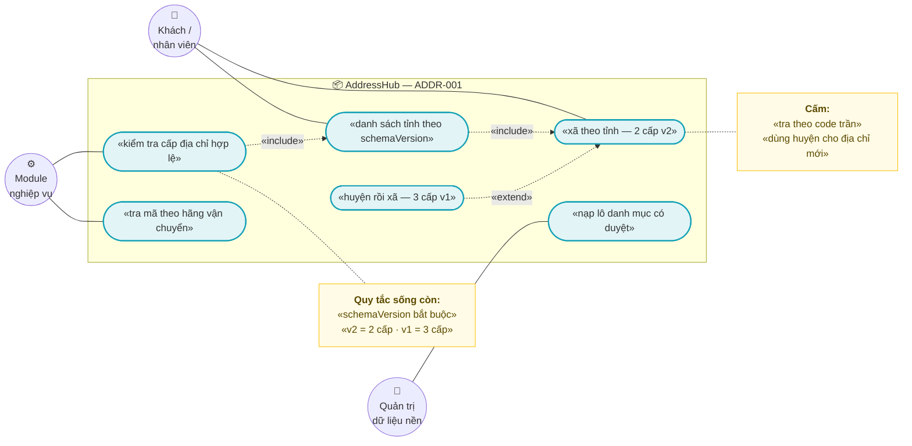
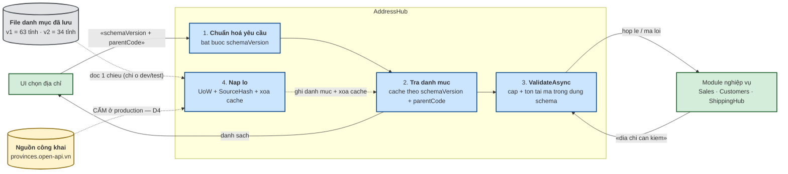
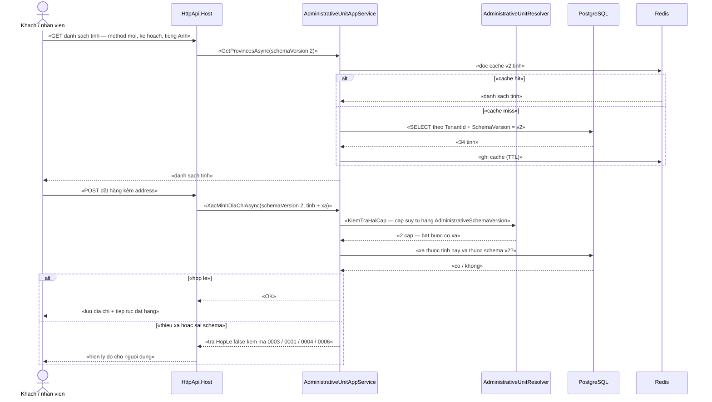

# `ADDR-001` — Tra cứu đơn vị hành chính 2 cấp (tỉnh + xã) và 3 cấp cũ

| Thuộc tính | Nội dung |
|---|---|
| **Mã** | `ADDR-001` |
| **Module** | **`Address`** (`modules/Address/`) — ✅ **đã có code** (Domain + Application + EntityFrameworkCore). "AddressHub" là tên **kế hoạch cũ** của tài liệu; tên thật = `Address` (xem §0.2 + §15.2 **F1**). Mô tả §5/§6 còn lại ở dạng **thiết kế đề xuất** được đánh dấu rõ; **hiện trạng code** nằm ở §0.2, §5.3, §6.3 |
| **Giai đoạn** | **GĐ0 — Pháp lý** (`docs/implementation-plan.md` §5: `ADDR-001`…`003` thuộc GĐ0) |
| **Ưu tiên** | **Must have** |
| **Trạng thái** | 🟡 `Draft` — chờ review |
| **Người viết / người review** | *(điền)* / **Kiến trúc trưởng + BA** |
| **Phiên bản / ngày** | `v0.5 — 18/11/2026` (đối chiếu WP-14 / `D-71`; bản gốc `v0.1 — 13/10/2026`; lịch sử v0.2…v0.5 ở §15.4) |
| **Tài liệu liên quan** | `ADDR-002` (mã địa chỉ theo hãng vận chuyển) · `ADDR-003` (chuẩn hoá & convert 3 cấp ↔ 2 cấp) · `CUS-001` (sổ địa chỉ khách) · `SAL-002` (đặt hàng) · `SHP-004` (GHTK — ⚠️ chưa xác minh địa chỉ 2 cấp) · `XC-001` · `XC-003` · `XC-004` · `XC-005` · `docs/implementation-plan.md` §6.1 + Phụ lục A.3 · `docs/structure-and-techstack.md` §2 |

---

## 0. Tóm tắt & quyết định thiết kế

**Tóm tắt:** `ADDR-001` chốt **danh mục đơn vị hành chính (ĐVHC)** của Việt Nam và **hợp đồng tra cứu** cho toàn hệ thống:
**2 cấp mới** (tỉnh + xã, hiệu lực từ **01/07/2025**) và **3 cấp cũ** (tỉnh + huyện + xã, dùng cho dữ liệu lịch sử).
Giá trị của tài liệu này không nằm ở việc "gọi API lấy danh sách tỉnh" — mà ở **hai phát hiện kiểm chứng được** khiến
thiết kế ngây thơ sẽ **sai dữ liệu địa chỉ một cách im lặng**: (1) **mã ĐVHC trùng số giữa hai bộ dữ liệu nhưng
trỏ tới hai đơn vị KHÁC NHAU**; (2) cấp địa chỉ hợp lệ phải **suy ra từ hằng `AdministrativeSchemaVersion`** (không bảng, không cấu hình — `D-80`) để **không cấu hình sai cấp** được.

**Vì sao phải làm trước khi bán hàng:** địa chỉ là **dữ liệu in trên hoá đơn điện tử** và **dữ liệu tạo vận đơn**.
Làm sai từ đầu ⇒ phải migrate lại **toàn bộ đơn hàng và hoá đơn đã phát hành**. `docs/implementation-plan.md`
dòng 99 ghi đúng rủi ro này: *"việc bỏ cấp huyện (01/07/2025) **thay đổi mô hình dữ liệu địa chỉ** ⇒ làm sai từ đầu
phải migrate lại toàn bộ đơn hàng"*. Đây cũng là **quyết định #3** của kế hoạch: *"Địa chỉ: hỗ trợ cả 2 cấp mới và 3 cấp cũ"*.

**Phạm vi:**
- ✅ **Danh mục** `Province` / `Ward` / `District` — **cả hai bộ dữ liệu** (`schemaVersion` = `v1` và `v2`), **bất biến** sau khi seed.
- ✅ **Hợp đồng tra cứu**: danh sách tỉnh, xã theo tỉnh (2 cấp), huyện theo tỉnh + xã theo huyện (3 cấp cũ), tra một mã.
- ✅ **Cấp địa chỉ hợp lệ + kiểm tra hợp lệ** — **không** có bảng `AddressLevelPolicy`, **không** có tham số `Context` (`D-80`): số cấp suy ra **duy nhất** từ hằng `AdministrativeSchemaVersion.V1/V2` (`AdministrativeModels.cs:34-50`), thực thi ở `AdministrativeUnitResolver`; cửa vào cho module khác = `AdministrativeUnitAppService.XacMinhDiaChiAsync` (`D-79`) + `AddressDirectory`.
- ✅ **`CarrierAddressCode`**: tầng **ánh xạ** mã ĐVHC nội bộ ↔ mã địa chỉ của hãng vận chuyển (**đồng bộ, không phải master data**).
- ✅ **Nguồn dữ liệu + seed idempotent**: ghi rõ nguồn, **băm (hash) tập dữ liệu** đã nạp để tái lập và chống nạp lẫn hai bộ.
- ✅ **Hai test chặn tái phát**: `TC-04` (mã trùng giữa 2 schema không được lẫn) và `TC-05` (mọi truy vấn tra cứu **bắt buộc** có `schemaVersion`).

**Không nằm trong phạm vi:**
- ❌ **Thuật toán convert 3 cấp ↔ 2 cấp** (kể cả ca sáp nhập tỉnh) — thuộc **`ADDR-003`**. Tài liệu này chỉ cung cấp **danh mục** cho việc đó.
- ❌ **Nguồn dữ liệu mã của từng hãng vận chuyển** (GHN/GHTK dùng mã gì, có API tra không) — thuộc **`ADDR-002`**; ở đây chỉ chốt **khuôn bảng** và **quy ước khoá**.
- ❌ **Sổ địa chỉ khách hàng** — thuộc [`ADDR-004`](addr-004-so-dia-chi-khach.md) (entity `Address` do module `Address` sở hữu, `Customers` giữ bảng liên kết; 🟢 Approved 17/10/2026).
- ❌ **Tính phí vận chuyển / tạo vận đơn** — thuộc `SHP-001`…`SHP-004`.
- ❌ **Tự động cập nhật danh mục theo API công khai trên production** — xem **D4** (chỉ nạp theo lô có phê duyệt) và **Q2** (§15.1, đã chốt — `D-93`).
- ❌ **Địa chỉ quốc tế** — hệ thống bán trong nước (kế hoạch §1).

### 0.1 Quyết định thiết kế (ADR ngắn)

| # | Quyết định | Phương án đã cân nhắc | Lý do chọn | Hệ quả |
|---|---|---|---|---|
| **D1** | **Danh mục ĐVHC là `IMultiTenant` (có `TenantId`), đồng thời có bộ dữ liệu quốc gia dùng chung** | (a) **global** — không `TenantId` · (b) **tenant** — mỗi tenant một bản sao | `XC-004` BR-009 + D8 chốt **mọi entity thuộc tenant phải có `TenantId`** và **mọi unique index có `TenantId` phải `NULLS NOT DISTINCT`**; hệ thống hiện chạy **1 tenant** ⇒ `TenantId = NULL` (đã kiểm chứng thật ở `20261013024226_Fix_NullableTenantId_UniqueIndexes.cs`). Chọn (b) để **không phải sửa mô hình khi bật SaaS (GĐ4)** — đúng lý do D8 của `XC-004` | Bộ dữ liệu quốc gia là **một bản ghi `TenantId = NULL`** dùng chung; tenant muốn khác biệt (ví dụ ghim mã riêng của hãng) thì **ghi đè ở bảng map của ADDR-002**, **không** sao chép danh mục |
| **D2** | **BẮT BUỘC `schemaVersion`** (`v1`/`v2`) trên **mọi** bản ghi và **mọi** truy vấn | (a) một bảng chung, tra theo `code` · (b) tách bảng v1/v2 · (c) một bảng + cột `schemaVersion` | 🚨 **Bằng chứng thật**: mã `4` là **"Phường Ba Đình"** ở `v2` nhưng là **"Phường Trúc Bạch" (Quận Ba Đình)** ở `v1`; mã `1` là **tỉnh Hà Nội** ở `v2` nhưng là **Quận Ba Đình (huyện cấp 2)** ở `v1`. Tra theo `code` trần ⇒ **im lặng trả sai đơn vị**. Chọn (c) vì **một bảng = một khuôn seed/migration**, không nhân đôi code | `schemaVersion` vào **mọi** unique index; **cấm** overload tra cứu thiếu tham số này (test `TC-05`) |
| **D3** | **`District` chỉ để TƯƠNG THÍCH**: là entity thật, **cấm** dùng làm cấp địa chỉ giao hàng | (a) xoá hẳn cấp huyện · (b) giữ nhưng cho phép chọn cấp huyện | Bỏ hẳn ⇒ **không đọc/convert được dữ liệu 3 cấp cũ** (đơn cũ, vận đơn cũ, hoá đơn đã phát hành); cho chọn ⇒ **vi phạm pháp luật hiện hành** (không còn cấp huyện từ 01/07/2025). Chọn giữ-nhưng-chặn: đúng tinh thần **quyết định #3** | `AddressLevelPolicy` phải **từ chối** mọi cấu hình cho phép nhập cấp huyện cho **địa chỉ MỚI** (BR-006) |
| **D4** | **Nạp danh mục theo LÔ có phê duyệt**, **cấm** tự động lấy API công khai ở production | (a) gọi API công khai mỗi lần tra cứu · (b) job đồng bộ định kỳ · (c) nạp lô có duyệt + băm dữ liệu | Danh mục ĐVHC là **dữ liệu pháp lý** — phải biết **chính xác phiên bản nào đang chạy** và **ai duyệt**. Gọi API công khai lúc chạy ⇒ phụ thuộc dịch vụ bên thứ ba **không cam kết SLA**, và **không** để lại dấu vết pháp lý | Có 2 giai đoạn: (1) **dev/test** được phép gọi API; (2) **production** chỉ nạp từ **file đã lưu** + `SourceHash`. 🔒 **Nguồn production (`D-93`, ĐÃ CHỐT 18/11/2026) = file công bố của cơ quan nhà nước**, đã lưu, kèm `SourceHash` + bản ghi lô (`D-78`); **không** dùng nguồn cộng đồng `provinces.open-api.vn` ở production. **Cơ quan, định dạng, đường dẫn file cụ thể = CHƯA XÁC ĐỊNH** (không suy đoán — `CLAUDE.md` §6); WP code nạp file (`ImportDatasetAsync`) phải có input thật trước khi làm |
| **D5** | **`AddressLevelPolicy` được SUY RA từ bộ dữ liệu**, không nhập tay tự do | (a) admin tự khai · (b) suy ra + cho ghi đè có kiểm tra | Nhập tay ⇒ cấu hình **3 cấp cho tỉnh chỉ có 2 cấp** (hoặc ngược lại) là loại lỗi **không có lỗi biên dịch**, chỉ lộ khi khách không chọn được xã | Không cần cấu hình gì để hệ thống đúng; cấu hình chỉ để **chặn/cho phép theo ngữ cảnh nghiệp vụ** (ví dụ: hoá đơn điện tử bắt buộc 2 cấp) |
| **D6** | **Tra cứu chỉ ĐỌC + cache**; mọi thao tác ghi (nạp lô) đi qua **Unit of Work** | (a) cho app service đọc ghi trực tiếp DbContext của app · (b) chỉ dùng `IRepository<T>` + UoW | Quy ước bất biến #13 *"mọi thao tác ghi qua Unit of Work"*; và quy ước #3 *"module → app là cấm"* | Module **không** tham chiếu `eCommerceDbContext`; entity AddressHub được cấu hình qua `ConfigureAddressHub()` (giống `ConfigureTax()` ở `TaxDbContextModelCreatingExtensions.cs`) |
| **D7** | **Khoá cache theo `(schemaVersion, parentCode)`**, **TTL dài**, xoá khi nạp lô | (a) không cache · (b) cache theo `parentCode` trần | Tra cứu này được gọi ở **mọi lần checkout** và **mọi lần tạo vận đơn** ⇒ không cache là lãng phí; nhưng cache theo `parentCode` trần sẽ **lẫn 2 schema** (đúng lỗi D2) | Xoá cache **bắt buộc** trong cùng luồng nạp lô; nếu quên ⇒ dữ liệu cũ tồn tại tới hết TTL |
| **D8** | **Danh mục là dữ liệu BẤT BIẾN sau khi phát hành** (`EffectiveFrom`/`EffectiveTo`, không UPDATE tên) | (a) UPDATE tên khi có đổi tên · (b) bất biến + bản ghi mới | Đổi tên/đổi mã **hồi tố** làm hoá đơn **đã phát hành** không còn giải trình được — bài học **BR-011 của `XC-006`** (`ChangeEffectiveTo` **cấm** lùi quá khứ, `TaxRateSchedule.cs:94-112`) | Cần đổi ⇒ **thêm bản ghi mới** với `EffectiveFrom` mới; truy vấn "đang hiệu lực tại ngày X" như `IsEffectiveAt` của `TaxRateSchedule.cs:84` |

> ✅ **Đã chốt — `D-78` (TẠM CHỐT, 17/11/2026) cho D4:** job `AdministrativeUnitSyncWorker` **giữ** nhưng chỉ cho **dev/test** (mặc định `Address:Sync:Enabled=false`). **Guard fail-closed lúc khởi động** (hàm thuần trong module Address, gọi nơi tính `BaseUrl` ở `eCommerceHttpApiHostModule.cs:170-178`): `Enabled=true` **và** host của `BaseUrl` hiệu lực (kể cả rỗng ⇒ mặc định `provinces.open-api.vn`) là nguồn công khai **và** môi trường **ngoài** allowlist `{Development, Testing}` ⇒ **NÉM**, host không start. **Không** có cờ vượt guard (mở production = **Q2** + `D-77`). **Mọi** lượt nạp (job hoặc `ImportDatasetAsync`) ghi **bản ghi lô bền**: `SourceName`, `SchemaVersion`, `SourceHash` (SHA-256 của danh mục **chuẩn hoá** — sắp theo `(Level, Code)` + `SchemaVersion` + `SourceName`, ổn định, cấm `Guid.NewGuid()`), `ImportedAtUtc`, `ImportedBy` (user hoặc `job:AdministrativeUnitSyncWorker`), số thêm/đổi tên/mở lại/đóng; lượt bị hàng rào chặn cũng ghi lô trạng thái từ chối. Đường **file đã duyệt** là đường production duy nhất tới khi có `D-xx` mới; nguồn chính thức = **file công bố của cơ quan nhà nước (`D-93`, ĐÃ CHỐT 18/11/2026; cơ quan/định dạng/đường dẫn cụ thể chưa xác định)**. Guard + bảng lô là code của **WP-15+** (⬜ chưa có).
>
> ✅ **Đã chốt — `D-80` (TẠM CHỐT) cho D5:** **bỏ** bảng `AddrLevelPolicies`, tham số `Context` (`Shipping`/`Invoice`/`Profile`) và `SetLevelPolicyAsync`. Số cấp + được/không cấp huyện lấy **duy nhất** từ `AdministrativeSchemaVersion.V1/V2` (`SoCap`, `ChoPhepCapHuyen` — `AdministrativeModels.cs:34-50`), thực thi ở `AdministrativeUnitResolver.KiemTraHaiCap/KiemTraBaCap` (`:92-211`). Tinh thần D5 ("suy ra, không nhập tay") **giữ**, chỉ đổi nơi suy ra (hằng thay bảng) — một bảng ghi được sẽ cho cấu hình `RequiredDepth=3` với `v2` ⇒ lọt cấp huyện, vi phạm BR-006 **im lặng**. Các mô tả `AddressLevelPolicy`/`Context` ở §5.2/§6.1/§9/§10/§12 là **thiết kế đã bỏ** (đã đánh dấu tại chỗ). Nợ ngoài phạm vi tài liệu này: `addr-002` dòng 291/620 và `docs/implementation-plan.md:128` còn nhắc `AddressLevelPolicy`.
>
> ✅ **Đã chốt — `D-77` (TẠM CHỐT, 17/11/2026) cho D8:** **giữ** `AdministrativeUnit.DoiTen()/Dong()/MoLai()` (sửa tên tại chỗ, **không** `EffectiveFrom/To`). Nguyên tắc mới: *danh tính = (`TenantId`, `SchemaVersion`, `Level`, `Code`) — **bất biến** sau `TaoMoi` (cùng `ParentCode`); `Name` là thuộc tính mô tả, **chỉ** đổi qua `DoiTen` kèm `LegalBasis`; mã đã cấp **không** xoá (đóng bằng `Dong`); **mọi chứng từ** (hoá đơn, vận đơn, đơn) phải **tự lưu snapshot chữ** tên ĐVHC tại thời điểm lập, **cấm** dựng lại tên từ danh mục.* Bất biến **dời chỗ** từ danh mục sang chứng từ, không bị nới. Dòng D8 phía trên (`EffectiveFrom/EffectiveTo`, "không UPDATE tên") là **thiết kế gốc đã thay thế**.
> 🔶 **Nợ có nhận chủ (EInvoice, trước release):** `PhatHanhHoaDonGd0Flow.cs:73-92` đọc `tinh.Name`/`xa.Name` **từ danh mục** lúc phát hành và đưa vào **hash ký**, nhưng `EInvoice` **không lưu** chuỗi địa chỉ ⇒ sau `DoiTen` hash **không dựng lại được**. WP code đầu tiên chạm `EInvoice` phải lưu payload/địa chỉ đã băm. Trong lúc chưa đóng nợ: **giữ** `Address:Sync:Enabled=false` ở production (nối `D-78`).

> ⚠️ **Cập nhật 17/11/2026 (WP-14):** bảng ADR trên là **thiết kế gốc 13/10/2026**. Đã áp `D-77` (D8), `D-78` (D4), `D-80` (D5) ngay dưới các dòng tương ứng; các câu §15.1 **Q9–Q12** nay **TẠM CHỐT** theo `D-77…D-80`. D1/D2/D6/D7 vẫn đối chiếu ở §0.2.

### 0.2 Hiện trạng code thật so với thiết kế (đối chiếu 17/11/2026)

Nguồn: đọc `modules/Address/**` + `src/eCommerce.EntityFrameworkCore/eCommerceDbContext.cs` + `eCommerceHttpApiHostModule.cs`. Nhãn: ✅ khớp · 🔶 khớp một phần / khác cách · ⬜ chưa có.

| Hạng mục (thiết kế) | Code thật | Nhãn | Bằng chứng |
|---|---|---|---|
| Tên module `AddressHub`, 3 project | Thư mục `modules/Address/` (Domain · Application · Application.Contracts · EntityFrameworkCore) | 🔶 tên khác | `modules/Address/eCommerce.Address.Application/AddressApplicationModule.cs:23-27` |
| 5 bảng `AddrProvinces`/`Wards`/`Districts`/`LevelPolicies`/`CarrierCodes` | **1 bảng phân cấp** `AddrAdministrativeUnits` (cột `Level` = Tinh·Xa·QuanHuyen) + `AddrCarrierMappings` (ADDR-002) + `AddrAddresses` (ADDR-004) | 🔶 khác (ADR-12 của `ADDR-004` đã chốt theo code) | `AddressDbContextModelCreatingExtensions.cs:13,19,25,40-72` |
| `SchemaVersion` = `varchar(4)` `v1`/`v2` | `int` `1`/`2`, CHECK `"SchemaVersion" in (1, 2)` | 🔶 kiểu khác, cùng bất biến | `AdministrativeUnit.cs:23`; `AddressDbContextModelCreatingExtensions.cs:69-71` |
| `Code` = `integer` | `string` độ dài cố định theo cấp: tỉnh 2 · huyện 3 · xã 5 chữ số; `ChuanHoaMa` **ném lỗi** nếu sai | 🔶 khác | `AdministrativeUnit.cs:28,98-117`; `AdministrativeModels.cs:86-92` |
| UNIQUE `(TenantId, SchemaVersion, Code)` `NULLS NOT DISTINCT` | UNIQUE `(TenantId, SchemaVersion, Level, Code)` `NULLS NOT DISTINCT` (SQL thô trong migration) | ✅ (thêm `Level`) | `AddressDbContextModelCreatingExtensions.cs:56-58`; `Migrations/20261013093715_Add_Address_AdministrativeUnits.cs:60-65` |
| CHECK v2 không có huyện ở **bảng danh mục** | **Không có** ở `AddrAdministrativeUnits`; luật nằm ở `AdministrativeUnit.TaoMoi` (ném `0004`). CHECK `V2KhongCoHuyen` chỉ có ở `AddrAddresses` | 🔶 | `AdministrativeUnit.cs:63-67`; `AddressDbContextModelCreatingExtensions.cs:160-162` |
| Bất biến: **không UPDATE** `Code`/`Name` (D8/BR-007), `EffectiveFrom`/`EffectiveTo` | Entity **có** `IsActive` + `LegalBasis`; **không** có `EffectiveFrom/To`; có `Dong()`, `MoLai()` và **`DoiTen()` sửa tên TẠI CHỖ** (lý do ghi trong code: địa chỉ/hoá đơn trỏ tới `Id`) | ✅ **theo `D-77`**: giữ code; bất biến dời sang chứng từ (snapshot chữ); ⬜ TC-12 mới chưa có | `AdministrativeUnit.cs:40,120-160` |
| `AddressLevelPolicy` bảng + `Context` (D5) | **Không có bảng.** Cấp hợp lệ **suy ra từ hằng** `AdministrativeSchemaVersion` (`SoCap`, `ChoPhepCapHuyen`); `KiemTraHaiCap`/`KiemTraBaCap` | ✅ **theo `D-80`**: bỏ bảng + `Context`, suy từ hằng (code đã đúng) | `AdministrativeModels.cs:34-50`; `AdministrativeUnitResolver.cs:92-211` |
| `ValidateAsync` cửa vào duy nhất (BR-005) | `AdministrativeUnitAppService.XacMinhDiaChiAsync` (trả `HopLe=false`, **không ném**) + `AddressDirectory.TaoHoacLayVaBietAsync` (ném mã lỗi của resolver, fail-closed) | 🔶 | `AdministrativeUnitAppService.cs:47-62`; `AddressDirectory.cs:56-77` |
| 7 method `GetProvinces/GetChildren/GetWards/GetByCode/Validate/GetCarrierCode/ImportDataset` | ✅ `WP-18`: **8 method** trên `AdministrativeUnitAppService` — 4 tên Việt (`TraDonViAsync`, `XacMinhDiaChiAsync`, `LayXaTheoTinhAsync`, `SoSanhMaXaAsync`) + 3 danh sách tên Anh + `ImportDatasetAsync` (trả `CatalogSyncRunDto`) | ✅/🔶 — xem §6.1/§6.3 | `AdministrativeUnitAppService.cs:29,47,65,83,268` |
| Cache `(schemaVersion, parentCode)` + `AddressCacheInvalidatedEto` (D7/BR-014) | ✅ `WP-18`: `AddressCatalogCache` (khoá `v{sv}:{parentCode}`, TTL 86400 `D-242`, cờ `Address:Cache:Enabled`) + `AddressCacheInvalidatedEto` phát qua outbox trong UoW dòng lô; 3 method cũ đọc **có điều kiện** | ✅ | `AddressCatalogCache.cs:30-155`; `AddressCacheInvalidatedHandler.cs`; `AdministrativeUnitAppService.cs:267-368` |
| Nạp lô có duyệt, `SourceHash`, `ImportedBy` (D4/BR-009) | ✅ `WP-18`: job + `ImportDatasetAsync` đều ghi dòng lô `AddrCatalogSyncRuns` (`CatalogSyncRun.Ghi`) với `SourceHash` SHA-256 danh mục chuẩn hoá (`AddressSourceHash.Tinh`), `ImportedBy`, `Trigger`, `Outcome`, `ErrorCode`; guard `AddressSyncGuard.KiemTra` chặn khởi động ngoài allowlist | ✅ **theo `D-78`** | `CatalogSyncRun.cs:83-150`; `AdministrativeUnitAppService.cs:268-368`; `AdministrativeUnitSyncWorker.cs`; `AddressSyncGuard` |
| Seed `AddressDataSeedContributor` | **Không có** seeder; dữ liệu vào qua job đồng bộ ở trên | ⬜ | (không có tệp; `Glob modules/Address/**` không có `*Seed*`) |
| Mã lỗi `0001…0005` (§6.2) | `0001…0009` (thêm `0008 NguonDoiDonViCapTren`, `0009 ThieuCanCuDoiTen`) + `0601…0605` + sổ địa chỉ `0101…0107`; **8** mã `0002/0007/0008/0601…0605` map HTTP từ `WP-18` (`D-240`) | 🔶 | `AddressErrorCodes.cs:10-45`; `eCommerceHttpApiHostModule.cs:322-337` |
| `[AllowAnonymous]` 3 route tra cứu (BR-013) | `AdministrativeUnitAppService` chỉ `[Authorize]` cấp class, **không** có `[AllowAnonymous]` | ⬜ (đúng với `XC-004` BR-004, Q5 còn mở) | `AdministrativeUnitAppService.cs:18` |
| `DbSet` bắt buộc (BR-012) | ✅ có đủ **6** `DbSet` module `Address` (sau `WP-18`): `AdministrativeUnits`, `CatalogSyncRuns`, `CarrierAddressMappings`, `CarrierAddressSyncRuns`, `CarrierAddressSyncRunUnmappedCodes`, `Addresses` | ✅ | `eCommerceDbContext.cs:315,319,322,326,329,335`; `:352` |
| Permission `eCommerce.Address.Manage` = nạp lô | ✅ `WP-18` thêm permission **riêng** `eCommerce.Addresses.Catalog.Import` (`CatalogImport`, `D-238`), side `Host`, `[Authorize]` **cấp method** trên `ImportDatasetAsync`; **không** tái dùng `Manage` của `ADDR-004` | ✅ | `eCommerceConsts.cs:383`; `eCommercePermissionDefinitionProvider.cs:174-175`; `AdministrativeUnitAppService.cs:267` |
| Test | 18 ca `[Fact]/[Theory]` ở `AdministrativeUnitTests.cs` + 24 ở `AddressTests.cs` (tổng **42**); **chưa** có test reflection `TC-05/TC-17`, `TC-13` | 🔶 | `test/eCommerce.Tests/Address/` |

**Trạng thái từng BR so với code (✅ có code + test · 🔶 một phần · ⬜ kế hoạch):**

| BR | Nhãn | Ghi chú |
|---|---|---|
| 001 không hard-code danh mục | ✅ | Danh mục vào DB qua job; chỉ hằng `SoTinh` 63/34 và độ dài mã trong `AdministrativeModels.cs:34-50,86-92` |
| 002 mọi truy vấn có `schemaVersion` | 🔶 | `TraTheoMa`/`ThuTra`/`KiemTra*` đều nhận `schemaVersion`; **ngoại lệ có lý do** `SoSanhMaXaAsync(maXa)` nhận mã trần nhưng trả cả hai phiên bản có nhãn (review #4); ⬜ TC-05/TC-17 (reflection + danh sách ngoại lệ) chưa có; test `CUNG_ma_00004_nhung_KHAC_don_vi_giua_v1_va_v2` (`AdministrativeUnitTests.cs:73`) |
| 003 unique `NULLS NOT DISTINCT` (bảng danh mục có `SchemaVersion` trong khoá; bảng ADDR-002/004 chỉ yêu cầu `NULLS NOT DISTINCT` — review #5) | ✅ | migration `…093715` dòng 60-65; `PostgreSqlSchemaTests.cs:235,240,296` kiểm index có `NULLS NOT DISTINCT`; ⬜ phần **chèn trùng khi `TenantId = NULL`** (`TC-09`) chưa có |
| 004 v2 = 2 cấp, v1 = 3 cấp | ✅ | `AdministrativeSchemaVersion.V1/V2` |
| 005 mọi địa chỉ chuẩn hoá qua resolver trước khi ghi (cửa `XacMinhDiaChiAsync` / `AddressDirectory`, `D-79`) | 🔶 | `AddressDirectory` kiểm trước khi lưu (`:61-77`); chỉ 2 lớp giữ `IRepository<Address, Guid>`; CHECK `CK_AddrAddresses_DaChuanHoaCoMa` chỉ ép có mã; ⬜ chưa có cơ chế đỏ cho "bỏ qua cửa" (TC-23); đường **địa chỉ thô** (`ChuaChuanHoa`) cố ý lưu **không** mã — thuộc `ADDR-004` |
| 006 cấm huyện cho địa chỉ mới | ✅ | `AdministrativeUnit.cs:63-67`; test `AdministrativeUnitTests.cs:115,124` |
| 007 bất biến danh tính + snapshot chứng từ | 🔶 | Theo `D-77`: `Code/Level/SchemaVersion/ParentCode` bất biến sau `TaoMoi`, `Name` chỉ đổi qua `DoiTen`; `WP-18` **đã ép** vế "kèm `LegalBasis`" (`DoiTen` ném `0009` khi rỗng, `D-239`) và **NÉM `0008`** khi nguồn đổi `ParentCode` (hàng rào 5, `D-81`) — `AdministrativeUnit.cs:42-45`, `AdministrativeUnitSynchronizer.cs:113-121,263-266`; ⬜ TC-12/TC-24 (reflection) giao QA `W18-3`; ⬜ EInvoice chưa lưu snapshot (nợ `PhatHanhHoaDonGd0Flow.cs:73-92`) |
| 008 seed/nạp idempotent | 🔶 | `LapKeHoach` lập kế hoạch thay đổi (không trùng nhờ unique index); ✅ `SourceHash` có từ `WP-18` (`AddressSourceHash.Tinh`); test lặp 10 lần giao QA |
| 009 **mọi** lượt nạp (job lẫn file) ghi bản ghi lô + `SourceHash` | ✅ | Theo `D-78`. `WP-18` **đã có** bảng `AddrCatalogSyncRuns`: job ghi dòng lô cho **mọi** lượt đã giành khoá (kể cả 0 thay đổi), phân loại `BiChan`/`Loi`; `ImportDatasetAsync` ghi dòng lô trong UoW của lượt, lượt **bị chặn/lỗi** ghi UoW **riêng** `requiresNew` trước khi NÉM (`AdministrativeUnitAppService.cs:264-368`). ⬜ test TC-21 giao QA |
| 010 guard khởi động + allowlist môi trường | ✅ | Theo `D-78`: `WP-18` có `AddressSyncGuard.KiemTra` — `Enabled=true` + host công khai + môi trường ngoài `{Development, Testing}` ⇒ NÉM, không cờ vượt; gọi **vô điều kiện** trong `ConfigureServices` trước `AddHttpClient`. **Phạm vi = chặn nguồn công khai**; `BaseUrl` sang host khác ở production không bị chặn (TC-22 ca g — lỗ hở ghi nhận). ⬜ test TC-22 giao QA |
| 011 policy suy ra + kiểm cả cấp và tồn tại mã | ✅ | `AdministrativeUnitResolver.cs:92-211` |
| 012 `DbSet` trên DbContext hợp nhất | ✅ | `eCommerceDbContext.cs:315,319,322,326,329,335` |
| 013 `[AllowAnonymous]` tra cứu trong allowlist | ⬜ | chưa mở; Q5 |
| 014 cache khoá `(schemaVersion, parentCode)` | ✅ | `WP-18`: `AddressCatalogCache` (TTL 86400, `D-242`) + `AddressCacheInvalidatedEto` |

---

## 1. Use Case Specification

| Thuộc tính | Nội dung |
|---|---|
| **Use Case ID** | `ADDR-001` |
| **Use Case Name** | Tra cứu **đơn vị hành chính** (2 cấp mới và 3 cấp cũ) và kiểm tra **cấp địa chỉ hợp lệ** |
| **Description** | *"Là module nghiệp vụ (Sales/Customers/ShippingHub/EInvoiceHub), tôi muốn tra cứu danh mục tỉnh–xã (2 cấp) và tỉnh–huyện–xã (3 cấp cũ) từ **một nguồn sự thật duy nhất** và được **kiểm tra cấp địa chỉ** trước khi lưu, để không bao giờ lưu một địa chỉ mà mã tỉnh/xã trỏ sai đơn vị hoặc sai cấp."* |
| **Actor(s)** | **Nhân viên/khách** (chọn địa chỉ trên UI) · **Module nghiệp vụ** (Sales, Customers, ShippingHub, EInvoiceHub) · **Quản trị dữ liệu nền** (nạp lô danh mục) |
| **Priority** | **Must have** |
| **Trigger** | (a) người dùng mở form chọn địa chỉ; (b) checkout cần kiểm tra địa chỉ giao hàng; (c) tạo vận đơn cần mã ĐVHC để gửi hãng; (d) phát hành hoá đơn cần địa chỉ đúng cấp; (e) admin nạp lô danh mục mới |
| **Pre-Condition(s)** | • **`TenantId`** của ngữ cảnh hiện tại — danh mục quốc gia là bản ghi `TenantId = NULL`, tenant ghi đè ở tầng map (D1).<br>• **`schemaVersion`** được xác định **tường minh** ở mọi truy vấn (D2) — **không** có giá trị mặc định ngầm.<br>• **Seed đã chạy** cho `v1` và `v2` (nếu chưa ⇒ trả danh sách rỗng, **không** phải lỗi — §12).<br>• **`ChannelCode` KHÔNG** tham gia tra cứu địa chỉ (danh mục ĐVHC không phụ thuộc kênh bán); `ChannelCode` chỉ xuất hiện ở `CarrierAddressCode` của `ADDR-002`. |
| **Post-Condition(s)** | • Mọi kết quả tra cứu **thuộc đúng `schemaVersion`** yêu cầu — **không** lẫn hai bộ dữ liệu (BR-002).<br>• Mọi lần lưu địa chỉ **đã đi qua** cửa kiểm (`XacMinhDiaChiAsync` ở cửa tra cứu · `AddressDirectory.TaoHoacLayVaBietAsync` ở cửa lưu của `ADDR-004` — `D-79`) và **đã** bị từ chối nếu sai cấp (BR-005); cơ chế ép buộc xem BR-005.<br>• *(viết lại theo `D-77`)* **Danh tính** ĐVHC `(TenantId, SchemaVersion, Level, Code)` + `ParentCode` **không đổi** sau `TaoMoi`; `Name` đổi **tại chỗ** qua `DoiTen`, mã đã cấp **không xoá** (đóng bằng `Dong`/`IsActive=false`); bất biến tên **dời sang chứng từ** (snapshot chữ). **Không** có `EffectiveFrom/To`, **không** thay bản ghi cũ bằng bản ghi mới.<br>• Nạp lô để lại **dấu vết**: `SourceHash`, `ImportedAtUtc`, `ImportedBy`, số dòng thêm/giữ. |
| **Basic Flow** | 1. UI gọi `GetProvincesAsync(schemaVersion)` → danh sách tỉnh **của đúng bộ dữ liệu**.<br>2. UI gọi `GetChildrenAsync(schemaVersion, parentCode)` với `parentCode = provinceCode`:<br>&nbsp;&nbsp;• `v2` ⇒ trả **xã/phường** trực thuộc tỉnh (đúng **2 cấp**);<br>&nbsp;&nbsp;• `v1` ⇒ trả **quận/huyện**, sau đó gọi tiếp với `parentCode = districtCode` để lấy **xã/phường** (đúng **3 cấp**).<br>3. Module nghiệp vụ gọi `XacMinhDiaChiAsync(request)` (`D-79`; thiết kế gốc gọi `ValidateAsync` — method này **không tồn tại**) trước khi lưu địa chỉ.<br>4. `XacMinhDiaChiAsync` kiểm theo **cấp suy từ hằng `AdministrativeSchemaVersion`** (`D-80`; **không** có `AddressLevelPolicy`/`Context`): đủ cấp chưa, mã có tồn tại **trong đúng schema** không, xã có thuộc tỉnh không, mã đã đóng chưa, có dùng cấp huyện cho địa chỉ **mới** không (`AdministrativeUnitResolver.cs:92-211`).<br>5. `HopLe=true` ⇒ module lưu địa chỉ (**kèm `schemaVersion` đã dùng**) và mở Unit of Work cho phần ghi của mình.<br>6. `HopLe=false` ⇒ method **KHÔNG ném** (`AdministrativeUnitAppService.cs:43-61`), trả `ErrorCode` + `ThongDiep` (§6.2). **Nơi gọi PHẢI kiểm `HopLe` và TỪ CHỐI lưu**; "không có exception" **không** có nghĩa là hợp lệ — bỏ qua `HopLe` ⇒ lưu im lặng xã không thuộc tỉnh (`0003`) hoặc mã đã đóng (`0006`) ⇒ vận đơn/hoá đơn sai. **Ngoại lệ duy nhất có ném:** `schemaVersion` ngoài `1`/`2` ⇒ `BusinessException` `0005` (`AdministrativeUnitResolver.cs:100`, qua `AdministrativeSchemaVersion.TheoSo`). *(Cửa lưu `AddressDirectory.TaoHoacLayVaBietAsync` thì ném mã lỗi của resolver — `AddressDirectory.cs:70-77`.)* |
| **Alternative Flow** | **A1: Tra cứu từ cache** — cùng `(schemaVersion, parentCode)` ⇒ trả từ cache, **không** chạm DB (D7).<br>**A2: Ẩn đơn vị ngừng hiệu lực** — đơn vị đã đóng (`IsActive=false` — `D-77`, **không** có `EffectiveTo`) **không** xuất hiện trong danh sách chọn **mới**, nhưng **vẫn tra được theo mã** để hiển thị đơn cũ (§12).<br>**A3: Ghi đè mã theo hãng** — `CarrierAddressCode` trả mã của hãng cho cặp `(internalCode, carrierCode, schemaVersion)`; nếu chưa có ⇒ xem E4.<br>**A4: Tra cứu ngược từ tên (autocomplete)** — tìm theo `codename`/tên không dấu; **vẫn** bắt buộc lọc theo `schemaVersion`. |
| **Exception Flow** | **E1:** `schemaVersion` thiếu/không hợp lệ ⇒ `BusinessException` `eCommerce:Address:0005` (`PhienBanKhongHopLe`, `D-79`: giữ số mã thật) — 🔒 **cấm** tự đoán `v1`/`v2` (D2).<br>**E2:** mã tỉnh/xã/huyện **không tồn tại trong `schemaVersion` yêu cầu** ⇒ `eCommerce:Address:0001` (`KhongTimThayDonVi`, kèm `code` + `schemaVersion`) — 🚨 **không** thử tra ở schema kia.<br>**E3:** cấu hình/đầu vào **vi phạm cấp suy từ `AdministrativeSchemaVersion`** (`D-80`: thiếu xã, dùng huyện cho địa chỉ **mới**) ⇒ mã thật theo §6.2 (`0003` xã không thuộc tỉnh · `0004` huyện ở schema 2 cấp).<br>**E4:** **không có mã của hãng vận chuyển** cho đơn vị này ⇒ `eCommerce:Address:0501` (`CarrierAddressErrorCodes.KhongTimThayMaHang`, dùng lại — thuộc `ADDR-002`) **khi** ngữ cảnh bắt buộc map; nếu chỉ hiển thị ⇒ cảnh báo và **không** chặn.<br>**E5** *(viết lại theo `D-81`)*: cùng `(SchemaVersion, Level, Code)` đã có: **`Name` khác ⇒ `DoiTen` tại chỗ** (đếm `SoDoiTen` trong bản ghi lô, **không** rollback — `D-77`); **`ParentCode` khác ⇒ xung đột** ⇒ gom **toàn bộ** mã lệch rồi ném **một** `BusinessException` `eCommerce:Address:0008` (hằng mới cuối dải, tên gợi ý `NguonDoiDonViCapTren`; ⬜ chưa có hằng — WP-15+) kèm `WithData` `soDoiCha`, `nguon`, `schemaVersion`, ≤ 20 mục `code: chaCu→chaMoi`; **rollback toàn bộ lô** (**0** thay đổi được áp, kể cả đổi tên/thêm mới hợp lệ cùng lô; `ParentCode` entity không bị ghi đè); lượt bị chặn ghi **bản ghi lô trạng thái từ chối** (`D-78`) **trong UoW riêng `requiresNew: true`, commit TRƯỚC khi NÉM `0008`** — nếu ghi trong UoW của lô thì exception đi ra khỏi app service làm ABP rollback luôn bản ghi từ chối (đường file = đường production duy nhất — `D-78`); đường job thì worker bắt lỗi (`AdministrativeUnitSyncWorker.cs:155`) nên không ném tiếp. **Đổi mã** ở nguồn = `ThemMoi` + `Dong` (hàng rào 4 chặn khi vượt ngưỡng), **không** phải `0008`. |
| **Business Rules** | • **BR-ADDR-001-001**: Danh mục ĐVHC là **dữ liệu**, **cấm** hard-code danh sách tỉnh/xã/huyện trong code nghiệp vụ.<br>• **BR-ADDR-001-002**: **Mọi** bản ghi ĐVHC và **mọi** truy vấn tra cứu **phải** có `schemaVersion` (`v1`/`v2`); **cấm** tra cứu theo `code` trần. **Ngoại lệ duy nhất, có lý do:** `SoSanhMaXaAsync(string maXa)` (`D-79` giữ nguyên; `AdministrativeUnitAppService.cs:83`) nhận mã trần nhưng **trả cả hai phiên bản, mỗi dòng gắn `SchemaVersion`** (`MaXaHaiPhienBanDto`, `AddressDtos.cs:32`) — là công cụ soi bẫy mã trùng, không thể trả sai đơn vị im lặng; ngoại lệ này được **liệt kê tường minh** ở TC-05/TC-17.<br>• **BR-ADDR-001-003** *(thu hẹp phạm vi, review #5)*: Unique index của **bảng danh mục** `AddrAdministrativeUnits` **phải** là `(TenantId, SchemaVersion, Level, Code)` (có cột `SchemaVersion`); **mọi** unique index trên bảng có `TenantId` của module `Address` (kể cả `AddrCarrierMappings` — khoá `(TenantId, CarrierCode, CarrierAddressCode)` — và `AddrAddresses` — khoá `(TenantId, ContentHash)`, hai bảng **không** có khoá theo `SchemaVersion`, thuộc `ADDR-002`/`ADDR-004` đã chốt) **phải** dùng **`NULLS NOT DISTINCT`** (`AddressDbContextModelCreatingExtensions.cs:16,22,28,56,89,125`). **Đỏ khi vi phạm:** `PostgreSqlSchemaTests.cs:235,240,296` (danh sách đích danh index `NULLS NOT DISTINCT`) và `TC-09`.<br>• **BR-ADDR-001-004**: Cặp cấp hợp lệ bắt buộc: **`v2` ⇒ 2 cấp (tỉnh + xã)**, **`v1` ⇒ 3 cấp (tỉnh + huyện + xã)**; **cấm** trộn cấp giữa hai bộ.<br>• **BR-ADDR-001-005** *(đổi tên cửa theo `D-79`, review #13)*: Địa chỉ **chuẩn hoá** (có mã tỉnh/xã) **được lưu** vào `AddrAddresses` **phải** đi qua resolver (`KiemTraHaiCap`/`KiemTraBaCap`) **trước khi ghi**; cửa tra cứu cho module gọi là `XacMinhDiaChiAsync` (trả `HopLe`, **không ném**), cửa lưu là `AddressDirectory.TaoHoacLayVaBietAsync` (**ném** mã của resolver, fail-closed — `AddressDirectory.cs:61-77`). **Cơ chế ép buộc hiện có:** (i) chỉ hai lớp giữ `IRepository<Address, Guid>` — `AddressDirectory` và `AddressAppService` (grep 17/11/2026) — nên đường ghi chuẩn hoá tập trung ở module `Address`; (ii) DB CHECK `CK_AddrAddresses_DaChuanHoaCoMa` ép đã chuẩn hoá ⇒ có `TinhCode`, `XaCode`, `NormalizedAtUtc` (`AddressDbContextModelCreatingExtensions.cs:150-152`) — **chỉ chặn thiếu mã, không kiểm mã có thuộc danh mục/đúng cấp** (không có FK). **Đỏ khi vi phạm:** TC-07/TC-15 chỉ kiểm **bộ kiểm** (resolver), **không** kiểm "có ai bỏ qua bộ kiểm"; ⬜ **chưa có cơ chế đỏ** cho ca module khác tự ghi `Address` mà không qua cửa — đề xuất TC-23 (quét mã: **chỉ** `AddressDirectory` + `AddressAppService` tham chiếu `IRepository<Address, Guid>`). Địa chỉ **thô** (`ChuaChuanHoa`, không mã) cố ý lưu không qua resolver — thuộc `ADDR-004`.<br>• **BR-ADDR-001-006**: **Cấm** dùng cấp **huyện** cho **địa chỉ MỚI** (từ 01/07/2025 không còn cấp huyện); cấp huyện **chỉ** để đọc/convert dữ liệu cũ (`ADDR-003`).<br>• **BR-ADDR-001-007** *(viết lại theo `D-77`)*: Danh tính ĐVHC = (`TenantId`, `SchemaVersion`, `Level`, `Code`) **bất biến** sau `TaoMoi` (cùng `ParentCode`); `Name` **chỉ** đổi qua `DoiTen` kèm `LegalBasis`; mã đã cấp **không** xoá (đóng bằng `Dong`); **mọi chứng từ** (hoá đơn, vận đơn, đơn) **phải** tự lưu snapshot chữ tên ĐVHC tại thời điểm lập, **cấm** dựng lại tên từ danh mục. **Hiện trạng ✅ (26/11/2026):** `WP-18` **đã ép** — `DoiTen(string tenMoi, string legalBasis)` **bỏ** giá trị mặc định, căn cứ rỗng ⇒ NÉM `eCommerce:Address:0009` `ThieuCanCuDoiTen` (`D-239`; `AdministrativeUnit.cs:42-45`) và `ApDung` truyền `danhMuc.Nguon` làm căn cứ (`AdministrativeUnitSynchronizer.cs:263-266`); test TC-12/TC-24 giao QA `W18-3`. **Nguồn đổi `ParentCode` (review #7):** danh tính gồm `ParentCode` nhưng `LapKeHoach` chỉ so `Name` (`AdministrativeUnitSynchronizer.cs:174`) ⇒ hiện nguồn đổi cha (xã chuyển tỉnh/huyện) bị **bỏ qua im lặng** và `KiemTraHaiCap` sẽ trả `0003` cho địa chỉ đúng theo danh mục mới ⇒ **`D-81` (Q13 đã chốt, fail-closed):** `LapKeHoach` so thêm `ParentCode` cho **mọi** `(Level, Code)` đã có cùng `SchemaVersion` — **kể cả bản đang đóng** (kiểm **trước** nhánh `MoLai`), chuẩn hoá `Trim`, `null` ≡ rỗng, `StringComparison.Ordinal`; gom mã lệch, ném **một** `BusinessException` `eCommerce:Address:0008` (≤ 20 mục `code: chaCu→chaMoi`), sau hàng rào 3 và trước hàng rào 4 ⇒ **0** thay đổi được áp; áp cho **cả job lẫn `ImportDatasetAsync`**; ghi bản ghi lô trạng thái từ chối; `ParentCode` entity **không** bị ghi đè. Code ✅ từ `WP-18` (hàng rào 5, `AddressErrorCodes.cs:38`, map `409` — `D-240`). **Đỏ khi vi phạm:** TC-12 (reflection: có public setter trên `Code/Level/SchemaVersion/ParentCode/Name`, hoặc mã gán ngoài `TaoMoi`/`DoiTen`; ca "`DoiTen` thiếu căn cứ ⇒ ném" — ⬜ sau nợ WP-15), TC-24 (nguồn đổi `ParentCode` ⇒ NÉM `0008`, `ParentCode` giữ nguyên — `D-81`) và test `Ten_doi_thi_DoiTen_chu_KHONG_tao_ban_ghi_moi` (`AdministrativeUnitSynchronizerTests.cs:84`); phần "chứng từ lưu snapshot" ⬜ chưa có test (nợ EInvoice).<br>• **BR-ADDR-001-008**: Seed/nạp lô **phải idempotent** — chạy lại cùng một lô **không** tạo bản ghi trùng và **không** đổi `SourceHash` đã ghi.<br>• **BR-ADDR-001-009** *(theo `D-78`)*: **Mọi** lượt nạp — **cả job đồng bộ lẫn `ImportDatasetAsync`** — **phải** ghi **bản ghi lô bền** gồm `SchemaVersion`, `Trigger`, `SourceName`, `SourceHash` (SHA-256 danh mục **chuẩn hoá**, ổn định qua lần chạy lại), `StartedAtUtc`, `ImportedAtUtc`, `ImportedBy`, `Outcome`, `ErrorCode`, số thêm/đổi tên/mở lại/đóng; lượt bị hàng rào chặn cũng ghi lô trạng thái từ chối; `ImportDatasetAsync` trả `CatalogSyncRunDto` của **lượt mình** (`D-241`); **cấm** nạp danh mục không rõ nguồn. **Đỏ khi vi phạm:** TC-21.<br>• **BR-ADDR-001-010** *(theo `D-78`; phạm vi viết đúng theo guard, review #11)*: Job đồng bộ **thiết kế** cho dev/test. **Guard fail-closed lúc khởi động**: `Address:Sync:Enabled=true` **và** host của `BaseUrl` hiệu lực là **nguồn công khai** (`provinces.open-api.vn`, kể cả `BaseUrl` rỗng ⇒ mặc định) **và** môi trường **ngoài** allowlist `{Development, Testing}` ⇒ **NÉM**, host không start; **không** có cờ vượt guard. **Phạm vi guard = chặn nguồn công khai, KHÔNG phải chặn mọi nguồn ở production:** `BaseUrl` trỏ sang host khác (bản sao nội bộ) với `Enabled=true` ở `Production` **không bị guard chặn** (TC-22 ca g) — đây là **lỗ hở ghi nhận**, `D-93` đã chốt nguồn production = file công bố của cơ quan nhà nước nhưng **không** thêm guard cho host khác ⇒ lỗ hở còn; giảm thiểu bằng `D-77` (giữ `Enabled=false` ở production tới khi đóng nợ EInvoice); không tự đóng ở BR này. Đường **file đã duyệt** là đường production **duy nhất theo thiết kế** (`D-78`), không phải điều guard ép. **Đỏ khi vi phạm:** TC-22 (ca a/b/c/h đỏ nếu host vẫn start; ca g ghi nhận hành vi hiện định).<br>• **BR-ADDR-001-011**: Cấp địa chỉ hợp lệ **phải** được **suy ra** từ hằng `AdministrativeSchemaVersion` (`D-80`, không bảng policy, không `Context`); `XacMinhDiaChiAsync`/resolver **phải** kiểm **cả** cấp **và** sự tồn tại của mã **trong đúng schema**.<br>• **BR-ADDR-001-012**: Mọi entity AddressHub **phải** có `DbSet` trên DbContext hợp nhất; **cấm** dựa vào việc module tự có DbContext riêng.<br>• **BR-ADDR-001-013**: Tra cứu địa chỉ **được phép** `[AllowAnonymous]` (form checkout khách chưa đăng nhập) **nhưng phải** nằm trong allowlist của `XC-004` Q1; **cấm** mở `[AllowAnonymous]` cho API nạp lô.<br>• **BR-ADDR-001-014**: Cache tra cứu **phải** khoá theo `(schemaVersion, parentCode)`, **phải** bị xoá trong cùng luồng nạp lô (D7) và **phải** có TTL lưới `Address:Cache:TtlSeconds` = **86400** s (`D-242`; sai/0/âm ⇒ 86400 + `LogWarning`). |
| **Non-Functional Requirement** | • **NFR-ADDR-001-001**: Tra cứu xã theo tỉnh (`v2`, tỉnh lớn nhất) p95 **< 100 ms** khi **nguội** (chưa cache) và **< 10 ms** khi **nóng** (cache).<br>• **NFR-ADDR-001-002**: Danh mục 2 cấp nạp đủ **34 tỉnh** (`v2`); danh mục 3 cấp nạp đủ **63 tỉnh** (`v1`); **0** bản ghi thiếu `code`.<br>• **NFR-ADDR-001-003**: **0** kết quả tra cứu lẫn `schemaVersion` (test `TC-04`).<br>• **NFR-ADDR-001-004**: **0** truy vấn tra cứu thiếu `schemaVersion` (test reflection `TC-05`).<br>• **NFR-ADDR-001-005**: Seed lại từ đầu (DB trống) **< 60 s** cho cả hai bộ.<br>• **NFR-ADDR-001-006**: **0** public setter trên `Code/Level/SchemaVersion/ParentCode/Name` và **0** chỗ gán ngoài `TaoMoi`/`DoiTen` (test reflection + quét mã `TC-12`, `D-77`).<br>• **NFR-ADDR-001-007**: Nạp lô **nguyên tử** — **cả đường file lẫn đường job** (`D-78`): lô lỗi ⇒ **0** bản ghi được ghi (test `TC-11`, phủ cả hai đường). 🔶 Hiện trạng: đường job **chưa** nguyên tử (⬜, xem §8.1 #5). |

---

## 2. Sơ đồ Use Case



---

## 3. Sơ đồ trạng thái (state machine)

**Không áp dụng — lý do:** `ADDR-001` **không có thực thể nào có vòng đời trạng thái**. Cụ thể:
`AdministrativeUnit` là **danh mục** có danh tính bất biến (`D-77`, thay D8 gốc "`EffectiveFrom`/`EffectiveTo`") — không có `Status` nhiều giá trị, chỉ cờ `IsActive`;
bảng `AddressLevelPolicy` **đã bỏ** (`D-80` — cấp suy từ hằng); `CarrierAddressCode` là **ánh xạ**.

> ⚠️ **Cập nhật 17/11/2026 — code thật khác:** entity `AdministrativeUnit` là **một** bảng, không có `EffectiveFrom/To`;
> có cờ `IsActive` (+ `Dong()`/`MoLai()`) và **`DoiTen()` sửa tên tại chỗ** (`AdministrativeUnit.cs:40,120-160`).
> Về **kết luận "không áp dụng state machine"** vẫn đúng: `IsActive` là cờ hai giá trị, `Dong()`/`MoLai()` không ném lỗi khi lặp lại
> (guard: gọi lại ở trạng thái đích = **vô hại**, cố ý để job đồng bộ chạy lặp an toàn — `AdministrativeUnit.cs:149-152`).
> ✅ Việc "bất biến hay đổi tên tại chỗ" **đã chốt — `D-77`** (TẠM CHỐT): giữ `DoiTen`/`Dong`/`MoLai`; bất biến nằm ở **danh tính** (bảng bên dưới) và ở **snapshot chữ trên chứng từ**.

Bất biến thay thế state machine (và **phải** được kiểm bằng test) — xem §8.1:

| # | Bất biến | Vì sao **không** dùng state machine mà dùng bất biến |
|---|---|---|
| 1 | *(viết lại theo `D-77`)* `Code/Level/SchemaVersion/ParentCode` **không đổi** sau `TaoMoi`; `Name` chỉ đổi qua `DoiTen` kèm `LegalBasis`; mã **không xoá** (đóng bằng `Dong`) | Không có vòng đời trạng thái: `Dong()`/`MoLai()` là cờ hai giá trị, gọi lại = vô hại. Tên đổi tại chỗ **không** gây hồi tố vì chứng từ giữ snapshot chữ |
| 2 | `(TenantId, SchemaVersion, Level, Code)` là **duy nhất** | Ràng buộc tĩnh ở DB (`NULLS NOT DISTINCT`) |
| 3 | Tập `(SchemaVersion, Code)` của `v1` và `v2` **độc lập** với nhau | Bất biến về **tính đúng của tra cứu**, không phải vòng đời |

> ⚠️ **Ghi rõ để tránh hiểu nhầm:** ở **`ADDR-003`** mới có "vòng đời chuyển đổi" (3 cấp → 2 cấp, ca sáp nhập tỉnh).
> Tài liệu này **cố ý không** mô hình hoá nó, để **không** tạo hai nguồn sự thật cho cùng một logic.

---

## 4. Sequence Diagram & luồng dữ liệu

### 4.1 DFD — luồng dữ liệu tra cứu & kiểm tra cấp địa chỉ



> 📌 **Nguồn công khai chỉ được dùng ở dev/test** (BR-010). Ghi rõ để người review thấy **mũi tên duy nhất** đi từ Internet vào hệ thống, và nó **không** đi vào production.

### 4.2 Sequence — `XacMinhDiaChiAsync` (thiết kế gốc gọi `ValidateAsync`; `D-79`) khi lưu địa chỉ giao hàng (2 cấp)



> 📌 **Chú thích hiện trạng (17/11/2026):** sơ đồ 4.1/4.2 là **luồng thiết kế**. Code thật khác ở 3 điểm: (1) **không có bước cache/Redis** (⬜);
> (2) bước "Nạp lô" thật là **job đồng bộ** `AdministrativeUnitSyncWorker` gọi `provinces.open-api.vn` rồi `LapKeHoach` → `ApDung` (mặc định tắt, `AdministrativeUnitSyncWorker.cs:86-105`), **không** đọc "file đã lưu";
> (3) tên thành phần: `AdministrativeUnitAppService` (không phải `AddressLookupAppService`), `AdministrativeUnitResolver` (không phải `AddressLevelPolicy`, bỏ theo `D-80`), lỗi trả mã thật theo §6.2/§6.3. **Hình sequence phía trên đã sửa theo `D-79`/`D-80`** (không còn `Context`, không còn bảng policy); bước cache và `GetProvincesAsync` vẫn là kế hoạch.

---

## 5. Mô hình dữ liệu

### 5.1 Quan hệ giữa các bảng

**Không dùng sơ đồ ERD Mermaid** — lý do: tài liệu này **đã đạt giới hạn 3 sơ đồ** (§2, §4.1, §4.2), và toàn bộ cột/index của 5 bảng đã được liệt kê **đầy đủ và chi tiết hơn** ở §5.2. Quan hệ giữa các bảng mô tả bằng bảng dưới đây:

| Quan hệ | Bội số | Ghi chú |
|---|---|---|
| `AddrProvinces` → `AddrWards` | 1 : n | qua `ProvinceCode` |
| `AddrProvinces` → `AddrDistricts` | 1 : n | **chỉ `v1`** (`v2` **không** có bản ghi huyện) |
| `AddrDistricts` → `AddrWards` | 1 : n | **chỉ `v1`**; ở `v2`, `AddrWards.DistrictCode` là `NULL` |
| ~~`AddrProvinces` → `AddrLevelPolicies`~~ | ~~1 : n~~ | **BỎ theo `D-80`** — bảng không được tạo; cấp suy từ hằng `AdministrativeSchemaVersion` |
| `AddrProvinces`/`AddrWards`/`AddrDistricts` → `AddrCarrierCodes` | 1 : n | qua `(SchemaVersion, InternalLevel, InternalCode)` — **không** dùng khoá ngoại cứng (dữ liệu đồng bộ theo hãng) |

> 🔶 **Hiện trạng 17/11/2026:** bảng quan hệ trên là **thiết kế 5 bảng**; code dùng **một** bảng phân cấp — xem §5.3. Bảng quan hệ thật: `AdministrativeUnit.ParentCode` (xã ⇒ tỉnh ở v2; xã ⇒ huyện, huyện ⇒ tỉnh ở v1), **không** có khoá ngoại cứng (`AdministrativeUnit.cs:32-33`).

> 📌 **Chi tiết quyết định sự đúng/sai của tra cứu 2 cấp:** `AddrWards.DistrictCode` là **`NULL` ở `v2`** (vì **không còn cấp huyện**) và **có giá trị ở `v1`**. Nếu để `DistrictCode` **bắt buộc**, `v2` **không thể** nạp được. Nhưng nếu tra xã **chỉ** theo `ProvinceCode`, dữ liệu `v1` sẽ trả **lẫn** xã của nhiều huyện khác nhau trong cùng tỉnh — và **đã kiểm chứng có tên trùng nhau thật**: **"Xã Đông Xuân"** xuất hiện ở `Huyện Sóc Sơn` (mã `436`) **và** ở `Huyện Quốc Oai` (mã `4939`) của Hà Nội trong `v1`. ⇒ Tra xã ở `v1` **bắt buộc** phải lọc theo `(ProvinceCode, DistrictCode)`, và index `(TenantId, SchemaVersion, ProvinceCode, DistrictCode)` ở §5.2 là để phục vụ **đúng** truy vấn đó.

### 5.2 Bảng & cột (Data Dictionary)

> 🚨 **ĐỌC TRƯỚC — mục này là THIẾT KẾ ĐỀ XUẤT, KHÔNG phải hiện trạng code** (đo lại **17/10/2026**):
> code **chỉ có 2 bảng** — `AddrAdministrativeUnits` và `AddrCarrierMappings`
> (`modules/Address/eCommerce.Address.EntityFrameworkCore/AddressDbContextModelCreatingExtensions.cs:13,19`),
> tương ứng entity **`AdministrativeUnit`** (MỘT bảng, phân cấp bằng cột `Level`) và **`CarrierAddressMapping`**.
> ⇒ Ba bảng `AddrProvinces` / `AddrWards` / `AddrDistricts` / `AddrLevelPolicies` / `AddrCarrierCodes` mô tả dưới đây
> **chưa tồn tại** và **không** nên tạo: `ADDR-004` **ADR-12** đã chốt **theo hiện trạng code** (một bảng phân cấp
> thay vì 5 bảng), để tránh **hai mô tả schema cùng tồn tại**. Xem thêm `addr-004` **F5**.

**Bảng `AddrProvinces`** — *danh mục tỉnh/thành phố, **cả hai** bộ dữ liệu*

| Cột | Kiểu | Null? | Nguồn / ý nghĩa | Ghi chú |
|---|---|---|---|---|
| `Id` | `uuid` | ✖ | khoá chính kỹ thuật | |
| `TenantId` | `uuid` | ✔ | `NULL` = **bộ dữ liệu quốc gia** dùng chung (D1) | ⚠️ **bắt buộc** vì entity là `IMultiTenant` (`XC-004` BR-009) |
| `SchemaVersion` | `varchar(4)` | ✖ | `v1` (63 tỉnh, có huyện) hoặc `v2` (34 tỉnh, không huyện) | 🚨 **D2** — **không** bao giờ được null |
| `Code` | `integer` | ✖ | mã ĐVHC từ nguồn dữ liệu | 🚨 **trùng số giữa 2 schema** (xem cảnh báo dưới) |
| `Name` | `varchar(256)` | ✖ | tên đầy đủ có tiền tố loại ("Thành phố Hà Nội") | |
| `Codename` | `varchar(256)` | ✔ | tên không dấu dạng snake ("ha_noi") | dùng cho autocomplete/SEO |
| `DivisionType` | `varchar(64)` | ✔ | "thành phố trung ương" / "tỉnh" | |
| `PhoneCode` | `integer` | ✔ | mã vùng điện thoại từ nguồn (`phone_code`) | chỉ để hiển thị |
| `EffectiveFrom` | `date` | ✖ | ngày bắt đầu hiệu lực **theo nguồn pháp lý** | v2 = **2025-07-01** |
| `EffectiveTo` | `date` | ✔ | `NULL` = còn hiệu lực (D8) | |

**Bảng `AddrWards`** — *xã/phường; ở `v2` trực thuộc **tỉnh**, ở `v1` thuộc **huyện***

| Cột | Kiểu | Null? | Nguồn / ý nghĩa | Ghi chú |
|---|---|---|---|---|
| `Id` | `uuid` | ✖ | khoá chính | |
| `TenantId` | `uuid` | ✔ | như trên | |
| `SchemaVersion` | `varchar(4)` | ✖ | `v1`/`v2` | |
| `Code` | `integer` | ✖ | mã xã/phường | trường `code` của nguồn |
| `ProvinceCode` | `integer` | ✖ | tỉnh chứa xã | trường `province_code` của nguồn |
| `DistrictCode` | `integer` | ✔ | 🚨 **`NULL` ở `v2`**, có giá trị ở `v1` | nguồn `v2` **không** trả `district_code` |
| `Name` | `varchar(256)` | ✖ | tên đầy đủ | |
| `Codename` | `varchar(256)` | ✔ | không dấu | |
| `DivisionType` | `varchar(64)` | ✔ | "phường" / "xã" / "thị trấn" (nguồn `v1` **có** `thị trấn`) | |

**Bảng `AddrDistricts`** — *quận/huyện — **CHỈ `v1`**, chỉ để tương thích (D3)*

| Cột | Kiểu | Null? | Nguồn / ý nghĩa | Ghi chú |
|---|---|---|---|---|
| `Id` | `uuid` | ✖ | khoá chính | |
| `TenantId` | `uuid` | ✔ | như trên | |
| `SchemaVersion` | `varchar(4)` | ✖ | luôn = `v1` | |
| `Code` | `integer` | ✖ | mã quận/huyện | |
| `ProvinceCode` | `integer` | ✖ | tỉnh chứa huyện | |
| `Name` | `varchar(256)` | ✖ | tên ("Quận Ba Đình") | |
| `DivisionType` | `varchar(64)` | ✔ | "quận" / "huyện" / "thành phố thuộc tỉnh" | |
| `EffectiveTo` | `date` | ✔ | `NULL` = **còn hiệu lực theo dữ liệu cũ** | ⚠️ **không** đồng nghĩa "còn dùng được cho địa chỉ mới" — xem BR-006 |

**Bảng `AddrLevelPolicies`** — *cấp địa chỉ hợp lệ theo ngữ cảnh (D5)* — 🚫 **BỎ theo `D-80` (TẠM CHỐT 17/11/2026): bảng, cột `Context`/`RequiredDepth`/`AllowDistrictOnNewAddress` dưới đây KHÔNG được tạo**; giữ nguyên văn chỉ để truy vết thiết kế gốc

| Cột | Kiểu | Null? | Nguồn / ý nghĩa | Ghi chú |
|---|---|---|---|---|
| `Id` | `uuid` | ✖ | khoá chính | |
| `TenantId` | `uuid` | ✔ | cho phép tenant ghi đè chính sách | |
| `SchemaVersion` | `varchar(4)` | ✖ | | |
| `Context` | `varchar(32)` | ✖ | `Shipping` · `Invoice` · `Profile` | ngữ cảnh nghiệp vụ |
| `RequiredDepth` | `integer` | ✖ | `2` hoặc `3` | CHECK `IN (2,3)` |
| `AllowDistrictOnNewAddress` | `boolean` | ✖ | mặc định **`false`** | 🚨 `true` **chỉ** ở ngữ cảnh đọc/convert dữ liệu cũ |
| `Note` | `varchar(512)` | ✔ | căn cứ/lý do | |

**Bảng `AddrCarrierCodes`** — *ánh xạ mã ĐVHC nội bộ ↔ mã của hãng vận chuyển (D3 của `ADDR-002`)*

| Cột | Kiểu | Null? | Nguồn / ý nghĩa | Ghi chú |
|---|---|---|---|---|
| `Id` | `uuid` | ✖ | khoá chính | |
| `TenantId` | `uuid` | ✔ | mã của hãng **phụ thuộc tài khoản** ⇒ theo tenant | |
| `CarrierCode` | `varchar(32)` | ✖ | `GHN` · `GHTK`… | ⚠️ **chưa xác minh** hãng có API danh mục địa chỉ — xem §15.1 **Q1** |
| `SchemaVersion` | `varchar(4)` | ✖ | | |
| `InternalCode` | `integer` | ✖ | mã tỉnh/xã/huyện nội bộ | |
| `InternalLevel` | `varchar(16)` | ✖ | `Province` · `District` · `Ward` | |
| `CarrierCodeValue` | `varchar(64)` | ✖ | mã/chuỗi mà hãng yêu cầu | |
| `SourceVersion` | `varchar(64)` | ✔ | phiên bản dữ liệu mã của hãng | **chưa kiểm chứng** |

**Index & ràng buộc** *(phần hay bị bỏ sót nhất — liệt kê hết)*

| Bảng | Loại | Cột | Mục đích |
|---|---|---|---|
| `AddrProvinces` | UNIQUE **`NULLS NOT DISTINCT`** | `(TenantId, SchemaVersion, Code)` | 🚨 bất biến **#2**: một mã trong một schema chỉ có một tỉnh |
| `AddrProvinces` | INDEX | `(TenantId, SchemaVersion, EffectiveTo)` | danh sách "đang hiệu lực" |
| `AddrWards` | UNIQUE **`NULLS NOT DISTINCT`** | `(TenantId, SchemaVersion, Code)` | chống trùng mã xã **trong cùng schema** |
| `AddrWards` | INDEX | `(TenantId, SchemaVersion, ProvinceCode, DistrictCode)` | truy vấn nóng nhất: "xã của tỉnh/huyện này" |
| `AddrDistricts` | UNIQUE **`NULLS NOT DISTINCT`** | `(TenantId, SchemaVersion, Code)` | chống trùng mã huyện |
| `AddrLevelPolicies` | UNIQUE **`NULLS NOT DISTINCT`** | `(TenantId, SchemaVersion, Context)` | một chính sách cho một ngữ cảnh — 🚫 **bỏ theo `D-80`** |
| `AddrCarrierCodes` | UNIQUE **`NULLS NOT DISTINCT`** | `(TenantId, CarrierCode, SchemaVersion, InternalLevel, InternalCode)` | một mã nội bộ chỉ map một lần cho một hãng |
| `AddrLevelPolicies` | CHECK | `RequiredDepth IN (2,3)` | bất biến ở tầng DB — 🚫 **bỏ theo `D-80`** |
| `AddrWards` | CHECK | `SchemaVersion <> 'v2' OR DistrictCode IS NULL` | 🚨 **hàng rào DB**: `v2` **không** được có cấp huyện (BR-004) |

> 🚨 **CẢNH BÁO QUAN TRỌNG NHẤT CỦA §5 — `Code` KHÔNG phải khoá toàn cục.**
> Bằng chứng **đo thật** từ nguồn dữ liệu công khai (13/10/2026):
>
> | `Code` | Ở `v2` (`/api/v2/p/1?depth=2`) | Ở `v1` (`/api/v1/p/1?depth=3`) |
> |---|---|---|
> | `1` | **tỉnh** "Thành phố Hà Nội" | **Quận Ba Đình** (cấp huyện) |
> | `4` | **"Phường Ba Đình"** (xã/phường) | **"Phường Trúc Bạch"** (thuộc Quận Ba Đình) |
> | `8` | **"Phường Ngọc Hà"** | **"Phường Liễu Giai"** (thuộc Quận Ba Đình) |
> | `16` | *(không phải tỉnh trong `v2`)* | **Huyện Sóc Sơn** |
>
> ⇒ Nếu tra cứu theo `code` trần (không có `schemaVersion`), mã `4` sẽ **im lặng** trả **sai đơn vị**: hoặc
> "Phường Ba Đình" **mới** hoặc "Phường Trúc Bạch" **cũ**. Đây là loại lỗi **không có lỗi biên dịch**, chỉ lộ ra
> **trên vận đơn đã gửi** hoặc **trên hoá đơn đã phát hành**. Đây là **lý do tồn tại của D2** và của test `TC-04`.

> 📌 **Ghi chú về `NULLS NOT DISTINCT`:** EF Core **không** mô hình hoá thuộc tính này; dự án **đã** làm đúng một lần
> bằng SQL thô cho **11 index** ở `src/eCommerce.EntityFrameworkCore/Migrations/20261013024226_Fix_NullableTenantId_UniqueIndexes.cs`
> và **đã chứng minh thật** (`INSERT 0 2` → `duplicate key … (null, …) already exists`). AddressHub **phải** áp dụng
> **cùng cách** (BR-003), nếu không thì ở chế độ 1 tenant (`TenantId = NULL`) **mọi** unique index ở trên **mất tác dụng**
> và có thể nạp **hai tỉnh cùng mã**.

### 5.3 Mô hình dữ liệu THẬT trong code (đối chiếu 17/11/2026) — module chủ: `Address`

**Bảng `AddrAdministrativeUnits`** — entity `AdministrativeUnit` (`FullAuditedAggregateRoot<Guid>`, `IMultiTenant`) — ✅ có migration `20261013093715_Add_Address_AdministrativeUnits`

| Cột | Kiểu | Null? | Ý nghĩa | Bằng chứng |
|---|---|---|---|---|
| `Id` | `uuid` | ✖ | khoá kỹ thuật | `AdministrativeUnit.cs:18` |
| `TenantId` | `uuid` | ✔ | `NULL` = dùng chung (D1 — đúng với `D-01`: thiết kế `TenantId` từ đầu) | `AdministrativeUnit.cs:20` |
| `SchemaVersion` | `integer` | ✖ | `1` = 3 cấp (63 tỉnh) · `2` = 2 cấp (34 tỉnh); CHECK `in (1,2)` | `AdministrativeUnit.cs:23`; `AddressDbContextModelCreatingExtensions.cs:69-71` |
| `Level` | enum `int` | ✖ | `Tinh=1`, `Xa=2`, `QuanHuyen=3` (huyện **thêm ở cuối** — khớp `D-17`) | `AdministrativeModels.cs:6-19` |
| `Code` | `varchar(5)` | ✖ | tỉnh 2 · huyện 3 · xã 5 chữ số (chuỗi, **giữ số 0 đầu**) | `AdministrativeUnit.cs:28`; `AddressDbContextModelCreatingExtensions.cs:46` |
| `Name` | `varchar(256)` | ✖ | tên đầy đủ; **không** có `Codename`/`DivisionType`/`PhoneCode` | `AddressDbContextModelCreatingExtensions.cs:47` |
| `ParentCode` | `varchar(5)` | ✔ | mã cấp trên; **bắt buộc** với xã/huyện (ném `0002` nếu thiếu) | `AdministrativeUnit.cs:33,76-81` |
| `IsActive` | `boolean` | ✖ | `false` = mã đã đóng (sáp nhập); vẫn tra được, không dùng cho địa chỉ mới | `AdministrativeUnit.cs:40` |
| `LegalBasis` | `varchar(512)` | ✔ | căn cứ pháp lý | `AddressDbContextModelCreatingExtensions.cs:49` |
| cột audit/xoá mềm | — | — | do `FullAuditedAggregateRoot` | `AdministrativeUnit.cs:18` |

| Index / ràng buộc | Cột | Ghi chú |
|---|---|---|
| UNIQUE `NULLS NOT DISTINCT` | `(TenantId, SchemaVersion, Level, Code)` | SQL thô trong migration (`…093715.cs:60-65`) |
| INDEX | `(SchemaVersion, Level, ParentCode)` | truy vấn "xã của tỉnh/huyện" |
| INDEX | `(SchemaVersion, Name)` | tìm theo tên |
| CHECK | `"SchemaVersion" in (1, 2)` | hàng rào DB |

> ⬜ **Không có** trong code: `EffectiveFrom`/`EffectiveTo`, `Codename`, `DivisionType`, `PhoneCode`, bảng `AddrLevelPolicies`, bảng lô nạp (`SourceHash`/`ImportedBy`). Các cột/bảng này ở §5.2 là **thiết kế đề xuất chưa dùng** — đã chốt: `EffectiveFrom/To` **bỏ** (`D-77`), bảng `AddrLevelPolicies` **bỏ** (`D-80`), bảng lô nạp **phải có** (`D-78`, ⬜ migration additive ở WP-15+).
> ⚠️ Cột `Level` là phần **thiết kế gốc không có** nhưng cần thiết: tỉnh `01`, huyện `001` và xã `00001` khác độ dài nhưng vẫn phải tách cấp trong cùng một bảng (`AdministrativeUnit.cs:106-113`).
> Mô hình `AddrCarrierMappings` thuộc `ADDR-002`; `AddrAddresses` thuộc `ADDR-004` — **không** mô tả lại ở đây để tránh hai nguồn sự thật.

---

## 6. Hợp đồng API

### 6.1 Application Service

| Mục | Giá trị |
|---|---|
| Interface | `IAddressLookupAppService` — **thiết kế đề xuất**, đặt tại `modules/Address/eCommerce.Address.Application.Contracts` (thư mục thật là `Address`, **không** phải `AddressHub`; khuôn ở `docs/structure-and-techstack.md` §2.3) 🔴 **chưa có trong code** — hiện chỉ có `IAddressAppService`/`IAddressDirectory` của `ADDR-004` (`AddressContracts.cs:133,157`), **không** có interface tra cứu danh mục |
| Implementation | `AddressLookupAppService` — **thiết kế đề xuất** (🔴 chưa có). Code thật: `AdministrativeUnitAppService` (`modules/Address/eCommerce.Address.Application/AdministrativeUnitAppService.cs:19`), không có interface — xem §6.3 (`D-79`: giữ class này, không tạo `AddressLookupAppService`) |
| `[Authorize]` | **cấp CLASS** theo `ChannelAppService.cs:27` (mẫu thật: `[Authorize]` trên class, `[Authorize(permission)]` trên method) |
| Ngoại lệ `[AllowAnonymous]` | **chỉ** cho 3 method tra cứu (BR-013 + `XC-004` Q1: allowlist gồm `/connect/*`, application-configuration, health-status, Swagger-dev). ⚠️ **Cần kiến trúc trưởng bổ sung** 3 route này vào allowlist — xem §15.1 **Q5** |
| Cấu hình model | ✅ **Đã có**, tên thật `ConfigureAddress(this ModelBuilder)` (không phải `ConfigureAddressHub`) — `AddressDbContextModelCreatingExtensions.cs:36`; gọi ở `eCommerceDbContext.cs:352` |
| `DbSet` | 🚨 **BẮT BUỘC** khai trên `src/eCommerce.EntityFrameworkCore/eCommerceDbContext.cs` (BR-012) — ✅ **đã khai**; sau `WP-18` module `Address` có **6** `DbSet` (`:315` `AdministrativeUnits`, `:319` `CatalogSyncRuns`, `:322` `CarrierAddressMappings`, `:326` `CarrierAddressSyncRuns`, `:329` `CarrierAddressSyncRunUnmappedCodes`, `:335` `Addresses`); lý do đã ghi bằng chứng ở `eCommerceDbContext.cs:48-52` (*"Nếu chỉ gọi builder.ConfigureChannelHub() … runtime báo: The requested service 'IRepository<ChannelShop, Guid>' has not been registered"*) |

| Method | Input (DTO) | Output (DTO) | Ghi chú |
|---|---|---|---|
> ✅ **Đã chốt — `D-79` (TẠM CHỐT):** **giữ** class `AdministrativeUnitAppService` và **4 method tiếng Việt hiện có** (không đổi tên, không tạo class/interface song song, **không** lớp HTTP v1). Ngoại lệ `D-09` ("không rename hàng loạt"): method cũ giữ tên Việt. Method **mới** thêm **vào chính class này**, tên/DTO **tiếng Anh**, mọi method nhận `schemaVersion` (BR-002). **Bỏ** `Context` và `SetLevelPolicyAsync` (`D-80`). Bảng dưới = hợp đồng hiện hành.

| Method | Input (DTO) | Output (DTO) | Trạng thái / ghi chú |
|---|---|---|---|
| `TraDonViAsync` | `TraDonViRequest { SchemaVersion, Level, Code }` | `AdministrativeUnitDto` | ✅ có (`AdministrativeUnitAppService.cs:29`); ném `0001` nếu không có; tra **kể cả** mã đã đóng (A2) |
| `XacMinhDiaChiAsync` | `XacMinhDiaChiRequest { SchemaVersion, TinhCode, XaCode }` | `XacMinhDiaChiResult { HopLe, ErrorCode, ThongDiep, Tinh, Xa }` | ✅ có (`:47`); 🔒 cửa kiểm cấp **2 cấp** cho địa chỉ mới (BR-005), không có `Context` |
| `LayXaTheoTinhAsync` | `(schemaVersion, tinhCode)` | `IReadOnlyList<AdministrativeUnitDto>` | ✅ có (`:65`); chỉ mã `IsActive` |
| `SoSanhMaXaAsync` | `maXa` | `IReadOnlyList<MaXaHaiPhienBanDto>` | ✅ có (`:83`); công cụ kiểm tra dữ liệu |
| `GetProvincesAsync` | `(schemaVersion)` → DTO tiếng Anh | `IReadOnlyList<AdministrativeUnitDto>` | ✅ có (`WP-18`); `schemaVersion` **bắt buộc**; chỉ `IsActive`; rỗng ⇒ `[]` + log `Warning` |
| `GetDistrictsAsync` | `(schemaVersion, provinceCode)` | `IReadOnlyList<AdministrativeUnitDto>` | ✅ có (`WP-18`); **chỉ v1** (v2 ⇒ `0004`) |
| `GetWardsByDistrictAsync` | `(schemaVersion, districtCode)` | `IReadOnlyList<AdministrativeUnitDto>` | ✅ có (`WP-18`); **chỉ v1** (xã v1 thuộc huyện) |
| `ImportDatasetAsync` | `ImportDatasetInput { SchemaVersion, SourceName, Rows[] }` với `Rows` = `ImportUnitRow { Level, Code, Name, ParentCode }` (`SourceHash` do server tính — `D-78`) | **`CatalogSyncRunDto`** — dòng lô của **lượt mình** (`D-241`): `Id`, `SchemaVersion`, `Trigger` (`Job`/`Import`), `SourceName`, `SourceHash`, `StartedAtUtc`, `ImportedAtUtc`, `ImportedBy`, `Outcome` (`DaApDung`/`BiChan`/`Loi`), `ErrorCode`, `SoThemMoi`, `SoDoiTen`, `SoMoLai`, `SoDong` — `AddressDtos.cs:56-70` | ✅ có (`WP-18`); 🔒 **không** `[AllowAnonymous]`, `[Authorize(eCommerceConsts.Permissions.Addresses.CatalogImport)]` **cấp method** (`D-238`, §9); ghi bản ghi lô bền trong UoW (BR-009). Lượt **bị chặn/lỗi** vẫn để dòng lô nhưng phản hồi là **lỗi** (`D-241`); **không** có method đọc lịch sử lượt ở `WP-18` |
| *(thuộc `ADDR-002`)* tra mã hãng | — | — | `CarrierAddressMappingAppService`, **không** nằm ở `ADDR-001`; lỗi thiếu mã hãng **dùng lại** `0501` |

> 📌 **Tầng của enum:** `CatalogSyncTrigger` / `CatalogSyncOutcome` nằm ở **Domain** (`modules/Address/eCommerce.Address.Domain/CatalogSyncRun.cs:8,18`), **không** phải `Application`; enum lưu DB, **chỉ thêm ở cuối** (`D-17`). DTO `CatalogSyncRunDto` ở tầng `Application` (`AddressDtos.cs:56-70`); hiện **0** module khác tiêu thụ hai enum này.

### 6.2 REST endpoint

| Mục | Giá trị |
|---|---|
| Method / Route | Route do ABP conventional controller sinh từ tên method (`D-13`: `/api/app/**` giữ nguyên); **không** lớp HTTP v1 (`D-79`). Route cụ thể ⚠️ **chưa kiểm chứng**. *(Các route `/api/app/address/provinces|children|wards|units|validate|import` của bản gốc là thiết kế đã bỏ.)* |
| Authentication | `Bearer (OpenIddict)` — theo `XC-004` §6.2 |
| Permission | Tra cứu hiện chỉ `[Authorize]` cấp class (`AdministrativeUnitAppService.cs:18`); `[AllowAnonymous]` cho 3 method tra cứu **vẫn treo ở `XC-004` Q5** (mở quyền = vùng cấm, không quyết ở đây). `ImportDatasetAsync`: **không** `[AllowAnonymous]`, permission riêng (§9) |
| Content-Type | `application/json` |

**Request mẫu — kiểm tra địa chỉ 2 cấp trước khi đặt hàng (`XacMinhDiaChiAsync`, DTO thật)**

```json
{
  "schemaVersion": 2,
  "tinhCode": "01",
  "xaCode": "00004"
}
```

**Response mẫu** *(hình dạng theo `XacMinhDiaChiResult`; `schemaVersion` là số `1`/`2`, mã là chuỗi giữ số 0 đầu — `AdministrativeModels.cs:104-110`, `AdministrativeUnit.cs:28`)*

```json
{
  "hopLe": true,
  "errorCode": null,
  "thongDiep": null,
  "tinh": { "schemaVersion": 2, "level": "Tinh", "code": "01", "isActive": true },
  "xa":   { "schemaVersion": 2, "level": "Xa",   "code": "00004", "isActive": true }
}
```

> ⚠️ Mẫu chỉ minh hoạ hình dạng; trường `name`/`id`/`parentCode` của `AdministrativeUnitDto` lược bớt, mã tỉnh `01` suy từ quy tắc "tỉnh 2 chữ số" (`AdministrativeUnit.cs:27`) — **chưa kiểm chứng** bằng dữ liệu đã nạp.

**Mã lỗi nghiệp vụ — bảng thật thay bảng thiết kế `0001…0005` (`D-79`: GIỮ NGUYÊN giá trị mã, CẤM đánh số lại; cột HTTP theo `D-240` từ `WP-18`)**

| Mã | Hằng số | HTTP (`eCommerceHttpApiHostModule.cs:322-337`) | Khi nào |
|---|---|---|---|
| `eCommerce:Address:0001` | `KhongTimThayDonVi` | `400` | không tra được đơn vị theo `(phiên bản, cấp, mã)` *(thiết kế gốc: `0002`)* |
| `eCommerce:Address:0002` | `MaKhongHopLe` | `400` | mã sai độ dài/chữ số, tên rỗng, thiếu `ParentCode`; `SourceName` **rỗng hoặc dài hơn 512 ký tự** (validate **trước khoá** ⇒ `400`, không để lại dòng lô rác; hàng rào chung ở `CatalogSyncRun.Ghi` ném `ArgumentException` cho nhánh worker — N81) |
| `eCommerce:Address:0003` | `XaKhongThuocTinh` | `400` | xã không thuộc tỉnh khai báo *(thiết kế gốc: một phần `0003`)* |
| `eCommerce:Address:0004` | `HuyenKhongDuocPhepOCap2` | `400` | khai cấp huyện ở schema 2 cấp (BR-006) *(thiết kế gốc: `0003`)* |
| `eCommerce:Address:0005` | `PhienBanKhongHopLe` | `400` | phiên bản ngoài `1`/`2` (E1) *(thiết kế gốc: `0001`)* |
| `eCommerce:Address:0006` | `MaDaDong` | `400` | dùng mã đã đóng cho địa chỉ mới |
| `eCommerce:Address:0007` | `HuyenKhongThuocTinh` | `400` | huyện không thuộc tỉnh (chỉ v1) |
| `eCommerce:Address:0008` | `NguonDoiDonViCapTren` ✅ (`AddressErrorCodes.cs:38`) | `409` | **nguồn đổi `ParentCode`** của mã đã có ⇒ từ chối cả lô, hàng rào thứ 5 (E5, BR-007, BR-009, `D-81`) *(thiết kế gốc: `0004`)*; **không** dùng cho "tên khác" (⇒ `DoiTen`) hay đổi mã (⇒ `ThemMoi` + `Dong`) |
| `eCommerce:Address:0009` | `ThieuCanCuDoiTen` ✅ (`AddressErrorCodes.cs:45`, `D-239`) | **không** map | `AdministrativeUnit.DoiTen` khi `LegalBasis` rỗng; **không** reachable qua HTTP ở `WP-18` (`ApDung` luôn truyền `danhMuc.Nguon` đã validate) |
| `eCommerce:Address:0501` | `CarrierAddressErrorCodes.KhongTimThayMaHang` (`ADDR-002`) | `404` (từ `WP-18`, `D-233`) | thiếu mã hãng khi bắt buộc *(thiết kế gốc: `0005`)* — **dùng lại**, không tạo mã mới |
| `eCommerce:Address:0601…0605` | `AdministrativeSyncErrorCodes` | `0601`/`0602`/`0603`/`0604` → `409`; `0605` → `400` | hàng rào nạp danh mục — **cả job lẫn `ImportDatasetAsync`**; từ `WP-18` **reachable qua HTTP** (`0605` = sai định dạng/trùng `(Level,Code)` trong nguồn) |
| `eCommerce:Lock:0001` | `LockErrorCodes.KhongGianhDuocKhoa` | `409` (đã map `:377`) | `ImportDatasetAsync` khi bận khoá `address:sync-catalog` |
| `eCommerce:Address:0101…0107` | — | `404`/`400`/`409` | sổ địa chỉ — thuộc `ADDR-004` |

Nguồn mã: `AddressErrorCodes.cs:10-45`; `Sync/AdministrativeUnitSynchronizer.cs:9-25`. Từ `WP-18`, **8** mã được map theo `D-240`; trước đó `0002`/`0007`/`0601…0605` không `Map` ⇒ ABP trả `403` (đúng lớp lỗi "đi xin quyền" đã sửa).

> 📌 **Quy ước mã lỗi:** module **tự sở hữu** mã lỗi của mình, đúng mẫu `TaxErrorCodes` (`modules/Tax/eCommerce.Tax.Domain/TaxErrorCodes.cs:10-35`, dạng `eCommerce:Tax:0001`) và đúng ghi chú ở `eCommerceConsts.cs:80-85` (*"theo quy ước 'module sở hữu hằng số của mình', mã lỗi miền kênh nay CHỈ nằm ở ChannelHubConsts.cs"*). Vì vậy **không** thêm `Address:*` vào `eCommerceConsts.ErrorCodes`.

### 6.3 API & mã lỗi THẬT trong code (đối chiếu 17/11/2026) — module chủ: `Address`

> ✅ **Đã chốt — `D-79`:** bảng mã lỗi **hiện hành** nằm ở **§6.2** (đã thay bảng thiết kế `0001…0005`). Bảng dưới giữ làm **bảng đối chiếu cũ → thật + bằng chứng**; mọi mâu thuẫn giữa hai bảng ⇒ bảng §6.2 thắng.
> 🚨 Bản thiết kế gốc dùng **cùng chuỗi mã** với nghĩa khác (ví dụ `0001` gốc = "thiếu schemaVersion", thật = "không tìm thấy đơn vị") — đọc nhầm sẽ **sai mã lỗi mà không báo lỗi biên dịch**; vì vậy `D-79` **cấm đánh số lại**.

| Mã thật | Hằng số | Khi nào | HTTP (Host) | Tương ứng thiết kế §6.2 |
|---|---|---|---|---|
| `eCommerce:Address:0001` | `KhongTimThayDonVi` | không tra được đơn vị theo `(phiên bản, cấp, mã)` | `400` | ≈ `0002` thiết kế (404) |
| `eCommerce:Address:0002` | `MaKhongHopLe` | mã sai độ dài/chữ số, tên rỗng, thiếu `ParentCode`; `SourceName` rỗng/`>512` (validate trước khoá — N81) | `400` (từ `WP-18`, `D-240`) | không có |
| `eCommerce:Address:0003` | `XaKhongThuocTinh` | xã không thuộc tỉnh khai báo | `400` | một phần `0003` thiết kế |
| `eCommerce:Address:0004` | `HuyenKhongDuocPhepOCap2` | khai cấp huyện ở schema 2 cấp | `400` | ≈ `0003` thiết kế (BR-006) |
| `eCommerce:Address:0005` | `PhienBanKhongHopLe` | phiên bản ngoài `1`/`2` | `400` | ≈ `0001` thiết kế (E1) |
| `eCommerce:Address:0006` | `MaDaDong` | dùng mã đã đóng cho địa chỉ mới | `400` | không có (thêm so với thiết kế) |
| `eCommerce:Address:0007` | `HuyenKhongThuocTinh` | huyện không thuộc tỉnh (chỉ v1) | `400` (từ `WP-18`, `D-240`) | không có |
| `eCommerce:Address:0008` | `NguonDoiDonViCapTren` | nguồn đổi `ParentCode` (hàng rào 5, `WP-18`) | `409` (từ `WP-18`, `D-240`) | không có |
| `eCommerce:Address:0009` | `ThieuCanCuDoiTen` | `DoiTen` thiếu `LegalBasis` (`WP-18`, `D-239`) | *(không map — không reachable qua HTTP)* | không có |
| `eCommerce:Address:0601…0605` | `AdministrativeSyncErrorCodes` | hàng rào nạp danh mục (rỗng · quá ít · thiếu cấp tỉnh · đóng vượt ngưỡng · sai định dạng) | `0601…0604` → `409`, `0605` → `400` (từ `WP-18`, `D-240`) | ≈ `0004` thiết kế (E5) |
| `eCommerce:Address:0101…0107` | — | sổ địa chỉ — thuộc `ADDR-004` | `404`/`400`/`409` | ngoài phạm vi |

Nguồn: `modules/Address/eCommerce.Address.Domain/AddressErrorCodes.cs:10-45`; `Sync/AdministrativeUnitSynchronizer.cs:9-25`; `src/eCommerce.HttpApi.Host/eCommerceHttpApiHostModule.cs:322-337`.
⬜ Thiết kế `0004`/`0005` (xung đột lô nạp / thiếu mã hãng) **chưa có** mã tương ứng; mã hãng thuộc `ADDR-002`.

**API thật — `AdministrativeUnitAppService`** (`[Authorize]` cấp class, **không** gán permission cụ thể; **không** `[AllowAnonymous]`) — `AdministrativeUnitAppService.cs:18-19`

| Method thật | Input → Output | Hành vi | Ghi chú / lệch thiết kế |
|---|---|---|---|
| `TraDonViAsync` `:29` | `TraDonViRequest{SchemaVersion, Level, Code}` → `AdministrativeUnitDto` | **ném** `0001` nếu không có | ≈ `GetByCodeAsync`; ⚠️ nạp **cả bảng** rồi lọc trong bộ nhớ (`:33`) |
| `XacMinhDiaChiAsync` `:47` | `XacMinhDiaChiRequest{SchemaVersion, TinhCode, XaCode}` → `XacMinhDiaChiResult{HopLe, ErrorCode, ThongDiep, Tinh, Xa}` | **không ném** — trả `HopLe=false` + mã | ≈ `ValidateAsync` nhưng **chỉ 2 cấp** (v1 trả lỗi `0005`, `AdministrativeUnitResolver.cs:102-108`); không có tham số `Context` |
| `LayXaTheoTinhAsync` `:65` | `(schemaVersion, tinhCode)` → `IReadOnlyList<AdministrativeUnitDto>` | chỉ xã **đang hoạt động** (`IsActive`), sắp theo `Code` | ≈ `GetChildrenAsync` v2; ⚠️ **ẩn** mã đã đóng nên **không** cho "đơn vị ngừng hiệu lực" (A2) — Q7 chưa chốt |
| `SoSanhMaXaAsync` `:83` | `maXa` → danh sách `MaXaHaiPhienBanDto` | trả xã ở **cả hai** phiên bản | công cụ kiểm tra dữ liệu (không có trong thiết kế) |
| `GetProvincesAsync` / `GetDistrictsAsync` / `GetWardsByDistrictAsync` (`WP-18`) | `(schemaVersion[, parentCode])` → `IReadOnlyList<AdministrativeUnitDto>` | đọc **có điều kiện** + cache `(schemaVersion, parentCode)`, TTL 86400 s (`D-242`); chỉ `IsActive` | 3 method đọc mới, tên Anh, cùng class (`D-79`/`D-241`) |
| `ImportDatasetAsync` (`:268`) | `ImportDatasetInput` → `CatalogSyncRunDto` | permission **cấp method** `Addresses.CatalogImport`; khoá chung `address:sync-catalog`; lỗi ⇒ **NÉM** (không trả `HopLe`) | nạp danh mục từ file (`D-78`/`D-93`), trả dòng lô của lượt mình (`D-241`) |

⬜ **Chưa có (đến hết `WP-18`):** method **đọc** bản ghi lô danh mục (`GetLatestSyncRunAsync`/`GetSyncRunsAsync` — additive, `D-241`) · tra mã hãng (thuộc `ADDR-002`: `CarrierAddressMappingAppService`).
Route do ABP conventional controller sinh từ tên method (D-13: `/api/app/**` giữ nguyên) — ⚠️ route cụ thể **chưa kiểm chứng** trong phiên đối chiếu này.
🔶 Tên method/DTO là **tiếng Việt**, trong khi `D-09` quy định API/DTO **tiếng Anh** (domain method tiếng Việt được phép, **không** rename hàng loạt) ⇒ `D-79`: method cũ **giữ** tên Việt (ngoại lệ "không rename hàng loạt"), method mới tên Anh trong cùng class.

---

## 7. Sự kiện, tích hợp ngoài & idempotency

### 7.1 Sự kiện phát ra (ETO)

| ETO | Khi nào phát | Trường dữ liệu | Ai tiêu thụ | Handler có idempotent? |
|---|---|---|---|---|
| `AddressDatasetImportedEto` | sau khi lô danh mục commit | `SchemaVersion`, `SourceName`, `SourceHash`, `Added`, `Kept`, `ImportedAtUtc` | `XC-005` (metric/log); vận hành | ✖ **không cần** — chỉ để quan sát, **không** ghi nghiệp vụ |
| `AddressCacheInvalidatedEto` | cùng lúc, để xoá cache **đa instance** | `SchemaVersion` | mọi instance AddressHub | ✅ dùng outbox/inbox của `XC-002`; xử lý trùng ⇒ **vô hại** (xoá cache 2 lần là như nhau) |

> 🔴 **Chưa có trong code (đã kiểm 17/11/2026: `modules/Address/**` không có `AddressDatasetImportedEto` hay `AddressCacheInvalidatedEto`).** Các ETO **thật** của module (`AddressChangedEto`, `CustomerDefaultAddressChangedEto`) thuộc `ADDR-004` và **không** liên quan danh mục (`modules/Address/eCommerce.Address.Application.Contracts/Events/AddressEvents.cs:14,56`). Về **cơ chế** phát/relay: `XC-003` §0 nói *"ABP đã dùng chính cơ chế này cho `AbpOutbox_*`/`AbpInbox_*`"*, nhưng ⚠️ `docs/implementation-plan.md` §7.0 việc #3 (thêm Outbox/Inbox + DLQ) hiện **chưa** được tick ⇒ **chưa kiểm chứng** relay đã bật trong repo này.

### 7.2 Sự kiện / webhook nhận vào

| Nguồn | Loại | Xác thực | Chống trùng bằng | Nếu xử lý lỗi? | Thứ tự đến |
|---|---|---|---|---|---|
| **Không áp dụng** — AddressHub **không** nhận webhook | — | — | — | — | — |
| Nguồn dữ liệu công khai (`provinces.open-api.vn`) — **thiết kế**: nạp theo lô thủ công, chỉ dev/test (D4) | **không** phải webhook | — (chỉ đọc) | `(TenantId, SchemaVersion, Code)` unique + `SourceHash` | **rollback toàn bộ lô** (E5, NFR-007) | không áp dụng |
| **Code thật (17/11/2026):** job `AdministrativeUnitSyncWorker` kéo từ nguồn công khai theo nhịp (mặc định 86 400 s) | job định kỳ, **mặc định TẮT** (`Address:Sync:Enabled=false`) | — (chỉ đọc) | khoá phân tán `address:sync-catalog` (không tiền tố `ecommerce:` — để `KeyPrefix` lo) + unique `(TenantId, SchemaVersion, Level, Code)` `NULLS NOT DISTINCT`; **chưa** có `SourceHash` | 4 hàng rào ném `0601…0604`/`0605` ⇒ **không áp gì**, log `Error` (`AdministrativeUnitSyncWorker.cs:155-162`); ⚠️ **không thấy** Unit of Work tường minh bao hai bước `InsertManyAsync` + `UpdateManyAsync` (`:134,:146`, đều `autoSave: true`) ⇒ **không nguyên tử** khi lỗi giữa hai bước (NFR-007): ⬜ nợ WP-15, cơ chế bắt buộc ở §8.1 #5 (chưa chạy ca lỗi để chứng minh). **Nguồn đổi `ParentCode`:** hiện **bỏ qua im lặng** (`AdministrativeUnitSynchronizer.cs:174` chỉ so `Name`) — phải NÉM `0008` + rollback cả lô + bản ghi lô từ chối (BR-007, `D-81`, TC-24; ⬜ WP-15+) | không áp dụng |

### 7.3 Gọi API ra ngoài

| NCC | Endpoint (base URL) | Auth | Timeout | Retry | Nếu thất bại |
|---|---|---|---|---|---|
| `provinces.open-api.vn` — **chỉ dev/test** | `https://provinces.open-api.vn/api/v1/…` · `https://provinces.open-api.vn/api/v2/…` | không | **10 s** | 3 lần, backoff 2/4/8 s | ghi log `Error` + **dừng lô**, giữ nguyên dữ liệu cũ |
| **Code thật:** `provinces.open-api.vn` qua `ProvincesOpenApiSource` — v2 gọi danh sách rồi `…/p/{mã}?depth=2` **theo từng tỉnh** (≈35 lần) | `BaseUrl` = cấu hình `Address:Sync:BaseUrl`, **mặc định** `https://provinces.open-api.vn/` | không | **60 s** (`HttpClient.Timeout`), **không thấy** retry/backoff trong `ProvincesOpenApiSource.cs` | log `Error`, **không áp gì** (`AdministrativeUnitSyncWorker.cs:163-166`) | **lệch** thiết kế (10 s, 3 lần retry) và **lệch BR-010** (mặc định trỏ API công khai, chưa có guard production) — xử lý theo `D-78`: job chỉ dev/test, guard khởi động chặn ngoài `{Development, Testing}` (⬜ chưa code, WP-15+). Nguồn: `src/eCommerce.HttpApi.Host/eCommerceHttpApiHostModule.cs:171-178`; `Sync/ProvincesOpenApiSource.cs:13,45,54` |
| Hãng vận chuyển (GHN/GHTK) | ⚠️ **chưa xác minh** có API danh mục địa chỉ hay phải dùng file | ? | ? | ? | thuộc `ADDR-002` — xem §15.1 **Q1** |

🔒 **`Idempotency key` của lô nạp:**

| Đối tượng | Cách sinh khoá | ⚠️ Lưu ý |
|---|---|---|
| Lô danh mục ĐVHC (**mọi** đường nạp: file lẫn job — `D-78`) | `SourceHash` = **SHA-256 của danh mục CHUẨN HOÁ** — sắp theo (`Level`, `Code`) + `SchemaVersion` + `SourceName` (đúng câu `D-78`; **không** băm byte của file) | 🚨 **ổn định** qua các lần chạy lại và **như nhau cho hai đường** (BR-008/BR-009): cùng dữ liệu qua file hay qua job ⇒ cùng hash; đổi khoảng trắng/thứ tự dòng trong file **không** đổi hash. **Cấm** dùng `Guid.NewGuid()` làm khoá idempotency — mỗi lần chạy sẽ là "lô mới" và tạo bản ghi trùng. ⬜ chưa có code (WP-15+) |

> 📌 **BR-010 (theo `D-78`):** guard khởi động chặn **nguồn công khai** ngoài `{Development, Testing}`; đường production **theo thiết kế** là "nạp lô" — **quy trình vận hành có phê duyệt**:
> tải file → lưu vào repo/kho cấu hình → chạy `ImportDatasetAsync` (server **tự tính** `SourceHash` từ danh mục chuẩn hoá — không nhận từ client).

---

## 8. Bất biến & xử lý đồng thời

### 8.1 Bất biến

| # | Bất biến | Cơ chế bảo vệ |
|---|---|---|
| 1 | Tra cứu **không bao giờ** lẫn `v1`/`v2` | `schemaVersion` **bắt buộc** trên API + `(TenantId, SchemaVersion, Code)` unique + test `TC-04` |
| 2 | `(TenantId, SchemaVersion, Code)` **duy nhất** cho từng cấp | UNIQUE index **`NULLS NOT DISTINCT`** (BR-003) + test `TC-09` |
| 3 | Ở `v2` **không** tồn tại cấp huyện cho địa chỉ mới | `AdministrativeUnit.TaoMoi` ném `0004` (✅ `AdministrativeUnit.cs:63-67`) + `AdministrativeUnitResolver` suy cấp từ `AdministrativeSchemaVersion` (`D-80`, thay `AddressLevelPolicy`) (BR-006) + test `TC-06`. *(CHECK DB kiểu `DistrictCode IS NULL` của bảng 5 bảng gốc đã bỏ; CHECK `V2KhongCoHuyen` chỉ ở `AddrAddresses`.)* |
| 4 | *(viết lại theo `D-77`)* Danh tính `Code/Level/SchemaVersion/ParentCode` **bất biến** sau `TaoMoi`; `Name` chỉ đổi qua `DoiTen`; chứng từ giữ snapshot chữ | BR-007 + test `TC-12` (reflection **0** public setter trên `Code/Level/SchemaVersion/ParentCode/Name` + quét mã: chỉ `TaoMoi` gán `Code/Level/SchemaVersion/ParentCode`, chỉ `TaoMoi`/`DoiTen` gán `Name`) |
| 5 | Lô nạp là **nguyên tử** — lỗi ⇒ **0** dòng ghi, **cho cả đường file (`ImportDatasetAsync`) lẫn đường job** (`D-78`) | **⬜ Chưa có cho đường job (đọc code, chưa chạy ca lỗi — review #8):** `AdministrativeUnitSyncWorker` ghi bằng `InsertManyAsync(…, autoSave: true)` (`:134`) rồi `UpdateManyAsync(…, autoSave: true)` (`:146`) — **hai lần lưu riêng**, grep `UnitOfWork` trong `modules/Address` = 0 kết quả ⇒ lỗi giữa hai bước để lại lô **một nửa** (đã thêm nhưng chưa đổi tên/đóng). **Cơ chế bắt buộc (kế hoạch WP-15):** **một** Unit of Work **transactional** bao cả hai bước **và** bản ghi lô **thành công** (BR-009) cho cả hai đường (`ImportDatasetAsync` chạy trong UoW của ABP, phần ghi lô không tự mở transaction — §12) + test `TC-11` phủ **cả đường job**. **Ngoại lệ bắt buộc cho bản ghi lô TỪ CHỐI** (lượt bị `0008`/`0601…0604` chặn): ghi trong UoW **riêng** (`requiresNew: true`, commit) **trước khi NÉM** — vì UoW bao lô sẽ rollback khi exception đi ra khỏi app service, làm mất dấu vết (BR-009 hỏng im lặng); ⬜ chưa có code (WP-15+); đỏ khi vi phạm: TC-21 ca (f), TC-24 |
| 6 | Seed **idempotent** | `SourceHash` + unique index + test `TC-10` |
| 7 | Cache khoá theo `(schemaVersion, parentCode)` và **bị xoá** khi nạp | BR-014 + `AddressCacheInvalidatedEto` + test `TC-14` |
| 8 | Mọi entity có `DbSet` trên DbContext hợp nhất | BR-012 + test reflection `TC-13` |

### 8.2 Xử lý đồng thời

| # | Tình huống | Cơ chế |
|---|---|---|
| 1 | Hai lượt nạp danh mục chạy **chồng** — **bất kể đường nào** (job `AdministrativeUnitSyncWorker` × `ImportDatasetAsync`, hai instance cùng đường, hoặc hai lô **khác hash** cùng phiên bản) — vì `D-78` cho **cả hai** đường ghi cùng một danh mục (review #10) | **Một khoá phân tán chung** `AddressLockKeys.CatalogImport` = `address:sync-catalog` cho **cả hai đường** (bắt buộc — tài nguyên dùng chung, quy ước bất biến #12 + `XC-003`; `D-82`), **không** khoá theo `sourceHash`/`schemaVersion`, bao cả bản ghi lô và lượt bị `D-81` chặn; lượt thứ hai **không** giành được: `ImportDatasetAsync` ⇒ **ném `BusinessException(LockErrorCodes.KhongGianhDuocKhoa)`, mã `eCommerce:Lock:0001` (`shared/eCommerce.Kernel/Locking/LockErrorCodes.cs:20`; trùng giá trị `eCommerceConsts.ErrorCodes.KhongGianhDuocKhoa`, `eCommerceConsts.cs:545`) → 409** (ánh xạ ở `eCommerceHttpApiHostModule.cs:377`; quy ước `XC-003` §6.2; **không** dùng `TimeoutException` — không có `Map` nào cho nó nên ra mã mặc định, trái lời hứa "409, client thử lại được"), **không** im lặng bỏ qua (`XC-003` D10); job (không có client để trả 409) ⇒ bỏ qua lượt + log `Warning` (chấp nhận được vì có log — đã có `AdministrativeUnitSyncWorker.cs:96-102`). **Hiện trạng:** chỉ đường job có khoá (`address:sync-catalog`); `ImportDatasetAsync` chưa có (⬜ WP-15+) ⇒ hiện **chưa** có gì chặn hai đường chạy chồng |
| 2 | ~~Admin sửa `AddressLevelPolicy` trong khi checkout đang kiểm tra~~ — 🚫 **bỏ theo `D-80`** (cấp suy từ hằng trong code, không có thao tác sửa lúc chạy) | Không áp dụng; `XacMinhDiaChiAsync` chỉ đọc |
| 3 | Nạp lô v2 trong khi người dùng đang xem danh sách v1 | Hai bộ **độc lập** về khoá cache (`schemaVersion` trong khoá) ⇒ **không** ảnh hưởng nhau |
| 4 | Nạp lô xong nhưng instance khác vẫn giữ cache cũ | `AddressCacheInvalidatedEto` qua outbox để xoá cache **đa instance** (`XC-002`) |

**Khoá phân tán dùng trong feature** *(tên khoá chính xác — theo khuôn `XC-003` D3: module tự sở hữu hàm sinh khoá)*

| Tên khoá | Phạm vi | Vì sao cần |
|---|---|---|
| **`AddressLockKeys.CatalogImport` = `"address:sync-catalog"`** *(`D-82`, Q14 đã chốt)* — **một** hằng, dùng chung cho job **và** `ImportDatasetAsync`; **giữ nguyên giá trị** chuỗi hiện có (đổi tên khi deploy cuốn chiếu ⇒ hai instance không loại trừ nhau ⇒ nạp chồng im lặng), không tiền tố `ecommerce:` (Host ghép `KeyPrefix`), phạm vi **toàn danh mục** (mọi `SchemaVersion`); **không** khoá theo `schemaVersion`/`sourceHash`, **không** hàm sinh khoá nhận tham số. Đặt ở Domain module `Address` (⬜ kế hoạch WP-15); `AdministrativeUnitSyncWorker.TenKhoa` (`:38`) **trỏ** vào hằng này; **cấm** literal chuỗi thứ hai (quét mã: đúng 1 lần trong `modules/Address`). Khoá bao **cả** việc ghi bản ghi lô `D-78` **và** lượt bị hàng rào chặn (`D-81`). *Hiện trạng:* hằng chuỗi nằm trong worker (`AdministrativeUnitSyncWorker.cs:38`) | **toàn hệ thống** (danh mục là dữ liệu quốc gia dùng chung — D1) | hai lượt nạp (khác đường hoặc khác hash) chạy chồng ⇒ nạp chồng, khoá cache bị xoá xen kẽ, lô một nửa (§8.1 #5) |
| ~~`AddressLockKeys.PolicyChange(Guid tenantId)`~~ | — | 🚫 **bỏ theo `D-80`** (không còn chính sách cấp để sửa) |

> ✅ **Cập nhật 17/11/2026 (review #12) — bằng chứng cũ "hai quy ước tiền tố" đã lỗi thời:**
> `XC-003` §5.4 chốt ***"tên khoá do module sinh KHÔNG chứa tiền tố — tiền tố là việc của `KeyPrefix`"***, và
> `eCommerceHttpApiHostModule.cs:237` đặt `options.KeyPrefix = "ecommerce:"` cho lock (`:222` cho cache). **Code thật hiện đã thống nhất:**
> `TaxLockKeys.Classification` trả `$"tax:classification:{tenantId}:{targetId}"` (`TaxErrorCodes.cs:45-46`) — **không** tiền tố (bản cũ của tài liệu này ghi `ecommerce:tax:…` — đã sửa);
> `ChannelHubConsts.LockKeys.ChannelTokenRefresh` trả `$"channel:…"` (`ChannelHubConsts.cs:23`) — **không** tiền tố.
> ⇒ **Một quy ước:** tên khoá do module sinh **không** tiền tố; `AddressLockKeys` **phải** theo đó — thêm `ecommerce:` ở module ⇒ **tiền tố đôi** `ecommerce:ecommerce:…`. Tên khoá thật `address:sync-catalog` đã đúng hướng.
> **Q4 (§15.1) đã đóng theo tiền lệ** — `XC-003` §5.4 hệ quả #2, duyệt theo `docs/bien-ban-duyet-gd1-2026-10-29.md` §2.1; không cần `D-xx`. Khoá thật trong Redis = `ecommerce:address:sync-catalog`. Xác minh bằng `redis-cli MONITOR` **chưa** chạy lại trong phiên này ⇒ 🔶 chưa đo.

**Idempotency key:** xem §7.3 — `SourceHash` của lô danh mục (ổn định, **không** sinh mới mỗi lần chạy).

> 🔶 **Hiện trạng code (17/11/2026), mục §8.2:**
> - Khoá phân tán **thật**: `AdministrativeUnitSyncWorker.TenKhoa = "address:sync-catalog"`, giành bằng `TryAcquireAsync(…, 5 s)`; không giành được ⇒ **bỏ qua lượt + log `Warning`** (`AdministrativeUnitSyncWorker.cs:38,96-102`) — khác thiết kế §8.2 #1 ("ném lỗi, không im lặng bỏ qua"; vì đây là job nền, không có client để trả 409 — chấp nhận được **nếu** vẫn có log, đã có). Tên khoá **không** chứa `ecommerce:` ⇒ đúng hướng `XC-003` §5.4 (Q4 đã đóng theo tiền lệ — §15.1).
> - Khoá nạp danh mục chung ở bảng trên là **thiết kế chưa có** (hằng `AddressLockKeys.CatalogImport` — `D-82`, **không** phải hàm sinh khoá); hiện không có `AddressLockKeys` nào ở `modules/Address`, tên là hằng chuỗi trong worker; `ImportDatasetAsync` chưa có nên chưa dùng chung khoá (`D-82`: dùng chung hằng `AddressLockKeys.CatalogImport`, WP-15).
> - Bất biến #1/#2/#3/#8 (§8.1): ✅ có (unique index, resolver theo `schemaVersion`, `DbSet`). #4 (danh tính bất biến) ✅ code khớp, ⬜ TC-12 theo `D-77`. #5 (nạp nguyên tử) ⬜ đường job **không** nguyên tử (hai lần lưu riêng — xem bảng §8.1 #5). #6 (seed idempotent) 🔶 không có seeder; job lặp lại an toàn nhờ `LapKeHoach` + unique index. #7 (cache) ⬜.

---

## 9. Phân quyền

| Permission | Nhóm | Method được gán | Vai trò mặc định |
|---|---|---|---|
| *(không)* — chỉ cần **đăng nhập** hoặc **`[AllowAnonymous]`** đã duyệt | `eCommerce.Address` | `TraDonViAsync` · `XacMinhDiaChiAsync` · `LayXaTheoTinhAsync` · `SoSanhMaXaAsync` (✅ có) · `GetProvincesAsync` · `GetDistrictsAsync` · `GetWardsByDistrictAsync` (⬜ mới, `D-79`) | **Khách** (form checkout) + nhân viên — hiện chỉ `[Authorize]`; `[AllowAnonymous]` treo ở `XC-004` Q5 |
| `eCommerce.Addresses.Catalog.Import` — hằng `eCommerceConsts.Permissions.Addresses.CatalogImport` (`D-238`, **đã chốt**; **không** dùng `Addresses.Manage` của `ADDR-004`) | `eCommerce.Address` | `ImportDatasetAsync` *(`SetLevelPolicyAsync` **bỏ** theo `D-80`)* · (ADDR-002: method đồng bộ/nạp mã hãng **chưa có** — thêm permission riêng **cùng lúc** với method) | **admin host** — `MultiTenancySides.Host` (theo `XC-004` Q7: **chỉ host admin** được sửa cấu hình hệ thống); `[Authorize(...)]` **cấp method**, giữ `[Authorize]` cấp class |

**Trạng thái thật trong code (cập nhật 26/11/2026):** nhóm `Addresses` **đã có** — `Default`, `Manage`, `ManageBook`, `Verify` (`ADDR-004`) + **`CatalogImport`** và **`CarrierMappingVerify`** (`WP-18`, `D-238`/`D-85`) — `src/eCommerce.Domain.Shared/eCommerceConsts.cs:363-395`; định nghĩa ở `src/eCommerce.Application.Contracts/Permissions/eCommercePermissionDefinitionProvider.cs:168-181`. `ImportDatasetAsync` **đã** gắn `[Authorize(eCommerceConsts.Permissions.Addresses.CatalogImport)]` cấp method (`AdministrativeUnitAppService.cs:267`), giữ `[Authorize]` cấp class; các method đọc giữ `[Authorize]` cấp class. `Manage` vẫn mang nghĩa **"tạo/chuẩn hoá/xác minh `Address` dùng chung"**, **không** phải "nạp danh mục ĐVHC" ⇒ **không** tái dùng (`D-238`). Sau khi thêm permission, phải chạy `DbMigrator` (binary mới build) để role `admin` được cấp. Ghi nhận bản gốc (13/10/2026, đã lỗi thời): `Permissions` có 6 nhóm, chưa có `Address`. Việc thêm nhóm này có **hai hậu quả bắt buộc**:

| Hậu quả | Vì sao | Bằng chứng |
|---|---|---|
| Phải thêm hằng số **và** thêm `AddPermission`/`AddChild` trong provider | `XC-004` **D2 + BR-002**: permission dùng trong `[Authorize]` mà **chưa định nghĩa** ⇒ ABP coi là **luôn bị từ chối** ⇒ **`403` cho MỌI người, kể cả admin** (đúng lỗi Phase 0) | `eCommercePermissionDefinitionProvider.cs:8-11` ghi rõ lỗi này; định nghĩa hiện tại ở dòng 28-59 |
| Phải xác nhận `[AllowAnonymous]` **đã** được cho phép cho 3 route tra cứu | `XC-004` Q1 chốt allowlist **chỉ** gồm `/connect/*`, `/api/abp/application-configuration`, `/health-status`, Swagger-dev. 3 route địa chỉ **chưa** nằm trong đó ⇒ nếu thêm mà **không** cập nhật allowlist thì vi phạm BR-004 của `XC-004` và `TC-03` sẽ **đỏ** | `XC-004` §15.1 Q1 |

> 📌 `ChannelAppService.cs:27` là **mẫu thật** phải theo: `[Authorize]` **ở cấp class** rồi `[Authorize(eCommerceConsts.Permissions.…) ]` ở method — và **không** dùng magic string (`XC-004` D4/BR-003).

---

## 10. UI Mockup & mapping dữ liệu

| Vùng UI | Dữ liệu hiển thị | Nguồn (DTO / trường) | Hành động |
|---|---|---|---|
| `<Chọn tỉnh>` | danh sách tỉnh **theo schema của ngữ cảnh** | DTO tiếng Anh của `GetProvincesAsync` (⬜ mới, `D-79`) | chọn ⇒ nạp vùng kế tiếp |
| `<Chọn huyện>` — **chỉ hiện khi `v1`** | quận/huyện của tỉnh | `AdministrativeUnitDto` | 🔒 **ẩn hoàn toàn** ở ngữ cảnh tạo địa chỉ **mới** (BR-006) |
| `<Chọn xã/phường>` | ở `v2`: xã của tỉnh; ở `v1`: xã của huyện | `AdministrativeUnitDto` (`LayXaTheoTinhAsync`) | chọn ⇒ gọi `XacMinhDiaChiAsync` |
| `<Cảnh báo cấp địa chỉ>` | lý do không hợp lệ | `XacMinhDiaChiResult.ThongDiep`/`ErrorCode` | hiển thị **thân thiện**, không hiển thị mã lỗi hệ thống |
| `<Xem đơn cũ 3 cấp>` | tên tỉnh/huyện/xã của **dữ liệu cũ** | `TraDonViAsync(schemaVersion 1, …)` | **chỉ đọc**; ghi rõ nhãn *"địa chỉ theo đơn vị hành chính trước 01/07/2025"* |
| `<Màn hình nạp danh mục>` | `SourceName`, `SourceHash`, `Trigger`, `Outcome`, `ErrorCode`, `ImportedBy`, `StartedAtUtc`/`ImportedAtUtc`, 4 số đếm (`SoThemMoi`/`SoDoiTen`/`SoMoLai`/`SoDong`) | `CatalogSyncRunDto` của `ImportDatasetAsync` (`D-241`) | **chỉ** admin host (`Addresses.Catalog.Import`, §9); lượt **bị chặn/lỗi** đọc bằng `psql` bảng `AddrCatalogSyncRuns` (chưa có method đọc — `D-241`) |

⚠️ **Quy tắc bắt buộc cho UI (chống lỗi im lặng):**

| # | Quy tắc | Vì sao |
|---|---|---|
| 1 | UI **phải** gửi `schemaVersion` **tường minh** — **cấm** suy ra từ "địa chỉ đã có" rồi gửi ngầm | Nếu UI đoán sai ⇒ lưu mã `4` với `v1` trong khi người dùng đã chọn "Phường Ba Đình" (`v2`) ⇒ **sai đơn vị** mà **không** có cảnh báo nào |
| 2 | UI **phải** hiển thị nhãn phiên bản khi xem **đơn cũ** | Người dùng phải biết vì sao đơn cũ có "Quận/Huyện" còn đơn mới thì không |
| 3 | **Không** được suy ra `schemaVersion` từ **độ dài** địa chỉ hay từ sự tồn tại của trường huyện | `v1` cũng có tỉnh không có huyện "thành phố thuộc tỉnh"; dữ liệu bẩn có thể thiếu huyện ⇒ suy luận **không** đáng tin |

> 📌 Ghi theo thói quen của tài liệu gốc: **`totalCount` ≠ số dòng hiển thị** khi bật `onlyEffective` (bộ lọc bỏ đơn vị hết hiệu lực). UI **phải** hiển thị số **sau lọc** và ghi rõ đã ẩn bao nhiêu đơn vị hết hiệu lực — đây là loại lệch số rất khó phát hiện khi test.

---

## 11. Migration & seed

| Mục | Nội dung |
|---|---|
| Migration | ✅ **Đã có (code thật):** `20261013093715_Add_Address_AdministrativeUnits` (danh mục) → `20261014042922_Add_Addr002_CarrierMappings` (ADDR-002) → `20261018023611_Addr004_SoDiaChi_Address` + `20261018030540_Addr004_SoDiaChi_Address_Va_LienKet` (ADDR-004) — `src/eCommerce.EntityFrameworkCore/Migrations/`. Tên `Added_Address_Module` ở bản gốc là kế hoạch, **không** dùng |
| Bảng tạo mới | **Thật:** `AddrAdministrativeUnits` (ADDR-001) · `AddrCarrierMappings` (ADDR-002) · `AddrAddresses` (+ bảng liên kết, ADDR-004). **Thiết kế gốc (không tạo):** `AddrProvinces` · `AddrWards` · `AddrDistricts` · `AddrLevelPolicies` · `AddrCarrierCodes` |
| 🚨 Migration **bắt buộc** #2 | Tạo lại **mọi** unique index của AddressHub bằng **SQL thô** với **`NULLS NOT DISTINCT`** (PostgreSQL **15+**; dự án dùng **PG 17**) — **đúng cách đã làm** ở `20261013024226_Fix_NullableTenantId_UniqueIndexes.cs`. ⚠️ Rủi ro **đã ghi nhận** ở chính file đó (dòng 23-25): *"nếu một migration do EF sinh tự động sau này tạo lại một trong các index dưới đây, thuộc tính sẽ mất"* ⇒ **thêm một test** so tên index trong snapshot với danh sách đã vá |
| Seed | `AddressDataSeedContributor` (khuôn theo `src/eCommerce.DbMigrator/TaxRateScheduleDataSeedContributor.cs`) nạp **cả hai** bộ: `v2` (34 tỉnh) + `v1` (63 tỉnh). **Idempotent** theo `(TenantId, SchemaVersion, Code)` + `SourceHash` (BR-008) 🔴 **chưa có trong code** (đã kiểm 17/11/2026: không có tệp seeder trong `modules/Address/`). **Code thật:** không seed khi migrate — danh mục vào DB bằng job `AdministrativeUnitSyncWorker` khi **bật** `Address:Sync:Enabled` (mặc định tắt) ⇒ môi trường mới **không** tự có dữ liệu cho tới khi người vận hành bật job; trước đó tra cứu trả rỗng/`0001` (xem §12). Theo `D-78`: **đường file đã duyệt là đường production duy nhất** (mỗi lần nạp ghi bản ghi lô + `SourceHash`); nguồn chính thức của file = **file công bố của cơ quan nhà nước (`D-93`, ĐÃ CHỐT 18/11/2026)**; cơ quan/định dạng/đường dẫn file cụ thể = **CHƯA XÁC ĐỊNH** (không suy đoán) — phải có input thật trước khi làm WP nạp file |
| Nguồn seed | **Chỉ dev/test** (`D-78`, `D-93`): `v2` = `https://provinces.open-api.vn/api/v2/p/{code}?depth=2` · `v1` = `https://provinces.open-api.vn/api/v1/p/{code}?depth=3` — nguồn cộng đồng, **đã gọi thật và kiểm chứng** cấu trúc ngày 13/10/2026 (xem §5.2), **không** có trách nhiệm pháp lý. **Nguồn production (`D-93`)** = file công bố của cơ quan nhà nước + `SourceHash` + bản ghi lô (`D-78`); cơ quan/định dạng/đường dẫn file = **CHƯA XÁC ĐỊNH** |
| ⚠️ Giới hạn của nguồn | Endpoint **danh sách** `GET /api/v2/p/` trả **`"wards":[]` rỗng** cho **mọi** tỉnh ⇒ **phải** gọi **theo từng tỉnh** với `?depth=2`. ⚠️ Điều này **xác nhận** cảnh báo trong kế hoạch: `docs/implementation-plan.md` §6.1 ghi *"`wards` trả rỗng khi test, **phải kiểm tra lại**"* — nay **kiểm chứng được** nguyên nhân: đó là hành vi của endpoint **danh sách**, **không** phải lỗi dữ liệu |
| Ảnh hưởng dữ liệu cũ | **Không có** — GĐ0 chưa có địa chỉ khách hàng thật. Việc **backfill/convert** địa chỉ cũ thuộc `ADDR-003` (⚠️ ngoài phạm vi tài liệu này) |
| Rollback | *(thiết kế gốc; thật là bảng `AddrAdministrativeUnits` + các bảng ADDR-002/004)* `Down` = drop 5 bảng (danh mục là **dữ liệu nạp lại được** từ file đã lưu ⇒ rollback an toàn, **miễn** là chưa có đơn hàng tham chiếu). ⚠️ **Cấm** rollback theo cách UPDATE hồi tố (D8/BR-007) |

---

## 12. Xử lý lỗi & trường hợp biên

| Tình huống | Nguyên nhân | Hành vi hệ thống | Phản hồi tới client |
|---|---|---|---|
| Seed **chưa chạy**, bảng rỗng | môi trường mới | trả **danh sách rỗng** + log `Warning` | `200` — **không phải lỗi** ✅ |
| Tỉnh **không có xã nào** (dữ liệu thiếu) | nguồn lỗi/thiếu | trả **rỗng** + log `Warning`; **không** ném | `200` — **không phải lỗi** (phân biệt rõ với E2) |
| Tra theo `code` **không tồn tại trong schema yêu cầu** | sai mã / lẫn bộ dữ liệu | 🚨 **ém lỗi**, **không** tự thử schema kia | `eCommerce:Address:0001` → `400` *(`D-79`: gốc `0002`/`404`)* |
| `schemaVersion` thiếu/không hợp lệ | client quên gửi | từ chối **ngay** (`AdministrativeSchemaVersion.TheoSo` ném) | `eCommerce:Address:0005` → `400` *(gốc `0001`)* |
| Mã `4` gửi kèm `v1` nhưng người dùng chọn "Phường Ba Đình" | lỗi UI/đoán schema (D2) | 🚨 Đây là **đúng ca nguy hiểm nhất** — hệ thống **không** phát hiện được ý định người dùng, nên **phải** chặn ở UI (§10 quy tắc 1) **và** ghi log `Warning` khi `v1` trả về tên **khác** tên client gửi | `404` (nếu mã không có ở `v1`) |
| Địa chỉ **mới** nhưng có `districtCode` | UI còn hiện cấp huyện | **từ chối** | `eCommerce:Address:0004` → `400` *(gốc `0003`)* |
| Địa chỉ **2 cấp** nhưng thiếu `wardCode`/xã | thiếu dữ liệu | **từ chối** (không tra được xã) | `eCommerce:Address:0001` → `400` *(gốc `0003`)* |
| Địa chỉ `v1` **thiếu** `districtCode` | thiếu dữ liệu | **từ chối** (`KiemTraBaCap` không tra được huyện) | `eCommerce:Address:0001` → `400` *(gốc `0003`)* |
| Xã gửi lên **không thuộc** tỉnh gửi lên | dữ liệu bẩn / tấn công | **từ chối** (kiểm cả quan hệ cha–con, **không** chỉ kiểm tồn tại mã) | `eCommerce:Address:0003` → `400` *(gốc `409`)* |
| Lô nạp **xung đột** với dữ liệu đang chạy: nguồn đổi **`ParentCode`** của mã đã có (xã chuyển tỉnh/huyện) — review #7, `D-81` | danh tính gồm `ParentCode` bất biến (`D-77`); nguồn thay đổi cha, kể cả mã đang đóng | **rollback toàn bộ lô** (**0** thay đổi được áp, kể cả đổi tên/thêm mới hợp lệ cùng lô); `ParentCode` entity **không** bị ghi đè; ghi log `Error` + **bản ghi lô trạng thái từ chối** có mã `0008` + danh sách mã lệch (`D-78`/`D-81`) **trong UoW riêng `requiresNew: true`, commit TRƯỚC khi NÉM** (nếu không, rollback của UoW bao lô xoá luôn bản ghi — review vòng 2 #1; TC-21 ca f, TC-24). Chuẩn hoá trước khi so: `Trim`, `null` ≡ rỗng, `Ordinal` ⇒ chỉ khác khoảng trắng/`null`↔rỗng **không** ném. 🔶 **Hiện trạng:** `LapKeHoach` chỉ so `Name` (`AdministrativeUnitSynchronizer.cs:174`) ⇒ **bỏ qua im lặng**, `KiemTraHaiCap` trả `0003` cho địa chỉ đúng theo danh mục mới — ⬜ hàng rào thứ 5 là code WP-15+ | `eCommerce:Address:0008` (hằng `NguonDoiDonViCapTren` ✅, `WP-18`) → `409` *(gốc `0004`/`409`)*; job: log `Error` + dòng lô `BiChan` |
| Nguồn đổi **`Name`** của mã đã có | tên chính thức đổi | `DoiTen` **tại chỗ** (đếm `SoDoiTen` trong bản ghi lô), **bắt buộc** `LegalBasis` — thiếu ⇒ **NÉM** `0009` (`D-239`); **không** rollback, **không** 0008 (`D-77`/`D-81`; test `AdministrativeUnitSynchronizerTests.cs:84`) | — |
| Nguồn **đổi mã** (mã cũ biến mất, mã mới xuất hiện) | đổi mã ở nguồn | `ThemMoi` + `Dong` cho mã cũ; vượt ngưỡng đóng ⇒ hàng rào 4 (`0604`, ném, không áp gì); **không** phải `0008` (`D-81`) | log `Error` khi hàng rào 4 chặn |
| Nguồn công khai **timeout** (chỉ dev/test) | mạng/NCC | dừng lô, **giữ** dữ liệu cũ, log `Error` + metric | không đổi trạng thái |
| Production cấu hình gọi API công khai (**chỉ** nguồn công khai — `BaseUrl` sang host khác **không** bị guard bắt, TC-22 ca g, review #11) | vi phạm BR-010 | 🚨 **chặn ở khởi động** (guard `D-78`: `Enabled=true` + host công khai + môi trường ngoài `{Development, Testing}` ⇒ NÉM) — coi là **vi phạm thiết kế**, không phải lỗi runtime | không start |
| Hãng vận chuyển **chưa có** mã cho đơn vị | chưa sync `ADDR-002` | nếu ngữ cảnh **bắt buộc**: từ chối; nếu chỉ hiển thị: cảnh báo | `eCommerce:Address:0501` (`ADDR-002`, dùng lại) *(gốc `0005`/`409`)* (chỉ khi bắt buộc) |
| Tên đơn vị chứa ký tự có dấu ("Phường Văn Miếu - Quốc Tử Giám") | dữ liệu thật có dấu `-` và khoảng trắng | **cấm** dùng `Name` làm khoá; so khớp bằng `Code`; `Codename` để tìm kiếm | — |
| **Trùng `Code` giữa hai schema** (đã đo: `4` và `8` và `1`) | bản chất dữ liệu (D2) | được phép **tồn tại song song**; **cấm** truy vấn không lọc schema | — |
| DB `deadlock`/`timeout` khi nạp | tranh chấp | rollback + log có `CorrelationId` (`XC-005`) | `500` (lỗi chung) |

> 🔶 **Hiện trạng code (17/11/2026) cho bảng trên:** bảng rỗng ⇒ `LayXaTheoTinhAsync` trả **danh sách rỗng** (`AdministrativeUnitAppService.cs:70-76`, đúng dòng 1) nhưng `TraDonViAsync` **ném `0001`** (`:36`, `AdministrativeUnitResolver.cs:36`) — hai hành vi khác nhau cho cùng nguyên nhân "chưa nạp"; client **không** phân biệt được "chưa nạp" với "mã sai" (⬜ chưa có log `Warning` như dòng 1/2). Các dòng liên quan `schemaVersion` thiếu (`0001`→`400`), thiếu xã (`0003`), `districtCode` ở địa chỉ mới (`0003`) **đã đổi mã thật theo `D-79`** — bảng §12 trên đã sửa, nguồn = §6.2. Dòng "Production cấu hình gọi API công khai ⇒ không start" ✅ **đã có** từ `WP-18` (`AddressSyncGuard.KiemTra`, `D-78`, BR-010; gọi **vô điều kiện** trước `AddHttpClient` ở `eCommerceHttpApiHostModule.cs`). Dòng "timeout nguồn công khai" 🔶 đã xử lý ở worker (log `Error`, không áp gì).

**Chiến lược transaction:** mọi thao tác **ghi** (`ImportDatasetAsync`, `SyncCarrierCodesAsync`; `SetLevelPolicyAsync` đã bỏ — `D-80`) chạy trong **Unit of Work** của ABP — phần ghi danh mục + bản ghi lô **thành công** **không** tự mở transaction. **Ngoại lệ duy nhất:** bản ghi lô **từ chối** (lượt bị `0008`/`0601…0604` chặn) ghi bằng UoW **riêng** `requiresNew: true` rồi commit **trước khi NÉM**, để rollback của UoW bao lô không xoá nó (BR-009; §8.1 #5). Đường **đọc** (`GetProvincesAsync` mới, `XacMinhDiaChiAsync`) **không** dùng transaction; `XacMinhDiaChiAsync` **không** ghi gì (đây là lý do nó **không** nằm trong phạm vi khoá phân tán).

---

## 13. Phi chức năng

| Mã | Yêu cầu | Ngưỡng đo được | Cách kiểm chứng |
|---|---|---|---|
| NFR-ADDR-001-001 | Độ trễ tra xã của tỉnh lớn nhất | p95 **< 100 ms** nguội · **< 10 ms** nóng (cache) | benchmark + đo trong integration test |
| NFR-ADDR-001-002 | Độ đầy đủ danh mục | `v2` = **34 tỉnh** · `v1` = **63 tỉnh** · **0** bản ghi thiếu `code` | test đếm sau seed |
| NFR-ADDR-001-003 | Không lẫn hai bộ dữ liệu | **0** kết quả sai schema | `TC-04` (quét toàn bộ cặp trùng `Code`) |
| NFR-ADDR-001-004 | Không có truy vấn thiếu `schemaVersion` | **0** overload thiếu tham số | `TC-05` (**reflection** trên interface, giống `XC-003` `TC-13`) |
| NFR-ADDR-001-005 | Seed từ DB trống | **< 60 s** cho cả hai bộ | đo trong integration test |
| NFR-ADDR-001-006 | Không UPDATE hồi tố | **0** lần | `TC-12` (quét mã nguồn + reflection trên setter) |
| NFR-ADDR-001-007 | Lô nạp nguyên tử | lô lỗi ⇒ **0** bản ghi ghi vào DB | `TC-11` (cần PostgreSQL thật) |
| NFR-ADDR-001-008 | Quan sát được | mọi lô nạp có `SourceName` + `SourceHash` + số dòng; mọi lỗi `0002/0003/0004` có log `Warning`/`Error` kèm `CorrelationId` | kiểm log; ⚠️ `CorrelationId` **chưa** wire middleware theo `XC-005` **F1** ⇒ **chưa kiểm chứng** |
| NFR-ADDR-001-009 | Metric của feature | `MetricNames` **mới** phải được thêm vào `eCommerceMetricNames.All` (nguồn sự thật duy nhất) | test `TC-06` của `XC-005` (mẫu ở `shared/eCommerce.Kernel/Observability/eCommerceMetrics.cs:38-52`) |
| NFR-ADDR-001-010 | Bảo mật | **0** `[AllowAnonymous]` ngoài allowlist đã duyệt; API nạp lô **luôn** yêu cầu `eCommerce.Addresses.Catalog.Import` (`CatalogImport`, `D-238`; **không** dùng `Addresses.Manage` của `ADDR-004`; §9) | test reflection `TC-01`/`TC-03` của `XC-004` |
| NFR-ADDR-001-011 | Cách ly tenant | tenant A **không** đọc/ghi được ánh xạ hãng (`AddrCarrierMappings`) của tenant B *(`AddrLevelPolicies` đã bỏ — `D-80`)* | integration test 2 tenant (cần PostgreSQL — **chưa kiểm chứng**) |

---

## 14. Test cases & Acceptance Criteria

### 14.1 Danh sách test case

| ID | Mục tiêu | Loại | Input chính | Expected | Phủ |
|---|---|---|---|---|---|
| **TC-01** | Tra tỉnh **2 cấp** (`v2`) | Unit | `GetProvincesAsync("v2")` | **34** tỉnh; **0** bản ghi `v1` | BR-002, NFR-002 |
| **TC-02** | Tra **xã trực thuộc tỉnh** (`v2`) | Unit | `provinceCode = 1` | trả **xã/phường**, `districtCode == null` | BR-004 |
| **TC-03** | Tra **3 cấp** (`v1`) | Unit | `provinceCode = 1` rồi `districtCode = 1` | bước 1 trả **huyện**; bước 2 trả **xã của huyện đó** | BR-004 |
| **TC-04** | 🚨 **Mã trùng giữa 2 schema KHÔNG lẫn** | Unit | mã `1`, `4`, `8` ở **cả** hai schema | mỗi truy vấn chỉ trả đúng đơn vị **của schema yêu cầu** | **BR-002**, NFR-003 |
| **TC-05** | Mọi truy vấn có `schemaVersion` *(viết lại theo `D-79`)* | Unit (**reflection**) | quét **class** `AdministrativeUnitAppService` (không có interface) | **0** method public tra cứu thiếu tham số/thuộc tính `SchemaVersion` (3 method Việt + method mới tên Anh), **trừ danh sách ngoại lệ có lý do gồm đúng 1 method `SoSanhMaXaAsync(string maXa)`** (`D-79` giữ; `AdministrativeUnitAppService.cs:83`) — ngoại lệ này **phải** trả DTO mang `SchemaVersion` cho mỗi dòng (`MaXaHaiPhienBanDto`, `AddressDtos.cs:32`); thêm method vào danh sách ngoại lệ ⇒ cần `D-xx`. **Đỏ khi vi phạm:** method thứ hai thiếu `schemaVersion`, hoặc ngoại lệ trả dòng không gắn `SchemaVersion` | **BR-002**, NFR-004 |
| **TC-06** | **Cấm** dùng cấp huyện cho địa chỉ **mới** | Unit | `schemaVersion = 2`, có `huyenCode` *(bỏ `Context` — `D-80`)* | **ném/trả** `eCommerce:Address:0004` (`HuyenKhongDuocPhepOCap2`) | **BR-006** |
| **TC-07** | Thiếu xã ⇒ từ chối | Unit | `schemaVersion = 2`, chỉ có tỉnh | **từ chối** `0001` (`KhongTimThayDonVi`: không tra được xã) *(gốc `0003`)* | BR-004, BR-005 |
| **TC-08** | Mã **không tồn tại** ở schema yêu cầu | Unit | `schemaVersion = 2`, mã tỉnh `16` (không phải tỉnh v2) | **ném** `eCommerce:Address:0001` *(gốc `0002`, `D-79`)* — **không** thử `v1` | **BR-002** |
| **TC-09** | Unique index chặn trùng khi `TenantId = NULL` | **Integration** (cần PostgreSQL) | chèn 2 tỉnh cùng `(SchemaVersion, Code)`, `TenantId = NULL` | **DB từ chối** (`duplicate key`) | **BR-003** |
| **TC-10** | Seed **idempotent** | **Integration** | chạy seeder 2 lần | lần 2: **0** dòng thêm; số bản ghi **không đổi** | **BR-008** |
| **TC-11** | Lô nạp **nguyên tử** — **cả hai đường** (review #8, `D-78`) | **Integration** (cần PostgreSQL) | (a) đường file: lô có 1 dòng lỗi giữa chừng; (b) đường **job**: chạy `AdministrativeUnitSyncWorker.DongBoAsync` với lô cần cả thêm mới **và** đổi tên/đóng, gây lỗi **sau** bước `InsertManyAsync` và **trước** `UpdateManyAsync` (`AdministrativeUnitSyncWorker.cs:134,146`) | **0** dòng nào được ghi ở cả (a) và (b). **Đỏ khi vi phạm:** (b) hiện **đỏ** — đường job chưa nguyên tử (⬜ nợ WP-15, §8.1 #5) | NFR-007, BR-008 |
| **TC-12** | Danh tính ĐVHC **bất biến**, `Name` chỉ đổi qua `DoiTen` *(viết lại theo `D-77`; ⬜ chưa có, giao QA)* | Unit (reflection + quét mã) | quét `AdministrativeUnit` + quét nguồn `modules/Address/**` | **0** public setter trên `Code/Level/SchemaVersion/ParentCode/Name`; **chỉ** `TaoMoi` gán `Code/Level/SchemaVersion/ParentCode`; **chỉ** `TaoMoi`/`DoiTen` gán `Name`; **ca (review #6):** `DoiTen` thiếu `LegalBasis` ⇒ **NÉM** `eCommerce:Address:0009` (`ThieuCanCuDoiTen`, `D-239`) và `AdministrativeUnitSynchronizer.ApDung` truyền `danhMuc.Nguon` làm căn cứ — ✅ **đã có** (`AdministrativeUnit.cs:42-45`, `AdministrativeUnitSynchronizer.cs:263-266`). **Đỏ khi vi phạm:** có setter public hoặc chỗ gán thứ ba. Bổ trợ: `Ten_doi_thi_DoiTen_chu_KHONG_tao_ban_ghi_moi` (`AdministrativeUnitSynchronizerTests.cs:84`) ✅ có | **BR-007**, NFR-006 |
| **TC-13** | Mọi entity `Address` có `DbSet` | Unit (reflection) | quét `eCommerceDbContext` | **đủ 6** `DbSet` thuộc module `Address`: `AdministrativeUnits`, `CatalogSyncRuns` (`WP-18`), `CarrierAddressMappings`, `CarrierAddressSyncRuns`, `CarrierAddressSyncRunUnmappedCodes` (`WP-18`), `Addresses` (`eCommerceDbContext.cs:315,319,322,326,329,335`) *(không còn `AddrLevelPolicies` — `D-80`)* | **BR-012** |
| **TC-14** | Xoá cache khi nạp lô | Integration (cần Redis) | nạp lô; đọc lại | không còn dữ liệu cũ | **BR-014** |
| **TC-15** | Xã **không thuộc** tỉnh gửi lên | Unit | `tinhCode` ≠ `xa.ParentCode` | **từ chối** `0003` (`XaKhongThuocTinh`) | BR-005, BR-011 |
| **TC-16** | Bảng rỗng ⇒ **không** phải lỗi | Unit | chưa seed | trả rỗng, **không** ném | §12 |
| **TC-17** | 🚨 **Tra theo `code` trần bị chặn** | Unit (reflection) | quét chữ ký method | **0** method nhận `code`/`maXa` mà **không** có `schemaVersion`, **trừ** ngoại lệ `SoSanhMaXaAsync(string maXa)` — liệt kê tường minh cùng danh sách với TC-05, có kiểm đầu ra: mỗi dòng trả về có `SchemaVersion` (`MaXaHaiPhienBanDto`). Test **đỏ** nếu có method thứ hai nhận mã trần hoặc ngoại lệ bỏ nhãn phiên bản | **BR-002** |
| **TC-18** | Permission nạp danh mục **đã** được định nghĩa — `eCommerce.Addresses.Catalog.Import` (`CatalogImport`, `D-238`; **không** dùng `Manage` của `ADDR-004`) | Unit | so hằng số vs `PermissionDefinitionProvider`; reflection `ImportDatasetAsync` | **0** mồ côi (cả 2 chiều); `AuthorizeAttribute.Policy == eCommerce.Addresses.Catalog.Import`, **không** `AllowAnonymous`, `MultiTenancySide = Host` | §9, `XC-004` `TC-02` |
| **TC-19** | `[Authorize]` cấp class; `ImportDatasetAsync` **không** `[AllowAnonymous]` *(viết lại theo `D-79`/`D-80`)* | Unit (reflection) | quét **class** `AdministrativeUnitAppService` (hiện chỉ `[Authorize]` cấp class, `:18`) | class **có** `[Authorize]`; `ImportDatasetAsync` **không** có `[AllowAnonymous]` và có permission riêng; `[AllowAnonymous]` trên 3 method tra cứu **chỉ** khi `XC-004` Q5 đã chốt; **không** có `SetLevelPolicyAsync` | **BR-013**, NFR-010 |
| **TC-20** | Metric mới nằm trong bảng đăng ký | Unit | so tên phát vs `eCommerceMetricNames.All` | **0** metric ngoài danh sách | NFR-009, `XC-005` `TC-06` |
| **TC-21** | 🔶 **Mọi** lượt nạp (file **và job**) ghi bản ghi lô + `SourceHash` *(phủ BR-009 — `D-78`; ⬜ chưa có code, giao QA)* | Unit + Integration | (a) nạp lô thiếu `SourceName` hoặc `SourceHash` rỗng; (b) nạp lô hợp lệ qua `ImportDatasetAsync` rồi đọc bản ghi lô; (c) **job**: chạy `AdministrativeUnitSyncWorker` 2 lượt cùng dữ liệu nguồn; (d) lượt job bị hàng rào chặn (`0601…0604`); (e) **cùng** danh mục chuẩn hoá nạp qua `ImportDatasetAsync` (file) rồi qua job, kể cả khác khoảng trắng/thứ tự dòng trong file; (f) **`ImportDatasetAsync`** bị `0008` (nguồn đổi `ParentCode`) hoặc `0601…0604` chặn — gọi qua app service trong UoW của ABP rồi **sau khi request trả lỗi** mở UoW mới đọc bản ghi lô | (a) **ném** lỗi, **0** dòng ghi; (b) `ImportDatasetAsync` trả `CatalogSyncRunDto` của lượt mình: có `SchemaVersion`/`Trigger`/`SourceName`/`SourceHash`/`StartedAtUtc`/`ImportedAtUtc`/`ImportedBy`/`Outcome`/`ErrorCode`/4 số đếm (`D-241`); (c) **2 bản ghi lô** có **cùng** `SourceHash` (SHA-256 danh mục chuẩn hoá, không `Guid.NewGuid()`), `ImportedBy = job:AdministrativeUnitSyncWorker`; (d) có bản ghi lô trạng thái **từ chối**; (e) **cùng** `SourceHash` giữa hai đường (hash tính trên danh mục chuẩn hoá — §7.3, không phải byte file); (f) client **nhận lỗi** (`0008`/`0601…0604`) **và** bản ghi lô trạng thái **từ chối** (kèm mã lỗi + `SourceHash`) **vẫn đọc được** sau rollback, **0** dòng danh mục được áp (ghi trong UoW riêng `requiresNew: true` trước khi NÉM — §8.1 #5). **Đỏ khi vi phạm:** lượt nạp nào không để lại bản ghi lô (kể cả lượt từ chối ở đường file), hoặc `SourceHash` đổi khi dữ liệu không đổi **hoặc** khác nhau giữa file và job cho cùng dữ liệu | **BR-009**, BR-008, NFR-008 |
| **TC-22** | 🔶 **Guard khởi động** chặn gọi API công khai ngoài môi trường cho phép *(phủ BR-010 — `D-78`; ⬜ chưa có guard, giao QA)* | Unit (hàm guard thuần + khởi động module) | bảng ca bên dưới | xem bảng ca. **Đỏ khi vi phạm:** `Production`/`Staging` + `Enabled=true` + host công khai mà host **vẫn start** hoặc job vẫn gọi `ProvincesOpenApiSource` | **BR-010** |
| **TC-23** | 🔶 Chỉ cửa của module `Address` ghi `Address` *(phủ BR-005, review #13; ⬜ chưa có, giao QA)* | Unit (quét mã) | quét `src/**` + `modules/**` tìm tham chiếu `IRepository<Address, Guid>` | **chỉ** `AddressDirectory` và `AddressAppService` (`modules/Address/eCommerce.Address.Application/`) tham chiếu; đỏ khi có lớp thứ ba. Bổ trợ: DB CHECK `CK_AddrAddresses_DaChuanHoaCoMa` (chỉ chặn thiếu mã). **Đỏ khi vi phạm:** module khác tự ghi `Address` bỏ qua resolver | **BR-005** |
| **TC-24** | 🔶 Nguồn đổi `ParentCode` ⇒ **NÉM `0008`**, rollback cả lô *(phủ BR-007, review #7, `D-81`; ⬜ chưa có, giao QA)* | Unit (`AdministrativeUnitSynchronizer.LapKeHoach`/`ApDung`) | danh mục hiện có: xã `00004` thuộc tỉnh `01`; nguồn: cùng `(SchemaVersion, Level, Code)` nhưng `ParentCode = 02`, `Name` không đổi. **Ca phụ:** (b) lô có thêm 1 đổi tên hợp lệ ở mã khác; (c) mã **đang đóng** (`IsActive=false`) đổi cha; (d) `ParentCode` chỉ khác khoảng trắng hoặc `null`↔rỗng; (e) gọi qua `ImportDatasetAsync` (đường file) | chính: **NÉM** `BusinessException` `eCommerce:Address:0008` kèm `WithData` `soDoiCha`, `nguon`, `schemaVersion`, ≤ 20 mục `code: chaCu→chaMoi`; `ParentCode` entity **vẫn `01`**; **0** thay đổi được áp. (b) tên mã kia **không** đổi (nguyên tử, NFR-007); (c) vẫn **NÉM** (kiểm trước nhánh `MoLai`); (d) **không** ném; (e) sau khi client nhận `0008`, **bản ghi lô trạng thái từ chối còn đọc được** (mã `0008` + danh sách mã lệch) — kiểm UoW riêng `requiresNew` (BR-009, TC-21 ca f). **Đỏ khi vi phạm:** hiện **đỏ** — `LapKeHoach` chỉ so `Name` (`AdministrativeUnitSynchronizer.cs:174`) | **BR-007**, BR-009, NFR-007 |
| **TC-25** | 🔶 Tên khoá Address **không** chứa `ecommerce:` + một nguồn duy nhất *(đóng Q4 theo tiền lệ; `D-82`; ⬜ **chưa có test, giao QA**)* | Unit | `AddressLockKeys.CatalogImport` ✅ (`AddressLockKeys.cs:19`) theo khuôn `CategoryTreeTests.Khoa_cay_danh_muc_KHONG_chua_tien_to_ecommerce` (`test/eCommerce.Tests/Catalog/CategoryTreeTests.cs:272-280`); quét mã `modules/Address` tìm literal `address:sync-catalog` | `CatalogImport == "address:sync-catalog"` và **không** bắt đầu bằng `ecommerce:`; literal xuất hiện **đúng 1** lần trong `modules/Address`; (kèm) khoá giả đang bị giữ ⇒ `ImportDatasetAsync` NÉM `BusinessException` với **`ex.Code == "eCommerce:Lock:0001"`** (`LockErrorCodes.KhongGianhDuocKhoa`; **không** `TimeoutException`) và ánh xạ HTTP **409** (`eCommerceHttpApiHostModule.cs:377`), **0** bản ghi ghi. **Đỏ khi vi phạm:** tiền tố đôi `ecommerce:ecommerce:…` hoặc literal thứ hai | NFR-007, §8.2 #1 |

**Bảng ca TC-22** (môi trường × `Address:Sync:Enabled` × `Address:Sync:BaseUrl`; nguồn công khai = host `provinces.open-api.vn`, kể cả khi `BaseUrl` rỗng vì mặc định ở `eCommerceHttpApiHostModule.cs:171-178`):

| # | Môi trường | `Enabled` | `BaseUrl` | Kết quả mong đợi |
|---|---|---|---|---|
| a | `Production` | `true` | rỗng (⇒ công khai) | **NÉM**, host không start |
| b | `Production` | `true` | `https://provinces.open-api.vn/` | **NÉM**, host không start |
| c | `Staging` | `true` | rỗng | **NÉM**, host không start |
| d | `Production` | `false` | rỗng hoặc công khai | được (job không chạy) |
| e | `Development` | `true` | rỗng | được |
| f | `Testing` | `true` | công khai | được |
| g | `Production` | `true` | nội bộ (không phải nguồn công khai) | được — 🔶 **lỗ hở ghi nhận (review #11):** guard theo `D-78` chỉ chặn nguồn **công khai**, nên `BaseUrl` trỏ sang host khác (bản sao) ở `Production` **không bị chặn** dù job thiết kế cho dev/test (BR-010). Ca này **chỉ** ghi hành vi hiện định của guard, **không** xác nhận là đúng; `D-93` (Q2 đã chốt: nguồn production = file công bố của cơ quan nhà nước) **không** đổi guard ⇒ lỗ hở còn; giảm thiểu bằng `D-77` (giữ `Enabled=false` ở production) |
| h | môi trường bất kỳ | `true` | công khai | **không** có cờ nào vượt guard ở ngoài allowlist `{Development, Testing}` |

> 📌 **Đối chiếu test thật (17/11/2026).** Code đã có **42** ca `[Fact]/[Theory]` ở `test/eCommerce.Tests/Address/` (18 `AdministrativeUnitTests.cs` + 24 `AddressTests.cs`). Tương ứng thiết kế: **TC-04** ≈ `CUNG_ma_00004_nhung_KHAC_don_vi_giua_v1_va_v2` (`AdministrativeUnitTests.cs:73`) ✅ · **TC-06** ≈ `KHONG_tao_duoc_don_vi_cap_huyen_o_schema_2_cap` + `KiemTraBaCap_o_schema_2_cap_bi_TU_CHOI_theo_luat` (`:115,:124`) ✅ · **TC-07/TC-15** ≈ `Khong_tra_duoc_xa_thi_FAIL_CLOSED` + `Xa_KHONG_thuoc_tinh_thi_FAIL_CLOSED` (`:175,:156`) ✅ · **TC-08** ≈ `Tra_khong_thay_thi_NEM_LOI_chu_khong_tra_null` (`:96`) ✅ (mã lỗi thật `0001`, không phải `0002`). **Chưa có:** TC-01/02/03 (cần API liệt kê), TC-05/TC-17 (reflection), TC-09…TC-14 (cần PostgreSQL/Redis), TC-16, TC-18…TC-25. Khung §14.2 đã viết lại theo class thật `AdministrativeUnitAppService` (`D-79`); vẫn là **khung minh hoạ** (⚠️ chưa biên dịch/chạy trong phiên đối chiếu này; `TC-04`/`TC-08` cần dữ liệu đã nạp — ⬜ chưa có seeder).

### 14.2 Fixture skeleton (xUnit)

```csharp
// D-79: khung theo class THAT AdministrativeUnitAppService + DTO thật (không có interface, không có Context).
public class AdministrativeUnitLookupTests : eCommerceTestBase<eCommerceEntityFrameworkCoreTestModule>
{
    private readonly AdministrativeUnitAppService _sut;

    public AdministrativeUnitLookupTests()
    {
        _sut = GetRequiredService<AdministrativeUnitAppService>();
    }

    /// TC-04 — chan tai phap loi IM LANG nguy hiem nhat cua ADDR-001 (D2).
    /// Ma 00004 la "Phuong Ba Dinh" o v2 nhung la "Phuong Truc Bach" o v1.
    [Fact]
    public async Task TC04_ma_trung_giua_hai_schema_khong_duoc_lan()
    {
        var v2 = await _sut.TraDonViAsync(new TraDonViRequest(2, AdministrativeLevel.Xa, "00004"));
        var v1 = await _sut.TraDonViAsync(new TraDonViRequest(1, AdministrativeLevel.Xa, "00004"));

        Assert.Contains("Ba Đình", v2.Name);
        Assert.Contains("Trúc Bạch", v1.Name);
        Assert.NotEqual(v2.Name, v1.Name);   // neu bang nhau => da lan hai bo du lieu
    }

    /// TC-06 — dia chi MOI khong duoc dung cap huyen (BR-006): TaoMoi nem 0004 o schema 2 cap.
    [Fact]
    public void TC06_khong_tao_duoc_don_vi_cap_huyen_o_schema_2_cap()
    {
        var ex = Assert.Throws<BusinessException>(() =>
            AdministrativeUnit.TaoMoi(
                AdministrativeSchemaVersion.V2, AdministrativeLevel.QuanHuyen, "001", "Quan Ba Dinh", "01"));

        Assert.Equal("eCommerce:Address:0004", ex.Code);
    }

    /// TC-08 — KHONG tu doan schema: ma tinh 16 khong phai tinh o v2 => 0001 (D-79: giu so ma that).
    [Fact]
    public async Task TC08_ma_khong_ton_tai_trong_schema_yeu_cau_thi_nem_0001()
    {
        var ex = await Assert.ThrowsAsync<BusinessException>(() =>
            _sut.TraDonViAsync(new TraDonViRequest(2, AdministrativeLevel.Tinh, "16")));

        Assert.Equal("eCommerce:Address:0001", ex.Code);
    }
}

/// TC-05 / TC-17 — test REFLECTION chan tai phap: khong duoc co truy van tra cuu thieu schemaVersion.
public class AddressContractGuardTests
{
    // D-79: NGOAI LE CO LY DO, duy nhat 1 method — SoSanhMaXaAsync(string maXa) tra CA HAI phien ban, moi dong gan SchemaVersion
    // (MaXaHaiPhienBanDto). Them method vao day = can D-xx moi. Neu khong co ngoai le nay, bo loc duoi se tra ve chinh method nay => test do ngay.
    private static readonly string[] NgoaiLeCoLyDo = { nameof(AdministrativeUnitAppService.SoSanhMaXaAsync) };

    [Fact]
    public void TC05_moi_truy_van_tra_cuu_phai_co_schemaVersion()
    {
        // D-79: quet CLASS AdministrativeUnitAppService (khong co interface). Method Viet va Anh deu phai nhan schemaVersion, tru NgoaiLeCoLyDo.
        var thieu = typeof(AdministrativeUnitAppService)
            .GetMethods(BindingFlags.Public | BindingFlags.Instance | BindingFlags.DeclaredOnly)
            .Where(m => m.Name != nameof(ToString))
            .Where(m => !NgoaiLeCoLyDo.Contains(m.Name))
            .Where(m => m.GetParameters().All(p =>
                !p.Name!.Equals("schemaVersion", StringComparison.OrdinalIgnoreCase)
                && !p.ParameterType.GetProperties().Any(x => x.Name == "SchemaVersion")))
            .Select(m => m.Name)
            .ToList();

        Assert.True(thieu.Count == 0,
            "Truy van tra cuu thieu schemaVersion (nguy co lan v1/v2):\n" + string.Join("\n", thieu));
    }

    /// TC-17 — ngoai le SoSanhMaXaAsync chi hop le chung nao dau ra gan SchemaVersion cho moi dong.
    [Fact]
    public void TC17_ngoai_le_SoSanhMaXa_phai_tra_dong_co_SchemaVersion()
    {
        var kieuDong = typeof(AdministrativeUnitAppService)
            .GetMethod(nameof(AdministrativeUnitAppService.SoSanhMaXaAsync))!
            .ReturnType.GetGenericArguments()[0].GetGenericArguments()[0];   // Task<IReadOnlyList<MaXaHaiPhienBanDto>>

        Assert.Contains(kieuDong.GetProperties(), p => p.Name == "SchemaVersion");
    }
}
```

### 14.3 Acceptance Criteria (Definition of Done)

- [ ] **25 test case pass** (20 gốc + `TC-21`, `TC-22` thêm ở WP-14 + `TC-23`, `TC-24`, `TC-25` thêm ở vòng sửa review/`D-81`/`D-82`), phủ **hết 14 BR** và **11 NFR**
- [ ] 🚨 **`TC-04` + `TC-17` chạy trong CI** (TC-17 có danh sách ngoại lệ như TC-05) — đây là **điều kiện quan trọng nhất** của tài liệu này (chặn lỗi **im lặng** trả sai đơn vị hành chính)
- [ ] **`TC-05` chạy trong CI** — **0** truy vấn tra cứu thiếu `schemaVersion` (NFR-004), **ngoài** danh sách ngoại lệ có lý do (đúng 1 method `SoSanhMaXaAsync`, `D-79`); ⬜ DoD này chỉ đạt khi TC-05/TC-17 **có danh sách ngoại lệ** — nếu không, bộ lọc trả đúng method này ⇒ test đỏ ngay khi viết (review #4); đổi chữ ký `SoSanhMaXaAsync` cần `D-xx` mới
- [ ] Seed nạp **đủ 34 tỉnh `v2`** và **đủ 63 tỉnh `v1`**, **idempotent** (`TC-10`) — ⚠️ **cần PostgreSQL**
- [ ] **`TC-09`** chứng minh unique index **có hiệu lực khi `TenantId = NULL`** (SQL thô `NULLS NOT DISTINCT`) — ⚠️ **cần PostgreSQL**
- [ ] **`TC-11`** chứng minh lô nạp **nguyên tử** — ⚠️ **cần PostgreSQL**
- [ ] **Permission riêng cho nạp danh mục** (tên **chưa chốt**; **không** tái dùng `eCommerce.Addresses.Manage` của `ADDR-004` — `D-79`) **đã định nghĩa** trong `PermissionDefinitionProvider` + hằng số trong `eCommerceConsts.Permissions` (`TC-18`)
- [ ] **3 route tra cứu đã được thêm vào allowlist `[AllowAnonymous]`** của `XC-004` **trước khi** code (Q5) — nếu không, `TC-03` của `XC-004` sẽ đỏ
- [ ] **Mọi** `DbSet` của AddressHub đã khai trên `src/eCommerce.EntityFrameworkCore/eCommerceDbContext.cs` (`TC-13`)
- [ ] `docs/implementation-plan.md` §7.0 việc #6 (migration `NULLS NOT DISTINCT`) **đã** xử lý cho AddressHub
- [ ] Không secret, không mã cứng danh mục tỉnh/xã trong code nghiệp vụ (BR-001)
- [ ] Tài liệu này cập nhật khớp code

### 14.4 Definition of Ready

- [x] ✅ Đã xác minh **nguồn dữ liệu công khai hoạt động** và **cấu trúc thật** của cả `v1` (`?depth=3`, có `districts[].wards[]`) và `v2` (`?depth=2`, có `wards[]` trực thuộc tỉnh) — gọi thật 13/10/2026
- [x] ✅ Đã xác minh **`v2` trả 34 tỉnh** và **cấu trúc `wards` rỗng ở endpoint danh sách** (giải thích cảnh báo cũ của kế hoạch §6.1)
- [x] ✅ Đã xác minh **mã trùng giữa hai schema nhưng trỏ khác đơn vị** (mã `1`, `4`, `8`, `16`) ⇒ D2 có **bằng chứng**, không phải suy đoán
- [x] ✅ Đã xác minh **mẫu kỹ thuật đã có trong repo**: `ConfigureTax()` (cấu hình model theo module), khai `DbSet` bắt buộc, `NULLS NOT DISTINCT` bằng SQL thô, `[Authorize]` cấp class, `TaxErrorCodes`/`TaxLockKeys` theo module
- [x] ✅ **Nguồn dữ liệu chính thức cho production đã chốt — `D-93` (18/11/2026):** file công bố của cơ quan nhà nước (Q2). ⬜ Còn thiếu: cơ quan/định dạng/đường dẫn file **cụ thể = CHƯA XÁC ĐỊNH** — cần input thật trước khi làm WP nạp file; **Q1** (API danh mục của hãng — thuộc `ADDR-002`) vẫn `Open`
- [x] ✅ **Quy ước tiền tố khoá phân tán (Q4) đã đóng theo tiền lệ** (không có `D-xx`): `XC-003` §5.4 hệ quả #2, duyệt theo `docs/bien-ban-duyet-gd1-2026-10-29.md` §2.1 — tên khoá do module sinh **không** tiền tố; `KeyPrefix = "ecommerce:"` do Host ghép (`eCommerceHttpApiHostModule.cs:222`) ⇒ khoá thật trong Redis = `ecommerce:address:sync-catalog`. Tên khoá nạp chung **đã chốt — `D-82`** (`address:sync-catalog`)
- [ ] **Chốt allowlist `[AllowAnonymous]`** cho 3 route tra cứu — **Q5** §15.1
- [ ] **Xác nhận `ADDR-002`/`ADDR-003` sẽ tiêu thụ** danh mục này qua đúng hợp đồng §6 (tránh hai nguồn sự thật cho convert)

---

## 15. Câu hỏi mở, giả định & lịch sử thay đổi

### 15.1 Câu hỏi mở

| # | Câu hỏi | Cần ai | Trạng thái | Ảnh hưởng |
|---|---|---|---|---|
| **Q1** | Hãng vận chuyển (GHN/GHTK) có **API danh mục địa chỉ** không, hay phải dùng **file**? | BA + người liên hệ NCC | `Open` | Quyết định `ADDR-002` có job đồng bộ hay luồng import file. ⚠️ `docs/implementation-plan.md` §14 rủi ro #2 ghi *"GHTK chưa xác nhận địa chỉ 2 cấp"* — **chưa kiểm chứng** |
| **Q2** | Nguồn dữ liệu **chính thức** cho production: file công bố của cơ quan nhà nước hay nguồn cộng đồng `provinces.open-api.vn`? | Kiến trúc trưởng + pháp lý | **`Đã chốt — D-93`** (ĐÃ CHỐT, chủ dự án 18/11/2026): production **chỉ** nạp **file công bố của cơ quan nhà nước** (đã lưu, kèm `SourceHash` + bản ghi lô theo `D-78`); **không** dùng `provinces.open-api.vn` ở production. Cơ quan/định dạng/đường dẫn file cụ thể = **chưa xác định** (không suy đoán) | Ảnh hưởng **tính pháp lý** của địa chỉ trên hoá đơn (`D-77` nợ EInvoice). Áp ở §0.1 D4, §11, DoR §14.4. `D-93` **không** thay `D-78` và **không** thêm guard cho host khác (TC-22 ca g vẫn là lỗ hở ghi nhận). WP code nạp file (`ImportDatasetAsync`) phải có input thật trước khi làm |
| **Q3** | Mã ĐVHC **cấp huyện `v1`** có cần lưu **vĩnh viễn** không, hay chỉ cần để convert một lần? | Kiến trúc trưởng + BA | `Open` | Quyết định có bao gồm `AddrDistricts` trong phạm vi lâu dài hay chỉ là bảng tạm cho `ADDR-003` |
| **Q4** | **Tiền tố khoá phân tán**: `AddressLockKeys` **có** hay **không** chứa `ecommerce:`? *(review #12: bằng chứng "mâu thuẫn trong code" đã cũ)* | Kiến trúc trưởng | **`Đã đóng — theo tiền lệ`** (không `D-xx`): `XC-003` §5.4 hệ quả #2, duyệt theo `docs/bien-ban-duyet-gd1-2026-10-29.md` §2.1 — `AddressLockKeys` **không** tiền tố; khoá thật trong Redis = `ecommerce:address:sync-catalog` (`KeyPrefix` ở `eCommerceHttpApiHostModule.cs:222`) | Code thật đã thống nhất **không** tiền tố: `TaxLockKeys.Classification` = `tax:classification:{tenantId}:{targetId}` (`TaxErrorCodes.cs:46`), `ChannelHubConsts.LockKeys` (`ChannelHubConsts.cs:23`); `KeyPrefix = "ecommerce:"` ở Host (`eCommerceHttpApiHostModule.cs:222,237`). Thêm tiền tố ở module ⇒ **tiền tố đôi**, khoá không bảo vệ gì (đúng lỗi **F1/F5** của `XC-003`). 🔶 chưa đo lại bằng `redis-cli MONITOR` |
| **Q5** | Thêm **3 route tra cứu địa chỉ** vào allowlist `[AllowAnonymous]` của `XC-004` Q1? | Kiến trúc trưởng | `Open` | Nếu **không** ⇒ vi phạm `XC-004` BR-004 và `TC-03` đỏ; nếu **có** ⇒ phải sửa `XC-004` **trước** (quy tắc vàng: sửa tài liệu trước khi code) |
| **Q6** | Danh mục ĐVHC: **một bản ghi quốc gia** `TenantId = NULL` dùng chung (D1 chọn) hay **mỗi tenant một bản sao**? | Kiến trúc trưởng | `Open` — D1 **đề xuất** bản dùng chung | Nếu mỗi tenant một bản sao ⇒ seed **nhân lên theo số tenant** và `XC-004` **F1** (index + `TenantId NULL`) **không** còn là rủi ro chính |
| **Q7** | Đơn vị hành chính **hết hiệu lực** có được **chọn** cho đơn hàng mới không? | BA | `Open` — đề xuất **KHÔNG** (A2) | Ảnh hưởng UI và `AddressLevelPolicy`; nếu **có** ⇒ phải ghi rõ lý do nghiệp vụ (ví dụ giao hàng cho xã vừa sáp nhập) |
| **Q8** | TTL cache tra cứu địa chỉ là bao lâu? | Kiến trúc trưởng | **`Đã chốt — D-242`** (26/11/2026): ABP Setting `Address:Cache:TtlSeconds` mặc định **86400** s (24 h); `0`/âm/không đọc được ⇒ dùng 86400 + `LogWarning`; cờ `Address:Cache:Enabled=false` tắt hẳn cache. **Xoá cache khi nạp lô vẫn là cơ chế chính**; TTL chỉ là lưới | `AddressCatalogCache.cs:32-35,134-155`; BR-014, TC-14 |
| **Q9** *(WP-14, 17/11/2026)* | Danh mục ĐVHC **bất biến** (`EffectiveFrom/To`, đổi ⇒ bản ghi mới — D8/BR-007) hay **đổi tên tại chỗ** + cờ `IsActive` như code (`DoiTen()`/`Dong()`/`MoLai()`)? | Kiến trúc trưởng + BA | **`Đã chốt — D-77`** (TẠM CHỐT, 17/11/2026): **giữ code**; D8/BR-007/§3/§8.1 #4/TC-12/NFR-006 đã sửa thành *"danh tính = (phiên bản, cấp, mã); tên là thuộc tính mô tả; chứng từ giữ snapshot chữ `Address.DiaChiDayDu`"* | Ảnh hưởng §0.1 D8, BR-007, §3, §8.1 #4, TC-12, NFR-006. Cơ sở khuyến nghị: code ghi lý do (`AdministrativeUnit.cs:130-137`) và `Address` đã giữ snapshot bất biến (`AddressContracts.cs:30-32`); **chưa** kiểm chứng rằng hoá đơn không join danh mục |
| **Q10** *(WP-14)* | Production có được bật job đồng bộ gọi `provinces.open-api.vn` không (code: có, mặc định tắt, `BaseUrl` mặc định = API công khai), hay **chỉ nạp từ file đã duyệt** + `SourceHash` (D4/BR-009/BR-010)? | Kiến trúc trưởng + pháp lý (liên quan **Q2**) | **`Đã chốt — D-78`** (TẠM CHỐT, 17/11/2026; **Q2 vẫn `Open`**): **giữ job** cho dev/test; **guard NÉM lúc khởi động** (`Enabled=true` + host công khai + môi trường ngoài `{Development, Testing}`, **không** cờ vượt); **mọi** đường nạp (job lẫn file) ghi **bản ghi lô bền** với `SourceHash` = SHA-256 danh mục chuẩn hoá (BR-009 **không** thu hẹp về chỉ đường file, khác khuyến nghị ban đầu của BA) | Ảnh hưởng D4, BR-008/009/010, §7.2/§7.3, §11, TC-21/22 |
| **Q11** *(WP-14)* | Hợp đồng tra cứu: giữ `AdministrativeUnitAppService` (4 method tên Việt, mã lỗi `0001…0007`) hay xây `AddressLookupAppService` (7 method tên Anh, mã `0001…0005` thiết kế) theo `D-09`? | Kiến trúc trưởng | **`Đã chốt — D-79`** (TẠM CHỐT, 17/11/2026): **giữ** `AdministrativeUnitAppService` + 4 method tên Việt; **giữ giá trị** mã lỗi thật, **cấm đánh số lại** (mã mới ở cuối dải: `0008`; thiếu mã hãng dùng lại `0501`); method mới tên Anh trong cùng class; **không** lớp HTTP v1; `ImportDatasetAsync` không `[AllowAnonymous]`. Nợ WP-15: `Map(BadRequest)` cho `0002`/`0007` | Ảnh hưởng §6.1/§6.2, §14.2, TC-05/TC-17/TC-19 |
| **Q12** *(WP-14)* | Có làm bảng `AddrLevelPolicies` + `Context` (`Shipping`/`Invoice`/`Profile`) như D5, hay **bỏ** và suy cấp từ hằng `AdministrativeSchemaVersion` như code? | Kiến trúc trưởng + BA | **`Đã chốt — D-80`** (TẠM CHỐT, 17/11/2026): **bỏ** `AddrLevelPolicies`, `Context`, `SetLevelPolicyAsync`; cấp suy từ `AdministrativeSchemaVersion` V1/V2 (khớp `ADDR-004` ADR-12) | Ảnh hưởng D5, §5.2, `ValidateAsync` có tham số `Context`, TC-19 |
| **Q13** *(review vòng 1, #7)* | Khi nguồn nạp đổi `ParentCode` của một mã đã có (danh tính bất biến theo `D-77`): (a) **từ chối cả lô** + ghi bản ghi lô trạng thái từ chối (mã lỗi = số kế tiếp cuối dải theo `D-79`, hoặc tái dùng `0008`), hay (b) **giữ nguyên entity**, ghi cảnh báo + đánh dấu "đổi cha" vào bản ghi lô và vẫn áp phần còn lại? *(Lưu ý liên quan: §1 E5/§12 hiện coi "tên khác" là xung đột lô ⇒ rollback — mâu thuẫn với `DoiTen` tại chỗ của `D-77`; cần quyết cùng lúc.)* | DEC (kiến trúc trưởng) | **`Đã chốt — D-81`** (TẠM CHỐT, 17/11/2026): (a) **fail-closed** — hàng rào thứ 5, ném **một** `0008` kèm `soDoiCha`/`nguon`/`schemaVersion`/≤ 20 mục `code: chaCu→chaMoi`, rollback cả lô (kể cả mã đang đóng), áp cho job lẫn `ImportDatasetAsync`, ghi bản ghi lô từ chối; "tên khác" **không** còn là xung đột (⇒ `DoiTen`); đổi mã ⇒ `ThemMoi` + `Dong` (hàng rào 4), không phải `0008` | Ảnh hưởng BR-007, §6.2, §7.2, §12, TC-24, E5, §15.3 #1. Cơ sở: `LapKeHoach` chỉ so `Name` (`AdministrativeUnitSynchronizer.cs:174`) ⇒ hiện bỏ qua im lặng; code ⬜ WP-15+ |
| **Q14** *(review vòng 1, #10)* | Tên + phạm vi **khoá phân tán nạp danh mục** dùng chung cho job và `ImportDatasetAsync`: (a) giữ `address:sync-catalog` (toàn danh mục, hằng chuỗi hiện có), hay (b) hàm sinh khoá nhận `int schemaVersion` (khoá theo phiên bản)? | DEC (kiến trúc trưởng) | **`Đã chốt — D-82`** (TẠM CHỐT, 18/11/2026): (a) giữ **nguyên giá trị** `address:sync-catalog`, không tiền tố, toàn danh mục, dùng chung job + `ImportDatasetAsync`; một nguồn hằng `AddressLockKeys.CatalogImport` (Domain module `Address`, kế hoạch WP-15), cấm literal thứ hai; không giành được khoá: `ImportDatasetAsync` NÉM (409), job bỏ lượt + log `Warning`; khoá bao cả bản ghi lô `D-78` và lượt bị `D-81` chặn | Ảnh hưởng §8.2 #1 + bảng khoá. Cơ sở: khoá thô là tập cha của khoá theo phiên bản (không chặn ít hơn); đổi tên khoá khi deploy cuốn chiếu ⇒ nạp chồng im lặng. Khoá theo `sourceHash` bị loại (không chặn hai lô khác hash) |

### 15.2 🚨 Sai lệch & rủi ro phát hiện được

| # | Vấn đề | Bằng chứng | Mức độ | Xử lý |
|---|---|---|---|---|
| **F1** ❌ **ĐÃ LỖI THỜI (sửa 17/10/2026)** | ~~Module `AddressHub` hoàn toàn CHƯA TỒN TẠI~~ → **ĐÃ CÓ CODE**: thư mục thật là **`modules/Address/`** (tên `AddressHub` chỉ là tên kế hoạch), **2** entity (`AdministrativeUnit` + `CarrierAddressMapping`), **2** migration (`20261013093715_Add_Address_AdministrativeUnits`, `20261014042922_Add_Addr002_CarrierMappings`), có test (`test/eCommerce.Tests/Address/`). ⚠️ Vẫn còn đúng: **chưa có** permission `eCommerce.Address.*` (xem `ADDR-004` **F8**) | `glob **/*.cs` liệt kê toàn bộ file repo (xem §15.5); `grep "Province\|Ward\|District"` trên `*.cs` **không** khớp entity nào; `Test-Path shared` = **False**; `eCommerce.slnx` **không** có project AddressHub | 🟠 **Trung bình** (đúng kế hoạch GĐ0 — nhưng **phải** ghi rõ để không ai tưởng đã có) | ✅ **Đúng kế hoạch**: `docs/implementation-plan.md` §6.1 xếp AddressHub vào **GĐ0**. ➡️ Toàn bộ §5/§6/§11 của tài liệu này là **kế hoạch GĐ0**, **không** phải mô tả code hiện có |
| **F2** | 🚨 **Mã ĐVHC KHÔNG phải khoá toàn cục**: mã `1`, `4`, `8`, `16` trỏ tới **đơn vị KHÁC NHAU** ở `v1` và `v2`. Tra theo `code` trần ⇒ **im lặng trả sai đơn vị** | Gọi thật 13/10/2026: `v2` `code=4` = "Phường Ba Đình"; `v1` `code=4` = "Phường Trúc Bạch"; `v2` `code=1` = tỉnh Hà Nội; `v1` `code=1` = "Quận Ba Đình" | 🔴 **Cao** — sai **dữ liệu địa chỉ trên vận đơn và hoá đơn**, không có lỗi biên dịch | ✅ **Đã xử lý trong thiết kế**: **D2** + **BR-002** + index chứa `SchemaVersion` + `TC-04`/`TC-17`. ✅ **Cập nhật 17/11/2026:** đã có code + test — resolver luôn nhận `schemaVersion` (`AdministrativeUnitResolver.cs:20-43`), index `(TenantId, SchemaVersion, Level, Code)` (migration `…093715.cs:60-65`), test `AdministrativeUnitTests.cs:73`. ⬜ Còn thiếu: test reflection `TC-05`/`TC-17` |
| **F3** | ⚠️ **`wards` trả RỖNG** ở endpoint **danh sách** `GET /api/v2/p/` ⇒ ai viết seeder theo endpoint này sẽ nạp **0 xã** mà **không** báo lỗi | Gọi thật: `/api/v2/p/` trả `"wards":[]` cho **cả 34** tỉnh; nhưng `/api/v2/p/1?depth=2` trả **đầy đủ** xã | 🟠 **Trung bình** (im lặng, dễ tưởng "tỉnh này chưa có xã") | ✅ **Đã ghi vào §11**: seeder **phải** gọi `?depth=2` **theo từng tỉnh**; và test `TC-16` phân biệt "rỗng vì chưa seed" vs "rỗng vì nguồn lỗi" — ⚠️ đề xuất thêm **test so số xã > 0 cho mọi tỉnh `v2`** để bắt được ca này |
| **F4** ✅ **ĐÃ ĐÓNG (18/11/2026, theo tiền lệ `XC-003` §5.4 hệ quả #2, duyệt theo `docs/bien-ban-duyet-gd1-2026-10-29.md` §2.1; trước đó hạ ở review #12)** | ~~Hai quy ước tiền tố khoá phân tán cùng tồn tại~~ — bằng chứng cũ (`TaxLockKeys` có `ecommerce:`) **không còn đúng**: nay `TaxLockKeys.Classification` = `tax:classification:{tenantId}:{targetId}` (không tiền tố), giống `ChannelHubConsts.LockKeys`; `KeyPrefix = "ecommerce:"` do Host ghép | `TaxErrorCodes.cs:45-46` · `ChannelHubConsts.cs:23` · `eCommerceHttpApiHostModule.cs:222,237` · `XC-003` §5.4 | 🟡 **Thấp** — còn lại: `AddressLockKeys` **phải** không tiền tố (thêm `ecommerce:` ⇒ tiền tố đôi) | ✅ Một quy ước đã có trong code; Q4 **đã đóng** theo tiền lệ; khoá thật = `ecommerce:address:sync-catalog`. ⬜ TC-25 (tên khoá không chứa `ecommerce:`) chưa có, giao QA |
| **F5** | **`DbSet` bắt buộc nhưng dễ quên**: nếu chỉ gọi `builder.ConfigureAddressHub()` mà **không** khai `DbSet` thì `IRepository<T>` **không** được đăng ký ⇒ lỗi runtime | Đã có **bằng chứng thật** + ghi chú dài ở `src/eCommerce.EntityFrameworkCore/eCommerceDbContext.cs:48-52` và `:60-62` | 🟠 **Trung bình** (lỗi runtime muộn) | ✅ **Đã xử lý**: BR-012 + `TC-13` (**reflection**) — biến lỗi runtime thành lỗi CI. ✅ **Cập nhật 17/11/2026:** `DbSet` đã khai đủ 3 entity (`eCommerceDbContext.cs:315,318,324`) và `ConfigureAddress` được gọi (`:352`); ⬜ `TC-13` (reflection) **chưa có** |
| **F6** | ⚠️ **Chưa kiểm chứng `AbortOnConnectFail`/outbox trong repo**: tài liệu `XC-003` §11 nói *"đã sửa ở Phase 0"*, nhưng `docs/implementation-plan.md` §7.0 việc #3 (Outbox/Inbox + DLQ) **chưa** được tick | `implementation-plan.md:166` (việc #3 không đánh dấu); `eCommerceHttpApiHostModule.cs:141` **có** `AbortOnConnectFail = false` (đã kiểm) | 🟡 **Thấp** cho ADDR-001 | ✅ `AbortOnConnectFail` **đã** kiểm chứng trong code; ⬜ **outbox/relay cho `AddressCacheInvalidatedEto`** — **chưa kiểm chứng**, ghi rõ ở §7.1 |
| **F7** | ⚠️ **`XC-005` F1: hạ tầng quan sát gần như trống** — chưa wire `CorrelationId` middleware; metric mới của ADDR-001 **chưa** có nơi phát | `implementation-plan.md:171`; `eCommerceMetrics.cs` (bảng đăng ký **12** metric, **chưa** có metric địa chỉ) | 🟡 **Thấp** cho feature này | ✅ **Đã xử lý**: NFR-008/NFR-009 yêu cầu thêm metric vào `eCommerceMetricNames.All` **và** có `TC-20` |
| **F8** *(WP-14, 17/11/2026)* | ⚠️ **Tra cứu đọc CẢ bảng danh mục mỗi lần gọi**: `TraDonViAsync`, `XacMinhDiaChiAsync`, `SoSanhMaXaAsync` đều `_donVi.GetListAsync()` không điều kiện rồi lọc trong bộ nhớ; không có cache | `modules/Address/eCommerce.Address.Application/AdministrativeUnitAppService.cs:33,51,85`; `AddressDirectory.cs:222` lọc theo `ma.Contains(x.Code)` **không** lọc `SchemaVersion` rồi mới kiểm bằng resolver (đúng kết quả nhưng đọc thừa) | 🟠 **Trung bình** — mỗi lần checkout/tạo vận đơn đọc hàng nghìn dòng; NFR-001 (p95 < 100 ms nguội) **chưa đo** | ✅ **Đã xử lý ở `WP-18`**: 3 method tra cứu cũ đổi sang truy vấn **có điều kiện**; 3 method danh sách mới đọc qua `AddressCatalogCache` (khoá `v{sv}:{parentCode}`, TTL 86400 — `D-242`, Q8 đã chốt); p95 **chưa đo** (giao QA `W18-3`) |
| **F9** *(WP-14)* | `AddressDirectory.LayDonViLienQuanAsync` (`AddressDirectory.cs:222`) **không lọc `SchemaVersion`** khi gom đơn vị: nếu mã trùng giữa hai phiên bản (đúng ca F2) thì danh sách chứa **cả hai** đơn vị cùng mã; kết quả đúng chỉ vì resolver sau đó lọc lại theo `schemaVersion` (`AdministrativeUnitResolver.cs:112-121`) | `AddressDirectory.cs:209-223`, `:66-68` | 🟡 **Thấp** hiện tại, 🔴 **Cao nếu ai tái dùng danh sách này mà không qua resolver** (đúng họ lỗi D2) | ⬜ ghi nhận cho BE; thuộc `ADDR-004` — báo qua `docDeviation` khi sửa |

### 15.3 Giả định

| # | Giả định | Nếu SAI |
|---|---|---|
| 1 | Nguồn `provinces.open-api.vn` **giữ nguyên** cấu trúc `v1`/`v2` và **giữ nguyên mã** đã có | Nếu nguồn **đổi mã** ⇒ `SourceHash` đổi, mã cũ bị `Dong` + mã mới `ThemMoi` (hàng rào 4 chặn khi vượt ngưỡng — **không** phải `0008`); nếu nguồn đổi **`ParentCode`** ⇒ lô bị từ chối `0008` (`D-81`; theo `D-79` `0004` = `HuyenKhongDuocPhepOCap2`) và **phải** xử lý thủ công. **Giảm thiểu:** production **không** gọi API (D4), chỉ nạp file đã lưu |
| 2 | Việc bỏ cấp huyện **đã hoàn tất** từ 01/07/2025 ⇒ **mọi** địa chỉ **mới** dùng 2 cấp | Nếu có **quy định mới** khôi phục cấp trung gian ⇒ phải thêm `SchemaVersion` **thứ ba** (ví dụ `v3`) — mô hình D2 **đã** chịu được (chỉ cần thêm giá trị, **không** đổi bảng) |
| 3 | Hệ thống hiện chạy **1 tenant**, `TenantId` **có thể `NULL`** | Đúng như `XC-004` §15.3 giả định #1. Nếu multi-tenant được bật (GĐ4) ⇒ `TenantId` có giá trị và **F1** của `XC-004` nhẹ hơn, nhưng index `NULLS NOT DISTINCT` **vẫn** cần (BR-003) |
| 4 | Danh mục ĐVHC là **dữ liệu quốc gia**, **không** khác nhau giữa các tenant | Nếu một tenant cần danh mục riêng (ví dụ chỉ giao trong 1 tỉnh) ⇒ đó là **cấu hình phạm vi giao hàng**, **không** phải sao chép danh mục (D1) |
| 5 | Tên đơn vị có thể chứa **dấu gạch ngang và khoảng trắng** ("Phường Văn Miếu - Quốc Tử Giám") | Nếu dùng `Name` làm khoá/so khớp ⇒ **hỏng**. Thiết kế **đã** tránh: so khớp bằng `Code` (BR-001 + §12) |
| 6 | `ADDR-002`/`ADDR-003` **không** tạo bảng danh mục riêng | Nếu chúng sao chép danh mục ⇒ **hai nguồn sự thật** cho tỉnh/xã — chính loại lỗi `XC-003` **F1** đã gặp. **Phải** review chéo 3 tài liệu `ADDR-*` |

### 15.4 Lịch sử thay đổi

| Phiên bản | Ngày | Người | Thay đổi |
|---|---|---|---|
| v0.1 | 13/10/2026 | *(điền)* | Bản nháp đầu — **8 quyết định thiết kế (D1–D8)** · **14 BR** · **11 NFR** · **20 test case** · cấu trúc 5 bảng + index. 🔍 **Kiểm chứng bằng gọi API thật (13/10/2026)**: xác nhận `v2` = **34 tỉnh**, `v1` = **63 tỉnh**; 🚨 **phát hiện F2 — mã ĐVHC trùng số giữa hai bộ dữ liệu nhưng trỏ KHÁC đơn vị** (mã `1`/`4`/`8`/`16`) ⇒ sinh ra **D2** và **BR-002**; phát hiện **F3** — `wards` rỗng ở endpoint danh sách (giải thích cảnh báo cũ của kế hoạch §6.1); ghi nhận **F1** (module chưa tồn tại — đúng kế hoạch GĐ0) và **F4/F6/F7** kế thừa từ `XC-003`/`XC-004`/`XC-005` |
| v0.2 | 17/11/2026 | BA (WP-14, `D-71`) | **Đối chiếu code thật + `D-xx`**: thêm §0.2 (bảng lệch + nhãn từng BR), §5.3 (mô hình thật 1 bảng), §6.3 (API + mã lỗi thật `0001…0007`), chú thích hiện trạng ở §3/§4/§7/§8/§9/§11/§12/§14, `TC-21`/`TC-22` phủ BR-009/BR-010, câu hỏi **Q9–Q12**, phát hiện **F8/F9**, cập nhật §16, mục "Đối chiếu mô hình Nhanh". **Không** đổi trạng thái duyệt; **không** tự trả lời câu hỏi mở. **Cùng ngày, áp quyết định DEC (TẠM CHỐT):** `D-77` (D8/BR-007/§3/§8.1 #4/TC-12/NFR-006; nợ EInvoice), `D-78` (D4/BR-009/BR-010/§7.3/TC-21/TC-22), `D-79` (§6.1/§6.2/§12/§14.2/TC-05/08/17/19), `D-80` (D5 · bỏ `AddrLevelPolicies`/`Context`/`SetLevelPolicyAsync`); Q9–Q12 ⇒ `Đã chốt — D-77…D-80`, Q2 vẫn `Open` |
| v0.3 | 17/11/2026 | BA (WP-14, vòng sửa theo `docs/reviews/ADDR-001-docreview.md`) | Sửa **P1 #1** + **P2 #2–#13** (bảng ở mục "Đối chiếu mô hình Nhanh", cuối tài liệu); thêm `TC-23`, `TC-24`, câu hỏi **Q13**, **Q14**; hạ F4; Q4 giữ `Open` (cần `D-xx` để đóng). **Không** đổi trạng thái duyệt; P3 chưa nằm cùng dòng với P1/P2 để lại cho vòng sau |
| v0.5 | 18/11/2026 | BA (WP-14, vòng sửa theo `docs/reviews/ADDR-001-docreview.md` vòng 2) | Áp `D-93` (Q2 ⇒ `Đã chốt — D-93`: §0.1 D4, §11, §14.4 DoR, BR-010/TC-22 ca g; nguồn production = file công bố của cơ quan nhà nước, cơ quan/định dạng/đường dẫn **chưa xác định**); sửa **P2 #1** (bản ghi lô từ chối ghi trong UoW riêng `requiresNew` trước khi NÉM — E5, §8.1 #5, §12, BR-009 §0.2; TC-21 ca f; TC-24 ca e) và **P2 #2** (khoá bận ⇒ `BusinessException` `eCommerce:Lock:0001` → 409, không `TimeoutException` — §8.2 #1, TC-25 kiểm `ex.Code`); P3 #4, #5 (§8.2 hiện trạng), #8 (header). **Không** đổi trạng thái duyệt; P3 còn lại để vòng sau |
| v0.4 | 18/11/2026 | BA (WP-14, áp quyết định DEC) | Áp `D-81` (Q13: E5, BR-007, §0.2, §6.2, §7.2, §12 + 2 dòng mới, §15.3 #1, TC-24 viết lại — NÉM `0008`) và `D-82` (Q14: bảng khoá + §8.2 #1 + dòng hiện trạng + DoR — `AddressLockKeys.CatalogImport = address:sync-catalog`); **đóng Q4 theo tiền lệ** (`XC-003` §5.4 hệ quả #2, `docs/bien-ban-duyet-gd1-2026-10-29.md` §2.1; không `D-xx`) — §14.4 DoR, F4 đóng; thêm `TC-25`. Q13/Q14 ⇒ `Đã chốt — D-81/D-82` |

### 15.5 Bằng chứng kiểm chứng trong repo (đường dẫn thật)

| Khẳng định trong tài liệu | File đã đọc / kiểm |
|---|---|
| Khuôn module 3 project + vị trí `.Contracts` | `docs/structure-and-techstack.md` §2.3 |
| Cấu hình model theo module (`ConfigureTax()`) | `modules/Tax/eCommerce.Tax.EntityFrameworkCore/TaxDbContextModelCreatingExtensions.cs:14` |
| 🚨 `DbSet` bắt buộc — có ghi chú lỗi thật | `src/eCommerce.EntityFrameworkCore/eCommerceDbContext.cs:48-52`, `:60-64` |
| `[Authorize]` cấp class + permission theo method | `src/eCommerce.Application/Channels/ChannelAppService.cs:27`, `:69`, `:127`, `:143` |
| Permission phải **được định nghĩa** nếu không ⇒ 403 cho mọi người | `src/eCommerce.Application.Contracts/Permissions/eCommercePermissionDefinitionProvider.cs:8-11` |
| Nhóm permission hiện có (chưa có `Address`) | `src/eCommerce.Domain.Shared/eCommerceConsts.cs:15-74` |
| Mã lỗi + lock key **do module sở hữu** | `modules/Tax/eCommerce.Tax.Domain/TaxErrorCodes.cs:10-51` · `modules/ChannelHub/eCommerce.ChannelHub.Domain/ChannelHubConsts.cs:12-42` |
| Khoá lock ChannelHub **không** chứa tiền tố | `modules/ChannelHub/eCommerce.ChannelHub.Domain/ChannelHubConsts.cs:23` |
| `KeyPrefix = "ecommerce:"` + `AbortOnConnectFail = false` | `src/eCommerce.HttpApi.Host/eCommerceHttpApiHostModule.cs:222`, `:237`, `:251` |
| Cách dùng lock thật (`TryAcquireAsync` + double-check) | `modules/ChannelHub/eCommerce.ChannelHub.Application/Sync/ChannelTokenManager.cs:67-91` |
| SQL thô `NULLS NOT DISTINCT` cho 11 index + bằng chứng `INSERT 0 2` | `src/eCommerce.EntityFrameworkCore/Migrations/20261013024226_Fix_NullableTenantId_UniqueIndexes.cs:1-141` |
| Bất biến hoá đơn/thuế + **cấm** lùi hiệu lực quá khứ | `modules/Tax/eCommerce.Tax.Domain/RateSchedules/TaxRateSchedule.cs:94-112` |
| Bảng đăng ký metric (nguồn sự thật duy nhất) | `shared/eCommerce.Kernel/Observability/eCommerceMetrics.cs:13-53` |
| Kế hoạch GĐ0 cho AddressHub (entity, API, nguồn dữ liệu, DoD) | `docs/implementation-plan.md` §6.1 |
| `ADDR-001` thuộc GĐ0 + mẫu + quy ước tài liệu | `docs/implementation-plan.md` Phụ lục A.3 · `docs/templates/feature-design-template.md` · `docs/design-doc-guidelines.md` §3, §5 |
| Quy ước Mermaid (không `;`, không `<...>`) | `docs/design-doc-guidelines.md` §5 quy tắc 11-14 + §7 |
| Nguồn dữ liệu thật: `v1` có `districts[].wards[]`; `v2` có `wards[]` trực thuộc tỉnh; `v2` = 34 tỉnh; `wards` rỗng ở endpoint danh sách | Gọi thật `https://provinces.open-api.vn/api/v2/p/` · `/api/v2/p/1?depth=2` · `/api/v1/p/1?depth=3` (13/10/2026) |

---

## 16. TRẠNG THÁI TRIỂN KHAI (13/10/2026) — mục (c): **lõi Domain đã xong**

> 🔶 **Cập nhật 17/11/2026 (WP-14):** mục này là **ảnh chụp 13/10/2026**; bảng "CÒN LẠI" ở cuối đã **lỗi thời một phần** — xem bảng cập nhật ngay dưới. Số `141/141` test và "0 lỗi / 0 cảnh báo" **không** còn là số hiện tại (hiện có 42 ca `[Fact]/[Theory]` riêng cho `test/eCommerce.Tests/Address/`; số toàn dự án phải đo lại bằng `dotnet test`, **không** ghi ở đây).
>
> | # | Việc "còn lại" (13/10) | Hiện trạng 17/11/2026 | Bằng chứng |
> |---|---|---|---|
> | 1 | Bảng DB + migration `AdministrativeUnit` | ✅ **Xong** (unique `NULLS NOT DISTINCT`) | `Migrations/20261013093715_Add_Address_AdministrativeUnits.cs:60-65`; `eCommerceDbContext.cs:315` |
> | 2 | Job đồng bộ `provinces.open-api.vn` (`?depth=2` theo từng tỉnh) | ✅ **Xong, mặc định tắt**; guard BR-010 + bản ghi lô theo `D-78` ⬜ chưa có (WP-15+) | `AdministrativeUnitSyncWorker.cs:29-105`; `ProvincesOpenApiSource.cs:13,54` |
> | 3 | Bảng ánh xạ 3 cấp ↔ 2 cấp (sáp nhập tỉnh) | ⬜ vẫn chặn bởi **Q2**/`ADDR-003`; **không** có trong phạm vi code này | (không có tệp) |
> | 4 | Truy vấn/API tra cứu + cache | 🔶 API 4 method đã có; ⬜ cache, liệt kê tỉnh/huyện chưa có — **F8** | `AdministrativeUnitAppService.cs:29-93` |

Module **`eCommerce.Address.Domain`** đã tạo, hiện thực hoá **đúng 3 phát hiện quan trọng nhất** của tài liệu này:

| Thành phần | Tệp | Nội dung |
|---|---|---|
| `AdministrativeSchemaVersion` | `AdministrativeModels.cs` | **V1 = 3 cấp (63 tỉnh, có huyện)** · **V2 = 2 cấp (34 tỉnh, KHÔNG huyện)**; căn cứ `Luật 72/2025/QH15` + `NQ 60-NQ/TW` + `QĐ 19/2025/QĐ-TTg`. `TheoSo(3)` ⇒ **NÉM LỖI** |
| `AdministrativeUnit` | `AdministrativeUnit.cs` | Khoá duy nhất là **(Phiên bản, Cấp, Mã)** — **KHÔNG** phải mã trần; mã đã **đóng** vẫn tra được nhưng **không dùng cho địa chỉ mới** |
| `AdministrativeUnitResolver` | `AdministrativeUnitResolver.cs` | Tra **kèm phiên bản**; `KiemTraHaiCap` cho địa chỉ mới; `KiemTraBaCap` cho dữ liệu lịch sử; **FAIL-CLOSED** ở mọi nhánh không chắc chắn |
| `AddressErrorCodes` | `AddressErrorCodes.cs` | `eCommerce:Address:0001…0007` |

**Kết quả kiểm chứng:** `141/141` unit test (thêm **24** test) · build **0 lỗi / 0 cảnh báo**.

**3 nhóm lỗi IM LẶNG đã được khoá bằng test:**
1. 🚩 **Mã ĐVHC không phải khoá toàn cục** — test dựng dữ liệu có **cùng mã `00004`** là *Phường Ba Đình* ở v2 và *Phường Trúc Bạch* ở v1, rồi khẳng định resolver trả **hai đơn vị khác nhau**. Không có phiên bản trong phép tra thì đây là **trả sai đơn vị mà không báo lỗi**.
2. **Xã không thuộc tỉnh** ⇒ `XaKhongThuocTinh`, **fail-closed** (không tự sửa, không trả đơn vị gần đúng).
3. **Cấp huyện ở schema 2 cấp** ⇒ `HuyenKhongDuocPhepOCap2`, ném cả khi **tạo entity** lẫn khi **kiểm tra** — đúng quy tắc pháp lý từ 01/7/2025.
   Ngoài ra: **mã đã đóng** dùng cho địa chỉ mới ⇒ `MaDaDong`, nhưng **vẫn tra được** để hiển thị lịch sử.

### ⚠️ CÒN LẠI của `ADDR-001`

| # | Việc | Ghi chú |
|---|---|---|
| 1 | **Bảng DB + migration** cho `AdministrativeUnit` | Unique `(TenantId, SchemaVersion, Level, Code)` **`NULLS NOT DISTINCT`** — bài học C4/F1. Domain đã sẵn sàng, chưa nối EF Core |
| 2 | **Job đồng bộ** từ `provinces.open-api.vn` | ⚠️ Phát hiện F3: endpoint **danh sách** `/api/v2/p/` trả `wards: []` rỗng cho cả 34 tỉnh ⇒ **phải gọi `?depth=2` theo từng tỉnh** |
| 3 | **Bảng ánh xạ 3 cấp ↔ 2 cấp** (ca sáp nhập tỉnh) | 🚧 **Q2 là ĐIỀU KIỆN CHẶN**: cần **văn bản chính thức có lớp text**; tài liệu này **cấm seed ánh xạ bằng suy luận** |
| 4 | Truy vấn/API tra cứu + cache | Chờ #1 |

### Trạng thái triển khai — `WP-18` / `W18-2` (26/11/2026, vai `be`, nhánh `feat/gd3-wp18-dia-chi`)

> ⚠️ **Chỉ `ADDR-001`** (lượt này); `ADDR-002` để lượt sau. Thiết kế: [`ADDR-001-arch.md`](./ADDR-001-arch.md) (G2 tạm duyệt, `D-243`).

**Đã làm (code sản phẩm)**
- **Domain**: hằng khoá `AddressLockKeys.CatalogImport = "address:sync-catalog"` (`D-82`); guard khởi động thuần `AddressSyncGuard.KiemTra` (`D-78`, BR-010); entity append-only `CatalogSyncRun` + enum `CatalogSyncTrigger`/`CatalogSyncOutcome`; băm danh mục `AddressSourceHash.Tinh` (`D-78` §7.3); `AdministrativeUnit.DoiTen` **bắt buộc** `LegalBasis` (`D-239`, mã `0009`); mã `0008 NguonDoiDonViCapTren`; hàng rào 0b (`0605`) + hàng rào 5 (`0008`) trong `AdministrativeUnitSynchronizer`; Setting `Address:Cache:TtlSeconds`.
- **Application**: 3 endpoint danh sách `GetProvincesAsync`/`GetDistrictsAsync`/`GetWardsByDistrictAsync`; `ImportDatasetAsync` trả `CatalogSyncRunDto` (`D-241`); DTO `ImportDatasetInput`/`ImportUnitRow`/`CatalogSyncRunDto`; cache `AddressCatalogCache` (TTL 86400, cờ `Address:Cache:Enabled`) + `AddressCacheInvalidatedEto` + handler; 3 truy vấn tra cứu cũ đổi sang truy vấn **có điều kiện**; permission method-level `Addresses.Catalog.Import` (`D-238`); metric `address_catalog_sync_total` + hit/miss cache.
- **Worker**: `AdministrativeUnitSyncWorker` dùng UoW transactional, ghi dòng lô cho **mọi** lượt (kể cả 0 thay đổi), phân loại `BiChan`/`Loi`, bỏ lượt + metric khi bận khoá, `TenKhoa` trỏ hằng chung.
- **Host**: gọi guard **vô điều kiện** trước `AddHttpClient`; map HTTP 8 mã (`D-240`).
- **Schema**: bảng `AddrCatalogSyncRuns` + 2 index + CHECK, migration **EF sinh** `20261125191757_Add_Addr001_CatalogSyncRuns` (expand-only; ✅ **đã áp DB dev ở N78** sau `pg_dump` — handover N78 §3; `W18-5` **0** migration mới).

**Đã đóng sau `W18-4` / `N81`**
- ✅ **Test đơn vị** cho hàng rào 0b/5, guard, `SourceHash`, `DoiTen` 0009, cache, reflection permission/metric — `W18-4`: **2170** ca đơn vị (N80 đóng **2166**, N81 bổ sung **+4**), 2 testplan `ADDR-001` **14/14 BR** + `ADDR-002` **16/16 BR**, **15** negative control (11 ở `W18-4` + 4 ở `N81`).
- ✅ **Overload `AdministrativeUnitSynchronizer.ApDung(kế hoạch)` một tham số đã XOÁ** (`D-250`, commit `cea05f7`); **0** call site một tham số còn lại (`modules/`, `test/`).
- ✅ **Áp migration** `20261125191757_Add_Addr001_CatalogSyncRuns` lên DB dev **N78** sau `pg_dump` (handover N78 §3).
- ✅ **P2 #2 review `ADDR-001`** (giới hạn độ dài `SourceName`): `ImportDatasetAsync` validate **trước khoá** (`0002`/`400`) + hàng rào chung `CatalogSyncRun.Ghi` (ném `ArgumentException` cho nhánh worker) + 3 ca unit ở `N81`.

**Còn lại (ngoài vùng ghi / chờ người)**
- ⬜ Màn vận hành **`WEB-001`** (2 màn + nạp danh mục) — `D-247` **CHUYỂN NGƯỜI** (thêm WP ngoài `07` §WP-15+); SRS này **không** nhắc nên không chặn.
- ⬜ Nợ **403 runtime** (thiếu `Addresses.CarrierMapping.Verify`) — thuộc `ADDR-002`/vận hành (`D-249`/`D-252`), **không** thuộc SRS `ADDR-001`; ghi ở đây chỉ để không lẫn phạm vi.

**Lệch tài liệu đã báo (`docDeviation`)**
- SRS §6.1 mô tả output `{ Added, Renamed, Reopened, Closed }`; DTO thực tế giàu hơn (`D-241`, arch §3.2) — ✅ **BA đã sửa §6.1 cùng PR** (N78).
- `TC-13` ghi "đủ **3** `DbSet`"; sau `WP-18` module `Address` có **6** `DbSet` (`+ CatalogSyncRuns`, `+ CarrierAddressSyncRuns`, `+ CarrierAddressSyncRunUnmappedCodes` — tính cả ADDR-002 cùng lượt) — ✅ **BA đã sửa §14.1 TC-13 cùng PR** (N78).

> 📌 **BA đã đồng bộ SRS với code `W18-2` ngày 26/11/2026 (N78):** §0.2, §1 (BR-007/009/014), §6.1/§6.2/§6.3, §9, §10, §12, §13, §14.1, §15.1 Q8, §15.2 F8, mục "Đối chiếu mô hình Nhanh (26/11/2026)".

---

## Đối chiếu mô hình Nhanh (17/11/2026)

Phạm vi: `ADDR-001` là **danh mục dữ liệu nền** — không dính `ProductVariant`, trạng thái đơn, POS, tồn kho, báo cáo, kế toán. Đã đối chiếu với `D-01`, `D-03`, `D-06`, `D-07`, `D-08`, `D-09`, `D-13`, `D-17`, `D-18`, `D-27`, `D-31`, `D-42`, `D-45`, `D-47`, `D-48`, `D-70`; Từ 17/11/2026 `docs/nhanh/decisions.md` có `D-77…D-80` (TẠM CHỐT, DEC) dành cho `ADDR-001` — đã áp ở các hàng bên dưới; ngoài ra chỉ `D-01`, `D-09`, `D-13`, `D-17` có tiếp xúc; phần còn lại **không áp dụng**. Các hàng "(không có D-xx)" là lệch **tài liệu ↔ code thật** đã đối chiếu từ lượt đầu; những hàng liên quan Q9–Q12 nay đã có quyết định.

| D-xx | Tài liệu cũ nói (§mục) | Đã sửa thành (§mục) | Code thật (file:dòng) / kế hoạch |
|---|---|---|---|
| `D-01` | §0.1 D1: `TenantId` NULL = dùng chung, mọi unique `NULLS NOT DISTINCT` | **Không lệch** — ghi nhận khớp ở §5.3 | `AdministrativeUnit.cs:20`; `…093715.cs:60-65` |
| `D-09` | §6.1: tên method/DTO tiếng Anh (`GetProvincesAsync`…) | §6.3: tài liệu **ghi tên thật tiếng Việt** (method cũ giữ, ngoại lệ "không rename hàng loạt"); method mới tên Anh — chốt bởi `D-79` | `AdministrativeUnitAppService.cs:29,47,65,83` |
| `D-13` | §6.2: `GET/POST /api/app/address/*` | §6.2: route do ABP conventional sinh từ tên method (`/api/app/**` giữ nguyên); route cụ thể ⚠️ chưa kiểm chứng | `AdministrativeUnitAppService.cs:19` |
| `D-77` | §0.1 D8, BR-007, §3, §8.1 #4, TC-12, NFR-006: danh mục bất biến, `EffectiveFrom/To`, cấm UPDATE tên | §0.1 (khối D-77), BR-007 viết lại, §3, §8.1 #4, TC-12 (reflection 0 setter `Code/Level/SchemaVersion/ParentCode/Name` + quét mã `TaoMoi`/`DoiTen`), NFR-006; nợ EInvoice ghi ở §0.1 | `AdministrativeUnit.cs:20-33,120-160`; nợ `PhatHanhHoaDonGd0Flow.cs:73-92` (băm `tinh.Name`/`xa.Name`, không lưu chuỗi) — trước release |
| `D-78` | §0.1 D4, BR-009, BR-010, §7.3, TC-21, TC-22: production chỉ nạp file; BR-009 gắn "lô nạp" | §0.1 (khối D-78), BR-009 (mọi đường nạp, bản ghi lô bền), BR-010 (guard + allowlist `{Development, Testing}`, không cờ vượt), §0.2, §7.2/§7.3, §11, TC-21 (thêm ca job), TC-22 (bảng ca môi trường × Enabled × BaseUrl); Q2 giữ Open | ⬜ guard + bảng lô là code WP-15+; hiện `AdministrativeUnitSyncWorker.cs:86-105`, `eCommerceHttpApiHostModule.cs:171-178` |
| `D-79` | §6.1/§6.2: `AddressLookupAppService` 7 method tên Anh, mã lỗi `0001…0005`; §12 mã cũ; §14.2/TC-05/08/17/19 | §6.1 (4 method Việt giữ + method mới tên Anh), §6.2 (bảng mã thật + HTTP), §12 (`0002→0001`, `0003→0003/0004`, `0001→0005`, `0004→0008`, `0005→0501`), §14.2 + TC-05/08/19 + mẫu test, sequence §4.2 | `AdministrativeUnitAppService.cs:18-97`; `AddressErrorCodes.cs:10-31`; `eCommerceHttpApiHostModule.cs:302-313`; nợ WP-15: `Map(BadRequest)` cho `0002`/`0007` |
| `D-93` (Q2) | §0.1 D4, §11, §15.1 Q2: nguồn chính thức cho production `Open`; §11 "nguồn seed" chỉ có API cộng đồng | §0.1 D4 + khối `D-78`, §11 (Seed + Nguồn seed), §14.4 DoR, §15.1 Q2 ⇒ `Đã chốt — D-93`: production = file công bố của cơ quan nhà nước + `SourceHash` + bản ghi lô (`D-78`); BR-010 / TC-22 ca g ghi `D-93` không đổi guard; cơ quan/định dạng/đường dẫn file = **CHƯA XÁC ĐỊNH** | ⬜ code nạp file (`ImportDatasetAsync`) WP-15+, cần input thật; hiện chỉ có job dev/test `AdministrativeUnitSyncWorker.cs:86-105` |
| `D-80` | §0.1 D5, §0 (phạm vi), §1 E3/BR-011, §3, §4.2 `POL`, §5.1/§5.2, §6.1, §8.2, §9, §10, §12, TC-13, TC-19: bảng `AddrLevelPolicies` + `Context` + `SetLevelPolicyAsync` | Bỏ/đánh dấu bỏ ở tất cả mục trên; TC-13 = 3 `DbSet`; cấp suy từ `AdministrativeSchemaVersion` | `AdministrativeModels.cs:34-50`; `AdministrativeUnitResolver.cs:92-211`; `eCommerceDbContext.cs:315,318,324`. Nợ ngoài phạm vi: `addr-002` dòng 291/620 và `docs/implementation-plan.md:128` còn nhắc `AddressLevelPolicy` |
| `D-17` | (không nêu) enum `AdministrativeLevel` | §5.3: ghi `Tinh=1, Xa=2, QuanHuyen=3` — huyện thêm ở **cuối**, khớp | `AdministrativeModels.cs:6-19` |
| `D-07/08/18/27/31/42/45/47/48/03/06/70` | Tài liệu không nhắc `ProductVariant`/trạng thái đơn/POS/tồn/số lượng/điểm/báo cáo/kế toán/storefront | **Không áp dụng — không lệch** (đã grep thân tài liệu) | — |
| *(không có D-xx)* | §0 + header: module `AddressHub` "chưa tồn tại trong code" | Header + §0.2: module thật `Address`, **đã có code** | `modules/Address/**` (26 tệp `.cs`) |
| *(không có D-xx)* | §5.1/§5.2: 5 bảng (`AddrProvinces`…) | §5.3: **một** bảng `AddrAdministrativeUnits` (cột `Level`); §5.2 giữ làm thiết kế đề xuất | `AddressDbContextModelCreatingExtensions.cs:13,40-72` |
| *(không có D-xx)* | §6.2: mã lỗi `0001…0005` | §6.3: mã thật `0001…0007`, `0601…0605`; cảnh báo không dùng nhầm bảng §6.2 | `AddressErrorCodes.cs:10-31`; `eCommerceHttpApiHostModule.cs:302-313` |
| *(không có D-xx)* | §0.1 D4/BR-010: production không gọi API công khai; chỉ nạp file đã lưu | §0.2/§7: ghi rõ job đồng bộ **đã có**, mặc định tắt, `BaseUrl` mặc định công khai ⇒ **chưa** đảm bảo BR-010; đã chốt `D-78` (job dev/test + guard khởi động + bản ghi lô) | `AdministrativeUnitSyncWorker.cs:86-105`; `eCommerceHttpApiHostModule.cs:171-178` |
| *(không có D-xx)* | §0.1 D8/BR-007: danh mục bất biến, `EffectiveFrom/To` | §0.2/§3: code có `IsActive` + `DoiTen()` tại chỗ ⇒ **mâu thuẫn** → đã chốt `D-77`: giữ code, BR-007 viết lại (danh tính bất biến + snapshot chứng từ) | `AdministrativeUnit.cs:40,120-160` |
| *(không có D-xx)* | §0.1 D7/BR-014: cache + `AddressCacheInvalidatedEto` | §0.2/§7.1: **chưa có**; phát hiện **F8** (đọc cả bảng mỗi lần) | `AdministrativeUnitAppService.cs:33,51,85` |
| *(không có D-xx)* | §9: `eCommerce.Address.Manage` = nạp lô; chưa có nhóm `Address` | §9: nhóm `Addresses` đã có nhưng `Manage` mang nghĩa ADDR-004 ⇒ đề xuất permission riêng (chưa chốt) | `eCommerceConsts.cs:363-368` |
| *(không có D-xx)* | §14: 20 test case, chưa có code | §14: thêm `TC-21`/`TC-22` (phủ BR-009/BR-010), bảng đối chiếu test thật (42 ca) | `test/eCommerce.Tests/Address/` |

**Vòng sửa theo `docs/reviews/ADDR-001-docreview.md` (17/11/2026, P1 + P2 #1–#13)** — bảng chỗ lệch còn lại sau vòng 1 của DOCREV, đã sửa thân:

| Review | Tài liệu nói (§mục) | Đã sửa thành (§mục) | Code thật (file:dòng) / kế hoạch |
|---|---|---|---|
| #1 · `D-79`/`D-80` | §1 Basic Flow 3–6 + Post-condition: `ValidateAsync`, `AddressLevelPolicy`, "ném `BusinessException`" | §1: `XacMinhDiaChiAsync` **trả `HopLe=false`, không ném**; nơi gọi **phải** kiểm `HopLe` và từ chối lưu; ngoại lệ duy nhất ném = `0005`; cấp suy từ hằng | `AdministrativeUnitAppService.cs:43-61`; `AdministrativeUnitResolver.cs:100` |
| #2 · `D-77` | §1 Post-condition "không UPDATE hồi tố, bản ghi mới" + A2 `EffectiveTo` | §1: bất biến danh tính + `DoiTen` tại chỗ + snapshot chứng từ; A2 dùng `IsActive=false` | `AdministrativeUnit.cs:120-146` |
| #3 · `D-79` | §13 NFR-010 + §14.3 DoD: nạp lô cần `eCommerce.Address.Manage` | permission **riêng**, tên chưa chốt; tên thật của `ADDR-004` là `eCommerce.Addresses.Manage` | `eCommerceConsts.cs:363-368` |
| #4 · `D-79` | TC-05/TC-17/§14.2/§14.3: 0 method thiếu `schemaVersion`, không ngoại lệ | danh sách ngoại lệ có lý do = `SoSanhMaXaAsync` (BR-002, TC-05, TC-17, khung test, DoD) | `AdministrativeUnitAppService.cs:83`; `AddressDtos.cs:32` |
| #5 | BR-003 + §0.2: mọi unique index AddressHub bắt đầu `(TenantId, SchemaVersion, …)` | thu hẹp: khoá có `SchemaVersion` chỉ cho bảng danh mục; mọi unique có `TenantId` dùng `NULLS NOT DISTINCT` | `AddressDbContextModelCreatingExtensions.cs:16,22,28,56,89,125`; `PostgreSqlSchemaTests.cs:235,240,296` |
| #6 · `D-77` | BR-007/§0.2: "kèm `LegalBasis`", "code khớp" | ghi 🔶: code chưa ép; nợ WP-15 (ném khi thiếu căn cứ + đồng bộ truyền nguồn); TC-12 thêm ca | `AdministrativeUnit.cs:138-146`; `AdministrativeUnitSynchronizer.cs:236` |
| #7 · `D-77` | thiếu dòng "nguồn đổi `ParentCode`" | BR-007, §7.2, §12, TC-24, **Q13** (nay `Đã chốt — D-81`, xem hàng `D-81` phía trên) | `AdministrativeUnitSynchronizer.cs:174` |
| #8 · `D-78` | §8.1 #5 "Unit of Work" cho lô nguyên tử (đường job) | ghi ⬜: đường job **không** nguyên tử; cơ chế bắt buộc = một UoW transactional; TC-11 phủ cả hai đường; NFR-007, §7.2 | `AdministrativeUnitSyncWorker.cs:134,146` (grep `UnitOfWork` trong `modules/Address` = 0) |
| #9 · `D-78` | §7.3 `SourceHash` = băm nội dung file đã lưu | SHA-256 danh mục **chuẩn hoá** (sắp theo `Level`,`Code`) — như nhau cho file và job; TC-21 thêm ca (e) | — (⬜ WP-15+) |
| #10 · `D-78` | §8.2 #1 + bảng khoá: `DatasetImport(string schemaVersion, string sourceHash)` | một khoá chung cho job + `ImportDatasetAsync`, `schemaVersion` kiểu `int`, không theo hash; tên/phạm vi = **Q14** (nay `Đã chốt — D-82`, xem hàng `D-82` phía trên) | `AdministrativeUnitSyncWorker.cs:38,96-102` |
| #11 · `D-78` | BR-010 "production chỉ nạp từ file" vs guard chỉ chặn nguồn công khai | BR-010 viết đúng phạm vi guard; TC-22 ca g = lỗ hở ghi nhận, chờ Q2 + `D-77`; §0.2, §12 | `eCommerceHttpApiHostModule.cs:171-178` |
| #12 | Q4/F4/§8.2/§14.4: `TaxLockKeys` trả `ecommerce:tax:classification:…` ⇒ "hai quy ước" | bằng chứng cập nhật: `tax:classification:{tenantId}:{targetId}`, cùng quy ước không tiền tố; F4 hạ; Q4 trỏ `XC-003` §5.4 (đóng cần `D-xx`); §15.5 số dòng `KeyPrefix` | `TaxErrorCodes.cs:45-46`; `ChannelHubConsts.cs:23`; `eCommerceHttpApiHostModule.cs:222,237` |
| `D-81` (Q13) | §1 E5 + §12: "tên khác ⇒ xung đột lô ⇒ rollback"; chưa có hành vi khi nguồn đổi `ParentCode` | E5, BR-007, §0.2, §6.2 (`0008` = nguồn đổi `ParentCode`), §7.2, §12 (3 dòng: `ParentCode` ⇒ 0008 rollback; `Name` ⇒ `DoiTen`; đổi mã ⇒ `ThemMoi` + `Dong`), §15.3 #1, TC-24 (NÉM `0008` + 3 ca phụ) | ⬜ hàng rào 5 là code WP-15+; hiện `AdministrativeUnitSynchronizer.cs:174` chỉ so `Name`; test xanh `AdministrativeUnitSynchronizerTests.cs:84` |
| `D-82` (Q14) | §8.2: khoá `DatasetImport(string schemaVersion, string sourceHash)` | `AddressLockKeys.CatalogImport = "address:sync-catalog"` — một hằng, toàn danh mục, chung job + `ImportDatasetAsync`; NÉM (409)/bỏ lượt + `Warning` | `AdministrativeUnitSyncWorker.cs:38,96-102`; ⬜ hằng `AddressLockKeys` WP-15 |
| Q4 (tiền lệ, không `D-xx`) | §15.1 Q4/F4/§14.4: "hai quy ước tiền tố" | Q4 + F4 đóng theo `XC-003` §5.4 hệ quả #2 + `docs/bien-ban-duyet-gd1-2026-10-29.md` §2.1; khoá thật `ecommerce:address:sync-catalog`; TC-25 (⬜ giao QA) | `eCommerceHttpApiHostModule.cs:222`; khuôn `CategoryTreeTests.cs:272-280` |
| Vòng 2 #1 · `D-78`/`D-81` | §8.1 #5 + §12 "Chiến lược transaction" + E5: bản ghi lô nằm trong cùng UoW với lô ⇒ khi NÉM `0008`, UoW của ABP rollback luôn bản ghi từ chối (BR-009 hỏng im lặng); TC-21 chỉ có đường job, TC-24 không kiểm bản ghi lô | E5, §0.2 BR-009, §8.1 #5, §12 (dòng `0008` + Chiến lược transaction): bản ghi lô **từ chối** ghi UoW riêng `requiresNew: true`, commit **trước khi NÉM**; TC-21 thêm ca (f) cho `ImportDatasetAsync`; TC-24 thêm ca (e) | ⬜ WP-15+; hiện worker bắt lỗi ở `AdministrativeUnitSyncWorker.cs:155` (đường job không ném tiếp) |
| Vòng 2 #2 · `D-82` | §8.2 #1: khoá bận ⇒ "`TimeoutException` → 409"; TC-25 chỉ đòi "NÉM" | §8.2 #1: `BusinessException(LockErrorCodes.KhongGianhDuocKhoa)` = `eCommerce:Lock:0001` → 409; TC-25 kiểm `ex.Code`; P3 #4 (bỏ "Q4 vẫn mở"), #5 (hằng, không phải hàm sinh khoá), #8 (header v0.5) | `shared/eCommerce.Kernel/Locking/LockErrorCodes.cs:20`; `eCommerceHttpApiHostModule.cs:377` |
| #13 · `D-79` | BR-005 "mọi địa chỉ lưu phải đi qua `ValidateAsync`" (method không tồn tại, không cơ chế) | BR-005 đổi tên cửa thật, nêu cơ chế hiện có (2 lớp giữ `IRepository<Address, Guid>`, CHECK chỉ ép có mã) và ⬜ TC-23 (quét mã) | `AddressDirectory.cs:61-77`; `AddressDbContextModelCreatingExtensions.cs:150-152` |

## Đối chiếu mô hình Nhanh (26/11/2026)

Phạm vi: chỉ các dòng `D-238`…`D-242` (`WP-18`, `W18-2`) chạm `ADDR-001`; `ADDR-001` là danh mục dữ liệu nền nên **không** dính `ProductVariant`/trạng thái đơn/POS/tồn kho/báo cáo/kế toán. Bảng dưới = chỗ lệch SRS ↔ code đã sửa trong lượt này.

| D-xx | Tài liệu cũ nói (§mục) | Đã sửa thành (§mục) | Code thật (file:dòng) |
|---|---|---|---|
| `D-241` | §6.1: output `{ Added, Renamed, Reopened, Closed }` | §6.1: `CatalogSyncRunDto` (Trigger/Outcome/ErrorCode/SourceHash/ImportedBy/thời điểm + 4 số đếm); §10, §14.1 TC-21(b), BR-009 | `AddressDtos.cs:56-70`; `AdministrativeUnitAppService.cs:268` |
| `D-238` | §9, §13 NFR-010, §0.2: permission "tên chưa chốt" | `eCommerce.Addresses.Catalog.Import`, `Host`, `[Authorize]` cấp method; TC-18 | `eCommerceConsts.cs:383`; `…PermissionDefinitionProvider.cs:174`; `AdministrativeUnitAppService.cs:267` |
| `D-239` | §6.2/§6.3: chưa có `0009`; §1 BR-007 "chưa gán mã" | `0009 ThieuCanCuDoiTen`, `DoiTen` bắt buộc căn cứ; không map HTTP | `AddressErrorCodes.cs:45`; `AdministrativeUnit.cs:42-45` |
| `D-240` | §6.2/§6.3: `0002`/`0007` "chưa có `Map`", `0601…0605` "job-only" | 8 dòng map: `0002`/`0007`/`0605` → 400; `0008`/`0601…0604` → 409 | `eCommerceHttpApiHostModule.cs:322-337` |
| `D-242` | §15.1 Q8 `Open` (đề xuất 24 h); §0.2 cache ⬜ | TTL 86400 s + cờ `Address:Cache:Enabled`; Q8 `Đã chốt`; BR-014, F8 | `AddressCatalogCache.cs:32-35,134-155` |
| `D-81`/`D-78` | §0.2 BR-010 ⬜; §12 "guard chưa có" | ✅ `AddressSyncGuard.KiemTra` gọi vô điều kiện trước `AddHttpClient` | `AddressSyncGuard`; `eCommerceHttpApiHostModule.cs` |
| — (DbSet) | §14.1 TC-13 "đủ 3 `DbSet`" | **6** `DbSet` module `Address` sau `WP-18` (tính cả 2 bảng `ADDR-002` cùng lượt) | `eCommerceDbContext.cs:315,319,322,326,329,335` |