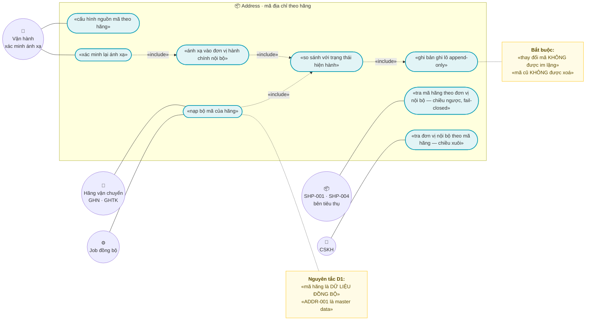
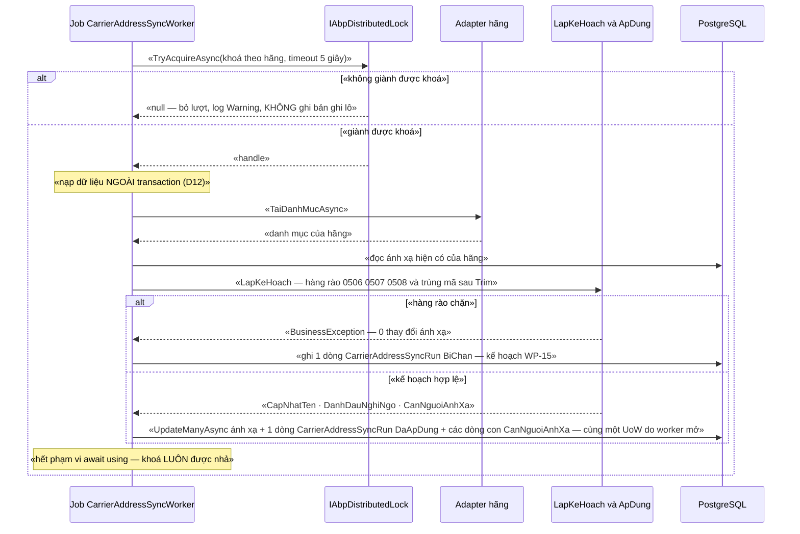

# `ADDR-002` — Đồng bộ mã địa chỉ theo từng hãng vận chuyển

> ⚠️ **CẬP NHẬT 18/11/2026 (WP-14) — ĐỌC TRƯỚC:** khối bằng chứng dưới đây là **lúc viết (13/10/2026) và ĐÃ LỖI THỜI**.
> Module **`Address` ĐÃ CÓ** tại `modules/Address/` (tên thiết kế "AddressHub" trong thân tài liệu = module `Address`);
> ADDR-002 đã triển khai **một phần** (1 bảng, lõi thuần, worker, app service vận hành). **Hiện trạng thật và phần còn là kế hoạch: §0.2.**
> Bằng chứng lúc viết (13/10/2026 — **không còn đúng**):
> - `modules/` **chỉ có 3 module**: `ChannelHub`, `PaymentHub`, `Tax` — **không** có `modules/Address*` (nguồn: `modules/`).
> - Grep `Address|Province|Ward|District|Carrier|GHN|GHTK` trên **mọi `*.cs`** trong repo ⇒ **0** kết quả nghiệp vụ;
>   các match duy nhất là `ClientIpAddress`/`IpAddresses` trong `src/eCommerce.EntityFrameworkCore/Migrations/20261009102044_Added_Identity.cs:115,137`.
> - `src/eCommerce.EntityFrameworkCore/eCommerceDbContext.cs:36-64` khai báo **12 `DbSet`**, **không** có `Province`/`Ward`/`District`/`CarrierAddressCode`.
> - `Test-Path shared` ⇒ **`False`**: `shared/eCommerce.Kernel` (nơi `docs/implementation-plan.md:65` dự kiến đặt `Address`) **chưa có**.
>
> ⇒ Vì vậy **mọi mục dưới đây là THIẾT KẾ**, không phải mô tả code đang chạy. Chỗ nào suy luận từ code hiện có,
> tài liệu ghi rõ **đường dẫn file thật**; chỗ nào chưa kiểm chứng được, ghi rõ **"chưa kiểm chứng"**.

| Thuộc tính | Nội dung |
|---|---|
| **Mã** | `ADDR-002` |
| **Module** | **`Address`** (tên thiết kế cũ "AddressHub") — `modules/Address/eCommerce.Address.{Domain, EntityFrameworkCore, Application.Contracts, Application}` ✅ **đã tồn tại**; phần ADDR-002 nằm ở `Domain/Carrier/`, `Domain/Sync/CarrierAddressMappingSynchronizer.cs`, `Application/Sync/CarrierAddressSyncWorker.cs`, `Application/CarrierAddressMappingAppService.cs` (§0.2) |
| **Giai đoạn** | **GĐ0 — Pháp lý** (`docs/implementation-plan.md:91`, `docs/implementation-plan.md:111`, `docs/implementation-plan.md:388`) |
| **Ưu tiên** | **Must have** (không có nó thì `SHP-001`/`SHP-004` không gửi được địa chỉ cho hãng) |
| **Trạng thái** | 🟡 `Draft` — chờ review |
| **Người viết / người review** | *(điền)* / **Kiến trúc trưởng + người đã liên hệ GHN/GHTK** |
| **Phiên bản / ngày** | `v0.5 — 18/11/2026` (lịch sử v0.1…v0.5: §15.4) |
| **Tài liệu liên quan** | `ADDR-001` (tra cứu đơn vị hành chính 2 cấp + 3 cấp cũ — **master data của ta**) · `ADDR-003` (chuẩn hoá địa chỉ khách hàng, convert 3↔2 cấp) · `SHP-001` (adapter GHN) · `SHP-004` (adapter GHTK) · `XC-001` (Money) · `XC-002` (outbox/inbox, idempotency) · `XC-003` (khoá phân tán) · `XC-004` (phân quyền/tenant) · `XC-005` (log/metric) · `docs/implementation-plan.md` · `docs/business-modules-proposal.md` |

---

## 0. Tóm tắt & quyết định thiết kế

**Tóm tắt:** `ADDR-002` chốt **cách lấy bộ mã địa chỉ riêng của từng hãng vận chuyển** (GHN, GHTK…),
**cách ánh xạ** bộ mã đó vào **master data hành chính nội bộ** (`ADDR-001`), và **cách phát hiện khi hãng đổi mã**.
Điểm cốt lõi: mã của hãng là **DỮ LIỆU ĐỒNG BỘ (dữ liệu dẫn xuất)**, **KHÔNG** phải master data —
đúng như `docs/implementation-plan.md:130` đã ghi: *"'địa chỉ gửi đối tác' là **dữ liệu đồng bộ**, không phải master data"*.

**Vì sao phải có tài liệu này (không phải thủ tục):**
1. **Breaking change đang diễn ra:** từ **01/07/2025** Việt Nam **bỏ cấp huyện** và sáp nhập tỉnh (**63 → 34**)
   (`docs/implementation-plan.md:99`, `docs/business-modules-proposal.md:507-511`).
   ⚠️ Đo trực tiếp: `provinces.open-api.vn/api/` → **63** tỉnh **có** `districts`; `/api/v2/` → **34** tỉnh **không** huyện,
   **nhưng `wards` trả RỖNG khi test** ⇒ *phải kiểm tra lại* (`docs/implementation-plan.md:131`). **Chưa kiểm chứng lại.**
2. **Hai hãng đang ở hai mô hình khác nhau:** GHN **đã thích ứng** (thêm cờ `is_new_to_address` / `is_new_from_address` /
   `is_new_return_address`; `to_district_name` **required khi cờ = false**), còn **GHTK vẫn dùng payload 3 cấp**
   (`province`/`district`/`ward`) và **KHÔNG tìm thấy** cờ tương đương
   (`docs/business-modules-proposal.md:513-514`, `docs/business-modules-proposal.md:546`).
   Đây là **rủi ro mức CAO** trong bảng rủi ro: *"GHTK chưa xác nhận địa chỉ 2 cấp"* (`docs/implementation-plan.md:290`).
3. **Nếu coi mã hãng là master data thì sai về bản chất:** mỗi hãng có bộ mã riêng, đổi theo phiên bản API;
   đơn hàng cũ tham chiếu mã cũ ⇒ **không được xoá**, nhưng **được phép dựng lại** bộ mã mới từ hãng.
   Nhầm hai thứ này ⇒ **migrate toàn bộ đơn hàng mỗi lần hãng đổi mã**.

**Phạm vi:**
- ✅ **Bảng đăng ký nguồn mã** theo hãng (`CarrierCode` → nguồn dữ liệu + cấp địa chỉ hãng hỗ trợ).
- ✅ **Một bảng ánh xạ** `CarrierAddressMapping` (mã hãng → `OurAdministrativeUnitId`, trạng thái `CarrierMappingStatus`) **+ đúng một bảng bản ghi lô** `CarrierAddressSyncRun` (append-only) — `D-83` **+ một bảng con append-only** `CarrierAddressSyncRunUnmappedCode` (liệt kê **đủ** mã chưa ánh xạ của lượt — `D-88`, ⬜ WP-15).
  ~~Hai tầng snapshot thô + ánh xạ~~, ~~sổ lệch `CarrierAddressDrift`~~: **bỏ theo `D-83`**.
- ✅ **Đồng bộ theo lượt:** một dòng bản ghi lô cho mỗi lượt của mỗi hãng **đã giành được khoá** (áp dụng xong, bị hàng rào chặn, hoặc lỗi ở **bất kỳ** bước nào sau đó — kể cả lỗi adapter/API hãng trước `LapKeHoach`, `CarrierAddressSyncWorker.cs:137` so với `:144`: `Outcome = Loi`, thêm `ErrorType` = tên kiểu exception, **cấm** lưu thông điệp — `D-90`); lượt không giành được khoá, và hãng chưa có adapter (chạy trước khoá) ⇒ không ghi (chỉ log `Warning`). ~~`SyncRun` có máy trạng thái 7 bước~~ **bỏ theo `D-83`**.
- ✅ **Idempotency:** job giữ tính tự nhiên (chạy lại cùng danh mục ⇒ **0 thay đổi ánh xạ**, 0 `CapNhatTen`/`DanhDauNghiNgo` lặp — `D-87`; `CanNguoiAnhXa` lặp mỗi lượt theo thiết kế) + `SourceHash` trong bản ghi lô; đường HTTP/import file (⬜ sau này) đi qua `IdempotencyGuard` của `XC-002`, **không** bảng `IdempotencyKey` riêng (`D-83`; tiền lệ file Excel: `docs/implementation-plan.md:200`).
- ✅ **Khoá phân tán theo hãng** (`address:carrier-sync:{hãng}`) + hàng rào fail-closed **NÉM LỖI** khi danh mục hỏng (`0506`/`0507`/`0508`).
- **API tra cứu — hai chiều, không lẫn nhau (`D-89`):** ✅ chiều **xuôi** `TraMaHangAsync` (mã hãng → đơn vị của ta; webhook/đối soát/CSKH — `CarrierAddressMappingAppService.cs:63-73`); ⬜ chiều **ngược** `ResolveCarrierAddressCodeAsync` (đơn vị của ta → mã hãng; **dành cho `SHP-001`/`SHP-004`**, fail-closed, kế hoạch WP-15) — bên tạo vận đơn chỉ có đơn vị của ta, nên **chỉ** chiều ngược trả lời được "địa chỉ nội bộ này ứng với mã nào của hãng"; `SHP-*` **không** tự truy vấn `AddrCarrierMappings`.
- ✅ Permission + tenant + observability theo `XC-004`/`XC-005`.

**Không nằm trong phạm vi:**
- ❌ **Master data đơn vị hành chính** (tỉnh/xã/huyện của ta, nguồn `provinces.open-api.vn`, chính sách cấp hành chính) — thuộc **`ADDR-001`**.
- ❌ **Chuẩn hoá địa chỉ khách hàng** (convert 3 cấp ↔ 2 cấp, ca **sáp nhập tỉnh**) — thuộc **`ADDR-003`**.
- ❌ **Entity `Carrier` / `ShippingService` / `ShippingRate`** — thuộc **ShippingHub** (GĐ2, `docs/implementation-plan.md:199`).
  `ADDR-002` **chỉ giữ `CarrierCode` dạng chuỗi**, **không** tạo entity `Carrier` (quy ước "module sở hữu entity của mình").
- ❌ **Tính phí & tạo vận đơn** (gọi API hãng) — thuộc `SHP-001`/`SHP-004`.
- ❌ **Đối soát COD / webhook trạng thái vận đơn** — thuộc `REC-003`/`SHP-002`.

### 0.1 Quyết định thiết kế (ADR ngắn)

| # | Quyết định | Phương án đã cân nhắc | Lý do chọn | Hệ quả |
|---|---|---|---|---|
| **D1** | **Master data hành chính (`ADDR-001`) là NGUỒN SỰ THẬT DUY NHẤT**; bảng mã hãng là **dữ liệu dẫn xuất, dựng lại được** | (a) coi mã hãng là master · (b) **master nội bộ + bảng dẫn xuất** | `docs/implementation-plan.md:130` đã chốt *"địa chỉ gửi đối tác là dữ liệu đồng bộ, không phải master data"*. Chọn (a) ⇒ mỗi lần hãng đổi mã phải migrate đơn hàng | 🔒 **Cấm** khoá ngoại nghiệp vụ trỏ vào mã hãng. Nghiệp vụ luôn tham chiếu `ProvinceId`/`WardId` nội bộ **+** `CarrierCode` |
| **D2** | ~~Hai tầng tách biệt~~ → **bỏ theo `D-83`**: **một** bảng ánh xạ `CarrierAddressMapping` (+ `CarrierMappingStatus`) **+ đúng một** bảng bản ghi lô `CarrierAddressSyncRun`; **không** có bảng snapshot `CarrierAddressCode` | (a) một bảng ánh xạ thuần · (b) hai bảng snapshot + ánh xạ · (c) **1 bảng ánh xạ + 1 bảng bản ghi lô** (**chọn**) | Code **không bao giờ** tạo ánh xạ mới từ danh mục hãng (`CarrierAddressMappingSynchronizer.cs:38-49,203-236`) ⇒ snapshot thô theo lô không có nguồn ghi; dựng bảng lệch song song với `CarrierMappingStatus` = hai nguồn sự thật cho cùng trạng thái lệch (bài học F1 `XC-003`) | Trạng thái lệch của mã **đã ánh xạ** chỉ ở `CarrierMappingStatus`; dấu vết từng lượt ở `AddrCarrierSyncRuns` |
| **D3** | **Dấu vết theo lượt (`D-83`)**: mỗi lượt đồng bộ của mỗi hãng ghi **đúng một** dòng `CarrierAddressSyncRun`, **ghi một lần, không UPDATE/xoá**; ánh xạ sửa **tại chỗ** (`CapNhatTen`/`DanhDauNghiNgo`). ~~Bản ghi mới + đóng khung hiệu lực bản cũ~~ **bỏ theo `D-83`/`D-86`** | (a) tại chỗ, không dấu vết · (b) append theo lô + hiệu lực thời gian · (c) **tại chỗ + bản ghi lô append-only** (**chọn**) | `D-78` đã từ chối thu hẹp dấu vết lô khỏi đường job; unique `(TenantId, CarrierCode, CarrierAddressCode)` `NULLS NOT DISTINCT` cấm bản ghi thứ hai cùng mã (`20261014042922_Add_Addr002_CarrierMappings.cs:50`) | Ánh xạ sửa tại chỗ ⇒ vận đơn/yêu cầu gửi hãng của `SHP-001`/`SHP-004` **phải tự lưu snapshot** `CarrierCode` + `CarrierAddressCode` + tên đã gửi, **cấm** dựng lại từ `AddrCarrierMappings` (khuôn `D-77`) — nợ ghi ở §15.2 **F7** |
| **D4** | **Idempotency (`D-83`)**: job giữ tính **tự nhiên** (chạy lại cùng danh mục ⇒ **0 thay đổi ánh xạ** + cùng `SourceHash`; `CanNguoiAnhXa` lặp mỗi lượt theo thiết kế, `DanhDauNghiNgo` **không** lặp theo `D-87` — 🔶 đã đo **chỉ** cho danh mục khớp hoàn toàn ánh xạ: `test/eCommerce.Tests/AddressSync/CarrierAddressMappingSynchronizerTests.cs:46-53`) + ghi `SourceHash` (SHA-256 danh mục chuẩn hoá, ổn định qua lần chạy lại, **cấm** `Guid.NewGuid()`) vào bản ghi lô. Đường HTTP `DongBoAsync`/import file (⬜ chưa có code) **phải** qua `IdempotencyGuard` của `XC-002` (`modules/Messaging/eCommerce.Messaging.Domain/Idempotency/IdempotencyGuard.cs`); ~~khoá `AddressCarrierSync:{CarrierCode}:{SourceVersion\|PayloadHash}` + bảng `IdempotencyKey` riêng~~ **bỏ theo `D-83`** | (a) bảng key riêng của Address · (b) **cửa `XC-002` có sẵn** (**chọn**) | Không nhân đôi cơ chế idempotency của dự án (`XC-002` D3) | ⚠️ §15.2 **F4** (`IIdempotencyGuard`) đã **lỗi thời** — guard nay nằm ở module `Messaging`; chưa kiểm lại chi tiết |
| **D5** | **Phát hiện lệch không im lặng (`D-83`)**: mã hãng **mất đi / đổi tên** ⇒ `DanhDauNghiNgo`/`CapNhatTen` trên `CarrierMappingStatus` (`NghiNgo` ⇒ `Tra` NÉM `0502`); mã **mới** ⇒ `CanNguoiAnhXa`, ghi vào `MauCanNguoiAnhXa` của bản ghi lô; lượt bị hàng rào chặn (`0506`/`0507`/`0508`) cũng có dòng bản ghi lô. ~~`CarrierAddressDrift`~~ **bỏ theo `D-83`** | (a) chỉ log · (b) bảng `Drift` song song · (c) **`CarrierMappingStatus` + bản ghi lô** (**chọn**) | Hôm nay lượt bị chặn và mã mới chưa ánh xạ **chỉ nằm trong log** (`CarrierAddressSyncWorker.cs:167-187`) ⇒ mất khi xoay log, trái "không im lặng" | Sổ lệch "sống" = `Status` + `LayChuaXacMinhAsync`/`PhatHienSaiLechAsync` (`CarrierAddressMappingAppService.cs:77,102`); **không** có bước "người duyệt từng drift" |
| **D6** | **Hãng đổi TÊN của mã đã `DaXacMinh` (`D-86`)**: ghi đè tên **tại chỗ**, **giữ** `OurAdministrativeUnitId` + `MatchMethod`, **hạ `NghiNgo`**, chỉ người có quyền xác minh mới đưa lại `DaXacMinh`. ~~`VerifiedBy`/`Superseded`/bản ghi thứ hai~~ **bỏ theo `D-86`/`D-83`** | (a) như code · (b) không đụng bản đã duyệt + tạo bản mới | "Tài sản công duyệt tay" = **đơn vị đích do người chọn** — được giữ; quyền dùng cho vận đơn bị hạ **có chủ đích**: bản `DaXacMinh` với tên cũ mà vẫn dùng được là gửi hàng theo xác minh lỗi thời, im lặng (§17 bất biến 1) | Vận đơn tới mã đó bị chặn (`0502`) tới khi xác minh lại — chấp nhận; đổi tên hàng loạt bị `0508` chặn trước khi hạ. Đổi **mã**: mã cũ `NghiNgo`, mã mới `CanNguoiAnhXa` (không `Superseded`) |
| **D7** | **`CarrierCode` là chuỗi, KHÔNG tạo entity `Carrier` trong AddressHub** | (a) tạo `Carrier` ở AddressHub · (b) **chuỗi + registry trong code** | Entity `Carrier` thuộc **ShippingHub** (`docs/implementation-plan.md:199`). Hai module cùng sở hữu một khái niệm = **hai nguồn sự thật** (đúng lỗi F1 của `XC-003`) | Cần **kiểm tra tồn tại** `CarrierCode` khi ghi (fail-closed); 🔶 registry trong code ⬜ chưa có — hiện hãng khai báo bằng cấu hình `Address:CarrierSync:Carriers` + có adapter (§0.2; "AddressHub" = module `Address`) |
| **D8** | **Mọi unique index có `TenantId` PHẢI `NULLS NOT DISTINCT`** | (a) `unique: true` thường · (b) **SQL thô `NULLS NOT DISTINCT`** | Đã **chứng minh bằng PostgreSQL thật**: với `TenantId = NULL` thì unique index **KHÔNG chặn trùng** (`src/eCommerce.EntityFrameworkCore/Migrations/20261013024226_Fix_NullableTenantId_UniqueIndexes.cs:14-21`; `XC-004` §15.2 **F1**) | EF Core **không** mô hình hoá được ⇒ phải **SQL thô** trong migration. **Bắt buộc** cập nhật `test/eCommerce.IntegrationTests/PostgreSqlSchemaTests.cs:208` (số đếm) + `:240` (tên đích danh) **mỗi khi thêm** unique `NULLS NOT DISTINCT` mới — hiện chỉ bảng con `D-88` (§5.2) thêm một unique như vậy |
| **D9** | **Khoá phân tán `ecommerce:address:carrier-sync:{carrierCode}`** cho mọi lần chạy đồng bộ | (a) không khoá · (b) khoá toàn cục · (c) **khoá theo hãng** | Khoá toàn cục làm **hãng A chặn hãng B** vô cớ (`XC-003` D7). Job định kỳ dùng `SkipIfBusy` + **log + metric** (`XC-003` D10/BR-010) | ⚠️ Đoạn `<module>` = `address` **CHƯA có** trong bảng ánh xạ module→khoá của `XC-003` §5 (`docs/features/cross-cutting/XC-003-khoa-phan-tan-quy-uoc.md:218-225`) ⇒ **phải bổ sung** vào `XC-003` trong cùng PR |
| **D10** | **Không hard-code endpoint/bộ mã hãng** — mọi thứ qua **cấu hình** `AddressHubOptions` hoặc **dữ liệu** | (a) hằng số trong code · (b) cấu hình + dữ liệu | Endpoint của hãng **chưa kiểm chứng** (§15.1 Q1) và **thay đổi theo phiên bản API** | Phải có mục cấu hình cho từng hãng; đổi endpoint **không cần release** |
| **D11** | **`Province/Ward` do `ADDR-001` sở hữu; `ADDR-002` chỉ ĐỌC** | (a) `ADDR-002` tự nhập đơn vị hành chính · (b) **chỉ đọc + map** | Tránh mô hình địa chỉ **hai nguồn sự thật** — điều `docs/implementation-plan.md:181` đã cảnh báo cho module Customers | Ranh giới module rõ; `ADDR-002` **không** chạy được trước `ADDR-001` (phụ thuộc cứng) |
| **D12** | **Nạp dữ liệu hãng (HTTP/file) NGOÀI transaction; ghi áp dụng + dòng `CarrierAddressSyncRun` trong CÙNG một transaction ngắn** (khi `DaApDung`) — `D-83`. ~~Ghi theo lô 1.000 dòng, `SyncRun.Status`/`RowsWritten`~~ **bỏ theo `D-83`**: một lượt = một `UpdateManyAsync` (`CarrierAddressSyncWorker.cs:154-159`) | (a) một transaction bao cả lần gọi HTTP · (b) **tách** (**chọn**) | Giữ transaction mở trong lúc chờ HTTP ⇒ **giữ kết nối DB + khoá** suốt thời gian chờ ⇒ dễ deadlock/timeout | Lượt bị chặn/lỗi: 0 thay đổi ánh xạ, vẫn ghi dòng bản ghi lô (`BiChan`/`Loi`) ở cuối, trong khoá hãng |

---

### 0.2 Hiện trạng code thật so với thiết kế v0.1 (đối chiếu 18/11/2026, WP-14 — `D-77`…`D-82`, `D-17`)

Nhãn: ✅ đã có + có test · 🔶 có một phần / lệch · ⬜ kế hoạch (chưa có code). **Module chủ của mọi bảng/lớp dưới đây: `Address`.**

| Thành phần | Thiết kế v0.1 (thân tài liệu) | Code thật (`file:dòng`) | Nhãn |
|---|---|---|---|
| Module | "AddressHub" riêng | `modules/Address/` chung với `ADDR-001`/`ADDR-004`; mọi chỗ ghi `AddressHub*`/`AddressHubConsts`/`AddressHubOptions` trong thân = tên cũ | ✅ |
| Bảng dữ liệu | 4 bảng: `AddrCarrierSyncRuns`, `AddrCarrierAddressCodes`, `AddrCarrierMappings`, `AddrCarrierDrifts` | **Chốt `D-83`: 2 bảng.** ✅ `AddrCarrierMappings` (`AddressDbContextModelCreatingExtensions.cs:19,75-101`) · ⬜ `AddrCarrierSyncRuns` (bản ghi lô append-only, **kế hoạch WP-15**, chưa có entity/migration) · ⬜ bảng con `AddrCarrierSyncRunUnmappedCodes` (`D-88`: lưu **đủ** mã `CanNguoiAnhXa` của lượt, cùng migration WP-15). **Bỏ** `AddrCarrierAddressCodes`, `AddrCarrierDrifts` | ✅ 1 bảng · ⬜ 2 bảng (kế hoạch: bản ghi lô + bảng con `D-88`) · ~~2 bảng bỏ~~ theo `D-83` |
| Cột mapping | `ProvinceId`/`DistrictId`/`WardId`, `VerifiedBy`, `EffectiveFrom/To`, `Confidence` | `CarrierCode`, `CarrierLevel` (chuỗi), `CarrierAddressCode`, `CarrierAddressName`, `OurAdministrativeUnitId` (một Guid), `MatchMethod`, `Status`, `Source`, `SyncedAtUtc` (`CarrierAddressMapping.cs:82-108`). Enum `CarrierMatchMethod` 0-2, `CarrierMappingStatus` 0-2 (`:45-68`) — **chỉ thêm cuối** (`D-17`) | 🔶 §5.2 là kế hoạch |
| Unique index | `(TenantId, CarrierCode, CarrierLevel, CarrierLocationCode, EffectiveFromUtc)` | `(TenantId, CarrierCode, CarrierAddressCode)` — **không có `CarrierLevel`**, không có hiệu lực thời gian — `NULLS NOT DISTINCT` bằng SQL thô: `src/eCommerce.EntityFrameworkCore/Migrations/20261014042922_Add_Addr002_CarrierMappings.cs:50`; test đếm index: `test/eCommerce.IntegrationTests/PostgreSqlSchemaTests.cs:240` | ✅ (BR-007) |
| CHECK DB | `Confidence`, bất biến số học số dòng, hiệu lực | Chỉ `CK_AddrCarrierMappings_Status` (`Status in (0,1,2)`, `…ModelCreatingExtensions.cs:97-100`) | 🔶 |
| State machine `SyncRun` (§3.1) | 7 trạng thái, guard NÉM lỗi | **Bỏ theo `D-83`** (job một bước, chưa có đường HTTP). Thay bằng enum kết quả `Outcome` 3 giá trị ở §3.1; máy trạng thái thật = `CarrierMappingStatus` trên từng mapping (§3.2) | ✅ (bỏ) |
| Đồng bộ | `DongBoAsync` (HTTP) + job, lô 1.000 dòng, `IdempotencyKey` | **Chỉ job** `CarrierAddressSyncWorker` (mặc định TẮT `Address:CarrierSync:Enabled=false`, `CarrierAddressSyncWorker.cs:37-41,74-78`); lõi thuần `CarrierAddressMappingSynchronizer.LapKeHoach/ApDung` (`CarrierAddressMappingSynchronizer.cs:95-236`); **không** có đường HTTP, **không** có bảng `IdempotencyKey` (bỏ theo `D-83`) — chạy lại cùng danh mục ⇒ **0 thay đổi ánh xạ** + cùng `SourceHash` (`CanNguoiAnhXa` lặp theo thiết kế; test `CarrierAddressMappingSynchronizerTests.cs:46-53` chỉ dựng danh mục khớp hoàn toàn 2 ánh xạ — 🔶). Kế hoạch WP-15: ghi `AddrCarrierSyncRuns` ở cuối lượt; đường HTTP/file sau này qua `IdempotencyGuard` của `XC-002` | 🔶 |
| Hành vi đồng bộ | Tạo `CarrierAddressCode` mới + auto-map + drift | **KHÔNG BAO GIỜ tạo ánh xạ mới**: chỉ `CapNhatTen` / `DanhDauNghiNgo` / báo `CanNguoiAnhXa` (`CarrierAddressMappingSynchronizer.cs:38-49,203-236`) — do danh mục hãng không cho biết đơn vị đích của ta (§18) | ✅ (thắng thiết kế v0.1) |
| Hàng rào lô | E3/E7/E8 | 3 hàng rào: rỗng/không khớp hãng `0506`, quá ít (`SoDonViToiThieuMacDinh = 5`) `0507`, nghi ngờ vượt 20 % `0508` (`CarrierAddressMappingSynchronizer.cs:90-93,128-196`); bị chặn ⇒ **0** thay đổi + log `Error` (`CarrierAddressSyncWorker.cs:181-187`). **Hàng rào 3 chốt `D-87`:** chỉ đếm ánh xạ **chuyển mới** sang `NghiNgo`, mẫu số = ánh xạ chưa `NghiNgo`; code hiện đếm **lặp** (`:172,:178-179`) ⇒ lệch, sửa ở WP-15 (§15.2 **F8**) | ✅ hàng rào 1-2 · 🔶 hàng rào 3 (lệch `D-87`) |
| Adapter hãng | Gọi API GHN/GHTK theo cấu hình | Chỉ interface `IKhungDiaChiHangSource` (`CarrierAddressMappingSynchronizer.cs:30-36`); **0** hiện thực; hãng cấu hình mà thiếu adapter ⇒ log `Warning` + bỏ qua (`CarrierAddressSyncWorker.cs:96-110`) | ⬜ (chờ **Q1/Q2**, `NCC`) |
| Khoá phân tán | `ecommerce:address:carrier-sync:{carrierCode}` | Chuỗi **`address:carrier-sync:{hãng viết thường}`** (`CarrierAddressSyncWorker.cs:44,122`; `KeyPrefix` `ecommerce:` do Host ghép), `TryAcquireAsync` timeout **5 s** (`:124`), bận ⇒ bỏ lượt + log `Warning`, **chưa** có metric (`:126-130`). Khác khoá `address:sync-catalog` của `ADDR-001` (`D-82`) — hai khoá độc lập | 🔶 (thiếu metric, thiếu đường HTTP) |
| API | `ICarrierAddressAdminAppService` + `ICarrierAddressLookupAppService`, 9 method, route `carrier-address/*` | **Chốt `D-85`: giữ** **một** lớp `CarrierAddressMappingAppService` `[Authorize]` cấp class (`CarrierAddressMappingAppService.cs:44-45`), 4 method: `TraMaHangAsync` (`:63`), `LayChuaXacMinhAsync` (`:77`), `XacMinhAsync` (`:88`), `PhatHienSaiLechAsync` (`:102`); method **mới** tên Anh thêm vào chính class này; **không** dựng 2 interface. `Application.Contracts` **không** có gì của Carrier | ✅ (giữ) |
| Tra cứu khi chưa map | `ResolveAsync` trả `NotFound`/`null`, **không** ném | `TraMaHangAsync` → `CarrierAddressMappingResolver.Tra` **NÉM** `0501`/`0502`/`0503`/`0504` (fail-closed, `CarrierAddressMappingResolver.cs:38-103`); `ThuTra` trả `null` chỉ cho báo cáo (`:106`) | ✅ (thắng v0.1 — vận đơn phải fail-closed) |
| Tra **ngược** đơn vị ta → mã hãng (cho vận đơn) | `ResolveAsync` hai chiều | **Chưa có** — grep `OurAdministrativeUnitId` trong `modules/`: chỉ `CarrierAddressMappingResolver.cs:89` (chiều xuôi). **Chốt `D-89`:** thêm `ResolveCarrierAddressCodeAsync` + hàm thuần `TraNguoc`, fail-closed (> 1 ánh xạ `DaXacMinh` cùng đích ⇒ NÉM mã mới), **không** thêm unique theo đơn vị (§6.1, §8.1 #11) | ⬜ (kế hoạch WP-15) |
| Permission | 6 permission `eCommerce.Address.CarrierCode.*` | Hiện chỉ `[Authorize]` cấp class — ai đăng nhập cũng gọi được `XacMinhAsync` (`CarrierAddressMappingAppService.cs:88-96`). **Chốt `D-85` (kế hoạch WP-15):** thêm **1** permission `eCommerce.Addresses.CarrierMapping.Verify` (hằng `eCommerceConsts.Permissions.Addresses.CarrierMappingVerify`, nhóm `Addresses` — `src/eCommerce.Domain.Shared/eCommerceConsts.cs:363-376`; định nghĩa ở `eCommercePermissionDefinitionProvider.cs:168-171`) gắn `XacMinhAsync`; 5 permission còn lại của §9 chỉ thêm khi có method | ⬜ (kế hoạch WP-15) |
| Sự kiện ETO | 3 ETO | **0** ETO Carrier (`Application.Contracts/Events/AddressEvents.cs` không nhắc Carrier) | ⬜ |
| Registry hãng | `AddressHubConsts.Carriers` | **Không có**; hãng khai báo bằng cấu hình `Address:CarrierSync:Carriers` (`CarrierAddressSyncWorker.cs:41`) | ⬜ |
| Mã lỗi | `eCommerce:Address:0001…0012` | **Thật**: `CarrierAddressErrorCodes` `0501…0508` (`CarrierAddressMapping.cs:8-42`); **cấm đánh số lại** (`D-79`). Các mã v0.1 `0001…0012` **trùng giá trị** với `AddressErrorCodes` `0001…0007` của `ADDR-001` (`AddressErrorCodes.cs:10-31`) và `0008` của `D-81` ⇒ **không dùng**. `D-83`: **bỏ toàn bộ số kế hoạch `0509…0520`** (không cấp số); bản ghi lô ghi lại mã thật `0506…0508`; "thiếu mã hãng" dùng lại `0501`. Mã mới đã chốt: (1) hàng rào trùng mã sau `Trim` (`D-84`, tên gợi ý `DanhMucHangMaKhongHopLe`, số = kế tiếp sau mã cao nhất có trong code lúc viết — hiện `0508`); (2) tra ngược không duy nhất (`D-89`, tên gợi ý `AnhXaNguocKhongDuyNhat`, số = kế tiếp **sau** mã của `D-84`, dự kiến `0510` nếu `D-84` = `0509` và không ai chen; `D-79` cấm đánh số lại) | ✅ 0501-0508 · ⬜ 2 mã (`D-84`, `D-89`) |
| `AddressLevelPolicy` | thực thể dự kiến | **Bỏ** theo `D-80` (cấp suy ra từ `AdministrativeSchemaVersion`); ADDR-002 không phụ thuộc | ✅ |
| Test | 20 TC | 34 lần nhắc `CarrierAddress` ở `test/eCommerce.Tests/AddressCarrier/CarrierAddressMappingTests.cs` + 14 `[Fact]` ở `test/eCommerce.Tests/AddressSync/CarrierAddressMappingSynchronizerTests.cs:45-220` | ✅ lõi · ⬜ bản ghi lô/trùng mã/permission |

> **Bảng "đổi số mã kế hoạch `0001…0012` → `0509…0520`" của bản 18/11 đầu tiên ĐÃ BỎ theo `D-83`** (không cấp số cho các tình huống của máy trạng thái `SyncRun`/`Drift`/HTTP vì phần đó bỏ). Tình huống v0.1 → nơi xử lý nay: hãng chưa đăng ký / thiếu adapter ⇒ log `Warning` + bỏ qua (`CarrierAddressSyncWorker.cs:101-110`, không mã); danh mục rỗng/không khớp hãng/quá ít/biến mất hàng loạt ⇒ `0506`/`0507`/`0508` + dòng bản ghi lô `BiChan`; xung đột idempotency / không giành khoá (HTTP) ⇒ thuộc `IdempotencyGuard` `XC-002` khi mở đường HTTP (chưa có code).

## 1. Use Case Specification

| Thuộc tính | Nội dung |
|---|---|
| **Use Case ID** | `ADDR-002` |
| **Use Case Name** | Đồng bộ mã địa chỉ của hãng vận chuyển và ánh xạ vào đơn vị hành chính nội bộ |
| **Description** | *"Là hệ thống bán hàng đa kênh, tôi muốn có bộ mã địa chỉ của từng hãng vận chuyển (GHN/GHTK) được đồng bộ định kỳ và ánh xạ rõ ràng vào đơn vị hành chính nội bộ — để gửi đúng địa chỉ cho hãng, và để khi hãng đổi mã thì tôi BIẾT ngay thay vì giao hàng thất bại âm thầm."* |
| **Actor(s)** | **Hãng vận chuyển** (nguồn mã — hệ thống ngoài) · **Job đồng bộ** (hệ thống) · **Nhân viên vận hành** (xác minh/tạo ánh xạ — không có bước "duyệt drift", `D-83`) · **`SHP-001`/`SHP-004`** (bên tiêu thụ — hỏi **mã hãng theo đơn vị nội bộ** qua `ResolveCarrierAddressCodeAsync`, `D-89`) · **CSKH** (tra đơn vị nội bộ theo mã hãng qua `TraMaHangAsync`) · **Quản trị** (cấu hình nguồn mã theo hãng) |
| **Priority** | **Must have** |
| **Trigger** | (a) job đồng bộ chạy theo nhịp (đề xuất **24 h** — mã địa chỉ đổi rất chậm); (b) vận hành **bấm đồng bộ** khi hãng thông báo đổi mã; (c) **import file** mã địa chỉ hãng cung cấp thủ công; (d) `SHP-*` gọi tra ngược (`ResolveCarrierAddressCodeAsync`) và **không** tìm được mã ⇒ **NÉM** `0501` (fail-closed); **không** có cơ chế "sinh yêu cầu rà soát" (`D-83` bỏ `Drift`) — nhu cầu cảnh báo nối `NOT-*` là ⬜ (§17 #4) |
| **Pre-Condition(s)** | • **`ADDR-001` đã có dữ liệu** `Province`/`Ward` (và `District` chỉ để tương thích 3 cấp cũ). **Thiếu** đơn vị đích ⇒ không tạo được ánh xạ (`TaoMoi` thiếu `OurAdministrativeUnitId` ⇒ `0505`; tra ⇒ `0501`/`0504`; `D-83`: bỏ mã `0510`).<br>• **Hãng đã khai báo** trong cấu hình `Address:CarrierSync:Carriers` **và có adapter** `IKhungDiaChiHangSource` — thiếu ⇒ bỏ qua + log `Warning` (E1), **không** đoán; registry hãng trong code ⬜ chưa có.<br>• **Nguồn dữ liệu của hãng đã cấu hình** (`Address:CarrierSync:*`, `CarrierAddressSyncWorker.cs:37-41`): endpoint/đường dẫn file + cấp địa chỉ hãng hỗ trợ. Thiếu cấu hình ⇒ **từ chối**, **không** chạy mặc định.<br>• **Tenant hiện tại** — hệ thống đang chạy **1 tenant**, `TenantId` **có thể là `NULL`** (`XC-004` §5.2, đã chứng minh bằng PostgreSQL thật) ⇒ mọi index phải `NULLS NOT DISTINCT` (BR-007).<br>• `ChannelCode` **không** tham gia: mã địa chỉ hãng là **dùng chung toàn tenant**, không theo kênh bán.<br>• `CorrelationId` có giá trị theo `XC-005` (⚠️ `CorrelationId` **chưa** được wire middleware — `XC-005` **F1**; đây là **phụ thuộc chưa xong**). |
| **Post-Condition(s)** | • Mỗi lượt đồng bộ của mỗi hãng **đã giành được khoá** có **đúng 1** dòng `CarrierAddressSyncRun` (append-only, `D-83`) với `Outcome` (`DaApDung`/`BiChan`/`Loi`) + `SoMaNhan`/`SoCapNhatTen`/`SoDanhDauNghiNgo`/`SoCanNguoiAnhXa`; lượt **không** giành được khoá ⇒ **0** dòng (chỉ log `Warning`); hãng chưa có adapter ⇒ **0** dòng (log `Warning`, chạy trước khoá); lỗi adapter/API hãng **trước** `LapKeHoach` ⇒ **1** dòng `Outcome = Loi`, `ErrorCode = null`, `SourceHash = null`, 4 số đếm = 0, `ErrorType` = tên kiểu exception (`D-90`). Mỗi việc `CanNguoiAnhXa` của lượt `DaApDung` có **đúng 1** dòng con `CarrierAddressSyncRunUnmappedCode` (đủ cấp + mã + tên, `D-88`); lượt `BiChan`/`Loi` ⇒ **0** dòng con. ⬜ kế hoạch WP-15.<br>• Mọi thay đổi của mã hãng được **ghi nhận**: tên đổi ⇒ `CapNhatTen` (hạ `NghiNgo`), mã biến mất ⇒ `DanhDauNghiNgo`, mã mới ⇒ `CanNguoiAnhXa` (mẫu tối đa 20 mã ở `MauCanNguoiAnhXa`, **danh sách đủ** ở bảng con — `D-88`) — **0 mã bị bỏ qua im lặng** (`D-83`).<br>• **0** dòng `CarrierAddressSyncRun` bị `UPDATE`/xoá sau khi ghi (ghi một lần); ánh xạ được sửa **tại chỗ**, **không** có cột `IsCurrent`/`SupersededAtUtc` (`D-83`/`D-86`).<br>• Mã bị hạ `NghiNgo` ⇒ **không dùng được** cho vận đơn: chiều **ngược** `ResolveCarrierAddressCodeAsync` NÉM `0502` (R5b, `D-89`); chiều **xuôi** `Tra` cũng NÉM `0502` khi tra mã nhưng chỉ phục vụ webhook/đối soát/CSKH, **không** cho tạo vận đơn — tới khi người có quyền `XacMinhAsync` xác minh lại; **không** có trạng thái lô `AwaitingReview` (`D-83`).<br>• Dòng `CarrierAddressSyncRun` được ghi **trong khoá hãng, cùng transaction với `ApDung`** khi `DaApDung` (`D-83`) — cơ chế: worker mở `IUnitOfWorkManager.Begin(requiresNew: true, isTransactional: true)` bao `UpdateManyAsync` + `InsertAsync` (dòng lô + dòng con), `CompleteAsync` **một** lần (§12); ETO của lô: ⬜ chưa có, không thuộc quyết định này (§7.1). |
| **Basic Flow** | 1. Job `CarrierAddressSyncWorker` tới nhịp (⬜ sau này: vận hành bấm đồng bộ qua method mới của `CarrierAddressMappingAppService`, `D-85`); **không** tạo `SyncRun` có trạng thái — kết quả ghi một lần ở bước 8.<br>2. **Giành khoá phân tán** `address:carrier-sync:{hãng}` (Redis: `ecommerce:address:carrier-sync:{hãng}`) với **timeout 5 s** (D9; `CarrierAddressSyncWorker.cs:122-124`). Không giành được ⇒ bỏ lượt + log `Warning`, **không** ghi dòng bản ghi lô (§12).<br>3. **Nạp dữ liệu hãng NGOÀI transaction** (D12): gọi API hoặc đọc file; **retry có backoff** cho lỗi tạm thời.<br>4. Parse ⇒ danh sách `(CarrierLevel, CarrierAddressCode, CarrierAddressName)` (`DonViDiaChiHang`, `CarrierAddressMappingSynchronizer.cs:7-11`); chuẩn hoá mã **chỉ `Trim()` đầu/đuôi**, so `Ordinal` (BR-013, `D-84`); hai mã trùng sau `Trim` ⇒ **từ chối cả lô** (§12).<br>5. Chạy lại cùng danh mục (cùng `SourceHash`) ⇒ kế hoạch **không có `CapNhatTen`/`DanhDauNghiNgo`** (`D-87`; `CanNguoiAnhXa` còn lặp theo thiết kế cho mã chưa ánh xạ), **0 thay đổi ánh xạ**, vẫn ghi một dòng bản ghi lô `DaApDung` — **không phải lỗi** (A2, D4, `D-83`).<br>6. **Lập kế hoạch** `LapKeHoach` (hàm thuần, qua 3 hàng rào `0506`/`0507`/`0508`) ⇒ phân loại `CapNhatTen` / `DanhDauNghiNgo` / `CanNguoiAnhXa` (`CarrierAddressMappingSynchronizer.cs:95-199`).<br>7. `ApDung` (hàm thuần) rồi `UpdateManyAsync` các ánh xạ cần cập nhật (`CarrierAddressSyncWorker.cs:154-159`); việc `CanNguoiAnhXa` **không** tạo bản ghi (BR-005).<br>8. Ghi **một** dòng `CarrierAddressSyncRun` (⬜ WP-15) **+ mỗi việc `CanNguoiAnhXa` đúng 1 dòng con** `CarrierAddressSyncRunUnmappedCode` (`D-88`): `Outcome = DaApDung` (kể cả 0 việc) **cùng một UoW** với bước 7 — worker mở `IUnitOfWorkManager.Begin(requiresNew: true, isTransactional: true)` bao `UpdateManyAsync` + `InsertAsync`, không `autoSave` riêng lẻ (hiện `UpdateManyAsync(…, autoSave: true)` chạy thẳng, không UoW — `CarrierAddressSyncWorker.cs:132-159`); hàng rào chặn ⇒ `BiChan` + `ErrorCode` `0506…0508` (0 thay đổi ánh xạ); lỗi không mong đợi ⇒ `Loi` (ghi cố gắng).<br>9. Nhả khoá (kết thúc phạm vi `await using`, **kể cả khi lỗi**). |
| **Alternative Flow** | **A1: Vận hành xác minh lại ánh xạ `NghiNgo`/`ChuaXacMinh`** — xem `LayChuaXacMinhAsync`, gọi `XacMinhAsync` (cần permission `Addresses.CarrierMapping.Verify`, `D-85`) ⇒ `DaXacMinh`; mã `CanNguoiAnhXa` thì người **tạo ánh xạ thủ công** (`MatchMethod = ThuCong`) — danh sách **đủ** lấy từ `GetUnmappedCodesAsync` (`D-88`, ⬜ WP-15), không phải từ mẫu 20 mã. ~~Duyệt drift + `SyncRun` → `DaApDung`~~ **bỏ theo `D-83`**.<br>**A2: Chạy lại cùng danh mục (retry, job chạy trùng)** — kế hoạch **không có `CapNhatTen`/`DanhDauNghiNgo`** (`D-87`), ánh xạ không đổi, cùng `SourceHash`; `CanNguoiAnhXa` vẫn lặp theo thiết kế cho mã chưa ánh xạ; **không phải lỗi** (D4, `D-83`).<br>**A3: Import file thay vì API** — ⬜ chưa có code; khi mở **phải** qua `IdempotencyGuard` của `XC-002` (`D-83`), cùng luồng `LapKeHoach` → `ApDung`.<br>**A4: Hãng ngừng phát hành một mã** — **KHÔNG xoá** ánh xạ (vận đơn cũ còn tham chiếu); `DanhDauNghiNgo` (`NghiNgo`) và đếm ở `SoDanhDauNghiNgo` của bản ghi lô **chỉ ở lần chuyển đầu tiên** — ánh xạ đã `NghiNgo` mà vẫn vắng mặt **không** bị đánh dấu/đếm lại (`D-87`; BR-005, NFR-009).<br>**A5: ~~Vận hành huỷ lô đang chờ duyệt~~** — **bỏ theo `D-83`** (không có trạng thái `ChoDuyet`/`DaHuy`). |
| **Exception Flow** | **E1:** hãng được cấu hình (`Address:CarrierSync:Carriers`) nhưng **chưa có adapter** `IKhungDiaChiHangSource` ⇒ log `Warning` nêu tên hãng + bỏ qua, **không** gọi hãng, **không** giả vờ thành công (`CarrierAddressSyncWorker.cs:96-110`); không có mã lỗi mới (`D-83`: bỏ `0509`).<br>**E2:** đơn vị đích của ánh xạ không tìm thấy/đã đóng ⇒ `Tra` NÉM `0501`/`0504` (`CarrierAddressMappingResolver.cs:89-100`); `TaoMoi` thiếu đơn vị đích ⇒ `0505` (`D-83`: bỏ `0510`).<br>**E3:** danh mục hãng rỗng / không khớp mã hãng ⇒ `0506`; quá ít đơn vị (< 5) ⇒ `0507`; hai mã trùng sau `Trim` **hoặc mã rỗng/`null`/phần tử `null`** ⇒ hằng mới `DanhMucHangMaKhongHopLe` (`D-84`/`D-91`, ⬜ WP-15, số kế tiếp sau `0508`) — **0** thay đổi ánh xạ, ghi dòng bản ghi lô `BiChan` (`D-83`); **không** lưu payload thô (Q6).<br>**E4:** ~~xung đột khoá idempotency~~ — **bỏ khỏi ADDR-002** (`D-83`): chỉ phát sinh ở đường HTTP/import file (⬜ chưa có code), khi mở thuộc `IdempotencyGuard` của `XC-002`, không cấp mã ở đây.<br>**E5:** ~~chuyển trạng thái `SyncRun` không hợp lệ~~ — **bỏ** (`D-83`: bản ghi lô không có máy trạng thái). Phía ánh xạ: dùng mã chưa xác minh ⇒ **NÉM** `0502` (§3.2).<br>**E6:** job không giành được khoá ⇒ **bỏ lượt** + log `Warning`, **không** ghi bản ghi lô (`CarrierAddressSyncWorker.cs:126-130`; metric ⬜ thiếu, `XC-003` BR-010). Đường HTTP (⬜ chưa có) khi mở **phải** NÉM thay vì bỏ qua (`XC-003` D10) — mã lấy số kế tiếp cuối dải `05xx` lúc đó (`D-79`).<br>**E7:** ~~cấp hãng không hỗ trợ~~ — **bỏ** (`D-83`; `CarrierLevel` là chuỗi tự do, `CarrierAddressMapping.cs:90`, không có danh mục cấp hãng hỗ trợ trong code). Câu hỏi `NCC` Q2 (GHTK có 2 cấp?) vẫn mở.<br>**E8:** hãng trả **nhiều đơn vị cùng `CarrierAddressCode` sau `Trim`** (dữ liệu hãng bẩn) ⇒ **NÉM** hằng `DanhMucHangMaKhongHopLe` (`D-84`, ⬜ WP-15) + **từ chối cả lô** (bản ghi lô `BiChan`) — **cấm** chọn bừa một bản ghi; hiện code **ghi đè im lặng** (`CarrierAddressMappingSynchronizer.cs:125`).<br>**E9:** adapter/API hãng lỗi không mong đợi ⇒ log `Error`, **không** áp dụng thay đổi nào (`CarrierAddressSyncWorker.cs:188-191`). Mọi lượt đã giành khoá để lại **đúng 1** dòng bản ghi lô, lỗi ở bước nào cũng vậy (adapter `:137`, đọc repo `:138`, `LapKeHoach` `:144`, áp dụng/lưu `:154-159`) ⇒ `Outcome = Loi` (⬜ WP-15, `D-83`/`D-90`). Lỗi adapter ⇒ `ErrorCode = null`, `SourceHash = null` (cột nullable), 4 số đếm = 0, 0 dòng con, `Source` = định danh adapter, `StartedAtUtc` lấy **trước** `TaiDanhMucAsync`, `ErrorType` = `ex.GetType().FullName` — **cấm** lưu `ex.Message`/stack/payload vào bảng (thông điệp HTTP có thể mang URL/header kèm token hãng, BR-011); thông điệp đầy đủ chỉ ở log `Error`. **Phân loại:** chỉ `BusinessException` mang mã hàng rào của `LapKeHoach` (`0506`/`0507`/`0508` + hằng `D-84`/`D-91`) ⇒ `BiChan`; mọi exception khác — kể cả `BusinessException` mã khác do adapter ném — ⇒ `Loi` (hiện `catch (BusinessException)` `:181-187` gộp mọi `BusinessException` thành "bị từ chối" ⇒ WP-15 tách theo mã). Dòng `Loi` ghi trong UoW **riêng** (`requiresNew: true`, `CancellationToken.None`) sau khi lượt đã hỏng; ghi dòng lô thất bại ⇒ log `Error` riêng, **không** che exception gốc, **không** ném ra khỏi worker (nhịp sau thử lại như cũ).<br>**E10:** ~~`UPDATE … WHERE IsCurrent = true` ra 0 dòng~~ — **bỏ** (`D-83`: không có `IsCurrent`/đóng khung hiệu lực); đồng thời hai lượt trên cùng hãng bị loại bởi khoá `address:carrier-sync:{hãng}`. |
| **Business Rules** | • **BR-ADDR-002-001**: Master data hành chính (`ADDR-001`) là **nguồn sự thật duy nhất**; bảng mã hãng là **dữ liệu dẫn xuất dựng lại được**; **cấm** dùng mã hãng làm khoá nghiệp vụ hoặc khoá ngoại trong module khác.<br>• **BR-ADDR-002-002**: **Mọi** bản ghi mã hãng **phải** gắn `CarrierCode` + `CarrierLevel` + khoá tới thực thể hành chính nội bộ (`OurAdministrativeUnitId`, thiếu ⇒ `0505`); mã hãng **chưa** ánh xạ thì **không** có bản ghi ánh xạ mà được liệt kê **đủ** ở bảng con `CarrierAddressSyncRunUnmappedCode` (mẫu ≤ 20 ở `MauCanNguoiAnhXa` của dòng bản ghi lô — `D-83`/`D-88`) — **cấm** trạng thái "có mã mà không ai biết nó là gì".<br>• **BR-ADDR-002-003**: **Mỗi lượt đồng bộ của mỗi hãng để lại đúng một dòng `CarrierAddressSyncRun`** (`D-83`) — **ghi một lần, cấm `UPDATE`/xoá**; ánh xạ sửa **tại chỗ**, **không** bản ghi mới/đóng khung hiệu lực. Đỏ khi vi phạm: TC-01/TC-05 (số dòng bản ghi lô ≠ 1 mỗi lượt; reflection thấy setter public).<br>• **BR-ADDR-002-004**: **Idempotency** (`D-83`): job — chạy lại cùng danh mục ⇒ **0 thay đổi ánh xạ** (không `CapNhatTen`/`DanhDauNghiNgo` lặp — `D-87`; `CanNguoiAnhXa` lặp theo thiết kế) + `SourceHash` (SHA-256 danh mục chuẩn hoá, ổn định) ghi vào bản ghi lô; **cấm** `Guid.NewGuid()` làm khoá chống trùng; đường HTTP/import file (⬜ chưa có) **phải** qua `IdempotencyGuard` của `XC-002`, **không** bảng `IdempotencyKey` riêng. Đỏ khi vi phạm: TC-03 (danh mục thật có mã chưa ánh xạ — không chỉ danh mục khớp hoàn toàn), TC-25.<br>• **BR-ADDR-002-005**: Mọi **thay đổi mã của hãng** **không được im lặng** (`D-83`): tên đổi ⇒ `CapNhatTen` (hạ `NghiNgo`, `D-86`); mã biến mất ⇒ `DanhDauNghiNgo` (**không xoá**; chỉ khi ánh xạ chưa `NghiNgo` — `D-87`); mã mới ⇒ `CanNguoiAnhXa` (không tự tạo ánh xạ) — cả ba được đếm ở dòng bản ghi lô; mã `CanNguoiAnhXa` có mẫu ≤ 20 ở dòng lô và **đủ** ở bảng con (`D-88`); **cấm** xoá ánh xạ hoặc ghi đè im lặng. ~~`CarrierAddressDrift`~~ bỏ. Đỏ khi vi phạm: TC-02, TC-08, TC-25 (đếm lặp ⇒ `0508` vĩnh viễn), TC-26 (thiếu dòng con).<br>• **BR-ADDR-002-006**: Tên hãng của ánh xạ đổi ⇒ **ghi đè tên tại chỗ, hạ `NghiNgo` (kể cả `DaXacMinh`), giữ `OurAdministrativeUnitId` + `MatchMethod`**; chỉ người có quyền xác minh (`D-85`) mới đưa lại `DaXacMinh`; **không** có `VerifiedBy`/`Superseded`/bản ghi thứ hai (`D-86`, D6; `CarrierAddressMapping.cs:177-188`). Hãng đổi **mã** ⇒ mã cũ `NghiNgo`, mã mới `CanNguoiAnhXa`. Đỏ khi vi phạm: TC-09 (đã có `CarrierAddressMappingTests.cs:221,234`)<br>• **BR-ADDR-002-007**: Mọi **unique index có `TenantId`** **phải** dùng `NULLS NOT DISTINCT` (SQL thô — EF Core không hỗ trợ) — kế thừa `XC-004` BR-009 + `docs/features/cross-cutting/XC-004-xac-thuc-phan-quyen-tenant.md:240-241`.<br>• **BR-ADDR-002-008**: **Mọi** app service **phải** có `[Authorize]` ở **cấp CLASS**; **mọi** permission dùng trong `[Authorize]` **phải** được định nghĩa trong `eCommercePermissionDefinitionProvider` **trước** khi dùng (`XC-004` D2/D3 — 2 lỗi đã xảy ra thật ở Phase 0).<br>• **BR-ADDR-002-009**: Mọi chuyển `CarrierMappingStatus` **chỉ** qua method của entity (`TaoMoi`/`XacMinh`/`DanhDauNghiNgo`/`CapNhatTuDongBo`) — **cấm** gán trực tiếp `Status` (setter `protected`, `CarrierAddressMapping.cs:103`); phía đọc fail-closed: `Tra` NÉM `0502` khi `Status ≠ DaXacMinh` (§3.2). Bản ghi lô **không** có máy trạng thái (`D-83`, `Outcome` ghi một lần). Đỏ khi vi phạm: TC-05, TC-06.<br>• **BR-ADDR-002-010**: Mọi lần ghi đồng bộ **phải** nằm trong **phạm vi khoá phân tán theo hãng**; **mọi** acquire **phải** có **timeout hữu hạn**; **cấm** acquire lồng cùng tên khoá (`XC-003` BR-004/BR-005).<br>• **BR-ADDR-002-011**: **Cấm** hard-code endpoint / bộ mã / cấp địa chỉ của hãng trong code nghiệp vụ — thuộc **cấu hình** (`AddressHubOptions`) hoặc **dữ liệu**.<br>• **BR-ADDR-002-012**: `CarrierAddressSyncRun` **và bảng con** `CarrierAddressSyncRunUnmappedCode` là **sổ APPEND-ONLY, ghi một lần** (`D-83`/`D-88`): **cấm** `UPDATE`/`DELETE` — không setter public, không method đổi, **không** cột xử lý. ~~`CarrierAddressDrift`~~ bỏ. Đỏ khi vi phạm: TC-13, TC-26.<br>• **BR-ADDR-002-013**: Mã địa chỉ của hãng **giữ nguyên phần lõi** (`D-84`): chỉ `Trim()` đầu/đuôi — **cấm** đổi hoa–thường, bỏ/thêm số 0 đầu, gộp/bỏ khoảng trắng giữa, parse số; so khớp `StringComparison.Ordinal`; rỗng/chỉ khoảng trắng ⇒ `0505` **ở cửa ghi** (`TaoMoi`) và cửa tra; **cửa đồng bộ** (`D-91`): phần tử `null`, **hoặc** mã `null`/rỗng/chỉ khoảng trắng, **hoặc** hai mã **trùng sau `Trim`** ⇒ NÉM **một** hằng hàng rào `DanhMucHangMaKhongHopLe` (`D-84`/`D-91`, ⬜ WP-15; `WithData` `soMaRong`, `soMaTrung`, ≤ 20 `maTrung` sắp `Ordinal`), **từ chối cả lô**, `BiChan` (§12) — **không** `0505` ở cửa này và **không** bỏ qua dòng. ⚠️ Code hiện lệch: `"   "` thành khoá rỗng `""` và bị đếm `CanNguoiAnhXa`, mã `null` ⇒ `NullReferenceException` ⇒ `Loi` (`CarrierAddressMappingSynchronizer.cs:125`) — sửa ở WP-15. Quy tắc áp ở 3 cửa: ghi (`modules/Address/eCommerce.Address.Domain/Carrier/CarrierAddressMapping.cs:142`), đồng bộ (`CarrierAddressMappingSynchronizer.cs:125`), tra (`CarrierAddressMappingResolver.cs:53,112`). `CarrierCode`/`CarrierLevel` là **mã của ta** — `Trim().ToUpperInvariant()` (`CarrierAddressMapping.cs:140-141`), ngoài BR này. Đỏ khi vi phạm: TC-10 — mã hãng có thể **phân biệt hoa–thường**; so khớp **chính xác** theo `(CarrierCode, CarrierAddressCode)` (khoá unique thật, §0.2).<br>• **BR-ADDR-002-014**: Mọi thao tác ghi **phải** qua **Unit of Work**; nạp dữ liệu hãng **cấm** nằm trong transaction (D12). Worker nền **phải tự mở** UoW (`IUnitOfWorkManager.Begin(requiresNew: true, isTransactional: true)`) bao `UpdateManyAsync` + ghi dòng lô/dòng con, `CompleteAsync` một lần; hiện chưa có (`CarrierAddressSyncWorker.cs:132-159` gọi thẳng repository `autoSave: true` ⇒ hai commit riêng sẽ để lại ánh xạ đã đổi mà không có dòng lô) — ⬜ WP-15. Đỏ khi vi phạm: TC-07 (ca "ghi dòng lô ném ⇒ 0 ánh xạ đổi"), TC-22.<br>• **BR-ADDR-002-015**: Mã lỗi **phải** theo khuôn `eCommerce:Address:NNNN` và **do module Address sở hữu** (`CarrierAddressErrorCodes`, dải `05xx`, `D-79``) — **cấm** khai ở `eCommerceConsts.ErrorCodes` (kế thừa `XC-003` F2 và cách làm của `modules/Tax/eCommerce.Tax.Domain/TaxErrorCodes.cs:10-35`).<br>• **BR-ADDR-002-016**: **Tiền: Không áp dụng** — ADDR-002 **không có** trường tiền nào (không phí, không giá). Nếu sau này thêm phí/giá ⇒ **bắt buộc** theo `XC-001` (`decimal` + `Money`, **cấm** so `==`, so bằng `ToMinorUnits()`). |
| **Non-Functional Requirement** | • **NFR-ADDR-002-001**: Đồng bộ **một hãng đầy đủ (~3.000 đơn vị cấp xã)** ⇒ p95 **≤ 5 phút** (không tính thời gian chờ hãng); một lượt = **một** `UpdateManyAsync` + một dòng lô + các dòng con `CanNguoiAnhXa` trong **một** UoW (`D-83`/`D-88`; ngưỡng chưa đo — 🔶; đo ở TC-28).<br>• **NFR-ADDR-002-002**: **Idempotent 100 %**: chạy lại cùng danh mục **10 lần** ⇒ **0** thay đổi ánh xạ (0 `CapNhatTen`, 0 `DanhDauNghiNgo` lặp — `D-87`) và **cùng** `SourceHash`; `CanNguoiAnhXa` lặp theo thiết kế (đo: TC-03).<br>• **NFR-ADDR-002-003**: **0** mã hãng bị bỏ qua im lặng: `SoCapNhatTen`/`SoDanhDauNghiNgo`/`SoCanNguoiAnhXa` của dòng bản ghi lô = số việc cùng loại của `KeHoachDongBoMaHang` (0 lệch, 100 % lượt) **và** số dòng con `CarrierAddressSyncRunUnmappedCode` của lượt = `SoCanNguoiAnhXa` (`D-88`) — kiểm bằng test (TC-07, TC-26).<br>• **NFR-ADDR-002-004**: `CarrierAddressSyncRun` và `CarrierAddressSyncRunUnmappedCode`: **0** setter public, **0** method đổi trạng thái, **0** `UPDATE`/`DELETE` (reflection + test quét mã nguồn — TC-13, TC-26).<br>• **NFR-ADDR-002-005**: Ngưỡng hạ `NghiNgo`: tỉ lệ ánh xạ **chưa** `NghiNgo` bị **chuyển** sang `NghiNgo` trong một lượt **> 20 %** ⇒ **chặn** `0508`, 0 thay đổi (`D-86`/`D-87`; không còn "tỉ lệ auto-map < 95 %" vì hệ thống không tự tạo ánh xạ) — đo: TC-25.<br>• **NFR-ADDR-002-006**: Dữ liệu dùng chung ở host (`D-92`): mọi tenant đọc **cùng** bộ ánh xạ `TenantId = NULL`; **0** lượt ghi/xác minh ánh xạ từ ngữ cảnh tenant (permission ghi = `Host`) (integration test 2 tenant — ⚠️ **cần PostgreSQL**; TC-19).<br>• **NFR-ADDR-002-007**: `CorrelationId` hiện diện trong **100 %** log của luồng đồng bộ (⚠️ **phụ thuộc `XC-005` F1** — middleware chưa wire).<br>• **NFR-ADDR-002-008**: **0** acquire khoá thiếu `timeout`; **0** acquire lồng; **100 %** lần bỏ qua nhịp của job có **log + metric** (`XC-003` BR-010).<br>• **NFR-ADDR-002-009**: Ánh xạ `NghiNgo` do mã **đã ngừng phát hành vẫn còn bản ghi** (cấm xoá) và tra được qua `ThuTra`/`LayChuaXacMinhAsync` vô thời hạn (phục vụ tra vận đơn cũ), sau **≥ 2** lượt — test chèn rồi truy vấn lại (TC-08).<br>• **NFR-ADDR-002-010**: **0** endpoint/mã hãng hard-code trong `*.cs` nghiệp vụ (test quét mã nguồn). |

---

## 2. Sơ đồ Use Case



**Chú giải:**

| Ký hiệu | Ý nghĩa |
|---|---|
| ⭕ Xanh lá | Actor (hãng vận chuyển, job, vận hành, module tiêu thụ, CSKH) |
| 🟦 Bầu dục xanh dương | Use case |
| 🟨 Khung vàng | Note (nguyên tắc thiết kế) |
| `───` | Liên kết Actor ↔ Use Case |
| `-.«include».->` | Quan hệ bao hàm |

---

## 3. Sơ đồ trạng thái (state machine) — **BẮT BUỘC ném lỗi khi chuyển sai**

### 3.1 Kết quả một lượt đồng bộ (`CarrierAddressSyncRun.Outcome`) — `D-83`

> ✅ Quyết định `D-83`: **bỏ máy trạng thái 7 bước** của `SyncRun` (job một bước, chưa có đường HTTP ⇒ chỉ có **kết quả cuối**). Một lượt = hàm thuần `LapKeHoach` → `ApDung` (`CarrierAddressMappingSynchronizer.cs:95-236`) do worker gọi (`CarrierAddressSyncWorker.cs:116-192`); thực thể `CarrierAddressSyncRun` + bảng `AddrCarrierSyncRuns` là ⬜ **kế hoạch WP-15** (hôm nay kết quả chỉ ở **log**). Máy trạng thái thật của mã hãng: §3.2.

**Bảng `Outcome`** — enum lưu DB, **chỉ thêm cuối** (`D-17`), CHECK `Outcome in (0,1,2)`; ghi **một lần** ở cuối lượt, trong khoá hãng:

| `Outcome` | Giá trị | Khi nào | `ErrorCode` | Thay đổi ánh xạ | Nếu guard sai thì? |
|---|---|---|---|---|---|
| `DaApDung` | `0` | `LapKeHoach` + `ApDung` + `UpdateManyAsync` xong (kể cả **0 việc**) | `null` | có thể có (`CapNhatTen`/`DanhDauNghiNgo`) — **cùng transaction** với dòng này | Ghi dòng thất bại ⇒ rollback cả thay đổi ánh xạ — **chỉ đúng khi** worker mở UoW riêng bao `UpdateManyAsync` + `InsertAsync` (dòng lô + dòng con) và `CompleteAsync` một lần (§12; hiện worker không mở UoW — ⬜ WP-15) — không để lượt "áp dụng mà không dấu vết" |
| `BiChan` | `1` | Hàng rào `LapKeHoach` NÉM `BusinessException` **mang mã hàng rào** (mọi `BusinessException` mã khác ⇒ `Loi`, `D-90`): `0506` rỗng/không khớp hãng · `0507` quá ít · `0508` nghi ngờ > 20 % · hằng `DanhMucHangMaKhongHopLe` (`D-84`/`D-91`: mã trùng sau `Trim` hoặc mã rỗng/`null`) | mã đã NÉM | **0** | Không ghi được dòng ⇒ vẫn log `Error`, không áp dụng gì (fail-closed giữ nguyên) |
| `Loi` | `2` | Lỗi không mong đợi ở **bất kỳ** bước nào sau khi giành khoá: adapter/API hãng (timeout, HTTP lỗi) trước `LapKeHoach`, đọc repo, DB, áp dụng/lưu; mọi exception **không** phải hàng rào (kể cả `BusinessException` mã khác do adapter ném) — `D-90` | `null` (cột `ErrorType` = tên kiểu exception; `SourceHash = null` khi lỗi adapter) | **0** | Ghi dòng trong UoW **riêng** `requiresNew: true`; ghi thất bại ⇒ log `Error` riêng, không che exception gốc, không ném ra khỏi worker; log `Error` giữ nguyên (`CarrierAddressSyncWorker.cs:188-191`) |

Lượt **không giành được khoá** `address:carrier-sync:{hãng}` ⇒ **không** có dòng (chỉ log `Warning`, `CarrierAddressSyncWorker.cs:126-130`); hãng chưa có adapter (chạy **trước** khoá, `:101-110`) ⇒ cũng **0** dòng (log `Warning`). Mọi lượt đã giành khoá ⇒ đúng **1** dòng (`D-90`). Cột của bản ghi lô: §5.2.

> ⚠️ **Vì sao hàng rào phải NÉM (không im lặng):** quy ước bất biến #11 (`docs/implementation-plan.md:54`). Một danh mục hãng khuyết mà được áp dụng ⇒ hạ `NghiNgo` hàng loạt ⇒ **mọi vận đơn mới fail-closed** (`0502`) ⇒ sập luồng giao hàng (§18); nay lượt bị chặn còn để lại **dòng bản ghi lô** tra được thay vì chỉ log.

### 3.2 Vòng đời một mã hãng (`CarrierAddressCode`)

**✅ Máy trạng thái THẬT trong code — `CarrierMappingStatus` trên `CarrierAddressMapping`** (`CarrierAddressMapping.cs:58-68`); bảng thiết kế v0.1 phía dưới (`Moi`/`DaMap`/`DaDuyet`/`Superseded`/`NgungPhatHanh`) **bỏ theo `D-83`/`D-86`** (`D-83`: `CarrierMappingStatus` là nơi **duy nhất** giữ trạng thái lệch của mã đã ánh xạ):

| # | Từ → Sang | Ai/hàm gây ra | Guard sai thì làm gì |
|---|---|---|---|
| R1 | (tạo) → `ChuaXacMinh` | `TaoMoi` với `MatchMethod` `TheoMa`/`TheoTen` (`:114-155`, nhánh `:148-150`) | Thiếu hãng/cấp/mã/đơn vị đích ⇒ **NÉM** `0505` (`:126-134`) |
| R2 | (tạo) → `DaXacMinh` | `TaoMoi` với `ThuCong` (`:148`) | như R1 |
| R3 | `ChuaXacMinh`/`NghiNgo` → `DaXacMinh` | `XacMinh()` do người gọi `XacMinhAsync` (`:158-166`; `CarrierAddressMappingAppService.cs:88`) | **Không ném lỗi** — idempotent; 🔶 **không** kiểm đơn vị đích còn `IsActive`; **chốt `D-85`** (⬜ WP-15): `XacMinhAsync` cần permission `Addresses.CarrierMapping.Verify` — hiện mới `[Authorize]` cấp class |
| R4 | `DaXacMinh`/`ChuaXacMinh` → `NghiNgo` | `CapNhatTuDongBo` khi tên đổi — ghi đè tên tại chỗ, **giữ** `OurAdministrativeUnitId` + `MatchMethod` (`D-86`, `:177-188`; so `Ordinal` sau `Trim`) · `DanhDauNghiNgo` khi mã biến mất **và ánh xạ chưa `NghiNgo`** (`:169-174`, `ApDung` `CarrierAddressMappingSynchronizer.cs:215-224`; `D-87`: ánh xạ đã `NghiNgo` vắng mặt ⇒ **không** việc, **không** ghi — code hiện thêm việc cho **mọi** ánh xạ vắng mặt, `:172` ⇒ lệch, §15.2 **F8**) | Hàng rào 3 (`D-87`): tử số = số việc `CapNhatTen`/`DanhDauNghiNgo` có `HienCo.Status != NghiNgo` (= số ánh xạ **chuyển mới** sang `NghiNgo`), mẫu số = số ánh xạ của hãng có `Status != NghiNgo` (`ChuaXacMinh` + `DaXacMinh`); `>` 20 % (đúng 20 % được phép), mẫu số 0 ⇒ bỏ qua hàng rào ⇒ **NÉM** `0508`, **0** thay đổi, `WithData` `soNghiNgo`/`tongDangDung` (+ `soDaNghiNgoTruoc`); **không** cờ vượt, **không** permission "duyệt vượt `0508`". Code hiện: tử số/mẫu số đếm lặp (`:178-179`) |
| R5 | tra **xuôi** mã hãng → đơn vị của ta (webhook/đối soát/CSKH); mọi trạng thái ≠ `DaXacMinh` ⇒ **không dùng được** — tạo vận đơn **không** đi đường này, dùng chiều **ngược** R5b (`D-89`) | `Tra` | **NÉM** `0502` (`CarrierAddressMappingResolver.cs:80-87`); đơn vị đích đóng ⇒ `0504` (`:94-100`); không thấy ⇒ `0501`; trùng ⇒ `0503` |
| R5b | tra **ngược** đơn vị ta → mã hãng cho vận đơn | `TraNguoc` (hàm thuần cạnh `Tra`) qua `ResolveCarrierAddressCodeAsync` — ⬜ WP-15, `D-89` | Thứ tự: thiếu hãng/`Guid.Empty` ⇒ **NÉM** `0505` · không thấy đơn vị đích ⇒ `0501` · đích `IsActive = false` ⇒ `0504` · ứng viên (cùng hãng + `OurAdministrativeUnitId` = đích, mọi `CarrierLevel`) 0 ⇒ `0501` · số ứng viên `DaXacMinh` > 1 ⇒ **NÉM** `AnhXaNguocKhongDuyNhat` (**cấm** chọn cái đầu/mới nhất) · 0 `DaXacMinh` ⇒ `0502` · đúng 1 `DaXacMinh` ⇒ trả nó (ứng viên `ChuaXacMinh`/`NghiNgo` khác không dùng được nên không gây mơ hồ) |

Ánh xạ `NghiNgo` mà mã **quay lại** danh mục **không** tự nâng trạng thái — chỉ `XacMinhAsync` (`D-85`/`D-86`/`D-87`); tên mới vẫn được ghi (`CapNhatTen` giữ cho mọi ánh xạ kể cả `NghiNgo`, nhưng ánh xạ đã `NghiNgo` **không** được đếm vào tử số). Không có chuyển trạng thái nào "bị chặn" ở phía ghi (mọi chuyển đều hợp lệ về mặt miền) — an toàn đến từ **phía đọc** (R5, fail-closed). R1-R5 là bảng **chính thức** (`D-83`/`D-86`). Hãng đổi **mã** (mã cũ biến mất + mã mới xuất hiện) **không** phải `Superseded`: mã cũ ⇒ R4 `DanhDauNghiNgo`, mã mới ⇒ chỉ báo `CanNguoiAnhXa` (không tự tạo bản ghi — §18). **Không** có `VerifiedBy`/`VerifiedAtUtc`/`EffectiveToUtc`/`LifecycleStatus`/`Superseded`/bản ghi thứ hai cho cùng (hãng, mã) (unique `(TenantId, CarrierCode, CarrierAddressCode)` cấm).

*Bảng thiết kế v0.1 (`Moi`/`DaMap`/`DaDuyet`/`Superseded`/`NgungPhatHanh`, `Drift`, `VerifiedBy`, hiệu lực thời gian) **ĐÃ BỎ theo `D-83`/`D-86`** — không còn trong tài liệu; đối chiếu ở mục cuối.*

---

## 4. Sequence Diagram & luồng dữ liệu

### 4.1 Sequence — một lượt đồng bộ của job (đường HTTP/file ⬜ chưa có — `D-83`)



### 4.2 DFD (luồng dữ liệu)

**Không có sơ đồ riêng** (giới hạn tối đa 3 sơ đồ Mermaid) — mô tả bằng bảng:

| # | Bước | Vào | Ra | Ghi chú |
|---|---|---|---|---|
| 1 | Nạp mã hãng | Cấu hình `Address:CarrierSync:*` + adapter `IKhungDiaChiHangSource` (⬜ chưa có hiện thực) | `DanhMucDiaChiHang` (`DonViDiaChiHang` × n) | **Ngoài transaction** (D12); **cấm** hard-code endpoint (BR-011) |
| 2 | Chuẩn hoá | Danh mục thô | `CarrierAddressCode` đã `Trim()` đầu/đuôi — không chuẩn hoá khác (BR-013, `D-84`) | Hai mã trùng sau `Trim`, hoặc mã rỗng/`null`/phần tử `null` ⇒ từ chối cả lô (hằng `DanhMucHangMaKhongHopLe`, `D-91`); ⬜ `SourceHash` = SHA-256 danh mục chuẩn hoá (sắp theo `CarrierLevel`, `CarrierAddressCode`) |
| 3 | Lập kế hoạch | Danh mục + `CarrierAddressMapping` của hãng | `KeHoachDongBoMaHang` (`CapNhatTen`/`DanhDauNghiNgo`/`CanNguoiAnhXa`) | Hàm thuần, 3 hàng rào + hàng rào trùng mã; không chạm DB |
| 4 | Áp dụng | Kế hoạch | `CarrierAddressMapping` cập nhật **tại chỗ** (không tạo mới) | Việc `CanNguoiAnhXa` không tạo bản ghi — người ánh xạ thủ công |
| 5 | Ghi bản ghi lô | Kết quả + số đếm | 1 dòng `AddrCarrierSyncRuns` + n dòng con `AddrCarrierSyncRunUnmappedCodes` (n = `SoCanNguoiAnhXa`, `D-88`) (⬜ WP-15) | Cùng UoW với bước 4 khi `DaApDung`; chặn/lỗi: ghi sau (0 dòng con) |
| 6 | Phát sự kiện | — | ⬜ chưa có ETO | Ngoài phạm vi `D-83`; xem §7.1 |

---

## 5. Mô hình dữ liệu

### 5.1 ERD

**Không dùng sơ đồ Mermaid** (giới hạn tối đa 3 sơ đồ). Quan hệ giữa các bảng:

| Bảng | Quan hệ | Bảng đích | Kiểu |
|---|---|---|---|
| `AddrCarrierSyncRuns` *(⬜ WP-15)* | **không** khoá ngoại | `AddrCarrierMappings` | liên hệ **logic** theo `CarrierCode` (bản ghi lô là nhật ký, không FK — dữ liệu dẫn xuất, BR-001) |
| `AddrCarrierSyncRunUnmappedCodes` *(⬜ WP-15, `D-88`)* | n → 1 | `AddrCarrierSyncRuns` | FK `SyncRunId` (cùng module `Address`); **không** FK tới `AddrCarrierMappings` — "mã đã ánh xạ chưa" chỉ ở `AddrCarrierMappings`, dòng con là sự kiện bất biến "lượt R thấy mã X chưa có ánh xạ", không bao giờ đóng/mở |
| `AddrCarrierMappings` *(✅)* | n → 1 | `AdministrativeUnits` (module `Address`, `ADDR-001`) | `OurAdministrativeUnitId` (`CarrierAddressMapping.cs:99`) — **một** Guid; **không** `ProvinceId`/`DistrictId`/`WardId` |
| ~~`AddrCarrierAddressCodes`~~, ~~`AddrCarrierDrifts`~~ | — | — | **Bỏ theo `D-83`** |

> ✅ **Cập nhật 18/11/2026:** có **1 bảng** — `DbSet<Address.Carrier.CarrierAddressMapping> CarrierAddressMappings` (`src/eCommerce.EntityFrameworkCore/eCommerceDbContext.cs:318`), cấu hình qua `ConfigureAddress` (`:352`). Danh sách "12 `DbSet`" (có `ProductVariants`) lúc viết 13/10/2026 **đã lỗi thời** (mô hình Nhanh `D-07`: bỏ `ProductVariant`). Chốt `D-83`: thêm **đúng một** bảng `AddrCarrierSyncRuns` (⬜ kế hoạch WP-15); `AddrCarrierAddressCodes`/`AddrCarrierDrifts` **bỏ**.
> `docs/implementation-plan.md:128` liệt kê entity dự kiến của AddressHub (`Province`, `Ward`, `District`,
> ~~`AddressLevelPolicy`~~ *(bỏ theo `D-80`)*, `CarrierAddressCode`) — *lúc viết là kế hoạch GĐ0; nay đã triển khai một phần (§0.2)*.

### 5.2 Bảng & cột (Data Dictionary)

**Bảng `AddrCarrierSyncRuns`** (entity `CarrierAddressSyncRun`, module chủ `Address`) — ⬜ **KẾ HOẠCH WP-15** (`D-83`) — *sổ APPEND-ONLY, ghi một lần: một dòng cho mỗi lượt đồng bộ của mỗi hãng **đã giành được khoá** (`D-90`: kể cả lượt lỗi adapter trước `LapKeHoach` ⇒ `Outcome = Loi`; bận khoá hoặc chưa có adapter ⇒ 0 dòng); không setter public, không method đổi, không UPDATE/xoá*

| Cột | Kiểu | Null? | Nguồn / ý nghĩa | Ghi chú |
|---|---|---|---|---|
| `Id` | `uuid` | ✖ | khoá chính | |
| `TenantId` | `uuid` | ✔ | tenant — **`D-92`: dùng chung ở host, luôn `NULL`** (worker chạy ngữ cảnh host, không lặp tenant, không `CurrentTenant.Change`, `CarrierAddressSyncWorker.cs:132-141`) | **giữ cột nullable** (`D-92`: không xoá cột, không `SET NOT NULL`; `XC-004` §5.2) ⇒ mọi **unique** index có `TenantId` phải `NULLS NOT DISTINCT` (hiện không có unique nào ở bảng này) |
| `CarrierCode` | `varchar(32)` | ✖ | `GHN`, `GHTK`… (`Trim().ToUpperInvariant()`) | cùng quy tắc `CarrierAddressMapping.cs:140` |
| `Source` | `varchar(512)` | ✔ | adapter/đường nạp | cùng độ dài `CarrierAddressMapping.Source` |
| `SourceHash` | `varchar(64)` | ✔ | SHA-256 (hex) của danh mục hãng **chuẩn hoá** — sắp theo (`CarrierLevel`, `CarrierAddressCode`) + `CarrierCode` | ổn định qua lần chạy lại; **cấm** `Guid.NewGuid()` (BR-004); `null` khi lượt `Loi` do lỗi adapter trước `LapKeHoach` (chưa có danh mục — cột **nullable**, `D-90`) |
| `StartedAtUtc` / `FinishedAtUtc` | `timestamptz` | ✖ / ✖ | thời gian lượt | |
| `TriggeredBy` | `varchar(128)` | ✖ | user hoặc `job:CarrierAddressSyncWorker` | audit |
| `Outcome` | `int` (enum) | ✖ | `0 DaApDung` · `1 BiChan` · `2 Loi` (§3.1) | enum lưu DB, **chỉ thêm cuối** (`D-17`); CHECK `Outcome in (0,1,2)` |
| `ErrorCode` | `varchar(64)` | ✔ | `null` hoặc mã đã NÉM (`0506`/`0507`/`0508`/mã `D-84`) | ghi lại mã **thật**, không cấp mã mới (`D-83`); `null` cho `DaApDung` và `Loi` |
| `ErrorType` | `varchar(256)` | ✔ | `ex.GetType().FullName` khi `Outcome = Loi` (vd `System.Net.Http.HttpRequestException`, `System.Threading.Tasks.TaskCanceledException`, `Npgsql.NpgsqlException`) để phân biệt lỗi hãng/lỗi DB; `null` khi `DaApDung`/`BiChan` | **Cấm** lưu `ex.Message`/stack/payload (thông điệp HTTP có thể mang URL/header kèm token hãng — BR-011); thông điệp đầy đủ **chỉ** ở log `Error`. Cột mới (`D-90`), ⬜ WP-15 cùng migration chưa sinh |
| `SoMaNhan` | `int` | ✖ | số mã trong danh mục hãng | số đếm dòng, **không** phải số lượng hàng hoá (`D-31` không áp dụng) |
| `SoCapNhatTen` / `SoDanhDauNghiNgo` / `SoCanNguoiAnhXa` | `int` | ✖ | bằng `KeHoachDongBoMaHang.SoCapNhatTen/SoDanhDauNghiNgo/SoCanNguoiAnhXa` (`CarrierAddressMappingSynchronizer.cs:62-64`) | 0 lệch (NFR-003); lượt bị chặn ⇒ 0 |
| `MauCanNguoiAnhXa` | tối đa **20** mã | ✔ | **mẫu** mã hãng mới chưa ánh xạ cho thẻ tổng hợp (khuôn `WithData` của `D-81`), không cần join | kiểu lưu chốt khi viết entity (đề xuất `jsonb`, ⬜ chưa chốt). **Danh sách đầy đủ ở bảng con** `AddrCarrierSyncRunUnmappedCodes` (ngay dưới, `D-88`) — **không** lấy bằng `PhatHienSaiLechAsync` (method đó bắt caller tự truyền `DanhMucMoi`, `CarrierAddressMappingAppService.cs:27`; danh mục chỉ sống trong bộ nhớ worker một lượt, `CarrierAddressSyncWorker.cs:137`) |

**Bảng `AddrCarrierSyncRunUnmappedCodes`** (entity `CarrierAddressSyncRunUnmappedCode`, module chủ `Address`; **không** phải aggregate root, **không** navigation collection trên `CarrierAddressSyncRun`) — ⬜ **KẾ HOẠCH WP-15** (`D-88`, cùng migration với `AddrCarrierSyncRuns`) — *sổ APPEND-ONLY: đúng 1 dòng cho mỗi việc `CanNguoiAnhXa` của một lượt `DaApDung`; lượt `BiChan`/`Loi` ⇒ 0 dòng; không setter public, không method đổi, không UPDATE/xoá (retention/purge = nợ gắn Q6)*

| Cột | Kiểu | Null? | Nguồn / ý nghĩa | Ghi chú |
|---|---|---|---|---|
| `Id` | `uuid` | ✖ | khoá chính (đề xuất — chốt khi viết entity) | |
| `TenantId` | `uuid` | ✔ | tenant (**`D-92`:** luôn `NULL`, như dòng lô) | **có thể `NULL`** ⇒ unique dưới đây `NULLS NOT DISTINCT` |
| `SyncRunId` | `uuid` | ✖ | FK `AddrCarrierSyncRuns` | lượt nguồn |
| `CarrierCode` | `varchar(32)` | ✖ | mã hãng của ta (`Trim().ToUpperInvariant()`) | cùng quy tắc `CarrierAddressMapping.cs:140` |
| `CarrierLevel` | `varchar(32)` | ✖ | cấp phía hãng, từ `DonViDiaChiHang` của `danhMuc.DonVis` (`CarrierAddressMappingSynchronizer.cs:7-11`) | chuỗi, không enum |
| `CarrierAddressCode` | `varchar(64)` | ✖ | mã hãng, đã `Trim` (`D-84`) | giữ hoa–thường, số 0 đầu |
| `CarrierAddressName` | `varchar(256)` | ✖ | tên phía hãng | |

*Khối lượng:* ≤ (số mã chưa ánh xạ) × (số lượt; nhịp mặc định 1 ngày, `CarrierAddressSyncWorker.cs:35`) × (số hãng) — giảm dần khi người ánh xạ; chỉ chứa bản sao mã/tên của hãng (không dữ liệu khách, không tiền, **không** payload thô — Q6).

**Bảng `AddrCarrierMappings`** (entity `CarrierAddressMapping`, module chủ `Address`) — ✅ **THEO CODE** (`CarrierAddressMapping.cs:82-108`; `AddressDbContextModelCreatingExtensions.cs:75-101`) — *ánh xạ mã hãng → đơn vị hành chính của ta; sửa **tại chỗ** (`D-83`/`D-86`)*

| Cột | Kiểu | Null? | Nguồn / ý nghĩa | Ghi chú |
|---|---|---|---|---|
| `Id` + cột audit (`FullAuditedAggregateRoot`) | `uuid` + audit | ✖ | khoá chính | `ConfigureByConvention` |
| `TenantId` | `uuid` | ✔ | tenant (**`D-92`:** ánh xạ ở host, luôn `TenantId = NULL` — chỉ ánh xạ này worker đọc/sửa; giữ cột + unique `NULLS NOT DISTINCT` để chuyển theo tenant sau này không đổi lược đồ) | **có thể `NULL`** ⇒ unique `NULLS NOT DISTINCT` |
| `CarrierCode` | `varchar(32)` | ✖ | mã hãng của **ta** — `Trim().ToUpperInvariant()` | ngoài BR-013 (`D-84`) |
| `CarrierLevel` | `varchar(32)` | ✖ | cấp phía hãng (**chuỗi**, không enum) — `Trim().ToUpperInvariant()` | **không** thuộc khoá unique |
| `CarrierAddressCode` | `varchar(64)` | ✖ | mã **của hãng**, gửi trong payload vận đơn — chỉ `Trim()` đầu/đuôi, so `Ordinal` (BR-013, `D-84`) | giữ hoa–thường, số 0 đầu, khoảng trắng giữa |
| `CarrierAddressName` | `varchar(256)` | ✖ | tên phía hãng | ghi đè tại chỗ khi hãng đổi tên (`D-86`) ⇒ hạ `NghiNgo` |
| `OurAdministrativeUnitId` | `uuid` | ✖ | đơn vị hành chính của ta (`AdministrativeUnits`, `ADDR-001`) | **một** Guid — không `ProvinceId`/`DistrictId`/`WardId`; được **giữ** khi đổi tên (`D-86`) |
| `MatchMethod` | `int` (enum) | ✖ | `0 TheoMa` · `1 TheoTen` · `2 ThuCong` | enum **chỉ thêm cuối** (`D-17`); giữ khi đổi tên |
| `Status` | `int` (enum) | ✖ | `0 ChuaXacMinh` · `1 DaXacMinh` · `2 NghiNgo` | CHECK `Status in (0,1,2)`; **nơi duy nhất** giữ trạng thái lệch của mã đã ánh xạ (`D-83`) |
| `Source` | `varchar(512)` | ✔ | nguồn dữ liệu (endpoint/tệp) | truy vết tranh chấp |
| `SyncedAtUtc` | `timestamptz` | ✖ | thời điểm đồng bộ gần nhất | |

~~Bảng `AddrCarrierAddressCodes`~~ (snapshot thô theo lô) và ~~bảng `AddrCarrierDrifts`~~ (sổ lệch): **ĐÃ BỎ theo `D-83`**; các cột `ProvinceId`/`DistrictId`/`WardId`, `Confidence`, `VerifiedBy`/`VerifiedAtUtc`, `EffectiveFromUtc`/`EffectiveToUtc`, `LifecycleStatus`, `IsCurrent` của thiết kế v0.1 **bỏ** (`D-83`/`D-86`).

**Index & ràng buộc** *(phần hay bị bỏ sót nhất — phải liệt kê hết)*

| Loại | Cột | Mục đích |
|---|---|---|
| ✅ UNIQUE **`NULLS NOT DISTINCT`** | `AddrCarrierMappings (TenantId, CarrierCode, CarrierAddressCode)` — tên `IX_AddrCarrierMappings_TenantId_CarrierCode_CarrierAddressCode` | một mã hãng chỉ ánh xạ **một lần**, scope theo hãng (hàng rào DB cho `0503`) — SQL thô ở `20261014042922_Add_Addr002_CarrierMappings.cs:50`; test đếm: `PostgreSqlSchemaTests.cs:240` |
| ✅ INDEX | `AddrCarrierMappings (Status, CarrierCode)` — `IX_AddrCarrierMappings_Status_CarrierCode` | màn hình "còn mã nào chưa xác minh" (`…ModelCreatingExtensions.cs:94-95`) |
| ✅ CHECK | `CK_AddrCarrierMappings_Status`: `"Status" in (0, 1, 2)` | enum 3 giá trị (`…ModelCreatingExtensions.cs:97-100`) |
| ⬜ CHECK | `AddrCarrierSyncRuns`: `"Outcome" in (0, 1, 2)` | enum `Outcome` (`D-83`) |
| ⬜ UNIQUE **`NULLS NOT DISTINCT`** (`D-88`) | `AddrCarrierSyncRunUnmappedCodes (TenantId, SyncRunId, CarrierAddressCode)` | một mã chỉ một dòng con trong một lượt (hàng rào DB cho "đúng 1 dòng con mỗi việc") — SQL thô như `…Fix_NullableTenantId_UniqueIndexes.cs:39-86`; **phải** cập nhật `PostgreSqlSchemaTests.cs:208` (số đếm) + `:240` (tên đích danh) |
| ⬜ INDEX | `AddrCarrierSyncRunUnmappedCodes (SyncRunId, CarrierLevel, CarrierAddressCode)` (đề xuất) | phân trang `GetUnmappedCodesAsync` sắp `(CarrierLevel, CarrierAddressCode)` |
| ⬜ INDEX (đề xuất, chốt khi viết migration) | `AddrCarrierSyncRuns (TenantId, CarrierCode, StartedAtUtc)` | tra lịch sử lượt theo hãng; `GetUnmappedCodesAsync` tìm lượt `DaApDung` **gần nhất theo `FinishedAtUtc`** ⇒ cân nhắc thêm `FinishedAtUtc`/`Outcome` vào index khi viết migration. **Không** có unique index nào ở bảng này (`D-83`: không bảng/khoá idempotency riêng); nếu về sau thêm **unique** có `TenantId` ⇒ bắt buộc `NULLS NOT DISTINCT` + cập nhật `PostgreSqlSchemaTests.cs:240` |

> 🚨 **Bắt buộc (D8):** mọi unique index có `TenantId` **phải** tạo bằng **SQL thô `NULLS NOT DISTINCT`** (EF Core không mô hình hoá được) — cách đã làm ở `src/eCommerce.EntityFrameworkCore/Migrations/20261013024226_Fix_NullableTenantId_UniqueIndexes.cs:39-86`. Migration cho `AddrCarrierSyncRuns` (⬜ WP-15) là **expand-only**, do EF sinh (`docs/coding-conventions.md`), **không** backfill (bảng mới).

---

## 6. Hợp đồng API

### 6.1 Application Service

| Mục | Giá trị |
|---|---|
| Interface | **Không dựng** `ICarrierAddressAdminAppService`/`ICarrierAddressLookupAppService` (`D-85`, khuôn `D-79`); `Application.Contracts` hiện không có gì của Carrier |
| Implementation | **Một** lớp `CarrierAddressMappingAppService` (`modules/Address/eCommerce.Address.Application/CarrierAddressMappingAppService.cs:44-45`, module chủ `Address`); method **mới** đặt tên tiếng Anh (`D-09`) **trong chính lớp này** |
| `[Authorize]` | **cấp CLASS** ✅ (`:44`) + permission `eCommerceConsts.Permissions.Addresses.CarrierMappingVerify` (`eCommerce.Addresses.CarrierMapping.Verify`) trên `XacMinhAsync` — ⬜ kế hoạch WP-15 (`D-85`); 3 method còn lại giữ `[Authorize]` cấp class. 5 permission khác của §9 chỉ thêm khi có method, khuôn `Addresses.CarrierMapping.<Action>` |
| Namespace | `eCommerce.Address.*` (khuôn `eCommerce.Tax.*` ở `modules/Tax/eCommerce.Tax.Domain/TaxErrorCodes.cs:1`) |

**4 method THẬT của `CarrierAddressMappingAppService`** (✅ có code; tên tiếng Việt giữ nguyên, không rename — `D-09`/`D-85`):

| Method | Input (DTO) | Output (DTO) | Ghi chú |
|---|---|---|---|
| `TraMaHangAsync` (`:63`) | `TraMaHangRequest { CarrierCode, CarrierAddressCode }` | `KetQuaTraMaHangDto { AnhXa, DonVi }` | **Fail-closed**: NÉM `0501` (không thấy) · `0502` (chưa `DaXacMinh`/`NghiNgo`) · `0503` (trùng) · `0504` (đơn vị đích đã đóng) · `0505` (thiếu input). Chiều **xuôi** (mã hãng → đơn vị của ta): webhook/đối soát/CSKH. **Không** dành cho `SHP-001`/`SHP-004` tạo vận đơn — họ chỉ có đơn vị của ta, dùng `ResolveCarrierAddressCodeAsync` (`D-89`, bảng dưới) |
| `LayChuaXacMinhAsync` (`:77`) | `string? carrierCode` | `IReadOnlyList<CarrierAddressMappingDto>` | Việc hằng ngày của vận hành: ánh xạ ≠ `DaXacMinh` |
| `XacMinhAsync` (`:88`) | `Guid id`, `CarrierMatchMethod? cachKhop` | `CarrierAddressMappingDto` | ⬜ cần permission `Addresses.CarrierMapping.Verify` (`D-85`, WP-15); idempotent |
| `PhatHienSaiLechAsync` (`:102`) | `PhatHienSaiLechRequest { CarrierCode, DanhMucMoi }` | `IReadOnlyList<SaiLechDto>` | `MaBienMat` / `TenDoi` / `MaMoiChuaAnhXa` — so với danh mục **do caller truyền vào** (ví dụ từ file). **Không** phải nguồn danh sách đầy đủ mã chưa ánh xạ của một lượt đồng bộ: danh mục hãng không được lưu (`D-83`), nguồn đó là `GetUnmappedCodesAsync` (`D-88`) |

**2 method MỚI đã chốt** (⬜ kế hoạch WP-15, tên Anh `D-09`, **cùng lớp** `CarrierAddressMappingAppService` — `D-85`; `[Authorize]` cấp class giữ, **không** `[AllowAnonymous]`; **0** tệp code ở WP-14):

| Method | Input (DTO) | Output (DTO) | Ghi chú |
|---|---|---|---|
| `GetUnmappedCodesAsync` (`D-88`, tên gợi ý) | `string carrierCode`, `PagedResultRequestDto` | trang dòng con (cấp, mã, tên) + `TotalCount`, `SyncRunId` + `FinishedAtUtc` của lượt nguồn, `LatestRunOutcome` | Chỉ đọc. Lấy lượt `Outcome = DaApDung` **gần nhất** của hãng (theo `FinishedAtUtc`); trả dòng con của lượt đó **trừ** mã đã có trong `AddrCarrierMappings` cùng `(TenantId, CarrierCode)` **tại lúc đọc** (so `Ordinal` sau `Trim`, `D-84`); sắp `(CarrierLevel, CarrierAddressCode)` `Ordinal`. Chưa có lượt `DaApDung` ⇒ danh sách rỗng + `SyncRunId = null` (không NÉM). Lượt mới nhất `BiChan`/`Loi` ⇒ vẫn trả danh sách của lượt `DaApDung` trước + `LatestRunOutcome` để UI cảnh báo. **0** câu UPDATE/DELETE. Không gọi adapter hãng từ màn hình |
| `ResolveCarrierAddressCodeAsync` (`D-89`) | `ResolveCarrierAddressCodeRequest(string CarrierCode, Guid OurAdministrativeUnitId)` | `CarrierAddressCodeResultDto(CarrierAddressMappingDto Mapping, AdministrativeUnitDto Unit)` | Chiều **ngược**, fail-closed (luật R5b, §3.2). Logic ở hàm thuần `CarrierAddressMappingResolver.TraNguoc(anhXa, donVi, carrierCode, ourAdministrativeUnitId)` cạnh `Tra` (`CarrierAddressMappingResolver.cs:38`). `SHP-001`/`SHP-004` **chỉ** lấy mã hãng qua method này, **không** tự query `AddrCarrierMappings`. **Không** thêm unique/partial unique theo `OurAdministrativeUnitId` (§8.1 #11, Q15) |

Method mới **khác** (⬜ chưa quyết, tên gợi ý chốt khi code): lệnh đồng bộ/nạp một hãng; xem bản ghi lô `AddrCarrierSyncRuns` (`D-83`). Mỗi method mới **khác hai method đọc ở trên** thêm permission riêng theo khuôn `Addresses.CarrierMapping.<Action>` **cùng lúc** với method (cấm hằng mồ côi). Đường HTTP/file đi qua `IdempotencyGuard` của `XC-002`. ~~`VerifyMappingAsync`~~ ⇒ `XacMinhAsync`; ~~`ListDriftsAsync`/`XuLyDriftAsync`/`ResolveAsync`~~ **bỏ** (`D-83`/`D-85`).

### 6.2 REST endpoint

| Mục | Giá trị |
|---|---|
| Method / Route | **Route do ABP auto API controller sinh từ tên method** (`src/eCommerce.HttpApi.Host/eCommerceHttpApiHostModule.cs:382-383,412`; `AddressApplicationModule` đã đăng ký ở `:73`) — route cụ thể của 4 method **chưa xác minh** (chưa đọc swagger/`schema.d.ts`); các route `carrier-address/*` của v0.1 **bỏ** (`D-85`). FE hiện **0** lời gọi tới service này (chưa kiểm lại trong lượt WP-14) |
| Authentication | `Bearer` (OpenIddict) — đã cấu hình ở Phase 0 |
| Permission | `[Authorize]` cấp class; `XacMinhAsync` ⬜ `Addresses.CarrierMapping.Verify` (`D-85`) — xem §9 |
| Content-Type | `application/json` |
| Cơ chế sinh route | **auto API controller** (`ConventionalControllers.Create(...)`) — không đặt route bằng tay |

**Request mẫu — `TraMaHangAsync` (DTO `TraMaHangRequest`)**

```json
{ "carrierCode": "GHN", "carrierAddressCode": "0012Ab" }
```

**Response mẫu (rút gọn — `KetQuaTraMaHangDto`)**

```json
{
  "anhXa": {
    "carrierCode": "GHN",
    "carrierLevel": "WARD",
    "carrierAddressCode": "0012Ab",
    "ourAdministrativeUnitId": "3f1c…",
    "matchMethod": "ThuCong",
    "status": "DaXacMinh"
  },
  "donVi": { "schemaVersion": 2, "level": 3, "code": "…", "name": "…", "isActive": true }
}
```

*(Giá trị mẫu minh hoạ; cấu trúc theo `CarrierAddressMappingDto`/`AdministrativeUnitDto`, `CarrierAddressMappingAppService.cs:10-29,118-119`; tên trường JSON phía HTTP chưa xác minh.)*

**Mã lỗi nghiệp vụ** — **do module Address sở hữu** (`CarrierAddressErrorCodes`, dải `05xx`, `D-79`, BR-015). **Giá trị thật giữ nguyên, cấm đánh số lại.** Bảng mã kế hoạch `0509…0520` của v0.1 **bỏ hoàn toàn** (`D-83`):

| Mã | Hằng (`CarrierAddressErrorCodes`) | Khi nào | Nơi NÉM |
|---|---|---|---|
| `eCommerce:Address:0501` | `KhongTimThayMaHang` ✅ | Không thấy mã hãng / không thấy đơn vị đích (dùng lại cho "thiếu mã hãng") | `CarrierAddressMappingResolver.cs:63,90` |
| `eCommerce:Address:0502` | `MaChuaXacMinh` ✅ | Ánh xạ ≠ `DaXacMinh` (`ChuaXacMinh`/`NghiNgo`) | `CarrierAddressMappingResolver.cs:80-87` |
| `eCommerce:Address:0503` | `AnhXaTrungLap` ✅ | Hai ánh xạ cùng (hãng, mã) | `CarrierAddressMappingResolver.cs:68-76` |
| `eCommerce:Address:0504` | `DonViDichDaDong` ✅ | Đơn vị đích đã đóng (sáp nhập) | `CarrierAddressMappingResolver.cs:94-100` |
| `eCommerce:Address:0505` | `ThieuThongTinBatBuoc` ✅ | Thiếu hãng/cấp/mã/đơn vị đích (kể cả mã chỉ khoảng trắng — `D-84`; chỉ ở cửa **ghi** và cửa **tra**, **không** ở cửa đồng bộ — `D-91`) | `CarrierAddressMapping.cs:126-134` |
| `eCommerce:Address:0506` | `DanhMucHangRong` ✅ | Danh mục hãng rỗng / không khớp mã hãng | `CarrierAddressMappingSynchronizer.cs:107-115,129-134` |
| `eCommerce:Address:0507` | `DanhMucHangQuaIt` ✅ | Danh mục < 5 đơn vị | `CarrierAddressMappingSynchronizer.cs:137-143` |
| `eCommerce:Address:0508` | `BienMatHangLoat` ✅ | > 20 % ánh xạ chưa `NghiNgo` bị **chuyển mới** sang `NghiNgo` trong lượt (`D-87`; code hiện đếm lặp — §15.2 F8) | `CarrierAddressMappingSynchronizer.cs:181-196` |
| *số kế tiếp sau mã cao nhất có trong code lúc viết (hiện `0508`)* | `DanhMucHangMaKhongHopLe` ⬜ (tên gợi ý; trước đây `DanhMucHangTrungMa`, đổi theo `D-91` — hằng chưa có trong code nên không phải đánh số lại; `D-84`/`D-91`, WP-15) | Hai đơn vị trùng `CarrierAddressCode` sau `Trim` **hoặc mã rỗng/chỉ khoảng trắng/`null`, hoặc phần tử `null`** trong một danh mục — NÉM **một** lần (một vòng quét) **trước** hàng rào 1, 0 thay đổi, gom tối đa 20 mã (`WithData`) | `CarrierAddressMappingSynchronizer.cs:125` (hiện ghi đè im lặng) |
| *số kế tiếp **sau** mã của `D-84` lúc viết (D-84 lấy trước, mã này sau; dự kiến `0510` nếu `D-84` = `0509` và không ai chen — `D-79` cấm đánh số lại)* | `AnhXaNguocKhongDuyNhat` ⬜ (tên gợi ý, `D-89`, WP-15) | Tra ngược `ResolveCarrierAddressCodeAsync`: > 1 ánh xạ `DaXacMinh` cùng hãng cùng đơn vị đích — **cấm** chọn cái đầu/mới nhất. `WithData`: `carrierCode`, `ourAdministrativeUnitId`, `soAnhXa`, tối đa 20 `carrierAddressCode` sắp `Ordinal` | `CarrierAddressMappingResolver.TraNguoc` (⬜ chưa có) |

> Mã HTTP tương ứng của `BusinessException`: **chưa xác minh** (cấu hình ánh xạ trạng thái HTTP của host chưa đọc trong lượt WP-14). Mã v0.1 `0001…0012` **trùng** `AddressErrorCodes` của `ADDR-001` (`AddressErrorCodes.cs:10-31`) nên **không** được dùng; không có mã "idempotency"/"không giành khoá HTTP" ở đây — khi mở đường HTTP, `IdempotencyGuard` của `XC-002` quyết định, mã mới (nếu cần) lấy số kế tiếp cuối dải `05xx` (`D-79`).
>
> 📌 **Tiền tố `eCommerce:Address:*`** (không gắn tên hãng) là **nhất quán với tiền lệ `eCommerce:Tax:*`** ở
> `modules/Tax/eCommerce.Tax.Domain/TaxErrorCodes.cs:13-34` và `eCommerce:Channel:*` ở
> `modules/ChannelHub/eCommerce.ChannelHub.Domain/ChannelHubConsts.cs:38-41`: **module sở hữu hằng số của mình**
> (`XC-003` §15.2 F2 — bản trùng ở `eCommerceConsts.ErrorCodes` **đã được xoá**, xem
> `src/eCommerce.Domain.Shared/eCommerceConsts.cs:80-84`).

---

## 7. Sự kiện, tích hợp ngoài & idempotency

### 7.1 Sự kiện phát ra (ETO) — *đề xuất, chưa có trong code*

| ETO | Khi nào phát | Trường dữ liệu | Ai tiêu thụ | Handler có idempotent? |
|---|---|---|---|---|
| `CarrierAddressSyncCompletedEto` *(đề xuất, ⬜ chưa quyết)* | Sau khi ghi dòng `CarrierAddressSyncRun` `DaApDung` (thay cho "`SyncRun` → `DaApDung`") | `TenantId`, `SyncRunId`, `CarrierCode`, `Outcome`, `SoCapNhatTen`, `SoDanhDauNghiNgo`, `SoCanNguoiAnhXa`, `FinishedAtUtc` | `Reporting` · CSKH (thông báo) | ✅ Bắt buộc — **idempotent theo `SyncRunId`** (`XC-002` D3). **Ngoài phạm vi `D-83`** — chưa có consumer ⇒ không bắt buộc ở WP-15 |
| ~~`CarrierAddressDriftDetectedEto`~~ | — | — | — | **Bỏ theo `D-83`** (không có `Drift`/`ChoDuyet`); nhu cầu cảnh báo "mã mới/nghi ngờ" dùng `SoCanNguoiAnhXa`/`SoDanhDauNghiNgo` của sự kiện trên |
| `CarrierAddressMappingVerifiedEto` *(đề xuất, ⬜ chưa quyết)* | Khi `XacMinhAsync` thành công | `TenantId`, `MappingId`, `CarrierCode` *(~~`VerifiedBy`~~ — không có cột, `D-86`; dùng `LastModifierId` của audit nếu cần)* | cache tra cứu của `SHP-*` (**phải** xoá cache đa instance — bài học `XC-004` §7.1) | ✅ theo `MappingId` |

> 🔶 **Hạ tầng:** hôm nay **0** ETO Carrier trong code (`Application.Contracts/Events/AddressEvents.cs`). Module `Messaging` **đã có** (`modules/Messaging/…/Idempotency/IdempotencyGuard.cs`, nguồn: `D-83`) — chưa kiểm lại outbox/relay có bật hay không trong lượt WP-14 (mô tả "chưa tồn tại" của v0.1 **lỗi thời**). Việc "ghi outbox cùng transaction" vẫn là **yêu cầu thiết kế**, chưa kiểm chứng.

### 7.2 Sự kiện / webhook nhận vào

**Không áp dụng một phần — lý do:** hãng vận chuyển **không** có webhook thông báo "đổi mã địa chỉ"
(**chưa kiểm chứng** — chưa có tài khoản sandbox; xem §15.1 Q1/Q2). Vì vậy ADDR-002 **chỉ có 2 biên vào chủ động**:

| Nguồn | Loại | Xác thực | Chống trùng bằng | Nếu xử lý lỗi? | Thứ tự đến |
|---|---|---|---|---|---|
| API của hãng (kéo) | `poll` (job định kỳ) | Token/API key của hãng, đọc từ **cấu hình** (BR-011) | Tự nhiên: chạy lại cùng danh mục ⇒ 0 thay đổi ánh xạ (`D-87`); `SourceHash` ghi ở bản ghi lô (`D-83`; ~~`IdempotencyKey` + unique index~~ bỏ) | bản ghi lô `Loi` (lỗi hãng/mạng/DB, `ErrorType` = tên kiểu exception — `D-90`) hoặc `BiChan` (hàng rào); **không** áp dụng gì; thử lại nhịp sau | Không áp dụng (kéo **toàn bộ** bộ mã mỗi lần ⇒ không phụ thuộc thứ tự) |
| **File Excel/CSV** do hãng/vận hành cung cấp | `import` thủ công | Quyền `Addresses.CarrierMapping.<Action>` (thêm khi có method, `D-85`) + audit | ⬜ chưa có code — **phải** qua `IdempotencyGuard` của `XC-002` (`D-83`), không bảng key riêng | hàng rào `0506`/`0507`/`0508`/mã `D-84`; **không** ghi ánh xạ | như trên |
| Phản hồi của `SHP-*` ("không tìm thấy mã") | **nội bộ** (không phải biên ngoài) | — | Không áp dụng — **không** ghi gì ở Address: `SHP-*` nhận lỗi fail-closed `0501`/`0502`/… (R5/R5b, §3.2); `CarrierAddressDrift` **bỏ theo `D-83`**. Nhu cầu "yêu cầu rà soát khi SHP không tìm được mã" là ⬜ (nối `NOT-*`, §17 #4) | — | — |

> 📌 **Nếu** sau này phát hiện hãng **có** webhook đổi mã ⇒ **bổ sung** vào bảng này **trước** khi code
> (quy tắc vàng `docs/design-doc-guidelines.md:102`), và **bắt buộc** thêm khoá chống trùng theo event id của hãng.

### 7.3 Gọi API ra ngoài

| Hãng | Endpoint (base URL) | Auth | Timeout | Retry | Nếu thất bại |
|---|---|---|---|---|---|
| **GHN** | **chưa kiểm chứng** — GHN có publish `llms.txt`/`llms-full.txt` (`docs/business-modules-proposal.md:559-560`) nhưng ADDR-002 **chưa** đọc tài liệu API mã địa chỉ | API token (cấu hình) | đề xuất **30 s** | **3** lần, backoff **2×** | log `Error` (thông điệp đầy đủ chỉ ở log); bản ghi lô `Loi` (`D-83`/`D-90`: `ErrorType`, không lưu thông điệp); không áp dụng gì; thử lại nhịp sau |
| **GHTK** | **chưa kiểm chứng** — GHTK **vẫn dùng payload 3 cấp** và **KHÔNG** tìm thấy cờ tương đương `is_new_to_address` (`docs/business-modules-proposal.md:546`) | API token (cấu hình) | đề xuất **30 s** | **3** lần, backoff **2×** | như trên |

> 🔴 **Chưa kiểm chứng — không được hard-code:** tài liệu này **không** khẳng định endpoint cụ thể nào.
> Việc cần làm: **email GHTK hỏi địa chỉ 2 cấp** và **đăng ký GHN/GHTK lấy token sandbox**
> (`docs/implementation-plan.md:321`, `docs/implementation-plan.md:555`) — kết quả điền vào **cấu hình** `AddressHubOptions`
> và cập nhật bảng này. **Cấm** đưa endpoint nghi vấn vào code (BR-011).

---

## 8. Bất biến & xử lý đồng thời

### 8.1 Bất biến

| # | Bất biến | Cơ chế bảo vệ |
|---|---|---|
| 1 | Mã hãng là **dữ liệu dẫn xuất**; master data duy nhất là `ADDR-001` | **Không** có FK từ module khác tới `AddrCarrier*` (review + test quét); BR-001 |
| 2 | **0 mã bị bỏ qua im lặng** | Mỗi việc của `KeHoachDongBoMaHang` (`CapNhatTen`/`DanhDauNghiNgo`/`CanNguoiAnhXa`) được đếm vào dòng `CarrierAddressSyncRun`; số đếm = số việc (0 lệch, NFR-003; `D-83`); số dòng con `CarrierAddressSyncRunUnmappedCode` = `SoCanNguoiAnhXa` (`D-88`, TC-26) |
| 3 | Sổ `CarrierAddressSyncRun` là **append-only, ghi một lần** | Không setter public, không method đổi; reflection + test (NFR-004; `D-83`). ~~`Drift`~~ bỏ |
| 4 | Chạy lại cùng danh mục **không đổi ánh xạ** (0 `CapNhatTen`/`DanhDauNghiNgo` lặp — `D-87`; `CanNguoiAnhXa` lặp theo thiết kế) | 🔶 Test hiện có chỉ đo danh mục **khớp hoàn toàn** 2 ánh xạ (`CarrierAddressMappingSynchronizerTests.cs:46-53`); ⬜ TC-03/TC-25 với danh mục thật (có mã chưa ánh xạ + mã vắng mặt); `SourceHash` ghi lại; đường HTTP/file qua `IdempotencyGuard` `XC-002` (BR-004; `D-83`) |
| 5 | Ánh xạ `DaXacMinh` bị đổi **cơ sở** (hãng đổi tên) **không** còn dùng được tới khi xác minh lại | `CapNhatTuDongBo` hạ `NghiNgo` ⇒ `Tra` NÉM `0502`; đơn vị đích + `MatchMethod` giữ (BR-006; `D-86`) + test `CarrierAddressMappingTests.cs:221,234` |
| 6 | Unique index **có hiệu lực kể cả khi `TenantId = NULL`** | SQL thô `NULLS NOT DISTINCT` (BR-007) ✅ `20261014042922_Add_Addr002_CarrierMappings.cs:50` + `PostgreSqlSchemaTests.cs:240` |
| 7 | Mã cũ **luôn** tra cứu được | **Cấm** xoá ánh xạ; mã biến mất ⇒ `NghiNgo` **một lần** — ánh xạ đã `NghiNgo` mà vẫn vắng mặt **không** bị đánh dấu/đếm lại (`D-87`; NFR-009; đỏ: TC-25); vận đơn cũ tự lưu snapshot (§15.2 F7) |
| 8 | Mọi chuyển `CarrierMappingStatus` qua method entity; chặn ở phía đọc | `Tra` NÉM `0502`/`0504` (§3.2); BR-009 |
| 9 | **Tiền: không áp dụng** | ADDR-002 **không** có trường tiền (BR-016). Nếu thêm ⇒ bắt buộc theo `XC-001` |
| 10 | Mọi lần ghi trong khoá phân tán; mọi acquire có timeout | BR-010 + `XC-003` BR-004/BR-005 (test reflection/quét) |
| 11 | **Tra ngược đơn vị ta → mã hãng không chọn bừa** (`D-89`): > 1 ánh xạ `DaXacMinh` cùng hãng cùng đích ⇒ NÉM, không trả "cái đầu/mới nhất" | ⬜ `TraNguoc` NÉM `AnhXaNguocKhongDuyNhat`; **không** unique theo `OurAdministrativeUnitId` (chặn cả dữ liệu nhiều-một hợp lệ — nợ N2, §15.2 F10 — và biến lỗi nghiệp vụ thành lỗi DB); đỏ khi vi phạm: TC-27 (ca "2 `DaXacMinh` cùng đích ⇒ lỗi, `soAnhXa = 2`") |
| 12 | Hàng rào 3 `0508` **không có đường vượt** (không cờ, không permission "duyệt vượt một lượt" — `D-87`) | Lượt bị chặn chỉ qua khi danh mục hãng sửa đúng ở lượt sau; đỏ khi vi phạm: TC-25 (quét: 0 permission/cờ vượt `0508`) |

### 8.2 Xử lý đồng thời

| # | Tình huống | Cơ chế |
|---|---|---|
| 1 | Job định kỳ chạy trên **2 instance** cùng lúc | Khoá `address:carrier-sync:{hãng}` (Redis có `ecommerce:` do `KeyPrefix`) ⇒ **1** lượt chạy; lượt kia **bỏ lượt** + log `Warning` (`CarrierAddressSyncWorker.cs:126-130`), **không** ghi bản ghi lô; metric ⬜ thiếu (`XC-003` BR-010) |
| 2 | Vận hành **bấm đồng bộ** trong khi job đang chạy | ⬜ đường HTTP chưa có; khi mở: cùng khoá, **NÉM** (không bỏ qua im lặng, `XC-003` D10), mã lấy số kế tiếp cuối dải `05xx` (`D-79`) |
| 3 | 2 hãng khác nhau đồng bộ **cùng lúc** | **Được phép** — khoá **theo hãng** (D9); đây là lý do **không** dùng khoá toàn cục (`XC-003` D7) |
| 4 | Vận hành `XacMinhAsync` **trong khi** lượt đồng bộ đang hạ `NghiNgo` cùng mã | Hai ghi cùng bản ghi: ghi sau thắng (không có `RowVersion` trên `CarrierAddressMapping` — chưa kiểm lại concurrency token); 🔶 rủi ro đã biết, ghi nhận, không thuộc `D-83`. ~~`UPDATE … IsCurrent`/`0518`~~ bỏ |
| 5 | Hãng đổi mã **trong khi** `SHP-001` đang tạo vận đơn | Vận đơn giữ **snapshot** mã tại thời điểm tạo (thuộc `SHP-001`); ADDR-002 **không** sửa vận đơn đã tạo |
| 6 | Redis chết | `AbortOnConnectFail = false` **đã bật** (`src/eCommerce.HttpApi.Host/eCommerceHttpApiHostModule.cs:137-145`) ⇒ app **vẫn chạy** nhưng **khoá vô hiệu** ⇒ hàng rào cuối là **unique index DB** (`XC-003` D2) |

**Khoá phân tán dùng trong feature** *(liệt kê chính xác tên khoá)*

| Tên khoá | Phạm vi | Vì sao cần | Trạng thái |
|---|---|---|---|
| `ecommerce:address:carrier-sync:{carrierCode}` *(🔶 code thật dựng chuỗi `address:carrier-sync:{hãng viết thường}` — `CarrierAddressSyncWorker.cs:44,122`; Host ghép `KeyPrefix` `ecommerce:` nên khoá trên Redis đúng như cột này; **không** tự đặt tiền tố trong module — khác `Tax`)* | **theo hãng**, dùng chung mọi tenant — **`D-92`**: ánh xạ là dữ liệu dùng chung ở host (`TenantId = NULL`), worker không lặp tenant (`CarrierAddressSyncWorker.cs:132-141`), khoá **không** có `{tenantId}`; nếu sau này chọn "theo tenant" ⇒ worker phải lặp từng tenant và khoá phải có `{tenantId}` | Chống 2 lần đồng bộ chồng nhau ghi 2 lô cùng phiên bản | ⚠️ **Đề xuất** — đoạn `<module>` = `address` **CHƯA có** trong bảng ánh xạ module→khoá của `XC-003` §5 (`docs/features/cross-cutting/XC-003-khoa-phan-tan-quy-uoc.md:218-225`) ⇒ **phải bổ sung** vào `XC-003` **trong cùng PR** |

> 📌 **Ghi chú về tiền tố khoá — phát hiện khi kiểm code (xem §15.2 F1):** cổng cấu hình đặt
> `AbpDistributedLockOptions.KeyPrefix = "ecommerce:"` (`src/eCommerce.HttpApi.Host/eCommerceHttpApiHostModule.cs:127`) và ABP **ghép không có dấu phân cách**
> (`KeyPrefix + name`). Trong repo hiện tồn tại **hai quy ước trái nhau**:
> `modules/ChannelHub/eCommerce.ChannelHub.Domain/ChannelHubConsts.cs:22-31` sinh khoá **KHÔNG** có tiền tố (`channel:…`) — **đúng** `XC-003` §5.4 mục 2;
> còn `modules/Tax/eCommerce.Tax.Domain/TaxErrorCodes.cs:46,50` sinh khoá **CÓ** tiền tố (`ecommerce:tax:…`) ⇒ khoá thật sẽ là **`ecommerce:ecommerce:tax:…`** (tiền tố đôi).
> **Chưa kiểm chứng bằng `redis-cli MONITOR`.** ADDR-002 chọn **KHÔNG** đặt tiền tố trong hàm sinh khoá của module.

**Idempotency key**

| Đối tượng | Cách sinh khoá | ⚠️ Lưu ý |
|---|---|---|
| Đồng bộ qua job (kéo API hãng) | **Không có khoá idempotency** — idempotent tự nhiên (chạy lại cùng danh mục ⇒ 0 thay đổi ánh xạ) + `SourceHash` ghi ở bản ghi lô (`D-83`); chạy chồng bị loại bởi khoá phân tán `address:carrier-sync:{hãng}` | ~~`AddressCarrierSync:{CarrierCode}:{SourceVersion}`~~ **bỏ theo `D-83`** (khớp §0.1 D4, §7.2) |
| Đường HTTP / import file (⬜ chưa có code) | Khoá do `IdempotencyGuard` của `XC-002` quy định — định dạng khoá **chốt khi mở đường HTTP** (chưa xác định ở đây); **không** bảng key riêng | ~~`AddressCarrierSync:{CarrierCode}:{PayloadHash}`~~ **bỏ theo `D-83`**; không còn khái niệm "lô mới" có trạng thái — upload lại cùng file đi qua guard, kết quả vẫn là 0 thay đổi ánh xạ (A2) |
| Handler tiêu thụ ETO | theo `SyncRunId` / `MappingId` | **Cấm** `Guid.NewGuid()` làm khoá chống trùng (BR-004) |

---

## 9. Phân quyền

**Tên permission theo khuôn `Addresses.CarrierMapping.<Action>`** (`D-85`) — nhóm `Addresses` của module Address (`eCommerceConsts.Permissions.Addresses`, `src/eCommerce.Domain.Shared/eCommerceConsts.cs:363-376`); **không** dùng tên thiết kế cũ `eCommerce.Address.CarrierCode.*`, **không** tái dùng `Addresses.Verify` (xác minh `Address` của khách ≠ xác minh ánh xạ mở khoá vận đơn cho cả tenant):

| Permission | Hằng (`eCommerceConsts.Permissions.Addresses.…`) | Method được gán | Trạng thái |
|---|---|---|---|
| *(không có — `[Authorize]` cấp class)* | — | `TraMaHangAsync`, `LayChuaXacMinhAsync`, `PhatHienSaiLechAsync` | ✅ hiện có; giữ ở `D-85` (siết thêm sau là additive) |
| `eCommerce.Addresses.CarrierMapping.Verify` | `CarrierMappingVerify = Default + ".CarrierMapping.Verify"` | `XacMinhAsync` (~~`VerifyMappingAsync`~~) | ⬜ **kế hoạch WP-15** (`D-85`): thêm hằng **và** `addresses.AddChild(…)` ở `eCommercePermissionDefinitionProvider.cs:168-171` (cả hai nơi — `XC-004` D2); sau đó chạy `DbMigrator` cấp quyền role `admin` (bài học `S6`); BE kiểm `apps/admin-web` có gọi `XacMinhAsync` bằng user không phải admin không |
| `…CarrierMapping.Sync`, `…CarrierMapping.Import`, … | theo khuôn | method đồng bộ/nạp mới | ⬜ **chỉ thêm khi method tương ứng được code** (cấm hằng mồ côi); ~~`ResolveDrift`~~ **bỏ** (`D-83`) |

> 🔶 *Cập nhật 18/11/2026:* nhóm `Addresses` đã có (`ADDR-004`) nhưng **chưa** có permission nào cho ánh xạ mã hãng; `CarrierAddressMappingAppService` chỉ có `[Authorize]` cấp class (`:44-45`) ⇒ ai đăng nhập cũng gọi được `XacMinhAsync` (`:88-96`) — cửa vượt kiểm im lặng mà `D-85` đóng ở WP-15. Con số `XC-004` §5.1 cập nhật trong **PR code**.
>
> 🚨 **CHƯA CÓ TRONG CODE — kế hoạch GĐ0.** Bằng chứng *(lúc viết 13/10/2026, số "7 nhóm" đã đổi)*:
> `src/eCommerce.Domain.Shared/eCommerceConsts.cs:15-74` hiện **chỉ** có 7 nhóm permission
> (`Products`, `Inventory`, `Channels`, `Orders`, `Payments`, `TaxClassification`, `TaxRateSchedule`) — **không** có `Address`;
> và `src/eCommerce.Application.Contracts/Permissions/eCommercePermissionDefinitionProvider.cs:25-59` định nghĩa đúng các nhóm đó.
>
> ⚠️ **Hệ quả bắt buộc (2 lỗi Phase 0 đã xảy ra thật):**
> 1. Nếu `[Authorize(eCommerceConsts.Permissions.Address.…)]` được dùng **trước khi** hằng số + định nghĩa tồn tại
>    ⇒ **`403` cho MỌI người kể cả admin** (`XC-004` D2/E3). `TC-02` của `XC-004` phải chặn ở CI.
> 2. `XC-004` §5.1 ghi nhận *"**21** định nghĩa = **21** hằng số"* (`docs/features/cross-cutting/XC-004-xac-thuc-phan-quyen-tenant.md:216`).
>    Thêm 1 permission (`D-85`) ⇒ con số này **đổi** ⇒ **phải** cập nhật `XC-004` trong **PR code** (WP-15), nếu không phép kiểm "khớp 2 chiều" **mất giá trị**.
>
> 📌 **Phân tầng host/tenant (`D-92`, chốt Q3):** ánh xạ mã hãng là dữ liệu **dùng chung ở host**.
> Quyền **ghi/xác minh** ánh xạ (`Addresses.CarrierMapping.Verify` của `D-85` và mọi method ghi/sửa ánh xạ thêm sau) khai `MultiTenancySides.Host` khi WP-15 định nghĩa — **thu hẹp**, không mở rộng (hôm nay mọi user đều `TenantId = NULL` ⇒ 0 khác biệt hành vi); quyền **đọc** (`TraMaHangAsync`, `ResolveCarrierAddressCodeAsync`, `GetUnmappedCodesAsync`) giữ `Both`. Nợ GĐ4 (`XC-004` F2, multi-tenancy chưa bật): khi bật tenant thật, method **đọc** phải chạy dưới `CurrentTenant.Change(null)` — nếu không, bộ lọc `IMultiTenant` của ABP trả 0 dòng cho tenant ⇒ `ResolveCarrierAddressCodeAsync` NÉM `0501` (fail-closed, không sai im lặng). Khuôn phân tầng theo
> bảng phân tầng ở `docs/features/cross-cutting/XC-004-xac-thuc-phan-quyen-tenant.md:265-268` — Q3 đã chốt `D-92` (§15.1); **phụ thuộc** `ADDR-001` Q6 (đang `Open`): nếu chốt "mỗi tenant một bản sao" danh mục ĐVHC thì `D-92` phải xem lại cùng lúc.

---

## 10. UI Mockup & mapping dữ liệu

**Có UI** — màn hình vận hành **"Mã địa chỉ theo hãng"** (thuộc `WEB-001`, nhưng dữ liệu do ADDR-002 cung cấp).

| Vùng UI | Dữ liệu hiển thị | Nguồn (DTO / trường) | Hành động |
|---|---|---|---|
| **Thanh trên** | Chọn hãng · lượt đồng bộ gần nhất · `Outcome` | `CarrierCode`, `CarrierAddressSyncRun.Outcome`, `FinishedAtUtc` (⬜ method xem bản ghi lô, WP-15+) | Đổi hãng; nút **"Đồng bộ ngay"**/**"Nạp file"** ⬜ (chỉ khi có method + permission `Addresses.CarrierMapping.<Action>`, `D-85`) |
| **Thẻ tổng hợp lượt** | `SoMaNhan` · `SoCapNhatTen` · `SoDanhDauNghiNgo` · `SoCanNguoiAnhXa` · `ErrorCode` | `AddrCarrierSyncRuns` (⬜ WP-15) | — |
| **Bảng ánh xạ cần xử lý** | mã hãng · tên hãng · đơn vị đích · `MatchMethod` · `Status` (`ChuaXacMinh`/`NghiNgo`) | `CarrierAddressMappingDto` ← `LayChuaXacMinhAsync` (✅ `:77`) | Chọn dòng ⇒ **"Xác nhận"** → `XacMinhAsync` (permission `Addresses.CarrierMapping.Verify`, `D-85`, ⬜ WP-15). ~~"Chấp nhận/Từ chối drift"~~ **bỏ** (`D-83`) |
| **Mã mới cần ánh xạ** | cấp · mã hãng · tên hãng — **danh sách đầy đủ có phân trang** (`TotalCount`) + lượt nguồn (`SyncRunId`, `FinishedAtUtc`) + cảnh báo khi `LatestRunOutcome` ≠ `DaApDung` | `GetUnmappedCodesAsync` (⬜ WP-15, `D-88`) — **không** phải `PhatHienSaiLechAsync` (✅ `:102`, đòi caller tự truyền danh mục) | Người **tạo ánh xạ thủ công** sang đơn vị hành chính của ta (⬜ method tạo, chưa có) |
| **Bảng tra** | mã hãng → đơn vị hành chính của ta | `KetQuaTraMaHangDto` ← `TraMaHangAsync` (✅ `:63`) | — (lỗi `0501…0504` hiển thị đúng nội dung, không che thành lỗi hệ thống) |
| **Khi lượt bị chặn** | `Outcome = BiChan` + `ErrorCode` `0506`/`0507`/`0508`/mã `D-84` | bản ghi lô | hiển thị nguyên nhân từ chối; **không** áp dụng thay đổi |

> 📌 **Ghi rõ chênh lệch số liệu:** `SoCanNguoiAnhXa` là **số đếm của cả lượt**, còn `MauCanNguoiAnhXa` chỉ giữ **tối đa 20 mã** (`D-83`); UI **phải** ghi "hiển thị 20/«SoCanNguoiAnhXa»" và dẫn tới danh sách đầy đủ có phân trang (`GetUnmappedCodesAsync`, `D-88`; `TotalCount` có thể < `SoCanNguoiAnhXa` vì đã trừ mã người vận hành ánh xạ sau lượt đó) — nếu không, người vận hành sẽ tưởng "mất dữ liệu".

---

## 11. Migration & seed

| Mục | Nội dung |
|---|---|
| Migration | ✅ **Đã có cho bảng `AddrCarrierMappings`:** `src/eCommerce.EntityFrameworkCore/Migrations/20261014042922_Add_Addr002_CarrierMappings.cs` (SQL thô `NULLS NOT DISTINCT` ở dòng 50). ⬜ Migration **hai bảng** `AddrCarrierSyncRuns` + bảng con `AddrCarrierSyncRunUnmappedCodes` — kế hoạch **WP-15** (`D-83`/`D-88`; expand-only, EF sinh, theo `docs/coding-conventions.md`; **0** tệp code ở WP-14) |
| Bảng tạo mới | `AddrCarrierSyncRuns` + `AddrCarrierSyncRunUnmappedCodes` (⬜ WP-15, `D-83`/`D-88`). ~~`AddrCarrierAddressCodes`, `AddrCarrierDrifts`~~ **bỏ theo `D-83`**; `AddrCarrierMappings` ✅ đã có; bảng ĐVHC thuộc `ADDR-001` (`AddressLevelPolicy` **bỏ theo `D-80`**) |
| 🚨 **SQL thô** | `AddrCarrierSyncRuns` **không** có unique index (`D-83`); bảng con `AddrCarrierSyncRunUnmappedCodes` **có** unique `(TenantId, SyncRunId, CarrierAddressCode)` (`D-88`) ⇒ **SQL thô** `NULLS NOT DISTINCT`; mọi unique có `TenantId` thêm sau cũng vậy ⇒ SQL thô (`…Fix_NullableTenantId_UniqueIndexes.cs:39-86`; rủi ro EF sinh lại index làm mất thuộc tính, dòng 23-25) |
| 🚨 **Cập nhật test** | `test/eCommerce.IntegrationTests/PostgreSqlSchemaTests.cs:208` (số đếm) + `:240` (tên đích danh; đã nhắc index của mapping) **phải** cập nhật vì bảng con `D-88` thêm unique `NULLS NOT DISTINCT` (`D-88` ⑥ mục 5) |
| `DbSet` | **BẮT BUỘC** khai báo `DbSet` cho **mọi** entity mới trên `src/eCommerce.EntityFrameworkCore/eCommerceDbContext.cs` — nếu không, `IRepository<T>` **không** được đăng ký. Bài học đã ghi rõ tại `eCommerceDbContext.cs:48-52` và `:61-62` (`"The requested service 'IRepository<ChannelShop, Guid>' has not been registered."`) |
| Gọi cấu hình model | Thêm `builder.ConfigureAddress()` vào `eCommerceDbContext.OnModelCreating` (khuôn `builder.ConfigureTax()` ở `eCommerceDbContext.cs:78`) |
| Đăng ký route | Thêm assembly module Address vào `ConventionalControllers.Create(...)` (`src/eCommerce.HttpApi.Host/eCommerceHttpApiHostModule.cs:152-156`) |
| Seed | **Không seed mã địa chỉ của hãng** — đây là **dữ liệu đồng bộ**, lấy từ hãng (D1). Registry hãng: ⬜ chưa có trong code — hãng khai báo qua cấu hình `Address:CarrierSync:Carriers` (`CarrierAddressSyncWorker.cs:41`) |
| Ảnh hưởng dữ liệu cũ | **Không backfill** (bảng mới). ⚠️ Khi bật đồng bộ lần đầu, **mọi** mã hãng đều là `CanNguoiAnhXa` (hệ thống không tự tạo ánh xạ — §18) ⇒ cần người ánh xạ thủ công. **Danh sách đầy đủ** (~3.000 mã) có ở bảng con `AddrCarrierSyncRunUnmappedCodes` của lượt đầu và đọc qua `GetUnmappedCodesAsync` có phân trang (`D-88`) — không chỉ 20 mẫu; công cụ ánh xạ hàng loạt cho lượt đầu: câu hỏi "lô đầu tiên" (§15.1 Q4) vẫn mở |
| Rollback | `Down()` drop bảng con `AddrCarrierSyncRunUnmappedCodes` rồi `AddrCarrierSyncRuns`. Dữ liệu lô là **nhật ký**, không phải nghiệp vụ (`D-83` ④) — mất lịch sử lượt nhưng không mất ánh xạ |
| Idempotent | Không có seed DB ⇒ không có vấn đề idempotency |
| Rủi ro cấu hình | Hãng chưa có adapter ⇒ log `Warning` + bỏ qua, **không** chạy mặc định (`CarrierAddressSyncWorker.cs:101-110`) |

---

## 12. Xử lý lỗi & trường hợp biên

> Phân biệt đúng tinh thần tài liệu gốc: **(a) không có dữ liệu — KHÔNG phải lỗi** với **(b) lỗi thật**.

| Tình huống | Nguyên nhân | Hành vi hệ thống | Phản hồi tới client |
|---|---|---|---|
| **Chưa đồng bộ hãng lần nào** | triển khai mới | `LayChuaXacMinhAsync` trả danh sách rỗng; chưa có dòng bản ghi lô | **không phải lỗi** |
| **Lượt không có thay đổi** | hãng không đổi mã | Kế hoạch 0 việc **khi danh mục khớp hoàn toàn ánh xạ** (mã chưa ánh xạ vẫn sinh `CanNguoiAnhXa` mỗi lượt); ⬜ dòng bản ghi lô `DaApDung` với các số đếm tương ứng | **không phải lỗi** |
| **Chạy lại cùng danh mục** | job chồng nhịp | 0 thay đổi ánh xạ, 0 `DanhDauNghiNgo` lặp (`D-87`), cùng `SourceHash`; `CanNguoiAnhXa` lặp theo thiết kế (A2) | **không phải lỗi** |
| **Đơn vị của ta chưa có mã hãng khi tạo vận đơn** (chiều **ngược**, `SHP-001`/`SHP-004` — `D-89`) | chưa ánh xạ / ánh xạ chưa `DaXacMinh` / nhiều ánh xạ `DaXacMinh` cùng đích | ⬜ `ResolveCarrierAddressCodeAsync` **NÉM** (fail-closed, **không** trả `null`, **không** chọn bừa "cái đầu/mới nhất"): `0501` (0 ứng viên) · `0502` (chỉ có ánh xạ chưa `DaXacMinh`/`NghiNgo`) · `AnhXaNguocKhongDuyNhat` (> 1 ánh xạ `DaXacMinh` cùng đích — R5b, số dự kiến `0510`, ⬜ WP-15); `SHP-*` **không** tự query `AddrCarrierMappings` | lỗi nghiệp vụ `0501` / `0502` / `AnhXaNguocKhongDuyNhat` |
| **Mã hãng chưa có ánh xạ khi tra từ webhook/đối soát/CSKH** (chiều **xuôi** — mã hãng → đơn vị của ta) | chưa ánh xạ | ✅ `TraMaHangAsync` **NÉM** `0501`/`0502`/`0503`/`0504` (fail-closed, **không** trả `null`; `CarrierAddressMappingResolver.cs:38-103`); `ThuTra` mềm chỉ cho báo cáo. **Không** dành cho tạo vận đơn (§6.1) | lỗi nghiệp vụ `0501`…`0504` |
| Hãng cấu hình nhưng **chưa có adapter** | chưa có tài liệu API hãng | log `Warning` + bỏ qua (E1) | — (job) |
| **Danh mục rỗng / không khớp hãng** | hãng trả rỗng / nhầm hãng | **NÉM** `0506`; 0 thay đổi; ⬜ bản ghi lô `BiChan` | — (job, log `Error`) |
| **Danh mục quá ít đơn vị** | hãng trả một phần | **NÉM** `0507`; 0 thay đổi | — (job) |
| **Nghi ngờ hàng loạt** | hãng đổi/bỏ nhiều mã | **NÉM** `0508` (> 20 % ánh xạ chưa `NghiNgo` bị **chuyển mới** sang `NghiNgo` trong lượt — `D-87`); 0 thay đổi; ⬜ bản ghi lô `BiChan`; **không** có đường vượt (không cờ, không permission) | — (job) |
| 🚨 **Hai mã trùng sau `Trim`, hoặc mã rỗng/chỉ khoảng trắng/`null`, hoặc phần tử `null`** | dữ liệu hãng bẩn / khoảng trắng đuôi | ⬜ **NÉM một** hằng `DanhMucHangMaKhongHopLe` (`D-84`/`D-91`, một vòng quét) **trước** hàng rào 1 + từ chối cả lô, `BiChan` — **cấm** ghi đè im lặng và **cấm** bỏ qua dòng rỗng; **không** `0505` ở cửa đồng bộ (hiện: `CarrierAddressMappingSynchronizer.cs:125` ghi đè) | — (job) |
| **Mã chưa xác minh / nghi ngờ khi tạo vận đơn** | chưa ai xác minh / hãng đổi tên | **NÉM** `0502` | lỗi nghiệp vụ |
| **Đơn vị đích đã đóng** | sáp nhập | **NÉM** `0504` | lỗi nghiệp vụ |
| **Đang có lượt khác cùng hãng** | tranh chấp khoá | job **bỏ lượt** + log `Warning`; **không** ghi bản ghi lô; đường HTTP ⬜ (khi mở phải NÉM) | — (job) |
| **Adapter/DB lỗi không mong đợi** | hạ tầng | log `Error`; không áp dụng gì; bản ghi lô `Loi` (`D-90`: **kể cả** lỗi adapter/hãng timeout trước `LapKeHoach`; `ErrorType` = tên kiểu exception, **không** lưu thông điệp; ghi trong UoW riêng `requiresNew: true`) | — (job) |
| **Redis chết** | sự cố hạ tầng | App **vẫn chạy** (`AbortOnConnectFail = false`, `eCommerceHttpApiHostModule.cs:137-145`); **khoá vô hiệu** ⇒ ràng buộc **unique index DB** là hàng rào cuối | bình thường / `409` nếu DB chặn |
| **Mã hãng biến mất khỏi danh mục** | hãng ngừng phát hành | `DanhDauNghiNgo` (`NghiNgo`); **KHÔNG** xoá; đếm ở `SoDanhDauNghiNgo` | hiện trong `LayChuaXacMinhAsync` |
| **Lỗi runtime (DB, deadlock)** | hạ tầng | Rollback UoW hiện tại + log có `CorrelationId` (⚠️ `XC-005` F1: chưa wire ⇒ giá trị **rỗng**) | lỗi chung |

**Chiến lược transaction:**
- **Nạp dữ liệu hãng (HTTP/file) — NGOÀI transaction** (D12). Giữ transaction mở trong lúc chờ HTTP ⇒ giữ kết nối + khoá DB.
- **Một lượt = một `UpdateManyAsync`** các ánh xạ cần cập nhật + dòng `CarrierAddressSyncRun` `DaApDung` + các dòng con `CarrierAddressSyncRunUnmappedCode` **cùng transaction** (`D-83`/`D-88`); lượt bị chặn/lỗi ⇒ **0** thay đổi ánh xạ, dòng `BiChan`/`Loi` ghi **sau** (cố gắng, 0 dòng con). **Cơ chế (⬜ WP-15):** worker mở `IUnitOfWorkManager.Begin(requiresNew: true, isTransactional: true)` bao `UpdateManyAsync` + `InsertAsync(run)` + `InsertManyAsync(dòng con)` — **không** `autoSave` riêng lẻ — rồi `CompleteAsync` **một** lần; ghi dòng lô ném ⇒ rollback ⇒ 0 ánh xạ đổi (TC-07). Hiện worker **không** mở UoW và gọi `UpdateManyAsync(…, autoSave: true)` thẳng trên repository (`CarrierAddressSyncWorker.cs:132-159`): thêm `InsertAsync(autoSave: true)` ngay sau sẽ là **hai commit riêng** ⇒ ánh xạ đã đổi mà không có dòng lô — đúng ca bị cấm. ~~Lô 1.000 dòng, `RowsWritten`~~ bỏ.
- **Phạm vi khoá phân tán BAO NGOÀI** cả quá trình (mở ở tầng app service/job), **không** nằm trong transaction ⇒ khoá được nhả **sau** khi transaction kết thúc (kế thừa `XC-003` §12).
- ~~Đóng khung bản ghi cũ bằng `UPDATE … WHERE IsCurrent = true`~~ **bỏ** (`D-83`: không có `IsCurrent`/hiệu lực); hai lượt cùng hãng đã bị khoá `address:carrier-sync:{hãng}` loại trừ.

---

## 13. Phi chức năng

| Mã | Yêu cầu | Ngưỡng đo được | Cách kiểm chứng |
|---|---|---|---|
| NFR-ADDR-002-001 | Hiệu năng đồng bộ | ~3.000 đơn vị cấp xã ⇒ p95 **≤ 5 phút** (không tính chờ hãng); một lượt = một `UpdateManyAsync` (`D-83`; ngưỡng chưa đo — 🔶) | Integration test đo trên PostgreSQL thật (`test/eCommerce.IntegrationTests` + Testcontainers) — TC-28 |
| NFR-ADDR-002-002 | Idempotency | chạy lại cùng danh mục **10 lần** ⇒ **0** thay đổi ánh xạ (0 `CapNhatTen`/`DanhDauNghiNgo`), cùng `SourceHash` | Unit (đã có ca `CarrierAddressMappingSynchronizerTests.cs:46-53` cho danh mục khớp hoàn toàn — 🔶) + ca danh mục thật (TC-03) + ca `SourceHash` ⬜ |
| NFR-ADDR-002-003 | Không bỏ sót im lặng | `SoCapNhatTen`/`SoDanhDauNghiNgo`/`SoCanNguoiAnhXa` của dòng bản ghi lô = số việc cùng loại của `KeHoachDongBoMaHang` — **0 lệch**, 100 % lượt; số dòng con `CarrierAddressSyncRunUnmappedCode` của lượt = `SoCanNguoiAnhXa` — **0 lệch** (`D-88`) | Test (⬜ WP-15: TC-07, TC-26) |
| NFR-ADDR-002-004 | Append-only | `CarrierAddressSyncRun` + `CarrierAddressSyncRunUnmappedCode`: **0** setter public, **0** method đổi trạng thái; **0** `UPDATE`/`DELETE` | Reflection + test quét mã nguồn (`D-83` ⑥ mục 3) |
| NFR-ADDR-002-005 | Ngưỡng hạ `NghiNgo` | Tỉ lệ ánh xạ **chưa** `NghiNgo` bị **chuyển** sang `NghiNgo` trong một lượt **> 20 %** (tử số = số chuyển mới; mẫu số = số ánh xạ chưa `NghiNgo` — `D-87`) ⇒ **chặn** `0508` (thay cho "tỉ lệ auto-map < 95 %": hệ thống **không** tự tạo ánh xạ) | TC-25 (⬜ WP-15: hai lượt liên tiếp, mẫu số co) + ca sẵn `CarrierAddressMappingSynchronizerTests.cs:162,179` (vẫn xanh dưới `D-87`) |
| NFR-ADDR-002-006 | Dữ liệu dùng chung ở host (`D-92`) | mọi tenant đọc **cùng** bộ ánh xạ `TenantId = NULL`; **0** ghi/xác minh từ ngữ cảnh tenant (permission ghi = `Host`) | Integration test 2 tenant (⚠️ **cần PostgreSQL**) + test định nghĩa permission — TC-19 |
| NFR-ADDR-002-007 | Observability | `CorrelationId` trong **100 %** log luồng đồng bộ | Test đọc log — TC-28 (⚠️ **phụ thuộc `XC-005` F1** — middleware chưa wire ⇒ **chưa kiểm chứng được**) |
| NFR-ADDR-002-008 | Khoá phân tán | **0** acquire thiếu `timeout`; **0** acquire lồng; **100 %** lần bỏ qua nhịp có log + metric | Test quét mã nguồn (khuôn `XC-003` TC-13) |
| NFR-ADDR-002-009 | Tra cứu lịch sử | Ánh xạ `NghiNgo` do mã biến mất **vẫn** còn bản ghi (không xoá) và tra được qua `ThuTra`/`LayChuaXacMinhAsync` sau **≥ 2** lượt | Test chèn rồi truy vấn lại (⬜; ca `Ma_bien_mat…` `…SynchronizerTests.cs:74` phủ một lượt) |
| NFR-ADDR-002-010 | Không hard-code | **0** endpoint/mã hãng hard-code trong `*.cs` nghiệp vụ | Test quét mã nguồn |

> 📌 **Metric — trạng thái thật:** `shared/eCommerce.Kernel/Observability/eCommerceMetrics.cs:13-53` hiện đăng ký **12 metric**
> (`eCommerceMetricNames.All`) — trong đó **chưa** có metric nào cho AddressHub. ⇒ Nếu ADDR-002 cần metric
> (`address_carrier_sync_failed_total`, `lock_skipped_total{module="address"}`; ~~`address_carrier_drift_total`~~ bỏ theo `D-83`), **phải thêm vào
> danh sách này** (nguồn sự thật duy nhất cho test `TC-06` của `XC-005`), **không** được phát tên metric rời rạc.
> Ngoài ra `eCommerceMetricTags.Forbidden` (`eCommerceMetrics.cs:81-85`) **cấm** nhãn cardinality cao — **cấm** gắn `carrierLocationCode`/`syncRunId` làm nhãn metric.

---

## 14. Test cases & Acceptance Criteria

### 14.1 Danh sách test case

| ID | Mục tiêu | Loại | Input chính | Expected | Phủ |
|---|---|---|---|---|---|
| **TC-01** | Happy path: đồng bộ lô **không** đổi | Unit | danh mục khớp hoàn toàn ánh xạ hiện hành (không mã chưa ánh xạ, không mã vắng mặt) | `Outcome = DaApDung`; `SoCapNhatTen = SoDanhDauNghiNgo = SoCanNguoiAnhXa = 0`; đúng **1** dòng lô; **0** dòng con | BR-003 |
| **TC-02** | Lượt có thay đổi: 1 mã đổi tên (đã có logic: `…SynchronizerTests.cs:58`; ⬜ phần bản ghi lô) | Unit | danh mục có 1 mã đổi tên | `CapNhatTen` = 1; ánh xạ hạ `NghiNgo`; dòng bản ghi lô `SoCapNhatTen = 1`, `SoCanNguoiAnhXa = 0` | **BR-005** |
| **TC-03** | Idempotency: chạy lại cùng danh mục (⬜ phần `SourceHash`) | Unit + **Integration** | cùng danh mục **10 lần** — cả (a) danh mục khớp hoàn toàn và (b) danh mục thật có mã chưa ánh xạ + mã vắng mặt | **0** thay đổi ánh xạ; **0** `CapNhatTen`/`DanhDauNghiNgo` từ lượt 2 trở đi (`D-87`); **cùng** `SourceHash`; `CanNguoiAnhXa` lặp mỗi lượt theo thiết kế (số dòng con = số mã chưa ánh xạ); **không** bảng `IdempotencyKey` | **BR-004**, NFR-002 |
| **TC-04** | `SourceHash` ổn định (⬜) | Unit | hai danh mục cùng nội dung, **khác thứ tự dòng** | **cùng** `SourceHash` (sắp theo `CarrierLevel`, `CarrierAddressCode` + `CarrierCode`); **0** `Guid.NewGuid()` trong tính hash | **BR-004** |
| **TC-05** | Bản ghi lô ghi một lần (⬜ reflection) | Unit (reflection) | quét `CarrierAddressSyncRun` | **0** public setter, **0** method đổi trạng thái; **0** kiểu `*Drift*`/entity `CarrierAddressCode` trong `eCommerce.Address.*` | **BR-003**, **BR-009** |
| **TC-06** | `CarrierMappingStatus` chỉ đổi qua method entity; chặn ở phía đọc | Unit | gán `Status` trực tiếp (không biên dịch); `Tra` với `ChuaXacMinh` và `NghiNgo` | `Status` `protected set` (`CarrierAddressMapping.cs:103`); `Tra` NÉM `0502` mỗi ca (đã có: `CarrierAddressMappingTests.cs`) | **BR-009** |
| **TC-07** | Đúng **1** dòng bản ghi lô mỗi lượt (⬜) | Unit + **Integration** | lượt `DaApDung` (kể cả 0 việc), `BiChan` (`0506`/`0507`/`0508`/mã `D-84`), `Loi`; lượt **bận khoá** | **đúng 1** dòng cho 3 ca đầu, `Outcome`/`ErrorCode` đúng, số đếm = `KeHoachDongBoMaHang`; lượt bận khoá ⇒ **0** dòng; `DaApDung` ghi **cùng transaction** với `ApDung`; **ca ghi lỗi:** `InsertAsync` dòng lô ném ⇒ rollback ⇒ **0** ánh xạ đổi (một UoW, `CompleteAsync` một lần — §12); **ca lỗi adapter** (trước `LapKeHoach`): đúng **1** dòng `Loi` (`D-90`; chi tiết TC-29) | **NFR-003**, BR-003, BR-014 |
| **TC-08** | Mã hãng **mất** khỏi danh mục ⇒ `NghiNgo`, **không** xoá (đã có logic `…SynchronizerTests.cs:74`) | Unit | bỏ 1 mã | ánh xạ còn, `Status = NghiNgo`; `SoDanhDauNghiNgo = 1`; `Tra` ⇒ `0502` | **BR-005**, NFR-009 |
| **TC-09** | Hãng **đổi tên** mã đã `DaXacMinh` (`D-86`; đã có `CarrierAddressMappingTests.cs:221,234`) | Unit | `DaXacMinh` + tên mới | (1) `OurAdministrativeUnitId` + `MatchMethod` **không đổi**; (2) `Status = NghiNgo` và `Tra` ⇒ **NÉM** `0502`; (3) `XacMinh()` lại ⇒ `DaXacMinh`, `Tra` trả **cùng** đơn vị đích; (4) tên khác chỉ ở khoảng trắng đầu/đuôi ⇒ **không** hạ, khác hoa–thường ⇒ hạ (`Ordinal`); (5) reflection: `CarrierAddressMapping` **0** thuộc tính `VerifiedBy`/`EffectiveToUtc`/`LifecycleStatus`, cùng (hãng, mã) chỉ **1** bản ghi sau đồng bộ đổi tên | **BR-006** |
| **TC-10** | Mã hãng: chỉ `Trim` đầu/đuôi, `Ordinal`, trùng sau `Trim` ⇒ từ chối lô (`D-84`; ⬜ chưa có ca trong `CarrierAddressMappingTests.cs`) | Unit | 5 ca: (1) `"0012Ab"`; (2) `" 0012Ab\t"` và `"P 1"`; (3) danh mục có `"P1"` và `" P1 "` (và trùng tuyệt đối); (4) `"   "`; (5) tra `"0012ab"`/`"12Ab"` | (1) lưu/tra lại **đúng** `"0012Ab"`; tra `"0012ab"` hoặc `"12Ab"` ⇒ NÉM `0501`; (2) ghi ⇒ lưu `"0012Ab"`, tra `" 0012Ab "` ⇒ thấy; `"P 1"` giữ khoảng trắng giữa, ≠ `"P1"`; (3) NÉM hằng `DanhMucHangMaKhongHopLe`, `KeHoach` **không** được tạo, 0 thay đổi, ⬜ bản ghi lô `BiChan`; (4a) **cửa ghi/tra** (`TaoMoi`, `Tra`): `"   "` ⇒ NÉM `0505`; (4b) **cửa đồng bộ** (`D-91`, ⬜ WP-15): `"   "` / mã `null` / phần tử `null` ⇒ NÉM hằng `DanhMucHangMaKhongHopLe` với `soMaRong` đúng, **không** việc `CanNguoiAnhXa` mã `""`, **không** `NullReferenceException`, **không** `0505`, `KeHoach` không được tạo, bản ghi lô `BiChan` với `ErrorType = null`, 0 dòng con; danh mục toàn mã rỗng ⇒ hằng này (không `0506`); có cả rỗng lẫn trùng ⇒ **một** exception mang cả `soMaRong` và `maTrung`; (5) như (1) | **BR-013** |
| **TC-11** | Unique index chặn trùng khi `TenantId = NULL` | **Integration** | chèn 2 `CarrierAddressMapping` cùng `(NULL, 'GHN', 'P1')` | DB **từ chối** (`UniqueViolation`) — `IX_AddrCarrierMappings_TenantId_CarrierCode_CarrierAddressCode` (`20261014042922_Add_Addr002_CarrierMappings.cs:50`) | **BR-007**, `XC-004` BR-009 |
| **TC-12** | Test schema index `NULLS NOT DISTINCT` vẫn xanh | **Integration** | đọc `pg_indexes` (`PostgreSqlSchemaTests.cs:240`) | đúng như hiện tại; **phải** cập nhật số đếm (`:208`) + tên đích danh (`:240`) vì bảng con `D-88` thêm unique `NULLS NOT DISTINCT` (⬜ WP-15) | **BR-007** |
| **TC-13** | Append-only: **0** `UPDATE`/`DELETE` trên `CarrierAddressSyncRun` (⬜) | Unit (quét) | quét mã nguồn + test DB | 0 vi phạm | **BR-012**, NFR-004 |
| **TC-14** | Khoá phân tán: lượt bận khoá **có** log, **không** ném, **không** ghi bản ghi lô; metric ⬜ | Unit | lượt thứ hai không giành được khoá (`CarrierAddressSyncWorker.cs:126-130`) | **không** ném; log `Warning`; **0** dòng bản ghi lô; ⬜ metric `lock_skipped_total{module="address"}` | **BR-010**, NFR-008 |
| **TC-15** | Khoá theo hãng: hai hãng chạy song song, cùng hãng chỉ một | Unit | lượt cùng hãng đồng thời / hai hãng khác nhau | cùng hãng: một lượt chạy, một lượt bỏ; khác hãng: cả hai chạy (khoá `address:carrier-sync:{hãng}`) — ⬜ đường HTTP khi mở phải NÉM | **BR-010** |
| **TC-16** | Tra mã chưa ánh xạ ⇒ NÉM, **không** `null` | Unit | `TraMaHangAsync` mã chưa có | **NÉM** `0501`; `ThuTra` trả `null` (chỉ báo cáo) | BR-002, NFR-003 |
| **TC-17** | **0** endpoint/mã hãng hard-code | Unit (quét) | grep `*.cs` module Address | 0 match | **BR-011**, NFR-010 |
| **TC-18** | App service Address: `[Authorize]` cấp class + `XacMinhAsync` có permission **đã định nghĩa ở cả hai nơi** (`D-85`; ⬜ WP-15) | Unit (reflection) + tích hợp | (1) quét assembly module Address; (2) `AuthorizeAttribute.Policy` của `XacMinhAsync`; (3) user thiếu quyền gọi `XacMinhAsync` | (1) **100 %** có `[Authorize]`; (2) `== eCommerceConsts.Permissions.Addresses.CarrierMappingVerify`; (3) `AbpAuthorizationException`/403; `BatBienPhanQuyenTests.cs` TC02b (hằng ↔ định nghĩa 2 chiều) xanh, **0** permission mồ côi | **BR-008** |
| **TC-19** | Dữ liệu dùng chung ở host (`D-92`; ⬜ WP-15) | **Integration** + Unit | (1) sau một lượt worker, đọc mọi dòng ánh xạ/lô/dòng con; (2) định nghĩa permission; (3) GĐ4: trong `CurrentTenant.Change(tenantX)` gọi `ResolveCarrierAddressCodeAsync` | (1) mọi dòng `TenantId IS NULL`; (2) `Addresses.CarrierMapping.Verify` có `MultiTenancySide = Host`, quyền đọc `Both`; tenant **không** gọi được `XacMinhAsync`; (3) đọc dưới `CurrentTenant.Change(null)` vẫn thấy ánh xạ host (nếu không: NÉM `0501`, fail-closed) | NFR-006 |
| **TC-20** | Hàng rào danh mục ⇒ 0 thay đổi, ⬜ `BiChan` (đã có ca `…SynchronizerTests.cs:133,141,155,163`) | Unit | danh mục rỗng / khác hãng / < 5 đơn vị / > 20 % ánh xạ chưa `NghiNgo` bị chuyển mới (`D-87`; chi tiết hàng rào 3: TC-25) | NÉM `0506` / `0506` / `0507` / `0508`; **0** việc áp dụng; ⬜ dòng bản ghi lô `Outcome = BiChan`, `ErrorCode` đúng | §12 (E3), BR-005 |
| **TC-21** | Mã hãng **không** là khoá nghiệp vụ/khoá ngoại của module khác (⬜ kế hoạch — chưa có test quét) | Unit (quét model EF) | duyệt mọi `IEntityTypeConfiguration` của solution | **0** FK trỏ vào `AddrCarrierMappings`; `CarrierAddressMapping` chỉ giữ `OurAdministrativeUnitId` (`CarrierAddressMapping.cs:99`) → bảng mã hãng là dữ liệu dẫn xuất | **BR-001** |
| **TC-22** | Nạp dữ liệu hãng **ngoài** transaction; ghi qua UoW (⬜ kế hoạch) | Unit (fake adapter + fake repo ghi lại thứ tự gọi) | adapter trả danh mục hợp lệ / adapter ném lỗi | `TaiDanhMucAsync` được gọi **trước** mọi lời gọi repo (`CarrierAddressSyncWorker.cs:137-139`); adapter ném ⇒ **0** lời gọi `UpdateManyAsync`; ghi chỉ qua `IRepository` trong UoW của ABP | **BR-014** |
| **TC-23** | Mã lỗi do module Address sở hữu, giá trị **bất biến** (⬜ kế hoạch — chưa có test khoá giá trị) | Unit (reflection) | quét `CarrierAddressErrorCodes` + `AddressErrorCodes` | mọi hằng bắt đầu `eCommerce:Address:05`; **không** trùng giá trị với `AddressErrorCodes`; `0501…0508` đúng như `D-79`; **0** hằng ở `eCommerceConsts.ErrorCodes` | **BR-015** (thêm: hằng `DanhMucHangMaKhongHopLe` của `D-84` ⬜ có số kế tiếp `0508`, không trùng) |
| **TC-24** | **Không có trường tiền** (⬜) | Unit (reflection) | quét `CarrierAddressMapping` + `CarrierAddressSyncRun` | **0** thuộc tính `decimal`/`Money` — `int` của bản ghi lô là số đếm dòng, không phải tiền/số lượng (`D-31` không áp dụng) | **BR-016** |
| **TC-25** | Hàng rào 3 `0508` chỉ đếm chuyển trạng thái mới (`D-87`; ⬜ WP-15 — ca (1) **đỏ với code hiện tại**: 21/100 ⇒ `0508`) | Unit | (1) 100 ánh xạ `DaXacMinh`; lượt 1 bỏ 15 mã, lượt 2 bỏ thêm 6 (danh mục thiếu 21); (2) lượt 3 cùng danh mục lượt 2; (3) sau (1), lượt có 1 ánh xạ `DaXacMinh` đổi tên; (4) 10 ánh xạ, 8 đã `NghiNgo`, 2 còn lại vắng mặt; (5) ánh xạ đã `NghiNgo` đổi tên; (6) ca sẵn `CarrierAddressMappingSynchronizerTests.cs:163,180`; (7) quét mã nguồn + permission | (1) lượt 1 áp (15 `NghiNgo`), lượt 2 **không** NÉM, `SoDanhDauNghiNgo = 6` (6/85 ≈ 7 %); (2) `SoDanhDauNghiNgo = 0`, `ApDung` trả rỗng; (3) áp được, ánh xạ đó `NghiNgo` (chống chặn vĩnh viễn, `D-86`); (4) NÉM `0508` với `soNghiNgo = 2`, `tongDangDung = 2` — đỏ nếu dùng mẫu số toàn bộ (2/10 = 20 % lọt); (5) có việc `CapNhatTen` (tên cập nhật) nhưng **không** vào tử số; (6) giữ xanh; (7) **0** cờ/permission "vượt `0508`" | **BR-005**, **NFR-005**, §8.1 #4/#7/#12 |
| **TC-26** | Danh sách đầy đủ mã chưa ánh xạ — bảng con (`D-88`; ⬜ WP-15) | Unit + **Integration** | (1) lượt có 3.000 mã chưa ánh xạ; (2) tạo 1 ánh xạ thủ công cho 1 mã trong đó rồi gọi `GetUnmappedCodesAsync`; (3) lượt kế tiếp `BiChan`; chưa có lượt `DaApDung`; (4) quét `CarrierAddressSyncRunUnmappedCode`; (5) `PostgreSqlSchemaTests` | (1) đúng **3.000** dòng con = `SoCanNguoiAnhXa`, `MauCanNguoiAnhXa` có 20 phần tử; (2) `TotalCount = 2.999`, **0** câu UPDATE/DELETE trên bảng con; (3) vẫn trả danh sách của lượt `DaApDung` trước + `LatestRunOutcome = BiChan` (lượt `BiChan` có **0** dòng con); chưa có lượt `DaApDung` ⇒ rỗng + `SyncRunId = null`, không NÉM; (4) **0** setter public/method đổi; (5) unique `(TenantId, SyncRunId, CarrierAddressCode)` `NULLS NOT DISTINCT` tồn tại | **BR-002**, **BR-005**, **BR-012**, NFR-003, NFR-004 |
| **TC-27** | Tra ngược đơn vị ta → mã hãng fail-closed (`D-89`; ⬜ WP-15, `test/eCommerce.Tests/AddressCarrier/`) | Unit | `TraNguoc`/`ResolveCarrierAddressCodeAsync` với: 0 ứng viên; đích không tồn tại; đích `IsActive = false`; `Guid.Empty`/hãng rỗng; chỉ `ChuaXacMinh`/`NghiNgo`; 2 `DaXacMinh` cùng đích; 1 `DaXacMinh` + 1 `NghiNgo`; ánh xạ hãng khác cùng đích | `0501` · `0501` · `0504` · `0505` · `0502` · **NÉM `AnhXaNguocKhongDuyNhat`, `soAnhXa = 2`** (cấm chọn bừa) · trả ánh xạ `DaXacMinh` · không tính ánh xạ hãng khác; hằng mới có đúng giá trị đã gán (chặn đánh số lại, cùng TC-23) | **BR-009**, **BR-015**, §8.1 #11 |
| **TC-28** | Hiệu năng và `CorrelationId` của luồng đồng bộ (⬜ đo ở WP-15) | **Integration** | (1) một lượt ~3.000 đơn vị cấp xã trên PostgreSQL thật (không tính chờ hãng); (2) đọc log của một lượt | (1) p95 **≤ 5 phút**, đúng **một** `UpdateManyAsync` + 1 dòng lô + n dòng con trong một UoW; (2) `CorrelationId` có trong **100 %** dòng log — ⚠️ chặn bởi `XC-005` F1 (middleware chưa wire) nên **chưa kiểm chứng được** | NFR-001, NFR-007 |
| **TC-29** | Mọi lượt đã giành khoá để lại đúng 1 dòng; lỗi adapter ⇒ `Loi` không lưu thông điệp (`D-90`; ⬜ WP-15, test worker với adapter giả + khoá giả) | Unit | (1) adapter NÉM `HttpRequestException`; (2) adapter NÉM `TaskCanceledException` (timeout); (3) adapter NÉM `BusinessException` mã ngoài hàng rào; (4) `LapKeHoach` NÉM `0507`; (5) không giành khoá / hãng không có adapter; (6) adapter NÉM exception có thông điệp chứa `token=SECRET`; (7) ghi dòng lô cũng NÉM | (1) **đúng 1** dòng `Outcome = Loi`, `ErrorCode = null`, `ErrorType = "System.Net.Http.HttpRequestException"`, `SourceHash = null`, 4 số đếm = 0, 0 dòng con, 0 thay đổi `AddrCarrierMappings`; (2) 1 dòng `Loi`; (3) `Loi`, **không** `BiChan`; (4) `BiChan`, `ErrorType = null`; (5) **0** dòng (log `Warning`); (6) **không** cột nào của dòng chứa `SECRET`; (7) worker **không** NÉM ra ngoài, có log `Error` riêng, exception gốc không bị che | **BR-003**, BR-014, NFR-003 |

### 14.2 Fixture skeleton (xUnit)

```csharp
public class CarrierAddressSyncTests
{
    // TC-06 — chưa xác minh ⇒ KHÔNG dùng được (fail-closed, quy ước bất biến #11).
    [Theory]
    [InlineData(CarrierMappingStatus.ChuaXacMinh)]
    [InlineData(CarrierMappingStatus.NghiNgo)]
    public void TC06_anh_xa_chua_xac_minh_thi_Tra_nem_0502(CarrierMappingStatus trangThai)
    {
        var anhXa = TaoAnhXa("GHN", "0012Ab", trangThai);

        var ex = Assert.Throws<BusinessException>(
            () => CarrierAddressMappingResolver.Tra(new[] { anhXa }, DonViDangMo(anhXa), "GHN", "0012Ab"));

        Assert.Equal("eCommerce:Address:0502", ex.Code);
    }

    // TC-10 (ca 2) — chỉ Trim đầu/đuôi, giữ nguyên phần lõi (BR-013, D-84).
    [Fact]
    public void TC10_ma_hang_chi_Trim_dau_duoi_giu_hoa_thuong_va_so_0_dau()
    {
        var ban = CarrierAddressMapping.TaoMoi("ghn", "ward", " 0012Ab\t", "Phường A",
            Guid.NewGuid(), CarrierMatchMethod.TheoMa, "test", DateTime.UtcNow);

        Assert.Equal("0012Ab", ban.CarrierAddressCode);
        Assert.Equal("GHN", ban.CarrierCode);   // mã của ta: Trim().ToUpperInvariant() — ngoài BR-013
    }

    // TC-17 — 0 endpoint/mã hãng hard-code (BR-011, NFR-010).
    [Fact]
    public void TC17_khong_hard_code_endpoint_trong_module_address()
    {
        var viPham = QuetMaNguon("modules/Address")
            .Where(d => d.Chua("https://") || d.Chua("online-gateway"))
            .ToList();

        Assert.Empty(viPham);
    }
}

// TC-12 — test schema ĐANG CÓ (test/eCommerce.IntegrationTests/PostgreSqlSchemaTests.cs:240 đã nhắc index của mapping);
// chỉ phải cập nhật con số + tên đích danh NẾU thêm unique index NULLS NOT DISTINCT mới (D-83: bảng bản ghi lô không có unique).
```

### 14.3 Acceptance Criteria (Definition of Done)

- [ ] 29 test case ở §14.1 pass (TC-01…TC-29), phủ **hết 16 BR** và **10 NFR** (NFR-001 → TC-28, NFR-005 → TC-25, NFR-007 → TC-28; các ca ⬜ viết ở WP-15, `D-71` ④)
- [ ] **`D-87`:** `LapKeHoach` chỉ đếm chuyển mới, mẫu số = ánh xạ chưa `NghiNgo` (TC-25 xanh; ca hai lượt đỏ với code cũ rồi xanh); **`D-88`:** bảng con + `GetUnmappedCodesAsync` (TC-26); **`D-89`:** `ResolveCarrierAddressCodeAsync` + `TraNguoc` + hằng mới (TC-27)
- [ ] **Số đếm** của dòng `CarrierAddressSyncRun` = số việc của `KeHoachDongBoMaHang` (0 lệch) — test (NFR-003); `Outcome` có CHECK `in (0,1,2)`
- [ ] Bảng `AddrCarrierSyncRuns` **không** có unique index (hoặc, nếu có, `NULLS NOT DISTINCT` + `PostgreSqlSchemaTests.cs:240` cập nhật)
- [ ] **Mọi** entity mới (`CarrierAddressSyncRun`, `CarrierAddressSyncRunUnmappedCode`) có `DbSet` trên `src/eCommerce.EntityFrameworkCore/eCommerceDbContext.cs` (nếu không: `IRepository<T>` không đăng ký — lỗi Phase 0 đã gặp)
- [ ] `ConfigureAddress` đã gọi trong `OnModelCreating` (✅ `eCommerceDbContext.cs:352`); assembly module Address đã đăng ký (✅ `eCommerceHttpApiHostModule.cs:73`)
- [ ] **Permission đã định nghĩa TRƯỚC khi dùng** — `Addresses.CarrierMappingVerify` ở **cả** `eCommerceConsts` **và** `eCommercePermissionDefinitionProvider` (`D-85`); `BatBienPhanQuyenTests.cs` TC02b xanh; `XC-004` §5.1 cập nhật con số trong PR code; chạy `DbMigrator` cấp quyền role `admin`
- [ ] **`XC-003` §5 cập nhật**: thêm đoạn `<module>` = `address` + khoá `address:carrier-sync:{hãng}` (giá trị thật — Host ghép `ecommerce:`) (**cùng PR**; hiện `XC-003` không có mục `address:` — grep 18/11/2026)
- [ ] **Nợ ngoài phạm vi (ghi, KHÔNG sửa SHP):** `SHP-001`/`SHP-004` phải tự lưu snapshot `CarrierCode` + `CarrierAddressCode` + tên đã gửi (§15.2 **F7**)
- [ ] **`XC-001`**: xác nhận ADDR-002 **không** có trường tiền (BR-016); nếu có ⇒ đã theo `decimal` + `Money`
- [ ] **Khoá phân tán**: **0** acquire thiếu `timeout`; **0** acquire lồng; đường bỏ qua nhịp **có** log **và** metric
- [ ] Migration chạy được từ **DB trống** **và** trên **DB đã có dữ liệu** (`docs/implementation-plan.md:442`)
- [ ] **`ADDR-001` đã có dữ liệu** trước khi bật đồng bộ; có kịch bản xử lý **lượt đầu tiên** (mọi mã hãng là `CanNguoiAnhXa` — người ánh xạ thủ công)
- [ ] Tài liệu này **cập nhật khớp code** sau khi triển khai (quy tắc vàng `docs/design-doc-guidelines.md:102`)

### 14.4 Definition of Ready (trước khi bắt đầu code)

- [ ] Tài liệu đã **review & Approved** (Kiến trúc trưởng + người đã liên hệ GHN/GHTK)
- [ ] **`ADDR-001` đã Approved** (phụ thuộc cứng — D11) và đã xác minh **nguồn `wards`** (⚠️ `docs/implementation-plan.md:131`: `wards` trả **rỗng** khi test)
- [ ] **Q1/Q2 (§15.1)** đã có câu trả lời: endpoint + auth của GHN/GHTK, và **GHTK có hỗ trợ 2 cấp hay không**
- [ ] **`XC-002`**: đường HTTP/file (khi mở) dùng `IdempotencyGuard` có sẵn (`modules/Messaging/eCommerce.Messaging.Domain/Idempotency/IdempotencyGuard.cs`, `D-83`) — job một bước **không** cần
- [ ] **`XC-005`**: `CorrelationId` middleware đã wire (hiện **F1** của `XC-005` chưa sửa)
- [x] **Q3 (§15.1)** đã chốt `D-92`: dữ liệu dùng chung ở host; quyền ghi/xác minh = `Host`, đọc = `Both` (định nghĩa ở WP-15); phụ thuộc `ADDR-001` Q6 — nếu chốt "mỗi tenant một bản sao" thì xem lại `D-92`
- [ ] Mọi **BR/NFR** đã có mã và **kiểm chứng được**

---

## 15. Câu hỏi mở, giả định & lịch sử thay đổi

### 15.1 Câu hỏi mở

| # | Câu hỏi | Cần ai | Trạng thái | Ảnh hưởng nếu chưa trả lời |
|---|---|---|---|---|
| **Q1** | **Endpoint + cách xác thực** API mã địa chỉ của **GHN** và **GHTK** là gì? | **GHN · GHTK** (liên hệ NCC) | ⬜ `Open` — **chưa kiểm chứng** | Không viết được adapter; **cấm** hard-code endpoint (BR-011) |
| **Q2** | **GHTK có hỗ trợ địa chỉ 2 cấp** không, và có cờ tương đương `is_new_to_address` của GHN không? | **GHTK** | ⬜ `Open` — rủi ro **mức CAO** (`docs/implementation-plan.md:290`; `docs/business-modules-proposal.md:546`) | Nếu GHTK **chỉ** 3 cấp ⇒ **phải** giữ `District` trong mô hình (`ADDR-001`/`ADDR-003`) và bảng map của ADDR-002 **bắt buộc** hỗ trợ cấp huyện |
| **Q3** | Bộ mã địa chỉ của hãng là **dùng chung (host)** hay **mỗi tenant tự đồng bộ**? | Kiến trúc trưởng + BA | ✅ **Đã chốt — `D-92`** (18/11/2026): dùng chung ở host, `TenantId = NULL` như code (`CarrierAddressSyncWorker.cs:132-141`); giữ cột `TenantId` + unique `NULLS NOT DISTINCT`; khoá `address:carrier-sync:{hãng}` **không** có `{tenantId}`; quyền ghi/xác minh = `Host`, đọc = `Both` (WP-15); nợ GĐ4 `CurrentTenant.Change(null)` cho method đọc. **Phụ thuộc:** `ADDR-001` Q6 (đang `Open`) — đổi thì xem lại `D-92`. Câu `NCC` "mã địa chỉ của hãng có khác theo tài khoản/hợp đồng không" **đã xác nhận không có — `D-94`** (chủ dự án 18/11/2026), điều kiện chuyển sang khoá theo tenant do câu này **không** xảy ra | §5.2, §8.2, §9, NFR-006/TC-19; chuyển theo tenant sau này = worker lặp tenant + khoá có `{tenantId}` (xem lại trước GĐ4) |
| **Q4** | **Lô đồng bộ ĐẦU TIÊN** (mọi mã hãng đều `CanNguoiAnhXa`, ~3.000 mã; hệ thống **không** tự tạo ánh xạ — §18) có cần **công cụ ánh xạ hàng loạt** (ví dụ gợi ý theo tên **chỉ để người xác nhận**) không, hay ánh xạ thủ công từng dòng từ `GetUnmappedCodesAsync`? | BA + vận hành | ⬜ `Open` | Nếu ánh xạ tay ~3.000 dòng ⇒ cần công cụ ánh xạ hàng loạt (người vẫn xác nhận từng nhóm) |
| **Q5** | Nhịp job đồng bộ: **24 h** là phù hợp? | Vận hành | ⬜ `Open` — **đề xuất 24 h** (mã địa chỉ đổi rất chậm) | Nhịp quá ngắn ⇒ tốn quota API hãng |
| **Q6** | Có cần **lưu payload thô** của hãng để điều tra không? Nếu có thì lưu ở đâu và **bao lâu**? | Kiến trúc trưởng + vận hành | ⬜ `Open` | Hiện thiết kế (`D-83`) **chỉ** lưu `SourceHash` + mẫu tối đa 20 mã ở bản ghi lô; không có payload thô toàn phần. Bảng con `AddrCarrierSyncRunUnmappedCodes` (`D-88`) **chỉ** chứa mã chưa ánh xạ (cấp, mã, tên) — **không** phải payload thô; retention/purge bảng con là nợ gắn **Q6** (người quyết) |
| **Q7** | Hãng có **webhook** thông báo đổi mã địa chỉ không? | GHN · GHTK | ⬜ `Open` — **chưa kiểm chứng** | Nếu **có** ⇒ phải bổ sung §7.2 (biên vào mới + chống trùng) **TRƯỚC** khi code |
| **Q8** | Giữ thiết kế 4 bảng hay thu về 1 bảng ánh xạ? | `DEC` | ✅ **Đã chốt — `D-83`** (18/11/2026): giữ 1 bảng `AddrCarrierMappings` + `CarrierMappingStatus`, thêm **đúng 1** bảng append-only `AddrCarrierSyncRuns`; bỏ `AddrCarrierAddressCodes`/`AddrCarrierDrifts`/bảng `IdempotencyKey`/máy trạng thái `SyncRun`/mã `0509…0520` | Code ở WP-15 (`D-71` ④) |
| **Q9** | Mã địa chỉ hãng: nguyên văn tuyệt đối hay cho `Trim`? | `DEC` | ✅ **Đã chốt — `D-84`**: chỉ `Trim()` đầu/đuôi ở 3 cửa, so `Ordinal`, trùng sau `Trim` ⇒ từ chối cả lô (hằng mới sau `0508`, tên gợi ý `DanhMucHangMaKhongHopLe`, WP-15) | Câu `NCC` kèm theo (Q12) đã chốt — `D-94` |
| **Q10** | App service Carrier: giữ 1 lớp 4 method hay dựng 2 interface? | `DEC` | ✅ **Đã chốt — `D-85`**: giữ `CarrierAddressMappingAppService` + 4 method, method mới tên Anh cùng lớp; thêm 1 permission `Addresses.CarrierMapping.Verify` cho `XacMinhAsync` (WP-15) | Permission khác chỉ thêm khi có method |
| **Q11** | Mapping `DaXacMinh` khi hãng đổi tên: như code hay như BR-006 v0.1? | `DEC` | ✅ **Đã chốt — `D-86`**: như code — ghi đè tên tại chỗ, hạ `NghiNgo`, giữ `OurAdministrativeUnitId` + `MatchMethod`; không `VerifiedBy`/`Superseded`/bản ghi thứ hai | Ca test bổ sung WP-15 |
| **Q12** | **(NCC, không chặn — từ `D-84`)** Mỗi hãng (GHN/GHTK/Viettel Post…) có mã địa chỉ nào mà **khoảng trắng đầu/đuôi mang nghĩa** không? "Có" ⇒ thay `Trim` bằng nguyên văn cho hãng đó | **NCC** (GHN · GHTK · …) | ✅ **Đã chốt — `D-94` (không có hãng nào)** (chủ dự án 18/11/2026): `D-84` giữ (chỉ `Trim` đầu/đuôi, so `Ordinal`); điều kiện lùi "chuyển nguyên văn cho hãng đó" **không** xảy ra. `D-94` **không** đổi trạng thái `D-84` (vẫn `TẠM CHỐT (DEC)`); khi hãng mới có hành vi khác ⇒ dòng `D-yy` thay thế | BR-013/TC-10 giữ nguyên (`Trim`) cho mọi hãng |
| **Q13** | Hàng rào 3 `0508` đếm thế nào để không chặn vĩnh viễn và không lỏng dần? | `DEC` | ✅ **Đã chốt — `D-87`** (18/11/2026): chỉ đếm **chuyển trạng thái mới** sang `NghiNgo`; mẫu số = ánh xạ chưa `NghiNgo`; ánh xạ đã `NghiNgo` vắng mặt không sinh lại `DanhDauNghiNgo`; **không** đường người duyệt vượt `0508` | Sửa code ở WP-15 (§15.2 **F8**); rủi ro tồn dư: §16 |
| **Q14** | Danh sách **đầy đủ** mã hãng cần ánh xạ lấy ở đâu (mẫu 20 không đủ cho lượt đầu ~3.000 mã)? | `DEC` | ✅ **Đã chốt — `D-88`**: bảng con append-only `AddrCarrierSyncRunUnmappedCodes` + method đọc `GetUnmappedCodesAsync` (lượt `DaApDung` gần nhất trừ ánh xạ hiện có); không bảng hàng chờ đóng/mở; không gọi adapter từ màn hình | Code ở WP-15; retention gắn Q6 |
| **Q15** | Tra ngược đơn vị ta → mã hãng cho vận đơn: chọn thế nào khi nhiều ánh xạ cùng đích? | `DEC` | ✅ **Đã chốt — `D-89`**: `ResolveCarrierAddressCodeAsync` fail-closed — > 1 ánh xạ `DaXacMinh` cùng đích ⇒ NÉM mã mới cuối dải `05xx`; **không** thêm unique theo đơn vị; `SHP-*` không tự query bảng | Nợ N1/N2: §15.2 **F9**/**F10** |
| **Q16** | Ở **cửa đồng bộ**, mã hãng rỗng / chỉ khoảng trắng / `null` xử lý thế nào? (BR-013 nói `0505` nhưng cửa này không ném — `CarrierAddressMappingSynchronizer.cs:125`) | `DEC` | ✅ **Đã chốt — `D-91`** (18/11/2026): cửa đồng bộ gộp vào **cùng hằng** hàng rào `D-84` (tên gợi ý nay `DanhMucHangMaKhongHopLe`, "trùng hoặc rỗng"), một vòng quét, từ chối cả lô, `BiChan`; **không** `0505` ở cửa đồng bộ, **không** bỏ qua dòng; cửa ghi/tra giữ `0505` | Code WP-15 cùng commit hàng rào `D-84`; TC-10 ca (4b) |
| **Q17** | Lỗi adapter/API hãng xảy ra **trước** `LapKeHoach` (hãng timeout — lỗi hay gặp nhất) có để lại dòng `Outcome = Loi` không? (`D-83` chỉ ghi cho lượt "đã vào tới `LapKeHoach`") | `DEC` | ✅ **Đã chốt — `D-90`** (18/11/2026): mọi lượt đã giành được khoá để lại **đúng 1** dòng; lỗi adapter trước `LapKeHoach` ⇒ `Outcome = Loi`, `ErrorCode = null`, `SourceHash = null`, thêm cột `ErrorType` (tên kiểu exception, **cấm** lưu thông điệp/stack/payload); chỉ `BusinessException` mã hàng rào ⇒ `BiChan`; ghi dòng `Loi` trong UoW `requiresNew` | Code WP-15 (worker + entity + cột, cùng migration chưa sinh); TC-29; §16 #2 đóng |

### 15.2 🚨 Sai lệch phát hiện được khi kiểm code (nguồn gốc của tài liệu này)

| # | Vấn đề | Bằng chứng (đường dẫn thật) | Mức độ | Xử lý |
|---|---|---|---|---|
| **F1** | **Hai quy ước sinh khoá phân tán TRÁI NHAU trong cùng repo**: `ChannelHub` sinh khoá **KHÔNG** tiền tố (`channel:…`), `Tax` sinh khoá **CÓ** tiền tố (`ecommerce:tax:…`). Cổng cấu hình lại đặt `KeyPrefix = "ecommerce:"` và ABP ghép **không** dấu phân cách ⇒ khoá Tax thật sẽ là **`ecommerce:ecommerce:tax:…`** (tiền tố **đôi**) | `modules/ChannelHub/eCommerce.ChannelHub.Domain/ChannelHubConsts.cs:22-31` · `modules/Tax/eCommerce.Tax.Domain/TaxErrorCodes.cs:45-50` · `src/eCommerce.HttpApi.Host/eCommerceHttpApiHostModule.cs:115-128` · quy ước ghi ở `docs/features/cross-cutting/XC-003-khoa-phan-tan-quy-uoc.md:252-257` | 🔴 **Cao** (lỗi im lặng: lock vẫn "chạy" nhưng **khoá không đúng quy ước**, vận hành gỡ khoá tay sẽ gõ sai) | ⚠️ **CHƯA sửa** — **chưa kiểm chứng bằng `redis-cli MONITOR`**. ADDR-002 chọn **KHÔNG** đặt tiền tố trong hàm sinh khoá (theo `ChannelHub`). **Cần** thống nhất 1 quy ước + ghi vào `coding-conventions.md` |
| **F2** | **Bỏ qua nhịp vì bận khoá KHÔNG phát metric** — vi phạm `XC-003` BR-010 (*"job định kỳ `SkipIfBusy` **bắt buộc** log + metric"*) | `modules/ChannelHub/eCommerce.ChannelHub.Application/Sync/ChannelTokenManager.cs:74-83` chỉ có `_logger.LogWarning`, **không** có metric; danh sách field (dòng 26-32) **không** inject `eCommerceMetrics` | 🟠 **Trung bình** (mất khả năng quan sát tranh chấp) | ⚠️ **CHƯA sửa.** ADDR-002 **không** lặp lại: `TC-14` bắt buộc **cả** log **và** metric (`lock_skipped_total{module="address"}`) |
| **F3** | **`shared/eCommerce.Kernel` CHƯA tồn tại** ⇒ `LockKeyPrefix` của `XC-003` §6.1, `Money`/`Currency` của `XC-001` §6.1 **chưa có** trong code | `Test-Path shared` ⇒ `False`; `docs/implementation-plan.md:65` và `docs/implementation-plan.md:164` dự kiến tạo ở **GĐ1 hạ tầng** | 🟠 **Trung bình** (kế hoạch, không phải lỗi) | ⬜ Ghi nhận — ADDR-002 **không** phụ thuộc `Kernel` (chỉ dùng chuỗi khoá), nhưng **nếu** `XC-003` chốt helper thì ADDR-002 **phải** gọi helper đó |
| **F4** | ✅ **LỖI THỜI (18/11/2026)** — theo `D-83`, cửa idempotency của `XC-002` nay có ở `modules/Messaging/eCommerce.Messaging.Domain/Idempotency/IdempotencyGuard.cs` (chưa kiểm lại outbox/relay); job một bước của ADDR-002 không cần, đường HTTP/file sau này dùng · *nguyên văn lúc viết:* **Chưa có `IIdempotencyGuard`** (hợp đồng `XC-002` §6.4) trong code — **0** match khi grep; module `Messaging` **chưa tồn tại**; outbox/relay **chưa bật** | Grep `IIdempotencyGuard` trên `*.cs` ⇒ **0**; `modules/` chỉ có `ChannelHub`, `PaymentHub`, `Tax` | 🔴 **Cao** đối với ADDR-002 (BR-004 **phụ thuộc**) | ⬜ **Phụ thuộc `XC-002`** (GĐ1). Trước khi có ⇒ ADDR-002 **vẫn** phải có **unique index ở DB** làm hàng rào (D4) |
| **F5** | ✅ **ĐÃ XỬ LÝ — lỗi thời từ 14/10/2026** (module `Address` đã có, xem §0.2; `AddressLevelPolicy` **bỏ theo `D-80`**) · *nguyên văn lúc viết:* **Toàn bộ entity của AddressHub chưa tồn tại**: `docs/implementation-plan.md:128` liệt kê `Province`, `Ward`, `District`, `AddressLevelPolicy`, `CarrierAddressCode` — grep `*.cs` ⇒ **0** kết quả | `docs/implementation-plan.md:128` · `src/eCommerce.EntityFrameworkCore/eCommerceDbContext.cs:36-64` (12 `DbSet`, không có Address) | 🟠 **Trung bình** (đúng kế hoạch GĐ0) | ⬜ Kế hoạch **GĐ0** — `ADDR-001` (master data) **trước**, `ADDR-002` (map mã hãng) **sau** |
| **F6** | **Nguồn master data có lỗ hổng chưa kiểm chứng**: `provinces.open-api.vn/api/v2/` trả **34** tỉnh **không** huyện nhưng **`wards` trả RỖNG khi test** ⇒ chưa có dữ liệu cấp xã | `docs/implementation-plan.md:131` · `docs/business-modules-proposal.md:510-511` | 🔴 **Cao** đối với ADDR-002 (không có cấp xã thì **không** map được cấp xã của hãng) | ⬜ **Phải kiểm tra lại** (`ADDR-001` DoD #1: *"import được cả 2 bộ dữ liệu"* — `docs/implementation-plan.md:133`) hoặc import từ **file chính thức** |
| **F7** | **Nợ có nhận chủ (`D-83`, khuôn `D-77`)**: ánh xạ sửa **tại chỗ** (`CapNhatTen`) nên vận đơn/yêu cầu gửi hãng **không được** dựng lại mã/tên đã gửi từ `AddrCarrierMappings` | `CarrierAddressMapping.cs:177-188` (ghi đè tên) · `SHP-001`/`SHP-004` chưa kiểm lại trong lượt này | 🟠 **Trung bình** (mất tên đã gửi ⇒ khó đối soát khi hãng đổi tên) | ⬜ **Ghi nợ, KHÔNG sửa SHP ở lượt này:** `SHP-001`/`SHP-004` phải tự lưu snapshot `CarrierCode` + `CarrierAddressCode` + tên đã gửi — ORCH/BA xử lý khi rà hai tài liệu đó ở WP-14 |
| **F8** | **Code `LapKeHoach` lệch `D-87`:** bước ③ thêm `DanhDauNghiNgo` cho **mọi** ánh xạ vắng mặt kể cả đã `NghiNgo` (`:172`), tử số `soNghiNgo` cộng cả chúng (`:178`), mẫu số `tongDangDung` = **tất cả** ánh xạ của hãng (`:179`) ⇒ sau vài lượt bỏ mã nhỏ (15 % rồi +6 % ⇒ 21/100) `0508` chặn **vĩnh viễn** (mã cũ không quay lại, cấm xoá) ⇒ đổi tên về sau không bao giờ áp ⇒ ánh xạ `DaXacMinh` mang tên cũ vẫn qua `Tra` (trái `D-86`) | `modules/Address/eCommerce.Address.Domain/Sync/CarrierAddressMappingSynchronizer.cs:149-196` (`:172,:178-179`); test sẵn `CarrierAddressMappingSynchronizerTests.cs:162-192` (mọi ánh xạ mẫu là `DaXacMinh` ⇒ vẫn xanh dưới `D-87`) | 🔴 **Cao** (sai im lặng ở nhánh hạ tầng — chỉ còn log `Error`) | ⬜ Sửa `LapKeHoach` + test ở **WP-15** (`D-71` ④, `D-87`); **0** tệp code ở WP-14 |
| **F9** | **Nợ có nhận chủ (`D-89` N1):** `SHP-004` §5 định nghĩa bảng riêng `ShpCarrierAddressMappings` (danh mục địa chỉ đồng bộ từ hãng: `CatalogueVersion`, `IsActive`, `NormalizedName`) — **nguồn sự thật thứ hai** trùng vai trò `AddrCarrierMappings`, trái D1/D11 | `docs/features/shipping/shp-004-adapter-ghtk.md:309-322,350-352` | 🟠 **Trung bình** (hai nơi trả lời "mã hãng của địa chỉ này") | ⬜ **Chủ = BA khi rà `SHP-004`** (WP-14): bỏ bảng `Shp*` hoặc chỉ đọc qua Address (khuyến nghị: SHP chỉ lấy mã qua `ResolveCarrierAddressCodeAsync`). **Không** quyết thay ở ADDR-002 (DOCREV `ADDR-002` P2 #13) |
| **F10** | **Nợ có nhận chủ (`D-89` N2):** một đơn vị 2 cấp mới có thể ứng **nhiều** mã hãng hợp lệ (hãng còn dùng mã phường cũ trước sáp nhập — **chưa xác minh** với từng hãng) ⇒ `ResolveCarrierAddressCodeAsync` NÉM `AnhXaNguocKhongDuyNhat`, vận đơn tới đơn vị đó bị chặn; đường gỡ (bỏ xác minh bản thừa / mã ưu tiên / `SHP` gửi kèm ĐVHC cũ qua `ADDR-003`) **chưa có** | `D-89` ②; §18 (khớp theo tên có thể sinh nhiều-một) | 🟠 **Trung bình** (chặn có chủ đích, ồn — không im lặng) | ⬜ **Chủ = BA khi soạn `SHP-001`**; xem lại ở WP-15; câu `NCC` kèm theo: hãng nào dùng nhiều mã cho một đơn vị 2 cấp |

### 15.3 Giả định

| # | Giả định | Nếu SAI |
|---|---|---|
| 1 | Mã địa chỉ hãng **đổi rất chậm** ⇒ nhịp **24 h** là đủ | Nếu hãng đổi thường xuyên ⇒ cần nhịp ngắn hơn + `SourceVersion`/ETag để tránh kéo thừa |
| 2 | Danh mục hãng tính được `SourceHash` **ổn định** (`D-83`) | Hash tính trên danh mục **chuẩn hoá** — sắp theo (`CarrierLevel`, `CarrierAddressCode`) + `CarrierCode` — nên thứ tự dòng ngẫu nhiên **không** làm hash đổi (TC-04); thiếu chuẩn hoá ⇒ hash đổi mỗi lần |
| 3 | Hãng trả **toàn bộ** bộ mã mỗi lần (full snapshot) | Nếu hãng trả **delta** ⇒ phải thêm cơ chế `Removed` khác (không thể suy ra "mất" từ delta) |
| 4 | Hãng **không** đổi **ý nghĩa** của một mã (tái sử dụng mã cũ cho địa điểm khác) | Nếu tái sử dụng ⇒ phải thêm kiểm tra **phát hiện tái sử dụng mã** — hiện **chưa** thiết kế (`D-83`: không có `Drift`; ca "tên đổi" đã hạ `NghiNgo`, `D-86`) |
| 5 | Mã địa chỉ hãng **không** phân biệt tenant ⇒ dùng chung được (**chốt `D-92`:** ánh xạ + dòng lô + dòng con ở host, `TenantId = NULL`; worker chỉ đọc/sửa ánh xạ `TenantId = NULL`; câu NCC "mã hãng có khác theo tài khoản/hợp đồng không" — **đã xác nhận không có, `D-94`**) | Nếu mỗi tenant có bộ mã riêng (hoặc `ADDR-001` Q6 chốt "mỗi tenant một bản sao" ĐVHC) ⇒ xem lại `D-92`; worker phải lặp từng tenant, khoá phân tán có `{tenantId}` và `TenantId` **bắt buộc** khác `NULL`; không làm ⇒ ánh xạ của tenant đó không bao giờ được đồng bộ |
| 6 | `ADDR-001` cung cấp đủ **3 cấp** (`Province`/`District`/`Ward`) ở dạng tra được | Nếu `ADDR-001` **chỉ** có 2 cấp mà GHTK **chỉ** dùng 3 cấp (Q2) ⇒ **không map được** ⇒ phải làm `ADDR-003` trước hoặc lấy `District` từ nguồn v1 |

### 15.4 Lịch sử thay đổi

| Phiên bản | Ngày | Người | Thay đổi |
|---|---|---|---|
| `v0.1` | 13/10/2026 | *(điền)* | Bản nháp đầu — thiết kế 2 tầng (snapshot hãng ≠ mapping đã duyệt), state machine `SyncRun` **ném lỗi**, sổ drift append-only, idempotency + khoá phân tán theo hãng; **ghi nhận 6 sai lệch F1–F6** phát hiện khi **kiểm code thật**; 16 BR · 10 NFR · 20 test case |
| `v0.2` | 18/11/2026 | BA (WP-14) | Đối chiếu mô hình Nhanh + code thật; áp `D-83`/`D-84`/`D-85`/`D-86` (1 bảng ánh xạ + 1 bảng bản ghi lô `AddrCarrierSyncRuns`; bỏ `Drift`/`AddressCodes`/`IdempotencyKey`/máy trạng thái `SyncRun`/mã `0509…0520`; `Trim` mã hãng + hàng rào trùng mã; 1 permission `Addresses.CarrierMapping.Verify`; đổi tên ⇒ hạ `NghiNgo`); 24 test case; Q8-Q11 chốt, thêm Q12 (NCC), nợ F7 |
| `v0.3` | 18/11/2026 | BA (WP-14, vòng sửa DOCREV vòng 1) | Áp `D-87` (hàng rào 3 chỉ đếm chuyển mới, mẫu số = ánh xạ chưa `NghiNgo`; F8), `D-88` (bảng con `AddrCarrierSyncRunUnmappedCodes` + `GetUnmappedCodesAsync`), `D-89` (`ResolveCarrierAddressCodeAsync` tra ngược fail-closed; F9/F10); chép NFR §13 vào §1; viết lại idempotency (0 thay đổi ánh xạ), bảng khoá idempotency, TC-01; thêm cơ chế UoW cho worker; thống nhất giả định tenant (Q3); thêm Q13–Q17, TC-25…TC-28, §16 |
| `v0.5` | 18/11/2026 | BA (WP-14, vòng sửa DOCREV vòng 2 + áp D-94) | Áp `D-94`: Q12 ⇒ `Đã chốt — D-94 (không có hãng nào)` (`D-84` giữ), câu NCC "mã hãng khác theo tài khoản/hợp đồng" của `D-92` ⇒ đã xác nhận không có (Q3, §15.3 #5); sửa **P2 #1** (§12: chiều ngược `ResolveCarrierAddressCodeAsync` NÉM `0501`/`0502`/`AnhXaNguocKhongDuyNhat` cho tạo vận đơn, chiều xuôi `TraMaHangAsync` tách hàng riêng — `D-89`) và **P2 #2** (§5.2 tiêu đề `AddrCarrierSyncRuns`: mọi lượt đã giành được khoá — `D-90`); P3 #5 (header v0.5). **Không** đổi trạng thái duyệt; P3 còn lại để vòng sau |
| `v0.4` | 18/11/2026 | BA (WP-14, áp D-90/D-91/D-92) | `D-90`: mọi lượt đã giành khoá có đúng 1 dòng lô, lỗi adapter ⇒ `Loi` + cột `ErrorType` (cấm lưu thông điệp), TC-29, Q17 ✅, §16 #2 đóng; `D-91`: cửa đồng bộ mã rỗng/`null` ⇒ cùng hằng hàng rào `D-84` (đổi tên gợi ý `DanhMucHangMaKhongHopLe`), TC-10 (4a)/(4b), Q16 ✅; `D-92`: dữ liệu dùng chung ở host, quyền ghi = `Host`, NFR-006/TC-19 viết lại, Q3 ✅ |
| `v0.6` | 26/11/2026 | BA (WP-18, N76 — vòng sửa DOCREV kiểm nhanh v0.5) | Sửa **P2 K1** (chỗ sót cùng bản chất P2 #1 vòng 2): §3.2 R5 và §1 Post-condition thôi gán chiều **xuôi** `Tra` cho tạo vận đơn — tra xuôi chỉ cho webhook/đối soát/CSKH, tạo vận đơn dùng chiều **ngược** `ResolveCarrierAddressCodeAsync`/`TraNguoc` (R5b, `D-89`); **không** đổi trạng thái duyệt, P3 K2/K3 để người duyệt |


---

## 16. Rủi ro tồn dư (18/11/2026, WP-14)

Rủi ro đã biết, **không chặn** duyệt; mỗi dòng nêu hỏng kiểu **ồn** hay **im lặng** và ai xem lại.

| # | Rủi ro | Hỏng kiểu | Nguồn | Xem lại |
|---|---|---|---|---|
| 1 | Adapter trả danh mục **khuyết ngẫu nhiên lặp lại** (mỗi lượt < 20 % chuyển mới) hạ dần nhiều ánh xạ qua nhiều lượt mà không lượt nào chạm hàng rào 3 | 🔶 **ồn**: `Tra` NÉM `0502`, mỗi lượt có dòng `SoDanhDauNghiNgo` ở bản ghi lô — không im lặng | `D-87` (🔶 rủi ro tồn dư) | WP-15, khi có số đo thật: có cần cảnh báo tích luỹ không — **không** thêm ngưỡng mới ở đây |
| 2 | ~~Lỗi adapter/API hãng trước `LapKeHoach` không để lại dòng bản ghi lô~~ — **ĐÃ ĐÓNG theo `D-90`**: lỗi adapter nay để lại đúng 1 dòng `Loi` (`ErrorType`, không lưu thông điệp) | — (đã đóng; còn rủi ro nhỏ: ghi dòng `Loi` thất bại ⇒ chỉ log `Error` riêng, TC-29 ca 7) | §3.1, E9, TC-29 | — |
| 3 | Đơn vị 2 cấp ứng nhiều mã hãng hợp lệ ⇒ tra ngược NÉM, vận đơn tới đơn vị đó bị chặn | **ồn**: lỗi nghiệp vụ có `WithData` | `D-89` N2, F10 | BA khi soạn `SHP-001`; WP-15 |

---

## 17. TRẠNG THÁI TRIỂN KHAI (14/10/2026) — **lõi Domain đã xong** (mục 3 của GĐ0)

`modules/Address/eCommerce.Address.Domain/Carrier/`:

| Thành phần | Nội dung |
|---|---|
| `CarrierAddressMapping` | Ánh xạ (hãng, cấp, mã hãng) → đơn vị hành chính của ta; lưu **nguồn + thời điểm đồng bộ + cách khớp + trạng thái xác minh** |
| `CarrierAddressMappingResolver` | `Tra(...)` **fail-closed** · `PhatHienSaiLech(...)` phát hiện mã biến mất / tên đổi / mã mới · `LayChuaXacMinh(...)` danh sách cần người xử lý |
| `CarrierAddressErrorCodes` | `eCommerce:Address:0501…0505` *(lúc viết §17; nay `0501…0508` — `0506…0508` ở §18)* |

**Kết quả:** unit **253 → 273** (thêm **20** test) · build **0 lỗi**.

### 🔒 Bốn bất biến chống lỗi IM LẶNG (đã khoá bằng test)

1. **Chưa xác minh ⇒ KHÔNG dùng được** (`0502`). Kể cả khi ánh xạ chỉ tới **một** đơn vị và tên khớp — vẫn **không** được dùng. Khớp theo tên chỉ là **gợi ý** (dấu tiếng Việt, "Phường" vs "Xã", tỉnh sáp nhập). Dùng nó nghĩa là **gửi hàng tới địa chỉ suy đoán** — hàng đã đi thì **không thu hồi được**, và **không có cảnh báo nào** để biết là đã sai.
2. **Scope theo HÃNG** — cùng mã `P-001` có thể là **hai địa chỉ khác nhau** ở GHN và GHTK. Test dựng đúng ca này và khẳng định hai kết quả **khác nhau**.
3. **Trùng lặp cùng (hãng, mã) ⇒ NÉM LỖI**, KHÔNG chọn bừa cái đầu tiên (`0503`).
4. **Đơn vị đích đã đóng** (sáp nhập) ⇒ **không** dùng cho vận đơn mới (`0504`).

### 🚩 Điểm đáng chú ý về đồng bộ lại

`CapNhatTuDongBo` **hạ mức tin cậy xuống `NghiNgo` khi TÊN đổi** — kể cả ánh xạ do con người đã xác minh.
Lý do: người xác minh trước đó đã xác minh trên **thông tin CŨ**; hãng đổi tên nghĩa là **cơ sở của xác minh đã thay đổi** ⇒ phải xem lại. Đây là bài học trực tiếp từ `XC-006` (danh mục luật là **dữ liệu**, không hard-code) áp cho danh mục địa chỉ của hãng.

### ⚠️ CÒN LẠI của `ADDR-002`
| # | Việc |
|---|---|
| 1 | ✅ **ĐÃ XONG sau 14/10/2026** — **Bảng DB + migration** cho `CarrierAddressMapping` — unique `(TenantId, CarrierCode, CarrierAddressCode)` **`NULLS NOT DISTINCT`**: `src/eCommerce.EntityFrameworkCore/Migrations/20261014042922_Add_Addr002_CarrierMappings.cs:50`, test `test/eCommerce.IntegrationTests/PostgreSqlSchemaTests.cs:240` |
| 2 | **Job đồng bộ danh mục** từ API từng hãng — 🚧 **chưa có endpoint/tài liệu thật của GHN & GHTK** ⇒ phần này chỉ có thể làm tới khi có thông số |
| 3 | 🔶 **API xác minh ánh xạ** — ✅ app service có (`CarrierAddressMappingAppService.XacMinhAsync`, `:88`); ⬜ màn hình vận hành + permission riêng `Addresses.CarrierMapping.Verify` (`D-85`, WP-15) |
| 4 | **Cảnh báo khi có sai lệch** — nối vào `NOT-*` (GĐ3) |

---

## 18. TRẠNG THÁI TRIỂN KHAI (14/10/2026) — **việc C: worker + adapter CẮM ĐƯỢC**

### 🚨 MÂU THUẪN THIẾT KẾ ĐÃ PHÁT HIỆN VÀ GIẢI QUYẾT

Adapter của hãng **CHỈ** cho biết **mã + tên phía hãng** — nó **KHÔNG** cho biết mã đó ứng với **đơn vị
hành chính nào của ta**. Mà `CarrierAddressMapping` **BẮT BUỘC** có đơn vị đích (`OurAdministrativeUnitId`
không được rỗng).

⇒ **Hệ thống KHÔNG THỂ tự tạo ánh xạ mới.** Muốn tạo thì phải **khớp theo tên** — mà khớp theo tên chỉ là
**gợi ý** (dấu tiếng Việt, "Phường" vs "Xã", tỉnh sáp nhập) ⇒ **giao hàng sai địa chỉ, không thu hồi được**.

**Thiết kế đúng theo đó — worker chỉ làm 3 việc KHÔNG cần đoán:**
| Việc | Hành động |
|---|---|
| Hãng **đổi tên** | Cập nhật tên (đối tượng đích đã có) — entity **tự hạ mức tin cậy** xuống `NghiNgo` vì cơ sở xác minh cũ đã đổi |
| Mã **biến mất** | Đánh dấu `NghiNgo` (**KHÔNG xoá** — vận đơn cũ còn tham chiếu) ⇒ mã đó **không dùng được** cho vận đơn mới |
| Mã **MỚI** | **Chỉ BÁO** là cần người ánh xạ (**0 bản ghi được tạo**) — có test khẳng định |

### 🚧 TRẠNG THÁI THẬT VỀ ADAPTER (trung thực)

`IKhungDiaChiHangSource` là **interface cắm được**; **CHƯA có hiện thực nào** cho GHN/GHTK vì **chưa có
tài liệu API**. Khi hãng được cấu hình mà **không có adapter**, job ghi log **Warning** nêu **đúng tên hãng**
và nói rõ *"cần tài liệu API để viết một lớp mỏng"* — **KHÔNG giả vờ đồng bộ thành công**.

**ĐÃ KIỂM CHỨNG Ở RUNTIME** (bật `Address:CarrierSync:Enabled=true`, `Carriers=GHN,GHTK`):
```
Started background worker: eCommerce.Address.CarrierAddressSyncWorker
CHƯA CÓ ADAPTER cho hãng GHN  ⇒ bỏ qua. Cần tài liệu API danh mục địa chỉ của hãng…
CHƯA CÓ ADAPTER cho hãng GHTK ⇒ bỏ qua. Cần tài liệu API danh mục địa chỉ của hãng…
D?ng b? danh m?c DVHC dang T?T (Address:Sync:Enabled = false)     ← job ĐVHC KHÔNG bị bật nhầm
```
DB: `AddrCarrierMappings` = **0** bản ghi ⇒ không đoán, không tạo rác.

### 🔒 BA HÀNG RÀO (đã có test)
| # | Hàng rào | Mã lỗi |
|---|---|---|
| 1 | Danh mục hãng **RỖNG** — hoặc **không khớp mã hãng** (không được đồng bộ danh mục hãng A lên ánh xạ hãng B) | `eCommerce:Address:0506` |
| 2 | Danh mục hãng **quá ít** đơn vị | `0507` |
| 3 | Số ánh xạ **chưa `NghiNgo`** bị **chuyển mới** sang `NghiNgo` **vượt 20 %** (`D-87`, 18/11/2026; mẫu số = ánh xạ chưa `NghiNgo`; code hiện đếm lặp — §15.2 **F8**, sửa ở WP-15) | `0508` |

*Lý do hàng rào 3:* đánh dấu nghi ngờ làm ánh xạ **không dùng được** (`0502`) ⇒ nếu áp dụng danh mục
khuyết thì **mọi vận đơn mới fail-closed** ⇒ **sập luồng giao hàng** chỉ vì một lần gọi API hỏng.

### 📌 CẤU HÌNH
| Khoá | Mặc định | Ý nghĩa |
|---|---|---|
| `Address:CarrierSync:Enabled` | **`false`** | Bật/tắt job (mặc định TẮT: job gọi API ngoài + sửa dữ liệu tạo vận đơn) |
| `Address:CarrierSync:PeriodSeconds` | `86400` | Nhịp |
| `Address:CarrierSync:Carriers` | rỗng | Danh sách mã hãng, ví dụ `GHN,GHTK` |

### ⚠️ CÒN LẠI ĐÚNG MỘT VIỆC — và nó KHÔNG phải việc code thuần
Viết `IKhungDiaChiHangSource` cho **GHN** và **GHTK** khi có **tài liệu API danh mục địa chỉ**.
Toàn bộ luật (kế hoạch · 3 hàng rào · áp dụng · 14 test) **đã xong** ⇒ phần còn lại là **lớp mỏng đọc JSON**.

---

## Đối chiếu mô hình Nhanh (18/11/2026)

Đối chiếu với `D-07`, `D-08`, `D-17`, `D-18`/`D-42`, `D-27`, `D-31`, `D-45`, `D-47`/`D-48`, `D-03`, `D-06`/`D-70` (danh sách của skill) và `D-77`…`D-82` (module Address, ADDR-001). ADDR-002 **không** chạm sản phẩm/đơn/tồn/POS/điểm/báo cáo ⇒ không lệch ở các `D-xx` đó (chỉ còn dấu vết `ProductVariants` trong danh sách `DbSet` cũ ở §5.1 — đã đánh dấu lỗi thời).

| D-xx | Tài liệu cũ nói (§mục) | Đã sửa thành (§mục) | Code thật (file:dòng) / kế hoạch |
|---|---|---|---|
| `D-79` | §0/§1/§3/§6/§8/§12/§14: mã lỗi `eCommerce:Address:0001…0012` (do "AddressHubErrorCodes" sở hữu) — **trùng** giá trị với `AddressErrorCodes` `0001…0007` và `0008` (`D-81`) | Mã thật `0501…0508` **giữ nguyên**, "thiếu mã hãng" dùng lại `0501`; BR-015 trỏ `CarrierAddressErrorCodes`; bản 18/11 đầu từng đổi số kế hoạch sang `0509…0520` nhưng `D-83` **bỏ hẳn** dải này (§0.2, §6.1 bảng mã thật) | `modules/Address/eCommerce.Address.Domain/Carrier/CarrierAddressMapping.cs:8-42`; `AddressErrorCodes.cs:10-31`; test khoá giá trị: TC-23 ⬜ |
| `D-79` | §6.1: 2 interface `ICarrierAddressAdminAppService`/`…LookupAppService`, 9 method | Bỏ 2 interface; thật = 1 lớp, 4 method (§6.1) — chốt `D-85` (khuôn `D-79`) | `CarrierAddressMappingAppService.cs:44-112` |
| `D-80` | §5.1 (`:291`), §11 (`:620`), §15.2 F5 (`:819`): thực thể `AddressLevelPolicy` | Gạch bỏ, ghi "bỏ theo `D-80`" (cấp suy ra từ `AdministrativeSchemaVersion`) | không có `AddressLevelPolicy` trong code |
| `D-17` | (không nêu) enum lưu DB | §0.2: `CarrierMatchMethod`/`CarrierMappingStatus` chỉ thêm cuối | `CarrierAddressMapping.cs:45-68`; `CK_AddrCarrierMappings_Status` (`…ModelCreatingExtensions.cs:97-100`) |
| `D-78` | §7.3 gọi API hãng qua cấu hình | Giữ; thêm điều kiện cho adapter tương lai: job mặc định TẮT, adapter chưa có ⇒ `Warning`; guard khởi động của `D-78` áp cho job ĐVHC — adapter hãng khi có cần xét cùng guard (⬜, thuộc `NCC` Q1) | `CarrierAddressSyncWorker.cs:74-78,96-110` |
| `D-82` | §8.2 khoá `ecommerce:address:carrier-sync:{carrierCode}` | Ghi chuỗi thật và nêu khác khoá `address:sync-catalog` (ADDR-001); khuyến nghị đưa chuỗi `address:carrier-sync` về hằng Domain khuôn `D-82` (nợ, chưa mở câu hỏi riêng — nhỏ, đảo ngược được) | `CarrierAddressSyncWorker.cs:44,122` |
| `D-77` | (không nêu) bất biến chứng từ | Không áp dụng trực tiếp: mapping giữ `CarrierAddressName` + `OurAdministrativeUnitId` (không phải chứng từ); snapshot địa chỉ của **vận đơn** thuộc `SHP-001` (§8.2 #5 đã nêu) | `CarrierAddressMapping.cs:96-99` |
| `D-83` | §0 phạm vi, §0.1 D2/D3/D4/D5/D12, §0.2, §1 (Post-condition, Basic/Alt/Exception, BR-003/004/005/009/012), §3.1, §4, §5, §6, §7, §8, §10, §11, §12, §13, §14, §15: 4 bảng (`SyncRuns`/`AddressCodes`/`Mappings`/`Drifts`), `SyncRun` 7 trạng thái + guard, `IdempotencyKey`, `RowsFetched/RowsWritten/DriftCount`, `IsCurrent`/hiệu lực, mã `0509…0520` | 1 bảng ánh xạ ✅ + **đúng 1** bảng bản ghi lô `AddrCarrierSyncRuns` (cột + `Outcome 0/1/2`, ghi một lần, trong khoá hãng, cùng transaction `ApDung`; lượt bận khoá không ghi); bỏ `AddressCodes`/`Drifts`/bảng key/máy trạng thái/`0509…0520`; đường HTTP/file qua `IdempotencyGuard` `XC-002`; nợ `SHP-001`/`SHP-004` snapshot ⇒ §15.2 F7 | `AddressDbContextModelCreatingExtensions.cs:75-101`; `CarrierAddressMappingSynchronizer.cs:95-236`; `CarrierAddressSyncWorker.cs:116-192`; bảng `AddrCarrierSyncRuns` ⬜ WP-15 |
| `D-84` | BR-013, §1 Basic Flow bước 4, §4.2, §5.2 (`CarrierLocationCode`), TC-10: "giữ nguyên văn, **không** `Trim`" | Chỉ `Trim()` đầu/đuôi ở 3 cửa, so `Ordinal`, cấm chuẩn hoá khác; rỗng ⇒ `0505`; `CarrierCode`/`CarrierLevel` ngoài BR-013; hàng rào trùng mã sau `Trim` (hằng mới sau `0508`, `DanhMucHangMaKhongHopLe`) trước hàng rào 1, `BiChan`; TC-10 viết lại 5 ca; Q12 (NCC, không chặn) | `CarrierAddressMapping.cs:126-143`; `CarrierAddressMappingResolver.cs:53,112`; `CarrierAddressMappingSynchronizer.cs:125` (hiện ghi đè im lặng); hàng rào ⬜ WP-15 |
| `D-85` | §6.1 (2 interface, 9 method, `VerifyMappingAsync`), §6.2 (7 route), §9 (6 permission `eCommerce.Address.CarrierCode.*`), §10, TC-18 | 1 lớp `CarrierAddressMappingAppService`, 4 method; method mới tên Anh cùng lớp; 1 permission `eCommerce.Addresses.CarrierMapping.Verify` (`eCommerceConsts.Permissions.Addresses.CarrierMappingVerify`) cho `XacMinhAsync`; 5 permission khác chỉ thêm khi có method; `VerifyMappingAsync` ⇒ `XacMinhAsync` | `CarrierAddressMappingAppService.cs:44-112`; `eCommerceConsts.cs:363-376`; `eCommercePermissionDefinitionProvider.cs:168-171`; permission ⬜ WP-15 |
| `D-86` | §0.1 D6, BR-006, §3.2 bảng v0.1 (`DaDuyet`/`Superseded`), §5.2 (`LifecycleStatus`, `VerifiedBy`), §8.1 #5, TC-09 | Đổi tên ⇒ ghi đè tại chỗ, hạ `NghiNgo` (kể cả `DaXacMinh`), giữ `OurAdministrativeUnitId` + `MatchMethod`; `Tra` NÉM `0502` tới khi xác minh lại; đổi **mã** ⇒ mã cũ `NghiNgo`, mã mới `CanNguoiAnhXa`; không `VerifiedBy`/`EffectiveToUtc`/`LifecycleStatus`/`Superseded`; TC-09 viết lại | `CarrierAddressMapping.cs:177-188`; `CarrierAddressMappingTests.cs:221,234` |
| `D-83` (vòng sửa DOCREV vòng 1 — #1, #5, #6, #7, #8, #9, #10) | §1 khối NFR còn bản v0.1 (lô 1.000 dòng, `SourceVersion`/`PayloadHash`, `RowsFetched…`, auto-map 95 %); "0 việc" ở BR-004/§8.1 #4/NFR-002/TC-03; §8.2 bảng khoá idempotency; §7.2 hàng `Drift`; TC-01 `Status`/`DriftCount`/`RowsWritten`; phạm vi dòng lô vs lỗi adapter; "cùng transaction" không nêu cơ chế | §1 NFR chép đúng §13; idempotency = "0 thay đổi ánh xạ + cùng `SourceHash`", nhãn §8.1 #4 hạ 🔶; §8.2 khoá job = không khoá + `SourceHash`, HTTP/file = `IdempotencyGuard` `XC-002`; §7.2 bỏ `Drift`; TC-01 theo `Outcome`/`So*`; `Loi` = từ `LapKeHoach` trở đi, lỗi adapter ⇒ Q17 (vòng này; nay chốt `D-90`, xem hàng `D-90`); UoW `Begin(requiresNew: true, isTransactional: true)` (§1 BR-014, §3.1, §12, TC-07) | `CarrierAddressSyncWorker.cs:132-159` (không UoW, `autoSave: true`); `:137`/`:144` (adapter trước `LapKeHoach`); ⬜ WP-15 |
| `D-87` | §3.2 R4, §13 NFR-005, §8.1 #7, §6.1 bảng mã `0508`, §12, §18, TC-20: "> 20 % số ánh xạ đang dùng bị hạ" (code đếm lặp) | Hàng rào 3: tử số = chuyển mới sang `NghiNgo`, mẫu số = ánh xạ chưa `NghiNgo`; ánh xạ đã `NghiNgo` không sinh lại `DanhDauNghiNgo`; không đường vượt; TC-20 sửa + TC-25; Q13 ✅; F8; §16 #1 | `CarrierAddressMappingSynchronizer.cs:149-196` (lệch ở `:172,:178-179`) ⇒ F8, sửa ở WP-15 |
| `D-88` | §5.2 (dòng `MauCanNguoiAnhXa`), §6.1 (`PhatHienSaiLechAsync`), §10, §11, §13 NFR-003: "danh sách đầy đủ lấy bằng `PhatHienSaiLechAsync`" (không thực hiện được) | Bảng con `AddrCarrierSyncRunUnmappedCodes` + unique `NULLS NOT DISTINCT` (§5.2); method `GetUnmappedCodesAsync` (§6.1); §10/§11 trỏ method mới; NFR-003 + TC-26; Q14 ✅; ghi chú Q6 | `CarrierAddressMappingAppService.cs:27,102-112` (method đòi caller truyền danh mục); `CarrierAddressSyncWorker.cs:137,167-178`; ⬜ WP-15 |
| `D-89` | §0, §2 UC7, §3.2 R5, §6.1 (`TraMaHangAsync` "dành cho `SHP-*`"): tra **xuôi** nhưng bên tiêu thụ cần tra **ngược** | Hai chiều tách rõ; thêm R5b, `ResolveCarrierAddressCodeAsync` + `TraNguoc` + hằng `AnhXaNguocKhongDuyNhat` (dự kiến `0510`), UC7/UC8, §8.1 #11, TC-27, Q15 ✅, nợ F9 (`SHP-004` `ShpCarrierAddressMappings`) và F10 (đơn vị nhiều mã hãng) | `CarrierAddressMappingAppService.cs:21,63-73`; `CarrierAddressMappingResolver.cs:38-103`; grep `OurAdministrativeUnitId` chỉ `:89`; ⬜ WP-15 |
| `D-90` | §1 Post-condition, §0, §3.1 (hàng `Loi`), E9, §12, §7.2/§7.3, TC-07, §15.1 Q17, §16 #2: dòng bản ghi lô chỉ cho lượt "đã vào tới `LapKeHoach`", lỗi adapter chưa có dòng | Mọi lượt đã giành khoá ⇒ đúng 1 dòng; lỗi adapter ⇒ `Loi`, `ErrorCode = null`, `SourceHash = null` (nullable), số đếm 0, 0 dòng con; cột mới `ErrorType` (≤ 256, `ex.GetType().FullName`, **cấm** lưu thông điệp/stack/payload); chỉ `BusinessException` mã hàng rào ⇒ `BiChan`; ghi `Loi` trong UoW `requiresNew`; TC-07 + TC-29; Q17 ✅; §16 #2 đóng | `CarrierAddressSyncWorker.cs:101-110,124-130,137-159,181-191` (hiện: catch gộp mọi `BusinessException`, không dòng lô); ⬜ WP-15 |
| `D-91` | BR-013, §4.2 bước 2, bảng mã lỗi §6.1, E3, §3.1, §12, TC-10 ca (4), Q16: cửa đồng bộ mã rỗng "⇒ `0505`"; hằng `DanhMucHangTrungMa` chỉ "trùng" | Cửa đồng bộ: mã rỗng/chỉ khoảng trắng/`null` hoặc phần tử `null` ⇒ cùng hằng hàng rào `D-84` (tên gợi ý `DanhMucHangMaKhongHopLe`, "trùng hoặc rỗng"), một vòng quét, từ chối cả lô, `BiChan`; không `0505`, không bỏ qua dòng; cửa ghi/tra giữ `0505`; TC-10 (4a)/(4b); Q16 ✅ | `CarrierAddressMappingSynchronizer.cs:121-143` (hiện: `""` bị đếm `CanNguoiAnhXa`, `null` ⇒ NRE); ⬜ WP-15 |
| `D-92` | §5.2 (3 dòng `TenantId`), §8.2 khoá, §9 phân tầng, NFR-006, TC-19, Q3, §15.3 #5, DoR: "giả định tạm theo tenant/dùng chung", NFR "cách ly tenant" | Dùng chung ở host, `TenantId = NULL`; giữ cột nullable + unique `NULLS NOT DISTINCT`; khoá không `{tenantId}`; quyền ghi/xác minh = `Host`, đọc = `Both` (WP-15); nợ GĐ4 `CurrentTenant.Change(null)`; phụ thuộc `ADDR-001` Q6; NFR-006/TC-19 viết lại; Q3 ✅ | `CarrierAddressSyncWorker.cs:132-141`; `CarrierAddressMapping.cs:82-84`; `…Add_Addr002_CarrierMappings.cs:50`; permission side ⬜ WP-15 |
| `D-94` | §15.1 Q12 (NCC, `Open`), Q3 + §15.3 #5 (câu NCC "mã hãng khác theo tài khoản/hợp đồng" — `chưa xác minh`): `D-84`/`D-92` còn treo chờ NCC | Q12 ⇒ `Đã chốt — D-94 (không có hãng nào)` (`D-84` giữ: chỉ `Trim`, so `Ordinal`); câu NCC của `D-92` ⇒ "đã xác nhận không có — `D-94`" ở Q3 + §15.3 #5; Q9 trỏ `D-94`. `D-94` không đổi trạng thái `D-84`/`D-92` (vẫn `TẠM CHỐT (DEC)`) | `CarrierAddressMapping.cs:126-143` (`Trim`); `CarrierAddressSyncWorker.cs:132-141` (host, `TenantId = NULL`) |
| Vòng 2 #1 · `D-89` | §12 hàng "Mã hãng chưa có ánh xạ khi tạo vận đơn": `TraMaHangAsync` NÉM `0501` — trái §6.1 ("không dành cho `SHP-*` tạo vận đơn") | §12 tách hai hàng: chiều ngược `ResolveCarrierAddressCodeAsync` NÉM `0501`/`0502`/`AnhXaNguocKhongDuyNhat` (tạo vận đơn); chiều xuôi `TraMaHangAsync` `0501`…`0504` (webhook/CSKH) | `CarrierAddressMappingAppService.cs:63-73` (chỉ chiều xuôi); chiều ngược ⬜ WP-15 |
| Vòng 2 #2 · `D-90` | §5.2 tiêu đề `AddrCarrierSyncRuns`: "đã vào tới `LapKeHoach`" | "mọi lượt đã giành được khoá" (kể cả lỗi adapter ⇒ `Loi`; bận khoá/chưa có adapter ⇒ 0 dòng) | `CarrierAddressSyncWorker.cs:101-110,124-130,137-159`; ⬜ WP-15 |
| `D-31` | `RowsFetched`/`RowsWritten` `int` | Không phải số lượng hàng hoá (đếm dòng); nay là `SoMaNhan`/`So*` của bản ghi lô — không lệch | — |
| (không thuộc bảng skill) | §15.2 F5 "entity chưa tồn tại", banner đầu, §5.1, §6.1, §11, §17 hàng 1/3 | Cập nhật theo code thật | `eCommerceDbContext.cs:318,352`; migration `20261014042922_Add_Addr002_CarrierMappings.cs:50` |

**Các lệch từng chờ quyết định đã chốt:** Q8 → `D-83`, Q9 → `D-84`, Q10 → `D-85`, Q11 → `D-86`, Q13 → `D-87`, Q14 → `D-88`, Q15 → `D-89`, Q16 → `D-91`, Q17 → `D-90`, Q3 → `D-92`, Q12 → `D-94`. **Còn mở (không chặn):** Q1/Q2/Q7 (`NCC`), Q4/Q5/Q6. **Chưa kiểm lại** trong lượt này: §15.2 F1-F4/F6 (khoá `Tax`, metric, `IIdempotencyGuard`, nguồn `wards`) — mô tả phản ánh 13/10/2026.

---

## 19. TRẠNG THÁI TRIỂN KHAI (26/11/2026) — `WP-18` / `W18-2` (F3 BE, ADDR-002)

> Nhánh `feat/gd3-wp18-dia-chi`; G2 tạm duyệt thiết kế theo `D-243`. Thi công theo
> [`ADDR-002-arch.md`](./ADDR-002-arch.md) §1.2 (IN). **Không** áp migration lên DB (ORCH `pg_dump` rồi chạy
> `DbMigrator`); **không** adapter GHN/GHTK (`R3-1`); **không** PII/`ADDR-003`.

### ✅ Đã làm (code)

| Hạng mục | Vị trí |
|---|---|
| Mã lỗi mới `0509 DanhMucHangMaKhongHopLe`, `0510 AnhXaNguocKhongDuyNhat` (`D-84`/`D-89`/`D-91`) | `modules/Address/eCommerce.Address.Domain/Carrier/CarrierAddressMapping.cs` |
| Lõi `LapKeHoach`: `ChuanHoaVaKiemMa` (một vòng quét, `Trim`/`Ordinal`, mã rỗng/`null`/phần tử `null`/trùng ⇒ **một** `0509`); hàng rào 3 chỉ đếm **chuyển mới** sang `NghiNgo`, mẫu số = ánh xạ chưa `NghiNgo` (+`soDaNghiNgoTruoc`); ánh xạ đã `NghiNgo` vắng mặt không sinh lại việc (`D-84`/`D-87`/`D-91`) | `modules/Address/eCommerce.Address.Domain/Sync/CarrierAddressMappingSynchronizer.cs` |
| `ViecMaHang.CarrierLevel` (additive, record nội bộ) để ghi **đủ** cấp vào bảng con | như trên |
| Tra ngược `TraNguoc` + `KetQuaTraNguoc` (fail-closed: `0505`/`0501`/`0504`/`0502`/**`0510`**, không chọn bừa — `D-89`) | `modules/Address/eCommerce.Address.Domain/Carrier/CarrierAddressMappingResolver.cs` |
| `CarrierAddressSourceHash` (§5.3: sắp `(CarrierLevel, CarrierAddressCode)` `Ordinal`, `\t`/`\n`, UTF-8, SHA-256 hex thường) | `modules/Address/eCommerce.Address.Domain/Sync/CarrierAddressSourceHash.cs` |
| Entity append-only `CarrierAddressSyncRun` (`MauCanNguoiAnhXa` ≤ 20, `null` khi 0 việc — `D-234`) + `CarrierAddressSyncRunUnmappedCode` (không navigation, không FK tới ánh xạ — `D-88`), enum `CarrierAddressSyncOutcome` | `modules/Address/eCommerce.Address.Domain/Carrier/` |
| Hợp đồng hẹp `ICarrierAddressResolver` + 3 DTO ở `Application.Contracts` (**0** tham chiếu `Address.Domain`; `MatchMethod`/`Status`/`Level` là `int` — `D-232`) | `modules/Address/eCommerce.Address.Application.Contracts/Carrier/CarrierAddressResolverContracts.cs` |
| Hiện thực **lớp riêng** `CarrierAddressResolver : ITransientDependency` (không sinh HTTP route; mapper dùng chung — `D-232`) | `modules/Address/eCommerce.Address.Application/CarrierAddressResolver.cs` |
| App service cùng lớp (`D-85`): `ResolveCarrierAddressCodeAsync` (uỷ quyền resolver), `GetUnmappedCodesAsync` (lượt `DaApDung` gần nhất, trừ ánh xạ hiện có, phân trang ≤ 1000, `LatestRunOutcome`), `XacMinhAsync` + `[Authorize(Addresses.CarrierMapping.Verify)]` — đúng **6** method public (`D-235`) | `modules/Address/eCommerce.Address.Application/CarrierAddressMappingAppService.cs` |
| Worker: quét `D-84`/`D-91` **trước** khi băm ⇒ băm ⇒ `LapKeHoach`; **một UoW** `requiresNew` bao đọc + `UpdateManyAsync(autoSave:false)` + dòng lô + dòng con, `CompleteAsync` một lần; bỏ early-return khi 0 việc; phân loại `BiChan` **theo mã hàng rào** (`0506`/`0507`/`0508`/`0509`), mọi exception khác ⇒ `Loi` (`ErrorCode=null`, `SourceHash=null`, `ErrorType`=tên kiểu); `BiChan`/`Loi` ghi UoW **riêng**; `StartedAtUtc` trước adapter (`D-90`) | `modules/Address/eCommerce.Address.Application/Sync/CarrierAddressSyncWorker.cs` |
| Permission `eCommerce.Addresses.CarrierMapping.Verify` khai **cả hai nơi**, side `Host` (`D-85`/`D-92`) | `src/eCommerce.Domain.Shared/eCommerceConsts.cs`; `src/eCommerce.Application.Contracts/Permissions/eCommercePermissionDefinitionProvider.cs` |
| Map HTTP **đúng 6** mã reachable: `0501`→404 · `0502`/`0503`/`0504`/`0510`→409 · `0505`→400 (`D-233`) | `src/eCommerce.HttpApi.Host/eCommerceHttpApiHostModule.cs` |
| 2 `DbSet` trên DbContext hợp nhất (M4) | `src/eCommerce.EntityFrameworkCore/eCommerceDbContext.cs` |
| Schema: `AddrCarrierSyncRuns` + `AddrCarrierSyncRunUnmappedCodes`, `MauCanNguoiAnhXa text[]`, 4 index, FK `Restrict`, CHECK `Outcome in (0,1,2)`; unique bảng con **SQL thô `NULLS NOT DISTINCT`** | `modules/Address/eCommerce.Address.EntityFrameworkCore/AddressDbContextModelCreatingExtensions.cs`; migration `20261125193330_Add_Addr002_CarrierSyncRuns` (EF sinh) |

### 🔶 Chưa làm / nợ (có chủ)

- **Chưa áp migration** lên DB — ORCH `pg_dump` rồi chạy `DbMigrator` (binary mới build) ⇒ sau đó `db-admin`/ORCH kiểm `__EFMigrationsHistory` + `\d` hai bảng.
- **Permission role `admin`** chỉ được cấp sau khi chạy `DbMigrator` (bài học `S6`) — chưa chạy.
- `test/eCommerce.IntegrationTests/PostgreSqlSchemaTests.cs`: số đếm index `NULLS NOT DISTINCT` **93 → 94** và thêm tên đích danh `UX_AddrCarrierSyncRunUnmappedCodes_Tenant_SyncRun_Code` (M8) — **vai `be` không ghi `test/**`**, QA cập nhật ở `W18-3`.
- Toàn bộ **29 test case** §14.1 (TC-01…TC-29) — chưa viết (vùng `test/**` của QA); danh sách ca cần thêm ở `W18-3` do BE liệt kê trong báo cáo phiên.
- Metric của lượt đồng bộ/NFR-008 — arch §1.2 **không** yêu cầu metric mới ở `WP-18` ⇒ không thêm vào `eCommerceMetricNames.All` (tránh `MetricEmitterTests` báo tên chưa có nơi phát).
- Nợ GĐ4: method **đọc** (`TraMaHangAsync`, `ResolveCarrierAddressCodeAsync`, `GetUnmappedCodesAsync`) phải chạy dưới `CurrentTenant.Change(null)` khi bật multi-tenancy thật (`D-92` ⑤).
- `GetSyncRunsAsync` (lịch sử lượt) — additive sau (`D-235`), không làm ở `WP-18`.

### ⚠️ Ghi chú kỹ thuật (không đổi hợp đồng)

- `GetUnmappedCodesAsync` đọc **toàn bộ** dòng con của lượt nguồn rồi lọc trong bộ nhớ (chặn bởi kích thước danh mục hãng — NFR-001); chuyển anti-join SQL sau này là additive (§5.5 R3).
- Trong worker, đọc `hienCo` nằm **trong** UoW #1 (thay vì trước `Begin` như sơ đồ §5.1) vì `IRepository` của ABP cần UoW; thứ tự bất biến giữ nguyên: nạp adapter **ngoài** transaction → quét `D-84`/`D-91` → băm → `LapKeHoach` → áp dụng + ghi lô + dòng con + `CompleteAsync` **một** lần.
- `ChuanHoaVaKiemMa` gom `soMaTrung` = số **đơn vị** trong nhóm trùng (hai dòng `" P1 "` + `"P1"` ⇒ `2` — khớp TC-10).
- Tên index bảng lô dùng dạng **rút ngắn ≤ 63 byte** (`IX_AddrCarrierSyncRuns_Tenant_Carrier_StartedAt`, `…_Outcome_FinishedAt`) như `arch` §4.1; dạng đầy đủ `…_TenantId_CarrierCode_…` dài 64 byte sẽ bị PostgreSQL cắt ngầm.