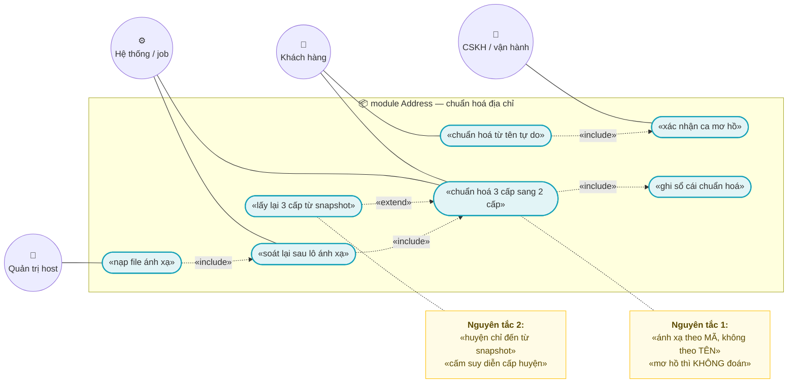
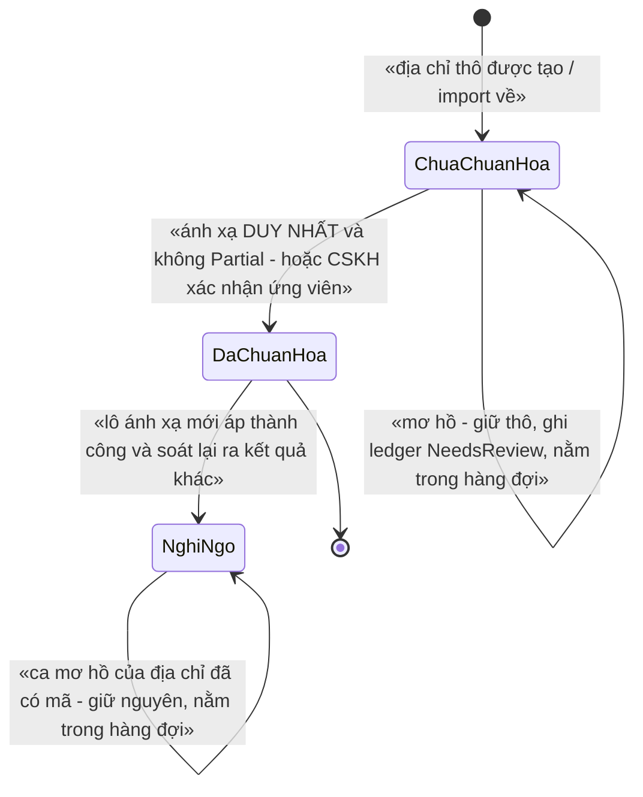
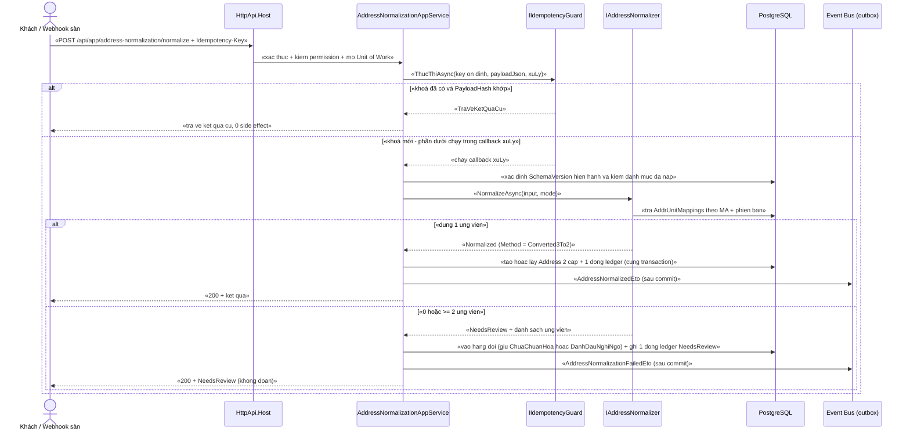

# `ADDR-003` — Chuẩn hoá địa chỉ khách hàng: convert 3 cấp ↔ 2 cấp, xử lý ca sáp nhập tỉnh

| Thuộc tính | Nội dung |
|---|---|
| **Mã** | `ADDR-003` |
| **Module** | **`Address`** (`modules/Address/` — ✅ 4 project đã có, đã vào `eCommerce.slnx:3-7`; "AddressHub" trong thân = **tên kế hoạch cũ**, như `ADDR-002`/`ADDR-001`) · ~~value object `Address` ở `eCommerce.Kernel`~~ **đã bỏ** (ADR-08). Phần ADDR-003 (normalizer, ánh xạ, sổ cái) ⬜ **chưa có code** |
| **Giai đoạn** | **GĐ0 — Pháp lý** (theo `docs/implementation-plan.md` §5 dòng 111 và Phụ lục A.3 dòng 389) |
| **Ưu tiên** | **Must have** — sai mô hình địa chỉ ở GĐ0 ⇒ phải migrate lại **toàn bộ đơn hàng** (`docs/implementation-plan.md` dòng 99) |
| **Trạng thái** | 🟡 `Draft` — chờ review |
| **Người viết / người review** | *(điền)* / **Kiến trúc trưởng + BA** (có yếu tố pháp lý: cần thêm người đã đọc Nghị quyết sắp xếp ĐVHC) |
| **Phiên bản / ngày** | `v0.1 — 13/10/2026` · đối chiếu mô hình Nhanh `18/11/2026` (WP-14, cuối tài liệu) |
| **Tài liệu liên quan** | [`ADDR-001`](addr-001-tra-cuu-don-vi-hanh-chinh-2-cap.md) (tra cứu ĐVHC, danh mục `AddrAdministrativeUnits`) · [`ADDR-002`](addr-002-dong-bo-ma-dia-chi-theo-hang-van-chuyen.md) (mã địa chỉ theo hãng) · [`ADDR-004`](addr-004-so-dia-chi-khach.md) (`Address` + sổ địa chỉ) · `CUS-001` (sổ địa chỉ) · `SAL-002` (checkout/đặt hàng) · `XC-001` · `XC-002` · `XC-003` · `XC-004` · `XC-005` · `docs/implementation-plan.md` §6.1 · `docs/structure-and-techstack.md` dòng 14 |

> 📌 **Quy ước mã trong tài liệu này:** `ADR-nn` (quyết định thiết kế) · `BR-nn` (business rule) ·
> `NFR-nn` (phi chức năng) · `TC-nn` (test case) — tất cả thuộc `ADDR-003`.

---

## 0. Tóm tắt & quyết định thiết kế

**Tóm tắt:** từ **01/7/2025**, Việt Nam bỏ **cấp huyện** và sắp xếp lại **cấp tỉnh** (63 → **34**) và
**cấp xã** (→ **3.321** đơn vị). Mọi địa chỉ đang có — trong dữ liệu cũ, trong file của sàn TMĐT, trong
địa chỉ khách tự nhập — đều thuộc **mô hình 3 cấp cũ**. `ADDR-003` định nghĩa **một chiều chuẩn hoá duy
nhất**: địa chỉ được lưu dưới dạng **snapshot 2 cấp (tỉnh + xã) kèm phiên bản danh mục**, việc chuyển
**3 cấp → 2 cấp** là **TRA CỨU ÁNH XẠ có căn cứ pháp lý**, và **2 cấp → 3 cấp** chỉ được phép **đọc lại
snapshot cũ**, **tuyệt đối không suy diễn ra huyện**.

**Vì sao phải viết trước khi code:** đây là **breaking change đang diễn ra** (`docs/implementation-plan.md`
dòng 99: *"việc bỏ cấp huyện (01/07/2025) thay đổi mô hình dữ liệu địa chỉ ⇒ làm sai từ đầu phải migrate
lại toàn bộ đơn hàng"*). Và có **hai cái bẫy im lặng** đã nhận diện được:

1. **Mã đơn vị hành chính 3 cấp cũ và 2 cấp mới nằm CÙNG một không gian số** (cấp tỉnh 02 chữ số,
   cấp xã 05 chữ số — `Quyết định 19/2025/QĐ-TTg`). Lưu `WardCode` mà **không** kèm phiên bản danh mục
   ⇒ không biết đang tra vào bản 63 tỉnh hay bản 34 tỉnh, và **không có lỗi biên dịch nào**.
2. **Tên tỉnh sau sáp nhập KHÔNG suy ra được mã tỉnh**: tỉnh hợp nhất mang **mã của tỉnh nơi đặt trụ sở
   UBND**, không phải mã của tỉnh "được lấy tên" (`Quyết định 19/2025/QĐ-TTg`). Ánh xạ theo **tên** là
   hỏng dữ liệu âm thầm.

**Phạm vi:**
- ✅ Value object `Address` (bất biến, snapshot) + quy ước cột DB (2 cấp **và** snapshot 3 cấp cũ).
- ✅ Bảng **ánh xạ đơn vị hành chính** cũ → mới (nhiều-nhiều, có ca `Partial`) + **phiên bản danh mục**.
- ✅ Dịch vụ chuẩn hoá: 3 → 2 (chính) và 2 → 3 (**chỉ từ snapshot**).
- ✅ **Hàng đợi ca cần người xác nhận** (`NeedsReview`) — không đoán.
- ✅ **Sổ cái append-only** mọi lần chuẩn hoá + idempotency ở **mọi** biên vào.
- ✅ Xử lý ca sáp nhập tỉnh / sáp nhập xã / bỏ huyện / điều chỉnh một phần địa giới.

**Không nằm trong phạm vi:**
- ❌ **API tra cứu danh mục** (dropdown tỉnh/xã, autocomplete) và **bảng danh mục `AddrAdministrativeUnits`** — thuộc **`ADDR-001`** (✅ đã có code: `AdministrativeUnitAppService`).
- ❌ **Bản đồ mã địa chỉ của từng hãng vận chuyển** (GHN/GHTK/ViettelPost) — thuộc **`ADDR-002`**
  (✅ đã có code: `CarrierAddressMappingAppService`); `ADDR-003` chỉ định nghĩa **hợp đồng dữ liệu** mà `ADDR-002` tiêu thụ.
- ❌ **Sổ địa chỉ của khách** — 🚨 **KHÔNG** thuộc `ADDR-003` và **KHÔNG** thuộc `Customers`:
  entity `Address` **do module `Address` sở hữu**, `Customers` chỉ giữ bảng liên kết —
  chốt tại [`ADDR-004`](addr-004-so-dia-chi-khach.md) **ADR-01** (🟢 Approved 17/10/2026).
  `ADDR-003` chỉ cung cấp **dịch vụ + dữ liệu chuẩn hoá**.
- ❌ Sửa lỗi **tiền tố đôi** của lock key ở module Tax/Inventory — **phát hiện** ở §15.2 **F7** nhưng
  thuộc phạm vi tài liệu đó, không sửa ở đây.
- ❌ Địa chỉ **ngoài Việt Nam**, chia tách/hợp nhất đơn vị **hành chính trong tương lai** (chỉ nêu quy
  trình nạp phiên bản ở §11).

### 0.1 Quyết định thiết kế (ADR ngắn)

| # | Quyết định | Phương án đã cân nhắc | Lý do chọn | Hệ quả |
|---|---|---|---|---|
| **ADR-01** | **Mô hình CHUẨN là 2 cấp (tỉnh + xã)**; snapshot 3 cấp cũ được giữ như **dữ liệu hiển thị** | (a) giữ 3 cấp làm chuẩn, thêm huyện ảo · (b) 2 cấp làm chuẩn + snapshot 3 cấp | Cấp huyện **không còn tồn tại** (`Luật số 72/2025/QH15`, hiệu lực 01/7/2025) ⇒ lấy 3 cấp làm chuẩn là mô hình hoá một cấp **không có thật**; mọi hãng vận chuyển đang chuyển sang 2 cấp | Phải có đường chuyển 2 → 3 cho hãng chưa kịp chuyển — nhưng **chỉ từ snapshot** (**ADR-04**) |
| **ADR-02** | **CẤM lưu mã đơn vị hành chính mà không kèm `DatasetVersionId`** — 🔶 **trong code, "phiên bản" = `SchemaVersion` (`int` 1|2)**, không phải `Guid` | (a) chỉ lưu mã · (b) lưu mã + phiên bản | Mã cấp tỉnh 02 chữ số và cấp xã 05 chữ số dùng **chung không gian số** cho cả bản 63 tỉnh (3 cấp) và bản 34 tỉnh (2 cấp) (`Quyết định 19/2025/QĐ-TTg`); mã "đã đóng" vẫn nằm trong dữ liệu cũ | Mọi truy vấn/validate phải có ngữ cảnh phiên bản; thêm 1 cột ở **mọi** bảng có mã ĐVHC. ✅ **Đã có**: `AdministrativeUnit.SchemaVersion` (`AdministrativeUnit.cs:23`) và `Address.SchemaVersion` (`Address.cs:47`), CHECK `in (1, 2)` (`AddressDbContextModelCreatingExtensions.cs:69-71,155-157`); `ADDR-004` §5.2 dẫn đúng ADR-02 này. Chỗ nào thân còn ghi `DatasetVersionId`/`DatasetId` = `SchemaVersion` (`D-95`: bảng `AddrDatasets` **bỏ**; "phiên bản đang hiệu lực" = `AdministrativeSchemaVersion.HienHanh`, `AdministrativeModels.cs:83`) |
| **ADR-03** | **Ánh xạ cũ → mới là DỮ LIỆU có phiên bản** (`AddrUnitMappings`), **không** hard-code, **không** suy luận theo tên | (a) viết bảng ánh xạ trong code · (b) import từ file chính thức | Danh mục luật là **dữ liệu**, không phải code — cùng nguyên tắc đã chốt ở `XC-006` (`docs/implementation-plan.md` Phụ lục A.3 dòng 381: *"danh mục luật là **dữ liệu**, không hard-code"*) | Thay đổi **cùng cấu trúc** (sáp nhập/đổi tên/đóng mã trong 2 cấp) = file danh mục `ADDR-001` + file ánh xạ `ADDR-003` — **không** release code; thay đổi **cấu trúc** (số cấp khác) = thêm hằng `V3` + migration nới CHECK `in (1,2,3)` = **có** release code (`D-95` (g), hệ quả đã chấp nhận ở `D-80`) (§11) |
| **ADR-04** | **2 cấp → 3 cấp CHỈ đọc lại snapshot đã lưu**; thiếu snapshot ⇒ **NÉM LỖI** | (a) tra ngược sang một xã cũ đại diện · (b) chọn huyện theo tên · (c) ném lỗi | Ánh xạ là **N:1** (nhiều xã cũ → 1 xã mới) ⇒ tra ngược là **mơ hồ**; huyện đã bị bỏ nên mọi giá trị "huyện" sinh ra đều là **bịa** | Hãng vận chuyển còn cần 3 cấp ⇒ địa chỉ phải có snapshot; nếu không ⇒ `CarrierIncompatible` (§12) |
| **ADR-05** | **Mơ hồ ⇒ `NeedsReview`, KHÔNG đoán**; nhưng **không im lặng**: luôn có dòng ledger `NeedsReview` (kèm `ReasonCode` + `Candidates`) + địa chỉ vào hàng đợi + metric + ETO | (a) chọn ứng viên "giống nhất" · (b) từ chối và bắt nhập lại | (a) tạo địa chỉ **sai** mà không ai biết (đúng loại lỗi "guard im lặng" bị cấm ở quy ước #11); (b) chặn cả luồng bán hàng | Có hàng đợi vận hành + màn hình xác nhận (§10). ~~Bảng `AddrNormalizationReviews`~~ **BỎ** (`ADDR-004` Q9: một nguồn hàng đợi). Hàng đợi = `Address.TrangThai ∈ {ChuaChuanHoa, NghiNgo}` (`D-96` (1)); lý do/ứng viên/quyết định nằm ở ledger append-only, trạng thái review **suy ra** từ ledger (`D-96` (5)) |
| **ADR-06** *(sửa theo `D-92`, 18/11/2026)* | **Danh mục ĐVHC + ánh xạ là dữ liệu DÙNG CHUNG Ở HOST**: bản ghi **luôn `TenantId = NULL`**, ghi/đọc từ ngữ cảnh host (worker không lặp tenant, không `CurrentTenant.Change`); **GIỮ cột `TenantId` nullable** (không xoá cột, không `SET NOT NULL`) | (a) `IMultiTenant` + bản sao theo tenant · (b) host-only **không có cột** `TenantId` *(thiết kế gốc v0.1 — đã bỏ)* · (c) host dùng chung, giữ cột nullable | Đây là **dữ liệu pháp lý giống nhau cho mọi tenant**; nhân bản theo tenant là vô nghĩa. Chọn (c) để **khớp code đã có** — `AdministrativeUnit` là `IMultiTenant` với `TenantId` nullable (`AdministrativeUnit.cs:18,20`) — và `ADDR-001` D1 / `ADDR-002` §5.2; chuyển sang theo-tenant sau này **không đổi lược đồ** | **Mọi** unique index có `TenantId` — kể cả bảng host (`AddrUnitMappings`, `AddrUnitMappingImports`) — **phải** `NULLS NOT DISTINCT` (**BR-09**; code: `AddressDbContextModelCreatingExtensions.cs:56-58`); quyền ghi danh mục/ánh xạ = `Host`, đọc = `Both` (§9). Q5 (tenant override) vẫn **KHÔNG** |
| **ADR-07** | **Sổ cái `AddrNormalizationLedger` APPEND-ONLY** | (a) chỉ ghi log text · (b) bảng append-only | Quy ước bất biến: *"sổ cái APPEND-ONLY"*; cần **truy vết được** vì sao một địa chỉ ra kết quả đó (phục vụ khiếu nại giao sai) | Cấm UPDATE/DELETE; sửa sai bằng **bút toán mới** |
| **ADR-08** ❌ **ĐÃ BỊ THAY** | ~~`Address` value object ở `eCommerce.Kernel`~~ → **BỊ LOẠI**: `Address` là **entity** có bảng (`AddrAddresses`), thuộc module `Address` — xem [`ADDR-004`](addr-004-so-dia-chi-khach.md) **ADR-02** (🟢 Approved 17/10/2026). | (a) tất cả trong module · (b) tất cả trong `src/` · (c) tách như trên | `docs/structure-and-techstack.md` dòng 52 quy định `eCommerce.Kernel/ Money · Currency · **Address (value object)**`; kernel **không mang EF** nên không thể chứa entity/migration | `shared/eCommerce.Kernel` **đã có** trong `eCommerce.slnx:87` nhưng **không** chứa `Address` (đã bỏ) — F2 §15.2 lỗi thời |
| **ADR-09** | **Module `Address` (tên cũ "AddressHub") KHÔNG tham chiếu `src/`**; module/app khác gọi qua `.Application.Contracts` | (a) đặt entity vào `src/eCommerce.Domain` · (b) module riêng | Quy ước bất biến #3 — tiền lệ đã ghi rõ ở `modules/Tax/eCommerce.Tax.Domain/TaxErrorCodes.cs:6-8` và `modules/ChannelHub/eCommerce.ChannelHub.Domain/ChannelHubConsts.cs:8-10` | ✅ 4 project `modules/Address/eCommerce.Address.*` **đã có** và đã nằm trong `eCommerce.slnx:3-7` — **không** tạo mới. ⬜ Chưa có test chặn tham chiếu ngược `src/` (`TC-27`) |
| **ADR-10** | **Tên khoá lock của module KHÔNG chứa tiền tố `ecommerce:`** (tiền tố do `AbpDistributedLockOptions.KeyPrefix` ghép) | (a) hàm sinh khoá trả về chuỗi đầy đủ · (b) hàm trả về phần **sau** tiền tố | `XC-003` §5.4 đã **chứng minh bằng `redis-cli MONITOR`**: khoá thật = `KeyPrefix + name` (**ghép không dấu phân cách**), và cấu hình thật là `KeyPrefix = "ecommerce:"` (`src/eCommerce.HttpApi.Host/eCommerceHttpApiHostModule.cs:222,237`). Nếu hàm trả về cả tiền tố ⇒ khoá thật thành `ecommerce:ecommerce:…` | ✅ Code **đã thống nhất** (`TaxErrorCodes.cs:46,50` không tiền tố — xem §15.2 **F7**); `ADDR-003` theo (b), cùng `ADDR-001` §8 |
| **ADR-11** | **Idempotency ở MỌI biên vào**: `Idempotency-Key` ổn định + unique index + `IIdempotencyGuard` (`XC-002`) | (a) chỉ chống trùng ở job · (b) mọi biên | Quy ước bất biến: *"idempotency ở MỌI biên vào"*; import file là biên vào **dễ gây trùng nhất** (cùng một file luật được nạp 2 lần) | Có cột `IdempotencyKey` (ledger) + `SourceHash` (bản ghi lô ánh xạ `AddrUnitMappingImports`, `D-95` (d)); nạp lại cùng file ánh xạ ⇒ **0 dòng thêm** (**BR-10**); `SourceHash` băm **mọi** cột nội dung của dòng, file sửa 1 dòng ⇒ hash khác ⇒ lô thay thế theo nhóm, **không** nổ `23505` (`D-100`) |
| **ADR-12** | **Không thêm gói NuGet nào**; giữ **một** phiên bản ABP duy nhất | (a) thêm thư viện chuẩn hoá địa chỉ/`unaccent` của bên thứ ba · (b) dùng PostgreSQL | `Directory.Packages.props` đang ghim **ABP 10.7.0** cho **mọi** gói (`Directory.Packages.props:21-99`); nhu cầu tìm kiếm không dấu giải quyết bằng `unaccent`/`pg_trgm` của PostgreSQL 17 | Không đụng `Directory.Packages.props`; cần bật extension trong migration (§11) |

---

## 1. Use Case Specification

| Thuộc tính | Nội dung |
|---|---|
| **Use Case ID** | `ADDR-003` |
| **Use Case Name** | Chuẩn hoá địa chỉ khách hàng sang mô hình **2 cấp**, xử lý ca sáp nhập tỉnh/xã |
| **Description** | *"Là hệ thống bán hàng đa kênh, tôi muốn mọi địa chỉ giao hàng — dù đến từ dữ liệu cũ 3 cấp, từ sàn TMĐT, hay khách tự nhập — đều được chuẩn hoá về **2 cấp (tỉnh + xã) có căn cứ pháp lý**, để không giao sai hàng và không phải migrate lại đơn hàng về sau."* |
| **Actor(s)** | **Khách hàng** (nhập/chọn địa chỉ) · **Nhân viên CSKH** (xác nhận ca mơ hồ — `NeedsReview`) · **Quản trị host** (nạp **file ánh xạ** — danh mục thuộc `ADDR-001`) · **Hệ thống** (chuẩn hoá tự động, job nền, event bus) · **Sàn TMĐT / hãng vận chuyển** (nguồn địa chỉ ngoài) |
| **Priority** | **Must have** |
| **Trigger** | (a) khách tạo/sửa địa chỉ trong sổ địa chỉ; (b) đơn từ sàn TMĐT kéo về mang địa chỉ 3 cấp; (c) job chuẩn hoá lại dữ liệu cũ; (d) **một lô ánh xạ ADDR-003 được áp thành công** ⇒ làm kết quả cũ trở nên cần soát lại (`D-95` (f)) |
| **Pre-Condition(s)** | • **Tenant hiện tại** (`TenantId` từ `ICurrentTenant`) — theo `XC-004` D8/BR-009, hệ thống đang chạy **1 tenant** ⇒ `TenantId` **có thể là `NULL`** ⇒ mọi unique index có `TenantId` **phải** `NULLS NOT DISTINCT` (tiền lệ: `src/eCommerce.EntityFrameworkCore/Migrations/20261013024226_Fix_NullableTenantId_UniqueIndexes.cs:39-86`).<br>• **`ChannelCode`** của đơn (nếu có) **chỉ để đối soát** — **không** tham gia quyết định chuẩn hoá địa chỉ (địa chỉ là thuộc tính của **người nhận**, không của kênh).<br>• **Danh mục của `SchemaVersion` cần dùng đã được nạp** (≥ 1 đơn vị `IsActive`; phiên bản hiện hành = `AdministrativeSchemaVersion.HienHanh`, số lạ ⇒ `TheoSo` NÉM `0005`, `AdministrativeModels.cs:75-80`). Thiếu ⇒ **NÉM** `eCommerce:Address:0311`, **không** mặc định ngầm (fail-closed; `D-95` (e)).<br>• **Ánh xạ cũ → mới đã được nạp** và có `LegalBasis` (**BR-05**).<br>• `[Authorize]` cấp class + permission **đã định nghĩa** (theo `XC-004` D2/D3; tiền lệ `src/eCommerce.Application/Channels/ChannelAppService.cs:28` và `src/eCommerce.Application.Contracts/Permissions/eCommercePermissionDefinitionProvider.cs:21-60`).<br>• **Redis 7** sẵn sàng cho khoá phân tán; nếu không, **vẫn phải đúng** nhờ unique index (theo `XC-003` D2). |
| **Post-Condition(s)** | • Mọi địa chỉ đã chuẩn hoá có **`TinhCode` + `XaCode` + `SchemaVersion`** và **snapshot chữ** `DiaChiDayDu` tại thời điểm chuẩn hoá.<br>• Mọi lần chuẩn hoá có **đúng một** bản ghi `AddrNormalizationLedger` (append-only), ghi id lô ánh xạ đã dùng.<br>• Ca mơ hồ **không** bị đoán: địa chỉ nằm trong hàng đợi (`ChuaChuanHoa` nếu nguồn thô, `NghiNgo` nếu nguồn đã có mã) + **đúng một** dòng ledger `NeedsReview` (**BR-06/BR-07**; `D-96` (1)); mỗi review kết thúc bằng **đúng một** dòng ledger quyết định.<br>• **Không** trường nào chứa "huyện" được sinh ra ngoài snapshot cũ (**BR-04**). |
| **Basic Flow** | 1. Client gửi `NormalizeAddressDto` (3 cấp cũ **hoặc** 2 cấp **hoặc** chỉ chuỗi tự do) kèm `Idempotency-Key`.<br>2. App service `[Authorize]` kiểm permission, mở **Unit of Work**, gọi `IIdempotencyGuard.ThucThiAsync(key, payloadJson, xuLy)` (`IdempotencyGuard.cs:27-48`, `XC-002`) — **toàn bộ** phần xử lý (địa chỉ + ledger + outbox) nằm **trong** callback `xuLy`; kết quả `TraVeKetQuaCu` ⇒ trả kết quả cũ, `XungDotPayload` ⇒ `Messaging:0001`, `DangXuLy` ⇒ `Messaging:0002`.<br>3. `IAddressNormalizer` tra `AddrUnitMappings` theo **(FromSchemaVersion, ToSchemaVersion, Level, Code)** — **chỉ theo MÃ** (**BR-03**).<br>4. Tìm thấy **duy nhất** một đích và `MappingKind ≠ Partial` ⇒ tạo/lấy `Address` 2 cấp qua `IAddressDirectory.TaoHoacLayAsync` (hoặc `AddressDirectory.ApplyNormalizationAsync` — lớp hiện thực, không `[Authorize]`, `D-99` — nếu nguồn thô) + 1 dòng ledger, phát `AddressNormalizedEto`.<br>5. Ghi **cùng transaction** dữ liệu địa chỉ + ledger + outbox (`XC-002` BR-001).<br>6. Trả `AddressNormalizationResultDto` (kèm `SchemaVersion`, id lô ánh xạ và `Method`). |
| **Alternative Flow** | **A1: Ca sáp nhập tỉnh** — mã tỉnh cũ **đã đóng** ⇒ ánh xạ sang mã tỉnh mới **theo bảng**, không theo tên; tên cũ nằm ở `DiaChiDayDu` của `Address` v1 nguồn (hoặc `InputSnapshot` của ledger), tên mới ở `DiaChiDayDu` của `Address` v2 — **không** có cột/trường `Legacy*` (`D-96` (6); **BR-03**, §5.2).<br>**A2: Ca `Partial` (điều chỉnh một phần địa giới)** — một xã cũ được tách một phần sang xã mới khác ⇒ **nhiều ứng viên** ⇒ `NeedsReview` + danh sách ứng viên, **không** tự chọn (**BR-06**).<br>**A3: Yêu cầu 3 cấp cho hãng vận chuyển** — chỉ trả về từ `Address` v1 nguồn (qua ledger `ResultAddressId`) hoặc `From*Code` + `InputSnapshot`; thiếu/mơ hồ ⇒ ném `eCommerce:Address:0305` (**BR-04**).<br>**A4: Job chuẩn hoá hàng loạt** — chạy in-process dưới `ICurrentTenant.Change(tenantId)`, gọi `IAddressNormalizer` ⇒ `AddressDirectory` trực tiếp (không qua app service, không giả user — `D-99`); **chỉ chọn** địa chỉ `ChuaChuanHoa` chưa có dòng ledger `NeedsReview` nào — **không** lấy `NghiNgo`/địa chỉ đã có review (kể cả đã kết thúc) và `DaChuanHoa` (đường hàng 7, §3.1); khoá phân tán `SkipIfBusy`, ghi ledger theo khoá `Address:Batch:{batchId}:{addressId}`, **không** dừng cả lô vì 1 ca mơ hồ.<br>**A5: Nạp lại cùng một file ánh xạ** — `SourceHash` trùng một lô **đã áp** (`Outcome = Applied`) của `AddrUnitMappingImports` + metadata khớp ⇒ trả lô đã có, **0 dòng thêm**; trùng lô đã áp nhưng metadata khác ⇒ `0307`; hash chỉ trùng lô **bị từ chối** ⇒ **không** coi là "đã có": xử lý lại từ đầu (file vẫn lỗi ⇒ NÉM lại `0306`, ghi thêm một lô từ chối) (**BR-10**; `D-95` (d)). File **đã sửa** (hash khác) ⇒ lô **thay thế theo nhóm** `(FromSchemaVersion, ToSchemaVersion, FromLevel, FromCode)` có trong file: nhóm y hệt giữ nguyên, nhóm khác ⇒ tắt dòng cũ + chèn dòng mới cùng transaction, nhóm vắng mặt không đụng (`D-100`). |
| **Exception Flow** | **E1:** mã tỉnh/xã **sai định dạng** ⇒ `eCommerce:Address:0002` (tái dùng `MaKhongHopLe`, `AddressErrorCodes.cs:13`); không thuộc `SchemaVersion` đã chọn ⇒ `eCommerce:Address:0001` (tái dùng `KhongTimThayDonVi`, `:10`) — `D-79` giữ nguyên giá trị mã đã có.<br>**E2:** cùng `IdempotencyKey` nhưng payload **khác** ⇒ **`eCommerce:Messaging:0001`** (`PayloadConflict`, `MessagingErrorCodes.cs:14`; `XC-002` BR-006) — **không** ghi đè; đang xử lý ⇒ `eCommerce:Messaging:0002` (`DangXuLy`, `:17`).<br>**E3:** yêu cầu chuyển 2 → 3 mà **không** có snapshot ⇒ `eCommerce:Address:0305` — **cấm** bịa huyện.<br>**E4:** dùng đơn vị hành chính **đã đóng mã** làm đích ⇒ `eCommerce:Address:0006`.<br>**E5:** chuyển trạng thái địa chỉ sai hoặc quyết lại review đã kết thúc ⇒ `eCommerce:Address:0103` (`AddressErrorCodes.cs:48`; `0303` **bỏ, không cấp số** — `D-95` (e)); người quyết review sau (khoá `Address:Review:{ReviewLedgerId}:Decision` đã có) ⇒ `eCommerce:Address:0308` (`D-96` (2)).<br>**E6:** danh mục của `SchemaVersion` cần dùng chưa nạp (0 đơn vị `IsActive`) ⇒ `eCommerce:Address:0311`.<br>**E7:** file **ánh xạ** thiếu cột/sai định dạng ⇒ `eCommerce:Address:0306`; `SourceHash` trùng nhưng metadata khác ⇒ `eCommerce:Address:0307`. |
| **Business Rules** | • **BR-01**: Mọi địa chỉ đã lưu là **SNAPSHOT bất biến** (mã + tên chữ `DiaChiDayDu` + `SchemaVersion`); sửa địa chỉ ⇒ tạo `Address` **mới** + ghi **bút toán mới** vào ledger, **cấm** UPDATE ngầm không vết — đỏ: sửa nội dung địa lý của địa chỉ đã `DaChuanHoa` ⇒ NÉM `eCommerce:Address:0102` (`Address.cs`, `AddressErrorCodes.cs:45`) ở `TC-25`. Tên ĐVHC trong danh mục có thể đổi tại chỗ (`D-77`) ⇒ chứng từ/địa chỉ **chỉ** dùng snapshot chữ, **cấm** dựng lại tên từ danh mục.<br>• **BR-02**: **CẤM** lưu `ProvinceCode`/`WardCode`/`DistrictCode` mà **không** kèm `SchemaVersion` (v0.1: `DatasetVersionId`) — đỏ ở `TC-02`.<br>• **BR-03**: **CẤM** ánh xạ đơn vị hành chính theo **TÊN**; chỉ ánh xạ theo **MÃ** (nhiều tên tỉnh trùng/đổi sau sáp nhập).<br>• **BR-04**: **CẤM** suy diễn/tự sinh cấp huyện khi chuyển 2 → 3; chỉ dùng snapshot 3 cấp đã lưu; thiếu ⇒ `eCommerce:Address:0305`.<br>• **BR-05**: Mọi bản ghi ánh xạ **phải** có `LegalBasis` không rỗng (số hiệu + mục phụ lục), ràng buộc bằng `CHECK` ở DB.<br>• **BR-06**: Chỉ coi là **chuẩn hoá tự động** khi ánh xạ **duy nhất** và `MappingKind ≠ Partial`; mọi trường hợp khác ⇒ `NeedsReview`.<br>• **BR-07**: Ca `NeedsReview` **phải** vào hàng đợi `ChuaChuanHoa` + `NghiNgo` (`ADDR-004` Q9): nguồn **thô** ⇒ **giữ `ChuaChuanHoa`**; nguồn **đã có mã** ⇒ `DanhDauNghiNgo` (`D-96` (1); `DanhDauNghiNgo` từ `ChuaChuanHoa` NÉM `0103` — `Address.cs:204`) — kèm ghi ledger `NeedsReview` + metric + ETO; **cấm** bỏ qua im lặng (quy ước #11). Đỏ khi thiếu một trong ba hoặc khi nguồn thô bị đặt `NghiNgo`: `TC-08`.<br>• **BR-08**: `AddrNormalizationLedger` **append-only** — **cấm** UPDATE/DELETE kể cả soft-delete.<br>• **BR-09**: Mọi unique index có `TenantId` **phải** `NULLS NOT DISTINCT` (theo `XC-004` BR-009) — tiền lệ migration đã có.<br>• **BR-10**: Mọi biên vào (import file · HTTP · webhook · job) **phải** idempotent bằng khoá **ỔN ĐỊNH** + unique index + `IIdempotencyGuard` (`XC-002`).<br>• **BR-11**: Chuyển trạng thái sai **PHẢI NÉM LỖI**; `UPDATE` 0 dòng ⇒ **NÉM LỖI**, không coi là thành công.<br>• **BR-12**: Mọi thao tác ghi qua **Unit of Work**; dữ liệu địa chỉ (gồm `TrangThai`) + ledger + outbox ghi **cùng transaction** — đỏ khi lỗi giữa chừng để lại ledger mồ côi hoặc địa chỉ không có ledger (`TC-26`).<br>• **BR-13**: Mọi app service của module `Address` **phải** có `[Authorize]` ở **cấp class** và permission **đã định nghĩa** (`XC-004` BR-001/BR-002).<br>• **BR-14**: **CẤM hard-code** danh mục/ánh xạ đơn vị hành chính trong code — danh mục là **DỮ LIỆU có phiên bản**; đỏ khi quét mã thấy literal mã ĐVHC hoặc bảng ánh xạ trong `eCommerce.Address.*` ngoài fixture (`TC-30`).<br>• **BR-15**: Module `Address` (`modules/Address/`) **cấm** tham chiếu `src/` **trừ allowlist `src/eCommerce.Domain.Shared`** (đã có ở `eCommerce.Address.Application.csproj:15`, chú thích "module → shared: HỢP LỆ" `:13-14`, để dùng permission `eCommerce.Addresses.*`) — đỏ khi `eCommerce.Address.*.csproj` có `ProjectReference` tới `src/` ngoài allowlist (`TC-27`); bên gọi dùng `eCommerce.Address.Application.Contracts`.<br>• **BR-16**: Đơn vị hành chính đã đóng (`AdministrativeUnit.IsActive = false`, `AdministrativeUnit.cs:40`; v0.1 gọi `IsClosed = true`) **cấm** dùng làm **đích** chuẩn hoá; chỉ được hiển thị ở `Address` v1 nguồn/`InputSnapshot` (không có cột `Legacy*`) ⇒ ném `eCommerce:Address:0006` (`MaDaDong`, `AddressErrorCodes.cs:28`) — đỏ ở `TC-28`.<br>• **BR-17** (`D-105`, `D-101` (b)): chuỗi địa chỉ tự do (`rawText`, `streetLine`) **chỉ** nằm ở bảng riêng **xoá được** `AddrNormalizationInputTexts` (⬜, §5.2); `AddrNormalizationLedger` giữ `InputHash` + khoá cố định của `AddressInputSnapshot`, **không** chứa chuỗi tự do (ngoại lệ ghi nhận: `Note`, `D-101` (c)); BR-08 giữ nguyên — đỏ ở `TC-36`. |
| **Non-Functional Requirement** | • **NFR-01**: Chuẩn hoá 1 địa chỉ (tra cứu đã warm cache) p95 **< 20 ms**.<br>• **NFR-02**: Nạp file **ánh xạ** (toàn bộ ánh xạ 63 → 34 tỉnh + xã) < **60 s**; chạy lại **2 lần ⇒ +0 dòng** (đo ở integration test).<br>• **NFR-03**: **Tái lập 100 %**: cùng input + cùng `SchemaVersion` **và** cùng id lô ánh xạ đã dùng (ledger lưu id lô) ⇒ cùng kết quả (10.000 ca).<br>• **NFR-04**: **0** chỗ suy diễn huyện (test quét mã nguồn).<br>• **NFR-05**: **100 %** bản ghi mapping có `LegalBasis` (CHECK ở DB) .<br>• **NFR-06**: **100 %** lần chuẩn hoá có ledger + `CorrelationId` (`XC-005`).<br>• **NFR-07**: Cách ly tenant: tenant A **không** đọc địa chỉ/ledger của tenant B (danh mục + ánh xạ dùng chung ở host — `D-92`, không tính).<br>• **NFR-08**: **0** `double`/`float` trong assembly `eCommerce.Address.*`; nếu có trường tiền (phí ước tính) **phải** dùng `Money` + minor units (`XC-001`).<br>• **NFR-09**: Tra ứng viên theo tên (không dấu) p95 **< 100 ms**; bộ danh mục trong bộ nhớ **≤ 50 MB**.<br>• **NFR-10**: **100 %** endpoint trả `401` khi không token và `403` khi thiếu quyền (`XC-004`). |

---

## 2. Sơ đồ Use Case



### Chú giải

| Ký hiệu | Ý nghĩa |
|---|---|
| ⭕ Xanh lá | Actor |
| 🟦 Bầu dục xanh dương | Use Case |
| 🟨 Khung vàng | Note (nguyên tắc bất di bất dịch) |
| `-.«include».->` | Quan hệ bao hàm (use case con **luôn** chạy) |

---

## 3. Sơ đồ trạng thái (state machine)

### 3.1 Vòng đời trạng thái chuẩn hoá của một địa chỉ



Hai trạng thái logic của v0.1 **không còn là trạng thái lưu** (`D-96` (7)): `LoiDuLieu` = không lưu, NÉM lỗi fail-closed; `KhongTheChuanHoa` = ledger `Outcome = Unresolvable`, `Address` giữ nguyên trạng thái. **Không** thêm giá trị `TrangThaiDiaChi` (`D-96`, `D-17`).

**Bảng chuyển trạng thái & guard — mọi chuyển sai **PHẢI NÉM LỖI** (quy ước #11):**

| # | Từ → Sang | Ai được phép | Guard (điều kiện cho phép) | Hành động kèm theo | Nếu guard sai thì? |
|---|---|---|---|---|---|
| 1 | `[*]` → `ChuaChuanHoa` | Khách · hệ thống · webhook | Có `TenantId` (có thể `NULL`) + danh mục của `SchemaVersion` đã nạp | Tạo địa chỉ thô qua `IAddressDirectory.TaoHoacLayAsync` (`ADDR-004`) | Danh mục chưa nạp ⇒ **NÉM** `eCommerce:Address:0311` |
| 2 | `ChuaChuanHoa` → `DaChuanHoa` | Hệ thống (tự động) | Tra `AddrUnitMappings` (`IsActive`) theo (From/ToSchemaVersion, Level, FromCode) **đúng MỘT bước** (`D-97` (a)): đúng **1** dòng, `MappingKind ≠ Partial`, đích `IsActive = true` (resolver đã lọc đích đóng) | `AddressDirectory.ApplyNormalizationAsync` (thân của `ChuanHoaLaiAsync`, một lần — `D-99`) + 1 dòng ledger, `MappingImportId` = `ImportId` của chính dòng ánh xạ đó + phát `AddressNormalizedEto` | `0006` = **cửa ghi cuối** (guard hàng 2, `ChuanHoaLaiAsync`, `TaoHoacLayAsync` nhận đích đóng); gặp `0006` ở đường tự động = lỗi lập trình, **đỏ** (`TC-28`) — đích đóng ở bước tra ⇒ hàng 3, **không** ném |
| 3 | mơ hồ → vào hàng đợi (`D-96` (1)) | Hệ thống (tự động) | **0** hoặc **≥ 2** dòng ánh xạ, hoặc có `Partial`, hoặc **đích đã đóng** (`IsActive = false`) — **không ném** (ném làm rollback dòng `NeedsReview`, vi phạm BR-07/BR-12, và dừng job A4). `ReasonCode` ưu tiên `PartialMapping` > `TargetClosed` > `MultipleCandidates` > `NoMapping`; `Candidates` chỉ gồm đích `IsActive` của **cùng bước**, được phép **rỗng** (`D-97` (c)) | Nguồn **thô** ⇒ **giữ `ChuaChuanHoa`**; nguồn **đã có mã** đang `DaChuanHoa`/`DaXacMinh` (v1, hoặc v2 bị soát lại ở hàng 7) ⇒ `DanhDauNghiNgo`; nguồn đang `NghiNgo` ⇒ **không** gọi `DanhDauNghiNgo`, giữ nguyên (sơ đồ `NghiNgo → NghiNgo`). Ghi **1** dòng ledger `Outcome = NeedsReview` (`ReasonCode`, `Candidates`, `ReviewDeadlineUtc`) + metric + `AddressNormalizationFailedEto` — **trừ** nguồn đang `NghiNgo` đã có dòng `NeedsReview` (đang chờ hoặc đã kết thúc): không ghi thêm, không mở review lại (làm lại chỉ qua hàng 7) | `DanhDauNghiNgo` từ `ChuaChuanHoa` **hoặc** `NghiNgo` ⇒ `0103` (`Address.cs:204`) — nguồn thô **không thể** `NghiNgo`, nguồn đã `NghiNgo` **không** được gọi lại (gọi = lỗi lập trình, **đỏ** `TC-08`); thiếu dòng ledger ⇒ **vi phạm BR-07** (`TC-08`) |
| 4 | đầu vào → **không lưu** | Hệ thống | Mã sai định dạng (không khớp `^[0-9]{2}$` / `^[0-9]{5}$`) hoặc không thuộc `SchemaVersion` | Dòng ledger `Outcome = InvalidInput` + metric ghi bằng UoW **riêng** (`requiresNew`, commit) **trước khi** NÉM `0002`/`0001` (khuôn §12 — nếu cùng UoW thì NÉM rollback dòng ledger); ETO của lượt này phát từ UoW riêng đó. Khoá ledger **riêng** `Address:Normalize:{tenantId}:{sourceEntityId}:{inputHash}:Invalid` (không chiếm khoá của ca hợp lệ). **Tra khoá trước**: đã có ⇒ **không** ghi, **không** phát ETO, NÉM lại đúng mã (suy lại từ input bằng kiểm định dạng thuần); hai lượt ghi đua nhau, lượt sau gặp `23505` của **đúng khoá này** ⇒ coi như đã có, NÉM mã | Thử lại cùng input sai ⇒ lại `0002`/`0001`, **không** `23505`/500 (`TC-37`) |
| 5 | review → xác nhận (`D-96` (3)) | CSKH (`eCommerce.Addresses.Normalization.Review`) | Review `Pending` (suy ra từ ledger) **và** ứng viên ∈ `Candidates` của dòng `NeedsReview` **và** — với review có ứng viên lấy từ ánh xạ (mọi `ReasonCode` trừ `NameOnlyInput`) — dòng ánh xạ đã sinh ứng viên **còn `IsActive`** (nhóm không bị lô nào áp **sau** `OccurredAtUtc` của dòng `NeedsReview` thay hoặc rút); nhóm đã bị thay/rút thì ứng viên cũ **không** xác nhận được (`D-106` Q19). `Candidates` **rỗng** (vd `TargetClosed`, `NoMapping`) ⇒ CSKH chỉ **Từ chối** (hàng 6); muốn có ứng viên ⇒ nạp lô ánh xạ trực tiếp (vd A→C), review mới do hàng 7 mở — **không** đi chuỗi (`D-106` Q12, `D-97` (e)) | Nguồn thô ⇒ `AddressDirectory.ApplyNormalizationAsync` (cùng bản ghi, guard như `ChuanHoa` — `D-99`; CSKH chỉ cần `Normalization.Review`, **không** `Addresses.Manage`); nguồn đã có mã ⇒ `TaoHoacLayAsync` tạo/lấy `Address` **v2**, `Address` cũ **giữ nguyên** + `NghiNgo`. Ledger `Outcome = Normalized`, `Method = ManualConfirmed`, `ResultAddressId`, `ActorUserId`; ETO kèm `OldAddressId`/`NewAddressId` | Ứng viên ngoài `Candidates` ⇒ **NÉM** `0309`; ứng viên không còn là dòng ánh xạ `IsActive` (nhóm bị thay/rút sau khi mở review) ⇒ **NÉM** `eCommerce:Address:03xx` (⬜ §6.3), **0** dòng ledger, địa chỉ không đổi (`TC-43`); người quyết sau (khoá `Address:Review:{ReviewLedgerId}:Decision`) ⇒ **NÉM** `0308`; review đã kết thúc ⇒ `0103` |
| 6 | review → từ chối / hết hạn (`D-96` (4)) | CSKH · job hết hạn (**mặc định TẮT**) | Review `Pending` **và** (CSKH từ chối — `Note` bắt buộc — **hoặc** quá `ReviewDeadlineUtc`) | `Address` **giữ nguyên trạng thái**; ledger `Outcome = Unresolvable`, `Method = ManualRejected (4)` / `DeadlineExpired (5)` | Quyết lại review đã kết thúc ⇒ **NÉM** `0103` |
| 7 | `DaChuanHoa` → `NghiNgo` | Job (khi **lô ánh xạ ADDR-003** áp thành công — `D-95` (f)) | Soát lại ra kết quả **khác**. Chuỗi A→B rồi B→C được đi **từng bước có người**: địa chỉ `DaChuanHoa` mã B gặp lô B→C ⇒ soát lại ⇒ `NghiNgo` — mỗi bước một dòng ledger, một `MappingImportId` (`D-97` (e)); muốn mã A đi tự động tới C, lô sau **tự chứa** dòng A→C (BR-14), hệ thống **không** tự suy. `D-100` (6): lô sau chứa A→C ⇒ nhóm A **thay thế** (dòng A→B bị `NgungHieuLuc` cùng lô, `SupersededByImportId` = lô mới) ⇒ resolver thấy **1** dòng ⇒ **tự động** tới C. **Phạm vi quét** (`D-111`, đóng Q22): **nhóm đổi** của lô L = nhóm `(FromSchemaVersion, ToSchemaVersion, FromLevel, FromCode)` mà L đếm vào `SoNhomMoi` hoặc `SoNhomThayThe` (kể cả rút `Withdrawn`, §5.2 — `D-106` Q18); nhóm `SoNhomGiuNguyen` **không** thuộc (**không** bị soát lại). Job quét **hợp** ba điều kiện, G là nhóm đổi của L: **(1)** *(giữ `D-100` (6))* địa chỉ `DaChuanHoa` có ledger `MappingImportId` trỏ dòng có `SupersededByImportId = L`; **(2)** địa chỉ đích (`ResultAddressId ?? SourceEntityId`), đang `DaChuanHoa`, của dòng ledger `Outcome = Normalized` có `ToSchemaVersion = G.FromSchemaVersion` và mã kết quả ở cấp `G.FromLevel` (`ToProvinceCode`/`ToWardCode`) `= G.FromCode`, với G còn ≥ 1 dòng `IsActive` **sau** L (nhóm bị rút không kéo mã kết quả vào soát lại — không có bước tiếp); ledger luôn `ToSchemaVersion = HienHanh` ⇒ nhóm V1→V2 tự loại khỏi vế này (địa chỉ v1 vẫn đi A4); **(3)** review `Pending` (`D-96` (5)) có `FromSchemaVersion` + mã `From*` ở cấp `G.FromLevel` của dòng `NeedsReview` = `G.FromSchemaVersion` + `G.FromCode`, G là **bất kỳ** nhóm đổi của L (mới / thay / rút — phủ cả `NoMapping` gặp nhóm mới; `NameOnlyInput` không có mã ⇒ không khớp) (`D-106` Q19). Địa chỉ đang `NghiNgo` không vào (1)/(2) ⇒ không ghi lặp qua nhiều lô. **Một dòng mỗi (L, địa chỉ)**: khoá `Address:ReNormalize:{mappingImportId}:{addressId}` (§7.2); địa chỉ khớp cả (1) và (2) ⇒ **ưu tiên cố định (1) > (2)** (đầu vào gốc thắng mã kết quả, không phụ thuộc thứ tự quét); (3) rời với (1)/(2) vì địa chỉ `Pending` không `DaChuanHoa`. **Đầu vào của bước tra:** (1)/(3) = mã `From*` của dòng gốc; (2) = **mã kết quả** (`To*Code`) của địa chỉ ⇒ dòng mới ghi `FromSchemaVersion`/`From*Code` = `ToSchemaVersion`/`To*Code` của dòng `Normalized` gốc (để guard hàng 5 xét đúng nhóm G, `D-106` Q19) và `InputSnapshot` chép từ dòng gốc — `D-111` đọc "chép từ dòng ledger gốc" của `D-107` ② ở vế (2) là chép cột `To*` của dòng gốc vào `From*` của dòng mới (lưu ý cho người duyệt `D-107`; P2 chung của hàng 7 vẫn mở, chưa sửa). Luật "chỉ ghi khi ra kết quả **khác**" giữ: vế (2) mà `Candidates` chỉ gồm đúng mã hiện tại ⇒ **không** ghi | Địa chỉ `DaChuanHoa`: `DanhDauNghiNgo` + **1** dòng ledger `Outcome = NeedsReview` mới (`D-103`), `ReasonCode = MappingSuperseded` (thay mọi `ReasonCode` khác ở đường này — **kể cả** khi tra mới ra đúng **1** đích: vẫn `NeedsReview`, không tự `Normalized`, vì nội dung `Address` bất biến, xác nhận đi hàng 5 sinh `Address` v2), `MappingImportId` = id lô **mới**, `Candidates` = kết quả tra **một bước** mới (có thể rỗng), `ReviewDeadlineUtc` ⇒ là review `Pending` (hiện ở §10.1, `ConfirmAsync`/`RejectAsync` xử lý được). Nguồn là review đang `Pending` (địa chỉ `ChuaChuanHoa`/`NghiNgo`): **không** gọi `DanhDauNghiNgo` (giữ trạng thái — hàng 3), chỉ ghi dòng `NeedsReview` mới (dòng mới nhất của địa chỉ, `Candidates` = tra một bước mới, có thể rỗng — nhóm bị rút); `ConfirmAsync` trên `ReviewLedgerId` cũ ⇒ `03xx` (hàng 5, `TC-43`). `Outcome = 4` đã bỏ — DB từ chối (CHECK §5.2, `TC-38`); `AddressUnitMappingsImportedEto` (id lô, `From/ToSchemaVersion`) | Lô nạp bị chặn (`0306`/`0307`) ⇒ **không** soát lại, ghi lô trạng thái từ chối |
| 8 | `DaChuanHoa` → `DaChuanHoa` | — | **Không** có guard cho phép khi `SchemaVersion` **và** id lô ánh xạ **không đổi** | — | Gọi chuẩn hoá lại ⇒ trả kết quả cũ (**idempotent**, `BR-10`), **không** ghi ledger thứ hai |
| 9 | review đã kết thúc → quyết lại | — | **KHÔNG** có guard nào cho phép | — | "Hấp thụ" = review đã kết thúc **không quyết lại được**: khoá idempotency ở hàng 5 chặn ở DB (`0308`/`0103`); làm lại = `Address` mới hoặc review mới do hàng 7 (`D-96` (7)) |

> 🔶 **Quyết định `D-96`/`ADDR-004` Q9:** hàng đợi vận hành = `Address.TrangThai ∈ {ChuaChuanHoa, NghiNgo}` (`GetHangDoiChuanHoaAsync`, `AddressAppService.cs:135`, `AddressContracts.cs:148`; `TrangThaiDiaChi`: `ChuaChuanHoa=0 · DaChuanHoa=1 · DaXacMinh=2 · NghiNgo=3`, `Address.cs:35`). **Không** có bảng review, **không** cột `NormalizationStatus`, **không** giá trị enum mới; trạng thái review `Pending/Confirmed/Rejected/Expired` **suy ra** từ ledger (`D-19`, `D-96` (5)). Nội dung địa lý bất biến sau `DaChuanHoa` (`Address.cs:136-140`) nên xác nhận ca đã có mã luôn sinh `Address` v2 mới.

> ⚠️ **Trạng thái nguy hiểm nhất là `DaChuanHoa` + ánh xạ bị thay:** kết quả cũ vẫn "trông đúng" nhưng có thể không còn khớp ánh xạ mới. Vì vậy mỗi lô ánh xạ áp thành công **bắt buộc** chạy job soát lại (hàng 7) và **đếm** số bản ghi bị ảnh hưởng (§11, metric `address_renormalize_required_total` — giữ tên, nghĩa = số dòng `NeedsReview`/`MappingSuperseded` lượt soát lại ghi, **không** phải giá trị `Outcome`; `D-103`).

### 3.2 Vòng đời phiên bản danh mục — ❌ BỎ theo `D-95`

> ❌ **Bỏ theo `D-95` (18/11/2026):** không bảng `AddrDatasets`, không máy trạng thái `Draft/Validating/Imported/Active/Superseded/Failed`, không `ActivateDatasetAsync`. "Phiên bản" = hằng `AdministrativeSchemaVersion` V1/V2, hiện hành = `HienHanh` (`AdministrativeModels.cs:34-50,83`; tiền lệ `D-80`). Nội dung danh mục trong một `SchemaVersion` chỉ đi qua `ADDR-001` (`D-78`/`D-81`/`D-82`/`D-93`). ADDR-003 chỉ nạp **ánh xạ**, mỗi lượt một bản ghi lô `AddrUnitMappingImports` (§5.2) — lô là bản ghi append-only, **không** có vòng đời trạng thái. Mã `0303` bỏ, không cấp số.

---

## 4. Sequence Diagram & luồng dữ liệu

### 4.1 Chuẩn hoá một địa chỉ 3 cấp (có nhánh mơ hồ)



### 4.2 DFD — đường đi của một địa chỉ (mô tả bằng bảng, không dùng sơ đồ thứ 4)

| Bước | Nguồn | Xử lý | Đích | Ghi chú |
|---|---|---|---|---|
| 1 | Khách nhập / webhook sàn / job | Chuẩn hoá định dạng thô (trim, gộp khoảng trắng, chuẩn hoá tiếng Việt có dấu) | `Address` thô | **Không** sửa chuỗi địa chỉ đường/phố (giữ nguyên văn của khách) |
| 2 | `Address` thô (3 cấp) | Tra `AddrUnitMappings` theo **(FromSchemaVersion, ToSchemaVersion, Level, Code)** | Ứng viên 2 cấp | **Chỉ theo MÃ** (**BR-03**) |
| 3 | Ứng viên | Quyết định: duy nhất ⇒ tự động; còn lại ⇒ vào hàng đợi (`ChuaChuanHoa` + `NghiNgo`) | `Address` 2 cấp **hoặc** dòng ledger `NeedsReview` | **ADR-05**, `D-96` (1) |
| 4 | `Address` 2 cấp | Ghi địa chỉ + ledger + outbox **cùng transaction**; chuỗi tự do (`rawText`, `streetLine`) ghi vào bảng riêng `AddrNormalizationInputTexts` cùng transaction (`D-105`) | PostgreSQL | **BR-12**, **BR-17** |
| 5 | Yêu cầu 3 cấp (hãng vận chuyển) | Đọc `Address` v1 nguồn (qua ledger `ResultAddressId` → `SourceEntityId`) hoặc `From*Code` + `InputSnapshot`; **không** có cột `Legacy*` | Bộ 3 cấp lịch sử | **0** hoặc **> 1** snapshot khác nhau ⇒ `eCommerce:Address:0305` (**BR-04**, `D-96` (6)) |
| 6 | `AddressNormalizedEto` | Consumer: `Customers` (sổ địa chỉ) · `Sales` (đơn) · `ShippingHub` (mã hãng — `ADDR-002`) | Module khác | Qua outbox (`XC-002` BR-001) |

> 📌 **Đã đơn giản hoá (`ADDR-004` Q9, `D-96`):** số **"địa chỉ cần xác nhận"** hiển thị = số review `Pending` (`TotalCount` của `GetReviewQueueAsync`, suy ra từ ledger — §10.3); `GetHangDoiChuanHoaAsync` (`Address.TrangThai ∈ {ChuaChuanHoa, NghiNgo}`) là số khác, chỉ để vận hành `ADDR-004`.

---

## 5. Mô hình dữ liệu

### 5.1 ERD (mô tả dạng bảng — sơ đồ Mermaid của tài liệu này đã dùng đủ 3 khối ở §2, §3, §4)

| Quan hệ | Bội số | Ghi chú |
|---|---|---|
| `AddrAdministrativeUnits` (`ADDR-001`, ✅ có) tự tham chiếu qua `ParentCode` | 1 → N | tỉnh → xã (v2) · tỉnh → huyện → xã (v1); khoá `(TenantId, SchemaVersion, Level, Code)` |
| `AddrUnitMappingImports` → `AddrUnitMappings` | 1 → N | mỗi dòng ánh xạ mang id lô đã nạp nó (`D-95` (d)) — ⬜ |
| `AddrUnitMappings` (`FromSchemaVersion`) → (`ToSchemaVersion`) | N → N | ánh xạ **giữa hai `SchemaVersion`** (và V2→V2: resolver chỉ đi **một bước**, không đi chuỗi — `D-97`); một đơn vị cũ có thể có **nhiều** đích — ⬜ |
| `AddrNormalizationLedger` → `AddrNormalizationLedger` | 1 → N | dòng quyết định trỏ dòng `NeedsReview` qua `ReviewLedgerId` (`D-96` (2)) — ⬜ |
| `AddrNormalizationLedger` → `AddrNormalizationInputTexts` | 1 → 0..1 | chuỗi tự do của dòng ledger nằm ở bảng riêng xoá được (`D-105`); soft ref `LedgerId`, không FK (ledger append-only không bị bảng con cản) — ⬜ |
| `AddrNormalizationLedger` → `AddrAddresses` (`ADDR-004`, ✅ có) | N → 1 | `SourceEntityId` = `AddressId` nguồn; `ResultAddressId` = `Address` kết quả (soft ref, không FK) |

### 5.2 Bảng & cột (Data Dictionary)

> 🔶 **Đối chiếu WP-14 — đọc trước khi dùng các bảng dưới (tất cả ⬜ chưa có code; code thật: `AddressDbContextModelCreatingExtensions.cs:13-28`):**
> - `AddrProvinces` / `AddrDistricts` / `AddrWards` **bị thay** bằng **một** bảng `AddrAdministrativeUnits` của `ADDR-001` (cột `SchemaVersion`, `Level`, `Code`, `ParentCode`, `IsActive`; unique `(TenantId, SchemaVersion, Level, Code)` `NULLS NOT DISTINCT` — `:56-58`; `ADDR-004` ADR-12). `IsClosed` = `!IsActive`; **không** có `ClosedAtUtc`, `DatasetId`, `NameNormalized` (⬜ thêm cột + index `gin` ở WP code). Các bảng ba cấp dưới đây chỉ còn là **mô tả cột logic** — **không** tạo bảng.
> - `AddrNormalizationReviews` **BỎ** (`ADDR-004` Q9, `D-96`): `ReasonCode`/`Candidates`/`ReviewDeadlineUtc` + quyết định chuyển thành **7 cột nullable mới** của `AddrNormalizationLedger` (bảng ledger bên dưới); trạng thái review suy ra từ ledger.
> - `AddrDatasets` **BỎ** (`D-95`): `DatasetId`/`DatasetFromId`/`DatasetToId` ở mọi bảng ⇒ `SchemaVersion` / `FromSchemaVersion`+`ToSchemaVersion` (`smallint`, CHECK `in (1, 2)` như `AddressDbContextModelCreatingExtensions.cs:69-71`); thay bằng bảng lô `AddrUnitMappingImports`.
> - 🚨 **Mã `Level` đúng theo code** (`AdministrativeModels.cs:6-19`): `Tinh = 1 · Xa = 2 · QuanHuyen = 3` — v0.1 ghi `1=tỉnh · 2=huyện · 3=xã` là **SAI** (xã và huyện bị đảo; không lỗi biên dịch, lưu DB là số — `D-17`). Mọi `FromLevel`/`ToLevel` và fixture `TC` dùng bộ số này; ánh xạ huyện→xã = `3 → 2`, xã→xã = `2 → 2`.
> - Bảng host (`AddrUnitMappingImports`, `AddrUnitMappings`) **có** cột `TenantId` nullable, luôn `NULL` (`D-92`), unique `NULLS NOT DISTINCT`; v0.1 ghi "không có `TenantId`" là thiết kế đã bỏ.

**Bảng `AddrUnitMappingImports`** ⬜ — *bản ghi lô nạp ánh xạ* (append-only, khuôn `D-78`/`D-83`) — **dữ liệu cấp HOST** (ADR-06). Tên là **gợi ý** (`D-95` (d)); thay `AddrDatasets` đã bỏ.

| Cột | Kiểu | Null? | Nguồn / ý nghĩa | Ghi chú |
|---|---|---|---|---|
| `Id` | `uuid` | ✖ | khoá chính = id lô | mỗi dòng `AddrUnitMappings` mang id này |
| `TenantId` | `uuid` | ✔ | luôn `NULL` (`D-92`) | unique `NULLS NOT DISTINCT` |
| `SourceName` | `varchar(128)` | ✖ | tên nguồn (file/văn bản) | `D-93`: nguồn production chưa xác định |
| `SourceHash` | `char(64)` | ✖ | SHA-256 tập ánh xạ **chuẩn hoá**: băm **mọi** cột nội dung (`FromLevel`, `ToLevel`, `MappingKind`, `CoverageNote`, `LegalBasis` + khoá) của từng dòng (kể cả dòng khai báo `Withdrawn`), sắp theo (`FromSchemaVersion`, `ToSchemaVersion`, `FromLevel`, `FromCode`, `ToLevel`, `ToCode`), cấm `Guid.NewGuid()` (`D-100` (5)) | **idempotency nạp** (**BR-10**); file chỉ sửa `LegalBasis`/`MappingKind` 1 dòng ⇒ hash khác |
| `LegalBasis` / `EffectiveFrom` | `varchar(512)` / `date` | ✖ | căn cứ + ngày hiệu lực của lô | **BR-05** |
| `ImportedAtUtc` / `ImportedBy` | `timestamptz` / `varchar` | ✖ | UTC (`AbpClockOptions.Kind = Utc`); user hoặc job | |
| `Outcome` + số đếm | `smallint` + `int` | ✖ | `Applied=0` · `RejectedInvalidFile=1` (`0306`) · `RejectedHashConflict=2` (`0307`) (tên gợi ý; thêm cuối dải — `D-17`) + `SoNhomMoi`, `SoNhomThayThe` (gồm nhóm bị rút — `Withdrawn`, `D-106`), `SoNhomGiuNguyen`, `SoDongThem`, `SoDongNgungHieuLuc` (`D-100` (6)) | lượt bị chặn **cũng ghi** lô (số đếm = 0, **0** dòng bị tắt). `SourceHash` của lô từ chối = hash chuẩn hoá nếu tính được, không thì SHA-256 bytes file thô; lô từ chối **không** tham gia idempotency (unique chỉ áp cho `Applied`, §5.2) |

**Bảng `AddrProvinces`** *(cấp tỉnh)* — host

| Cột | Kiểu | Null? | Ý nghĩa | Ghi chú |
|---|---|---|---|---|
| `Id` | `uuid` | ✖ | | |
| `SchemaVersion` | `int` | ✖ | thay `DatasetId` (`D-95`; `AdministrativeUnit.cs:23`) | **mọi** truy vấn phải kèm `SchemaVersion` (**BR-02**) |
| `Code` | `char(2)` | ✖ | mã tỉnh 02 chữ số | `Quyết định 19/2025/QĐ-TTg`: cấp tỉnh = 02 chữ số `01`–`99` |
| `Name` | `varchar(128)` | ✖ | tên hiện hành | |
| `UnitType` | `smallint` | ✖ | `Tinh=0` · `ThanhPho=1` | 34 đơn vị gồm 28 tỉnh + 6 thành phố |
| `IsClosed` | `boolean` | ✖ | mã **đã đóng**, không cấp lại | **BR-16** |
| `ClosedAtUtc` | `timestamptz` | ✔ | | |

**Bảng `AddrDistricts`** *(cấp huyện — **chỉ để tương thích 3 cấp cũ**)* — host

| Cột | Kiểu | Null? | Ý nghĩa | Ghi chú |
|---|---|---|---|---|
| `Id` | `uuid` | ✖ | | |
| `SchemaVersion` | `int` | ✖ | thay `DatasetId` (`D-95`) | |
| `ProvinceId` | `uuid` | ✖ | FK | |
| `Code` | `char(3)` | ✖ | mã huyện 03 chữ số (bộ cũ) | |
| `Name` | `varchar(128)` | ✖ | | |
| `IsClosed` | `boolean` | ✖ | **luôn `true`** ở phiên bản 2 cấp | 🚨 Xem **F6** §15.2: bảng này **không** được trở thành nguồn sự thật thứ hai |

**Bảng `AddrWards`** *(cấp xã/phường/đặc khu)* — host

| Cột | Kiểu | Null? | Ý nghĩa | Ghi chú |
|---|---|---|---|---|
| `Id` | `uuid` | ✖ | | |
| `SchemaVersion` | `int` | ✖ | thay `DatasetId` (`D-95`) | |
| `ProvinceId` | `uuid` | ✖ | FK — **luôn** có | |
| `DistrictId` | `uuid` | ✔ | FK — `NULL` ở phiên bản 2 cấp | |
| `Code` | `char(5)` | ✖ | mã xã 05 chữ số | `Quyết định 19/2025/QĐ-TTg`: cấp xã = 05 chữ số `00001`–`99999` |
| `Name` | `varchar(160)` | ✖ | | |
| `UnitType` | `smallint` | ✖ | `Xa=0` · `Phuong=1` · `DacKhu=2` | sau sắp xếp còn **3.321** đơn vị cấp xã |
| `NameNormalized` | `varchar(160)` | ✖ | tên **bỏ dấu**, chữ thường | tìm kiếm bằng `unaccent` + `pg_trgm` (ADR-12) |
| `IsClosed` | `boolean` | ✖ | mã đã đóng | **BR-16** |

**Bảng `AddrUnitMappings`** — *ánh xạ đơn vị hành chính cũ → mới* — host; **cột nội dung bất biến**, `IsActive` một chiều do cửa nạp (`D-100`) (⬜ chưa có code)

| Cột | Kiểu | Null? | Ý nghĩa | Ghi chú |
|---|---|---|---|---|
| `Id` | `uuid` | ✖ | | |
| `TenantId` | `uuid` | ✔ | luôn `NULL` (`D-92`) | unique `NULLS NOT DISTINCT` |
| `ImportId` | `uuid` | ✖ | id lô `AddrUnitMappingImports` đã nạp dòng này (`D-95` (d)) | |
| `FromSchemaVersion` / `ToSchemaVersion` | `smallint` | ✖ | thay `DatasetFromId`/`DatasetToId` (`D-95` (b)) | CHECK `in (1, 2)` |
| `FromLevel` / `ToLevel` | `smallint` | ✖ | `1`=Tinh · `2`=Xa · `3`=QuanHuyen (`AdministrativeLevel`, `AdministrativeModels.cs:6-19`) | cho phép ánh xạ `2→2` (xã→xã), `1→1`, `3→2` (huyện→xã) |
| `FromCode` / `ToCode` | `varchar(5)` | ✖ | **mã**, không phải tên (**BR-03**) | |
| `MappingKind` | `smallint` | ✖ | `Exact=0` (nhập nguyên đơn vị) · `Partial=1` (chỉ **một phần** diện tích/dân số) · `RenamedOnly=2` (chỉ đổi tên, mã không đổi) · `Withdrawn=3` (thêm **cuối dải** — `D-17`, `D-106` Q18: **chỉ trong file**, khai báo nhóm "0 đích hiệu lực"; **không** lưu thành dòng bảng) | `Partial` ⇒ **buộc** `NeedsReview` (**BR-06**). `Withdrawn` ⇒ cửa nạp tắt mọi dòng hiệu lực của nhóm, **không** chèn dòng (§6.2, §12); CHECK `"MappingKind" in (0, 1, 2)` ⇒ `INSERT` dòng `Withdrawn` ⇒ `23514` (**đỏ**, `TC-42`) |
| `CoverageNote` | `varchar(512)` | ✔ | mô tả phần bị tách, ví dụ *"phần còn lại của thị trấn X"* | **bắt buộc** khi `MappingKind = Partial` |
| `LegalBasis` | `varchar(512)` | ✖ | số hiệu Nghị quyết + mục phụ lục | **BR-05**, CHECK ở DB |
| `IsActive` | `boolean` | ✖ | có hiệu lực áp dụng; dòng mới luôn `true` | **Chỉ** domain service của `ImportUnitMappingsAsync` ghi, trong khoá `CatalogImport` + **cùng transaction** với dòng lô; **một chiều** `true → false` qua method entity duy nhất (gợi ý `NgungHieuLuc(importIdThayThe)`, không setter public; gọi lại trên dòng đã `false` ⇒ NÉM, mã `03xx` cuối dải khi code — `D-79`); "mở lại" = lô sau khai báo lại (dòng mới) (`D-100` (1)). Resolver tra **đúng một bước** theo (`FromSchemaVersion`, `ToSchemaVersion`, `FromLevel`, `FromCode`) `WHERE IsActive`, **không** tra tiếp theo `ToCode` (`D-97` (a)) |
| `SupersededByImportId` | `uuid` | ✔ | id lô đã tắt dòng này | CHECK `"IsActive" = ("SupersededByImportId" IS NULL)` ⇒ mọi lần tắt có vết lô. **Bất biến:** mọi dòng `IsActive` của cùng một nhóm `(FromSchemaVersion, ToSchemaVersion, FromLevel, FromCode)` mang **cùng một** `ImportId` ⇒ `MappingImportId` của ledger luôn là **một** id lô (NFR-03) |

> ❌ **Bảng `AddrNormalizationReviews` BỎ** (`ADDR-004` Q9, `D-96`): không `Status`/`RowVersion`/`ChosenToCode`/`ConfirmedBy` — chuyển thành 7 cột nullable của ledger bên dưới; `Status` review **suy ra** (`D-96` (5)).

**Bảng `AddrNormalizationLedger`** — **SỔ CÁI APPEND-ONLY** — có `TenantId` (⬜ chưa có code)

| Cột | Kiểu | Null? | Ý nghĩa | Ghi chú |
|---|---|---|---|---|
| `Id` | `uuid` | ✖ | | |
| `TenantId` | `uuid` | ✔ | | `NULLS NOT DISTINCT` |
| `IdempotencyKey` | `varchar(256)` | ✖ | khoá **ổn định** của biên vào | **BR-10** |
| `SourceEntityType` / `SourceEntityId` | `varchar(32)` / `uuid` | ✖ | đối tượng được chuẩn hoá | |
| `InputSnapshot` | `jsonb` | ✖ | serialize từ **record riêng** `AddressInputSnapshot` (§6.1) — **không** serialize thẳng `AddressInput`/body request. Khoá cấp 1 **cố định**: mã cũ `LegacyProvinceCode`/`LegacyDistrictCode`/`LegacyWardCode` + tên ĐVHC cũ (`D-77`) — **không** có khoá `freeText`: chuỗi tự do (`rawText`, `streetLine`) ở bảng riêng `AddrNormalizationInputTexts` bên dưới (`D-105`, **BR-17**). Ledger không ẩn danh/xoá được (BR-08) và **không cần** — phần PII đã tách | `Address.ChuanHoa` **ghi đè** `SoNhaDuong`/`DiaChiDayDu` của bản thô (`Address.cs:267-268`) ⇒ đầu vào gốc còn ở bảng chuỗi tự do (tới khi bị xoá) + mã/tên cũ ở đây |
| `InputHash` | `char(64)` | ✔ | SHA-256 đầu vào đã chuẩn hoá thứ tự (§8.2 — cùng giá trị `{inputHash}` trong khoá idempotency); `NULL` ở dòng quyết định review | `D-105`: còn lại sau khi chuỗi tự do bị xoá — để đối soát/chống trùng, không để đọc lại địa chỉ |
| `Outcome` | `smallint` | ✖ | `Normalized=0` · `NeedsReview=1` · `InvalidInput=2` · `Unresolvable=3` · `4` **bỏ, không cấp số, không tái dùng** (`D-103`); giá trị mới về sau lấy `5` | **Review `Pending` chỉ mở bằng `NeedsReview`**; §3.1 hàng 7 ghi `NeedsReview` + `ReasonCode = MappingSuperseded`; CHECK `CK_AddrNormalizationLedger_Outcome in (0, 1, 2, 3)` (`D-103`) |
| `Method` | `smallint` | ✖ | `Converted3To2=0` · `AlreadyTwoLevel=1` · `ManualConfirmed=2` · `FromCarrierData=3` · `ManualRejected=4` · `DeadlineExpired=5` (thêm **cuối dải** — `D-17`, `D-96` (4)) | |
| `FromSchemaVersion` / `ToSchemaVersion` | `smallint` | ✔ | thay `DatasetFromId`/`DatasetToId` (`D-95`) | **BR-02**; CHECK `in (1, 2)` |
| `MappingImportId` | `uuid` | ✔ | id lô ánh xạ đã dùng để suy ra kết quả | thay vai tái lập của `DatasetVersionId` (`D-95` (f)); NFR-03 |
| `ReasonCode` | `smallint` | ✔ | `NoMapping=0` · `MultipleCandidates=1` · `PartialMapping=2` · `NameOnlyInput=3` · `TargetClosed=4` · `MappingSuperseded=5` (thêm **cuối dải** — `D-17`, `D-97` (c), `D-103`; `5` = dòng soát lại của §3.1 hàng 7, **chỉ** job hàng 7 ghi — `NormalizeAsync` không bao giờ trả) | chỉ dòng `NeedsReview` (`D-96` (1)) |
| `Candidates` | `jsonb` | ✔ | ứng viên (đúng trường `AddressCandidateDto`) để UI hiển thị | chỉ dòng `NeedsReview` |
| `ReviewDeadlineUtc` | `timestamptz` | ✔ | hạn xử lý (giá trị mặc định = Q6, `Open`); job hết hạn **mặc định TẮT** | chỉ dòng `NeedsReview` |
| `ReviewLedgerId` | `uuid` | ✔ | trỏ dòng `NeedsReview` mà dòng này kết thúc | chỉ dòng quyết định; `IdempotencyKey = Address:Review:{ReviewLedgerId}:Decision` ⇒ quyết định thứ hai bị unique chặn (`D-96` (2)) |
| `ActorUserId` | `uuid` | ✔ | người xác nhận/từ chối | |
| `ResultAddressId` | `uuid` | ✔ | `Address` kết quả (soft ref) | index §dưới |
| `FromProvinceCode`/`FromDistrictCode`/`FromWardCode` | `varchar(5)` | ✔ | mã cũ | |
| `ToProvinceCode` / `ToWardCode` | `varchar(5)` | ✔ | mã mới | |
| `OccurredAtUtc` | `timestamptz` | ✖ | | |
| `CorrelationId` | `varchar(128)` | ✖ | truy vết (`XC-005`) | |
| `Note` | `varchar(2048)` | ✔ | lý do (bắt buộc khi từ chối — `D-96` (4)) | **không** ghi số nhà/tên/SĐT (nhãn UI §10.1; **không** chặn được bằng máy — rủi ro ghi nhận, `D-101` (c)). Cột khác của ledger (`Candidates`, `CorrelationId`, `IdempotencyKey`) **không** mang chữ địa chỉ/tên/SĐT |

> 🔒 **APPEND-ONLY (BR-08):** không có cột `LastModificationTime`, không soft-delete; **cấm** UPDATE/DELETE.
> Sửa sai ⇒ ghi **bút toán mới** với `Outcome` tương ứng.

**Bảng `AddrNormalizationInputTexts`** ⬜ — *chuỗi địa chỉ tự do của một dòng ledger, **xoá được*** (`D-105`, hướng (ii) của `D-101`) — module chủ `Address`; có `TenantId`; tên là **gợi ý**. **Không** phải sổ cái: BR-08 không áp; ledger không FK tới bảng này.

| Cột | Kiểu | Null? | Ý nghĩa | Ghi chú |
|---|---|---|---|---|
| `Id` | `uuid` | ✖ | | |
| `TenantId` | `uuid` | ✔ | | `NULLS NOT DISTINCT` |
| `LedgerId` | `uuid` | ✖ | dòng `AddrNormalizationLedger` mà chuỗi này thuộc về (soft ref, không FK) | unique `(TenantId, LedgerId)` — mỗi dòng ledger ≤ 1 bản ghi |
| `RawText` | `varchar(512)` | ✔ | `AddressInput.RawText` | độ dài = `Address.DoDaiDiaChiDayDu` (`Address.cs:30`); vượt ⇒ NÉM như `Address` (`Address.cs:256-260`) |
| `StreetLine` | `varchar(256)` | ✔ | `AddressInput.StreetLine` | độ dài = `Address.DoDaiSoNhaDuong` (`Address.cs:27`) |
| `CreatedAtUtc` | `timestamptz` | ✖ | | CHECK `"RawText" IS NOT NULL OR "StreetLine" IS NOT NULL` (không ghi dòng rỗng) |

Ghi **một lần** (INSERT) trong **cùng UoW** với dòng ledger (BR-12); **không** UPDATE. **Được phép DELETE** — đó là lý do tách bảng. Ai xoá, khi nào, qua đường nào = **Q21** (chưa chốt): tới khi chốt, **không** method/permission/job nào xoá (`D-101` (a) giữ). Mất bản ghi này **không** được làm hỏng chuẩn hoá/review/`ToThreeLevelAsync` (đỏ ở `TC-36`): các luồng đó chỉ đọc mã + tên cũ từ `InputSnapshot`/`Candidates`.

**Index & ràng buộc**

| Bảng | Loại | Cột / biểu thức | Mục đích |
|---|---|---|---|
| ~~`AddrDatasets`~~ | ~~3 index + CHECK~~ | — | **bỏ** (`D-95`): không unique `(Structure) WHERE Status = 3`, không `(DatasetSourceHash)` |
| `AddrUnitMappingImports` | **UNIQUE `NULLS NOT DISTINCT`** (SQL thô) `WHERE "Outcome" = 0` (`Applied`) | `(TenantId, SourceHash)` | nạp lại cùng file ánh xạ ⇒ không thêm lô **đã áp** (**BR-10**; host, `D-92`); partial để lô **từ chối** cùng hash vẫn ghi được (0 `23505`) |
| `AddrAdministrativeUnits` (✅ có, `ADDR-001`) | UNIQUE `NULLS NOT DISTINCT` | `(TenantId, SchemaVersion, Level, Code)` | `AddressDbContextModelCreatingExtensions.cs:56-58` — thay `AddrProvinces/Districts/Wards` |
| `AddrAdministrativeUnits` | INDEX ⬜ | `gin (NameNormalized gin_trgm_ops)` (cột mới) | tìm theo tên không dấu (ADR-12) |
| `AddrUnitMappings` | INDEX (partial `WHERE "IsActive"`) | `(FromSchemaVersion, ToSchemaVersion, FromLevel, FromCode)` | **truy vấn nóng nhất** của normalizer (`D-100` (3)) |
| ~~`AddrNormalizationReviews`~~ | ~~2 index~~ | — | **bỏ** (`ADDR-004` Q9); hàng đợi dùng `IX_AddrAddresses_TenantId_TrangThai` đã có (`AddressDbContextModelCreatingExtensions.cs:130-131`); chống quyết định trùng = unique ledger `(TenantId, IdempotencyKey)` (`D-96` (2)) |
| `AddrUnitMappings` | **UNIQUE `NULLS NOT DISTINCT`** (SQL thô) | `(TenantId, ImportId, FromSchemaVersion, ToSchemaVersion, FromLevel, FromCode, ToLevel, ToCode)` | chống trùng **trong một lô**; `D-92`: bảng host giữ `TenantId` nullable ⇒ `NULLS NOT DISTINCT` (**BR-09**); thay unique không `ImportId` của v0.1 (`D-100` (3)) |
| `AddrUnitMappings` | **UNIQUE `NULLS NOT DISTINCT`** (SQL thô) `WHERE "IsActive"` | `(TenantId, FromSchemaVersion, ToSchemaVersion, FromLevel, FromCode, ToLevel, ToCode)` | DB chặn hai dòng **hiệu lực** cùng cặp. Nhóm khác bị tắt **trước** khi chèn trong cùng transaction ⇒ `23505` ở đường đúng = lỗi lập trình, **đỏ** (`D-100` (3)) |
| `AddrUnitMappings` | CHECK | `"IsActive" = ("SupersededByImportId" IS NULL)` | mọi lần tắt có vết lô; `UPDATE … SET "IsActive" = true` trên dòng đã tắt ⇒ đỏ (`D-100` (1)) |
| `AddrNormalizationLedger` | **UNIQUE `NULLS NOT DISTINCT`** | `(TenantId, IdempotencyKey)` | ⭐ **hàng rào idempotency chính** (**BR-10**) |
| `AddrNormalizationLedger` | INDEX | `(TenantId, SourceEntityId, OccurredAtUtc)` | tra vết một địa chỉ |
| `AddrNormalizationLedger` | INDEX ⬜ | `(TenantId, ResultAddressId)` | `ToThreeLevelAsync` tìm nguồn v1 của một `Address` v2 (`D-96` (6)) |
| `AddrNormalizationLedger` | INDEX ⬜ (partial `WHERE "Outcome" = 0`) | `(TenantId, ToSchemaVersion, ToWardCode)` + `(TenantId, ToSchemaVersion, ToProvinceCode)` | job hàng 7 vế (2) tìm địa chỉ có **mã kết quả** = `FromCode` nhóm đổi (`D-111`); thêm trong migration ledger **đầu tiên** (bảng chưa tạo); tên/partial do arch chọn |
| `AddrNormalizationLedger` | INDEX ⬜ (partial `WHERE "Outcome" = 1`) | `From*Code` theo cấp (`FromProvinceCode`/`FromWardCode`), kèm `TenantId`, `FromSchemaVersion` | job hàng 7 vế (3) tìm review `Pending` có `From*Code` = `FromCode` nhóm đổi (`D-111`); cùng migration; tên/partial do arch chọn |
| `AddrAdministrativeUnits` | CHECK ⬜ | `Code ~ '^[0-9]{2}$'` / `'^[0-9]{5}$'` / `'^[0-9]{3}$'` theo `Level` | chặn mã sai định dạng ở tầng DB (không gắn BR); hiện chỉ ép ở code (`AdministrativeUnit.cs:98-117`) |
| `AddrUnitMappings` | CHECK | `LegalBasis <> ''` | **BR-05** — 100 % ánh xạ phải có căn cứ |
| `AddrUnitMappings` | CHECK | `MappingKind <> 1 OR CoverageNote IS NOT NULL` | `Partial` **bắt buộc** có mô tả phần bị tách |
| `AddrUnitMappings` / `AddrNormalizationLedger` | CHECK | `FromSchemaVersion`/`ToSchemaVersion` `in (1, 2)` | như `AddressDbContextModelCreatingExtensions.cs:69-71` (`D-95` (b)) |
| `AddrNormalizationLedger` | CHECK `CK_AddrNormalizationLedger_Outcome` | `"Outcome" in (0, 1, 2, 3)` | `4` đã bỏ (`D-103`): ghi `Outcome = 4` ⇒ `23514` (**đỏ**, TC-38); phải có ngay trong migration tạo bảng |
| `AddrNormalizationInputTexts` | **UNIQUE `NULLS NOT DISTINCT`** (SQL thô) | `(TenantId, LedgerId)` | mỗi dòng ledger ≤ 1 bản ghi chuỗi tự do; ghi lại cùng dòng ⇒ `23505` (**BR-09**, `D-105`) |
| `AddrNormalizationInputTexts` | CHECK | `"RawText" IS NOT NULL OR "StreetLine" IS NOT NULL` | không ghi dòng rỗng |
| `AddrUnitMappings` | CHECK | `"MappingKind" in (0, 1, 2)` | `Withdrawn=3` chỉ tồn tại trong file, không lưu dòng (`D-106` Q18; `TC-42`) |

> 📌 **Tiền lệ `NULLS NOT DISTINCT`:** mọi unique index **có `TenantId`** phải sinh bằng **SQL thô** trong
> migration (EF Core **không** mô hình hoá thuộc tính này) — xem
> `src/eCommerce.EntityFrameworkCore/Migrations/20261013024226_Fix_NullableTenantId_UniqueIndexes.cs:39-86`
> và test chống tái phát `test/eCommerce.IntegrationTests/PostgreSqlSchemaTests.cs:144-174`.
> ⚠️ **Với `ADDR-003` phải viết NGAY trong migration tạo bảng**, không để nợ như `XC-004` F1 đã phải sửa lại.

> 💰 **Tiền tệ — ghi rõ để không hiểu nhầm là bỏ sót:** `ADDR-003` **không có trường tiền nào**
> ⇒ quy ước `decimal`/`Money`/**cấm `==` trên tiền** (`XC-001`) **không áp dụng trực tiếp** ở đây.
> Nhưng có **hai ràng buộc kế thừa** vẫn hiệu lực: (1) **cấm** `double`/`float` trong module (**NFR-08**);
> (2) khi `SHP-*` tính **phí vận chuyển** từ địa chỉ, phí **phải** dùng `Money` + minor units
> (`XC-001` BR-007) và so sánh theo `ToMinorUnits()` — **tuyệt đối không** `==` trên `decimal`.

---

## 6. Hợp đồng API

### 6.1 Thư viện dùng chung + module

```csharp
// ── ❌ BỎ: value object `Address` ở eCommerce.Kernel (ADR-08, `ADDR-004` ADR-02). ──
// Địa chỉ đã chuẩn hoá = entity `Address` (`Address.cs:24`) + DTO đọc bất biến `DiaChiSnapshotDto`
// (`AddressContracts.cs:41-54`: `SchemaVersion` thay `DatasetVersionId`, `TinhCode`/`XaCode`/`HuyenCode`, `DiaChiDayDu` = snapshot chữ).
// Snapshot 3 cấp: KHÔNG thêm cột `Legacy*` vào `AddrAddresses` (`D-96` (6)) — lấy từ `Address` v1 nguồn hoặc `From*Code` + `InputSnapshot` của ledger.

// ── modules/Address/eCommerce.Address.Application.Contracts (✅ project đã có) — namespace thật: `eCommerce.Address` ──
// ⬜ Toàn bộ khối dưới là THIẾT KẾ CHƯA CÓ CODE; `Address` trong `Normalized` = `DiaChiSnapshotDto`.
namespace eCommerce.Address;

public enum AddressNormalizationMode
{
    /// Chế độ in-process (D-98): MỌI kết quả mà CreateReview sẽ trả NeedsReview (mọi ReasonCode, kể cả giá trị thêm cuối dải)
    /// ⇒ NÉM `0302` + WithData("reasonCode"); KHÔNG tạo/đổi Address, KHÔNG ghi ledger NeedsReview, KHÔNG ETO, KHÔNG vào hàng đợi.
    /// Là giá trị mặc định của enum (quên truyền ⇒ NÉM, fail-closed). Chưa có bên gọi nào — GIỮ trong enum (D-106, Q17).
    /// Endpoint HTTP §6.3 luôn chạy `CreateReview` — `NormalizeAddressDto` KHÔNG có trường `mode` (D-98).
    Strict = 0,

    /// Chế độ lô (job/webhook): mơ hồ ⇒ trả NeedsReview + vào hàng đợi (`Address` ChuaChuanHoa/NghiNgo).
    /// ⚠️ Đây KHÔNG phải "im lặng": luôn có dòng ledger NeedsReview + metric + ETO (BR-07, `D-96`).
    CreateReview = 1
}

public enum AddressNormalizationStatus
{
    Normalized = 0, NeedsReview = 1, InvalidInput = 2, Unresolvable = 3
}

public sealed record AddressInput(
    string? RawText,
    string? LegacyProvinceCode,
    string? LegacyDistrictCode,
    string? LegacyWardCode,
    string StreetLine,
    // ❌ bỏ RecipientName/Phone (đánh giá WP-14 #15): `Address` không có trường PII; ledger append-only không ẩn danh được (BR-08, ADDR-004 ADR-11)
    string IdempotencyKey,           // 🚨 BẮT BUỘC, khoá ỔN ĐỊNH (BR-10)
    string SourceEntityType,
    Guid SourceEntityId);

/// Cái DUY NHẤT được serialize vào `AddrNormalizationLedger.InputSnapshot` (D-101, D-105): allowlist khoá cố định,
/// thêm thuộc tính ⇒ test reflection đỏ; KHÔNG có chuỗi tự do (RawText/StreetLine nằm ở bảng riêng
/// `AddrNormalizationInputTexts`, xoá được — D-105, BR-17). KHÔNG serialize `AddressInput` hay body request.
public sealed record AddressInputSnapshot(
    string? LegacyProvinceCode, string? LegacyProvinceName,
    string? LegacyDistrictCode, string? LegacyDistrictName,
    string? LegacyWardCode, string? LegacyWardName);

public sealed record AddressCandidateDto(
    string ProvinceCode, string ProvinceName,
    string WardCode, string WardName,
    string MappingKind, string? CoverageNote, string LegalBasis);

public sealed record AddressNormalizationResult(
    AddressNormalizationStatus Status,
    DiaChiSnapshotDto? Normalized,
    IReadOnlyList<AddressCandidateDto> Candidates,
    string? ReasonCode,
    int? SchemaVersion,           // thay `Guid? DatasetVersionId` (ADR-02, `D-95`)
    Guid? MappingImportId);       // id lô ánh xạ đã dùng (tái lập — NFR-03)

/// Không phụ thuộc EF, không phụ thuộc HTTP ⇒ test được bằng unit test thuần.
public interface IAddressNormalizer
{
    Task<AddressNormalizationResult> NormalizeAsync(
        AddressInput input, AddressNormalizationMode mode, CancellationToken ct = default);

    /// 2 cấp → 3 cấp: CHỈ đọc lại snapshot. Thiếu ⇒ ném eCommerce:Address:0305 (BR-04).
    Task<DiaChiSnapshotDto> ToThreeLevelAsync(DiaChiSnapshotDto address, CancellationToken ct = default);
}
```

> 🚨 **`ToThreeLevelAsync` CỐ Ý không truy vấn `AddrAdministrativeUnits` với `Level = QuanHuyen` để SUY RA huyện** (v0.1 gọi là `AddrDistricts`). Đây là chỗ dễ "tiện tay" tra ngược
> sang bộ huyện cũ nhất — và đó chính là **bịa dữ liệu**. Test `TC-09` là **test quét mã nguồn** chặn
> việc này tái phát (**BR-04**, **NFR-04**).

### 6.2 Application Service

| Mục | Giá trị |
|---|---|
| Interface | ⬜ `IAddressNormalizationAppService` (tại `eCommerce.Address.Application.Contracts` — project có sẵn) |
| Implementation | ⬜ `AddressNormalizationAppService` (tại `eCommerce.Address.Application`). **Thêm mới, không thay** `AdministrativeUnitAppService` (`AdministrativeUnitAppService.cs:29-83`, tra cứu/xác minh — `D-79` giữ nguyên) và `AddressAppService` (sổ địa chỉ — `ADDR-004`) |
| `[Authorize]` | **cấp CLASS** + permission ở từng method (**BR-13**; tiền lệ `src/eCommerce.Application/Channels/ChannelAppService.cs:27`) |

| Method | Input (DTO) | Output (DTO) | Permission | Ghi chú |
|---|---|---|---|---|
| `NormalizeAsync` | `NormalizeAddressDto` (+ header `Idempotency-Key`) | `AddressNormalizationResultDto` | `eCommerce.Addresses.Normalization.Execute` | idempotent theo header; gọi `IAddressNormalizer.NormalizeAsync(input, CreateReview)` **cố định** — `NormalizeAddressDto` **không** có `mode` (không thuộc tính/query/header — `D-98`); webhook sàn + job A4 cũng `CreateReview` |
| `GetReviewQueueAsync` | `PagedAndSortedResultRequestDto` | `PagedResultDto<AddressReviewDto>` | `eCommerce.Addresses.Normalization.Review` | `Address.TrangThai ∈ {ChuaChuanHoa, NghiNgo}` + dòng `NeedsReview` mới nhất; lọc mặc định review `Pending` (suy ra từ ledger), `TotalCount` = số review `Pending` của badge §10.3; lọc theo `ReasonCode`/khoảng ngày (`D-96` (5)). `GetHangDoiChuanHoaAsync` của `ADDR-004` giữ nguyên |
| `GetCandidatesAsync` | `Guid reviewLedgerId` | `IReadOnlyList<AddressCandidateDto>` | `eCommerce.Addresses.Normalization.Review` | đọc từ `Candidates` jsonb của dòng `NeedsReview` |
| `ConfirmAsync` | `ConfirmAddressReviewDto` (`ReviewLedgerId`, `ChosenWardCode`) — **không** `RowVersion` | `AddressReviewDto` | `eCommerce.Addresses.Normalization.Review` | guard theo §3.1 hàng 5; nguồn thô ⇒ gọi `AddressDirectory.ApplyNormalizationAsync` trong app service này — user chỉ cần `Normalization.Review` (`D-99`); chống quyết định đôi bằng unique khoá `Address:Review:{ReviewLedgerId}:Decision` (`D-96` (2)); ứng viên của nhóm đã bị lô sau thay/rút ⇒ **NÉM** `03xx` (`D-106` Q19) |
| `RejectAsync` | `RejectAddressReviewDto` (`ReviewLedgerId`, `Reason` bắt buộc) | `AddressReviewDto` | `eCommerce.Addresses.Normalization.Review` | §3.1 hàng 6 |
| ~~`ImportDatasetAsync`~~ | — | — | ~~`eCommerce.Address.Dataset.Import`~~ | ❌ **bỏ khỏi ADDR-003** (`D-95` (a)): nạp danh mục = `ImportDatasetAsync` của `ADDR-001` (`D-78`/`D-81`/`D-82`) |
| `ImportUnitMappingsAsync` ⬜ | `ImportUnitMappingsDto` (`SourceName`, `LegalBasis`, `EffectiveFrom`, `FileSha256`, `ContentBase64`) | `UnitMappingImportDto` (id lô + `SoNhomMoi`/`SoNhomThayThe`/`SoNhomGiuNguyen`/`SoDongThem`/`SoDongNgungHieuLuc` + `SoDongKhongConHieuLuc` của lô trả lại — UI cảnh báo, `D-100`) | quyền **chỉ thêm khi code method** (khuôn `D-85`, gợi ý `Addresses.UnitMapping.Import`, `MultiTenancySides.Host`) | **host**; mỗi lượt ghi 1 bản ghi lô `AddrUnitMappingImports`; giành khoá `AddressLockKeys.CatalogImport` (`D-82`); cùng `SourceHash` của lô `Applied` ⇒ lô cũ, 0 dòng thêm, **không** hồi sinh dòng đã tắt; cùng hash + metadata khác ⇒ `0307` (`D-95` (d)); hash chỉ trùng lô từ chối ⇒ xử lý lại, không trả lô đó (§12). **Thay thế theo nhóm** `(FromSchemaVersion, ToSchemaVersion, FromLevel, FromCode)` khai báo trong file; trùng dòng trong file ⇒ `0306`; **rút hẳn** một nhóm = file khai báo nhóm với `MappingKind = Withdrawn` (không kèm đích): tắt mọi dòng hiệu lực của nhóm (`SupersededByImportId` = lô mới), **không** chèn dòng; nhóm chưa có dòng hiệu lực ⇒ giữ nguyên (đếm `SoNhomGiuNguyen`); `Withdrawn` lẫn dòng đích cùng nhóm trong một file ⇒ `0306`; "mở lại" = lô sau khai báo lại nhóm có đích (`D-106` Q18, `D-100`) |
| ~~`ActivateDatasetAsync`~~ / ~~`GetDatasetsAsync`~~ | — | — | — | ❌ **bỏ** (`D-95` (a)) |
| `GetMappingsAsync` | `GetAddressMappingsDto` (`FromSchemaVersion`, `ToSchemaVersion`, `Level`, `Code`) | `IReadOnlyList<AddressMappingDto>` | `eCommerce.Addresses.Mapping.View` | dùng để điều tra ca `Partial` |

### 6.3 REST endpoint

| Mục | Giá trị |
|---|---|
| Method / Route | `POST /api/app/address-normalization/normalize` |
| Authentication | `Bearer` (OpenIddict — `XC-004` D1) |
| Permission | `eCommerce.Addresses.Normalization.Execute` |
| Content-Type | `application/json` |
| Header bắt buộc | `Idempotency-Key` (**BR-10**) |

**Request mẫu**

```json
{
  "rawText": null,
  "legacyProvinceCode": "01",
  "legacyDistrictCode": "001",
  "legacyWardCode": "00004",
  "streetLine": "Số 1 Đường X",
  "sourceEntityType": "CustomerAddress",
  "sourceEntityId": "6f1e0000-0000-0000-0000-000000000001"
}
```

**Response mẫu — chuẩn hoá tự động thành công**

```json
{
  "status": "Normalized",
  "normalized": {
    "addressId": "6f1e0000-0000-0000-0000-0000000000a2",
    "trangThai": "DaChuanHoa",
    "schemaVersion": 2,
    "tinhCode": "01",
    "tenTinh": "Thành phố Hà Nội",
    "huyenCode": null,
    "xaCode": "00004",
    "tenXa": "Phường ...",
    "soNhaDuong": "Số 1 Đường X",
    "diaChiDayDu": "Số 1 Đường X, Phường ..., Thành phố Hà Nội",
    "coDungDuoc": true
  },
  "candidates": [],
  "reasonCode": null,
  "schemaVersion": 2,
  "mappingImportId": "b1a2..."
}
```

**Response mẫu — ca mơ hồ (`CreateReview`)**

```json
{
  "status": "NeedsReview",
  "normalized": null,
  "candidates": [
    { "provinceCode": "79", "provinceName": "Thành phố Hồ Chí Minh",
      "wardCode": "26734", "wardName": "Phường ...",
      "mappingKind": "Partial", "coverageNote": "phần còn lại của thị trấn X",
      "legalBasis": "<số hiệu Nghị quyết UBTVQH> — Phụ lục ..." }
  ],
  "reasonCode": "PartialMapping",
  "schemaVersion": 2,
  "mappingImportId": null
}
```

**Mã lỗi nghiệp vụ** — **`D-79`: giữ nguyên giá trị mã đã có, cấm đánh số lại.** Mã v0.1 `0001…0011` **trùng** `AddressErrorCodes` đang chạy
(`AddressErrorCodes.cs:10-31` dùng `0001…0007`; `ADDR-004` dùng `01xx` `:39-63`; `ADDR-002` `05xx`; đồng bộ `06xx`) nên bảng dưới **tái dùng** mã cùng nghĩa
(`0001`, `0002`, `0006`, `0103`) và đặt mã mới ở dải **`03xx`** (⬜ chưa có hằng — thêm vào `AddressErrorCodes` ở WP code, tên do BE đặt; số cuối dải `03xx` = số kế tiếp).
Cột HTTP là **đề xuất**: ánh xạ `BusinessException` → HTTP của host **chưa xác minh** trong lượt WP-14.

| Mã | HTTP | Khi nào | Thông điệp |
|---|---|---|---|
| `eCommerce:Address:0001` ✅ có (`KhongTimThayDonVi`) | `400` | Mã ĐVHC **không thuộc** `SchemaVersion` đã chọn | `Đơn vị hành chính '{code}' không hợp lệ trong phiên bản danh mục '{dataset}'.` |
| `eCommerce:Address:0002` ✅ có (`MaKhongHopLe`) | `400` | Mã ĐVHC **sai định dạng** (tỉnh 2 · huyện 3 · xã 5 chữ số) | *(thông điệp theo `AddressErrorCodes.cs:12`)* |
| `eCommerce:Address:0302` ⬜ | `422` | **Chế độ `Strict` (chỉ in-process — `D-98`)**: mọi ca mà `CreateReview` sẽ trả `NeedsReview` (mọi `ReasonCode`) | `Không tự chuẩn hoá được địa chỉ ({reasonCode}). Vui lòng chọn lại địa chỉ.` |
| ~~`eCommerce:Address:0303`~~ | — | **BỎ, không cấp số** (`D-95` (e)): không còn máy trạng thái phiên bản; giữ trống, không tái dùng cho nghĩa khác | — |
| `eCommerce:Address:0103` ✅ có (`ChuyenTrangThaiKhongHopLe`) | `409` | Chuyển trạng thái của **địa chỉ / hàng đợi xác nhận** không hợp lệ (`ADDR-004` Q9: hàng đợi = `Address.TrangThai`) | `Không thể chuyển địa chỉ từ {from} sang {to}.` |
| `eCommerce:Address:0305` ⬜ | `422` | Yêu cầu 3 cấp nhưng **không** có snapshot (**BR-04**) | `Địa chỉ không có thông tin cấp huyện lịch sử. Không thể suy diễn.` |
| `eCommerce:Address:0306` ⬜ | `400` | **File ánh xạ** thiếu cột/sai định dạng, **hoặc trùng dòng trong một file** (hai dòng cùng `(nhóm, ToLevel, ToCode)` sau `Trim`), **hoặc dòng `Withdrawn` lẫn dòng đích cùng nhóm** (`D-106` Q18) — gom rồi NÉM kèm `WithData` ≤ 20 mẫu, 0 dòng thêm/tắt, ghi lô từ chối (`D-95` (e), `D-100` (4)) | `File ánh xạ không hợp lệ: {chi tiết}.` |
| `eCommerce:Address:0307` ⬜ | `409` | `SourceHash` của lô ánh xạ trùng nhưng metadata lô khác (`D-95`); lô bị chặn ⇒ **0** dòng bị tắt (`D-100` (4)) | `File ánh xạ đã được nạp với thông tin khác. Cần điều tra thủ công.` |
| `eCommerce:Address:0308` ⬜ | `409` | Người quyết review sau — khoá `Address:Review:{ReviewLedgerId}:Decision` đã có dòng kết thúc (`D-96` (2); thay `RowVersion` của bảng review đã bỏ) | `Ca này đã được người khác xử lý. Vui lòng tải lại.` |
| `eCommerce:Address:0309` ⬜ | `400` | Ứng viên được chọn **không** nằm trong `Candidates` của dòng `NeedsReview` | `Ứng viên được chọn không thuộc danh sách ứng viên của ca này.` |
| `eCommerce:Address:03xx` ⬜ *(số = kế tiếp cuối dải khi viết code — `D-79`, `D-106`)* | `409` | `ConfirmAsync` chọn ứng viên mà nhóm ánh xạ đã bị lô sau **thay hoặc rút** sau khi review được mở (§3.1 hàng 5); **0** dòng ledger, địa chỉ không đổi | `Ánh xạ của ca này đã được cập nhật. Vui lòng tải lại để xem ứng viên mới.` *(đề xuất, hằng chưa có code)* |
| `eCommerce:Address:0006` ✅ có (`MaDaDong`, `AddressErrorCodes.cs:28`) | `422` | Dùng đơn vị hành chính **đã đóng mã** (`IsActive = false`) làm đích (**BR-16**) | `Đơn vị hành chính '{code}' đã ngừng hiệu lực, không thể dùng làm đích chuẩn hoá.` |
| `eCommerce:Address:0311` ⬜ | `409` | Danh mục của `SchemaVersion` cần dùng **chưa được nạp** (0 đơn vị `IsActive`) — fail-closed (`D-95` (e)) | `Chưa nạp danh mục đơn vị hành chính cho phiên bản này.` |
| `eCommerce:Messaging:0001` ✅ có (`PayloadConflict`, `MessagingErrorCodes.cs:14`) | `409` | Cùng `IdempotencyKey` nhưng `PayloadHash` **khác** | *(dùng lại mã của `XC-002` — **không** định nghĩa mã trùng nghĩa)* |
| `eCommerce:Messaging:0002` ✅ có (`DangXuLy`, `:17`) | `409` | Cùng `IdempotencyKey` đang được xử lý | *(dùng lại mã của `XC-002`)* |

---

## 7. Sự kiện, tích hợp ngoài & idempotency

### 7.1 Sự kiện phát ra (ETO)

| ETO | Khi nào phát | Trường dữ liệu | Ai tiêu thụ | Idempotent? |
|---|---|---|---|---|
| `AddressNormalizedEto` | sau khi ghi `Address` 2 cấp (commit) | `EventId`, `OccurredOn`, `AggregateId` (địa chỉ), `AggregateVersion`, `TenantId`, `SourceEntityType`, `SourceEntityId`, `ProvinceCode`, `WardCode`, `SchemaVersion`, `MappingImportId`, `Method`, `OldAddressId`/`NewAddressId` (không PII — `D-96` (3)) | `Customers` (sổ địa chỉ), `Sales` (đơn), `ShippingHub`/`ADDR-002` (map mã hãng) | ✅ theo `AggregateId` + `AggregateVersion` |
| `AddressNormalizationFailedEto` | khi `NeedsReview` / `InvalidInput` / `Unresolvable` | `EventId`, `TenantId`, `SourceEntityId`, `ReasonCode`, `Candidates` (**không** kèm PII) | `Customers` (hiển thị "cần xác nhận địa chỉ"), `Notifications` (GĐ3) | ✅ theo `(SourceEntityId, InputHash)` |
| ~~`AddressDatasetActivatedEto`~~ → `AddressUnitMappingsImportedEto` ⬜ | khi một lô ánh xạ áp thành công (`D-95` (a), (f)) | id lô, `FromSchemaVersion`, `ToSchemaVersion` | job soát lại (§3.1 hàng 7) | ✅ theo id lô |

> 🚨 **Bắt buộc qua outbox** (`useOutbox: true`, trong Unit of Work) — theo `XC-002` BR-001; eShop đã
> chứng minh outbox **thiếu relay** thì dual-write vẫn còn nguyên.

### 7.2 Sự kiện / dữ liệu nhận vào (mọi biên vào **PHẢI** idempotent — **BR-10**)

| Nguồn | Loại | Xác thực | Khoá chống trùng | Nếu xử lý lỗi? | Thứ tự đến |
|---|---|---|---|---|---|
| Quản trị host — **file ánh xạ** (danh mục thuộc `ADDR-001`) | upload HTTP | Bearer + quyền host nạp ánh xạ (⬜ thêm khi code, `D-95` (d); `XC-004` Q7) | `SourceHash` = **SHA-256** tập ánh xạ chuẩn hoá + UNIQUE `(TenantId, SourceHash)` `WHERE Outcome = Applied` (bản ghi lô) | `400` + báo cáo dòng lỗi; lượt bị chặn **vẫn ghi** lô từ chối | 1 file 1 lô; nạp lại **idempotent**; nguồn production chưa xác định (`D-93`) |
| Sàn TMĐT — địa chỉ giao trong đơn | webhook → **đi qua inbox `SAL-005`** (`XC-002`) | HMAC/allowlist do `SAL-005` lo | `Address:Normalize:{orderId}:{payloadHash}` + UNIQUE `(TenantId, IdempotencyKey)` | DLQ + retry nhịp sau (**không** nuốt lỗi) | ⚠️ **có thể sai thứ tự** — không phụ thuộc thứ tự vì mỗi địa chỉ độc lập |
| Khách — nhập/sửa địa chỉ | HTTP | Bearer + `eCommerce.Addresses.Normalization.Execute` header `Idempotency-Key` (**client sinh, ỔN ĐỊNH qua retry**) chỉ dùng cho `IIdempotencyGuard`; khoá ghi vào `AddrNormalizationLedger.IdempotencyKey` là khoá **server dựng từ nội dung** `Address:Normalize:{tenantId}:{sourceEntityId}:{inputHash}` (§8) ⇒ hai header khác nhau + cùng input ⇒ **1** dòng ledger (`TC-29`) | `422`/`409` theo §6.3 | — |
| Hãng vận chuyển — trả địa chỉ đã chuẩn hoá | webhook (`SHP-002`) | theo `SHP-002` | `Address:Carrier:{carrierCode}:{trackingNo}:{payloadHash}` | DLQ | **có thể sai thứ tự** |
| Job nền — soát lại sau khi một lô ánh xạ áp thành công | job định kỳ | nội bộ | `Address:ReNormalize:{mappingImportId}:{addressId}` + UNIQUE `(TenantId, IdempotencyKey)` — **1 dòng mỗi (lô, địa chỉ)** (`D-111`): địa chỉ khớp cả (1) và (2) của §3.1 hàng 7 ⇒ ưu tiên cố định (1) > (2); chạy job hai lần cho một lô ⇒ vẫn 1 dòng (`TC-46`) | `SkipIfBusy` + log + metric | — |

> 📌 **Idempotency key phải ỔN ĐỊNH** (`XC-002` BR-007): **cấm** `Guid.NewGuid()` mỗi lần gọi.
> Ví dụ **đúng**: `Address:Normalize:{tenantId}:{sourceEntityId}:{inputHash}` ·
> `Address:Review:{reviewLedgerId}:Decision` · `Address:UnitMappings:{sha256}`. Ví dụ **sai**: `Guid.NewGuid().ToString()`.

### 7.3 Gọi API ra ngoài

| NCC | Endpoint | Auth | Timeout | Retry | Nếu thất bại |
|---|---|---|---|---|---|
| **Không có** trong `ADDR-003` | — | — | — | — | `ADDR-003` **không** gọi NCC nào: chuẩn hoá là **tra bảng nội bộ** |

> ⚠️ **Không áp dụng (có lý do):** hiện **chưa** dùng dịch vụ chuẩn hoá địa chỉ của bên thứ ba
> (Vietnam Post / GHN address API / Google Places). Nếu BA muốn dùng để xử lý **địa chỉ nhập tự do**,
> đó là **câu hỏi mở Q4** (§15.1) — và khi đó endpoint **phải** vào cấu hình, **cấm** hard-code
> (`docs/design-doc-guidelines.md` §5 quy tắc 8).

---

## 8. Bất biến & xử lý đồng thời

### 8.1 Bất biến

| # | Bất biến | Cơ chế bảo vệ |
|---|---|---|
| 1 | Địa chỉ đã lưu là **snapshot bất biến** (mã + tên chữ + `SchemaVersion`) | Entity `Address` (nội dung địa lý bất biến sau `DaChuanHoa`, NÉM `0102` — `Address.cs:136-140`) + DTO đọc `DiaChiSnapshotDto`; sửa ⇒ `Address` mới + **bút toán mới** trong ledger (**BR-01**, `TC-25`) |
| 2 | **Không** tồn tại mã ĐVHC mà thiếu `SchemaVersion` | Cột `NOT NULL` + CHECK `in (1, 2)` (`Address.cs:47`); test reflection/quét cột (**TC-02**) |
| 3 | **Không** có "huyện" nào được sinh ra ngoài snapshot | `ToThreeLevelAsync` **không** truy vấn `AddrAdministrativeUnits` `Level = QuanHuyen` để suy huyện; test quét mã nguồn (**TC-09**) |
| 4 | Mọi ánh xạ **có căn cứ pháp lý** | `CHECK (LegalBasis <> '')` (**BR-05**) |
| 5 | ~~Tối đa MỘT phiên bản danh mục `Active` cho mỗi `Structure`~~ **bỏ** (`D-95`): "phiên bản hiện hành" là hằng `HienHanh` (`AdministrativeModels.cs:83`) — một nguồn | Test chụp hằng: `HienHanh == V2`, chỉ có `V1`/`V2` |
| 6 | Ca mơ hồ **không** bị đoán ⇒ luôn có dòng ledger `NeedsReview` + địa chỉ trong hàng đợi | Dòng ledger cùng transaction với địa chỉ + `TC-08` (**BR-06/07**) |
| 7 | `AddrNormalizationLedger` **chỉ được thêm** | Không có setter/nhánh UPDATE; review + test quét (**BR-08**) |
| 8 | Gửi lại cùng một yêu cầu **100 lần** ⇒ **đúng 1** hiệu ứng | UNIQUE `(TenantId, IdempotencyKey)` + `IIdempotencyGuard` (`XC-002`) |
| 9 | Unique index có `TenantId` **vẫn chặn trùng khi `TenantId = NULL`** | `NULLS NOT DISTINCT` sinh bằng SQL thô (**BR-09**) |
| 10 | Không có `double`/`float` trong module | Test reflection (**NFR-08**, tiền lệ `XC-001` NFR-004) |

### 8.2 Xử lý đồng thời

| # | Tình huống | Cơ chế |
|---|---|---|
| 1 | Hai CSKH cùng quyết một ca review | UNIQUE ledger `(TenantId, IdempotencyKey)` với khoá `Address:Review:{ReviewLedgerId}:Decision` ⇒ đúng 1 dòng kết thúc, người sau nhận `eCommerce:Address:0308` — **không** ghi đè (`D-96` (2); không `RowVersion`, `D-26`) |
| 2 | Hai quản trị cùng nạp file ánh xạ | khoá `AddressLockKeys.CatalogImport` (`D-82`) + UNIQUE `(TenantId, SourceHash)` `WHERE Outcome = Applied` ⇒ chỉ **một** lô áp, người sau bị NÉM hoặc nhận lô cũ |
| 3 | Job soát lại chạy trên nhiều instance | Khoá phân tán + `SkipIfBusy` + log + metric (`XC-003` D10) |
| 4 | Nạp cùng một file ánh xạ từ 2 request song song | khoá `CatalogImport` xếp hàng hai request; request thứ hai thấy lô `Applied` cùng hash ⇒ `eCommerce:Address:0307` (nếu metadata khác) hoặc trả lô đã có; unique partial `WHERE Outcome = Applied` là hàng rào DB |
| 5 | Một lô ánh xạ mới áp **trong khi** đang chuẩn hoá địa chỉ | Normalizer **ghim** id lô ánh xạ một lần ở đầu UoW ⇒ request đang chạy dùng lô cố định (ledger ghi `MappingImportId`); job soát lại xử lý phần còn thiếu |
| 6 | Redis chết | Fail-open (`AbortOnConnectFail = false`, `src/eCommerce.HttpApi.Host/eCommerceHttpApiHostModule.cs:251`) ⇒ **vẫn đúng** nhờ unique index (`XC-003` D2) |

**Khoá phân tán dùng trong feature** — theo `XC-003` §5 khuôn `ecommerce:<module>:<đối tượng>:<id>[:<hậu tố>]`

| Hàm sinh khoá (trong `AddressLockKeys` — ⬜ chưa có; hằng `CatalogImport` do `ADDR-001`/`D-82`) | Chuỗi hàm trả về | **Khoá THẬT trong Redis** | Phạm vi | Vì sao cần |
|---|---|---|---|---|
| `AddressLockKeys.CatalogImport` *(dùng lại, `D-82`/`D-95` (d))* | `address:sync-catalog` | `ecommerce:address:sync-catalog` | **host** (toàn danh mục) | nạp **ánh xạ** giành **cùng** khoá với nạp danh mục (kiểm đích `IsActive`/BR-16 đọc danh mục ⇒ không chạy song song với nạp danh mục) |
| ~~`DatasetImport(datasetCode)`~~ · ~~`DatasetActivate(structure)`~~ | ~~`address:dataset-import:*`~~ · ~~`address:dataset-activate:*`~~ | — | — | ❌ **bỏ** (`D-95` (a)); **cấm** literal chuỗi thứ hai của khoá nạp |
| `BatchNormalize(tenantId, batchId)` | `address:batch-normalize:{tenantId}:{batchId}` | `ecommerce:address:batch-normalize:{tenantId}:{batchId}` | theo tenant | job soát lại chỉ chạy 1 instance |
| `ReviewClaim(tenantId, reviewLedgerId)` | `address:review-claim:{tenantId}:{reviewLedgerId}` | `ecommerce:address:review-claim:{tenantId}:{reviewLedgerId}` | theo tenant | 2 CSKH cùng mở một ca ⇒ tránh tranh chấp UI |

> 🚨 **Vì sao cột "chuỗi hàm trả về" KHÔNG có tiền tố `ecommerce:` (ADR-10):** `XC-003` §5.4 đã chứng minh
> bằng `redis-cli MONITOR` rằng **khoá thật = `KeyPrefix + name`** (ghép **không** dấu phân cách), và cấu
> hình thật là `options.KeyPrefix = "ecommerce:"` (`src/eCommerce.HttpApi.Host/eCommerceHttpApiHostModule.cs:222,237`).
> Nếu hàm trả về cả tiền tố thì khoá thật thành `ecommerce:ecommerce:address:…`. Code hiện **đã thống nhất** ⇒ xem §15.2 **F7**.

**Idempotency key — bảng đăng ký**

| Đối tượng | Cách sinh khoá | ⚠️ Lưu ý |
|---|---|---|
| Chuẩn hoá một địa chỉ (HTTP) | `Address:Normalize:{tenantId}:{sourceEntityId}:{inputHash}` | `inputHash` = SHA-256 của **đầu vào đã chuẩn hoá thứ tự**; **ổn định** qua retry |
| Nạp file ánh xạ | `Address:UnitMappings:{sha256(file ánh xạ chuẩn hoá)}` | **chính là** `SourceHash` của lô — một nguồn sự thật |
| Quyết định review (xác nhận / từ chối / hết hạn) | `Address:Review:{ReviewLedgerId}:Decision` | **cùng** khoá cho cả ba ⇒ unique ledger chặn quyết định thứ hai (`D-96` (2)) |
| Webhook sàn | `Address:Normalize:{orderId}:{payloadHash}` | đi qua inbox `SAL-005` trước |
| Job soát lại | `Address:ReNormalize:{mappingImportId}:{addressId}` | chạy lại cùng lô ⇒ **0** hiệu ứng mới |

---

## 9. Phân quyền

| Permission | Nhóm | Tầng | Gán cho | Vai trò mặc định |
|---|---|---|---|---|
| ~~`eCommerce.Address.Dataset.View/Import/Activate`~~ | — | — | — | ❌ **bỏ** (`D-95` (a)); nạp danh mục dùng quyền của `ADDR-001` |
| ⬜ quyền nạp ánh xạ (gợi ý `Addresses.UnitMapping.Import`, `MultiTenancySides.Host`) | `Addresses` | **host** | `ImportUnitMappingsAsync` | host admin — **chỉ thêm khi code method** (khuôn `D-85`) |
| ⬜ `eCommerce.Addresses.Mapping.View` (hằng `eCommerceConsts.Permissions.Addresses.*`, `eCommerceConsts.cs:363`; **chỉ thêm khi code method**, khuôn `D-85`) | `Addresses` | **host** | `GetMappingsAsync` | host admin · kế toán/vận hành (chỉ đọc) |
| ⬜ `eCommerce.Addresses.Normalization.Execute` | `Addresses` | **tenant** | `NormalizeAsync` | khách đã đăng nhập · bên gọi **HTTP** ngoài bằng client credentials (job nội bộ **không** cần — `D-99`) |
| ⬜ `eCommerce.Addresses.Normalization.Review` | `Addresses` | **tenant** | `GetReviewQueueAsync`, `GetCandidatesAsync`, `ConfirmAsync`, `RejectAsync` | CSKH (chỉ cần quyền này để xác nhận cả nguồn thô — `D-99`) |

**Quy tắc bắt buộc** (theo `XC-004`):
- `[Authorize]` ở **cấp class** cho **mọi** app service của module `Address` (**BR-13**).
- Tên permission **phải** là hằng số trong `eCommerceConsts.Permissions.Addresses` (đã có nhóm — `eCommerceConsts.cs:363`; **cấm** magic string, **không** tạo nhóm "Address" thứ hai) và **phải**
  được **định nghĩa** trong `PermissionDefinitionProvider` (**XC-004** D2/D4; thiếu định nghĩa ⇒ `403` cho
  **mọi** người, kể cả host admin — **lỗi đã xảy ra thật ở Phase 0**).
- Sửa **ánh xạ** và **danh mục** là thao tác **host-level** (nhất quán `XC-004` §5.3: `Tax.RateSchedule.Manage`
  là ví dụ quyền host; `XC-004` Q7 chốt: **chỉ host admin** được sửa cấu hình ở tầng này).
- Bật/tắt quyền cho vai trò **phải** sinh **audit log** (`XC-004` BR-011).

> 📌 **Cửa chuẩn hoá địa chỉ thô cho job/CSKH — `D-99`** (hiện: `ChuanHoaLaiAsync` chỉ có trên `AddressAppService`, `[Authorize(Addresses.Default)]` cấp class + `[Authorize(Addresses.Manage)]` ở method — `AddressAppService.cs:21,80`; `IAddressDirectory` không có method ghi — `AddressContracts.cs:157-168`):
> 1. ⬜ Thêm `ApplyNormalizationAsync(Guid addressId, ChuanHoaInput input, CancellationToken ct)` vào **lớp** `AddressDirectory` (`AddressDirectory.cs`), **không** vào `IAddressDirectory` (giữ đúng 3 method đọc/tạo; khuôn `TaoHoacLayVaBietAsync`, `AddressDirectory.cs:46-51`) ⇒ module khác (chỉ tham chiếu `*.Application.Contracts`) **không** gọi được cửa ghi này.
> 2. **Một cửa ghi:** chuyển **nguyên** thân `ChuanHoaLaiAsync` (`AddressAppService.cs:81-101`: `0101`, resolver fail-closed, `Address.ChuanHoa` + guard `0102`, `UpdateAsync`, `AddressChangedEto`) vào method mới; `ChuanHoaLaiAsync` giữ `Addresses.Manage` + một dòng gọi `_directory.ApplyNormalizationAsync` — **không** phát ETO lần hai.
> 3. **Quyền nằm ở bên gọi:** CSKH qua `ConfirmAsync` (`Normalization.Review`); job A4/soát lại hàng 7 chạy in-process dưới `ICurrentTenant.Change(tenantId)`, không qua app service, không giả principal. `Normalization.Execute` "job (client credentials)" chỉ áp cho bên gọi **HTTP** ngoài. **Không** cấp `Addresses.Manage` cho job/CSKH (mở rộng quyền — `D-99`).
> 4. Không thêm/đổi permission, không `[AllowAnonymous]`, không endpoint mới (`AddressDirectory` không phải `IApplicationService`/`IRemoteService` ⇒ ABP không sinh route).

> 📌 `ADDR-003` **không tạo** permission `Normalize` cho khách vãng lai; đặt hàng cho khách vãng lai (SAL-002 A4)
> **vẫn** phải chuẩn hoá địa chỉ, nhưng thực hiện bằng **client credentials của Sales**, không mở endpoint công khai.

---

## 10. UI Mockup & mapping dữ liệu

### 10.1 Màn hình "Xác nhận địa chỉ" (hàng đợi ca mơ hồ) — tenant

| Vùng UI | Dữ liệu hiển thị | Nguồn (DTO) | Hành động |
|---|---|---|---|
| Bộ lọc | `Status` (**suy ra** từ ledger: `Pending/Confirmed/Rejected/Expired`), `ReasonCode`, khoảng ngày, `SourceEntityType` | query params | lọc — **mặc định `Pending`** |
| Cột trái: **địa chỉ GỐC** | 3 cấp cũ (mã + tên) + chuỗi phố | mã + tên: `InputSnapshot` của dòng ledger `NeedsReview` (`AddressReviewDto`); chuỗi phố: bảng `AddrNormalizationInputTexts` theo `LedgerId` — đã bị xoá (`D-105`) ⇒ hiện *"chuỗi tự do đã bị xoá"*, màn vẫn dùng được | chỉ đọc — **cấm** sửa để "cho khớp" |
| Cột phải: **ỨNG VIÊN** | mã + tên tỉnh/xã mới + `MappingKind` + `CoverageNote` + `LegalBasis` | `GetCandidatesAsync` | chọn 1 ⇒ bật nút **Xác nhận**. `Candidates` **rỗng** (`TargetClosed`/`NoMapping`) ⇒ chỉ bật **Từ chối**, hiện *"chưa có ánh xạ hợp lệ — cần nạp lô ánh xạ trực tiếp"* (`D-106` Q12). Ứng viên đã lỗi thời ⇒ `Xác nhận` trả `409` (`03xx`) ⇒ tải lại (`D-106` Q19) |
| Cảnh báo đỏ | hiện khi `MappingKind = Partial` | `Candidates` | yêu cầu người xác nhận **đọc `CoverageNote`** trước khi bấm |
| Nút **Xác nhận** | — | `ConfirmAsync` | gửi `ReviewLedgerId` + mã xã chọn; `409` (`0308`: người khác đã quyết) ⇒ tải lại |
| Nút **Từ chối** | — | `RejectAsync` | bắt buộc nhập lý do — nhãn ô: *"không ghi số nhà/tên/SĐT"* (sổ cái không xoá được — `D-101`); ledger `Unresolvable`, `Address` **giữ nguyên trạng thái** (không có trạng thái `KhongTheChuanHoa` — `D-96` (4)) |

### 10.2 Form địa chỉ của khách — storefront/admin

| Vùng UI | Dữ liệu | Nguồn | Quy tắc |
|---|---|---|---|
| Chọn **Tỉnh/Thành** | 34 đơn vị | `ADDR-001` (`SchemaVersion = HienHanh` = 2) | **không** hiển thị huyện |
| Chọn **Xã/Phường/Đặc khu** | theo tỉnh đã chọn | `ADDR-001` | |
| Ô **Địa chỉ cũ (chỉ đọc)** | 3 cấp cũ | `DiaChiDayDu` của `Address` v1 nguồn hoặc `InputSnapshot` của ledger (**không** có cột `Legacy*` — `D-96` (6)) | **chỉ hiện** khi tìm được **đúng 1** nguồn; ghi rõ *"địa chỉ theo danh mục trước 01/7/2025"* |
| Nhãn trạng thái | `Address.TrangThai` (`DiaChiSnapshotDto.TrangThai`) | `AddressNormalizationResultDto` | `ChuaChuanHoa`/`NghiNgo` ⇒ hiện *"đang chờ xác nhận, đơn có thể bị chậm"* — **không** hiện lỗi hệ thống |

### 10.3 Màn hình "Nạp file ánh xạ" — host

| Vùng UI | Dữ liệu | Nguồn | Quy tắc |
|---|---|---|---|
| Bảng lô ánh xạ | `SourceName`, `LegalBasis`, `EffectiveFrom`, `ImportedAtUtc`, `Outcome`, số dòng | `AddrUnitMappingImports` (⬜) | lô bị chặn hiển thị cùng lô đã áp |
| Nút **Nạp file ánh xạ** | `FileSha256` tính ở client + server | `ImportUnitMappingsAsync` | **hộp thoại xác nhận 2 bước** + **xem trước số địa chỉ phải soát lại**; cảnh báo *"nạp cùng file sẽ không thêm lô mới"* |
| ~~Nút **Kích hoạt**~~ | — | — | ❌ **bỏ** (`D-95`): không có bước kích hoạt phiên bản |

> 📌 Số *"đang chờ xác nhận"* ở 10.1 = số review **`Pending`** = `TotalCount` của `GetReviewQueueAsync` (cùng truy vấn với danh sách; sau xác nhận/từ chối review rời `Pending` dù `Address` v1 vẫn `NghiNgo`). Số `Address` `TrangThai ∈ {ChuaChuanHoa, NghiNgo}` của `GetHangDoiChuanHoaAsync` (`AddressContracts.cs:148`, `ADDR-004`) là số **khác** (lớn hơn), **không** dùng cho badge này — `D-96` ❓(i) (người quyết).

---

## 11. Migration & seed

| Mục | Nội dung |
|---|---|
| Migration | ⬜ **additive** (tên theo khuôn `Add_Addr003_…`, EF sinh; đã có 3 migration Address: `Add_Address_AdministrativeUnits`, `Add_Addr002_CarrierMappings`, `Addr004_SoDiaChi_Address`) — chỉ tạo bảng **còn lại** (`AddrUnitMappingImports` kèm 5 cột số đếm `D-100`, `AddrUnitMappings` kèm `SupersededByImportId` + CHECK `IsActive = (SupersededByImportId IS NULL)` `D-100`, `AddrNormalizationLedger` kèm 7 cột nullable của `D-96` + `InputHash`, `AddrNormalizationInputTexts` (`D-105` — **phải** nằm trong migration đầu tiên của ADDR-003, trước dòng production đầu tiên: tách sau = backfill); **không** `AddrDatasets`, **không** `AddrNormalizationReviews` — **không** còn 7 bảng) + CHECK `FromSchemaVersion`/`ToSchemaVersion` `in (1, 2)` + thêm cột `NameNormalized` vào `AddrAdministrativeUnits` + bật `CREATE EXTENSION IF NOT EXISTS unaccent` · `pg_trgm` (ADR-12) |
| **Bắt buộc trong chính migration này** | 🚨 Sinh **SQL thô** `NULLS NOT DISTINCT` cho `AddrNormalizationLedger`, `AddrUnitMappingImports` (partial `WHERE "Outcome" = 0`) và **hai** unique của `AddrUnitMappings` (một có `ImportId`, một `WHERE "IsActive"` — `D-92`, `D-100` (3); §5.2) và `AddrNormalizationInputTexts` `(TenantId, LedgerId)` (`D-105`), kèm CHECK `MappingKind in (0, 1, 2)` (`D-106`) — **không** để nợ như `XC-004` F1 (tiền lệ: `src/eCommerce.EntityFrameworkCore/Migrations/20261013024226_Fix_NullableTenantId_UniqueIndexes.cs:39-86`) |
| DbSet trên DbContext hợp nhất | **BẮT BUỘC**: thêm `DbSet<…>` cho từng bảng **mới** vào `src/eCommerce.EntityFrameworkCore/eCommerceDbContext.cs` (đã có 3: `AdministrativeUnits`, `CarrierAddressMappings`, `Addresses` — `:315,318,324`; ADDR-003 thêm **4**: lô ánh xạ, ánh xạ, ledger, `AddrNormalizationInputTexts`) — **nếu không**, `IRepository<AddrWard, Guid>` **không** được đăng ký (runtime ném *"The requested service … has not been registered"*; ghi chú dài ở `eCommerceDbContext.cs:47-52`) |
| Gọi mapping của module | ✅ đã có `AddressDbContextModelCreatingExtensions.ConfigureAddress(builder)` (`eCommerceDbContext.cs:352`) — thêm cấu hình bảng mới vào **đó**; khuôn gốc `builder.ConfigureTax()` (`eCommerceDbContext.cs:76-78`) và `modules/Tax/eCommerce.Tax.EntityFrameworkCore/TaxDbContextModelCreatingExtensions.cs:14-70` |
| Seed **bắt buộc** | ⬜ (`D-93`: nguồn production = file công bố của cơ quan nhà nước, cơ quan/định dạng/đường dẫn **chưa xác định** ⇒ không code nạp tới khi có input thật; hiện **không** có seeder — `ADDR-001` §0.2) **Danh mục** (63 tỉnh có huyện cho `SchemaVersion = 1`; 34 tỉnh + **3.321** xã cho `SchemaVersion = 2`) nạp qua `ADDR-001` (`D-95` (c)) — ADDR-003 **không** có seeder `AddressDatasetDataSeedContributor`. **Idempotent** theo khuôn `src/eCommerce.DbMigrator/TaxRateScheduleDataSeedContributor.cs:49-57` (đếm > 0 ⇒ thoát) |
| Seed **ánh xạ** | `AddrUnitMappings` **phải** được nạp từ **phụ lục Nghị quyết sắp xếp** + **`Quyết định 19/2025/QĐ-TTg`**; **cấm** viết tay theo trí nhớ (**BR-05**, **BR-14**) — ⚠️ **chưa có nguồn file máy đọc được** (xem §15.1 **Q2**) |
| Ảnh hưởng dữ liệu cũ | ✅ **KHÔNG cần backfill ngay**: đã kiểm tra code thật — `modules/Sales/eCommerce.Sales.Domain/Order.cs:11` (đo 18/11/2026: **0** trường `Address`/`Recipient`/`Province`/`Ward`) **không có cột địa chỉ nào**; `docs/features/sales/sal-002-checkout-va-dat-hang.md:503-504` mới chỉ **thiết kế** `ShippingAddressId?`. ⇒ Ngay khi `SAL-002`/`CUS-001` có cột địa chỉ, job soát lại **phải** chạy **trước** khi bật tính năng tạo vận đơn |
| Khi một lô ánh xạ áp thành công (`D-95` (f)) | Job `AddressRenormalizeJob`: quét **hợp** ba điều kiện theo "nhóm đổi" của lô (§3.1 hàng 7, `D-111`) — (1) địa chỉ `DaChuanHoa` có ledger `MappingImportId` trỏ dòng có `SupersededByImportId` = lô mới (`D-100` (6)); (2) địa chỉ `DaChuanHoa` có **mã kết quả** = `FromCode` của nhóm đổi còn hiệu lực (ca nhóm mới B→C, `TC-41`); (3) review `Pending` có `From*Code` = `FromCode` của nhóm đổi (mới/thay/rút, `D-106` Q19). Nhóm giữ nguyên không bị quét. Mỗi (lô, địa chỉ) ≤ 1 dòng, ưu tiên (1) > (2). Soát lại, đếm số cần xác nhận, ghi metric `address_renormalize_required_total` (= số dòng `NeedsReview`/`MappingSuperseded` lượt này ghi — `D-103`). Kết quả luôn `NeedsReview`, **không** tự `Normalized`; **không** tự đổi snapshot (BR-01) |
| Rollback | `Down` của migration ADDR-003 = `DROP TABLE` các bảng mới (chấp nhận mất ánh xạ vì **nạp lại được từ file**; ledger có dữ liệu thật ⇒ **cấm** rollback); `Down` **phải** khôi phục các index về trạng thái không `NULLS NOT DISTINCT` **chỉ khi** rollback thật sự cần. ⚠️ Nếu đã có dữ liệu địa chỉ thật ⇒ **cấm** rollback, phải sửa tiến |
| PII `freeText` của ledger (`D-101`, **`D-105`**) | **Đã chọn hướng (ii)** (chủ dự án, 18/11/2026): `freeText` ở bảng riêng xoá được `AddrNormalizationInputTexts` (§5.2), ledger giữ `InputHash` + khoá cố định — chốt **trước WP code đầu tiên** (0 dòng production ⇒ 0 backfill); BR-08 giữ nguyên. GĐ1: **không** method/permission/job nào sửa/xoá/ẩn danh ledger; **chưa** có đường xoá bảng chuỗi tự do (**Q21**). 🚨 **Chặn release** tới khi code + test (`TC-36`) theo (ii). **Chưa chốt (chờ người)**: văn bản pháp luật thay NĐ 13/2023, và `freeText` có vào bản xuất dữ liệu cá nhân không — không kết luận tuân thủ. Liên kết [`ADDR-004`](addr-004-so-dia-chi-khach.md) ADR-11 + B11 (ẩn danh `Address` hoãn GĐ2). Câu hỏi: §15.1 **Q15**, **Q21** |
| Rủi ro đã biết | EF Core **không** mô hình hoá `NULLS NOT DISTINCT` ⇒ một migration **do EF sinh tự động** sau này có thể **tạo lại** index và **làm mất** thuộc tính ⇒ test `TC-16` phải bắt được |

---

## 12. Xử lý lỗi & trường hợp biên

| Tình huống | Nguyên nhân | Hành vi hệ thống | Phản hồi tới client |
|---|---|---|---|
| Mã xã cũ **không có** trong bảng ánh xạ | dữ liệu cũ chưa phủ / nguồn ngoài lạ | **`NeedsReview`** + dòng ledger + vào hàng đợi + metric (chế độ `CreateReview`) | `200` + `NeedsReview` — **không** phải lỗi hệ thống |
| Cùng mã cũ có **≥ 2** đích (điều chỉnh một phần) | thành lập xã mới từ **một phần** đơn vị cũ | **`NeedsReview`** + danh sách ứng viên, `ReasonCode = PartialMapping` | `200` + `NeedsReview` |
| Yêu cầu **3 cấp** nhưng **không** có snapshot | địa chỉ mới (2 cấp) hoặc dữ liệu vào không có huyện | **NÉM** `eCommerce:Address:0305` — **cấm** bịa (**BR-04**) | `422` |
| Lời gọi **in-process** `Strict` (hoặc quên truyền mode) gặp ca mà `CreateReview` sẽ trả `NeedsReview` | bên gọi module khác chọn chế độ chặn (chưa có bên gọi — **giữ** `Strict`, `D-106` Q17) | **NÉM** `eCommerce:Address:0302` + `WithData("reasonCode")`; **0** `Address` mới, **0** dòng ledger `NeedsReview`, **0** ETO, không vào hàng đợi — lỗi trả về chính bên gọi (`D-98` (c)) | n/a (in-process) |
| Mã tỉnh/xã **sai định dạng** | client gửi rác | ledger `Outcome = InvalidInput` ghi bằng UoW **riêng** (`requiresNew`, khoá riêng hậu tố `:Invalid`, tra khoá trước — §3.1 hàng 4) rồi **NÉM** `eCommerce:Address:0002`; thử lại cùng input ⇒ 0 dòng mới, NÉM lại cùng mã | `400` (mỗi lần) |
| Dùng **mã đã đóng** làm đích (cửa ghi cuối) | chọn nhầm đơn vị cũ; CSKH xác nhận ứng viên bị `Dong()` sau khi mở review | **NÉM** `eCommerce:Address:0006` | `422` |
| **Đích ánh xạ đã đóng** (sau lô V2→V2: A→B rồi `Dong(B)`) | đường tự động tra một bước gặp đích `IsActive = false` | **`NeedsReview`** `ReasonCode = TargetClosed`, `Candidates` chỉ đích `IsActive` của cùng bước (có thể rỗng), **không** ném, **không** đi tiếp chuỗi (`D-97`). `Candidates` rỗng ⇒ CSKH chỉ **Từ chối**; muốn có ứng viên ⇒ nạp lô ánh xạ trực tiếp A→C (nhóm A bị thay ⇒ hàng 7 mở review mới) — không thêm đường suy diễn (`D-106` Q12) | `200` + `NeedsReview` |
| Danh mục của `SchemaVersion` chưa nạp | chưa nạp qua `ADDR-001` | **NÉM** `eCommerce:Address:0311` (**BR-14**, `D-95` (e)) | `409` |
| Nạp lại **cùng file ánh xạ** | thao tác lặp | `SourceHash` trùng lô `Applied` + metadata khớp ⇒ trả lô **đã có**, **0 dòng thêm** | `200` |
| Nạp file ánh xạ **cùng hash nhưng metadata khác** | file bị sửa cục bộ hoặc nhầm | **NÉM** `eCommerce:Address:0307` — **không** ghi đè; ghi lô từ chối (cùng `SourceHash` với lô `Applied` — hợp lệ vì unique là partial `WHERE Outcome = Applied`, **0** `23505`); nạp lại lần nữa ⇒ `0307` lần nữa, thêm một lô từ chối | `409` |
| Nạp lại file từng bị **từ chối** (`0306`) | sửa lỗi rồi nạp lại, hoặc nạp nguyên văn | lô từ chối **không** tham gia idempotency: xử lý lại từ đầu; hợp lệ ⇒ lô `Applied` mới; vẫn lỗi ⇒ NÉM lại `0306`; **không** bao giờ trả "lô đã có" cho lô từ chối | `200` / `400` |
| Nạp lại file ánh xạ **đã sửa 1 dòng** (A→B thành A→C) | văn bản sửa đổi / sửa lỗi nhập | hash khác ⇒ lô mới: nhóm A **thay thế** (A→B `IsActive = false`, `SupersededByImportId` = lô mới, chèn A→C), các nhóm còn lại giữ nguyên (`SoNhomThayThe = 1`, `SoNhomGiuNguyen = n-1`); **0** lỗi `23505` (`D-100`) | `200` + số đếm lô |
| **Trùng dòng trong một file** ánh xạ | hai dòng cùng `(nhóm, ToLevel, ToCode)` kể cả sau `Trim` | gom, **NÉM** `eCommerce:Address:0306` kèm ≤ 20 mẫu; **0** dòng thêm/tắt; ghi lô từ chối (`D-100` (4)) | `400` |
| Nạp **nguyên văn** nội dung một lô cũ đã bị thay một phần | thao tác nhầm / khôi phục | cùng `SourceHash` ⇒ trả lô cũ, **0** thay đổi, **không** hồi sinh dòng đã tắt; DTO có `SoDongKhongConHieuLuc` > 0 để UI cảnh báo (`D-100` (5)) | `200` + cảnh báo |
| **Rút hẳn một nhóm** ánh xạ (A→B không còn hiệu lực, không có đích thay) | văn bản bãi bỏ / sửa lỗi dữ liệu | file khai báo nhóm A với `MappingKind = Withdrawn`: tắt mọi dòng hiệu lực của A (`SupersededByImportId` = lô mới), **0** dòng chèn; sau đó chuẩn hoá mã A ⇒ `NeedsReview` `NoMapping`; địa chỉ đã `DaChuanHoa` theo A + review `Pending` của A ⇒ job hàng 7. `Withdrawn` lẫn dòng đích cùng nhóm ⇒ `0306`; nạp `Withdrawn` cho nhóm chưa có dòng hiệu lực ⇒ giữ nguyên, 0 thay đổi (`D-106` Q18) | `200` + số đếm lô / `400` |
| CSKH xác nhận ứng viên của review **mở trước** khi nhóm bị lô sau thay/rút | lô ánh xạ áp trong lúc review chờ | **NÉM** `eCommerce:Address:03xx`; **0** dòng ledger, địa chỉ không đổi; job hàng 7 đã/sẽ ghi dòng `NeedsReview` mới ⇒ CSKH tải lại thấy ứng viên mới (`D-106` Q19) | `409` |
| Chuỗi tự do của dòng ledger **đã bị xoá** (`AddrNormalizationInputTexts`) | xoá theo Q21 | chuẩn hoá/review/`ConfirmAsync`/`ToThreeLevelAsync` chạy bình thường (chỉ đọc mã + tên cũ từ `InputSnapshot`/`Candidates`); §10.1 cột trái hiện "chuỗi tự do đã bị xoá"; **không** NÉM (`D-105`, `TC-36`) | `200` |
| CSKH chỉ có `Normalization.Review` xác nhận ca **nguồn thô** | CSKH không có `Addresses.Manage` | `ConfirmAsync` gọi `AddressDirectory.ApplyNormalizationAsync` (không qua `ChuanHoaLaiAsync`): `DaChuanHoa`, 1 dòng ledger, 1 `AddressChangedEto` (`D-99`); gọi route `ChuanHoaLaiAsync` trực tiếp ⇒ `403` | `200` |
| Hai CSKH cùng xác nhận | tranh chấp | khoá `Address:Review:{ReviewLedgerId}:Decision` đã có ⇒ người sau **NÉM** `eCommerce:Address:0308` | `409` |
| Chọn ứng viên **ngoài** danh sách | lỗi client / gian lận | **NÉM** `eCommerce:Address:0309` | `400` |
| Gửi lại webhook sàn **cùng nội dung** | at-least-once — **bình thường** | `IIdempotencyGuard.ThucThiAsync` trả `TraVeKetQuaCu` ⇒ **0** side effect | `200` |
| Redis chết | sự cố hạ tầng | Fail-open; **vẫn đúng** nhờ unique index | bình thường |
| **Không có dữ liệu** — tỉnh chưa có xã nào | danh mục chưa nạp đủ | Trả **danh sách rỗng** | `200` — **không phải lỗi** |
| Địa chỉ **chỉ có chuỗi tự do** (không mã) | khách tự gõ từ sàn khác | `ReasonCode = NameOnlyInput` ⇒ **`NeedsReview`** + tra ứng viên theo tên (`unaccent`) để **gợi ý**, **không** tự chọn | `200` + `NeedsReview` |
| Lô ánh xạ mới đổi kết quả của địa chỉ cũ | lô ánh xạ áp thành công | Job soát lại `DanhDauNghiNgo` + ghi dòng ledger `NeedsReview` **mới** (`ReasonCode = MappingSuperseded`); snapshot cũ **không** bị sửa (**BR-01**) | — (job) |

**Chiến lược transaction:** App service mở **Unit of Work**; trong **cùng transaction** ghi
(dữ liệu địa chỉ, gồm `TrangThai`) + (dòng `AddrNormalizationLedger`) + (bản ghi **outbox**)
— theo `XC-002` BR-001. Sự kiện **chỉ được phát sau khi commit**; nạp file ánh xạ chạy theo **lô có
batch** để không giữ transaction dài; bản ghi lô từ chối ghi trong UoW **riêng** trước khi NÉM (khuôn `D-78`).

---

## 13. Phi chức năng

| Mã | Yêu cầu | Ngưỡng đo được | Cách kiểm chứng |
|---|---|---|---|
| NFR-01 | Độ trễ chuẩn hoá 1 địa chỉ | p95 **< 20 ms** (cache danh mục đã warm) | benchmark trong integration test |
| NFR-02 | Nạp file **ánh xạ** | toàn bộ ánh xạ 63 → 34 tỉnh + xã < **60 s**; chạy **2 lần ⇒ +0 dòng** | integration test (PostgreSQL thật) |
| NFR-03 | Tính **tái lập** của kết quả | 10.000 ca ngẫu nhiên: cùng input + cùng `SchemaVersion` + cùng id lô ánh xạ ⇒ cùng kết quả **100 %** | property-based test (seed cố định) |
| NFR-04 | **0** chỗ suy diễn huyện | test quét mã nguồn: trong `ToThreeLevelAsync` **0** truy vấn `AdministrativeUnit` `Level = QuanHuyen` để suy huyện (bảng `AddrDistricts` không tồn tại) | test quét mã (`TC-09`) |
| NFR-05 | Căn cứ pháp lý của ánh xạ | **100 %** bản ghi có `LegalBasis` khác rỗng | `CHECK` ở DB + `TC-11` |
| NFR-06 | Truy vết | **100 %** lần chuẩn hoá có bản ghi ledger + `CorrelationId` | integration test (`XC-005`) |
| NFR-07 | Cách ly tenant | tenant A **không** đọc review/ledger của tenant B | integration test 2 tenant |
| NFR-08 | Kiểu số | **0** `double`/`float` trong assembly `AddressHub` | test reflection (tiền lệ `XC-001` NFR-004) |
| NFR-09 | Tra cứu theo tên không dấu | p95 **< 100 ms**; bộ danh mục trong bộ nhớ **≤ 50 MB** | benchmark · đo bộ nhớ |
| NFR-10 | Bảo mật endpoint | **100 %** trả `401` khi không token, `403` khi thiếu quyền | integration test (`XC-004` TC-05/TC-06) |

---

## 14. Test cases & Acceptance Criteria

### 14.1 Danh sách test case

| ID | Mục tiêu | Loại | Input chính | Expected | Phủ |
|---|---|---|---|---|---|
| **TC-01** | Chuẩn hoá 3 → 2 thành công, **duy nhất** 1 đích | Unit | địa chỉ 3 cấp có ánh xạ `Exact` | `Normalized`, có `TinhCode`+`XaCode`+`SchemaVersion`+id lô ánh xạ | BR-06 |
| **TC-02** | **Cấm** lưu mã ĐVHC thiếu phiên bản | Unit (reflection/DTO) | `Address`/ledger/ánh xạ không có `SchemaVersion` | **không** biên dịch được / bị từ chối (CHECK `in (1, 2)`) | **BR-02** |
| **TC-03** | **Ca sáp nhập tỉnh**: mã tỉnh cũ đã đóng → mã tỉnh mới | Unit | mã tỉnh cũ thuộc nhóm hợp nhất | `ToProvinceCode` = mã **tỉnh nơi đặt trụ sở**, **không** suy từ tên | **BR-03** |
| **TC-04** | Ánh xạ **theo tên** bị cấm | Unit | input 2 tên tỉnh **trùng nhau** ("Thành phố Hồ Chí Minh" cũ/mới) | kết quả **chỉ** phụ thuộc **mã**; tên không ảnh hưởng | **BR-03** |
| **TC-05** | Ca `Partial` ⇒ **không** tự chọn | Unit | 1 mã cũ có **2** dòng mapping `Partial` | `NeedsReview`, `ReasonCode = PartialMapping`, **2** ứng viên | **BR-06** |
| **TC-06** | Không có ánh xạ ⇒ `NeedsReview`, **không** đoán | Unit | mã cũ chưa có trong bảng | `NeedsReview`; **không** có `Normalized` | **BR-06** |
| **TC-07** | Chế độ `Strict` ⇒ **NÉM LỖI** cho **mỗi** `ReasonCode` | Unit (`[Theory]`, lặp `Enum.GetValues` **trừ đúng** `MappingSuperseded` — chỉ job hàng 7 ghi, `NormalizeAsync` không trả (`D-103`); **không** liệt kê tay phần còn lại) | input cho từng `ReasonCode` (trừ `MappingSuperseded`) + `mode = Strict` (và `default(AddressNormalizationMode)`) | `BusinessException` `eCommerce:Address:0302` + `Data["reasonCode"]` đúng; **0** dòng ledger, **0** `Address` mới, **0** ETO (`D-98` ⑥(1)) | **BR-11** |
| **TC-08** | `NeedsReview` **luôn** có địa chỉ trong hàng đợi + **đúng 1** dòng ledger `NeedsReview` | **Integration** | gọi 2 lần cùng `Idempotency-Key`; nguồn thô và nguồn đã có mã; thêm: nguồn **đã `NghiNgo`** gặp ca mơ hồ lần hai (batchId mới) | **1** dòng ledger; nguồn thô giữ `ChuaChuanHoa`, nguồn có mã ⇒ `NghiNgo`; cả hai có trong `GetHangDoiChuanHoaAsync`; nguồn đã `NghiNgo` ⇒ **không** NÉM `0103`, `TrangThai` giữ `NghiNgo`, **0** dòng `NeedsReview` thêm; A4 không chọn địa chỉ đó | **BR-07**, BR-10 |
| **TC-09** | **Cấm** suy diễn huyện khi 2 → 3 | Unit (**quét mã nguồn**) | quét luồng `ToThreeLevelAsync` | **0** truy vấn `Level = QuanHuyen` để suy huyện; **0** hoặc **> 1** nguồn v1 khác nhau cho một `Address` v2 ⇒ `eCommerce:Address:0305` (`D-96` (6)) | **BR-04**, **NFR-04** |
| **TC-10** | Sổ cái **append-only** | Unit + review | cố UPDATE/DELETE ledger; reflection mọi type `eCommerce.Address.*` | **không** có đường code nào cho phép; **không** type nào có method ghi `AddrNormalizationLedger` ngoài `Insert` (`D-101` ⑥(4)) | **BR-08** |
| **TC-11** | Căn cứ pháp lý là **bắt buộc** | **Integration** | chèn mapping `LegalBasis = ''` | DB **từ chối** (`CHECK`) | **BR-05**, **NFR-05** |
| **TC-12** | Nạp cùng file **ánh xạ** 2 lần | **Integration** | cùng `SourceHash` (lô `Applied`) | lần 2: **0** dòng thêm; trả lô cũ | **BR-10**, **NFR-02** |
| **TC-13** | Cùng hash nhưng metadata khác (file ánh xạ) | **Integration** | F1 đã `Applied`; sửa `EffectiveFrom` rồi nạp lại (2 lần liên tiếp) | **NÉM** `eCommerce:Address:0307` mỗi lần; ghi lô từ chối cùng `SourceHash` với F1 (mỗi lần một lô); **0** `23505`; truy vấn `Applied` cùng hash = **1** dòng | **BR-10** |
| **TC-14** | Không còn bảng/trạng thái phiên bản (`D-95` ⑥(2)) | Unit (kiến trúc) | quét `eCommerce.Address.*` | **0** `DbSet`/entity tên `*Dataset*`; **0** kiểu có trạng thái `Superseded`; `HienHanh == V2`; nạp ánh xạ khi khoá `address:sync-catalog` bị giữ ⇒ NÉM, 0 dòng | BR-14 |
| **TC-15** | Chuyển trạng thái sai ⇒ ném lỗi | Unit | quyết lại review đã kết thúc | `eCommerce:Address:0103` (vế `0303` **bỏ**, `D-95` (e)) | **BR-11** |
| **TC-16** | Unique index có `TenantId` **vẫn chặn** khi `TenantId = NULL` | **Integration** | chèn 2 ledger cùng `IdempotencyKey`, `TenantId = NULL` | **DB từ chối** (`NULLS NOT DISTINCT`) | **BR-09** |
| **TC-17** | Index `NULLS NOT DISTINCT` còn nguyên (ledger, `AddrUnitMappingImports`, **2** unique của `AddrUnitMappings` — một có `WHERE "IsActive"`) + CHECK `FromSchemaVersion`/`ToSchemaVersion` `in (1, 2)` + CHECK `IsActive = (SupersededByImportId IS NULL)` | **Integration** | đọc `pg_indexes` + `pg_constraint`; `UPDATE … SET "IsActive" = true` trên dòng đã tắt | đúng số index, đúng định nghĩa; UPDATE ⇒ CHECK **đỏ** (`D-100` ⑥(4)) | **BR-09** |
| **TC-18** | Kết quả **tái lập** | Unit (property) | 10.000 ca ngẫu nhiên (seed cố định) | cùng input + cùng `SchemaVersion` + cùng id lô ánh xạ ⇒ cùng kết quả **100 %** | **NFR-03** |
| **TC-19** | **0** `double`/`float` | Unit (reflection) | duyệt assembly `eCommerce.Address.*` | **0** xuất hiện | **NFR-08** |
| **TC-20** | `401` / `403` | **Integration** | không token · token thiếu quyền | `401` · `403` | **NFR-10**, **BR-13** |
| **TC-21** | Cách ly tenant | **Integration** | tenant A đọc địa chỉ/ledger của B | **không** thấy | **NFR-07** |
| **TC-22** | Mọi app service có `[Authorize]` cấp class + permission đã định nghĩa | Unit (reflection) | quét assembly | **0** vi phạm | **BR-13** (`XC-004` TC-01/TC-02) |
| **TC-23** | Quyết định đôi ⇒ **NÉM LỖI**; quyền CSKH đủ | **Integration** (`TenantId = NULL`) | 2 luồng cùng `ConfirmAsync` cho một `ReviewLedgerId`; ứng viên ngoài `Candidates`; xác nhận nguồn v1; **user chỉ có `Normalization.Review`** xác nhận nguồn **thô** + gọi trực tiếp route `ChuanHoaLaiAsync` (in bằng `tools/route-check.ps1`) | đúng **1** dòng kết thúc, luồng 2 nhận `eCommerce:Address:0308`; ngoài tập ⇒ `0309`, 0 dòng; `Address` v1 **không đổi** cột địa lý, có `Address` v2 + `ResultAddressId`; user chỉ-Review: `ConfirmAsync` nguồn thô `200` còn route `ChuanHoaLaiAsync` `403` (`D-96` ⑥, `D-99` ⑥(5)) | **BR-11**, BR-13 |
| **TC-24** | Mã ĐVHC sai định dạng | Unit | `"1"`, `"ABCDE"` | `eCommerce:Address:0002` (`MaKhongHopLe`) | *(CHECK định dạng §5.2 — không gắn BR)* |
| **TC-25** | Địa chỉ đã `DaChuanHoa` là snapshot bất biến | Unit | gọi chuẩn hoá/gán nội dung địa lý lần hai trên `Address` đã `DaChuanHoa` | NÉM `eCommerce:Address:0102`; **0** thay đổi cột địa lý; sửa thật = `Address` mới + dòng ledger mới (⬜ ledger) | **BR-01** |
| **TC-26** | Ghi địa chỉ + ledger + outbox cùng transaction | **Integration** | ép lỗi sau khi ghi ledger, trước commit | rollback: **0** địa chỉ mới, **0** ledger, **0** outbox | **BR-12** |
| **TC-27** | Module `Address` không tham chiếu `src/` | Unit (quét `.csproj`) | đọc 4 `modules/Address/**/*.csproj` | **0** `ProjectReference` tới `src/` **ngoài allowlist** `src/eCommerce.Domain.Shared` (`eCommerce.Address.Application.csproj:15`); module khác chỉ tham chiếu `eCommerce.Address.Application.Contracts` | **BR-15** |
| **TC-28** | Đích đã đóng mã bị cấm | Unit | đích `AdministrativeUnit` có `IsActive = false` (`Dong()`) | NÉM `eCommerce:Address:0006`; **không** ghi `Normalized` | **BR-16** |
| **TC-29** | Khoá idempotency ghi ledger do server dựng (#7) | **Integration** | cùng input, hai header `Idempotency-Key` khác nhau | **1** dòng `AddrNormalizationLedger`; lần 2 trả kết quả cũ | BR-10 |
| **TC-30** | Cấm hard-code danh mục/ánh xạ | Unit (quét mã nguồn) | quét `eCommerce.Address.*` (trừ fixture test) | **0** literal mã ĐVHC 2/3/5 chữ số hoặc bảng ánh xạ trong code nghiệp vụ | **BR-14** |
| **TC-31** | **Nạp lại file đã sửa 1 dòng** (`D-100` ⑥(1)(2)(3)) | **Integration** | F1 rồi F2 = F1 sửa dòng A→B thành A→C; chuẩn hoá mã A; truy vấn `GROUP BY` nhóm `WHERE IsActive HAVING count(DISTINCT ImportId) > 1` | **không** `23505`; lô F2 `SoNhomThayThe = 1`, `SoNhomGiuNguyen = n-1`; A→B `IsActive = false` + `SupersededByImportId = F2`; mã A ⇒ `Normalized` tự động tới C, `MappingImportId = F2`; nhóm không đổi giữ `ImportId = F1` và địa chỉ theo nhóm đó **không** bị job hàng 7 quét; truy vấn bất biến = **0** dòng | **BR-10**, BR-06 |
| **TC-32** | Trùng dòng trong file / lô bị chặn / `NgungHieuLuc` (`D-100` ⑥(5)(6)(7)) | **Integration** + Unit (reflection) | file có 2 dòng cùng `(nhóm, ToLevel, ToCode)`; lô bị `0307`; gọi `NgungHieuLuc` trên dòng đã tắt; reflection `IsActive`/`SupersededByImportId` | `0306`, **0** dòng thêm/tắt, có lô từ chối; nạp lại nguyên văn file bị `0306` ⇒ `0306` lần hai (không `200`, không "lô đã có"); `0307` ⇒ **0** dòng tắt; `NgungHieuLuc` lần hai **NÉM**; **không** setter public | **BR-11**, BR-10 |
| **TC-33** | Hash bao mọi cột nội dung + nạp nguyên văn lô cũ (`D-100` ⑥(8)(9)) | Unit + **Integration** | F3 = F1 chỉ đổi `LegalBasis` 1 dòng; nạp lại nguyên văn F1 sau khi F2 đã thay | `SourceHash` F3 ≠ F1; nạp F1 sau F2 ⇒ trả lô F1, **0** thay đổi, `SoDongKhongConHieuLuc = 1`, dòng đã tắt **không** hồi sinh | **BR-10** |
| **TC-34** | Endpoint HTTP luôn `CreateReview` (`D-98` ⑥(2)–(5)) | Unit (reflection + app service) + **Integration** | reflection `NormalizeAddressDto`; normalizer giả ghi `mode`; `POST /api/app/address-normalization/normalize` với input `PartialMapping`; `pnpm gen:api` | DTO **không** có thuộc tính kiểu `AddressNormalizationMode`/tên `Mode`; `mode` nhận được luôn `CreateReview`; `200`, `status = NeedsReview`, 1 dòng ledger; `schema.d.ts` không có `mode` | **BR-07** |
| **TC-35** | Một cửa ghi `ApplyNormalizationAsync` (`D-99` ⑥(1)(2)(3)(4)(6)(7)) | Unit (reflection) + **Integration** | `typeof(IAddressDirectory).GetMethods()`; `AddressDirectory` gán cho `IRemoteService`/`IApplicationService`?; `AuthorizeAttribute` của `ChuanHoaLaiAsync`; gọi `ApplyNormalizationAsync` không `CurrentUser` trong `CurrentTenant.Change`; `ChuanHoaLaiAsync` qua app service; `tools/route-check.ps1` | `IAddressDirectory` đúng **3** method (`TaoHoacLayAsync`/`TimTheoIdAsync`/`TimNhieuTheoIdAsync`); `AddressDirectory` **không** gán được; `Policy == Addresses.Manage`; `DaChuanHoa` + đúng **1** `AddressChangedEto`, lần hai ⇒ `0102`; qua app service vẫn **1** ETO (không đôi); **không** route chứa `apply-normalization` | **BR-13**, BR-11 |
| **TC-36** | `InputSnapshot` theo allowlist; chuỗi tự do **chỉ** ở bảng riêng xoá được (`D-101` ⑥(1)(2)(3), `D-105`) | Unit (reflection + serialize) + **Integration** | reflection `AddressInputSnapshot`; serialize; chuẩn hoá `AddressInput` có `rawText`/`streetLine` đánh dấu; xoá bản ghi `AddrNormalizationInputTexts` (SQL trong `BEGIN…ROLLBACK`) rồi chạy `ConfirmAsync`/`ToThreeLevelAsync`/`GetReviewQueueAsync`; chèn 2 bản ghi cùng `LedgerId` | `AddressInputSnapshot` có **đúng 6** thuộc tính (mã + tên cũ), **không** thuộc tính chuỗi tự do (`FreeText`/`RawText`/`StreetLine` — thêm ⇒ đỏ); khoá cấp 1 của `InputSnapshot` == danh sách cố định (không `freeText`); chuỗi đánh dấu **chỉ** ở `AddrNormalizationInputTexts` (không ở ledger — mọi cột trừ `Note` —, `Candidates`/`CorrelationId`/`IdempotencyKey`/`InputHash`, ETO, log `Information`+); sau khi xoá: 3 luồng vẫn đúng, **không** NÉM; ledger **không đổi** (0 UPDATE/DELETE trên ledger); bản ghi thứ hai cùng `LedgerId` ⇒ `23505` | **BR-17**, BR-08 |
| **TC-37** | Thử lại input sai định dạng không nổ unique ledger (§3.1 hàng 4) | **Integration** | gửi 2 lần cùng input mã `"ABCDE"` (header `Idempotency-Key` giống / khác nhau); thêm ca 2 request đồng thời | mỗi lần `eCommerce:Address:0002` (`400`); đúng **1** dòng `InvalidInput` khoá `…:Invalid`; **0** `23505`/500; ETO lần đầu duy nhất | **BR-10** |
| **TC-38** | Soát lại sau lô ánh xạ mở **review `Pending`** (§3.1 hàng 7) | **Integration** | địa chỉ `DaChuanHoa` + lô mới thay dòng ánh xạ của nó; chạy job soát lại (cả ca tra mới ra **1** đích); gọi `GetReviewQueueAsync` rồi `ConfirmAsync`; thêm `INSERT … "Outcome" = 4` trong `BEGIN…ROLLBACK` | `NghiNgo` + 1 dòng `Outcome = NeedsReview`, `ReasonCode = MappingSuperseded`, `MappingImportId` = lô **mới** (ca 1 đích vẫn `NeedsReview`, không tự `Normalized`); `INSERT` `Outcome = 4` ⇒ `23514` (CHECK `CK_AddrNormalizationLedger_Outcome`, `D-103`); địa chỉ có trong danh sách `Pending` và trong `TotalCount`; `ConfirmAsync` ⇒ `Normalized`/`ManualConfirmed`, review rời `Pending`, badge giảm 1 | **BR-07**, BR-12 |
| **TC-39** | Resolver chỉ **một bước**; đích đóng ⇒ `NeedsReview` `TargetClosed`, **không** ném, **không** đi chuỗi (`D-97` ⑥(1)(2)) | Unit + **Integration** | (1) lô 1 A→B, `Dong(B)`, lô 2 B→C, chuẩn hoá mã A (`CreateReview`); (2) A→B (B đóng) + A→C (C mở), chuẩn hoá mã A | (1) `NeedsReview`, `ReasonCode = TargetClosed`, `Candidates` **không** chứa B **và không** chứa C, **0** dòng `Normalized`, **không** NÉM `0006`, đúng **1** dòng ledger `NeedsReview`; (2) `NeedsReview`, `Candidates = [C]`. Đỏ khi resolver tra tiếp theo `ToCode` hoặc ném ở đường tự động | **BR-06**, BR-16, BR-07 |
| **TC-40** | Tái lập + id lô + giá trị enum cuối dải (`D-97` ⑥(3)(4)(6)) | Unit (property) + **Integration** + Unit (reflection) | nạp hai lô theo **hai thứ tự** khác nhau rồi chuẩn hoá cùng bộ input; ca tự động; `Enum.GetValues<ReasonCode>` | cùng `Outcome`/`ReasonCode`/`Candidates` ở cả hai thứ tự; ca tự động ⇒ ledger `MappingImportId` = `ImportId` của **chính dòng ánh xạ đã dùng**; `(int)TargetClosed == 4`, `(int)MappingSuperseded == 5` (đổi số ⇒ đỏ, `D-17`) | **NFR-03**, BR-06 |
| **TC-41** | Chuỗi đi **từng bước có người** (`D-97` ⑥(5), (e); phạm vi quét vế (2) — `D-111` ⑥(1)) | **Integration** | lô 1 A→B ⇒ địa chỉ mã A `DaChuanHoa` về B; nạp lô 2 với nhóm **mới** B→C; chạy job soát lại; chuẩn hoá lại đầu vào mã A | địa chỉ mã B ⇒ `NghiNgo` + 1 dòng `NeedsReview`, `ReasonCode = MappingSuperseded`, `MappingImportId` = lô 2, `FromWardCode = B`, `Candidates = [C]`, **không** tự `Normalized`; đầu vào mã A vẫn **không** tự tới C (mỗi bước một dòng ledger, một id lô) | **BR-07**, BR-06 |
| **TC-42** | **Rút hẳn** nhóm ánh xạ — `MappingKind = Withdrawn` (`D-106` Q18) | **Integration** | F1 có nhóm A→B; F2 khai báo A `Withdrawn`; F3 = A `Withdrawn` **lẫn** dòng A→C; F4 = `Withdrawn` cho nhóm chưa có dòng hiệu lực; nạp lại nguyên văn F2; `INSERT … "MappingKind" = 3` (`BEGIN…ROLLBACK`); chuẩn hoá mã A sau F2; job soát lại địa chỉ `DaChuanHoa` theo A | F2: A→B `IsActive = false`, `SupersededByImportId = F2`, **0** dòng chèn, `SoNhomThayThe = 1`; mã A ⇒ `NeedsReview` `NoMapping`; F3 ⇒ `0306`, **0** thay đổi; F4 ⇒ `SoNhomGiuNguyen`, **0** thay đổi; nạp lại F2 ⇒ lô cũ, 0 thay đổi; `INSERT` ⇒ `23514`; địa chỉ theo A ⇒ `NghiNgo` + `MappingSuperseded`, `Candidates` rỗng | **BR-10**, BR-06 |
| **TC-43** | Review mở **trước** khi nhóm bị thay/rút: `ConfirmAsync` ứng viên cũ **NÉM**; job mở review mới; `Candidates` rỗng chỉ **Từ chối** được (`D-106` Q19, Q12) | **Integration** | review `Pending` `PartialMapping` (2 ứng viên); nạp lô thay nhóm; `ConfirmAsync` ứng viên cũ; chạy job; `ConfirmAsync` trên review mới; đối chứng: lô chỉ đổi nhóm **khác** rồi `ConfirmAsync` review cũ; review `TargetClosed` `Candidates = []` ⇒ `ConfirmAsync` bất kỳ + `RejectAsync` | `ConfirmAsync` ứng viên cũ ⇒ `eCommerce:Address:03xx`, **0** dòng ledger, địa chỉ không đổi; job ghi dòng `NeedsReview` mới (`MappingSuperseded`), `ConfirmAsync` trên review mới ⇒ `Normalized`/`ManualConfirmed`; đối chứng ⇒ vẫn `Normalized` (không NÉM oan); `Candidates = []` ⇒ `ConfirmAsync` `0309`, `RejectAsync` thành công (`Unresolvable`) | **BR-11**, BR-07 |
| **TC-44** | Review `Pending` `NoMapping` gặp nhóm **mới** cho mã đó (§3.1 hàng 7 vế (3), `D-111` ⑥(2)) | **Integration** | review `Pending` `NoMapping` cho mã X (`From*Code = X`); nạp lô có nhóm **mới** X→Y; chạy job; `ConfirmAsync` trên dòng mới | 1 dòng `NeedsReview` mới, `Candidates = [Y]`; địa chỉ **giữ** trạng thái (`ChuaChuanHoa`/`NghiNgo`, không gọi `DanhDauNghiNgo`); `ConfirmAsync` dòng mới ⇒ `Normalized`/`ManualConfirmed`. Đỏ khi review `NoMapping` kẹt với `Candidates` rỗng dù đã có ánh xạ | **BR-07**, BR-11 |
| **TC-45** | Đối chứng: nhóm **không đổi** / nhóm rút / nhóm V1→V2 không kéo địa chỉ vào soát lại (`D-111` ⑥(3)) | **Integration** | (a) nạp lại nhóm B→C y hệt lô trước (`SoNhomGiuNguyen`); (b) nhóm B `Withdrawn`, địa chỉ `DaChuanHoa` mã kết quả B; (c) nhóm **mới** V1→V2 | (a) **0** dòng; (b) địa chỉ `DaChuanHoa` mã B **0** dòng (không có bước tiếp); (c) **0** địa chỉ V2 bị quét theo vế (2) (ledger luôn `ToSchemaVersion = HienHanh`) — địa chỉ v1 vẫn đi A4. Đỏ khi job quét thừa | **BR-06**, BR-07 |
| **TC-46** | Một dòng mỗi (lô, địa chỉ); ưu tiên (1) > (2) (`D-111` ⑥(4)) | **Integration** | địa chỉ khớp **cả** vế (1) và (2) của một lô; chạy job **hai lần** cho cùng lô; đổi thứ tự quét hai vế | đúng **1** dòng ledger, `From*Code` = mã **gốc** (vế (1) thắng); chạy lần hai ⇒ vẫn 1 dòng, **không** `23505`/500; kết quả không phụ thuộc thứ tự quét | **BR-10**, BR-07 |
| **TC-47** | Nhóm đổi cấp **tỉnh** khớp theo `ToProvinceCode` (`D-111` ⑥(5)) | **Integration** | địa chỉ `DaChuanHoa` có `ToProvinceCode = B`; nạp lô có nhóm cấp tỉnh **mới** B→C | địa chỉ `NghiNgo` + 1 dòng `NeedsReview`/`MappingSuperseded`, `FromProvinceCode = B`, `Candidates = [C]`; không tự `Normalized` | **BR-07**, BR-06 |

### 14.2 Fixture skeleton (xUnit)

```csharp
public class AddressNormalizationTests
{
    /// TC-05 — ca điều chỉnh MỘT PHẦN địa giới: nhiều đích ⇒ KHÔNG được tự chọn.
    [Fact]
    public async Task TC05_partial_mapping_thi_phai_cho_nguoi_xac_nhan()
    {
        var sut = TaoNormalizerVoiAnhXa(
            from: ("2", "00004"),   // level 2 = Xa (AdministrativeLevel.Xa)
            to: [("2", "26734", MappingKind.Partial), ("2", "26735", MappingKind.Partial)]);

        var r = await sut.NormalizeAsync(Input3Cap("00004"), AddressNormalizationMode.CreateReview);

        Assert.Equal(AddressNormalizationStatus.NeedsReview, r.Status);
        Assert.Equal("PartialMapping", r.ReasonCode);
        Assert.Equal(2, r.Candidates.Count);
        Assert.Null(r.Normalized);            // KHÔNG đoán
    }

    /// TC-09 — bất biến: huyện CHỈ đến từ snapshot; thiếu ⇒ ném lỗi, không tra bảng huyện.
    [Fact]
    public async Task TC09_khong_co_snapshot_3_cap_thi_nem_loi()
    {
        var sut = TaoNormalizerVoiAnhXa(from: ("2", "00004"), to: [("2", "26734", MappingKind.Exact)]);

        var r = await sut.NormalizeAsync(Input3Cap("00004"), AddressNormalizationMode.CreateReview);
        var addressHaiCap = r.Normalized!.Value with
        {
            LegacyDistrictCode = null, LegacyDistrictName = null, LegacyWardCode = null, LegacyWardName = null
        };

        var ex = await Assert.ThrowsAsync<BusinessException>(() => sut.ToThreeLevelAsync(addressHaiCap));
        Assert.Equal("eCommerce:Address:0305", ex.Code);
    }

    /// TC-03 — sáp nhập tỉnh: ánh xạ theo MÃ, KHÔNG theo tên.
    [Fact]
    public void TC03_sap_nhap_tinh_anh_xa_theo_ma_khong_theo_ten()
    {
        var map = BangAnhXaTinhMau();   // (maCu -> maMoi) nap tu du lieu chinh thuc

        // Hai tỉnh cũ khác mã có thể cùng TÊN với tỉnh mới ⇒ tra theo tên là SAI.
        Assert.Equal("79", map.TraTheoMa("77"));   // ví dụ: tỉnh cũ hợp nhất vào TP.HCM
        Assert.NotEqual("79", map.TraTheoMa("79")); // chính nó vẫn là 79 (không đổi)
    }
}

public class AddressSchemaTests
{
    /// TC-16 — chống tái phát F1 của XC-004 ở phạm vi ADDR-003.
    [Fact]
    public async Task TC16_ledger_chan_trung_khi_TenantId_NULL()
    {
        await ChenLedgerAsync(Guid.NewGuid(), null, "Address:Normalize:KEY-1");
        var ex = await Assert.ThrowsAsync<PostgresException>(
            () => ChenLedgerAsync(Guid.NewGuid(), null, "Address:Normalize:KEY-1"));
        Assert.Equal(PostgresErrorCodes.UniqueViolation, ex.SqlState);
    }

    /// TC-17 — index phải còn `NULLS NOT DISTINCT` (migration EF tự sinh có thể làm mất).
    [Fact]
    public async Task TC17_index_ledger_va_review_dung_NULLS_NOT_DISTINCT()
    {
        // 3 = ledger (1) + AddrUnitMappings (2: một có WHERE "IsActive" — D-100); AddrUnitMappingImports đếm riêng
        Assert.Equal(3L, await DemAsync(
            "select count(*) from pg_indexes where schemaname='public' " +
            "and indexdef like '%NULLS NOT DISTINCT%' " +
            "and (indexname like 'IX_AddrNormalizationLedger%' or indexname like 'IX_AddrUnitMappings%')"));
    }
}
```

### 14.3 Acceptance Criteria (Definition of Done)

- [ ] 47 test case ở §14.1 pass, phủ **hết 17 BR** và **10 NFR**
- [ ] **`TC-02` + `TC-09` chạy trong CI** — đây là **hai test quan trọng nhất** (chặn 2 cái bẫy im lặng ở §0)
- [ ] **`NULLS NOT DISTINCT` viết ngay trong migration `Add_Addr003_…`** — không để nợ (khác `XC-004` F1)
- [ ] **4 `DbSet` mới** (`AddrUnitMappingImports`, `AddrUnitMappings`, `AddrNormalizationLedger`, `AddrNormalizationInputTexts`) đã khai báo trên `eCommerceDbContext` ⇒ `IRepository<…>` resolve được ở runtime
- [ ] **Bảng ánh xạ khớp 100 % nguồn chính thức** (`Quyết định 19/2025/QĐ-TTg` + phụ lục Nghị quyết) — có test đối soát **số dòng**
- [ ] Seed **idempotent**: chạy `DbMigrator` 2 lần ⇒ **0** dòng thêm
- [ ] **0** hard-code danh mục/ánh xạ trong code nghiệp vụ (**BR-14**)
- [ ] `[Authorize]` cấp class + **permission đã định nghĩa** cho **mọi** app service (**BR-13**, `TC-22`)
- [ ] Migration chạy được từ **DB trống** và trên **DB đã có dữ liệu**
- [ ] Tài liệu này cập nhật khớp code; **`ADDR-001`/`ADDR-002`** đã chốt để không có **hai nguồn sự thật**

### 14.4 Definition of Ready

- [x] ✅ Vị trí đã chốt: `Address` là **entity** của module `Address` (ADR-08 đã thay; `ADDR-004` ADR-02), **không** ở `eCommerce.Kernel`
- [x] ✅ Ranh giới đã chốt: sổ địa chỉ = `ADDR-004` (`Address` thuộc module `Address`; `Customers` chỉ giữ liên kết — `ADDR-004` ADR-01)
- [x] ✅ Q9 → `D-95`, Q10 → `D-96`, Q11 → `D-97`, Q16 → `D-98`, Q13 → `D-99`, Q14 → `D-100`, Q15 → `D-101` (đã chốt, TẠM CHỐT); Q15b → `D-105`, Q12/Q17/Q18/Q19 → `D-106` (ĐÃ CHỐT bởi người); Q22 → `D-111` (TẠM CHỐT)
- [x] ✅ Quy ước lock key đã chốt theo `XC-003` §5.4 (ADR-10)
- [ ] ⬜ **Q2 (§15.1)**: có **nguồn file máy đọc được** của phụ lục Nghị quyết sắp xếp ⇒ **chặn seed ánh xạ**
- [ ] ⬜ **Q1 (§15.1)**: chặn ở bước **đặt hàng** hay chỉ ở bước **tạo vận đơn** khi địa chỉ chưa chuẩn hoá
- [ ] ⬜ **Q3 (§15.1)**: có cần hỗ trợ địa chỉ **ngoài Việt Nam** không
- [ ] ⬜ Chốt ngưỡng `ReviewDeadlineUtc` (đề xuất **7 ngày**)
- [x] ✅ `ADDR-001` + `ADDR-002` + `ADDR-004` đã có tài liệu và code để đối chiếu ranh giới dữ liệu

---

## 15. Câu hỏi mở, giả định & lịch sử thay đổi

### 15.1 Câu hỏi mở

| # | Câu hỏi | Cần ai | Trạng thái | Ảnh hưởng |
|---|---|---|---|---|
| **Q1** | Địa chỉ **chưa chuẩn hoá** thì **chặn ở đâu**: `PlaceOrderAsync` (`SAL-002`) hay chỉ chặn khi **tạo vận đơn** (`SHP-001`)? | BA + Kiến trúc trưởng | ⬜ `Open` | Chặn sớm ⇒ rõ ràng nhưng mất đơn; chặn muộn ⇒ đơn vào hệ thống nhưng **không giao được** ⇒ phải có màn hình xử lý |
| **Q2** | 🔴 **BLOCKER** — Có **file máy đọc được** (Excel/CSV/PDF có lớp text) của **phụ lục các Nghị quyết sắp xếp ĐVHC cấp xã** và của **`Quyết định 19/2025/QĐ-TTg`** không? | Bạn / BA / luật sư | 🔶 `Open` — **một phần `D-93`** (nguồn production = file công bố của cơ quan nhà nước; cơ quan/định dạng/đường dẫn file ánh xạ cũ → mới **CHƯA XÁC ĐỊNH**) | **Chặn seed ánh xạ** ⇒ chặn `ADDR-003` + `ADDR-002`. Không có ⇒ phải nhập tay **3.321** dòng và **không** kiểm chứng được (**rủi ro sai dữ liệu pháp lý**) |
| **Q3** | Có cần hỗ trợ địa chỉ **ngoài Việt Nam** (khách nước ngoài, kho nước ngoài)? | BA | ⬜ `Open` | Nếu CÓ ⇒ `ProvinceCode`/`WardCode` phải nullable và thêm `CountryCode` bắt buộc; mô hình §5.2 phải sửa **trước** khi migration |
| **Q4** | Dùng **dịch vụ chuẩn hoá địa chỉ bên thứ ba** cho địa chỉ nhập tự do (Vietnam Post / GHN address API) không? | BA + Kiến trúc trưởng | ⬜ `Open` | Nếu CÓ ⇒ thêm NCC, `§7.3` phải mở rộng + endpoint vào **cấu hình** (cấm hard-code); phát sinh chi phí & phụ thuộc |
| **Q5** | Có cho **tenant override** bảng ánh xạ không? | Kiến trúc trưởng | ✅ `Closed` — **KHÔNG** (ADR-06, `D-92`) | Dữ liệu pháp lý phải giống nhau mọi tenant; nếu cho override ⇒ hai nguồn sự thật |
| **Q6** | `ReviewDeadlineUtc` mặc định bao lâu? | BA | ⬜ `Open` | Quá ngắn ⇒ địa chỉ thành `Unresolvable` oan; quá dài ⇒ đơn treo |
| **Q7** | Khi có **Nghị quyết sắp xếp tiếp** (sau 2025), quy trình nạp phiên bản mới đã đủ chưa? | Kiến trúc trưởng | ✅ `Closed` — **viết lại theo `D-95` (g)**: thay đổi **cùng cấu trúc** (sáp nhập/đổi tên/đóng mã trong 2 cấp) = file danh mục `ADDR-001` + file ánh xạ `ADDR-003` ⇒ lô ánh xạ áp thành công ⇒ job soát lại; **không** sửa snapshot cũ (**BR-01**) | Không release code cho thay đổi cùng cấu trúc; thay đổi **cấu trúc** (số cấp khác) = thêm hằng `V3` + migration nới CHECK `in (1,2,3)` = **có** release code (hệ quả `D-80`) — ❓ chủ dự án chấp nhận hệ quả này (không chặn) |
| **Q9** 🆕 | Giữ bảng phiên bản `AddrDatasets` (+ `Import`/`Activate`/`Superseded`, §3.2, §6.2) hay thay bằng `SchemaVersion` hằng V1/V2 + bản ghi lô `D-78` của `ADDR-001` (ADDR-003 chỉ nạp **ánh xạ**)? | `DEC` | ✅ **Đã chốt — `D-95`** (bỏ `AddrDatasets`; "phiên bản" = `SchemaVersion`/`HienHanh`; nạp danh mục chỉ qua `ADDR-001`; ADDR-003 chỉ nạp ánh xạ, có bản ghi lô `AddrUnitMappingImports`) | Đã sửa §3.2, §5.2, §6.2, §9, §10.3, mã `0303` (bỏ) / `0306` / `0307` / `0311`, Q7 |
| **Q10** 🆕 | Kết quả chuẩn hoá/xác nhận lưu ở đâu khi hàng đợi = `Address.TrangThai` (`ADDR-004` Q9) mà `Address` chỉ chuẩn hoá **một lần** và bất biến? (a) xác nhận ⇒ `Address` **v2 mới** + liên kết, ledger giữ mã/snapshot 3 cấp cũ + ứng viên (`jsonb`), từ chối/hết hạn ⇒ giữ `NghiNgo` + ledger `Unresolvable` · (b) thêm giá trị enum cuối dải | `DEC` | ✅ **Đã chốt — `D-96`** (phương án (a): không thêm enum, không ghi mã vào `Address` đã có mã; xác nhận qua cửa có sẵn của `ADDR-004`; lý do/ứng viên/quyết định ở ledger, trạng thái review suy ra; hàng đợi = `ChuaChuanHoa` + `NghiNgo`; nguồn thô không thể `NghiNgo`) | Đã sửa §3.1, §4, §5.1-5.2, §6.1-6.2, §7.1, §10.1-10.2 |
| **Q11** 🆕 | Ánh xạ **trong cùng** `SchemaVersion` (V2→V2) nối tiếp nhiều lô (A→B rồi B→C): resolver đi chuỗi tới đích `IsActive` hay chỉ một bước? ≥ 2 đích ⇒ `NeedsReview` (BR-06). *(nợ N1 của `D-95`)* | `DEC` | ✅ **Đã chốt — `D-97`**: chỉ **một bước**; đích đóng ở đường tự động ⇒ `NeedsReview` `TargetClosed` (không ném); `0006` chỉ ở cửa ghi cuối | Đã sửa §3.1 hàng 2/3/7, §4.2, §5.2, §12 |
| **Q13** 🆕 | Cửa gọi `ChuanHoaLaiAsync` cho job (không user) và CSKH (chỉ `Normalization.Review`): (a) thêm method nội bộ vào `IAddressDirectory` (không `[Authorize]`, cùng guard `ChuanHoa`) · (b) cấp thêm permission `Addresses.Manage` cho job/CSKH | `DEC` | ✅ **Đã chốt — `D-99`** (phương án (a) thu hẹp: `ApplyNormalizationAsync` trên **lớp** `AddressDirectory`, **không** vào `IAddressDirectory`; `ChuanHoaLaiAsync` giữ `Addresses.Manage` và uỷ quyền; không cấp `Manage` cho job/CSKH) | Đã sửa §1 bước 4/A4, §3.1 hàng 2/5, §6.2, §9, §12, TC-23, TC-35 |
| **Q14** 🆕 | `AddrUnitMappings`: ai ghi `IsActive` và lúc nào, và nạp lại file đã sửa 1 dòng thì xử lý thế nào? (a) lô mới khai báo thay thế các `FromCode` ⇒ dòng cũ `IsActive = false` cùng lô · (b) lô chỉ thêm dòng mới, dòng trùng khoá bỏ qua + đếm · (c) unique gồm `ImportId` + luật resolver cho 2 lô cùng cặp | `DEC` | ✅ **Đã chốt — `D-100`** (phương án (a), cụ thể hoá: `IsActive` một chiều do cửa nạp, thay thế **theo nhóm** khai báo; unique thêm `ImportId` + unique `WHERE IsActive`; trùng dòng trong file ⇒ `0306`) | Đã sửa A5, §3.1 hàng 7, §5.2, §6.2, §11, §12, TC-17, TC-31…33. Nợ: Q18, Q19 |
| **Q15** 🆕 | Ledger append-only (BR-08) mang `InputSnapshot`: ẩn danh khi khách yêu cầu xoá thế nào? (thân đã bỏ tên/SĐT khỏi `AddressInput`; chuỗi địa chỉ vẫn là PII) | `DEC` | ✅ **Đã chốt — `D-101`**: GĐ1 **không** có cơ chế ẩn danh (BR-08 giữ nguyên); tối thiểu hoá `InputSnapshot` theo allowlist, `freeText` là chỗ PII duy nhất; **nợ GĐ2** cùng `ADDR-004` ADR-11/B11. **Q15b (hướng GĐ2): ✅ đã chốt — `D-105`** (người, 18/11/2026): hướng **(ii)** — `freeText` tách ra bảng riêng xoá được `AddrNormalizationInputTexts`, ledger giữ `InputHash`; BR-08 giữ nguyên. 🚨 Còn **chặn release** tới khi code + `TC-36` theo (ii) (§11); cơ chế xoá = **Q21** | Đã sửa §1 BR-17, §4.2, §5.1-5.2, §6.1, §10.1, §11, §12, TC-36 |
| **Q16** 🆕 | Endpoint HTTP chạy chế độ nào? Thân (nay theo `D-98`): HTTP = `CreateReview`, `Strict` chỉ nội bộ (ném `0302` cho mọi `ReasonCode`). Hay thêm trường `mode` vào `NormalizeAddressDto`? | `DEC` | ✅ **Đã chốt — `D-98`**: HTTP luôn `CreateReview`, `NormalizeAddressDto` **không** có `mode`; `Strict` chỉ in-process, NÉM `0302` cho **mọi** ca mà `CreateReview` sẽ trả `NeedsReview` (luật, không liệt kê) | Đã sửa §6.1, §6.2, §6.3, §12, TC-07, TC-34. Còn: Q17 |
| **Q12** 🆕 | Ca `TargetClosed` có thể ra `Candidates` **rỗng** ⇒ CSKH chỉ **từ chối** được (§3.1 hàng 5 bắt ứng viên ∈ `Candidates`). Chọn: (a) **gợi ý** (không tự chọn) đích `IsActive` tìm bằng cách đi tiếp chuỗi, khuôn `NameOnlyInput` §12 · (b) chấp nhận "nạp lô ánh xạ trực tiếp A→C rồi mở review mới" | `nguoi` | ✅ **Đã chốt — `D-106`** (người, 18/11/2026): nạp lô A→C **trực tiếp**, không thêm đường suy diễn chuỗi; `Candidates` rỗng ⇒ CSKH chỉ **Từ chối** | Đã sửa §3.1 hàng 5, §10.1, §12 (`TargetClosed`), TC-43 |
| **Q17** 🆕 | Giữ chế độ `Strict` trong enum khi **chưa có bên gọi in-process nào** (grep `docs/features/**` 18/11/2026), hay bỏ tới khi có? (a) giữ (b) bỏ — WP code hoãn nhánh `Strict` + TC-07 | `nguoi` | ✅ **Đã chốt — `D-106`** (người, 18/11/2026): (a) **giữ** `Strict` (mặc định enum `0` ⇒ quên truyền thì NÉM, fail-closed) | Đã sửa §6.1 (chú thích), §12, TC-07 giữ |
| **Q18** 🆕 | **Rút hẳn** một nhóm ánh xạ (`FromCode` không còn ánh xạ nào) bằng đường nào? `D-100`: nhóm vắng mặt trong file **không** bị đụng ⇒ hiện **không có đường**. (a) giữ nguyên, rút = ADDR-001 `Dong` đích + nạp lô khai báo lại nhóm · (b) thêm `MappingKind` cuối dải `Withdrawn` (file khai báo nhóm với 0 đích hiệu lực) · (c) thêm cột "nhóm bị rút" trong file | `DEC` | ✅ **Đã chốt — `D-106`** (người, 18/11/2026): (b) `MappingKind` mới cuối dải `Withdrawn` (file khai báo nhóm với 0 đích hiệu lực; `D-17`) | Đã sửa §3.1 hàng 7, §5.2 (`MappingKind`, CHECK, số đếm), §6.2, §6.3 (`0306`), §12, TC-42 |
| **Q19** 🆕 | Review `NeedsReview` **đã mở** trước khi nhóm ánh xạ của nó bị lô sau **thay thế**: `ConfirmAsync` còn nhận ứng viên cũ trong `Candidates` không? (a) còn — chỉ cần ứng viên ∈ `Candidates` + đích `IsActive` (cửa cuối `0006`) · (b) không — nhóm đã bị thay ⇒ NÉM, job hàng 7 mở review mới (mã `03xx` mới khi code, `D-79`) | `DEC` | ✅ **Đã chốt — `D-106`** (người, 18/11/2026): (b) `ConfirmAsync` **NÉM** mã mới (cuối dải `03xx`, `D-79`) và job hàng 7 mở review mới | Đã sửa §3.1 hàng 5/7, §6.2, §6.3, §10.1, §11, §12, TC-43 |
| **Q20** 🆕 | Dòng soát lại của hàng 7 (`D-97` (e) ghi "`NeedsReview` (`ReNormalizeRequired`)") mở review bằng `Outcome = NeedsReview` + `ReasonCode` mới cuối dải, hay bằng giá trị `Outcome.ReNormalizeRequired=4` (kéo theo đổi định nghĩa `Pending`, `GetReviewQueueAsync`, guard hàng 5)? | `DEC` | ✅ **Đã chốt — `D-103`** (phương án (1): `NeedsReview` + `MappingSuperseded = 5`; `Outcome = 4` bỏ, không cấp số, CHECK `in (0,1,2,3)`; metric giữ tên) | Đã sửa §3.1 hàng 7, dòng ⚠️, §5.2 ledger (`Outcome`, `ReasonCode`, CHECK), §11, TC-07, TC-38 |
| **Q21** 🆕 | Bảng `AddrNormalizationInputTexts` (`D-105`) xoá được — **ai xoá, khi nào, qua đường nào**? (a) một method host-only xoá theo yêu cầu của khách (cần permission mới + audit) · (b) job xoá theo thời hạn lưu sau khi review kết thúc · (c) cả hai. Cũng chưa chốt: văn bản pháp luật thay NĐ 13/2023 và `freeText` có nằm trong bản xuất dữ liệu cá nhân không (`D-105` ③) | `nguoi` | ⬜ `Open` — **không chặn** thiết kế bảng; **chặn release** cùng `D-101` | §5.2, §11, §12; chưa có method/permission/job xoá nào cho tới khi chốt |
| **Q22** 🆕 | Phạm vi quét của job hàng 7 (`D-100` (6): chỉ địa chỉ có ledger `MappingImportId` trỏ dòng **vừa bị thay**) **không** thấy hai ca: (1) địa chỉ `DaChuanHoa` có kết quả mã B + nhóm **mới** B→C (`D-97` (e) hứa soát lại, `TC-41`); (2) review `Pending` `NoMapping` + nhóm **mới** cho mã đó. Chọn: (a) mở rộng quét thêm điều kiện "`To*Code` của ledger = `FromCode` của nhóm mới (cùng `SchemaVersion`)" và "`From*Code` của review `Pending` = `FromCode` nhóm mới" · (b) giữ `D-100` (6), sửa `D-97` (e) + bỏ `TC-41` | `DEC` | ✅ `Closed` — **Đã chốt — `D-111`** (TẠM CHỐT, phương án (a): quét hợp ba điều kiện theo "nhóm đổi" của lô; kết quả vẫn `NeedsReview`, không tự `Normalized`) | Đã sửa §3.1 hàng 7, §5.2 (index ledger), §7.2, §11, TC-41; thêm TC-44…TC-47. Nợ: Q23 |
| **Q23** 🆕 | Nợ N1 của `D-111` (cùng loại `D-95` (N2)): địa chỉ V2 mã B **không có** dòng ledger ADDR-003 (tạo thẳng qua `ADDR-004` `TaoHoacLayAsync`) hoặc đang `DaXacMinh` mã B, gặp nhóm B→C — vế (2) §3.1 hàng 7 (cần dòng ledger `Normalized`) **không thấy** địa chỉ này. Chọn: (a) giao `ADDR-001`/`ADDR-004` thêm đường soát lại theo mã trực tiếp trên `Address` (không qua ledger ADDR-003) · (b) chấp nhận nợ, chỉ chặn ở cửa tạo vận đơn (`SHP-001`/Q1) | `DEC` | ⬜ `Open` — **không chặn** DoD `ADDR-003`; khuyến nghị (a) (cùng rủi ro im lặng ⚠️ §3.1: mã cũ đi vào vận đơn vì `CoDungDuoc = true`, `D-111` ③); thuộc `ADDR-001`/`ADDR-004`, **không** quyết ở đây | §3.1 hàng 7 (giới hạn của vế (2)), `ADDR-001`/`ADDR-004` |
| **Q8** | Có cần **API tra ngược** "xã mới này gồm những xã cũ nào"? | BA | ⬜ `Open` | Hữu ích cho CSKH giải thích với khách; ánh xạ **N:1** nên tra ngược trả **danh sách**, không trả một giá trị |

### 15.2 🚨 Sai lệch, rủi ro & khoảng trống phát hiện được (từ **code thật**)

| # | Vấn đề | Bằng chứng | Mức độ | Xử lý |
|---|---|---|---|---|
| **F1** ⚠️ *lỗi thời 18/11/2026: module `Address` ĐÃ CÓ (`modules/Address/`, 25 tệp `.cs`); phần ADDR-003 vẫn ⬜* | **Không tồn tại bất kỳ entity/thành phần địa chỉ nào trong code.** Quét toàn repo: `Address` chỉ xuất hiện dưới dạng `ClientIpAddress`/`IpAddresses` trong migration **của ABP**; **0** kết quả cho `Province`/`Ward`/`District`/`AddressHub` trong `src/` và `modules/` | `src/eCommerce.EntityFrameworkCore/Migrations/20261009102044_Added_Identity.Designer.cs:217,295` · cây thư mục `modules/` chỉ có `ChannelHub`, `PaymentHub`, `Tax` | 🟠 **Trung bình** (chưa có gì để hỏng, nhưng **toàn bộ** `ADDR-001…003` phải làm mới) | ✅ **Đúng kế hoạch**: GĐ0 chưa bắt đầu code. Ghi vào DoD |
| **F2** ⚠️ *lỗi thời: `shared/eCommerce.Kernel` đã có (`eCommerce.slnx:87`); `Address` không còn là VO* | **`shared/eCommerce.Kernel` CHƯA tồn tại** ⇒ **không có chỗ** cho value object `Address` (và cả `Money`/`Currency` của `XC-001`) | `Test-Path shared` = **False**; `<Solution>` trong `eCommerce.slnx` chỉ có `modules/`, `src/`, `test/` | 🔴 **Cao** (là **phụ thuộc chặn**: `docs/implementation-plan.md` §7.0 mục 1) | ⬜ **Chưa làm** — việc của `docs/implementation-plan.md` §7.0 mục 1 (trước GĐ1) |
| **F3** ⚠️ *lỗi thời: `ADDR-001/002/004` đã có tài liệu + code; ranh giới bảng đã chốt (xem mục Đối chiếu)* | **`ADDR-001` và `ADDR-002` chưa có tài liệu** dù `ADDR-003` định nghĩa **chính dữ liệu** mà hai tài liệu đó sẽ dùng (bảng `AddrWards`, `AddrUnitMappings`) | `docs/features/` **không** có file `addr-001-*` / `addr-002-*` (chỉ có `XC-*`, `CAT-*`, `SAL-*`, `CHN-*`, `INV-*`, `NOT-*`, `PRC-*`, `REP-*`, `REV-*`, `SHP-*`, `WEB-*`, `LOY-*`, `EINV-*`) | 🔴 **Cao** (nguy cơ **hai nguồn sự thật** cho cùng dữ liệu danh mục — đúng bài học `XC-003` F1 với lock key, và bài học *"mô hình địa chỉ hai nguồn sự thật"* ở `docs/business-modules-proposal.md:259`) | ⬜ Viết `ADDR-001` + `ADDR-002` **trước/đồng thời**, chốt ranh giới bảng nào thuộc tài liệu nào (§14.3) |
| **F4** | **Chưa có dữ liệu địa chỉ để backfill**: `Order` **không có** cột địa chỉ nào; `ShippingAddressId?` mới chỉ là **thiết kế** trong `SAL-002` | `src/eCommerce.Domain/Entities/Orders/Order.cs:10-52` (chỉ có `Number`, `ChannelCode`, `ChannelShopId`, `ExternalOrderId`, `CustomerId`, `Status`, `PaymentStatus`, `Currency`, tiền, `Note`) · `docs/features/sales/sal-002-checkout-va-dat-hang.md:503-504` | 🟡 **Thấp** (giảm rủi ro GĐ0) — **nhưng** là **cửa sổ thời gian**: phải xong `ADDR-003` **trước** khi `SAL-002`/`CUS-001` ghi cột địa chỉ | ⬜ Dùng khoảng thời gian này để làm `ADDR-003` (**không** để nợ) |
| **F5** | **Rủi ro không gian mã**: mã ĐVHC cấp xã mới (05 chữ số) và mã cấp xã cũ (05 chữ số) **dùng chung dải số**; code hiện tại **không có gì** phân biệt ⇒ một `WardCode` "trần" là **mơ hồ** | `Quyết định 19/2025/QĐ-TTg`: cấp tỉnh **02 chữ số** `01–99`, cấp xã **05 chữ số** `00001–99999` ([nguồn](https://vietnamhoinhap.vn/vi/bang-danh-muc-va-ma-so-cua-34-tinh-thanh-moi-52507.htm) · [bảng chính thức](https://xaydungchinhsach.chinhphu.vn/bang-danh-muc-va-ma-so-cua-34-tinh-thanh-moi-cac-don-vi-hanh-chinh-cap-xa-moi-11925070418263625.htm)) | 🔴 **Cao** (lỗi **im lặng**: tra đúng mã nhưng **sai phiên bản**) | ✅ **Đã xử lý trong thiết kế**: **BR-02** + cột `DatasetVersionId` **NOT NULL** + `TC-02` |
| **F6** | **Nguy cơ bảng `AddrDistricts` trở thành "nguồn sự thật thứ hai"** về địa chỉ — đúng loại lỗi đã bị loại bỏ ở nền tảng khác (`docs/business-modules-proposal.md:259`: *"Hai mô hình địa chỉ song song … ⇒ một nguồn sự thật"*) | `docs/implementation-plan.md` dòng 128 vẫn liệt kê `District` là entity (*"chỉ để tương thích 3 cấp cũ"*) | 🟠 **Trung bình** (lỗi thiết kế, phát hiện trên giấy) | ✅ **Đã xử lý**: `AddrDistricts` **chỉ** đọc để chuyển **3 → 2** và hiển thị legacy; **BR-04** + **BR-16** + **NFR-04** + `TC-09` |
| **F7** 🆕 ⚠️ *đã khắc phục ở `Tax` (`TaxErrorCodes.cs:46,50` không tiền tố; `ADDR-001` §8) — `eCommerceConsts.LockKeys.InventorySku` chưa đo lại* | **Quy ước tiền tố lock key ĐANG KHÔNG NHẤT QUÁN trong code thật** ⇒ khoá thật có **tiền tố ĐÔI**. `AbpDistributedLockOptions.KeyPrefix = "ecommerce:"` (ghép **không** dấu phân cách), nhưng `TaxLockKeys` và `eCommerceConsts.LockKeys` **vẫn trả về chuỗi đã có** `ecommerce:` ⇒ khoá thật thành `ecommerce:ecommerce:tax:…`. Trong khi `ChannelHubConsts.LockKeys` trả về **không** tiền tố (đúng theo `XC-003` §5.4) | `src/eCommerce.HttpApi.Host/eCommerceHttpApiHostModule.cs:127` · `modules/Tax/eCommerce.Tax.Domain/TaxErrorCodes.cs:46,50` · `src/eCommerce.Domain.Shared/eCommerceConsts.cs:104` · `modules/ChannelHub/eCommerce.ChannelHub.Domain/ChannelHubConsts.cs:23,27,31` · `XC-003` §5.4 (bằng chứng `redis-cli MONITOR`) | 🔴 **Cao** (đúng **cùng loại lỗi im lặng** mà `XC-003` F1/F5 đã phát hiện: *"khoá vẫn 'hoạt động', chỉ là **không ai giữ đúng khoá**"*) | ⬜ **KHÔNG sửa ở đây** (ngoài phạm vi `ADDR-003`). `ADDR-003` theo **ADR-10** (không tiền tố). **Cần** một việc riêng: sửa `TaxLockKeys` + `eCommerceConsts.LockKeys.InventorySku` và thêm test quét mã nguồn (đề xuất bổ sung `TC` cho `XC-003` §15.2) |
| **F8** 🆕 | **Chưa kiểm chứng được yêu cầu 2 cấp của các hãng vận chuyển** (GHN/GHTK đã nhận 2 cấp chưa, bộ mã riêng là gì) | `docs/implementation-plan.md` dòng 199 cảnh báo: *"⚠️ **GHTK: xác minh địa chỉ 2 cấp TRƯỚC khi thiết kế**"*; dòng 131: nguồn `provinces.open-api.vn` **"`wards` trả rỗng khi test, phải kiểm tra lại"** | 🟠 **Trung bình** | ⬜ Thuộc **`ADDR-002`/`SHP-004`**; `ADDR-003` **chỉ** cam kết hợp đồng dữ liệu 2 cấp + snapshot 3 cấp để **không chặn** hãng nào |

### 15.3 Giả định

| # | Giả định | Nếu giả định SAI thì sao |
|---|---|---|
| 1 | Mọi đơn vị hành chính cấp xã cũ được sắp xếp vào **đúng một** đơn vị mới, **trừ** các ca **điều chỉnh một phần** địa giới | Mô hình `MappingKind` + `CoverageNote` đã bao được ca nhiều đích; nếu luật cho phép **tách** phức tạp hơn ⇒ thêm `MappingKind` mới, **không** đổi schema |
| 2 | Mã đã cấp **không** được cấp lại cho đơn vị khác cùng cấp | Nếu bị cấp lại ⇒ **BR-02** (`DatasetVersionId`) là hàng rào duy nhất còn đúng; phải thêm cả **khoảng hiệu lực** vào khoá tra cứu |
| 3 | Cấp huyện **không** quay trở lại trong kỳ kế hoạch | Nếu quay lại ⇒ phải thêm cấp 2 vào mô hình chuẩn; thiết kế hiện tại (`Level` 1/2/3 + `DistrictId` nullable) **chịu được** mà không đổi bảng |
| 4 | Dữ liệu danh mục lấy được ở dạng **file có cấu trúc** | Nếu chỉ có PDF scan ⇒ phải nhập tay **3.321** dòng ⇒ **rủi ro sai** rất cao ⇒ **Q2 là blocker** |
| 5 | Khách hàng chấp nhận việc phải **chọn lại địa chỉ** ở ca mơ hồ | Nếu không ⇒ phải bổ sung lớp "gợi ý tốt nhất" — và **vẫn** phải để người xác nhận (**ADR-05** giữ nguyên) |
| 6 | Hệ thống chạy **1 tenant** ở giai đoạn này (`TenantId` có thể `NULL`) | Nếu multi-tenant bật sớm ⇒ `NULLS NOT DISTINCT` **đã** sẵn, không phải sửa (**BR-09**) |

### 15.4 Lịch sử thay đổi

| Phiên bản | Ngày | Người | Thay đổi |
|---|---|---|---|
| v0.1 | 13/10/2026 | *(điền)* | Bản nháp đầu — lập từ **code thật** + văn bản pháp lý: 12 ADR · 16 BR · 10 NFR · 24 test case · **7 bảng dữ liệu**; phát hiện **F1–F6** (khoảng trống code/danh mục/tài liệu) và **F7** 🆕 (**tiền tố đôi của lock key** — lỗi im lặng cùng loại với `XC-003` F1/F5), **F8** (yêu cầu 2 cấp của hãng vận chuyển **chưa kiểm chứng**) |
| v0.1 + đối chiếu | 19/11/2026 | BA (agent) | Áp `D-105` (freeText ⇒ bảng riêng xoá được, BR-17), `D-106` (Q12/Q17/Q18/Q19), TC riêng cho `D-97` ⑥ (`TC-39…41`), thêm `TC-42`, `TC-43`; đóng Q12/Q15b/Q17/Q18/Q19, thêm Q21, Q22. **Không** sửa P2 hàng 7 (`D-107`: trước WP-15) |
| v0.1 + đối chiếu | 19/11/2026 | BA (agent) | Áp `D-111` (đóng Q22): §3.1 hàng 7 = quét hợp ba điều kiện theo "nhóm đổi" + ưu tiên (1) > (2) + đầu vào bước tra; §5.2 thêm 2 index ledger; §7.2, §11; TC-41 bỏ 🔶; thêm `TC-44…TC-47`; thêm Q23 (nợ N1). Q21 giữ `Open`. **Không** sửa P2 hàng 7 (`D-107`) |

### 15.5 Nguồn pháp lý đã dùng — **đã kiểm chứng** vs **chưa kiểm chứng**

| # | Nội dung dùng trong tài liệu | Nguồn | Trạng thái |
|---|---|---|---|
| 1 | **Bỏ cấp huyện**, mô hình chính quyền địa phương **2 cấp** (tỉnh + xã), hiệu lực **01/7/2025** | **Luật số 72/2025/QH15** — [toàn văn trên Cổng TTĐT Chính phủ](https://xaydungchinhsach.chinhphu.vn/toan-van-luat-so-72-2025-qh15-to-chuc-chinh-quyen-dia-phuong-119250618161434371.htm) | ✅ **Đã xác nhận** (số hiệu + hiệu lực) |
| 2 | **Chủ trương sáp nhập**: danh sách **11 tỉnh không sáp nhập** + **23 nhóm hợp nhất** lấy tên/trụ sở cụ thể; **63 → 34** đơn vị cấp tỉnh | **Nghị quyết số 60-NQ/TW** ngày **12/4/2025** (Hội nghị lần thứ 11 BCH TW Đảng khoá XIII) — [danh sách trên Báo Chính phủ](https://baochinhphu.vn/print/danh-sach-du-kien-ten-goi-cac-tinh-thanh-pho-va-trung-tam-chinh-tri-hanh-chinh-cua-34-don-vi-hanh-chinh-cap-tinh-102250414091740777.htm) | ✅ **Đã đọc toàn văn danh sách** (dùng cho `TC-03`) |
| 3 | **34 đơn vị cấp tỉnh + 3.321 đơn vị cấp xã**; **cấu trúc mã**: cấp tỉnh **02 chữ số** (`01–99`), cấp xã **05 chữ số** (`00001–99999`); **mã không đổi khi đổi tên**; **nhập tỉnh ⇒ tỉnh hợp nhất mang mã của tỉnh nơi đặt trụ sở UBND, mã tỉnh còn lại BỊ ĐÓNG và không cấp lại**; nhập xã cũng theo nguyên tắc tương tự | **Quyết định số 19/2025/QĐ-TTg** (ban hành *Bảng danh mục và mã số các đơn vị hành chính Việt Nam*), hiệu lực **01/7/2025** — [bảng danh mục & mã số (Cổng TTĐT Chính phủ)](https://xaydungchinhsach.chinhphu.vn/bang-danh-muc-va-ma-so-cua-34-tinh-thanh-moi-cac-don-vi-hanh-chinh-cap-xa-moi-11925070418263625.htm) · [toàn văn bảng 34 tỉnh + mã số](https://vietnamhoinhap.vn/vi/bang-danh-muc-va-ma-so-cua-34-tinh-thanh-moi-52507.htm) | ✅ **Đã xác nhận** nguyên tắc mã + **bảng 34 mã tỉnh**; ⚠️ **chưa kiểm chứng**: danh sách cặp **mã cũ → mã mới** đầy đủ và bảng **3.321 mã xã** (nguồn công bố ở dạng bảng không trích được toàn bộ qua `web_fetch`) |
| 4 | Tồn tại **ca điều chỉnh MỘT PHẦN** địa giới (đơn vị cũ bị tách một phần sang đơn vị mới khác) ⇒ ánh xạ **1 cũ → N mới** | Trích trong Nghị quyết sắp xếp cấp xã, ví dụ *"Thành lập xã Đất Mới trên cơ sở nhập toàn bộ diện tích tự nhiên và quy mô dân số xã Lâm Hải, xã Đất Mới; **một phần** thị trấn N…"* — [Công báo tỉnh Cà Mau](https://congbao.camau.gov.vn/Admin/OfficialGazetteStorage/SoCongBao/cong_bao_so_40-41_05-05-2025-signed.pdf) | ✅ **Đã xác nhận sự tồn tại** của ca `Partial`; ⚠️ **chưa kiểm chứng**: số lượng ca `Partial` cụ thể trên toàn quốc |
| 5 | **Danh mục các Nghị quyết của UBTVQH** về sắp xếp ĐVHC cấp xã (2025) — nguồn phải dùng để build `AddrUnitMappings` | [Bộ Tư pháp — "34 Nghị quyết của UBTVQH về sắp xếp các đơn vị hành chính cấp xã"](https://demothads.moj.gov.vn/tuyenquang/tin-tuc/chi-tiet/34-nghi-quyet-cua-uy-ban-thuong-vu-quoc-hoi-ve-sap-xep-cac-on-vi-hanh-chinh-cap-xa-ta68a0.html) · [VOV — "cả nước còn 3.321 xã, phường, đặc khu"](https://vovlive.vn/uy-ban-thuong-vu-quoc-hoi-quyet-dinh-ca-nuoc-con-3-321-xa-phuong-dac-khu-489827.html) | ⚠️ **CHƯA kiểm chứng**: **số lượng** nghị quyết (một nguồn nêu **34**, một nguồn khác nêu **14** nghị quyết của UBTVQH) và **phụ lục chi tiết** của từng nghị quyết — **đây chính là Q2 (blocker)** |

> 🔴 **Kết luận về mức độ kiểm chứng:** các **nguyên tắc** (bỏ huyện · 2 cấp · cấu trúc mã · mã đã cấp không
> cấp lại · mã không đổi khi đổi tên · ca `Partial` tồn tại) là **đã kiểm chứng** và **đủ** để thiết kế
> (ADR-01…ADR-06). Nhưng **dữ liệu** (bảng mã cũ → mã mới + 3.321 mã xã) là **CHƯA kiểm chứng** trong môi
> trường này ⇒ **cấm** seed bằng suy luận; phải có file chính thức (**Q2**). Đây là **cùng loại blocker**
> mà `XC-001` §15.1.2 đã gặp với Phụ lục I/II của NĐ 174/2025 (bản scan không có lớp văn bản).

## Đối chiếu mô hình Nhanh (18/11/2026)

Đã đối chiếu `D-07…D-48`, `D-70`: không lệch (tài liệu không có sản phẩm/đơn/kho/POS/báo cáo). `D-77…D-111` đối chiếu theo `docs/nhanh/decisions.md` (`D-95…D-107` và `D-111` đọc nguyên văn; `D-108…D-110` thuộc `SHP-001`, không liên quan; `D-104` = hạ tầng agent, không liên quan tài liệu này) và `ADDR-001`/`ADDR-002`. Lệch đã sửa tại chỗ:

| D-xx | Tài liệu cũ nói (§mục) | Đã sửa thành (§mục) | Code thật (file:dòng) / kế hoạch |
|---|---|---|---|
| `D-92` | §0.1 ADR-06, §5.2, §9: bảng host "không có `TenantId`", index thường | ADR-06: host dùng chung, `TenantId = NULL`, giữ cột nullable, unique `NULLS NOT DISTINCT`; §5.2 + bảng index | `AdministrativeUnit.cs:18,20`; `AddressDbContextModelCreatingExtensions.cs:56-58` |
| `D-79` | §6.3, §1, §12, §14: mã `0001…0011` | Tái dùng `0001`, `0002`, `0006`, `0103`; mã mới dải `03xx` (`0302…0311`) | `AddressErrorCodes.cs:10-31,39-63` ✅; hằng `03xx` ⬜ |
| `D-77` | §1 BR-01: snapshot gồm tên danh mục | BR-01: tên chỉ từ snapshot chữ `DiaChiDayDu`, cấm dựng lại từ danh mục | `Address.cs:61-62`; `AdministrativeUnit.cs:138` |
| `D-95` (Q9; `D-78`/`D-80`/`D-82`/`D-93`) | §0.1 ADR-02/03/06/11, §1, §3.2, §5.2, §6.2, §6.3, §7, §8, §9, §10.3, §11, §12, TC-13/14/15, Q7: `AddrDatasets` + 6 trạng thái + `Import`/`Activate` + khoá/ETO/permission riêng | Bỏ `AddrDatasets`/§3.2; `DatasetVersionId` ⇒ `SchemaVersion`; thêm bảng lô `AddrUnitMappingImports`; nạp ánh xạ giành `address:sync-catalog`; `0303` bỏ, `0306`/`0307` đổi sang file ánh xạ, `0311` nghĩa mới; Q7 viết lại | `AdministrativeModels.cs:34-50,75-83`; `AddressDbContextModelCreatingExtensions.cs:69-71`; ⬜ WP-15+ |
| `D-96` (Q10; `ADDR-004` Q9, `D-17`, `D-19`, `D-26`) | §0.1 ADR-05, §1, §3.1 (hàng 3/5/6/9 + callout), §4, §5.1-5.2, §6.1-6.2, §7.1, §10.1-10.2: bảng review + `RowVersion`, trạng thái `CanNguoiXacNhan`/`KhongTheChuanHoa`, cột `Legacy*` | Hàng đợi = `ChuaChuanHoa` + `NghiNgo` (nguồn thô không thể `NghiNgo`); xác nhận qua `ChuanHoaLaiAsync`/`TaoHoacLayAsync`; 7 cột nullable + `Method` cuối dải ở ledger; review suy ra; bỏ `Legacy*`; thêm Q11 (nợ N1, nay chốt `D-97`); BR-07, A1/A3/BR-16, §6.3 mẫu, TC-09 sửa theo (docreview #1, #2, #3) | `Address.cs:136-140,204`; `AddressAppService.cs:135`; `AddressContracts.cs:41-54,148` |
| `D-97` (Q11; `D-17`, `D-95`, `D-96`) | §3.1 hàng 2/3/7, §4.2 ("nợ N1"), §5.2 (`AddrUnitMappings`, `ReasonCode`), §12, Q11: ánh xạ V2→V2 nối nhiều lô chưa rõ, đích đóng ⇒ ném `0006` | Resolver chỉ **một bước**; đích đóng ở đường tự động ⇒ `NeedsReview` `TargetClosed=4` (cuối dải, không ném); `0006` ở cửa ghi cuối; chuỗi đi từng bước có người qua hàng 7; thêm Q12 | `AdministrativeUnit.cs:40`; `AddressErrorCodes.cs:28`; ⬜ WP-15+ |
| `D-98` (Q16) | §6.1: chú thích `Strict` "Chốt cuối: Q16", "cả 4 ReasonCode"; §6.2 không nói chế độ của `NormalizeAsync` | HTTP luôn `CreateReview`, DTO không `mode`; `Strict` chỉ in-process, NÉM `0302` theo luật "mọi ca `CreateReview` trả `NeedsReview`"; §12 + TC-07 `[Theory]` + TC-34; thêm Q17 | `AddressContracts.cs:157-168` (chưa có bên gọi); ⬜ WP-15+ |
| `D-99` (Q13) | §9 callout "chưa chốt Q13", §1 bước 4/A4, §12, TC-23: cửa gọi `ChuanHoaLaiAsync` chưa rõ | `ApplyNormalizationAsync` trên **lớp** `AddressDirectory` (không `IAddressDirectory`), `ChuanHoaLaiAsync` uỷ quyền, CSKH chỉ `Normalization.Review`; thêm hàng §12, ca TC-23, TC-35. **Chưa làm:** ghi chú dưới `IAddressDirectory` ở `addr-004` §6.1 (tài liệu đã duyệt — người/ORCH) | `AddressAppService.cs:21,80-101`; `AddressDirectory.cs:46-51`; ⬜ WP-15+ |
| `D-100` (Q14) | §5.2 `AddrUnitMappings` "append-only", `IsActive` "chưa có cửa ghi", unique không `ImportId`; `SourceHash` thiếu cột | `IsActive` một chiều + `SupersededByImportId` + CHECK, thay thế theo nhóm, 2 unique `NULLS NOT DISTINCT`, hash mọi cột; A5, §6.2, §11, §12 (3 hàng), TC-17/31–33; thêm Q18, Q19 | `AddressDbContextModelCreatingExtensions.cs:56-58`; ⬜ WP-15+ |
| `D-101` (Q15) | §5.2 ledger `InputSnapshot` mô tả tự do, Q15 `Open` | `InputSnapshot` = record `AddressInputSnapshot` allowlist, `freeText` duy nhất chứa PII; nợ GĐ2 + chặn release ở §11; TC-10/TC-36 | `Address.cs:267-268`; ⬜ WP-15+ |
| `D-96`/`D-97`/`D-100` (docreview vòng 2) | §5.2 unique `(TenantId, SourceHash)` toàn bảng lô; §3.1 hàng 3/4/7; §10.3/§4.2 badge = số `Address` | Unique **partial** `WHERE Outcome = Applied`, lô từ chối không tham gia idempotency; hàng 3 loại nguồn `NghiNgo` + A4 chọn địa chỉ; hàng 4 khoá `:Invalid` + tra trước; hàng 7 = `NeedsReview` + `ReasonCode = MappingSuperseded=5` (đọc chữ `ReNormalizeRequired` của `D-97` (e) theo `D-103`); badge = số review `Pending`; thêm `TC-37`, `TC-38` | `Address.cs:204`; ⬜ WP-15+ |
| `D-103` (Q20; `D-97` (e), `D-17`, `D-98`) | §5.2 ledger `Outcome` có `ReNormalizeRequired=4` "giữ giá trị", §3.1 hàng 7, ⚠️, §11, TC-07, TC-38: hai giá trị cùng nói "soát lại" | `Outcome = 4` bỏ + CHECK `in (0,1,2,3)`; hàng 7 = `NeedsReview`/`MappingSuperseded=5`, `MappingImportId` = lô mới, 1 đích vẫn `NeedsReview`; metric giữ tên, nghĩa mới; TC-07 trừ `MappingSuperseded`; TC-38 thêm CHECK; Q20 đóng | `Address.cs:204`; ⬜ WP-15+ |
| `D-105` (Q15b; `D-101`) | §5.2 ledger, §6.1, §10.1, §11, TC-36: `InputSnapshot` mang `freeText` (PII), hướng GĐ2 "chưa chọn", chặn release chờ người chọn | `freeText` ⇒ bảng riêng xoá được `AddrNormalizationInputTexts` (+ BR-17, cột ledger `InputHash`, unique/CHECK, DbSet thứ 4); `AddressInputSnapshot` bỏ `FreeText`; chặn release tới khi code theo (ii); thêm Q21 (cơ chế xoá) | `Address.cs:27,30` (độ dài cột); ⬜ WP-15+ |
| `D-106` (Q12/Q17/Q18/Q19; `D-97`, `D-98`, `D-100`) | §3.1 hàng 5/7, §5.2, §6.2, §6.3, §10.1, §12, §15.1: 4 câu `Open`, "chưa có đường rút hẳn nhóm" | Q12: nạp lô A→C trực tiếp, `Candidates` rỗng chỉ Từ chối; Q17: giữ `Strict`; Q18: `MappingKind.Withdrawn=3` (chỉ trong file, CHECK `in (0,1,2)`); Q19: `ConfirmAsync` NÉM `03xx` + job quét review `Pending` của nhóm bị thay/rút; `TC-39…TC-43`; thêm Q22 (phạm vi quét — mâu thuẫn nhẹ `D-97` (e) với `D-100` (6)) | `AddressContracts.cs:157-168`; ⬜ WP-15+ |
| `D-107` | P2 mở: dòng hàng 7 thiếu `InputSnapshot`/`From*Code` (docreview vòng 3) | **Không sửa ở lượt này** — `D-107` chốt sửa **trước WP-15** (`docs/agents/nhap-bien-ban-gd3-a.md`); ghi `addr-004` §6.1 theo `D-99` ngoài vùng ghi vai `ba` | — |
| `D-111` (Q22; `D-97` (e), `D-100` (6), `D-103`, `D-106`) | §3.1 hàng 7, §11, §7.2, Q22: job chỉ quét theo `MappingImportId` dòng bị thay ⇒ không thấy địa chỉ mã B + nhóm **mới** B→C, review `NoMapping` + nhóm mới (mâu thuẫn `D-97` (e) với `D-100` (6)) | Job quét hợp (1) `D-100` (6) + (2) mã kết quả = `FromCode` nhóm đổi + (3) review `Pending` theo `From*Code`; 1 dòng/(lô, địa chỉ), ưu tiên (1) > (2); đầu vào bước tra vế (2) = `To*Code` gốc chép vào `From*`; §5.2 +2 index ledger; TC-41 sửa, thêm `TC-44…47`; Q22 đóng, thêm Q23 | ⬜ WP-15+ (bảng ledger chưa tạo) |
| `D-17` | §5.2: `FromLevel`/`ToLevel` `1=tỉnh 2=huyện 3=xã` | `1=Tinh 2=Xa 3=QuanHuyen`; fixture TC sửa theo | `AdministrativeModels.cs:6-19` |
| `ADDR-004` Q9, ADR-02/12 | §5.2: 7 bảng (`AddrProvinces/Districts/Wards`, `AddrNormalizationReviews`), VO `Address` ở Kernel, `AddressHub` | Thay bằng `AddrAdministrativeUnits`; bỏ bảng review; `Address` = entity + `DiaChiSnapshotDto`; module `Address` | `AddressDbContextModelCreatingExtensions.cs:13-28,40-72`; `AddressContracts.cs:41-54`; `eCommerce.slnx:3-7` |
| *(không có D-xx)* | §15.2 F1-F3, F7, §11, §8.2: tham chiếu cũ | Ghi lỗi thời; sửa `file:dòng` (`Order.cs`, Redis, `ConfigureAddress`) | `modules/Sales/eCommerce.Sales.Domain/Order.cs:11`; `eCommerceHttpApiHostModule.cs:222,237,251`; `eCommerceDbContext.cs:352` |

Thêm `TC-25…TC-28` phủ `BR-01`, `BR-12`, `BR-15`, `BR-16`; `TC-31…TC-36` theo ⑥ của `D-98…D-101`; `TC-37`, `TC-38` theo docreview vòng 2; `TC-39…TC-41` theo ⑥ của `D-97`; `TC-42`, `TC-43` theo `D-106`; `TC-44…TC-47` theo ⑥ của `D-111`.
