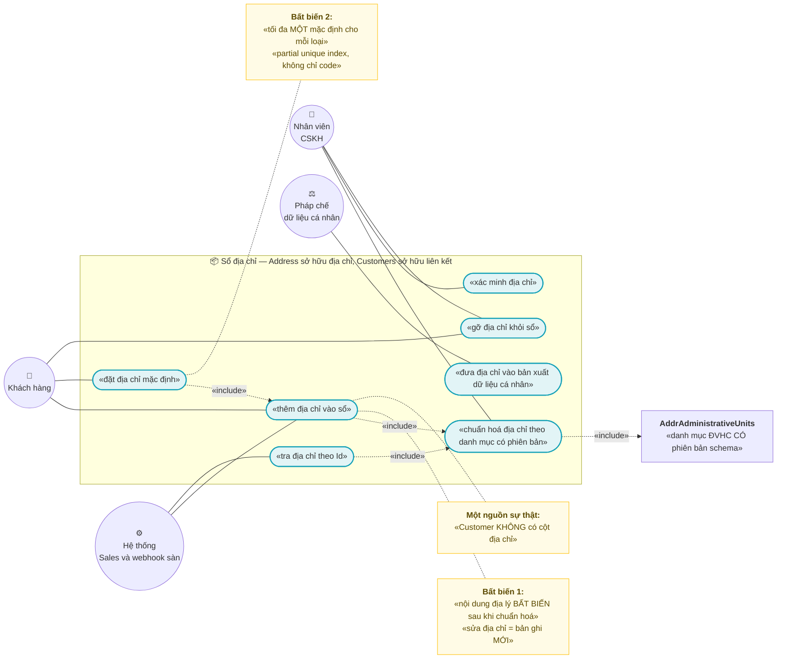
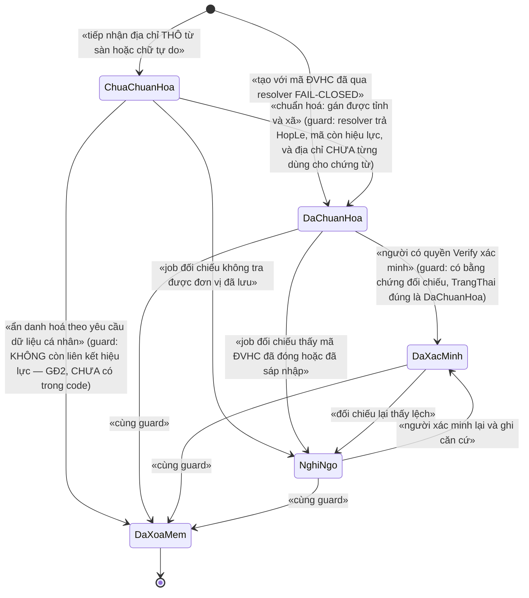
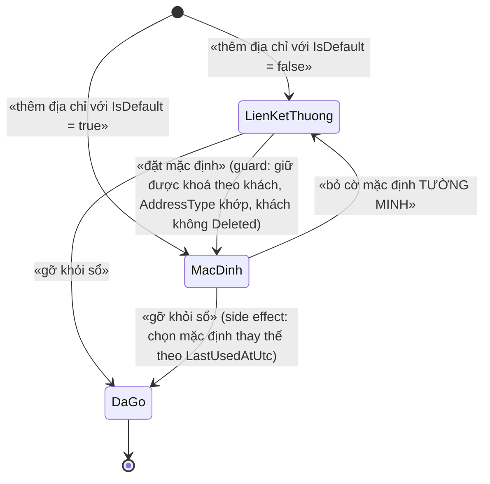
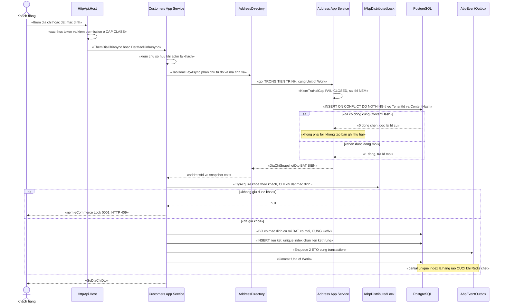

# `ADDR-004` — Sổ địa chỉ khách: entity `Address` (AddressHub) + `CustomerAddressLink`

| Thuộc tính | Nội dung |
|---|---|
| **Mã** | `ADDR-004` |
| **Module** | **AddressHub** — thư mục **thật** trong repo là `modules/Address/` (namespace `eCommerce.Address`) ⇒ sở hữu entity `Address` (bảng `AddrAddresses`). **Customers** (`modules/Customers/`) sở hữu bảng liên kết `CustomerAddressLink` (bảng `CusAddressLinks`). ⚠️ `modules/AddressHub/` **không tồn tại** — tên trong tài liệu cũ (`implementation-plan.md:128`, `addr-003` ADR-09) là **tên kế hoạch**, không phải tên thư mục thật. |
| **Giai đoạn** | **GĐ0** (tài liệu + entity `Address`) → **GĐ1** (bảng liên kết, khi module `Customers` đã có). Căn cứ: `docs/implementation-plan.md:396` xếp `ADDR-004` vào khối **GĐ0 — Pháp lý**; `docs/implementation-plan.md:181` xếp `CustomerAddressLink` vào `Customers` (GĐ1). |
| **Ưu tiên** | **Must have** — 🚨 **nợ CHẶN số 1** của dự án: `docs/handover/BAN-GIAO-GD1-2026-10-17.md:73` (*"entity `Address` KHÔNG TỒN TẠI"*) và `:216` (việc #1 *"Quyết định về sổ địa chỉ"*). |
| **Trạng thái** | 🟢 **`Approved`** — duyệt **17/10/2026** · 🚧 **0 dòng code** (code là việc **`S1`/`S2`** của `docs/gd1-coding-sessions.md`) · ✅ **10/10 câu hỏi mở đã chốt** (§15.1) |
| **Người viết / người review** | agent (phiên 17/10/2026) / ✅ **chủ dự án (duyệt 17/10/2026)** — phê duyệt kèm 10 quyết định ở §15.1 |
| **Phiên bản / ngày** | **v1.0 — 17/10/2026** (duyệt + chốt Q1…Q10; trước: v0.1) |
| **Tài liệu liên quan** | `ADDR-001` (tra cứu ĐVHC 2 cấp/3 cấp — `docs/features/address/addr-001-tra-cuu-don-vi-hanh-chinh-2-cap.md`) · `ADDR-002` (mã địa chỉ theo hãng vận chuyển — `docs/features/address/addr-002-dong-bo-ma-dia-chi-theo-hang-van-chuyen.md`) · `ADDR-003` (chuẩn hoá 3 cấp ↔ 2 cấp — `docs/features/address/addr-003-chuan-hoa-dia-chi-3-cap-2-cap.md`) · `CUS-001` (hồ sơ khách — `docs/features/customers/cus-001-ho-so-khach-hang-so-dia-chi.md`) · `SAL-002` (checkout — `docs/features/sales/sal-002-checkout-va-dat-hang.md`) · **`XC-002`** (outbox/inbox + chống trùng) · **`XC-003`** (khoá phân tán) · **`XC-004`** (xác thực/phân quyền/tenant) · **`XC-005`** (observability) · `docs/implementation-plan.md` §6.1, §7.0, §7.1, Phụ lục A.3 · `docs/structure-and-techstack.md` · `docs/design-doc-guidelines.md` §5 |

> 📌 **Quy ước mã trong tài liệu này:** `ADR-nn` (quyết định) · `BR-ADDR-004-0nn` (quy tắc nghiệp vụ) ·
> `NFR-ADDR-004-0n` (phi chức năng) · `TC-nn` (test case) · `F-n` (sai lệch phát hiện từ **code thật**).
> 🔎 **Giới hạn:** mọi khẳng định về code đều có `đường/dẫn:dòng` đã đọc. Điều **chưa có trong code** ghi rõ
> *"chưa có trong code — kế hoạch GĐx"*; điều **chưa đo được** ghi *"chưa kiểm chứng"*.

---

## 0. Tóm tắt & quyết định thiết kế

**Tóm tắt:** `ADDR-004` định nghĩa **sổ địa chỉ của khách** trên một **nguồn sự thật duy nhất về địa chỉ**:
entity `Address` (bảng `AddrAddresses`) **thuộc module `Address`**, còn module `Customers` chỉ giữ bảng
**liên kết** `CustomerAddressLink` (`CusAddressLinks` — nhãn, loại địa chỉ, cờ mặc định, lần dùng gần nhất).
Tài liệu **chốt lại** một mâu thuẫn có thật giữa ba tài liệu (`implementation-plan` §6.1 nói `AddressHub`
**không** có `Address`; §7.1 lại xếp `Address` vào `Customers`; `cus-001` **ADR-01** chốt `Address` do
`AddressHub` sở hữu) và biến quyết định đó thành **ràng buộc kỹ thuật kiểm được**: `Customer` **0 cột địa chỉ**,
`Address` **không** có khoá ngoại từ module khác, và **hai** bất biến được bảo vệ **ở tầng DB** — *"một nội dung
địa lý ⇒ một bản ghi `Address` trong tenant"* và *"tối đa MỘT địa chỉ mặc định cho mỗi `(CustomerId, AddressType)`"*.

**Vì sao phải viết tài liệu này trước khi code — ba mâu thuẫn đã đọc được trong repo, không phải suy đoán:**

| # | Mâu thuẫn (có bằng chứng) | Hệ quả nếu không chốt trước khi code |
|---|---|---|
| 1 | `docs/implementation-plan.md:128` liệt kê entity AddressHub là `Province`, `Ward`, `District`, `AddressLevelPolicy`, `CarrierAddressCode` — **KHÔNG có `Address`**. Nhưng `:181` lại ghi module `Customers` có `Address`(sổ địa chỉ). Còn `cus-001` **ADR-01** (`docs/features/customers/cus-001-ho-so-khach-hang-so-dia-chi.md:55`) chốt **`Address` do `AddressHub` sở hữu**, `Customers` giữ **`CustomerAddressLink`**. | Ba nguồn nói ba kiểu ⇒ người code đầu tiên sẽ đặt `Address` vào `Customers` (đúng câu chữ §7.1) ⇒ **đúng anti-pattern "hai mô hình địa chỉ song song"** đã bị ghi nhận (`docs/business-modules-proposal.md:259`). |
| 2 | `docs/implementation-plan.md:164` (§7.0 việc #1) và `addr-003` **ADR-08** (`.../addr-003-chuan-hoa-dia-chi-3-cap-2-cap.md:69`) đều đặt **`Address` là value object ở `eCommerce.Kernel`**. Nhưng `shared/eCommerce.Kernel/` **hiện có 12 tệp và KHÔNG có `Address`** (đã liệt kê: chỉ `Money/`, `Observability/`, `Locking/`, `Data/`, `Events/`). | Nếu value object `Address` ra đời sau ⇒ **hai kiểu `Address`** trong cùng giải pháp, **trùng tên**, khác ngữ nghĩa ⇒ lỗi *"import sai namespace"* vô hình. |
| 3 | `cus-001` §5.2 (`:354-366`) mô tả `CusAddressLinks` **trỏ tới `Address` của `AddressHub`** — nhưng `Address` đó **chưa từng tồn tại**: `git log --all` xác nhận (`docs/handover/BAN-GIAO-GD1-2026-10-17.md:73`), và DbContext **không** có `DbSet` nào tên `Address` (`src/eCommerce.EntityFrameworkCore/eCommerceDbContext.cs:174,177` chỉ có `AdministrativeUnits`, `CarrierAddressMappings`). | `CustomerAddressLink.AddressId` là **tham chiếu treo** ⇒ sổ địa chỉ **không dựng được**; và **bản xuất dữ liệu cá nhân** (`cus-001` §20.7 #3) **thiếu hẳn** *"giao tới đâu"*. |

**Phạm vi:**
- ✅ Entity `Address` (`AddrAddresses`) **thuộc module `Address`**: mã ĐVHC có **phiên bản schema**, phần chữ tự do, **hash nội dung**, trạng thái chuẩn hoá/xác minh, **bất biến nội dung**.
- ✅ Bảng liên kết `CustomerAddressLink` (`CusAddressLinks`) **thuộc module `Customers`**: nhãn, `AddressType`, `IsDefault`, `LastUsedAtUtc`, **xoá mềm + append-only**.
- ✅ **Hai bất biến ở tầng DB**: `(TenantId, ContentHash)` duy nhất; `(TenantId, CustomerId, AddressType)` **một mặc định** bằng **partial unique index**, cả hai có `NULLS NOT DISTINCT` **viết bằng SQL thô** trong migration.
- ✅ Hợp đồng `.Contracts` (`IAddressDirectory`) để module khác **đọc snapshot** — **cấm** đọc DB của module khác.
- ✅ Dung hoà **2 cấp mới ↔ 3 cấp cũ** (tham chiếu `ADDR-003`), quy tắc **snapshot text** cho chứng từ.
- ✅ ETO `AddressChangedEto` (+ `CustomerDefaultAddressChangedEto` phía `Customers`) và **cách chống trùng**.
- ✅ Hợp đồng API, mã lỗi, phân quyền `eCommerce.Addresses.*`, migration/seed/rollback, NFR, **24 test case**.
- ✅ **Số unique index tăng 48 → 51** và chỉ rõ phải sửa `PostgreSqlSchemaTests` ở đâu.

**Không nằm trong phạm vi:**
- ❌ **Danh mục ĐVHC, tra cứu tỉnh/xã, xác minh 2 cấp** — đã có trong `ADDR-001` **và đã có code** (`modules/Address/eCommerce.Address.Domain/AdministrativeUnit.cs`, `AdministrativeUnitResolver.cs`).
- ❌ **Mã địa chỉ theo hãng vận chuyển** — `ADDR-002`, **đã có code** (`modules/Address/eCommerce.Address.Domain/Carrier/CarrierAddressMapping.cs`).
- ❌ **Thuật toán convert 3 cấp ↔ 2 cấp, bảng ánh xạ `AddrUnitMappings`** — `ADDR-003` (**chưa có trong code**). `ADDR-004` **chỉ tiêu thụ** kết quả.
- ❌ **Snapshot địa chỉ trên đơn hàng / vận đơn / hoá đơn** — thuộc `SAL-002`/`SHP-001`/`EINV-001`. `ADDR-004` **cung cấp** `DiaChiSnapshotDto` bất biến để các module đó lưu; **không** tự thêm cột vào `Order`.
- ❌ **UI storefront/admin** — thuộc `WEB-*`; tài liệu chỉ chốt **mapping dữ liệu** (§10).
- ❌ **Xoá / ẩn danh hoá `Address`** theo yêu cầu dữ liệu cá nhân — **nợ GĐ2** (ADR-11), chỉ nêu thiết kế khung.
- ❌ **Địa chỉ ngoài Việt Nam** — phụ thuộc `ADDR-003` **Q3** (`.../addr-003-...md:961`), còn `Open`.

### 0.1 Quyết định thiết kế (ADR ngắn)

| # | Quyết định | Phương án đã cân nhắc | Lý do chọn | Hệ quả |
|---|---|---|---|---|
| **ADR-01** | 🚨 **`Address` do `AddressHub` (thư mục `modules/Address`) sở hữu**; `Customers` **chỉ** giữ `CustomerAddressLink` | (a) `Address` thuộc `Customers` — **đúng câu chữ** `implementation-plan.md:181` · (b) `Address` ở `AddressHub`, link ở `Customers` — **đúng `cus-001` ADR-01** · (c) cả hai nơi đều có địa chỉ | (a) dựng lại **đúng anti-pattern** *"hai mô hình địa chỉ song song"* (`docs/business-modules-proposal.md:259`) và khiến `Sales`/`EInvoice` phải join bảng của `Customers`; (c) là **hai nguồn sự thật**; (b) là **nguồn duy nhất**, và **chính `implementation-plan` §7.1 đã ghi** *"sổ địa chỉ (dùng AddressHub)"* ngay trong ô API ⇒ câu chữ §7.1 **tự nó** đã nghiêng về (b) | 📌 **Phải sửa `docs/implementation-plan.md:181`** (xem §15.3 #2). `Address` **có** `DbSet` mới nhưng **không** nằm trong `Customer`; `Customer` **0 cột địa chỉ**, có test reflection chặn (`cus-001` **TC-14**, §14 `TC-22`) |
| **ADR-02** | **`Address` là ENTITY có bảng, KHÔNG phải value object ở `eCommerce.Kernel`** | (a) value object `Address` ở Kernel — `implementation-plan.md:164` + `addr-003` ADR-08 · (b) entity ở module `Address` | `Kernel` **không mang EF** (`shared/eCommerce.Kernel/*.csproj` không có `EntityFrameworkCore`) ⇒ value object **không** có `Id` bền, **không** có bảng ⇒ **không** thể là bên được `CustomerAddressLink.AddressId` trỏ tới. Và `Address` **cần** `Id` ổn định vì `Order`/`EInvoice`/`Shipment` sẽ tham chiếu nó | 📌 **Phải sửa `implementation-plan.md:164`** và **ADR-08 của `addr-003`** (xem §15.3 #3, #7). Trong code: **cấm** tạo type tên `Address` thứ hai |
| **ADR-03** | **`Address` = ĐỊA CHỈ VẬT LÝ, KHÔNG chứa PII người nhận** (không `RecipientName`, không `RecipientPhone`) | (a) mỗi khách một `Address` riêng kèm tên/SĐT người nhận · (b) `Address` dùng chung theo nội dung | (b) cho phép **khử trùng lặp thật** (100 khách cùng một toà nhà ⇒ **1** bản ghi), và **giảm** khối lượng PII phải bảo vệ theo Luật **91/2025/QH15**; tên/SĐT người nhận đã có ở `Customer.Name`/`Customer.Phone` (`modules/Customers/eCommerce.Customers.Domain/Customer.cs:41,44,47`) và **phải** nằm trong snapshot của đơn (`SAL-002`), không phải trong danh mục địa chỉ | ⚠️ Hệ quả **phải nói rõ**: *"giao cho người khác tại cùng địa chỉ"* **chưa** làm được ⇒ **Q2** §15.1. Nếu BA cần ⇒ thêm cột vào **bảng liên kết** (không vào `Address`), và **khử trùng lặp vẫn giữ nguyên** |
| **ADR-04** | **Chống trùng `Address` bằng KHOÁ TỰ NHIÊN theo nội dung** (`ContentHash`), **không** dùng header `Idempotency-Key` | (a) client gửi `Idempotency-Key` như `POST /api/app/customers` · (b) unique `(TenantId, ContentHash)` + `INSERT … ON CONFLICT DO NOTHING` rồi đọc lại | (a) **không** giải được bài toán thật: cùng một địa chỉ do **hai đường khác nhau** tạo (khách tự nhập + webhook sàn) sẽ có **hai khoá khác nhau** ⇒ vẫn hai bản ghi; (b) khoá **sinh từ dữ liệu nghiệp vụ** — đúng tinh thần `XC-002` **BR-007** — và **ổn định vĩnh viễn** vì nó là nội dung | Hàm băm + canonical hoá **phải** được đặc tả (§5.2) và **có test** (`TC-02`). ⚠️ Đổi thuật toán canonical hoá sau này ⇒ **hash đổi** ⇒ phải có migration tính lại; ghi nhận ở §15.1 **Q5** |
| **ADR-05** | 🔒 **Nội dung địa lý BẤT BIẾN sau khi đã chuẩn hoá**; sửa địa chỉ = **bản ghi `Address` MỚI** | (a) cho `UPDATE` nội dung tại chỗ · (b) bất biến + tạo mới | (a) làm **đổi ngầm** địa chỉ của đơn **đã giao** và của hoá đơn **đã phát hành** — đúng loại lỗi không thể phát hiện sau khi hàng đã đi; (b) là hệ quả trực tiếp của nguyên tắc snapshot: *thay đổi danh mục không làm đổi chứng từ cũ* | Địa chỉ sai ⇒ `Address` mới + liên kết mới + liên kết cũ `IsDeleted = true`. Người dùng **thấy** thông báo *"đơn cũ giữ nguyên"* (§10) |
| **ADR-06** | 🚨 **Bất biến "một mặc định cho mỗi `(CustomerId, AddressType)`" là RÀNG BUỘC DB**, không chỉ kiểm trong code | (a) chỉ kiểm trong domain service · (b) **partial unique index** | Đúng `XC-003` **D2**: *"nếu bỏ khoá đi, DB có chặn không?"*. Redis đang **fail-open** (`src/eCommerce.HttpApi.Host/eCommerceHttpApiHostModule.cs:141` — `AbortOnConnectFail = false`) ⇒ chỉ dựa vào khoá thì **hai địa chỉ cùng mặc định**, sai **âm thầm** | Đổi mặc định **phải** chạy **bỏ-trước–đặt-sau** trong **MỘT** UoW (§8.2) — nếu đặt trước sẽ `23505` vì PostgreSQL kiểm unique index **ngay từng câu lệnh**, không hoãn (⚠️ **chưa kiểm chứng** trong môi trường này — `TC-06` phải chứng minh) |
| **ADR-07** | **Bảng liên kết APPEND-ONLY + xoá mềm**; gỡ địa chỉ = `IsDeleted = true` | (a) xoá cứng · (b) xoá mềm | Kế thừa `cus-001` **ADR-02** (`.../cus-001-...md:56`): sổ địa chỉ là **chứng từ lịch sử** (*"đơn này giao tới đâu lúc đó"*), và Luật **91/2025/QH15** Điều 4 cho quyền *"yêu cầu xóa"* — nghĩa vụ đó được thoả bằng **xoá mềm + ẩn khỏi truy vấn**, không phá chứng từ | Mọi unique index của bảng link **phải** có filter `NOT "IsDeleted"`; `AddressId`/`AddressType` **cấm** sửa (`eCommerce:Customers:0013`) |
| **ADR-08** | **Tạo project `eCommerce.Address.Application.Contracts`** và đặt `IAddressDirectory` ở đó | (a) `Customers` tham chiếu `eCommerce.Address.Application` (nơi đang có DTO — `modules/Address/eCommerce.Address.Application/AddressDtos.cs`) · (b) project `.Contracts` riêng | (a) là **module → app của module khác** ⇒ kéo theo `Application` (chứa app service) vào đồ thị phụ thuộc ⇒ nguy cơ **vòng**; (b) đúng khuôn **đã có** của `Customers`: `eCommerce.Customers.Application.Contracts` tồn tại tách khỏi `.Application` (xem `modules/Customers/eCommerce.Customers.Application.Contracts/CustomerDtos.cs`), và đúng **ADR-12** của `cus-001` (`:66`) | ➕ 1 project mới + sửa `eCommerce.slnx`; `AddressDtos.cs` **nên** chuyển sang `.Contracts` (⚠️ **chưa có trong code — kế hoạch GĐ0**) |
| **ADR-09** | **Chuẩn hoá FAIL-CLOSED, dùng lại `AdministrativeUnitResolver`**; **không** có đường "đoán" đơn vị hành chính | (a) nếu không tra được thì lưu địa chỉ với mã `null` và vẫn dùng được · (b) **từ chối** tạo hoặc đánh dấu `ChuaChuanHoa` **không dùng được cho vận đơn** | (a) đưa địa chỉ **sai** vào vận đơn và hoá đơn — hàng đã đi thì không sửa được, và **không** có lỗi nào nổi lên; (b) giữ đúng `AdministrativeUnitResolver.cs:11-12` (*"KHÔNG hợp lệ, tuyệt đối không đoán"*) | Trạng thái `ChuaChuanHoa` **là** hàng đợi chuẩn hoá; `ORDER`/`SHIPMENT` **cấm** dùng địa chỉ ở trạng thái này (`eCommerce:Address:0104`, §6.2) |
| **ADR-10** | **Chứng từ in từ snapshot chữ `DiaChiDayDu`**, cấm join danh mục để in lại | (a) in bằng cách join `AddrAdministrativeUnits` · (b) in từ cột snapshot | `AdministrativeUnit.DoiTen` **đổi tên tại chỗ** (`modules/Address/eCommerce.Address.Domain/AdministrativeUnit.cs:138-146`) ⇒ join sẽ làm **hoá đơn cũ đổi địa chỉ** sau khi tỉnh đổi tên. Đó là điều **cấm** với chứng từ | `DiaChiDayDu` **NOT NULL** và **bất biến**; `TenTinh`/`TenXa` **chỉ** dùng cho form/dropdown, **không** dùng để in |
| **ADR-11** | **GĐ1 KHÔNG có API xoá `Address`**; gỡ khỏi sổ = xoá **liên kết** | (a) cho xoá mềm `Address` ngay · (b) hoãn, mở ở GĐ2 | (a) `Address` **dùng chung** giữa nhiều khách (ADR-03) ⇒ xoá nó khi **một** khách yêu cầu xoá sẽ **làm hỏng sổ của người khác**; muốn đúng phải có `IAddressUsageProbe` (do `Customers` cài đặt) — **chưa có trong code** | Trạng thái `DaXoaMem` **có trong mô hình nhưng chưa có đường gọi** (§3.1). Ghi nợ GĐ2; đây **không** phải *"đã xong"* |
| **ADR-12** | **Chấp nhận hiện trạng bảng `AddrAdministrativeUnits` (MỘT bảng, phân cấp bằng `Level`)**, không đổi thành `AddrProvinces`/`AddrWards`/`AddrDistricts` | (a) làm lại theo `addr-001` §5.2 (`.../addr-001-...md:238-317`) · (b) giữ hiện trạng | Code đã chạy và **có test** (`test/eCommerce.IntegrationTests/PostgreSqlSchemaTests.cs:330-364`): `(SchemaVersion, Level, Code)` là khoá, `CHECK ("SchemaVersion" in (1, 2))` (`AddressDbContextModelCreatingExtensions.cs:57-59`). Làm lại theo (a) là **việc của `ADDR-001`**, và `ADDR-004` **không** cần | 📌 `ADDR-001` §5.2/§11 **phải sửa** cho khớp code (§15.3 #9) — nếu không, tài liệu tiếp tục nói về 5 bảng **không tồn tại** |
| **ADR-13** | **Permission thuộc nhóm `eCommerce.Addresses.*`**, không dùng `eCommerce.Customers.ManageAddress` | (a) dùng nhóm `Customers` như `cus-001` §9 đề xuất · (b) nhóm `Addresses` riêng | (a) `cus-001` §9 **không khớp code**: `eCommerceConsts.Permissions.Customers` **chỉ có** `Default` + `Manage` (`src/eCommerce.Domain.Shared/eCommerceConsts.cs:160-167`), **không có** `.View`/`.Block`/`.ManageAddress`; (b) đúng miền nghiệp vụ và **một** nơi cấp quyền cho sổ địa chỉ | Phải khai **CẢ HAI NƠI** (hằng số + `eCommercePermissionDefinitionProvider`) nếu không `BatBienPhanQuyenTests.TC02b` (`test/eCommerce.Tests/Authorization/BatBienPhanQuyenTests.cs:227`) **đỏ** — và production trả `403` cho **mọi** người kể cả admin |
| **ADR-14** | **Giữ tên lớp `Address`** dù trùng tên namespace `eCommerce.Address` | (a) đổi tên lớp (`DiaChi`) · (b) giữ `Address` + dùng alias ở nơi cần | Tên `Address` đã được **ba tài liệu** dùng (`cus-001` ADR-01, `implementation-plan.md:396`, `addr-003`); đổi tên sẽ tạo **lệch từ vựng** giữa tài liệu và code | ⚠️ **Rủi ro thật:** `DbSet` phải viết `DbSet<Address.Address> Addresses` (giống `DbSet<Address.AdministrativeUnit>` ở `eCommerceDbContext.cs:174`); file nào dùng type này **nên** alias `using DiaChi = eCommerce.Address.Address;`. 🚨 **Chưa kiểm chứng**: chưa biên dịch thử type trùng tên namespace ⇒ **việc đầu tiên của PR** là chứng minh bằng build; nếu C# từ chối ⇒ chuyển sang (a) |

> 📌 **Ghi lại cả phương án BỊ LOẠI và lý do** — để 6 tháng sau không ai hỏi lại *"sao không làm cách kia"*.
> 🔑 **Một nguồn sự thật duy nhất sau tài liệu này:** `Address` ∈ `modules/Address` · `CustomerAddressLink` ∈ `modules/Customers` ·
> không có `Address` thứ hai ở `Customers`, không có value object `Address` ở `Kernel`.

---

## 1. Use Case Specification

| Thuộc tính | Nội dung |
|---|---|
| **Use Case ID** | `ADDR-004` |
| **Use Case Name** | Quản lý **sổ địa chỉ** của khách trên **một** nguồn sự thật về địa chỉ |
| **Description** | *"Là hệ thống bán hàng đa kênh, tôi muốn mỗi địa chỉ khách dùng để giao hàng/lập hoá đơn được lưu **một lần** dưới dạng **địa chỉ vật lý đã chuẩn hoá theo danh mục hành chính có phiên bản**, và mỗi khách có một **sổ** gồm các liên kết tới địa chỉ đó với **tối đa một** địa chỉ mặc định cho mỗi loại, để đơn từ mọi kênh giao đúng chỗ, chứng từ cũ **không bị đổi ngầm**, và không tồn tại mô hình địa chỉ thứ hai."* |
| **Actor(s)** | **Khách hàng** (đã xác thực — quản lý sổ **của mình**) · **Nhân viên CSKH** (thêm/chuẩn hoá/gỡ hộ, có permission) · **Người xác minh** (vận hành — đánh dấu `DaXacMinh`) · **Hệ thống** (`Sales` đọc snapshot khi đặt hàng; webhook sàn tạo địa chỉ thô; job đối chiếu danh mục) · **Pháp chế dữ liệu cá nhân** (xuất dữ liệu — đọc sổ) |
| **Priority** | **Must have** |
| **Trigger** | (a) khách thêm địa chỉ giao hàng ở trang tài khoản/checkout; (b) `Sales` đặt đơn cần `addressId`; (c) webhook sàn mang địa chỉ dạng **chữ tự do**; (d) job đối chiếu phát hiện mã ĐVHC đã đóng/đổi tên; (e) người xác minh đánh dấu `DaXacMinh`; (f) yêu cầu **cung cấp dữ liệu cá nhân** (đọc sổ) |
| **Pre-Condition(s)** | • **Tenant hiện tại** (`TenantId` từ `ICurrentTenant`); ⚠️ hệ thống đang chạy **1 tenant** và `TenantId` **có thể `NULL`** ⇒ **mọi** unique index của feature **phải** `NULLS NOT DISTINCT` (`XC-004` **BR-009**, tiền lệ `src/eCommerce.EntityFrameworkCore/Migrations/20261013024226_Fix_NullableTenantId_UniqueIndexes.cs:39-86`).<br>• **`AddrAdministrativeUnits` đã có dữ liệu** cho phiên bản schema tương ứng — ✅ **đã có bảng** (`modules/Address/eCommerce.Address.EntityFrameworkCore/AddressDbContextModelCreatingExtensions.cs:13`); ⚠️ **dữ liệu 3.321 xã chưa kiểm chứng** (`addr-003` **Q2** còn `Open`).<br>• **`Customer` tồn tại và không `Blocked`** khi thêm địa chỉ — `modules/Customers/eCommerce.Customers.Domain/Customer.cs:236` (`DungDuoc`).<br>• **`Customers` đã có `CustomerAddressLink`** — 🚧 **chưa có trong code — kế hoạch GĐ1**.<br>• **`XC-002` (outbox + `IIdempotencyGuard`)** — ✅ **đã có** (`modules/Messaging`, `DbSet<Messaging.Idempotency.IdempotencyRecord>` ở `eCommerceDbContext.cs:165`), dùng cho **consumer** ETO, **không** dùng cho tạo `Address` (ADR-04).<br>• **`ChannelCode`**: chỉ xuất hiện ở **biên vào từ kênh** (webhook sàn) để ghi `NguonTao`; **không** tham gia khoá của `Address` — *một địa chỉ vật lý không thuộc về một kênh*. |
| **Post-Condition(s)** | • Mỗi **nội dung địa lý** trong một tenant có **đúng một** `Address` còn hiệu lực (`(TenantId, ContentHash)` unique).<br>• Mỗi `(TenantId, CustomerId, AddressType)` có **tối đa MỘT** liên kết `IsDefault = true` — **bảo đảm bởi DB**.<br>• `Address` đã `DaChuanHoa` **không** đổi nội dung địa lý nữa; mọi thay đổi ⇒ **bản ghi mới** + liên kết mới.<br>• Không có liên kết nào bị **xoá cứng**; gỡ = `IsDeleted = true` + audit của ABP.<br>• Mọi thay đổi có **audit** và phát **ETO** trong **cùng** transaction.<br>• Log **không** chứa `SoNhaDuong`/`DiaChiDayDu`. |
| **Basic Flow** | 1. **Thêm địa chỉ**: app service kiểm `[Authorize]` cấp class + permission + **chủ sở hữu** (`Customer.IdentityUserId == CurrentUser.Id` khi actor là khách).<br>2. **Gọi `IAddressDirectory.TaoHoacLayAsync`** (in-process, **cùng UoW**) với phần chữ tự do + `TinhCode`/`XaCode` người dùng chọn.<br>3. `AddressHub` chạy **`AdministrativeUnitResolver.KiemTraHaiCap`** (`modules/Address/eCommerce.Address.Domain/AdministrativeUnitResolver.cs:92`) — fail-closed: sai ⇒ **NÉM** (mã `eCommerce:Address:0001/0003/0006`).<br>4. Tính `ContentHash` (§5.2), `INSERT … ON CONFLICT ("TenantId","ContentHash") DO NOTHING` rồi **đọc lại** ⇒ trả `AddressSnapshotDto` **bất biến**.<br>5. Ghi `CustomerAddressLink` (`IsDefault`, `Label`, `AddressType`); nếu `IsDefault = true` ⇒ giành khoá `CustomersConsts.LockKeys.TheoKhach(customerId)` **bao ngoài** UoW.<br>6. **Bỏ cờ mặc định cũ → đặt cờ mới** (đúng thứ tự, cùng transaction — §8.2).<br>7. Ghi **outbox** (`AddressChangedEto`, `CustomerDefaultAddressChangedEto`) + audit, **cùng** transaction.<br>8. Commit, **rồi** nhả khoá (`await using` kết thúc). Ghi metric + log **đã khử PII**. |
| **Alternative Flow** | **A1: `Address` đã tồn tại** (khách thứ hai ở cùng toà nhà) — `ON CONFLICT` ⇒ **0 dòng** chèn ⇒ dùng lại `Id` cũ; **không** phải lỗi, **không** tạo bản ghi thứ hai.<br>**A2: Địa chỉ thô từ sàn không chuẩn hoá được** — tạo `Address` ở `ChuaChuanHoa` (giữ nguyên chữ khách nhập), đưa vào **hàng đợi chuẩn hoá**; ⛔ **không** dùng được để tạo vận đơn (`eCommerce:Address:0104`).<br>**A3: Khách sửa địa chỉ đã dùng cho đơn đã phát hành** — **KHÔNG** sửa; tạo `Address` mới + liên kết mới, liên kết cũ `IsDeleted = true`. UI **phải** báo *"đơn cũ giữ nguyên địa chỉ cũ"* (§10).<br>**A4: Gỡ địa chỉ đang là mặc định** — chọn liên kết còn hiệu lực có `LastUsedAtUtc` **lớn nhất** làm mặc định; **0** liên kết còn lại ⇒ **không** có mặc định (**hợp lệ, không phải lỗi**).<br>**A5: Đặt mặc định khi đã có mặc định khác** — một transaction: bỏ cờ cũ rồi đặt cờ mới (§8.2). |
| **Exception Flow** | **E1:** mã ĐVHC không tồn tại / xã không thuộc tỉnh / mã đã đóng ⇒ **NÉM** `eCommerce:Address:0001/0003/0006` (**fail-closed**, không lưu gì).<br>**E2:** cố `UPDATE` nội dung địa lý của `Address` đã `DaChuanHoa` ⇒ **NÉM** `eCommerce:Address:0102` (ADR-05).<br>**E3:** thêm liên kết trùng (`AddressId` + `AddressType` còn hiệu lực) ⇒ **NÉM** `eCommerce:Customers:0010` kèm `linkId` hiện có.<br>**E4:** cố sửa `AddressId`/`AddressType` của liên kết đã tồn tại ⇒ **NÉM** `eCommerce:Customers:0013`.<br>**E5:** cố "bỏ xoá" liên kết đã gỡ ⇒ **NÉM** `eCommerce:Customers:0014` (muốn dùng lại ⇒ **liên kết mới**).<br>**E6:** vượt trần **20** địa chỉ/khách ⇒ **NÉM** `eCommerce:Customers:0015`.<br>**E7:** không giành được khoá đổi mặc định ⇒ **NÉM** `eCommerce:Lock:0001` (`shared/eCommerce.Kernel/Locking/LockErrorCodes.cs`) — **cấm** bỏ qua im lặng.<br>**E8:** `UPDATE … WHERE "IsDefault" = true` ảnh hưởng **0 dòng** khi lẽ ra phải 1 ⇒ **NÉM** `eCommerce:Customers:0012` (**không** coi là thành công — `XC-002` **BR-008**).<br>**E9:** thao tác lên khách/**địa chỉ** thuộc tenant khác ⇒ **`404`** (**không** `403`) — `XC-004` **BR-008**, không tiết lộ sự tồn tại.<br>**E10:** `Address` bị ẩn (đã xoá mềm) nhưng liên kết còn ⇒ **không** xoá liên kết; hiển thị *"địa chỉ không còn dùng được"* (`CoDungDuoc = false`), **không** phải lỗi. |
| **Business Rules** | • **BR-ADDR-004-001**: `Address` **thuộc `AddressHub`**; `Customer` **0 cột địa chỉ**; `CustomerAddressLink.AddressId` là **tham chiếu MỀM** (`Guid`, **không** khoá ngoại) — `ADR-01`, có test reflection (`TC-22`).<br>• **BR-ADDR-004-002**: `Address` **không** chứa PII người nhận (không họ tên/SĐT người nhận) — `ADR-03`.<br>• **BR-ADDR-004-003**: Nội dung địa lý (`TinhCode`,`XaCode`,`HuyenCode`,`SoNhaDuong`,`DiaChiDayDu`) **bất biến** sau `DaChuanHoa`; vi phạm ⇒ `eCommerce:Address:0102` (`TC-05`).<br>• **BR-ADDR-004-004**: **Chỉ** tạo `Address` qua đường đã **kiểm ĐVHC fail-closed**; hoặc ở `ChuaChuanHoa` và **cấm** dùng cho vận đơn/hoá đơn (`eCommerce:Address:0104`).<br>• **BR-ADDR-004-005**: `(TenantId, ContentHash)` **duy nhất** ⇒ hai lần tạo cùng nội dung trả **cùng** `AddressId` (`TC-02`, `TC-10`).<br>• **BR-ADDR-004-006**: **Tối đa MỘT** `IsDefault = true` cho mỗi `(TenantId, CustomerId, AddressType)` — **DB** là hàng rào cuối (`TC-07`).<br>• **BR-ADDR-004-007**: Đổi mặc định trong **MỘT** UoW theo thứ tự **bỏ-trước–đặt-sau** (`TC-06`).<br>• **BR-ADDR-004-008**: Liên kết **append-only + xoá mềm**; **cấm** sửa `AddressId`/`AddressType`; **cấm** un-delete (`TC-13`, `TC-14`).<br>• **BR-ADDR-004-009**: Gỡ mặc định ⇒ chọn mặc định thay thế theo `LastUsedAtUtc`; **0** còn lại ⇒ **không** mặc định, **không lỗi** (`TC-11`, `TC-12`).<br>• **BR-ADDR-004-010**: Mọi ghi (`Address` + liên kết + outbox + audit) trong **cùng** UoW (`XC-002` **BR-001**).<br>• **BR-ADDR-004-011**: ETO **cấm** chứa `SoNhaDuong`/`DiaChiDayDu`/PII; consumer đọc qua `IAddressDirectory` (`TC-18`).<br>• **BR-ADDR-004-012**: **Mọi** unique index trên entity `IMultiTenant` **phải** `NULLS NOT DISTINCT` **viết bằng SQL thô**; số index **48 → 51** (`NFR-07`, `TC-24`).<br>• **BR-ADDR-004-013**: Chứng từ **in từ snapshot** `DiaChiDayDu`; **cấm** join danh mục để in lại (`TC-19`).<br>• **BR-ADDR-004-014**: Trần **20** địa chỉ/khách; vượt ⇒ `eCommerce:Customers:0015` (`TC-17`).<br>• **BR-ADDR-004-015**: **Mọi** app service có `[Authorize]` **cấp class** + permission **định nghĩa ở cả hai nơi** (hằng số + provider) (`TC-16`).<br>• **BR-ADDR-004-016**: **Cấm** log `SoNhaDuong`/`DiaChiDayDu`; chỉ log `AddressId`, `TrangThai`, **8 ký tự đầu** `ContentHash` (`TC-20`). |
| **Non-Functional Requirement** | • **NFR-ADDR-004-01**: `TaoHoacLayAsync` p95 **< 80 ms** với **100.000** `Address`/tenant (⚠️ **chưa kiểm chứng** — chưa có code).<br>• **NFR-ADDR-004-02**: `GetSoDiaChiAsync` p95 **< 60 ms** với **20** địa chỉ/khách.<br>• **NFR-ADDR-004-03**: thêm **100 lần** cùng nội dung ⇒ **1** dòng `AddrAddresses`, **1** liên kết.<br>• **NFR-ADDR-004-04**: **0** PII (chữ địa chỉ) trong log mức `Information`+.<br>• **NFR-ADDR-004-05**: **100 %** thay đổi `Address`/liên kết có audit trong **< 1 s**.<br>• **NFR-ADDR-004-06**: tenant A **không** đọc/ghi được địa chỉ tenant B — **0** rò rỉ.<br>• **NFR-ADDR-004-07**: **51/51** unique index có `NULLS NOT DISTINCT`; **0** index của 2 bảng mới thiếu filter `NOT "IsDeleted"` khi cần.<br>• **NFR-ADDR-004-08**: Bất biến "một mặc định" **vẫn đúng khi Redis chết** (dừng Redis + 2 luồng).<br>• **NFR-ADDR-004-09**: Bản xuất dữ liệu cá nhân **gồm** sổ địa chỉ (đóng **một phần** nợ `cus-001` §20.7 #3, `.../cus-001-...md:1217`). |

---

## 2. Sơ đồ Use Case



### Chú giải

| Ký hiệu | Ý nghĩa |
|---|---|
| ⭕ Xanh lá | Actor (người dùng + hệ thống + vai trò pháp chế) |
| 🟦 Bầu dục xanh dương | Use Case |
| 🟨 Khung vàng | Note (bất biến / ràng buộc) |
| `───` | Liên kết Actor ↔ Use Case |
| `-.«include».->` | Quan hệ bao hàm |
| `DVHC` (chữ nhật, không tô) | Bảng danh mục **đã có trong code** — `AddrAdministrativeUnits` |

---

## 3. Sơ đồ trạng thái (state machine)

> ⚠️ Feature này có **HAI** vòng đời độc lập (địa chỉ ở `AddressHub`, liên kết ở `Customers`) nên dùng **hai**
> sơ đồ. Không gộp được: gộp sẽ che mất nhánh `ChuaChuanHoa → DaChuanHoa` — đúng nhánh dễ sai nhất.

### 3.1 Vòng đời `Address` (tạo / chuẩn hoá / xác minh / xoá mềm)



**Bảng chuyển trạng thái & guard — mọi chuyển **SAI** đều **NÉM LỖI**, không im lặng:**

| # | Từ → Sang | Guard (điều kiện cho phép) | Ai được phép chuyển | Side effect kèm theo | Nếu guard sai thì? |
|---|---|---|---|---|---|
| 1 | `[*]` → `ChuaChuanHoa` | Có `DiaChiDayDu` **không rỗng**; `NguonTao ∈ {San, Import, Web}`; **chưa** khử trùng lặp được (không có mã ĐVHC) | Hệ thống (webhook sàn, import) · khách (nhập tự do **chỉ** khi tenant bật `ChoNhapDiaChiTho`) | `ContentHash = r|…` (§5.2), outbox `AddressChangedEto` | **NÉM** `eCommerce:Address:0105` (thiếu nội dung) |
| 2 | `[*]` → `DaChuanHoa` | `KiemTraHaiCap` trả `HopLe = true` **và** `TinhCode`/`XaCode` **còn hiệu lực** (`IsActive`) | Khách · CSKH · hệ thống (đường chuẩn) | `NormalizedAtUtc`, `ContentHash = n{ver}|…`, outbox | **NÉM** `eCommerce:Address:0001/0003/0006` — **fail-closed**, **0 dòng** ghi |
| 3 | `ChuaChuanHoa` → `DaChuanHoa` | #2 **và** địa chỉ **chưa** được tham chiếu bởi chứng từ nào (chỉ được sửa **một lần**) | CSKH · người vận hành | Tính lại `ContentHash`; ⚠️ **recompute hash trong CÙNG transaction**; outbox | **NÉM** `eCommerce:Address:0102` nếu vi phạm (đã có chứng từ) |
| 4 | `DaChuanHoa` → `DaXacMinh` | Có **căn cứ** (`canCu` không rỗng) **và** người gọi có `eCommerce.Addresses.Verify` | Người xác minh · hệ thống (job đối chiếu, chỉ khi có khoá `Address:verify:{id}` — ⚠️ **chưa có trong code — kế hoạch GĐ2**) | `XacMinhLucUtc`, audit, outbox | **NÉM** `eCommerce:Address:0103` (`eCommerce:Address:0106` nếu thiếu căn cứ) |
| 5 | `DaChuanHoa`/`DaXacMinh` → `NghiNgo` | Job tìm thấy **mã ĐVHC đã đóng** (`IsActive = false`) hoặc tên đã đổi | Hệ thống (job) | Giữ nguyên nội dung; đưa vào hàng đợi vận hành; metric `address_nghi_ngo_total` | **NÉM** `eCommerce:Address:0103` nếu trạng thái nguồn không hợp lệ |
| 6 | `NghiNgo` → `DaXacMinh` | Như #4 | Người xác minh | outbox | **NÉM** `eCommerce:Address:0103` |
| 7 | `{4 trạng thái}` → `DaXoaMem` | **Không còn liên kết hiệu lực** (kiểm qua `IAddressUsageProbe` — **chưa có trong code**) **và** có quyết định của pháp chế | 🚧 **CHƯA CÓ ĐƯỜNG GỌI** (ADR-11, GĐ2) | `IsDeleted = true` + audit; **giữ** dòng để không phá `ContentHash` lịch sử | **NÉM** `eCommerce:Address:0107` (còn liên kết) |
| 8 | `DaXoaMem` → bất kỳ | **KHÔNG** có guard nào | — | — | **Trạng thái HẤP THỤ**: **NÉM** `eCommerce:Address:0103`. Muốn dùng lại ⇒ **bản ghi mới** |
| 9 | `DaChuanHoa → ChuaChuanHoa` (hạ cấp) | **KHÔNG** cho phép | — | — | **NÉM** `eCommerce:Address:0103` — hạ cấp nghĩa là *"đã từng biết đơn vị hành chính rồi lại thôi"*: không có ca nghiệp vụ thật |

> ⚠️ **Quy tắc bất di bất dịch #11** (`docs/structure-and-techstack.md:143`): guard sai **phải NÉM LỖI**, không im lặng.
> **Trạng thái hấp thụ:** `DaXoaMem`. `NghiNgo` **không** hấp thụ vì còn đường xác minh lại **có kiểm soát**.
> 🔒 **"Chuẩn hoá" KHÔNG phải trạng thái thứ hai của cùng nội dung** — nó là **bước** biến `ChuaChuanHoa` thành
> `DaChuanHoa`, và chỉ được chạy **một lần** trên mỗi bản ghi (sau đó nội dung bất biến — ADR-05).

### 3.2 Vòng đời `CustomerAddressLink` (sổ địa chỉ)



| # | Từ → Sang | Guard | Side effect | Nếu guard sai thì? |
|---|---|---|---|---|
| 1 | `[*]` → `LienKetThuong` | `Address` tồn tại **và** `CoDungDuoc = true`; `Label ≤ 128`; **chưa** có liên kết trùng `(AddressId, AddressType)` còn hiệu lực; chưa vượt trần **20** | Ghi liên kết (`IsDefault = false`, `IsDeleted = false`) + audit | **NÉM** `eCommerce:Customers:0016` (địa chỉ không dùng được) / `0010` (trùng) / `0015` (quá trần) |
| 2 | `[*]` → `MacDinh` | Như #1 **và** khách `DungDuoc` | Liên kết `IsDefault = true`; nếu đã có mặc định khác cùng loại ⇒ **A5** (bỏ trước, đặt sau) | **NÉM** `eCommerce:Customers:0012` (khách `Blocked`/`Deleted`) |
| 3 | `LienKetThuong` → `MacDinh` | Giành được `CustomersConsts.LockKeys.TheoKhach(customerId)`; `AddressType` khớp; khách `Status ≠ Deleted` | Trong **cùng** UoW: bỏ cờ mặc định cũ **cùng `AddressType`** → đặt cờ cho liên kết này → outbox `CustomerDefaultAddressChangedEto` + audit | Không giành được khoá ⇒ **NÉM** `eCommerce:Lock:0001`; **0 dòng** ở câu `UPDATE` bỏ cờ ⇒ **NÉM** `eCommerce:Customers:0012` |
| 4 | `MacDinh` → `LienKetThuong` | Bỏ cờ **tường minh** | Audit | **NÉM** `eCommerce:Customers:0012` nếu liên kết **không** ở `MacDinh` (**cấm** no-op im lặng) |
| 5 | `bất kỳ (còn hiệu lực)` → `DaGo` | Người gọi có quyền trên sổ của khách đó | `IsDeleted = true` (+ `DeletionTime`, `DeleterId` do ABP đặt); nếu là `MacDinh` ⇒ **A4** | — (thao tác hợp lệ); nếu **đã** `DaGo` ⇒ **NÉM** `eCommerce:Customers:0011` |
| 6 | `DaGo` → `bất kỳ` | **KHÔNG** cho phép un-delete | — | **NÉM** `eCommerce:Customers:0014`. Dùng lại địa chỉ ⇒ **liên kết mới** (được phép) |
| 7 | `sửa AddressId/AddressType` của liên kết đã tồn tại | **KHÔNG** cho phép | — | **NÉM** `eCommerce:Customers:0013` (**BR-ADDR-004-008**) |

> 🔒 **Cơ chế DB cho "chỉ MỘT mặc định"** — hai lớp, lớp thứ hai **không** phụ thuộc Redis:
> ```sql
> CREATE UNIQUE INDEX "IX_CusAddressLinks_TenantId_CustomerId_AddressType_MacDinh"
>     ON "CusAddressLinks" ("TenantId", "CustomerId", "AddressType") NULLS NOT DISTINCT
>     WHERE "IsDefault" AND NOT "IsDeleted";
> ```
> **Cách đổi mặc định trong MỘT transaction** (đúng thứ tự — **bắt buộc**):
> ```sql
> -- BƯỚC 1: BỎ cờ mặc định cũ (cùng loại)
> UPDATE "CusAddressLinks"
>    SET "IsDefault" = false
>  WHERE "TenantId" IS NOT DISTINCT FROM @tenantId
>    AND "CustomerId" = @customerId AND "AddressType" = @addressType
>    AND "IsDefault" AND NOT "IsDeleted";
> -- BƯỚC 2: ĐẶT cờ mặc định mới
> UPDATE "CusAddressLinks" SET "IsDefault" = true
>  WHERE "Id" = @linkId AND NOT "IsDeleted";
> ```
> 🚨 **Đặt trước là `23505`** vì PostgreSQL kiểm unique index **ngay tại từng câu lệnh**; index **partial**
> thì **không** thể gắn với `UNIQUE CONSTRAINT` ⇒ **không** thể `DEFERRABLE` ⇒ **không** có cách "hoãn tới
> cuối transaction". ⚠️ **Chưa kiểm chứng** trong môi trường này — `TC-06` **phải** chứng minh bằng chạy thật
> (chèn 2 mặc định trong 1 transaction theo thứ tự ngược ⇒ mong đợi `23505`).

---

## 4. Sequence Diagram & luồng dữ liệu

### 4.1 Sequence — thêm địa chỉ (khử trùng lặp) + đặt mặc định (một transaction)



### 4.2 Quy tắc trình tự **BẮT BUỘC** (đọc kèm §4.1)

| # | Bước | Bắt buộc vì | Nếu đảo thứ tự thì sao |
|---|---|---|---|
| 1 | **Xác thực + permission** (cấp class) | `XC-004` **D3/BR-001** — ABP **không** tự bảo vệ app service | Endpoint hở; `BatBienPhanQuyenTests.TC01` (`test/eCommerce.Tests/Authorization/BatBienPhanQuyenTests.cs:194`) đỏ |
| 2 | **Kiểm chủ sở hữu** (`Customer.IdentityUserId == CurrentUser.Id`) | `XC-004` **BR-008** | Khách A sửa sổ của khách B — **lỗ hổng dữ liệu cá nhân**; trả `404` để không tiết lộ |
| 3 | **Chuẩn hoá fail-closed** *trước* khi ghi bất cứ thứ gì | ADR-09 | Ghi liên kết trước rồi mới phát hiện mã sai ⇒ **liên kết treo**; rollback phức tạp |
| 4 | **`INSERT … ON CONFLICT DO NOTHING` + đọc lại** (không `SELECT` rồi `INSERT`) | ADR-04 | Hai luồng cùng tạo ⇒ `23505` **không** bắt ⇒ 500; hoặc `SELECT`-then-`INSERT` ⇒ **hai** bản ghi (đúng lỗi `XC-002` **D7**) |
| 5 | **Giành khoá theo khách** — **chỉ** khi đặt mặc định | `XC-003` **D6** (khoá **không** reentrant ⇒ **cấm** acquire lồng) | Hai luồng cùng đặt mặc định ⇒ phụ thuộc hoàn toàn vào DB (vẫn đúng nhưng người dùng thấy `409` khó hiểu) |
| 6 | **Bỏ cờ cũ → đặt cờ mới**, **cùng** UoW | BR-ADDR-004-007 | Đặt trước ⇒ `23505`; khác transaction ⇒ có khoảng thời gian **0 mặc định** (UI hiện sai) hoặc **2 mặc định** (nếu index hỏng) |
| 7 | **Ghi liên kết + outbox + audit** cùng transaction | BR-ADDR-004-010, `XC-002` **BR-001** | Dual-write ⇒ mất sự kiện hoặc dữ liệu lệch |
| 8 | **Commit rồi nhả khoá** (`await using` kết thúc) | `XC-003` §12 — phạm vi khoá **bao ngoài** UoW | Nhả khoá trước commit ⇒ luồng khác đọc dữ liệu **cũ** |
| 9 | **Log đã khử PII** | BR-ADDR-004-016 | Chữ địa chỉ vào log ⇒ khó xoá khi có yêu cầu dữ liệu cá nhân |

---

## 5. Mô hình dữ liệu

### 5.1 Quan hệ (mô tả bằng bảng — **không** dùng sơ đồ Mermaid thứ năm)

| Từ | Tới | Loại | Cơ chế | Ghi chú |
|---|---|---|---|---|
| `CusCustomers` | `CusAddressLinks` | 1 : n | **FK cứng** `CustomerId` (cùng module) | `Customer` **0 cột địa chỉ** (BR-ADDR-004-001) |
| `CusAddressLinks` | `AddrAddresses` | n : 1 | 🚨 **Tham chiếu MỀM `Guid`, KHÔNG FK** | Khác module ⇒ quy ước #3 (`docs/structure-and-techstack.md:135`) + `cus-001` **ADR-12**. Tiền lệ: `CarrierAddressMapping.OurAdministrativeUnitId` (`.../Carrier/CarrierAddressMapping.cs:99`) — **không** FK ra ngoài module |
| `AddrAddresses` | `AddrAdministrativeUnits` | n : 2 (hoặc 3) | 🚨 **Tham chiếu MỀM bằng `(SchemaVersion, Level, Code)`, KHÔNG FK** | Vì khoá tự nhiên của danh mục là **bộ ba**, không phải `Id` (`.../AdministrativeUnit.cs:13-14`); dùng `Guid` sẽ mất ngữ nghĩa *"mã + phiên bản"* |
| `AddrAddresses` | `AddrCarrierMappings` | — | **Không** có quan hệ trực tiếp | `ADDR-002` ánh xạ **đơn vị hành chính**, không ánh xạ địa chỉ khách ⇒ **cấm** thêm FK để không kéo `ADDR-002` vào vòng đời sổ địa chỉ |

> 📌 **Vì sao tham chiếu mềm mà không FK** (ghi để 6 tháng sau không ai "sửa cho đẹp"):
> ① `AddrAddresses` thuộc module `Address`, `CusAddressLinks` thuộc module `Customers` — FK cứng sẽ **buộc**
> hai module phải migrate cùng nhau và **chặn** việc tách service sau này; ② `cus-001` **ADR-12** **cấm**
> module khác đọc DB của `Customers`; ③ đã có tiền lệ trong repo (`CarrierAddressMapping.OurAdministrativeUnitId`).
> ⚠️ **Cái giá phải trả:** DB **không** chặn được liên kết trỏ tới `AddressId` không tồn tại ⇒ **bù** bằng
> ① `IAddressDirectory.TimTheoIdAsync` trả `null` ⇒ hiển thị `CoDungDuoc = false` (E10), ② `TC-13` kiểm
> append-only, ③ index `IX_CusAddressLinks_TenantId_AddressId` để **đếm được** liên kết treo khi cần.

### 5.2 Bảng & cột (Data Dictionary)

**Bảng `AddrAddresses`** — *địa chỉ VẬT LÝ, dùng chung trong tenant* (🚧 **chưa có trong code — kế hoạch GĐ0**).
Tên cột theo quy ước **sẵn có của module `Address`** (tiếng Việt: `AdministrativeUnit.Code/Name/IsActive`).

| Cột | Kiểu | Null? | Nguồn / ý nghĩa | Ghi chú |
|---|---|---|---|---|
| `Id` | `uuid` | ✖ | khoá chính | `FullAuditedAggregateRoot<Guid>` — cùng khuôn `AdministrativeUnit` (`.../AdministrativeUnit.cs:18`) |
| `TenantId` | `uuid` | ✔ | tenant sở hữu | `IMultiTenant`; `NULL` khi chạy 1 tenant ⇒ **mọi** unique index phải `NULLS NOT DISTINCT` |
| `TrangThai` | `int` | ✖ | `ChuaChuanHoa=0` · `DaChuanHoa=1` · `DaXacMinh=2` · `NghiNgo=3` | §3.1; **lưu số** (CHECK ở dưới) — cùng kiểu `CarrierMappingStatus` (`.../Carrier/CarrierAddressMapping.cs:58-68`) |
| `NguonTao` | `int` | ✖ | `Web=0` · `San=1` · `NhanVien=2` · `Import=3` | để truy vết *"địa chỉ này từ đâu ra"* |
| `SchemaVersion` | `int` | ✖ | **1** = 3 cấp (lịch sử), **2** = 2 cấp (hiện hành) | 🚨 **bắt buộc cùng mọi mã** — `ADDR-003` **ADR-02**/**BR-02**; hằng số có thật: `AdministrativeSchemaVersion.V1/V2` (`.../AdministrativeModels.cs:34-50`) |
| `TinhCode` | `varchar(2)` | ✔ | mã tỉnh/thành (`01`–`99`) | `NULL` ⇔ `TrangThai = 0` (CHECK) |
| `HuyenCode` | `varchar(3)` | ✔ | mã quận/huyện — **CHỈ** `SchemaVersion = 1` | `NULL` ở v2 (CHECK) — đúng quy tắc pháp lý `Luật 72/2025/QH15` |
| `XaCode` | `varchar(5)` | ✔ | mã xã/phường/đặc khu | `NULL` ⇔ `TrangThai = 0` |
| `SoNhaDuong` | `varchar(256)` | ✔ | số nhà, đường, ngõ, thôn… (chữ tự do của người nhập) | **không** chuẩn hoá được ⇒ giữ nguyên văn; `NULL` = địa chỉ chỉ có phần hành chính (hợp lệ) |
| `DiaChiDayDu` | `varchar(512)` | ✖ | **SNAPSHOT CHỮ** để in: `SoNhaDuong, Xa, Huyen, Tinh` (bỏ phần rỗng, nối `", "`) | 🔒 **BẤT BIẾN** sau `DaChuanHoa` (ADR-05, BR-ADDR-004-013); chứng từ in từ **cột này**, không join |
| `ContentHash` | `char(64)` | ✖ | SHA-256 hex của chuỗi canonical (§ bên dưới) | 🚨 **khoá tự nhiên** — ADR-04; **cấm** tự tính ở nơi khác ngoài hàm canonical |
| `NormalizedAtUtc` | `timestamptz` | ✔ | thời điểm **đã** kiểm ĐVHC thành công | `NULL` ⇔ `TrangThai = 0` (CHECK) — **bằng chứng** của fail-closed |
| `XacMinhLucUtc` | `timestamptz` | ✔ | thời điểm xác minh | chỉ có khi `TrangThai = 2` (**không** ràng buộc CHECK để giữ lịch sử khi chuyển `NghiNgo`) |
| `IsDeleted` / `DeletionTime` / `DeleterId` | `bool` / `timestamptz` / `uuid` | — | xoá mềm ABP | 🚧 **chưa có đường gọi** trong GĐ1 (ADR-11) |

**`ContentHash` — đặc tả canonical hoá (phải copy đúng vào code + test)**

```
canonical(đã chuẩn hoá, TrangThai <> 0) = "n" + SchemaVersion + "|" + TinhCode + "|" + (HuyenCode ?? "-")
                                        + "|" + XaCode + "|" + chuan(SoNhaDuong ?? "")
canonical(địa chỉ thô, TrangThai = 0)    = "r|" + chuan(DiaChiDayDu)
chuan(s)  = s.Normalize(FormC).Trim() → gộp mọi khoảng trắng liên tiếp thành 1 dấu cách
            → ToLowerInvariant()
ContentHash = sha256_hex_64(canonical)
```

> 🚨 **Ba điều cấm trong canonical hoá** (mỗi điều là một lỗi *im lặng* đã biết):
> ① **CẤM** bỏ dấu tiếng Việt (`unaccent`): *"Xã Đông Xuân"* và *"Xã Dong Xuan"* là **hai** địa danh có thể
> cùng tồn tại ⇒ gộp sẽ **trộn hai xã khác nhau**. ② **CẤM** dùng `OrdinalIgnoreCase` **không** kèm `Normalize(FormC)`:
> hai chuỗi **nhìn giống hệt** nhưng khác dạng Unicode (dựng sẵn vs tổ hợp) sẽ cho **hai hash khác nhau** ⇒
> khử trùng lặp **hỏng âm thầm**. ③ **CẤM** đưa `TenantId` vào hash — tenant đã nằm trong **khoá index**.

**Bảng `CusAddressLinks`** — *sổ địa chỉ; **APPEND-ONLY + xoá mềm*** (🚧 **chưa có trong code — kế hoạch GĐ1**).
Tên cột theo quy ước **sẵn có của module `Customers`** (tiếng Anh: `Customer.Name/Email/Phone`), và **khớp**
`cus-001` §5.2 (`.../cus-001-...md:354-366`) để **không** sinh nguồn thứ hai.

| Cột | Kiểu | Null? | Ý nghĩa | Ghi chú |
|---|---|---|---|---|
| `Id` | `uuid` | ✖ | khoá chính | |
| `TenantId` | `uuid` | ✔ | tenant | |
| `CustomerId` | `uuid` | ✖ | khách sở hữu | **FK cứng** (cùng module) + `ON DELETE RESTRICT` (xoá khách là **xoá mềm**, không cascade — tiền lệ `FK_CatProductVariants_CatProducts_ProductId`) |
| `AddressId` | `uuid` | ✖ | `Address` của `modules/Address` | 🚨 **tham chiếu MỀM**, **KHÔNG** FK (§5.1) |
| `AddressType` | `int` | ✖ | `Shipping=0` · `Billing=1` | bất biến "một mặc định" áp **theo từng loại** |
| `Label` | `varchar(128)` | ✔ | *"Nhà riêng"*, *"Văn phòng"* | chỉ để hiển thị |
| `IsDefault` | `bool` | ✖ | mặc định cho `AddressType` này | bảo vệ bằng **partial unique index** |
| `LastUsedAtUtc` | `timestamptz` | ✔ | lần dùng gần nhất trên đơn | dùng cho **A4** (chọn mặc định thay thế); ⚠️ cập nhật qua **consumer ETO** `OrderPlacedEto`, **không** qua gọi chéo module |
| `IsDeleted` / `DeletionTime` / `DeleterId` | `bool` / `timestamptz` / `uuid` | — | xoá mềm ABP | gỡ địa chỉ = xoá mềm (BR-ADDR-004-008) |

**Index & ràng buộc** *(phần hay bị bỏ sót nhất — liệt kê hết)*

| Bảng | Loại | Cột / điều kiện | Mục đích |
|---|---|---|---|
| `AddrAddresses` | 🚨 **UNIQUE `NULLS NOT DISTINCT`** | `(TenantId, ContentHash) WHERE NOT "IsDeleted"` | **BR-ADDR-004-005** — một nội dung ⇒ một bản ghi (khoá tự nhiên, ADR-04) |
| `AddrAddresses` | INDEX | `(TenantId, TrangThai)` | hàng đợi `ChuaChuanHoa`/`NghiNgo` của vận hành |
| `AddrAddresses` | INDEX | `(TenantId, TinhCode, XaCode)` | *"địa chỉ nào thuộc xã vừa bị sáp nhập"* — job đối chiếu (§3.1 #5) |
| `AddrAddresses` | CHECK | `"TrangThai" in (0, 1, 2, 3)` | chặn giá trị lạ (mẫu: `CK_AddrCarrierMappings_Status` — `AddressDbContextModelCreatingExtensions.cs:86-88`) |
| `AddrAddresses` | CHECK | `("TrangThai" <> 0) OR ("TinhCode" IS NULL AND "HuyenCode" IS NULL AND "XaCode" IS NULL AND "NormalizedAtUtc" IS NULL)` | 🚨 **địa chỉ thô KHÔNG được có mã** (chống nửa vời) |
| `AddrAddresses` | CHECK | `("TrangThai" = 0) OR ("TinhCode" IS NOT NULL AND "XaCode" IS NOT NULL AND "NormalizedAtUtc" IS NOT NULL)` | 🚨 **đã chuẩn hoá ⇒ BẮT BUỘC có mã + bằng chứng** — đây là hàng rào DB cho fail-closed |
| `AddrAddresses` | CHECK | `"SchemaVersion" in (1, 2)` | mẫu có thật: `CK_AddrAdministrativeUnits_SchemaVersion` (`AddressDbContextModelCreatingExtensions.cs:57-59`) |
| `AddrAddresses` | CHECK | `"SchemaVersion" <> 2 OR "HuyenCode" IS NULL` | 🚨 **v2 không được có huyện** — quy tắc **pháp lý**, không phải lựa chọn kỹ thuật |
| `AddrAddresses` | CHECK | `("TinhCode" IS NULL OR "TinhCode" ~ '^[0-9]{2}$') AND ("XaCode" IS NULL OR "XaCode" ~ '^[0-9]{5}$') AND ("HuyenCode" IS NULL OR "HuyenCode" ~ '^[0-9]{3}$')` | độ dài mã theo cấp — trùng `DoDaiMa` (`.../AdministrativeModels.cs:86-92`) |
| `AddrAddresses` | CHECK | `"ContentHash" ~ '^[0-9a-f]{64}$'` | hash **phải** là hex thường 64 ký tự (chống lưu base64/`bytea` sai) |
| `CusAddressLinks` | 🚨 **UNIQUE PARTIAL `NULLS NOT DISTINCT`** | `(TenantId, CustomerId, AddressType) WHERE "IsDefault" AND NOT "IsDeleted"` | 🚨 **BR-ADDR-004-006** — **BẤT BIẾN "một mặc định"**, ADR-06 |
| `CusAddressLinks` | 🚨 **UNIQUE `NULLS NOT DISTINCT`** | `(TenantId, CustomerId, AddressId, AddressType) WHERE NOT "IsDeleted"` | chống liên kết trùng (`TC-10`) |
| `CusAddressLinks` | INDEX | `(TenantId, CustomerId, IsDeleted, AddressType)` | đọc sổ địa chỉ (nóng nhất) |
| `CusAddressLinks` | INDEX | `(TenantId, AddressId)` | *"địa chỉ này đang được khách nào dùng"* — cần khi ẩn danh hoá (§3.1 #7) và khi debug tham chiếu treo |
| `CusAddressLinks` | CHECK | `"AddressType" in (0, 1)` | chặn loại lạ |
| `CusAddressLinks` | CHECK | `char_length("Label") <= 128` | (đã có `HasMaxLength`, giữ CHECK để DB tự đứng được) |

> 🚨 **VÌ SAO `NULLS NOT DISTINCT` LÀ BẮT BUỘC — không phải "cho đẹp":** PostgreSQL mặc định coi `NULL` là
> **KHÁC NHAU**. Hệ thống đang chạy **1 tenant** (`TenantId = NULL`) ⇒ thiếu mệnh đề này thì index **mất tác
> dụng hoàn toàn** và **hai mặc định / hai địa chỉ trùng** lọt vào DB **không có lỗi nào**. Đây đúng là lỗi
> **C4/F1** đã chứng minh bằng chạy thật (`src/eCommerce.EntityFrameworkCore/Migrations/20261013024226_Fix_NullableTenantId_UniqueIndexes.cs:14-18`:
> *"chèn 2 dòng cùng `Code`, `TenantId = NULL` ⇒ INSERT 0 2 — THÀNH CÔNG"*).

**🚨 Số unique index: 48 → 51 — và phải sửa test ngay trong PR**

| Mục | Hiện tại | Sau `ADDR-004` |
|---|---|---|
| Con số khoá trong `PostgreSqlSchemaTests` | `Assert.Equal(48L, …)` — `test/eCommerce.IntegrationTests/PostgreSqlSchemaTests.cs:151` | **`51`** (thêm **3**) |
| Danh sách đích danh `phaiCo` | kết thúc ở `IX_CusCustomers_TenantId_IdempotencyKey` — `PostgreSqlSchemaTests.cs:215` | ➕ `IX_AddrAddresses_TenantId_ContentHash` · `IX_CusAddressLinks_TenantId_CustomerId_AddressType_MacDinh` · `IX_CusAddressLinks_TenantId_CustomerId_AddressId_AddressType` |
| Vì sao **phải** thêm vào danh sách đích danh | 🚨 chính test đã ghi lý do ở `:172-175`: *"nếu ai đó THÊM một index mới và ĐỒNG THỜI làm hỏng một index khác thì tổng số KHÔNG ĐỔI ⇒ test vẫn xanh"* | giữ nguyên tinh thần đó |
| Tên index & giới hạn 63 ký tự | `:185` ghi *"tên EF tự sinh dài 67 ký tự > 63 ⇒ bị PostgreSQL CẮT"* | 3 tên đề xuất dài **58**, **60** ký tự ⇒ **an toàn**, nhưng **vẫn** phải đặt tường minh bằng `HasDatabaseName` |

### 5.3 Dung hoà **2 cấp mới ↔ 3 cấp cũ** và **snapshot vs tham chiếu động**

| Vấn đề | Cách `ADDR-004` xử lý | Căn cứ |
|---|---|---|
| **Địa chỉ mới dùng mấy cấp?** | **2 cấp** (`SchemaVersion = 2`, `HuyenCode IS NULL`). Mọi đầu vào 3 cấp bị **từ chối** với `eCommerce:Address:0004` (`HuyenKhongDuocPhepOCap2`) | `Luật 72/2025/QH15`; code đã cưỡng chế: `AdministrativeUnit.TaoMoi` ném khi `QuanHuyen` ở schema 2 (`.../AdministrativeUnit.cs:62-67`) và `KiemTraBaCap` ném khi `!ChoPhepCapHuyen` (`.../AdministrativeUnitResolver.cs:167-173`) |
| **Địa chỉ cũ 3 cấp còn trong sổ thì sao?** | **Giữ nguyên** `SchemaVersion = 1` + `HuyenCode`; **chỉ đọc**. Không tự "nâng cấp" sang 2 cấp (ánh xạ là **N:1** ⇒ nâng cấp là **đoán**) | `ADDR-003` **ADR-04**: 2 → 3 **chỉ** từ snapshot; ngược lại cũng **không** suy diễn |
| **Đơn mới có được chọn địa chỉ 3 cấp cũ?** | **Không.** UI chỉ hiện xã `IsActive` của v2 (`LayXaTheoTinhAsync` đã lọc `IsActive` — `.../AdministrativeUnitAppService.cs:70-74`). Địa chỉ v1 trong sổ hiện nhãn *"địa chỉ cũ — cần chọn lại"* | §10; tránh giao hàng bằng mã đã đóng |
| **In chứng từ bằng tên nào?** | 🔒 **`DiaChiDayDu`** — snapshot chữ tại thời điểm tạo. **CẤM** join `AddrAdministrativeUnits` để in | ADR-10; vì `DoiTen` sửa **tại chỗ** (`.../AdministrativeUnit.cs:138`) ⇒ join sẽ **đổi** hoá đơn cũ |
| **Đơn đã giao thì địa chỉ có đổi được không?** | **Không.** ① `Address` bất biến nội dung (ADR-05); ② sửa địa chỉ = `Address` **mới** + liên kết **mới**; ③ đơn **phải** lưu **bản sao** text (`DiaChiSnapshotDto`), **không** chỉ `AddressId`. ⚠️ Hiện `Order` **không có** cột nào như vậy (`src/eCommerce.Domain/Entities/Orders/Order.cs:10-62`) ⇒ **nợ của `SAL-002`** (§15.2 **F9**) | `XC-006` **BR-002** (thay đổi cấu hình không làm đổi chứng từ cũ) |
| **Nếu tên tỉnh/xã đổi, UI hiện gì?** | Hiện **cả hai**: `DiaChiDayDu` (snapshot) + `TenTinh`/`TenXa` (tra cứu hiện tại) + **huy hiệu** *"dùng tên cũ"* khi khác nhau | test `TC-19`; tránh việc người dùng thấy hai tên mà không hiểu vì sao |

---

## 6. Hợp đồng API

### 6.1 Application Service

| Mục | Giá trị |
|---|---|
| Interface (miền địa chỉ) | `IAddressAppService` — đặt tại 🆕 `eCommerce.Address.Application.Contracts` (ADR-08) |
| Implementation | `AddressAppService` — `modules/Address/eCommerce.Address.Application` (module **đã có** project này) |
| Interface (miền sổ) | `ICustomerAddressAppService` — `eCommerce.Customers.Application.Contracts` (**đã tồn tại**: `modules/Customers/eCommerce.Customers.Application.Contracts/CustomerDtos.cs`) |
| Implementation | `CustomerAddressAppService` — `eCommerce.Customers.Application` |
| Hợp đồng đọc cho module khác | `IAddressDirectory` (`.Contracts`) — **cấm** module khác đọc bảng `Addr*` |
| `[Authorize]` | **cấp CLASS** (**bắt buộc** — `BatBienPhanQuyenTests.TC01` `:194`) + permission cụ thể ở từng method |

```csharp
// eCommerce.Address.Application.Contracts — 🚧 CHƯA có trong code, đây là HỢP ĐỒNG đề xuất

public interface IAddressAppService : IApplicationService
{
    // Idempotent theo NỘI DUNG (ADR-04) — không dùng header Idempotency-Key
    Task<DiaChiDto> TaoHoacLayDiaChiAsync(TaoDiaChiInput input);
    Task<DiaChiDto> GetAsync(Guid addressId);                        // ⚠️ khai [HttpGet] tường minh
    Task<DiaChiDto> ChuanHoaLaiAsync(Guid addressId, ChuanHoaInput input);  // chỉ từ ChuaChuanHoa
    Task<DiaChiDto> DanhDauDaXacMinhAsync(Guid addressId, string canCu);
    Task<List<DiaChiChoDuyetDto>> GetHangDoiChuanHoaAsync(int toiDa = 50);
}

/// <summary>
/// Hợp đồng cho module KHÁC (Customers, Sales, ShippingHub, EInvoiceHub) đọc SNAPSHOT địa chỉ.
/// 🔒 Trả DTO BẤT BIẾN — consumer phải TỰ LƯU bản sao nếu cần giữ lịch sử (ADR-05/ADR-10, BR-ADDR-004-013).
/// 🚨 CẤM trả entity: entity có setter, consumer sẽ "vô tình" sửa địa chỉ của người khác.
/// </summary>
public interface IAddressDirectory
{
    Task<DiaChiSnapshotDto> TaoHoacLayAsync(TaoDiaChiInput input, CancellationToken ct = default);
    Task<DiaChiSnapshotDto?> TimTheoIdAsync(Guid addressId, CancellationToken ct = default);          // null = đã ẩn
    Task<IReadOnlyList<DiaChiSnapshotDto>> TimNhieuTheoIdAsync(IReadOnlyCollection<Guid> ids, CancellationToken ct = default);
}

// eCommerce.Customers.Application.Contracts — 🚧 CHƯA có trong code
public interface ICustomerAddressAppService : IApplicationService
{
    Task<SoDiaChiDto> GetSoDiaChiAsync(Guid customerId);
    Task<DiaChiTrongSoDto> ThemDiaChiAsync(Guid customerId, ThemDiaChiInput input);
    Task<DiaChiTrongSoDto> DatMacDinhAsync(Guid customerId, Guid linkId);
    Task GoDiaChiAsync(Guid customerId, Guid linkId);                // xoá MỀM + A4
}
```

> 📌 **`IAddressDirectory` trả `DiaChiSnapshotDto` chứ không trả entity** — cùng lý do `cus-001` §6.1 đã ghi cho
> `ICustomerDirectory` (`.../cus-001-...md:469-472`): consumer chỉ cần **thời điểm tạo**, không cần "sống".
> 🔑 Nếu trả entity, `Sales` có thể gán `SoNhaDuong` cho một `Address` mà **khách khác** cũng đang dùng (ADR-03) ⇒
> **sửa địa chỉ của người khác** — lỗi không thể phát hiện qua test đơn vị.

### 6.2 REST endpoint

| Method | Route | Quyền | Mô tả |
|---|---|---|---|
| `POST` | `/api/app/address/tao-hoac-lay-dia-chi` | `eCommerce.Addresses.Manage` | tạo hoặc lấy `Address` — **idempotent theo nội dung** |
| `GET` | `/api/app/address/{addressId}` | `eCommerce.Addresses` | đọc một địa chỉ (**khai `[HttpGet]`** để không thành `POST` — xem cảnh báo bên dưới) |
| `POST` | `/api/app/address/chuan-hoa-lai/{addressId}` | `eCommerce.Addresses.Manage` | chuẩn hoá địa chỉ `ChuaChuanHoa` (chỉ **một** lần) |
| `POST` | `/api/app/address/danh-dau-da-xac-minh/{addressId}` | `eCommerce.Addresses.Verify` | xác minh (bắt buộc `canCu`) |
| `GET` | `/api/app/address/hang-doi-chuan-hoa` | `eCommerce.Addresses.Manage` | hàng đợi vận hành |
| `GET` | `/api/app/customer-address/{customerId}` | `eCommerce.Addresses` *(hoặc chính chủ)* | đọc sổ địa chỉ |
| `POST` | `/api/app/customer-address/them/{customerId}` | `eCommerce.Addresses.ManageBook` | thêm vào sổ |
| `POST` | `/api/app/customer-address/dat-mac-dinh/{customerId}/{linkId}` | `eCommerce.Addresses.ManageBook` | **đặt mặc định** (khoá phân tán) |
| `POST` | `/api/app/customer-address/go/{customerId}/{linkId}` | `eCommerce.Addresses.ManageBook` | gỡ (xoá mềm) |

> ⚠️ **Bài học ĐO ĐƯỢC phải áp dụng ngay** (`cus-001` §16.2, `.../cus-001-...md:1029-1031`): hợp đồng nội bộ để
> ABP sinh endpoint đã biến **3 method CHỈ ĐỌC thành `POST`** ⇒ **sai ngữ nghĩa HTTP**. Vì vậy `GetAsync`/`GetHangDoi`
> **phải** khai `[HttpGet("…")]` **tường minh**, và route cuối cùng **phải** in ra bằng `tools/route-check.ps1` — 🚨
> **cấm** chép tay route từ tài liệu này vào code.

**Request mẫu — thêm địa chỉ vào sổ**

```json
{
  "schemaVersion": 2,
  "tinhCode": "01",
  "xaCode": "00004",
  "soNhaDuong": "Số 12, ngõ 34 Lê Lợi",
  "label": "Nhà riêng",
  "addressType": "Shipping",
  "laMacDinh": true
}
```

> 📌 **Không** có header `Idempotency-Key`: khoá chống trùng là **nội dung** (ADR-04). Gửi lại **đúng** payload
> đó **100 lần** ⇒ **1** `Address`, và liên kết **không** nhân đôi (`TC-10`).

**Response mẫu — sổ địa chỉ**

```json
{
  "customerId": "3f0d…",
  "cacDiaChi": [
    {
      "linkId": "a1b2…",
      "addressId": "9a1c…",
      "addressType": "Shipping",
      "label": "Nhà riêng",
      "isDefault": true,
      "lastUsedAtUtc": "2026-10-15T03:22:11Z",
      "coDungDuoc": true,
      "diaChi": {
        "schemaVersion": 2,
        "tinhCode": "01", "tenTinh": "Thành phố Hà Nội",
        "xaCode": "00004", "tenXa": "Phường Ba Đình",
        "huyenCode": null, "tenHuyen": null,
        "soNhaDuong": "Số 12, ngõ 34 Lê Lợi",
        "diaChiDayDu": "Số 12, ngõ 34 Lê Lợi, Phường Ba Đình, Thành phố Hà Nội",
        "trangThai": "DaChuanHoa",
        "normalizedAtUtc": "2026-10-14T09:01:00Z"
      }
    }
  ],
  "soMacDinhGiaoHang": 1,
  "soMacDinhHoaDon": 0
}
```

**Mã lỗi nghiệp vụ**

| Mã | HTTP | Khi nào | Thông điệp |
|---|---|---|---|
| `eCommerce:Address:0001` | `400` | Không tìm thấy đơn vị hành chính theo `(phiên bản, cấp, mã)` | `Không tìm thấy đơn vị hành chính …` |
| `eCommerce:Address:0003` | `400` | Xã không thuộc tỉnh đã khai báo | `Xã … thuộc tỉnh …, không thuộc …` |
| `eCommerce:Address:0004` | `400` | Khai cấp huyện ở schema 2 cấp | `Phiên bản 2 là 2 cấp — KHÔNG được khai báo cấp huyện.` |
| `eCommerce:Address:0006` | `400` | Mã ĐVHC đã **đóng** (sáp nhập) | `Mã đã đóng nên không dùng được cho địa chỉ MỚI.` |
| `eCommerce:Address:0101` | `404` | Không có `Address` (hoặc tenant khác) | `Địa chỉ không tồn tại.` |
| `eCommerce:Address:0102` | `409` | Cố `UPDATE` nội dung địa lý đã `DaChuanHoa` | `Không thể sửa nội dung một địa chỉ đã chuẩn hoá; hãy tạo địa chỉ mới.` |
| `eCommerce:Address:0103` | `409` | Chuyển trạng thái `Address` không hợp lệ | `Không thể chuyển địa chỉ từ {tu} sang {den}.` |
| `eCommerce:Address:0104` | `409` | Dùng `Address` `ChuaChuanHoa` cho vận đơn/hoá đơn | `Địa chỉ chưa được chuẩn hoá nên không dùng được cho chứng từ.` |
| `eCommerce:Address:0105` | `400` | Thiếu nội dung địa chỉ (rỗng cả `SoNhaDuong` **và** mã ĐVHC) | `Địa chỉ phải có số nhà/đường hoặc mã tỉnh+xã.` |
| `eCommerce:Address:0106` | `400` | Xác minh mà **thiếu căn cứ** | `Xác minh địa chỉ BẮT BUỘC có căn cứ.` |
| `eCommerce:Address:0107` | `409` | Ẩn `Address` khi **còn liên kết** hiệu lực (🚧 GĐ2) | `Địa chỉ còn được dùng trong sổ của {n} khách; không thể ẩn.` |
| `eCommerce:Customers:0010` | `409` | Liên kết trùng (`AddressId`+`AddressType` còn hiệu lực) | `Địa chỉ này đã có trong sổ của khách.` |
| `eCommerce:Customers:0011` | `404` | Không có liên kết / đã gỡ | `Không tìm thấy mục này trong sổ địa chỉ.` |
| `eCommerce:Customers:0012` | `409` | Chuyển trạng thái mặc định sai; `UPDATE` ảnh hưởng **0 dòng** | `Mục này không ở trạng thái mặc định (hoặc khách đã bị xoá).` |
| `eCommerce:Customers:0013` | `400` | Cố sửa `AddressId`/`AddressType` của liên kết đã có | `Không thể sửa địa chỉ của một mục đã có trong sổ; hãy thêm mục mới.` |
| `eCommerce:Customers:0014` | `409` | Cố "bỏ xoá" liên kết đã gỡ | `Mục đã gỡ không thể phục hồi; hãy thêm mục mới.` |
| `eCommerce:Customers:0015` | `400` | Vượt trần **20** địa chỉ/khách | `Sổ địa chỉ đã đạt tối đa {n} mục.` |
| `eCommerce:Customers:0016` | `400` | `AddressId` không tồn tại / `CoDungDuoc = false` | `Địa chỉ không còn dùng được; hãy chọn địa chỉ khác.` |
| `eCommerce:Lock:0001` | `409` | Không giành được khoá đổi mặc định | `Tài nguyên đang được xử lý bởi tiến trình khác, vui lòng thử lại.` |
| *(không có mã riêng)* | `401` / `403` / `404` | `XC-004` **BR-007** / **BR-002** / **BR-008** (tenant khác) | — |

> 🚨 **Dải mã `eCommerce:Customers:0010…0016` là mã MỚI** — và **không** được dùng `0008`/`0009` như `cus-001` §3.2/§6.2
> đã viết, vì **`0008` đã có nghĩa khác trong code**: `MaNhomDaTonTai` (`modules/Customers/eCommerce.Customers.Domain/CustomerErrorCodes.cs:50`).
> 📌 Chi tiết sai lệch ở §15.2 **F6**; việc sửa `cus-001` ở §15.3 #11.

---

## 7. Sự kiện, tích hợp ngoài & idempotency

### 7.1 Sự kiện phát ra (ETO)

| ETO | Khi nào phát | Trường dữ liệu | Ai tiêu thụ | Handler có idempotent? |
|---|---|---|---|---|
| `AddressChangedEto` | `[*]→ChuaChuanHoa`, `ChuaChuanHoa→DaChuanHoa`, `*→DaXacMinh`, `*→NghiNgo` | `EventId`, `OccurredOn`, `AggregateId` (= `AddressId`), `AggregateVersion`, `TenantId`, `AddressId`, `TrangThai`, `SchemaVersion`, `TinhCode`, `XaCode`, `HuyenCode?`, `CorrelationId` | `Customers` (không bắt buộc — liên kết theo `Id`), `WEB-*` (xoá cache dropdown), `SHP-*` (§`SHP-001` — 🚧 **chưa có code**), `REP-*` | ✅ khoá `Address:{tenantId}:{addressId}:Changed:{aggregateVersion}` qua `IIdempotencyGuard` (`modules/Messaging` — **đã có**) |
| `CustomerDefaultAddressChangedEto` | `LienKetThuong→MacDinh`, `MacDinh→LienKetThuong`, `MacDinh→DaGo` (có chọn thay thế) | `…`, `CustomerId`, `AddressType`, `AddressId`, `LinkId` | `Sales` (gợi ý địa chỉ ở checkout), `WEB-*`, `NOT-*` | ✅ khoá `…:DefaultAddress:{linkId}:{aggregateVersion}` |

**Quy tắc payload ETO** (theo `XC-002` **D11** và `cus-001` §7.1 `:569-571`):
🚨 **CẤM** chứa `SoNhaDuong`, `DiaChiDayDu`, họ tên/SĐT người nhận. Consumer cần thì đọc qua `IAddressDirectory`.
📌 Lý do **kép**: ① **PII** trong event bus là PII **khó xoá nhất** (đã fan-out tới nhiều consumer, và khoá chống
trùng `MsgIdempotencyRecords` **giữ payload hash** ⇒ xoá phải xoá cả đó); ② payload chứa text địa chỉ sẽ khiến
consumer **dùng text đó** thay vì `AddressId` ⇒ sinh **bản sao thứ hai** của địa chỉ mà không ai quản lý.

> 📌 **`AggregateVersion`**: ABP **không** cấp sẵn trường này (⚠️ **chưa có trong code**). Dùng `ConcurrencyStamp`
> của `FullAuditedAggregateRoot` làm giá trị chống áp dụng bản cũ (nó đổi sau mỗi lần ghi) — và ghi rõ trong
> payload tên trường là `AggregateVersion` để **không** lệch với `XC-002` **D6/BR-014**.

### 7.2 Sự kiện / webhook nhận vào

| Nguồn | Loại | Xác thực | Chống trùng bằng | Nếu xử lý lỗi? | Thứ tự đến |
|---|---|---|---|---|---|
| Webhook sàn (`SAL-005`) mang **địa chỉ giao dạng chữ** | HTTP (đã có nhật ký nhận đơn: `SalMarketplaceOrderIntakes` — `eCommerceDbContext.cs:141`) | chữ ký của sàn + `IIdempotencyGuard` | unique `(TenantId, ChannelCode, ExternalOrderId)` của `SAL-005` **đã có**; `Address` chống trùng bằng `ContentHash` | `409` + **không** ghi gì; lỗi hạ tầng ⇒ DLQ (`MsgDeadLetters` — `eCommerceDbContext.cs:171`) | ✅ không phụ thuộc thứ tự: mỗi lần nhận là **get-or-create** |
| `OrderPlacedEto` (nội bộ, từ `Sales`) | Distributed event (outbox) | nội bộ | khoá `Order:{orderId}:Placed` (đã dùng cho `OrdersCount`) | DLQ + retry, **không** nuốt | ✅ theo `AggregateVersion` |
| Job đối chiếu danh mục ĐVHC (nội bộ) | Background worker | nội bộ | khoá `Address:recheck:{tenantId}:{ky}` (**SkipIfBusy**) | log + metric, chạy lại kỳ sau | ✅ idempotent (chỉ đặt `NghiNgo`) |

> ⚠️ **Không** có webhook nào **riêng** của sổ địa chỉ: mọi đường vào địa chỉ đều đi qua **app service** hoặc
> **get-or-create** ⇒ không có bề mặt xác thực mới. Đây là **lợi ích trực tiếp** của ADR-04.

### 7.3 Gọi API ra ngoài

**Không áp dụng — lý do:** `ADDR-004` **không** gọi NCC nào. Việc tra/xác minh ĐVHC là **hàm thuần trong tiến
trình** (`AdministrativeUnitResolver.KiemTraHaiCap` — `.../AdministrativeUnitResolver.cs:92`), dữ liệu lấy từ
bảng `AddrAdministrativeUnits`. Không có chữ ký, không có timeout mạng, không có IP allowlist.
📌 `ADDR-002` **có** đồng bộ dữ liệu hãng vận chuyển — nhưng đó là **`ADDR-002`**, và nó đồng bộ **mã ĐVHC**,
không đồng bộ **sổ địa chỉ khách**. `ADDR-004` **không** thêm lời gọi ra ngoài nào.

**Idempotency key (bảng đăng ký — nguồn sự thật duy nhất cho mọi biên vào của feature)**

| Biên vào | Cách sinh khoá | ⚠️ Lưu ý |
|---|---|---|
| Tạo `Address` (mọi đường) | **`ContentHash`** = SHA-256 của canonical nội dung (§5.2) | 🚨 **CẤM** dùng `Guid.NewGuid()` hay header `Idempotency-Key` (ADR-04). **CẤM** đổi thuật toán canonical mà không có migration tính lại |
| Đặt mặc định | `CustomersConsts.LockKeys.TheoKhach(customerId)` (**khoá**, không phải idempotency key) | Khoá **không** reentrant ⇒ **cấm** acquire lồng (`XC-003` **D6**) |
| Consumer `AddressChangedEto` | `Address:{tenantId}:{addressId}:Changed:{aggregateVersion}` | Ghi qua `MsgIdempotencyRecords` (đã có) — unique `(TenantId, Scope, KeyValue)` **đã** có `NULLS NOT DISTINCT` (`PostgreSqlSchemaTests.cs:169`) |
| Consumer `OrderPlacedEto` | `Order:{orderId}:Placed` | Dùng chung với `OrdersCount` của `cus-001` — **một** khoá, **một** ý nghĩa |

---

## 8. Bất biến & xử lý đồng thời

### 8.1 Bất biến

| # | Bất biến | Cơ chế bảo vệ |
|---|---|---|
| 1 | `Customer` **không** có trường địa chỉ nào | **Test reflection** (`cus-001` **TC-14**, ở đây `TC-22`) + review; vi phạm ⇒ đỏ CI (**BR-ADDR-004-001**) |
| 2 | Một **nội dung** địa lý ⇒ **một** `Address`/tenant | **UNIQUE** `(TenantId, ContentHash) WHERE NOT "IsDeleted"` + `NULLS NOT DISTINCT` (**BR-005**) |
| 3 | Mỗi `(CustomerId, AddressType)` có **tối đa MỘT** mặc định | **Partial UNIQUE** `(TenantId, CustomerId, AddressType) WHERE "IsDefault" AND NOT "IsDeleted"` (**BR-006**) |
| 4 | Nội dung địa lý **bất biến** sau `DaChuanHoa` | Guard ở **entity** (setter `protected`, chỉ mở qua `ChuanHoaLai` khi `TrangThai = 0`) + `TC-05`; **không** có API `Update` nào khác (**BR-003**) |
| 5 | `Address` `ChuaChuanHoa` **không** dùng được cho chứng từ | CHECK `(TrangThai = 0) OR (TinhCode IS NOT NULL …)` + guard `eCommerce:Address:0104` + `TC-03` (**BR-004**) |
| 6 | Liên kết **append-only**; gỡ = xoá mềm | Guard `0013`/`0014` + test `TC-13`/`TC-14` (**BR-008**) |
| 7 | Liên kết đã gỡ **không** "bỏ xoá" được | Guard `0014`; dùng lại ⇒ **liên kết mới** (được phép) |
| 8 | Gỡ mặc định ⇒ **luôn** có mặc định thay thế nếu còn mục khác | A4 trong **cùng** UoW + `TC-11` (**BR-009**) |
| 9 | Bất biến 3 **vẫn đúng khi Redis chết** | DB constraint (ADR-06) + `TC-09` (dừng Redis) |
| 10 | `48 → 51` unique index **đều** có `NULLS NOT DISTINCT` | `PostgreSqlSchemaTests.F1_du_48_index…` cập nhật (`:151`, `:216`) + `TC-24` (**BR-012**) |
| 11 | **0** chữ địa chỉ trong log | Hàm log **duy nhất** nhận `AddressId` + `TrangThai` + 8 ký tự hash + test quét mã nguồn `TC-20` (**BR-016**) |
| 12 | Vượt trần **20** địa chỉ/khách là **không thể** | Guard `0015` + `TC-17`. ⚠️ **Race cho phép vượt 1**: hai request cùng lúc có thể cùng thấy 19 ⇒ cùng ghi ⇒ 21. 📌 **Chấp nhận có ý thức**: đây **không** phải bất biến tài chính, và thêm khoá chỉ để giữ đúng một con số **mềm** là **đánh đổi sai** (khoá theo khách dùng cho 3 việc khác). Ghi rõ ở đây để **không ai** coi là bug |

### 8.2 Xử lý đồng thời

| # | Tình huống | Cơ chế |
|---|---|---|
| 1 | Hai luồng cùng **tạo** địa chỉ cùng nội dung (khách bấm 2 lần / webhook sàn + khách nhập) | `INSERT … ON CONFLICT ("TenantId","ContentHash") DO NOTHING` + `SELECT` lại. 📌 **Không** dùng khoá phân tán: khoá để **che** một ràng buộc DB còn thiếu là phản mẫu |
| 2 | Hai luồng cùng **thêm cùng địa chỉ** cho cùng khách | UNIQUE `(TenantId, CustomerId, AddressId, AddressType) WHERE NOT "IsDeleted"` ⇒ luồng sau `23505` ⇒ ánh xạ `eCommerce:Customers:0010` (lưới an toàn, **không** phải luồng bình thường) |
| 3 | Hai luồng cùng **đặt mặc định** 2 địa chỉ khác nhau | Khoá `CustomersConsts.LockKeys.TheoKhach(customerId)` (**bao ngoài** UoW) + partial unique index làm **chốt cuối** ⇒ nếu Redis chết, DB **vẫn** chặn (ánh xạ `0012` + metric) |
| 4 | Hai luồng cùng **gỡ** một liên kết | `UPDATE … WHERE "Id" = @id AND NOT "IsDeleted"` ⇒ **0 dòng** ở luồng sau ⇒ **NÉM** `0011` (**không** coi là thành công — `XC-002` **BR-008**) |
| 5 | Hai luồng cùng **chuẩn hoá** một `Address` `ChuaChuanHoa` | `UPDATE … WHERE "TrangThai" = 0` (khoá lạc quan **có điều kiện**) ⇒ 0 dòng ⇒ **NÉM** `0103`; `ConcurrencyStamp` của ABP là lớp thứ hai |
| 6 | Job đối chiếu ĐVHC chạy trên nhiều instance | `Address:recheck:{tenantId}:{ky}` + **`SkipIfBusy`** **bắt buộc** log + metric (`XC-003` **D10**) |
| 7 | **Redis chết** | Fail-open (`src/eCommerce.HttpApi.Host/eCommerceHttpApiHostModule.cs:141`) ⇒ app vẫn chạy; **DB là hàng rào cuối**; **phải** có metric `lock_timeout_total` (`shared/eCommerce.Kernel/Observability/eCommerceMetrics.cs`) |

**Khoá phân tán dùng trong feature** *(tên **có thật** trong code — **cấm** viết literal)*

| Hàm sinh khoá | Khoá thật trong Redis | Phạm vi | Vì sao cần | TTL / timeout |
|---|---|---|---|---|
| `CustomersConsts.LockKeys.TheoKhach(customerId)` — `modules/Customers/eCommerce.Customers.Domain/CustomersConsts.cs:31` | `ecommerce:customers:customer:{customerId}` | theo khách | chống 2 luồng đặt 2 địa chỉ mặc định (bất biến 3) | TTL **15 s** · timeout `CustomersConsts.ChoKhoaToiDaGiay = 10` (`CustomersConsts.cs:38`) |
| `Address:recheck:{tenantId}:{ky}` (🚧 **chưa có trong code — kế hoạch GĐ2**) | `ecommerce:Address:recheck:…` | theo tenant + kỳ | chống 2 instance cùng quét danh mục | TTL **600 s** · `SkipIfBusy` |

> 🔒 **Hai điều cấm về khoá** (đã trả giá trong repo): ① **CẤM** thêm tiền tố `ecommerce:` trong hàm sinh khoá —
> `AbpDistributedLockOptions.KeyPrefix = "ecommerce:"` **đã** ghép (`src/eCommerce.HttpApi.Host/eCommerceHttpApiHostModule.cs:127`);
> ② **CẤM** khai lại khoá ở `eCommerceConsts` — đó là **nguồn sự thật thứ hai**, lỗi **không có** cảnh báo biên dịch
> (`CustomersConsts.cs:6-11`; `XC-003` **F1/F5**).

---

## 9. Phân quyền

> ⚠️ **Nhắc lại (`XC-004` **D2/D3**):** ABP **không** tự bảo vệ app service ⇒ **bắt buộc `[Authorize]` ở CẤP CLASS**;
> và **permission chưa định nghĩa ⇒ `403` cho MỌI người, kể cả admin** (`src/eCommerce.Application.Contracts/Permissions/eCommercePermissionDefinitionProvider.cs:9-11`).
> 🚨 **4 hằng số dưới đây phải thêm vào CẢ HAI NƠI trong CÙNG PR**: `eCommerceConsts.Permissions.Addresses`
> (`src/eCommerce.Domain.Shared/eCommerceConsts.cs` — **hiện chưa có nhóm `Addresses`**, chỉ có `Customers` ở `:160-167`)
> **và** `eCommercePermissionDefinitionProvider` (mẫu ở `:104-105`). Thiếu một nơi ⇒ `BatBienPhanQuyenTests.TC02b`
> (`test/eCommerce.Tests/Authorization/BatBienPhanQuyenTests.cs:227`) **đỏ**, production **`403` toàn bộ**.

| Permission (đề xuất) | Nhóm | Method được gán | Vai trò mặc định | Ghi chú |
|---|---|---|---|---|
| `eCommerce.Addresses` (`Default`) | `Addresses` | *(nhóm cha)* + `AddressAppService.GetAsync`, `ICustomerAddressAppService.GetSoDiaChiAsync` | CSKH · quản trị tenant · **khách (của mình)** | *"xem"* — theo khuôn `Customers.Default` (`eCommerceConsts.cs:163`) |
| `eCommerce.Addresses.Manage` | `Addresses` | `TaoHoacLayDiaChiAsync`, `ChuanHoaLaiAsync`, `GetHangDoiChuanHoaAsync` | CSKH · vận hành | 🔑 Tách khỏi `.ManageBook` vì `Address` là **dữ liệu DÙNG CHUNG** trong tenant (ADR-03) ⇒ sửa nó **ảnh hưởng khách khác** |
| `eCommerce.Addresses.ManageBook` | `Addresses` | `ThemDiaChiAsync`, `DatMacDinhAsync`, `GoDiaChiAsync` | khách (**của mình**) · CSKH | 🔑 Chỉ ảnh hưởng **một** khách ⇒ mức đặc quyền **thấp hơn** `.Manage` |
| `eCommerce.Addresses.Verify` | `Addresses` | `DanhDauDaXacMinhAsync` | người xác minh (vận hành) | 🔑 Tách vì **người xác minh ≠ người nhập**: cùng nguyên tắc `CarrierMappingStatus.DaXacMinh` (`.../Carrier/CarrierAddressMapping.cs:64`) |

**Quy tắc "chính chủ" — bắt buộc ghi rõ vì đây là chỗ dễ hở nhất:**
- Actor là **khách**: mọi thao tác trên sổ **phải** kiểm `Customer.IdentityUserId == CurrentUser.Id` **ở tầng app service** (không phải UI). Lệch ⇒ **`404`** (`XC-004` **BR-008**).
- Actor là **CSKH**: đi qua permission; **không** được tự động coi là chính chủ.
- Actor là **job/hệ thống**: `client_credentials` **scope hẹp** (`XC-004` **BR-013**), **cấm** cấp quyền admin.
- 🚨 **Không** dùng `[Authorize]` trần cho các endpoint ghi — **hiện trạng đang có chỗ như vậy**: `AdministrativeUnitAppService` có `[Authorize]` cấp class (`.../AdministrativeUnitAppService.cs:18`) nhưng **không** permission nào ⇒ **mọi user đã đăng nhập** gọi được (xem §15.2 **F8**). `ADDR-004` **không** lặp lại lỗi đó.

**Bảng phân tầng host/tenant** (theo `XC-004` §5.3):

| Tầng | Ai có | Ví dụ | `TenantId` của grant |
|---|---|---|---|
| **Host** | quản trị hệ thống | *(không có)* — sổ địa chỉ **luôn** thuộc một tenant | — |
| **Tenant** | quản trị/nhân viên tenant | `eCommerce.Addresses`, `.Manage`, `.ManageBook`, `.Verify` | tenant tương ứng |

---

## 10. UI Mockup & mapping dữ liệu

**Có UI**, nhưng **do `WEB-*` thực thi** — tài liệu chỉ chốt **mapping dữ liệu**.

| Vùng UI | Thành phần | Dữ liệu hiển thị | Nguồn (DTO / trường) | Hành động / Quy tắc |
|---|---|---|---|---|
| **Sổ địa chỉ** | danh sách thẻ | nhãn, `DiaChiDayDu`, huy hiệu **Mặc định**, `LastUsedAtUtc` | `SoDiaChiDto.CacDiaChi[]` | *Đặt mặc định* · *Gỡ* (xoá mềm) · *Thêm* |
| **Thêm địa chỉ** | form 2 cấp | dropdown tỉnh → dropdown xã (**chỉ** `IsActive`) + ô số nhà/đường | `AdministrativeUnitAppService.LayXaTheoTinhAsync` (`.../AdministrativeUnitAppService.cs:65`) | 🚨 **Không** có ô huyện ở địa chỉ mới (schema 2) — nếu UI hiện, người dùng sẽ nhập và bị `0004` |
| **Thêm địa chỉ (địa chỉ cũ)** | cảnh báo | nhãn *"địa chỉ 3 cấp (trước 01/7/2025)"* | `DiaChiTrongSoDto.DiaChi.SchemaVersion = 1` | Chỉ **hiển thị**; muốn dùng cho đơn mới ⇒ **chọn lại** 2 cấp (A3) |
| **Sửa địa chỉ đã dùng** | hộp thoại xác nhận | *"Địa chỉ này đã dùng cho {n} đơn. Thao tác này sẽ tạo **địa chỉ mới**; đơn cũ **giữ nguyên** địa chỉ cũ."* | `LastUsedAtUtc` + đếm liên kết | **Bắt buộc** hiện — im lặng tạo bản ghi mới sẽ khiến khách tưởng đơn cũ **đã đổi** |
| **Cảnh báo tên đơn vị đã đổi** | huy hiệu | *"dùng tên cũ"* khi `DiaChiDayDu` khác `TenTinh`/`TenXa` hiện tại | so sánh 2 nguồn | 📌 Đây là **kết quả trực tiếp** của ADR-10; ẩn nó đi thì người dùng thấy **hai tên** mà không hiểu |
| **Hàng đợi chuẩn hoá** (vận hành) | bảng + đếm | `Address` ở `ChuaChuanHoa`/`NghiNgo`, sắp theo `CreationTime` | `GetHangDoiChuanHoaAsync` | *Chuẩn hoá* · *Xác minh* (bắt buộc `canCu`) |
| **Sổ địa chỉ trong bản xuất dữ liệu cá nhân** | khối JSON | mọi liên kết (**kể cả đã gỡ**) + `Nguon` + `LyDo` | `SoDiaChiDto` + `CusAddressLinks` | Theo khuôn `cus-001` §20 (`.../cus-001-...md:1225`) — **dòng trống vẫn phải có dòng** |

> 📌 **Ghi rõ chênh lệch (thói quen tốt của tài liệu SRS gốc):**
> ① **`soMacDinhGiaoHang`/`soMacDinhHoaDon` là số ĐẾM THEO LOẠI**, không phải tổng số địa chỉ ⇒ UI **không** được
> hiển thị chúng cạnh *"Tổng: N địa chỉ"* mà không ghi rõ loại — đây là loại lỗi *"số tổng ≠ số dòng"* rất khó phát hiện.
> ② **`coDungDuoc = false`** làm **số dòng hiển thị** khác **số liên kết còn hiệu lực** ⇒ UI **phải** ghi
> *"1 địa chỉ không còn dùng được"* thay vì lặng lẽ ẩn đi. ③ **`LastUsedAtUtc` là số liệu CÓ ĐỘ TRỄ** (cập nhật
> qua consumer ETO, không cùng transaction với việc đặt hàng) ⇒ UI ghi *"cập nhật gần nhất lúc …"*.
> ④ **Sổ rỗng ⇒ KHÔNG phải lỗi**: hiện hướng dẫn *"Thêm địa chỉ giao hàng"*, **không** hiện bảng trống.

---

## 11. Migration & seed

| Mục | Nội dung |
|---|---|
| Migration | 🚧 **chưa có trong code** — đề xuất tên: **`Addr004_SoDiaChi_Address_Va_LienKet`** (đặt theo khuôn đã có: `Addr002_CarrierMappings`, `Cus001_Customers_CustomerGroups`, `Cus001_NhatKyXuatDuLieuCaNhan`). Lệnh: `dotnet ef migrations add Addr004_SoDiaChi_Address_Va_LienKet --project src\eCommerce.EntityFrameworkCore --startup-project src\eCommerce.DbMigrator` |
| Bảng tạo mới | `AddrAddresses` (module `Address`) · `CusAddressLinks` (module `Customers`) |
| 🚨 `DbSet` **bắt buộc** | Phải thêm **cả hai** vào `eCommerceDbContext`: `DbSet<Address.Address> Addresses` + `DbSet<Customers.CustomerAddressLink> CustomerAddressLinks`. Thiếu ⇒ ABP **không** đăng ký `IRepository<T>` ⇒ **DI nổ lúc chạy ⇒ HTTP 500**, dù build/migration **xanh** (`src/eCommerce.EntityFrameworkCore/eCommerceDbContext.cs:53-59`; lưới an toàn `test/eCommerce.Tests/EfCoreRegistration/DbSetRegistrationTests.cs:54`) |
| Tạo index thường | EF sinh được: `HasIndex(...).IsUnique().HasFilter(...)`, `HasMaxLength`, `HasCheckConstraint` — tiền lệ `CustomersDbContextModelCreatingExtensions.cs:59-73` và `AddressDbContextModelCreatingExtensions.cs:44-59` |
| 🚨 **3 index `NULLS NOT DISTINCT`** | EF **KHÔNG** mô hình hoá được ⇒ **phải viết SQL thô NGAY trong migration tạo bảng** (không để nợ như `XC-004` **F1**). Mẫu chính xác: `src/eCommerce.EntityFrameworkCore/Migrations/20261013024226_Fix_NullableTenantId_UniqueIndexes.cs:39-86` |
| SQL thô cần có trong `Up` | 🚨 **3** index — xem **khối SQL ngay dưới bảng này** (không nhét vào ô bảng để không phá bảng) |
| 🚨 `Down` **phải** đối xứng | `DropTable` 2 bảng + `DropIndex` 3 index **đã** tạo; và **nhớ** EF sẽ không tự sinh `DROP INDEX` cho index thay bằng SQL thô ⇒ phải viết tay |
| Seed | 🚫 **KHÔNG seed địa chỉ nào**. 📌 *"Địa chỉ"* chỉ có nghĩa khi gắn với một khách thật ⇒ seed sẽ tạo **PII giả** trong production. Seed danh mục ĐVHC là việc của `ADDR-001` (**đã có** `AdministrativeUnitSynchronizer`) |
| Ảnh hưởng dữ liệu cũ | 🚫 **Không backfill — và đây KHÔNG phải thiếu sót**: `Order` **không có** cột địa chỉ nào (`src/eCommerce.Domain/Entities/Orders/Order.cs:10-62`), `CusCustomers` **không có** cột địa chỉ (`modules/Customers/.../Customer.cs:30-73`), và `git log --all` xác nhận `Address` **chưa từng tồn tại** ⇒ **0 dòng** cần chuyển. 📌 Ghi rõ để `TC-23` **không** đi tìm dữ liệu không có |
| Rollback | `Down` xoá 2 bảng. ⚠️ **Mất sổ địa chỉ** ⇒ chỉ dùng khi **chưa** có dữ liệu thật. Nếu đã có ⇒ **không** rollback: viết migration tiến |
| ✅ Kiểm chứng **bắt buộc** sau migration | ① `dotnet build src\eCommerce.DbMigrator` rồi chạy `eCommerce.DbMigrator.dll` (quy trình: `docs/handover/BAN-GIAO-GD1-2026-10-17.md:261-268`); ② **regenerate** `test/eCommerce.IntegrationTests/Assets/schema.sql` (fixture đọc tệp này — `PostgreSqlSchemaFixture.cs:33`); ③ sửa `48 → 51` và thêm 3 tên vào `phaiCo` (`PostgreSqlSchemaTests.cs:151,215-216`); ④ chạy `tools/kiem-db.ps1` — ➕ thêm `AddrAddresses`, `CusAddressLinks` vào `$bangPhaiRong` (`tools/kiem-db.ps1:83-94`) **chỉ khi** E2E gieo dữ liệu vào chúng; ⑤ chạy `BatBienPhanQuyenTests` (permission mới phải khai **hai nơi**) |

**Khối SQL thô bắt buộc trong `Up`** *(3 index — thay index do EF sinh, đúng khuôn `20261013024226_Fix_NullableTenantId_UniqueIndexes.cs:39-86`)*

```sql
-- ① Address: một NỘI DUNG ⇒ một bản ghi (ADR-04, BR-005)
DROP INDEX IF EXISTS "IX_AddrAddresses_TenantId_ContentHash";
CREATE UNIQUE INDEX "IX_AddrAddresses_TenantId_ContentHash"
    ON "AddrAddresses" ("TenantId", "ContentHash") NULLS NOT DISTINCT
    WHERE NOT "IsDeleted";

-- ② Address book: TỐI ĐA MỘT mặc định cho mỗi (khách, loại) — ADR-06, BR-006
DROP INDEX IF EXISTS "IX_CusAddressLinks_TenantId_CustomerId_AddressType_MacDinh";
CREATE UNIQUE INDEX "IX_CusAddressLinks_TenantId_CustomerId_AddressType_MacDinh"
    ON "CusAddressLinks" ("TenantId", "CustomerId", "AddressType") NULLS NOT DISTINCT
    WHERE "IsDefault" AND NOT "IsDeleted";

-- ③ Address book: chống liên kết trùng khi hai luồng cùng thêm (TC-10)
DROP INDEX IF EXISTS "IX_CusAddressLinks_TenantId_CustomerId_AddressId_AddressType";
CREATE UNIQUE INDEX "IX_CusAddressLinks_TenantId_CustomerId_AddressId_AddressType"
    ON "CusAddressLinks" ("TenantId", "CustomerId", "AddressId", "AddressType") NULLS NOT DISTINCT
    WHERE NOT "IsDeleted";
```

> 🚨 **`DROP INDEX IF EXISTS` không phải cho đẹp:** EF **đã** sinh 3 index này (không có `NULLS NOT DISTINCT`) khi
> `migrations add` chạy ⇒ nếu không `DROP` trước thì `CREATE` **thất bại** (`42P07 duplicate_table`) hoặc tệ hơn —
> nếu ai đó đổi thành `CREATE INDEX IF NOT EXISTS` thì index **cũ (hỏng)** vẫn còn và **không có lỗi nào**.
> 📌 Cùng lý do đã ghi ở `20261013024226_Fix_NullableTenantId_UniqueIndexes.cs:23-25`.

---

## 12. Xử lý lỗi & trường hợp biên

> Giữ đúng tinh thần tài liệu gốc: phân biệt **(a) không có dữ liệu — KHÔNG phải lỗi** với **(b) lỗi thật**.

| Tình huống | Nguyên nhân | Hành vi hệ thống | Phản hồi tới client |
|---|---|---|---|
| **(a)** Khách **chưa có** địa chỉ nào | khách mới | trả sổ **rỗng** — **không phải lỗi** | `200` + `cacDiaChi: []` + hướng dẫn UI |
| **(a)** Không còn mặc định (đã gỡ hết) | khách gỡ mặc định cuối | **hợp lệ**: `isDefault = false` cho mọi mục | `200` |
| **(a)** `Address` **đã có** cùng nội dung | hai khách cùng toà nhà / gửi lại | dùng lại `Id` cũ (**ADR-04**) | `200` (không `409`) |
| **(a)** Địa chỉ **đã bị ẩn** nhưng liên kết còn | ADR-11 (GĐ2) | hiển thị `coDungDuoc = false`, **không** tự xoá liên kết | `200` |
| **(a)** Mã ĐVHC **đã đóng** nhưng địa chỉ **lịch sử** vẫn tra được | sáp nhập tỉnh/xã | đọc **bình thường** (`ThuTra` trả bản ghi cũ — `.../AdministrativeUnitResolver.cs:48`); chỉ **cấm** dùng cho địa chỉ **mới** | `200` |
| **(a)** Import/webhook không có địa chỉ | sàn không trả | đơn vẫn vào (`Order` không có cột địa chỉ) — **không** tạo `Address` rỗng | `200` |
| **(b)** Mã tỉnh/xã sai, xã không thuộc tỉnh, mã đã đóng | dữ liệu vào sai | **NÉM** `0001/0003/0006`; **rollback** toàn bộ UoW (không ghi liên kết "treo") | `400` |
| **(b)** Khai cấp huyện ở schema 2 | UI/API cũ | **NÉM** `0004` | `400` |
| **(b)** Cố sửa nội dung địa chỉ đã chuẩn hoá | lập trình sai / API lạm dụng | **NÉM** `0102`; **không** ghi gì | `409` |
| **(b)** Liên kết trùng | khách thêm 2 lần | **NÉM** `0010` kèm `linkId` hiện có (UI tô sáng mục đó) | `409` |
| **(b)** Cố sửa `AddressId` / un-delete | thao tác sai | **NÉM** `0013` / `0014` | `400` / `409` |
| **(b)** Vượt trần 20 địa chỉ | khách/spam | **NÉM** `0015`; **0 dòng** ghi | `400` |
| **(b)** Hai luồng cùng đặt mặc định | tranh chấp | lock ⇒ luồng sau chờ tới timeout rồi `Lock:0001`; **Redis chết** ⇒ DB chặn ⇒ `0012` + metric | `409` |
| **(b)** `UPDATE` bỏ cờ mặc định ảnh hưởng **0 dòng** | luồng khác đã đổi | **NÉM** `0012` — **không** coi là thành công | `409` |
| **(b)** Truy cập khách/địa chỉ **tenant khác** | cố truy cập | **`404`** — **không** tiết lộ sự tồn tại | `404` |
| **(b)** Thiếu permission / permission chưa định nghĩa | cấu hình sai | chặn ⇒ `403`; **và** CI **đỏ** nếu hằng số chưa được định nghĩa | `403` |
| **(b)** Chữ địa chỉ lọt vào log | lập trình sai | 🚨 **phát hiện ở test quét `TC-20`**, không phải runtime | — |
| **(b)** `AddressHub` ném lỗi khi đang trong UoW của `Customers` | mã sai / chưa sẵn sàng | **rollback chung** (cùng DbContext — `eCommerceDbContext.cs:201`) — **không** có trạng thái nửa vời | `400` |
| **(b)** Lỗi runtime (DB, deadlock, timeout) | hạ tầng | `rollback` + log có `CorrelationId` | `500` |

**Chiến lược transaction:**
- Mọi thao tác ghi ⇒ **Unit of Work** của ABP (quy ước #13 — `docs/structure-and-techstack.md:145`).
- `Address` + `CustomerAddressLink` + **outbox** + **audit** ghi **cùng một** transaction (BR-ADDR-004-010).
  📌 **Điều này khả thi vì cả hai module dùng CHUNG `eCommerceDbContext`** — `ConfigureAddress(builder)` được gọi
  ở `eCommerceDbContext.cs:201` và `ConfigureCustomers(builder)` ở `:212` ⇒ **một** kết nối, **một** transaction.
  🔑 Nếu sau này tách `AddressHub` thành service riêng thì **phải** đổi sang **saga/bù trừ** — ghi ở §15.1 **Q8**.
- **Phạm vi khoá phân tán BAO NGOÀI UoW** (`await using` ở tầng app service) ⇒ khoá nhả **sau** khi transaction
  kết thúc (`XC-003` §12). **Cấm** acquire lồng cùng tên khoá (`XC-003` **D6**).
- **Không** mở transaction riêng cho ghi audit/ETO ở feature này (khác `cus-001` §22 dùng UoW riêng cho **nhật ký
  xuất PII** — lý do ở đó là *"phải giữ vết kể cả khi nghiệp vụ thất bại"*, ở đây **không** có nghĩa vụ đó).

---

## 13. Phi chức năng

| Mã | Yêu cầu | Ngưỡng đo được | Cách kiểm chứng |
|---|---|---|---|
| NFR-ADDR-004-01 | Độ trễ tạo/lấy `Address` | p95 **< 80 ms** với **100.000** địa chỉ/tenant | integration test có dữ liệu nền — ⚠️ **chưa kiểm chứng** (chưa có code) |
| NFR-ADDR-004-02 | Độ trễ đọc sổ địa chỉ | p95 **< 60 ms** với **20** địa chỉ/khách | integration test |
| NFR-ADDR-004-03 | Idempotency theo nội dung | gửi **100 lần** cùng nội dung ⇒ **1** dòng `AddrAddresses`, **1** liên kết | `TC-10` |
| NFR-ADDR-004-04 | PII trong log | **0** chữ địa chỉ ở mức `Information`+ | test quét mã nguồn + đọc log thật `TC-20` |
| NFR-ADDR-004-05 | Audit | **100 %** thay đổi có bản ghi trong **< 1 s** | integration test đọc `AbpAuditLogs` — ⚠️ **chưa có trong code** (dùng `FullAuditedAggregateRoot` + `AbpAuditLogs`) |
| NFR-ADDR-004-06 | Cách ly tenant | tenant A **không** đọc/ghi được dữ liệu tenant B | `TC-15` (integration, 2 tenant) |
| NFR-ADDR-004-07 | Unique index đúng chuẩn | **51/51** index có `NULLS NOT DISTINCT`; **0** index thiếu filter cần thiết | `TC-24` (mở rộng `PostgreSqlSchemaTests.cs:144`) |
| NFR-ADDR-004-08 | Bất biến mặc định khi Redis chết | dừng Redis + 2 luồng ⇒ **vẫn 1** mặc định; app **không** sập | `TC-09` (cùng tinh thần `XC-003` **TC-11**) |
| NFR-ADDR-004-09 | Bản xuất dữ liệu cá nhân **gồm** địa chỉ | 1 lần gọi trả **cả** liên kết đã gỡ (có cờ) | `TC-21`; đóng **một phần** nợ `cus-001` §20.7 #3 (`.../cus-001-...md:1217`) |
| NFR-ADDR-004-10 | Metric | có counter `address_created_total`, `address_nghi_ngo_total`, `address_default_conflict_blocked_total` (**kỳ vọng 0**) | ➕ thêm vào `eCommerceMetricNames.All` (`shared/eCommerce.Kernel/Observability/eCommerceMetrics.cs`) — 🚨 **CẤM** gắn nhãn `addressId`/`customerId` (cardinality cao) |
| NFR-ADDR-004-11 | Không phá vỡ lưới an toàn sẵn có | `DbSetRegistrationTests`, `BatBienPhanQuyenTests`, `kiem-db.ps1` **vẫn xanh** | chạy `tools/kiem-tat-ca.ps1` |

---

## 14. Test cases & Acceptance Criteria

### 14.1 Danh sách test case

| ID | Mục tiêu | Loại | Input chính | Expected | Phủ |
|---|---|---|---|---|---|
| **TC-01** | Happy path: thêm địa chỉ 2 cấp rồi đọc sổ | Unit + **Integration** | `tinh=01, xa=00004, soNhaDuong=…` | `Address` `DaChuanHoa` + liên kết `IsDefault` đúng; `DiaChiDayDu` ghép đúng thứ tự | BR-004, BR-010 |
| **TC-02** | **Khử trùng lặp theo nội dung** | Unit | cùng nội dung, khác khoảng trắng/hoa-thường | **cùng** `ContentHash` ⇒ **cùng** `AddressId`; **1** dòng | **BR-005**, NFR-03 |
| **TC-02b** | Canonical hoá **giữ dấu** tiếng Việt | Unit | `Xã Đông Xuân` vs `Xã Dong Xuan` | **hai** hash **khác nhau** (🚨 không được gộp) | **BR-005** |
| **TC-02c** | Canonical hoá **chuẩn hoá Unicode** | Unit | chuỗi NFC vs NFD của cùng một tên | **cùng** hash | **BR-005** |
| **TC-03** | **Fail-closed** khi mã ĐVHC sai | Unit | xã không thuộc tỉnh; tỉnh không tồn tại; mã sai độ dài | **NÉM** `0003`/`0001`/`0002`; **0 dòng** ghi; **không** tạo liên kết | **BR-004** |
| **TC-04** | Mã ĐVHC **đã đóng** | Unit | `AdministrativeUnit.Dong()` rồi tạo địa chỉ mới | **NÉM** `0006` | **BR-004** |
| **TC-04b** | Khai **cấp huyện** ở schema 2 | Unit | `huyenCode` + `schemaVersion = 2` | **NÉM** `0004` | **BR-004** |
| **TC-05** | 🚨 **Nội dung địa lý BẤT BIẾN** | Unit (**reflection + hành vi**) | gọi setter nội dung / API sửa trên `Address` `DaChuanHoa` | **NÉM** `0102`; mọi property nội dung **không** có setter `public` | **BR-003** |
| **TC-06** | Đặt mặc định **thay thế** đúng thứ tự | **Integration** | A đang mặc định, đặt B | A mất cờ, B có cờ; **vẫn 1** mặc định; **1** dòng outbox | **BR-006/BR-007** |
| **TC-06b** | 🚨 **Thứ tự NGƯỢC phải bị chặn** | **Integration** | trong **1** transaction: đặt cờ mới **trước** rồi mới bỏ cờ cũ | `23505` (`UniqueViolation`) — chứng minh index kiểm **ngay từng câu lệnh** | **BR-007** |
| **TC-07** | 🚨 Bất biến 1 mặc định ở **DB** | **Integration** | chèn **thẳng SQL** 2 dòng `IsDefault = true` cùng `(TenantId, CustomerId, AddressType)`, `TenantId = NULL` | `23505` | **BR-006** |
| **TC-08** | Hai luồng **đồng thời** đặt mặc định | **Integration** | 2 `Task` song song (A và B) | **đúng 1** thắng; luồng kia `Lock:0001` **hoặc** `0012`; **0** trạng thái 2 mặc định | **BR-006/BR-007**, NFR-08 |
| **TC-09** | 🚨 **Redis chết** ⇒ bất biến vẫn đúng | **Integration** | dừng Redis, 2 luồng cùng đặt mặc định | DB **chặn**; vẫn **1** mặc định; app **không** sập | **BR-006**, NFR-08 |
| **TC-10** | Hai luồng **đồng thời** thêm **cùng** địa chỉ cho **cùng** khách | **Integration** | 2 request song song cùng nội dung | **1** `Address`, **1** liên kết; luồng kia **không** tạo bản ghi thứ hai | **BR-005**, NFR-03 |
| **TC-11** | Gỡ địa chỉ **đang mặc định** | **Integration** | gỡ mặc định, còn 1 mục khác có `LastUsedAtUtc` lớn hơn | mục còn lại thành mặc định (**A4**) | **BR-009** |
| **TC-12** | Gỡ mặc định **duy nhất** | **Integration** | sổ chỉ có 1 mục | **không** mặc định, **không lỗi** (200) | **BR-009** |
| **TC-13** | 🚨 **Append-only** | **Integration** | cố `UPDATE` `AddressId`; cố `DELETE` cứng liên kết | `0013`; bản ghi **vẫn còn** (chỉ `IsDeleted = true`) | **BR-008** |
| **TC-14** | Cấm **un-delete** | **Integration** | gỡ rồi gọi phục hồi | `0014`; thêm lại cùng `Address` ⇒ **liên kết mới** được chấp nhận | **BR-008** |
| **TC-15** | **Cách ly tenant** | **Integration** | tenant B đọc/sửa/đặt mặc định địa chỉ của tenant A | **`404`** (không `403`) | **BR-001**, NFR-06 |
| **TC-16** | `[Authorize]` + permission | **Unit (reflection)** | quét mọi app service mới; đối chiếu hằng số ↔ provider | **100 %** có `[Authorize]` cấp class; `TC02b` xanh; **0** permission "mồ côi" | **BR-015** |
| **TC-17** | Trần **20** địa chỉ | **Integration** | thêm mục thứ 21 | `0015`; **0 dòng** ghi | **BR-014** |
| **TC-18** | ETO **không** chứa chữ địa chỉ | Unit | serialize `AddressChangedEto` | **0** trường chứa `SoNhaDuong`/`DiaChiDayDu`/SĐT/họ tên | **BR-011** |
| **TC-19** | 🚨 **Chứng từ dùng snapshot** | **Integration** | đổi tên đơn vị (`AdministrativeUnit.DoiTen`) sau khi đã tạo địa chỉ | `DiaChiDayDu` **không đổi**; `TenTinh` **đổi**; cờ *"dùng tên cũ"* bật | **BR-013** |
| **TC-20** | **0** chữ địa chỉ trong log | Unit (quét mã nguồn) + Integration | grep `_logger.*SoNhaDuong`/`DiaChiDayDu`; đọc log khi thêm địa chỉ | **0** match; log chỉ có `AddressId` + `TrangThai` + 8 ký tự hash | **BR-016**, NFR-04 |
| **TC-21** | **Bản xuất dữ liệu cá nhân** gồm sổ địa chỉ | **Integration** | khách có 3 địa chỉ (1 đã gỡ) + 2 đơn | bản xuất có **cả 3** liên kết (kể cả đã gỡ, có cờ) | **NFR-09** |
| **TC-22** | 🚨 `Customer` **0** trường địa chỉ | Unit (**reflection**) | duyệt mọi property/field của `Customer` | **0** property khớp `Street`/`Ward`/`District`/`Province`/`Address`/`FullAddress` | **BR-001** |
| **TC-23** | Migration chạy được **2 chiều** | **Integration** | (a) DB **trống** → `Up`; (b) DB **đã có dữ liệu** (khách + đơn) → `Up` | cả hai thành công; **51** index `NULLS NOT DISTINCT`; **không** mất dữ liệu cũ | **BR-012** |
| **TC-24** | 🚨 **Kiểm schema** 3 index mới | **Integration** | đọc `pg_indexes` | 3 index có mặt **và** chứa `NULLS NOT DISTINCT`; tổng = **51** | **BR-012**, NFR-07 |

### 14.2 Fixture skeleton (xUnit + ABP)

```csharp
public class AddressBookTests : eCommerceTestBase<eCommerceEntityFrameworkCoreTestModule>
{
    private readonly IAddressAppService _diaChi;
    private readonly ICustomerAddressAppService _so;

    public AddressBookTests()
    {
        _diaChi = GetRequiredService<IAddressAppService>();
        _so = GetRequiredService<ICustomerAddressAppService>();
    }

    [Fact]
    public async Task TC02_cung_noi_dung_cho_CUNG_AddressId()
    {
        // Arrange: 2 input chỉ khác khoảng trắng + hoa/thường
        // Act: TaoHoacLayDiaChiAsync 2 lần
        // Assert: cùng Id, và repository đếm được ĐÚNG 1 dòng
    }

    [Fact]
    public async Task TC05_noi_dung_dia_ly_bat_bien_sau_khi_chuan_hoa()
    {
        // Assert (reflection): mọi property nội dung KHÔNG có setter public
        // Assert (hành vi): gọi đường sửa ⇒ BusinessException eCommerce:Address:0102
    }

    [Fact]
    public async Task TC10_hai_luong_dong_thoi_them_cung_dia_chi_chi_tao_MOT_lien_ket()
    {
        // Integration: chạy 2 Task song song trên PostgreSQL thật (Testcontainers)
        // Assert: 1 Address, 1 liên kết, không 23505 lọt ra ngoài dưới dạng 500
    }
}
```

### 14.3 Acceptance Criteria (Definition of Done)

- [ ] Happy path trả đúng kết quả; `DiaChiDayDu` ghép đúng thứ tự
- [ ] **Mọi nhánh của 2 state machine (§3) đều có test** — kể cả nhánh guard sai
- [ ] Mọi **BR-ADDR-004-001…016** được test phủ
- [ ] Mọi **NFR-ADDR-004-01…11** được kiểm chứng (hoặc ghi rõ *chưa kiểm chứng*)
- [ ] Idempotency: gửi trùng **không** tạo bản ghi thứ hai (`TC-02`, `TC-10`)
- [ ] Đồng thời: `TC-08`/`TC-10` pass; `TC-09` (Redis chết) pass
- [ ] Cách ly tenant đúng (`TC-15`)
- [ ] `[Authorize]` cấp class + permission khai **hai nơi**; `BatBienPhanQuyenTests` xanh (`TC-16`)
- [ ] **`DbSet`** của cả hai entity đã có; `DbSetRegistrationTests` xanh
- [ ] Migration chạy được từ **DB trống** **và** trên DB **đã có dữ liệu**; `48 → 51` đã cập nhật trong `PostgreSqlSchemaTests`
- [ ] `Assets/schema.sql` đã regenerate
- [ ] Không seed dữ liệu PII
- [ ] Toàn bộ test pass trong CI (`tools/kiem-tat-ca.ps1`)
- [ ] 🚨 **Đã sửa các dòng tài liệu ở §15.3** (nếu không, tài liệu và code lại lệch ngay từ ngày đầu)
- [ ] **Tài liệu này đã cập nhật khớp với code thực tế**

### 14.4 Definition of Ready (trước khi bắt đầu code)

- [x] Tài liệu đã **review và Approved** — ✅ **17/10/2026**
- [x] Mọi **câu hỏi mở (§15.1)** đã trả lời — ✅ **10/10** (`Q1`…`Q10`)
- [x] Không còn phụ thuộc quyết định chưa chốt — ✅ ADR-02 chốt **KHÔNG** value object ở Kernel; ADR-01 chốt `Address` thuộc module `Address`
- [x] **Biên dịch** type `Address` trong namespace `eCommerce.Address` (ADR-14) — ✅ **chứng minh bằng TIỀN LỆ trong repo**: `eCommerce.Orders.Order` (`src/eCommerce.Domain/Entities/Orders/MarketplaceOrderIntake.cs:18`). ⚠️ Vẫn kiểm lại bằng **build đầu tiên của `S1`**; **fallback** đã định nghĩa: đổi tên lớp → `PostalAddress`, **giữ bảng** `AddrAddresses` ⇒ 0 ảnh hưởng migration (Q10)
- [x] `BR`/`NFR` đã có mã và kiểm chứng được — 16 BR · 11 NFR
- [~] Đã sửa xong các dòng tài liệu ở §15.3 — ✅ **10/18 đã sửa**; ⏳ **#9, #11, #12** = điều kiện `S1` · **#15–#18** = code/test của `S1` · **#14** cố ý giữ (ảnh chụp handover). Xem ghi chú đầu §15.3

---

## 15. Câu hỏi mở, giả định & lịch sử thay đổi

### 15.1 Câu hỏi mở — ✅ ĐÃ CHỐT TOÀN BỘ 17/10/2026

| # | Câu hỏi | Cần ai trả lời | Trạng thái | Quyết định (17/10/2026) |
|---|---|---|---|---|
| **Q1** | Trần **20** địa chỉ/khách có đúng nghiệp vụ? | **BA** | ✅ `Closed` | **Cấu hình, không phải hằng số**: `Addresses:MaxPerCustomer`, **mặc định 20**. Đổi trần = đổi setting, **không** migration. ⇒ rủi ro **thấp**, BA đổi được mà không cần dev |
| **Q2** | Có cần **họ tên + SĐT người nhận theo từng địa chỉ**? | **BA** + **Pháp chế** | ✅ `Closed` — **CÓ** | Thêm **2 cột nullable** `NguoiNhanTen` + `NguoiNhanDienThoai` vào **bảng liên kết** `CusAddressLinks` (**không** vào `Address` — ADR-03), và thêm **ngay trong migration đầu** để **khỏi** migration thứ hai. 🔒 Hai cột này là **dữ liệu cá nhân** ⇒ **bắt buộc** có trong bản xuất PII và bị gọt khi xoá liên kết |
| **Q3** | Ai được quyền **`eCommerce.Addresses.Verify`**? | **BA** | ✅ `Closed` | **Quản trị tenant** giữ `Verify`; **CSKH chỉ `Manage`** (không tự xác minh). Lý do: `DaXacMinh` là **kết luận địa chỉ đúng** — nếu ai cũng làm được thì trường này **mất nghĩa** |
| **Q4** | Chủ thể yêu cầu **xoá dữ liệu** thì `Address` **dùng chung** xử lý sao? | **Pháp chế** | ✅ `Closed` (có điều kiện) | **Xoá = xoá LIÊN KẾT** (`CusAddressLinks` → xoá mềm + `AnonymizedAtUtc`), **không** xoá `Address` dùng chung. 🔑 Căn cứ: `Address` **không chứa dữ liệu định danh** (tên/SĐT người nhận nằm ở **bảng liên kết** — Q2) ⇒ xoá liên kết **không** phá dữ liệu của khách khác. `Address` **riêng của một khách** (không dùng chung) thì xoá mềm. ⚠️ **Rủi ro tồn dư:** cách diễn giải này **phải được pháp chế xác nhận** trước khi mở cổng khách tự phục vụ |
| **Q5** | **Khử trùng lặp theo nội dung** có được chấp nhận? | **BA** + **Kiến trúc trưởng** | ✅ `Closed` — **ĐỒNG Ý** (ADR-04) | Hai khách cùng một toà nhà ⇒ **một** bản ghi `Address`. 🔑 **An toàn vì** `Address` **không** mang dữ liệu định danh (Q2 ở bảng liên kết) ⇒ dùng chung **không** làm lộ thông tin của nhau. Giữ được tính *"cùng địa chỉ ⇒ cùng `Id`"* cho báo cáo điểm giao |
| **Q6** | `Order` có cần cột `ShippingAddressSnapshot`? | **BA** + dev `SAL-002` | ✅ `Closed` — **CÓ**, thuộc **`SAL-002`** | `ADDR-004` **cấp** `DiaChiSnapshotDto`; `SAL-002` **phải** thêm cột snapshot trên `Order` **trước khi bán thật** (`Order.cs:10-62` hiện **0** trường địa chỉ — F9). 🚨 Điều kiện vào GĐ1: đơn đã giao **phải** có địa chỉ lịch sử |
| **Q7** | Có bán cho khách **nước ngoài**? | **BA** | ✅ `Closed` — GĐ1 **KHÔNG** | Nhưng **mở đường với chi phí ~0 ngay từ migration đầu**: `TinhCode`/`XaCode` **nullable ở mọi trạng thái** + thêm `CountryCode` (mặc định `VN`). ⇒ nếu sau này bán quốc tế thì **không** phải migrate đau |
| **Q8** | `AddressHub` có tách **service riêng** trong GĐ2? | **Kiến trúc trưởng** | ✅ `Closed` — GĐ1 **KHÔNG** | `IAddressDirectory` được thiết kế **không lộ chi tiết transaction** ⇒ nếu tách sau thì **chỉ đổi implementation**, không đổi nơi gọi. ⚠️ Nếu tách **trong GĐ1** ⇒ mất *"cùng transaction"* (§12) ⇒ phải chuyển sang saga/bù trừ — **chi phí lớn**, không làm bây giờ |
| **Q9** | 🚨 Hàng đợi chuẩn hoá ở **`Address.TrangThai`** hay bảng **`AddrNormalizationReviews`** (`ADDR-003` §5.2)? | **Kiến trúc trưởng** | ✅ `Closed` — **`Address.TrangThai`** | **MỘT nguồn sự thật.** `ADDR-003` §5.2 **phải** bỏ bảng `AddrNormalizationReviews` (hoặc ghi rõ là *"phương án bị loại"*) — xem §15.3 #13. 🔑 Hai bảng cho *"địa chỉ nào cần xem lại"* **chính là** lỗi mà tài liệu này sinh ra để chặn |
| **Q10** | Tên lớp `Address` trong namespace `eCommerce.Address` — giữ hay đổi? | **Kiến trúc trưởng** | ✅ `Closed` — **GIỮ** `Address` | **Tiền lệ ĐÃ biên dịch trong chính repo**: `eCommerce.Orders.Order` (`src/eCommerce.Domain/Entities/Orders/MarketplaceOrderIntake.cs:18` — `namespace eCommerce.Orders;` + lớp `Order` trong `Order.cs`) ⇒ cùng dạng *"namespace trùng tên thực thể"* đang chạy. 📌 **Fallback rẻ nếu build đỏ:** đổi **tên lớp** → `PostalAddress`, **giữ nguyên** bảng `AddrAddresses` ⇒ **không** ảnh hưởng migration, **không** ảnh hưởng DB. ✅ **Kiểm bằng bước build ĐẦU TIÊN của `S1`** (5 giây), không phải bằng suy đoán |

### 15.2 🚨 Sai lệch, rủi ro & khoảng trống phát hiện được **từ code thật**

| # | Vấn đề | Bằng chứng (đường/dẫn:dòng) | Mức độ | Xử lý |
|---|---|---|---|---|
| **F1** | **`Address` CHƯA TỪNG tồn tại.** Không có entity, không có bảng, không có `DbSet`. `modules/Address` chỉ có **2** entity: `AdministrativeUnit` và `CarrierAddressMapping` | `src/eCommerce.EntityFrameworkCore/eCommerceDbContext.cs:174,177` (chỉ 2 `DbSet<Address.*>`) · danh sách tệp `modules/Address/**/*.cs` (Domain: `AdministrativeUnit.cs`, `AdministrativeModels.cs`, `AdministrativeUnitResolver.cs`, `Carrier/CarrierAddressMapping.cs`, `Carrier/CarrierAddressMappingResolver.cs`, `Sync/*`) · `docs/handover/BAN-GIAO-GD1-2026-10-17.md:73` (`git log --all` xác nhận) | 🔴 **Cao** (nợ **CHẶN**) | ✅ **Tài liệu này** là quyết định mở nợ; code là việc của GĐ0/GĐ1 |
| **F2** | **`implementation-plan.md` §6.1 liệt kê entity AddressHub SAI với code**: plan ghi `Province`, `Ward`, `District`, `AddressLevelPolicy`, `CarrierAddressCode`; code có `AdministrativeUnit` (**một** bảng, phân cấp bằng `Level`) + `CarrierAddressMapping` | `docs/implementation-plan.md:128` **vs** `modules/Address/eCommerce.Address.EntityFrameworkCore/AddressDbContextModelCreatingExtensions.cs:13,19` (hằng số tên bảng) + `.../AdministrativeUnit.cs:18-25` | 🟠 **Trung bình** (tài liệu tiếp tục nói về 5 bảng **không có**) | ⬜ Sửa `implementation-plan.md:128` (§15.3 #1). 📌 `ADDR-004` chọn **hiện trạng code** (ADR-12) |
| **F3** | **`implementation-plan.md` §7.1 xếp `Address`(sổ địa chỉ) vào `Customers`** — mâu thuẫn trực tiếp `cus-001` **ADR-01** và cùng dòng đó lại ghi *"sổ địa chỉ (dùng AddressHub)"* | `docs/implementation-plan.md:181` **vs** `docs/features/customers/cus-001-ho-so-khach-hang-so-dia-chi.md:55` (ADR-01) | 🔴 **Cao** (gốc của cả nợ chặn) | ✅ **ADR-01** của tài liệu này; ⬜ sửa `implementation-plan.md:181` (§15.3 #2) |
| **F4** | **Value object `Address` ở `eCommerce.Kernel` KHÔNG TỒN TẠI** — `shared/eCommerce.Kernel` có **12 tệp**, không tệp nào là `Address` | `shared/eCommerce.Kernel/**/*.cs` (chỉ `Money/`, `Observability/`, `Locking/`, `Data/`, `Events/`, `eCommerceKernelModule.cs`) · `docs/implementation-plan.md:164` + `.../addr-003-...md:69` (ADR-08) nói **phải có** | 🟠 **Trung bình** (nếu làm theo plan ⇒ hai type `Address`) | ✅ **ADR-02** chốt **KHÔNG** làm value object; ⬜ sửa 2 dòng tài liệu (§15.3 #3, #7) |
| **F5** | **`addr-001` §5.2/§11 thiết kế 5 bảng** (`AddrProvinces`, `AddrWards`, `AddrDistricts`, `AddrLevelPolicies`, `AddrCarrierCodes`) — code chỉ có **2 bảng** `AddrAdministrativeUnits` + `AddrCarrierMappings` | `.../addr-001-...md:238,253,267,549` **vs** `AddressDbContextModelCreatingExtensions.cs:13,19` | 🟠 **Trung bình** | ⬜ Sửa `addr-001` (§15.3 #9), hoặc ghi rõ *"thiết kế đề xuất — hiện trạng khác"*. 🚨 **Không** để hai mô tả cùng tồn tại |
| **F6** | 🚨 **Bảng mã lỗi `cus-001` §6.2 LỆCH với code**: tài liệu ghi `0001` = *"chuyển trạng thái không hợp lệ"*, `0008` = *"liên kết trùng"*; **code** ghi `0001` = `KhongTimThayKhach`, `0008` = `MaNhomDaTonTai` | `.../cus-001-...md:528,535` **vs** `modules/Customers/eCommerce.Customers.Domain/CustomerErrorCodes.cs:15,50` | 🔴 **Cao** (dùng sai mã ⇒ CSKH **phân loại sai sự cố**) | ✅ `ADDR-004` dùng **`0010…0016`** (không đụng `0001…0008`); ⬜ sửa `cus-001` §6.2 (§15.3 #11) |
| **F7** | 🚨 **`cus-001` §9 liệt kê 9 permission KHÔNG có trong code**: `Customers.View`, `.Block`, `.Delete`, `.ManageAddress`, `.Merge`, `.ManageGroups`, `.ExportPersonalData`. Code **chỉ có** `Customers.Default` + `Customers.Manage` | `.../cus-001-...md:657-668` **vs** `src/eCommerce.Domain.Shared/eCommerceConsts.cs:160-167` + `src/eCommerce.Application.Contracts/Permissions/eCommercePermissionDefinitionProvider.cs:104-105` | 🔴 **Cao** (nếu ai đó gõ `[Authorize(HangSo.KhongCo)]` ⇒ **`403` cho mọi người**, đúng lỗi Phase 0) | ✅ **ADR-13** dùng `eCommerce.Addresses.*`; ⬜ sửa `cus-001` §9 (§15.3 #12) |
| **F8** | 🚨 **`AdministrativeUnitAppService` có `[Authorize]` cấp class NHƯNG KHÔNG permission** ⇒ **mọi user đã đăng nhập** gọi được API tra cứu/xác minh địa chỉ | `modules/Address/eCommerce.Address.Application/AdministrativeUnitAppService.cs:18` (không có chuỗi `eCommerce.` trong `[Authorize]`) + **không** tồn tại nhóm `Addresses` trong `eCommerceConsts.cs` | 🟠 **Trung bình** (chưa phải lỗi bảo mật nghiêm trọng vì dữ liệu danh mục là công khai — nhưng **mẫu sai** sẽ bị chép) | ⬜ Thêm `eCommerce.Addresses` cho 2 app service **sẵn có** (việc nhỏ, cùng PR) — ghi nhận ở đây để **không** lặp lại |
| **F9** | **`Order` KHÔNG có cột địa chỉ giao nào** — `ShippingAddressId` chỉ là **thiết kế** trong `sal-002` | `src/eCommerce.Domain/Entities/Orders/Order.cs:10-62` (không có trường địa chỉ) · `docs/features/sales/sal-002-checkout-va-dat-hang.md:503-504` | 🔴 **Cao** (nợ **của `SAL-002`**, không phải của `ADDR-004`) | ⬜ `ADDR-004` **cung cấp** `DiaChiSnapshotDto`; ⬜ `SAL-002` **phải** thêm cột snapshot trước khi bán thật (**Q6**) |
| **F10** | **`addr-001` §15.2 F1 nói module "hoàn toàn CHƯA TỒN TẠI"** — **đã lỗi thời**: `modules/Address` **có** code + **có** test (`test/eCommerce.Tests/Address/AdministrativeUnitTests.cs`) + **có** migration (`20261013093715_Add_Address_AdministrativeUnits.cs`, `20261014042922_Add_Addr002_CarrierMappings.cs`) | `.../addr-001-...md:758` **vs** danh sách tệp `modules/Address/**` + `src/eCommerce.EntityFrameworkCore/Migrations/` | 🟡 **Thấp** (nhưng gây **kết luận sai** cho phiên sau) | ⬜ Sửa `addr-001` §15.2 F1 (§15.3 #10) |

### 15.3 🚨 Hệ quả lên tài liệu khác — **sửa dòng nào** (làm **cùng** PR với code)
> 📌 **TRẠNG THÁI 17/10/2026 (sau khi duyệt) — đo lại, không suy đoán:**
> ✅ **ĐÃ SỬA (10/18):** **#1, #2, #3, #4, #5** (`implementation-plan.md`) · **#6, #7** (`addr-003`) · **#8, #10** (`addr-001`) · **#13** (`cus-001`).
> ⏳ **CÒN LẠI (8/18)** — và **phân loại rõ**, vì chúng **không** cùng loại:
> • **#9, #11, #12** — *đồng bộ nội dung tài liệu khác* (viết lại **bảng schema 5→2** ở `addr-001` §5.2/§11; căn lại **bảng mã lỗi** và **danh sách permission** ở `cus-001`) ⇒ **điều kiện của `S1`**, 📌 **không** chặn duyệt vì không đổi thiết kế.
> • **#14** — cập nhật `docs/handover/BAN-GIAO-GD1-2026-10-17.md`: 📌 **cố ý KHÔNG sửa** — đó là **ảnh chụp có ngày** của phiên trước; sửa nó là **viết lại lịch sử**. Sẽ cập nhật ở **bàn giao kế tiếp**.
> • **#15, #16** (`PostgreSqlSchemaTests`: 48→**51** + 3 tên index) và **#17, #18** (`kiem-db.ps1`; 2 `DbSet`) — 🚨 **đây là CODE/TEST, không phải tài liệu** ⇒ **bắt buộc cùng PR của `S1`**. Nếu tách ra thì cổng xanh **giả** (một index hỏng + một index mới **bù** nhau — đúng lý do đã ghi ở `:172-175`).

| # | Tệp : dòng | Phải sửa thành | Vì sao **bắt buộc** |
|---|---|---|---|
| 1 | `docs/implementation-plan.md:128` | Thêm **`Address`** vào danh sách entity AddressHub; thay `Province`/`Ward`/`District`/`AddressLevelPolicy`/`CarrierAddressCode` bằng **`AdministrativeUnit`** + **`CarrierAddressMapping`** (hiện trạng code — ADR-12) | Nếu không, người đọc plan sẽ đi tìm 5 bảng **không tồn tại** và **không thấy** `Address` (F2) |
| 2 | `docs/implementation-plan.md:181` | Xoá `` `Address`(sổ địa chỉ) `` khỏi cột **Entity chính** của `Customers`; thay bằng **`CustomerAddressLink`**; ghi rõ *"`Address` thuộc AddressHub — `ADDR-004` ADR-01"* | 🚨 Đây là **nguồn gốc** của nợ chặn #1 (F3). Không sửa ⇒ rất dễ tái phát |
| 3 | `docs/implementation-plan.md:164` | Bỏ chữ **`Address`** khỏi danh sách sản phẩm của `shared/eCommerce.Kernel` (*"Money, Currency, Address, enum, mã lỗi, lock key"*) | `Address` là **entity**, không phải value object (ADR-02, F4) |
| 4 | `docs/implementation-plan.md:373` | Cập nhật ghi chú `ADDR-004`: nợ chặn **đã có tài liệu** (`docs/features/address/addr-004-so-dia-chi-khach.md`) | Để phiên sau **không** viết lại lần nữa |
| 5 | `docs/implementation-plan.md:396` | Đổi trạng thái `ADDR-004` từ *"giải quyết nợ CHẶN #1"* sang *"🟡 đã có tài liệu — chờ review"* | Theo dõi tiến độ **trung thực** |
| 6 | `.../addr-003-...md:51-52` | Sửa *"Sổ địa chỉ của khách … thuộc module Customers (`CUS-001`)"* → *"thuộc `ADDR-004`; `Address` do `AddressHub` sở hữu"* | `addr-003` hiện **dẫn sai** chủ sở hữu (F3) |
| 7 | `.../addr-003-...md:69` (ADR-08) | Bỏ *"value object `Address` ở `eCommerce.Kernel`"*; ghi rõ entity `Address` thuộc module `Address` | Nếu không ⇒ hai type `Address` (ADR-02) |
| 8 | `.../addr-001-...md:40` | Sửa *"Sổ địa chỉ khách hàng (entity `Address`, `CustomerAddress`) — thuộc `CUS-001`"* → *"thuộc `ADDR-004`"* | Cùng lý do #6 |
| 9 | `.../addr-001-...md:238-317,549` | Hoặc sửa 5 bảng → `AddrAdministrativeUnits` + `AddrCarrierMappings`, hoặc **ghi rõ** ở đầu §5.2: *"thiết kế đề xuất; hiện trạng code khác — xem `AddressDbContextModelCreatingExtensions.cs`"* | Tránh hai mô tả schema **cùng tồn tại** (F5) |
| 10 | `.../addr-001-...md:758` (§15.2 F1) | Cập nhật: module **ĐÃ CÓ** code (`modules/Address`), 2 bảng, 2 migration, có test | F1 đã **lỗi thời** (F10) |
| 11 | `.../cus-001-...md` §3.2 (`:196-201`) + §5.2 (`:399-400`) + §6.2 (`:535-536`) | Đổi mã `eCommerce:Customers:0008`/`0009` → **`0010`/`0013`** (và thêm `0011`,`0012`,`0014`,`0015`,`0016`); căn lại bảng mã lỗi theo `CustomerErrorCodes.cs` | 🚨 `0001…0008` **đã có nghĩa khác trong code** (F6) |
| 12 | `.../cus-001-...md` §9 (`:657-668`) | Thay danh sách permission bằng thực tế code (`Default`, `Manage`) **+** `eCommerce.Addresses.*` của tài liệu này; ghi rõ phần **chưa có** | F7 — gõ permission không tồn tại ⇒ `403` cho **mọi** người |
| 13 | `.../cus-001-...md:1219` (§20.7 #5) + `:1458` (§22.6 #6) | Cập nhật khi `ADDR-004` **implemented**: đổi *"nợ chặn"* → *"đã có thiết kế, chờ code"* / *"đã xong"* | Theo dõi nợ **trung thực** |
| 14 | `docs/handover/BAN-GIAO-GD1-2026-10-17.md:73`, `:216`, `:232` | Cập nhật sau khi code: nợ #1 **đã có tài liệu** (và **chưa** có code cho tới khi xong) | Bàn giao sai ⇒ phiên sau **làm lại** |
| 15 | `test/eCommerce.IntegrationTests/PostgreSqlSchemaTests.cs:148-152` | `Assert.Equal(48L, …)` → **`51L`**; cập nhật dòng lịch sử `:148-150` (thêm *"→ 51 (17/10/2026, `Addr004`)"*) | 🚨 Nếu chỉ thêm index mà **không** sửa ⇒ CI **đỏ** (tốt) hoặc sửa vội thành số khác rồi **mất** danh sách đích danh |
| 16 | `test/eCommerce.IntegrationTests/PostgreSqlSchemaTests.cs:213-216` | Thêm **3** tên index vào `phaiCo` | Lý do đã ghi ở `:172-175`: chỉ kiểm **tổng số** thì một index hỏng + một index mới sẽ **bù** nhau |
| 17 | `tools/kiem-db.ps1:83-94` | Thêm `AddrAddresses`, `CusAddressLinks` vào `$bangPhaiRong` **khi** E2E gieo dữ liệu vào chúng | Nếu không ⇒ E2E để lại **rác** vĩnh viễn trong DB kiểm |
| 18 | `src/eCommerce.EntityFrameworkCore/eCommerceDbContext.cs:174-177` | Thêm `DbSet<Address.Address> Addresses` và `DbSet<Customers.CustomerAddressLink> CustomerAddressLinks` | 🚨 Thiếu `DbSet` ⇒ **DI nổ lúc chạy ⇒ HTTP 500** (`:53-59`) |

### 15.4 Giả định

| # | Giả định | Nếu giả định SAI thì sao |
|---|---|---|
| 1 | **Không** có dữ liệu địa chỉ cũ cần backfill | Nếu có (ví dụ ai đó nhập tay vào DB) ⇒ `TC-23` sẽ **đỏ**; khi đó cần script đối chiếu, **không** sửa migration |
| 2 | Danh mục `AddrAdministrativeUnits` có **đủ** 3.321 xã của v2 trước khi bật sổ địa chỉ | Nếu thiếu ⇒ mọi địa chỉ mới **fail-closed** ⇒ **không ai thêm được địa chỉ** ⇒ sổ địa chỉ **vô dụng** (đúng `ADDR-003` **Q2** còn `Open`) |
| 3 | Mã ĐVHC đã cấp **không** được cấp lại sau sáp nhập (`QĐ 19/2025/QĐ-TTg`) | Nếu bị cấp lại ⇒ `(SchemaVersion, Level, Code)` **không còn** là khoá ⇒ phải thêm khoảng hiệu lực (**đổi schema**) |
| 4 | **Không** khách nào có **> 20** địa chỉ thật | Nếu có ⇒ nâng `TranDiaChiMotKhach` (thay đổi cấu hình, **không** migration) |
| 5 | Hệ thống chạy **1 tenant** ở giai đoạn này (`TenantId` có thể `NULL`) | Nếu multi-tenant bật sớm ⇒ `NULLS NOT DISTINCT` **đã** sẵn, **không** phải sửa |
| 6 | Thuật toán canonical hoá **không** đổi trong vòng đời dữ liệu | Nếu đổi ⇒ `ContentHash` cũ **sai** ⇒ trùng lặp **âm thầm**; phải có migration **tính lại toàn bộ** + version trong tiền tố hash (đã có `n{ver}`/`r` ⇒ **có chỗ** để đổi có kiểm soát) |
| 7 | C# cho phép type `Address` trong namespace `eCommerce.Address` | 🚨 **Chưa kiểm chứng**. Nếu KHÔNG ⇒ đổi tên entity (`DiaChi`) và **sửa cả 3 tài liệu** đang dùng tên `Address` |

### 15.5 Lịch sử thay đổi

| Phiên bản | Ngày | Người | Thay đổi |
|---|---|---|---|
| v0.1 | 17/10/2026 | agent (phiên 17/10/2026) | Bản nháp đầu — lập **từ code thật** + 6 tài liệu liên quan: **14 ADR** · **16 BR** · **11 NFR** · **28 ca test** (mã `TC-01`…`TC-24`, gồm `TC-02b/02c/04b/06b`) · **2 bảng dữ liệu**. 🔑 **Chốt mâu thuẫn trung tâm**: `Address` **thuộc `AddressHub`** (ADR-01), `Customers` giữ `CustomerAddressLink`; **loại bỏ** phương án `Address` ở `Customers` (`implementation-plan.md:181`) và phương án **value object `Address` ở `eCommerce.Kernel`** (`implementation-plan.md:164`, `addr-003` ADR-08). 🚨 **Mười sai lệch phát hiện được (F1–F10)**, trong đó **hai lỗi có thể gây 403/500 toàn hệ thống**: ① `cus-001` §9 liệt kê **9 permission không tồn tại** (F7) — gõ đúng theo tài liệu là **403 cho mọi người**; ② `AdministrativeUnitAppService` có `[Authorize]` nhưng **không** permission (F8) — mẫu sai dễ bị chép. ➕ **Ba điểm im lặng được chặn bằng DB**: ① `(TenantId, ContentHash)` duy nhất; ② **partial unique index** cho *"một mặc định"*; ③ **CHECK** *"đã chuẩn hoá ⇒ BẮT BUỘC có mã + `NormalizedAtUtc`"* — biến **fail-closed** thành **hàng rào DB** thay vì quy ước. ➕ **Số unique index 48 → 51** và chỉ rõ **4 chỗ** phải sửa trong `PostgreSqlSchemaTests` (§11, §15.3 #15-16). ⚠️ **Chưa kiểm chứng**: ① biên dịch type `Address` trong namespace `eCommerce.Address` (ADR-14, Q10); ② PostgreSQL kiểm unique index **ngay từng câu lệnh** khiến đặt-trước-đặt-sau thành `23505` (ADR-06, `TC-06b`); ③ mọi ngưỡng hiệu năng (NFR-01/02) — **chưa có code**. |
| **v1.0** | **17/10/2026** | chủ dự án duyệt | 🟢 **APPROVED.** Chốt **10/10 câu hỏi mở** (§15.1): trần địa chỉ thành **cấu hình** · thêm **người nhận** vào bảng liên kết · Verify thuộc quản trị tenant · **xoá = xoá liên kết** (không xoá địa chỉ dùng chung) · chấp nhận **khử trùng theo nội dung** · snapshot địa chỉ là việc của **SAL-002** · CountryCode + mã nullable **ngay từ migration đầu** · **không** tách service trong GĐ1 · hàng đợi chuẩn hoá ở **Address.TrangThai** · **giữ** tên lớp Address (tiền lệ Commerce.Orders.Order). ✅ Tick **Definition of Ready** (§14.4). 📌 Việc còn lại: **6 dòng đồng bộ tài liệu** (§15.3 #9/#11/#12/#14–#16) → điều kiện của S1. |
