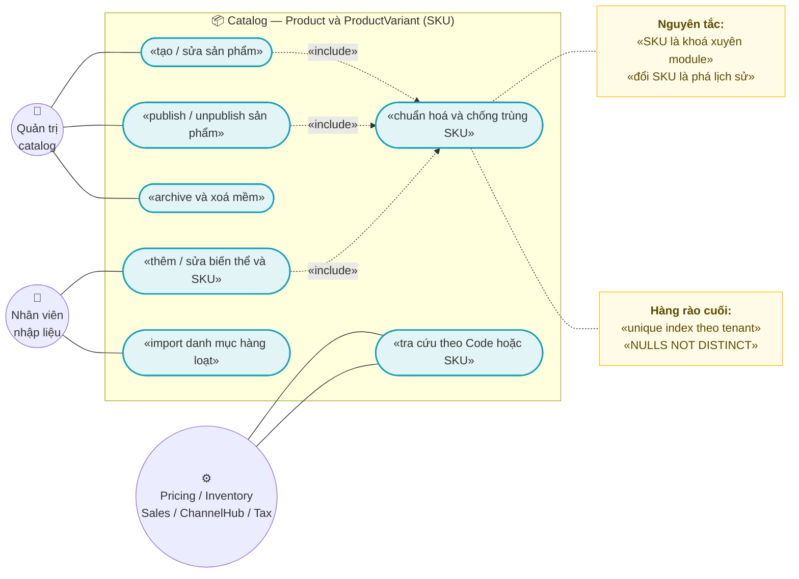
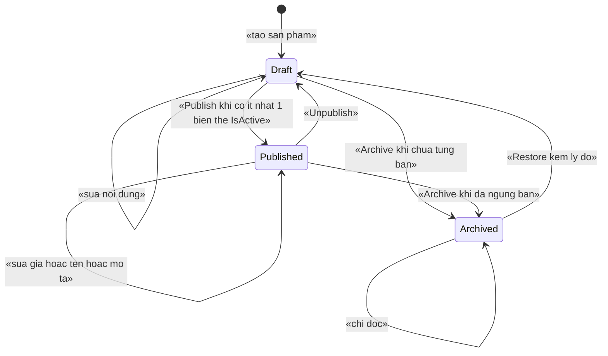
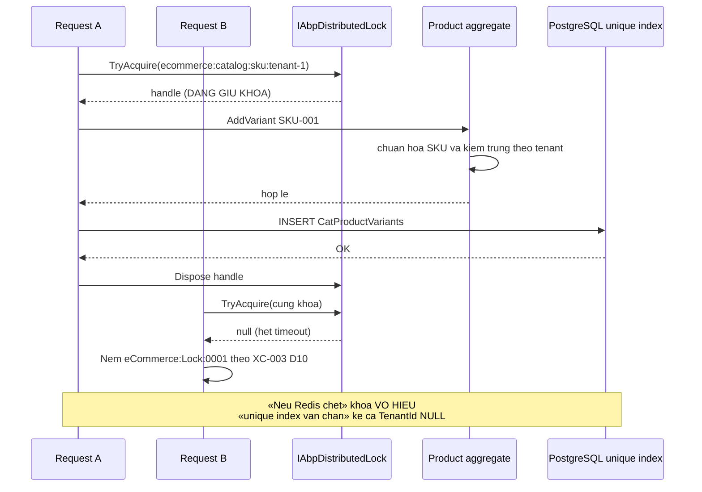
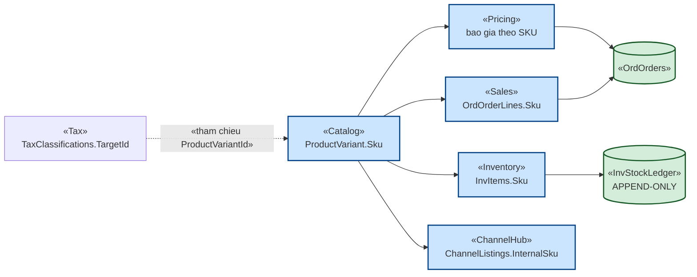
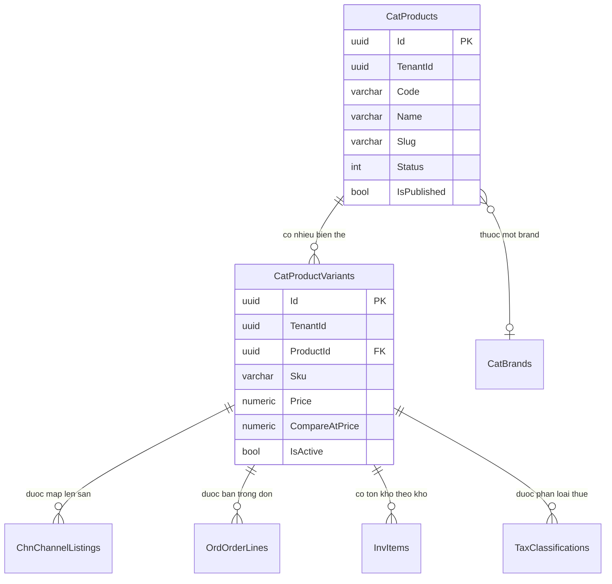

# `CAT-001` — Sản phẩm và biến thể (SKU)

| Thuộc tính | Nội dung |
|---|---|
| **Mã** | `CAT-001` |
| **Module** | **Catalog**. Hiện entity nằm trong app tại [`src/eCommerce.Domain/Entities/Catalog/Product.cs`](../src/eCommerce.Domain/Entities/Catalog/Product.cs) — chưa tách thành `modules/Catalog` (xem **D1** và §15.2 **F1**) |
| **Giai đoạn** | **GĐ1** — "Bán được trên website" (xem `docs/implementation-plan.md` §7.1 dòng `Catalog`) |
| **Ưu tiên** | **Must have** — mọi module GĐ1 khác (`Pricing`, `Inventory`, `Sales`, `ChannelHub`) đều tham chiếu `SKU` |
| **Trạng thái** | 🟡 `Draft` — chờ review |
| **Người viết / người review** | *(điền)* / **Kiến trúc trưởng** |
| **Phiên bản / ngày** | `v0.1` |
| **Tài liệu liên quan** | `XC-001` (Money/làm tròn — §0.1 **D8**) · `XC-002` (outbox/inbox, idempotency) · `XC-003` (khoá phân tán) · `XC-004` (permission/tenant — §1 **BR-009**) · `XC-006` (phân loại thuế theo SKU) · `CAT-002` (cây danh mục & thuộc tính) · `CAT-003` (media/SEO/hiển thị theo kênh) · `PRC-001` · `INV-001` · `docs/implementation-plan.md` §5 + Phụ lục A |

---

## 0. Tóm tắt & quyết định thiết kế

**Tóm tắt:** `CAT-001` chốt **mô hình sản phẩm & biến thể (SKU)** — thực thể mà **toàn bộ phần còn lại của hệ thống
bám vào**: `Pricing` báo giá theo SKU, `Inventory` giữ và trừ tồn theo SKU, `Sales` bán theo SKU, `ChannelHub`
đẩy tồn/giá theo SKU (qua `ChannelListing.InternalSku`), `Tax` phân loại thuế theo SKU.

**Vì sao phải viết tài liệu này trước khi code:** `SKU` là **khoá nghiệp vụ xuyên module**. Nếu `SKU` đổi được
sau khi đã bán, thì **mọi bản ghi lịch sử ở module khác trỏ sai** — và **không có lỗi biên dịch nào**. Cùng loại
rủi ro với **`Code` sản phẩm trùng** và với **SKU bị vô hiệu hoá trong khi còn tồn kho**.

**Phạm vi:**
- ✅ Mô hình `Product` (aggregate root) + `ProductVariant` (đơn vị bán thật, mang `SKU`).
- ✅ **Vòng đời hiển thị** `Draft → Published → Archived` (state machine, **ném lỗi** khi chuyển sai).
- ✅ Quy tắc **sinh SKU**, **bất biến SKU**, và quan hệ với `Code` của sản phẩm.
- ✅ Quy ước tiền (`decimal(18,4)`) và đường chuyển sang `Money` (`XC-001`) — hiện **chưa có `Money` trong code**.
- ✅ Kiểm kê **hiện trạng code thật** vs kế hoạch (§15.2) để không hứa những gì chưa có.

**Không nằm trong phạm vi:**
- ❌ **Cây danh mục** (`Category`) → `CAT-002`.
- ❌ **Thuộc tính / tổ hợp sinh biến thể** (`ProductAttribute`/`Option`/`Mapping`) → `CAT-002`. Tài liệu này chỉ
  chốt **ràng buộc** mà `CAT-002` phải tuân (giới hạn số tổ hợp — **BR-007**).
- ❌ **Media, SEO slug, hiển thị theo kênh** (`ProductMedia`, `ProductChannelVisibility`) → `CAT-003`.
- ❌ **Bảng giá, giá theo kênh, giá bậc thang** → `PRC-001`/`PRC-002`. `CAT-001` chỉ giữ `Price` **niêm yết**.
- ❌ **Nhập/xuất kho** → `INV-001`. `CAT-001` không ghi sổ cái kho.
- ❌ **Đồng bộ listing lên sàn** → `CHN-002`/`CHN-003` (bảng `ChannelListings` đã có ở module ChannelHub, xem §5.4).

### 0.1 Quyết định thiết kế (ADR ngắn)

| # | Quyết định | Phương án đã cân nhắc | Lý do chọn | Hệ quả |
|---|---|---|---|---|
| **D1** | **Giữ `Product`/`ProductVariant` trong `src/eCommerce.Domain` ở GĐ1; tách sang `modules/Catalog` khi số file Catalog vượt ~15** | (a) tách `modules/Catalog` ngay · (b) giữ trong `src/` | Entity **đang ở** `src/eCommerce.Domain/Entities/Catalog/Product.cs` và `eCommerceDbContext` **đang** map chúng trong hàm `ConfigureCommerce` — tách ngay là **di chuyển rủi ro** không đổi hành vi. Trong khi đó `modules/Tax` là mẫu để noi theo | Có **nợ kỹ thuật đã ghi nhận** (§15.2 **F1**). Gate tách module: khi `CAT-002`/`CAT-003` thêm entity ⇒ **làm luôn** để không phải sửa 2 lần |
| **D2** | **`SKU` là BẤT BIẾN sau khi biến thể đã phát sinh giao dịch; `Code` sản phẩm cũng bất biến sau khi publish** | (a) cho sửa tự do (có audit) · (b) bất biến + đường "đổi mã" tường minh | `SKU` là khoá đối chiếu với `ChannelListing.InternalSku` (`ChannelEntities.cs:128`) và `OrdOrderLines.Sku` (`eCommerceDbContext.cs:199`). Sửa `SKU` ⇒ **lịch sử bán/lịch sử kho trỏ sai** | Cần API **"đổi mã"** riêng, chỉ khi chưa có giao dịch, có audit; **cấm** sửa `SKU` qua API cập nhật thường (**BR-003**) |
| **D3** | **Bảng SKU là phẳng theo tenant — "một SKU = một `ProductVariant` trong một tenant"** | (a) SKU chỉ unique trong một sản phẩm (đang là vậy trong domain) · (b) SKU unique **toàn tenant** | Kiểm tra hiện tại `Product.AddVariant()` chỉ chống trùng **trong bộ nhớ của một sản phẩm** (`Product.cs:44`), còn DB đã có `UNIQUE (TenantId, Sku)` (`eCommerceDbContext.cs:129`). Tức **domain yếu hơn DB** ⇒ nếu chỉ tin domain thì lỗi nổ ở tầng DB với thông điệp khó hiểu | Domain **phải** nâng lên kiểm tra theo tenant (qua repository) hoặc chấp nhận `DbUpdateException` được map thành mã lỗi **`eCommerce:Catalog:0002`** |
| **D4** | **Xoá mềm là mặc định; xoá cứng bị CẤM khi SKU còn tham chiếu** | (a) xoá cứng · (b) xoá mềm + chặn xoá khi còn ràng buộc | `Product` đã là `FullAuditedAggregateRoot` ⇒ **đã** có xoá mềm (`IsDeleted`). Xoá cứng `Product` sẽ **cascade** xoá `ProductVariant` (`DeleteBehavior.Cascade`, `eCommerceDbContext.cs:114`) và làm treo tham chiếu từ `OrdOrderLines.ProductVariantId` | API xoá = **soft delete + unpublish**; **cấm** `DeleteBehavior.Cascade` gây mất biến thể đã có lịch sử |
| **D5** | **State machine hiển thị nằm ở TẦNG DOMAIN, chuyển sai ⇒ ném `BusinessException`** | (a) set `IsPublished = true/false` trực tiếp (đang là **`bool` công khai** — `Product.cs:25`) · (b) state machine có guard | Quy ước dự án: **state machine PHẢI NÉM LỖI** khi chuyển sai (bài học `SetPaidStatus()` của eShop — `XC-002` §0 bài học #4). `IsPublished` là **`set` công khai** ⇒ hiện **không có guard nào** | Thêm `ProductStatus` + `Publish()`/`Unpublish()`/`Archive()`; `IsPublished` chuyển thành **property dẫn xuất chỉ-đọc** |
| **D6** | **Ràng buộc DB là hàng rào cuối; UI + domain chỉ là lớp trong** | (a) tin vào kiểm tra trong bộ nhớ · (b) kiểm tra bộ nhớ **+** unique index | `XC-003` **D2**: nếu bỏ lock/khoá mà DB không chặn ⇒ thiết kế **sai**. Hai unique index `(TenantId, Code)` và `(TenantId, Sku)` **đã tồn tại** và **đã được sửa sang `NULLS NOT DISTINCT`** | Check-then-insert **phải** bọc trong distributed lock **và** vẫn chấp nhận `DbUpdateException` là đường hợp lệ |
| **D7** | **Khoá phân tán cho tài nguyên dùng chung: `ecommerce:catalog:…`, do module Catalog sở hữu** | (a) dùng lại `eCommerceConsts.LockKeys` · (b) consts riêng của module | `XC-003` **D3**: **cấm** viết literal khoá trong nghiệp vụ; nguồn sự thật là consts của **module sở hữu**. Tiền tố `ecommerce:` do `AbpDistributedLockOptions.KeyPrefix` cấp (`eCommerceHttpApiHostModule.cs:127`), **tên khoá của module KHÔNG chứa tiền tố** (`XC-003` §5.4 hệ quả 2) | ⚠️ Hiện **chưa có** `CatalogLockKeys` trong code (§15.2 **F2**) — kế hoạch GĐ1 |
| **D8** | **Tiền: `decimal` + `numeric(18,4)` ở tầng entity; chuyển sang `Money` (`XC-001`) khi Kernel tồn tại** | (a) dùng `decimal` trực tiếp là đủ · (b) `Money` complex type ngay | Quy ước bất biến của dự án: **tiền dùng `decimal` + `Money`, KHÔNG BAO GIỜ so sánh `==` trên tiền**. Nhưng **`Money` CHƯA có trong code** (không có project `eCommerce.Kernel` — §15.2 **F4**) ⇒ ghi rõ **kế hoạch**, không được coi là đã xong | GĐ1 bắt buộc có `eCommerce.Kernel` (implementation-plan §7.0 việc 1). Tới lúc đó `ProductVariant.Price` là `decimal` `numeric(18,4)` như hiện tại; **cấm** phát sinh so sánh `==` trên `Price` |
| **D9** | **Bắt buộc có ít nhất MỘT biến thể `IsActive` mới được `Publish`** | (a) cho publish sản phẩm rỗng rồi tính sau · (b) chặn ở state machine | `SKU` mới là đơn vị bán; sản phẩm không có biến thể **không bán được** và sẽ làm `Pricing`/`Inventory` phải xử lý ca rỗng ở mọi nơi | `Publish()` ném `eCommerce:Catalog:0003`; có test `TC-06` |
| **D10** | **`[Authorize]` ở CẤP CLASS + permission theo hằng số; bổ sung `Products.View` và `Products.Publish`** | (a) chỉ dùng `[Authorize]` trần · (b) permission chi tiết | `XC-004` **D3/BR-001**: `[Authorize]` **phải** ở cấp class; **D4/BR-003**: **cấm** magic string permission. Hiện `eCommerceConsts.Permissions.Products` **chỉ có** `Default`/`Create`/`Edit`/`Delete` (`eCommerceConsts.cs:19-25`) — **thiếu** `View`, **thiếu** `Publish` | Thêm 2 hằng số + định nghĩa trong `eCommercePermissionDefinitionProvider`; nếu không ⇒ **403 cho mọi người** kể cả admin (đúng lỗi Phase 0, `XC-004` **D2**) |
| **D11** | **SKU không dùng `Guid`/sequence toàn cục làm nguồn sự thật; nhưng `Id` vẫn là `Guid`** | (a) SKU = số tăng dần · (b) SKU do người dùng nhập, `Id` là `Guid` | SKU phải **có nghĩa nghiệp vụ** (đối chiếu với sàn, in trên phiếu kho). `Guid` làm định danh kỹ thuật, khớp với `ProductVariant.Id` đang là `Guid` (`Product.cs:56`) | Cần chuẩn hoá SKU (hoa/thường, ký tự cho phép) — **BR-002**; và cần **kiểm tra trùng trước khi ghi** (D6) |

---

## 1. Use Case Specification

| Thuộc tính | Nội dung |
|---|---|
| **Use Case ID** | `CAT-001` |
| **Use Case Name** | Quản lý sản phẩm và biến thể (SKU) làm nguồn sự thật của catalog |
| **Description** | *"Là quản trị viên catalog, tôi muốn tạo sản phẩm kèm các biến thể có SKU ổn định, để Pricing/Inventory/Sales/ChannelHub cùng tham chiếu một SKU không đổi — và để không bao giờ tồn tại hai SKU trùng nhau trong một tenant."* |
| **Actor(s)** | **Quản trị catalog** (tenant) · **Nhân viên nhập liệu** · **Hệ thống** (`Pricing`, `Inventory`, `Sales`, `ChannelHub`, `Tax` — chỉ **đọc** SKU) · **Job/service** (`client_credentials`, `XC-004` **A1**) |
| **Priority** | **Must have** |
| **Trigger** | (a) tạo/sửa sản phẩm và biến thể; (b) publish/unpublish sản phẩm; (c) import danh mục sản phẩm (hàng loạt); (d) module khác tra cứu SKU |
| **Pre-Condition(s)** | • **Tenant hiện tại** (`TenantId`) — `Product`/`ProductVariant` **đã** `IMultiTenant` (`Product.cs:10,56`).<br>• Permission đã được **định nghĩa** cho mọi chuỗi dùng trong `[Authorize]` (`XC-004` **D2**).<br>• `SKU` **chưa** tồn tại trong tenant (kiểm ở domain) **và** DB có unique index `(TenantId, Sku)` làm hàng rào cuối.<br>• `ChannelCode` **không** tham gia quyết định ở tài liệu này (hiển thị theo kênh thuộc `CAT-003`). |
| **Post-Condition(s)** | • `SKU` **tồn tại duy nhất** trong tenant; đã được chuẩn hoá theo **BR-002**.<br>• Sản phẩm `Published` **luôn có ≥ 1 biến thể `IsActive`** (**BR-006**).<br>• Mọi thao tác ghi đi qua **Unit of Work** (quy ước dự án) và **đi qua `IIdempotencyGuard`** ở mọi biên vào (`XC-002` **BR-004**).<br>• Sự kiện `ProductPublishedEto` / `VariantPriceChangedEto` được ghi **cùng transaction** qua outbox (`XC-002` **D1**). |
| **Basic Flow** | 1. Người dùng gọi `CreateProductAsync` (permission `Products.Create`) — hệ thống kiểm `[Authorize]` **cấp class** trước.<br>2. Hệ thống **chuẩn hoá `Code`** và kiểm trùng theo tenant; chưa có ⇒ tạo `Product` ở trạng thái **`Draft`**.<br>3. Người dùng thêm biến thể: `AddVariantAsync` ⇒ chuẩn hoá `SKU` (**BR-002**), kiểm trùng theo tenant (domain) ⇒ thêm vào aggregate.<br>4. `UnitOfWork` commit ⇒ `SaveChangesAsync`; nếu DB ném `unique violation` ⇒ map thành **`eCommerce:Catalog:0002`** (không lộ lỗi SQL).<br>5. Người dùng gọi `PublishAsync` (permission `Products.Publish`) ⇒ state machine kiểm **guard**: có ≥ 1 biến thể `IsActive` ⇒ `Published`; ghi `ProductPublishedEto` vào outbox.<br>6. Hệ thống trả DTO; **không** trả trường nội bộ nào của sổ cái/giá vốn. |
| **Alternative Flow** | **A1: Import hàng loạt** — dùng `IdempotencyKey` ổn định theo (tenant, file hash) (D6/**BR-008**); chạy **all-or-nothing** trong một UoW; dòng lỗi trả về **đủ số dòng + lý do**, không dừng ở lỗi đầu tiên.<br>**A2: Sản phẩm một biến thể** — vẫn **phải** tạo `ProductVariant` (không có "SKU ảo" ở cấp `Product`); đây là lựa chọn có chủ ý để mọi module chỉ cần biết một khái niệm.<br>**A3: Ngừng bán tạm thời** — `Unpublish()` ⇒ `Draft`; **không** xoá, **không** đổi `SKU`. |
| **Exception Flow** | **E1:** `Code` trùng trong tenant ⇒ `BusinessException` **`eCommerce:Catalog:0001`** (`409`).<br>**E2:** `SKU` trùng trong tenant ⇒ `BusinessException` **`eCommerce:Catalog:0002`** (`409`) — kể cả khi lỗi đến từ unique index.<br>**E3:** `Publish` khi không có biến thể `IsActive` ⇒ **`eCommerce:Catalog:0003`** (`409`).<br>**E4:** Chuyển trạng thái sai (ví dụ `Archived → Published` trực tiếp, hoặc `Draft → Archived` khi còn tồn kho) ⇒ `BusinessException` **`eCommerce:Catalog:0004`** (`409`) — **tuyệt đối không im lặng** (**D5**).<br>**E5:** Sửa `SKU` của biến thể đã phát sinh giao dịch ⇒ **`eCommerce:Catalog:0005`** (`409`) (**D2**, **BR-003**).<br>**E6:** Xoá sản phẩm còn tham chiếu (đơn/kho/listing) ⇒ **`eCommerce:Catalog:0006`** (`409`).<br>**E7:** Giá âm ⇒ `BusinessException` **`eCommerce:Catalog:0007`** (`400`).<br>**E8:** Không giành được khoá khi sinh SKU ⇒ theo `XC-003` **D10**: mặc định **ném** `eCommerce:Lock:0001` (`409`). |
| **Business Rules** | • **BR-001**: `Code` sản phẩm **duy nhất trong tenant**, **bất biến sau khi `Published`**.<br>• **BR-002**: `SKU` **chuẩn hoá** (trim; **HOA**; chỉ `[A-Z0-9._-]`; độ dài 3–64); `SKU` **duy nhất trong tenant**.<br>• **BR-003**: **`SKU` bất biến** sau khi biến thể đã phát sinh giao dịch (đơn/kho/listing); đổi mã chỉ qua đường tường minh + audit.<br>• **BR-004**: Mọi sản phẩm **phải có ≥ 1 biến thể** mới được `Published`.<br>• **BR-005**: **Xoá mềm** là mặc định; **cấm** xoá cứng khi `SKU` còn được tham chiếu.<br>• **BR-006**: `Published` **bắt buộc** có ≥ 1 biến thể `IsActive`, `Price ≥ 0`, `Name` không rỗng.<br>• **BR-007**: Sinh biến thể theo tổ hợp **phải có trần số tổ hợp** (đề xuất **≤ 500**) và **chặn** vượt trần bằng lỗi tường minh — chống bùng nổ tổ hợp (đối chiếu `PRO-002`).<br>• **BR-008**: Mọi biên vào (API tạo/sửa, import, webhook/consumer sau này) **phải** idempotent (`XC-002` **BR-004**).<br>• **BR-009**: Mọi entity **phải** `IMultiTenant` + `TenantId`; mọi unique index có `TenantId` **phải** `NULLS NOT DISTINCT` (`XC-004` **BR-009**).<br>• **BR-010**: **Mọi app service phải có `[Authorize]` ở CẤP CLASS** (`XC-004` **BR-001**); permission **chỉ** dùng hằng số (**BR-003** của `XC-004`).<br>• **BR-011**: Tiền **chỉ** `decimal` (+ `Money` khi có); **cấm so sánh `==` trên tiền** (`XC-001` **BR-003**) — so bằng `ToMinorUnits()`.<br>• **BR-012**: Mọi thao tác ghi **phải** đi qua **Unit of Work**; sự kiện đi qua **outbox cùng transaction** (`XC-002` **D1**).<br>• **BR-013**: **Cấm** module khác gọi trực tiếp repository của Catalog; chỉ qua contract/sự kiện — module **không** tham chiếu `src/` (quy ước dự án, xem `ChannelHubConsts.cs:8-10`).<br>• **BR-014**: Khoá phân tán cho tài nguyên Catalog **chỉ** sinh từ consts của module; **cấm** literal khoá trong nghiệp vụ (`XC-003` **BR-001/BR-002**).<br>• **BR-015**: **Cấm** hard-code thuế suất trên SKU — phân loại thuế là **dữ liệu** do kế toán quản trị (`XC-006` **D1/BR-012**); Catalog chỉ giữ `TaxClassificationId`/tham chiếu. |
| **Non-Functional Requirement** | • **NFR-001**: Tạo sản phẩm + 1 biến thể p95 **< 150 ms** (không tính mạng).<br>• **NFR-002**: Tra sản phẩm theo `Code`/`SKU` p95 **< 20 ms** với **≥ 100.000** biến thể.<br>• **NFR-003**: **0** `SKU` trùng trong một tenant — kể cả khi `TenantId` là `NULL` (test chèn đồng thời, `XC-004` **TC-08**).<br>• **NFR-004**: **100 %** app service Catalog có `[Authorize]` cấp class (test reflection, `XC-004` **TC-01**).<br>• **NFR-005**: **0** permission dùng trong `[Authorize]` mà chưa định nghĩa (`XC-004` **TC-02**).<br>• **NFR-006**: **0** biểu thức tiền dùng `double`/`float`; **0** so sánh `==` trên tiền.<br>• **NFR-007**: Import **10.000** dòng hoàn tất **< 60 s**, all-or-nothing.<br>• **NFR-008**: **0** sự kiện mất khi publish lỗi (kiểm bằng test outbox, `XC-002` **TC**).<br>• **NFR-009**: Sinh tổ hợp vượt trần ⇒ **từ chối trong < 100 ms**, không cấp phát bộ nhớ theo cấp số nhân.<br>• **NFR-010**: Sổ cái kho **append-only** — `CAT-001` **không** ghi bất kỳ bản ghi nào vào `InvStockLedger` (`StockLedger.cs:81`). |

---

## 2. Sơ đồ Use Case



---

## 3. Vòng đời hiển thị của sản phẩm (state machine)

> ℹ️ `Product` hiện **chưa có** trạng thái: nó chỉ có `bool IsPublished` với **`set` công khai**
> ([`Product.cs:25`](../src/eCommerce.Domain/Entities/Catalog/Product.cs#L25)) ⇒ **không có guard nào**.
> Đây là **khoảng trống đã kiểm chứng trong code**, không phải suy đoán. Trạng thái dưới đây là **kế hoạch GĐ1**.



**Bảng chuyển trạng thái & guard (mọi chuyển sai **phải ném lỗi** — **D5**, **BR-004/E4**):**

| Từ | Sang | Guard | Nếu vi phạm |
|---|---|---|---|
| `Draft` | `Published` | Có **≥ 1** `ProductVariant` với `IsActive = true`; `Code` không rỗng; `Name` không rỗng | **Ném** `eCommerce:Catalog:0003` |
| `Draft` | `Archived` | Sản phẩm **chưa từng** được bán (không có `OrdOrderLines` tham chiếu) | **Ném** `eCommerce:Catalog:0004` |
| `Published` | `Draft` | Luôn được (unpublish) — nhưng **phải** ghi `UnpublishedAtUtc` + lý do | — |
| `Published` | `Archived` | Không còn tồn khả dụng (`InvItems.Available == 0`) và không còn `ChannelListing` ở trạng thái `Synced` | **Ném** `eCommerce:Catalog:0004` kèm **danh sách** ràng buộc còn lại |
| `Archived` | `Draft` | Có **lý do** + audit | **Ném** `eCommerce:Catalog:0004` nếu thiếu lý do |
| `Archived` | `Published` | ❌ **CẤM** — phải qua `Draft` | **Ném** `eCommerce:Catalog:0004` (**tường minh**, không im lặng) |
| `*` | `*` | Mọi chuyển **không** có trong bảng ⇒ **luôn ném lỗi** | `eCommerce:Catalog:0004` |

> ⚠️ **Đây là điểm khác biệt có chủ ý so với code hiện tại:** hiện tại `product.IsPublished = true;` **luôn chạy**.
> Sau `CAT-001`, mọi chuyển trạng thái đi qua method của aggregate và **chuyển sai ⇒ ném lỗi** (quy ước dự án #11).
> Việc "im lặng bỏ qua" đúng là lỗi đã học được từ `SetPaidStatus()` của eShop (`XC-002` §0 bài học #4).

---

## 4. Sequence Diagram & luồng dữ liệu

### 4.1 Hai request đồng thời tạo cùng một `SKU`



### 4.2 Đường đi của một `SKU` qua các module



---

## 5. Mô hình dữ liệu

### 5.1 ERD



> 📌 Quan hệ với `CatBrands` **chưa có bảng trong code** — `Product.BrandId` hiện là `Guid?` **không khoá ngoại**
> ([`Product.cs:23`](../src/eCommerce.Domain/Entities/Catalog/Product.cs#L23), DDL `Initial.cs:24`). Bảng `Brand`
> thuộc `CAT-002`; ở đây ghi nhận để **không** bịa là đã có.

### 5.2 Bảng `CatProducts` — **hiện trạng code thật** + phần bổ sung

**Cột đã có trong DB** (đối chiếu DDL thật tại [`20261009070214_Initial.cs:14-39`](../src/eCommerce.EntityFrameworkCore/Migrations/20261009070214_Initial.cs#L14)):

| Cột | Kiểu | Null? | Ý nghĩa | Ghi chú |
|---|---|---|---|---|
| `Id` | `uuid` | ✗ | khoá chính | |
| `TenantId` | `uuid` | ✓ | tenant | `IMultiTenant`; `null` khi chạy 1 tenant |
| `Code` | `varchar(64)` | ✗ | mã nội bộ | **UNIQUE `(TenantId, Code)`** |
| `Name` | `varchar(512)` | ✗ | tên hiển thị | |
| `Slug` | `varchar(512)` | ✓ | slug SEO | **không unique** trong code hiện tại (xem **F5** §15.2) |
| `Description` | `text` | ✓ | mô tả | |
| `BrandId` | `uuid` | ✓ | brand | **không có FK** (chưa có bảng `Brand`) |
| `IsPublished` | `boolean` | ✗ | đã publish | 🚨 **`set` công khai** ⇒ không guard (**D5**) |
| `ExtraProperties` / `ConcurrencyStamp` | `text` / `varchar(40)` | ✗ | ABP | |
| `CreationTime` `CreatorId` `LastModificationTime` `LastModifierId` | `timestamptz`/`uuid` | ✗/✓ | audit | `FullAuditedAggregateRoot` |
| `IsDeleted` `DeleterId` `DeletionTime` | `boolean`/`uuid`/`timestamptz` | ✗/✓/✓ | **xoá mềm** | `FullAudited*` ⇒ **đã** có xoá mềm (**D4**) |

**Cột/khái niệm đề xuất bổ sung (GĐ1)** — **chưa có trong code**:

| Cột | Kiểu | Ghi chú |
|---|---|---|
| `Status` | `int` | `Draft=0` `Published=1` `Archived=2` — **thay** việc set `IsPublished` trực tiếp (**D5**) |
| `PublishedAtUtc` / `UnpublishedAtUtc` | `timestamptz` | phục vụ audit + storefront cache |
| `PrimaryCategoryId` | `uuid` | **FK mềm** → `Category` của `CAT-002` (khi bảng đó tồn tại) |
| `TaxClassificationId` | `uuid` | **tham chiếu** sang module `Tax`; **không** FK cứng (BR-013) |

### 5.3 Bảng `CatProductVariants` — **hiện trạng code thật** + phần bổ sung

**Cột đã có** ([`20261009070214_Initial.cs:257-287`](../src/eCommerce.EntityFrameworkCore/Migrations/20261009070214_Initial.cs#L257)):

| Cột | Kiểu | Null? | Ý nghĩa | Ghi chú |
|---|---|---|---|---|
| `Id` | `uuid` | ✗ | khoá chính | `FullAuditedEntity<Guid>` |
| `TenantId` | `uuid` | ✓ | tenant | |
| `ProductId` | `uuid` | ✗ | FK → `CatProducts.Id` | **ON DELETE CASCADE** (`eCommerceDbContext.cs:114`) — xem **D4** |
| `Sku` | `varchar(64)` | ✗ | **khoá nghiệp vụ** | **UNIQUE `(TenantId, Sku)`** |
| `Barcode` | `varchar(64)` | ✓ | mã vạch | |
| `Price` | `numeric(18,4)` | ✗ | giá niêm yết | `decimal`, KHÔNG `double` (**BR-011**) |
| `CompareAtPrice` | `numeric(18,4)` | ✓ | giá so sánh | |
| `WeightInGrams` | `integer` | ✓ | khối lượng | phục vụ `SHP-001` |
| `IsActive` | `boolean` | ✗ | đang bán | |

**Đề xuất bổ sung (GĐ1)** — **chưa có trong code**: `TaxClassificationId` (tham chiếu mềm, **BR-015**),
`OptionValues` (map giá trị thuộc tính — thuộc `CAT-002`), `Position` (thứ tự hiển thị biến thể).

### 5.4 Bảng & trường **đã có** ở module khác nhưng `CAT-001` **phải tôn trọng**

| Bảng / trường | File (đã kiểm bằng `read`) | Ràng buộc lên `CAT-001` |
|---|---|---|
| `ChnChannelListings.InternalSku` | [`ChannelEntities.cs:128`](../modules/ChannelHub/eCommerce.ChannelHub.Domain/Entities/ChannelEntities.cs#L128) | Giữ SKU **tại thời điểm map** để đối soát khi SKU đổi ⇒ **SKU không được đổi** (**BR-003**) |
| `ChnChannelListings.ProductVariantId` | [`ChannelEntities.cs:125`](../modules/ChannelHub/eCommerce.ChannelHub.Domain/Entities/ChannelEntities.cs#L125) | Xoá **cứng** `ProductVariant` sẽ treo tham chiếu ⇒ **cấm** (**BR-005**) |
| `OrdOrderLines.Sku` / `ProductVariantId` | [`eCommerceDbContext.cs:199`](../src/eCommerce.EntityFrameworkCore/eCommerceDbContext.cs#L199) | Lịch sử bán giữ SKU; xoá cứng là **phá lịch sử** |
| `InvItems.Sku` | [`eCommerceDbContext.cs:137`](../src/eCommerce.EntityFrameworkCore/eCommerceDbContext.cs#L137) | Tồn kho theo SKU; **UNIQUE `(TenantId, WarehouseId, Sku)`** là hàng rào chống bán vượt |
| `InvStockLedger` (append-only) | [`StockLedger.cs:81-84`](../src/eCommerce.Domain/Entities/Inventory/StockLedger.cs#L81) | `CAT-001` **không** ghi vào đây (**NFR-010**) |
| `TaxClassifications.TargetId` | [`TaxClassification.cs:25`](../modules/Tax/eCommerce.Tax.Domain/Classifications/TaxClassification.cs#L25) | `TargetType = Sku` trỏ tới `ProductVariantId` ⇒ xoá cứng là treo phân loại thuế |

**Index & ràng buộc (đã kiểm bằng `grep` trong `Migrations/`)**

| Loại | Định nghĩa | Trạng thái |
|---|---|---|
| **UNIQUE** | `IX_CatProducts_TenantId_Code` trên `(TenantId, Code)` | ✅ đã có; **đã sửa** sang `NULLS NOT DISTINCT` — [`20261013024226_Fix_NullableTenantId_UniqueIndexes.cs:40-42`](../src/eCommerce.EntityFrameworkCore/Migrations/20261013024226_Fix_NullableTenantId_UniqueIndexes.cs#L40) |
| **UNIQUE** | `IX_CatProductVariants_TenantId_Sku` trên `(TenantId, Sku)` | ✅ đã có; **đã sửa** sang `NULLS NOT DISTINCT` — cùng file, dòng `44-46` |
| **FK** | `FK_CatProductVariants_CatProducts_ProductId` `ON DELETE CASCADE` | ⚠️ đã có — **rủi ro** theo **D4** |

> 🔒 **Đây là bằng chứng cho BR-009 của `XC-004` đã được áp dụng cho Catalog:** migration
> `Fix_NullableTenantId_UniqueIndexes` **thực sự** đổi 2 index của Catalog sang `NULLS NOT DISTINCT`.
> Nghĩa là **khi `TenantId` là `NULL`** (đúng tình trạng hiện tại — `AbpTenantManagement` **chưa** cài),
> hai sản phẩm cùng `Code` **vẫn bị chặn**. ⚠️ **chưa kiểm chứng runtime trên PostgreSQL** trong phiên làm việc này.

---

## 6. Hợp đồng API

### 6.1 Application Service (đề xuất — **chưa có trong code**)

> 🚨 **Hiện trạng:** **không tồn tại** `IProductAppService` / `ProductAppService` / DTO nào của Catalog.
> Bằng chứng: `grep` `IProductAppService|ProductAppService` trên toàn repo ⇒ **0 kết quả**.
> App service duy nhất hiện có là `ChannelAppService` ([`ChannelAppService.cs:28`](../src/eCommerce.Application/Channels/ChannelAppService.cs#L28)).
> **Đây là kế hoạch GĐ1.**

```csharp
// [Authorize] ở CẤP CLASS là BẮT BUỘC (XC-004 D3/BR-001) — quy ước của dự án.
[Authorize(eCommerceConsts.Permissions.Products.Default)]
public interface IProductAppService : IApplicationService
{
    Task<PagedResultDto<ProductDto>> GetListAsync(GetProductsInput input);          // cần Products.View
    Task<ProductDto> GetAsync(Guid id);
    Task<ProductDto> GetByCodeAsync(string code);                                    // tra cứu nội bộ

    [Authorize(eCommerceConsts.Permissions.Products.Create)]
    Task<ProductDto> CreateAsync(CreateProductDto input);                            // → Draft

    [Authorize(eCommerceConsts.Permissions.Products.Edit)]
    Task<ProductDto> UpdateAsync(Guid id, UpdateProductDto input);                    // KHÔNG cho sửa Code/Sku

    [Authorize(eCommerceConsts.Permissions.Products.Edit)]
    Task<VariantDto> AddVariantAsync(Guid productId, CreateVariantDto input);

    [Authorize(eCommerceConsts.Permissions.Products.Publish)]                        // 🆕 HẰNG SỐ CẦN THÊM
    Task PublishAsync(Guid id);                                                      // Draft → Published

    [Authorize(eCommerceConsts.Permissions.Products.Publish)]
    Task UnpublishAsync(Guid id, string reason);                                     // Published → Draft

    [Authorize(eCommerceConsts.Permissions.Products.Delete)]
    Task DeleteAsync(Guid id);                                                       // SOFT delete (D4)

    [Authorize(eCommerceConsts.Permissions.Products.Edit)]
    Task<ImportResultDto> ImportAsync(ImportProductsDto input);                       // idempotent (BR-008)
}

/// Khoá phân tán của module Catalog — nguồn sự thật DUY NHẤT (XC-003 D3).
/// Tên khoá KHÔNG chứa tiền tố `ecommerce:`; tiền tố do AbpDistributedLockOptions.KeyPrefix cấp.
public static class CatalogLockKeys
{
    /// <summary>Khoá khi tạo/sinh biến thể — chống hai request cùng sinh một SKU.</summary>
    public static string ProductVariantCreate(string tenantId, string productCode)
        => $"catalog:variant:{tenantId}:{productCode}";

    /// <summary>Khoá khi sinh biến thể theo tổ hợp — một sản phẩm chỉ sinh tổ hợp một lần.</summary>
    public static string AttributeCombination(Guid productId)
        => $"catalog:combination:{productId}";

    /// <summary>Khoá khi import danh mục cho một tenant.</summary>
    public static string Import(string tenantId)
        => $"catalog:import:{tenantId}";
}
```

### 6.2 REST endpoint

Bảng dưới là **mapping tự động của ABP** (app service → `/api/app/<route>`), **chưa tồn tại trong code**:

| Method | Route (đề xuất) | Permission | Trạng thái |
|---|---|---|---|
| `GET` | `/api/app/product` | `eCommerce.Products.View` 🆕 | chưa có |
| `GET` | `/api/app/product/{id}` | `eCommerce.Products.View` 🆕 | chưa có |
| `POST` | `/api/app/product` | `eCommerce.Products.Create` | permission **đã định nghĩa** ([`eCommercePermissionDefinitionProvider.cs:29`](../src/eCommerce.Application.Contracts/Permissions/eCommercePermissionDefinitionProvider.cs#L29)) |
| `PUT` | `/api/app/product/{id}` | `eCommerce.Products.Edit` | permission **đã định nghĩa** (dòng `30`) |
| `DELETE` | `/api/app/product/{id}` | `eCommerce.Products.Delete` | permission **đã định nghĩa** (dòng `31`) |
| `POST` | `/api/app/product/{id}/publish` | `eCommerce.Products.Publish` 🆕 | **chưa định nghĩa** ⇒ phải thêm (**D10**) |

### 6.3 Mã lỗi nghiệp vụ (đề xuất — **chưa có trong code**)

> ⚠️ `eCommerceConsts.ErrorCodes` hiện **chỉ có 2 mã**: `eCommerce:Inventory:0001` và `eCommerce:Payment:0001`
> ([`eCommerceConsts.cs:79,85`](../src/eCommerce.Domain.Shared/eCommerceConsts.cs#L79)).
> **Không** có mã nào của Catalog. Bảng dưới là **đề xuất GĐ1**; mã lỗi phải **cùng định dạng** `eCommerce:Catalog:nnnn`
> (bài học **F2/F5** của `XC-003`/`XC-004`: hai nguồn sự thật cho cùng mã lỗi ⇒ chống đối soát).

| Mã | HTTP | Khi nào | Thông điệp |
|---|---|---|---|
| `eCommerce:Catalog:0001` | `409` | `Code` sản phẩm trùng trong tenant | `Mã sản phẩm '{code}' đã tồn tại.` |
| `eCommerce:Catalog:0002` | `409` | `SKU` trùng trong tenant (kể cả từ unique index) | `SKU '{sku}' đã tồn tại.` |
| `eCommerce:Catalog:0003` | `409` | `Publish` khi không có biến thể `IsActive` | `Không thể phát hành sản phẩm chưa có biến thể đang bán.` |
| `eCommerce:Catalog:0004` | `409` | Chuyển trạng thái sai (state machine) | `Không thể chuyển sản phẩm từ {tu} sang {sang}.` |
| `eCommerce:Catalog:0005` | `409` | Sửa `SKU` đã phát sinh giao dịch | `SKU đã phát sinh giao dịch, không thể đổi mã.` |
| `eCommerce:Catalog:0006` | `409` | Xoá sản phẩm còn tham chiếu | `Sản phẩm còn được tham chiếu bởi {đối tượng}, không thể xoá.` |
| `eCommerce:Catalog:0007` | `400` | `Price`/`CompareAtPrice` âm | `Giá không được là số âm.` |
| `eCommerce:Catalog:0008` | `400` | `SKU` không hợp lệ sau chuẩn hoá | `SKU chỉ cho phép chữ HOA, số và các ký tự . _ - (3 đến 64 ký tự).` |
| `eCommerce:Catalog:0009` | `409` | Vượt trần tổ hợp biến thể (**BR-007**) | `Số tổ hợp biến thể vượt giới hạn cho phép ({max}).` |

---

## 7. Sự kiện, tích hợp ngoài & idempotency

### 7.1 Sự kiện phát ra (ETO)

| ETO | Khi nào | Ai tiêu thụ | Ghi chú |
|---|---|---|---|
| `ProductPublishedEto` | `Publish()` thành công | `Pricing` (khởi tạo giá), `ChannelHub` (push listing), `WEB-002` (cache) | ⚠️ **chưa có trong code** — `grep ProductPublishedEto` ⇒ **0 kết quả**. Đây là **kế hoạch GĐ1**, đã nằm trong `docs/implementation-plan.md` §7.1 |
| `VariantPriceChangedEto` | đổi `Price`/`CompareAtPrice` | `Pricing`, `ChannelHub` (đẩy giá), `REC-002` | ⚠️ **chưa có trong code** |
| `ProductArchivedEto` *(đề xuất)* | `Archive()` thành công | `ChannelHub` (delist khỏi sàn) | ⚠️ **chưa có trong code** |

> 🔒 **Bắt buộc:** mọi ETO **phải** đi qua **outbox cùng transaction** với dữ liệu nghiệp vụ
> (`XC-002` **D1/BR-012**) và **phải** có `EventId`/`AggregateId`/`AggregateVersion` theo khuôn của `XC-002` **D11**.
> ⚠️ **Hiện trạng:** `eCommerceDbContext` **không** implement `IHasEventOutbox`/`IHasEventInbox`
> (đã kiểm: khai báo class tại [`eCommerceDbContext.cs:33`](../src/eCommerce.EntityFrameworkCore/eCommerceDbContext.cs#L33) chỉ là
> `AbpDbContext<eCommerceDbContext>`) ⇒ **outbox chưa bật** — việc này thuộc hạ tầng nền GĐ1 (§7.0 việc 3 của kế hoạch).

### 7.2 Sự kiện / webhook nhận vào

**Không áp dụng — lý do:** `CAT-001` không nhận dữ liệu từ bên ngoài. Webhook đơn từ sàn thuộc `SAL-005`;
webhook trạng thái listing thuộc `CHN-002`/`CHN-003`.

### 7.3 Gọi API ra ngoài

**Không áp dụng — lý do:** `Catalog` **không** gọi API của sàn hay NCC nào. Việc đẩy listing/tồn/giá lên sàn
thuộc module `ChannelHub`, qua `IChannelConnector`
([`IChannelConnector.cs`](../modules/ChannelHub/eCommerce.ChannelHub.Application.Contracts/Connectors/IChannelConnector.cs))
— và theo **BR-013**, `Catalog` **không** được gọi trực tiếp vào đó.

### 7.4 Idempotency (**BR-008**)

| Biên vào | Idempotency key | Lý do |
|---|---|---|
| `CreateAsync` | `IdempotencyKey` của client **hoặc** khoá tự nhiên `(TenantId, Code)` | Retry do timeout mạng **không** được tạo 2 sản phẩm |
| `AddVariantAsync` | khoá tự nhiên `(TenantId, Sku)` | SKU là khoá nghiệp vụ **đã** unique ở DB |
| `ImportAsync` | `(TenantId, SHA-256 của file)` | Cùng một file gửi lại ⇒ **không** nhập hai lần |
| Consumer ETO *(tương lai)* | `EventId` | Redelivery của outbox là **at-least-once** (`XC-002` §0) |

> 🚨 **Idempotency KHÔNG thay thế distributed lock và ngược lại** (`XC-003` **BR-008**):
> lock giải bài toán **chạy ĐỒNG THỜI**, idempotency giải bài toán **chạy LẶP LẠI**. Ở biên vào của `CAT-001`
> **cần cả hai** — và **hàng rào cuối cùng vẫn là unique index ở DB** (`XC-003` **D2**, **D6** của tài liệu này).
> ⚠️ **Hiện trạng:** `IIdempotencyGuard` **chưa tồn tại trong code** (thuộc module `Messaging` của `XC-002`, chưa tạo).

---

## 8. Bất biến & xử lý đồng thời

### 8.1 Bất biến

| # | Bất biến | Cơ chế bảo vệ | Trạng thái code |
|---|---|---|---|
| 1 | `SKU` **duy nhất trong một tenant** | **UNIQUE `(TenantId, Sku)`** + `NULLS NOT DISTINCT` | ✅ **đã có** (`eCommerceDbContext.cs:129`, migration `...Fix_NullableTenantId_UniqueIndexes.cs:44`) |
| 2 | `Code` sản phẩm **duy nhất trong một tenant** | **UNIQUE `(TenantId, Code)`** + `NULLS NOT DISTINCT` | ✅ **đã có** (`eCommerceDbContext.cs:109`) |
| 3 | `SKU` **bất biến** sau khi có giao dịch | Guard ở app service + **sổ audit** | ⚠️ **chưa có** — kế hoạch GĐ1 (**BR-003**) |
| 4 | `Published` ⇒ **có ≥ 1 biến thể `IsActive`** | Guard trong `Publish()` (**D9**) | ⚠️ **chưa có** — hiện chỉ có `bool IsPublished` không guard |
| 5 | Mọi chuyển trạng thái sai ⇒ **NÉM LỖI** | Bảng guard §3 | ⚠️ **chưa có** |
| 6 | Không có `double`/`float` trong biểu thức tiền | `decimal(18,4)` ở DB, **test reflection** (`XC-001` **TC-11** có mẫu) | ✅ `decimal` ở entity (`Product.cs:71,73`) + `HasPrecision(18,4)` (`eCommerceDbContext.cs:126`) |
| 7 | Không **xoá cứng** `ProductVariant` còn tham chiếu | Chặn ở app service + xoá mềm | ⚠️ **chưa có**; **rủi ro**: FK hiện là `Cascade` (`eCommerceDbContext.cs:114`) |
| 8 | `CAT-001` **không** ghi vào sổ cái kho | Không có repository nào của Inventory ở tầng Catalog | ✅ đúng theo thiết kế hiện tại (append-only, `StockLedger.cs:81`) |
| 9 | Mọi thao tác ghi đi qua **Unit of Work** | ABP `IUnitOfWorkManager` (mặc định của app service) | ✅ là mặc định của ABP (`ApplicationService`) |

### 8.2 Xử lý đồng thời

| # | Tình huống | Cơ chế | Ghi chú |
|---|---|---|---|
| 1 | Hai request cùng tạo một `SKU` | **Khoá `CatalogLockKeys.ProductVariantCreate`** + **unique index** | Nếu Redis chết ⇒ khoá vô hiệu, **DB vẫn chặn** (`XC-003` **D2**) |
| 2 | Hai request cùng `Publish` một sản phẩm | **Optimistic concurrency** của ABP (`ConcurrencyStamp` **đã** có trên `CatProducts`, `Initial.cs:27`) | Không cần lock: ghi cùng một trạng thái là **idempotent** |
| 3 | Sinh biến thể theo tổ hợp (bùng nổ) | Trần **BR-007** + khoá `AttributeCombination` | Chống cả **race** và **bùng nổ bộ nhớ** |
| 4 | Import hàng loạt chạy trên nhiều instance | Khoá `catalog:import:{tenantId}` + `SkipIfBusy` chỉ khi job định kỳ (`XC-003` **D10**) | Import do người dùng kích hoạt ⇒ **ném lỗi**, không bỏ qua |
| 5 | Đổi `Price` trong khi `Pricing` đang đọc | UoW + `ConcurrencyStamp`; `Pricing` tính giá theo **bản ghi đã đọc** | Đây là ranh giới module — `Pricing` **không** giữ lock của Catalog |

**Khoá phân tán dùng trong feature:** `catalog:variant:{tenantId}:{productCode}` ·
`catalog:combination:{productId}` · `catalog:import:{tenantId}` — ⚠️ **chưa có trong code** (§15.2 **F2**).
Tiền tố `ecommerce:` do `AbpDistributedLockOptions.KeyPrefix` cấp
([`eCommerceHttpApiHostModule.cs:127`](../src/eCommerce.HttpApi.Host/eCommerceHttpApiHostModule.cs#L127)),
nên **tên khoá của module KHÔNG chứa tiền tố** (`XC-003` §5.4 hệ quả 2).

**Idempotency key:** xem §7.4.

---

## 9. Phân quyền

**Áp dụng** (khác với `XC-001`/`XC-003`): `CAT-001` **có** endpoint người dùng.

| Permission | Trạng thái trong code | Ai nên có |
|---|---|---|
| `eCommerce.Products.Default` | ✅ **đã có** — [`eCommerceConsts.cs:21`](../src/eCommerce.Domain.Shared/eCommerceConsts.cs#L21) + định nghĩa tại [`eCommercePermissionDefinitionProvider.cs:28`](../src/eCommerce.Application.Contracts/Permissions/eCommercePermissionDefinitionProvider.cs#L28) | mọi vai trò catalog |
| `eCommerce.Products.Create` | ✅ **đã có** (dòng `29`) | nhân viên nhập liệu |
| `eCommerce.Products.Edit` | ✅ **đã có** (dòng `30`) | nhân viên nhập liệu |
| `eCommerce.Products.Delete` | ✅ **đã có** (dòng `31`) | quản trị catalog |
| `eCommerce.Products.View` | ❌ **CHƯA có** — cần thêm (**D10**) | mọi vai trò đọc |
| `eCommerce.Products.Publish` | ❌ **CHƯA có** — cần thêm (**D10**) | quản trị catalog (tách khỏi `Edit`) |
| `eCommerce.Products.Import` *(đề xuất)* | ❌ **chưa có** | nhân viên nhập liệu |

Quy tắc bắt buộc:

1. 🔒 **`[Authorize]` ở CẤP CLASS** cho **mọi** app service Catalog (`XC-004` **D3/BR-001**). Mẫu đúng đã có
   trong repo: [`ChannelAppService.cs:27`](../src/eCommerce.Application/Channels/ChannelAppService.cs#L27) đặt `[Authorize]` cấp class và
   các method cần quyền riêng thì ghi thêm (dòng `69`, `127`, `143`).
2. 🔒 **Cấm magic string permission**; **chỉ** dùng `eCommerceConsts.Permissions.Products.*` (`XC-004` **D4/BR-003**).
3. 🚨 **Permission chưa định nghĩa ⇒ `403` cho MỌI người, kể cả admin** (`XC-004` **D2/E3** — lỗi **đã xảy ra thật**
   ở Phase 0). Vì vậy **`View` và `Publish` phải được thêm vào `PermissionDefinitionProvider` TRƯỚC** khi code endpoint dùng chúng.
4. 🔒 **Tầng tenant**: `Product`/`ProductVariant` **đã** `IMultiTenant` (`Product.cs:10,56`) ⇒ dữ liệu **chỉ** thuộc tenant
   hiện tại. Truy cập tài nguyên tenant khác ⇒ **`404`**, **không** `403` (`XC-004` **BR-008**).
5. 📌 Ẩn nút trên UI **không** phải biện pháp bảo mật (`XC-004` **BR-005**) — server **luôn** kiểm tra.

---

## 10. UI Mockup & mapping dữ liệu

**Không có mockup trong tài liệu này** — UI admin thuộc `WEB-001`, storefront thuộc `WEB-002`.
Dưới đây là **mapping bắt buộc** để UI không tự quyết định nghiệp vụ:

| Vùng UI | Dữ liệu | Nguồn | Quy tắc |
|---|---|---|---|
| Danh sách sản phẩm | `Code`, `Name`, `Status`, số biến thể | `GET /api/app/product` | Hiển thị **nhãn trạng thái** từ `Status`, **không** đoán từ `IsPublished` |
| Chi tiết sản phẩm | danh sách biến thể + `SKU` + `Price` | `GET /api/app/product/{id}` | `SKU` **chỉ đọc** sau khi publish (**BR-003**) — UI **phải** khoá ô nhập |
| Nút "Phát hành" | khả năng publish | server (guard `BR-006`) | UI ẩn/hiện theo `Products.Publish`, **nhưng** server **vẫn** kiểm (`XC-004` **BR-005**) |
| Hiển thị giá | `Price` (`decimal`) + tiền tệ | `Money` (`XC-001`) khi có | VND **0 chữ số thập phân**; **dùng `CultureInfo`**, không nối chuỗi tay |
| Lỗi `eCommerce:Lock:0001` (`409`) | mã lỗi | response | Hiển thị **"đang xử lý, vui lòng thử lại"** — **không** hiển thị lỗi hệ thống (`XC-003` §10) |
| Lỗi `eCommerce:Catalog:0002` (`409`) | mã lỗi | response | Hiển thị **ô `SKU` bị trùng** + tô đỏ đúng dòng, **không** hiện lỗi SQL |

---

## 11. Migration & seed

| Mục | Nội dung | Trạng thái |
|---|---|---|
| **Migration đã có** | `20261009070214_Initial` tạo `CatProducts` + `CatProductVariants` | ✅ đã có — [`20261009070214_Initial.cs:14,257`](../src/eCommerce.EntityFrameworkCore/Migrations/20261009070214_Initial.cs#L14) |
| **Migration đã có** | `20261013024226_Fix_NullableTenantId_UniqueIndexes` đổi **2** unique index của Catalog sang `NULLS NOT DISTINCT` | ✅ đã có — dòng `40-46` của file đó |
| **Migration cần thêm (GĐ1)** | Thêm cột `Status`, `PublishedAtUtc`, `UnpublishedAtUtc` (và `PrimaryCategoryId` nếu `CAT-002` đã xong); **backfill**: `Status = 1` cho mọi dòng `IsPublished = true`, còn lại `Status = 0` | ⚠️ **chưa có** |
| **Ràng buộc cần thêm** | `CHECK (Price >= 0)` và `CHECK ("CompareAtPrice" IS NULL OR "CompareAtPrice" >= 0)` trên `CatProductVariants` | ⚠️ **chưa có** (mẫu CHECK đã dùng ở module Tax: `TaxDbContextModelCreatingExtensions.cs:22`) |
| **Index cần thêm** | `INDEX (TenantId, Status)` trên `CatProducts` (truy vấn nóng "danh sách đã publish"); `INDEX (TenantId, ProductId)` trên `CatProductVariants` | ⚠️ **chưa có** — hiện chỉ có `IX_CatProductVariants_ProductId` (không kèm `TenantId`), xem `Initial.cs:329` |
| **⚠️ Rủi ro khoá ngoại** | FK `FK_CatProductVariants_CatProducts_ProductId` đang `ON DELETE CASCADE` ⇒ xoá **cứng** `Product` sẽ **xoá mọi biến thể**. Cần **đổi sang `Restrict`** hoặc **cấm** xoá cứng ở tầng ứng dụng (**D4**) | ⚠️ **chưa sửa** |
| **Seed** | **Không có** — không có dữ liệu danh mục mặc định nào. Sản phẩm mẫu (nếu cần) do `CAT-002`/demo quyết định | — |
| **Ảnh hưởng dữ liệu cũ** | Không có dữ liệu production nào của Catalog (hệ thống **chưa** vận hành) ⇒ backfill `Status` là thao tác an toàn | — |
| **Rollback** | `DROP` các cột mới; đổi index về `NULLS DISTINCT` (chấp nhận mất ràng buộc — **không** khuyến nghị, `XC-004` §11) | — |

---

## 12. Xử lý lỗi & trường hợp biên

| Tình huống | Nguyên nhân | Hành vi | Phản hồi |
|---|---|---|---|
| `Code` trùng trong tenant | nhập trùng / retry | **Ném** `eCommerce:Catalog:0001` — **kể cả** khi lỗi đến từ `DbUpdateException` (map lại) | `409` |
| `SKU` trùng trong tenant | nhập trùng / 2 request song song | **Ném** `eCommerce:Catalog:0002`; khoá `catalog:variant:…` giảm tranh chấp, **unique index** là hàng rào cuối | `409` |
| `SKU` sai định dạng (`" sku 1 "`, chữ thường, có dấu) | dữ liệu vào sai | **Chuẩn hoá** rồi kiểm; không hợp lệ ⇒ **`eCommerce:Catalog:0008`** | `400` |
| `Publish` sản phẩm chưa có biến thể `IsActive` | quên thêm biến thể | **Ném** `eCommerce:Catalog:0003` — **không** publish im lặng | `409` |
| Chuyển trạng thái sai (`Archived → Published`) | lập trình/UI sai | **Ném** `eCommerce:Catalog:0004` (**D5** — quy ước dự án #11) | `409` |
| Sửa `SKU` khi đã có đơn | lập trình/UI sai | **Ném** `eCommerce:Catalog:0005`; UI **phải** khoá ô nhập | `409` |
| Xoá sản phẩm còn tham chiếu (đơn/kho/listing/thuế) | thao tác sai | **Ném** `eCommerce:Catalog:0006` kèm **danh sách** ràng buộc còn lại | `409` |
| Giá âm | dữ liệu sai | **Ném** `eCommerce:Catalog:0007` (+ `CHECK` ở DB là hàng rào cuối) | `400` |
| Vượt trần tổ hợp biến thể | tổ hợp bùng nổ | **Ném** `eCommerce:Catalog:0009` **trước khi** cấp phát (NFR-009) | `409` |
| Redis chết khi đang tạo biến thể | sự cố hạ tầng | **Fail-open** (app vẫn chạy, `AbortOnConnectFail=false` — `eCommerceHttpApiHostModule.cs:141`); **DB vẫn chặn trùng** (`XC-003` **D2/E2**) | bình thường |
| Không giành được khoá khi import | instance khác đang import | **Ném** `eCommerce:Lock:0001` — **cấm** bỏ qua im lặng (`XC-003` **D10**) | `409` |
| `TenantId` là `NULL` (1 tenant) | chưa bật multi-tenant | Unique index **vẫn** chặn nhờ `NULLS NOT DISTINCT` — ⚠️ **chưa kiểm chứng runtime** trong phiên này | `409` |
| Publish lỗi sau khi đã ghi DB (sự kiện không phát) | outbox chưa bật | 🚨 **Rủi ro đã biết**: hiện `eCommerceDbContext` **không** implement `IHasEventOutbox` ⇒ sự kiện **có thể mất**. **Phải** xong hạ tầng `XC-002` trước khi code `Publish` (**BR-012**) | — |

**Chiến lược transaction:** toàn bộ thao tác ghi nằm trong **một** Unit of Work (ABP). **Phạm vi khoá phân tán
bao ngoài UoW** (`await using` ở tầng app service) — đúng quy ước `XC-003` §12: khoá được nhả **sau** khi
transaction kết thúc.

---

## 13. Phi chức năng

| Mã | Yêu cầu | Ngưỡng đo được | Cách kiểm chứng |
|---|---|---|---|
| NFR-001 | Độ trễ tạo sản phẩm + 1 biến thể | p95 **< 150 ms** | benchmark / integration test |
| NFR-002 | Độ trễ tra theo `Code`/`SKU` | p95 **< 20 ms** với **≥ 100.000** biến thể | integration test có dữ liệu lớn |
| NFR-003 | Không `SKU` trùng trong một tenant | **0** trường hợp, kể cả `TenantId = NULL` | integration test **chèn đồng thời** (`XC-004` **TC-08** làm mẫu) |
| NFR-004 | `[Authorize]` cấp class | **100 %** app service Catalog | test **reflection** (`XC-004` **TC-01**) |
| NFR-005 | Permission đã định nghĩa | **0** permission "mồ côi" | test (`XC-004` **TC-02**) |
| NFR-006 | Không `double`/`float`; không `==` trên tiền | **0** xuất hiện | test reflection (mẫu `XC-001` **TC-11**) + review |
| NFR-007 | Import 10.000 dòng | **< 60 s**, all-or-nothing, **0** bản ghi một nửa | integration test |
| NFR-008 | Không mất sự kiện khi publish | **0** sự kiện mất khi giả lập publish lỗi | integration test outbox (`XC-002`) |
| NFR-009 | Chặn bùng nổ tổ hợp | từ chối **< 100 ms**; bộ nhớ **không** tăng theo cấp số nhân | unit test với tổ hợp lớn |
| NFR-010 | Không ghi sổ cái kho từ Catalog | **0** bản ghi `InvStockLedger` do Catalog tạo | test quét mã nguồn / review |

---

## 14. Test cases & Acceptance Criteria

### 14.1 Danh sách test case

| ID | Mục tiêu | Loại | Input chính | Expected | Phủ |
|---|---|---|---|---|---|
| **TC-01** | Chuẩn hoá `SKU` | Unit | `" sku-001 "`, `"sku 001"` | `"SKU-001"`; sai ⇒ `Catalog:0008` | **BR-002** |
| **TC-02** | `SKU` trùng trong **cùng** sản phẩm | Unit | thêm 2 biến thể cùng SKU | ném lỗi (hiện là `ArgumentException` — `Product.cs:46`) | **BR-002** |
| **TC-03** | `SKU` trùng **khác sản phẩm, cùng tenant** | **Integration** | 2 sản phẩm khác nhau | DB chặn ⇒ `Catalog:0002` | **BR-002**, NFR-003 |
| **TC-04** | `Code` trùng trong tenant | **Integration** | 2 sản phẩm cùng `Code` | DB chặn ⇒ `Catalog:0001` | **BR-001** |
| **TC-05** | `SKU`/`Code` trùng khi `TenantId = NULL` | **Integration** | `TenantId = null` cho cả 2 | **DB VẪN chặn** (`NULLS NOT DISTINCT`) | **BR-009**, NFR-003 |
| **TC-06** | `Publish` khi **không** có biến thể `IsActive` | Unit | `Product` rỗng | ném `Catalog:0003` | **BR-004/BR-006** |
| **TC-07** | `Archived → Published` trực tiếp | Unit | gọi `Publish()` từ `Archived` | **ném** `Catalog:0004` (*không* im lặng) | **BR-004** (quy ước #11) |
| **TC-08** | Sửa `SKU` đã có giao dịch | **Integration** | biến thể có `OrdOrderLines` | ném `Catalog:0005` | **BR-003** |
| **TC-09** | Xoá sản phẩm còn tham chiếu | **Integration** | có `ChannelListings`/`InvItems` | ném `Catalog:0006`; **không** xoá cứng | **BR-005** |
| **TC-10** | Xoá mềm không xoá biến thể khỏi lịch sử | **Integration** | soft delete + đọc `OrdOrderLines.Sku` | SKU **vẫn** đọc được | **BR-005**, D4 |
| **TC-11** | Giá âm | Unit | `Price = -1` | ném `Catalog:0007` (+ `CHECK` DB) | E7 |
| **TC-12** | Không có `double`/`float` trong Catalog | Unit (**reflection**) | duyệt type của assembly | **0** xuất hiện | **BR-011**, NFR-006 |
| **TC-13** | Không so sánh `==` trên tiền | Unit (quét mã nguồn) | `grep "Price =="` | **0** match | **BR-011**, NFR-006 |
| **TC-14** | Mọi app service Catalog có `[Authorize]` cấp class | Unit (**reflection**) | quét type `*AppService` | **100 %** | **BR-010**, NFR-004 |
| **TC-15** | Mọi permission dùng trong `[Authorize]` đã định nghĩa | Unit | so hằng số vs provider | **0** mồ côi (**`View`/`Publish` phải được thêm**) | **BR-010**, NFR-005 |
| **TC-16** | Vượt trần tổ hợp | Unit | 6 thuộc tính × 6 giá trị | ném `Catalog:0009`, **không** cấp phát | **BR-007**, NFR-009 |
| **TC-17** | Import 10.000 dòng all-or-nothing | **Integration** | file có 1 dòng lỗi | **0** bản ghi được ghi; báo **đủ** dòng lỗi | **BR-008**, NFR-007 |
| **TC-18** | Import gửi lại cùng file | **Integration** | gọi 2 lần cùng `IdempotencyKey` | lần 2 **không** tạo thêm | **BR-008** |
| **TC-19** | Publish lỗi ⇒ sự kiện **không** mất | **Integration** | giả lập relay lỗi | `ProductPublishedEto` **vẫn** trong outbox | **BR-012**, NFR-008 |
| **TC-20** | Catalog **không** ghi `InvStockLedger` | Unit (quét) | `grep InvStockLedger` trong Catalog | **0** | **BR-013**, NFR-010 |
| **TC-21** | Tạo biến thể khi không giành được khoá | **Integration** (Redis) | 2 chủ thể | chủ thể 2 ném `eCommerce:Lock:0001` | **BR-014** |
| **TC-22** | Truy cập sản phẩm của tenant khác | **Integration** (2 tenant) | tenant A đọc dữ liệu B | **`404`** (*không* `403`) | `XC-004` **BR-008** |

### 14.2 Fixture skeleton (xUnit)

```csharp
public class ProductCatalogTests
{
    /// TC-06 — Publish phải có ít nhất một biến thể đang bán.
    [Fact]
    public void TC06_publish_khi_khong_co_bien_the_thi_nem_loi()
    {
        var product = new Product(Guid.NewGuid(), "SP-001", "Ao thun");

        var ex = Assert.Throws<BusinessException>(() => product.Publish());

        Assert.Equal("eCommerce:Catalog:0003", ex.Code);
    }

    /// TC-07 — Chuyển trạng thái sai PHẢI ném lỗi (quy ước #11), không được im lặng.
    [Fact]
    public void TC07_archived_sang_published_truc_tiep_thi_nem_loi()
    {
        var product = TaoSanPhamDaPublish();
        product.Archive(lyDo: "ngung ban");

        var ex = Assert.Throws<BusinessException>(() => product.Publish());

        Assert.Equal("eCommerce:Catalog:0004", ex.Code);
    }

    /// TC-01 — SKU phải được chuẩn hoá trước khi so trùng.
    [Theory]
    [InlineData(" sku-001 ", "SKU-001")]
    [InlineData("sku.001", "SKU.001")]
    public void TC01_chuan_hoa_sku(string input, string expected)
    {
        Assert.Equal(expected, SkuNormalizer.Normalize(input));
    }

    /// TC-12 — Không có double/float trong biểu thức tiền của Catalog.
    [Fact]
    public void TC12_khong_co_double_float_trong_catalog()
    {
        var bad = typeof(Product).Assembly.GetTypes()
            .SelectMany(t => t.GetProperties().Select(p => (t, p.PropertyType)))
            .Where(x => x.PropertyType == typeof(double) || x.PropertyType == typeof(float))
            .ToList();

        Assert.Empty(bad);
    }
}
```

### 14.3 Acceptance Criteria (Definition of Done)

- [ ] **22** test case ở §14.1 pass, phủ **hết 15 BR** và **10 NFR**
- [ ] **`TC-14` + `TC-15` chạy trong CI** — chặn tái phát 2 lỗi Phase 0 (`XC-004` **TC-01/TC-02**); **`View`** và **`Publish`** đã được **định nghĩa** trong `eCommercePermissionDefinitionProvider`
- [ ] **`TC-05`** chứng minh unique index **vẫn chặn khi `TenantId = NULL`** (⚠️ **cần PostgreSQL**; migration `NULLS NOT DISTINCT` đã có nhưng **chưa kiểm chứng runtime**)
- [ ] `eCommerce.Kernel` **đã tồn tại** và `Price` đã chuyển sang `Money` (**D8**); hoặc ghi rõ **lý do hoãn** + bảo đảm **0** so sánh `==` trên tiền
- [ ] State machine §3 **đã code**: `IsPublished` không còn `set` công khai; mọi chuyển sai **ném lỗi**
- [ ] FK `FK_CatProductVariants_CatProducts_ProductId` **đã** đổi khỏi `ON DELETE CASCADE` (hoặc chứng minh không có đường xoá cứng) — **D4**
- [ ] `CAT-002`/`CAT-003` **đã** xác nhận các trường dùng chung (Category/Brand/Media) để không sửa 2 lần (**D1**)
- [ ] Outbox **đã bật** (`IHasEventOutbox` trên `eCommerceDbContext`) **trước khi** code `Publish` — **BR-012**
- [ ] Tài liệu này đã cập nhật khớp code thực tế

### 14.4 Definition of Ready

- [x] ✅ Đã kiểm: `Product`/`ProductVariant` **đã có** trong code + **đã** có 2 unique index + **đã** có `NULLS NOT DISTINCT`
- [x] ✅ Đã kiểm: **chưa có** `IProductAppService`/DTO/mã lỗi Catalog nào (**0** kết quả `grep`)
- [x] ✅ Đã kiểm: `eCommerceConsts.Permissions.Products` có **4** hằng số, **thiếu** `View` và `Publish`
- [ ] Chốt **quy tắc sinh `SKU`** (thủ công hoàn toàn, hay có gợi ý tự động từ `Code` + thuộc tính) — **Q1**
- [ ] Chốt **trần tổ hợp biến thể** (đề xuất **500**) — **Q2**
- [ ] Chốt **có cho sửa `SKU` khi chưa có giao dịch** hay **bất biến tuyệt đối** — **Q3**
- [ ] Xác nhận **thời điểm tách `modules/Catalog`** (**D1**) — **Q4**
- [ ] `eCommerce.Kernel` (Money) đã sẵn sàng chưa (**D8**) — **Q5**

---

## 15. Câu hỏi mở, giả định & lịch sử thay đổi

### 15.1 Câu hỏi mở

| # | Câu hỏi | Cần ai | Trạng thái | Ảnh hưởng |
|---|---|---|---|---|
| **Q1** | `SKU` do người dùng nhập **hoàn toàn**, hay hệ thống **gợi ý** theo khuôn (`{Code}-{thuộc tính}`)? | BA + Kiến trúc trưởng | ⬜ **Mở** | Gợi ý tự động ⇒ dễ trùng khi tổ hợp lớn; cần thuật toán sinh có kiểm trùng |
| **Q2** | **Trần số tổ hợp biến thể** (đề xuất **500**) có phù hợp với ngành hàng thật không? | BA | ⬜ **Mở** | Trần quá thấp ⇒ không nhập được hàng may mặc; quá cao ⇒ bùng nổ dữ liệu + UX không dùng được |
| **Q3** | Cho **sửa `SKU`** khi biến thể **chưa** phát sinh giao dịch, hay **bất biến tuyệt đối**? | Kiến trúc trưởng | ⬜ **Mở** (đề xuất: **cho sửa có audit**, từ chối khi đã có giao dịch — **BR-003**) | Cho sửa ⇒ phải có audit + kiểm tra tham chiếu ở 4 bảng (§5.4) |
| **Q4** | **Thời điểm tách `modules/Catalog`** — ngay ở GĐ1, hay khi `CAT-002`/`CAT-003` viết xong? | Kiến trúc trưởng | ⬜ **Mở** (đề xuất theo **D1**: tách khi thêm entity của `CAT-002`) | Tách muộn ⇒ phải sửa `eCommerceDbContext.ConfigureCommerce` + 3 migration |
| **Q5** | `eCommerce.Kernel` (Money/Currency) **khi nào** có? `Price` giữ `decimal` tới lúc nào? | Kiến trúc trưởng | ⬜ **Mở** — **chưa có project `eCommerce.Kernel`** trong repo | Chậm ⇒ nợ kỹ thuật; `Pricing` sẽ phải viết 2 lần đường tính giá |
| **Q6** | Có cần **`Products.View`** tách khỏi `Products.Default` không (endpoint đọc cho khách)? | BA | ⬜ **Mở** (đề xuất: **CÓ**) | Storefront khách vãng lai **không** có token ⇒ cần quyết định công khai hoá **tường minh** + ghi allowlist (`XC-004` **BR-004**) |

### 15.2 🚨 Hiện trạng code thật & khoảng trống đã kiểm chứng

> Mọi dòng dưới đây đều đã được **kiểm bằng `read`/`grep`/`glob`** trong phiên làm việc. **Không** có dòng nào suy đoán.

| # | Phát hiện | Bằng chứng (file thật) | Mức độ | Xử lý |
|---|---|---|---|---|
| **F1** | **Catalog chưa tách thành module**: entity nằm ở `src/eCommerce.Domain`, mapping nằm trong `eCommerceDbContext.ConfigureCommerce` (app) — **khác** với `Tax`/`ChannelHub`/`PaymentHub` (đã là `modules/`) | [`src/eCommerce.Domain/Entities/Catalog/Product.cs`](../src/eCommerce.Domain/Entities/Catalog/Product.cs) · [`eCommerceDbContext.cs:97-130`](../src/eCommerce.EntityFrameworkCore/eCommerceDbContext.cs#L97) | 🟡 Thấp | ⬜ Theo **D1**: tách khi `CAT-002` thêm entity |
| **F2** | **Chưa có khoá phân tán nào của Catalog** trong code — chỉ có 1 khoá Inventory ở app (`eCommerceConsts.LockKeys.InventorySku`) và 3 khoá kênh ở module ChannelHub | [`eCommerceConsts.cs:103`](../src/eCommerce.Domain.Shared/eCommerceConsts.cs#L103) · [`ChannelHubConsts.cs:19-32`](../modules/ChannelHub/eCommerce.ChannelHub.Domain/ChannelHubConsts.cs#L19) | 🟡 Thấp | ⬜ Thêm `CatalogLockKeys` (**D7**) khi code app service |
| **F3** | **`IsPublished` là `set` công khai** ⇒ **không có guard** nào cho vòng đời sản phẩm; hiện **không thể** ném lỗi khi chuyển trạng thái sai | [`Product.cs:25`](../src/eCommerce.Domain/Entities/Catalog/Product.cs#L25) | 🟠 **Trung bình** | ⬜ Thêm `ProductStatus` + method có guard (**D5**, `TC-06`/`TC-07`) |
| **F4** | **`eCommerce.Kernel` CHƯA tồn tại** ⇒ `Money`/`Currency` **chưa có** trong code; giá vẫn là `decimal` trần | `glob **/*Product*` + `Get-ChildItem src` ⇒ **không có** project Kernel; [`Product.cs:71`](../src/eCommerce.Domain/Entities/Catalog/Product.cs#L71) | 🟠 **Trung bình** | ⬜ Việc #1 của `implementation-plan.md` §7.0; tới đó **cấm** so sánh `==` trên tiền (**BR-011**) |
| **F5** | `Product.Slug` **không có unique index** ⇒ **hai sản phẩm có thể trùng slug** ⇒ storefront route mơ hồ | [`eCommerceDbContext.cs:106`](../src/eCommerce.EntityFrameworkCore/eCommerceDbContext.cs#L106) (chỉ `HasMaxLength(512)`, **không** `HasIndex`) | 🟠 **Trung bình** | ⬜ Thuộc `CAT-003` — **ghi nhận ở đây** để không bỏ sót; cần unique `(TenantId, Slug)` + `NULLS NOT DISTINCT` |
| **F6** | **`ProductVariant` chống trùng SKU chỉ trong bộ nhớ của MỘT sản phẩm** (`_variants.Any(...)`) ⇒ **yếu hơn** ràng buộc DB `(TenantId, Sku)`; va chạm thật sẽ nổi ở tầng DB với `DbUpdateException` | [`Product.cs:44`](../src/eCommerce.Domain/Entities/Catalog/Product.cs#L44) vs [`eCommerceDbContext.cs:129`](../src/eCommerce.EntityFrameworkCore/eCommerceDbContext.cs#L129) | 🟠 **Trung bình** | ⬜ Nâng kiểm tra lên **theo tenant** (repository) **+** map `DbUpdateException` ⇒ `Catalog:0002` (**D3**) |
| **F7** | FK `FK_CatProductVariants_CatProducts_ProductId` là **`ON DELETE CASCADE`** ⇒ xoá cứng `Product` **xoá mọi biến thể**, phá lịch sử đã tham chiếu ở `OrdOrderLines`/`ChannelListings` | [`eCommerceDbContext.cs:111-114`](../src/eCommerce.EntityFrameworkCore/eCommerceDbContext.cs#L111) · [`Initial.cs:281-286`](../src/eCommerce.EntityFrameworkCore/Migrations/20261009070214_Initial.cs#L281) | 🔴 **Cao** | ⬜ Đổi sang `Restrict` + **cấm** xoá cứng ở app service (**D4**, `TC-09`/`TC-10`) |
| **F8** | **Outbox chưa bật**: `eCommerceDbContext` **không** implement `IHasEventOutbox`/`IHasEventInbox` ⇒ sự kiện nghiệp vụ **chưa** được ghi cùng transaction | [`eCommerceDbContext.cs:33`](../src/eCommerce.EntityFrameworkCore/eCommerceDbContext.cs#L33) | 🔴 **Cao** (chặn `Publish`) | ⬜ Hạ tầng nền GĐ1 (`XC-002`; `implementation-plan.md` §7.0 việc 3) **trước** khi code `Publish` |
| **F9** | **Permission `Products.View` và `Products.Publish` CHƯA tồn tại**, trong khi `Create`/`Edit`/`Delete` **đã** có | [`eCommerceConsts.cs:19-25`](../src/eCommerce.Domain.Shared/eCommerceConsts.cs#L19) · [`eCommercePermissionDefinitionProvider.cs:28-31`](../src/eCommerce.Application.Contracts/Permissions/eCommercePermissionDefinitionProvider.cs#L28) | 🟠 **Trung bình** | ⬜ Thêm **cả 2 nơi** (hằng số **và** provider) trước khi dùng (**D10**, `TC-15`) |
| **F10** | **Không có mã lỗi nào của Catalog**; `eCommerceConsts.ErrorCodes` chỉ có 2 mã (Inventory + Payment) | [`eCommerceConsts.cs:77-86`](../src/eCommerce.Domain.Shared/eCommerceConsts.cs#L77) | 🟡 Thấp | ⬜ Thêm `eCommerce:Catalog:0001…0009` (§6.3) |
| **F11** | **Không có `IProductAppService` / `ProductAppService` / DTO** nào của Catalog | `grep "IProductAppService\|ProductAppService"` toàn repo ⇒ **0 kết quả** | 🟡 Thấp | ⬜ Đây **chính là** công việc của `CAT-001` ở GĐ1 |
| **F12** | **`ProductPublishedEto` / `VariantPriceChangedEto` CHƯA có trong code** (chỉ được **liệt kê** trong kế hoạch) | `grep "ProductPublishedEto"` ⇒ **0 kết quả**; [`implementation-plan.md` §7.1](../docs/implementation-plan.md) (**kế hoạch**) | 🟡 Thấp | ⬜ Tạo khi có hạ tầng `XC-002` |

> 📌 **Điểm tích cực đã kiểm chứng:** hai unique index của Catalog **đã** được chuyển sang `NULLS NOT DISTINCT`
> ([`20261013024226_Fix_NullableTenantId_UniqueIndexes.cs:40-46`](../src/eCommerce.EntityFrameworkCore/Migrations/20261013024226_Fix_NullableTenantId_UniqueIndexes.cs#L40)) ⇒
> **BR-009** của `XC-004` **đã** được áp cho Catalog. Đây là bằng chứng **F1 của `XC-004` đã sửa** ít nhất cho 2 bảng này.
> ⚠️ **chưa kiểm chứng runtime** (cần PostgreSQL) — không được coi là đã xác minh.

### 15.3 Giả định

| # | Giả định | Nếu SAI |
|---|---|---|
| 1 | Mỗi `Product` có `SKU` **chỉ** ở `ProductVariant`, **không** có SKU cấp sản phẩm | Nếu cần "SKU ảo" cấp sản phẩm ⇒ phải thêm khái niệm thứ hai và **mọi** module phải xử lý 2 loại ⇒ chi phí lớn |
| 2 | Danh mục sản phẩm người dùng nhập **thủ công** là chính; import là phụ | Nếu import là chính ⇒ phải ưu tiên thiết kế import (validate theo lô, idempotency, báo lỗi theo dòng) trước CRUD |
| 3 | Số biến thể mỗi sản phẩm **nhỏ** (thường **< 50**) | Nếu có sản phẩm nghìn biến thể ⇒ UI/UX và trần **BR-007** phải thiết kế lại |
| 4 | `TenantId` **có thể là `NULL`** ở giai đoạn hiện tại (`XC-004` giả định 1) | Nếu **luôn** có tenant ⇒ có thể bỏ nhánh `NULL` trong test, nhưng **vẫn** nên giữ `NULLS NOT DISTINCT` |
| 5 | `Catalog` **không** gọi API bên ngoài | Nếu cần (ví dụ kiểm tra mã HS của thuế) ⇒ phải thêm biên vào idempotent + timeout |
| 6 | Redis dùng cho khoá của Catalog là **cùng instance** đã có (`docker-compose.yml`) | Nếu tách Redis ⇒ tiền tố `ecommerce:` vẫn đủ phân biệt (`XC-003` giả định 1) |

### 15.4 Lịch sử thay đổi

| Phiên bản | Ngày | Người | Thay đổi |
|---|---|---|---|
| v0.1 | *(điền)* | *(điền)* | Bản nháp đầu — **lập từ code thật**: `Product`/`ProductVariant` đã có (`Product.cs`), 2 unique index `(TenantId, Code)`/`(TenantId, Sku)` **đã** `NULLS NOT DISTINCT`; phát hiện **F3** (`IsPublished` không guard), **F4** (`eCommerce.Kernel` chưa có), **F6** (kiểm trùng SKU yếu hơn DB), **F7** (FK `CASCADE` nguy hiểm), **F8** (outbox chưa bật), **F9** (thiếu `Products.View`/`Products.Publish`), **F5** (slug không unique — chuyển `CAT-003`) |
