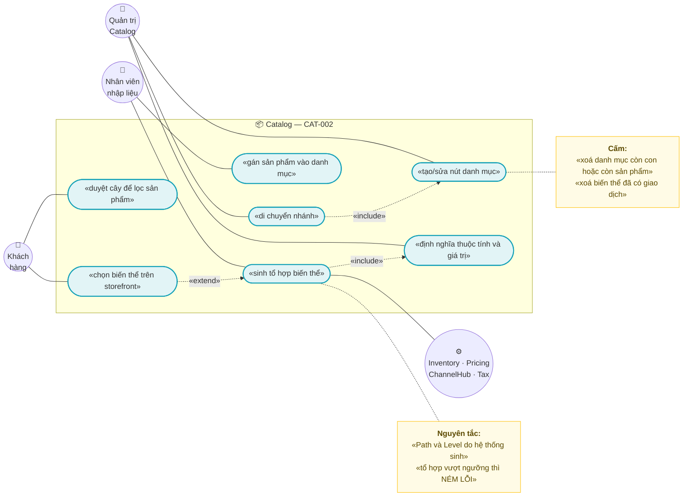
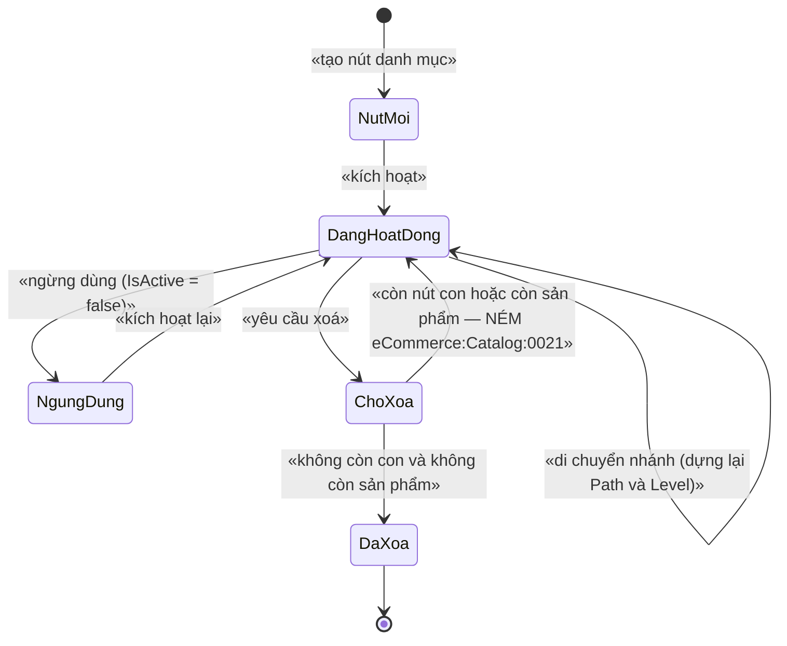
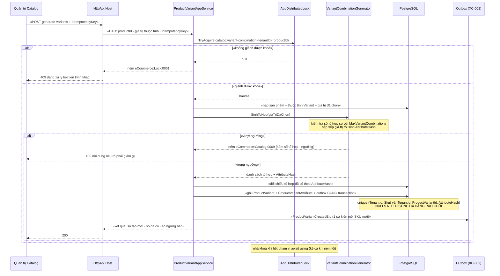

# `CAT-002` — Cây danh mục & thuộc tính/tổ hợp biến thể

| Thuộc tính | Nội dung |
|---|---|
| **Mã** | `CAT-002` |
| **Module** | **Catalog** (GĐ1) — hiện entity Catalog còn nằm ở `src/eCommerce.Domain/Entities/Catalog/` |
| **Giai đoạn** | **GĐ1 — Bán được trên website** (theo `docs/implementation-plan.md` §5 + Phụ lục A.3) |
| **Ưu tiên** | **Must have** |
| **Trạng thái** | 🟡 `Draft` — chờ review |
| **Người viết / người review** | *(điền)* / **Kiến trúc trưởng + BA Catalog** |
| **Phiên bản / ngày** | `v0.1 — 13/10/2026` |
| **Tài liệu liên quan** | `CAT-001` (sản phẩm & biến thể SKU) · `CAT-003` (media/SEO/hiển thị theo kênh) · `XC-001` (Money & làm tròn) · `XC-002` (outbox/inbox & idempotency) · `XC-003` (khoá phân tán) · `XC-004` (xác thực/phân quyền/tenant) · `XC-005` (observability) · `XC-006` (phân loại thuế theo SKU) · `PRC-*` (giá) · `INV-*` (tồn kho) · `docs/implementation-plan.md` · `docs/business-modules-proposal.md` |

> ⚠️ **Quy ước đọc tài liệu này:** mọi khẳng định về code **đều kèm đường dẫn file thật đã kiểm bằng `read`/`grep`**.
> Chỗ nào **chưa kiểm chứng được** thì ghi rõ **"chưa kiểm chứng"** — không suy đoán là đã xác minh.
> Chỗ nào feature **chưa có trong code** thì ghi rõ **"chưa có trong code — kế hoạch GĐx"**.

---

## 0. Tóm tắt & quyết định thiết kế

**Tóm tắt:** `CAT-002` chốt **mô hình cây danh mục** (cha–con + đường dẫn vật chất hoá để truy vấn nhanh) và
**mô hình thuộc tính → tổ hợp biến thể** (thuộc tính dùng để *sinh biến thể* ≠ thuộc tính chỉ để *mô tả*).
Đây là hai cấu trúc mà nếu thiết kế sai thì **phải migrate lại toàn bộ dữ liệu sản phẩm/đơn hàng** —
`business-modules-proposal.md` §1 đã xác nhận **hiện chưa có `Category`, `Brand`, `ProductAttribute`** trong code.

**Vì sao phải có tài liệu này (bằng chứng từ code thật):**

| Bằng chứng (đã kiểm bằng `read`/`grep`) | Hệ quả |
|---|---|
| `src/eCommerce.Domain/Entities/Catalog/Product.cs` **chỉ có 88 dòng**, gồm `Product` + `ProductVariant` — grep `Category\|Attribute\|Specification` toàn `src/` **không có kết quả nào** ngoài `Slug` | **Cây danh mục và thuộc tính CHƯA có trong code — kế hoạch GĐ1** |
| `Product.BrandId` tồn tại (`Product.cs:23`) **nhưng không có entity `Brand`** nào trong repo | Trường **mồ côi**; tài liệu này nêu ở §15.2 **F1** |
| `src/eCommerce.EntityFrameworkCore/eCommerceDbContext.cs:36-37` khai `DbSet<Catalog.Product>` + `DbSet<Catalog.ProductVariant>`; khối `ConfigureCommerce` ở `:97-130` | Entity mới **bắt buộc** có `DbSet` + mapping, nếu không `IRepository<T>` **không được đăng ký** (lỗi Phase 0 đã ghi trong comment `:48-52`) |
| `ProductVariant` có `decimal Price` (`Product.cs:71`) + mapping `HasPrecision(18,4)` (`eCommerceDbContext.cs:126`) — **không có `Money`/`Currency`** | ⚠️ **Lệch `XC-001` D2**: tiền phải đi qua `Money`. Xem §15.2 **F2** |
| `ProductVariant` **không có** trường/集合 nào mô tả thuộc tính (grep `Attribute` trong `Product.cs` = 0) | Tổ hợp biến thể **chưa có trong code — kế hoạch GĐ1** |
| `eCommerceDbContext.cs:109,129` sinh unique index `(TenantId, Code)` / `(TenantId, Sku)` bằng `unique: true` **thường** | Đã có migration sửa: `Migrations/20261013024226_Fix_NullableTenantId_UniqueIndexes.cs:40-46` dùng **`NULLS NOT DISTINCT`** ⇒ index mới của `CAT-002` **bắt buộc** theo cùng quy ước (`XC-004` BR-009) |
| `eCommerceConsts.Permissions` (`src/eCommerce.Domain.Shared/eCommerceConsts.cs:19-25`) chỉ có nhóm `Products`; provider (`src/eCommerce.Application.Contracts/Permissions/eCommercePermissionDefinitionProvider.cs:28-31`) định nghĩa đúng 4 permission đó | **Chưa có** permission `Categories` / `Attributes` ⇒ phải bổ sung **cả 2 nơi** (hằng số + provider), nếu không ⇒ `403` cho mọi người (`XC-004` D2) |
| `modules/Tax/eCommerce.Tax.Domain/TaxErrorCodes.cs:38-51` là mẫu **module tự sở hữu** error code + lock key | `CAT-002` theo đúng mẫu: `CatalogErrorCodes` + `CatalogLockKeys` thuộc module Catalog |

**Phạm vi:**
- ✅ **Cây danh mục**: cha–con, `Path`/`Level` vật chất hoá, `SortOrder`, di chuyển nhánh, chống chu trình, giới hạn độ sâu.
- ✅ **Gán sản phẩm ↔ danh mục** (n–n) + **một danh mục chính** (dùng cho breadcrumb/SEO — chi tiết SEO ở `CAT-003`).
- ✅ **Thuộc tính**: định nghĩa thuộc tính, giá trị chuẩn, gán vào danh mục, gán vào sản phẩm.
- ✅ **Phân biệt 2 loại thuộc tính**: `Variant` (dùng sinh tổ hợp biến thể) và `Specification` (chỉ mô tả).
- ✅ **Sinh tổ hợp biến thể** từ tích Descartes của các thuộc tính `Variant`, có **chặn bùng nổ tổ hợp**.
- ✅ **Bất biến**: không chu trình cây; SKU duy nhất theo tenant; tổ hợp giá trị duy nhất trên mỗi sản phẩm.
- ✅ Khoá phân tán, mã lỗi, sự kiện, migration, test case cho toàn bộ phần trên.

**Không nằm trong phạm vi:**
- ❌ **Trường giá của biến thể & bảng giá** — thuộc `PRC-001`/`PRC-002`; `CAT-002` chỉ *tham chiếu* `ProductVariant.Price`.
- ❌ **Media, SEO slug, hiển thị theo kênh** — thuộc `CAT-003`.
- ❌ **Thuộc tính riêng của sàn TMĐT** (Shopee `tier_variation`, Lazada `saleProp`) — thuộc `CHN-002`/`CHN-003` (GĐ4); `CAT-002` chỉ chốt **mô hình nội bộ**.
- ❌ **Thương hiệu (`Brand`) như một entity riêng** — ghi nhận ở §15.2 **F1** và §15.1 **Q5**, **chưa chốt** trong tài liệu này.
- ❌ **Import/export danh mục hàng loạt (Excel)** — chưa nằm trong DoD GĐ1; ghi nhận ở §15.1 **Q6**.
- ❌ **Bản dịch đa ngôn ngữ cho tên danh mục/thuộc tính** — chưa có yêu cầu; xem §15.3 giả định #5.

### 0.1 Quyết định thiết kế (ADR ngắn)

| # | Quyết định | Phương án đã cân nhắc | Lý do chọn | Hệ quả |
|---|---|---|---|---|
| **D1** | Cây danh mục dùng **Adjacency List + `Path` vật chất hoá** (không dùng `ltree`, không dùng closure table) | (a) chỉ `ParentId` · (b) **closure table** · (c) `ltree` của PostgreSQL · (d) `ParentId` + `Path` | (a) mỗi lần lấy cả cây phải đệ quy ⇒ không dùng được cho menu storefront; (b) closure table thêm 1 bảng + mọi thao tác ghi phải cập nhật nhiều dòng ⇒ phức tạp cho lợi ích chưa cần; (c) `ltree` là kiểu **riêng của PostgreSQL** ⇒ khoá chặt vào DB, khó test bằng provider khác; (d) `Path` là **một cột text** — lấy cây bằng **một** `LIKE 'path%'` sắp xếp theo `Path` | `Path` **phải được dựng lại khi di chuyển nhánh** (thao tác ghi đắt); giới hạn độ sâu để `Path` không phình |
| **D2** | `Path` lưu dạng **`/guid1/guid2/guid3/`** (có `/` đầu và cuối), **không** lưu tên/slug | (a) lưu `slug` trong path · (b) lưu `Guid` | Slug **đổi được** (SEO) ⇒ path sẽ hỏng mọi lúc khi đổi tên; `Guid` **bất biến** ⇒ path chỉ đổi khi **di chuyển nhánh** | `Path` không đọc được bằng mắt ⇒ **phải** có test `TC-09` bảo đảm `Path` khớp cây thật |
| **D3** | Entity danh mục là **aggregate của chính nó**, **không** nạp cả cây vào bộ nhớ | (a) `Category` chứa `List<Category> Children` như `Product.Variants` (`Product.cs:27`) · (b) mỗi nút là một aggregate, thao tác cây qua domain service + lock | (a) nạp cả cây vào 1 aggregate ⇒ **tranh chấp ghi giữa hai nhánh khác nhau** (hai người sửa 2 nhánh vẫn đụng nhau) và bộ nhớ tăng theo cây; (b) đúng ranh giới giao dịch, chỉ khoá khi **di chuyển nhánh** | Không có navigation `Children` ⇒ **thao tác cây phải đi qua `CategoryTreeService`** (không được sửa `ParentId` trực tiếp từ app service) |
| **D4** | **Tách 2 loại thuộc tính**: `Variant` (sinh biến thể) và `Specification` (chỉ mô tả) | (a) một loại duy nhất, cờ `IsVariant` · (b) hai loại tường minh | Cùng một cờ nhưng **luật khác hẳn**: `Variant` **không được xoá** khi đã có biến thể dùng nó, còn `Specification` xoá được tự do. Nếu chỉ có cờ thì guard rất dễ viết sai | Enum `CatalogAttributeUsage { Specification = 0, Variant = 1 }`; tổ hợp chỉ sinh từ `Variant` |
| **D5** | Tổ hợp biến thể sinh **một lần, tường minh** — **không** sinh lại tự động mỗi khi đọc | (a) tính động khi đọc (kiểu `Dictionary<string,int>` của OCC) · (b) sinh bản ghi `ProductVariant` thật | (a) **không gắn được SKU/giá/tồn kho** vào tổ hợp ⇒ `Inventory` và `ChannelHub` không có gì để tham chiếu (đã kiểm: `ChannelListing` map theo `ProductVariantId`, xem `eCommerceDbContext.cs:74-76`); (b) mỗi tổ hợp **là** một SKU thật ⇒ tồn kho/kênh hoạt động ngay | Đổi tập thuộc tính ⇒ phải **sinh lại/đối chiếu**, không được xoá biến thể đã phát sinh giao dịch (D9) |
| **D6** | **Chặn bùng nổ tổ hợp** bằng `MaxVariantCombinations` (mặc định **200**) + **kiểm tra TRƯỚC khi ghi** | (a) không giới hạn · (b) giới hạn cứng trong code · (c) ngưỡng cấu hình được theo tenant | Tích Descartes **nổ theo cấp số nhân** (5 màu × 6 size × 4 chất liệu = 120; thêm 3 kiểu dáng = 360); (a) treo request và phình DB; (b) mọi tenant phải chịu cùng ngưỡng — sai cho cả shop nhỏ và shop lớn | Vượt ngưỡng ⇒ **ném lỗi** `eCommerce:Catalog:0009` **kèm số tổ hợp dự kiến** để người dùng biết phải giảm gì |
| **D7** | Tổ hợp giá trị là **duy nhất trên mỗi sản phẩm**, cưỡng chế bằng **unique index trên cột hash** | (a) kiểm tra trong code rồi insert · (b) unique index trên bảng con `ProductVariantAttribute` | (a) kiểm tra-rồi-ghi là **race condition** kinh điển (2 request cùng lúc đều qua kiểm tra); (b) unique index trên bảng con **không** diễn đạt được "**tổ hợp** (A=đỏ,Size=M) là duy nhất" vì mỗi dòng chỉ là một cặp | Thêm cột **`AttributeHash`** = chuỗi chuẩn hoá đã sắp xếp của tổ hợp; unique `(TenantId, ProductVariantId, AttributeHash)` **NULLS NOT DISTINCT** theo `XC-004` BR-009 — đây là **hàng rào cuối cùng** khi lock/Redis chết (`XC-003` D2) |
| **D8** | Thao tác **di chuyển nhánh** dùng **khoá phân tán theo tenant** + **kiểm tra chu trình trong transaction** | (a) chỉ kiểm tra trong code · (b) lock + kiểm tra + `UPDATE … WHERE` | (a) hai người cùng di chuyển 2 nhánh có thể tạo **chu trình** (A→B và B→A) mà không ai thấy lỗi; (b) lock giảm tranh chấp, **ràng buộc thật** là kiểm tra lại `Path` trong cùng transaction + `CHECK` độ sâu | Khoá **toàn tenant** (không phải theo nút) ⇒ di chuyển cây là thao tác **tuần tự hoá toàn tenant**, chấp nhận vì tần suất rất thấp |
| **D9** | **Không xoá cứng** danh mục còn con hoặc còn sản phẩm — **ném lỗi**; biến thể đã phát sinh giao dịch thì **ngừng bán**, không xoá | (a) `OnDelete(Cascade)` như `Product → Variants` (`eCommerceDbContext.cs:111-114`) · (b) chặn bằng guard + `Restrict` ở DB | (a) xoá 1 nút danh mục mà **mất sản phẩm** (hoặc xoá cả cây) là tai nạn không hồi phục và **không có lỗi biên dịch**; (b) `Restrict` + guard ném lỗi có mã ⇒ người dùng hiểu ngay | Phải có **luồng "ngừng dùng"** (soft) thay cho xoá: `Category.IsActive = false` |
| **D10** | Tên permission theo `eCommerce.<Nhóm>.<HànhĐộng>` và **bổ sung đồng thời cả hằng số + provider** | (a) chỉ thêm hằng số · (b) chỉ thêm provider · (c) thêm cả hai **trong cùng PR** | (a)/(b) ⇒ **`403` cho mọi người kể cả admin** — đúng lỗi đã xảy ra thật ở Phase 0 (`XC-004` D2, E3) | Mọi permission mới của `CAT-002` phải xuất hiện ở **2 file**: `eCommerceConsts.cs` + `eCommercePermissionDefinitionProvider.cs`, và bị `TC-01`/`TC-02` của `XC-004` chặn nếu thiếu |
| **D11** | **Không dùng `double`/`float`** ở bất kỳ trường nào của `CAT-002` | (a) `double` cho trọng lượng/kích thước · (b) `decimal` | `CAT-002` có các trường **số đo** (khối lượng gram, kích thước) và **số lượng** (`SortOrder`, `MaxVariantCombinations`); `double` gây sai số tích luỹ khi cộng và khi so sánh | Dùng `int` cho số đếm và `decimal(18,4)` cho số đo — nhất quán `XC-001` BR-008 |

---

## 1. Use Case Specification

| Thuộc tính | Nội dung |
|---|---|
| **Use Case ID** | `CAT-002` |
| **Use Case Name** | Tổ chức sản phẩm thành cây danh mục và sinh biến thể từ tổ hợp thuộc tính |
| **Description** | *"Là quản trị viên Catalog, tôi muốn tổ chức sản phẩm thành cây danh mục và định nghĩa thuộc tính (màu, size…) để hệ thống tự sinh ra các biến thể có SKU riêng — để khách chọn đúng biến thể, và để tồn kho/giá bán theo đúng SKU đó."* |
| **Actor(s)** | **Quản trị Catalog** (dựng cây, định nghĩa thuộc tính, sinh biến thể) · **Nhân viên nhập liệu** (gán sản phẩm vào danh mục) · **Khách hàng** (duyệt cây + chọn biến thể trên storefront) · **Hệ thống** (`Inventory`, `Pricing`, `ChannelHub`, `Tax` tiêu thụ SKU) |
| **Priority** | **Must have** |
| **Trigger** | (a) tạo/sửa/di chuyển nút danh mục; (b) định nghĩa thuộc tính và giá trị thuộc tính; (c) gán thuộc tính `Variant` cho sản phẩm rồi bấm **sinh biến thể**; (d) storefront duyệt cây để lọc sản phẩm |
| **Pre-Condition(s)** | • **Tenant hiện tại** (`TenantId` từ `ICurrentTenant`) — hiện hệ thống chạy **1 tenant** ⇒ `TenantId` **có thể là `NULL`** (`XC-004` §5.2 F1).<br>• `TenantId` của mọi bảng mới **phải** nằm trong unique index theo `NULLS NOT DISTINCT` (`XC-004` BR-009).<br>• **Sản phẩm đã tồn tại** (`Catalog.Product`, `Product.cs:10`) — nếu chưa có thì thuộc `CAT-001`.<br>• **Không áp dụng `ChannelCode`**: cấu trúc danh mục và thuộc tính là **dùng chung mọi kênh**; phần *hiển thị theo kênh* thuộc `CAT-003`. Cách ly ở đây là **cách ly theo tenant**.<br>• `AbpDistributedLock` + Redis 7 **chỉ cần** cho thao tác di chuyển nhánh và sinh tổ hợp — nếu Redis chết, **ràng buộc DB vẫn phải chặn** (`XC-003` D2). |
| **Post-Condition(s)** | • Cây danh mục **không có chu trình**, mọi nút có `Path` khớp cây thật và `Level` = số tổ tiên.<br>• Mỗi sản phẩm có **tối đa một** danh mục chính; mọi danh mục được gán đều **đang hoạt động**.<br>• Mọi biến thể có `Sku` **duy nhất trong tenant** và **một** `AttributeHash` **duy nhất trong sản phẩm**.<br>• Mọi thao tác ghi đi qua **Unit of Work**; sự kiện đi qua **outbox** (`XC-002`). |
| **Basic Flow** | 1. Quản trị tạo nút danh mục gốc: hệ thống sinh `Path = /{id}/`, `Level = 0`.<br>2. Tạo nút con: `Path = parent.Path + {id} + "/"`, `Level = parent.Level + 1`; kiểm tra `Level < MaxDepth`.<br>3. Định nghĩa `CatalogAttribute` (ví dụ "Màu sắc", `Usage = Variant`) và các `CatalogAttributeValue` ("Đỏ", "Xanh").<br>4. Gán thuộc tính vào danh mục ⇒ sản phẩm trong danh mục **kế thừa** tập thuộc tính được phép.<br>5. Trên sản phẩm, chọn tập giá trị cho từng thuộc tính `Variant`.<br>6. Hệ thống tính **tích Descartes**, kiểm tra `số tổ hợp ≤ MaxVariantCombinations` ⇒ nếu vượt, **dừng và báo lỗi** (D6).<br>7. Trong **một** transaction: tạo `ProductVariant` cho mỗi tổ hợp + `ProductVariantAttribute` cho từng cặp (thuộc tính, giá trị) + cột `AttributeHash`.<br>8. Phát `ProductVariantCreatedEto` (một sự kiện cho mỗi SKU mới) để `Tax` (XC-006) tạo dòng "SKU chưa phân loại".<br>9. Storefront đọc cây bằng **một** truy vấn `Path LIKE` + `Level` để dựng menu. |
| **Alternative Flow** | **A1: Sinh lại tổ hợp sau khi thêm giá trị thuộc tính** — hệ thống **đối chiếu** tập tổ hợp hiện có với tập mới: tổ hợp **đã có** thì giữ nguyên `Id`/`Sku` (không mất liên kết tồn kho/kênh); tổ hợp **mới** thì tạo; tổ hợp **không còn** thì **ngừng bán** (`IsActive = false`) **chứ không xoá** (D9).<br>**A2: Di chuyển nhánh** — dùng khoá `catalog:category-tree:{tenantId}` (D8), kiểm tra nút đích **không nằm trong cây con** của nút nguồn, rồi cập nhật `Path`/`Level` cho **toàn bộ** cây con trong **một** transaction.<br>**A3: Thuộc tính `Specification`** — chỉ để hiển thị/lọc, **không** tham gia sinh tổ hợp, **xoá được** tự do.<br>**A4: Danh mục ảo (không bán)** — nút chỉ để nhóm menu: `IsActive = true` nhưng **không** gán sản phẩm trực tiếp; không có cơ chế riêng, chỉ là quy ước vận hành. |
| **Exception Flow** | **E1:** di chuyển nút vào chính cây con của nó (tạo chu trình) ⇒ `BusinessException` `eCommerce:Catalog:0020`.<br>**E2:** xoá danh mục còn nút con hoặc còn sản phẩm ⇒ `BusinessException` `eCommerce:Catalog:0021` (D9) — **không** xoá lan.<br>**E3:** số tổ hợp vượt `MaxVariantCombinations` ⇒ `BusinessException` `eCommerce:Catalog:0009` kèm `{soToHop}` + `{nguong}` (D6).<br>**E4:** sinh tổ hợp tạo ra SKU đã tồn tại **trong tenant** ⇒ `BusinessException` `eCommerce:Catalog:0002`; ràng buộc DB `IX_CatProductVariants_TenantId_Sku` là chốt cuối.<br>**E5:** tổ hợp giá trị đã tồn tại trên sản phẩm ⇒ `BusinessException` `eCommerce:Catalog:0022`; unique index `(TenantId, ProductVariantId, AttributeHash)` là chốt cuối (D7).<br>**E6:** thuộc tính `Variant` bị xoá/ngừng dùng trong khi đã có biến thể dùng nó ⇒ `BusinessException` `eCommerce:Catalog:0023` (chỉ **ngừng dùng** `IsActive = false`, không xoá).<br>**E7:** không giành được khoá khi di chuyển nhánh/sinh tổ hợp ⇒ `BusinessException` `eCommerce:Lock:0001` (`XC-003` §6.2), HTTP `409`.<br>**E8:** `Level` vượt `MaxDepth` ⇒ `BusinessException` `eCommerce:Catalog:0024`. |
| **Business Rules** | • **BR-CAT-002-001**: `Path` của một nút **phải** bằng `Path` của cha + `Id` của chính nút, bao bằng `/`; nút gốc có `Path = /{Id}/`; **cấm** ghi `Path` thủ công ngoài `CategoryTreeService`.<br>• **BR-CAT-002-002**: `Level` **phải** bằng số tổ tiên (nút gốc = 0) và **phải** khớp `Path`; vi phạm ⇒ ném lỗi, **không** tự sửa im lặng.<br>• **BR-CAT-002-003**: Cây **không được có chu trình**; di chuyển nút vào cây con của chính nó ⇒ **ném** `eCommerce:Catalog:0020`.<br>• **BR-CAT-002-004**: Độ sâu cây **≤ `MaxDepth`** (mặc định **5**) — vượt ⇒ **ném** `eCommerce:Catalog:0024`.<br>• **BR-CAT-002-005**: Danh mục còn nút con **hoặc** còn sản phẩm **không được xoá** ⇒ **ném** `eCommerce:Catalog:0021`; **cấm** `Cascade` (D9).<br>• **BR-CAT-002-006**: Mỗi sản phẩm có **tối đa một** danh mục chính (`IsPrimary = true`); gán danh mục chính mới ⇒ danh mục chính cũ tự chuyển `false` **trong cùng transaction**.<br>• **BR-CAT-002-007**: Mọi danh mục được gán cho sản phẩm **phải** tồn tại và `IsActive = true`; gán danh mục ngừng dùng ⇒ **ném** `eCommerce:Catalog:0021`.<br>• **BR-CAT-002-008**: Mọi `CatalogAttribute` **phải** khai `Usage` ∈ {`Specification`, `Variant`}; **chỉ** `Variant` được dùng để sinh tổ hợp.<br>• **BR-CAT-002-009**: Tổ hợp biến thể là **tích Descartes** của các giá trị đã chọn trên các thuộc tính `Variant`; số tổ hợp **≤ `MaxVariantCombinations`** (mặc định **200**) — vượt ⇒ **ném** `eCommerce:Catalog:0009` **trước khi** ghi bất cứ dòng nào.<br>• **BR-CAT-002-010**: Mỗi tổ hợp sinh ra **phải** có `Sku` duy nhất trong tenant và **một** `AttributeHash` duy nhất trên sản phẩm (D7) — cưỡng chế bằng unique index, không chỉ bằng kiểm tra trong code.<br>• **BR-CAT-002-011**: `AttributeHash` **phải** được sinh bằng **một** hàm duy nhất trong domain (giá trị đã sắp xếp theo `AttributeId`); **cấm** ghép chuỗi tại chỗ (bài học "khoá lệch" của `XC-003` F1).<br>• **BR-CAT-002-012**: **Cấm xoá cứng** biến thể đã phát sinh giao dịch (đơn hàng/tồn kho/listing); thay bằng `IsActive = false` (D9).<br>• **BR-CAT-002-013**: Sinh lại tổ hợp **phải giữ nguyên** `Id`/`Sku` của tổ hợp đã tồn tại — **cấm** xoá-rồi-tạo-lại (A1).<br>• **BR-CAT-002-014**: Mọi thao tác ghi (tạo/sửa/di chuyển/xoá/gán/sinh tổ hợp) **phải** đi qua **Unit of Work** của ABP; **cấm** `SaveChanges` rời.<br>• **BR-CAT-002-015**: Mọi thao tác di chuyển nhánh và sinh tổ hợp **phải** chạy trong **khoá phân tán** theo quy ước `XC-003`; **cấm** acquire lồng cùng tên khoá (`XC-003` D6).<br>• **BR-CAT-002-016**: `AttributeHash` **phải** ổn định với **thứ tự** chọn giá trị (chọn "Đỏ→M" và "M→Đỏ" cho **cùng** hash) ⇒ phải sắp xếp trước khi băm.<br>• **BR-CAT-002-017**: Mọi trường số đo khối lượng/kích thước dùng `decimal`; **cấm** `double`/`float` (`XC-001` BR-008, D11).<br>• **BR-CAT-002-018**: Mọi unique index có `TenantId` **phải** dùng **`NULLS NOT DISTINCT`** (`XC-004` BR-009) — áp cho **mọi** index mới của `CAT-002`.<br>• **BR-CAT-002-019**: Mọi permission mới **phải** được khai ở **cả** `eCommerceConsts.Permissions` **và** `eCommercePermissionDefinitionProvider` trong cùng PR (D10); thiếu một nơi ⇒ `403` cho mọi người (`XC-004` E3).<br>• **BR-CAT-002-020**: Mọi app service **phải** có `[Authorize]` ở **cấp class** (`XC-004` BR-001, D3). |
| **Non-Functional Requirement** | • **NFR-CAT-002-001**: Lấy **toàn bộ** cây 500 nút ⇒ p95 **< 50 ms**.<br>• **NFR-CAT-002-002**: Sinh **200** tổ hợp (kèm 200 dòng `ProductVariantAttribute`) ⇒ p95 **< 1 s**.<br>• **NFR-CAT-002-003**: **0** chu trình trong cây sau **100** thao tác di chuyển ngẫu nhiên (property test).<br>• **NFR-CAT-002-004**: **0** bản ghi vi phạm bất biến khi Redis chết (ràng buộc DB vẫn chặn) — `XC-003` D2.<br>• **NFR-CAT-002-005**: **100 %** app service của Catalog có `[Authorize]` cấp class (`XC-004` TC-01).<br>• **NFR-CAT-002-006**: **0** permission dùng trong `[Authorize]` mà chưa định nghĩa (`XC-004` TC-02).<br>• **NFR-CAT-002-007**: Cách ly tenant: cây danh mục của tenant A **không** đọc/ghi được từ tenant B.<br>• **NFR-CAT-002-008**: Mọi thao tác sinh tổ hợp **phải** có dấu vết quan sát được: log có `CorrelationId` + metric khi bị chặn vì vượt ngưỡng (`XC-005`). |

---

## 2. Sơ đồ Use Case



**Chú giải**

| Ký hiệu | Ý nghĩa |
|---|---|
| ⭕ Xanh lá | Actor |
| 🟦 Bầu dục xanh dương | Use Case |
| 🟨 Khung vàng | Note (nguyên tắc / điều cấm) |
| `───` | Liên kết Actor ↔ Use Case hoặc Use Case ↔ hệ thống tiêu thụ |
| `-.«include».->` | Quan hệ bao hàm |
| `-.«extend».->` | Quan hệ mở rộng |

---

## 3. Sơ đồ trạng thái (state machine)

`CAT-002` có **hai** vòng đời: **(A)** nút danh mục, **(B)** tổ hợp biến thể. Cả hai dùng **cùng một nguyên tắc**:
guard sai ⇒ **NÉM LỖI có mã**, không im lặng (nguyên tắc #11 của `docs/implementation-plan.md` §3).



**Bảng chuyển trạng thái & guard — (A) nút danh mục:**

| # | Từ → Sang | Guard (điều kiện cho phép) | Hành động kèm theo | Nếu guard sai thì? |
|---|---|---|---|---|
| 1 | `[*]` → `NutMoi` | Có permission `eCommerce.Categories.Create`; `ParentId` (nếu có) tồn tại và `Level < MaxDepth` | Sinh `Path`, `Level` (BR-001/002); ghi qua UoW | **Ném** `eCommerce:Catalog:0024` nếu vượt độ sâu |
| 2 | `NutMoi` → `DangHoatDong` | `Code` không trùng trong tenant | Ghi + outbox | DB unique `(TenantId, Code)` **NULLS NOT DISTINCT** chặn ⇒ lỗi DB được bọc thành `BusinessException` |
| 3 | `DangHoatDong` → `DangHoatDong` | Nút đích **không** nằm trong cây con của nút nguồn; đã giành khoá `catalog:category-tree:{tenantId}` | Dựng lại `Path`/`Level` cho **toàn bộ** cây con trong **một** transaction | **Ném** `eCommerce:Catalog:0020` (chu trình) hoặc `eCommerce:Lock:0001` (không giành được khoá) |
| 4 | `DangHoatDong` → `NgungDung` | Có permission `eCommerce.Categories.Edit` | `IsActive = false`; **không** xoá liên kết sản phẩm | — |
| 5 | `NgungDung` → `DangHoatDong` | Cha (nếu có) đang `DangHoatDong` **hoặc** là gốc | `IsActive = true` | **Ném** `eCommerce:Catalog:0021` (cha đang ngừng dùng ⇒ cây sẽ mâu thuẫn) |
| 6 | `DangHoatDong` → `ChoXoa` | Có permission `eCommerce.Categories.Delete` | Bắt đầu kiểm tra ràng buộc | — |
| 7 | `ChoXoa` → `DangHoatDong` | **Còn** nút con **hoặc** còn `ProductCategory` | **Không** thay đổi dữ liệu | **Ném** `eCommerce:Catalog:0021` — **cấm** xoá lan (BR-005) |
| 8 | `ChoXoa` → `DaXoa` | Không còn con, không còn sản phẩm, không còn `ProductVariant` tham chiếu | Xoá cứng nút (chỉ nút lá, chưa từng dùng) | — |

**Bảng chuyển trạng thái & guard — (B) tổ hợp biến thể:**

| # | Từ → Sang | Guard (điều kiện cho phép) | Hành động kèm theo | Nếu guard sai thì? |
|---|---|---|---|---|
| 1 | `[*]` → `Moi` | Tập thuộc tính `Variant` có **≥ 1** giá trị cho **mỗi** thuộc tính đã chọn; `soToHop ≤ MaxVariantCombinations` | Sinh `ProductVariant` + `AttributeHash`; phát `ProductVariantCreatedEto` | **Ném** `eCommerce:Catalog:0009` **trước khi ghi** (BR-009) |
| 2 | `Moi` → `DangBan` | `Sku` chưa tồn tại trong tenant | Ghi + outbox | **Ném** `eCommerce:Catalog:0002`; DB unique `(TenantId, Sku)` chặn |
| 3 | `Moi` → `Moi` | Tổ hợp sinh lại **trùng** `AttributeHash` đã có trên sản phẩm | **Không tạo mới** — đối chiếu và giữ `Id`/`Sku` cũ (BR-013) | Nếu vẫn cố chèn ⇒ **Ném** `eCommerce:Catalog:0022`; DB unique `(TenantId, ProductVariantId, AttributeHash)` chặn |
| 4 | `DangBan` → `NgungBan` | Biến thể đã phát sinh giao dịch (đơn/tồn kho/listing) và **không còn** giá trị thuộc tính hợp lệ | `IsActive = false`; **giữ nguyên** `Id`/`Sku` | — |
| 5 | `DangBan` → `DaXoa` | **CHỈ** khi chưa từng phát sinh giao dịch (không có `StockLedgerEntry`, không có `ChannelListing`, không có dòng đơn) | Xoá cứng | **Ném** `eCommerce:Catalog:0023` nếu đã có giao dịch (BR-012) |
| 6 | `NgungBan` → `DangBan` | Giá trị thuộc tính của tổ hợp **đang** hợp lệ trở lại | `IsActive = true` | — |

> ⚠️ **Trạng thái hấp thụ (absorbing):** `DaXoa` của cả hai vòng đời. Không có chuyển ra khỏi `DaXoa`.
> **Ai được chuyển:** các bước `1..8` (A) và `1..6` (B) đều do **app service** thực hiện dưới permission đã khai (§9);
> **không** có webhook hay job ngoài nào được chuyển trạng thái của `CAT-002`.

---

## 4. Sequence Diagram & luồng dữ liệu

### 4.1 Sinh tổ hợp biến thể (luồng chính, có khoá + idempotency)



### 4.2 Luồng dữ liệu — cây danh mục phục vụ storefront

**Không dùng sơ đồ Mermaid riêng** (đã đủ 3 sơ đồ — xem §4.1, §2, §3). Mô tả bằng bảng:

| Bước | Nguồn | Xử lý | Đích |
|---|---|---|---|
| 1 | Bảng `CatCategories` | `SELECT … WHERE Path LIKE '{rootPath}%' ORDER BY Path` | Dựng cây trong bộ nhớ **một lần** cho mỗi request |
| 2 | `Level` của nút gốc cần lấy | Cắt theo `Level <= {rootLevel} + {soTangCanLay}` | Giới hạn kích thước trả về |
| 3 | `SortOrder`, `IsActive` | Sắp xếp và lọc nút ngừng dùng | Menu storefront |
| 4 | `CatProductCategories` | Đếm/đếm sản phẩm theo nút (`GROUP BY CategoryId`) | Hiển thị số sản phẩm |

> ⚠️ **Chênh lệch cần ghi rõ:** cây trả về theo `Path LIKE` **bao gồm cả nút `IsActive = false`** nếu không lọc;
> và **số sản phẩm hiển thị trên nút cha** (đếm trực tiếp, không gồm nút con) **khác** số sản phẩm khi người dùng
> bấm vào nút (đã gộp con). UI **phải** ghi rõ đang hiển thị kiểu nào — đây là loại nhầm rất khó phát hiện khi test.

---

## 5. Mô hình dữ liệu

### 5.1 ERD (mô tả bằng bảng — giữ đúng ngân sách 3 sơ đồ Mermaid)

**Không dùng `erDiagram` Mermaid** vì tài liệu này đã dùng 3 sơ đồ (§2, §3, §4.1) theo giới hạn đầu bài.
Quan hệ giữa các bảng:

| Quan hệ | Kiểu | Ghi chú |
|---|---|---|
| `Category` → `Category` | tự tham chiếu (`ParentId`) | cây; `Restrict` khi xoá (D9) |
| `Category` ↔ `Product` | n–n qua `ProductCategory` | `IsPrimary` bảo đảm **tối đa một** danh mục chính (BR-006) |
| `CatalogAttribute` → `CatalogAttributeValue` | 1–n | `Usage` quyết định có tham gia sinh tổ hợp (BR-008) |
| `Category` ↔ `CatalogAttribute` | n–n qua `CategoryAttribute` | thuộc tính được phép dùng trong danh mục |
| `Product` ↔ `CatalogAttributeValue` | n–n qua `ProductAttributeSelection` | tập giá trị người dùng chọn để sinh tổ hợp |
| `ProductVariant` → `ProductVariantAttribute` | 1–n | mỗi dòng = **một** cặp (thuộc tính, giá trị) đã chốt |
| `ProductVariant` | có cột `AttributeHash` | **hàng rào cuối** cho bất biến tổ hợp duy nhất (D7) |

### 5.2 Bảng & cột (Data Dictionary)

> 🚨 **Tất cả bảng dưới đây CHƯA có trong code — kế hoạch GĐ1.**
> Đã kiểm bằng `glob`/`grep`: `src/eCommerce.Domain/Entities/Catalog/` **chỉ có `Product.cs`**.

**Bảng `CatCategories`** — *cây danh mục*

| Cột | Kiểu | Null? | Nguồn / ý nghĩa | Ghi chú |
|---|---|---|---|---|
| `Id` | `uuid` | ✖ | khoá chính | |
| `TenantId` | `uuid` | ✔ | tenant sở hữu | **bắt buộc** vì entity là `IMultiTenant` (`XC-004` BR-009) |
| `ParentId` | `uuid` | ✔ | nút cha; `NULL` = gốc | `Restrict` khi xoá (D9) |
| `Code` | `varchar(64)` | ✖ | mã nghiệp vụ, duy nhất trong tenant | dùng cho import/report |
| `Name` | `varchar(256)` | ✖ | tên hiển thị | |
| `Slug` | `varchar(256)` | ✔ | phần SEO | ⚠️ chi tiết SEO thuộc `CAT-003` |
| `Path` | `varchar(1024)` | ✖ | `/guid/guid/` | **do `CategoryTreeService` sinh** (BR-001) |
| `Level` | `int` | ✖ | số tổ tiên (gốc = 0) | khớp `Path` (BR-002) |
| `SortOrder` | `int` | ✖ | thứ tự hiển thị trong nút cha | `int`, **không** `double` (D11) |
| `IsActive` | `bool` | ✖ | ngừng dùng thay cho xoá | |
| `MaxVariantCombinations` | `int` | ✔ | ghi đè ngưỡng mặc định **200** theo nút | `NULL` = dùng mặc định tenant (D6) |

**Bảng `CatProductCategories`** — *gán sản phẩm ↔ danh mục*

| Cột | Kiểu | Null? | Nguồn / ý nghĩa | Ghi chú |
|---|---|---|---|---|
| `Id` | `uuid` | ✖ | khoá chính | |
| `TenantId` | `uuid` | ✔ | tenant | |
| `ProductId` | `uuid` | ✖ | FK `CatProducts` | |
| `CategoryId` | `uuid` | ✖ | FK `CatCategories` | |
| `IsPrimary` | `bool` | ✖ | danh mục chính cho breadcrumb/SEO | **tối đa một** `true`/sản phẩm (BR-006) |
| `SortOrder` | `int` | ✖ | thứ tự |

**Bảng `CatAttributes`** — *định nghĩa thuộc tính*

| Cột | Kiểu | Null? | Nguồn / ý nghĩa | Ghi chú |
|---|---|---|---|---|
| `Id` | `uuid` | ✖ | khoá chính | |
| `TenantId` | `uuid` | ✔ | tenant | |
| `Code` | `varchar(64)` | ✖ | mã thuộc tính | duy nhất trong tenant |
| `Name` | `varchar(256)` | ✖ | tên hiển thị | |
| `Usage` | `int` | ✖ | `Specification = 0` · `Variant = 1` | **quyết định có sinh tổ hợp** (BR-008) |
| `IsActive` | `bool` | ✖ | ngừng dùng | **không xoá** khi đã có biến thể dùng (BR-012/E6) |

**Bảng `CatAttributeValues`** — *giá trị của thuộc tính*

| Cột | Kiểu | Null? | Nguồn / ý nghĩa | Ghi chú |
|---|---|---|---|---|
| `Id` | `uuid` | ✖ | khoá chính | |
| `TenantId` | `uuid` | ✔ | tenant | |
| `AttributeId` | `uuid` | ✖ | FK `CatAttributes` | |
| `Value` | `varchar(256)` | ✖ | giá trị hiển thị ("Đỏ", "M") | duy nhất trong thuộc tính |
| `SortOrder` | `int` | ✖ | thứ tự hiển thị | ảnh hưởng thứ tự bộ chọn, **không** ảnh hưởng `AttributeHash` |
| `IsActive` | `bool` | ✖ | ngừng dùng | |

**Bảng `CatCategoryAttributes`** — *thuộc tính được phép trong danh mục*

| Cột | Kiểu | Null? | Ghi chú |
|---|---|---|---|
| `Id` | `uuid` | ✖ | khoá chính |
| `TenantId` | `uuid` | ✔ | tenant |
| `CategoryId` | `uuid` | ✖ | FK `CatCategories` |
| `AttributeId` | `uuid` | ✖ | FK `CatAttributes` |
| `IsRequired` | `bool` | ✖ | bắt buộc nhập khi tạo sản phẩm trong danh mục |

**Bảng `CatProductAttributeSelections`** — *giá trị thuộc tính `Variant` người dùng đã chọn trên sản phẩm*

| Cột | Kiểu | Null? | Ghi chú |
|---|---|---|---|
| `Id` | `uuid` | ✖ | khoá chính |
| `TenantId` | `uuid` | ✔ | tenant |
| `ProductId` | `uuid` | ✖ | FK `CatProducts` |
| `AttributeId` | `uuid` | ✖ | FK `CatAttributes`, **phải** có `Usage = Variant` |
| `AttributeValueId` | `uuid` | ✖ | FK `CatAttributeValues` |
| `SortOrder` | `int` | ✖ | thứ tự hiển thị của bộ chọn |

**Bảng `CatProductVariantAttributes`** — *tổ hợp đã chốt của một biến thể*

| Cột | Kiểu | Null? | Ghi chú |
|---|---|---|---|
| `Id` | `uuid` | ✖ | khoá chính |
| `TenantId` | `uuid` | ✔ | tenant |
| `ProductVariantId` | `uuid` | ✖ | FK `CatProductVariants` (`Product.cs:56`) |
| `AttributeId` | `uuid` | ✖ | FK `CatAttributes` |
| `AttributeValueId` | `uuid` | ✖ | FK `CatAttributeValues` |

**Cột thêm vào bảng đã có `CatProductVariants`** (`eCommerceDbContext.cs:117-130`)

| Cột | Kiểu | Null? | Ghi chú |
|---|---|---|---|
| `AttributeHash` | `varchar(128)` | ✔ | hash của tổ hợp đã **sắp xếp** (BR-011/016). `NULL` cho biến thể **không** sinh từ tổ hợp (sản phẩm đơn giản) |
| `IsActive` | `bool` | ✖ | ⚠️ **xác nhận trước khi code:** `ProductVariant` hiện **đã có** `IsActive` (`Product.cs:78`, mặc định `true`) ⇒ **không** thêm trùng |

**Index & ràng buộc** *(phần hay bị bỏ sót nhất)*

| Loại | Bảng | Cột | Mục đích |
|---|---|---|---|
| UNIQUE **NULLS NOT DISTINCT** | `CatCategories` | `(TenantId, Code)` | chống trùng mã (BR-018) |
| UNIQUE **NULLS NOT DISTINCT** | `CatCategories` | `(TenantId, ParentId, Slug)` | chống trùng slug trong cùng nút cha |
| INDEX | `CatCategories` | `(TenantId, Path)` | **truy vấn nóng nhất**: lấy cả cây bằng `LIKE` |
| INDEX | `CatCategories` | `(TenantId, ParentId, SortOrder)` | dựng một tầng |
| CHECK | `CatCategories` | `Level >= 0 AND Level <= 5` | chặn độ sâu ở tầng DB (BR-004) |
| CHECK | `CatCategories` | `Path LIKE '/%/'` | chặn `Path` sai định dạng (BR-001) |
| UNIQUE **NULLS NOT DISTINCT** | `CatProductCategories` | `(TenantId, ProductId, CategoryId)` | chống gán trùng |
| UNIQUE **có filter** **NULLS NOT DISTINCT** | `CatProductCategories` | `(TenantId, ProductId) WHERE IsPrimary` | **tối đa một** danh mục chính (BR-006) |
| UNIQUE **NULLS NOT DISTINCT** | `CatAttributes` | `(TenantId, Code)` | chống trùng mã thuộc tính |
| UNIQUE **NULLS NOT DISTINCT** | `CatAttributeValues` | `(TenantId, AttributeId, Value)` | chống trùng giá trị trong thuộc tính |
| UNIQUE **NULLS NOT DISTINCT** | `CatCategoryAttributes` | `(TenantId, CategoryId, AttributeId)` | chống gán trùng |
| UNIQUE **NULLS NOT DISTINCT** | `CatProductAttributeSelections` | `(TenantId, ProductId, AttributeId, AttributeValueId)` | chống chọn trùng |
| UNIQUE **NULLS NOT DISTINCT** | `CatProductVariantAttributes` | `(TenantId, ProductVariantId, AttributeId)` | **một** giá trị cho mỗi thuộc tính trên mỗi biến thể |
| UNIQUE **có filter** **NULLS NOT DISTINCT** | `CatProductVariants` | `(TenantId, ProductVariantId, AttributeHash) WHERE AttributeHash IS NOT NULL` | 🚨 **hàng rào cuối** cho bất biến tổ hợp duy nhất (BR-010/D7) |
| ✅ **đã có** | `CatProducts` | `(TenantId, Code)` NULLS NOT DISTINCT | `Migrations/20261013024226_Fix_NullableTenantId_UniqueIndexes.cs:40-42` |
| ✅ **đã có** | `CatProductVariants` | `(TenantId, Sku)` NULLS NOT DISTINCT | `Migrations/20261013024226_Fix_NullableTenantId_UniqueIndexes.cs:44-46` |

> 🚨 **CẢNH BÁO KỸ THUẬT (đã kiểm trong code):** EF Core **không** mô hình hoá `NULLS NOT DISTINCT`.
> Comment cảnh báo đã có sẵn ở `Migrations/20261013024226_Fix_NullableTenantId_UniqueIndexes.cs:23-25`:
> *"nếu một migration **do EF sinh tự động** sau này tạo lại một trong các index dưới đây, thuộc tính sẽ **mất**"*.
> ⇒ Migration của `CAT-002` **phải** chạy lại SQL thô `NULLS NOT DISTINCT` cho **mọi** index mới, và **phải** có
> test `TC-14` chứng minh chèn trùng **bị chặn khi `TenantId = NULL`**.
>
> 📌 **Đã kiểm `Add_Tax_Module` để biết tiền lệ:** `modules/Tax/eCommerce.Tax.EntityFrameworkCore/TaxDbContextModelCreatingExtensions.cs:64-68`
> ghi rõ ràng buộc `EXCLUDE USING gist` **không khai báo được bằng EF** ⇒ phải SQL thô trong migration.
> Đây là **cùng một loại vấn đề** và **cùng một cách xử lý**.

---

## 6. Hợp đồng API

### 6.1 Application Service

| Mục | Giá trị |
|---|---|
| Interface | `ICategoryAppService`, `ICatalogAttributeAppService`, `IProductVariantAppService` — đặt tại `eCommerce.Catalog.Application.Contracts` (**chưa có trong code — kế hoạch GĐ1**) |
| Implementation | `CategoryAppService`, `CatalogAttributeAppService`, `ProductVariantAppService` |
| `[Authorize]` | **cấp CLASS** (BR-020, `XC-004` BR-001) + permission cụ thể ở từng method |

| Method | Input (DTO) | Output (DTO) | Ghi chú |
|---|---|---|---|
| `GetTreeAsync` | `GetCategoryTreeInput { RootId?, MaxLevel? }` | `CategoryTreeDto[]` | **một** truy vấn `Path LIKE` |
| `CreateAsync` | `CreateCategoryDto { ParentId?, Code, Name, Slug?, SortOrder }` | `CategoryDto` | Sinh `Path`/`Level` |
| `MoveAsync` | `MoveCategoryDto { Id, NewParentId? }` | `CategoryDto` | 🔒 khoá `catalog:category-tree:{tenantId}` |
| `DeactivateAsync` | `Guid id` | `CategoryDto` | Ngừng dùng (không xoá) |
| `DeleteAsync` | `Guid id` | — | Chặn nếu còn con/sản phẩm (E2) |
| `AssignProductsAsync` | `AssignProductsToCategoryDto { CategoryId, ProductIds[], IsPrimary }` | `int` (số gán) | `IsPrimary` xử lý BR-006 trong 1 transaction |
| `GetAttributesAsync` | `GetCatalogAttributeInput { Usage? }` | `CatalogAttributeDto[]` | |
| `CreateAttributeAsync` | `CreateCatalogAttributeDto { Code, Name, Usage }` | `CatalogAttributeDto` | |
| `GenerateVariantsAsync` | `GenerateVariantsDto { ProductId, Selections[], IdempotencyKey }` | `GenerateVariantsResultDto { Created, Existing, Deactivated }` | 🔒 khoá `catalog:variant-combination:{tenantId}:{productId}`; vượt ngưỡng ⇒ E3 |

### 6.2 REST endpoint

| Mục | Giá trị |
|---|---|
| Method / Route | `GET /api/app/catalog/category/tree` · `POST /api/app/catalog/category` · `POST /api/app/catalog/category/{id}/move` · `POST /api/app/catalog/category/{id}/deactivate` · `DELETE /api/app/catalog/category/{id}` · `POST /api/app/catalog/category/assign-products` · `GET\|POST /api/app/catalog/attribute` · `POST /api/app/catalog/product/{productId}/generate-variants` |
| Authentication | `Bearer (OpenIddict)` — client `eCommerce_App`, scope `eCommerce` (`XC-004` §5.1) |
| Permission | xem §9 |
| Content-Type | `application/json` |
| Chuẩn hoá auto-API | ABP `ConventionalControllers` sinh route từ tên app service (tiền lệ đã có: `src/eCommerce.Application/Channels/ChannelAppService.cs` → `/api/app/channel/...`, xác nhận ở `XC-004` §15.5) |

**Request mẫu — sinh tổ hợp biến thể**

```json
{
  "productId": "3f1c2a10-0000-4000-8000-000000000001",
  "idempotencyKey": "gen-20261013-0001",
  "selections": [
    { "attributeId": "aaaa0000-0000-4000-8000-000000000001", "attributeValueIds": ["bbbb0000-0000-4000-8000-000000000001", "bbbb0000-0000-4000-8000-000000000002"] },
    { "attributeId": "aaaa0000-0000-4000-8000-000000000002", "attributeValueIds": ["cccc0000-0000-4000-8000-000000000001"] }
  ]
}
```

**Response mẫu**

```json
{ "created": 2, "existing": 0, "deactivated": 0, "maxAllowed": 200 }
```

**Mã lỗi nghiệp vụ**

| Mã | HTTP | Khi nào | Thông điệp |
|---|---|---|---|
| `eCommerce:Catalog:0020` | `400` | Di chuyển nút vào cây con của chính nó (chu trình) | `Không thể di chuyển danh mục vào chính nhánh con của nó.` |
| `eCommerce:Catalog:0021` | `409` | Xoá danh mục còn con/còn sản phẩm; gán danh mục đã ngừng dùng | `Danh mục còn {soNutCon} danh mục con và {soSanPham} sản phẩm — hãy chuyển hoặc ngừng dùng thay vì xoá.` |
| `eCommerce:Catalog:0009` | `400` | Số tổ hợp vượt `MaxVariantCombinations` | `Tổ hợp dự kiến {soToHop} vượt ngưỡng cho phép {nguong} — hãy giảm số giá trị thuộc tính.` |
| `eCommerce:Catalog:0002` | `409` | SKU sinh ra đã tồn tại trong tenant | `SKU '{sku}' đã tồn tại.` |
| `eCommerce:Catalog:0022` | `409` | Tổ hợp giá trị đã tồn tại trên sản phẩm | `Tổ hợp thuộc tính này đã có biến thể.` |
| `eCommerce:Catalog:0023` | `409` | Xoá/ngừng thuộc tính `Variant` đang được biến thể dùng | `Thuộc tính đang được {soBienThe} biến thể sử dụng — chỉ có thể ngừng dùng.` |
| `eCommerce:Catalog:0024` | `400` | Vượt độ sâu `MaxDepth` | `Danh mục vượt quá {maxDepth} cấp.` |
| `eCommerce:Lock:0001` | `409` | Không giành được khoá (kế thừa `XC-003` §6.2) | `Tài nguyên đang được xử lý bởi tiến trình khác, vui lòng thử lại.` |

> 📌 **Tiền tố mã lỗi `eCommerce:Catalog:*`** nhất quán với tiền lệ đã có: `eCommerce:Inventory:0001` /
> `eCommerce:Payment:0001` (`src/eCommerce.Domain.Shared/eCommerceConsts.cs:79,85`) và `eCommerce:Tax:0001..0008`
> (`modules/Tax/eCommerce.Tax.Domain/TaxErrorCodes.cs:13-34`).

---

## 7. Sự kiện, tích hợp ngoài & idempotency

### 7.1 Sự kiện phát ra (ETO)

| ETO | Khi nào phát | Trường dữ liệu | Ai tiêu thụ | Handler có idempotent? |
|---|---|---|---|---|
| `ProductVariantCreatedEto` | mỗi SKU mới được tạo bởi sinh tổ hợp | `TenantId`, `ProductId`, `ProductVariantId`, `Sku` | **`Tax`** — tạo dòng "SKU chưa phân loại" (`XC-006` §7.2, dòng 447) | ✅ nhờ unique `(TenantId, TargetType, TargetId, EffectiveFrom)` ở `XC-006` (`XC-002` §7 dòng 763) |
| `ProductVariantDeactivatedEto` *(đề xuất)* | tổ hợp không còn giá trị hợp lệ ⇒ `IsActive = false` | `TenantId`, `ProductVariantId`, `Sku`, `LyDo` | `Pricing`, `ChannelHub`, `Inventory` (cảnh báo để ngừng đẩy lên sàn) | ✅ theo `ProductVariantId` |
| `CategoryTreeChangedEto` *(đề xuất)* | sau khi tạo/di chuyển/ngừng dùng nút | `TenantId`, `CategoryId`, `Path`, `Level`, `HanhDong` | `Reporting` (read-model), **cache menu storefront** | ✅ theo `(CategoryId, HanhDong, Path)` — nếu trùng thì ghi đè trạng thái cuối |

> 📌 Cơ chế: **Outbox của ABP + relay** (`XC-002`) — ghi outbox **cùng transaction** với dữ liệu nghiệp vụ.
> ⚠️ **Bài học eShop đã ghi ở `XC-006` §7.1 dòng 440-441:** outbox **thiếu relay** ⇒ vẫn dual-write và **mất sự kiện**.
> `CAT-002` **phải** dùng relay + DLQ, không tự phát sự kiện sau commit bằng tay.
> 📌 Phân công tài liệu: theo `XC-002` dòng 763, `ProductVariantCreatedEto` **thuộc `CAT-001`**.
> `CAT-002` **tiêu thụ cùng sự kiện đó** khi sinh tổ hợp; cả hai tài liệu phải mô tả **cùng một** tên/khuôn trường.

### 7.2 Sự kiện / webhook nhận vào

| Nguồn | Loại | Xác thực | Chống trùng bằng | Nếu xử lý lỗi? | Thứ tự đến |
|---|---|---|---|---|---|
| **Không có nguồn ngoài** | — | — | — | — | — |

**Không áp dụng — lý do:** `CAT-002` không nhận webhook/IPN. Toàn bộ dữ liệu vào đến từ **người dùng trong hệ thống**
qua API đã xác thực. ⚠️ Thuộc tính riêng của sàn (Shopee/Lazada) là **`CHN-002`/`CHN-003` (GĐ4)** — khi đó webhook sàn
**phải** đi qua idempotency của `XC-002`.

### 7.3 Gọi API ra ngoài

**Không áp dụng — lý do:** `CAT-002` là module domain thuần, không gọi NCC nào.
⚠️ Hệ quả gián tiếp: khi `CHN-002` (GĐ4) đẩy biến thể lên sàn, adapter **phải** dùng `Sku` + `AttributeHash` làm
khoá đối chiếu **ổn định** — `CAT-002` BR-011/016 bảo đảm điều đó (hash không đổi theo thứ tự chọn).

**Idempotency key** *(áp ở biên vào — yêu cầu bất biến "idempotency ở MỌI biên vào")*

| Đối tượng | Cách sinh khoá | ⚠️ Lưu ý |
|---|---|---|
| `POST .../generate-variants` | Client gửi `IdempotencyKey`; **thiếu** ⇒ hệ thống **sinh** từ `(TenantId, ProductId, hash của tập giá trị đã chọn)` | Khoá phải **ổn định** qua các lần bấm lại (double-click, retry) ⇒ **cấm** dùng `Guid.NewGuid()` mới mỗi lần |
| Ghi outbox | ABP tự chống trùng theo `EventId` (`XC-002`) | — |
| `POST .../category/{id}/move` | **Không cần** khoá idempotency: thao tác là **idempotent tự nhiên** (di chuyển cùng đích 2 lần ⇒ kết quả như nhau) | Vẫn **cần** khoá phân tán (§8) vì lý do tranh chấp, không phải vì chống trùng |

> 🎯 **Vì sao vẫn cần `IdempotencyKey` khi đã có unique index `AttributeHash`:** unique index chặn **dữ liệu sai**,
> còn idempotency key cho phép trả về **kết quả cũ** một cách đúng đắn (thay vì ném lỗi cho người dùng vừa bấm 2 lần).
> Hai cơ chế giải **hai bài toán khác nhau** — đúng phân tích ở `XC-003` §7.3 dòng 328-337.

---

## 8. Bất biến & xử lý đồng thời

### 8.1 Bất biến

| # | Bất biến | Cơ chế bảo vệ | Nếu bỏ cơ chế này, DB có chặn không? |
|---|---|---|---|
| 1 | Cây danh mục **không có chu trình** | `CategoryTreeService` kiểm tra `Path` nút đích **trong cùng transaction** sau khi giành khoá | ⚠️ **Không hoàn toàn** — DB **không** chặn được chu trình bằng `CHECK`/unique (PostgreSQL không có ràng buộc "cây không chu trình" sẵn có) ⇒ đây là **điểm yếu đã biết**, bù bằng test `TC-11` + giới hạn độ sâu `Level <= 5` |
| 2 | `Path` và `Level` **luôn khớp** cây thật | Chỉ `CategoryTreeService` được ghi; `CHECK Path LIKE '/%/'` + `CHECK Level` | ✅ **Có** (chặn định dạng, không chặn ngữ nghĩa) — phần ngữ nghĩa phải test `TC-09` |
| 3 | Độ sâu cây **≤ 5** | `CHECK (Level >= 0 AND Level <= 5)` | ✅ **Có** |
| 4 | `Sku` **duy nhất trong tenant** | Unique `(TenantId, Sku)` **NULLS NOT DISTINCT** — ✅ **đã có** | ✅ **Có** |
| 5 | Tổ hợp giá trị **duy nhất trên mỗi sản phẩm** | Unique `(TenantId, ProductVariantId, AttributeHash)` **NULLS NOT DISTINCT** | ✅ **Có** |
| 6 | Mỗi biến thể có **đúng một** giá trị cho mỗi thuộc tính | Unique `(TenantId, ProductVariantId, AttributeId)` | ✅ **Có** |
| 7 | Mỗi sản phẩm có **tối đa một** danh mục chính | Unique **có filter** `(TenantId, ProductId) WHERE IsPrimary` | ✅ **Có** |
| 8 | Không xoá danh mục còn con/còn sản phẩm | Guard ném `eCommerce:Catalog:0021` + FK `Restrict` | ✅ **Có** (`Restrict` chặn ở DB) |
| 9 | Không xoá biến thể đã phát sinh giao dịch | Guard ném `eCommerce:Catalog:0023` + FK `Restrict` từ `InvStockLedger`/`ChannelListing` | ⚠️ **Một phần** — `InvStockLedger` hiện tham chiếu theo **`Sku` chứ không theo `ProductVariantId`** (`StockLedger.cs:90`), nên **không có FK** để chặn ⇒ **phải** kiểm tra bằng truy vấn (`TC-12`). **Chưa kiểm chứng đầy đủ — cần review khi code** |
| 10 | Mọi thao tác ghi qua **Unit of Work** | ABP UoW mặc định cho app service | ✅ **Có** |

### 8.2 Xử lý đồng thời

**Khoá phân tán dùng trong feature** *(tên khoá theo quy ước `XC-003` — **không** chứa tiền tố `ecommerce:`,
vì ABP ghép `KeyPrefix`; xem `XC-003` §5.4 dòng 252-256)*

| Tên khoá (hàm sinh) | Phạm vi | Vì sao cần | TTL đề xuất |
|---|---|---|---|
| `CatalogLockKeys.CategoryTree(tenantId)` → `catalog:category-tree:{tenantId}` | **toàn tenant** | 2 người cùng di chuyển 2 nhánh có thể tạo **chu trình** (A→B và B→A) hoặc `Path` không khớp (D8) | **30 s** |
| `CatalogLockKeys.VariantCombination(tenantId, productId)` → `catalog:variant-combination:{tenantId}:{productId}` | **theo sản phẩm** | 2 request cùng sinh tổ hợp cho một sản phẩm ⇒ cùng chèn `AttributeHash` ⇒ phải tuần tự (D7). Khoá **theo sản phẩm** (không theo tenant) để 2 sản phẩm khác nhau vẫn sinh song song | **60 s** |
| `CatalogLockKeys.AttributeDefinition(tenantId)` → `catalog:attribute-definition:{tenantId}` | **toàn tenant** | Sửa/xoá định nghĩa thuộc tính trong khi có người đang sinh tổ hợp ⇒ tham chiếu `AttributeValueId` đã bị ngừng dùng | **30 s** |

> 📌 **Mẫu tham chiếu đã có trong code:** `modules/Tax/eCommerce.Tax.Domain/TaxErrorCodes.cs:45-50` —
> `TaxLockKeys.Classification(...)` trả `ecommerce:tax:classification:{tenantId}:{targetId}`.
> ⚠️ **Lưu ý kế thừa từ `XC-003`:** `XC-003` §5.4 kết luận **tên khoá do module sinh KHÔNG chứa tiền tố**
> (tiền tố do `KeyPrefix` của ABP lo), và `ChannelHubConsts.LockKeys` (`ChannelHubConsts.cs:22-31`) hiện trả
> `channel:...` **không** có tiền tố — **đúng**. Nhưng `TaxLockKeys` (`TaxErrorCodes.cs:46,50`) lại trả **có** tiền tố
> `ecommerce:` ⇒ **hai module đang làm hai kiểu khác nhau**. Đây là **mâu thuẫn thật giữa code và tài liệu `XC-003`**,
> `CAT-002` **ghi nhận** ở §15.2 **F3** và **đề xuất theo `XC-003`** (không tiền tố) — **cần Kiến trúc trưởng chốt**.

**Tình huống đồng thời cụ thể**

| # | Tình huống | Cơ chế |
|---|---|---|
| 1 | 2 người cùng di chuyển nhánh trong một tenant | Khoá `catalog:category-tree:{tenantId}` (D8) — người thứ hai **chờ tới timeout** rồi ném `eCommerce:Lock:0001` (`XC-003` D10: **không** bỏ qua im lặng) |
| 2 | 2 request cùng sinh tổ hợp một sản phẩm | Khoá `catalog:variant-combination:{tenantId}:{productId}` + unique `AttributeHash` (lưới an toàn khi Redis chết) |
| 3 | Người dùng double-click nút "Sinh biến thể" | `IdempotencyKey` (§7.3) + đối chiếu `AttributeHash` ⇒ lần 2 trả `Existing = N`, **không** tạo trùng |
| 4 | Sinh tổ hợp **trong khi** người khác xoá giá trị thuộc tính | Khoá `catalog:attribute-definition:{tenantId}`; và FK `ProductVariantAttribute.AttributeValueId` **Restrict** là chốt cuối |
| 5 | Storefront đọc cây **trong khi** đang di chuyển nhánh | Đọc không khoá ⇒ có thể thấy `Path` **cũ hoặc mới** (không thấy trạng thái nửa vời vì `Path` cập nhật trong **một** transaction). Cache menu **phải** bị xoá bởi `CategoryTreeChangedEto` |
| 6 | Redis chết | Khoá vô hiệu ⇒ 2 chủ thể cùng chạy ⇒ **unique index + FK chặn** (`XC-003` D2). ⚠️ Riêng bất biến **#1 (không chu trình)** **không** được DB bảo vệ ⇒ **rủi ro đã ghi nhận** |

**Idempotency key:** xem §7.3 (áp cho `generate-variants`).

---

## 9. Phân quyền

### 9.1 Permission hiện có (đã kiểm trong code)

| Permission | Nguồn | Trạng thái |
|---|---|---|
| `eCommerce.Products` / `.Create` / `.Edit` / `.Delete` | `src/eCommerce.Domain.Shared/eCommerceConsts.cs:19-25` + `src/eCommerce.Application.Contracts/Permissions/eCommercePermissionDefinitionProvider.cs:28-31` | ✅ **đã có** — hằng số **khớp** provider |

### 9.2 Permission phải BỔ SUNG cho `CAT-002` *(chưa có trong code — kế hoạch GĐ1)*

| Permission | Nhóm | Method được gán | Vai trò mặc định |
|---|---|---|---|
| `eCommerce.Categories` (+ `Default` của nhóm) | `Categories` | `GetTreeAsync` | admin, nhân viên bán hàng |
| `eCommerce.Categories.Create` | `Categories` | `CreateAsync` | admin |
| `eCommerce.Categories.Edit` | `Categories` | `MoveAsync`, `DeactivateAsync`, `AssignProductsAsync` | admin |
| `eCommerce.Categories.Delete` | `Categories` | `DeleteAsync` | admin |
| `eCommerce.CatalogAttributes` (+ `Default`) | `CatalogAttributes` | `GetAttributesAsync` | admin, nhân viên |
| `eCommerce.CatalogAttributes.Manage` | `CatalogAttributes` | `CreateAttributeAsync`, `GenerateVariantsAsync` | admin |

> 🚨 **BẮT BUỘC (BR-019/D10):** mỗi permission trên **phải** được thêm **đồng thời** vào **2 file**:
> 1. `src/eCommerce.Domain.Shared/eCommerceConsts.cs` — hằng số `eCommerceConsts.Permissions.*`
> 2. `src/eCommerce.Application.Contracts/Permissions/eCommercePermissionDefinitionProvider.cs` — `group.AddPermission(...)` + `AddChild(...)`
>
> **Thiếu một trong hai ⇒ `403` cho MỌI người kể cả admin** — đúng lỗi đã xảy ra thật ở Phase 0
> (`XC-004` D2 + E3, và comment cảnh báo ngay trong file provider dòng 8-11).
> `TC-01`/`TC-02` của `XC-004` **phải** bao phủ các permission mới này.
> 📌 Khuôn tên theo `XC-004` BR-006: `eCommerce.<Nhóm>[.<NhómCon>].<HànhĐộng>`, **cấm** đặt tên theo **vai trò**.

---

## 10. UI Mockup & mapping dữ liệu

### 10.1 Màn hình "Cây danh mục" (admin)

| Vùng UI | Dữ liệu hiển thị | Nguồn (DTO / trường) | Hành động |
|---|---|---|---|
| Cây bên trái | tên nút, số sản phẩm trực tiếp | `CategoryTreeDto { Id, Name, Level, ProductCount }` | chọn nút; kéo–thả để di chuyển |
| Thanh công cụ | — | — | "Thêm nút con", "Ngừng dùng", "Xoá" |
| Panel phải | `Code`, `Name`, `Slug`, `SortOrder`, `IsActive` | `CategoryDto` | Lưu / Huỷ |
| Panel thuộc tính | thuộc tính được phép trong nút | `CategoryAttributeDto[]` | Thêm/gỡ thuộc tính |
| Cảnh báo kéo–thả | lý do bị từ chối | mã lỗi response | Hiển thị **thông điệp thân thiện** cho `0001`/`0002`/`0007`; **không** hiển thị lỗi hệ thống |

> 📌 **Số sản phẩm hiển thị** = đếm **trực tiếp** trên nút (không gộp con). Khi người dùng bấm vào nút, danh sách
> sản phẩm **gộp cả nút con**. UI **phải** ghi rõ ("12 sản phẩm trực tiếp · 340 gồm danh mục con") — đây là
> loại chênh lệch rất dễ bị báo nhầm là bug.

### 10.2 Màn hình "Biến thể" (admin, trong trang sản phẩm)

| Vùng UI | Dữ liệu hiển thị | Nguồn | Hành động |
|---|---|---|---|
| Bộ chọn thuộc tính | danh sách thuộc tính `Usage = Variant` + giá trị | `CatalogAttributeDto[]` | tick chọn giá trị |
| Ước lượng trước khi sinh | số tổ hợp dự kiến / ngưỡng | tính ở client **và** kiểm lại ở server (server là chốt) | cảnh báo **trước** khi bấm |
| Bảng biến thể | SKU, tổ hợp giá trị, giá, trạng thái | `ProductVariantDto[]` | sửa giá (thuộc `PRC-*`), ngừng bán |
| Nút "Sinh biến thể" | — | — | gọi `generate-variants` kèm `IdempotencyKey` |

> ⚠️ **Bắt buộc:** nếu server trả `eCommerce:Catalog:0009`, UI **phải** hiển thị **số tổ hợp dự kiến + ngưỡng**
> và gợi ý *"giảm số giá trị thuộc tính"*. Đây là tình huống **bình thường** khi dữ liệu lớn, **không** phải sự cố.

---

## 11. Migration & seed

| Mục | Nội dung |
|---|---|
| Migration (đề xuất tên) | `Added_Catalog_Category_Attribute_Variant` — ⚠️ **chưa viết**. Tiền lệ đặt tên: `Migrations/20261013012648_Add_Tax_Module.cs` |
| Bảng tạo mới | `CatCategories`, `CatProductCategories`, `CatAttributes`, `CatAttributeValues`, `CatCategoryAttributes`, `CatProductAttributeSelections`, `CatProductVariantAttributes` — **7 bảng**, tất cả CHƯA có trong code |
| Cột thêm vào bảng đã có | `CatProductVariants.AttributeHash varchar(128) NULL` (+ index unique **có filter**) |
| 🚨 SQL thô **bắt buộc** | Mọi unique index có `TenantId` **phải** chạy lại bằng `... NULLS NOT DISTINCT` (BR-018) — vì **EF Core không mô hình hoá thuộc tính này** (cảnh báo đã có ở `Migrations/20261013024226_Fix_NullableTenantId_UniqueIndexes.cs:23-25`) |
| 🚨 Rủi ro đã biết | Migration **do EF sinh tự động** sau này có thể **tạo lại** index và **làm mất** `NULLS NOT DISTINCT`. ⇒ Phải có **test `TC-14`** chạy trên DB thật để phát hiện hồi quy (cùng cách `XC-004` §15.5 đã chứng minh `INSERT 0 2` → `duplicate key`) |
| Seed | **Có** — seed **thuộc tính hệ thống** cho tenant mẫu: `MauSac` (`Variant`), `KichThuoc` (`Variant`), `ChatLieu` (`Specification`) + giá trị mẫu. Seed **phải idempotent** (kiểm theo `(TenantId, Code)` trước khi chèn) — theo nguyên tắc #7 của `docs/implementation-plan.md` §11 và tiền lệ `IdentityDataSeedContributor` (`XC-004` §11) |
| Ảnh hưởng dữ liệu cũ | **Không backfill bắt buộc.** `CatProducts`/`CatProductVariants` hiện có (`eCommerceDbContext.cs:99-130`) vẫn hợp lệ: sản phẩm chưa gán danh mục (`CatProductCategories` rỗng) và biến thể có `AttributeHash = NULL` (đúng nghĩa "không sinh từ tổ hợp"). ⚠️ **Cần xác nhận:** có bao nhiêu dòng `CatProductVariants` thật trong DB dev — **chưa kiểm chứng** (máy dev không có PostgreSQL trong phiên này) |
| Rollback | `Down` = xoá 7 bảng mới + cột `AttributeHash` + index. ⚠️ Xoá cột `AttributeHash` **mất** thông tin tổ hợp ⇒ phải dựng lại từ `CatProductVariantAttributes` (bảng cũng bị xoá) ⇒ **coi rollback này là mất dữ liệu**, chỉ dùng khi chưa có dữ liệu thật |
| Điều kiện tiên quyết | Migration này **phải** chạy **sau** `20261013024226_Fix_NullableTenantId_UniqueIndexes` và **phải** tự chạy lại SQL `NULLS NOT DISTINCT` cho index của `CatProductVariants` nếu EF sinh lại bảng đó |

---

## 12. Xử lý lỗi & trường hợp biên

> 🚨 **ĐÃ ĐÁNH SỐ LẠI MÃ LỖI (15/10/2026).** Bảng này **trước đây** gán `eCommerce:Catalog:0001…0007` cho
> các nghĩa **trùng dải** với `CAT-001` §6.3 nhưng **khác nghĩa** — ví dụ `0001` là *"chu trình cây"* ở đây
> nhưng là *"Code sản phẩm trùng"* ở `CAT-001`; `0003` là *"vượt trần tổ hợp"* ở đây nhưng là
> *"Publish thiếu biến thể"* ở `CAT-001`. Cùng một mã mang **hai nghĩa** ⇒ client/đối soát không phân loại được.
>
> **Chuẩn đã chốt:** `CAT-001` §6.3 giữ dải thấp (đã triển khai + kiểm chứng thật); `CAT-002` chuyển sang
> dải **`0020+`**; mã *"vượt trần tổ hợp"* dùng đúng vị trí `0009` mà `CAT-001` §6.3 đã dành sẵn;
> mã *"SKU đã tồn tại"* **dùng chung** `0002`. Sổ đăng ký đầy đủ (nguồn sự thật duy nhất):
> `src/eCommerce.Domain.Shared/eCommerceConsts.cs` → `ErrorCodes.Catalog`, được khoá bằng test
> `CatalogErrorCodeRegistryTests`. Chi tiết quyết định: **`cat-001-…md` §19**.

| Tình huống | Nguyên nhân | Hành vi hệ thống | Phản hồi tới client |
|---|---|---|---|
| Danh mục chưa có nút con nào | dữ liệu bình thường | Trả mảng rỗng | **Không phải lỗi** (`200` + `[]`) |
| Sản phẩm chưa gán danh mục | dữ liệu bình thường | Trả `Categories = []` | **Không phải lỗi** |
| Sản phẩm không có thuộc tính `Variant` | sản phẩm đơn giản | **Không** sinh tổ hợp; cho phép sản phẩm không có biến thể | **Không phải lỗi** |
| Di chuyển nút vào cây con của nó | thao tác sai | **Ném** `BusinessException` `eCommerce:Catalog:0020`, rollback | `400` + thông điệp nêu rõ |
| Xoá danh mục còn con | thao tác sai | **Ném** `eCommerce:Catalog:0021`; **không** xoá gì | `409` + số nút con/số sản phẩm |
| Xoá danh mục còn sản phẩm | thao tác sai | **Ném** `eCommerce:Catalog:0021` | `409` |
| Gán danh mục đã `IsActive = false` | dữ liệu cũ | **Ném** `eCommerce:Catalog:0021` (BR-007) | `409` |
| Vượt `MaxVariantCombinations` | chọn quá nhiều giá trị | **Ném** `eCommerce:Catalog:0009` **trước khi ghi**; ghi metric `catalog_variant_combination_blocked_total` (NFR-008) | `400` + số tổ hợp + ngưỡng |
| Sinh tổ hợp trùng `AttributeHash` | bấm lại / dữ liệu đã có | **Đối chiếu** và giữ `Id`/`Sku` cũ; trả `Existing = N` | `200` |
| SKU sinh ra đã tồn tại | trùng mã ngoài tổ hợp | **Ném** `eCommerce:Catalog:0002`; DB unique là chốt cuối | `409` |
| Vẫn chèn được tổ hợp trùng dù đã kiểm (race) | Redis chết / 2 instance | DB unique `(TenantId, ProductVariantId, AttributeHash)` **NÉM** ⇒ bọc thành `eCommerce:Catalog:0022` | `409` |
| Thuộc tính `Variant` đang được biến thể dùng mà bị xoá | thao tác sai | **Ném** `eCommerce:Catalog:0023`; chỉ cho `IsActive = false` | `409` |
| Vượt độ sâu `MaxDepth` | tạo/move nút quá sâu | **Ném** `eCommerce:Catalog:0024`; `CHECK` ở DB là chốt cuối | `400` |
| Không giành được khoá | instance khác đang chạy | **Ném** `eCommerce:Lock:0001` (`XC-003` D10 — **không** bỏ qua im lặng) | `409` |
| Redis chết | sự cố hạ tầng | **Fail-open** theo `XC-003` E2: chạy tiếp; **unique index + FK** là hàng rào cuối. ⚠️ Bất biến "không chu trình" **không** được DB bảo vệ | bình thường (`XC-003` §12) |
| `TenantId` rỗng khi tạo nút | thiếu ngữ cảnh tenant | Ghi `NULL` (hệ thống 1 tenant hiện nay — `XC-004` §5.2) | bình thường |
| `Path` không khớp `Level` | lỗi lập trình | 🚨 **Ném `InvalidOperationException`** (lỗi lập trình, **phải** lộ ra CI), **không** tự sửa im lặng | `500` + log |

**Chiến lược transaction:**
- Mọi thao tác ghi nằm trong **ABP Unit of Work** mặc định của app service (BR-014) — **không** `SaveChanges` rời.
- **Phạm vi khoá phân tán bao NGOÀI Unit of Work**, không nằm trong transaction — để khoá được nhả **sau** khi
  transaction kết thúc (`XC-003` §12 dòng 412-413).
- **Sinh tổ hợp** là **một** transaction: hoặc tất cả biến thể mới được tạo, hoặc không dòng nào
  (đây cũng là lý do phải kiểm ngưỡng **trước** khi ghi — D6).
- **Di chuyển nhánh** là **một** transaction cập nhật `Path`/`Level` cho **toàn bộ** cây con.

---

## 13. Phi chức năng

| Mã | Yêu cầu | Ngưỡng đo được | Cách kiểm chứng |
|---|---|---|---|
| NFR-CAT-002-001 | Lấy toàn bộ cây danh mục | **< 50 ms** (p95, cây 500 nút) | Integration test đo thời gian (`TC-15`) |
| NFR-CAT-002-002 | Sinh 200 tổ hợp biến thể | **< 1 s** (p95) | Integration test (`TC-16`) |
| NFR-CAT-002-003 | Cây không có chu trình | **0** chu trình sau **100** thao tác di chuyển ngẫu nhiên | Property test (`TC-11`) |
| NFR-CAT-002-004 | Bất biến vẫn đúng khi Redis chết | **0** bản ghi vi phạm; DB chặn | Integration test dừng Redis (`TC-13`) — ⚠️ **cần Redis + PostgreSQL** |
| NFR-CAT-002-005 | Độ phủ `[Authorize]` cấp class | **100 %** app service của Catalog | Test reflection (`XC-004` TC-01) |
| NFR-CAT-002-006 | Permission định nghĩa đủ | **0** permission mồ côi (cả 2 chiều) | Test `XC-004` TC-02 |
| NFR-CAT-002-007 | Cách ly tenant | tenant B **không** đọc/ghi được cây của tenant A | Integration test 2 tenant — ⚠️ **cần PostgreSQL**, và **chưa kiểm chứng** được vì multi-tenancy **chưa bật** (`XC-004` §15.2 F2) |
| NFR-CAT-002-008 | Quan sát được khi bị chặn | **100 %** lần vượt ngưỡng sinh metric + log có `CorrelationId` | Unit test (`TC-17`) |
| NFR-CAT-002-009 | Không dùng `double`/`float` | **0** xuất hiện trong type mới của Catalog | Test reflection quét assembly chứa `CAT-002` |
| NFR-CAT-002-010 | Mọi index mới có `NULLS NOT DISTINCT` | **100 %** index có `TenantId` | Test `TC-14` chứng minh chèn trùng bị chặn khi `TenantId = NULL` |

---

## 14. Test cases & Acceptance Criteria

### 14.1 Danh sách test case

| ID | Mục tiêu | Loại | Input chính | Expected | Phủ |
|---|---|---|---|---|---|
| TC-01 | Tạo nút gốc ⇒ `Path`/`Level` đúng | Unit | `CreateCategory(ParentId = null)` | `Path = /{id}/`, `Level = 0` | **BR-001**, BR-002 |
| TC-02 | Tạo nút con ⇒ `Path` nối cha | Unit | cha có `Path = /A/`, `Level = 0` | `Path = /A/{id}/`, `Level = 1` | **BR-001** |
| TC-03 | Di chuyển nhánh ⇒ **toàn bộ** cây con đổi `Path` | Unit + Integration | nhánh 3 cấp đổi cha | cả 3 nút có `Path`/`Level` mới | **BR-001/002** |
| TC-04 | Di chuyển vào cây con của chính nó ⇒ **ném** | Unit | `Move(A, newParent = A.Con)` | `BusinessException` `eCommerce:Catalog:0020` | **BR-003** |
| TC-05 | Vượt độ sâu ⇒ **ném** | Unit | tạo nút `Level = 6` | `BusinessException` `eCommerce:Catalog:0024` | **BR-004** |
| TC-06 | Xoá danh mục còn nút con ⇒ **ném**, không xoá gì | Unit | nút có 2 con | `eCommerce:Catalog:0021`; số nút **không đổi** | **BR-005**, D9 |
| TC-07 | Xoá danh mục còn sản phẩm ⇒ **ném** | Unit | nút có 3 `ProductCategory` | `eCommerce:Catalog:0021` | **BR-005** |
| TC-08 | Gán danh mục chính mới ⇒ chính cũ tự `false` | Unit | sản phẩm đã có `IsPrimary = true` | **đúng một** `IsPrimary = true` | **BR-006** |
| TC-09 | `Path`/`Level` **khớp** cây thật sau N thao tác | Unit (property) | 100 thao tác tạo/move ngẫu nhiên (seed cố định) | 100 % nút có `Path`/`Level` đúng; **0** chu trình | **NFR-003**, BR-002 |
| TC-10 | Sinh tổ hợp: tích Descartes đúng số lượng | Unit | 2 màu × 3 size = 6 | 6 biến thể, mỗi biến thể 2 dòng `ProductVariantAttribute` | **BR-009** |
| TC-11 | `AttributeHash` **ổn định theo thứ tự chọn** | Unit | chọn "Đỏ→M" và "M→Đỏ" | **cùng** hash; nếu chèn cả hai ⇒ `0005` | **BR-016**, D7 |
| TC-12 | Vượt `MaxVariantCombinations` ⇒ **ném trước khi ghi** | Unit | 5 màu × 6 size × 4 chất liệu × 3 kiểu = 360 > 200 | `eCommerce:Catalog:0009`; **0** dòng nào được ghi | **BR-009**, D6 |
| TC-13 | 2 luồng cùng sinh tổ hợp ⇒ **chỉ 1 thành công** | **Integration** (Redis + PostgreSQL) | 2 `Task` song song cùng `productId` | 1 thắng; luồng kia `eCommerce:Lock:0001`; **0** biến thể trùng | **BR-015**, NFR-004 |
| TC-14 | Chèn trùng khi `TenantId = NULL` **bị chặn** | **Integration** (PostgreSQL) | 2 `Category` cùng `Code`, `TenantId = NULL` | DB **từ chối** (`duplicate key … NULLS NOT DISTINCT`) | **BR-018**, NFR-010 |
| TC-15 | Sinh lại tổ hợp **giữ nguyên** `Id`/`Sku` cũ | Unit | sinh lần 1, thêm 1 giá trị, sinh lần 2 | tổ hợp cũ **không đổi** `Id`/`Sku`; chỉ thêm mới | **BR-013**, A1 |
| TC-16 | Thuộc tính `Specification` **không** sinh tổ hợp | Unit | 1 `Specification` + 1 `Variant` | số biến thể = tích của **chỉ** `Variant` | **BR-008** |
| TC-17 | Xoá biến thể đã có giao dịch ⇒ **ném** | Unit | biến thể có `StockLedgerEntry` cùng SKU | `eCommerce:Catalog:0023` | **BR-012**, D9 |
| TC-18 | Hiệu năng lấy cây 500 nút | **Integration** | 500 nút, 5 cấp | p95 **< 50 ms** | **NFR-001** |
| TC-19 | Hiệu năng sinh 200 tổ hợp | **Integration** | 200 tổ hợp | p95 **< 1 s** | **NFR-002** |
| TC-20 | Mọi app service Catalog có `[Authorize]` cấp class | Unit (reflection) | quét type `*AppService` của Catalog | **100 %** | **BR-020**, NFR-005 |
| TC-21 | Mọi permission mới đã được **định nghĩa** | Unit | so hằng số mới vs `eCommercePermissionDefinitionProvider` | **0** mồ côi (cả 2 chiều) | **BR-019**, NFR-006 |
| TC-22 | Không có `double`/`float` trong type mới | Unit (reflection) | quét property/field của type `CAT-002` | **0** xuất hiện | **BR-017**, NFR-009 |
| TC-23 | Không giành được khoá ⇒ **ném** (không bỏ qua) | Unit | đã giữ khoá, gọi lại | `eCommerce:Lock:0001` | **BR-015** |
| TC-24 | Khi bị chặn vì vượt ngưỡng ⇒ **có** metric + log | Unit | sinh 360 tổ hợp | counter `catalog_variant_combination_blocked_total` tăng | **NFR-008** |

### 14.2 Fixture skeleton (xUnit)

```csharp
public class CategoryTreeTests
{
    // TC-01/TC-02 — Path va Level do he thong sinh, khong duoc ghi tay (BR-001/002)
    [Fact]
    public void TC01_TC02_path_va_level_do_he_thong_sinh()
    {
        var goc = TaoNut(id: Guid.Parse("11111111-1111-1111-1111-111111111111"), parent: null);
        Assert.Equal("/11111111-1111-1111-1111-111111111111/", goc.Path);
        Assert.Equal(0, goc.Level);

        var con = TaoNut(id: Guid.Parse("22222222-2222-2222-2222-222222222222"), parent: goc);
        Assert.Equal("/11111111-1111-1111-1111-111111111111/22222222-2222-2222-2222-222222222222/", con.Path);
        Assert.Equal(1, con.Level);
    }

    // TC-04 — chuyen vao cay con cua chinh no PHAI nem loi (BR-003, nguyen tac #11)
    [Fact]
    public async Task TC04_di_chuyen_vao_cay_con_thi_nem_0001()
    {
        var sut = GetRequiredService<ICategoryTreeService>();

        var ex = await Assert.ThrowsAsync<BusinessException>(() => sut.MoveAsync(nutChaId, nutConId));
        Assert.Equal("eCommerce:Catalog:0020", ex.Code);
    }

    // TC-09 — Path va Level PHAI khop cay that sau nhieu thao tac (NFR-003)
    [Fact]
    public async Task TC09_path_va_level_luon_khop_sau_100_thao_tac()
    {
        await Chay100ThaoTacNgaNhien(seed: 20261013);
        var tatCa = await LayTatCaNutAsync();

        foreach (var nut in tatCa)
        {
            Assert.Equal(PathMongDoi(nut, tatCa), nut.Path);
            Assert.Equal(SoToTien(nut, tatCa), nut.Level);
        }
        Assert.False(CoChuTrinh(tatCa));
    }
}

public class VariantCombinationTests
{
    // TC-12 — vuot nguong PHAI nem TRUOC khi ghi bat cu dong nao (BR-009, D6)
    [Fact]
    public async Task TC12_vuot_nguong_thi_nem_0003_va_khong_ghi_gi()
    {
        var sut = GetRequiredService<IProductVariantAppService>();
        var truoc = await DemBienTheAsync(productId);

        var ex = await Assert.ThrowsAsync<BusinessException>(() => sut.GenerateVariantsAsync(
            new GenerateVariantsDto { ProductId = productId, Selections = Selections360(), IdempotencyKey = "tc12" }));

        Assert.Equal("eCommerce:Catalog:0009", ex.Code);
        Assert.Equal(truoc, await DemBienTheAsync(productId)); // KHONG ghi dong nao
    }

    // TC-11 — hash PHAI on dinh voi thu tu chon (BR-016, D7)
    [Theory]
    [InlineData(new[] { "do", "m" })]
    [InlineData(new[] { "m", "do" })]
    public void TC11_attribute_hash_on_dinh_voi_thu_tu(string[] thuTu)
    {
        Assert.Equal(VariantCombinationGenerator.Hash(ChuanHoa(new[] { "do", "m" })),
                     VariantCombinationGenerator.Hash(ChuanHoa(thuTu)));
    }

    // TC-13 — hai luong song song: chi MOT thanh cong (BR-015, NFR-004) — can Redis that
    [Fact]
    public async Task TC13_hai_luong_song_song_chi_mot_thanh_cong()
    {
        var t1 = ChaySinhToHopAsync("idem-1");
        var t2 = ChaySinhToHopAsync("idem-2");
        var ketQua = await Task.WhenAll(HoanThanh(t1), HoanThanh(t2));

        Assert.Equal(1, ketQua.Count(k => k.ThanhCong));
        Assert.Equal(0, await DemToHopTrungAsync(productId));
    }
}

public class CatalogPermissionTests
{
    // TC-21 — permission moi PHAI duoc dinh nghia, neu khong => 403 cho MOI nguoi (BR-019, XC-004 E3)
    [Fact]
    public void TC21_permission_moi_cua_catalog_da_duoc_dinh_nghia()
    {
        var daDinhNghia = LayTatCaPermissionDaDinhNghia(); // doc tu PermissionDefinitionProvider
        var hangSoMoi = new[]
        {
            eCommerceConsts.Permissions.Categories.Default,
            eCommerceConsts.Permissions.Categories.Create,
            eCommerceConsts.Permissions.Categories.Edit,
            eCommerceConsts.Permissions.Categories.Delete,
            eCommerceConsts.Permissions.CatalogAttributes.Default,
            eCommerceConsts.Permissions.CatalogAttributes.Manage,
        };

        Assert.Empty(hangSoMoi.Except(daDinhNghia));
    }
}
```

> ⚠️ **Ghi chú trung thực về fixture:** các class `ICategoryTreeService`, `VariantCombinationGenerator`,
> `eCommerceConsts.Permissions.Categories`/`.CatalogAttributes`, `ProductVariantAppService.GenerateVariantsAsync`
> **CHƯA tồn tại trong code** tại thời điểm viết tài liệu này (đã kiểm bằng `grep`).
> Fixture trên là **hợp đồng mong đợi** cho GĐ1, **không** phải mô tả code hiện có.
> Test `TC-13`/`TC-14`/`TC-18`/`TC-19` **cần Redis + PostgreSQL thật** (Testcontainers.PostgreSql — `docs/implementation-plan.md` §12).

### 14.3 Acceptance Criteria (Definition of Done)

- [ ] 24 test case ở §14.1 pass, phủ **hết 20 BR** và **10 NFR**
- [ ] **Mọi nhánh của 2 state machine (§3) đều có test** — kể cả nhánh guard sai (TC-04/05/06/07/17)
- [ ] **`TC-04`** chứng minh guard chu trình **NÉM LỖI** (không im lặng) — nguyên tắc #11
- [ ] **`TC-09`** chứng minh `Path`/`Level` **khớp cây thật** sau 100 thao tác (NFR-003)
- [ ] **`TC-12`** chứng minh vượt ngưỡng ⇒ ném **TRƯỚC** khi ghi (D6, BR-009)
- [ ] **`TC-13`** chứng minh 2 luồng song song chỉ 1 thành công (cần **Redis thật**, 2 instance)
- [ ] **`TC-14`** chứng minh chèn trùng **bị chặn khi `TenantId = NULL`** (BR-018) — ⚠️ **cần PostgreSQL**
- [ ] **`TC-21`** chứng minh permission mới đã định nghĩa — chạy trong **CI** (`XC-004` TC-02 mở rộng)
- [ ] **`TC-20`** chứng minh 100 % app service mới có `[Authorize]` cấp class — chạy trong **CI** (`XC-004` TC-01)
- [ ] Migration chạy được từ DB trống **và** trên DB đã có dữ liệu; SQL `NULLS NOT DISTINCT` có trong migration
- [ ] Seed thuộc tính hệ thống **idempotent** (chạy 2 lần ⇒ không tạo trùng)
- [ ] **§15.2 F1/F2/F3 đã xử lý hoặc đã ghi vào tài liệu kế tiếp**
- [ ] Tài liệu này đã cập nhật **khớp code thực tế** sau khi code

### 14.4 Definition of Ready

- [x] ✅ Đã kiểm: `CAT-002` **chưa có gì trong code** — `src/eCommerce.Domain/Entities/Catalog/` chỉ có `Product.cs`; grep `Category|Attribute|Specification` trong `src/` = **0 kết quả** liên quan
- [x] ✅ Đã kiểm: unique index `(TenantId, Code)` / `(TenantId, Sku)` **đã** có `NULLS NOT DISTINCT` (`Migrations/20261013024226_...:40-46`)
- [x] ✅ Đã kiểm: permission Catalog hiện chỉ có `Products.*` (`eCommerceConsts.cs:19-25` khớp provider `:28-31`)
- [x] ✅ Đã kiểm: Tiền trong `ProductVariant.Price` là `decimal` + `HasPrecision(18,4)` (`eCommerceDbContext.cs:126`) — **không** `double`
- [ ] **Chốt Q1** — `MaxVariantCombinations` mặc định **200**: đủ chưa, có cần theo **kênh** không?
- [ ] **Chốt Q2** — tiền tố khoá lock: `catalog:...` (không tiền tố, theo `XC-003` §5.4) hay `ecommerce:catalog:...` (theo `TaxLockKeys`)? **Hai module đang làm khác nhau** (§15.2 F3)
- [ ] **Chốt Q3** — `Brand` là **entity riêng** hay giá trị chuỗi trên `Product`? (hiện `Product.BrandId` **mồ côi** — §15.2 F1)
- [ ] **Chốt Q4** — `ProductVariant.Price` có phải chuyển sang `Money` (`XC-001` D2) **trong** GĐ1 hay để `PRC-001` làm? (§15.2 F2)
- [ ] **Chốt Q5** — có cần thuộc tính **đa ngôn ngữ** không?
- [ ] Xác nhận **có/không** cần `CategoryTreeService` chống chu trình ở **tầng DB** (hiện chỉ có ở code — §8.1 bất biến #1)

---

## 15. Câu hỏi mở, giả định & lịch sử thay đổi

### 15.1 Câu hỏi mở

| # | Câu hỏi | Cần ai | Trạng thái | Ảnh hưởng nếu chưa trả lời |
|---|---|---|---|---|
| **Q1** | `MaxVariantCombinations` = **200** (mặc định tenant, ghi đè theo nút) — con số này có phù hợp nghiệp vụ thật? Có cần ngưỡng **theo kênh** không? | BA Catalog + Vận hành | `Open` | Quá thấp ⇒ chặn sản phẩm hợp lệ (ví dụ thời trang 5 màu × 8 size = 40, nhưng giày có nửa size ⇒ 60+); quá cao ⇒ treo request và DB phình |
| **Q2** | Tiền tố khoá lock của `CAT-002`: `catalog:...` hay `ecommerce:catalog:...`? | Kiến trúc trưởng | `Open` — 🚨 **hai module đang làm khác nhau** (xem §15.2 **F3**) | Khoá có tiền tố đôi ⇒ **khoá không bảo vệ gì** — đúng loại lỗi im lặng của `XC-003` F1/F5 |
| **Q3** | `Brand` là **entity riêng** (`CatBrands`) hay chỉ là **chuỗi** trên `Product`? | BA Catalog | `Open` | Ảnh hưởng màn hình lọc thương hiệu, SEO, và báo cáo theo hãng. `Product.BrandId` hiện **mồ côi** (§15.2 **F1**) |
| **Q4** | `ProductVariant.Price` (hiện `decimal` trần — `Product.cs:71`) có chuyển sang **`Money`** (`XC-001` D2) trong GĐ1 không, hay `PRC-001` lo? | Kiến trúc trưởng + `PRC-001` | `Open` | Nếu để `decimal` trần ⇒ **vi phạm** quy ước tiền tệ và **cấm so `==`** trên tiền (`XC-001` BR-003) |
| **Q5** | Thuộc tính có cần **đa ngôn ngữ** (tên danh mục/thuộc tính theo locale) ở GĐ1 không? | BA + `WEB-*` | `Open` | Nếu cần sau ⇒ phải thêm bảng dịch + migrate; nếu làm ngay ⇒ tăng độ phức tạp GĐ1 |
| **Q6** | Có cần **import/export Excel** cho danh mục & thuộc tính ngay ở GĐ1? | BA Catalog | `Open` | Shop có 500+ danh mục sẽ **phải** nhập tay. Tiền lệ: `XC-006` đã phải làm import Excel cho Mẫu 01 |
| **Q7** | Một nút danh mục có được gán cho **nhiều** cây (đa danh mục) không? | BA Catalog | `Open` — **đề xuất `KHÔNG`** (giữ `ParentId` đơn) | Nếu cần ⇒ `ParentId` thành bảng n–n ⇒ **thay đổi toàn bộ** thuật toán `Path`/`Level` |

### 15.2 🚨 Sai lệch phát hiện được (đã kiểm bằng `read`/`grep`)

| # | Vấn đề | Bằng chứng (đã kiểm) | Mức độ | Xử lý |
|---|---|---|---|---|
| **F1** | **`Product.BrandId` là trường MỒ CÔI** — `Product` có `Guid? BrandId` nhưng **không có** entity `Brand` nào trong repo | `src/eCommerce.Domain/Entities/Catalog/Product.cs:23`; grep `Brand` toàn `src/` **chỉ** khớp dòng khai báo này | 🟠 **Trung bình** (không gây mất dữ liệu, nhưng là quan hệ "trỏ vào hư không") | ⬜ **Chưa sửa** — thuộc phạm vi `CAT-001`; `CAT-002` **ghi nhận** và hỏi ở **Q3**. **Cấm** dùng `BrandId` như FK cho tới khi có `CatBrands` |
| **F2** | **`ProductVariant.Price` là `decimal` trần**, **không** có `Currency`, **không** đi qua `Money` — **lệch** `XC-001` D2 (*"lưu `decimal` + số chữ số thập phân của tiền tệ"*) và BR-003 (*"cấm so `==` trên `decimal`"*) | `src/eCommerce.Domain/Entities/Catalog/Product.cs:71,73` (`decimal Price`, `decimal? CompareAtPrice`); mapping `src/eCommerce.EntityFrameworkCore/eCommerceDbContext.cs:126-127` (`HasPrecision(18,4)`) — grep `Money` trong `src/eCommerce.Domain` = **0** | 🟠 **Trung bình** (cột đúng kiểu, nhưng **thiếu `Currency`** ⇒ khi bật đa tiền tệ phải migrate; và **dễ** bị so `==` sai) | ⬜ **Chưa sửa** — hỏi **Q4**. Ghi nhận: đây là **nợ kỹ thuật đã biết** giữa `CAT-001` và `XC-001` |
| **F3** | **Khoá lock của module đang có HAI kiểu tiền tố khác nhau**: `ChannelHubConsts.LockKeys` trả **không** tiền tố (`channel:...`) còn `TaxLockKeys` trả **có** tiền tố (`ecommerce:tax:...`). `XC-003` §5.4 kết luận tên khoá do module sinh **KHÔNG** chứa tiền tố | `modules/ChannelHub/eCommerce.ChannelHub.Domain/ChannelHubConsts.cs:22-31` (không tiền tố) **vs** `modules/Tax/eCommerce.Tax.Domain/TaxErrorCodes.cs:45-50` (có tiền tố); quy ước ở `docs/features/XC-003-khoa-phan-tan-quy-uoc.md:252-257` | 🔴 **Cao** (lỗi im lặng: tiền tố đôi ⇒ khoá thật khác dự kiến ⇒ **khoá không bảo vệ gì** — đúng loại lỗi `XC-003` F1/F5 đã gặp) | ⬜ **Chưa sửa** — **cần Kiến trúc trưởng chốt** (Q2). `CAT-002` **đề xuất theo `XC-003`** (không tiền tố) và **không** tự ý sửa module khác |
| **F4** | **Hai cây thư mục module song song** cho cùng một module: `modules/ChannelHub/ChannelHub.Domain/` **và** `modules/ChannelHub/eCommerce.ChannelHub.Domain/` cùng tồn tại | `Get-ChildItem modules/ChannelHub` liệt kê **6** thư mục project (3 tên cũ + 3 tên mới); `docs/implementation-plan.md` §17 Q2 đã nêu việc chuẩn hoá tên này | 🟠 **Trung bình** (dễ khiến người viết tài liệu trích **sai** đường dẫn — chính tài liệu này phải kiểm kỹ) | ⬜ **Chưa sửa** — thuộc `docs/implementation-plan.md` §17 **Q2**; `CAT-002` **ghi nhận**, **không** thuộc phạm vi |
| **F5** | Trong **cùng một file** `eCommerceConsts.cs`, khoá `InventorySku` (`src/eCommerce.Domain.Shared/eCommerceConsts.cs:103-104`) trả **có** tiền tố `ecommerce:` — **cùng vấn đề** F3 nhưng ở tầng app. `XC-003` đã ghi nhận là **F4** của tài liệu đó | `eCommerceConsts.cs:99-104` + `docs/features/XC-003-khoa-phan-tan-quy-uoc.md:537` | 🟡 **Thấp** (đã có ghi nhận từ trước) | ⬜ **Chưa sửa** — khi tách module Inventory (GĐ1) thì chuyển về module; `CAT-002` chỉ **liệt kê** để không nhân bản sai lầm |

### 15.3 Giả định

| # | Giả định | Nếu SAI thì sao |
|---|---|---|
| 1 | Cây danh mục **đủ nông** (≤ 5 cấp) cho mọi tenant ⇒ dùng `Adjacency List + Path` là đủ | Nếu cần cây sâu/động hơn ⇒ phải chuyển sang **closure table** hoặc `ltree` ⇒ **migrate lại** bảng danh mục |
| 2 | Số tổ hợp biến thể **luôn** ≤ 200 với nghiệp vụ thật | Nếu vượt (thời trang nhiều trục) ⇒ phải **thiết kế lại** cơ chế sinh (chia lô, job nền) — không chỉ tăng ngưỡng |
| 3 | Hệ thống chạy **1 tenant** ⇒ `TenantId` có thể `NULL` (`XC-004` §5.2) | Nếu luôn có tenant ⇒ F1/BR-018 nhẹ hơn nhưng **vẫn** phải giữ `NULLS NOT DISTINCT` để an toàn |
| 4 | **Redis 7 sẵn sàng** ⇒ khoá phân tán hoạt động | Nếu Redis chết ⇒ 2 chủ thể cùng chạy; **unique index + FK** chặn hầu hết bất biến, ⚠️ **trừ** bất biến "không chu trình" (§8.1 #1) |
| 5 | **Không** cần đa ngôn ngữ cho tên danh mục/thuộc tính ở GĐ1 | Nếu cần ⇒ thêm bảng dịch + migrate; ảnh hưởng `CAT-003` (SEO slug theo locale) |
| 6 | Thuộc tính riêng của sàn TMĐT **không** ảnh hưởng mô hình nội bộ | Nếu ảnh hưởng ⇒ `CHN-002` (GĐ4) phải map 2 chiều; `AttributeHash` được thiết kế **ổn định** để dùng làm khoá đối chiếu |
| 7 | `ProductVariant` **hiện chưa có** dữ liệu thật trong DB (chỉ có bảng rỗng) | Nếu **đã có** dữ liệu ⇒ thêm cột `AttributeHash` cần backfill hoặc chấp nhận `NULL` (đã chọn `NULL`) — **chưa kiểm chứng** vì không có PostgreSQL trong phiên này |

### 15.4 Lịch sử thay đổi

| Phiên bản | Ngày | Người | Thay đổi |
|---|---|---|---|
| v0.1 | 13/10/2026 | *(điền)* | Bản nháp đầu — lập **mô hình cây + tổ hợp biến thể từ code thật**; 11 ADR · 20 BR · 10 NFR · 24 test case · 3 sơ đồ Mermaid; phát hiện **F1** (`Product.BrandId` mồ côi), **F2** (`ProductVariant.Price` không đi qua `Money` — lệch `XC-001` D2), **F3** (hai kiểu tiền tố khoá lock giữa module), **F4** (hai cây thư mục module song song), **F5** (kế thừa `XC-003` F4); ghi rõ **CAT-002 hoàn toàn chưa có trong code** |

---

## 16. TRẠNG THÁI TRIỂN KHAI — **LÁT CẮT 1: CÂY DANH MỤC** (15/10/2026)

> Lát cắt đầu của `CAT-002`: **cây danh mục** (`Category` + `CategoryTreeService` + hàng rào DB + phân quyền).
> **CHƯA** làm: app service/API của danh mục · liên kết sản phẩm ↔ danh mục · **thuộc tính** ·
> **sinh tổ hợp biến thể** — xem **16.4**.

### 16.1 Đã làm

| # | Thành phần | Nội dung | ADR |
|---|---|---|---|
| 1 | `Category` (`CatCategories`) | `Adjacency List` + **`Path` vật chất hoá** `/guid/guid/` (**D1**), `Path` chứa **`Guid`** không chứa slug (**D2**), **KHÔNG** có navigation `Children` (**D3** — mỗi nút một aggregate) | D1/D2/D3 |
| 2 | Bất biến `Path`↔`Level` | Hàm **thuần** `TinhPath`/`TinhLevel`/`LaToTienCua`/`DoiTienToPath`; `KiemTraBatBien()` **NÉM `InvalidOperationException`** khi `Path` lệch `Level` (lỗi lập trình **phải lộ ra CI**, không tự sửa) | §8.1 #2, §12 |
| 3 | Độ sâu | `Category.DoCaoToiDa = 5` ⇒ vượt ⇒ ném **`Catalog:0024`**; DB có `CHECK (Level BETWEEN 0 AND 5)` làm chốt cuối | §8.1 #3 |
| 4 | `CategoryTreeService` | **Nơi DUY NHẤT** ghi `Path`/`Level`: `TaoNutAsync` · `DiChuyenNhanhAsync` (**khoá toàn tenant + chống chu trình + dựng lại `Path` cả cây con**) · `XoaMemAsync` (chặn khi còn nút con) | D3/D8/D9 |
| 5 | Khoá phân tán | `LockKeys.CategoryTree(tenantId)` → `catalog:category-tree:{tenantId}` (**KHÔNG** tiền tố `ecommerce:` — tránh **tiền tố đôi**, lỗi C13) | D8/`XC-003` |
| 6 | Hàng rào DB | `CHECK Path LIKE '/%/'` · `CHECK Level 0..5` · **unique `(TenantId, Code)` NULLS NOT DISTINCT** · **FK `ParentId` `ON DELETE RESTRICT`** | D9/`XC-004` BR-009 |
| 7 | Phân quyền | `Categories` (+`Create`/`Edit`/`Delete`) và `CatalogAttributes` (+`Manage`) — thêm **cả 2 nơi** (hằng số **và** provider) | D10/§9.2 |
| 8 | Mã lỗi | Dùng **sổ đăng ký đã chốt** (`cat-001` §19): `0020` chu trình · `0021` ràng buộc · `0024` độ sâu · `0025` mã danh mục không hợp lệ (mới) | §12 |

### 16.2 ✅ BẰNG CHỨNG

| Phép đo | Kết quả |
|---|---|
| Build `--no-incremental` | **0 lỗi / 0 cảnh báo** |
| Unit test | **474** (thêm **23** test cây: `Path`/`Level`/độ sâu/chu trình/tiền tố/khoá) |
| Integration test | **28** (thêm **5**: trùng `Code` khi `TenantId NULL` · `CHECK` `Path` · `CHECK` `Level` · **FK `Restrict` chặn xoá cứng** · **khẳng định cấu hình FK là `RESTRICT`**) |
| **DB thật (PostgreSQL 17)** | Bảng `CatCategories` có đủ cột; `CK_CatCategories_Level_Khoang` + `CK_CatCategories_Path_DinhDang`; FK `ON DELETE RESTRICT`; **`IX_CatCategories_TenantId_Code` UNIQUE … NULLS NOT DISTINCT** (đo bằng `pg_indexes`) |
| Migration | `20261015092958_Cat002_CategoryTree` đã áp (có trong `__EFMigrationsHistory`); `Assets/schema.sql` đã sinh lại |
| Phân quyền | **6 grant** cho `Categories`/`CatalogAttributes` trong `AbpPermissionGrants` (seeder đã cấp) |

#### 🚨 Bước **SỬA TAY** trong migration (và vì sao **bắt buộc**)

EF sinh `CREATE UNIQUE INDEX` **KHÔNG** kèm `NULLS NOT DISTINCT`. PostgreSQL coi **NULL là DISTINCT** ⇒ khi
`TenantId` là `NULL` (ĐÚNG tình trạng hiện nay — hệ thống **1 tenant**, `AbpTenantManagement` chưa cài) thì
**hai danh mục cùng `Code` đều LỌT VÀO DB** và **không có lỗi nào**. Migration đã **sửa tay**: `DROP INDEX`
rồi `CREATE UNIQUE INDEX … NULLS NOT DISTINCT`.

**Kiểm chứng bước sửa tay bằng MUTATION TEST (đo thật):** xoá **cả hai** dòng SQL thô ⇒ sinh lại `schema.sql`
⇒ test `CAT002_chan_trung_Code_khi_TenantId_NULL` **ĐỎ** với `Assert.Throws() Failure: No exception was thrown`
— nghĩa là dòng trùng **đã lọt vào DB**. Sau đó khôi phục (từ file sao lưu) ⇒ xanh lại.
⇒ Bước sửa tay là **cần thiết** và test **thực sự** bắt được việc mất nó.

🚨 **Một lần mutation test của tôi SAI (ghi lại):** lần đầu tôi chỉ xoá dòng `DROP INDEX` mà **giữ** dòng
`CREATE` ⇒ migration sinh ra **tạo index trùng tên** ⇒ test đỏ vì `42P07: relation already exists`, **không**
phải vì hàng rào mất. **Test đỏ vì lý do SAI vẫn là test vô giá trị** ⇒ đã làm lại cho đúng (xoá cả hai dòng)
và ghi lại đây. 📌 Kèm bài học vòng trước: **mutation test trên thay đổi CHƯA COMMIT thì phải sao lưu file**
(`Copy-Item`), **KHÔNG** dùng `git checkout` (lệnh đó xoá luôn việc chưa commit).

### 16.3 ⚠️ Điểm cần biết khi đọc lát cắt này

1. **Khoá phân tán được lấy trong DỊCH VỤ MIỀN** (`CategoryTreeService`) ⇒ đã thêm
   `Volo.Abp.DistributedLocking` cho `eCommerce.Domain`. **Tiền lệ:** `Messaging.Domain` cũng tham chiếu gói này.
   Lý do: bất biến *"không chu trình"* **DB không bảo vệ được** (§8.1 #1) nên khoá nằm **cùng chỗ** với phần
   kiểm tra là điều kiện để đọc hiểu đúng — tách ra tầng app sẽ khiến "ai giữ khoá" mờ đi.
2. **`TaoNutAsync` KHÔNG lấy khoá cây**: nút mới là **lá**, `Path` suy từ cha đang tồn tại ⇒ **không thể** tạo
   chu trình; trùng `Code` do **unique index** chặn. Ghi rõ để người sau không tưởng là thiếu sót.
3. **`XoaMemAsync` mới chặn theo "còn NÚT CON"** — điều kiện *"còn SẢN PHẨM"* (§12 ⇒ `0021`) **chưa** làm được
   vì bảng liên kết `CatProductCategories` **chưa tồn tại** trong lát cắt này.

### 16.4 Còn lại của `CAT-002`

| # | Việc | Ghi chú |
|---|---|---|
| 1 | **App service + API danh mục** (`GetTreeAsync`/`CreateAsync`/`MoveAsync`/`DeactivateAsync`/`DeleteAsync`) | §6.1/§6.2 — để kiểm chứng được **bằng HTTP thật** |
| 2 | `CatProductCategories` (gán sản phẩm ↔ danh mục, **tối đa một** `IsPrimary`/sản phẩm — unique **có filter**) | §8.1 #7 |
| 3 | `CatAttributes` + `CatAttributeValues` + `CatCategoryAttributes` | `CatalogAttributeUsage` (D4) |
| 4 | **Sinh tổ hợp biến thể** (D5) + `AttributeHash` + unique `(TenantId, ProductVariantId, AttributeHash)` (D7) + ngưỡng `MaxVariantCombinations` ⇒ **`Catalog:0009`** (D6) | phần lớn nhất, phụ thuộc #3 |
| 5 | ETO `CategoryTreeChangedEto` (xoá cache menu storefront — §8.2 #5) | cần **phân loại** *thông báo* theo `coding-conventions` §6.2 |
| 6 | UI admin cây danh mục | §10.1 |

### 16.5 Lịch sử thay đổi (bổ sung)

| Phiên bản | Ngày | Người | Thay đổi |
|---|---|---|---|
| v0.2 | 15/10/2026 | *(agent, session GĐ1)* | **Lát cắt 1 — cây danh mục**: `Category` (D1/D2/D3) + `CategoryTreeService` (D8/D9, khoá toàn tenant + chống chu trình + dựng lại `Path` cây con) + hàng rào DB (`CHECK` ×2, unique **NULLS NOT DISTINCT** **sửa tay**, FK `RESTRICT`) + permission `Categories`/`CatalogAttributes` (D10) + mã lỗi theo **sổ đăng ký đã chốt** (`cat-001` §19). **+23 unit · +5 integration**; **mutation test** xác nhận bước sửa tay là cần thiết (và một lần mutation **sai** đã được ghi lại). Ghi rõ phần còn lại ở **16.4** |
