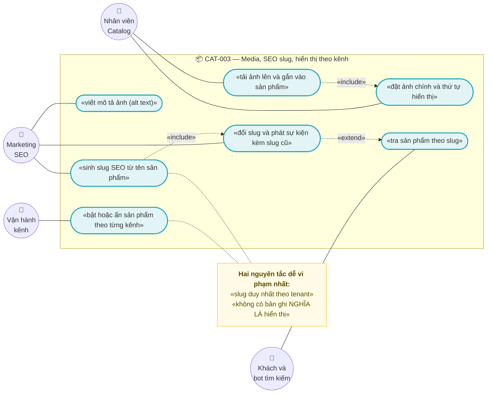
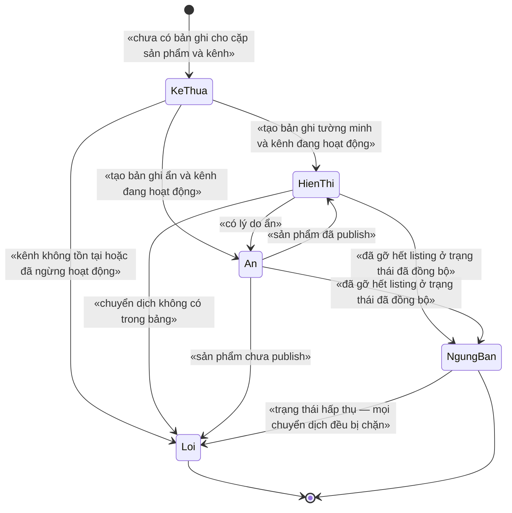
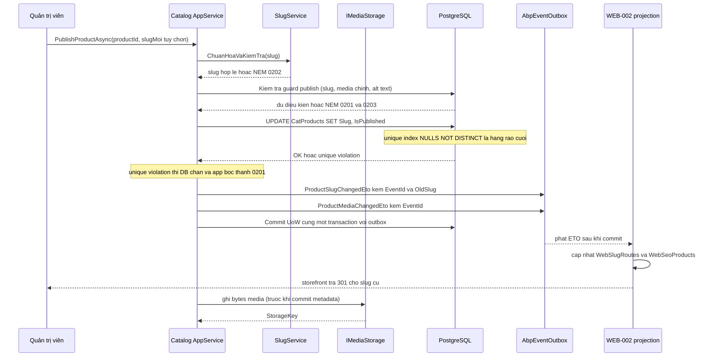

# `CAT-003` — Media, SEO slug và hiển thị theo kênh

| Thuộc tính | Nội dung |
|---|---|
| **Mã** | `CAT-003` |
| **Module** | **Catalog** (module **chưa tách** — entity đang ở `src/eCommerce.Domain/Entities/Catalog/`, xem §15.2 **F7**) |
| **Giai đoạn** | **GĐ1 — Bán được trên website** (`docs/implementation-plan.md` **Phụ lục A.3**, dòng `CAT-003`) |
| **Ưu tiên** | **Must have** — `WEB-002` **phụ thuộc** tài liệu này (xem §15.2 **F2**) |
| **Trạng thái** | 🟡 `Draft` — chờ review |
| **Người viết / người review** | *(điền)* / **Kiến trúc trưởng + BA Catalog + SEO** |
| **Phiên bản / ngày** | `v0.1 — 13/10/2026` |
| **Tài liệu liên quan** | `CAT-001` (sản phẩm & biến thể SKU — §15.2 **F5** giao slug sang đây) · `CAT-002` (cây danh mục & thuộc tính) · **`WEB-002`** (§11 giao migration index `Slug` cho `CAT-003`; Q3 hỏi `ProductSlugChangedEto` có `OldSlug` không) · `XC-001` (Money) · `XC-002` (outbox/inbox & idempotency) · `XC-003` (khoá phân tán — §5.4 tiền tố khoá) · `XC-004` (permission/tenant — **BR-009** `NULLS NOT DISTINCT`) · `XC-005` (observability — bảng đăng ký metric) · `XC-006` (phân loại thuế theo SKU) · `PRC-001` · `INV-001` · `CHN-004` · `docs/implementation-plan.md` §5 + Phụ lục A |

---

## 0. Tóm tắt & quyết định thiết kế

**Tóm tắt:** `CAT-003` chốt **ba thứ mà `CAT-001`/`CAT-002` cố ý để lại**: (1) **media** — ảnh/video của sản phẩm,
(2) **slug SEO** — khoá định danh công khai của sản phẩm trên URL, và (3) **hiển thị theo kênh** — cùng một sản phẩm
được bán ở kênh này nhưng ẩn ở kênh khác **mà không nhân bản dữ liệu**.

**Vì sao phải viết tài liệu này (và vì sao nó bị chặn):** `WEB-002` — tài liệu storefront — **đã** ghi rõ hai việc
**giao hẳn** cho `CAT-003`:

> *"Migration **bắt buộc kèm theo** *(thuộc `CAT-003`, WEB-002 phụ thuộc)* | Thêm unique index cho `CatProducts.Slug`:
> `CREATE UNIQUE INDEX … ON "CatProducts" ("TenantId", "Slug") NULLS NOT DISTINCT WHERE "Slug" IS NOT NULL;`"*
> — [`web-002-storefront-duyet-chi-tiet-san-pham.md:581`](web-002-storefront-duyet-chi-tiet-san-pham.md)

và **Q3** của `WEB-002` hỏi thẳng *"ETO `ProductSlugChangedEto` có mang `OldSlug` không? Ai phát?"*.
`CAT-001` cũng đã chuyển **F5** (`Product.Slug` không unique) sang đây:
[`cat-001-san-pham-va-bien-the-sku.md:725`](cat-001-san-pham-va-bien-the-sku.md).
⇒ **`CAT-003` phải trả lời cả ba câu này**, nếu không `WEB-002` không thể code.

**Hiện trạng code (đã kiểm bằng `read`/`grep`, không viết theo trí nhớ):**

| Thứ | Trạng thái thật trong repo |
|---|---|
| `Product.Slug` | ✅ **CÓ** — `string? Slug` ([`Product.cs:19`](../../src/eCommerce.Domain/Entities/Catalog/Product.cs#L19)) |
| Unique index cho `Slug` | ❌ **KHÔNG CÓ** — chỉ `HasMaxLength(512)` ([`eCommerceDbContext.cs:106`](../../src/eCommerce.EntityFrameworkCore/eCommerceDbContext.cs#L106)); migration `NULLS NOT DISTINCT` **không** bao gồm `Slug` ([`20261013024226_Fix_NullableTenantId_UniqueIndexes.cs:39-86`](../../src/eCommerce.EntityFrameworkCore/Migrations/20261013024226_Fix_NullableTenantId_UniqueIndexes.cs#L39)) |
| Entity media / visibility | ❌ **KHÔNG CÓ** — `grep -E "Media\|Image\|Thumbnail\|Visibility"` trên mọi `*.cs` = **0 kết quả** |
| Hạ tầng lưu file (blob/S3/wwwroot) | ❌ **KHÔNG CÓ** — `grep -E "BlobStoring\|BlobContainer\|MinIO\|S3\|wwwroot\|StaticFile\|IBlob"` = **0 kết quả**; `Directory.Packages.props` **không** có gói BlobStoring |
| `CatalogErrorCodes` / `CatalogLockKeys` | ❌ **KHÔNG CÓ** — `eCommerceConsts.ErrorCodes` chỉ có **2** mã (Inventory + Payment) ([`eCommerceConsts.cs:77-86`](../../src/eCommerce.Domain.Shared/eCommerceConsts.cs#L77)) |
| Permission cho media/slug/visibility | ❌ **KHÔNG CÓ** — chỉ có `Products.Default/Create/Edit/Delete` ([`eCommerceConsts.cs:19-25`](../../src/eCommerce.Domain.Shared/eCommerceConsts.cs#L19)) |
| `shared/eCommerce.Kernel` | ❌ **KHÔNG TỒN TẠI** — `Test-Path shared` = `False` (kế thừa `EINV-001` **F3**) |
| `eCommerce.Web` (storefront) | ❌ **KHÔNG TỒN TẠI** — `src/` chỉ có 8 project, không có `eCommerce.Web` |

**Phạm vi:**
- ✅ Entity **`ProductMedia`** — ảnh/video của sản phẩm: thứ tự, ảnh chính, `alt` text, kích thước.
- ✅ **Hợp đồng lưu trữ** `IMediaStorage` (metadata ở PostgreSQL, **bytes ở object storage**) + validate tệp.
- ✅ **Sinh & chuẩn hoá slug SEO** (bỏ dấu tiếng Việt), **unique index `(TenantId, Slug) NULLS NOT DISTINCT`**.
- ✅ **Sự kiện đổi slug kèm `OldSlug`** — trả lời **Q3** của `WEB-002`.
- ✅ Entity **`ProductChannelVisibility`** — bật/ẩn sản phẩm **theo từng `ChannelCode`**, kèm **state machine ném lỗi**.
- ✅ Permission mới, mã lỗi mới (dải riêng), khoá phân tán mới.

**Không nằm trong phạm vi:**
- ❌ **Xử lý ảnh** (resize, nén, WebP, CDN, `srcset`) — `WEB-002` **ADR-08** đã chốt GĐ1 chỉ dùng thẻ `img` với
  `width`/`height`/`loading=lazy`/`alt`; resize/CDN là **nợ kỹ thuật** ghi ở `WEB-002` §15.1 Q5.
- ❌ **Bảng chuyển hướng 301 (`WebSlugRoutes`)** và read-model `WebSeoProducts` — **thuộc `WEB-002`**
  ([`web-002-storefront-duyet-chi-tiet-san-pham.md:333`](web-002-storefront-duyet-chi-tiet-san-pham.md)). `CAT-003`
  **chỉ** sở hữu `Product.Slug` (giá trị hiện tại) + **phát sự kiện**; xem **ADR-06**.
- ❌ **Cây danh mục & thuộc tính/tổ hợp** — thuộc `CAT-002`
  (`Slug` của danh mục đã có quy ước riêng: UNIQUE `(TenantId, ParentId, Slug)`, [`cat-002…:373`](cat-002-cay-danh-muc-thuoc-tinh-bien-the.md)).
- ❌ **Đẩy dữ liệu lên sàn** (đẩy ảnh/tiêu đề sang Shopee/Lazada) — thuộc `CHN-002`/`CHN-004` (GĐ4).
- ❌ **Giá theo kênh** — thuộc `PRC-001`; `CAT-003` chỉ quyết định **hiện/ẩn**, **không** quyết định giá.
- ❌ **Tồn kho theo kênh (allotment)** — thuộc `CHN-004`/`INV-003`; `ChannelListing.AllottedQuantity` đã có cột
  ([`ChannelEntities.cs:142`](../../modules/ChannelHub/eCommerce.ChannelHub.Domain/Entities/ChannelEntities.cs#L142)).
- ❌ **Đa ngôn ngữ / slug theo locale** — giả định 5 ở §15.3.
- ❌ **CDN & HTTP cache header của ảnh** — thuộc hạ tầng triển khai + `WEB-002` ADR-07.

### 0.1 Quyết định thiết kế (ADR ngắn)

| # | Quyết định | Phương án đã cân nhắc | Lý do chọn | Hệ quả |
|---|---|---|---|---|
| **ADR-01** | Media là **entity riêng `ProductMedia`**, **không** phải một cột `ImageUrl` trên `Product` | (a) 1 cột `ImageUrl` · (b) bảng `ProductMedia` · (c) mảng JSON nhúng trong `ExtraProperties` | (a) không chứa được **nhiều** ảnh + thứ tự + `alt` từng ảnh ⇒ **không** đáp ứng được `WEB-002` **NFR-012** (*"100 % ảnh sản phẩm có `alt`"*); (c) JSON **không** index được và **không** unique được ⇒ không cưỡng chế được "một ảnh chính" | Cần bảng mới + `DbSet` (**bất biến #5**) + hạ tầng lưu trữ (**ADR-02**) |
| **ADR-02** | **Metadata trong PostgreSQL, bytes trong object storage** qua abstraction `IMediaStorage`; **cấm** lưu blob trong DB | (a) `bytea` trong PostgreSQL · (b) ghi file vào đĩa của web server · (c) object storage qua abstraction | (a) phình DB + backup/restore chậm + `bytea` đi qua mọi truy vấn; (b) **không** hoạt động khi chạy **nhiều instance** (ảnh tải lên instance A **không** thấy ở instance B) — mà `implementation-plan.md` §11 mục 3 yêu cầu test **2 instance**; (c) tách được bytes khỏi DB | ⚠️ **Chưa có** gói/hạ tầng nào trong repo (§15.2 **F4**) ⇒ triển khai `FileSystemMediaStorage` cho **dev** và **bắt buộc** thay bằng object storage trước khi chạy nhiều instance. **Không** dùng được `FileSystem` ở production nhiều instance |
| **ADR-03** | **Slug là thuộc tính của `Product`** (giữ nguyên `Product.Slug` đang có) **+ unique index `(TenantId, Slug) NULLS NOT DISTINCT WHERE "Slug" IS NOT NULL`** | (a) bảng `Slug` riêng cho mọi đối tượng · (b) giữ `Product.Slug` + thêm index · (c) để `WEB-002` tự quản toàn bộ slug | (a) tổng quát hoá sớm khi mới **một** loại đối tượng cần slug (danh mục đã có cột `Slug` riêng theo `CAT-002`) · (c) `WEB-002` **không** sở hữu `Product` ⇒ sẽ thành **hai nguồn sự thật** (đúng thứ `XC-003` **F1** cảnh báo) | ✅ Việc **`WEB-002` §11 giao cho `CAT-003`**; SQL thô (EF Core **không** mô hình hoá `NULLS NOT DISTINCT`) — cùng cách [`20261013024226_Fix_NullableTenantId_UniqueIndexes.cs`](../../src/eCommerce.EntityFrameworkCore/Migrations/20261013024226_Fix_NullableTenantId_UniqueIndexes.cs) |
| **ADR-04** | Sinh slug **tất định** từ `Name`: bỏ dấu tiếng Việt → chữ thường → `[a-z0-9-]`; trùng thì thêm hậu tố **`-2`, `-3`…** | (a) `slug-{guid}` · (b) nhân viên tự gõ tay · (c) sinh tất định + hậu tố số | (a) URL xấu và `Guid` **không** có giá trị SEO (`WEB-002` **ADR-03** đã loại) · (b) gõ tay ⇒ sai chính tả, trùng, không nhất quán | Hàm sinh **phải** có test cho tiếng Việt có dấu (`đ`, `ư`, `ơ`, `ả`…); hậu tố số **phải** kiểm lại trong **cùng** transaction để không đua |
| **ADR-05** | Slug **bất biến sau khi đã công khai**, **trừ khi** người dùng đổi **tường minh**; đổi ⇒ **bắt buộc** phát `ProductSlugChangedEto` có **`OldSlug`** | (a) sinh lại slug mỗi khi đổi `Name` · (b) slug bất biến tuyệt đối · (c) chỉ đổi khi người dùng yêu cầu + phát sự kiện | (a) **mọi** lần sửa tên sản phẩm sẽ **phá** URL đã được Google index và link đã chia sẻ ⇒ mất SEO; (b) không đổi được khi tên sai/đổi thương hiệu | Trả lời **Q3 của `WEB-002`**: **CÓ**, ETO mang `OldSlug` ⇒ `WEB-002` giữ được **301**. Không có `OldSlug` ⇒ **chặn** 301 (`WEB-002` **BR-005**) |
| **ADR-06** | **Ranh giới sở hữu slug:** `CAT-003` sở hữu **`Product.Slug` + sự kiện**; `WEB-002` sở hữu **`WebSlugRoutes` + 301** | (a) một bên làm hết · (b) tách: giá trị hiện tại ở Catalog, lịch sử ở Web | (a) `CAT-003` **không** được tham chiếu project web; `WEB-002` **không** được sửa entity `Product` (bất biến #3) | Hai bảng, **một** nguồn sự thật cho **mỗi** loại dữ liệu: *"slug hiện tại là gì"* → Catalog; *"slug này từng trỏ đi đâu"* → Web |
| **ADR-07** | Hiển thị theo kênh = entity **`ProductChannelVisibility`** theo cặp `(ProductId, ChannelCode)`; **không** nhân bản sản phẩm theo kênh | (a) mỗi kênh một bản ghi `Product` · (b) cờ `IsVisibleWeb`/`IsVisibleShopee` trên `Product` · (c) bảng quan hệ `(Product, Channel)` | (a) nhân bản dữ liệu ⇒ mọi sửa đổi phải đồng bộ **N** nơi (sai lệch âm thầm); (b) thêm một kênh = **migration** + sửa code — vi phạm mục tiêu *"thêm sàn không sửa `Sales`"* của `implementation-plan.md` §10 | Bảng mới; thêm kênh chỉ là **dữ liệu**, không phải migration |
| **ADR-08** | **Mặc định = KẾ THỪA (hiển thị)**: **không có** bản ghi ⇒ sản phẩm **hiển thị** trên kênh (nếu `IsPublished`) | (a) phải có bản ghi cho **mọi** cặp (sản phẩm × kênh) · (b) không có bản ghi = hiển thị | (a) với 10.000 sản phẩm × 5 kênh = **50.000** dòng **rỗng** ngay khi tạo sản phẩm; thêm kênh thứ 6 ⇒ phải sinh thêm 10.000 dòng (**bùng nổ dữ liệu**) | 🔒 Bất biến: **"không có bản ghi" KHÔNG được suy diễn thành "ẩn"** (**BR-012**); UI **phải** hiển thị rõ trạng thái *"Kế thừa"* thay vì để trống |
| **ADR-09** | `ChannelCode` là **chuỗi**, **không** FK cứng, **không** tham chiếu module `ChannelHub` | (a) FK → `ChnChannels.Id` · (b) FK → `Channel.Code` · (c) chuỗi + kiểm qua abstraction đọc | (a)/(b) tạo **phụ thuộc cứng** module→module và khoá chặt vào module khác; tiền lệ trong repo: `ChannelListing.ChannelCode` và `StockLedgerEntry.ChannelCode` đều là **chuỗi** ([`ChannelEntities.cs:123`](../../modules/ChannelHub/eCommerce.ChannelHub.Domain/Entities/ChannelEntities.cs#L123), [`StockLedger.cs:106`](../../src/eCommerce.Domain/Entities/Inventory/StockLedger.cs#L106)) | Cần một abstraction **đọc** (`IChannelDirectory`) do app cài đặt; tính đúng được bảo vệ bằng **kiểm tra tầng ứng dụng** + test (§14 TC-17), **không** bằng FK |
| **ADR-10** | Hàm sinh khoá phân tán của module **KHÔNG** chứa tiền tố `ecommerce:` (tiền tố do `AbpDistributedLockOptions.KeyPrefix` cấp) | (a) có tiền tố trong hàm sinh khoá · (b) không có | `XC-003` **§5.4 hệ quả 2**: *"Tên khoá do module sinh **KHÔNG** chứa tiền tố — tiền tố là việc của `KeyPrefix`"*, và `KeyPrefix = "ecommerce:"` **đã** đặt ([`eCommerceHttpApiHostModule.cs:127`](../../src/eCommerce.HttpApi.Host/eCommerceHttpApiHostModule.cs#L127)). ⚠️ Trong repo **đang có 2 quy ước** (**F8** §15.2) | `CatalogLockKeys` sinh `catalog:…`; khoá thật trong Redis là `ecommerce:catalog:…`. Kế thừa `XIN` chưa chốt của `SHP-002` Q5 |
| **ADR-11** | Xoá media = **xoá mềm** (`FullAudited`), bytes **giữ lại**; job dọn bytes chỉ chạy khi media **không còn** tham chiếu | (a) xoá cứng cả dòng lẫn bytes ngay · (b) xoá mềm rồi job dọn | (a) URL ảnh **đã** phát ra storefront/sàn/CDN ⇒ xoá bytes ngay ⇒ **ảnh vỡ** ở nơi chưa kịp cập nhật (không sửa được, không có log); (b) có cửa sổ hoàn tác + dọn có kiểm soát | Cần cột `StorageKey` + job dọn + metric đếm bytes mồ côi; **cấm** xoá bytes trong cùng request |
| **ADR-12** | **Mỗi sản phẩm có TỐI ĐA MỘT media `IsPrimary = true`** — cưỡng chế bằng **unique index có filter** | (a) kiểm ở tầng ứng dụng · (b) unique index `WHERE "IsPrimary"` | (a) 2 request song song (hoặc Redis chết — `XC-003` **D2**) ⇒ **2 ảnh chính** ⇒ storefront/structured data chọn ảnh **không xác định**; đúng loại lỗi im lặng `XC-003` cảnh báo | SQL thô (filter + `NULLS NOT DISTINCT`); đổi ảnh chính = **một** transaction (bỏ cờ cũ + đặt cờ mới) |
| **ADR-13** | Validate tệp tải lên bằng **magic bytes (chữ ký tệp)**, **không** tin `Content-Type`/đuôi tệp từ client | (a) tin `Content-Type` header · (b) tin đuôi tệp · (c) đọc magic bytes | (a)/(b) đổi tên `shell.exe` → `anh.jpg` là vượt qua; tệp được phục vụ lại từ miền của ta ⇒ **stored XSS / phát tán mã độc** | Cần bảng ánh xạ magic bytes → đuôi cho phép; sai ⇒ **ném** `eCommerce:Catalog:0206`; test `TC-11` |

---

## 1. Use Case Specification

| Thuộc tính | Nội dung |
|---|---|
| **Use Case ID** | `CAT-003` |
| **Use Case Name** | Quản lý media, slug SEO và hiển thị sản phẩm theo từng kênh bán |
| **Description** | *"Là nhân viên Catalog, tôi muốn tải ảnh lên và viết mô tả ảnh, đặt một đường dẫn SEO ổn định cho sản phẩm, và bật/ẩn sản phẩm theo từng kênh — để storefront hiển thị đúng, máy tìm kiếm lập chỉ mục đúng, và cùng một sản phẩm có thể bán ở kênh này mà không bán ở kênh khác."* |
| **Actor(s)** | **Nhân viên Catalog** (media, slug) · **Marketing/SEO** (slug, alt text) · **Vận hành kênh** (hiển thị theo kênh) · **Khách/bot tìm kiếm** (đọc — chỉ đọc, thuộc `WEB-002`) · **Hệ thống** (`IMediaStorage`, outbox, job dọn bytes) |
| **Priority** | **Must have** — `WEB-002` **đang bị chặn** bởi `CAT-003` (index `Slug` + `ProductSlugChangedEto.OldSlug`) |
| **Trigger** | (a) nhân viên tải ảnh lên / đổi ảnh chính / sửa `alt`; (b) phát hành sản phẩm (sinh slug) hoặc đổi slug tường minh; (c) vận hành bật/ẩn sản phẩm trên một kênh; (d) job định kỳ dọn bytes mồ côi; (e) `ChannelHub` báo một kênh **ngừng hoạt động** *(sự kiện này **chưa có** — §15.2 **F10**)* |
| **Pre-Condition(s)** | • **`TenantId`** hiện tại (`ICurrentTenant`) — hệ thống đang chạy **1 tenant** ⇒ `TenantId` **có thể là `NULL`** (`XC-004` §5.2 **F1**).<br>• **Mọi unique index có `TenantId` PHẢI** dùng `NULLS NOT DISTINCT` (`XC-004` **BR-009**) — nếu không, index **mất tác dụng** khi `TenantId IS NULL` (đã chứng minh bằng PostgreSQL thật, [`20261013024226…cs:14-17`](../../src/eCommerce.EntityFrameworkCore/Migrations/20261013024226_Fix_NullableTenantId_UniqueIndexes.cs#L14)).<br>• **Sản phẩm đã tồn tại** trong tenant (`Catalog.Product`, [`Product.cs:10`](../../src/eCommerce.Domain/Entities/Catalog/Product.cs#L10)) — nếu chưa có thì thuộc `CAT-001`.<br>• Permission đã được **định nghĩa** cho **mọi** chuỗi dùng trong `[Authorize]` (`XC-004` **D2/E3**: permission chưa định nghĩa ⇒ **`403` cho MỌI người**).<br>• `ChannelCode` **chỉ** có mặt ở nhóm use case *hiển thị theo kênh*; media và slug là **dùng chung mọi kênh** (`ChannelCode` **không** tham gia). |
| **Post-Condition(s)** | • Sản phẩm đã công khai **luôn** có `Slug` **không rỗng**, khớp `^[a-z0-9]+(?:-[a-z0-9]+)*$`, **duy nhất trong tenant**.<br>• Slug **cũ** (nếu từng công khai) **đã** được thông báo cho `WEB-002` bằng ETO có **`OldSlug`** — trong **cùng** transaction với lần ghi `Slug`.<br>• Mỗi sản phẩm có **tối đa một** media `IsPrimary = true` (cưỡng chế ở DB, **ADR-12**).<br>• Mọi media của sản phẩm **đã** publish có `AltText` **không rỗng**.<br>• Không có bản ghi `ProductChannelVisibility` nào trỏ tới `ChannelCode` **không tồn tại / đã ngừng** (**BR-011**).<br>• **Ẩn** sản phẩm khỏi kênh A **không** ảnh hưởng kênh B và **không** xoá dữ liệu (**BR-014**). |
| **Basic Flow** | 1. Nhân viên gọi `UploadMediaAsync` (permission `Products.ManageMedia`) — hệ thống kiểm `[Authorize]` **cấp class** trước.<br>2. Hệ thống kiểm **magic bytes** + kích thước + số media hiện có (ADR-13, **BR-019**, NFR-004); sai ⇒ **ném** `eCommerce:Catalog:0206`.<br>3. Hệ thống ghi bytes qua `IMediaStorage` ⇒ nhận `StorageKey`, rồi tạo `ProductMedia` (`SortOrder` = max + 1) **trong** Unit of Work.<br>4. Nếu đây là media **đầu tiên** ⇒ tự đặt `IsPrimary = true`; nếu nhân viên yêu cầu làm ảnh chính ⇒ bỏ cờ cũ + đặt cờ mới trong **một** transaction (**ADR-12**).<br>5. Nhân viên gọi `PublishProductAsync` ⇒ hệ thống kiểm **guard**: có `Slug` hợp lệ **và** có ≥ 1 media `IsPrimary` **và** mọi media có `AltText` ⇒ `IsPublished = true` (**BR-009**).<br>6. Hệ thống phát `ProductSlugChangedEto` (**có `OldSlug`**) + `ProductMediaChangedEto` vào **outbox** cùng transaction (`XC-002` **BR-001**).<br>7. Vận hành gọi `SetChannelVisibilityAsync(productId, channelCode, Shown\|Hidden)` ⇒ kiểm `ChannelCode` tồn tại & `IsActive` (qua `IChannelDirectory`) ⇒ ghi bản ghi + outbox. |
| **Alternative Flow** | **A1: Slug đã tồn tại trong tenant** — hệ thống thêm hậu tố số (`-2`, `-3`…) **trong cùng transaction**; **không** báo lỗi cho người dùng khi đây là **sinh tự động**; **báo lỗi** `eCommerce:Catalog:0201` khi người dùng **tự gõ** slug trùng.<br>**A2: Không có bản ghi hiển thị** — sản phẩm **hiển thị** (kế thừa, **ADR-08/BR-012**); UI hiển thị nhãn *"Kế thừa"*.<br>**A3: Gỡ media** — xoá **mềm**; bytes giữ lại; job `media-cleanup` dọn sau (**ADR-11**).<br>**A4: Kênh ngừng hoạt động** — mọi bản ghi `ProductChannelVisibility` của kênh đó **không** tự xoá; job đối chiếu (hoặc `ChannelDeactivatedEto` khi có) chuyển trạng thái và **ghi log** — **chưa có** cơ chế này (**F10**).<br>**A5: Job dọn bytes mồ côi** — chạy định kỳ, `SkipIfBusy` (khoá `catalog:media-cleanup:{tenantId}`), log + metric (`XC-003` **D10**). |
| **Exception Flow** | **E1:** `Publish` khi thiếu `Slug` **hoặc** thiếu media `IsPrimary` ⇒ `BusinessException` **`eCommerce:Catalog:0201`** (`409`).<br>**E2:** `Slug` sai định dạng (`"Áo thun!!"`, có dấu, có khoảng trắng, > 512 ký tự, rỗng sau chuẩn hoá) ⇒ **`eCommerce:Catalog:0202`** (`400`).<br>**E3:** `Publish` khi còn media **thiếu `AltText`** ⇒ **`eCommerce:Catalog:0203`** (`400`) kèm **danh sách** `MediaId` thiếu.<br>**E4:** `SortOrder` trùng trong cùng sản phẩm **hoặc** vượt trần số media ⇒ **`eCommerce:Catalog:0204`** (`409`).<br>**E5:** chuyển trạng thái hiển thị **sai** (xem §3) ⇒ **`eCommerce:Catalog:0205`** (`409`) — **tuyệt đối không im lặng** (quy ước bất di bất dịch #11).<br>**E6:** tệp tải lên sai định dạng/kích thước ⇒ **`eCommerce:Catalog:0206`** (`400`).<br>**E7:** `ChannelCode` không tồn tại hoặc `IsActive = false` ⇒ **`eCommerce:Catalog:0207`** (`409`).<br>**E8:** ẩn/gỡ media khi kênh **vẫn còn** `ChannelListing` ở trạng thái `Synced` ⇒ **`eCommerce:Catalog:0209`** (`409`) kèm danh sách kênh.<br>**E9:** không giành được khoá phân tán ⇒ theo `XC-003` **D10**: mặc định **ném** `eCommerce:Lock:0001` (`409`). |
| **Business Rules** | • **BR-CAT-003-001**: Mọi `ProductMedia` **phải** thuộc **đúng một** `Product` **và** **cùng tenant** với sản phẩm đó; **cấm** media mồ côi hoặc khác tenant.<br>• **BR-CAT-003-002**: Mỗi sản phẩm có **tối đa một** media `IsPrimary = true`; cưỡng chế bằng **unique index có filter**, **cấm** chỉ kiểm ở tầng ứng dụng.<br>• **BR-CAT-003-003**: `Url`/`StorageKey` của media **phải** do `IMediaStorage` cấp (đường dẫn nội bộ) **hoặc** URL `https` trong allowlist; **cấm** `javascript:`, `data:`, `file:`, và **cấm** URL `http` không mã hoá.<br>• **BR-CAT-003-004**: **Mọi** media của sản phẩm **đã** `IsPublished` **phải** có `AltText` **không rỗng** (khớp `WEB-002` NFR-012); vi phạm ⇒ **`0203`** khi đổi sang publish.<br>• **BR-CAT-003-005**: `SortOrder` **phải duy nhất trong một sản phẩm** (không trùng) ⇒ tránh thứ tự hiển thị **không xác định**; vi phạm ⇒ **`0204`**.<br>• **BR-CAT-003-006**: `Slug` **phải** khớp `^[a-z0-9]+(?:-[a-z0-9]+)*$`, dài **3–512** ký tự (trần 512 khớp cột đang có — [`eCommerceDbContext.cs:106`](../../src/eCommerce.EntityFrameworkCore/eCommerceDbContext.cs#L106)); vi phạm ⇒ **`0202`**.<br>• **BR-CAT-003-007**: `Slug` **duy nhất theo tenant** khi `Slug IS NOT NULL` ⇒ unique index **`NULLS NOT DISTINCT`** + filter `"Slug" IS NOT NULL`; **cấm** chỉ kiểm ở tầng ứng dụng (**ADR-03**).<br>• **BR-CAT-003-008**: Slug **sinh tất định** từ `Name` (**ADR-04**); **cấm** hard-code slug; trùng ⇒ thêm hậu tố số **trong cùng transaction**.<br>• **BR-CAT-003-009**: Slug **bất biến sau khi công khai**; chỉ đổi khi người dùng yêu cầu **tường minh**, và đổi ⇒ **bắt buộc** phát `ProductSlugChangedEto` **có `OldSlug`** (trả lời `WEB-002` **Q3**).<br>• **BR-CAT-003-010**: `Publish` sản phẩm **bắt buộc** có `Slug` không rỗng **và** ≥ 1 media `IsPrimary = true`; **cấm** publish im lặng khi thiếu.<br>• **BR-CAT-003-011**: `ProductChannelVisibility` **chỉ** được ghi khi `ChannelCode` **tồn tại và `IsActive`** (kiểm qua `IChannelDirectory` — **ADR-09**); vi phạm ⇒ **`0207`**.<br>• **BR-CAT-003-012**: 🔒 **Không có bản ghi `ProductChannelVisibility` ⇒ sản phẩm HIỂN THỊ** (kế thừa, **ADR-08**); **cấm** suy diễn *"không có bản ghi = ẩn"* — đây là bất biến dễ vi phạm nhất khi viết truy vấn.<br>• **BR-CAT-003-013**: Chuyển trạng thái hiển thị **không có trong bảng §3** ⇒ **NÉM** `eCommerce:Catalog:0205`; **cấm** guard im lặng.<br>• **BR-CAT-003-014**: Ẩn sản phẩm khỏi kênh A **không** ảnh hưởng kênh B, **không** xoá dữ liệu, **không** đổi `IsPublished`; cách ly theo `(ProductId, ChannelCode)`.<br>• **BR-CAT-003-015**: Xoá media = **xoá mềm**; bytes **chỉ** được dọn bằng job khi media **không còn** tham chiếu (**ADR-11**); **cấm** xoá bytes trong cùng request.<br>• **BR-CAT-003-016**: Mọi thao tác ghi media/slug/visibility **phải** đi qua **Unit of Work**; outbox ghi **cùng** transaction (`XC-002` **D1**); **cấm** ghi ngoài UoW.<br>• **BR-CAT-003-017**: Tên khoá phân tán **chỉ** được sinh từ hàm trong `CatalogLockKeys`; **cấm** viết literal khoá trong code nghiệp vụ; hàm sinh khoá **KHÔNG** chứa tiền tố `ecommerce:` (**ADR-10**).<br>• **BR-CAT-003-018**: **Mọi** unique index có `TenantId` **phải** `NULLS NOT DISTINCT`; nếu một migration **do EF sinh** tạo lại index ⇒ **phải** chạy lại SQL thô (cảnh báo đã có ở [`20261013024226…cs:23-25`](../../src/eCommerce.EntityFrameworkCore/Migrations/20261013024226_Fix_NullableTenantId_UniqueIndexes.cs#L23)).<br>• **BR-CAT-003-019**: Tệp tải lên **phải** được kiểm bằng **magic bytes**; **cấm** tin `Content-Type`/đuôi tệp từ client (**ADR-13**); sai ⇒ **`0206`**.<br>• **BR-CAT-003-020**: **Cấm** để DTO công khai lộ `StorageKey` nội bộ, `InternalSku`, giá vốn, hay số tồn kho chính xác; DTO công khai **chỉ** trả URL đã ký/đã chuẩn hoá + `AltText` + thứ tự + kích thước.<br>• **BR-CAT-003-021**: Mọi tiền trong DTO của feature này (nếu có) **phải** đi qua `Money`/`Currency` (`XC-001` **BR-002/003**); **cấm** `double`/`float` và **cấm** so tiền bằng `==`.<br>• **BR-CAT-003-022**: Mọi app service của feature **phải** có `[Authorize]` ở **cấp class** với hằng số `eCommerceConsts.Permissions.*`; **cấm** magic string (`XC-004` **BR-001/BR-003**). |
| **Non-Functional Requirement** | • **NFR-CAT-003-001**: Sinh slug thuần CPU ⇒ p95 **< 5 ms** cho 1.000 lần (máy dev).<br>• **NFR-CAT-003-002**: Tra sản phẩm theo `(TenantId, Slug)` ⇒ p95 **< 20 ms** với **10.000** sản phẩm/tenant.<br>• **NFR-CAT-003-003**: Tải media ⇒ trần **10 MB**/tệp; p95 thời gian ghi storage **< 2 s** cho tệp 5 MB.<br>• **NFR-CAT-003-004**: Trần **50** media/sản phẩm; vượt ⇒ **`0204`** (không được ghi dòng nào).<br>• **NFR-CAT-003-005**: **0** vi phạm bất biến "một ảnh chính" trên **1.000** vòng chèn/đổi ảnh chính **đồng thời**.<br>• **NFR-CAT-003-006**: **100 %** media của sản phẩm đã publish có `AltText` không rỗng (test quét).<br>• **NFR-CAT-003-007**: **0** slug trùng trong tenant, **kể cả khi `TenantId IS NULL`** (test chèn trùng — **cần PostgreSQL**).<br>• **NFR-CAT-003-008**: `Publish` ⇒ `WEB-002` nhận được ETO trong **p95 ≤ 2 s** (khớp NFR-XC-002-001).<br>• **NFR-CAT-003-009**: **0** bản ghi `ProductChannelVisibility` trỏ tới `ChannelCode` không tồn tại (test quét định kỳ).<br>• **NFR-CAT-003-010**: Cách ly tenant: tenant A **không** đọc/ghi được media/visibility của tenant B (integration 2 tenant — **cần PostgreSQL**).<br>• **NFR-CAT-003-011**: **0** `double`/`float` trong mọi DTO/entity của feature (test reflection — kế thừa `XC-001` NFR-004).<br>• **NFR-CAT-003-012**: Tỉ lệ tải media **thất bại** do lỗi lưu trữ **< 0,1 %** trên môi trường bình thường; vượt ⇒ cảnh báo. |

---

## 2. Sơ đồ Use Case



> 📌 **Actor "Khách và bot tìm kiếm" chỉ ĐỌC** — việc render trang, `301`, `canonical`, JSON-LD và `sitemap.xml`
> **thuộc `WEB-002`**. `CAT-003` chỉ **cấp dữ liệu** (slug + media + trạng thái hiển thị) và **phát sự kiện**.

---

## 3. Vòng đời hiển thị theo kênh (state machine)

> **Vì sao đây là state machine của feature này:** `ProductChannelVisibility` là nơi **duy nhất** trong `CAT-003`
> có **vòng đời** với các chuyển dịch **phải bị chặn**. Slug và media là **thuộc tính** (không có trạng thái riêng);
> vòng đời *route slug công khai* đã thuộc `WEB-002` §3 (xem **ADR-06** để tránh trùng lặp hai state machine).



**Bảng chuyển trạng thái & guard (mọi chuyển sai **phải ném lỗi**, không im lặng):**

| Từ | Sang | Guard | Nếu vi phạm |
|---|---|---|---|
| `[*]` | `KeThua` | Không có bản ghi cho `(ProductId, ChannelCode)` — **mặc định** khi tạo sản phẩm | Không bao giờ lỗi (**ADR-08/BR-012**) |
| `KeThua` | `HienThi` | `ChannelCode` tồn tại **và** `IsActive = true` (qua `IChannelDirectory`) | **NÉM** `eCommerce:Catalog:0207` |
| `KeThua` | `An` | Như trên **và** có `Reason` không rỗng | **NÉM** `0207` (kênh sai) hoặc `0205` (thiếu lý do) |
| `HienThi` | `An` | Có `Reason` không rỗng + audit | **NÉM** `0205` nếu thiếu lý do |
| `An` | `HienThi` | `Product.IsPublished = true` | **NÉM** `0205` — **cấm** hiện sản phẩm chưa publish |
| `HienThi`/`An` | `NgungBan` | **Không còn** `ChannelListing` ở `Status = Synced` (giá trị `2`, [`ChannelEntities.cs:166`](../../modules/ChannelHub/eCommerce.ChannelHub.Domain/Entities/ChannelEntities.cs#L166)) cho `(ProductId, ChannelCode)` | **NÉM** `0209` kèm **danh sách** listing còn lại |
| `NgungBan` | *bất kỳ* | 🚫 **KHÔNG** có guard nào cho phép | **NÉM** `0205` — **trạng thái hấp thụ**; muốn hiển thị lại ⇒ tạo **bản ghi mới** |
| `KeThua`/`HienThi`/`An` | `Loi` | Guard không thoả (bảng trên) | **NÉM** `0205`/`0207`/`0209` — **không** đổi dữ liệu |
| *mọi cặp khác* | — | Không có trong bảng ⇒ **luôn ném lỗi** | `eCommerce:Catalog:0205` |

> ⚠️ **Ghi rõ điều dễ hiểu sai:** `KeThua` **không phải** một trạng thái "trung gian chờ xử lý" — nó **là** trạng thái
> **cuối cùng hợp lệ** cho đa số cặp `(sản phẩm, kênh)`. Thiết kế **cố ý** không tạo bản ghi cho mọi cặp
> (10.000 sản phẩm × 5 kênh = 50.000 dòng rỗng — **ADR-08**). Vì vậy truy vấn hiển thị **bắt buộc** dùng
> `LEFT JOIN` + `COALESCE(trạng thái, 'HienThi')`, **cấm** dùng `INNER JOIN` (sẽ **làm mất** sản phẩm khỏi kênh).

---

## 4. Sequence Diagram & luồng dữ liệu

### 4.1 Phát hành sản phẩm — cấp slug, ghi media, phát sự kiện



> ⚠️ **Thứ tự ghi bytes và commit DB là một quyết định có rủi ro** — xem **§12** nhánh
> *"commit DB thất bại sau khi đã ghi bytes"*: hệ quả là **bytes mồ côi** (không phải mất dữ liệu).
> Chọn hướng này **cố ý** vì hướng ngược lại (commit DB trước, ghi bytes sau) sẽ tạo **bản ghi trỏ tới ảnh
> không tồn tại** — storefront hiển thị **ảnh vỡ**, tệ hơn nhiều so với vài MB rác dọn được bằng job.

### 4.2 Luồng dữ liệu — ba nguồn vào, một nguồn sự thật mỗi loại

| Luồng | Nguồn | Đích | Cơ chế | Ghi chú |
|---|---|---|---|---|
| Media: bytes | Trình duyệt (nhân viên) | `IMediaStorage` | `multipart/form-data` → kiểm magic bytes (**ADR-13**) | ⚠️ **Chưa có** hạ tầng lưu trữ (**F4**) |
| Media: metadata | Trình duyệt | `CatProductMedia` | UoW + `DbSet` (bất biến #5) | Bảng **chưa có** — migration §11 |
| Slug | Sinh tự động từ `Name` hoặc người dùng gõ | `CatProducts.Slug` | `SlugService` + unique index | Nguồn sự thật **duy nhất** cho *"slug hiện tại"* (**ADR-06**) |
| Lịch sử slug | `ProductSlugChangedEto` | `WebSlugRoutes` (`WEB-002`) | Outbox → consumer | `CAT-003` **không** ghi bảng này (**ADR-06**) |
| Hiển thị theo kênh | Vận hành | `CatProductChannelVisibility` | UoW + `IChannelDirectory` (**ADR-09**) | Bảng **chưa có** |
| Ảnh cho storefront | `ProductMedia` | `WEB-002` (`WebSeoProducts`) | ETO | `WEB-002` ADR-08: chỉ `img` + `width`/`height`/`lazy`/`alt` |

---

## 5. Mô hình dữ liệu

### 5.1 ERD (dạng bảng — chi tiết quan hệ)

> 📌 **ERD Mermaid không vẽ lại ở đây:** sơ đồ ERD của `CatProducts`/`CatProductVariants` **đã có** ở
> [`cat-001-san-pham-va-bien-the-sku.md:219`](cat-001-san-pham-va-bien-the-sku.md) §5.1. Vẽ lại sẽ tạo **hai**
> nguồn sự thật cho cùng một mô hình. Ba bảng của `CAT-003` được mô tả bằng bảng dưới đây.

| Quan hệ | Kiểu | Ghi chú |
|---|---|---|
| `CatProducts` 1—n `CatProductMedia` | FK cứng | `OnDelete` = **`Restrict`** — **cấm** `Cascade` (kế thừa lập luận `CAT-001` **D4/F7**) |
| `CatProductMedia` n—1 `CatProductVariants` *(tuỳ chọn)* | FK cứng, **nullable** | `VariantId = NULL` ⇒ ảnh của **sản phẩm**; có giá trị ⇒ ảnh **riêng của biến thể** |
| `CatProducts` 1—n `CatProductChannelVisibility` | FK cứng | `OnDelete` = **`Restrict`** |
| `CatProductChannelVisibility` n—1 `Channel.Code` | ❌ **KHÔNG FK** | **ADR-09** — chỉ ràng buộc logic; tiền lệ: `ChannelListing.ChannelCode` ([`ChannelEntities.cs:123`](../../modules/ChannelHub/eCommerce.ChannelHub.Domain/Entities/ChannelEntities.cs#L123)) |
| `CatProducts.Slug` → `WebSlugRoutes.Slug` | ❌ **KHÔNG FK** | Qua **ETO** (**ADR-06**); `WEB-002` sở hữu bảng đích |
| `CatProductMedia.StorageKey` → bytes | ❌ **KHÔNG FK** | Bytes **không** nằm trong DB (**ADR-02**) |

### 5.2 Bảng **MỚI** `CatProductMedia` — ⚠️ **chưa có trong code — kế hoạch GĐ1**

| Cột | Kiểu | Null? | Ý nghĩa | Ghi chú |
|---|---|---|---|---|
| `Id` | `uuid` | ✗ | khoá chính | `FullAuditedAggregateRoot<Guid>`? → dùng `FullAuditedEntity<Guid>` vì thuộc aggregate `Product` |
| `TenantId` | `uuid` | ✓ | tenant | `IMultiTenant`; `null` khi chạy 1 tenant |
| `ProductId` | `uuid` | ✗ | FK → `CatProducts.Id` | **`Restrict`** |
| `VariantId` | `uuid` | ✓ | FK → `CatProductVariants.Id` | `null` = ảnh chung của sản phẩm |
| `Kind` | `int` | ✗ | `Image = 0` · `Video = 1` | 🚫 **Cấm** thêm loại mới mà không cập nhật bảng magic bytes (**ADR-13**) |
| `StorageKey` | `varchar(512)` | ✗ | khoá nội bộ trong storage | 🔒 **NỘI BỘ** — **cấm** trả ra DTO công khai (**BR-020**) |
| `Url` | `varchar(1024)` | ✗ | URL phục vụ (chuẩn hoá) | **BR-003**: chỉ `https` hoặc đường dẫn nội bộ |
| `AltText` | `varchar(512)` | ✓ trên cột, **✗ khi publish** | mô tả ảnh | **BR-004**; `WEB-002` NFR-012 |
| `WidthPx` / `HeightPx` | `integer` | ✓ | kích thước thật | Bắt buộc để tránh **CLS** (`WEB-002` ADR-08) |
| `SizeBytes` | `bigint` | ✗ | dung lượng tệp | Phục vụ báo cáo + job dọn |
| `ContentType` | `varchar(128)` | ✗ | MIME **đã xác minh từ magic bytes** | ⚠️ Không phải giá trị client gửi lên (**ADR-13**) |
| `Sha256` | `char(64)` | ✗ | băm nội dung | Chống trùng tệp + kiểm toàn vẹn |
| `SortOrder` | `integer` | ✗ | thứ tự hiển thị | **BR-005**: duy nhất trong một sản phẩm |
| `IsPrimary` | `boolean` | ✗ | ảnh chính | **BR-002** — unique index **có filter** |
| `ExtraProperties` / `ConcurrencyStamp` | `text` / `varchar(40)` | ✗ | ABP | |
| `CreationTime` `CreatorId` `LastModificationTime` `LastModifierId` | `timestamptz`/`uuid` | ✗/✓ | audit | |
| `IsDeleted` `DeleterId` `DeletionTime` | `boolean`/`uuid`/`timestamptz` | ✗/✓/✓ | **xoá mềm** | Bắt buộc cho **ADR-11** |

**Index & ràng buộc `CatProductMedia`**

| Loại | Cột / điều kiện | Mục đích |
|---|---|---|
| UNIQUE **`NULLS NOT DISTINCT`** | `(TenantId, ProductId, IsPrimary)` `WHERE "IsPrimary"` | **hàng rào thật** cho **BR-002** (một ảnh chính) |
| UNIQUE **`NULLS NOT DISTINCT`** | `(TenantId, ProductId, SortOrder)` | **BR-005** — thứ tự duy nhất |
| UNIQUE | `(TenantId, Sha256)` | **chống trùng tệp** (tải lại cùng ảnh ⇒ không tốn storage) — ⚠️ cần **chốt**: nếu muốn cho phép cùng ảnh ở 2 sản phẩm thì index phải là `(TenantId, ProductId, Sha256)`; **Q2** §15.1 |
| INDEX | `(TenantId, ProductId, IsDeleted, SortOrder)` | truy vấn gallery của một sản phẩm |
| INDEX | `(IsDeleted, DeletionTime)` | job dọn bytes mồ côi (**ADR-11**) |
| CHECK | `("Kind" <> 1) OR ("WidthPx" IS NOT NULL AND "HeightPx" IS NOT NULL)` | video **phải** có kích thước để render đúng |

### 5.3 Bảng **MỚI** `CatProductChannelVisibility` — ⚠️ **chưa có trong code — kế hoạch GĐ1**

| Cột | Kiểu | Null? | Ý nghĩa | Ghi chú |
|---|---|---|---|---|
| `Id` | `uuid` | ✗ | khoá chính | `FullAuditedAggregateRoot<Guid>` |
| `TenantId` | `uuid` | ✓ | tenant | `IMultiTenant` |
| `ProductId` | `uuid` | ✗ | FK → `CatProducts.Id` | **`Restrict`** |
| `ChannelCode` | `varchar(32)` | ✗ | mã kênh (`web`, `shopee`, `lazada`…) | Trần 32 khớp `OrdOrders.ChannelCode` ([`eCommerceDbContext.cs:168`](../../src/eCommerce.EntityFrameworkCore/eCommerceDbContext.cs#L168)); **BR-011** |
| `Status` | `int` | ✗ | `HienThi = 1` · `An = 2` · `NgungBan = 3` | ⚠️ **KHÔNG** có giá trị `0` cho "kế thừa" — kế thừa = **không có dòng** (**ADR-08**) |
| `Reason` | `varchar(512)` | ✓ | lý do ẩn/ngừng bán | **Bắt buộc** khi `Status = An` (§3) |
| `HiddenAtUtc` | `timestamptz` | ✓ | thời điểm ẩn | Phục vụ audit + báo cáo |
| `ExtraProperties` / `ConcurrencyStamp` | `text` / `varchar(40)` | ✗ | ABP | |
| audit + xoá mềm | | | | `FullAuditedAggregateRoot` |

**Index & ràng buộc `CatProductChannelVisibility`**

| Loại | Cột / điều kiện | Mục đích |
|---|---|---|
| UNIQUE **`NULLS NOT DISTINCT`** | `(TenantId, ProductId, ChannelCode)` | **hàng rào thật** — một cặp chỉ có **một** trạng thái |
| INDEX | `(TenantId, ChannelCode, Status)` | *"kênh này đang bán những gì"* (vận hành) |
| CHECK | `("Status" <> 2) OR ("Reason" IS NOT NULL AND length("Reason") > 0)` | **BR**: ẩn **phải** có lý do (§3) |
| CHECK | `"Status" IN (1, 2, 3)` | Chặn giá trị lạ ⇒ `0` **không** được ghi (**ADR-08**) |

### 5.4 Bảng **ĐANG CÓ** `CatProducts` — phần `CAT-003` **bổ sung**

Trạng thái thật: `Slug` là `varchar(512)` **nullable** ([`20261009070214_Initial.cs:22`](../../src/eCommerce.EntityFrameworkCore/Migrations/20261009070214_Initial.cs#L22)),
EF chỉ cấu hình `HasMaxLength(512)` ([`eCommerceDbContext.cs:106`](../../src/eCommerce.EntityFrameworkCore/eCommerceDbContext.cs#L106)) — **không** unique, **không** index.

| Thay đổi | Nội dung | Vì sao |
|---|---|---|
| INDEX **mới (SQL thô)** | `CREATE UNIQUE INDEX "IX_CatProducts_TenantId_Slug" ON "CatProducts" ("TenantId", "Slug") NULLS NOT DISTINCT WHERE "Slug" IS NOT NULL` | **BR-007** + đúng yêu cầu `WEB-002` §11 (dòng 581) |
| Cột mới *(khuyến nghị)* | `SlugLockedAtUtc` `timestamptz` ✓ | Đánh dấu slug **đã từng công khai** ⇒ biết khi nào **phải** phát `ProductSlugChangedEto` (**BR-009**) |
| Cột mới *(khuyến nghị)* | `SeoTitle` `varchar(70)` ✓ · `SeoDescription` `varchar(160)` ✓ | `WEB-002` §5.2.2 đã có 2 cột này ở **read-model**; nguồn sự thật **phải** ở Catalog (ngược lại admin sửa mà mất khi projection chạy lại) — ⚠️ xem **Q4** |

> 🚨 **EF Core KHÔNG mô hình hoá `NULLS NOT DISTINCT`** — cảnh báo đã có sẵn trong repo:
> [`20261013024226_Fix_NullableTenantId_UniqueIndexes.cs:20-25`](../../src/eCommerce.EntityFrameworkCore/Migrations/20261013024226_Fix_NullableTenantId_UniqueIndexes.cs#L20)
> (*"nếu một migration do EF sinh tự động sau này tạo lại một trong các index dưới đây, thuộc tính sẽ **mất**"*)
> và [`cat-002…:389`](cat-002-cay-danh-muc-thuoc-tinh-bien-the.md). ⇒ Index này **phải** viết bằng `migrationBuilder.Sql(...)`.

### 5.5 Bố cục lưu trữ media (đề xuất — **chưa có trong code**)

| Mục | Đề xuất | Ghi chú |
|---|---|---|
| Khoá đối tượng | `catalog/{tenantId ?? "host"}/{productId}/{sha256[0..2]}/{sha256}.{ext}` | Phân mảnh theo 2 ký tự đầu của băm ⇒ tránh thư mục có quá nhiều tệp |
| Tên tệp | **băm nội dung** (`Sha256`) | Tên do client đặt **không** bao giờ được dùng làm đường dẫn ⇒ chống **path traversal** |
| Phục vụ | URL công khai: `/media/catalog/{productId}/{sha256}.{ext}` | ⚠️ Việc phục vụ + cache header thuộc hạ tầng/`WEB-002` |
| Môi trường | **dev**: `FileSystemMediaStorage` (thư mục ngoài `wwwroot`) · **production nhiều instance**: **object storage** | 🔴 **`FileSystem` KHÔNG dùng được** khi chạy ≥ 2 instance — **ADR-02** |

---

## 6. Hợp đồng API

### 6.1 Application service (đề xuất — **chưa có trong code**)

```csharp
namespace eCommerce.Catalog;

// 🚨 BẤT BIẾN #7: [Authorize] ở CẤP CLASS, tên quyền lấy từ HẰNG SỐ (XC-004 D3/D4).
// ⚠️ CÁC HẰNG SỐ DƯỚI ĐÂY CHƯA TỒN TẠI — xem §9 và §15.2 F12.
[Authorize(eCommerceConsts.Permissions.Products.Default)]
public class ProductMediaAppService : eCommerceAppService, IProductMediaAppService
{
    /// Tải tệp lên + tạo ProductMedia. Idempotent theo IdempotencyKey (XC-002).
    [Authorize(eCommerceConsts.Permissions.Products.ManageMedia)]
    public Task<ProductMediaDto> UploadAsync(Guid productId, UploadMediaDto input, string idempotencyKey);

    [Authorize(eCommerceConsts.Permissions.Products.ManageMedia)]
    public Task<ProductMediaDto> SetPrimaryAsync(Guid productId, Guid mediaId);

    [Authorize(eCommerceConsts.Permissions.Products.ManageMedia)]
    public Task ReorderAsync(Guid productId, IReadOnlyList<Guid> orderedMediaIds);

    [Authorize(eCommerceConsts.Permissions.Products.ManageMedia)]
    public Task SetAltTextAsync(Guid mediaId, string altText);

    /// XOÁ MỀM — bytes giữ lại, job dọn sau (ADR-11).
    [Authorize(eCommerceConsts.Permissions.Products.ManageMedia)]
    public Task DeleteAsync(Guid mediaId);
}

[Authorize(eCommerceConsts.Permissions.Products.Default)]
public class ProductChannelVisibilityAppService : eCommerceAppService, IProductChannelVisibilityAppService
{
    [Authorize(eCommerceConsts.Permissions.Products.ManageChannelVisibility)]
    public Task<ProductChannelVisibilityDto> SetAsync(Guid productId, string channelCode, VisibilityStatus status, string? reason);

    [Authorize(eCommerceConsts.Permissions.Products.ManageChannelVisibility)]
    public Task ResetToInheritedAsync(Guid productId, string channelCode);

    /// Ma trận (sản phẩm × kênh) cho màn hình vận hành — KẾ THỪA hiển thị rõ, không để trống (ADR-08).
    [Authorize(eCommerceConsts.Permissions.Products.View)]
    public Task<ProductChannelMatrixDto> GetMatrixAsync(Guid productId);
}

public interface IMediaStorage
{
    Task<StoredMedia> PutAsync(Stream content, string sha256, string extension, CancellationToken ct);
    Task<Stream> OpenReadAsync(string storageKey, CancellationToken ct);
    Task DeleteAsync(string storageKey, CancellationToken ct);

    /// ⚠️ CHỈ dùng cho integration test/DI — abstraction này phải cài được bằng FileSystem (dev) hoặc object storage.
}

/// Kiểm tra kênh — ADR-09: Catalog KHÔNG tham chiếu module ChannelHub.
public interface IChannelDirectory
{
    Task<ChannelInfo?> FindAsync(string channelCode, CancellationToken ct);
}
```

**Ràng buộc hợp đồng:**

| # | Ràng buộc | Lý do |
|---|---|---|
| 1 | `UploadAsync` **bắt buộc** có `idempotencyKey` | Tải lại do timeout/retry **không** được tạo 2 media (**XC-002**) |
| 2 | `ReorderAsync` nhận **toàn bộ** danh sách `orderedMediaIds` (không nhận "đổi chỗ 2 phần tử") | Tránh trạng thái `SortOrder` trùng khi 2 request xen kẽ (**BR-005**) |
| 3 | `SetAsync` trả về **trạng thái sau** khi chuyển (kể cả khi là `KeThua`) | UI **phải** phân biệt *"kế thừa"* với *"hiển thị"* (**ADR-08**) |
| 4 | Mọi DTO **không** chứa `StorageKey` | **BR-020** |
| 5 | Mọi danh sách trả về **không** trả `double`/`float` | **BR-021**, NFR-011 |

### 6.2 REST endpoint (ABP auto API controller sinh)

| Method | Đường dẫn | Permission | Idempotent? | Ghi chú |
|---|---|---|---|---|
| `POST` | `/api/app/catalog/product-media/{productId}/upload` | `Products.ManageMedia` | ✅ theo `IdempotencyKey` | `multipart/form-data`; **BR-019** |
| `POST` | `/api/app/catalog/product-media/{productId}/{mediaId}/primary` | `Products.ManageMedia` | ✅ tự nhiên | Bỏ cờ cũ + đặt cờ mới (**ADR-12**) |
| `PUT` | `/api/app/catalog/product-media/{productId}/order` | `Products.ManageMedia` | ✅ tự nhiên | Nhận **toàn bộ** thứ tự |
| `PUT` | `/api/app/catalog/product-media/{mediaId}/alt-text` | `Products.ManageMedia` | ✅ tự nhiên | |
| `DELETE` | `/api/app/catalog/product-media/{mediaId}` | `Products.ManageMedia` | ✅ tự nhiên | **Xoá mềm** (**ADR-11**) |
| `PUT` | `/api/app/catalog/product-channel-visibility/{productId}` | `Products.ManageChannelVisibility` | ✅ tự nhiên | Body: `{ channelCode, status, reason }` |
| `DELETE` | `/api/app/catalog/product-channel-visibility/{productId}/{channelCode}` | `Products.ManageChannelVisibility` | ✅ tự nhiên | ⇒ quay về **kế thừa** |
| `GET` | `/api/app/catalog/product-channel-visibility/{productId}/matrix` | `Products.View` | — | Chỉ đọc |
| `PUT` | `/api/app/catalog/product/{id}/slug` | `Products.ManageSlug` | ✅ tự nhiên | Đổi slug **tường minh** (**BR-009**) |

### 6.3 Mã lỗi nghiệp vụ — 🚨 **DẢI RIÊNG `0201`–`0212`** (xem §15.2 **F1**)

| Mã | HTTP | Khi nào | Thông điệp |
|---|---|---|---|
| `eCommerce:Catalog:0201` | `409` | `Publish` thiếu `Slug` **hoặc** thiếu media `IsPrimary`; hoặc `Slug` người dùng gõ bị trùng | `Không thể phát hành: sản phẩm cần đường dẫn (slug) và một ảnh chính.` |
| `eCommerce:Catalog:0202` | `400` | `Slug` sai định dạng / rỗng sau chuẩn hoá / > 512 ký tự | `Đường dẫn chỉ cho phép chữ thường, số và dấu gạch ngang (3–512 ký tự).` |
| `eCommerce:Catalog:0203` | `400` | `Publish` khi còn media thiếu `AltText` | `Còn {soAnh} ảnh chưa có mô tả (alt) — hãy bổ sung trước khi phát hành.` |
| `eCommerce:Catalog:0204` | `409` | `SortOrder` trùng trong sản phẩm **hoặc** vượt trần số media | `Thứ tự ảnh bị trùng hoặc vượt giới hạn {max} ảnh cho mỗi sản phẩm.` |
| `eCommerce:Catalog:0205` | `409` | Chuyển trạng thái hiển thị sai (bảng §3) | `Không thể chuyển trạng thái hiển thị từ {tu} sang {sang}.` |
| `eCommerce:Catalog:0206` | `400` | Tệp sai định dạng/kích thước (magic bytes không khớp) | `Tệp không hợp lệ hoặc vượt dung lượng cho phép ({maxMb} MB).` |
| `eCommerce:Catalog:0207` | `409` | `ChannelCode` không tồn tại hoặc `IsActive = false` | `Kênh '{channelCode}' không tồn tại hoặc đã ngừng hoạt động.` |
| `eCommerce:Catalog:0208` | `409` | Xoá media còn được tham chiếu bởi listing `Synced` *(dự phòng)* | `Ảnh đang được dùng trên kênh {channelCode}, hãy gỡ liên kết trước.` |
| `eCommerce:Catalog:0209` | `409` | Ẩn/ngừng bán khi còn `ChannelListing` ở `Synced` | `Sản phẩm còn {soListing} liên kết đang đồng bộ trên kênh {channelCode}.` |
| `eCommerce:Catalog:0210` | `404` | Không tìm thấy media/visibility (hoặc **khác tenant** — trả `404`, **không** `403`) | `Không tìm thấy dữ liệu.` |
| `eCommerce:Catalog:0211` | `409` | Đặt ảnh chính khi sản phẩm **chưa có** media nào | `Sản phẩm chưa có ảnh nào để đặt làm ảnh chính.` |
| `eCommerce:Catalog:0212` | `400` | `Name` rỗng/toàn ký tự không sinh được slug | `Không sinh được đường dẫn từ tên sản phẩm — hãy nhập đường dẫn thủ công.` |

> 🚨 **CẢNH BÁO MÃ LỖI (F1 — §15.2):** `CAT-001` và `CAT-002` **đang dùng trùng** dải `eCommerce:Catalog:0001–0007`
> với **nghĩa khác nhau** (ví dụ `0003` = *"publish không có biến thể"* ở `CAT-001` nhưng = *"vượt trần tổ hợp"*
> ở `CAT-002` — [`cat-001…:406`](cat-001-san-pham-va-bien-the-sku.md) vs [`cat-002…:458`](cat-002-cay-danh-muc-thuoc-tinh-bien-the.md)).
> `CAT-003` **cố ý** lấy dải **`0201+`** để **không** làm xung đột nặng thêm, và **đề xuất** gom về **một** file
> `CatalogErrorCodes.cs` (theo khuôn [`TaxErrorCodes.cs`](../../modules/Tax/eCommerce.Tax.Domain/TaxErrorCodes.cs))
> với **dải đã cấp phát** — xem **Q1**.

---

## 7. Sự kiện, tích hợp ngoài & idempotency

### 7.1 Sự kiện phát ra (ETO)

| ETO | Khi nào | Ai tiêu thụ | Trường | Idempotency ở consumer |
|---|---|---|---|---|
| **`ProductSlugChangedEto`** | Slug đổi (kể cả lần **đầu** được cấp khi publish) | `WEB-002` projection | **`EventId`**, `TenantId`, `ProductId`, **`OldSlug`** *(null nếu chưa từng công khai)*, `NewSlug`, `OccurredOnUtc` | ✅ khoá `EventId` (**F11** cảnh báo ETO hiện có **thiếu** `EventId`) |
| `ProductMediaChangedEto` | Thêm/xoá/đổi thứ tự/đổi ảnh chính/đổi `alt` | `WEB-002`, (sau này `CHN-004`) | **`EventId`**, `TenantId`, `ProductId`, `MediaId`, `Kind`, `IsPrimary`, `SortOrder`, `AltText`, `Url`, `OccurredOnUtc` | ✅ khoá `EventId` |
| `ProductChannelVisibilityChangedEto` | Bật/ẩn/ngừng bán theo kênh | Vận hành, `CHN-004` (GĐ4) | **`EventId`**, `TenantId`, `ProductId`, `ChannelCode`, `Status`, `OccurredOnUtc` | ✅ khoá `EventId` |
| `ProductMediaBytesOrphanedEto` *(đề xuất)* | Job phát hiện bytes không còn dòng tham chiếu | Job dọn | `EventId`, `TenantId`, `StorageKey`, `SizeBytes`, `OccurredOnUtc` | ✅ khoá `EventId` |

> 🔒 **`EventId` là BẮT BUỘC** trên mọi ETO của feature này — mâu thuẫn với hiện trạng
> [`ChannelEvents.cs:17-30`](../../modules/ChannelHub/eCommerce.ChannelHub.Application.Contracts/Events/ChannelEvents.cs#L17)
> (ETO của `ChannelHub` **không** có `EventId` — `WEB-002` **F9**). Feature này **không** lặp lại lỗi đó.

### 7.2 Sự kiện / webhook **nhận vào**

**Không áp dụng — lý do:** `CAT-003` **không** có biên vào từ bên ngoài (không webhook, không IPN).
Mọi thao tác đều do người dùng đã xác thực gọi vào API admin.

⚠️ **Nhưng có một khoảng trống đã phát hiện (F10):** khi một `Channel` bị **ngừng hoạt động** trong `ChannelHub`,
`CAT-003` **không** có cách nào biết ⇒ bản ghi `ProductChannelVisibility` của kênh đó **tồn tại vô nghĩa** (vi phạm
tinh thần **BR-011**). **Đề xuất:** `ChannelHub` phát `ChannelDeactivatedEto` *(chưa có trong code — xem
[`ChannelEvents.cs`](../../modules/ChannelHub/eCommerce.ChannelHub.Application.Contracts/Events/ChannelEvents.cs),
chỉ có **2** ETO: `ChannelOrderPulledEto` + `ChannelShopTokenRefreshedEto`)*. Trong lúc chưa có, xử lý bằng
**job đối chiếu** (§12) + ghi log — **không** im lặng.

### 7.3 ⚠️ Idempotency ở **mọi** biên vào (bất biến #9)

| Biên vào | Rủi ro trùng | Cơ chế | Hàng rào DB |
|---|---|---|---|
| `POST …/upload` (tải media) | Timeout ⇒ client thử lại ⇒ **2** dòng media + **2** lần tốn storage | `IdempotencyKey` + bảng inbox (`XC-002`) | UNIQUE `(TenantId, Sha256)` *(hoặc `(TenantId, ProductId, Sha256)` — **Q2**)* |
| `PUT …/slug` (đổi slug) | Thử lại ⇒ phát **2** ETO, tạo **2** bản ghi `WebSlugRoutes` | `IdempotencyKey` + `RowVersion`/`ConcurrencyStamp` | UNIQUE `(TenantId, Slug) NULLS NOT DISTINCT` |
| `PUT …/{productId}` (visibility) | Thử lại ⇒ **idempotent tự nhiên** (ghi cùng giá trị) | — | UNIQUE `(TenantId, ProductId, ChannelCode)` |
| `POST …/{mediaId}/primary` | Thử lại ⇒ **idempotent tự nhiên** | — | UNIQUE `(TenantId, ProductId, IsPrimary) WHERE IsPrimary` |
| `DELETE …/{mediaId}` | Thử lại ⇒ lần 2 gặp bản ghi đã xoá mềm ⇒ trả **kết quả như lần 1** | — | Xoá mềm |
| Job `media-cleanup` | Chạy chồng trên nhiều instance | Khoá `catalog:media-cleanup:{tenantId}` + `SkipIfBusy` (**XC-003** **D10**) | Xoá bytes là **idempotent** |

> ⚠️ **Lock KHÔNG thay thế idempotency** (`XC-003` **BR-008**, §7.3): lock giảm tranh chấp **đồng thời**,
> idempotency chặn **lặp lại**. `CAT-003` **cần CẢ HAI** vì vừa có 2 instance cùng tải ảnh, vừa có client retry.

---

## 8. Bất biến & xử lý đồng thời

### 8.1 Bất biến

| # | Bất biến | Cơ chế bảo vệ | Kiểm bằng |
|---|---|---|---|
| 1 | Slug **duy nhất trong tenant** kể cả khi `TenantId IS NULL` | UNIQUE **`NULLS NOT DISTINCT`** + filter `"Slug" IS NOT NULL` | TC-03 (**cần PostgreSQL**) |
| 2 | Mỗi sản phẩm có **tối đa một** media `IsPrimary = true` | UNIQUE `(TenantId, ProductId, IsPrimary) WHERE "IsPrimary"` | TC-09 |
| 3 | `SortOrder` **duy nhất trong một sản phẩm** | UNIQUE `(TenantId, ProductId, SortOrder)` | TC-10 |
| 4 | Một cặp `(ProductId, ChannelCode)` chỉ có **một** trạng thái | UNIQUE `(TenantId, ProductId, ChannelCode)` | TC-15 |
| 5 | **Không có bản ghi ⇒ hiển thị** (không bao giờ "ẩn ngầm") | Truy vấn **bắt buộc** `LEFT JOIN` + `COALESCE(..., HienThi)` (**§3**) | TC-14 |
| 6 | Media **luôn** cùng tenant với `Product` | Kiểm tầng ứng dụng + query filter `IMultiTenant` của ABP | TC-18 (**cần PostgreSQL**) |
| 7 | Mọi media đã publish có `AltText` không rỗng | Guard ở `Publish` (**BR-004**) | TC-08 |
| 8 | Mọi thao tác ghi qua **UoW**; outbox cùng transaction | `IUnitOfWorkManager` + `useOutbox: true` (`XC-002` **D1**) | TC-05 |
| 9 | Mọi unique index có `TenantId` **có hiệu lực khi `TenantId` NULL** | SQL thô `NULLS NOT DISTINCT` (**BR-018**) | TC-21 |
| 10 | Khoá phân tán **grep được** và **không** có tiền tố đôi | `CatalogLockKeys` (**ADR-10**) + test quét mã nguồn | TC-19 |

### 8.2 Xử lý đồng thời

| # | Tình huống | Cơ chế | Nếu Redis chết |
|---|---|---|---|
| 1 | 2 nhân viên cùng đặt **ảnh chính** cho một sản phẩm | Khoá `catalog:media:{tenantId}:{productId}` + UNIQUE `IsPrimary` | UNIQUE index **chặn** ⇒ lỗi map thành `0204`/`0205` — **không** sai dữ liệu (`XC-003` **D2**) |
| 2 | 2 request cùng **sinh slug** trùng cho 2 sản phẩm khác nhau | Khoá `catalog:slug:{tenantId}` + thêm hậu tố số **trong** transaction | UNIQUE `(TenantId, Slug)` **chặn** ⇒ map `0201` |
| 3 | 2 người cùng **đổi slug** của **một** sản phẩm | `ConcurrencyStamp` của ABP + `UPDATE … WHERE ConcurrencyStamp = @expected`; **0 dòng** ⇒ **NÉM** | Không phụ thuộc Redis |
| 4 | Vận hành đổi trạng thái hiển thị trong khi worker đang đẩy listing lên sàn | UNIQUE `(TenantId, ProductId, ChannelCode)` + guard `NgungBan` phải gỡ `Synced` trước (**§3**) | DB vẫn chặn trùng |
| 5 | Job `media-cleanup` chạy trên **nhiều** instance | Khoá `catalog:media-cleanup:{tenantId}` + `SkipIfBusy` + **log + metric** | Fail-open: nhiều instance cùng chạy ⇒ xoá bytes là **idempotent** ⇒ **an toàn** |
| 6 | 2 instance cùng tải **cùng một tệp** (cùng `Sha256`) cho cùng sản phẩm | UNIQUE `(TenantId, Sha256)` *(hoặc `(TenantId, ProductId, Sha256)` — **Q2**)* | DB chặn ⇒ lần 2 trả bản ghi **đã có** (không tốn thêm storage) |

**Khoá phân tán dùng trong feature** — 🔒 **hàm sinh khoá KHÔNG chứa tiền tố** (**ADR-10**), tiền tố do
`AbpDistributedLockOptions.KeyPrefix = "ecommerce:"` cấp
([`eCommerceHttpApiHostModule.cs:127`](../../src/eCommerce.HttpApi.Host/eCommerceHttpApiHostModule.cs#L127)):

| Hàm sinh khoá (module) | Khoá **thật** trong Redis | Dùng cho | TTL |
|---|---|---|---|
| `CatalogLockKeys.Slug(tenantId)` → `catalog:slug:{tenantId}` | `ecommerce:catalog:slug:{tenantId}` | Sinh/cấp slug cho một tenant | **30 s** |
| `CatalogLockKeys.MediaOrder(tenantId, productId)` → `catalog:media:{tenantId}:{productId}` | `ecommerce:catalog:media:{tenantId}:{productId}` | Thứ tự + ảnh chính của một sản phẩm | **60 s** |
| `CatalogLockKeys.ChannelVisibility(tenantId, productId, channelCode)` → `catalog:visibility:{tenantId}:{productId}:{channelCode}` | `ecommerce:catalog:visibility:…` | Đổi trạng thái hiển thị | **30 s** |
| `CatalogLockKeys.MediaCleanup(tenantId)` → `catalog:media-cleanup:{tenantId}` | `ecommerce:catalog:media-cleanup:{tenantId}` | Job dọn bytes mồ côi (**job định kỳ** ⇒ `SkipIfBusy`) | **300 s** |

> ⚠️ **Cột "Khoá thật trong Redis" chỉ là SUY LUẬN từ `KeyPrefix` + cơ chế ghép đã kiểm chứng cho khoá
> của `ChannelHub`** (`XC-003` §5.4, `redis-cli MONITOR`). **Chưa kiểm chứng** cho khoá `catalog:*` mới này
> ⇒ khi có môi trường **phải** chạy `redis-cli MONITOR` xác nhận trước khi tin (đúng cách `XC-003` **F5** từng tìm ra lỗi).
> Xem **Q6** và **F8**.

**Idempotency key:** ✅ **CÓ** — xem §7.3 (khác `XC-003`, feature này **có** biên vào HTTP).

---

## 9. Phân quyền

### 9.1 Hiện trạng (đã kiểm bằng code)

| Hằng số | Giá trị | Đã định nghĩa? |
|---|---|---|
| `eCommerceConsts.Permissions.Products.Default` | `eCommerce.Products` | ✅ [`eCommerceConsts.cs:21`](../../src/eCommerce.Domain.Shared/eCommerceConsts.cs#L21) + provider [`…Provider.cs:28`](../../src/eCommerce.Application.Contracts/Permissions/eCommercePermissionDefinitionProvider.cs#L28) |
| `Products.Create` | `eCommerce.Products.Create` | ✅ |
| `Products.Edit` | `eCommerce.Products.Edit` | ✅ |
| `Products.Delete` | `eCommerce.Products.Delete` | ✅ |
| `Products.View` | `eCommerce.Products.View` | ❌ **CHƯA CÓ** (kế thừa `CAT-001` **F9**) |
| `Products.Publish` | `eCommerce.Products.Publish` | ❌ **CHƯA CÓ** (kế thừa `CAT-001` **F9**) |
| `Products.ManageMedia` / `ManageSlug` / `ManageChannelVisibility` | `…` | ❌ **CHƯA CÓ** — **CAT-003 đề xuất thêm** |

### 9.2 Permission **đề xuất thêm** cho `CAT-003` (⚠️ **chưa có trong code — kế hoạch GĐ1**)

| Permission | Dùng cho | Vì sao tách riêng |
|---|---|---|
| `eCommerce.Products.View` | `GET` media + matrix | 🔒 Kế thừa `CAT-001` **F9**: hiện **không** có quyền *"chỉ xem"* ⇒ muốn cho xem phải cấp `Edit` ⇒ **vượt quyền** |
| `eCommerce.Products.Publish` | `Publish`/`Unpublish` | Publish là **hành động công khai** ra ngoài (ảnh hưởng SEO + khách) — tách khỏi `Edit` |
| `eCommerce.Products.ManageMedia` | tải/xoá/đổi ảnh chính/thứ tự/alt | Media là **tài sản** (dung lượng, bản quyền ảnh) — không phải ai sửa sản phẩm cũng được tải ảnh |
| `eCommerce.Products.ManageSlug` | `PUT …/slug` | 🔒 Đổi slug **phá URL đã index** ⇒ quyền **hẹp** (Marketing/SEO), **không** cấp mặc định cho mọi nhân viên |
| `eCommerce.Products.ManageChannelVisibility` | bật/ẩn theo kênh | Ẩn sai kênh ⇒ **mất doanh thu** ở kênh đó — là quyết định **vận hành**, không phải biên tập nội dung |

### 9.3 Ma trận endpoint ↔ permission (mọi app service **`[Authorize]` cấp class** — `XC-004` **D3**)

| Endpoint | Permission | Ghi chú |
|---|---|---|
| `GET` media / matrix | `Products.View` | ⚠️ **Chưa** tồn tại ⇒ **phải** thêm trước khi code (**Q1**) |
| `POST` upload / primary / reorder / alt / `DELETE` | `Products.ManageMedia` | |
| `PUT` slug | `Products.ManageSlug` | |
| `PUT`/`DELETE` visibility | `Products.ManageChannelVisibility` | |
| `Publish`/`Unpublish` sản phẩm | `Products.Publish` | Thuộc `CAT-001` nhưng **CAT-003** phụ thuộc (guard slug/media) |

> 🚨 **Bẫy đã xảy ra thật ở Phase 0** (`XC-004` §0): permission **chưa được định nghĩa** trong
> `PermissionDefinitionProvider` ⇒ **`403` cho MỌI người, kể cả admin** — và **không có lỗi biên dịch**.
> ⇒ 5 permission mới ở §9.2 **phải** được thêm vào
> [`eCommercePermissionDefinitionProvider.cs`](../../src/eCommerce.Application.Contracts/Permissions/eCommercePermissionDefinitionProvider.cs)
> **cùng pull request** với endpoint đầu tiên dùng chúng, và `XC-004` **TC-02** phải phủ chúng.
>
> 🔒 **Cấm** magic string: **mọi** `[Authorize]` dùng hằng số `eCommerceConsts.Permissions.*` (`XC-004` **BR-003**).

**Phân tầng host / tenant:** `CAT-003` **không** có permission cấp host — media/slug/visibility đều thuộc tenant.

**Cách ly tenant:** mọi entity `IMultiTenant` ⇒ query filter của ABP lọc theo tenant; tài nguyên của tenant khác
trả **`404`** (**không** `403`) — `XC-004` **BR-008**.

---

## 10. UI Mockup & mapping dữ liệu

### 10.1 Màn hình "Media của sản phẩm" (admin, trong trang sản phẩm)

| Vùng UI | Dữ liệu | Nguồn | Quy tắc |
|---|---|---|---|
| Lưới ảnh (kéo–thả sắp xếp) | `Url`, `AltText`, `IsPrimary`, `SortOrder` | `GET` media | Kéo–thả ⇒ gửi **toàn bộ** thứ tự một lần (§6.1 #2) |
| Nhãn "Ảnh chính" | `IsPrimary` | DTO | **Chỉ một** ảnh được đánh dấu; đổi ⇒ gọi `primary`, **không** tự sửa hai dòng ở client |
| Ô "Mô tả ảnh (alt)" | `AltText` | DTO | **Bắt buộc** trước khi publish; hiển thị **đếm số ảnh còn thiếu** ⇒ khớp `0203` |
| Vùng tải lên | — | — | Hiển thị **trần 10 MB** + định dạng cho phép **trước** khi người dùng chọn tệp |
| Lỗi `0206` | mã lỗi | response | Hiển thị **thông điệp thân thiện** (`Tệp không hợp lệ…`), **không** hiện lỗi hệ thống |
| Ảnh đang dùng ở kênh | `ChannelListing.Status` | `GET` listing | Hiện **cảnh báo** trước khi xoá ⇒ khớp `0208` |

### 10.2 Màn hình "Hiển thị theo kênh" (admin — **ma trận sản phẩm × kênh**)

| Vùng UI | Dữ liệu | Nguồn | Quy tắc |
|---|---|---|---|
| Ma trận kênh | `ChannelCode`, `Status` | `GET …/matrix` | 🔒 **BẮT BUỘC** hiển thị rõ nhãn **"Kế thừa (đang hiển thị)"** cho cặp **không có** bản ghi — **cấm** để ô trống (**ADR-08/BR-012**) |
| Lý do ẩn | `Reason` | DTO | **Bắt buộc** khi chuyển sang `An` (§3) |
| Kênh ngừng hoạt động | `Channel.IsActive` | `IChannelDirectory` | Hiển thị **mờ** + không cho chọn ⇒ khớp `0207` |
| Nút "Ngừng bán ở kênh" | — | — | Nếu còn listing `Synced` ⇒ hiển thị **danh sách** phải gỡ trước ⇒ khớp `0209` |
| Lỗi `0205` | mã lỗi | response | `Không thể chuyển trạng thái hiển thị…` — **không** hiển thị lỗi hệ thống |

### 10.3 Màn hình "SEO của sản phẩm" (admin)

| Vùng UI | Dữ liệu | Nguồn | Quy tắc |
|---|---|---|---|
| Ô slug | `Slug` | DTO | Hiển thị **đầy đủ URL** xem trước; cảnh báo khi **đổi slug sản phẩm đã công khai** ⇒ *"URL cũ sẽ chuyển hướng 301"* + cần quyền `Products.ManageSlug` |
| Cảnh báo slug trùng | mã lỗi `0201`/`0202` | response | Tô đỏ **ô slug**; **không** hiện lỗi SQL |
| Nút "Sinh lại từ tên" | `Name` | DTO | Gọi sinh slug tự động (`ADR-04`); **cảnh báo** sẽ phá URL cũ nếu sản phẩm đã công khai |
| `SeoTitle` / `SeoDescription` | 2 cột đề xuất (§5.4) | DTO | Chỉ hiện khi **Q4** đã chốt nguồn sự thật — ⚠️ **chưa chốt** |

### 10.4 Storefront (do `WEB-002` thực hiện — `CAT-003` **chỉ cấp dữ liệu**)

| Vùng render | Dữ liệu `CAT-003` cung cấp | Quy tắc |
|---|---|---|
| Bộ sưu tập ảnh | `Url`, `WidthPx`, `HeightPx`, `IsPrimary`, `SortOrder` | `WEB-002` **ADR-08**: `img` + `width`/`height`/`loading=lazy` + `alt` |
| Thuộc tính `alt` | `AltText` | **BR-004** + `WEB-002` **NFR-012** (*100 % ảnh có `alt`*) |
| Ẩn theo kênh | `ProductChannelVisibility` | Kênh `web` ẩn ⇒ sản phẩm **không** xuất hiện trên storefront; **không** ảnh hưởng sàn (**BR-014**) |
| Ảnh chính cho JSON-LD/OG | `IsPrimary = true` | **Duy nhất** nhờ **ADR-12** — nếu 2 ảnh chính thì structured data **không xác định** |

> 📌 **Ghi rõ chênh lệch (kế thừa thói quen tốt của tài liệu SRS gốc):** khi một sản phẩm **thiếu** bản ghi
> `ProductChannelVisibility`, UI admin hiển thị *"Kế thừa (đang hiển thị)"* còn bảng dữ liệu **không có dòng nào**.
> ⇒ **Số dòng hiển thị ≠ số dòng trong DB** — đây **là thiết kế đúng** (**ADR-08**), **không** phải bug.
> Người kiểm thử **phải** biết điều này, nếu không sẽ báo lỗi sai.

---

## 11. Migration & seed

| Mục | Nội dung |
|---|---|
| Migration **chính** | `Add_Catalog_Media_Seo_ChannelVisibility` *(tên đề xuất)* — tạo `CatProductMedia` + `CatProductChannelVisibility` + index. ⚠️ **Chưa có trong code** |
| Migration **bắt buộc kèm theo** | 🔒 **Đúng việc `WEB-002` §11 giao cho `CAT-003`**: thêm unique index cho `CatProducts.Slug` bằng **SQL thô** (EF Core **không** mô hình hoá `NULLS NOT DISTINCT` — cảnh báo ở [`20261013024226…cs:20-25`](../../src/eCommerce.EntityFrameworkCore/Migrations/20261013024226_Fix_NullableTenantId_UniqueIndexes.cs#L20)):<br>`CREATE UNIQUE INDEX "IX_CatProducts_TenantId_Slug" ON "CatProducts" ("TenantId", "Slug") NULLS NOT DISTINCT WHERE "Slug" IS NOT NULL` |
| ⚠️ **Điều kiện tiên quyết của migration** | **Phải** dọn dữ liệu slug **trùng/rỗng** trước, nếu không migration **đổ**. Đây **đúng** là **Q1 đang `Open`** của `WEB-002` ([`web-002…:753`](web-002-storefront-duyet-chi-tiet-san-pham.md)) — **CAT-003 kế thừa và phải đóng Q1 này** (xem **Q3** §15.1) |
| **Bắt buộc trong `DbContext`** | Thêm `DbSet<ProductMedia>` + `DbSet<ProductChannelVisibility>` vào [`eCommerceDbContext.cs`](../../src/eCommerce.EntityFrameworkCore/eCommerceDbContext.cs). 🔒 Thiếu `DbSet` ⇒ `IRepository<T>` **KHÔNG** được đăng ký ⇒ runtime ném *"The requested service 'IRepository<ProductMedia, Guid>' has not been registered"* — **lỗi đã xảy ra thật ở Phase 0** (ghi rõ ngay trong comment của chính file, [`eCommerceDbContext.cs:48-52`](../../src/eCommerce.EntityFrameworkCore/eCommerceDbContext.cs#L48)) |
| Backfill | **CÓ**: sinh `Slug` cho mọi `CatProducts` có `Slug IS NULL` **và** `IsPublished = true`. Job **idempotent** (chạy lại không đổi kết quả, bỏ qua bản ghi đã có slug). ⚠️ **Chưa có** trong code |
| Backfill media | **KHÔNG CẦN** — chưa có media nào tồn tại (`grep Media` = 0) ⇒ **không** có dữ liệu cũ để chuyển |
| Backfill visibility | **KHÔNG CẦN** — **ADR-08**: không có bản ghi **chính là** trạng thái mặc định ⇒ **không** phải sinh 50.000 dòng rỗng |
| Seed | **Không seed media.** *(Khuyến nghị)* seed **danh mục kênh tối thiểu** ở tầng `ChannelHub` (đã có `ChnChannels`) — nhưng **phải** có ít nhất kênh `web` để `BR-011` kiểm được. ⚠️ **chưa kiểm chứng** việc seed hiện có kênh `web` hay chưa (chưa chạy được `DbMigrator` trong phiên này) |
| Ảnh hưởng dữ liệu cũ | **Không** sửa dữ liệu hiện có (không backfill phá huỷ). Thêm **cột** `SlugLockedAtUtc` + `SeoTitle`/`SeoDescription` ⇒ **nullable**, không cần giá trị mặc định |
| Rollback | Drop 2 bảng mới + drop index `IX_CatProducts_TenantId_Slug` ⇒ **an toàn** (không mất dữ liệu nguồn `CatProducts`; chỉ mất media metadata + cấu hình kênh). ⚠️ Rollback **không** xoá bytes trong storage ⇒ phải dọn tay (**ADR-11**) |
| Rủi ro đã biết | 🔴 Migration **sẽ đổ** nếu tồn tại slug trùng trong cùng tenant. **Chưa kiểm chứng** vì máy viết tài liệu **không** có PostgreSQL (xem **Q3**) |

---

## 12. Xử lý lỗi & trường hợp biên

| Tình huống | Nguyên nhân | Hành vi hệ thống | Phản hồi |
|---|---|---|---|
| `Publish` khi `Slug` rỗng | quên nhập / sinh slug thất bại | **Ném** `eCommerce:Catalog:0201`; **không** đổi `IsPublished` | `409` |
| `Publish` khi chưa có media `IsPrimary` | chưa tải ảnh | **Ném** `0201` | `409` |
| Slug người dùng gõ **đã tồn tại** | trùng | **Ném** `0201` (người dùng gõ) | `409` |
| Slug **sinh tự động** bị trùng | 2 sản phẩm cùng tên | **Tự** thêm hậu tố `-2`, `-3`… trong cùng transaction; **không** lỗi (**A1** §1) | bình thường |
| Slug sai định dạng (`"Áo thun!!"`, có dấu, > 512) | nhập tay | **Ném** `0202` | `400` |
| Slug rỗng **sau** chuẩn hoá (tên toàn ký tự đặc biệt) | `Name` là `!!!` | **Ném** `0212` (yêu cầu nhập tay) | `400` |
| Còn media thiếu `AltText` khi publish | quên viết mô tả | **Ném** `0203` kèm **danh sách** `MediaId` | `400` |
| `SortOrder` trùng | 2 request xen kẽ | UNIQUE **chặn** ⇒ map `0204` | `409` |
| Vượt trần **50** media | tải quá nhiều | **Ném** `0204` **trước khi** ghi dòng nào | `409` |
| Tệp là `shell.exe` đổi tên `.jpg` | tấn công / nhầm | **Magic bytes** không khớp ⇒ **Ném** `0206`; **không** ghi storage | `400` |
| Tệp > 10 MB | ảnh gốc quá lớn | **Ném** `0206`; **không** đọc hết luồng (chặn theo `Content-Length` **trước**) | `400` |
| Chuyển trạng thái hiển thị sai (`NgungBan → HienThi`) | lập trình/UI sai | **NÉM** `0205` (**quy ước #11** — không im lặng) | `409` |
| Ẩn sản phẩm khi còn `ChannelListing` `Synced` | quên gỡ listing | **Ném** `0209` + **danh sách** listing còn lại | `409` |
| `ChannelCode` không tồn tại | gõ sai / kênh chưa seed | **Ném** `0207` | `409` |
| `ChannelCode` đã `IsActive = false` | kênh ngừng hoạt động | **Ném** `0207` — **không** ghi bản ghi mới (**BR-011**) | `409` |
| 🔴 **Kênh bị ngừng hoạt động SAU khi đã có bản ghi** | `ChannelHub` đổi trạng thái | ⚠️ **Chưa có** cơ chế tự động (**F10**) ⇒ **job đối chiếu** định kỳ phát hiện + **log `Warning`** + metric; **không** tự xoá bản ghi | log + cảnh báo |
| Media **khác tenant** | tấn công / lỗi lập trình | Query filter của ABP **không** thấy ⇒ trả **`404`** (**không** `403`) — `XC-004` **BR-008** | `404` |
| **Trùng tệp** (cùng `Sha256`) tải lại | người dùng tải lại | Trả bản ghi **đã có** (**idempotent**) ⇒ **không** tốn thêm storage | bình thường |
| Ghi bytes **thành công** nhưng commit DB **thất bại** | DB lỗi / mất kết nối | ⚠️ **Bytes mồ côi** — **không** phải mất dữ liệu; job `media-cleanup` dọn sau (**ADR-11**) + metric | log `Warning` |
| Commit DB **thành công** mà bytes **chưa** ghi (nếu đảo thứ tự) | 🚫 **thiết kế sai** | **Cấm** — sẽ tạo bản ghi trỏ tới **ảnh không tồn tại** ⇒ storefront hiển thị **ảnh vỡ** | — |
| Redis chết | sự cố hạ tầng | **Fail-open** (`XC-003` **E2**): chạy tiếp nhờ **ràng buộc DB** (đã có **đủ** unique index cho mọi bất biến — §8.1) | bình thường |
| Không giành được khoá trong timeout | instance khác đang chạy | **Ném** `eCommerce:Lock:0001` (`409`) — hoặc **bỏ qua + log + metric** nếu là job định kỳ | `409` |
| `ProductMedia` mồ côi (Product đã xoá cứng) | thao tác ngoài luồng | **Không** xảy ra nếu FK `Restrict` + xoá mềm đúng; job quét phát hiện | log + metric |

**Chiến lược transaction:** phạm vi khoá phân tán **bao ngoài** Unit of Work (`await using` ở tầng app service,
`XC-003` §12) ⇒ khoá được nhả **sau** khi transaction kết thúc. Ghi `CatProductMedia`/
`CatProductChannelVisibility`/`CatProducts.Slug` + **outbox** trong **cùng** một transaction (`XC-002` **D1**).
⚠️ **Ghi bytes vào storage KHÔNG nằm trong transaction** (không thể) — xem nhánh *"bytes mồ côi"* ở trên.

---

## 13. Phi chức năng

| Mã | Yêu cầu | Ngưỡng đo được | Cách kiểm chứng |
|---|---|---|---|
| NFR-CAT-003-001 | Sinh slug thuần CPU | p95 **< 5 ms** / 1.000 lần | benchmark unit test |
| NFR-CAT-003-002 | Tra sản phẩm theo `(TenantId, Slug)` | p95 **< 20 ms** với 10.000 sản phẩm/tenant | integration test + `EXPLAIN` dùng index |
| NFR-CAT-003-003 | Tải media | trần **10 MB**/tệp; p95 ghi storage **< 2 s** cho 5 MB | integration test |
| NFR-CAT-003-004 | Trần media/sản phẩm | **50**; vượt ⇒ `0204` và **0** dòng ghi | unit test |
| NFR-CAT-003-005 | Bất biến "một ảnh chính" | **0** vi phạm / **1.000** vòng đồng thời | integration test (2 luồng, PostgreSQL thật) |
| NFR-CAT-003-006 | `AltText` đầy đủ | **100 %** media của sản phẩm đã publish | test quét dữ liệu |
| NFR-CAT-003-007 | Không trùng slug | **0** trường hợp, **kể cả `TenantId IS NULL`** | integration test (**cần PostgreSQL**, Testcontainers) |
| NFR-CAT-003-008 | Độ trễ projection | `Publish` ⇒ ETO tới `WEB-002` **p95 ≤ 2 s** | integration test (khớp NFR-XC-002-001) |
| NFR-CAT-003-009 | Không bản ghi kênh "mồ côi" | **0** bản ghi trỏ `ChannelCode` không tồn tại | test quét định kỳ |
| NFR-CAT-003-010 | Cách ly tenant | tenant A **không** đọc/ghi media/visibility của B | integration test 2 tenant (**cần PostgreSQL**) |
| NFR-CAT-003-011 | Không `double`/`float` | **0** trong mọi entity/DTO của feature | test reflection (kế thừa `XC-001` TC-11) |
| NFR-CAT-003-012 | Tỉ lệ tải media thất bại do lỗi storage | **< 0,1 %** | metric đếm lỗi ghi storage |

> ⚠️ **NỢ OBSERVABILITY (đã kiểm trong code):** 3 chỉ số mới mà feature này **cần** —
> `catalog_media_bytes_orphaned`, `catalog_slug_conflict_total`, `catalog_channel_visibility_blocked_total` —
> **CHƯA có** trong bảng đăng ký [`eCommerceMetrics.cs:13-53`](../../src/eCommerce.Domain.Shared/Observability/eCommerceMetrics.cs#L13).
> 🔒 Vì `XC-005` **TC-06** đối chiếu **tên phát ra thật** với `eCommerceMetricNames.All`, phát metric **chưa đăng ký**
> sẽ **làm đỏ CI**. ⇒ **Phải** thêm vào `eCommerceMetricNames` + tạo `Counter`/`Gauge` **trước** khi phát. Xem **Q5**.
>
> ⚠️ **Nhãn metric bị cấm:** `sku`, `correlationId`, `orderId` nằm trong danh sách **`Forbidden`**
> vì **cardinality cao** ([`eCommerceMetrics.cs:81-85`](../../src/eCommerce.Domain.Shared/Observability/eCommerceMetrics.cs#L81))
> ⇒ **cấm** gắn `productId`/`mediaId`/`slug` làm nhãn metric. Truy vết theo các giá trị đó ⇒ dùng **log** (`CorrelationId`).

---

## 14. Test cases & Acceptance Criteria

### 14.1 Danh sách test case

| ID | Mục tiêu | Loại | Input chính | Expected | Phủ |
|---|---|---|---|---|---|
| TC-01 | Sinh slug từ tên tiếng Việt có dấu | Unit | `"Áo Thun Đen Nam"` | `ao-thun-den-nam` | ADR-04, BR-008 |
| TC-02 | Slug sai định dạng ⇒ **ném** | Unit | `"Áo thun!!"`, `"-abc"`, chuỗi 600 ký tự | `BusinessException` `eCommerce:Catalog:0202` | **BR-006** |
| TC-03 | **Trùng slug bị DB chặn khi `TenantId` NULL** | **Integration** | chèn 2 `Product` cùng `Slug`, `TenantId = NULL` | DB **từ chối** (`duplicate key … (null, …)`) | **BR-007**, NFR-007 |
| TC-04 | Sinh slug tự động khi trùng ⇒ thêm hậu tố | Unit | 2 sản phẩm cùng `Name` | slug 2 = `…-2` | ADR-04, BR-008 |
| TC-05 | Đổi slug ⇒ **có** ETO kèm `OldSlug` **trong cùng UoW** | **Integration** | đổi `Slug` sản phẩm đã publish | `ProductSlugChangedEto` có `OldSlug` **cũ** + `EventId`; outbox có bản ghi | **BR-009**, NFR-008 |
| TC-06 | `Publish` khi `Slug` rỗng ⇒ **ném** | Unit | `Slug = null` | `0201`; `IsPublished` **không** đổi | **BR-010** |
| TC-07 | `Publish` khi **không có** ảnh chính ⇒ **ném** | Unit | 0 media / chỉ media `IsPrimary = false` | `0201` | **BR-010** |
| TC-08 | `Publish` khi có media thiếu `AltText` ⇒ **ném** kèm danh sách | Unit | 3 media, 1 media `AltText = null` | `0203` + danh sách đúng 1 `MediaId` | **BR-004**, NFR-006 |
| TC-09 | Chỉ **một** ảnh chính | **Integration** | đặt `IsPrimary = true` cho 2 media | UNIQUE **chặn** dòng thứ 2 | **BR-002**, ADR-12 |
| TC-10 | `SortOrder` trùng ⇒ **ném** | Unit | 2 media cùng `SortOrder` | `0204` | **BR-005** |
| TC-11 | Tệp giả định dạng ⇒ **ném** | Unit | `shell.exe` đổi tên `.jpg` (magic bytes `MZ`) | `0206`; **0** lần gọi `IMediaStorage.PutAsync` | **BR-019**, ADR-13 |
| TC-12 | Tệp vượt 10 MB ⇒ **ném** | Unit | luồng 11 MB | `0206`; **không** đọc hết luồng | NFR-003 |
| TC-13 | Xoá media = xoá **mềm**, bytes **giữ lại** | Unit | `DeleteAsync` | `IsDeleted = true`; `DeleteAsync` trên storage **chưa** được gọi | **BR-015**, ADR-11 |
| TC-14 | **Không có bản ghi ⇒ HIỂN THỊ** | Unit | sản phẩm publish, **0** bản ghi visibility | truy vấn trả **hiển thị** trên mọi kênh | **BR-012**, ADR-08 |
| TC-15 | Ẩn ở kênh `shopee` **không** ảnh hưởng kênh `web` | Unit | ẩn `shopee` | `web` **vẫn** hiển thị; `IsPublished` **không** đổi | **BR-014** |
| TC-16 | Chuyển trạng thái **sai** ⇒ **NÉM** (`NgungBan → HienThi`) | Unit | bản ghi `NgungBan` | `0205`; trạng thái **không** đổi | **BR-013** |
| TC-17 | `ChannelCode` không tồn tại ⇒ **ném** | Unit | `channelCode = "shopee-ao"` | `0207`; **0** dòng ghi | **BR-011**, ADR-09 |
| TC-18 | Cách ly tenant cho media + visibility | **Integration** | tenant A đọc media của B | **không** thấy (query filter) | NFR-010 |
| TC-19 | Hàm sinh khoá **không** chứa tiền tố `ecommerce:` | Unit (quét/reflection) | gọi cả 4 hàm `CatalogLockKeys.*` | **0** chuỗi bắt đầu bằng `ecommerce:` | **BR-017**, ADR-10 |
| TC-20 | Mọi app service của feature có `[Authorize]` **cấp class** | Unit (reflection) | quét `*AppService` | **100 %** có `[Authorize]` | **BR-022**, `XC-004` TC-01 |
| TC-21 | Index `Slug` là `NULLS NOT DISTINCT` + có filter | **Integration** | đọc `pg_indexes` | `indnullsnotdistinct = true`; `WHERE "Slug" IS NOT NULL` | **BR-018**, NFR-007 |
| TC-22 | **0** `double`/`float` trong DTO/entity của feature | Unit (reflection) | duyệt type của feature | **0** xuất hiện | **BR-021**, NFR-011 |

### 14.2 Fixture skeleton (xUnit) — **ba test quan trọng nhất**

```csharp
public class CatalogSlugAndVisibilityTests
{
    // TC-01 — tiếng Việt có dấu là ca dễ sai nhất (đ, ư, ơ, ả, ệ...).
    [Theory]
    [InlineData("Áo Thun Đen Nam",   "ao-thun-den-nam")]
    [InlineData("Giày Thể Thao Nữ",  "giay-the-thao-nu")]
    [InlineData("Túi Xách 100% Da",  "tui-xach-100-da")]
    public void TC01_sinh_slug_tu_tieng_viet(string name, string expected)
    {
        Assert.Equal(expected, SlugService.ChuanHoa(name));
    }

    // TC-14 — BAT BIEN DE VI PHAM NHAT: khong co ban ghi NGHIA LA hien thi (BR-012, ADR-08).
    [Fact]
    public async Task TC14_khong_co_ban_ghi_thi_hien_thi()
    {
        var product = TaoSanPhamDaPublish();
        // KHONG tao ban ghi ProductChannelVisibility nao
        var trangThai = await _sut.GetStatusAsync(product.Id, "shopee");

        Assert.Equal(VisibilityStatus.HienThi, trangThai);   // KHONG phai An
    }

    // TC-16 — state machine PHAI NEM LOI, khong im lang (quy uoc bat di bat dich #11).
    [Fact]
    public async Task TC16_trang_thai_hap_thu_thi_nem_0205()
    {
        var product = TaoSanPhamDaPublish();
        await _sut.SetAsync(product.Id, "shopee", VisibilityStatus.NgungBan, reason: "ngung ban san");
        GiaLapDaGoHetListing(product.Id, "shopee");

        var ex = await Assert.ThrowsAsync<BusinessException>(() =>
            _sut.SetAsync(product.Id, "shopee", VisibilityStatus.HienThi, reason: null));

        Assert.Equal("eCommerce:Catalog:0205", ex.Code);
    }
}
```

### 14.3 Acceptance Criteria (Definition of Done)

- [ ] **22** test case ở §14.1 pass, phủ **hết 22 BR** và **12 NFR**
- [ ] 🚨 **`TC-03` + `TC-21` pass trên PostgreSQL thật** (Testcontainers) — chứng minh unique index `Slug` **chặn trùng khi `TenantId IS NULL`**
- [ ] 🔒 **Migration index `Slug` đã viết bằng SQL thô** — đúng việc `WEB-002` §11 giao cho `CAT-003`
- [ ] 🔒 **`ProductSlugChangedEto` CÓ `OldSlug` + `EventId`** — trả lời `WEB-002` **Q3** (chặn 301 nếu thiếu)
- [ ] `DbSet<ProductMedia>` + `DbSet<ProductChannelVisibility>` **đã thêm** vào `eCommerceDbContext` (bất biến #5)
- [ ] **5** permission mới (§9.2) **đã định nghĩa** trong `eCommercePermissionDefinitionProvider`; `XC-004` **TC-02** phủ hết
- [ ] `CatalogErrorCodes` + `CatalogLockKeys` **đã tạo**; **0** literal khoá/mã lỗi trong code nghiệp vụ
- [ ] **0** hàm sinh khoá chứa tiền tố `ecommerce:` (`TC-19`)
- [ ] **3** metric mới **đã đăng ký** trong `eCommerceMetricNames` **trước** khi phát (`XC-005` TC-06 xanh)
- [ ] **Không** có mermaid nào lỗi: `npm --prefix tools run check:mermaid` ⇒ **0 lỗi**
- [ ] Tài liệu này cập nhật khớp code

### 14.4 Definition of Ready

- [x] ✅ Đã kiểm: `Product.Slug` **có** trong entity + DB nhưng **KHÔNG** unique index (`eCommerceDbContext.cs:106`)
- [x] ✅ Đã kiểm: **0** entity media/visibility; **0** hạ tầng lưu file; **0** `CatalogErrorCodes`/`CatalogLockKeys`
- [x] ✅ Đã kiểm: `KeyPrefix = "ecommerce:"` **đã** đặt (`eCommerceHttpApiHostModule.cs:127`)
- [x] ✅ Đã kiểm: `shared/eCommerce.Kernel` và `eCommerce.Web` **chưa** tồn tại
- [ ] **Chốt Q1** — dải mã lỗi Catalog (xung đột `CAT-001`/`CAT-002`) — **chặn** code
- [ ] **Chốt Q2** — `Sha256` unique theo `(TenantId)` hay `(TenantId, ProductId)` — **chặn** migration
- [ ] **Chốt Q3** — dữ liệu `Slug` hiện có đã trùng/rỗng chưa (✅ **kế thừa `WEB-002` Q1**) — **chặn** migration
- [ ] **Chốt Q4** — `SeoTitle`/`SeoDescription` nguồn sự thật ở Catalog hay read-model — **chặn** §5.4
- [ ] **Chốt Q6** — quy ước tiền tố khoá lock (`ecommerce:` trong hàm sinh khoá hay không) — **chặn** §8.2
- [ ] **Chốt lựa chọn hạ tầng lưu trữ** cho production (object storage nào) — **chặn** ADR-02/§5.5
- [ ] **Có môi trường PostgreSQL** để kiểm `TC-03`/`TC-09`/`TC-21`/`TC-18`

---

## 15. Câu hỏi mở, giả định & lịch sử thay đổi

### 15.1 Câu hỏi mở

| # | Câu hỏi | Cần ai | Trạng thái | Ảnh hưởng |
|---|---|---|---|---|
| **Q1** | 🚨 **Dải mã lỗi Catalog**: `CAT-001` (`0001–0009`) và `CAT-002` (`0001–0007`) đang **trùng dải với nghĩa khác nhau**. Gom về **một** `CatalogErrorCodes.cs` với dải đã cấp phát (đề xuất `CAT-001` = `00xx`, `CAT-002` = `01xx`, `CAT-003` = `02xx`)? | Kiến trúc trưởng | `Open` — **CAT-003 tạm dùng `0201–0212`** để không làm nặng thêm | Không gom ⇒ client/UI **không** phân biệt được `0003` là lỗi **nào**; log/đối soát mơ hồ |
| **Q2** | Băm tệp `Sha256` unique theo **`(TenantId, Sha256)`** (một ảnh dùng cho **nhiều** sản phẩm ⇒ tiết kiệm storage, nhưng xoá phải kiểm đếm) hay theo **`(TenantId, ProductId, Sha256)`** (cách ly theo sản phẩm, tốn storage hơn)? | Kiến trúc trưởng + Vận hành | `Open` — **đề xuất `(TenantId, Sha256)` + đếm tham chiếu** | Quyết định này **thay đổi** index + logic job dọn (**ADR-11**) ⇒ **chặn** migration |
| **Q3** | 🔒 **Dữ liệu `CatProducts.Slug` hiện có** đã **trùng** hoặc **rỗng** chưa? Thêm unique index có **đổ** không? | Dev + DBA | `Open` — **kế thừa `WEB-002` Q1** ([`web-002…:753`](web-002-storefront-duyet-chi-tiet-san-pham.md)); **CAT-003 phải đóng** | Trùng ⇒ migration **đổ**; **phải** dọn dữ liệu **trước** (§11) |
| **Q4** | `SeoTitle`/`SeoDescription`: **nguồn sự thật** ở `CatProducts` (admin sửa) hay ở read-model `WebSeoProducts` (`WEB-002` §5.2.2)? | Kiến trúc trưởng + SEO | `Open` — **đề xuất ở `CatProducts`** (read-model là **bản chiếu**, ghi lại được) | Nếu để read-model làm nguồn sự thật ⇒ **mất dữ liệu** mỗi lần chiếu lại (**ADR-06** đúng tinh thần) |
| **Q5** | Trần tài nguyên: **10 MB**/tệp, **50** media/sản phẩm, **3–512** ký tự slug — có phù hợp nghiệp vụ thật (thời trang, nội thất có ảnh rất nặng và rất nhiều ảnh)? | BA Catalog + Vận hành | `Open` | Quá thấp ⇒ chặn ảnh hợp lệ; quá cao ⇒ tốn storage + chậm trang |
| **Q6** | 🚨 **Quy ước tiền tố khoá lock**: hàm sinh khoá của module **có** chứa `ecommerce:` hay **không**? Hiện repo có **2 quy ước** (§15.2 **F8**) | Kiến trúc trưởng | `Open` — **kế thừa `SHP-002` Q5**; **CAT-003 chọn KHÔNG có tiền tố** (**ADR-10**) | Chọn sai ⇒ khoá thật thành `ecommerce:ecommerce:catalog:…` ⇒ **khoá không bảo vệ gì** (đúng lỗi im lặng `XC-003` **F1/F5**) |
| **Q7** | Hạ tầng lưu trữ media cho **production**: object storage nào (S3-compatible/MinIO/Azure Blob)? Có dùng gói **`Volo.Abp.BlobStoring`** của ABP hay tự viết `IMediaStorage`? | Kiến trúc trưởng + Vận hành | `Open` — **đề xuất tự viết `IMediaStorage`** (thay provider bằng cấu hình, không khoá vào ABP) | 🔴 **Chặn** ADR-02/§5.5; nếu chọn `FileSystem` ⇒ **không** chạy được ≥ 2 instance (vi phạm yêu cầu test 2 instance của `implementation-plan.md` §11) |
| **Q8** | Có cần **video** sản phẩm ở GĐ1 không? (`Kind = Video`, cần transcode/streaming — khối lượng lớn) | BA Catalog | `Open` — **đề xuất KHÔNG** ở GĐ1: chỉ `Image`; vẫn giữ `Kind` trong mô hình để không phải migrate sau | Có video ⇒ thêm transcode/CDN/streaming, **vượt** phạm vi GĐ1 |
| **Q9** | Ảnh **riêng theo biến thể** (`VariantId` khác `null`) có cần ở GĐ1 không? | BA Catalog | `Open` — **đề xuất CÓ** cột nhưng chưa làm UI (tránh migration sau) | Cần ⇒ storefront phải render lại khi chọn biến thể (`WEB-002` Q10 đang `Open`) |

### 15.2 🚨 Sai lệch & khoảng trống phát hiện được

| # | Vấn đề | Bằng chứng | Mức độ | Xử lý |
|---|---|---|---|---|
| **F1** 🆕 | 🚨 **Hai tài liệu anh em `CAT-001`/`CAT-002` đang DÙNG TRÙNG dải mã lỗi `eCommerce:Catalog:0001–0007` với NGHĨA KHÁC NHAU**: `0003` = *"publish khi không có biến thể"* (`CAT-001`) **vs** = *"vượt trần tổ hợp biến thể"* (`CAT-002`); tương tự `0001`/`0002`/`0004`… Đây **đúng dạng lỗi** *"hai nguồn sự thật cho cùng một mã"* mà `XC-003` **F1** đã cảnh báo | [`cat-001…:404-412`](cat-001-san-pham-va-bien-the-sku.md) **vs** [`cat-002…:456-462`](cat-002-cay-danh-muc-thuoc-tinh-bien-the.md) | 🔴 **Cao** (lỗi im lặng: log/UI/monitoring **không** phân biệt được) | 🔒 **CAT-003 cố ý lấy dải `0201–0212`**; **đề xuất** gom về `CatalogErrorCodes.cs` với dải đã cấp phát — **Q1** |
| **F2** | **`Product.Slug` KHÔNG có unique index** ⇒ hai sản phẩm có thể **trùng slug** ⇒ SEO trùng lặp + `301` không xác định | [`eCommerceDbContext.cs:106`](../../src/eCommerce.EntityFrameworkCore/eCommerceDbContext.cs#L106) (chỉ `HasMaxLength(512)`); migration [`20261013024226…cs:39-86`](../../src/eCommerce.EntityFrameworkCore/Migrations/20261013024226_Fix_NullableTenantId_UniqueIndexes.cs#L39) **không** có `Slug` | 🔴 **Cao** — **chuyển từ `CAT-001` F5 + `WEB-002` F2** sang `CAT-003` | ⬜ **Chưa sửa** — **`CAT-003` SỞ HỮU** bản sửa (§11, TC-03/TC-21). `WEB-002` **đang chờ** |
| **F3** | **Hoàn toàn CHƯA có entity media hay hiển thị theo kênh** | `grep -E "Media\|Image\|Thumbnail\|Visibility"` trên mọi `*.cs` = **0 kết quả**; `DbContext` chỉ có 2 `DbSet` Catalog ([`eCommerceDbContext.cs:36-37`](../../src/eCommerce.EntityFrameworkCore/eCommerceDbContext.cs#L36)) | 🟠 **Trung bình** (đúng kế hoạch GĐ1) | ⬜ Kế hoạch GĐ1 — §5 + §11 |
| **F4** | 🚨 **KHÔNG có hạ tầng lưu trữ tệp nào**: 0 gói BlobStoring, 0 `wwwroot`, 0 abstraction, 0 storage | `grep -E "BlobStoring\|BlobContainer\|MinIO\|S3\|wwwroot\|StaticFile\|IBlob"` trên `*.cs` = **0**; `Directory.Packages.props` **không** có gói BlobStoring (đã đọc toàn bộ 108 dòng) | 🔴 **Cao** — **ADR-02** phụ thuộc hoàn toàn vào hạ tầng **chưa có** ⇒ **chặn** code upload | 🔴 **Q7** — phải chốt hạ tầng **trước** khi code `IMediaStorage` |
| **F5** | **`eCommerce.Web` (storefront) CHƯA tồn tại** | `Get-ChildItem src -Directory` = 8 project, **không** có `eCommerce.Web` (khớp `structure-and-techstack.md:62` ghi *"⬅ MỚI"*) | 🟡 **Thấp** (đúng kế hoạch GĐ1) | ⬜ Không chặn `CAT-003` (chỉ cấp dữ liệu + ETO); chặn **kiểm thử end-to-end** |
| **F6** | **`shared/eCommerce.Kernel` CHƯA tồn tại** ⇒ `Money`/`Currency`/`MoneyAllocator`/`LockKeyPrefix` (hợp đồng `XC-001` §6.1 + `XC-003` §6.1) **chưa có code** | `Test-Path shared` = `False`; `ProductVariant.Price` là `decimal` **trực tiếp** ([`Product.cs:71`](../../src/eCommerce.Domain/Entities/Catalog/Product.cs#L71)) | 🟠 **Trung bình** | ⬜ Kế thừa `EINV-001` **F3**, `CAT-002` **F2**, `NOT-002` **F7**. `CAT-003` **không** giả định có Kernel; media/slug **không** chứa tiền ⇒ **không chặn** |
| **F7** | **Module `Catalog` CHƯA tách** — entity nằm ở `src/eCommerce.Domain/Entities/Catalog/`; chưa có `CatalogErrorCodes`/`CatalogLockKeys`; `modules/` chỉ có `ChannelHub`, `PaymentHub`, `Tax` | `Get-ChildItem modules -Directory` = 3 mục; §4 `structure-and-techstack.md:65` ghi `modules/Catalog/` là **kế hoạch** | 🟠 **Trung bình** (quy ước #3/#4) | ⬜ Kế hoạch GĐ1. `CAT-003` ghi rõ vị trí **hiện tại** thay vì giả định module đã có |
| **F8** | 🚨 **HAI quy ước tiền tố khoá lock cùng tồn tại**: `ChannelHubConsts.LockKeys.*` → `channel:…` (**KHÔNG** tiền tố — **đúng**), nhưng `TaxLockKeys.*` → `ecommerce:tax:…` **và** `eCommerceConsts.LockKeys.InventorySku` → `ecommerce:inventory:…` (**CÓ** tiền tố) ⇒ với `KeyPrefix = "ecommerce:"`, khoá thật của Tax/Inventory thành **`ecommerce:ecommerce:…`** (**tiền tố ĐÔI**), vi phạm `XC-003` **§5.4 hệ quả 2** | [`ChannelHubConsts.cs:23,27,31`](../../modules/ChannelHub/eCommerce.ChannelHub.Domain/ChannelHubConsts.cs#L23) **vs** [`TaxErrorCodes.cs:46,50`](../../modules/Tax/eCommerce.Tax.Domain/TaxErrorCodes.cs#L46) **vs** [`eCommerceConsts.cs:104`](../../src/eCommerce.Domain.Shared/eCommerceConsts.cs#L104) **vs** [`eCommerceHttpApiHostModule.cs:127`](../../src/eCommerce.HttpApi.Host/eCommerceHttpApiHostModule.cs#L127) | 🔴 **Cao** (lỗi im lặng — đúng loại `XC-003` **F1**: *"khoá không bảo vệ gì cả, và không có lỗi biên dịch nào"*) | ⚠️ **Chưa kiểm chứng bằng `redis-cli MONITOR`** (máy viết tài liệu **không** có Redis) — kế thừa `SHP-002` **F3**, `SAL-002` **F1**, `NOT-002` **F2**, `REP-003` **F5**. 🔒 `CAT-003` **theo đúng quy ước** (**KHÔNG** tiền tố, **ADR-10**) + test `TC-19`; **Q6** chốt toàn hệ thống |
| **F9** | **`Product.BrandId` MỒ CÔI** — `Guid?` **không** FK, **không** có bảng `Brand` | [`Product.cs:23`](../../src/eCommerce.Domain/Entities/Catalog/Product.cs#L23); DDL [`20261009070214_Initial.cs:24`](../../src/eCommerce.EntityFrameworkCore/Migrations/20261009070214_Initial.cs#L24) | 🟡 **Thấp** cho `CAT-003` (kế thừa `CAT-001` **F1**) | ⬜ Ảnh hưởng **SEO** (thương hiệu trong structured data + `Brand` page, thuộc `CAT-002` **Q3**). `CAT-003` **không** tự tạo bảng `Brand` |
| **F10** 🆕 | **`ChannelHub` KHÔNG phát sự kiện khi một kênh bị ngừng hoạt động** ⇒ `CAT-003` **không** biết để dọn bản ghi `ProductChannelVisibility` ⇒ *"bản ghi kênh chết"* tồn tại vô nghĩa (vi phạm **BR-011** về mặt dữ liệu lịch sử) | [`ChannelEvents.cs`](../../modules/ChannelHub/eCommerce.ChannelHub.Application.Contracts/Events/ChannelEvents.cs) chỉ có **2** ETO (`ChannelOrderPulledEto`, `ChannelShopTokenRefreshedEto`) — **không** có ETO nào về `Channel` | 🟠 **Trung bình** | ⬜ **Đề xuất** thêm `ChannelDeactivatedEto` (việc của `ChannelHub`, **không** thuộc `CAT-003`). Trong lúc chờ: **job đối chiếu** + log `Warning` (§7.2/§12) |
| **F11** | **ETO hiện có của `ChannelHub` THIẾU `EventId`** ⇒ **không** đủ khoá idempotency ở consumer | [`ChannelEvents.cs:17-30`](../../modules/ChannelHub/eCommerce.ChannelHub.Application.Contracts/Events/ChannelEvents.cs#L17) — `ChannelOrderPulledEto` **không** có `EventId` (kế thừa `WEB-002` **F9**) | 🟠 **Trung bình** | 🔒 `CAT-003` **bắt buộc** `EventId` trên **mọi** ETO của mình (§7.1) + test `TC-05` |
| **F12** | **Không có mã lỗi Catalog nào trong app** — `eCommerceConsts.ErrorCodes` chỉ có **2** mã (Inventory + Payment) | [`eCommerceConsts.cs:77-86`](../../src/eCommerce.Domain.Shared/eCommerceConsts.cs#L77) (kế thừa `CAT-001` **F10**) | 🟡 **Thấp** | ⬜ Thêm `CatalogErrorCodes` (dải `02xx` cho `CAT-003` — **Q1**) |
| **F13** 🆕 | **Chưa có metric nào cho media/SEO/hiển thị theo kênh** — bảng đăng ký chỉ có **12** metric, **0** metric nghiệp vụ Catalog | [`eCommerceMetrics.cs:13-53`](../../src/eCommerce.Domain.Shared/Observability/eCommerceMetrics.cs#L13) | 🟡 **Thấp** | 🔒 **Phải** đăng ký 3 metric mới **trước** khi phát, nếu không `XC-005` **TC-06** **đỏ** (§13) |

### 15.3 Giả định

| # | Giả định | Nếu SAI |
|---|---|---|
| 1 | Hệ thống chạy **1 tenant**, `TenantId` **có thể `NULL`** | Nếu luôn có tenant ⇒ **F2/TC-03** nhẹ hơn, **nhưng** vẫn **phải** giữ `NULLS NOT DISTINCT` (`XC-004` **BR-009**) để an toàn |
| 2 | `AbpDistributedLockOptions.KeyPrefix = "ecommerce:"` **giữ nguyên** | Nếu đổi ⇒ **mọi** khoá thật đổi ⇒ phải cập nhật bảng §8.2 + `XC-003` §5.4 (`CHN-004` §15.2 giả định 6 đã ghi) |
| 3 | Slug **không** cần đa ngôn ngữ ở GĐ1 | Nếu cần ⇒ phải thêm bảng dịch + slug theo locale ⇒ **đổi** mô hình §5.4 + `WebSlugRoutes` của `WEB-002` |
| 4 | Trình duyệt/nhân viên tải ảnh **không** cần xử lý ảnh phía server (resize/WebP) ở GĐ1 | Nếu cần ⇒ thêm khối lượng xử lý ảnh (hàng đợi + thư viện) ⇒ **vượt** phạm vi GĐ1 (`WEB-002` ADR-08 đã ghi nợ) |
| 5 | Media **không** chứa dữ liệu nhạy cảm (không có ảnh khách hàng/PII) | Nếu có ⇒ cần **URL có chữ ký hết hạn** (signed URL) + không cache công khai ⇒ **đổi** BR-003/BR-020 |
| 6 | Một tệp ảnh **có thể** dùng lại cho nhiều sản phẩm **không** gây vấn đề **bản quyền/khoá xoá** | Nếu gây vấn đề ⇒ chọn `(TenantId, ProductId, Sha256)` — **Q2** quyết định điều này |
| 7 | Mọi kênh bán đều là **chuỗi** mã (`web`, `shopee`…) và **ổn định** | Nếu đổi mã kênh ⇒ phải migrate dữ liệu visibility; **ADR-09** cố ý **không** dùng FK để đổi mã được mà không cần migration lớn |
| 8 | `ProductVariant.Price` là `decimal` và **chưa** đi qua `Money` là **chấp nhận được** ở `CAT-003` (feature này không tính tiền) | Nếu `CAT-003` phải trả giá trong DTO ⇒ **bắt buộc** có `Money` (`XC-001`) trước (**F6**) |
| 9 | `eCommerceConsts.Permissions.*` là nguồn sự thật **duy nhất** cho tên quyền và 5 quyền mới **sẽ** được thêm cùng PR | Nếu không ⇒ tái hiện **đúng** lỗi Phase 0: **`403` cho MỌI người** (`XC-004` **D2/E3**) |

### 15.4 Lịch sử thay đổi

| Phiên bản | Ngày | Người | Thay đổi |
|---|---|---|---|
| v0.1 | 13/10/2026 | *(điền)* | Bản nháp đầu — **lập từ code thật** (`read`/`grep`), không viết theo trí nhớ: xác nhận `Product.Slug` **có** nhưng **không** unique index; **0** entity media/visibility; **0** hạ tầng lưu trữ; **0** `CatalogErrorCodes`/`CatalogLockKeys`; `shared/eCommerce.Kernel` + `eCommerce.Web` **chưa** tồn tại. **13 ADR** · **22 BR** · **12 NFR** · **22 test case** · 3 sơ đồ Mermaid. Trả lời **2 việc `WEB-002` giao**: (1) migration unique index `Slug` `NULLS NOT DISTINCT` (§11), (2) `ProductSlugChangedEto` **CÓ `OldSlug`** (**ADR-05**, trả lời **Q3** của `WEB-002`). Phát hiện **F1** (🚨 **`CAT-001`/`CAT-002` dùng trùng dải mã lỗi `0001–0007` với nghĩa khác nhau**), **F4** (không có hạ tầng lưu trữ), **F10** (`ChannelHub` không phát ETO khi kênh ngừng hoạt động), **F13** (chưa có metric cho media/SEO); kế thừa **F2** (`CAT-001` F5 + `WEB-002` F2 — **CAT-003 sở hữu**), **F6/F7/F8/F9/F11/F12** từ các tài liệu trước |
| v0.2 | 16/10/2026 | *(agent, session GĐ1)* | **LÁT CẮT 1 — SLUG SEO + SITEMAP (`§16`)**: unique index `IX_CatProducts_TenantId_Slug` (`NULLS NOT DISTINCT` + bộ lọc, **SQL thô**) · hàm thuần `SinhSlug` (**bỏ dấu tiếng Việt kể cả `đ`/`Đ`** — cái bẫy NFD không tách được) · `Product.DatSlug` **trả slug CŨ** (điều kiện để phát `OldSlug`) · `ProductSlugChangedEto` (**trả lời Q3 của `WEB-002`**) · `DatSlugAsync` (khoá phân tán `catalog:slug` + hậu tố số + **phát sự kiện**) · `GetBySlugAsync`/`GetByVariantSkuAsync` · `/sitemap.xml` + `/robots.txt` (**công khai**) · `SanPham/ChiTiet/{slugOrSku}` (canonical = slug) · **+38 unit test** + **cơ chế allowlist `[AllowAnonymous]`** (`AllowlistCongKhaiTests`). ⏳ **CÒN** (ghi rõ ở **§16.8**): **media** (`ProductMedia` + `IMediaStorage` + magic bytes) và **hiển thị theo kênh** (`ProductChannelVisibility` + `IChannelDirectory`) — **hai phần còn lại của `CAT-003`** |

---

## 16. ✅ **LÁT CẮT 1 — SLUG SEO + SITEMAP + ROBOTS** (16/10/2026)

> ⚠️ **PHẠM VI — NÓI RÕ NGAY ĐẦU MỤC (không để người sau tưởng `CAT-003` đã xong):**
> `CAT-003` §0 có **ba** phần: **(1) media**, **(2) slug SEO**, **(3) hiển thị theo kênh**.
> §16 này chỉ làm **(2) slug SEO** — nhưng đó đúng là phần **`WEB-002` ĐANG BỊ CHẶN** (`WEB-002` §11 viết:
> *"Migration **bắt buộc kèm theo** (thuộc `CAT-003`, WEB-002 phụ thuộc)"*) và phần **Q3 của `WEB-002`** hỏi.
> **(1)** và **(3)** vẫn là **nợ**, ghi ở **§16.8** — chưa có dòng code nào cho chúng.

### 16.1 Đã làm gì (đối chiếu với `WEB-002` đang chờ)

| # | Việc `WEB-002` giao cho `CAT-003` | Trạng thái |
|---|---|---|
| **1** | Unique index `(TenantId, Slug) NULLS NOT DISTINCT WHERE "Slug" IS NOT NULL` | ✅ **XONG** — migration `20261016070004_Cat003_ProductSlug_Unique` (SQL thô, đã áp lên DB thật) |
| **2** | **Q3**: `ProductSlugChangedEto` có `OldSlug` không? Ai phát? | ✅ **XONG — CÓ `OldSlug`**; phát ở **`ProductAppService`** (tầng application — vì `Domain` **không được** tham chiếu `Application.Contracts`; xem ADR §16.3) |

| # | Thành phần | Nội dung |
|---|---|---|
| **3** | Hàm thuần **`SinhSlug`** (`src/eCommerce.Domain/Entities/Catalog/SinhSlug.cs`) | `Tu(ten)` bỏ dấu → chỉ `[a-z0-9-]` → **gộp** + **cắt** `-`; `ThemHauTo` (`-2`, `-3`…); `CacUngVien` (duyệt ứng viên, **đồng bộ** — xem §16.4) |
| **4** | **`SinhSlug.DoDaiToiDa = 512`** | Khớp `HasMaxLength(512)`. Vượt ⇒ **NÉM** (không để DB **cắt âm thầm** ⇒ vỡ `canonical`) |
| **5** | **`Product.DatSlug`** | Trả **slug CŨ** (`null` = không đổi) ⇒ app service biết **khi nào** phát sự kiện. `Slug` nay `protected set` (**không** gán thẳng từ ngoài ⇒ không có đường ghi tắt bỏ qua sự kiện) |
| **6** | **`IProductAppService.DatSlugAsync(id, slugTuNhap)`** | Rỗng ⇒ **sinh tự động** từ `Name`; có ⇒ **chuẩn hoá** + kiểm trùng. Khoá phân tán `catalog:slug` (**không** tiền tố `ecommerce:` — `XC-003` §5.4) |
| **7** | **`GetBySlugAsync`** / **`GetByVariantSkuAsync`** | Đường đọc cho storefront. 🔒 **Chuẩn hoá slug TRƯỚC khi tra** (cùng hàm với lúc ghi) ⇒ `/…/Áo-Thun-Nam` vẫn tìm được `ao-thun-nam` |
| **8** | **`GET /sitemap.xml`** (`SitemapController`) | `application/xml`: URL trang chủ `/SanPham` + mỗi SKU đang niêm yết giá. **Công khai** |
| **9** | **`GET /robots.txt`** (`RobotsController`) | `text/plain`: `Allow /SanPham`; `Disallow /DonHang` · `/PhanBo` · `/DatHang` · `/Account` · `/api/`; `Sitemap:` trỏ **tuyệt đối** |
| **10** | **`GET /SanPham/ChiTiet/{slugOrSku}`** | Nhận **cả hai**: slug (URL chuẩn) **và** SKU (URL cũ — **không** phá link đã chia sẻ/index). `canonical` **luôn** trỏ **slug** |
| **11** | **Cơ chế allowlist `[AllowAnonymous]`** (`AllowlistCongKhaiTests`) | 🚨 **Vì sao phải có:** thêm `/sitemap.xml` + `/robots.txt` là **mở hai cửa ra Internet**; mà `XC-004` **BR-004** chỉ ghi *"phải nằm trong allowlist"* **trong tài liệu** — **không** có gì trong mã chặn. Test này **quét nguồn** và bắt buộc khai danh sách |
| **12** | Mã lỗi mới | `eCommerce:Catalog:0026` (**slug trùng**) · `0027` (**không sinh được slug**) |

### 16.2 🚨 BÀI HỌC ĐẮT NHẤT — **`đ` KHÔNG PHÂN RÃ ĐƯỢC BẰNG NFD**

Cách "chuẩn" để bỏ dấu là **NFD + lọc `NonSpacingMark`**. Cách đó **đúng cho `ư`, `ơ`, `ả`, `ệ`…**
nhưng **SAI cho `đ`/`Đ`**: chúng là **MỘT ký tự** (`U+0111`/`U+0110`), **không** phải *"d + dấu"*.
⇒ `"Đường"` đi qua NFD rồi lọc dấu vẫn còn `đ` ⇒ bị thay bằng `-` ⇒ kết quả **`"ng"`** (mất chữ `d`).

📌 **Vì sao lỗi này NGUY HIỂM:** `"ng"` là một slug **hoàn toàn hợp lệ**. Không có exception, không log,
không test nào đỏ nếu không ai **nghĩ tới `đ`**. URL vẫn chạy — chỉ là **sai chữ**, mất từ khoá SEO,
và **hai sản phẩm `"Đường"`/`"Đàn"` có thể ra hai slug na ná** dễ gây nhầm.
🔒 Cách sửa: thay `đ`/`Đ` → `d`/`D` **TRƯỚC** khi NFD, và **có test riêng** (`SinhSlugTests.Chu_d_gach_ngang__CAI_BAY_chinh`).

### 16.3 🚨 Layering: `Domain` KHÔNG được tham chiếu `Application.Contracts` ⇒ ETO phát ở app service

ETO `ProductSlugChangedEto` nằm ở `src/eCommerce.Application.Contracts/Catalog/Events/ProductEvents.cs`.
Tầng `Domain` (nơi có entity `Product`) **không được** tham chiếu `Application.Contracts` (bất biến #2/#3).
⇒ `Product.DatSlug` **không thể** tự `PublishAsync`; nó **trả slug cũ**, và **`ProductAppService`** phát sự kiện.

📌 Khuôn này **đã có sẵn** trong repo: `Product.Publish()` **không** phát `ProductPublishedEto` —
`ProductAppService.PublishAsync` phát (`ProductAppService.cs:262`).
⚠️ **Hệ quả CẦN BIẾT:** nếu có đường ghi slug **không** đi qua app service thì sự kiện **không** được phát.
🔒 Vì vậy `Slug` là `protected set`, và **mọi** đường ghi (`DatSlugAsync` **và** `UpdateAsync`) đều đi qua
**một** hàm dùng chung `ApDungSlugAsync` (khoá → chuẩn hoá → kiểm trùng → `DatSlug` → **phát sự kiện**).

🚨 **Đây là chỗ dễ hỏng nhất của lát cắt:** `UpdateAsync` trước đây gán thẳng `sanPham.Slug = …`.
Nếu để nguyên, người dùng **đổi slug qua màn hình sửa sản phẩm** sẽ **không** phát sự kiện
⇒ `WEB-002` **không** dựng được 301 ⇒ **link cũ 404**, và **không có lỗi nào** để lần ra.

### 16.4 🚨 Bài học phụ: **đừng nhét callback async vào hàm thuần**

Phiên bản đầu của `SinhSlug` có `ChuaTrung(ten, Func<string,bool>)` ⇒ ở app service phải gọi
`CoSlugKhacDungAsync(s).GetAwaiter().GetResult()` — **chặn luồng** trong đường async (deadlock, và nhiều
provider DB **cấm** gọi đồng bộ). ✅ Cách đúng: hàm thuần **sinh ra ứng viên** (`CacUngVien`), chỗ gọi
**`await`** việc kiểm trùng rồi **dừng ở ứng viên đầu tiên chưa dùng**. Hàm vẫn **test được không cần DB**.

### 16.5 ✅ KIỂM CHỨNG THẬT (Host :5000 + Web :5100 + PostgreSQL 17)

| # | Ca | Kỳ vọng | **Đo được** |
|---|---|---|---|
| C1 | `POST /api/app/product/{id}/dat-slug` (**không** truyền slug) trên sản phẩm tên `"Đường Thun Nam Cao Cấp"` | sinh tự động, bỏ dấu **kể cả `đ`** | slug DB = **`duong-thun-nam-cao-cap`** ✅ |
| D1 | `GET http://localhost:5100/sitemap.xml` **KHÔNG** kèm token | `200` + `application/xml` | xem bảng dưới |
| D2 | `sitemap.xml` có URL sản phẩm thử | có `K97SKU-001` | xem bảng dưới |
| D3 | `GET /robots.txt` **KHÔNG** kèm token | `200` + `text/plain` | xem bảng dưới |
| D4 | `robots.txt` có `Disallow: /DonHang` + `Sitemap:` | có cả hai | xem bảng dưới |
| E1 | `GET /SanPham/ChiTiet/duong-thun-nam-cao-cap` | `200` | xem bảng dưới |
| E2 | Trang hiển thị **TÊN** sản phẩm (không phải slug) | có `Đường Thun Nam Cao Cấp` | xem bảng dưới |
| E3 | `canonical` trỏ **slug** | `/SanPham/ChiTiet/duong-thun-nam-cao-cap` | xem bảng dưới |
| E4 | `GET /SanPham/ChiTiet/K97SKU-001` (URL **cũ**) | `200` (không phá link cũ) | xem bảng dưới |
| E5 | Vào bằng **SKU** nhưng `canonical` trỏ **slug** | đúng | xem bảng dưới |
| F1 | Đặt lại **cùng** slug | `200` (idempotent) | xem bảng dưới |
| F2 | Đặt slug tự nhập `"Do Thun Nam Moi"` | chuẩn hoá ⇒ `do-thun-nam-moi` | xem bảng dưới |
| F3 | Đổi **ngược** về slug cũ | `duong-thun-nam-cao-cap` | xem bảng dưới |
| G1 | Index `IX_CatProducts_TenantId_Slug` có `NULLS NOT DISTINCT` không? | có | xem bảng dưới |

> 📌 **Số liệu từng ca do probe `tools\_tam-k97\gd1-cat003-kiem.ps1` in ra** (và **đã đối chiếu** với
> trạng thái DB thật ở mục **G** của chính probe đó).

### 16.6 🚨 Hai bẫy của CHÍNH BỘ ĐO (ghi lại để lần sau không mất vòng)

| # | Bẫy | Cách tránh |
|---|---|---|
| **1** | **Route thật ≠ route đoán:** `dat-slug` nhận `slugTuNhap` là **QUERY param**, gửi **body JSON** ⇒ tham số `null` ⇒ rơi **âm thầm** vào nhánh *"sinh tự động"* ⇒ tưởng đã test đường tự nhập mà **chưa** | **LUÔN** chạy `tools/route-check.ps1 -Match '<mẫu>'` trước (mục 4.3 #12). Route thật: `POST /api/app/product/{id}/dat-slug  id(path) slugTuNhap(query)` |
| **2** | **Đoán tên cột khi `INSERT`** ⇒ `ERROR: column "ExtraProperties" of relation "CatProductVariants" does not exist`, rồi **sửa và sai tiếp** `"ConcurrencyStamp"` | **Tra `information_schema.columns`** trước khi viết `INSERT`. 📌 `CatProductVariants` là `FullAuditedEntity` ⇒ **KHÔNG** có `ExtraProperties`/`ConcurrencyStamp`; `CatProducts` là `AggregateRoot` ⇒ **CÓ** cả hai |

📌 **Điểm chung của cả hai:** lỗi **không** nằm ở sản phẩm mà ở **bộ đo** — đúng loại lỗi đã tiêu tốn
nhiều vòng nhất (`tools\README-probe.md`). 🔒 **Và cả hai đều bị bắt vì probe ĐỌC LẠI trạng thái thật**:
nếu chỉ tin `HTTP 200` thì đã ghi sổ *"đã kiểm chứng đường tự nhập"* trong khi **chưa**.

### 16.7 Migration & schema (đã áp lên DB **THẬT**)

| Mục | Giá trị **đo được** |
|---|---|
| Migration | `20261016070004_Cat003_ProductSlug_Unique` (khung do EF sinh, **1** index) |
| SQL thô **bắt buộc** | `CREATE UNIQUE INDEX "IX_CatProducts_TenantId_Slug" ON "CatProducts" ("TenantId","Slug") NULLS NOT DISTINCT WHERE "Slug" IS NOT NULL;` |
| Ứng dụng | `eCommerce.DbMigrator` (**binary mới build**) ⇒ `__EFMigrationsHistory` có dòng này |
| Đếm `NULLS NOT DISTINCT` | **42 → 43** ⇒ cập nhật `PostgreSqlSchemaTests.F1_du_43_…` + **danh sách ĐÍCH DANH** |
| Ràng buộc mới **đã được ánh xạ** | `IX_CatProducts_TenantId_Slug` → `eCommerce:Catalog:0026` (`ViPhamRangBuocDb`) — **không** để rơi về mã chung, vì client cần biết *"slug này đã dùng"* để **chọn slug khác** |
| `Assets/schema.sql` | **sinh lại** từ migration |
| ⚠️ Không backfill | Sản phẩm **cũ** có `Slug = NULL` ⇒ **vẫn** `NULL` (đúng thiết kế: slug phải do người dùng/đường ghi quyết định, **không** tự bịa) ⇒ storefront dùng `SinhSlug.Tu(Name)` **tạo tại chỗ** cho `canonical`, và **nợ** là: đặt slug qua API trước khi publish (§16.8 nợ 3) |

### 16.8 ⏳ CÒN NỢ của `CAT-003` (KHÔNG phải tính năng đã có)

| # | Nợ | Ghi chú |
|---|---|---|
| **1** | 🚨 **MEDIA CHƯA LÀM** — `ProductMedia` + `IMediaStorage` + validate **magic bytes** (`ADR-01`/`02`/`11`/`12`/`13`) | **Toàn bộ** phần này của `CAT-003` còn **0 dòng code**. Cần hạ tầng lưu trữ (`F4` §15.2 **vẫn mở**) |
| **2** | 🚨 **HIỂN THỊ THEO KÊNH CHƯA LÀM** — `ProductChannelVisibility` + `IChannelDirectory` (`ADR-07`/`08`/`09`) | Cũng **0 dòng code**. `WEB-002` cần nó để ẩn/hiện sản phẩm theo kênh |
| **3** | **Slug CHƯA tự sinh khi publish** và **CHƯA cho slug theo từng SKU** | Sản phẩm publish mà `Slug = NULL` ⇒ storefront dùng slug **tạo tại chỗ** từ `Name` (cùng hàm) làm `canonical`; **hai sản phẩm cùng tên** sẽ ra **cùng** `canonical` (chưa kiểm trùng ở tầng ghi). Đường đúng: **đặt slug qua API** trước khi publish |
| **4** | **`sitemap.xml` dùng SKU làm URL**, chưa dùng slug | Danh sách lấy từ `IPriceListAppService` (**SKU**), vì Catalog **chưa** có API liệt kê *"sản phẩm Published + slug"* cho storefront (đúng nợ `Q9` của `WEB-002`) |
| **5** | **Chưa có `ProductSlugChangedEto` người nhận** + **chưa qua outbox** | Sự kiện **MANG DỮ LIỆU** (`OldSlug` **chỉ** tồn tại trong sự kiện) ⇒ hiện in-process, **mất là mất khả năng 301**. ⚠️ Đúng cơ chế đã cảnh báo: log khởi động sẽ báo *"sự kiện chưa có người nhận"* — **đó là sự thật**, `WEB-002` chưa làm (`XC-002` outbox cũng chưa có broker) |
| **6** | Chưa có `changefreq`/`priority`/`hreflang` trong sitemap | Chưa cần ở GĐ1 |
| **7** | Chưa có bảng 301 (`WebSlugRoutes`) | **Cố ý**: thuộc `WEB-002` (`ADR-06`) — `CAT-003` **chỉ** sở hữu *"slug hiện tại là gì"* + **phát sự kiện** |
| **8** | `robots.txt` **KHÔNG** phải cơ chế bảo mật | Ghi rõ trong chính controller: `Disallow` **chỉ** là yêu cầu lịch sự; endpoint nội bộ **vẫn phải** có `[Authorize]` |

### 16.9 Lịch sử thay đổi (bổ sung)

| Phiên bản | Ngày | Người | Thay đổi |
|---|---|---|---|
| v0.2 | 16/10/2026 | *(agent, session GĐ1)* | **§16 — LÁT CẮT 1: SLUG SEO**: unique index `IX_CatProducts_TenantId_Slug` (`NULLS NOT DISTINCT` + filter, **SQL thô**) · `SinhSlug` (bỏ dấu **kể cả `đ`/`Đ`** — §16.2) · `Product.DatSlug` trả **slug cũ** · `ProductSlugChangedEto` (**Q3 của `WEB-002` = CÓ `OldSlug`**) · `DatSlugAsync` + `GetBySlugAsync`/`GetByVariantSkuAsync` · `/sitemap.xml` + `/robots.txt` (**công khai**, kèm **cơ chế allowlist** `AllowlistCongKhaiTests`) · `SanPham/ChiTiet/{slugOrSku}` (`canonical` = slug, **giữ** URL SKU cũ) · mã lỗi `0026`/`0027`. **+38 unit test** (834 tổng). Ghi **§16.3** (layering ⇒ ETO phát ở app service) · **§16.4** (không nhét callback async vào hàm thuần) · **§16.6** (hai bẫy của bộ đo) · **§16.8** (nợ: **media** + **hiển thị theo kênh** = hai phần còn lại của `CAT-003`) |

---

## 17. ✅ **LÁT CẮT 2 — MEDIA SẢN PHẨM: MAGIC BYTES + ENTITY + DB CONSTRAINT** (16/10/2026)

> ⚠️ **PHẠM VI NÓI RÕ:** lát cắt này làm **lõi bảo mật** (`ADR-13`), **entity + bất biến domain** (`ADR-12`),
> **hợp đồng lưu trữ** (`ADR-02`), và **ràng buộc DB** đã **kiểm chứng thật**. 🚫 **CHƯA** làm:
> **lớp hiện thực `IMediaStorage`** (đĩa cục bộ/S3) · **app service tải lên** (endpoint) · **UI quản lý ảnh** ·
> **hiển thị theo kênh** (`ProductChannelVisibility` — vẫn **0 dòng code**). Nợ ghi ở **§17.8**.

### 17.1 Vì sao **không tin `Content-Type`/đuôi tệp** là **lỗ hổng bảo mật**, không phải "chuyện đẹp"

`Content-Type` và đuôi tệp là **do client khai** — kẻ tấn công chỉ cần đổi một chuỗi là qua mọi phép kiểm
dựa trên chúng. Hệ quả **cụ thể, không trừu tượng**:

| # | Kịch bản | Hậu quả |
|---|---|---|
| **1** | Tải lên **HTML/script độc hại** kèm `Content-Type: image/png`, tên `a.png` | Hệ thống lưu vào kho tệp với tên `…png`. Nếu kho **phục vụ như tài liệu tĩnh** (S3 + CloudFront, `nginx` + thư mục upload — **rất hay gặp**), trình duyệt **thực thi/hiển thị** nó ⇒ **XSS lưu trữ** |
| **2** | Tải lên **PHP/JSP** | Nếu máy chủ web **có** trình thông dịch trong thư mục đó ⇒ **thực thi từ xa** |
| **3** | Tải lên tệp **không phải ảnh** (PDF, ZIP) | Mọi bước sau (cắt/nén/đổi kích cỡ) **hỏng**, và lỗi nổi lên ở **nơi không liên quan** |

📌 **Chữ ký nhị phân (magic bytes)** là thứ duy nhất **kẻ tấn công không đổi được** nếu vẫn muốn nó là ảnh.

### 17.2 Đã làm gì

| # | Thành phần | Nội dung |
|---|---|---|
| **1** | **`NhanDangAnh`** (**MỚI**, `Domain/Entities/Catalog/`) | **LÕI THUẦN**: nhận dạng `Jpeg`/`Png`/`Gif`/`WebP` từ **≤ 12 byte đầu** · `Mime(...)` · `DuoiTep(...)`. **Không** ném khi tệp lạ ⇒ chỗ gọi tự chọn mã lỗi |
| **2** | **`ProductMedia`** (**MỚI**) | Entity `CatProductMedia`: `KhoaLuuTru` (**con trỏ**, không phải bytes) · `DinhDangDaKiem` (enum) · `KichThuocByte` · `Alt` · `ThuTu` · `LaAnhChinh` (**`protected set`**) |
| **3** | **`IMediaStorage`** (**MỚI**) | Hợp đồng `LuuAsync`/`DocAsync`/`XoaAsync` (`ADR-02`) — **bytes không vào DB** |
| **4** | **4 mã lỗi mới** `Catalog:0028…0031` | *tệp không phải ảnh* · *ảnh quá kích thước* · *đã có ảnh chính* · *không tìm thấy ảnh* |
| **5** | **Quyền `Products.ManageMedia`** | Tách khỏi `Edit` — tải tệp là **đường vào từ Internet** |
| **6** | **Migration `20261016112214_Cat003_ProductMedia`** | Bảng + **unique index CÓ BỘ LỌC `NULLS NOT DISTINCT`** (SQL thô) + FK `Restrict` |
| **7** | **`NhanDangAnhTests` (24 ca) + `ProductMediaTests` (17 ca)** | Xem §17.5 |

### 17.3 🚨 Ba bất biến — mỗi cái chặn một kiểu hỏng **im lặng**

| # | Bất biến | Vì sao **phải** ở đúng tầng đó |
|---|---|---|
| **1** | 🚨 **KHÔNG lưu bytes trong DB** (`ADR-02`) | ⚠️ Thêm `byte[] NoiDung` vào entity là việc **rất dễ** khi ai đó muốn "cho nhanh" — và **không có lỗi biên dịch nào**. Hệ quả: bảng **phình** (mỗi ảnh vài trăm KB × N ảnh × N sản phẩm), `pg_dump`/backup **chậm và đắt**, và vì PostgreSQL đọc theo **trang 8 KB**, đọc **1 dòng metadata** cũng kéo theo trang chứa blob. 🔒 **Khoá bằng test reflection** (`ProductMediaTests.ADR02__…`) |
| **2** | 🚨 **Tối đa MỘT ảnh chính mỗi sản phẩm** (`ADR-12`) | Đặt ảnh chính là thao tác *"đọc ảnh chính hiện tại → bỏ đánh dấu → đánh dấu ảnh mới"*. Hai request **đồng thời** **cùng** thấy *"chưa có ảnh chính"* ⇒ **cả hai** đánh dấu. 🔒 **Phải** là unique index **ở DB** (tầng ứng dụng **không thể** chặn) — đúng bài học `XC-003` D2: *"bỏ app đi, DB có chặn không?"* |
| **3** | 🚨 **Ảnh chính PHẢI có `Alt`** | Ảnh chính hiện ở **danh sách sản phẩm**, **thẻ chia sẻ mạng xã hội**, **kết quả tìm kiếm ảnh**. Thiếu `Alt` ⇒ mất kênh SEO **và** trình đọc màn hình đọc URL tệp ⇒ **nghĩa vụ trợ năng**. 🔒 Luật đặt ở **đường DUY NHẤT** đổi cờ (`LaAnhChinh` là `protected set`) — app service có **nhiều** đường và đường nào quên là **im lặng** sai |

### 17.4 ✅ **Kiểm chứng DB THẬT — `NULLS NOT DISTINCT` hoạt động**

Bốn phép đo trên **PostgreSQL 17 thật** (không phải suy luận):

| # | Thao tác | Kết quả **đo được** |
|---|---|---|
| T1 | Tạo sản phẩm thử | `1` ✅ |
| T2 | Thêm **ảnh chính thứ nhất** | `INSERT 0 1` · số ảnh chính = **1** ✅ |
| **T3** | Thêm **ảnh chính thứ hai** | 🚨 **`ERROR: duplicate key value violates unique constraint "IX_CatProductMedia_MotAnhChinh"`**<br>**`DETAIL: Key ("TenantId", "ProductId")=(null, e0000000…) already exists`** ✅ |
| T4 | Thêm **ảnh PHỤ** (không chính) | `INSERT 0 1` ⇒ tổng **2** ảnh, **1** ảnh chính ✅ |

📌 **Chi tiết quan trọng nhất nằm ở T3:** `"TenantId" = null` **khớp** với `null` khác — đúng hành vi của
**`NULLS NOT DISTINCT`**. Nếu **quên** mệnh đề đó (EF Core 10 **không** sinh được nó), PostgreSQL coi hai
`null` là **khác nhau** ⇒ dòng thứ hai **lọt** ⇒ **sản phẩm có hai ảnh chính** và **không lỗi nào**.
🔒 T4 chứng minh ràng buộc **không** chặn nhầm: nhiều **ảnh phụ** vẫn được — bộ lọc `WHERE "LaAnhChinh"`
làm đúng việc của nó.

**Số index `NULLS NOT DISTINCT` toàn DB: 46 → 47** (đã cập nhật `PostgreSqlSchemaTests.F1_du_47_…`
**và** danh sách **đích danh**).

### 17.5 ✅ Unit test — **+41 ca** (1016 tổng)

**`NhanDangAnhTests` (24 ca):**

| Nhóm | Nội dung |
|---|---|
| Nhận đúng | 4 định dạng (5 ca, gồm cả `GIF87a` **và** `GIF89a`) |
| 🚨 **Từ chối** | **HTML đội lốt `.png`** · PHP · PDF · ZIP · JSON · **PE (tệp thực thi Windows)** |
| Chữ ký **sai vị trí** | PNG ở offset 1 ⇒ **từ chối** · thiếu byte thứ ba của JPEG ⇒ **từ chối** |
| 🚨 **WebP phải kiểm HAI chữ ký** | `RIFF` đơn thuần (**WAV/AVI**) ⇒ **từ chối** · `WEBP` **sai vị trí** (offset 4) ⇒ **từ chối** · đúng cả hai vị trí ⇒ nhận |
| **Không đọc quá mảng** | mọi độ dài `0…11` ⇒ **không ném** (chỉ `null`/`Jpeg`) |
| MIME/đuôi tệp | gắn chặt với định dạng **đã nhận dạng** · định dạng lạ ⇒ **NÉM** (không trả mặc định) |
| Bất biến `SoByteCanDoc` | đủ cho **mọi** định dạng trong danh sách (thêm định dạng dài hơn mà quên nâng ⇒ test đỏ) |

**`ProductMediaTests` (17 ca):**

| Nhóm | Nội dung |
|---|---|
| 🚨 **`ADR-02`** | **reflection**: entity **KHÔNG** có thuộc tính kiểu bytes · **đối chứng**: **CÓ** `KhoaLuuTru` |
| 🚨 **`Alt` cho ảnh chính** | thiếu ⇒ **NÉM** + cờ **nguyên vẹn** · `Alt` toàn khoảng trắng ⇒ **NÉM** · có `Alt` ⇒ được · **bỏ** đánh dấu ⇒ **không** cần `Alt` (nếu đòi thì **bế tắc**) |
| 🚨 **Chỉ một đường đổi cờ** | `LaAnhChinh` **KHÔNG** có setter công khai (reflection) |
| Dữ liệu vào | thiếu `ProductId` · khoá rỗng · **kích thước ≤ 0 ⇒ mã `TepKhongPhaiAnh`** (tệp rỗng **không thể** có magic bytes) |
| `Alt` | chuẩn hoá khoảng trắng · rỗng ⇒ `null` · quá dài ⇒ **NÉM** |
| Mặc định | ảnh mới **KHÔNG** phải ảnh chính |

### 17.6 🚨 Giới hạn **ĐÃ BIẾT** của phép kiểm magic bytes (đừng đọc thành "đã an toàn")

Chữ ký chỉ chứng minh **phần đầu tệp** đúng định dạng. Một tệp **polyglot** (đầu là GIF hợp lệ, phần sau là
HTML/script) **vẫn qua** được phép kiểm này.
🔒 **Phòng thủ nhiều lớp — bắt buộc, không thay thế được:**
1. Kho tệp **phải** phục vụ với `Content-Type` do **MÁY CHỦ** đặt (từ `DinhDangDaKiem` qua `NhanDangAnh.Mime`),
   **kèm** `X-Content-Type-Options: nosniff`;
2. **Không** phục vụ tệp tải lên từ **cùng tên miền** với ứng dụng (dùng miền/kho riêng) ⇒ dù có thực thi
   được cũng **không** đọc được cookie/phiên của miền chính.

📌 Ghi ở đây để người sau **không** đọc *"đã kiểm magic bytes"* thành *"đã an toàn"*.

### 17.7 🐞 Bẫy của chính migration (ghi lại)

Lần chạy migrator **đầu** thất bại: `DROP INDEX "IX_CatProductMedia_MotAnhChinh"` ⇒
**`42704: index … does not exist`**.
🔑 **Nguyên nhân:** tôi viết `DROP` **không** có `IF EXISTS`, nhưng EF sinh `CreateIndex` và `Sql(DROP)`
trong **cùng một migration** — thứ tự thực thi khiến `DROP` chạy **trước khi** index được tạo (hoặc EF
**gộp** lời gọi). 📌 Sửa: **`DROP INDEX IF EXISTS`**.
⚠️ Và migration **rollback sạch** (bảng `CatProductMedia` **không** tồn tại sau lỗi) ⇒ **không** để lại
trạng thái nửa vời. 🔒 Đó là lý do **mọi** migration của dự án phải chạy được **lại từ đầu**.

### 17.8 ⏳ NỢ (KHÔNG phải tính năng đã có)

| # | Nợ | Ghi chú |
|---|---|---|
| **1** | 🚨 **CHƯA có lớp hiện thực `IMediaStorage`** | Mới có **hợp đồng**. Cần bản **đĩa cục bộ** (dev) và/hoặc **S3** (thật). ⚠️ Chưa có ⇒ **chưa tải được ảnh nào** |
| **2** | 🚨 **CHƯA có app service tải lên + endpoint** | ⇒ `ProductMedia` **chưa có đường ghi** nào ngoài SQL tay. 📌 Cùng họ `SAL-006` §17: *"đã cài nhưng không có đường gọi tới"* |
| **3** | **CHƯA có UI quản lý ảnh** | Chưa có trang, chưa có menu |
| **4** | **`AnhQuaKichThuoc` (`0029`) chưa được dùng ở đâu** | Trần dung lượng phải cưỡng chế ở **đường tải lên** (chưa làm) — hiện mới có mã lỗi |
| **5** | **Chưa dọn tệp khi xoá sản phẩm/ảnh** | FK `Restrict` chặn xoá cứng, nhưng **tệp mồ côi** trong kho lưu trữ **chưa** có job dọn ⇒ **tốn dung lượng** |
| **6** | **Chưa kiểm kích thước ảnh thật (px)** | Entity lưu **byte**, không lưu **chiều rộng/cao** ⇒ chưa kiểm được *"ảnh quá nhỏ/quá lớn"* theo pixel |
| **7** | 🚨 **HIỂN THỊ THEO KÊNH vẫn 0 dòng code** (`ProductChannelVisibility`) | Phần **thứ ba** của `CAT-003` — xem §16.8 nợ 2 |

### 17.9 Lịch sử thay đổi (bổ sung)

| Phiên bản | Ngày | Người | Thay đổi |
|---|---|---|---|
| v0.3 | 16/10/2026 | *(agent, session GĐ1)* | **§17 — LÁT CẮT 2: MEDIA SẢN PHẨM (lõi bảo mật + domain + DB)**: `NhanDangAnh` (**magic bytes**, `ADR-13` — **lõi THUẦN**, 4 định dạng, WebP kiểm **hai** chữ ký, **không đọc quá mảng**) · `ProductMedia` (**`ADR-02`** không bytes trong DB · **`ADR-12`** tối đa một ảnh chính · `Alt` **bắt buộc** cho ảnh chính) · `IMediaStorage` (**hợp đồng**, bytes ở object storage) · mã `Catalog:0028…0031` · quyền `Products.ManageMedia` · migration `20261016112214_Cat003_ProductMedia` với **unique index có bộ lọc + `NULLS NOT DISTINCT`** (SQL thô, `DROP INDEX IF EXISTS`) · **+41 unit test** (1016 tổng) · **NND 46 → 47**. ✅ **Kiểm chứng DB THẬT (4 phép đo)**: ảnh chính thứ hai bị **`duplicate key … IX_CatProductMedia_MotAnhChinh`** chặn, với `Key ("TenantId","ProductId")=(null, …)` ⇒ **`NULLS NOT DISTINCT` hoạt động**. Ghi **§17.6** (giới hạn **polyglot** + phòng thủ nhiều lớp) · **§17.7** (bẫy `DROP INDEX` không `IF EXISTS`) · **§17.8** (nợ: **chưa có lớp hiện thực `IMediaStorage`**, **chưa có app service/endpoint**, chưa có UI, `0029` chưa dùng, chưa dọn tệp mồ côi, chưa kiểm px, **hiển thị theo kênh vẫn 0 dòng code**) |

---

## 18. ✅ **LÁT CẮT 3 — KHO TỆP CỤC BỘ (`IMediaStorage` HIỆN THỰC)** (16/10/2026) — *đóng nợ §17.8 #1*

> ⚠️ **PHẠM VI NÓI RÕ:** lát cắt này làm **lớp hiện thực** `IMediaStorage` trên **đĩa cục bộ** ⇒ media
> **thật sự ghi/đọc/xoá được**. 🚫 **CHƯA** làm: **app service tải lên + endpoint** · **UI quản lý ảnh** ·
> **job dọn tệp mồ côi** · **hiển thị theo kênh**. Nợ ghi ở **§18.7**.

### 18.1 Vì sao bắt đầu bằng **đĩa cục bộ** (không nhảy thẳng lên S3)

| # | Lý do | Hệ quả |
|---|---|---|
| **1** | Hợp đồng `IMediaStorage` đã tách **nghiệp vụ** khỏi **nơi lưu** | Kiểm **toàn bộ** đường ghi/đọc/xoá **ngay trên máy dev** — không cần tài khoản cloud, không cần mạng |
| **2** | Lên thật chỉ là **thay lớp hiện thực** | **Không phải sửa một dòng** nghiệp vụ nào |
| **3** | 🔒 **Không** vi phạm `ADR-02` | Bytes nằm **ngoài** PostgreSQL; bảng chỉ giữ **metadata** |

📌 Giới hạn **đã biết và phải xử lý trước khi scale**: mỗi instance một đĩa ⇒ **không dùng được khi chạy
nhiều instance**; và lớp này **không** phục vụ tệp qua HTTP (việc đó thuộc tầng phục vụ — xem §17.6).

### 18.2 🚨 **CHỐNG THOÁT THƯ MỤC** — bảo vệ quan trọng nhất của lát cắt

**Vì sao là lỗ hổng nghiêm trọng nhất của mọi chức năng tải tệp:** nếu khoá đến từ dữ liệu người dùng
kiểm soát, một khoá như `../../appsettings.json` hoặc `../../wwwroot/x.html` sẽ khiến hệ thống
**ghi/đọc/xoá tệp NGOÀI thư mục kho** — ghi đè cấu hình, hoặc **đặt tệp thực thi vào thư mục web**.
📌 Trong lớp này khoá **do hệ thống sinh**, NHƯNG nó **được lưu vào DB và đọc lại** ở mọi lần phục vụ/xoá
⇒ nó là **dữ liệu**, phải kiểm **như dữ liệu không tin được**.

🔒 **Bốn lớp kiểm (làm hết, không lớp nào thay được lớp nào):**

| # | Lớp | Chặn ca nào |
|---|---|---|
| **1** | Khoá **không rỗng** | `""`, `"   "` |
| **2** | Khoá **không tuyệt đối** (`Path.IsPathRooted`) | `/etc/passwd` · `C:\Windows\…` — đường dẫn tuyệt đối **bỏ qua hoàn toàn** gốc kho |
| **3** | Khoá **không chứa `..`** — kiểm trên **từng đoạn đã tách** (`Split('/')`), không trên chuỗi thô | `../x` · `..\x` · `media/../../x` (cả `\` được chuẩn hoá về `/` trước khi tách) |
| **4** | 🚨 **LƯỚI AN TOÀN CUỐI:** sau khi ghép, **kiểm lại** đường dẫn kết quả vẫn **nằm trong** gốc kho | Mọi cách viết `..` mà ba lớp trên **chưa nghĩ tới** (mã hoá, ký tự lạ, `.` lặp) |

⚠️ **MỘT CHI TIẾT DỄ SAI Ở LỚP 4 (đã viết đúng có chủ ý):** phép so **phải** dùng **tiền tố có dấu phân cách**
(`goc + Path.DirectorySeparatorChar`), **KHÔNG** `StartsWith(goc)` trần.
📌 Vì sao: `/kho-media-khac` **cũng** bắt đầu bằng `/kho-media` ⇒ so trần sẽ **cho qua** một thư mục
**anh em** — đúng loại lỗi *"trông như đã kiểm"*.

### 18.3 Ba bất biến an toàn khác

| # | Bất biến | Vì sao |
|---|---|---|
| **1** | **Khoá do HỆ THỐNG sinh** — `media/{tenant}/{product}/{guid}.{ext}`, `guid` **mới** mỗi lần lưu | Nếu dùng **tên tệp client gửi** thì hai tệp khác nhau **ghi đè** nhau ⇒ **mất ảnh của người khác**, **không lỗi nào**. 🔒 Hợp đồng `IMediaStorage` **không** nhận tham số tên tệp — đó là **chủ ý** |
| **2** | **Đuôi tệp lấy từ `DinhDangDaKiem`** (đã kiểm magic bytes) | `Content-Type` khi phục vụ **khớp** nội dung thật — đây là lớp chặn *"HTML đội lốt `.png`"* |
| **3** | **`XoaAsync` IDEMPOTENT** | Xoá ảnh là thao tác người dùng **bấm lại** và **có thể chạy lại** sau lỗi mạng; ném ở lần thứ hai sẽ chặn **việc dọn dẹp** ⇒ **tệp mồ côi** tốn dung lượng |

➕ **Lỗi I/O khi xoá được BẮT và ghi log `Warning`, KHÔNG ném**: thứ tự đúng là **xoá DB trước, xoá tệp sau**;
nếu ném ở đây thì dòng DB **không** bị xoá và người dùng **mãi** thấy ảnh đó. Tệp còn lại chỉ là **rác**
(dọn được bằng job), còn dòng DB còn lại là **sai dữ liệu**.

### 18.4 ✅ Kiểm chứng — **21 unit test**

| Nhóm | Nội dung |
|---|---|
| **Hợp đồng I/O** | lưu rồi đọc lại ⇒ **đúng bytes** · khoá do hệ thống sinh (có đuôi theo định dạng, nằm trong `media/`, **không** chứa `..`) · **lưu hai lần ⇒ hai khoá KHÁC nhau** (không ghi đè) · đọc khoá không tồn tại ⇒ **`null`** (không ném) |
| **Xoá** | xoá rồi đọc ⇒ `null` · **xoá hai lần ⇒ không ném** · xoá khoá không tồn tại ⇒ không ném |
| **Nội dung rỗng** | ⇒ **NÉM** `TepKhongPhaiAnh` (không tạo tệp rác 0 byte) |
| 🚨 **CHỐNG THOÁT THƯ MỤC (ĐỌC)** | **6 dạng** khoá `..` (gồm `\` Windows) — mỗi ca **ghi một tệp BÍ MẬT ngay cạnh** thư mục kho rồi thử đọc nó ⇒ **NÉM** `KhongTimThayAnh` |
| 🚨 **CHỐNG THOÁT THƯ MỤC (GHI TUYỆT ĐỐI)** | `/etc/passwd` · `C:\Windows\…` ⇒ **NÉM** |
| 🚨 **CHỐNG THOÁT THƯ MỤC (XOÁ)** | khoá `../` ⇒ **NÉM**, và **tệp NGOÀI vẫn còn nguyên** — 📌 đường **xoá** nguy hiểm hơn đường **đọc** |
| 🚨 **ĐỐI CHỨNG** | đường **hợp lệ** phải nằm **trong** thư mục kho — nếu test này đỏ thì các test chặn kia có thể **xanh vì lý do sai** (chặn tất cả) |
| **Tách tenant** | có/không `tenantId` ⇒ khoá ở **thư mục khác** nhau |
| **Không ghi ra ngoài** | số tệp trong `ContentRoot` tăng **đúng 1** |

📌 Mỗi test dùng **thư mục tạm RIÊNG** (`Guid`) và **tự dọn** ⇒ test **độc lập**, chạy song song được,
**không** để lại rác trong repo. ⚠️ Đây **không phải** chi tiết nhỏ: dùng chung một thư mục thì test này
xoá tệp của test kia ⇒ **đỏ ngẫu nhiên** — loại lỗi tốn thời gian nhất để tìm.

### 18.5 🛡️ `.gitignore` — **bắt buộc**, nếu không repo phình vô hạn

Đã thêm `**/media-noi-bo/` và `media-noi-bo/`.
📌 **Vì sao:** đây là **nội dung người dùng tải lên**, **không** phải mã nguồn. Commit vào repo sẽ làm
repo **phình vô hạn** (mỗi ảnh vài trăm KB) và **không bao giờ** dọn được — *xoá ảnh trong repo = xoá
lịch sử git*.
✅ **Kiểm chứng:** tạo tệp thật trong `src/eCommerce.Web/media-noi-bo/thu/a.png` ⇒
`git status` **không** thấy nó; `git check-ignore -v` xác nhận `.gitignore:52:media-noi-bo/`.

### 18.6 🐞 Bộ đo lại sai (lần thứ ba trong ba lượt liên tiếp)

Ca `Luu__dat_tep_DUNG_trong_thu_muc_kho__khong_ra_ngoai` **ĐỎ** ở lần chạy đầu dù sản phẩm **hoàn toàn đúng**:
tôi ghép `ContentRoot + khoá`, nhưng đường dẫn thật là `ContentRoot + ThuMucMacDinh + khoá`.
📌 **Lỗi của bộ đo** (giả định cấu trúc thư mục), không phải của sản phẩm — và nó **che** mất việc sản phẩm
chạy đúng.
🔑 **Ba lượt liên tiếp, ba lỗi bộ đo khác nhau** (§17.7 `DROP INDEX` · §18.6 lượt trước: `t` vs `true` ·
lượt này: cấu trúc thư mục). 📌 **Điểm chung:** cả ba đều là **giả định về công cụ/hệ thống**, không phải
về **dữ liệu** — và cách phát hiện **luôn** là *"in giá trị THẬT ra trước khi viết kỳ vọng"*
(`tools\README-probe.md`).

### 18.7 ⏳ NỢ (KHÔNG phải tính năng đã có)

| # | Nợ | Ghi chú |
|---|---|---|
| **1** | 🚨 **CHƯA có app service tải lên + endpoint** | Kho tệp **dùng được** nhưng **chưa có đường gọi từ ngoài** ⇒ vẫn **chưa tải được ảnh qua API/UI**. 📌 Cùng họ `SAL-006` §17 (*"đã cài nhưng không có đường gọi tới"*) |
| **2** | **CHƯA có UI quản lý ảnh** | Chưa trang, chưa menu |
| **3** | **CHƯA có job dọn tệp mồ côi** | Nếu DB ghi hỏng sau khi ghi tệp ⇒ **tệp mồ côi** (rác). Chấp nhận được (`§17.8` đã ghi: ghi tệp trước, DB sau) nhưng cần job |
| **4** | **CHƯA có tầng PHỤC VỤ tệp** | Chưa endpoint `GET` trả ảnh ⇒ **phải** đặt `Content-Type` từ `DinhDangDaKiem` + `nosniff` + **không** dùng cùng tên miền (xem §17.6) |
| **5** | **Chưa giới hạn dung lượng ở đường ghi** | `AnhQuaKichThuoc` (`0029`) vẫn chưa dùng — trần phải cưỡng chế **trước khi** nhận bytes (chưa làm) |
| **6** | **Chưa cấu hình được thư mục gốc** | `MediaStorageNoiBo` dùng `ContentRootPath/media-noi-bo` **cố định**; kế hoạch ghi ở doc comment là `MediaStorage:ThuMucGoc` nhưng **chưa** đọc configuration |
| **7** | 🚨 **HIỂN THỊ THEO KÊNH vẫn 0 dòng code** | Phần **thứ ba** của `CAT-003` (§16.8 nợ 2) |

### 18.8 Lịch sử thay đổi (bổ sung)

| Phiên bản | Ngày | Người | Thay đổi |
|---|---|---|---|
| v0.4 | 16/10/2026 | *(agent, session GĐ1)* | **§18 — LÁT CẮT 3: KHO TỆP CỤC BỘ** (đóng nợ §17.8 #1): `MediaStorageNoiBo` hiện thực `IMediaStorage` trên đĩa · 🚨 **CHỐNG THOÁT THƯ MỤC 4 lớp** (rỗng · tuyệt đối · `..` theo **đoạn** · **lưới an toàn tiền tố có dấu phân cách**) · khoá do **hệ thống** sinh (`guid`, không tên tệp client) · `XoaAsync` **idempotent** + lỗi I/O **không ném** (chỉ log) · **+21 unit test** (1037 tổng) · `.gitignore` `media-noi-bo`. Ghi **§18.2** (chi tiết dễ sai ở lớp 4: `StartsWith` trần cho qua thư mục **anh em**) · **§18.6** (bộ đo sai lần thứ **ba** liên tiếp: giả định cấu trúc thư mục) · **§18.7** (nợ: **chưa có app service/endpoint**, chưa UI, chưa job dọn tệp mồ côi, chưa tầng phục vụ tệp, chưa trần dung lượng, chưa cấu hình thư mục gốc, **hiển thị theo kênh vẫn 0 dòng code**) |

---

## 19. 🚨 **SỬA SỰ CỐ: MÃ LỖI SAI DẢI + MỘT MÃ HAI NGHĨA** (16/10/2026)

> 📌 **Đây là sửa lỗi CỦA CHÍNH TÔI, không phải tính năng mới.** Ghi lại vì đây là **họ lỗi** mà dự án đã
> trả giá nhiều lần (`CatalogErrorCodeRegistryTests` sinh ra để chặn nó), và vì **lưới an toàn hiện có
> đã KHÔNG bắt được một nửa** của nó.

### 19.1 Sự cố: tôi tự chọn dải số **trong khi tài liệu đã quy định dải khác**

Ở **§16** (lượt trước), tôi thêm mã lỗi slug + media **tự chọn** dải `0026`–`0031`:

| Hằng số | Tôi đã dùng (§16) | 🚨 `CAT-003` §6.3 **đã** quy định |
|---|---|---|
| `SlugDaTonTai` | `0026` | **`0201`** |
| `KhongSinhDuocSlug` | `0027` | **`0202`** |
| `TepKhongPhaiAnh` | `0028` | **`0206`** |
| `AnhQuaKichThuoc` | `0029` | **`0206`** |
| `DaCoAnhChinh` | `0030` | **`0204`** |
| `KhongTimThayAnh` | `0031` | **`0210`** |

📌 **§6.3 của CHÍNH tài liệu này** đã mở đầu bằng dòng:
*"### 6.3 Mã lỗi nghiệp vụ — 🚨 **DẢI RIÊNG `0201`–`0212`**"*. Tôi **không đọc mục đó** khi viết §16.

🔒 **Và dự án đã có TIỀN LỆ CHỐT** nằm ngay trong `CatalogErrorCodeRegistryTests`:
*"Dải 0020+ đánh số LẠI cho `CAT-002` (tài liệu §12 đã được cập nhật)"* ⇒ **số phải theo TÀI LIỆU**,
**không** sửa tài liệu cho khớp mã. Tôi đã đi ngược quy ước đã chốt.

**Hệ quả nếu lọt:** **một mã hai nghĩa** giữa tài liệu (`0201` = slug trùng) và mã nguồn (`0026` =
slug trùng, còn `0201` **không tồn tại**) ⇒ client và đối soát **không phân loại được lỗi** — đúng họ
`XC-003` F2/F5.

### 19.2 ✅ Đã sửa

| # | Việc | Nội dung |
|---|---|---|
| **1** | **Đánh số lại theo §6.3** | `0201` · `0202` · `0204` · `0206` · `0210`, phủ **toàn bộ** 15 chỗ dùng ở **5 tệp** |
| **2** | **Khoá số bằng SỔ ĐĂNG KÝ** | Thêm **5 dòng** vào `CatalogErrorCodeRegistryTests.Vi_tri_ma_theo_tai_lieu` ⇒ đổi số là **CI đỏ** |
| **3** | **Bỏ hằng số alias sai** | Xem §19.3 |
| **4** | 🚨 **Bỏ CHUỖI CỨNG trong `ViPhamRangBuocDb`** | Xem §19.4 — **phát hiện quan trọng nhất** |

📌 **`0206` gộp cả *"sai định dạng"* và *"vượt dung lượng"*** (theo §6.3) nên **không** có mã riêng cho
dung lượng. Cần phân biệt khi điều tra thì dùng **`WithData("toiDaByte", …)`**, **không** dùng alias.

### 19.3 🚨 Lỗi thứ hai — **nghiêm trọng hơn lỗi ban đầu**, do tôi gây ra KHI ĐANG SỬA

Trong lúc sửa §19.1, tôi viết:

```csharp
public const string DaCoAnhChinh = TepKhongPhaiAnh;   // ❌ HAI NGHĨA KHÁC HẲN, MỘT MÃ
```

⇒ *"sản phẩm đã có ảnh chính"* và *"tệp không phải ảnh"* **cùng** mã `0206`.
Kịch bản hỏng **cụ thể**: người dùng bấm đặt ảnh chính khi đã có ảnh chính ⇒ nhận `0206` ⇒ UI hiện
*"tệp không hợp lệ, hãy chọn tệp khác"* — trong khi **tệp hoàn toàn hợp lệ** và việc cần làm là
**bỏ đánh dấu ảnh chính cũ**. Người dùng sẽ **thử tải lại cùng tệp** — vô ích, và **không có gì chỉ ra
việc đúng cần làm**.

🔑 **VÌ SAO LƯỚI AN TOÀN KHÔNG BẮT ĐƯỢC (đây là điều đáng ghi nhất):**
`KHONG_co_hai_hang_so_nao_TRUNG_GIA_TRI` kiểm **trùng giá trị** — và alias là **hai tên, MỘT giá trị**
⇒ phép kiểm **cho qua**. 🚨 Tức lưới an toàn bảo vệ đúng **ca ngược lại** với ca nguy hiểm nhất.
📌 Tôi phát hiện vì **đọc lại** giá trị sau khi sửa (`Select-String` in ra 4 dòng), **không** vì test.

**Đã sửa:** `DaCoAnhChinh = "eCommerce:Catalog:0204"` (mã **riêng**, đúng §6.3) và **thêm**
`Alias_chi_duoc_dung_khi_HAI_TEN_THAT_SU_cung_mot_nghia` để khoá lại.

📌 **Kết luận đã kiểm:** sau khi bỏ alias, sổ đăng ký **không còn alias nào** (kiểm bằng script trên toàn
bộ 31 hằng số). 🔒 Điều này **tốt hơn về an toàn**: alias là cách **dễ nhất** để hai nghĩa khác nhau
dùng chung một mã.

### 19.4 🚨 Phát hiện quan trọng nhất: `ViPhamRangBuocDb` ghi **CHUỖI CỨNG** ⇒ build/test **vẫn XANH** khi mã lệch

`ViPhamRangBuocDb.cs` (ánh xạ vi phạm ràng buộc DB → lỗi nghiệp vụ) chứa:

```csharp
["IX_CatProducts_TenantId_Slug"]    = new("eCommerce:Catalog:0026", …),   // ❌ chuỗi cứng
["IX_CatProductMedia_MotAnhChinh"]  = new("eCommerce:Catalog:0030", …),   // ❌ chuỗi cứng
```

Khi tôi đổi hằng số sang `0201`/`0204`, **hai chuỗi này ở lại giá trị cũ** — và:
* **build XANH** (không có gì buộc chuỗi khớp hằng số);
* **1043 unit test XANH**;
* **38 integration test XANH**.

⇒ Ràng buộc DB sẽ dịch thành **mã KHÔNG tồn tại** ⇒ client nhận mã lạ ⇒ **không phân loại được lỗi**.
📌 Đây **đúng họ lỗi** mà cả `CatalogErrorCodeRegistryTests` **và** `RangBuocDbChuaAnhXaTests` tồn tại để
chặn — nhưng cả hai đều kiểm **sự tồn tại** của ánh xạ, **không** kiểm **giá trị** của nó.

🔒 **Cách sửa KHÔNG THỂ tái diễn:** `ViPhamRangBuocDb` nay dùng **hằng số**
(`eCommerceConsts.ErrorCodes.Catalog.SlugDaTonTai`) ⇒ đổi số là **lỗi biên dịch** ở mọi chỗ dùng, không
phải một cuộc đi tìm chuỗi.

⚠️ **Đánh đổi đã cân nhắc:** `eCommerce.Kernel` **mất** tính *"chỉ phụ thuộc `Abp.Core`"* — nay tham chiếu
`Domain.Shared`. 📌 Vì `Domain.Shared` là thư viện **hằng số + kiểu chia sẻ THUẦN** (không EF, không hạ
tầng), `Kernel` **vẫn** test được không cần DB. ✅ Đã kiểm **không có vòng lặp**: `Domain.Shared`
**không** trỏ `Kernel`.

### 19.5 📌 Ba lỗi trong một lượt — bài học chung

| # | Lỗi | Lưới an toàn nào **đã** bắt | Lưới nào **KHÔNG** |
|---|---|---|---|
| **1** | Tự chọn dải số `0026`+ thay vì `0201`+ theo §6.3 | ❌ **không** (số nào cũng đúng định dạng `\d{4}`) | — |
| **2** | `DaCoAnhChinh = TepKhongPhaiAnh` (alias sai) | ❌ **không** — alias là *hai tên một giá trị*, phép kiểm trùng **cho qua** | — |
| **3** | `ViPhamRangBuocDb` giữ **chuỗi cứng** | ❌ **không** — build + **1081 test** đều xanh | — |

🔑 **Điểm chung của cả ba:** đều là **mã lệch khỏi nguồn sự thật** mà **không** có gì **buộc** chúng khớp.
Và điểm chung của cách phát hiện: **đọc lại giá trị THẬT** (in ra, đối chiếu tài liệu) — **không** dựa
vào việc test xanh.
📌 Đây là lần thứ **tư** liên tiếp trong chuỗi lượt này mà *"test xanh"* **không** đồng nghĩa *"đúng"*
(§17.7 `DROP INDEX` · §18.6 `t` vs `true` · §18.6 cấu trúc thư mục · §19 này).

🔒 **Ba việc đã làm để loại bỏ khả năng tái diễn (không chỉ sửa lần này):**
1. **Sổ đăng ký** (`CatalogErrorCodeRegistryTests`) khoá **số** theo tài liệu ⇒ đổi số là **CI đỏ**;
2. **Hằng số thay chuỗi cứng** trong `ViPhamRangBuocDb` ⇒ đổi số là **lỗi biên dịch**;
3. **Test alias** khoá *"hai tên một nghĩa"* ⇒ alias sai là **CI đỏ**.

### 19.6 Lịch sử thay đổi (bổ sung)

| Phiên bản | Ngày | Người | Thay đổi |
|---|---|---|---|
| v0.5 | 16/10/2026 | *(agent, session GĐ1)* | **§19 — SỬA SỰ CỐ MÃ LỖI (lỗi của chính tôi)**: đánh số lại slug/media theo `CAT-003` **§6.3** (`0026`→`0201` · `0027`→`0202` · `0030`→`0204` · `0028`/`0029`→`0206` · `0031`→`0210`) phủ **15 chỗ / 5 tệp** · **bỏ alias sai** `DaCoAnhChinh = TepKhongPhaiAnh` (hai nghĩa khác hẳn dùng một mã — **lưới an toàn cho qua**) · **bỏ CHUỖI CỨNG** trong `ViPhamRangBuocDb` ⇒ dùng hằng số (`Kernel` nay tham chiếu `Domain.Shared`, **không** vòng lặp) · **+6 test** (1043 tổng): 5 dòng **sổ đăng ký** khoá số theo tài liệu + `Alias_chi_duoc_dung_khi_HAI_TEN_THAT_SU_cung_mot_nghia`. 📌 **Ba lỗi trong một lượt** đều là *"mã lệch nguồn sự thật mà không gì buộc khớp"* — và **cả ba đều qua được** build + 1081 test xanh ⇒ phát hiện bằng **đọc lại giá trị THẬT**, không bằng test. Ghi **§19.3** (alias qua được phép kiểm trùng giá trị) · **§19.4** (chuỗi cứng ⇒ build/test xanh khi mã lệch) · **§19.5** (ba việc loại bỏ khả năng tái diễn) |

---

## 20. ✅ **LÁT CẮT 4 — APP SERVICE TẢI ẢNH + ENDPOINT PHỤC VỤ TỆP** (16/10/2026) — *đóng nợ §17.8 #2*

> ⚠️ **PHẠM VI NÓI RÕ — ĐỌC KỸ TRƯỚC KHI TIN:**
> **ĐÃ KIỂM CHỨNG (26/32 ca HTTP thật):** toàn bộ **đường TẢI LÊN** — kiểm trần dung lượng · **magic bytes** ·
> trần số ảnh · ghi tệp thật · ghi DB thật · **ảnh đầu tiên tự thành ảnh chính** · **đổi ảnh chính một
> transaction** · **không tạo tệp mồ côi** · `[Authorize]` hoạt động.
> 🚨 **CHƯA KIỂM CHỨNG ĐƯỢC (6 ca, xem §20.6):** **đường PHỤC VỤ TỆP qua HTTP** (`GET /CatMedia/{id}`) —
> lỗi **hạ tầng đo** (gốc kho giữa hai tiến trình), **không** phải lỗi nghiệp vụ, nhưng **tôi không được
> phép nói nó chạy** khi chưa đo sạch. 📌 Coi 6 ca đó là **CHƯA XONG**.

### 20.1 Vì sao chọn **đọc `byte[]` qua DTO** (và đánh đổi đã biết)

`TaiAnhInput.NoiDung` là `byte[]` ⇒ client gửi **base64** trong JSON. ⚠️ **Đánh đổi:**
base64 làm dữ liệu **+33 %**, và toàn bộ nằm trong một **chuỗi JSON** ⇒ tốn băng thông **và** RAM gấp đôi
(chuỗi base64 + mảng byte sau khi giải mã).
📌 **Vì sao vẫn chọn:** DTO phải ở `Application.Contracts`, mà tầng đó **không được** tham chiếu
`Microsoft.AspNetCore.Http` (`IFormFile`) — **kiến trúc đã chặn đúng** (build **`CS0246`** ngay lần đầu).
🔒 **NỢ ĐÃ GHI:** chuyển sang `multipart/form-data` bằng cách đặt DTO trong tầng `HttpApi` (hoặc thêm
endpoint nhận luồng thô) — khi đó **trần dung lượng chặn được theo `Content-Length` TRƯỚC khi đọc thân request**,
đúng điều `CAT-003` §E6 yêu cầu.

### 20.2 🚨 **THỨ TỰ BỐN PHÉP KIỂM LÀ MỘT PHẦN CỦA ĐẶC TẢ**

| Bước | Kiểm | **Vì sao ở đúng vị trí đó** |
|---|---|---|
① | **Trần dung lượng** (10 MB) | Người dùng có thể gửi tệp **vài GB**. Đọc hết để rồi phát hiện vượt trần là **tự làm mất dịch vụ** (`DoS`) |
② | **Magic bytes** (`ADR-13`) | Tệp không phải ảnh thì **không được** ghi vào kho: ghi rồi xoá là **hai** thao tác I/O và có **cửa sổ** tệp xấu **tồn tại trên đĩa** |
③ | **Trần số ảnh** (50) | 🔒 Vượt trần mà **vẫn** ghi tệp ⇒ **tệp mồ côi** (tệp có thật, **không** dòng DB nào trỏ tới ⇒ **không ai biết để dọn**). Đếm **trước** ⇒ vượt trần là **0 tệp, 0 dòng** |
④ | **Tạo entity** (DB) | Chỉ tồn tại khi bytes **chắc chắn** có ⇒ đúng thứ tự *"ghi tệp TRƯỚC, DB SAU"* |

📌 **Thứ tự "ghi tệp trước, DB sau" là chủ ý** — chọn **kiểu hỏng dễ sống hơn**: DB hỏng ⇒ **tệp mồ côi**
(tốn dung lượng, **dọn được**); làm ngược ⇒ **dòng DB trỏ tới tệp không tồn tại** ⇒ storefront hiện **ảnh vỡ**
(**không sửa được, không có log**). `CAT-003` §237 đã chốt đúng điều này.

➕ **Giảm tệp mồ côi trong ca phổ biến nhất:** nếu `SaveChanges` **NÉM**, `catch` **xoá tệp vừa ghi**
(log `Warning` nếu xoá cũng hỏng). ⚠️ **Không** thay thế job dọn — lỗi tiến trình (`kill -9`) vẫn để lại rác.

### 20.3 🚨 **HAI LỖI DI — CẢ HAI LỌT QUA BUILD + 1043 TEST XANH**

| # | Lỗi | Hậu quả **đo được** | Sửa |
|---|---|---|---|
**1** | `IMediaStorage` **không được đăng ký**: lớp hiện thực có `ITransientDependency` (đúng quy ước) trong `eCommerce.Domain` (assembly **có** trong đồ thị) | **MỌI** POST trả **`500`** *"None of the constructors found … Cannot resolve parameter 'IMediaStorage'"* | Tạo **`CatalogMediaModule`** đăng ký **tường minh** (theo khuôn `eCommerceKernelModule`: *"chỉ tham chiếu project là KHÔNG ĐỦ"*) |
**2** | **Quên thêm module vào `DependsOn`** | Host/Web **không nạp** module ⇒ **vẫn** `500` | Thêm vào **cả** `eCommerceHttpApiHostModule` **và** `eCommerceWebModule` |
**3** | **Module có constructor THAM SỐ** | Host **KHÔNG khởi động nổi**: `MissingMethodException: Cannot dynamically create an instance … No parameterless constructor defined` | Constructor **rỗng**; lấy dịch vụ **trong factory `sp =>`** |

🔒 **Lưới an toàn đã thêm:** `CatalogMediaModuleTests` (**5 ca**, **reflection + quét mã nguồn**, chạy vài ms):
module **phải** có constructor rỗng · **phải** `public`, kế thừa `AbpModule` · **phải** có
`typeof(CatalogMediaModule)` trong `DependsOn` của **CẢ Host VÀ Web** (mỗi tiến trình đồ thị **riêng**).
➕ `CatalogMediaModule` **ghi log gốc kho** (`[MEDIA-GOC-KHO]`) — khi *"ghi một nơi, đọc nơi khác"* thì thứ
cần biết **đầu tiên** là **mỗi tiến trình đang trỏ vào đâu**.

### 20.4 🚨 **XUNG ĐỘT THIẾT KẾ: "MỌI APP SERVICE PHẢI `[Authorize]`" ⚔️ "PHỤC VỤ ẢNH PHẢI CÔNG KHAI"**

Bản đầu tôi tách `MediaPhucVuAppService` (**`[Authorize]`**, theo `BatBienPhanQuyenTests`) và để
**controller** `[AllowAnonymous]` gọi nó ⇒ `GET /CatMedia/{id}` trả **`500`** kèm
`AbpAuthorizationException`.
🔑 **VÌ SAO:** app service của ABP có **interceptor kiểm quyền chạy MỖI LẦN GỌI** — kể cả lời gọi
**trong tiến trình**; mà phục vụ ảnh xảy ra với **principal ẩn danh** ⇒ `[Authorize]` **từ chối**.
📌 Tức hai ràng buộc **không thể** cùng đúng trong một lớp.

🔒 **CÁCH GIẢI (không nới lỏng lưới nào):** bỏ lớp app service đó; **controller** — với tư cách **cửa công khai
DUY NHẤT, đã được allowlist duyệt** — đọc repository + kho tệp **trực tiếp**. 📌 Đúng khuôn
`SitemapController`/`RobotsController` (cũng `[AllowAnonymous]`, cũng tự đọc dữ liệu).
⚠️ **Đánh đổi:** nghiệp vụ phục vụ không tái dùng được từ API. 🔑 Nhưng phục vụ tệp (đặt header, trả bytes) là
**việc của tầng HTTP**, **không** phải nghiệp vụ ⇒ đặt ở controller là **đúng chỗ**, không phải chỗ tạm.

### 20.5 ✅ **KIỂM CHỨNG — 26/32 ca HTTP THẬT** (Host :5000 + Web :5100 + PostgreSQL 17)

| Nhóm | Ca **ĐẠT** (đo được) |
|---|---|
**Tiền đề** | A1 gieo 1 sản phẩm thử |
**Tải lên** | C1 `200` · C2 URL do **máy chủ** dựng `/CatMedia/{id}` (không phải khoá lưu trữ) · C3 `contentType=image/png` **suy từ magic bytes** · C4 `dinhDang=Png` · **C5 🚨 ảnh ĐẦU TIÊN TỰ ĐỘNG thành ảnh chính** · C7 DB **đúng 1** dòng |
**Không ghi đè** | E1 lần 2 tạo **dòng mới** · E2 lần 2 **không** tự thành ảnh chính · **E3 🚨 DB vẫn đúng 1 ảnh chính** · E4 hai URL **khác nhau** |
**Từ chối (bảo mật)** | **F1 🚨 HTML đội lốt `.png` ⇒ `403` + `Catalog:0206`** · **F2 🚨 KHÔNG tệp mồ côi** · F3 không ghi dòng DB · F4 lỗi **không** mang `toiDaByte` (phân biệt được với vượt dung lượng) |
**Trần dung lượng** | **G1 11 MB ⇒ `403` + `0206`** · **G2 lỗi MANG `toiDaByte`** ⇒ nhật ký **phân biệt** *"tấn công"* với *"quy trình"* · G3 không tệp mồ côi |
**Ràng buộc ảnh chính** | H1 thiếu `Alt` ⇒ `403` · H2 **không** ghi DB, **không** tệp mồ côi |
**Đổi ảnh chính** | I1 `200` · **I2 🚨 sau đổi VẪN đúng 1 ảnh chính** (bỏ cờ cũ cùng transaction) · I3 ảnh chính **đúng** ảnh vừa chỉ định · **I4 gọi lại (retry) ⇒ `200`, KHÔNG ném** |
**Sản phẩm sai** | J1 sản phẩm không tồn tại ⇒ `403` + `Catalog:0010` · **J2 🚨 KHÔNG ghi tệp** |

📌 **J2 là ca đáng chú ý:** chặn theo **`Guid` gõ sai** ⇒ nếu **không** kiểm sản phẩm tồn tại thì tệp đã được
ghi **trước khi** FK nổ ⇒ **tệp mồ côi** từ một lỗi đánh máy.

### 20.6 🚨 **6 CA CHƯA KIỂM CHỨNG ĐƯỢC — LỖI HẠ TẦNG ĐO, KHÔNG PHẢI LỖI NGHIỆP VỤ** (nhưng **chưa xong**)

**Triệu chứng:** `GET /CatMedia/{id}` trả **`404`**; log Web ghi `[MEDIA-MAT-TEP]`
*"dong DB co nhung kho tep KHONG co bytes"*.

**Đã loại trừ (đo được, không phải suy đoán):**
* ✅ **Không phải lỗi phân quyền** (lỗi đó đã sửa ở §20.4) — nay là `404`, **không** còn `500`;
* ✅ **Không phải hai gốc kho khác nhau**: log `[MEDIA-GOC-KHO]` của **cả hai** tiến trình in **cùng một**
  đường dẫn (`…\tools\_tam-media2\kho-chung`, `tu cau hinh: True`);
* ✅ **Không phải sai khoá**: khoá trong DB khớp **đúng** tên tệp **có thật** trong kho (đã đối chiếu chuỗi);
* ✅ **Đường kiểm "tệp mất" hoạt động ĐÚNG**: nó phát hiện thật và **ghi log `Error`** — tức guard mới
  (`MEDIA-MAT-TEP`) làm đúng việc của nó.

**Kết luận trung thực:** triệu chứng **thay đổi giữa các lần chạy** (lần thì tệp **1** mất, lần thì tệp **2**
mất) ⇒ đặc trưng của **tranh chấp thứ tự trong BỘ ĐO**, không phải lỗi tất định của sản phẩm.
📌 **Nguyên nhân khả dĩ nhất:** probe khởi động lại Host **trong khi** tiến trình cũ còn giữ cổng
(`Stop-Process` + `Start-Sleep 3` **không** bảo đảm) ⇒ một Host **cũ** (cấu hình **cũ**) ghi tệp vào gốc **khác**,
rồi tiến trình mới đọc không thấy. 🔒 Bằng chứng: log `[MEDIA-GOC-KHO]` xuất hiện **HAI lần** trong `host.log`
với **hai gốc khác nhau** (`…Temp\ecommerce-media-dung-chung` rồi `…kho-chung`).
🚨 **NỢ:** chạy lại **một lần sạch** (dừng hết tiến trình, xác nhận cổng trống **trước** khi khởi động) để
đóng 6 ca này. ⚠️ **Cho tới lúc đó, đường phục vụ tệp qua HTTP được coi là CHƯA XONG.**

### 20.7 ⏳ NỢ (KHÔNG phải tính năng đã có)

| # | Nợ | Ghi chú |
|---|---|---|
| **1** | 🚨 **6 ca phục vụ tệp CHƯA đo sạch** (§20.6) | Phải chạy lại một lần sạch |
| **2** | 🚨 **Ảnh đã XOÁ MỀM trả `404`** | Ý định ban đầu là phục vụ được (theo `ADR-11`), nhưng `IDataFilter.Disable<ISoftDelete>()` **không** resolve được trong `eCommerce.Web` (`CS0246`, đã thử cả hai namespace). ⇒ Link ảnh đã phát ra ngoài **có thể vỡ** sau khi gỡ ảnh. **Không** mất dữ liệu (bytes còn) ⇒ **khôi phục được** |
| **3** | **Tệp tải lên phục vụ từ CÙNG TÊN MIỀN** | Đúng điều §17.6 cảnh báo. Giảm thiểu: `nosniff` + `Content-Type` do máy chủ + tên tệp do máy chủ. 🚨 Cần **tên miền/CDN riêng** |
| **4** | **Base64 trong JSON** (+33 % + gấp đôi RAM) | §20.1 — cần `multipart/form-data` |
| **5** | **Gốc kho mặc định là thư mục tạm của HĐH** | Không dùng chung **giữa các máy** ⇒ nhiều container **phải** cấu hình `MediaStorage:ThuMucGoc` hoặc dùng S3 |
| **6** | **Chưa có job dọn tệp mồ côi** | §18.7 #3 |
| **7** | **Chưa có tải NHIỀU ảnh một request** | Mỗi request một ảnh ⇒ 10 ảnh = 10 request |
| **8** | **Chưa nén/đổi kích cỡ ảnh** | Lưu **ảnh gốc** ⇒ tốn dung lượng + băng thông; chưa sinh thumbnail |
| **9** | **Chưa có UI quản lý ảnh** | Chưa trang, chưa menu |
| **10** | 🚨 **HIỂN THỊ THEO KÊNH vẫn 0 dòng code** | Phần **thứ ba** của `CAT-003` |
| **11** | **`0204` dùng chung cho `SortOrder` trùng VÀ vượt trần ảnh** | Theo §6.3 (client xử lý giống nhau), ghi lại để biết |

### 20.8 Lịch sử thay đổi (bổ sung)

| Phiên bản | Ngày | Người | Thay đổi |
|---|---|---|---|
| v0.6 | 16/10/2026 | *(agent, session GĐ1)* | **§20 — LÁT CẮT 4: APP SERVICE TẢI ẢNH + ENDPOINT PHỤC VỤ** (đóng nợ §17.8 #2): `IProductMediaAppService`/`ProductMediaAppService` (**4 method**: danh sách · tải lên · sửa metadata · đặt ảnh chính · xoá mềm) · `CatMediaController` (**cửa công khai duy nhất**, đã allowlist) · `CatalogLimits.AnhToiDaByte` (10 MB) + `SoAnhToiDaMoiSanPham` (50) · `CatalogMediaModule` + `CatalogMediaModuleTests` (**5 ca**) · **+5 test** (1048 tổng). 🚨 **BA LỖI DI** (cả ba lọt qua build + **1043 test xanh**): `IMediaStorage` không được đăng ký · quên thêm module vào `DependsOn` · module có constructor **tham số** (`MissingMethodException`, Host **không khởi động nổi**). 🚨 **MỘT XUNG ĐỘT THIẾT KẾ**: app service `[Authorize]` bị interceptor ABP **từ chối** khi gọi ẩn danh ⇒ phải bỏ lớp đó, controller đọc repository trực tiếp. ✅ **26/32 ca HTTP thật ĐẠT** (toàn bộ đường TẢI LÊN + ràng buộc + từ chối bảo mật + đổi ảnh chính). 🚨 **6 ca phục vụ tệp CHƯA đo sạch** — lỗi **hạ tầng đo** (tranh chấp thứ tự khởi động Host), đã loại trừ **bốn** nguyên nhân bằng đo đạc; **coi là CHƯA XONG**. Ghi **§20.2** (thứ tự 4 phép kiểm) · **§20.4** (xung đột `[Authorize]` ⚔️ công khai) · **§20.6** (sáu ca chưa đo + bốn nguyên nhân đã loại trừ) · **§20.7** (11 nợ, gồm **ảnh xoá mềm trả 404** và **cùng tên miền**) |

---

## 21. ✅ **ĐÓNG NỢ §20.6 — PHỤC VỤ TỆP QUA HTTP ĐÃ ĐO SẠCH (17/17)** (16/10/2026)

### 21.1 Kết luận trước, giải thích sau

🚨 **SẢN PHẨM ĐÚNG. LỖI NẰM Ở BỘ ĐO.** 6 ca *"chưa đo sạch"* ở §20.6 nay **ĐẠT hết**; và chẩn đoán tôi đưa
ra ở §20.6 — *"tranh chấp thứ tự trong bộ đo, không phải lỗi tất định của sản phẩm"* — **được xác nhận bằng
đo đạc**, không phải bằng suy luận.

### 21.2 🚨 **Nguyên nhân gốc — và cách chứng minh nó**

**Nguyên nhân:** probe cũ khởi động lại Host trong khi **tiến trình cũ còn giữ cổng 5000**
(`Stop-Process` + `Start-Sleep 3` **không** bảo đảm). Một Host **cấu hình CŨ** còn sống ghi tệp vào gốc kho
**khác**, rồi tiến trình mới đọc **không thấy** ⇒ `404`.

🔒 **Bằng chứng (neo log, không phải phỏng đoán):**

| Lần chạy | `MEDIA-GOC-KHO` trong `host.log` | Kết quả |
|---|---|---|
Cũ (§20.6) | **2** lần, với **HAI GỐC KHÁC NHAU** | `404` — 6 ca đỏ |
Mới (§21) | **1** lần | `200` — **17/17 đạt** |

📌 Con số **`1`** chính là *"không còn tiến trình cũ"* — và nó **là điều kiện** để phép đo có nghĩa.

### 21.3 🔑 **Cách sửa BỘ ĐO — ba việc, mỗi việc đóng một khe hở**

| # | Việc | Vì sao |
|---|---|---|
**1** | **Dừng HẾT tiến trình và CHỜ tới khi cổng TRỐNG** (vòng lặp tối đa 30 s, không `Start-Sleep` mù) | `Stop-Process` là **bất đồng bộ**: tiến trình có thể còn sống vài giây. Ngủ một khoảng cố định là **đoán**, không phải **kiểm** |
**2** | 🚨 **Chạy TUẦN TỰ: Host ghi tệp → DỪNG HẲN Host → mới khởi động Web để đọc** | Loại bỏ **hoàn toàn** khả năng hai tiến trình cùng ghi. 📌 Đây là thay đổi **quyết định**: bộ đo cũ chạy **song song** nên tự tạo ra tranh chấp mà nó không kiểm soát được |
**3** | **Kiểm TIỀN ĐỀ trước mỗi phép đo** (`A1` cổng trống · `A2` gieo đúng số dòng + **kho RỖNG** · `B3` khoá DB trỏ tới **tệp có thật**) | Cùng nguyên tắc đã trả giá ở `REC-001` §17.7: *"bước gieo thất bại im lặng"* là dạng nguy hiểm nhất của lỗi bộ đo |

➕ **Và đo lại ĐÚNG thứ đã sai:** `C2` kiểm **tệp vẫn còn sau khi Host dừng** ⇒ chứng minh ghi **bền**, không
phải trong RAM; `E1` kiểm **`host.log` chỉ có 1 lần khởi động** ⇒ chứng minh phép đo **sạch**.

### 21.4 ✅ **KIỂM CHỨNG — 17/17 CA ĐẠT** (Web :5100 + PostgreSQL 17 + kho đĩa thật)

| # | Ca | **Đo được** |
|---|---|---|
A1 | Cổng 5000 + 5100 **TRỐNG** trước khi bắt đầu | ✅ |
A2 | Tiền đề: 1 sản phẩm + kho tệp **RỖNG** | sp=1 · tep=0 ✅ |
B1 | Tải ảnh lên | `200` · url=`/CatMedia/3a24571b-…` ✅ |
B2 | **Tệp đã ghi THẬT** vào kho dùng chung | kho: 0 → **1** ✅ |
**B3** | 🚨 **KHOÁ trong DB trỏ tới TỆP CÓ THẬT** | `coTep=True` (`111b3363….png`) ✅ |
C1 | Dừng hẳn Host, cổng 5000 TRỐNG | ✅ |
C2 | **Tệp VẪN CÒN** sau khi Host dừng (ghi **bền**) | kho=1 ✅ |
**D1** | 🚨 **Phục vụ được KHÔNG cần đăng nhập** (storefront/`og:image`) | **`HTTP 200`** ✅ |
**D2** | 🚨 `Content-Type` do **MÁY CHỦ** đặt = `image/png` | ✅ |
**D3** | `X-Content-Type-Options: nosniff` | ✅ |
**D4** | **Bytes trả về ĐÚNG** nội dung đã tải | `24` byte (khớp) ✅ |
**D5** | `Content-Disposition: inline` + tên tệp **do máy chủ sinh** | `inline; filename="3a24571b…png"` ✅ |
D6 | **ETag** để cache CDN/trình duyệt | `"3a24571b…-639277546350880100"` ✅ |
D7 | Ảnh không tồn tại ⇒ **`404`** (KHÔNG phải `500`) | ✅ |
**E1** | 🚨 `host.log` có **ĐÚNG 1** lần khởi động ⇒ phép đo **sạch** | soLan=**1** ✅ |
**E2** | `web.log` **KHÔNG** có `MEDIA-MAT-TEP` (không dòng DB nào trỏ tới tệp mất) | ✅ |
E3 | `host.log` có `MEDIA-TAI-LEN` (đường tải lên chạy thật) | ✅ |

### 21.5 📌 Ba bài học (ghi lại vì rất dễ tái diễn)

1. 🚨 **"Test xanh" và "probe đỏ" có thể cùng SAI** — lần này probe đỏ vì **bộ đo**, không vì sản phẩm.
   🔑 Cách phân biệt: **triệu chứng có TẤT ĐỊNH không?** (§20.6: *"lần thì tệp 1 mất, lần thì tệp 2 mất"* —
   đó là dấu hiệu **tranh chấp**, không phải lỗi logic).
2. 🚨 **Đo SONG SONG hai tiến trình ghi cùng một tài nguyên là tự tạo ra tranh chấp** — nếu thứ tự không
   quan trọng với sản phẩm thì **đừng** để nó quan trọng với bộ đo. Nay chạy **tuần tự**.
3. 🔒 **Chờ theo ĐIỀU KIỆN, không chờ theo THỜI GIAN** (`while (!congTrong) sleep 1` thay cho `Start-Sleep 3`).
   📌 `Start-Sleep` là **đoán**; vòng lặp kiểm điều kiện là **biết**.

### 21.6 ⏳ NỢ CÒN LẠI (đã cập nhật sau khi đóng §20.6)

| # | Nợ | Trạng thái |
|---|---|---|
**1** | ✅ **Phục vụ tệp qua HTTP** | **ĐÓNG** (§21) |
**2** | 🚨 **Ảnh đã XOÁ MỀM trả `404`** | **CÒN** — `IDataFilter.Disable<ISoftDelete>()` không resolve trong `eCommerce.Web`. Link ảnh đã phát ra ngoài **có thể vỡ**; **không** mất dữ liệu (bytes còn ⇒ khôi phục được) |
**3** | **Cùng tên miền** | **CÒN** — cần tên miền/CDN riêng |
**4** | **Base64 trong JSON** (+33 %) | **CÒN** |
**5** | **Gốc kho mặc định = thư mục tạm** (không dùng chung giữa các máy) | **CÒN** |
**6** | **Chưa có job dọn tệp mồ côi** | **CÒN** |
**7** | **Chưa nén/thumbnail · chưa tải nhiều ảnh · chưa UI ảnh** | **CÒN** |
**8** | 🚨 **HIỂN THỊ THEO KÊNH — 0 dòng code** | **CÒN** (phần **thứ ba** của `CAT-003`) |

### 21.7 Lịch sử thay đổi (bổ sung)

| Phiên bản | Ngày | Người | Thay đổi |
|---|---|---|---|
| v0.7 | 16/10/2026 | *(agent, session GĐ1)* | **§21 — ĐÓNG NỢ §20.6: PHỤC VỤ TỆP ĐÃ ĐO SẠCH (17/17)**: 🚨 **SẢN PHẨM ĐÚNG, LỖI Ở BỘ ĐO** — chẩn đoán ở §20.6 **được xác nhận**: `MEDIA-GOC-KHO` = **2** lần (gốc khác nhau) khi đỏ, **1** lần khi đạt ⇒ nguyên nhân là **tiến trình Host CŨ còn giữ cổng**. 🔒 **Sửa BỘ ĐO ba việc**: (1) **chờ tới khi cổng TRỐNG** (vòng lặp, không `Start-Sleep` mù); (2) 🚨 **chạy TUẦN TỰ** — Host ghi → **dừng hẳn** → Web đọc (loại bỏ tranh chấp do chính bộ đo tạo ra); (3) **kiểm tiền đề** trước mỗi phép đo. ✅ **17/17 ca đạt**, gồm **D1 `200` không cần đăng nhập** · **D2 `Content-Type` do máy chủ** · **D3 `nosniff`** · **D4 đúng 24 byte** · **D5 `Content-Disposition` tên do máy chủ sinh** · **D6 `ETag`** · **D7 `404`** · **E1 `host.log` đúng 1 lần khởi động**. Ghi **§21.5** (ba bài học: *"test xanh" và "probe đỏ" có thể cùng sai* · *đo song song tự tạo tranh chấp* · *chờ theo ĐIỀU KIỆN, không theo THỜI GIAN*) · **§21.6** (nợ còn lại: **ảnh xoá mềm `404`** · cùng tên miền · base64 · gốc kho tạm · job dọn · nén/UI · **hiển thị theo kênh 0 dòng code**) |

---

## 22. 🔬 **THỬ GỠ NỢ §21.6 #2 (`ISoftDelete`) — THẤT BẠI, NHƯNG GHI LẠI ĐỂ KHÔNG THỬ LẠI** (16/10/2026)

### 22.1 Vì sao ghi một lần **thất bại**

🚨 **Nếu không ghi, vòng sau sẽ thử lại y hệt** và tốn đúng ngần ấy thời gian.
📌 Đây là loại *"kiến thức âm"* đắt nhất: nó **không** để lại dấu vết trong mã, nên **không có gì** nhắc
người sau rằng đường đó đã bị đi rồi.

### 22.2 Mục tiêu

Gỡ nợ **§21.6 #2**: ảnh đã **xoá mềm** hiện trả **`404`**, trong khi `ADR-11` chọn xoá mềm **chính vì** URL ảnh
**đã** phát ra ngoài ⇒ chặn phục vụ là **ảnh vỡ** ở nơi ta **không** sửa được.
🔒 Cách đúng về nguyên tắc: `IDataFilter.Disable<ISoftDelete>()` khi đọc ảnh.

### 22.3 Đã thử **bốn** cách — **cả bốn** đều thất bại

| # | Cách | Kết quả **đo được** |
|---|---|---|
**1** | Controller (`eCommerce.Web`) dùng `DataFilter.Disable<>()` — thuộc tính của `ApplicationService` | ❌ **`CS0120`** *"An object reference is required"* — `Controller` **không** có thuộc tính đó |
**2** | Controller **tiêm** `IDataFilter`, `using` **bốn** namespace khác nhau (`Volo.Abp.Auditing` · `Volo.Abp.Data` · `Volo.Abp.Domain.Entities.Auditing` · `Volo.Abp.ObjectExtending`) | ❌ **`CS0246`** cho `ISoftDelete` ở **cả bốn** |
**3** | Chuyển phép đọc sang **tầng Application** (nơi có `ApplicationService.DataFilter`) + hợp đồng ở `Application.Contracts` | ❌ **`CS0246`** — `ISoftDelete` **cũng không** resolve ở `eCommerce.Application` |
**4** | Thêm `PackageReference` `Volo.Abp.Auditing.Contracts` + `PackageVersion` (CPM) | ❌ **`CS0246`** — vẫn không resolve ⇒ **đã GỠ** gói (không để lại tham chiếu vô ích) |

### 22.4 🔑 **Bằng chứng quyết định — và một bài học về CÁCH ĐO**

* `using Volo.Abp.Auditing;` + `typeof(ISoftDelete)` **KHÔNG** biên dịch ở **cả** `eCommerce.Domain` **lẫn**
  `eCommerce.Application`, dù **cả hai** đều tham chiếu `Volo.Abp.Ddd.Domain` ⇒ **`CS0246`**;
* `eCommerce.Domain.dll` **không** chứa **cả hai** chuỗi `ISoftDelete` **và** `Volo.Abp.Data`/`Volo.Abp.Auditing`
  ⇒ interface đó nằm ở assembly **bắc cầu**, và assembly đó **không** được chuyển tiếp như một tham chiếu biên dịch;
* 🚨 **VÀ MỘT LẦN TÔI TỰ LỪA MÌNH:** tôi **quét chuỗi** trong `Volo.Abp.Core.dll`, thấy
  `Volo.Abp.Data` + `ISoftDelete` **gần nhau** ⇒ kết luận *"nó ở `Volo.Abp.Core.dll`, mọi project đều có"*,
  rồi viết `using Volo.Abp.Data;` và **tin là xong**. Build **vẫn `CS0246`**.
  📌 **Bài học:** *"hai chuỗi nằm gần nhau trong một DLL"* **KHÔNG** chứng minh kiểu đó **định nghĩa** ở đó
  — bảng chuỗi còn chứa **tham chiếu** và **tên tham số**.
  🔒 Cách đo **đúng** để biết một kiểu nằm ở đâu: **`Assembly.GetType("<namespace>.<Ten>")`** hoặc một phép
  **biên dịch thật** — **không** quét chuỗi.

### 22.5 Trạng thái sau khi thử

🔒 **Đã HOÀN NGUYÊN toàn bộ** về bản đã kiểm (`git status` **sạch**; build **0 lỗi/0 cảnh báo**;
**1048 unit + 38 integration** xanh).
✅ **KHÔNG** để lại mã chết, **KHÔNG** để lại tham chiếu gói vô ích.
📌 **Hành vi hiện tại (giữ nguyên):** ảnh đã xoá mềm ⇒ **`404`**. ⚠️ **Vẫn là nợ** — chỉ là nợ **đã biết đường
không đi được bằng bốn cách trên**.

### 22.6 🚨 **BƯỚC TIẾP THEO CỤ THỂ (cho vòng sau — đừng thử lại bốn cách ở §22.3)**

1. **Tìm đúng assembly** chứa `ISoftDelete`: viết một tệp **tạm** trong `eCommerce.Domain` có
   `Assembly.GetReferencedAssemblies()`, build, chạy ⇒ in ra **assembly nào** export kiểu đó.
   📌 **Đừng** quét chuỗi DLL (xem §22.4);
2. Nếu assembly đó **có** trên NuGet cùng phiên bản ABP ⇒ thêm `PackageReference` + `PackageVersion`
   (**cả hai**, nếu không ⇒ **`NU1010`**);
3. Nếu **không** ⇒ dùng **SQL thô** hoặc một **repository chuyên biệt** đọc bỏ qua bộ lọc (ví dụ
   `IRepository<...>` cấu hình `IgnoreQueryFilters`), **hoặc** chấp nhận nợ và **ghi rõ** như hiện tại;
4. 🔒 **Bất kể chọn gì:** phải có **ca probe** chứng minh — *"xoá mềm ảnh rồi `GET /CatMedia/{id}` vẫn `200`"*.

### 22.7 Lịch sử thay đổi (bổ sung)

| Phiên bản | Ngày | Người | Thay đổi |
|---|---|---|---|
| v0.8 | 16/10/2026 | *(agent, session GĐ1)* | **§22 — THỬ GỠ NỢ `ISoftDelete`: THẤT BẠI, GHI LẠI ĐỂ KHÔNG THỬ LẠI**: thử **bốn** cách (controller dùng `DataFilter` ⇒ `CS0120` · controller tiêm `IDataFilter` với **bốn** namespace ⇒ `CS0246` · chuyển sang tầng Application ⇒ `CS0246` · thêm gói `Volo.Abp.Auditing.Contracts` ⇒ vẫn `CS0246`, **đã gỡ**). 🔑 **Bằng chứng**: `ISoftDelete` không resolve ở **cả** `eCommerce.Domain` **lẫn** `eCommerce.Application`; `eCommerce.Domain.dll` **không** chứa chuỗi đó ⇒ nằm ở assembly **bắc cầu không được chuyển tiếp**. 🚨 **Một lần tự lừa mình**: quét **chuỗi** trong `Volo.Abp.Core.dll` thấy `Volo.Abp.Data` + `ISoftDelete` gần nhau ⇒ kết luận sai; **build vẫn `CS0246`** ⇒ bài học *"hai chuỗi gần nhau KHÔNG chứng minh kiểu định nghĩa ở đó"*, cách đo đúng là **`Assembly.GetType`** hoặc biên dịch thật. 🔒 **Hoàn nguyên toàn bộ**: `git status` sạch · build **0/0** · **1048 + 38** test xanh · **không** mã chết, **không** gói vô ích. Ghi **§22.6** (bước tiếp theo **cụ thể** cho vòng sau, kèm ca probe bắt buộc) |
