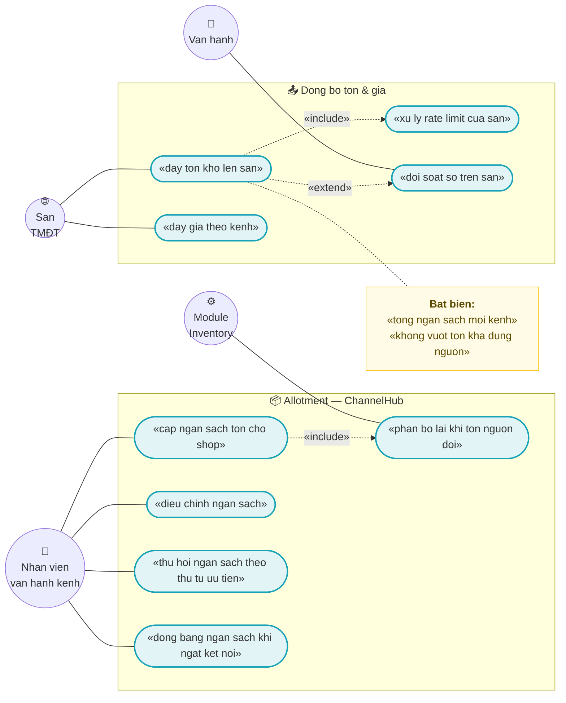
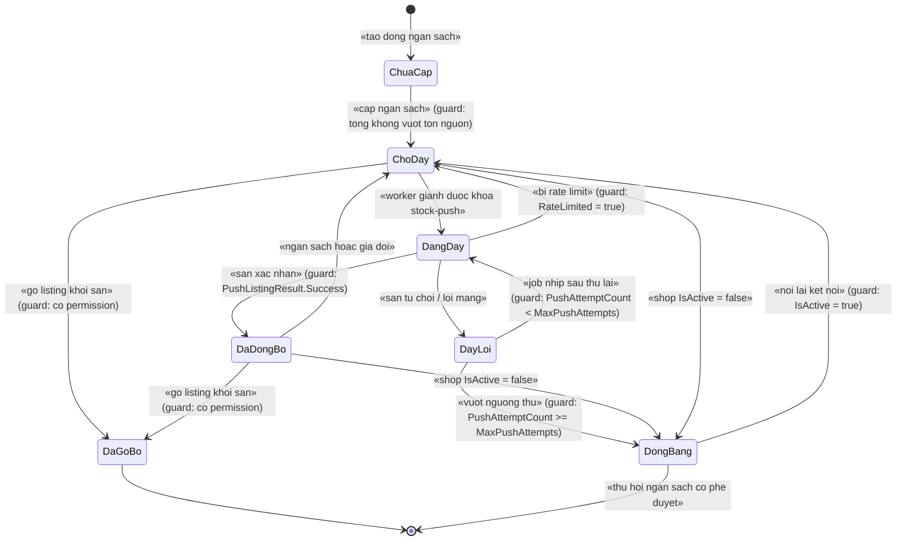
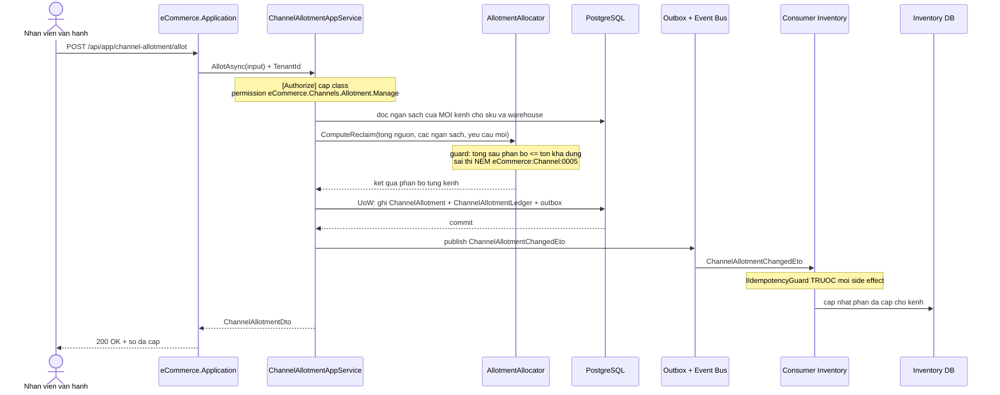
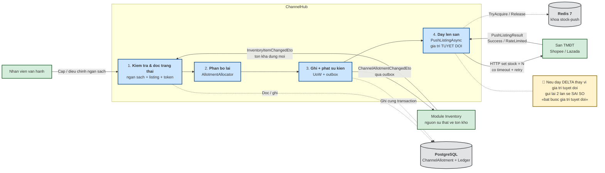
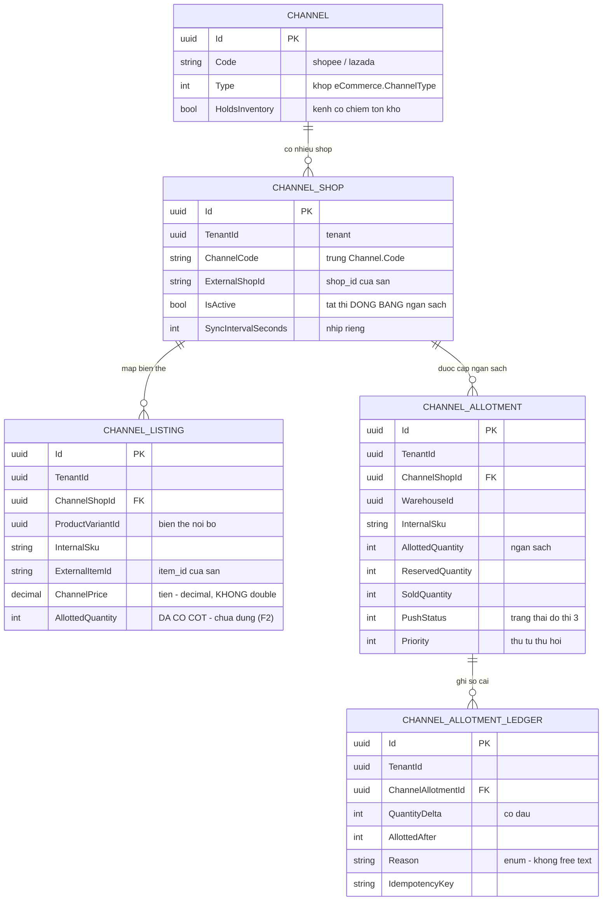

# `CHN-004` — Allotment & đồng bộ tồn đa kênh

| Thuộc tính | Nội dung |
|---|---|
| **Mã** | `CHN-004` |
| **Module** | **ChannelHub** (`eCommerce.ChannelHub.Domain` · `.Application` · `.EntityFrameworkCore`) — *chủ sở hữu*; module **Inventory** (`src/eCommerce.Domain/Entities/Inventory`, tương lai `modules/Inventory/`) là **nguồn sự thật về tồn kho** |
| **Giai đoạn** | **GĐ4 — Tăng trưởng** (`docs/implementation-plan.md` Phụ lục A.3: `CHN-004` = *"Allotment & đồng bộ tồn đa kênh"*) |
| **Ưu tiên** | **Must have** *(điều kiện để đấu sàn không bán vượt tồn — rủi ro #5 của `docs/implementation-plan.md` §14)* |
| **Trạng thái** | 🟡 `Draft` — chờ review |
| **Người viết / người review** | *(điền)* / **Kiến trúc trưởng** |
| **Phiên bản / ngày** | `v0.1 — 13/10/2026` |
| **Tài liệu liên quan** | `XC-002` (outbox/inbox & chống trùng) · `XC-003` (khoá phân tán & quy ước tên khoá) · `XC-004` (xác thực/phân quyền/tenant) · `XC-005` (observability) · `XC-001` (Money & làm tròn) · `INV-001` (sổ cái kho append-only) · `INV-002` (giữ chỗ + TTL) · `INV-003` (**phân bổ tồn theo kênh** — ranh giới với tài liệu này) · `CHN-001` / `CHN-002` / `CHN-003` · `SAL-005` (webhook đơn từ sàn) · `docs/implementation-plan.md` |

---

## 0. Tóm tắt & quyết định thiết kế

**Tóm tắt:** `CHN-004` chốt cơ chế **allotment** (ngân sách tồn kho cấp cho từng shop của từng kênh) và **đồng bộ tồn kho/giá lên sàn**.
Vấn đề gốc: khi cùng một SKU được bán trên website và nhiều sàn, **sàn cập nhật tồn kho có độ trễ** — nếu đẩy con số tồn kho thật lên
sàn thì sàn vẫn cho khách mua với con số cũ ⇒ **bán vượt tồn**. Allotment chặn việc đó ở tầng **chính sách phân bổ**: mỗi shop chỉ
được nhìn thấy một phần tồn kho đã được cấp, và phần đó chỉ được nhả về nguồn chung theo một luật tường minh.

**Điểm khác biệt so với mọi tài liệu `XC-*`:** đây là tài liệu **đầu tiên** viết cho một nhóm **đã có code chạy thật** trong repo —
`modules/ChannelHub/{eCommerce.ChannelHub.Domain, eCommerce.ChannelHub.Application, eCommerce.ChannelHub.EntityFrameworkCore}`.
Vì vậy §5 (mô hình dữ liệu) phân biệt rõ **"đã có trong code"** và **"chưa có trong code — kế hoạch GĐ4"**, và §15.2 ghi lại các
**sai lệch/khuyết điểm thật** đọc được từ code hiện tại.

**Phạm vi:**
- ✅ Mô hình **allotment**: ngân sách tồn theo `(TenantId, ChannelShopId, ProductVariantId)`, sổ cái điều chỉnh **append-only**.
- ✅ Luật **phân bổ lại** khi tồn kho nguồn thay đổi (nhả về nguồn chung **an toàn**, không để sàn giữ số cũ).
- ✅ **Đồng bộ tồn kho (và giá) lên sàn**: chọn lô, thứ tự, idempotency, retry, rate limit, quan sát được.
- ✅ **Trạng thái đồng bộ** ở mức `(shop, variant)` và state machine có **ném lỗi** khi chuyển sai.
- ✅ **Hợp đồng tích hợp** giữa ChannelHub và Inventory qua **sự kiện** (module → module **không** gọi app service của nhau).

**Không nằm trong phạm vi:**
- ❌ **Thuật toán giữ chỗ (reservation) + TTL + job nhả kho** — thuộc `INV-002`.
- ❌ **Định nghĩa "tồn khả dụng theo kênh" ở phía Inventory** (bảng tồn, sổ cái kho) — thuộc `INV-003`; tài liệu này **tiêu thụ** khái niệm đó, không định nghĩa lại.
- ❌ **Gọi HTTP thật tới Shopee/Lazada** — thuộc `CHN-002` / `CHN-003`; ở đây chỉ dùng `IChannelConnector.PushListingAsync` (`modules/ChannelHub/eCommerce.ChannelHub.Application.Contracts/Connectors/IChannelConnector.cs:104`).
- ❌ **OAuth/đăng ký shop** — thuộc `CHN-001`.
- ❌ **Settlement/phí sàn/đối soát tiền** — thuộc `REC-002`.
- ❌ **Giá theo kênh (chính sách giá)** — thuộc `PRC-001`; ở đây chỉ **đẩy** giá đã có (`ChannelListing.ChannelPrice`).

### 0.1 Quyết định thiết kế (ADR ngắn)

| # | Quyết định | Phương án đã cân nhắc | Lý do chọn | Hệ quả |
|---|---|---|---|---|
| **D1** | **Allotment là NGÂN SÁCH tĩnh**, không phải "đẩy tồn thật lên sàn" | (a) đẩy `Available` thật mỗi lần tồn đổi · (b) ngân sách cấp trước cho từng shop | Sàn cập nhật tồn có độ trễ; đẩy số thật ⇒ sàn vẫn bán theo số cũ ⇒ **oversell** (rủi ro #5 §14 kế hoạch). Ngân sách cấp trước **chặn được ở tầng chính sách**, không phụ thuộc độ trễ của sàn | Cần luật phân bổ lại tường minh (D3/D4); số hiển thị trên sàn **nhỏ hơn** tồn thật (đánh đổi có ý thức) |
| **D2** | **Một bảng trạng thái + một sổ cái append-only** (`ChannelAllotment` + `ChannelAllotmentLedger`) | (a) chỉ một bảng trạng thái · (b) chỉ sổ cái rồi tính lại · (c) cả hai | Đọc nhanh cần bảng trạng thái; đối soát với sàn cần sổ cái (bài học #8 kế hoạch: *tồn kho = append-only ledger, không UPDATE số lượng*). Bản ghi `StockLedgerEntry` đã có `ChannelCode` (`src/eCommerce.Domain/Entities/Inventory/StockLedger.cs:106`) ⇒ hai sổ cái đối chiếu được với nhau | Phải bảo đảm hai bảng **luôn đi cùng một transaction** (BR-004) |
| **D3** | **Nhả allotment phải là "hai bước"**: giảm ngân sách **trước**, đẩy số mới lên sàn **sau** | (a) đẩy số mới rồi mới giảm · (b) giảm trước, đẩy sau | Nếu đẩy số mới trước mà bước giảm thất bại ⇒ **sàn giữ số lớn hơn ngân sách** ⇒ oversell. Thứ tự ngược lại chỉ gây **bán ít hơn** (thiệt doanh thu, không sai dữ liệu) | Trong khoảng giữa hai bước, kênh bán **ít hơn** thực tế; phải có job đối soát đóng khoảng này (NFR-002) |
| **D4** | **Thu hồi ngân sách theo "nước" (degressive reclaim)**, không lấy hết ngay | (a) thu hồi toàn bộ phần vượt · (b) thu hồi theo tỉ lệ · (c) thu hồi theo **thứ tự ưu tiên kênh + tỉ lệ phần vượt** | Lấy hết ngay ⇒ một sự kiện tồn kho nhỏ làm **sàn về 0** liên tục ⇒ mất doanh thu và tạo `push` bão hoà. Cần hàm thu hồi **xác định được** (deterministic) để test được | Luật phải viết rõ và **có test bất biến tổng** (TC-09); không được để tổng ngân sách vượt tồn kho nguồn (BR-002) |
| **D5** | **Số đẩy lên sàn là số TUYỆT ĐỐI** (`set stock = N`), không phải số gia (`+/-delta`) | (a) gửi delta · (b) gửi giá trị tuyệt đối | Delta **không idempotent**: gửi lại 2 lần ⇒ sai số. API sàn (`/product/update_stock`) nhận giá trị tuyệt đối ⇒ khớp luôn với hợp đồng thật | Mọi lần push phải đọc lại trạng thái mới nhất; **cấm** push giá trị đọc trước đó quá `PushStalenessSeconds` (BR-006) |
| **D6** | **Idempotency key của push = `{channelShopId}:{sku}:{quantity}`** *(khoá ổn định theo NỘI DUNG, không theo lần gọi)* | (a) `Guid.NewGuid()` mỗi lần · (b) khoá sinh từ nội dung tin | Gửi lại cùng một con số ⇒ **cùng một khoá** ⇒ inbox chặn ⇒ không tạo 2 tác vụ. Cùng khoá mà **khác** `PayloadHash` ⇒ **NÉM LỖI** (BR-XC-002-006) | Khi số đẩy đổi, khoá đổi ⇒ là một tác vụ **mới** (đúng: nội dung mới là việc mới) |
| **D7** | **Mỗi shop một khoá lock `stock-push`** — *không* một khoá cho cả kênh | (a) khoá theo kênh · (b) khoá theo shop | Shopee/Lazada giới hạn quota **theo shop**; khoá theo kênh làm shop A chặn shop B vô cớ (đúng D7 của `XC-003`) | Số khoá = số shop; khoá đã có sẵn hàm sinh: `ChannelHubConsts.LockKeys.ChannelStockPush` (`modules/ChannelHub/eCommerce.ChannelHub.Domain/ChannelHubConsts.cs:26`) |
| **D8** | **Job đẩy tồn dùng `SkipIfBusy`, KHÔNG ném lỗi** | (a) ném `eCommerce:Lock:0001` · (b) bỏ qua nhịp + log + metric | Đây là **job định kỳ** — trường hợp ngoại lệ duy nhất được phép của `XC-003` BR-010 (D10 của `XC-003`); nhịp sau sẽ đẩy tiếp | **Bắt buộc** log `Information` + metric `lock_skipped_total` (đã có nơi phát: `shared/eCommerce.Kernel/Observability/eCommerceMetrics.cs:109`) |
| **D9** | **Đổi ngân sách phát sự kiện, KHÔNG gọi thẳng Inventory** | (a) ChannelHub gọi `IInventoryAppService` · (b) phát `ChannelAllotmentChangedEto` | Quy tắc bất di bất dịch #3: **module → app là cấm**; app → module là hợp lệ. Gọi thẳng app service từ module là **vi phạm ranh giới** và chặn việc tách microservice sau này | Inventory **phải** có consumer riêng + idempotency (BR-016); hợp đồng sự kiện phải ổn định |
| **D10** | **Allotment không tự nhả khi shop bị ngắt kết nối** | (a) ngắt ⇒ nhả hết về nguồn chung · (b) **đóng băng** ngân sách, nhả bằng tay có duyệt | Listing trên sàn **vẫn còn** sau khi mất token; nhả ngay ⇒ kênh khác bán hết và shop cũ (khi nối lại) đã bán phần đã nhả ⇒ **oversell thật** | Cần permission riêng cho "nhả ngân sách của shop đã ngắt" (§9) + audit bắt buộc |
| **D11** | **Chỉ tiêu thụ `AvailableToPromise` của Inventory, không tự tính lại tồn** | (a) ChannelHub tự cộng trừ tồn · (b) ChannelHub chỉ giữ ngân sách, **tin** con số tồn từ Inventory | Hai nguồn sự thật cho tồn kho là lỗi đã ghi trong kế hoạch (`Customers`: *"Không có mô hình địa chỉ hai nguồn sự thật"* — cùng loại lỗi). Tồn kho thuộc **Inventory** | ChannelHub **phụ thuộc** chất lượng `InventoryItemChangedEto`; nếu event mất ⇒ cần đối soát định kỳ (NFR-002) |

---

## 1. Use Case Specification

| Thuộc tính | Nội dung |
|---|---|
| **Use Case ID** | `CHN-004` |
| **Use Case Name** | Cấp **ngân sách tồn kho** cho từng shop của từng kênh và **đẩy tồn/giá** lên sàn — không bao giờ để sàn bán vượt phần đã cấp |
| **Description** | *"Là nhân viên vận hành kênh, tôi muốn cấp cho mỗi shop trên sàn một phần tồn kho xác định và để hệ thống tự đẩy con số đó lên sàn, để khi sàn cập nhật chậm thì website và các sàn khác vẫn không bán vượt tồn kho thật."* |
| **Actor(s)** | **Nhân viên vận hành kênh** (cấp/điều chỉnh ngân sách, đẩy tay) · **Hệ thống ChannelHub** (worker đẩy tồn theo nhịp) · **Hệ thống Inventory** (phát sự kiện tồn kho thay đổi, tiêu thụ sự kiện ngân sách) · **Sàn TMĐT** (nhận `update_stock` / `update_price`) · **Vận hành** (xem lệch, chạy đối soát, thu hồi ngân sách) |
| **Priority** | **Must have** |
| **Trigger** | (a) nhân viên cấp/điều chỉnh ngân sách cho `(shop, biến thể)`; (b) **tồn kho nguồn thay đổi** (`InventoryItemChangedEto`) ⇒ phải phân bổ lại; (c) nhịp worker đẩy tồn tới hạn; (d) nút **Đẩy ngay** trên UI; (e) job **đối soát** phát hiện số trên sàn khác ngân sách |
| **Pre-Condition(s)** | • **Tenant hiện tại** (`TenantId`) — mọi bảng của feature đều có tenant (BR-015).<br>• **`ChannelCode` + `ChannelShopId`** đã tồn tại và shop **`IsActive = true`** (`ChannelShop.IsActive`, `modules/ChannelHub/eCommerce.ChannelHub.Domain/Entities/ChannelEntities.cs:71`).<br>• Đã có **`ChannelListing`** map biến thể ↔ item trên sàn (`ChannelListing`, cùng file, dòng 117) — **chưa có listing thì không có gì để đẩy**.<br>• Token của shop còn hiệu lực **hoặc** refresh được — do `ChannelTokenManager.GetValidContextAsync` bảo đảm (`modules/ChannelHub/eCommerce.ChannelHub.Application/Sync/ChannelTokenManager.cs:55`).<br>• **Redis 7** sẵn sàng: nếu không, khoá `stock-push` **vô hiệu** nhưng app vẫn chạy (`AbortOnConnectFail = false`, `src/eCommerce.HttpApi.Host/eCommerceHttpApiHostModule.cs:141`) — hàng rào cuối là ràng buộc DB (BR-002).<br>• `Inventory` đã phát **`AvailableToPromise`** cho `(warehouse, sku)` — *chưa có trong code — kế hoạch GĐ4* (phụ thuộc `INV-003`). |
| **Post-Condition(s)** | • Tổng ngân sách đã cấp **≤** tồn kho khả dụng nguồn (bất biến BR-002) — kiểm được bằng SQL.<br>• Mọi thay đổi ngân sách có **một dòng** trong `ChannelAllotmentLedger` (append-only, BR-004).<br>• Số tồn **trên sàn** = `AllottedQuantity - ReservedQuantity - SoldQuantity` sau khi push thành công, hoặc trạng thái `PushFailed` với `LastPushError` (BR-011).<br>• Mọi lần đẩy đều có **dấu vết**: `PushStatus`, `PushAttemptCount`, log có `CorrelationId`, metric.<br>• Cùng một `(shop, sku, quantity)` gửi lại **không** tạo tác vụ thứ hai (BR-005). |
| **Basic Flow** | 1. Nhân viên mở màn hình allotment của shop, chọn biến thể, nhập **số muốn cấp**; API `AllotAsync` chạy.<br>2. App service kiểm `[Authorize]` cấp class + permission `eCommerce.Channels.Allotment.Manage`.<br>3. Đọc ngân sách hiện tại của **tất cả** kênh cho `(sku, warehouse)`; gọi domain service `AllotmentAllocator.ComputeReclaim(...)` (D4) để bảo đảm **không vượt tồn nguồn**; nếu vượt ⇒ **NÉM** `eCommerce:Channel:0005`.<br>4. Trong **một Unit of Work**: ghi `ChannelAllotment` (trạng thái mới) **và** `ChannelAllotmentLedger` (dòng điều chỉnh) **và** phát `ChannelAllotmentChangedEto` qua outbox (`XC-002` BR-001).<br>5. Worker đẩy tồn (hoặc nút **Đẩy ngay**) giành khoá `ecommerce:channel:{channelCode}:{shopId}:stock-push` (`ChannelHubConsts.LockKeys.ChannelStockPush`).<br>6. Nếu không giành được khoá ⇒ **bỏ qua nhịp** + log `Information` + metric `lock_skipped_total` (D8, `XC-003` BR-010).<br>7. Gọi `IChannelConnector.PushListingAsync` với **giá trị tuyệt đối**; kiểm `PushListingResult.Success`.<br>8. Cập nhật `PushStatus = Synced`, `LastPushedQuantity`, `LastPushedAtUtc`; ghi metric. |
| **Alternative Flow** | **A1: Sàn báo hết quota (`RateLimited = true`)** — **không** retry dồn; ghi `PushStatus = RateLimited`, tăng `PushAttemptCount`, để nhịp sau thử lại; metric `channel_sync_failed_total{reason=rate_limited}` (`PushListingResult.RateLimited`, `IChannelConnector.cs:70`).<br>**A2: Không có listing tương ứng** — bỏ qua **có log** (`Warning`) và metric; **không** phải lỗi (phân biệt "không có dữ liệu" với "lỗi thật" — §12).<br>**A3: Shop bị ngắt kết nối (`IsActive = false`)** — **đóng băng** ngân sách, **không** tự nhả (D10); worker của shop đã bị `ChannelSyncSupervisorWorker` gỡ (`modules/ChannelHub/eCommerce.ChannelHub.Application/Sync/ChannelSyncSupervisorWorker.cs:109`).<br>**A4: Điều chỉnh ngân sách hàng loạt (import CSV)** — mỗi dòng là một lần `AllotAsync` idempotent; dòng lỗi không huỷ cả lô, kết quả trả về theo dòng. |
| **Exception Flow** | **E1:** tổng ngân sách vượt tồn kho khả dụng nguồn ⇒ `BusinessException` `eCommerce:Channel:0005` + **rollback** toàn bộ UoW.<br>**E2:** push thất bại (mạng/5xx) ⇒ **không** rollback ngân sách đã ghi (ngân sách là dữ liệu nội bộ, đúng kể cả khi sàn chưa nhận); ghi `PushStatus = PushFailed` + `LastPushError`; job nhịp sau thử lại (BR-006).<br>**E3:** chuyển trạng thái `Synced → Synced` hoặc `PushFailed → Delisted` sai luật ⇒ **NÉM** `eCommerce:Channel:0007` (quy ước #11: state machine **PHẢI NÉM LỖI`) — xem §3.<br>**E4:** Redis không kết nối được ⇒ khoá vô hiệu ⇒ **hai worker cùng push**: bất biến vẫn đúng vì push là **giá trị tuyệt đối** (D5) nên gửi trùng cho **cùng kết quả**, và `IdempotencyGuard` chặn ở biên vào.<br>**E5:** mất `InventoryItemChangedEto` ⇒ ngân sách **cũ** vẫn nằm trên sàn ⇒ job đối soát (NFR-002) phải phát hiện trong `ReconcileIntervalSeconds`. |
| **Business Rules** | • **BR-CHN-004-001**: Ngân sách tồn của một `(TenantId, ChannelShopId, ProductVariantId)` **phải** nằm trong `ChannelAllotment`; **cấm** đẩy lên sàn con số tồn kho thô `Available` khi kênh có ngân sách.<br>• **BR-CHN-004-002**: **Bất biến tổng**: `Σ AllottedQuantity` của **mọi** kênh cho một `(warehouse, sku)` **≤** tồn kho khả dụng nguồn. Vi phạm ⇒ **NÉM** `eCommerce:Channel:0005` **và** ràng buộc DB phải chặn (hàng rào cuối — D2 của `XC-003`).<br>• **BR-CHN-004-003**: `ChannelAllotment.AvailableToPromise = AllottedQuantity − ReservedQuantity − SoldQuantity`, và **giá trị này không bao giờ âm**; âm ⇒ **NÉM** lỗi (không kẹp về 0 im lặng).<br>• **BR-CHN-004-004**: Mọi thay đổi `AllottedQuantity` **phải** sinh **đúng một** dòng `ChannelAllotmentLedger` **trong cùng transaction**; sổ cái **append-only** (cấm UPDATE/DELETE).<br>• **BR-CHN-004-005**: Mọi lần đẩy lên sàn **phải** idempotent bằng khoá ổn định `{channelShopId}:{sku}:{quantity}`; **cấm** `Guid.NewGuid()` cho mỗi lần gọi (D6, `XC-002` BR-007).<br>• **BR-CHN-004-006**: Push **phải** đọc lại trạng thái ngân sách ngay trước khi gọi sàn; nếu bản đọc cũ hơn `PushStalenessSeconds` ⇒ **đọc lại**, **cấm** dùng giá trị cũ.<br>• **BR-CHN-004-007**: **Chỉ** đẩy **giá trị tuyệt đối** (`set = N`); **cấm** gửi delta (D5).<br>• **BR-CHN-004-008**: Thu hồi ngân sách **phải** theo thuật toán tường minh trong `AllotmentAllocator` (D4), **phải** xác định được (deterministic) và **phải** giữ BR-002 sau mỗi bước.<br>• **BR-CHN-004-009**: Shop `IsActive = false` ⇒ **đóng băng** ngân sách; **cấm** tự động nhả (D10). Muốn nhả ⇒ permission riêng + audit.<br>• **BR-CHN-004-010**: Mọi thao tác push của một shop **phải** nằm trong khoá `ecommerce:channel:{channelCode}:{shopId}:stock-push`; **cấm** acquire lồng cùng tên khoá (`XC-003` BR-005).<br>• **BR-CHN-004-011**: Job đẩy tồn **phải** dùng `SkipIfBusy` **và bắt buộc** ghi log + metric `lock_skipped_total`; **cấm** ném lỗi ở job định kỳ (`XC-003` BR-010).<br>• **BR-CHN-004-012**: Chuyển trạng thái đồng bộ **phải** theo state machine §3; chuyển sai **phải NÉM** `eCommerce:Channel:0007` — **cấm** no-op im lặng (quy ước #11).<br>• **BR-CHN-004-013**: Mọi bảng của feature **phải** có `TenantId`; unique index có `TenantId` **phải** dùng `NULLS NOT DISTINCT` (`XC-004` BR-009 — lỗi F1 đã kiểm chứng bằng `INSERT 0 2`).<br>• **BR-CHN-004-014**: **Mọi biên vào** (event tồn kho, webhook sàn, lần đẩy tay, job đối soát) **phải** gọi `IIdempotencyGuard` **trước** mọi side effect (`XC-002` BR-004).<br>• **BR-CHN-004-015**: Cùng `IdempotencyKey` + **khác** `PayloadHash` ⇒ **NÉM** `eCommerce:Messaging:0002`; **cấm** coi là trùng và **cấm** ghi đè (`XC-002` BR-006).<br>• **BR-CHN-004-016**: Ngân sách **chỉ** được cấp/điều chỉnh bởi người có permission `eCommerce.Channels.Allotment.Manage`; `[Authorize]` đặt ở **cấp class** (`XC-004` BR-001).<br>• **BR-CHN-004-017**: `ChannelListing.ChannelPrice` **phải** là `decimal` (đã là `decimal?` với `HasPrecision(18, 4)`, `ChannelHubDbContextModelCreatingExtensions.cs:66`); **cấm** so sánh tiền bằng `==` — dùng so sánh qua `Money` (`XC-001`).<br>• **BR-CHN-004-018**: Số lượng tồn kho là **`int`**; **cấm** dùng `decimal` cho số lượng và **cấm** so sánh `int` bằng phép trừ có thể tràn âm im lặng — mọi phép trừ **phải** kiểm kết quả âm (BR-003). |
| **Non-Functional Requirement** | • **NFR-CHN-004-001**: Độ trễ phát hiện lệch giữa số trên sàn và ngân sách: **≤ `ReconcileIntervalSeconds`** (mặc định **900 s**).<br>• **NFR-CHN-004-002**: Tỉ lệ **oversell** trên sàn do lệch đồng bộ: **0** trên môi trường bình thường; **> 0** ⇒ cảnh báo email kỹ thuật.<br>• **NFR-CHN-004-003**: p95 một lần `PushListingAsync` (không tính độ trễ mạng của sàn): **< 200 ms**; p95 **toàn bộ** một lô 500 dòng: **< 60 s**.<br>• **NFR-CHN-004-004**: Gửi trùng cùng nội dung **1.000 lần** ⇒ **đúng 1** tác vụ trên sàn (idempotent).<br>• **NFR-CHN-004-005**: Cách ly tenant: tenant A **không** đọc/ghi ngân sách của tenant B — integration test 2 tenant.<br>• **NFR-CHN-004-006**: Mọi lần push có **log `Information` + metric**; metric **không** dùng nhãn cardinality cao (`sku`, `lockKey`, `orderId` đều **bị cấm** — `eCommerceMetricTags.Forbidden`, `shared/eCommerce.Kernel/Observability/eCommerceMetrics.cs:81`).<br>• **NFR-CHN-004-007**: **100 %** app service có `[Authorize]` cấp class; **0** permission dùng mà chưa định nghĩa (`XC-004` NFR-002/003, có test reflection trong CI).<br>• **NFR-CHN-004-008**: **100 %** thay đổi ngân sách có bản ghi sổ cái trong **< 1 s** kể từ lúc commit.<br>• **NFR-CHN-004-009**: Redis chết ⇒ app **không** sập và **không** sai dữ liệu (nhờ push tuyệt đối + idempotency) — integration test. |

---

## 2. Sơ đồ Use Case



### Chú giải

| Ký hiệu | Ý nghĩa |
|---|---|
| ⭕ Xanh lá | Actor (người hoặc hệ thống ngoài) |
| 🟦 Bầu dục xanh dương | Use case |
| 🟨 Khung vàng | Note / bất biến |
| `───` | Liên kết Actor ↔ Use Case |
| `-.«include».->` | Quan hệ bao hàm |
| `-.«extend».->` | Quan hệ mở rộng |

---

## 3. Sơ đồ trạng thái (state machine) — trạng thái đồng bộ của một `(shop, biến thể)`

> Trạng thái được giữ trên `ChannelAllotment.PushStatus` (mã `int`, khớp `eCommerce.ChannelListingStatus` cho phần listing).
> **Mọi chuyển sai phải NÉM LỖI** (`eCommerce:Channel:0007`) — đây là bài học #11 của kế hoạch, không được no-op im lặng.



| # | Từ → Sang | Guard (điều kiện cho phép) | Hành động kèm theo | Nếu guard sai thì? |
|---|---|---|---|---|
| 1 | `ChuaCap` → `ChoDay` | `AllottedQuantity > 0` **và** BR-002 đúng sau phân bổ | Ghi `ChannelAllotment` + `ChannelAllotmentLedger` + phát `ChannelAllotmentChangedEto` (**cùng UoW**) | **NÉM** `eCommerce:Channel:0005` (E1) — **rollback** cả UoW |
| 2 | `ChoDay` → `DangDay` | Giành được khoá `…:stock-push` trong timeout | Gọi `PushListingAsync` (giá trị tuyệt đối) | Không giành được ⇒ **ở lại `ChoDay`** + log + metric `lock_skipped_total` (D8) |
| 3 | `DangDay` → `DaDongBo` | `PushListingResult.Success = true` | `LastPushedQuantity`, `LastPushedAtUtc`, xoá `LastPushError`, metric `channel_stock_push_total{result=ok}` | **NÉM** `eCommerce:Channel:0006` (E2) — **không** rollback ngân sách |
| 4 | `DangDay` → `ChoDay` | `PushListingResult.RateLimited = true` | Tăng `PushAttemptCount`; ghi `Warning`; metric `channel_sync_failed_total{reason=rate_limited}` | Xử như E2 |
| 5 | `DangDay` → `DayLoi` | Push thất bại (mạng / 5xx / sàn từ chối) | `LastPushError` (cắt 2.000 ký tự theo quy ước `ChannelShop.LastError`), `PushAttemptCount++` | — |
| 6 | `DayLoi` → `DangDay` | `PushAttemptCount < MaxPushAttempts` | Thử lại ở nhịp sau **sau khi đọc lại** trạng thái (BR-006) | Vượt ngưỡng ⇒ sang `DongBang` |
| 7 | `DayLoi` → `DongBang` | `PushAttemptCount ≥ MaxPushAttempts` | `Warning` + metric; **giữ nguyên** ngân sách (không tự nhả — D10) | — |
| 8 | `DaDongBo`/`ChoDay` → `DongBang` | `ChannelShop.IsActive = false` | **Đóng băng** ngân sách; supervisor gỡ worker của shop | — |
| 9 | `DongBang` → `ChoDay` | `IsActive = true` (shop nối lại) | Đưa về `ChoDay` và **đẩy lại toàn bộ** biến thể của shop (**bắt buộc**, vì số trên sàn đã cũ) | — |
| 10 | `ChoDay`/`DaDongBo` → `DaGoBo` | Người dùng có permission `eCommerce.Channels.Allotment.Manage` **và** đã gỡ listing trên sàn | `Status = Delisted`; ngân sách **được** trả về nguồn chung + ghi sổ cái | **NÉM** `eCommerce:Channel:0007` |
| 11 | Mọi trạng thái → Mọi trạng thái **khác luật trên** | — | — | **NÉM** `eCommerce:Channel:0007` (E3) — **tuyệt đối không** no-op im lặng |

> ⚠️ **Trạng thái nguy hiểm nhất là `DongBang`:** ngân sách vẫn bị giữ nhưng **không** đẩy được lên sàn.
> Nếu listing vẫn sống trên sàn, sàn có thể bán vào phần ngân sách đó — **đúng thiết kế** (D10), vì nhả ra sẽ khiến kênh khác
> bán mất phần đó rồi shop cũ bán tiếp ⇒ oversell. Vì vậy `DongBang` **bắt buộc** xuất hiện trên màn hình vận hành (§10)
> và **bắt buộc** có quy trình nhả có duyệt (BR-009).

---

## 4. Sequence Diagram & luồng dữ liệu

### 4.1 Điều chỉnh ngân sách → phát sự kiện → Inventory phân bổ lại



### 4.2 DFD — luồng dữ liệu & biên module



---

## 5. Mô hình dữ liệu

### 5.1 Bảng & cột (Data Dictionary)

> **Quy ước đọc mục này:** mỗi bảng ghi rõ **trạng thái trong code hôm nay**. Bảng nào "chưa có trong code" thì **toàn bộ** là
> kế hoạch GĐ4 — **không** được coi là đã tồn tại khi review.

**Bảng `ChnChannelAllotments`** — ngân sách tồn kho của một biến thể cho một shop. *(Chưa có trong code — kế hoạch GĐ4.)*

| Cột | Kiểu | Null? | Nguồn / ý nghĩa | Ghi chú |
|---|---|---|---|---|
| `Id` | `uuid` | ✖ | khoá chính | `FullAuditedAggregateRoot<Guid>` như các entity hiện có |
| `TenantId` | `uuid` | ✔ | tenant sở hữu | **bắt buộc** — `IMultiTenant`; index phải `NULLS NOT DISTINCT` (BR-013) |
| `ChannelShopId` | `uuid` | ✖ | FK → `ChnChannelShops.Id` | có sẵn ở `ChannelEntities.cs:121` (`ChannelListing.ChannelShopId`) |
| `ChannelCode` | `varchar(32)` | ✖ | mã kênh ("shopee"/"lazada") | trùng với `Channel.Code`; dùng cho khoá lock + đối soát |
| `ProductVariantId` | `uuid` | ✖ | FK → biến thể nội bộ | cùng khoá logic với `ChannelListing` |
| `WarehouseId` | `uuid` | ✖ | kho nguồn của ngân sách | khớp `InventoryItem.WarehouseId` (`src/eCommerce.Domain/Entities/Inventory/StockLedger.cs:14`) |
| `InternalSku` | `varchar(64)` | ✖ | SKU tại thời điểm cấp (giữ để đối soát khi SKU đổi) | cùng quy ước `ChannelListing.InternalSku` |
| `AllottedQuantity` | `int` | ✖ | **ngân sách** đã cấp | ⚠️ `int`, **không** `decimal` (BR-018) |
| `ReservedQuantity` | `int` | ✖ | phần đã giữ chỗ cho đơn chưa xuất | nguồn: `INV-002` |
| `SoldQuantity` | `int` | ✖ | phần đã bán thành công | nguồn: webhook/đơn từ sàn (`SAL-005`) |
| `AvailableToPromise` | *(computed)* | — | `Allotted − Reserved − Sold` | **không lưu cột** — tính trong domain (BR-003) để tránh hai nguồn sự thật |
| `PushStatus` | `int` | ✖ | trạng thái §3 | khớp phong cách `ChannelListing.Status` |
| `LastPushedQuantity` | `int?` | ✔ | số **đã** đẩy thành công lần cuối | để đối soát nhanh, **không** phải nguồn sự thật |
| `LastPushedAtUtc` | `timestamptz` | ✔ | thời điểm đẩy thành công | ⚠️ `AbpClockOptions.Kind = Utc` (lỗi C2 đã sửa) |
| `PushAttemptCount` | `int` | ✖ | số lần thử **liên tiếp** | reset về 0 khi thành công (guard #6 §3) |
| `LastPushError` | `varchar(2048)` | ✔ | lỗi gần nhất | cùng giới hạn với `ChannelShop.LastError` (`ChannelHubDbContextModelCreatingExtensions.cs:45`) |
| `Priority` | `int` | ✖ | thứ tự ưu tiên **thu hồi** (D4) | số nhỏ = ưu tiên giữ ngân sách |
| `PriceVersion` | `int` | ✖ | phiên bản giá đã đẩy | dùng để phát hiện giá cũ |

**Bảng `ChnChannelAllotmentLedgers`** — sổ cái điều chỉnh ngân sách, **APPEND-ONLY**. *(Chưa có trong code — kế hoạch GĐ4.)*

| Cột | Kiểu | Null? | Nguồn / ý nghĩa | Ghi chú |
|---|---|---|---|---|
| `Id` | `uuid` | ✖ | khoá chính | |
| `TenantId` | `uuid` | ✔ | tenant | `IMultiTenant` |
| `ChannelAllotmentId` | `uuid` | ✖ | FK → `ChnChannelAllotments.Id` | |
| `WarehouseId` / `Sku` | `uuid` / `varchar(64)` | ✖ | sao chép để tra cứu không cần join | cùng phong cách `StockLedgerEntry` |
| `QuantityDelta` | `int` | ✖ | độ lệch (+ cấp thêm, − thu hồi) | quy ước dấu tường minh |
| `AllottedAfter` | `int` | ✖ | số dư ngân sách sau điều chỉnh | để đối soát nhanh (**không** phải nguồn sự thật) |
| `Reason` | `varchar(64)` | ✖ | `ManualAllot` / `ReclaimOnStockChange` / `ReclaimOnDelist` / `ShopDisconnected` / `ReconcileFix` | enum, **không** free text |
| `ReferenceType` / `ReferenceId` | `varchar(64)` / `varchar(128)` | ✔ | nguồn gây ra (mã sự kiện, mã đơn) | cùng quy ước `StockLedgerEntry` (`StockLedger.cs:101`) |
| `IdempotencyKey` | `varchar(256)` | ✔ | khoá chống trùng của biên vào | `XC-002` BR-005 |
| `OccurredAtUtc` | `timestamptz` | ✖ | thời điểm nghiệp vụ | |
| `PerformedByUserId` | `uuid` | ✔ | ai điều chỉnh (null = hệ thống) | bắt buộc cho `ManualAllot` (NFR-008) |

**Bảng `ChnChannelListings`** — ✅ **ĐÃ CÓ TRONG CODE**, tài liệu này **dùng lại** và **đề xuất mở rộng**.

| Cột | Kiểu | Null? | Ghi chú |
|---|---|---|---|
| `Id` | `uuid` | ✖ | `FullAuditedAggregateRoot<Guid>` — `ChannelEntities.cs:117` |
| `TenantId` | `uuid` | ✔ | `IMultiTenant` — `ChannelEntities.cs:119` |
| `ChannelShopId` | `uuid` | ✖ | `ChannelEntities.cs:121` |
| `ChannelCode` | `varchar(32)` | ✖ | `ChannelEntities.cs:123`; max length ở `ChannelHubDbContextModelCreatingExtensions.cs:59` |
| `ProductVariantId` | `uuid` | ✖ | `ChannelEntities.cs:125` |
| `InternalSku` | `varchar(64)` | ✖ | `ChannelEntities.cs:128` |
| `ExternalItemId` / `ExternalSku` | `varchar(64)` | ✔ | `ChannelEntities.cs:131,133` |
| `ChannelPrice` | `numeric(18,4)` | ✔ | ✅ đã đúng `decimal` + precision — `ChannelEntities.cs:136`, `…Extensions.cs:66` |
| **`AllottedQuantity`** | `int?` | ✔ | ⚠️ **đã có cột nhưng CHƯA có chỗ nào đọc/ghi** — xem §15.2 **F2** |
| `Status` | `int` | ✖ | khớp `eCommerce.ChannelListingStatus` — `src/eCommerce.Domain.Shared/Enums.cs:72` |
| `LastSyncError` | `varchar(2048)` | ✔ | `ChannelEntities.cs:147` |
| `LastSyncedAtUtc` | `timestamptz` | ✔ | `ChannelEntities.cs:149` |

**Index & ràng buộc** *(phần hay bị bỏ sót nhất — phải liệt kê hết)*

| Loại | Bảng | Cột | Trạng thái trong code | Mục đích |
|---|---|---|---|---|
| UNIQUE | `ChnChannelListings` | `(TenantId, ChannelShopId, ProductVariantId)` | ✅ **đã có** — `ChannelHubDbContextModelCreatingExtensions.cs:69` | một biến thể chỉ map **một lần** cho một shop |
| INDEX | `ChnChannelListings` | `(ChannelShopId, ExternalItemId)` | ✅ **đã có** — dòng 72 | tra ngược từ item của sàn khi nhận webhook |
| UNIQUE | `ChnChannelShops` | `(TenantId, ChannelCode, ExternalShopId)` | ✅ **đã có** — dòng 48 | một shop chỉ kết nối một lần trong tenant |
| INDEX | `ChnChannelShops` | `(IsActive, ChannelCode)` | ✅ **đã có** — dòng 51 | worker quét shop đang hoạt động |
| UNIQUE **`NULLS NOT DISTINCT`** | `ChnChannelAllotments` | `(TenantId, ChannelShopId, ProductVariantId)` | ⬜ *chưa có — GĐ4* | chống cấp trùng ngân sách; **bắt buộc `NULLS NOT DISTINCT`** (`XC-004` BR-009, lỗi F1 đã chứng minh `INSERT 0 2`) |
| INDEX | `ChnChannelAllotments` | `(TenantId, ChannelCode, PushStatus)` | ⬜ *chưa có — GĐ4* | job đẩy tồn quét lô cần đẩy |
| INDEX | `ChnChannelAllotments` | `(TenantId, WarehouseId, InternalSku)` | ⬜ *chưa có — GĐ4* | tính **bất biến tổng** BR-002 theo `(kho, sku)` |
| CHECK | `ChnChannelAllotments` | `AllottedQuantity >= 0` **and** `ReservedQuantity >= 0` **and** `SoldQuantity >= 0` | ⬜ *chưa có — GĐ4* | bất biến BR-003 ở tầng DB (**hàng rào cuối** khi Redis chết — D2 của `XC-003`) |
| CHECK | `ChnChannelAllotments` | `AllottedQuantity >= ReservedQuantity + SoldQuantity` | ⬜ *chưa có — GĐ4* | `AvailableToPromise` **không âm** — chặn ở DB, không chỉ ở domain |
| UNIQUE **có filter** | `ChnChannelAllotmentLedgers` | `(TenantId, IdempotencyKey) WHERE IdempotencyKey IS NOT NULL` | ⬜ *chưa có — GĐ4* | ⭐ **hàng rào chống trùng** của mọi biên vào (BR-014) |

> 📌 **Vì sao bất biến tổng (BR-002) cần CHECK/LOCK chứ không chỉ code:** đây đúng là câu hỏi kiểm tra của `XC-003` BR-007 —
> *"bỏ lock đi, DB có chặn không?"*. Với BR-002 câu trả lời **phải là CÓ**, nên cần thêm ràng buộc ở tầng DB
> (CHECK `Sum(AllottedQuantity) <= Available` **không** diễn đạt được bằng CHECK đơn bảng ⇒ dùng
> `EXCLUDE`/trigger hoặc `UPDATE … WHERE` có kiểm số, và **tối thiểu** là CHECK BR-003 + transaction `SERIALIZABLE` khi phân bổ lại).
> Xem **Q3** §15.1.

### 5.2 ERD



---

## 6. Hợp đồng API

### 6.1 Application Service

| Mục | Giá trị |
|---|---|
| Interface | `IChannelAllotmentAppService` — đặt tại `eCommerce.ChannelHub.Application.Contracts` (⬜ *chưa có — GĐ4*) |
| Implementation | `ChannelAllotmentAppService` — đặt tại `eCommerce.ChannelHub.Application` (⬜ *chưa có — GĐ4*) |
| `[Authorize]` | **cấp CLASS** + permission cụ thể ở từng method (BR-016; bài học đã kiểm chứng: bỏ `[Authorize]` cấp class ⇒ `GetShopsAsync` **công khai** — ghi chú trong `src/eCommerce.Application/Channels/ChannelAppService.cs:21-26`) |
| Vị trí app service đã có | `ChannelAppService` (app) là **ví dụ mẫu** cách app gọi module: chỉ dùng `IChannelConnectorFactory`, `IRepository<ChannelShop, Guid>` — `src/eCommerce.Application/Channels/ChannelAppService.cs:30-45` |

| Method | Input (DTO) | Output (DTO) | Permission | Ghi chú |
|---|---|---|---|---|
| `GetListAsync` | `GetAllotmentsInputDto` (`ChannelShopId?`, `Sku?`, `PushStatus?`, paging) | `PagedResultDto<ChannelAllotmentDto>` | `eCommerce.Channels.Allotment` (view) | chỉ đọc; **không** trả dữ liệu tenant khác (BR-013) |
| `AllotAsync` | `AllotInputDto` (`ChannelShopId`, `ProductVariantId`, `WarehouseId`, `Quantity`, `ExpectedVersion`) | `ChannelAllotmentDto` | `eCommerce.Channels.Allotment.Manage` | `ExpectedVersion` = optimistic concurrency; lệch ⇒ **NÉM** `eCommerce:Channel:0008` |
| `AdjustAsync` | `AdjustAllotmentInputDto` (`ChannelAllotmentId`, `QuantityDelta`, `Reason`, `Note`) | `ChannelAllotmentDto` | `eCommerce.Channels.Allotment.Manage` | **bắt buộc** `Reason`; sinh **đúng một** dòng sổ cái (BR-004) |
| `ReleaseAsync` | `ReleaseAllotmentInputDto` (`ChannelShopId`, `ProductVariantId`, `ApprovedBy`) | `ChannelAllotmentDto` | `eCommerce.Channels.Allotment.Release` | dùng cho shop đã ngắt (D10); **bắt buộc** audit |
| `PushNowAsync` | `Guid channelShopId`, `string? sku` | `ChannelPushResultDto` | `eCommerce.Channels.Sync` *(đã định nghĩa)* | giành khoá và push; **ném** `eCommerce:Lock:0001` khi bận (đây là **HTTP**, không phải job — `XC-003` D10) |
| `GetReconciliationAsync` | `ReconcileInputDto` (`ChannelShopId`, `FromUtc`, `ToUtc`) | `AllotmentReconciliationDto` | `eCommerce.Channels.Allotment` (view) | so `LastPushedQuantity` với ngân sách; **chỉ đọc, không tự sửa** |

> 📌 **Vì sao `PushNowAsync` ném lỗi còn job thì không (D8):** `XC-003` BR-010 phân biệt **hai chế độ** tường minh —
> `ThrowOnTimeout` cho HTTP (người dùng phải biết), `SkipIfBusy` cho job định kỳ (nhịp sau làm tiếp) + **bắt buộc** log/metric.

### 6.2 REST endpoint

| Mục | Giá trị |
|---|---|
| Method / Route | `POST /api/app/channel-allotment/allot` · `POST /api/app/channel-allotment/adjust` · `POST /api/app/channel-allotment/release` · `POST /api/app/channel-allotment/push-now` · `GET /api/app/channel-allotment` |
| Authentication | `Bearer (OpenIddict)` — chuỗi xác thực đã kiểm chứng: không token ⇒ **`401`** (`docs/runtime-verification-report.md` §4) |
| Permission | `eCommerce.Channels.Allotment.Manage` / `.Release` / `eCommerce.Channels.Sync` |
| Content-Type | `application/json` |
| Auto controller | Bật sẵn: `options.ConventionalControllers.Create(typeof(eCommerceApplicationModule).Assembly)` — `src/eCommerce.HttpApi.Host/eCommerceHttpApiHostModule.cs:154` |

**Request mẫu — `allot`**

```json
{
  "channelShopId": "3f2504e0-4f89-11d3-9a0c-0305e82c3301",
  "productVariantId": "9c1f2b34-1a2b-4c3d-8e9f-0a1b2c3d4e5f",
  "warehouseId": "b1a2c3d4-e5f6-4a7b-8c9d-0e1f2a3b4c5d",
  "quantity": 120,
  "expectedVersion": 7
}
```

**Response mẫu**

```json
{
  "id": "77aa1c22-0c3f-4b1d-9a5e-1c2d3e4f5a6b",
  "channelCode": "shopee",
  "internalSku": "SKU-AO-THUN-DO-M",
  "allottedQuantity": 120,
  "reservedQuantity": 10,
  "soldQuantity": 40,
  "availableToPromise": 70,
  "pushStatus": 1,
  "lastPushedQuantity": 120,
  "lastPushedAtUtc": "2026-10-13T09:15:00Z",
  "priority": 10
}
```

**Mã lỗi nghiệp vụ**

| Mã | HTTP | Khi nào | Thông điệp |
|---|---|---|---|
| `eCommerce:Channel:0001` `ChannelShopNotFound` | `404` | `channelShopId` không tồn tại **hoặc** thuộc tenant khác (BR-008 của `XC-004`: trả `404` để **không** tiết lộ sự tồn tại) | `Không tìm thấy shop của kênh.` |
| `eCommerce:Channel:0002` `ChannelTokenExpired` | `409` | refresh token thất bại khi push — đã dùng thật tại `ChannelTokenManager.cs:102` | `Token của shop đã hết hiệu lực, cần kết nối lại.` |
| `eCommerce:Channel:0003` `ChannelRateLimited` | `429` | sàn trả quota — ⚠️ `XC-003` Q4 đã chốt: dành `429` **cho rate limit của sàn** (ngữ nghĩa khác `409` của lock) | `Sàn đang giới hạn tần suất, vui lòng thử lại sau.` |
| `eCommerce:Channel:0004` `ChannelNotSupported` | `400` | chưa có connector cho `channelCode` — hiện `ChannelConnectorFactory` ném `ArgumentException` (`Connectors/ChannelConnectorFactory.cs:34`) ⚠️ xem **F4** §15.2 | `Chưa hỗ trợ kênh này.` |
| `eCommerce:Channel:0005` | `409` | **tổng ngân sách vượt tồn kho khả dụng nguồn** (BR-002) | `Tổng ngân sách cấp cho các kênh vượt tồn kho khả dụng. Cần thu hồi bớt ở kênh khác.` |
| `eCommerce:Channel:0006` | `502` | push lên sàn thất bại (mạng/5xx/từ chối) | `Đẩy tồn kho lên sàn thất bại, hệ thống sẽ thử lại.` |
| `eCommerce:Channel:0007` | `409` | **chuyển trạng thái sai luật §3** (BR-012) | `Trạng thái đồng bộ không cho phép thao tác này.` |
| `eCommerce:Channel:0008` | `409` | `ExpectedVersion` lệch (ai đó đã sửa trước) | `Ngân sách đã bị thay đổi bởi người khác, vui lòng tải lại.` |
| `eCommerce:Lock:0001` | `409` | không giành được khoá `stock-push` ở `PushNowAsync` (`XC-003` §6.2) | `Tài nguyên đang được xử lý bởi tiến trình khác, vui lòng thử lại.` |
| `eCommerce:Messaging:0002` | `409` | cùng `IdempotencyKey` + **khác** `PayloadHash` (`XC-002` BR-006) | `Dữ liệu trùng khoá nhưng khác nội dung — từ chối ghi đè.` |

> 📌 **Bốn mã `eCommerce:Channel:0001…0004` ĐÃ CÓ trong code** — `modules/ChannelHub/eCommerce.ChannelHub.Domain/ChannelHubConsts.cs:36-42`.
> Bốn mã `0005…0008` là **đề xuất mới** của tài liệu này (⬜ *chưa có trong code — GĐ4*). Định dạng `eCommerce:Channel:*`
> là định dạng **module sở hữu** đã chốt sau khi sửa **F2** của `XC-003` (xem ghi chú ở `src/eCommerce.Domain.Shared/eCommerceConsts.cs:80-84`).

---

## 7. Sự kiện, tích hợp ngoài & idempotency

### 7.1 Sự kiện phát ra (ETO)

| ETO | Trạng thái | Khi nào phát | Trường dữ liệu | Ai tiêu thụ | Handler có idempotent? |
|---|---|---|---|---|---|
| `ChannelAllotmentChangedEto` | ⬜ *chưa có — GĐ4* | sau khi ngân sách `(shop, biến thể)` đổi, **trong cùng UoW** | `TenantId`, `ChannelShopId`, `ChannelCode`, `InternalSku`, `WarehouseId`, `AllottedQuantity`, `ChangedQuantityDelta`, `Reason`, `OccurredAtUtc`, `AggregateVersion` | **Inventory** (phân bổ lại phần đã cấp cho kênh) | ✅ `IdempotencyKey = "{channelShopId}:{sku}:{allottedQuantity}"` + `AggregateVersion` (`XC-002` BR-014) |
| `ChannelStockPushedEto` | ⬜ *chưa có — GĐ4* | sau khi push thành công hoặc thất bại vĩnh viễn | `TenantId`, `ChannelShopId`, `ChannelCode`, `InternalSku`, `PushedQuantity`, `Success`, `RateLimited`, `Error`, `OccurredAtUtc` | `Reconciliation` (`REC-002`), màn hình vận hành | ✅ khoá `"{channelShopId}:{sku}:{pushedQuantity}:{result}"` |
| `ChannelOrderPulledEto` | ✅ **ĐÃ CÓ** — `modules/ChannelHub/eCommerce.ChannelHub.Application.Contracts/Events/ChannelEvents.cs:17` | khi kéo được đơn từ sàn | `TenantId`, `ChannelShopId`, `ChannelCode`, `ExternalShopId`, `ExternalOrderId`, `Lines[]`… | app (tạo `Order`) | ⚠️ **Hợp đồng nói phải idempotent** (XML doc dòng 13–14) nhưng **chưa có `AggregateVersion`** ⇒ xem **F3** §15.2 |
| `ChannelShopTokenRefreshedEto` | ✅ **ĐÃ CÓ** — `ChannelEvents.cs:44` | sau khi refresh token thành công | `TenantId`, `ChannelShopId`, `ChannelCode`, `ExternalShopId`, `AccessTokenExpiresAtUtc`, `RefreshedAtUtc` | audit / cảnh báo vận hành | ✅ thuần thông báo, không side effect |

> ⚠️ **Bắt buộc:** mọi ETO nghiệp vụ **phải** đi qua **outbox** (`useOutbox: true`, trong UoW) — `XC-002` BR-001/BR-002.
> **Cấm** phát trực tiếp (dual-write): eShop từng mất sự kiện vì outbox **thiếu relay** (`XC-002` §0, dòng 24).
> 📌 Trong code hiện tại, `ChannelShopSyncer` gọi `_distributedEventBus.PublishAsync` **trực tiếp**
> (`Sync/ChannelShopSyncer.cs:69`) — ⬜ việc chuyển sang outbox thuộc `XC-002`, ghi nhận ở **F5** §15.2.

### 7.2 Sự kiện / webhook nhận vào

| Nguồn | Loại | Xác thực | Chống trùng bằng | Nếu xử lý lỗi? | Thứ tự đến |
|---|---|---|---|---|---|
| **Inventory** — tồn kho nguồn đổi | event bus | nội bộ (outbox của Inventory) | `IdempotencyKey = "Inv:{warehouseId}:{sku}:{balanceAfter}"` + `AggregateVersion` | Vào DLQ (`XC-002`) + metric; **không** rollback ngân sách | **Có thể sai thứ tự** ⇒ so `AggregateVersion`, bản cũ ⇒ **bỏ qua có log + metric** |
| **Shopee** — webhook đơn/trạng thái | webhook | **chữ ký của sàn** (bắt buộc) | `IdempotencyKey = "Webhook:Shopee:{shopId}:{orderSn}:OrderCreated"` (`XC-002` §7.3 mẫu đúng) | Retry → DLQ; **không** tin webhook cho việc trừ tồn | at-least-once; sai thứ tự ⇒ theo `SAL-005` |
| **Shopee/Lazada** — poll đơn theo con trỏ | poll | OAuth token (`ChannelTokenManager`) | con trỏ `LastSyncedAtUtc` + `ExternalOrderId` unique (`eCommerceDbContext.cs:184`) | `LastError` + nhịp sau | theo `update_time` tăng dần |
| **Job đối soát** | job định kỳ | nội bộ | `IdempotencyKey = "Reconcile:{channelShopId}:{sku}:{bucketUtc}"` | log + metric; **không** tự sửa khi chưa duyệt | không áp dụng |

> 🚨 **Webhook sàn là at-least-once** — chính `ShopeeConnector` ghi rõ: *"webhook là at-least-once → xử lý đơn phải idempotent
> theo `order_sn` / `package_number`"* (`Connectors/ShopeeConnector.cs:22`). Vì vậy **mọi** biên vào ở bảng trên
> **phải** đi qua `IIdempotencyGuard` (`XC-002` BR-004) — và **lock KHÔNG thay thế được** idempotency (`XC-003` §7.3).

### 7.3 Gọi API ra ngoài

| NCC | Endpoint (base URL) | Auth | Timeout | Retry | Nếu thất bại |
|---|---|---|---|---|---|
| **Shopee** | `https://partner.test-stable.shopeemobile.com` (sandbox) / `https://partner.shopeemobile.com` — ✅ **đã cấu hình** `ShopeeOptions.BaseUrl`, `ChannelHubOptions.cs:44` | ký `HMAC-SHA256(partner_key, partner_id+api_path+timestamp+access_token+shop_id)` — ✅ đã có `ShopeeConnector.Sign` / `BuildBaseString`, `ShopeeConnector.cs:48,62` | **10 s** (đề xuất; `XC-003` D8) | tối đa **3** lần, backoff luỹ thừa; **cấm** retry khi `RateLimited` | `PushStatus = PushFailed` + `LastPushError` + metric; job nhịp sau |
| **Shopee** — `PushListingAsync` | `POST /api/v2/product/update_stock`, `/update_price` | như trên | 10 s | 3 | như trên |
| **Trạng thái thực tế hôm nay** | ⚠️ `ShopeeOptions.EnableLiveCalls = false` (`ChannelHubOptions.cs:47`, `appsettings.json:18`) ⇒ `PushListingAsync` **mô phỏng thành công** và **không** gọi mạng (`ShopeeConnector.cs:98-109`) | | | | |

> ⚠️ **Ghi chú ràng buộc Shopee phải tôn trọng khi làm thật** (nguồn: XML doc trong `ShopeeConnector.cs:17-22` và `IChannelConnector.cs:87-93`):
> access token **4 giờ** · refresh token **30 ngày VÀ CÓ ROTATE** ⇒ bắt buộc lock khi refresh · `api_path` trong chuỗi ký **chỉ là path** ·
> `timestamp` trong chuỗi ký **phải trùng** timestamp trên URL · nhiều endpoint **phải POST** dù tên giống GET ·
> `partner_key` **hết hạn 180 ngày** và **không tự gia hạn** (`ChannelHubOptions.cs:35`) ⇒ **phải** có nhắc lịch gia hạn.

### 7.4 ⚠️ Idempotency của push — vì sao "gửi giá trị tuyệt đối" là điều kiện tiên quyết

| | Push **delta** (bị cấm — BR-007) | Push **giá trị tuyệt đối** (bắt buộc — D5/BR-007) |
|---|---|---|
| Gửi lại 1 lần do retry | Số trên sàn **sai** (cộng/trừ 2 lần) | Số trên sàn **vẫn đúng** (ghi đè cùng giá trị) |
| Khi Redis chết (mất khoá) | Hai worker **cùng delta** ⇒ sai số | Hai worker ghi **cùng giá trị** ⇒ vô hại |
| Idempotency key | Không ổn định theo nội dung | `{channelShopId}:{sku}:{quantity}` — **ổn định** (D6) |

⇒ **Hai cơ chế phải có ĐỦ CẢ HAI:** lock giảm tranh chấp, idempotency + giá trị tuyệt đối bảo đảm đúng.

---

## 8. Bất biến & xử lý đồng thời

### 8.1 Bất biến

| # | Bất biến | Cơ chế bảo vệ | Nếu bỏ cơ chế ra thì DB có chặn? |
|---|---|---|---|
| 1 | `Σ AllottedQuantity` mọi kênh của `(warehouse, sku)` **≤** tồn kho khả dụng nguồn | Domain guard `AllotmentAllocator` + transaction `SERIALIZABLE` khi phân bổ lại + **CHECK/trigger ở DB** (⬜ GĐ4) | ✅ **có** (sau khi thêm ràng buộc — hiện **chưa**, xem Q3 §15.1) |
| 2 | `AvailableToPromise = Allotted − Reserved − Sold` **không âm** | Domain throw (BR-003) + **CHECK** `AllottedQuantity >= ReservedQuantity + SoldQuantity` | ✅ **có** (CHECK) |
| 3 | Mỗi thay đổi ngân sách có **đúng một** dòng sổ cái | Cùng UoW + append-only | ❌ **không** ⇒ bắt buộc guard ở tầng ứng dụng + **review** |
| 4 | Cùng `(shop, sku, quantity)` gửi lại **không** tạo tác vụ thứ hai | `IdempotencyGuard` + UNIQUE `(TenantId, IdempotencyKey)` | ✅ **có** (unique index) |
| 5 | Số trên sàn **không** lớn hơn `AllottedQuantity` | Push **giá trị tuyệt đối** + job đối soát | ❌ **không** (sàn là hệ thống ngoài) ⇒ **bắt buộc** job đối soát (NFR-001) |
| 6 | Tenant A **không** thấy ngân sách tenant B | `IMultiTenant` + query filter ABP (`XC-004` BR-009/NFR-007) | ✅ **có** (query filter) |
| 7 | Mọi chuyển trạng thái sai luật đều **có lỗi** | State machine ném `eCommerce:Channel:0007` (BR-012) | — (**không áp dụng** — đây là bất biến luồng, không phải bất biến dữ liệu) |

### 8.2 Khoá phân tán dùng trong feature

| Tên khoá (hàm sinh) | Khoá **thật** trong Redis | Trạng thái | Phạm vi | Vì sao cần |
|---|---|---|---|---|
| `ChannelHubConsts.LockKeys.ChannelStockPush(channelCode, shopId)` — `ChannelHubConsts.cs:26` | `ecommerce:channel:{channelCode}:{shopId}:stock-push` | ✅ **hàm đã có** · ⬜ **chưa có nơi gọi** | theo **shop** (D7) | chống 2 worker cùng đẩy lên một shop |
| `ChannelHubConsts.LockKeys.ChannelTokenRefresh(channelCode, shopId)` — `ChannelHubConsts.cs:22` | `ecommerce:channel:{channelCode}:{shopId}:token-refresh` | ✅ **đã dùng thật** — `ChannelTokenManager.cs:67` | theo shop | refresh token Shopee **có rotate** ⇒ phải tuần tự |
| `ChannelHubConsts.LockKeys.ChannelOrderPull(channelCode, shopId)` — `ChannelHubConsts.cs:30` | `ecommerce:channel:{channelCode}:{shopId}:order-pull` | ✅ **hàm đã có** · ⬜ chưa có nơi gọi | theo shop | tránh 2 worker cùng dịch con trỏ |

**Cơ chế tiền tố — đã kiểm chứng bằng `redis-cli MONITOR`** (nguồn: `docs/runtime-verification-report.md` §1 lỗi **C11**, và ghi chú ngay trong code `eCommerceHttpApiHostModule.cs:115-128`):

```
khoá_thật = AbpDistributedLockOptions.KeyPrefix + tên_khoá     ← GHÉP KHÔNG CÓ DẤU PHÂN CÁCH
```

| Trước khi sửa (SAI) | Sau khi sửa (ĐÚNG) |
|---|---|
| `KeyPrefix = "eCommerce"` ⇒ khoá thật `eCommercechannel:shopee:SHOP-1:token-refresh` (dính liền, E **hoa**) | `KeyPrefix = "ecommerce:"` (`eCommerceHttpApiHostModule.cs:127`) ⇒ `ecommerce:channel:shopee:SHOP-1:token-refresh` |

⇒ **Tên khoá do module sinh KHÔNG chứa `ecommerce:`** — tiền tố là việc của `KeyPrefix` (một nguồn sự thật duy nhất).
Đây là lý do `ChannelHubConsts.LockKeys.*` trả `channel:{channelCode}:{shopId}:{hậu tố}` **không** có tiền tố.
**Kiểm chứng đã có:** giữ khoá bằng `redis-cli` ⇒ worker **KHÔNG** refresh (ca **B** mục §1b của báo cáo) — khoá **chặn đúng**.

**Idempotency key của feature**

| Đối tượng | Cách sinh khoá | ⚠️ Lưu ý |
|---|---|---|
| Đẩy tồn lên sàn | `{channelShopId}:{sku}:{quantity}` (D6) | Khoá **ổn định theo nội dung**; **cấm** `Guid.NewGuid()` mỗi lần (`XC-002` BR-007) |
| Sự kiện tồn kho nguồn | `Inv:{warehouseId}:{sku}:{balanceAfter}` | Dùng `balanceAfter` để **phân biệt** hai lần biến động khác nhau về cùng số |
| Webhook đơn của sàn | `Webhook:{ChannelCode}:{shopId}:{orderSn}:OrderCreated` | Mẫu **đúng** đã nêu trong `XC-002` §7.3 |
| Job đối soát | `Reconcile:{channelShopId}:{sku}:{bucketUtc}` | Có `bucketUtc` ⇒ chạy lại trong cùng khung giờ **không** sinh tác vụ thứ hai |

### 8.3 Xử lý đồng thời — các tình huống thật

| # | Tình huống | Cơ chế | Kết quả mong đợi |
|---|---|---|---|
| 1 | 2 worker (2 instance) cùng đẩy 1 shop | Khoá `…:stock-push` + giá trị tuyệt đối | Instance 2 **chờ tới timeout** rồi bỏ qua nhịp (D8); nếu Redis chết ⇒ cả hai gửi **cùng giá trị** ⇒ vô hại |
| 2 | Nhân viên sửa ngân sách **đồng thời** với worker đang push | `ExpectedVersion` (optimistic concurrency, `eCommerce:Channel:0008`) + worker **đọc lại** trước khi gửi (BR-006) | Một bên thắng; bên kia nhận lỗi và tải lại |
| 3 | Tồn kho nguồn giảm **đúng lúc** sàn đang bán | Thu hồi **hai bước** (D3: giảm trước, đẩy sau) | Trong khoảng giữa: kênh bán **ít hơn** — thiệt doanh thu, **không** sai dữ liệu |
| 4 | Mất `InventoryItemChangedEto` | Job đối soát `ReconcileIntervalSeconds` phát hiện | Phát hiện **≤ 900 s** (NFR-001); **không** tự sửa khi chưa duyệt |
| 5 | Redis chết | `AbortOnConnectFail = false` (`eCommerceHttpApiHostModule.cs:141`) ⇒ app **vẫn chạy**, lock **vô hiệu** | Bất biến vẫn đúng nhờ **giá trị tuyệt đối** + idempotency + (sau GĐ4) CHECK ở DB |
| 6 | Sàn rate limit | `RateLimited` ⇒ **không** retry dồn; giãn nhịp | Quota không bị đốt hết; metric `channel_sync_failed_total{reason=rate_limited}` |

---

## 9. Phân quyền

| Permission | Trạng thái | Nhóm | Method được gán | Vai trò mặc định |
|---|---|---|---|---|
| `eCommerce.Channels` (cha) | ✅ **đã định nghĩa** — `eCommerceConsts.cs:35`, khai báo `eCommercePermissionDefinitionProvider.cs:38` | Kênh bán | — | Admin |
| `eCommerce.Channels.Manage` | ✅ **đã có** — `eCommerceConsts.cs:37` | Kênh bán | `ConnectAsync`, `SetActiveAsync` (`ChannelAppService.cs:69,127`) | Admin |
| `eCommerce.Channels.Sync` | ✅ **đã có** — `eCommerceConsts.cs:39` | Kênh bán | `SyncNowAsync` (`ChannelAppService.cs:143`) · **đề xuất**: `PushNowAsync` | Admin |
| `eCommerce.Channels.Allotment` | ⬜ *chưa có — GĐ4* | Kênh bán | `GetListAsync`, `GetReconciliationAsync` (chỉ đọc) | Nhân viên vận hành kênh |
| `eCommerce.Channels.Allotment.Manage` | ⬜ *chưa có — GĐ4* | Kênh bán | `AllotAsync`, `AdjustAsync` | Quản lý kênh (không cấp cho nhân viên) |
| `eCommerce.Channels.Allotment.Release` | ⬜ *chưa có — GĐ4* | Kênh bán | `ReleaseAsync` (nhả ngân sách shop đã ngắt — **D10**) | Quản lý kênh + **bắt buộc audit** |
| `eCommerce.Inventory` / `.Adjust` | ✅ **đã có** — `eCommerceConsts.cs:29,30` | Kho | (module Inventory) | — |

**Quy tắc bắt buộc (`XC-004`):**
1. **`[Authorize]` ở CẤP CLASS** cho **mọi** app service mới (`BR-XC-004-001`). Bài học đã kiểm chứng: ABP **không** tự bảo vệ app service — chỉ `[Authorize]` ở vài method ⇒ các method còn lại **công khai** (ghi chú trong `src/eCommerce.Application/Channels/ChannelAppService.cs:21-26`).
2. **Mọi** permission dùng trong `[Authorize]` **phải** được định nghĩa trong `eCommercePermissionDefinitionProvider`; nếu không ⇒ ABP **luôn từ chối** ⇒ `403` dù user là admin (lỗi **C7** đã kiểm chứng: `AbpPermissionGrants = 0` ⇒ **mọi API trả `403`**).
3. **Cấm** magic string cho permission — dùng `eCommerceConsts.Permissions.*` (`BR-XC-004-003`).
4. Tài nguyên của tenant khác ⇒ **`404`**, không trả `403` (`BR-XC-004-008`).
5. Cấp quyền đổi ngân sách cho **vai trò**, **không** cho từng người (audit log bắt buộc — `BR-XC-004-011`).

> 📌 **Việc phải làm khi code GĐ4:** thêm 3 permission mới vào `eCommerceConsts.Permissions.Channels` **và** `AddChild(...)` tương ứng trong provider,
> nếu không thì **2 test reflection của CI** (`XC-004` `TC-01`/`TC-02`, đã nằm trong `docs/implementation-plan.md` §7.0 mục **7**) sẽ **đỏ** — đây là cơ chế chặn tái phát lỗi Phase 0.

---

## 10. UI Mockup & mapping dữ liệu

**Có UI** — màn hình **"Ngân sách tồn theo kênh"** (admin). Đây là màn hình vận hành **bắt buộc**: trạng thái `DongBang` (§3) không thể
xử lý nếu không nhìn thấy.

| Vùng UI | Dữ liệu hiển thị | Nguồn (DTO / trường) | Hành động |
|---|---|---|---|
| **Header** | `ChannelCode`, `ShopName`, `ExternalShopId`, trạng thái token (đã hết hạn chưa) | `ChannelShopDto` (`ChannelCode`, `ShopName`, `ExternalShopId`, `HasRefreshToken`, `AccessTokenExpiresAtUtc`, `LastError`) — `src/eCommerce.Application.Contracts/Channels/ChannelDtos.cs:7-23` | nút **Đẩy ngay** (`PushNowAsync`) · **Ngắt kết nối** |
| **Thẻ tổng** | tồn kho khả dụng nguồn · **tổng đã cấp** cho mọi kênh · **còn lại chưa cấp** | *chưa có DTO — GĐ4* | cảnh báo **đỏ** nếu `tổng đã cấp > tồn khả dụng` |
| **Bảng ngân sách** | `InternalSku`, `Allotted`, `Reserved`, `Sold`, **`AvailableToPromise`**, `PushStatus`, `LastPushedQuantity`, `LastPushedAtUtc`, `LastPushError` | `ChannelAllotmentDto` | sửa số (**Manage**) · nhả (**Release**) · xem sổ cái |
| **Cột trạng thái** | nhãn theo §3: `ChoDay` / `DangDay` / `DaDongBo` / `DayLoi` / `DongBang` / `DaGoBo` | `PushStatus` | `DongBang` và `DayLoi` **phải** nổi bật (màu đỏ/cam) + có tooltip lý do |
| **Bảng lệch (đối soát)** | `Sku`, số **trên sàn**, số **ngân sách**, độ lệch, thời điểm phát hiện | `AllotmentReconciliationDto` | **chỉ đọc** — sửa phải qua `AdjustAsync` có audit |
| **Sổ cái** | `OccurredAtUtc`, `QuantityDelta`, `AllottedAfter`, `Reason`, `PerformedByUserId` | `ChannelAllotmentLedgerDto` (**append-only, chỉ đọc**) | không có nút sửa/xoá |

**Quy tắc UI bắt buộc:**

| Quy tắc | Lý do |
|---|---|
| Khi `PushNowAsync` trả `0001` (khoá bận) ⇒ hiển thị **"đang xử lý, vui lòng thử lại"**, **không** hiển thị lỗi hệ thống | Đây là tình huống **bình thường** khi tranh chấp, không phải sự cố (`XC-003` §10) |
| Khi `RateLimited` ⇒ hiển thị **"sàn đang giới hạn tần suất"** + thời điểm thử lại | Tránh nhân viên bấm liên tục làm nặng thêm quota |
| Số tổng ở **Thẻ tổng** tính theo **toàn bộ** kênh, còn bảng có thể **đang lọc** ⇒ **phải ghi rõ** "tổng toàn hệ thống, không theo bộ lọc" | Giữ thói quen tốt của tài liệu gốc: **chênh lệch giữa số tổng và số dòng hiển thị là loại lỗi rất khó phát hiện khi test** |
| Ô nhập số ngân sách **chỉ nhận số nguyên ≥ 0**; không cho nhập số thập phân | Số lượng là `int` (BR-018) — tránh làm tròn ngầm |
| Mọi ô tiền (`ChannelPrice`) hiển thị theo định dạng `Money` của `XC-001`, **không** tự format bằng chuỗi | Nhất quán chính sách làm tròn (`XC-001`) |

---

## 11. Migration & seed

| Mục | Nội dung |
|---|---|
| Migration | **2 migration mới (⬜ GĐ4):** (1) `Added_ChannelAllotment` — tạo `ChnChannelAllotments` + `ChnChannelAllotmentLedgers` + index/CHECK; (2) `Added_ChannelAllotment_NullSafeIndexes` — sửa index có `TenantId` sang `NULLS NOT DISTINCT` (`XC-004` BR-009) |
| Bảng tạo mới | `ChnChannelAllotments`, `ChnChannelAllotmentLedgers` |
| Bảng **đã có, chỉ backfill** | `ChnChannelListings` — cột `AllottedQuantity` **đã tồn tại trong migration** (`src/eCommerce.EntityFrameworkCore/Migrations/20261009070214_Initial.cs:54` ⇒ `table.Column<int>(type: "integer", nullable: true)`). ⚠️ **Chưa có chỗ nào trong code đọc/ghi cột này** — xem **F2** §15.2 |
| Seed | **Có**, phải **idempotent**: (1) 2 kênh nền `web` (`ChannelType.OwnStorefront`) + `shopee` (`Marketplace`) — hiện **chưa** thấy seeder tạo `Channel`; (2) **không** seed ngân sách (dữ liệu nghiệp vụ, phải do người tạo) |
| Ảnh hưởng dữ liệu cũ | **Có.** Listing đã tồn tại **không** có dòng ngân sách ⇒ mặc định: **coi như chưa cấp** (`ChuaCap`) và **không** đẩy gì lên sàn cho tới khi có người cấp. **Cấm** tự suy ra ngân sách = tồn kho (sẽ gây đẩy sai số lên sàn ngay khi deploy). Nếu chọn backfill: **phải** có script đọc `InventoryItem.Available` **tại thời điểm chạy** và **chia theo tỉ lệ cấu hình**, có log + dry-run |
| Rollback | `dotnet ef database update <migration_trước>`; hai bảng mới **không** có FK tới bảng nghiệp vụ khác ngoài `ChnChannelShops`/`ChnChannelListings` (**không** mất dữ liệu tồn kho). ⚠️ Việc **gỡ** hai bảng này làm **mất lịch sử ngân sách** ⇒ bắt buộc **export CSV sổ cái** trước khi rollback trên production |
| Điều kiện tiên quyết | `AbpClockOptions.Kind = Utc` **đã** đặt (nếu không, `timestamptz` ghi từ `DateTime.UtcNow` sai — lỗi **C2** đã kiểm chứng); `DbSet` cho entity mới **phải** khai báo trên `eCommerceDbContext` nếu không `IRepository<T>` **không** được đăng ký (bài học ghi rõ ở `eCommerceDbContext.cs:48-52`) |

---

## 12. Xử lý lỗi & trường hợp biên

| Tình huống | Nguyên nhân | Hành vi | Phản hồi |
|---|---|---|---|
| **Listing chưa có cho SKU** | chưa map biến thể ↔ item sàn | **Không phải lỗi**: bỏ qua **có log `Warning`** + metric; trạng thái giữ `ChuaCap` | `200` với `skipped[]` |
| **Ngân sách = 0 hợp lệ** | nhân viên chủ động khoá kênh | Ghi sổ cái `QuantityDelta = −N` + **đẩy 0 lên sàn** (`set stock = 0`) | `200` |
| **`quantity` âm hoặc không phải số nguyên** | validation đầu vào | **Từ chối** trước khi mở UoW | `400` |
| **Thiếu permission** | token thiếu `eCommerce.Channels.Allotment.Manage` | `[Authorize]` chặn | `403` |
| **Không có token** | chưa đăng nhập | Chặn ở tầng auth | `401` (đã kiểm chứng) |
| **Tài nguyên của tenant khác** | tenant B gọi id của tenant A | Query filter ⇒ **không tìm thấy** | `404` (**không** `403` — `BR-XC-004-008`) |
| **Tổng ngân sách vượt tồn khả dụng** | cấp quá nhiều | **NÉM** `eCommerce:Channel:0005` + **rollback** UoW | `409` |
| **`AvailableToPromise` sẽ âm** | bán nhiều hơn ngân sách (sàn không kịp nhận) | **NÉM** lỗi bất biến (BR-003) + **CHECK** ở DB chặn trước khi commit | `409` |
| **Chuyển trạng thái sai luật** | code gọi sai, hoặc 2 luồng đua | **NÉM** `eCommerce:Channel:0007` (E3) — **cấm** no-op | `409` |
| **Sàn rate limit (HTTP 429)** | quota theo shop | **Không** retry dồn; ghi `RateLimited`; metric; nhịp sau | `429` (nếu là push tay) |
| **Sàn lỗi 5xx / timeout** | sự cố phía sàn | `PushStatus = PushFailed` + `LastPushError`; **không** rollback ngân sách; job thử lại (tối đa `MaxPushAttempts`) | `502` |
| **`EnableLiveCalls = false` (PoC)** | cấu hình sandbox | `PushListingAsync` **mô phỏng thành công** (log `[PoC]`) — **không phải** lỗi, nhưng **phải** ghi rõ trên UI vận hành để không nhầm là đã đồng bộ thật | `200` |
| **Redis chết** | sự cố hạ tầng | App **vẫn chạy**; khoá **vô hiệu**; bất biến vẫn đúng nhờ giá trị tuyệt đối + idempotency + CHECK DB | bình thường |
| **Redis chết + không có ràng buộc DB** | 🚨 **thiết kế sai** | **Phát hiện ở review** (`XC-003` BR-007: *"bỏ lock đi, DB có chặn không?"*) — **không** xử lý runtime | — |
| **`AllottedQuantity` cũ trong `ChannelListings`** | hai nguồn sự thật (F2) | ⚠️ Trong GĐ4: **hoặc** dùng nó làm nguồn sự thật **hoặc** xoá hẳn. **Cấm** để cả hai cùng được ghi | — |
| **Lỗi runtime (DB deadlock/timeout)** | tải cao | **Rollback** + log có `CorrelationId` (đã có thật: header `X-Correlation-Id` trả về — `docs/runtime-verification-report.md` §7) | `500` |
| **Vượt `MaxPushAttempts`** | lỗi kéo dài | `PushStatus = DongBang` + **cảnh báo**; ngân sách **giữ nguyên** (D10) | — |

**Chiến lược transaction:**
- Phạm vi khoá `stock-push` **bao ngoài** Unit of Work (như `XC-003` §12: khoá ở tầng app service/job, **không** nằm trong transaction) ⇒ khoá được nhả **sau** khi transaction kết thúc.
- **Một** UoW cho: ghi `ChannelAllotment` + `ChannelAllotmentLedger` + outbox record. **Cấm** gọi sàn **trong** UoW — push là I/O ngoài, phải **sau** commit (nếu gọi trong UoW, một lần timeout của sàn sẽ giữ transaction mở và khoá DB lâu).
- Khi phân bổ lại do tồn kho nguồn đổi: dùng **`SERIALIZABLE`** (hoặc `SELECT … FOR UPDATE` trên dòng `ChannelAllotment` liên quan) vì bất biến BR-002 là bất biến **giữa nhiều dòng** — mức cách ly mặc định **không** đủ.

---

## 13. Phi chức năng

| Mã | Yêu cầu | Ngưỡng đo được | Cách kiểm chứng |
|---|---|---|---|
| NFR-CHN-004-001 | Độ trễ phát hiện lệch số trên sàn | **≤ `ReconcileIntervalSeconds`** (mặc định **900 s**) | integration test: sửa DB ngân sách, đo thời điểm job phát hiện |
| NFR-CHN-004-002 | Tỉ lệ **oversell** do lệch đồng bộ | **0** trên môi trường bình thường | đối soát `LastPushedQuantity` vs `AllottedQuantity`; test 2 instance |
| NFR-CHN-004-003 | Hiệu năng một lần push | p95 **< 200 ms** (không tính mạng của sàn); lô **500** dòng p95 **< 60 s** | benchmark + integration test |
| NFR-CHN-004-004 | Idempotency của push | gửi **1.000** lần cùng nội dung ⇒ **1** tác vụ | unit test đếm số lần gọi `PushListingAsync` |
| NFR-CHN-004-005 | Cách ly tenant | tenant A **không** thấy/ghi được ngân sách tenant B | integration test 2 tenant (**cần PostgreSQL**) |
| NFR-CHN-004-006 | Observability | **100 %** lần push có log `Information`/`Warning` + metric; **0** nhãn cardinality cao | review + test đối chiếu `eCommerceMetricTags.Allowed`/`Forbidden` (`eCommerceMetrics.cs:75,81`) |
| NFR-CHN-004-007 | Bảo mật & phân quyền | **100 %** app service mới có `[Authorize]` cấp class; **0** permission "mồ côi" | **test reflection trong CI** (`XC-004` `TC-01`/`TC-02`; việc #7 của §7.0 kế hoạch) |
| NFR-CHN-004-008 | Audit | **100 %** thay đổi ngân sách có dòng sổ cái trong **< 1 s** sau commit | integration test đọc `ChannelAllotmentLedger` |
| NFR-CHN-004-009 | Chịu lỗi hạ tầng | Redis chết: app **không** sập, **0** bản ghi vi phạm bất biến | integration test dừng Redis (như `XC-003` TC-11) |
| NFR-CHN-004-010 | Không rò token | **0** log/DTO chứa access/refresh token | quét log + test DTO (`ChannelShopDto` **đã** tuân thủ: không có trường token — `ChannelDtos.cs:6`) |

---

## 14. Test cases & Acceptance Criteria

### 14.1 Danh sách test case

| ID | Mục tiêu | Loại | Input chính | Expected | Phủ |
|---|---|---|---|---|---|
| TC-01 | Cấp ngân sách hợp lệ ⇒ có bản ghi + **một** dòng sổ cái | Unit | `AllotAsync(shop, variant, wh, 120)` | `Allotted = 120`, ledger có **1** dòng `QuantityDelta = +120` | BR-001, BR-004 |
| TC-02 | Sổ cái **append-only** | Unit (reflection) | quét `IRepository<ChannelAllotmentLedger, Guid>` | **0** lời gọi `UpdateAsync`/`DeleteAsync` trên sổ cái | BR-004 |
| TC-03 | Tổng ngân sách **vượt** tồn khả dụng ⇒ ném `0005` + rollback | Unit | nguồn `Available = 100`, cấp 80 rồi cấp 40 | `BusinessException` `eCommerce:Channel:0005`; DB **không** đổi | **BR-002** |
| TC-04 | `AvailableToPromise` âm ⇒ ném lỗi (không kẹp về 0) | Unit | `Allotted = 10`, `Reserved = 6`, `Sold = 6` | ném lỗi bất biến | **BR-003** |
| TC-05 | Push **giá trị tuyệt đối** | Unit | ngân sách 50, gọi push | tham số gửi sàn là `Quantity = 50` (không phải delta) | **BR-007**, D5 |
| TC-06 | Gửi trùng 1.000 lần ⇒ **1** tác vụ | Unit | cùng `(shop, sku, quantity)` lặp 1.000 | `PushListingAsync` gọi **đúng 1** lần | **BR-005**, NFR-004 |
| TC-07 | Cùng khoá **khác** nội dung ⇒ ném `eCommerce:Messaging:0002` | Unit | cùng `IdempotencyKey`, khác `PayloadHash` | `BusinessException` `0002` — **không** ghi đè | **BR-015** |
| TC-08 | Chuyển trạng thái sai luật ⇒ ném `0007` | Unit | `DaGoBo → DangDay` | `BusinessException` `eCommerce:Channel:0007` | **BR-012** |
| TC-09 | Thu hồi khi tồn nguồn giảm: **giữ bất biến tổng** + xác định được | Unit | 3 kênh có `Priority` khác nhau; nguồn giảm 50 | tổng sau thu hồi `≤` nguồn; chạy 2 lần cho **cùng** kết quả; kênh `Priority` nhỏ bị thu ít hơn | **BR-008** |
| TC-10 | Shop `IsActive = false` ⇒ **đóng băng**, **không** nhả | Unit | `IsActive = false` | `PushStatus = DongBang`; `Allotted` **không** đổi; ledger **không** có dòng mới | **BR-009** |
| TC-11 | Job đẩy tồn dùng `SkipIfBusy` + log + metric | Unit | giữ khoá `…:stock-push` bằng tay | **không** ném; metric `lock_skipped_total` tăng; có log | **BR-011**, D8 |
| TC-12 | `PushNowAsync` khi khoá bận ⇒ **NÉM** `eCommerce:Lock:0001` | **Integration** (cần Redis) | giữ khoá bằng `redis-cli` | `409` + mã `0001` | BR-010 |
| TC-13 | 2 instance cùng push **1 shop** | **Integration** (Redis + PostgreSQL) | 2 task song song | **1** thắng; instance kia bỏ qua nhịp; số trên sàn **đúng** | **BR-010**, NFR-002 |
| TC-14 | Mất Redis ⇒ app chạy, bất biến vẫn đúng | **Integration** | dừng Redis, 2 luồng cùng push | app **không** sập; số trên sàn **không** vượt `Allotted` | **NFR-009**, `XC-003` BR-007 |
| TC-15 | `NULLS NOT DISTINCT` cho index tenant | **Integration** (PostgreSQL) | chèn 2 dòng cùng khoá với `TenantId = NULL` | dòng thứ 2 **bị chặn** (`duplicate key value violates unique constraint`) | **BR-013** |
| TC-16 | Cách ly tenant | **Integration** (PostgreSQL) | tenant B đọc ngân sách tenant A | **không** thấy / `404` | **NFR-005** |
| TC-17 | Rate limit của sàn ⇒ **không** retry dồn | Unit | `PushListingResult.RateLimited = true` | `PushStatus` về `ChoDay`; số lần gọi sàn trong nhịp = **1**; metric `reason=rate_limited` | BR-006, §7.3 |
| TC-18 | Sai quyền ⇒ `403`; thiếu token ⇒ `401` | **Integration** | gọi `allot` thiếu permission / không token | `403` / `401` | **NFR-007** (`XC-004`) |
| TC-19 | `ExpectedVersion` lệch ⇒ `0008` | Unit | 2 lần sửa cùng `ExpectedVersion` | lần 2 nhận `eCommerce:Channel:0008` | BR-006 |
| TC-20 | `StockLedgerEntry` mang `ChannelCode` để đối soát chéo | Unit | push tồn cho kênh `shopee` | ledger kho có `ChannelCode = "shopee"` | BR-004, `XC-002` §8 bất biến #8 |

> ⚠️ **TC-15 cần PostgreSQL thật** — không thể chứng minh bằng unit test: lỗi **F1** của `XC-004` từng cho `INSERT 0 2`
> trước khi sửa và sau khi sửa thì báo `duplicate key value violates unique constraint … (null, DUP_TEST3) already exists`
> (`docs/runtime-verification-report.md` §3).

### 14.2 Fixture skeleton (xUnit + ABP)

```csharp
using eCommerce.ChannelHub.Channels;
using Volo.Abp;
using Volo.Abp.Domain.Repositories;
using Xunit;

namespace eCommerce.ChannelHub.Tests;

/// <summary>
/// CHN-004 — bất biến ngân sách tồn theo kênh.
/// ⚠️ TC-13/TC-14/TC-15/TC-16 BẮT BUỘC chạy trên PostgreSQL + Redis thật
/// (xem docs/implementation-plan.md §12 "Test đa instance").
/// </summary>
public class ChannelAllotmentTests /* : eCommerceTestBase<eCommerceEntityFrameworkCoreTestModule> */
{
    private readonly IChannelAllotmentAppService _sut;
    private readonly IRepository<ChannelAllotment, Guid> _allotmentRepository;
    private readonly IRepository<ChannelAllotmentLedger, Guid> _ledgerRepository;

    public ChannelAllotmentTests()
    {
        _sut = GetRequiredService<IChannelAllotmentAppService>();
        _allotmentRepository = GetRequiredService<IRepository<ChannelAllotment, Guid>>();
        _ledgerRepository = GetRequiredService<IRepository<ChannelAllotmentLedger, Guid>>();
    }

    [Fact]
    public async Task TC03_tong_ngan_sach_vuot_ton_kha_dung_thi_nem_0005()
    {
        // Arrange: nguồn chỉ còn 100, đã cấp 80 cho kênh khác
        await TaoNganSachAsync(soLuong: 80, tonKhaDungNguon: 100);

        // Act
        var ex = await Assert.ThrowsAsync<BusinessException>(() =>
            _sut.AllotAsync(new AllotInputDto { Quantity = 40 /* 80 + 40 > 100 */ }));

        // Assert
        Assert.Equal("eCommerce:Channel:0005", ex.Code);
        Assert.Empty(await _ledgerRepository.GetListAsync()); // rollback: KHONG co dong so cai nao
    }

    [Fact]
    public async Task TC04_available_to_promise_am_thi_nem_loi()
    {
        var allotment = await TaoNganSachAsync(soLuong: 10, reserved: 6, sold: 6);

        var ex = await Assert.ThrowsAsync<InvalidOperationException>(() =>
            Task.FromResult(allotment.AvailableToPromise));

        Assert.Contains("âm", ex.Message); // KHONG duoc kep ve 0 im lang (BR-003)
    }

    [Fact]
    public async Task TC06_gui_trung_1000_lan_chi_tao_mot_tac_vu()
    {
        var shop = await TaoShopAsync("shopee", "SHOP-1");
        var key = $"{shop.Id}:SKU-A:50";

        for (var i = 0; i < 1_000; i++)
        {
            await _sut.PushNowAsync(shop.Id, "SKU-A"); // cung noi dung => cung IdempotencyKey
        }

        Assert.Equal(1, FakeConnector.SoLanGoiPushListing);
    }

    [Fact]
    public async Task TC09_thu_hoi_giu_bat_bien_tong_va_xac_dinh_duoc()
    {
        // 3 kenh, Priority 10 / 20 / 30; nguon giam 50
        await TaoNganSachAsync(soLuong: 60, priority: 10);
        await TaoNganSachAsync(soLuong: 60, priority: 20);
        await TaoNganSachAsync(soLuong: 30, priority: 30);

        var lan1 = await ThuHoiAsync(tonNguonMoi: 100);
        var lan2 = await ThuHoiAsync(tonNguonMoi: 100);

        Assert.Equal(lan1, lan2);                                 // deterministic (BR-008)
        Assert.True(lan1.Tong <= 100);                             // bat bien tong (BR-002)
        Assert.True(lan1.CuaKenhUuTienCaoBiThuItHon);              // dung thu tu Priority
    }

    [Fact] // ⚠️ CAN PostgreSQL + Redis THAT
    public async Task TC13_hai_instance_cung_push_mot_shop()
    {
        var shop = await TaoShopAsync("shopee", "SHOP-1");

        var t1 = _sut.PushNowAsync(shop.Id, "SKU-A");
        var t2 = _sut.PushNowAsync(shop.Id, "SKU-A");

        await Task.WhenAll(t1, t2);

        // Chi mot ben day duoc; ben kia nhan eCommerce:Lock:0001
        // va so tren san KHONG bao gio vuot AllottedQuantity
        Assert.Single(new[] { t1, t2 }.Where(t => t.IsCompletedSuccessfully));
    }
}
```

### 14.3 Acceptance Criteria (Definition of Done)

- [ ] **20 test case pass**, phủ **hết 18 BR** và **10 NFR**
- [ ] **Mọi nhánh của state machine §3 đều có test** — kể cả nhánh guard sai (TC-08) và nhánh `DongBang` (TC-10)
- [ ] **Bảng dữ liệu §5.1 khớp 100 % với migration thật** — có test quét model phát hiện bảng/cột không có trong tài liệu
- [ ] **2 test reflection của CI vẫn xanh** (`XC-004` TC-01/TC-02): app service mới có `[Authorize]` cấp class; 3 permission mới **đã** định nghĩa trong `eCommercePermissionDefinitionProvider`
- [ ] **`NULLS NOT DISTINCT`** đã áp cho **mọi** index có `TenantId` của bảng mới (TC-15 cần PostgreSQL)
- [ ] Test **`Σ Allotted ≤ Available`** (BR-002) chứng minh **DB chặn được khi bỏ lock** (`XC-003` BR-007) — cần PostgreSQL
- [ ] Test **Redis chết** chứng minh app chạy và không sai dữ liệu (TC-14)
- [ ] **Sổ cái append-only** được chặn bằng test reflection (TC-02)
- [ ] Xử lý xong **F1…F5** ở §15.2 (**F2** — cột `AllottedQuantity` hai nguồn sự thật — **phải** quyết trước khi code)
- [ ] **`ChannelAllotment` có `DbSet`** trên `eCommerceDbContext` (nếu không `IRepository<T>` **không** được đăng ký — bài học `eCommerceDbContext.cs:48-52`)
- [ ] Không có `NotImplementedException` nào lọt vào đường chạy của feature (⚠️ hiện `ShopeeConnector` có 3 chỗ ném `NotImplementedException` khi `EnableLiveCalls = true` — `ShopeeConnector.cs:94,112,133,144`)
- [ ] Tài liệu này **đã cập nhật khớp code**

### 14.4 Definition of Ready

- [x] ✅ Vị trí entity đã chốt: **module ChannelHub** (`eCommerce.ChannelHub.Domain`) — module sở hữu entity của mình (quy tắc #3)
- [x] ✅ Nguồn sự thật về tồn kho đã chốt: **Inventory** (`InventoryItem.Available` — `src/eCommerce.Domain/Entities/Inventory/StockLedger.cs:25`), ChannelHub **không** tính lại (D11)
- [x] ✅ Khoá lock đã có hàm sinh: `ChannelHubConsts.LockKeys.ChannelStockPush` (`ChannelHubConsts.cs:26`)
- [x] ✅ Cơ chế tiền tố khoá đã kiểm chứng bằng `redis-cli MONITOR` (`KeyPrefix = "ecommerce:"`)
- [ ] Chốt **thuật toán phân bổ lại** (D4) — cần `INV-003` chốt khái niệm `AvailableToPromise`
- [ ] Chốt **ràng buộc DB cho BR-002** (CHECK/trigger/`SERIALIZABLE`) — xem **Q3**
- [ ] Chốt `MaxPushAttempts`, `ReconcileIntervalSeconds`, `PushStalenessSeconds` (đang là **đề xuất**)
- [ ] Chốt **xử lý cột `ChannelListing.AllottedQuantity`** (F2): dùng lại hay xoá
- [ ] `CHN-002` (Connector Shopee) đã **Approved** — vì feature này phụ thuộc `PushListingAsync` thật

---

## 15. Câu hỏi mở, giả định & lịch sử thay đổi

### 15.1 Câu hỏi mở

| # | Câu hỏi | Cần ai | Trạng thái | Ảnh hưởng |
|---|---|---|---|---|
| **Q1** | **Ai là nguồn sự thật của "tồn kho khả dụng"** đưa vào thuật toán phân bổ — `InventoryItem.Available` hay `AvailableToPromise` của `INV-003`? | Kiến trúc trưởng + chủ `INV-003` | `Open` | Sai ⇒ hai công thức phân bổ khác nhau ⇒ BR-002 không kiểm được |
| **Q2** | **Ngân sách cấp theo `ChannelShop` hay theo `Channel`?** (một kênh có nhiều shop — `ChannelEntities.cs:35`) | Kiến trúc trưởng | `Open` — **đề xuất: theo `ChannelShop`** (quota và độ trễ của sàn là **theo shop**) | Sai ⇒ không tách được ngân sách giữa 2 shop cùng kênh |
| **Q3** | **Ràng buộc DB nào bảo vệ BR-002** (`Σ Allotted ≤ Available` là bất biến **giữa nhiều dòng** ⇒ CHECK đơn bảng **không** đủ)? | Kiến trúc trưởng + DBA | `Open` — phương án: (a) trigger `BEFORE INSERT/UPDATE`; (b) transaction `SERIALIZABLE` + `SELECT … FOR UPDATE`; (c) bảng "ngân sách tổng" một dòng/kho+sku có `UPDATE … WHERE remaining >= @n` | Không chốt ⇒ vẫn dựa vào lock ⇒ vi phạm `XC-003` BR-007 |
| **Q4** | **Thuật toán thu hồi (D4)**: thu theo `Priority` rồi theo tỉ lệ phần vượt, hay thu đều theo tỉ lệ ngân sách? | Nghiệp vụ + Kiến trúc trưởng | `Open` | Ảnh hưởng doanh thu từng kênh; **phải** chốt trước khi code vì có test bất biến (TC-09) |
| **Q5** | **Ngân sách có TTL/hết hạn không** (ví dụ cấp cho một chiến dịch flash sale)? | Nghiệp vụ | `Open` — **đề xuất: chưa làm ở GĐ4** | Nếu cần ⇒ thêm job nhả theo hạn + phức tạp `DongBang` |
| **Q6** | **Có cần đẩy cả `ChannelPrice` trong cùng lô với tồn kho** hay tách hai job? | Kiến trúc trưởng + `PRC-001` | `Open` — **đề xuất: cùng lô** (một lần gọi có cả tồn + giá giảm quota sàn) | Tách ra ⇒ gấp đôi số lần gọi API ⇒ dễ vượt quota |
| **Q7** | **Batch push (một request nhiều SKU)** — Shopee/Lazada có API batch không? | Cần **tài liệu chính thức** của sàn | `Open` — ⚠️ **chưa xác minh**; hiện `IChannelConnector.PushListingAsync` chỉ nhận **một** `ChannelListingPushModel` (`IChannelConnector.cs:104`) | Nếu có batch ⇒ NFR-003 (500 dòng) dễ đạt hơn nhiều; nếu không ⇒ phải giãn nhịp |
| **Q8** | **Số trên sàn có được phép NHỎ HƠN ngân sách trong bao lâu** (cửa sổ lệch chấp nhận được)? | Vận hành + Kiến trúc trưởng | `Open` — **đề xuất: ≤ `ReconcileIntervalSeconds`** | Chốt sai ⇒ hoặc mất doanh thu, hoặc cảnh báo nhiễu |
| **Q9** | **`MaxPushAttempts` / backoff** nên là bao nhiêu? | Kiến trúc trưởng | `Open` — **đề xuất: 5 lần**, backoff 1/2/4/8/16 phút; vượt ⇒ `DongBang` + cảnh báo | Ngưỡng thấp ⇒ `DongBang` giả; cao ⇒ giữ số sai lâu |
| **Q10** | **Backfill ngân sách khi deploy lần đầu** cho listing đã tồn tại — có làm không, và chia theo tỉ lệ nào? | Vận hành + Kiến trúc trưởng | `Open` — **đề xuất: KHÔNG backfill**, để `ChuaCap` cho tới khi có người cấp | Backfill sai ⇒ đẩy số sai lên sàn ngay khi deploy (§11) |

### 15.2 🚨 Sai lệch đọc được từ CODE THẬT (không suy đoán)

| # | Sai lệch | Bằng chứng (đường dẫn thật) | Mức độ | Xử lý |
|---|---|---|---|---|
| **F1** | **`ChannelListing.AllottedQuantity` tồn tại nhưng KHÔNG có logic nào dùng** — cột có trong entity, có trong migration, nhưng **0** chỗ đọc/ghi | entity: `modules/ChannelHub/eCommerce.ChannelHub.Domain/Entities/ChannelEntities.cs:142`; migration: `src/eCommerce.EntityFrameworkCore/Migrations/20261009070214_Initial.cs:54`; **không** có match nào trong `.Application`/`.Domain` ngoài khai báo | 🟠 **Trung bình** (không gây sai dữ liệu, nhưng gây **hiểu nhầm rằng allotment đã có**) | ⬜ **Chưa sửa** — quyết ở **Q2/F2**: dùng cột này làm nguồn sự thật **hoặc** xoá; **cấm** để hai nguồn cùng được ghi |
| **F2** | **`ChannelStockPush` và `ChannelOrderPull` là khoá "chết"**: hàm sinh khoá **đã có** nhưng **0** nơi gọi. Chỉ `ChannelTokenRefresh` được dùng thật | hàm: `ChannelHubConsts.cs:26,30`; nơi dùng duy nhất: `Sync/ChannelTokenManager.cs:67` (`ChannelTokenRefresh`) | 🟠 Trung bình (không sai dữ liệu; nhưng tài liệu/người đọc dễ tưởng đã có bảo vệ) | ⬜ GĐ4: `ChannelStockPush` được dùng bởi feature này; `ChannelOrderPull` ghi cho `CHN-002` |
| **F3** | **`ChannelOrderPulledEto` CHƯA có `AggregateVersion`** — trong khi `XC-002` BR-014 yêu cầu mọi sự kiện đổi trạng thái mang `AggregateVersion` để consumer từ chối bản cũ | `Application.Contracts/Events/ChannelEvents.cs:17-30` (không có trường version) | 🟠 Trung bình (sự kiện đến muộn có thể ghi đè trạng thái mới hơn) | ⬜ Ghi nhận cho `XC-002`/`SAL-005`; **không** thuộc phạm vi allotment nhưng cùng đường ống sự kiện |
| **F4** | **Lỗi "chưa hỗ trợ kênh" ném `ArgumentException`, KHÔNG dùng `ChannelHubErrorCodes.ChannelNotSupported` đã định nghĩa** ⇒ client nhận `500`/lỗi chung thay vì mã nghiệp vụ `eCommerce:Channel:0004` | ném: `Application/Connectors/ChannelConnectorFactory.cs:34`; mã đã có: `ChannelHubConsts.cs:41`; cũng ở `src/eCommerce.Application/Channels/ChannelAppService.cs:74` | 🟡 Thấp (không sai dữ liệu; khó chẩn đoán cho client) | ⬜ Đề xuất sửa bằng `BusinessException(ChannelHubErrorCodes.ChannelNotSupported)` |
| **F5** | **`ChannelShopSyncer` phát sự kiện bằng `PublishAsync` TRỰC TIẾP**, không chỉ rõ `useOutbox: true` ⇒ rủi ro dual-write (sự kiện có thể mất) — đúng loại lỗi eShop mà `XC-002` BR-001/BR-003 sinh ra để chặn | `Application/Sync/ChannelShopSyncer.cs:69` (`await _distributedEventBus.PublishAsync(new ChannelOrderPulledEto {...})`) | 🔴 **Cao** (mất đơn của sàn **không để lại dấu vết**) | ⬜ Thuộc `XC-002`; ghi nhận tại đây vì feature này **thêm** sự kiện mới (`ChannelAllotmentChangedEto`) và **phải** làm đúng ngay từ đầu |
| **F6** | **`ShopeeConnector` ném `NotImplementedException` ở 4 nhánh** khi `EnableLiveCalls = true` ⇒ nếu ai bật cờ này mà chưa code, **worker sẽ lỗi liên tục** (không phải lỗi im lặng — có log — nhưng làm hỏng nhịp đồng bộ của shop) | `ShopeeConnector.cs:94` (`PullOrdersAsync`), `:112` (`PushListingAsync`), `:133` (`RefreshTokenAsync`), `:144` (`PingAsync`) | 🟠 Trung bình | ⬜ Là **trạng thái PoC có chủ ý** (XML doc dòng 10–15 nói rõ). **Bắt buộc** giữ `EnableLiveCalls = false` (`appsettings.json:18`) cho tới khi `CHN-002` xong; thêm **kiểm tra khởi động** cảnh báo nếu bật cờ mà chưa có implementation thật |
| **F7** | **`RegisteredWorkers` là `static` trong `ChannelSyncSupervisorWorker`** ⇒ khi **nhiều instance** app chạy, mỗi instance có sổ đăng ký **riêng**, nhưng `IDynamicBackgroundWorkerManager` cũng là **per-instance** ⇒ **không** sai; ⚠️ **nhưng** nếu sau này dynamic worker được persist/chia sẻ thì sổ `static` này sẽ **lệch** | `Sync/ChannelSyncSupervisorWorker.cs:30` (`private static readonly ConcurrentDictionary<string, int> RegisteredWorkers`) | 🟡 Thấp (đúng ở hiện tại: XML doc dòng 23–25 khẳng định handler **chỉ nằm trong bộ nhớ**) | ⬜ Ghi nhận: nếu ABP đổi hành vi persist dynamic worker ⇒ **phải** chuyển sổ đăng ký sang nơi chia sẻ được |
| **F8** | **`ChannelSyncSupervisorWorker` ghi `Timer.Period` trong `DoWorkAsync`** — cách này **có hiệu lực** nhưng làm nhịp **không** đọc được từ cấu hình tại thời điểm khởi động (nhịp đầu tiên luôn là 60 s hard-code ở constructor) | `Sync/ChannelSyncSupervisorWorker.cs:43` (`Timer.Period = 60_000;`) và `:49` (đọc lại từ options) | 🟡 Thấp (chỉ ảnh hưởng nhịp **đầu tiên**) | ⬜ Ghi nhận; nếu cần chính xác ⇒ cấu hình timer qua `AbpBackgroundWorkerOptions` |

> 🎯 **Cách các sai lệch này được tìm:** đọc **mã nguồn thật** trong `modules/ChannelHub/`, **grep** từng hằng số/khoá/tham số để đếm
> **số nơi dùng thật** (`AllottedQuantity`, `ChannelStockPush`, `PublishAsync`), và đối chiếu với các tài liệu nền `XC-002`/`XC-003`.
> **Không** có khẳng định nào ở trên dựa trên trí nhớ: mỗi dòng đều kèm file + dòng.

### 15.3 Giả định

| # | Giả định | Nếu SAI |
|---|---|---|
| 1 | Inventory phát `InventoryItemChangedEto` **đúng thứ tự và đủ** cho mọi thay đổi tồn | Ngân sách giữ số cũ ⇒ cần job đối soát làm **hàng rào chính** (NFR-001) thay vì chỉ là lưới an toàn |
| 2 | `PushListingAsync` là **idempotent theo giá trị tuyệt đối** (gửi cùng số 2 lần ⇒ cùng kết quả) | Phải thêm khoá lock **ở phía sàn** hoặc `IdempotencyKey` gửi kèm request — **chưa xác minh** được với Shopee (Q7) |
| 3 | Tồn kho nguồn = `InventoryItem.Available` (`OnHand − Reserved`) là con số **đúng** để phân bổ | `INV-003` định nghĩa khác ⇒ hàm phân bổ phải đổi nguồn đầu vào (Q1) |
| 4 | `IAbpDistributedLock` **không reentrant** (`XC-003` D6) | Nếu ABP đổi hành vi ⇒ có thể acquire lồng; **không** làm hỏng thiết kế, chỉ nới BR-010 |
| 5 | Số lượng tồn kho luôn nằm trong `int` (không vượt 2 tỉ) | Phải đổi sang `long`; ảnh hưởng migration + tất cả phép tính |
| 6 | `KeyPrefix = "ecommerce:"` **giữ nguyên** (đã kiểm chứng bằng `MONITOR`) | Nếu đổi ⇒ **mọi** khoá thay đổi ⇒ phải cập nhật bảng §8.2 + tài liệu `XC-003` |

### 15.4 Lịch sử thay đổi

| Phiên bản | Ngày | Người | Thay đổi |
|---|---|---|---|
| v0.1 | 13/10/2026 | *(điền)* | Bản nháp đầu. Lập mô hình allotment từ **code thật** của ChannelHub; ghi rõ **đã có** vs **chưa có (GĐ4)** cho từng bảng/cột/khoá/sự kiện; ghi nhận **F1…F8** đọc trực tiếp từ mã nguồn; chốt **11 quyết định** (D1…D11), **18 BR**, **10 NFR**, **20 test case** |
