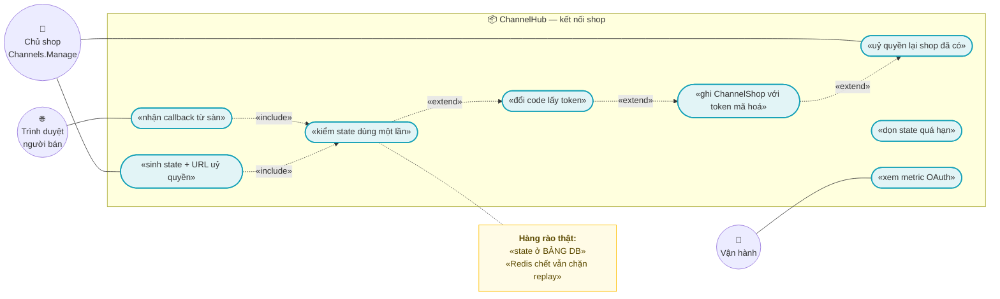
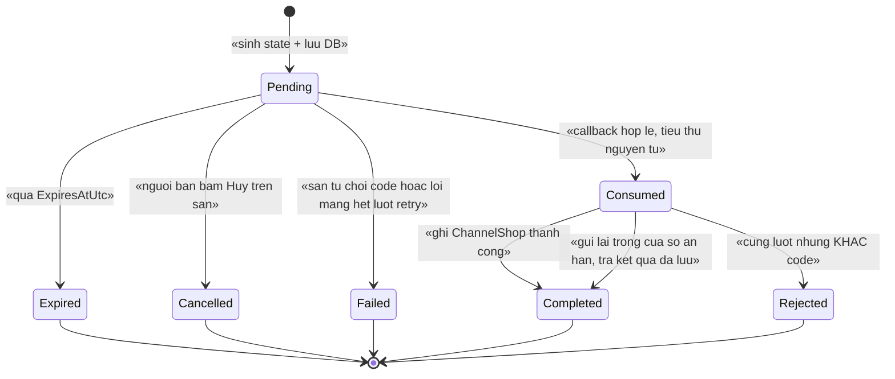
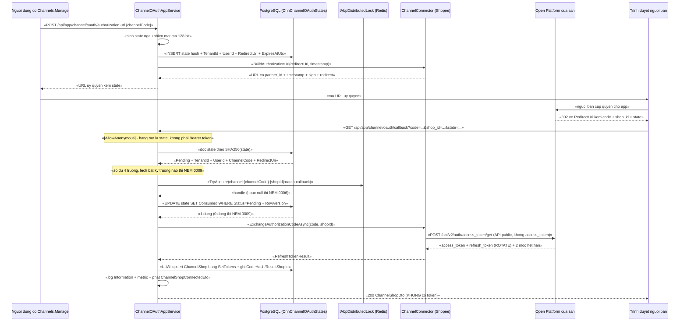

# `CHN-001` — Kết nối shop qua OAuth (đã có phần nền)

| Thuộc tính | Nội dung |
|---|---|
| **Mã** | `CHN-001` |
| **Module** | **ChannelHub** — `modules/ChannelHub/eCommerce.ChannelHub.Domain` (entity + consts) · `.Application` (điều phối OAuth, lock) · `.EntityFrameworkCore` (mapping + index); **app** `src/eCommerce.Application` (thêm method vào `ChannelAppService`) và `src/eCommerce.HttpApi.Host` (một controller mỏng `[AllowAnonymous]` cho callback) |
| **Giai đoạn** | **GĐ4 — Tăng trưởng** (`docs/implementation-plan.md:447`). Nền đã có thật từ Phase 0 + GĐ1 |
| **Ưu tiên** | **Must have** cho GĐ4 — **điều kiện tiên quyết** của `CHN-002` (không có token thì không pull được đơn) |
| **Trạng thái** | 🟡 `Draft` — chờ review |
| **Người viết / người review** | *(điền)* / **Kiến trúc trưởng + Security** |
| **Phiên bản / ngày** | `v0.1 — 13/10/2026` |
| **Tài liệu liên quan** | `XC-003` (khoá phân tán + 2 lỗi thật C10/C11) · `XC-005` (log/metric) · `XC-006` (thuế GTGT — chỉ gián tiếp qua đơn) · `XC-001` (tiền/làm tròn — chỉ gián tiếp) · `XC-004` (xác thực/phân quyền/allowlist) · `XC-002` (idempotency) · `CHN-002` (connector Shopee: pull/push/webhook) · `CHN-003` (Lazada) · `CHN-004` (allotment) · `docs/runtime-verification-report.md` |

---

## 0. Tóm tắt & quyết định thiết kế

**Tóm tắt:** `CHN-001` đặc tả **luồng kết nối một shop của người bán vào hệ thống bằng OAuth** trên nền
ChannelHub **đã có và đã chạy thật**: supervisor + worker động per-shop, quản lý token có khoá phân tán,
entity `ChannelShop` đã lưu token **đã mã hoá**, và **một nửa** của luồng OAuth (hàm dựng URL uỷ quyền)
**đã có thật trong code**.

**Điểm xuất phát — lấy từ code thật, không viết theo trí nhớ:**

| Hạng mục | Hiện trạng trong code | Bằng chứng (file thật) |
|---|---|---|
| Hàm dựng **URL uỷ quyền** Shopee | ✅ **ĐÃ CÓ THẬT** (ký HMAC-SHA256, `redirect` đã `EscapeDataString`) | `modules/ChannelHub/eCommerce.ChannelHub.Application/Connectors/ShopeeConnector.cs:71-76` |
| **Thuật toán ký** request (public API và shop API) | ✅ **ĐÃ CÓ THẬT** | `ShopeeConnector.cs:48-68` |
| **Đổi `code` lấy token lần đầu** (authorization code grant) | ❌ **CHƯA CÓ** — `IChannelConnector` không có method nào cho việc này | `modules/ChannelHub/eCommerce.ChannelHub.Application.Contracts/Connectors/IChannelConnector.cs:95-114` (chỉ có `PullOrders`, `PushListing`, `RefreshToken`, `Ping`) |
| **Sinh/kiểm tra/lưu `state` (chống CSRF + chống replay)** | ❌ **CHƯA CÓ** — `grep` toàn repo: **0** chỗ có `state`, `OAuth`, `callback`, `auth_type` | `grep -i "OAuth\|state=" src/ modules/` → chỉ 2 kết quả, đều là **XML comment** (`src/eCommerce.Application.Contracts/Channels/ChannelDtos.cs:26`, `src/eCommerce.Domain.Shared/eCommerceConsts.cs:36`) |
| **Endpoint callback** để sàn redirect người bán về | ❌ **CHƯA CÓ** — không có controller nào trong `src/eCommerce.HttpApi.Host` | `grep "Controller"` trong `src/eCommerce.HttpApi.Host` → **0** kết quả |
| Cách "kết nối shop" hiện tại | ⚠️ **Nhận token CÓ SẴN qua DTO** (ai đó tự lấy token ngoài hệ thống rồi POST vào) | `src/eCommerce.Application/Channels/ChannelAppService.cs:70-125` + `src/eCommerce.Application.Contracts/Channels/ChannelDtos.cs:29-56` |
| Lưu token | ✅ **ĐÃ CÓ THẬT** — mã hoá bằng `IStringEncryptionService` trước khi lưu | `ChannelAppService.cs:97-101` · `ChannelEntities.cs:95-110` |
| Refresh token **có ROTATE** ⇒ bắt buộc tuần tự | ✅ **ĐÃ CÓ THẬT** — khoá `…:token-refresh` + **double-check** bên trong khoá | `modules/ChannelHub/eCommerce.ChannelHub.Application/Sync/ChannelTokenManager.cs:67-91` |
| Khoá lock **thật** trong Redis (đã đo bằng `redis-cli MONITOR`) | ✅ `ecommerce:channel:{channelCode}:{shopId}:token-refresh` | `src/eCommerce.HttpApi.Host/eCommerceHttpApiHostModule.cs:127` (`KeyPrefix = "ecommerce:"`) + `docs/runtime-verification-report.md` §1b (phép thử A/B: có người giữ khoá ⇒ **KHÔNG** refresh) |
| Worker động per-shop | ✅ **ĐÃ SỬA LỖI C10** — trước khi sửa: **8 lần `Replaced`, 0 lần worker chạy** | `modules/ChannelHub/eCommerce.ChannelHub.Application/Sync/ChannelSyncSupervisorWorker.cs:81-85` + `docs/runtime-verification-report.md` §1 (**C10**) |
| `Channel.Code = "shopee"` đã seed | ✅ **ĐÃ CÓ** | `src/eCommerce.DbMigrator/eCommerceDataSeedContributor.cs:29` |
| Metric `channel_sync_failed_total` | ✅ **ĐÃ CÓ NƠI PHÁT** (12 metric đã phát bằng `System.Diagnostics.Metrics`) | `src/eCommerce.Domain.Shared/Observability/eCommerceMetrics.cs:29,149-150` |

**Vì sao phải viết tài liệu này:** hiện tại muốn kết nối một shop, người dùng phải **tự lấy token ở đâu đó
rồi dán vào DTO** (`ConnectChannelShopDto.AccessToken` — `ChannelDtos.cs:47`). Với Shopee, cách đó **không
làm được**: access token chỉ sinh ra từ `code` mà sàn trả về **qua redirect**, và `code` chỉ sống **rất
ngắn**. Thêm nữa, luồng OAuth có **đúng 4 cái bẫy im lặng** mà chính module này đã từng vấp:

1. **CSRF/replay trên callback:** nhận `code` mà không kiểm `state` ⇒ kẻ tấn công gửi callback giả để
   **buộc shop của nạn nhân gắn vào tenant của hắn** — chạy vẫn `exit 0`, chỉ sai chủ sở hữu dữ liệu.
2. **Token rotate:** Shopee **rotate refresh token** (`ChannelEntities.cs:58`); hai lần đổi token song song
   ⇒ **mất kết nối shop vĩnh viễn**, phải uỷ quyền lại bằng tay (`docs/architecture.md:96`).
3. **Tiền tố khoá lock:** bài học **C11** — `KeyPrefix` ghép **không dấu phân cách** từng cho ra
   `eCommercechannel:…`; khoá vẫn "hoạt động" nhưng **không ai giữ đúng khoá** (`eCommerceHttpApiHostModule.cs:115-128`).
4. **Guard no-op:** quy ước #11 của dự án — state machine **phải NÉM LỖI**, không được im lặng bỏ qua.

**Phạm vi:**
- ✅ **Bước 1 — bắt đầu uỷ quyền:** API sinh `state` (ngẫu nhiên mật mã) + trả **URL uỷ quyền** của sàn.
- ✅ **Bước 2 — callback:** endpoint **allowlist `[AllowAnonymous]`** nhận `code` + `shop_id` + `state`, kiểm `state` **đúng một lần**, rồi đổi `code` lấy token.
- ✅ **Bước 3 — ghi shop:** tạo/cập nhật `ChannelShop`, token **mã hoá**, ghi `AuthorizationExpiresAtUtc`.
- ✅ **Entity trạng thái OAuth** (`ChannelOAuthState`) — **hàng rào DB thật** cho tính dùng-một-lần (không dựa vào Redis).
- ✅ **Khoá phân tán mới** `…:oauth-callback` theo đúng quy ước `XC-003` (định nghĩa trong consts của module).
- ✅ **Idempotency + state machine ném lỗi** + log/metric theo `XC-005`.
- ✅ **Đổi token lần đầu** nằm trong `IChannelConnector` (không rò chi tiết Shopee ra ngoài — đúng `CHN-002` D2).

**Không nằm trong phạm vi:**
- ❌ **Gọi HTTP thật cho pull/push/webhook Shopee** — thuộc `CHN-002`.
- ❌ **Connector Lazada / TikTok** — thuộc `CHN-003`. Ở đây **chỉ** thiết kế sao cho thêm sàn = thêm implementation.
- ❌ **Ngắt kết nối shop** (revoke token phía sàn) — chưa có yêu cầu; `SetActiveAsync` chỉ tắt đồng bộ nội bộ (`ChannelAppService.cs:127-137`).
- ❌ **UI màn hình kết nối** — thuộc `WEB-*`; tài liệu này chỉ chốt **hợp đồng API**.
- ❌ **Đối soát phí sàn / settlement** — thuộc `REC-002`.
- ❌ **Tính thuế GTGT cho đơn kéo về** — thuộc `XC-006`/`ACC-001`; `CHN-001` **không** chạm tiền (xem §5.4).

### 0.1 Quyết định thiết kế (ADR ngắn)

| # | Quyết định | Phương án đã cân nhắc | Lý do chọn | Hệ quả |
|---|---|---|---|---|
| **D1** | **`state` dùng-một-lần lưu ở BẢNG DB** (`ChnChannelOAuthStates`), không lưu ở Redis | (a) JWT/HMAC tự ký, không lưu · (b) lưu Redis + TTL · (c) **bảng DB + `Status` + `RowVersion`** | `XC-003` **D2** đã chứng minh: Redis chết (đã đặt `AbortOnConnectFail = false` — `eCommerceHttpApiHostModule.cs:141`) ⇒ app **vẫn chạy nhưng lock vô hiệu**. Nếu hàng rào chống replay nằm ở Redis thì **mất Redis = mất bảo vệ CSRF**. Chữ ký HMAC (a) **không** cho biết state **đã dùng hay chưa** ⇒ không chống replay được | Cần **thêm bảng + migration**; state **sống sót qua restart/redeploy** app |
| **D2** | **Chỉ lưu `StateHash` (SHA-256), KHÔNG lưu `state` thô** | (a) lưu thô · (b) lưu hash | Bảng DB bị đọc qua backup/log/DBA; `state` **là bearer token** của lượt uỷ quyền (ai có nó thì chiếm được `code`). Hash hoá ⇒ rò bảng **không** chiếm được lượt uỷ quyền | Truy vấn theo `state` luôn phải hash trước; không debug được bằng cách đọc DB (đúng ý đồ) |
| **D3** | **Callback là endpoint RIÊNG `[AllowAnonymous]`, KHÔNG nhận token người dùng làm hàng rào** | (a) callback cần Bearer token của người dùng · (b) **anonymous + state là hàng rào** | Sàn redirect **trình duyệt người bán** về URL của ta; trình duyệt **không** gắn `Authorization` header ⇒ phương án (a) **không chạy được trên thực tế**. Hàng rào đúng là `state` (CSRF token) + **dùng một lần** | Callback **phải** nằm trong **allowlist** `[AllowAnonymous]` kèm lý do ghi trong code (`XC-004` **BR-004**) |
| **D4** | **Đổi `code` lấy token là method MỚI của `IChannelConnector`**, không gọi HTTP từ app service | (a) gọi thẳng HTTP Shopee trong app service · (b) **thêm `ExchangeAuthorizationCodeAsync` vào interface** | `CHN-002` **D2** đã chốt: mọi ràng buộc của sàn nằm **sau** `IChannelConnector`; app service chỉ biết `IChannelConnectorFactory` (`ChannelAppService.cs:31`). Nếu gọi thẳng, `CHN-003` (Lazada) buộc phải sửa app service | Interface đổi ⇒ **phải** cập nhật mọi implementation; nhánh PoC **phải** giữ để CI chạy không cần credential (`ShopeeConnector.cs:12-15`) |
| **D5** | **Kết nối lại shop đã tồn tại ⇒ CẬP NHẬT token**, không tạo bản ghi thứ hai | (a) ném lỗi nếu shop đã tồn tại · (b) **upsert** theo `(TenantId, ChannelCode, ExternalShopId)` | Unique index **đã có** ở DB (`modules/ChannelHub/eCommerce.ChannelHub.EntityFrameworkCore/ChannelHubDbContextModelCreatingExtensions.cs:48`) và đã được vá `NULLS NOT DISTINCT` (`src/eCommerce.EntityFrameworkCore/Migrations/20261013024226_Fix_NullableTenantId_UniqueIndexes.cs:70-72`). Uỷ quyền lại sau khi token chết **là nhu cầu thật** (`docs/architecture.md:96`) | Uỷ quyền lại **phải** giữ nguyên `ChannelListing` cũ (chỉ đổi token, **không** đổi `Id` shop) |
| **D6** | **Một `ChannelShop` chỉ thuộc MỘT tenant**; shop đã thuộc tenant khác ⇒ **NÉM LỖI**, không "giành" shop | (a) tenant sau ghi đè tenant trước · (b) **từ chối + lỗi rõ** | Ghi đè ⇒ shop của tenant A **âm thầm chuyển** sang tenant B, mọi đơn sau đó vào sai sổ sách. Đây là loại lỗi **không thể phát hiện bằng đọc code** | Người dùng thấy lỗi `eCommerce:Channel:0010` (không tiết lộ tenant sở hữu — theo `XC-004` **BR-008**) |
| **D7** | **Toàn bộ callback nằm TRONG khoá phân tán `…:oauth-callback`** (per shop) | (a) chỉ dựa vào state dùng-một-lần · (b) **thêm lock per-shop** | Hai callback (người bán bấm 2 lần / sàn retry) có thể tới **đồng thời**. State dùng-một-lần chặn được lần thứ hai, nhưng **`code` đã bị trao đổi một nửa** ở phía sàn là tình huống khó chẩn đoán; lock biến nó thành **tuần tự** + lần thứ hai trả **kết quả đã có** (D9) | Thêm một khoá vào bảng đăng ký khoá `XC-003` §5; **cấm** acquire lồng (`XC-003` D6) |
| **D8** | **`state` gắn cứng `TenantId` + `UserId` + `ChannelCode` + `RedirectUri` tại thời điểm SINH** | (a) chỉ gắn `TenantId` · (b) gắn cả 4 + `RowVersion` | `UserId` cho biết **ai** bắt đầu ⇒ phát hiện callback lạc và cho phép hiển thị "lượt uỷ quyền của bạn". `ChannelCode` chặn **tráo kênh** (state sinh cho `shopee`, callback nói `lazada`). `RedirectUri` chặn **đổi đích redirect** | Callback phải so **cả 4**; lệch bất kỳ trường nào ⇒ **NÉM** `eCommerce:Channel:0009` |
| **D9** | **Callback là idempotent theo `(ChannelCode, SHA256(code))`, có "cửa sổ ân hạn" cho lần gửi lại** | (a) dùng một lần tuyệt đối, lần thứ hai luôn lỗi · (b) **lần thứ hai trong cửa sổ ⇒ trả kết quả đã lưu** | Trình duyệt người bán có thể **gửi lại** cùng request (bấm lại, mạng chập, đa tab) — nếu luôn ném lỗi thì người dùng thấy "kết nối thất bại" dù **đã kết nối xong**. Nhưng "tha hồ gửi lại" thì thành lỗ hổng replay | Cần 3 cột trên state (`CodeHash`, `ResultShopId`, `ConsumedAtUtc`) + tham số `OAuthStateGraceSeconds`; quá cửa sổ ⇒ **NÉM** `0009` |
| **D10** | **Sinh URL uỷ quyền và xử lý callback là HAI API khác nhau**, một cái có `[Authorize]`, một cái `[AllowAnonymous]` | (a) một endpoint làm cả hai · (b) **hai endpoint** | Gộp ⇒ buộc phải nới `[Authorize]` cho cả API sinh state ⇒ **mất** hàng rào "chỉ người có quyền mới bắt đầu kết nối" | Hai route; sinh state **bắt buộc** permission `eCommerce.Channels.Manage` (`eCommerceConsts.cs:37`) |
| **D11** | **Token chỉ được ghi khi đang giữ khoá** và **luôn ghi cả access + refresh trong một lần update** | (a) ghi hai lần riêng · (b) **một lần** | Shopee **rotate** refresh token; ghi hai lần ⇒ có khoảng thời gian DB giữ access mới + refresh **cũ đã bị vô hiệu**; crash đúng lúc đó ⇒ mất shop | Dùng `ChannelShop.SetTokens(...)` (`ChannelEntities.cs:95-110`) — **đã có sẵn** và đã null-hoá `LastError` |
| **D12** | **Ngoài phạm vi: thuế GTGT (`XC-006`) và tiền (`XC-001`)** | (a) tính thuế ngay khi kết nối shop · (b) **không chạm tiền** | Luồng OAuth **không có** giá trị tiền nào: `code`, `state`, token đều là **chuỗi**. Thuế GTGT chỉ phát sinh khi có **dòng đơn** — việc của `SAL-*`/`ACC-001`, và `ChannelShopSyncer` **cố ý** không tạo đơn (`ChannelShopSyncer.cs:12-19`) | Ghi rõ ở §5.4 và §13 để không ai "bổ sung" tính thuế vào luồng kết nối |

> 📌 Ghi lại cả phương án **BỊ LOẠI** và lý do — để 6 tháng sau không ai hỏi lại "sao không làm cách kia".
> 🔍 **Mọi khẳng định về code trong tài liệu này đều kèm đường dẫn file thật đã đọc bằng `read`/`grep`.**
> Phần **chưa có trong code** đều ghi rõ **"chưa có trong code — kế hoạch GĐ4"**.

---

## 1. Use Case Specification

| Thuộc tính | Nội dung |
|---|---|
| **Use Case ID** | `CHN-001` |
| **Use Case Name** | Kết nối một shop của người bán vào hệ thống bằng OAuth của sàn |
| **Description** | *"Là chủ shop, tôi muốn bấm một nút, được đưa sang sàn để cấp quyền, rồi tự động quay về hệ thống với shop đã sẵn sàng đồng bộ — để tôi không phải tự đi lấy token ở đâu đó rồi dán vào."* |
| **Actor(s)** | **Chủ shop / nhân viên có quyền `eCommerce.Channels.Manage`** (bắt đầu uỷ quyền) · **Trình duyệt người bán** (mang `code` quay về) · **Hệ thống** (`ChannelOAuthAppService`, `ChannelOAuthStateMachine`, `IChannelConnector`, `ChannelOAuthStateCleanupWorker`) · **Open Platform của sàn** (Shopee — phát `code`, nhận đổi token) · **Vận hành** (xem métric `channel_oauth_*`, gỡ state kẹt) |
| **Priority** | **Must have** (GĐ4) — chặn `CHN-002` |
| **Trigger** | (a) người dùng bấm **"Kết nối shop"** trên màn hình quản lý kênh ⇒ gọi API sinh URL uỷ quyền; (b) **trình duyệt người bán** được sàn redirect về endpoint callback kèm `code` + `shop_id` + `state`; (c) lượt uỷ quyền cũ hết hạn ⇒ **cron dọn** state quá hạn |
| **Pre-Condition(s)** | • **Tenant hiện tại** (`TenantId`) — `ChannelShop` là `IMultiTenant` (`ChannelEntities.cs:38-40`); state **bắt buộc** có `TenantId` (`XC-004` **BR-009**).<br>• **Người dùng đã xác thực** và có permission `eCommerce.Channels.Manage` (`eCommerceConsts.cs:37`, đã định nghĩa ở `eCommercePermissionDefinitionProvider.cs:39`).<br>• **`Channel.Code = "shopee"` đã seed** (`eCommerceDataSeedContributor.cs:29`) **và** có connector trong `ChannelConnectorFactory` (`Connectors/ChannelConnectorFactory.cs:20`).<br>• **Cấu hình OAuth của sàn đã điền**: `partner_id`, `partner_key`, `BaseUrl` (`modules/ChannelHub/eCommerce.ChannelHub.Application/ChannelHubOptions.cs:28-48`) — ⚠️ `partner_key` hết hạn **180 ngày** và **không** tự gia hạn (`ChannelHubOptions.cs:35`).<br>• **Callback URI đã đăng ký trước với sàn** (xem §15.1 **Q1**) — sàn thường chỉ chấp nhận redirect đã khai báo; **chưa kiểm chứng** bằng tài liệu Shopee (xem §15.3 giả định 1).<br>• **Redis 7** sẵn sàng cho khoá `…:oauth-callback`; Redis chết ⇒ lock vô hiệu nhưng **state ở DB vẫn bảo vệ** (D1, `XC-003` D2).<br>• **DB đã có bảng `ChnChannelOAuthStates`** — chưa có trong code, kế hoạch GĐ4 (§11). |
| **Post-Condition(s)** | • **Đúng một** `ChannelShop` cho `(TenantId, ChannelCode, ExternalShopId)`, token **đã mã hoá**, `IsActive = true` — khớp unique index `ChannelHubDbContextModelCreatingExtensions.cs:48`.<br>• Lượt `state` **đã tiêu thụ** (`Status = Consumed`, `ConsumedAtUtc` khác null) và **không thể dùng lại** (D1/D9).<br>• Response trả `ChannelShopDto` — **không** chứa token kể cả bản mã hoá (`ChannelDtos.cs:6`).<br>• Mọi lượt uỷ quyền **có dấu vết**: hoặc `ChannelShop` + log `Information` + metric `ok`, hoặc lỗi có mã `eCommerce:Channel:0009…0011` + log `Warning` + metric `fail`.<br>• `AuthorizationExpiresAtUtc` được ghi khi sàn trả hạn uỷ quyền (`ChannelEntities.cs:65-66`). |
| **Basic Flow** | 1. Người dùng gọi API sinh URL uỷ quyền với `channelCode`; app service kiểm `[Authorize]` cấp class + `eCommerce.Channels.Manage`.<br>2. Sinh `state` **ngẫu nhiên mật mã ≥ 128 bit**; lưu **`StateHash = SHA-256(state)`** + `TenantId` + `UserId` + `ChannelCode` + `RedirectUri` + `ExpiresAtUtc` vào `ChannelOAuthState` (`Status = Pending`) — **cùng một Unit of Work**.<br>3. Gọi `IChannelConnector.BuildAuthorizationUrl(redirectUri, timestamp)` — **đã có thật** cho Shopee (`ShopeeConnector.cs:71-76`); trả URL cho client kèm `state`.<br>4. Người bán cấp quyền trên sàn; sàn redirect trình duyệt về `RedirectUri?code=…&shop_id=…&state=…`.<br>5. Endpoint callback (**allowlist `[AllowAnonymous]`**, D3) nhận `state` + `code` + `shop_id`; **hash `state`** rồi đọc bản ghi; **so đủ 4 trường** của D8.<br>6. Giành khoá `ecommerce:channel:{channelCode}:{externalShopId}:oauth-callback` (timeout `OAuthCallbackLockTimeoutSeconds`).<br>7. Tiêu thụ state **nguyên tử** bằng `RowVersion` + `UPDATE … WHERE Status = Pending` — **0 dòng ⇒ NÉM** `eCommerce:Channel:0009` (D1, `XC-002` **BR-008**, quy ước #11).<br>8. Gọi `IChannelConnector.ExchangeAuthorizationCodeAsync(...)` ⇒ access token + refresh token + 2 mốc hết hạn.<br>9. **Trong cùng UoW**: tạo/cập nhật `ChannelShop` bằng `SetTokens(...)` (`ChannelEntities.cs:95-110`) + ghi `CodeHash`/`ResultShopId`/`ConsumedAtUtc` lên state.<br>10. Ghi log `Information` (`CorrelationId`, `ChannelCode`, `ChannelShopId`, `DurationMs` — **không** token) + metric; phát `ChannelShopConnectedEto` qua outbox; trả `ChannelShopDto`. |
| **Alternative Flow** | **A1 — Uỷ quyền lại shop đã có:** trùng `(TenantId, ChannelCode, ExternalShopId)` ⇒ **cập nhật** token trên bản ghi cũ (D5), **không** tạo bản ghi mới; `ChannelListing` giữ nguyên.<br>**A2 — Callback gửi lại trong cửa sổ ân hạn:** state đã `Consumed` **và** `CodeHash` **khớp** **và** `now ≤ ConsumedAtUtc + OAuthStateGraceSeconds` ⇒ **trả kết quả đã lưu** (`ResultShopId`), **không** gọi sàn lần hai (D9).<br>**A3 — Người bán bấm "Huỷ" trên sàn:** sàn redirect về với cờ huỷ (`auth_cancelled` — **chưa kiểm chứng** tên tham số) ⇒ state chuyển `Cancelled`, trả `409` + thông điệp thân thiện, **không** đổi dữ liệu shop.<br>**A4 — Sàn trả `shop_id` khác người dùng đang mở:** người dùng khác trong cùng tenant bấm kết nối ⇒ state gắn `UserId` của **người bắt đầu** (D8); nếu phiên người dùng hiện tại khác, vẫn chấp nhận **trong cùng tenant** nhưng ghi log `Warning` kèm `InitiatedByUserId` để đối soát.<br>**A5 — ChannelHub chưa có connector cho kênh:** `IChannelConnectorFactory.Get` ném `ArgumentException` (`ChannelConnectorFactory.cs:34-37`) ⇒ ⚠️ chuyển thành `BusinessException` `eCommerce:Channel:0004` (`CHN-002` §15.2 **F4** đã ghi nhận). |
| **Exception Flow** | **E1 — `state` không tồn tại / đã dùng / quá hạn / lệch trường:** **NÉM** `eCommerce:Channel:0009` → `409`; log `Warning`; metric `channel_oauth_state_rejected_total`. Không tiết lộ state sai ở điểm nào (`XC-004` **BR-008**).<br>**E2 — Cùng `code` nhưng `StateHash` KHÁC:** **NÉM** `eCommerce:Channel:0012`; **cấm** coi là gửi trùng (theo `XC-002` **BR-006**).<br>**E3 — `shop_id` đã thuộc tenant khác:** **NÉM** `eCommerce:Channel:0010` → `409`; **không** ghi gì (D6).<br>**E4 — Sàn từ chối `code` (`error = invalid code`, hết hạn, đã dùng):** **NÉM** `eCommerce:Channel:0011` → `400`; **cấm** retry (lỗi nghiệp vụ `4xx` — đúng `CHN-002` **BR-009**); state đánh dấu `Failed` kèm lý do.<br>**E5 — Lỗi mạng / `5xx` khi đổi token:** retry **có phân loại** (tối đa 3, backoff — `CHN-002` D5), **cấm** retry vô hạn; hết lượt ⇒ `502` + state `Failed` ⇒ người dùng **phải bắt đầu lại** bằng URL uỷ quyền mới (vì `code` đã bị tiêu thụ phía sàn).<br>**E6 — Không giành được khoá `…:oauth-callback`:** theo `XC-003` **D10** — đây **KHÔNG** phải job định kỳ ⇒ **NÉM** `eCommerce:Channel:0006` (ngữ nghĩa "shop đang được xử lý bởi tiến trình khác"), log `Warning` + metric `lock_timeout_total{module=channel}`.<br>**E7 — Redis chết:** lock vô hiệu nhưng **state ở DB vẫn chặn replay** (D1) ⇒ app **không** sập, bất biến vẫn đúng; log `Error` + metric (giống `XC-003` **E2** fail-open).<br>**E8 — `partner_key` hết hạn 180 ngày:** mọi request bị từ chối ⇒ `0011`; **phải** có nhắc lịch gia hạn (`ChannelHubOptions.cs:35`). |
| **Business Rules** | • **BR-CHN-001-001**: `state` **phải** sinh bằng nguồn ngẫu nhiên **mật mã** ≥ **128 bit**; **cấm** `Guid.NewGuid()`, **cấm** `Random`, **cấm** ghép từ `shopId`/`timestamp`.<br>• **BR-CHN-001-002**: DB **chỉ** được lưu `SHA-256(state)`; **cấm** lưu/ghi log `state` thô (D2).<br>• **BR-CHN-001-003**: Bản ghi state **phải** gắn `TenantId` + `UserId` + `ChannelCode` + `RedirectUri` **tại thời điểm sinh** (D8); callback lệch bất kỳ trường nào ⇒ **NÉM** `eCommerce:Channel:0009`.<br>• **BR-CHN-001-004**: Callback **phải** là **allowlist `[AllowAnonymous]`** và **phải** ghi lý do ngay tại chỗ khai báo (`XC-004` **BR-004**); state là hàng rào duy nhất của biên vào này.<br>• **BR-CHN-001-005**: Lượt uỷ quyền **phải** được tiêu thụ **nguyên tử đúng một lần**; **0 dòng** bị ảnh hưởng ⇒ **NÉM** `eCommerce:Channel:0009` — **cấm** coi là thành công (quy ước #11, `XC-002` **BR-008**).<br>• **BR-CHN-001-006**: Toàn bộ callback của **một shop** **phải** nằm trong khoá `ChannelHubConsts.LockKeys.ChannelOAuthCallback(channelCode, externalShopId)`; **cấm** acquire **lồng** cùng tên khoá (`XC-003` **D6**).<br>• **BR-CHN-001-007**: Đổi `code` xong **phải** ghi **cả** access token **và** refresh token trong **một** lần update qua `ChannelShop.SetTokens` (D11) — Shopee **rotate** refresh token (`ChannelEntities.cs:58`).<br>• **BR-CHN-001-008**: Callback **phải** idempotent theo khoá ổn định `OAuth:{channelCode}:{sha256(code)}` (D9); **cấm** dùng `Guid.NewGuid()` làm khoá (`XC-002` **BR-007**).<br>• **BR-CHN-001-009**: Cùng lượt uỷ quyền **+ khác `code`** ⇒ **NÉM** `eCommerce:Channel:0012`; **cấm** ghi đè, **cấm** coi là trùng (`XC-002` **BR-006**).<br>• **BR-CHN-001-010**: Cùng lượt uỷ quyền **+ cùng `code`** **+ trong cửa sổ ân hạn** ⇒ trả **kết quả đã lưu**, **cấm** gọi sàn lần hai (D9).<br>• **BR-CHN-001-011**: `(ChannelCode, ExternalShopId)` đã thuộc **tenant khác** ⇒ **NÉM** `eCommerce:Channel:0010`; **cấm** "giành" shop (D6).<br>• **BR-CHN-001-012**: Uỷ quyền lại shop **trong cùng tenant** ⇒ **cập nhật**, **cấm** tạo bản ghi thứ hai (D5); `ChannelListing` **không** bị xoá.<br>• **BR-CHN-001-013**: Mọi trường hợp sàn từ chối `code` (`4xx` nghiệp vụ) **phải** **NÉM** lỗi có mã và **cấm** retry (`CHN-002` **BR-009**); chỉ retry lỗi mạng/`5xx`/`429`, tối đa theo cấu hình, có backoff.<br>• **BR-CHN-001-014**: **Cấm** ghi log hoặc trả ra DTO bất kỳ token nào (kể cả bản mã hoá) — kế thừa `ChannelDtos.cs:6` và `ChannelEntities.cs:53-54`.<br>• **BR-CHN-001-015**: **Cấm** hard-code tên khoá lock: **bắt buộc** dùng `ChannelHubConsts.LockKeys.*` (`XC-003` **D3**/**BR-001**); khoá **không** chứa tiền tố `ecommerce:` trong hàm sinh — tiền tố do `AbpDistributedLockOptions.KeyPrefix` (`XC-003` §5.4).<br>• **BR-CHN-001-016**: Callback **phải** idempotent **và** state dùng-một-lần là **hai** cơ chế khác nhau — **cấm** dùng cái này thay cái kia (§7.3).<br>• **BR-CHN-001-017**: Bản ghi state **phải** có TTL tường minh (`ExpiresAtUtc`) và **phải** được dọn sau `OAuthStateRetentionHours`; **cấm** để bảng state phình vô hạn. |
| **Non-Functional Requirement** | • **NFR-CHN-001-001**: Sinh URL uỷ quyền (gồm 1 lần ghi DB) p95 **< 200 ms**.<br>• **NFR-CHN-001-002**: Callback (không tính độ trễ mạng của sàn) p95 **< 800 ms**.<br>• **NFR-CHN-001-003**: **0** lần gọi đổi token trùng cho cùng một `code` khi callback được gửi lại **100** lần.<br>• **NFR-CHN-001-004**: **0** bản ghi `ChannelShop` vi phạm unique index `(TenantId, ChannelCode, ExternalShopId)` (`ChannelHubDbContextModelCreatingExtensions.cs:48`).<br>• **NFR-CHN-001-005**: **0** token trong log và trong DTO (quét tự động theo `XC-005` **BR-005**).<br>• **NFR-CHN-001-006**: Redis chết ⇒ app **không** sập, **0** state bị dùng hai lần (test tích hợp dừng Redis — như `XC-003` TC-11).<br>• **NFR-CHN-001-007**: Cron dọn state chạy lại an toàn (idempotent); ghi log **chỉ khi có việc thật** (`XC-005` **BR-004** — cấm log mỗi vòng).<br>• **NFR-CHN-001-008**: **100 %** app service có `[Authorize]` cấp class; **0** `[AllowAnonymous]` ngoài allowlist (`XC-004` NFR-002/004). |

---

## 2. Sơ đồ Use Case



---

## 3. Vòng đời một lượt uỷ quyền (state machine)



**Bảng chuyển trạng thái & guard (mọi chuyển sai **phải ném lỗi**, cấm no-op im lặng):**

| Từ | Sang | Guard | Nếu vi phạm |
|---|---|---|---|
| `MoiSinh` | `ChoXuLy` | Ghi bản ghi state thành công (có `ExpiresAtUtc` trong tương lai) | Không ghi được ⇒ **NÉM** lỗi hạ tầng, **không** trả URL (thà không cho bắt đầu còn hơn cho bắt đầu mà không kiểm được) |
| `ChoXuLy` | `DaTieuThu` | `Status = Pending` **và** `now ≤ ExpiresAtUtc` **và** khớp đủ 4 trường (BR-003); tiêu thụ bằng `RowVersion` + `UPDATE … WHERE Status = Pending` | **0 dòng** ⇒ **NÉM** `eCommerce:Channel:0009` (§12) |
| `ChoXuLy` | `HetHan` | `now > ExpiresAtUtc` (cron dọn hoặc kiểm lúc callback) | Callback tới sau hạn ⇒ **NÉM** `0009` (không tự "hồi sinh" state) |
| `ChoXuLy` | `DaHuy` | Người bán bấm **Huỷ** trên sàn (sàn trả cờ huỷ) | Nếu sàn **không** trả cờ huỷ ⇒ state ở lại `ChoXuLy` tới khi `HetHan` (an toàn) |
| `ChoXuLy` | `ThatBai` | Sàn từ chối `code` (`4xx`) **hoặc** hết lượt retry lỗi mạng/`5xx` | Ghi `FailureReason` (đã che PII) + metric `channel_oauth_exchange_failed_total` |
| `DaTieuThu` | `HoanTat` | Ghi `ChannelShop` thành công **trong cùng UoW** | Ghi shop lỗi ⇒ **rollback** cả UoW ⇒ state trở lại… **không** được: xem cảnh báo bên dưới |
| `DaTieuThu` | `HoanTat` (đường gửi lại) | `CodeHash` **khớp** **và** `now ≤ ConsumedAtUtc + OAuthStateGraceSeconds` (BR-010) | **Khác** `CodeHash` ⇒ **NÉM** `eCommerce:Channel:0012` (**BR-009**); quá cửa sổ ⇒ **NÉM** `0009` |
| `DaTieuThu` | `TuChoi` | Cùng lượt uỷ quyền nhưng `CodeHash` khác, hoặc lệch trường D8 | **NÉM** `0009`/`0012` + log `Warning` + metric `channel_oauth_replay_rejected_total` |
| `HetHan`/`DaHuy`/`ThatBai`/`HoanTat`/`TuChoi` | `[*]` | — | — |

> ⚠️ **Điểm nguy hiểm nhất của state machine này — và cách xử lý bắt buộc:**
> nếu **tiêu thụ state** và **ghi `ChannelShop`** nằm ở **hai transaction khác nhau** thì có khoảng thời gian
> state đã `DaTieuThu` nhưng shop **chưa** được ghi (crash ⇒ người bán thấy "đã dùng rồi" mà shop **không có**).
> Vì vậy **bắt buộc**: `UPDATE` state + `INSERT/UPDATE ChannelShop` nằm trong **một Unit of Work**
> (quy ước "mọi thao tác ghi qua Unit of Work"). Ghi shop lỗi ⇒ **rollback** ⇒ state trở lại `ChoXuLy`
> và người bán **thử lại được** (miễn `code` chưa bị tiêu thụ ở phía sàn — xem §15.1 **Q2**).
> ⚠️ Hệ quả **phải chấp nhận**: nếu rollback xảy ra **sau khi** đã gọi sàn đổi token thành công thì `code`
> **đã bị tiêu thụ phía sàn** ⇒ lượt đó **không thể** hoàn tất; người bán **phải** bắt đầu lại (E5). Đây là
> lý do **D7** đặt khoá per-shop: biến "đổi token rồi rollback" từ **thường xuyên** thành **hiếm**.

---

## 4. Sequence Diagram & luồng dữ liệu

### 4.1 Luồng đầy đủ: sinh state → người bán cấp quyền → callback → ghi shop



**Luồng dữ liệu — 6 trường đi vào state và 3 trường đi ra:**

| Bước | Dữ liệu | Từ đâu | Ghi chú |
|---|---|---|---|
| 1 | `channelCode` | client (đã xác thực) | phải có connector (`ChannelConnectorFactory.cs:20`) |
| 2 | `state` (thô) | CSPRNG phía server | **không** rời khỏi response của bước sinh; **không** vào log |
| 3 | `StateHash`, `TenantId`, `UserId`, `ChannelCode`, `RedirectUri`, `ExpiresAtUtc` | app service | tất cả **bắt buộc** (BR-003) |
| 4 | `code`, `shop_id`, `state` | **trình duyệt người bán** | dữ liệu **không tin được** — chỉ dùng sau khi state hợp lệ |
| 5 | `accessToken`, `refreshToken`, `accessExpiresAtUtc`, `refreshExpiresAtUtc`, `authorizationExpiresAtUtc` | sàn | ghi **mã hoá** vào `ChannelShop` |
| 6 | `ResultShopId`, `ConsumedAtUtc`, `CodeHash` | app service | phục vụ **A2** (trả kết quả đã lưu) |

> 📌 **Không** dùng sơ đồ riêng cho luồng "Redis chết" — lý do đã có sẵn ở `XC-003` §4.2 và ở đây chỉ khác
> một điểm: hàng rào chống replay **nằm ở DB** nên Redis chết **không** làm mất bảo vệ (D1, NFR-006).

---

## 5. Mô hình dữ liệu

### 5.1 Quan hệ giữa các bảng — **Không vẽ ERD** (lý do: giới hạn **tối đa 3 sơ đồ Mermaid** và 3 sơ đồ đã dùng ở §2, §3, §4.1; quan hệ dưới đây diễn đạt đủ bằng bảng)

| Quan hệ | Bội số | Cột nối | Trạng thái |
|---|---|---|---|
| `ChnChannels` → `ChnChannelShops` | 1 → nhiều | `ChnChannelShops.ChannelCode` = `ChnChannels.Code` (theo **giá trị**, không FK cứng) | ✅ **ĐÃ CÓ** |
| `ChnChannelShops` → `ChnChannelListings` | 1 → nhiều | `ChnChannelListings.ChannelShopId` | ✅ **ĐÃ CÓ** |
| `ChnChannelShops` → `ChnChannelOAuthStates` | 1 → nhiều (**logic**, qua `ChannelCode` + `ExternalShopId`) | `ChnChannelOAuthStates.ResultShopId` → `ChnChannelShops.Id` | ❌ **CHƯA CÓ — kế hoạch GĐ4** |

| Bảng | Vai trò trong `CHN-001` | Bằng chứng |
|---|---|---|
| `ChnChannels` | Danh mục kênh; quyết định `channelCode` có hợp lệ | `ChannelHubDbContextModelCreatingExtensions.cs:18-28` |
| `ChnChannelShops` | **Đích cuối** của luồng OAuth: giữ token đã mã hoá + hạn uỷ quyền | `ChannelHubDbContextModelCreatingExtensions.cs:30-52` |
| `ChnChannelListings` | **Không** bị `CHN-001` sửa (uỷ quyền lại giữ nguyên — BR-012) | `ChannelHubDbContextModelCreatingExtensions.cs:54-73` |
| `ChnChannelOAuthStates` | **Bảng mới** — hàng rào dùng-một-lần của `state` | ❌ **CHƯA CÓ — kế hoạch GĐ4** (§5.2) |

> 📌 Chỉ **một** entity mới: `ChannelOAuthState`. `Channel`, `ChannelShop`, `ChannelListing` **đã có thật**
> (`modules/ChannelHub/eCommerce.ChannelHub.Domain/Entities/ChannelEntities.cs`).

### 5.2 Data Dictionary — `ChannelOAuthState` (CHƯA CÓ TRONG CODE — kế hoạch GĐ4)

| Trường | Kiểu (C#) | Kiểu DB | Null? | Ý nghĩa | Ghi chú |
|---|---|---|---|---|---|
| `Id` | `Guid` | `uuid` | ✖ | Khoá chính | `FullAuditedAggregateRoot<Guid>` (như `ChannelShop`) |
| `TenantId` | `Guid?` | `uuid` | ✖* | Tenant bắt đầu uỷ quyền | `IMultiTenant`; **bắt buộc** theo `XC-004` BR-009. *`Guid?` vì host single-tenant cho phép `NULL` — xem `ChannelEntities.cs:40` |
| `StateHash` | `string(64)` | `varchar(64)` | ✖ | **SHA-256 hex** của `state` (BR-002) | **UNIQUE** — hàng rào chống replay (D1) |
| `ChannelCode` | `string(32)` | `varchar(32)` | ✖ | Kênh của lượt uỷ quyền | Khớp `Channel.Code`; dùng trong khoá lock |
| `ExternalShopId` | `string(64)` | `varchar(64)` | ✓ | `shop_id` — **chỉ biết sau callback** | `null` khi mới sinh (lúc đó ta chưa biết shop nào) |
| `InitiatedByUserId` | `Guid` | `uuid` | ✖ | Ai bắt đầu (D8) | Dùng cho A4 + đối soát audit |
| `RedirectUri` | `string(512)` | `varchar(512)` | ✖ | Đích redirect đã dùng khi sinh URL | So lại ở callback (D8) |
| `Status` | `int` (enum) | `int` | ✖ | `Pending=0` · `Consumed=1` · `Completed=2` · `Expired=3` · `Cancelled=4` · `Failed=5` · `Rejected=6` | State machine §3 |
| `ExpiresAtUtc` | `DateTime` | `timestamptz` | ✖ | TTL của lượt uỷ quyền | `OAuthStateTtlSeconds`; **bắt buộc** (BR-017) |
| `ConsumedAtUtc` | `DateTime?` | `timestamptz` | ✓ | Thời điểm tiêu thụ | Cơ sở của **cửa sổ ân hạn** (D9) |
| `CodeHash` | `string(64)?` | `varchar(64)` | ✓ | **SHA-256** của `code` của sàn | Dùng cho BR-009/BR-010. **Cấm** lưu `code` thô (cùng lý do D2) |
| `ResultShopId` | `Guid?` | `uuid` | ✓ | `ChannelShop.Id` đã tạo/cập nhật | Phục vụ A2 — gửi lại trả kết quả đã lưu |
| `FailureReason` | `string(1024)?` | `varchar(1024)` | ✓ | Lý do thất bại (đã **che** dữ liệu nhạy cảm) | Cắt theo mẫu `ChannelShop.LastError` (`ChannelShopSyncer.cs:109`) |
| `RowVersion` | `byte[]`/`string` | `xmin`/`bytea` | ✖ | Optimistic concurrency | **Bắt buộc** để tiêu thụ nguyên tử (BR-005) |

**Index bắt buộc (đề xuất) — CHƯA CÓ TRONG CODE, kế hoạch GĐ4:**

| Index | Cột | Loại | Vì sao |
|---|---|---|---|
| `IX_ChnChannelOAuthStates_StateHash` | `StateHash` | **UNIQUE** | Chống trùng + tra cứu O(1) khi callback |
| `IX_ChnChannelOAuthStates_TenantId_ChannelCode_Status` | `(TenantId, ChannelCode, Status)` | thường | Màn hình vận hành: liệt kê lượt uỷ quyền đang treo |
| `IX_ChnChannelOAuthStates_ExpiresAtUtc` | `ExpiresAtUtc` | thường | Cron dọn (§11) quét theo index này, **không** full scan |

> 🚨 **Bắt buộc theo `XC-004` BR-009:** mọi unique index **có `TenantId`** phải dùng **`NULLS NOT DISTINCT`**.
> Tiền lệ thật: `src/eCommerce.EntityFrameworkCore/Migrations/20261013024226_Fix_NullableTenantId_UniqueIndexes.cs:70-72`
> (đã sửa cho `ChnChannelShops`). Với `StateHash` (đã là hash 256-bit) thì **không** cần ghép `TenantId` vào index unique.

### 5.3 Bảng liên hệ với dữ liệu ĐÃ CÓ

| Bảng | Trạng thái | Ghi chú |
|---|---|---|
| `ChnChannelShops` | ✅ **ĐÃ CÓ** | `ChannelHubDbContextModelCreatingExtensions.cs:30-52`; unique `(TenantId, ChannelCode, ExternalShopId)` + `NULLS NOT DISTINCT` (migration `20261013024226`) |
| `ChnChannels` | ✅ **ĐÃ CÓ** | `ChannelHubDbContextModelCreatingExtensions.cs:18-28`; unique `Code` |
| `ChnChannelListings` | ✅ **ĐÃ CÓ** | `ChannelHubDbContextModelCreatingExtensions.cs:54-73` |
| `ChnChannelOAuthStates` | ❌ **CHƯA CÓ** — kế hoạch GĐ4 | Cần `DbSet` trên `src/eCommerce.EntityFrameworkCore/eCommerceDbContext.cs` (quy ước: entity cần `DbSet` nếu dùng `IRepository<T>`) + migration |

### 5.4 Tiền tệ & thuế GTGT — **Không áp dụng**

**Không áp dụng — lý do:** luồng kết nối shop **không có** bất kỳ giá trị tiền nào. Mọi trường trong luồng
này là **chuỗi**: `state`, `code`, `shop_id`, `access_token`, `refresh_token` (`ChannelShopContext.AccessToken`
là `string?` — `IChannelConnector.cs:14`). Vì vậy:

| Quy ước | Áp dụng cho `CHN-001`? | Lý do |
|---|---|---|
| `XC-001` — tiền là `decimal` + `Money`, **cấm** so `==` trên tiền | **Không áp dụng** ở luồng OAuth | Không có phép tính tiền nào. ⚠️ **Vẫn áp dụng** cho dữ liệu mà `ChannelShop` phục vụ ở tầng sau: `ChannelOrderModel.ShippingFee`/`UnitPrice` là `decimal` (`IChannelConnector.cs:25,36-37`), `ChannelListing.ChannelPrice` là `decimal(18,4)` (`ChannelHubDbContextModelCreatingExtensions.cs:66`) |
| `XC-001` **BR-008** — cấm `double`/`float` | **Áp dụng (kế thừa)** | Không có `double`/`float` nào trong entity/state; test reflection `CHN-002` **NFR-007** đã phủ model kênh |
| `XC-006` — phân loại thuế GTGT | **Không áp dụng** ở luồng kết nối | Thuế GTGT chỉ phát sinh khi có **dòng đơn**; `ChannelShopSyncer` **cố ý** không tạo đơn (`ChannelShopSyncer.cs:12-19`) ⇒ không có dữ liệu để tính thuế |
| `XC-006` **BR-005** — audit mọi thay đổi phân loại | **Không áp dụng** | `CHN-001` không chạm bảng phân loại thuế |

> 📌 Ghi rõ ở đây để **không ai "bổ sung"** việc tính thuế vào luồng kết nối. Điểm nối duy nhất giữa
> `CHN-001` và `ACC-001`/`XC-006` là: **shop đã kết nối** là điều kiện để có đơn — đơn mới là nơi tính thuế.
> Việc này thuộc `SAL-*`/`XC-006`.

---

## 6. Hợp đồng API

### 6.1 Method MỚI trên `IChannelConnector` (CHƯA CÓ TRONG CODE — kế hoạch GĐ4)

```csharp
// modules/ChannelHub/eCommerce.ChannelHub.Application.Contracts/Connectors/IChannelConnector.cs
// (interface hiện tại chỉ có PullOrdersAsync / PushListingAsync / RefreshTokenAsync / PingAsync
//  — IChannelConnector.cs:95-114 — nên method dưới đây là BỔ SUNG)
public interface IChannelConnector
{
    /// <summary>
    /// Bước 2 của OAuth: đổi authorization code lấy token lần đầu.
    /// ⚠️ KHÁC RefreshTokenAsync: KHÔNG cần AccessToken (API public — xem CHN-002 §6.1 dòng 328),
    ///    và là lần ĐẦU TIÊN có token cho shop này.
    /// ⚠️ Shopee ROTATE refresh token ⇒ kết quả PHẢI được ghi trong cùng UoW với việc tiêu thụ state.
    /// </summary>
    Task<AuthorizationCodeExchangeResult> ExchangeAuthorizationCodeAsync(
        AuthorizationCodeExchangeRequest request,
        CancellationToken cancellationToken = default);
}

public class AuthorizationCodeExchangeRequest
{
    public string AuthorizationCode { get; set; } = default!;
    /// <summary>Shopee trả <c>shop_id</c> ngay trên query string của redirect ⇒ truyền vào đây.</summary>
    public string? ExternalShopId { get; set; }
}

public class AuthorizationCodeExchangeResult
{
    public bool Success { get; set; }
    public string? AccessToken { get; set; }
    public string? RefreshToken { get; set; }
    public DateTime? AccessTokenExpiresAtUtc { get; set; }
    public DateTime? RefreshTokenExpiresAtUtc { get; set; }
    /// <summary>Shopee cho người bán chọn hạn uỷ quyền 7/30/90/180/365 ngày (ChannelEntities.cs:65).</summary>
    public DateTime? AuthorizationExpiresAtUtc { get; set; }
    public string? ExternalShopId { get; set; }
    /// <summary>true ⇒ lỗi tạm thời (mạng/5xx/429) và ĐƯỢC PHÉP retry có backoff.</summary>
    public bool IsTransient { get; set; }
    public string? Error { get; set; }
}
```

> 📌 Lý do **không** dùng `RefreshTokenResult` sẵn có (`IChannelConnector.cs:74-82`): cần thêm 2 thứ mà
> `RefreshTokenResult` **không** có — `AuthorizationExpiresAtUtc` và `ExternalShopId` (Shopee trả `shop_id`
> trong payload đổi token **và** trên query string), cùng cờ `IsTransient` để phân loại retry (`CHN-002` **D5**).
> Tái dùng `RefreshTokenResult` sẽ **mất** thông tin ⇒ phải đổi kiểu **sau này** tốn kém hơn.

### 6.2 Application Service

| Method | Input | Output | Permission | Ghi chú |
|---|---|---|---|---|
| `GetAuthorizationUrlAsync` | `GetChannelAuthorizationUrlDto` (`ChannelCode`, `ReturnUrl?`) | `ChannelAuthorizationUrlDto` (`AuthorizationUrl`, `State`, `ExpiresAtUtc`) | **`eCommerce.Channels.Manage`** | `[Authorize]` cấp class + permission ở method (đúng mẫu `ChannelAppService.cs:69`). ⚠️ `ReturnUrl` **chỉ** dùng để hiển thị điều hướng phía UI — **cấm** dùng làm `redirect` gửi cho sàn (`XC-004` **BR-014**: không tin callback từ client) |
| `HandleCallbackAsync` | `ChannelOAuthCallbackDto` (`Code`, `State`, `ShopId?`, `Error?`) | `ChannelShopDto` | **`[AllowAnonymous]`** (allowlist — BR-004) | **Không** nhận `Authorization` header. Toàn bộ hàng rào là `state` + khoá `…:oauth-callback` |
| `ConnectAsync` *(ĐÃ CÓ)* | `ConnectChannelShopDto` | `ChannelShopDto` | `eCommerce.Channels.Manage` | `ChannelAppService.cs:70-125` — giữ nguyên cho kịch bản nạp token thủ công/nhập liệu; ⚠️ xem §15.2 **F1** |
| `SetActiveAsync` *(ĐÃ CÓ)* | `Guid`, `bool` | `ChannelShopDto` | `eCommerce.Channels.Manage` | `ChannelAppService.cs:127-137` |

### 6.3 REST endpoint

| Method | Route | Auth | Request | Response | Ghi chú |
|---|---|---|---|---|---|
| `POST` | `/api/app/channel/oauth/authorization-url` | `[Authorize]` + `eCommerce.Channels.Manage` | `{ "channelCode": "shopee" }` | `200` · `{ authorizationUrl, state, expiresAtUtc }` | Quy ước route của ABP conventional controller (mẫu đang chạy: `GET /api/app/channel/shops` — `docs/runtime-verification-report.md` §3) |
| `GET` | `/api/app/channel/oauth/callback` | **`[AllowAnonymous]`** | Query `code`, `shop_id`, `state` | `200` `ChannelShopDto` · `409` · `400` · `502` | Trình duyệt người bán. **`GET`** vì sàn redirect bằng `302`; **không** nhận `POST` |

> 🚨 **Vấn đề triển khai PHẢI giải quyết (chưa có trong code — kế hoạch GĐ4):**
> theo `ChannelHubApplicationModule.cs:151-156` của host, chỉ có **2** assembly được bật conventional controller:
> `eCommerceApplicationModule` và `ChannelHub.ChannelHubApplicationModule`, và **chú thích trong code ghi rõ**
> "mọi class implements `IApplicationService` tự thành REST endpoint". Tuy nhiên hiện **chưa có** app service
> nào trong `ChannelHub.Application` (kiểm bằng `grep`), và `src/` **không có** project kiểu `HttpApi` nào.
> Vì `[AllowAnonymous]` là attribute của **ASP.NET Core MVC** (`Microsoft.AspNetCore.Authorization`) mà
> `src/eCommerce.Application` **không** tham chiếu gói MVC, phương án **đề xuất** cho callback là:
> một **controller mỏng** đặt trong `src/eCommerce.HttpApi.Host` (project này là `Microsoft.NET.Sdk.Web` —
> `eCommerce.HttpApi.Host.csproj:1`, nên **đã có** ASP.NET Core) mang `[ApiController]` + `[AllowAnonymous]`,
> gọi vào app service ở tầng Application. Phương án này giữ đúng quy ước #4 (module sở hữu entity; app chỉ mỏng)
> và giữ `[AllowAnonymous]` **khu trú ở một chỗ** dễ kiểm bằng test (`XC-004` NFR-004).
> **Phương án thay thế** (nếu chọn: để app service tự làm endpoint) là thêm gói MVC vào tầng Application —
> **đánh đổi**: app service dính MVC, và allowlist phân tán ở 2 tầng. Chốt ở §15.1 **Q3**.

### 6.4 Mã lỗi

| Mã | HTTP | Khi nào | Thông điệp | Trạng thái code |
|---|---|---|---|---|
| `eCommerce:Channel:0001` | `404` | không tìm thấy shop | `Không tìm thấy shop của kênh.` | ✅ **đã định nghĩa** (`ChannelHubConsts.cs:38`) |
| `eCommerce:Channel:0002` | `409` | refresh token thất bại | `Token của shop đã hết hiệu lực, cần kết nối lại.` | ✅ **đã định nghĩa + đã dùng** (`ChannelTokenManager.cs:102`) |
| `eCommerce:Channel:0003` | `429` | sàn báo hết quota | `Sàn đang giới hạn tần suất, vui lòng thử lại sau.` | ✅ **đã định nghĩa** (`ChannelHubConsts.cs:40`) |
| `eCommerce:Channel:0004` | `400` | chưa có connector cho kênh | `Chưa hỗ trợ kênh này.` | ✅ **đã định nghĩa** (`ChannelHubConsts.cs:41`); ⚠️ hiện ném `ArgumentException` (`ChannelConnectorFactory.cs:34`) |
| `eCommerce:Channel:0005…0008` | — | **ĐÃ BỊ CHIẾM** bởi `CHN-002`/`CHN-004` | — | ⚠️ **Không dùng** — xem `chn-002-connector-shopee.md` §6.2 dòng 413-416 và `chn-004-…md` §6.2 dòng 480-483 |
| `eCommerce:Channel:0009` | `409` | `state` **không tồn tại / đã dùng / quá hạn / lệch trường D8 / ngoài cửa sổ ân hạn** | `Lượt uỷ quyền không hợp lệ hoặc đã hết hiệu lực. Vui lòng bắt đầu lại.` | ❌ **CHƯA CÓ TRONG CODE — kế hoạch GĐ4** |
| `eCommerce:Channel:0010` | `409` | shop đã thuộc **tenant khác** | `Shop này đã được kết nối ở nơi khác.` (không tiết lộ tenant — `XC-004` BR-008) | ❌ **CHƯA CÓ TRONG CODE — kế hoạch GĐ4** |
| `eCommerce:Channel:0011` | `400` | sàn **từ chối** `code` (hết hạn/đã dùng/sai) — **cấm retry** | `Sàn từ chối uỷ quyền. Vui lòng bắt đầu lại.` | ❌ **CHƯA CÓ TRONG CODE — kế hoạch GĐ4** |
| `eCommerce:Channel:0012` | `409` | cùng lượt uỷ quyền nhưng **khác `code`** (dấu hiệu replay) | `Lượt uỷ quyền đã được dùng cho một yêu cầu khác.` | ❌ **CHƯA CÓ TRONG CODE — kế hoạch GĐ4** |
| `eCommerce:Channel:0006` | `409` | không giành được khoá `…:oauth-callback` trong timeout | `Shop đang được xử lý bởi tiến trình khác, vui lòng thử lại.` | ⚠️ **đã được `CHN-002` §6.2 dòng 414 đề xuất** — cần thống nhất trước khi dùng (xem §15.1 **Q4**) |
| `eCommerce:Channel:0013` | `502` | đổi token thất bại **sau khi hết lượt retry** (mạng/`5xx`) | `Không kết nối được tới sàn, vui lòng thử lại.` | ❌ **CHƯA CÓ TRONG CODE — kế hoạch GĐ4** |

**Khoá lock MỚI (đề xuất bổ sung vào `ChannelHubConsts.LockKeys`) — CHƯA CÓ TRONG CODE:**

```csharp
// modules/ChannelHub/eCommerce.ChannelHub.Domain/ChannelHubConsts.cs
// ⚠️ KHÔNG chứa tiền tố "ecommerce:" — tiền tố do AbpDistributedLockOptions.KeyPrefix = "ecommerce:"
//    (src/eCommerce.HttpApi.Host/eCommerceHttpApiHostModule.cs:127). Thêm tiền tố ở đây ⇒ TIỀN TỐ ĐÔI
//    (XC-003 §5.4 hệ quả #2).
// ⚠️ Cấm viết literal khoá ở nơi gọi (XC-003 BR-001).
public static string ChannelOAuthCallback(string channelCode, string externalShopId)
    => $"channel:{channelCode}:{externalShopId}:oauth-callback";
```

| Khoá | Hàm sinh | Dùng cho | TTL đề xuất |
|---|---|---|---|
| `ecommerce:channel:{channelCode}:{shopId}:oauth-callback` | `ChannelHubConsts.LockKeys.ChannelOAuthCallback` | Chặn 2 callback đồng thời cho cùng một shop (D7) | **60 s** |

### 6.5 Cấu hình mới (đề xuất bổ sung vào `ChannelHubOptions`) — CHƯA CÓ TRONG CODE

| Thuộc tính | Kiểu | Mặc định đề xuất | Ý nghĩa |
|---|---|---|---|
| `OAuthStateTtlSeconds` | `int` | **900** (15 phút) | Hạn của một lượt uỷ quyền. Quá ngắn ⇒ người bán đang đăng nhập sàn bị hết hạn; quá dài ⇒ cửa sổ tấn công rộng |
| `OAuthStateGraceSeconds` | `int` | **120** | Cửa sổ trả **kết quả đã lưu** khi callback gửi lại (D9) |
| `OAuthStateRetentionHours` | `int` | **48** | Cron dọn bản ghi state đã kết thúc (BR-017) |
| `OAuthCallbackLockTimeoutSeconds` | `int` | **15** | Timeout giành khoá `…:oauth-callback` (`XC-003` **D8**: HTTP 10 s, job 30 s; callback là HTTP nhưng có gọi mạng ra sàn nên để 15 s) |
| `OAuthCodeExchangeMaxAttempts` | `int` | **3** | Số lần thử tối đa cho lỗi **tạm thời**; **cấm** retry `4xx` (`CHN-002` **BR-009**) |
| `OAuthCallbackRedirectUri` | `string` | *(bắt buộc điền)* | Đích redirect đã đăng ký với sàn. **Cấm** lấy từ client (`XC-004` **BR-014**) |

> 📌 Các thuộc tính sẵn có vẫn dùng: `LockTimeoutSeconds` = 10 (`ChannelHubOptions.cs:22`),
> `TokenRefreshSafetyMarginMinutes` = 30 (`ChannelHubOptions.cs:16`), `Shopee.*` (`ChannelHubOptions.cs:28-48`).

---

## 7. Sự kiện, tích hợp ngoài & idempotency

### 7.1 Sự kiện phát ra (ETO)

| ETO | Khi nào | Trường | Ghi chú |
|---|---|---|---|
| `ChannelShopConnectedEto` *(MỚI — CHƯA CÓ TRONG CODE)* | Sau khi `ChannelShop` được tạo/cập nhật **và** state đã tiêu thụ | `TenantId`, `ChannelShopId`, `ChannelCode`, `ExternalShopId`, `ShopName`, `AuthorizationExpiresAtUtc`, `IsReconnect`, `ConnectedAtUtc`, `CorrelationId` | Phát **trong cùng UoW** với dữ liệu (`XC-002` **BR-001**: `useOutbox: true`) |
| `ChannelShopTokenRefreshedEto` ✅ **ĐÃ CÓ** | Mỗi lần refresh token thành công | `TenantId`, `ChannelShopId`, `ChannelCode`, `ExternalShopId`, `AccessTokenExpiresAtUtc`, `RefreshedAtUtc` | `modules/ChannelHub/eCommerce.ChannelHub.Application.Contracts/Events/ChannelEvents.cs:44-52` — **không** có `CorrelationId` ⇒ ⚠️ xem §15.2 **F3** |

> ⚠️ **Cấm** đưa token vào ETO: `XC-002` **BR-021** cấm PII/token trong payload (`XC-002` §5.2 dòng 535).

### 7.2 Nhận từ ngoài

| Nguồn | Kiểu | Xác thực | Khoá chống trùng | Retry / DLQ | Có thể sai thứ tự? |
|---|---|---|---|---|---|
| **Open Platform của sàn** (`302` redirect trình duyệt người bán) | redirect + query string | ✅ **`state` dùng-một-lần** + `TenantId`/`UserId`/`ChannelCode`/`RedirectUri` + **khoá per-shop** | **`OAuth:{channelCode}:{sha256(code)}`** tại chỗ; **hàng rào thật** = `StateHash` unique + tiêu thụ nguyên tử ở DB | Trình duyệt người bán có thể gửi lại ⇒ **A2** trả kết quả đã lưu; **không** có DLQ (không phải sự kiện) | **Không áp dụng** — mỗi lượt uỷ quyền độc lập; `code` không có thứ tự |

**Vì sao **không** tin `RedirectUri`/`ReturnUrl` từ client:** `XC-004` **BR-014** — đã có tiền lệ ở `PaymentHub`;
`xc-004-xac-thuc-phan-quyen-tenant.md` §7.2 ghi rõ chỉ dùng URI **đã đăng ký**.

### 7.3 Idempotency — **hàng rào THẬT của biên vào này**

| | `state` dùng-một-lần (thiết kế ở đây) | Idempotency của `XC-002` (`IIdempotencyGuard`) |
|---|---|---|
| Giải bài toán | **Cùng một lượt uỷ quyền bị dùng lại** (CSRF / replay / bấm 2 lần) | **Cùng một sự kiện/nghiệp vụ được gửi lại** (redelivery, retry NCC) |
| Cơ chế | Bảng `ChnChannelOAuthStates` + `StateHash` unique + `RowVersion` + `UPDATE … WHERE Status = Pending` | Bảng `InboxRecords` + unique `(TenantId, EventType, IdempotencyKey)` |
| Khi Redis chết | **Vẫn hoạt động** (nằm ở DB — D1) | **Vẫn hoạt động** (nằm ở DB) |
| Trạng thái code | ❌ **CHƯA CÓ** — kế hoạch GĐ4 | ❌ **CHƯA CÓ** — `IIdempotencyGuard` **chỉ là đặc tả** (`XC-002` §6.2), **không** có trong repo (kiểm bằng `grep` toàn repo: **0** kết quả) |

⇒ **Quan trọng:** vì `IIdempotencyGuard` **chưa tồn tại**, callback của `CHN-001` **không thể** trông vào nó.
Hợp đồng `IIdempotencyGuard` được tham chiếu trong `CHN-002` **BR-CHN-002-004** là **kế hoạch**, không phải
code hiện có. Do đó **idempotency của callback phải tự đứng vững**: (1) `StateHash` unique, (2) tiêu thụ
nguyên tử, (3) `CodeHash` + `ResultShopId` (D9). Khi `XC-002` được hiện thực, **bổ sung** `IIdempotencyGuard`
với khoá `OAuth:{channelCode}:{sha256(code)}` — **không** thay thế 3 cơ chế trên.

**Vì sao **không** dùng `StateHash` làm khoá idempotency duy nhất:** `StateHash` chống **dùng lại cùng lượt**,
còn `CodeHash` phân biệt **cùng lượt nhưng khác `code`** (tấn công hoặc lỗi) ⇒ hai câu hỏi khác nhau
(**BR-CHN-001-009** vs **BR-CHN-001-010**).

---

## 8. Bất biến & xử lý đồng thời

### 8.1 Bất biến

| # | Bất biến | Cơ chế bảo vệ | Liên kết |
|---|---|---|---|
| 1 | Một `state` **chỉ** tiêu thụ được **một lần** | `StateHash` **unique** + `UPDATE … WHERE Status = Pending` + `RowVersion` (**hàng rào DB**, không phải Redis) | BR-005, `XC-003` D2 |
| 2 | `state` thô **không** tồn tại trong DB và trong log | Chỉ lưu `SHA-256(state)`; **cấm** log `state` | BR-002 |
| 3 | Lượt uỷ quyền **luôn** gắn `TenantId` + `UserId` + `ChannelCode` + `RedirectUri` | Cột **NOT NULL** trên entity | BR-003 |
| 4 | Với một `(TenantId, ChannelCode, ExternalShopId)` có **đúng một** `ChannelShop` | Unique index `ChannelHubDbContextModelCreatingExtensions.cs:48` + `NULLS NOT DISTINCT` (migration `20261013024226`) | BR-012 |
| 5 | **Cả** access token **và** refresh token được ghi trong **một** lần update | `ChannelShop.SetTokens(...)` (`ChannelEntities.cs:95-110`) gọi **một lần** | BR-007, D11 |
| 6 | Token **không bao giờ** rời khỏi hệ thống dưới dạng thô: DB lưu bản **mã hoá**, DTO **không** có trường token | `ChannelAppService.cs:97-101` + `ChannelDtos.cs:6` + `ToDto` không copy token (`ChannelAppService.cs:193-209`) | BR-014 |
| 7 | Mọi chuyển trạng thái sai **NÉM LỖI**, không no-op | State machine §3 + test `TC-07`/`TC-08` | quy ước #11 |
| 8 | Bất biến 1 **vẫn đúng khi Redis chết** (lock mất tác dụng) | Hàng rào nằm ở **DB** (D1) | NFR-006, `XC-003` D2 |
| 9 | **Cấm** literal tên khoá trong code nghiệp vụ | Chỉ gọi `ChannelHubConsts.LockKeys.*`; test quét mã nguồn `TC-16` | BR-015, `XC-003` BR-001 |
| 10 | Mọi thao tác ghi đi qua Unit of Work (không dual-write) | UoW bao quanh `UPDATE` state + upsert `ChannelShop` + phát ETO qua outbox | quy ước #8, `XC-002` BR-001 |

### 8.2 Xử lý đồng thời

| # | Tình huống | Cơ chế |
|---|---|---|
| 1 | Người bán bấm 2 lần / 2 tab ⇒ 2 callback **cùng lúc** | Khoá `ecommerce:channel:{channelCode}:{shopId}:oauth-callback` (D7) ⇒ **tuần tự**; lần thứ hai vào sau khi state đã `Consumed` ⇒ nhánh **A2** (cùng `code`) hoặc **NÉM** `0012` (khác `code`) |
| 2 | Sàn gửi lại callback (retry hạ tầng) cùng `code` | **A2** trả `ResultShopId` đã lưu; **0** lần gọi sàn thêm (NFR-003) |
| 3 | Hai người dùng **cùng tenant** kết nối **cùng shop** đồng thời | Khoá per-shop tuần tự hoá; bản ghi thứ hai **cập nhật** token (A1/D5) |
| 4 | Hai người dùng **khác tenant** kết nối **cùng shop** | Người thứ hai nhận `eCommerce:Channel:0010` (D6/BR-011) — **không** ghi gì |
| 5 | Cron dọn state chạy trên **nhiều instance** | Dùng khoá `ecommerce:messaging:job:{jobName}:{tenantId}` theo `XC-003` §5 + `SkipIfBusy` + log + metric (A1 của `XC-003`) — ⚠️ **CHƯA CÓ** cơ chế job này trong code; chỉ dùng lại quy ước |
| 6 | Redis chết | Lock vô hiệu ⇒ bất biến 1/4 vẫn đúng nhờ **DB**; app **không** sập (`AbortOnConnectFail = false` — `eCommerceHttpApiHostModule.cs:141`) |

**Idempotency key:** `OAuth:{channelCode}:{sha256(code)}` — khoá **ổn định** sinh từ dữ liệu nghiệp vụ
(**cấm** `Guid.NewGuid()` — `XC-002` BR-007). **Khoá phân tán:** `…:oauth-callback` (mục 6.4).

---

## 9. Phân quyền

| Endpoint / method | Attribute | Permission | Lý do |
|---|---|---|---|
| `ChannelOAuthAppService` (cấp **class**) | `[Authorize]` | `eCommerce.Channels` (mặc định) | Quy ước #7 + `XC-004` **BR-001**; mẫu thật đang chạy: `ChannelAppService.cs:27` |
| `GetAuthorizationUrlAsync` | `[Authorize(eCommerceConsts.Permissions.Channels.Manage)]` | `eCommerce.Channels.Manage` | Bắt đầu uỷ quyền = thay đổi danh tính tích hợp của tenant |
| `HandleCallbackAsync` | **`[AllowAnonymous]`** + lý do ghi tại chỗ | — | **Allowlist** theo `XC-004` **BR-004**: sàn redirect **trình duyệt người bán** ⇒ không có `Authorization` header. Xem D3 |

**Allowlist `[AllowAnonymous]` của `CHN-001` (để test `XC-004` NFR-004 đối chiếu):**

| Route | Lý do | Hàng rào thay thế |
|---|---|---|
| `/api/app/channel/oauth/callback` | Trình duyệt người bán được sàn redirect về, **không** mang Bearer token (D3) | `state` **dùng-một-lần** + khớp 4 trường + khoá per-shop + `CodeHash` (D1/D7/D8/D9) |

> ⚠️ **Chưa kiểm chứng:** `eCommerceConsts.Permissions.Channels` **không** có quyền con `View`
> (`src/eCommerce.Domain.Shared/eCommerceConsts.cs:33-40` chỉ có `Default`, `Manage`, `Sync`). Nếu màn hình
> kết nối cần "xem" tách khỏi "quản lý", phải **thêm** `Channels.View` **vào cả** `eCommerceConsts`
> **và** `eCommercePermissionDefinitionProvider.cs` — nếu không, `[Authorize]` sẽ luôn bị từ chối
> (đúng lỗi **C7** trong `docs/runtime-verification-report.md` §2). Việc thêm quyền này **không** nằm trong
> phạm vi `CHN-001` (xem §15.1 **Q5**).

---

## 10. UI Mockup & mapping dữ liệu

**Không có UI riêng trong phạm vi tài liệu này** (màn hình thuộc `WEB-*`), nhưng **hợp đồng hiển thị** phải chốt:

| Vùng UI | Dữ liệu | Nguồn | Quy tắc |
|---|---|---|---|
| Nút **"Kết nối shop"** | `AuthorizationUrl` | `POST …/oauth/authorization-url` | Mở **cùng tab** hoặc tab mới; **không** tự chế URL ở client; chỉ hiển thị khi người dùng có `eCommerce.Channels.Manage` |
| Banner quay về sau callback | kết quả `200` / mã lỗi `0009`/`0010`/`0011`/`0013` | response | `0009` ⇒ *"Lượt uỷ quyền đã hết hiệu lực, vui lòng bấm Kết nối lại"* (nút **bắt đầu lại**); `0010` ⇒ *"Shop này đã được kết nối ở nơi khác"* (**không** hiển thị tenant nào); `0013` ⇒ nút **thử lại** (bắt đầu lượt mới) |
| Danh sách shop | `ChannelShopDto` | `GET …/channel/shops` (**đã có**) | **Không** hiển thị token; hiển thị `HasRefreshToken`, `AccessTokenExpiresAtUtc`, `AuthorizationExpiresAtUtc`, `LastError` |
| Cảnh báo hạn uỷ quyền | `AuthorizationExpiresAtUtc` | `ChannelShopDto` | Nhắc trước khi hết hạn ≥ 7 ngày ⇒ hiển thị *"Cần uỷ quyền lại"* |
| Màn hình vận hành (`XC-005`) | metric `channel_oauth_*` + danh sách state đang treo | metric + đọc bảng state | chỉ đọc, có phân quyền |

> 📌 Trường `State` **được trả về** ở response sinh URL (client cần để hiển thị/đối chiếu), nhưng
> **cấm** ghi `State` vào log phía server (BR-002). ⚠️ Ghi chú bảo mật: `state` xuất hiện trên **query string**
> của request callback nên **có thể** lọt vào access log của reverse proxy — xem §15.1 **Q6**.

---

## 11. Migration & seed

| Mục | Nội dung |
|---|---|
| **Migration MỚI (bắt buộc)** | `Add_ChannelOAuthState` — tạo bảng `ChnChannelOAuthStates` + 3 index (§5.2). ⚠️ **Phải** sinh đủ file `.Designer.cs`, nếu không EF **bỏ qua im lặng** (lỗi **C3** — `docs/runtime-verification-report.md` §1) |
| **`DbSet` bắt buộc** | Thêm `public DbSet<ChannelOAuthState> ChannelOAuthStates` vào `src/eCommerce.EntityFrameworkCore/eCommerceDbContext.cs` — theo đúng bài học ghi trong chính file đó (`eCommerceDbContext.cs:48-55`): thiếu `DbSet` ⇒ `IRepository<T>` **không** được đăng ký |
| **Mapping** | Thêm vào `ChannelHubDbContextModelCreatingExtensions.ConfigureChannelHub` (`modules/ChannelHub/eCommerce.ChannelHub.EntityFrameworkCore/ChannelHubDbContextModelCreatingExtensions.cs`) — giữ đúng quy ước "module cấu hình model của mình" |
| **`RowVersion`** | Cấu hình concurrency token cho `ChannelOAuthState.RowVersion` (PostgreSQL: map `xmin` hoặc `bytea`) — **bắt buộc** cho BR-005 |
| **Seed** | **Không có** — state là dữ liệu tạm. `Channel.Code = "shopee"` **đã** được seed (`eCommerceDataSeedContributor.cs:29`) |
| **Cấu hình mới** | 6 khoá trong §6.5, thêm vào section `ChannelHub` của `appsettings.json`; ⚠️ `Shopee.PartnerKey` **không** commit (đã có tiền lệ `ChannelHubOptions.cs:24`) |
| **Cron dọn state** | `ChannelOAuthStateCleanupWorker` *(MỚI — CHƯA CÓ TRONG CODE)*: xoá bản ghi có `ExpiresAtUtc < now − OAuthStateRetentionHours`. Nhịp **3600 s**; dùng `AbpAsyncTimer` như `ChannelSyncSupervisorWorker.cs:34-44`; ⚠️ đăng ký **một lần** ở `OnApplicationInitializationAsync` (lỗi **C10**: gọi `AddAsync` mỗi nhịp ⇒ worker **không bao giờ** chạy). Log **chỉ khi có việc thật** (`XC-005` BR-004) |
| **Rollback** | Xoá bảng + `DbSet` + mapping + 6 khoá cấu hình. ⚠️ Trước khi rollback **phải** xử lý shop đã kết nối (token nằm ở `ChnChannelShops`, **không** bị ảnh hưởng bởi rollback này) |

---

## 12. Xử lý lỗi & trường hợp biên

| Tình huống | Nguyên nhân | Hành vi | Phản hồi |
|---|---|---|---|
| `state` không tồn tại trong DB | giả mạo / DB bị dọn | **NÉM** `eCommerce:Channel:0009` + log `Warning` + metric `state_rejected` | `409` |
| `state` **đã dùng** (ngoài cửa sổ ân hạn) | replay / người dùng quay lại link cũ | **NÉM** `0009` | `409` |
| `state` **quá hạn** (`now > ExpiresAtUtc`) | người bán đăng nhập sàn quá lâu | **NÉM** `0009`; state ⇒ `HetHan` | `409` |
| `state` hợp lệ nhưng **lệch `ChannelCode`/`RedirectUri`/`TenantId`/`UserId`** | tráo kênh / đổi đích | **NÉM** `0009` + log `Warning` (ghi **trường nào** lệch, **không** ghi giá trị `state`) | `409` |
| Cùng lượt nhưng **khác `code`** | tấn công hoặc lỗi client | **NÉM** `0012` + metric `replay_rejected` | `409` |
| Cùng lượt **cùng `code`**, trong cửa sổ ân hạn | bấm 2 lần / mạng chập | Trả `ResultShopId` đã lưu — **0** side effect | `200` |
| Cùng lượt cùng `code`, **ngoài** cửa sổ | gửi lại muộn | **NÉM** `0009` | `409` |
| `(ChannelCode, ExternalShopId)` thuộc **tenant khác** | shop đã bị kết nối | **NÉM** `0010`; **không** ghi gì | `409` |
| Shop **đã có trong cùng tenant** | uỷ quyền lại | **Cập nhật** token, giữ `Id` shop, giữ `ChannelListing` (A1/D5) | `200` |
| Sàn trả **`4xx`** (`invalid code`, đã dùng, hết hạn) | `code` bị tiêu thụ/hết hạn | **NÉM** `0011`; **CẤM** retry (`CHN-002` BR-009); state ⇒ `ThatBai` | `400` |
| Sàn trả **`429`** | vượt quota | Retry theo `Retry-After` (tối đa `OAuthCodeExchangeMaxAttempts`); hết lượt ⇒ `0013` | `429`/`502` |
| Sàn trả **`5xx`**/timeout mạng | sự cố tạm thời | Retry có backoff (tối đa 3); hết lượt ⇒ **NÉM** `0013`, state ⇒ `ThatBai` | `502` |
| Không giành được khoá `…:oauth-callback` | callback khác đang chạy | **NÉM** `eCommerce:Channel:0006` + log `Warning` + metric `lock_timeout_total{module=channel}` (`XC-003` **D10**: **không** phải job định kỳ nên **không** được bỏ qua im lặng) | `409` |
| Redis không kết nối được | sự cố hạ tầng | **Fail-open** như `XC-003` E2: chạy tiếp + log `Error` + metric; **state ở DB vẫn chặn replay** | bình thường |
| `ChannelHubOptions.OAuthCallbackRedirectUri` rỗng | cấu hình thiếu | **NÉM** ngay khi sinh URL — **cấm** dùng `ReturnUrl` của client làm phương án dự phòng (`XC-004` BR-014) | `500` |
| Sàn chưa có connector | `channelCode` không hỗ trợ | Chuyển `ArgumentException` (`ChannelConnectorFactory.cs:34`) thành `BusinessException` `eCommerce:Channel:0004` — xem `CHN-002` §15.2 **F4** | `400` |
| `code` **null**/rỗng trên callback | client/sàn gửi thiếu | **NÉM** `0009` (coi như lượt không hợp lệ), **không** gọi sàn | `400` |
| Người bán bấm **Huỷ** trên sàn | người dùng đổi ý | State ⇒ `DaHuy`; **không** đổi dữ liệu shop | `409` |
| Ghi `ChannelShop` lỗi **sau khi** đã đổi token | DB lỗi / vi phạm unique | **Rollback** cả UoW ⇒ state trở lại `ChoXuLy`; ⚠️ `code` **đã** bị tiêu thụ phía sàn ⇒ lượt sau **phải** bắt đầu lại (E5) | `500` |

**Chiến lược transaction:** **một** Unit of Work bao gồm: (1) `UPDATE` state sang `DaTieuThu` (có `RowVersion`),
(2) `INSERT`/`UPDATE` `ChannelShop`, (3) ghi `CodeHash`/`ResultShopId`/`ConsumedAtUtc`, (4) phát
`ChannelShopConnectedEto` (`useOutbox: true`). **Phạm vi khoá `…:oauth-callback` bao NGOÀI UoW** — khoá được
nhả **sau** khi transaction kết thúc, đúng `XC-003` §12.

---

## 13. Phi chức năng

| Mã | Yêu cầu | Ngưỡng đo được | Cách kiểm chứng |
|---|---|---|---|
| **NFR-CHN-001-001** | Sinh URL uỷ quyền (gồm 1 lần ghi DB) | p95 **< 200 ms** | integration test + log `DurationMs` |
| **NFR-CHN-001-002** | Callback (không tính mạng của sàn) | p95 **< 800 ms** | integration test với `HttpMessageHandler` giả |
| **NFR-CHN-001-003** | Gửi lại callback **100** lần cùng `code` | **0** lần gọi sàn thêm; **đúng 1** side effect | unit/integration test đếm số lần gọi connector |
| **NFR-CHN-001-004** | Trùng `(TenantId, ChannelCode, ExternalShopId)` | **0** bản ghi vi phạm unique index | integration test (**cần PostgreSQL**) |
| **NFR-CHN-001-005** | Rò token | **0** token trong log và trong DTO | quét mã nguồn + test DTO (`ChannelDtos.cs:6` **đã** tuân thủ) |
| **NFR-CHN-001-006** | Redis chết | app **không** sập; **0** state dùng hai lần | integration test **dừng Redis** (như `XC-003` TC-11) |
| **NFR-CHN-001-007** | Cron dọn state | idempotent; khi rỗng log **< 10** dòng/phút | đọc log khi để hệ thống rỗng (`XC-005` BR-004/NFR-004) |
| **NFR-CHN-001-008** | Phân quyền | **100 %** app service có `[Authorize]` cấp class; **1** `[AllowAnonymous]` (callback, có lý do) | test reflection trong CI (`XC-004` TC-01/TC-03) |
| **NFR-CHN-001-009** | Quan sát được | **100 %** callback có log `CorrelationId` + `ChannelCode` + `DurationMs`; metric `channel_oauth_*` phát | đọc log JSON + `MeterListener` test |
| **NFR-CHN-001-010** | Cách ly tenant | tenant A **không** dùng được `state` của tenant B (**NÉM** `0009`) | unit test 2 tenant |

**Metric liên quan:** `channel_sync_failed_total{channel,kind}` **đã có nơi phát**
(`src/eCommerce.Domain.Shared/Observability/eCommerceMetrics.cs:29,149-150`).
⚠️ Các metric **mới** dưới đây **CHƯA CÓ TRONG CODE** và **chưa có trong bảng đăng ký** `XC-005` §5.1
⇒ theo `XC-005` **BR-008**/**TC-06**, **không được** phát metric ngoài bảng đăng ký; muốn thêm thì phải
**cập nhật `eCommerceMetricNames` + `XC-005` §5.1 trước**:

| Metric đề xuất | Loại | Nhãn (hữu hạn) | Ý nghĩa |
|---|---|---|---|
| `channel_oauth_state_rejected_total` | Counter | `channel`, `reason` | State bị từ chối — tăng vọt ⇒ dấu hiệu tấn công |
| `channel_oauth_exchange_failed_total` | Counter | `channel`, `kind` | Đổi `code` thất bại |
| `channel_oauth_replay_rejected_total` | Counter | `channel` | Cùng lượt nhưng khác `code` — kỳ vọng **0** |
| `channel_oauth_completed_total` | Counter | `channel`, `result` | Kết quả kết nối |
| `channel_oauth_state_pending` | Gauge | `channel` | Số lượt uỷ quyền đang treo (phát hiện người bán bỏ dở) |

> 🚨 Nhãn **cấm**: `state`, `code`, `shopId`, `userId`, `correlationId` — cardinality cao
> (`eCommerceMetricTags.Forbidden` — `eCommerceMetrics.cs:81-85`; `XC-005` **BR-009**).

---

## 14. Test cases & Acceptance Criteria

### 14.1 Danh sách test case

| ID | Mục tiêu | Loại | Input | Expected | Phủ |
|---|---|---|---|---|---|
| **TC-01** | `state` sinh ra đủ mạnh | Unit | 10.000 lần sinh | **≥ 128 bit** entropy; **0** trùng; chỉ ký tự an toàn URL | **BR-001** |
| **TC-02** | DB **không** chứa `state` thô | Unit (quét) | ghi state rồi đọc bảng | cột `StateHash` = SHA-256; **0** cột nào bằng `state` gốc | **BR-002**, NFR-005 |
| **TC-03** | URL uỷ quyền đúng định dạng | Unit | `redirect` có ký tự đặc biệt | có `partner_id`, `timestamp`, `sign`, `redirect` **đã escape** | §6.1 (`CHN-002` TC-05 đã có mẫu: `ShopeeSigningTests.cs:94-105`) |
| **TC-04** | Callback `state` **không tồn tại** ⇒ `0009` | Unit | state ngẫu nhiên | `BusinessException` `eCommerce:Channel:0009`; **0** lần gọi connector | **BR-003/005** |
| **TC-05** | Callback `state` **đã dùng** (ngoài cửa sổ) ⇒ `0009` | Unit | gọi 2 lần, chờ quá `OAuthStateGraceSeconds` | lần 2 ném `0009` | **BR-005** |
| **TC-06** | Callback **gửi lại trong cửa sổ ân hạn** ⇒ trả kết quả đã lưu | Unit | 2 lần cùng `code` | **1** lần gọi connector; lần 2 trả cùng `ChannelShopId` | **BR-008/010**, NFR-003 |
| **TC-07** | Cùng lượt **khác `code`** ⇒ `0012` | Unit | lần 2 với `code` khác | `BusinessException` `eCommerce:Channel:0012` | **BR-009** |
| **TC-08** | Chuyển trạng thái sai ⇒ **NÉM**, không no-op | Unit | `HoanTat → ChoXuLy`, `TuChoi → HoanTat` | exception có mã | **BR-005**, quy ước #11 |
| **TC-09** | Lệch **1 trong 4** trường (D8) ⇒ `0009` | Unit (4 ca) | đổi `ChannelCode`/`RedirectUri`/`TenantId`/`UserId` | cả 4 ca ném `0009` | **BR-003** |
| **TC-10** | Shop thuộc **tenant khác** ⇒ `0010`, **không** ghi | **Integration** (PostgreSQL) | 2 tenant, cùng `shop_id` | tenant 2 nhận `0010`; DB **không** đổi | **BR-011**, D6 |
| **TC-11** | Uỷ quyền lại **cùng tenant** ⇒ cập nhật, **không** tạo bản ghi 2 | **Integration** | callback 2 lần với 2 `state` mới | **1** dòng `ChnChannelShops`; token mới; `ChannelListing` giữ nguyên | **BR-012**, D5 |
| **TC-12** | Ghi **cả** access **và** refresh token trong **1** update | Unit (đếm) | callback thành công | `SetTokens` gọi **1** lần; **0** lần ghi riêng lẻ | **BR-007**, D11 |
| **TC-13** | Sàn trả `4xx` ⇒ `0011` **và** **0** retry | Unit | handler giả trả `400` | ném `0011`; handler được gọi **đúng 1** lần | **BR-013** |
| **TC-14** | Sàn trả `5xx` ⇒ retry có backoff, tối đa 3 | Unit | handler giả luôn `500` | **3** lần gọi; sau đó `0013` | **BR-013** |
| **TC-15** | Không giành được khoá ⇒ `0006` (**không** im lặng) | Unit | khoá đã bị giữ | `BusinessException` `eCommerce:Channel:0006` + metric | **BR-006**, `XC-003` D10 |
| **TC-16** | **0** literal tên khoá trong code nghiệp vụ | Unit (quét mã nguồn) | grep `":oauth-callback"` | **0** match ngoài `ChannelHubConsts` | **BR-015** |
| **TC-17** | **0** token trong log | Unit (bắt log) | callback thành công + thất bại | không dòng log nào chứa `access`/`refresh` token | **BR-014**, NFR-005 |
| **TC-18** | **Redis chết** ⇒ app chạy, state vẫn dùng một lần | **Integration** | dừng Redis, 2 callback song song | **1** side effect; app **không** sập | NFR-006 |
| **TC-19** | Mọi app service có `[Authorize]` cấp class; allowlist đúng | Unit (reflection) | quét assembly | **0** class thiếu; **1** `[AllowAnonymous]` có lý do | NFR-008, `XC-004` TC-01/TC-03 |
| **TC-20** | Cron dọn state | **Integration** | 10 state quá `OAuthStateRetentionHours` | **10** bản ghi bị xoá; state còn hạn **không** bị xoá | **BR-017**, NFR-007 |
| **TC-21** | Quan sát được: log + metric của callback | Unit (`MeterListener` + bắt log) | callback thành công và callback thất bại | **100 %** log có `CorrelationId` + `ChannelCode` + `DurationMs`; metric `channel_oauth_*` phát đúng tên **đã đăng ký** | **NFR-009**, `XC-005` BR-008 |
| **TC-22** | Cách ly tenant: `state` của tenant A **không** dùng được ở tenant B | Unit (2 tenant) | state sinh ở tenant A, callback trong ngữ cảnh tenant B | **NÉM** `eCommerce:Channel:0009`; **0** bản ghi `ChannelShop` được tạo | **NFR-010**, `XC-004` BR-009 |

### 14.2 Fixture skeleton (xUnit)

```csharp
public class ChannelOAuthFlowTests
{
    /// TC-02 — DB KHONG duoc chua state tho (BR-002). Day la khang dinh bao mat, khong phai style.
    [Fact]
    public async Task TC02_db_chi_luu_hash_cua_state()
    {
        var (sut, db) = TaoAppServiceVoiDbTrong();

        var ketQua = await sut.GetAuthorizationUrlAsync(new GetChannelAuthorizationUrlDto { ChannelCode = "shopee" });
        var stateTho = ketQua.State;

        var banGhi = await db.ChannelOAuthStates.SingleAsync();

        var sha256 = Convert.ToHexString(SHA256.HashData(Encoding.UTF8.GetBytes(stateTho))).ToLowerInvariant();
        Assert.Equal(sha256, banGhi.StateHash);
        Assert.NotEqual(stateTho, banGhi.StateHash);
    }

    /// TC-06 — gui lai trong cua so an han: DUNG 1 lan goi san (BR-008/BR-010, NFR-003).
    [Fact]
    public async Task TC06_gui_lai_trong_cua_so_an_han_chi_goi_san_mot_lan()
    {
        var connectorGia = new ConnectorGiaDemSoLanGoi();
        var (sut, _) = TaoAppServiceVoiConnector(connectorGia);

        var url = await sut.GetAuthorizationUrlAsync(new GetChannelAuthorizationUrlDto { ChannelCode = "shopee" });

        var lan1 = await sut.HandleCallbackAsync(new ChannelOAuthCallbackDto
        {
            State = url.State, Code = "code-abc", ShopId = "SHOP-1"
        });

        var lan2 = await sut.HandleCallbackAsync(new ChannelOAuthCallbackDto
        {
            State = url.State, Code = "code-abc", ShopId = "SHOP-1"
        });

        Assert.Equal(lan1.Id, lan2.Id);                 // tra ket qua da luu
        Assert.Equal(1, connectorGia.SoLanDoiCode);     // KHONG goi san lan hai
    }

    /// TC-07 — cung luot nhung KHAC code => NEM 0012, cam coi la trung (BR-009).
    [Fact]
    public async Task TC07_cung_luot_khac_code_thi_nem_0012()
    {
        var (sut, _) = TaoAppServiceVoiDbTrong();
        var url = await sut.GetAuthorizationUrlAsync(new GetChannelAuthorizationUrlDto { ChannelCode = "shopee" });

        await sut.HandleCallbackAsync(new ChannelOAuthCallbackDto { State = url.State, Code = "code-1", ShopId = "SHOP-1" });

        var ex = await Assert.ThrowsAsync<BusinessException>(() =>
            sut.HandleCallbackAsync(new ChannelOAuthCallbackDto { State = url.State, Code = "code-2", ShopId = "SHOP-1" }));

        Assert.Equal("eCommerce:Channel:0012", ex.Code);
    }

    /// TC-15 — khong gianh duoc khoa thi NEM, khong duoc im lang bo qua (XC-003 D10).
    [Fact]
    public async Task TC15_khong_gianh_duoc_khoa_thi_nem_0006()
    {
        var (sut, _) = TaoAppServiceVoiLockDaBiGiu("ecommerce:channel:shopee:SHOP-1:oauth-callback");
        var url = await sut.GetAuthorizationUrlAsync(new GetChannelAuthorizationUrlDto { ChannelCode = "shopee" });

        var ex = await Assert.ThrowsAsync<BusinessException>(() =>
            sut.HandleCallbackAsync(new ChannelOAuthCallbackDto { State = url.State, Code = "code-abc", ShopId = "SHOP-1" }));

        Assert.Equal("eCommerce:Channel:0006", ex.Code);
    }
}
```

### 14.3 Acceptance Criteria (Definition of Done)

- [ ] **22** test case pass, phủ **hết 17 BR** và **10 NFR**
- [ ] Bảng `ChnChannelOAuthStates` **tồn tại** với **đủ 3 index** (§5.2), `StateHash` **UNIQUE**, `RowVersion` là concurrency token
- [ ] `DbSet<ChannelOAuthState>` **đã** khai báo trên `eCommerceDbContext` (nếu không ⇒ `IRepository<T>` **không** resolve được)
- [ ] **0** chỗ lưu/ghi log `state` thô (BR-002) — test `TC-02` xanh
- [ ] Callback nằm **đúng** allowlist và **có** comment lý do (NFR-008, `XC-004` BR-004)
- [ ] `ChannelOAuthCallback` **đã** thêm vào `ChannelHubConsts.LockKeys`; **0** literal khoá (BR-015, `TC-16`)
- [ ] **0** token trong log/DTO (`TC-17`)
- [ ] Test **Redis chết** chứng minh state vẫn dùng một lần (NFR-006)
- [ ] §15.2 **F1/F2** đã được quyết định (giữ hay bỏ `ConnectAsync` nhận token thô)
- [ ] §15.2 **F3** (ETO thiếu `CorrelationId`) đã ghi vào tài liệu `XC-002`/`CHN-002` hoặc đã sửa
- [ ] Tài liệu này cập nhật khớp code

### 14.4 Definition of Ready

- [x] ✅ Đã kiểm hiện trạng **từ code thật**: `BuildAuthorizationUrl` **đã có** (`ShopeeConnector.cs:71-76`); đổi `code` lấy token, `state`, callback **chưa có**
- [x] ✅ Đã xác nhận khoá lock thật `ecommerce:channel:…` **đã được kiểm chứng A/B** (`docs/runtime-verification-report.md` §1b)
- [x] ✅ Đã xác nhận unique index `(TenantId, ChannelCode, ExternalShopId)` **đã** có + `NULLS NOT DISTINCT` (migration `20261013024226`)
- [ ] Chốt **callback URI** đăng ký với sàn (Q1)
- [ ] Chốt **vị trí endpoint callback**: controller mỏng ở host hay app service + gói MVC (Q3)
- [ ] Chốt **hạn uỷ quyền** mặc định xin từ người bán (Q7)
- [ ] Chốt **thống nhất mã lỗi `0006`** với `CHN-002` (Q4)

---

## 15. Câu hỏi mở, giả định & lịch sử thay đổi

### 15.1 Câu hỏi mở

| # | Câu hỏi | Cần ai | Trạng thái | Ảnh hưởng |
|---|---|---|---|---|
| **Q1** | **Callback URI** đăng ký với Shopee: một URI cố định (`https://api.<domain>/api/app/channel/oauth/callback`) hay theo tenant? | Kiến trúc trưởng + Vận hành | ⬜ `Open` | URI **cố định** đơn giản nhưng lộ route công khai; theo tenant cần đăng ký nhiều URI (⚠️ **chưa kiểm chứng** Shopee có cho nhiều redirect hay không — §15.3 giả định 1) |
| **Q2** | Khi **rollback sau khi đã đổi token thành công** (DB lỗi), `code` đã bị tiêu thụ phía sàn ⇒ có nên **tự động** xin `code` mới (không thể, cần người bán) hay **đánh dấu** để người bán bắt đầu lại? | Kiến trúc trưởng | ⬜ `Open` (đề xuất: **đánh dấu + hiển thị nút bắt đầu lại**) | Trải nghiệm người bán khi có sự cố hạ tầng đúng lúc |
| **Q3** | Endpoint callback: **controller mỏng ở `eCommerce.HttpApi.Host`** (đề xuất, project là `Sdk.Web`) hay **thêm gói MVC vào `eCommerce.Application`** để dùng conventional controller? | Kiến trúc trưởng | ⬜ `Open` (đề xuất: **controller mỏng**) | Ảnh hưởng cấu trúc project và việc kiểm allowlist bằng test (`XC-004` NFR-004) |
| **Q4** | `eCommerce:Channel:0006` đã được `CHN-002` §6.2 dòng 414 đề xuất cho "không giành được khoá `…:stock-push`" — dùng **chung** mã này cho khoá `…:oauth-callback` hay cấp mã riêng? | Kiến trúc trưởng | ⬜ `Open` (đề xuất: **dùng chung** — cùng ngữ nghĩa "khoá bận", khác `LockKey` trong log) | Tránh hai mã cho cùng một ngữ nghĩa |
| **Q5** | Có cần tách quyền `eCommerce.Channels.View` (xem) khỏi `Manage` không? Hiện `eCommerceConsts.cs:33-40` **chỉ có** `Default`, `Manage`, `Sync` | Kiến trúc trưởng + Security | ⬜ `Open` | Nếu cần ⇒ phải thêm vào **cả** `eCommerceConsts` **và** `eCommercePermissionDefinitionProvider.cs:38-40` (nếu không ⇒ `403` toàn bộ, đúng lỗi **C7**) |
| **Q6** | `state` xuất hiện trên **query string** của callback ⇒ **có thể** lọt vào access log của reverse proxy/CDN. Có cần chuyển sang `POST` form, hoặc **che** query string ở tầng log? | Kiến trúc trưởng + Vận hành | ⬜ `Open` | Rủi ro rò `state` ⇒ mất tác dụng chống CSRF nếu kẻ tấn công đọc được access log |
| **Q7** | Hạn uỷ quyền xin từ người bán: mặc định **30** hay **180** ngày (Shopee cho chọn 7/30/90/180/365 — `ChannelEntities.cs:65`)? | Chủ sản phẩm + Vận hành | ⬜ `Open` | Hạn ngắn ⇒ nhiều lần uỷ quyền lại; hạn dài ⇒ rủi ro bảo mật cao hơn |
| **Q8** | Có cần **API/CLI gỡ state treo** (giống đề xuất API liệt kê khoá của `XC-003` Q5) không? | Vận hành | ⬜ `Open` (đề xuất: **có**, thuộc màn hình vận hành `XC-005`) | Khi người bán bỏ dở, bảng state sẽ có bản ghi `ChoXuLy` tới khi hết hạn |

### 15.2 🚨 Sai lệch / nợ kỹ thuật phát hiện được

| # | Vấn đề | Bằng chứng (file thật) | Mức độ | Xử lý |
|---|---|---|---|---|
| **F1** | **`ConnectAsync` nhận token thô từ client** (`ConnectChannelShopDto.AccessToken` là `[Required] string`) — nghĩa là API hiện tại cho phép **bơm token tuỳ ý** vào hệ thống, bỏ qua hoàn toàn luồng OAuth và **không** kiểm `shop_id` có thật trên sàn hay không | `src/eCommerce.Application.Contracts/Channels/ChannelDtos.cs:46-47` · `src/eCommerce.Application/Channels/ChannelAppService.cs:70-125` | 🟠 **Trung bình–Cao** (không sai dữ liệu ngay, nhưng là **đường vòng qua** mọi biện pháp của `CHN-001`; cũng không xác minh được shop tồn tại) | ⬜ **Chưa sửa.** Đề xuất: khi `CHN-001` xong ⇒ (a) giữ `ConnectAsync` **chỉ** cho kịch bản nhập liệu/migration và **bắt buộc** gọi `PingAsync` để xác minh token, **hoặc** (b) **bỏ** hẳn và chuyển sang luồng OAuth. Cần chốt ở review |
| **F2** | **`BuildAuthorizationUrl` chưa có nơi gọi** — hàm đã có thật và **đã có test** nhưng **không** app service/worker nào gọi ⇒ OAuth thực tế **không thể bắt đầu** từ hệ thống | Hàm: `modules/ChannelHub/eCommerce.ChannelHub.Application/Connectors/ShopeeConnector.cs:71-76`; test: `test/eCommerce.Tests/ChannelHub/ShopeeSigningTests.cs:94-105`; `grep` nơi gọi trong `src/`+`modules/` ⇒ **chỉ** test | 🟠 **Trung bình** (tính năng cốt lõi của GĐ4 chưa có đường vào) | ✅ **Đây chính là việc của `CHN-001`** — §6.2/§6.3 |
| **F3** | **ETO hiện có thiếu `CorrelationId`** — `ChannelShopTokenRefreshedEto` và `ChannelOrderPulledEto` **không** có trường `CorrelationId`, trái `XC-005` **BR-003** (CorrelationId phải truyền sang ETO và khôi phục ở consumer) | `modules/ChannelHub/eCommerce.ChannelHub.Application.Contracts/Events/ChannelEvents.cs:17-30` và `:44-52` | 🟡 **Thấp** (không sai dữ liệu; **khó truy vết** xuyên tiến trình — đúng loại "mù khi có sự cố" mà `XC-005` F1 mô tả) | ⬜ **Chưa sửa.** Thuộc `XC-002` D11/`XC-005` BR-003 — ghi nhận ở đây vì `CHN-001` sẽ **thêm** ETO mới và **phải** làm đúng ngay từ đầu |
| **F4** | **`ChannelStockPush` / `ChannelOrderPull` đã định nghĩa nhưng CHƯA có nơi gọi** — chỉ `ChannelTokenRefresh` được dùng thật | Định nghĩa: `modules/ChannelHub/eCommerce.ChannelHub.Domain/ChannelHubConsts.cs:26-31`; nơi dùng duy nhất: `modules/ChannelHub/eCommerce.ChannelHub.Application/Sync/ChannelTokenManager.cs:67` | 🟡 **Thấp** | ⬜ Thuộc `CHN-002` (đã ghi ở đó §0.1 D6); ghi lại đây để **bảng đăng ký khoá** không bị hiểu nhầm là "đang hoạt động" |
| **F5** | **Bảng đăng ký khoá `XC-003` §5 ghi khoá token-refresh là `ecommerce:channel:…` còn hàm sinh trong code trả `channel:…`** (không tiền tố) — **đúng** theo thiết kế §5.4 (tiền tố do `KeyPrefix`), nhưng đọc nhanh rất dễ tưởng là sai | `ChannelHubConsts.cs:22-23` vs `src/eCommerce.HttpApi.Host/eCommerceHttpApiHostModule.cs:127` | 🟡 **Thấp** (đã có tài liệu giải thích ở `XC-003` §5.4) | ⬜ Không sửa code. `CHN-001` **tuân theo**: hàm sinh khoá **mới** cũng **không** chứa tiền tố (BR-015) |

### 15.3 Giả định

| # | Giả định | Nếu SAI |
|---|---|---|
| 1 | Sàn cho **đăng ký trước một/nhiều callback URI** và **chỉ** redirect về URI đã đăng ký — ⚠️ **chưa kiểm chứng** bằng tài liệu Shopee (chưa có partner credential) | Nếu sàn cho redirect **tuỳ ý** ⇒ càng **bắt buộc** giữ `RedirectUri` cố định phía server và **cấm** lấy từ client (`XC-004` BR-014); **không** thay đổi thiết kế |
| 2 | `code` của Shopee **chỉ dùng được một lần** và **hết hạn rất nhanh** — ⚠️ **chưa kiểm chứng** con số cụ thể; tài liệu nội bộ chỉ ghi chung "code chỉ dùng 1 lần, đổi token trong 30 phút" cho **Lazada** (`IChannelConnector.cs:92`) | Nếu `code` **dùng lại được** trong thời gian ngắn ⇒ nhánh rollback ở **Q2** trở nên dễ hơn; **không** thay đổi state machine |
| 3 | Shopee trả `shop_id` **trên query string** của redirect **và/hoặc** trong payload đổi token — ⚠️ **chưa kiểm chứng**; code hiện tại chỉ có `BuildAuthorizationUrl` nên **không** xác nhận được | Nếu `shop_id` **chỉ** có trong payload đổi token ⇒ `ExternalShopId` trên state (dùng cho khoá lock D7) **không** biết trước khi gọi sàn ⇒ phải đổi khoá lock sang dùng `StateHash` (kém trực quan hơn, vẫn an toàn) |
| 4 | `TenantId` có thể là `NULL` (môi trường một tenant) — tiền lệ thật đã có ở `ChnChannelShops` | Nếu **buộc** có tenant ⇒ đổi `Guid?` thành `Guid` **và** siết `NOT NULL`; state machine **không** đổi |
| 5 | Cron dọn state chạy **trong cùng tiến trình** app (như `ChannelSyncSupervisorWorker`) | Nếu cần chạy **tách** (job riêng) ⇒ dùng khoá job của `XC-003` §5 để chống chạy chồng (§8.2 mục 5) |
| 6 | `IIdempotencyGuard` của `XC-002` **sẽ** có trong tương lai; **hiện chưa có** | Nếu **không** bao giờ làm ⇒ thiết kế ở đây **vẫn đủ** vì `StateHash` + tiêu thụ nguyên tử + `CodeHash` nằm ở DB (§7.3) |

### 15.4 Lịch sử thay đổi

| Phiên bản | Ngày | Người | Thay đổi |
|---|---|---|---|
| v0.1 | 13/10/2026 | *(điền)* | Bản nháp đầu. Hiện trạng lấy **từ code thật**: `BuildAuthorizationUrl` + thuật toán ký **đã có** (`ShopeeConnector.cs:48-76`), đổi `code` lấy token + `state` + callback **chưa có**; lock thật `ecommerce:channel:…` **đã kiểm chứng A/B**; unique index shop **đã** có + `NULLS NOT DISTINCT`. Chốt **12 ADR** (D1 state ở DB, D2 chỉ lưu hash, D3 callback allowlist, D7 lock per-shop, D9 cửa sổ ân hạn). Ghi nhận **F1** (`ConnectAsync` nhận token thô), **F2** (`BuildAuthorizationUrl` chưa có nơi gọi), **F3** (ETO thiếu `CorrelationId`), **F4** (2 khoá chưa dùng), **F5** (tiền tố khoá) |
