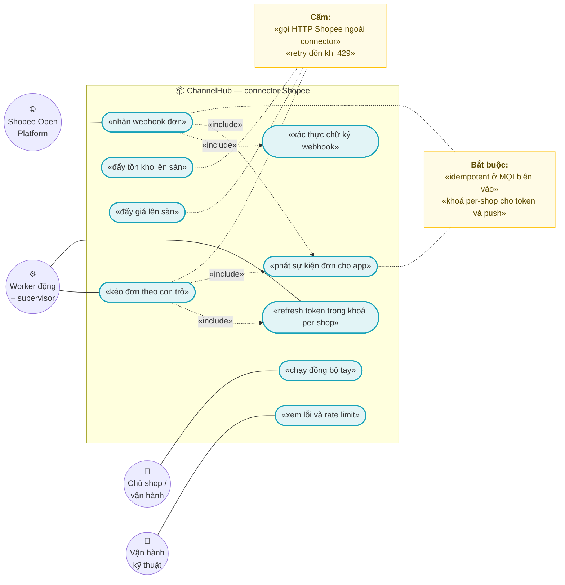
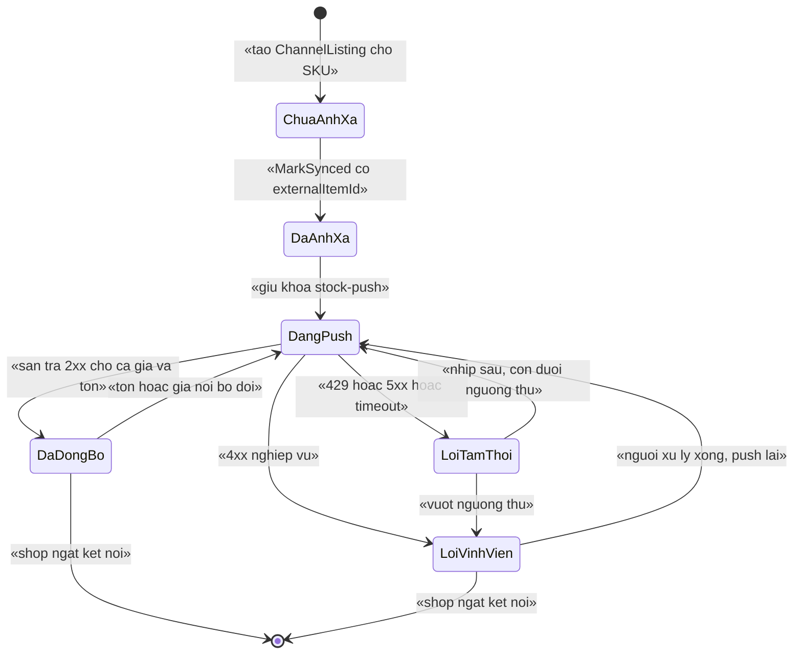
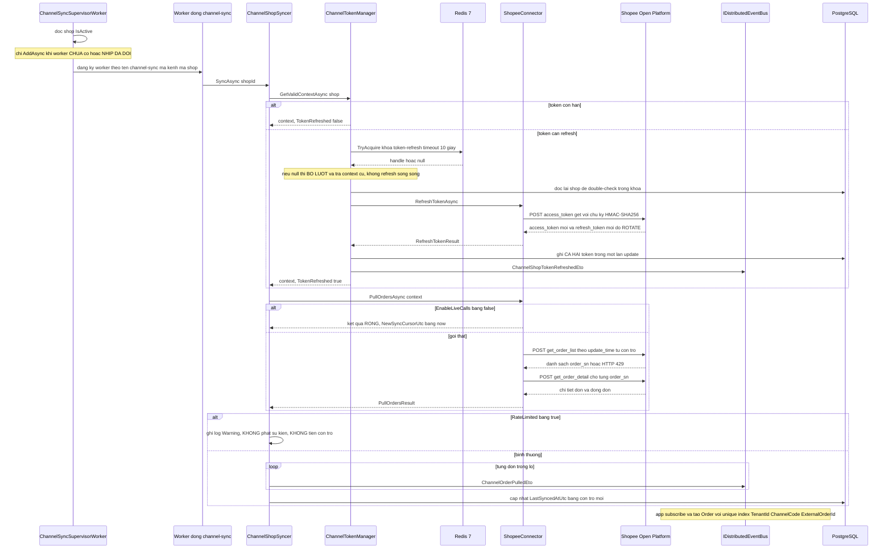

# `CHN-002` — Connector Shopee: pull đơn, push tồn/giá

| Thuộc tính | Nội dung |
|---|---|
| **Mã** | `CHN-002` |
| **Module** | **ChannelHub** — `modules/ChannelHub/eCommerce.ChannelHub.Domain` · `.Application` · `.Application.Contracts` · `.EntityFrameworkCore` |
| **Giai đoạn** | **GĐ4 — Tăng trưởng** (Phụ lục A.3 của `docs/implementation-plan.md`). Nền đã có sẵn từ Phase 0 + GĐ1 |
| **Ưu tiên** | **Must have** cho GĐ4 (đấu sàn Shopee trước — `docs/implementation-plan.md` §10) |
| **Trạng thái** | 🟡 `Draft` — chờ review |
| **Người viết / người review** | *(điền)* / **Kiến trúc trưởng** |
| **Phiên bản / ngày** | `v0.1 — 13/10/2026` |
| **Tài liệu liên quan** | `docs/features/XC-003-khoa-phan-tan-quy-uoc.md` (khoá lock) · `docs/features/XC-002-outbox-inbox-chong-trung-su-kien.md` (idempotency) · `docs/features/XC-004-xac-thuc-phan-quyen-tenant.md` (permission) · `docs/features/XC-005-observability-log-metric.md` (metric) · `CHN-001` (kết nối shop OAuth) · `CHN-003` (Lazada) · `CHN-004` (allotment đa kênh) · `SAL-005` (webhook đơn từ sàn) · `INV-003` (phân bổ tồn theo kênh) · `PRC-001` (giá theo kênh) · `docs/runtime-verification-report.md` |

---

## 0. Tóm tắt & quyết định thiết kế

**Tóm tắt:** `CHN-002` đặc tả phần **gọi API thật của Shopee** cho ba luồng: **kéo đơn** (pull), **đẩy tồn/giá**
(push listing), và **nhận webhook đơn** (inbound) — trên nền **đã có và đã chạy thật** của ChannelHub.

**Điểm xuất phát — và đây là điểm khác biệt lớn nhất so với các tài liệu GĐ1:** ChannelHub **không phải
tài liệu viết trên giấy trắng**. Nhóm này **đã có code chạy được**, đã **đo bằng hạ tầng thật**
(PostgreSQL 17.11 + Redis 7), và đã **sửa 2 lỗi im lặng** được phát hiện bằng `redis-cli MONITOR`
và bằng log `Replaced existing dynamic worker`:

| Đã có thật (kiểm chứng bằng chạy thật) | Bằng chứng |
|---|---|
| Lock thật trong Redis là **`ecommerce:channel:{channelCode}:{shopId}:token-refresh`** | `src/eCommerce.HttpApi.Host/eCommerceHttpApiHostModule.cs:127` (`KeyPrefix = "ecommerce:"`) + `docs/runtime-verification-report.md` §1b (phép thử A/B: có người giữ khoá ⇒ **KHÔNG** refresh) |
| Worker động của shop **chạy được**, tên **`channel-sync:{channelCode}:{externalShopId}`** | `modules/ChannelHub/eCommerce.ChannelHub.Application/Sync/ChannelSyncSupervisorWorker.cs:123` + `docs/runtime-verification-report.md` §1 (**C10**: trước khi sửa, **8 lần `Replaced`, 0 lần worker chạy**) |
| **ĐÃ SỬA** lỗi supervisor gọi `AddAsync` **mỗi nhịp** ⇒ worker **KHÔNG BAO GIỜ** chạy | `ChannelSyncSupervisorWorker.cs:81-85` (chỉ đăng ký khi **chưa có** hoặc **nhịp đã đổi**) |
| **ĐÃ SỬA** lỗi `KeyPrefix` ghép **không dấu phân cách** (ra `eCommercechannel:…`) | `eCommerceHttpApiHostModule.cs:115-128` + `docs/runtime-verification-report.md` (**C11**) |
| `ShopeeConnector` hiện là **PoC**: `EnableLiveCalls = False` ⇒ **trả kết quả rỗng** | `ChannelHubOptions.cs:47` · `ShopeeConnector.cs:80-87` · `ShopeeConnector.cs:100-109` · `ShopeeConnector.cs:117-128` |
| Thuật toán **ký request** Shopee đã có **thật** (không phải TODO) | `ShopeeConnector.cs:48-68` (`Sign` + `BuildBaseString`, HMAC-SHA256, concat KHÔNG dấu phân cách) |

**Vì sao phải viết tài liệu này trước khi bật `EnableLiveCalls = true`:** ba rủi ro **im lặng** đã được
chứng minh bằng chính lịch sử của module này — (1) worker không chạy mà **không có lỗi biên dịch**;
(2) khoá lock sai chuỗi mà **lock vẫn "hoạt động"**; (3) và với Shopee, **refresh token CÓ ROTATE** ⇒
hai lần refresh song song làm **mất kết nối shop vĩnh viễn** (`ChannelEntities.cs:58`).
Cả ba đều thuộc loại *chạy vẫn `exit 0`, chỉ sai dữ liệu*.

**Phạm vi:**
- ✅ Gọi **HTTP thật** của Shopee cho: `get_order_list` + `get_order_detail` (pull đơn), `update_stock` +
  `update_price` (push tồn/giá), `access_token/get` (refresh), `get_shop_info` (ping).
- ✅ **Ánh xạ dữ liệu sàn → model nội bộ** (`ChannelOrderModel`, `ChannelListingPushModel`) — **không** tạo `Order`.
- ✅ **Webhook đơn của Shopee** (biên vào mới) — xác thực chữ ký, idempotent, **chịu được sai thứ tự**.
- ✅ **Quy tắc quota/rate limit**: `HTTP 429` ⇒ `RateLimited = true`, backoff, **cấm** retry dồn.
- ✅ **Khoá phân tán** cho push tồn/giá (đã có tên khoá trong consts, **chưa có nơi gọi** — xem §15.2 F1).
- ✅ **Idempotency ở mọi biên vào** (webhook + handler sự kiện + job) theo `XC-002`.
- ✅ Khoá lock và metric theo đúng quy ước `XC-003` / `XC-005`.

**Không nằm trong phạm vi:**
- ❌ **Kết nối shop qua OAuth** (đổi `code` lấy token lần đầu, redirect URL) — thuộc **`CHN-001`**.
  Hiện `ConnectAsync` nhận token **có sẵn** qua DTO (`ChannelAppService.cs:70-125`).
- ❌ **Allotment theo kênh** (chia tồn kho cho từng sàn) — thuộc **`CHN-004`**.
  Ở đây chỉ **đọc** `ChannelListing.AllottedQuantity` (`ChannelEntities.cs:142`) và **tôn trọng** nó.
- ❌ **Connector Lazada / TikTok** — thuộc **`CHN-003`**.
- ❌ **Tạo/sửa đơn nội bộ** khi nhận đơn sàn — thuộc **`SAL-005`** (ChannelHub chỉ **phát sự kiện**).
- ❌ **Đối soát settlement** (phí sàn, tiền sàn phải trả) — thuộc **`REC-002`**.
- ❌ **Bật `EnableLiveCalls` trên production** — cần credential + sandbox Shopee duyệt (xem §15.1 Q1).
- ❌ **Cam kết exactly-once** — không đạt được; xem §7.3 (đúng `XC-002` §8.1).

### 0.1 Quyết định thiết kế (ADR ngắn)

| # | Quyết định | Phương án đã cân nhắc | Lý do chọn | Hệ quả |
|---|---|---|---|---|
| **D1** | **Giữ mô hình pull bằng worker động + con trỏ (`LastSyncedAtUtc`)**, không chuyển sang webhook-only | (a) webhook-only · (b) pull-only · (c) **pull làm nguồn sự thật + webhook làm tăng tốc** | Webhook **có thể mất** (Shopee không đảm bảo giao) và **có thể đến sai thứ tự**; nếu chỉ tin webhook thì đơn rơi **im lặng**. Pull theo con trỏ là **lưới an toàn bắt buộc** | Đơn có thể đến **2 đường** ⇒ **bắt buộc** idempotent theo `(TenantId, ChannelCode, ExternalOrderId)`; webhook chỉ **giảm độ trễ**, không phải nguồn sự thật |
| **D2** | **`ShopeeConnector` vẫn là nơi duy nhất biết chi tiết Shopee**; tầng nghiệp vụ chỉ thấy `IChannelConnector` | (a) gọi HTTP rải rác trong worker/app service · (b) **sau interface** | Đã có sẵn `IChannelConnectorFactory` (`ChannelConnectorFactory.cs:9-41`) và app service **chỉ** biết factory (`ChannelAppService.cs:31`). Rải chi tiết sàn ra ngoài ⇒ **`CHN-003` (Lazada) phải sửa `Sales`** — đúng thứ `implementation-plan.md` §10 muốn tránh | Mọi ràng buộc Shopee (ký, endpoint, quota) nằm trong 1 file; **cấm** tham chiếu `ShopeeConnector` từ ngoài `ChannelConnectorFactory` |
| **D3** | **Bật gọi thật bằng cờ `EnableLiveCalls`**, mặc định **`false`** | (a) xoá PoC rồi code thật · (b) **cờ cấu hình + giữ nhánh PoC** | PoC hiện cho **toàn bộ luồng** worker/lock/event chạy mà **không cần credential** (`ShopeeConnector.cs:12-15`) — giá trị này **phải giữ** để CI và dev chạy được. Xoá PoC ⇒ **không ai chạy được test** khi chưa có sandbox | Nhánh PoC **phải** tiếp tục được test (`TC-01`..`TC-05`); nhánh live **phải** có test riêng dùng `HttpMessageHandler` giả (`TC-06`..`TC-11`) |
| **D4** | **`HttpClient` qua `IHttpClientFactory` + `HttpMessageHandler` bơm được** | (a) `new HttpClient()` · (b) `IHttpClientFactory` **có đặt tên** | `new HttpClient()` trong class transient ⇒ **socket exhaustion** (lỗi kinh điển) và **không test được** vì không thay được handler. Hiện `ChannelHubApplicationModule.cs` **chưa** đăng ký `HttpClient` nào (đã kiểm: `AddHttpClient` không có trong module) | Thêm package `Microsoft.Extensions.Http` (**có sẵn trong .NET**, không thêm NuGet ngoài) + test dùng `HttpMessageHandler` giả |
| **D5** | **Retry có phân loại**: chỉ retry lỗi **tạm thời** (5xx, timeout, 429 có `Retry-After`); **cấm** retry lỗi nghiệp vụ (4xx) | (a) retry mọi lỗi · (b) retry có phân loại | Retry 4xx (token sai, đơn không tồn tại) là **vô ích** và tiêu quota — đúng bài học "sửa theo giả thuyết mà chưa đo" của `runtime-verification-report.md` §6.5 | Bảng phân loại lỗi ở §12; **429 ⇒ luôn** trả `RateLimited` và **không** retry trong cùng nhịp |
| **D6** | **Push tồn/giá nằm TRONG khoá `…:stock-push`** (không chỉ trong 1 tiến trình) | (a) tin vào hàng đợi trong bộ nhớ · (b) **khoá phân tán per-shop** | Sàn nhận `update_stock` **không theo thứ tự**; 2 instance cùng push ⇒ **giá/tồn cuối cùng là ngẫu nhiên**. Tên khoá **đã có** trong consts (`ChannelHubConsts.cs:26-27`) nhưng **chưa có nơi gọi** | Phải thêm nơi gọi + double-check; theo `XC-003` D6, khoá **không reentrant** ⇒ **cấm** acquire lồng |
| **D7** | **Webhook là biên vào phải qua idempotency của `XC-002`** (bảng inbox nghiệp vụ + unique index) | (a) tin vào `AbpEventInbox` của ABP · (b) **bảng inbox nghiệp vụ của ta** | `XC-002` **D3** đã chứng minh `IncomingEventRecord` **không có cột `TenantId`** và index `MessageId` **không unique** ⇒ **không** là hàng rào chống trùng theo tenant | Webhook **phải** gọi `IIdempotencyGuard` **trước** mọi side effect; **cấm** coi "đã có `AbpEventInbox`" là đủ |
| **D8** | **Chỉ tin webhook đã xác thực chữ ký**; **cấm** tin `ReturnUrl`/callback từ client | (a) nhận webhook rồi kiểm tra sau · (b) **xác thực chữ ký trước, rồi mới đọc payload** | Quy ước #10 của dự án (`implementation-plan.md` §3) — đã áp dụng ở `PaymentHub` | Chữ ký sai ⇒ **từ chối** + `payment_webhook_rejected_total`-style metric cho kênh + log `Warning`; **không** tiết lộ chi tiết |
| **D9** | **Tiền dùng `decimal` + `Money`, không bao giờ so `==` trên tiền** | (a) `double` · (b) `decimal` + so theo `Money` | Quy ước #1/#2. Hiện `ChannelListing.ChannelPrice` là `decimal?` (`ChannelEntities.cs:136`), `ChannelOrderLineModel.UnitPrice` là `decimal` (`IChannelConnector.cs:25`); **`Money` của `XC-001` chưa được dùng ở ChannelHub** | Ánh xạ tiền của sàn (Shopee trả **số nguyên theo đơn vị nhỏ nhất** ở một số trường) **phải** đi qua `Money` và làm tròn theo `XC-001`; **cấm** `if (a == b)` trên tiền |
| **D10** | **Không dùng `PushListingAsync` cho đơn hàng** — hai luồng **tách biệt** hoàn toàn | (a) một worker "đồng bộ tất cả" · (b) **worker kéo đơn + đường push riêng** | Trộn hai luồng ⇒ một lỗi push **chặn** kéo đơn (đúng loại lỗi "một shop lỗi làm chết cả hệ" mà `ChannelSyncSupervisorWorker.cs:18-21` đã tránh bằng worker per-shop) | Push có khoá + metric **riêng**; `ChannelSyncResult.ListingsPushed` hiện **luôn = 0** (`ChannelSyncResult.cs:13`) vì `SyncAsync` **không** gọi push — xem §15.2 **F2** |

> 📌 Ghi lại cả phương án **BỊ LOẠI** và lý do — để 6 tháng sau không ai hỏi lại "sao không làm cách kia".
> 🔍 **Mọi khẳng định về code trong tài liệu này đều kèm đường dẫn file thật.** Phần **chưa có trong code**
> đều được ghi rõ **"chưa có trong code — kế hoạch GĐ4"**.

---

## 1. Use Case Specification

| Thuộc tính | Nội dung |
|---|---|
| **Use Case ID** | `CHN-002` |
| **Use Case Name** | Đồng bộ hai chiều với Shopee: kéo đơn về và đẩy tồn/giá lên |
| **Description** | *"Là chủ shop bán trên Shopee, tôi muốn đơn từ sàn tự về hệ thống và tồn kho/giá trên sàn tự khớp với kho thật, để tôi không phải nhập tay và không bán vượt tồn."* |
| **Actor(s)** | **Chủ shop / nhân viên vận hành** (xem trạng thái, chạy tay) · **Hệ thống** (`ChannelSyncSupervisorWorker`, worker động theo shop, `ChannelShopSyncer`, `ChannelTokenManager`) · **Shopee Open Platform** (nguồn & đích dữ liệu) · **Vận hành** (xem lỗi, rate limit) |
| **Priority** | **Must have** (GĐ4) |
| **Trigger** | (a) nhịp worker động của shop (mặc định **300 s** — `ChannelHubOptions.cs:10`); (b) **webhook đơn** từ Shopee; (c) người dùng bấm **chạy tay** (`SyncNowAsync`); (d) sự kiện nội bộ **tồn kho thay đổi** ⇒ cần push; (e) token sắp hết hạn ⇒ refresh |
| **Pre-Condition(s)** | • **Tenant hiện tại** (`TenantId`) — `ChannelShop` là `IMultiTenant` (`ChannelEntities.cs:38-40`).<br>• **Shop đã kết nối** (`IsActive = true`) với `AccessTokenEncrypted` / `RefreshTokenEncrypted` hợp lệ.<br>• **`Channel.Code = "shopee"` đã seed** và **có connector** trong `ChannelConnectorFactory` (`ChannelConnectorFactory.cs:18-25`).<br>• **`ChannelListing` đã ánh xạ** SKU nội bộ ↔ `item_id` của sàn (`ChannelEntities.cs:117-160`).<br>• **Redis 7** sẵn sàng (khoá phân tán per-shop); Redis chết ⇒ **lock vô hiệu nhưng app vẫn chạy** (`AbortOnConnectFail = false` — `eCommerceHttpApiHostModule.cs:141`).<br>• **Cấu hình Shopee** (`partner_id`, `partner_key`, `BaseUrl`) đã điền — `ShopeeOptions` (`ChannelHubOptions.cs:28-48`).<br>• **`ChannelCode` = `"shopee"`** tham gia **mọi** khoá lock và **mọi** khoá idempotency. |
| **Post-Condition(s)** | • Đơn mới trên sàn **đã phát** `ChannelOrderPulledEto` **đúng một lần về mặt nghiệp vụ** (idempotent theo `ExternalOrderId`).<br>• `ChannelShop.LastSyncedAtUtc` (con trỏ) **tiến** — **chỉ** khi cả lô đã phát sự kiện thành công (`ChannelShopSyncer.cs:94-97`).<br>• Tồn/giá đẩy lên sàn thành công **hoặc** có bản ghi lỗi; **không** có trạng thái "không rõ".<br>• Mọi lần bị **rate limit** đều **có dấu vết** (`RateLimited = true` + log `Warning` — `ChannelShopSyncer.cs:58-64`).<br>• Mọi lỗi của shop **có** `ChannelShop.LastError` (cắt 2.000 ký tự — `ChannelShopSyncer.cs:109`). |
| **Basic Flow** | 1. `ChannelSyncSupervisorWorker` mỗi nhịp đọc shop `IsActive` và **chỉ đăng ký** worker động khi **chưa có** hoặc **nhịp đã đổi** (`ChannelSyncSupervisorWorker.cs:81-85`).<br>2. Worker động gọi `ChannelShopSyncer.SyncAsync(shopId, ct)` (`ChannelSyncSupervisorWorker.cs:96`).<br>3. `ChannelTokenManager.GetValidContextAsync` kiểm tra token: nếu **cần refresh** thì giành khoá `ecommerce:channel:{channelCode}:{shopId}:token-refresh` với timeout `LockTimeoutSeconds` (**10 s** — `ChannelHubOptions.cs:22`).<br>4. **Double-check bên trong khoá** (worker khác có thể đã refresh xong) rồi gọi `IChannelConnector.RefreshTokenAsync` và ghi **cả** access token **và** refresh token mới trong **một** lần update (`ChannelTokenManager.cs:85-114`).<br>5. `IChannelConnector.PullOrdersAsync` gọi `POST /api/v2/order/get_order_list` (lọc `update_time` từ con trỏ) rồi `get_order_detail`.<br>6. Ánh xạ sang `ChannelOrderModel` (`IChannelConnector.cs:29-39`) — **không** tạo `Order`.<br>7. Mỗi đơn ⇒ phát `ChannelOrderPulledEto` qua `IDistributedEventBus` (`ChannelShopSyncer.cs:69-89`).<br>8. Cả lô thành công ⇒ cập nhật con trỏ `LastSyncedAtUtc` (`ChannelShopSyncer.cs:95`).<br>9. Kết thúc ⇒ trả `ChannelSyncResult` để supervisor log (`ChannelSyncSupervisorWorker.cs:101`). |
| **Alternative Flow** | **A1 — Webhook đơn**: Shopee gọi webhook ⇒ xác thực chữ ký ⇒ **idempotency** ⇒ phát `ChannelOrderPulledEto`; **không** đọc lại toàn bộ danh sách (chỉ giảm độ trễ).<br>**A2 — Rate limit (HTTP 429)**: connector trả `RateLimited = true`; `ChannelShopSyncer` **không** phát sự kiện, **không** tiến con trỏ, ghi log `Warning` (`ChannelShopSyncer.cs:58-64`); supervisor **giãn nhịp**.<br>**A3 — Refresh thất bại**: `ChannelTokenManager` ghi `LastError` rồi **ném** `BusinessException` `eCommerce:Channel:0002` (`ChannelTokenManager.cs:96-105`) — **không** im lặng.<br>**A4 — Chạy tay**: `SyncNowAsync` gọi **trực tiếp** connector (`ChannelAppService.cs:144-187`) — ⚠️ hiện **đi vòng qua** `ChannelShopSyncer`/`ChannelTokenManager` (xem §15.2 **F3**).<br>**A5 — Push tồn/giá**: đường **riêng**, có khoá `…:stock-push`, không nằm trong `SyncAsync` (D10). |
| **Exception Flow** | **E1:** không giành được khoá token-refresh ⇒ `ChannelTokenManager` trả context **cũ** + log `Warning` và **bỏ lượt** (`ChannelTokenManager.cs:74-83`) — **cấm** refresh song song. ⚠️ Theo `XC-003` **BR-010**, job định kỳ được phép bỏ qua **nhưng bắt buộc log + metric** — metric hiện **chưa có**.<br>**E2:** chữ ký webhook sai ⇒ **từ chối** `401`/`400` + log `Warning` + metric; **không** xử lý payload.<br>**E3:** webhook trùng ⇒ `IIdempotencyGuard` phát hiện ⇒ **không** side effect, ghi metric `duplicate` (theo `XC-002` §3.2 bước 4).<br>**E4:** cùng `IdempotencyKey` nhưng `PayloadHash` **khác** ⇒ **ném** `eCommerce:Messaging:0002` (`XC-002` BR-006) — **cấm** coi là trùng.<br>**E5:** `HTTP 4xx` nghiệp vụ (đơn không tồn tại, item bị xoá) ⇒ **không** retry; ghi `LastError` + `ChannelListing.MarkError` (`ChannelEntities.cs:171-175`).<br>**E6:** `EnableLiveCalls = true` nhưng chưa code xong ⇒ hiện **`NotImplementedException`** (`ShopeeConnector.cs:94-95, 112, 133, 144`) — **cố ý**, để không ai nhầm PoC là thật.<br>**E7:** `partner_key` **hết hạn 180 ngày** (`ChannelHubOptions.cs:35`) ⇒ mọi request bị từ chối ⇒ **phải** có nhắc lịch gia hạn. |
| **Business Rules** | • **BR-CHN-002-001**: **Mọi** lời gọi API Shopee **phải** đi qua `IChannelConnector` của module ChannelHub; **cấm** gọi HTTP Shopee từ app service, worker hay module khác.<br>• **BR-CHN-002-002**: **Mọi** lần refresh token **phải** nằm trong khoá `ChannelHubConsts.LockKeys.ChannelTokenRefresh(channelCode, shopId)` **và** phải **double-check** bên trong khoá trước khi gọi sàn.<br>• **BR-CHN-002-003**: **Mọi** lần push tồn/giá của một shop **phải** nằm trong khoá `ChannelHubConsts.LockKeys.ChannelStockPush(channelCode, shopId)`; **cấm** acquire **lồng** cùng tên khoá (`XC-003` D6 — lock không reentrant).<br>• **BR-CHN-002-004**: **Mọi** biên vào (webhook đơn, handler `ChannelOrderPulledEto`, job push) **phải** idempotent qua `IIdempotencyGuard` **trước** mọi side effect (`XC-002` BR-004).<br>• **BR-CHN-002-005**: Khoá chống trùng của đơn sàn **phải** là `(TenantId, ChannelCode, ExternalOrderId)`; dòng đơn là `(OrderId, ExternalLineId)` — **khớp** unique index đã có ở `eCommerceDbContext.cs:184-186` và `:206-208`.<br>• **BR-CHN-002-006**: Cùng khoá chống trùng + **khác** `PayloadHash` ⇒ **NÉM** `eCommerce:Messaging:0002`; **cấm** ghi đè (`XC-002` BR-006).<br>• **BR-CHN-002-007**: `HTTP 429` **phải** trả `RateLimited = true`; **cấm** retry dồn trong cùng nhịp; **cấm** tiến con trỏ khi bị rate limit.<br>• **BR-CHN-002-008**: **Chỉ** tiến con trỏ `LastSyncedAtUtc` **sau khi** đã phát thành công sự kiện cho **cả lô**; con trỏ **không** được đi lùi.<br>• **BR-CHN-002-009**: **Cấm** retry lỗi nghiệp vụ `4xx`; **chỉ** retry `408`/`429`/`5xx`/lỗi mạng, tối đa theo cấu hình, có backoff (**cấm** retry vô hạn).<br>• **BR-CHN-002-010**: Webhook **chỉ** được xử lý khi **đã xác thực chữ ký**; chữ ký sai ⇒ từ chối + ghi metric; **cấm** đọc payload trước khi xác thực.<br>• **BR-CHN-002-011**: Mọi trường **tiền** (`UnitPrice`, `DiscountAmount`, `ShippingFee`, `ChannelDiscount`, `ChannelPrice`, giá push) **phải** là `decimal`/`Money`; **cấm** `double`/`float`; **cấm** so tiền bằng `==` (`XC-001`).<br>• **BR-CHN-002-012**: `State machine` của `ChannelListing.Status` **phải NÉM LỖI** khi chuyển sai (quy ước #11); **cấm** no-op im lặng.<br>• **BR-CHN-002-013**: **Cấm** module ChannelHub tham chiếu `src/` (app). ChannelHub **chỉ** phát sự kiện; app subscribe và tạo `Order` (`ChannelShopSyncer.cs:13-18`).<br>• **BR-CHN-002-014**: **Mọi** thao tác ghi **phải** qua **Unit of Work** (quy ước #13); hiện code dùng `autoSave: true` trên `IRepository` (`ChannelShopSyncer.cs:97, 110`) — UoW do ABP quản.<br>• **BR-CHN-002-015**: **Mọi** app service **phải** có `[Authorize]` ở **cấp class** (`XC-004` BR-001) — `ChannelAppService` đã đúng (`ChannelAppService.cs:27`); **cấm** magic string permission (`ChannelAppService.cs:69, 127, 143`).<br>• **BR-CHN-002-016**: Tên khoá lock **chỉ** được sinh từ `ChannelHubConsts.LockKeys.*`; **cấm** viết literal khoá trong code nghiệp vụ (`XC-003` BR-001).<br>• **BR-CHN-002-017**: **Cấm** log giá trị token (plaintext hoặc đã mã hoá) — `ChannelTokenManager.cs:133` đã ghi rõ; **cấm** trả token ra DTO (`ChannelAppService.cs:191`).<br>• **BR-CHN-002-018**: `partner_key` / `partner_id` **cấm** commit vào repo; đọc từ cấu hình ngoài (`ChannelHubOptions.cs:24-25`).<br>• **BR-CHN-002-019**: Thiếu ánh xạ `ChannelListing` cho một SKU của sàn ⇒ **NÉM/g hi log lỗi**, **cấm** bỏ qua im lặng (nếu không ⇒ đơn về mà **không** biết SKU nào).<br>• **BR-CHN-002-020**: **Chỉ** tiến con trỏ và ghi trạng thái khi giao dịch thành công; **cấm** "đánh dấu đã đồng bộ" rồi mới gọi sàn. |
| **Non-Functional Requirement** | • **NFR-CHN-002-001**: Một nhịp đồng bộ shop (pull **50** đơn — `ChannelHubOptions.cs:19`, không có đơn mới) p95 **< 3 s**.<br>• **NFR-CHN-002-002**: **0** lần refresh token song song cho cùng một shop (đo bằng test 2 tiến trình + Redis thật).<br>• **NFR-CHN-002-003**: Gửi lại cùng một webhook **100** lần ⇒ **đúng 1** side effect.<br>• **NFR-CHN-002-004**: Độ trễ phát hiện đơn mới (webhook nhận → sự kiện phát) p95 **< 2 s** (khớp nhịp relay outbox **2 s** của `XC-002`).<br>• **NFR-CHN-002-005**: **0** lần vượt quota gây block shop: tỉ lệ nhịp đồng bộ trả `RateLimited` **< 5 %** trong ngày bình thường; vượt ⇒ cảnh báo.<br>• **NFR-CHN-002-006**: **100 %** lời gọi HTTP sàn có `CorrelationId` trong log và **không** chứa token trong log.<br>• **NFR-CHN-002-007**: **0** giá trị tiền kiểu `double`/`float` trong model kênh (test reflection; theo `XC-002` NFR-011).<br>• **NFR-CHN-002-008**: Thời gian **không** có nhịp đồng bộ thành công của một shop (đang `IsActive`) **< 3 ×** nhịp cấu hình; vượt ⇒ cảnh báo.<br>• **NFR-CHN-002-009**: **100 %** khoá lock dùng được **grep** bằng `ecommerce:` (`XC-003` NFR-006).<br>• **NFR-CHN-002-010**: `4xx` **không** retry: **0** request Shopee được gửi lại cho lỗi nghiệp vụ (đo bằng handler giả đếm số lần gọi). |

---

## 2. Sơ đồ Use Case



---

## 3. Vòng đời một lần đẩy tồn/giá (state machine)

> Chọn `ChannelListing.Status` làm state machine của tài liệu này vì đây là **trạng thái bền vững** duy nhất
> mà `CHN-002` sở hữu. Trạng thái **của đơn hàng** thuộc `SAL-003`; trạng thái **của token** không có bảng
> riêng (chỉ là `AccessTokenExpiresAtUtc` + `LastError`).
>
> ⚠️ **Sự thật về code hiện tại:** `ChannelListing.Status` là **`int` trần** (`ChannelEntities.cs:145`) với
> ghi chú *"Khớp `eCommerce.ChannelListingStatus`"*, và các giá trị được gán bằng **số literal trong comment**
> — `MarkSynced` gán `2`, `MarkError` gán `3` (`ChannelEntities.cs:166, 173`). **Enum
> `eCommerce.ChannelListingStatus` chưa tồn tại trong code — kế hoạch GĐ4** (xem §15.2 **F4**).
> Vì vậy **BR-CHN-002-012** (state machine phải ném lỗi) **chưa được thoả** ở thời điểm viết tài liệu.



**Bảng chuyển trạng thái & guard (mọi chuyển sai **phải ném lỗi**, không im lặng):**

| # | Từ → Sang | Guard (điều kiện cho phép) | Hành động kèm theo | Nếu guard sai thì? |
|---|---|---|---|---|
| 1 | `[*]` → `ChuaAnhXa` | Có `ChannelShop` hợp lệ + `ProductVariantId` + `InternalSku` | Ghi `ChnChannelListings`; unique `(TenantId, ChannelShopId, ProductVariantId)` (`ChannelHubDbContextModelCreatingExtensions.cs:69`) | Trùng ⇒ **DB chặn** (đã có `NULLS NOT DISTINCT` — `Migrations/20261013024226_Fix_NullableTenantId_UniqueIndexes.cs:75-76`) |
| 2 | `ChuaAnhXa` → `DaAnhXa` | `PushListingAsync` trả `Success = true` **và** có `ExternalItemId` | `MarkSynced(externalItemId, externalSku)` ⇒ `Status = 2`, xoá `LastSyncError` | `Success = false` ⇒ sang `LoiVinhVien` + `MarkError` |
| 3 | `DaAnhXa` → `DangPush` | Giành được khoá `…:stock-push` **trong** `LockTimeoutSeconds` | Gọi `update_stock` / `update_price` | Không giành được khoá ⇒ theo `XC-003` **BR-010** **phải** ném hoặc log + metric; hiện **chưa có** nơi gọi khoá này (**F1**) |
| 4 | `DangPush` → `DaDongBo` | **Cả** giá **và** tồn được sàn nhận (`2xx`) | Ghi `LastSyncedAtUtc`; xoá `LastSyncError`; metric `channel_listing_push_total{result=ok}` | Chỉ 1 trong 2 thành công ⇒ **KHÔNG** được coi là `DaDongBo` (lệch giá/tồn là **lỗi im lặng** nguy hiểm nhất của luồng này) |
| 5 | `DangPush` → `LoiTamThoi` | `429`, `5xx`, timeout, lỗi mạng | Ghi `LastSyncError`; **chờ** nhịp sau (backoff); metric `{result=retry}` | `429` ⇒ **bắt buộc** `RateLimited = true` + **không** retry trong cùng nhịp (BR-007) |
| 6 | `DangPush` → `LoiVinhVien` | `4xx` nghiệp vụ (`item` bị xoá, SKU sai, token sai) | `MarkError(...)` ⇒ `Status = 3`; **không** retry (BR-009); **cảnh báo** để người xử lý | Nếu code retry ⇒ vi phạm BR-009 và tiêu quota |
| 7 | `LoiTamThoi` → `LoiVinhVien` | `AttemptCount >= MaxAttempts` (đề xuất **5**, khớp `XC-002`) | Ở lại `LoiVinhVien` + **cảnh báo** | **Cấm** retry vô hạn (BR-009) |
| 8 | `DaDongBo`/`LoiVinhVien` → `[*]` | Shop `IsActive = false` (`ChannelShopSyncer`/supervisor huỷ worker — `ChannelSyncSupervisorWorker.cs:109-120`) | Worker bị `RemoveAsync`; bản ghi **giữ nguyên** để đối soát | — |

> ⚠️ **Trạng thái nguy hiểm nhất là `DaDongBo` "giả":** nếu chỉ **một** trong hai lời gọi (`update_price`,
> `update_stock`) thành công mà ta vẫn coi là xong, thì sàn và kho **lệch nhau im lặng** — đúng loại lỗi
> mà `runtime-verification-report.md` §1 gọi là *"im lặng: không lỗi biên dịch, không exception, `exit 0`"*.
> Vì vậy bước 4 **bắt buộc** kiểm **cả hai** kết quả, và `ChannelListing` **phải** lưu **thời điểm + kết quả
> từng phần** (`LastPricePushedAtUtc`, `LastStockPushedAtUtc`, `LastPushedPrice`, `LastPushedQuantity`) —
> **chưa có trong code — kế hoạch GĐ4** (hiện chỉ có `LastSyncedAtUtc`, `ChannelEntities.cs:149`).

---

## 4. Sequence Diagram & luồng dữ liệu

> Chỉ **một** sơ đồ ở mục này: luồng **pull đơn** end-to-end, vì đây là luồng **đã chạy thật** và là
> luồng mà mọi thành phần khác xoay quanh. Luồng push tồn/giá dùng **cùng** khung này, khác ở chỗ
> thay `PullOrdersAsync` bằng `PushListingAsync` và thay khoá `token-refresh` bằng `stock-push` (§3).



**Luồng dữ liệu (tóm tắt bằng bảng — vì đã dùng hết ngân sách 3 sơ đồ):**

| # | Bước | Vào | Ra | Nơi ghi |
|---|---|---|---|---|
| 1 | Supervisor quét shop | `ChnChannelShops` (`IsActive`) | worker động đã đăng ký | bộ nhớ (`RegisteredWorkers`) |
| 2 | Token | `ChannelShop` | `ChannelShopContext` (plaintext trong RAM) | `ChnChannelShops` (bản **mã hoá**) |
| 3 | Pull đơn | con trỏ `LastSyncedAtUtc` | `PullOrdersResult` | — |
| 4 | Phát sự kiện | `ChannelOrderModel` | `ChannelOrderPulledEto` | `AbpEventOutbox` (cùng transaction) |
| 5 | Tiến con trỏ | `NewSyncCursorUtc` | `LastSyncedAtUtc` | `ChnChannelShops` |
| 6 | Push tồn/giá | `ChannelListing` + tồn kho | `PushListingResult` | `ChnChannelListings` |
| 7 | Webhook | payload Shopee | `ChannelOrderPulledEto` | bảng inbox (`XC-002`) + `AbpEventOutbox` |

---

## 5. Mô hình dữ liệu

### 5.1 Bảng đã có trong code (không tạo mới)

| Bảng | Entity | Trường liên quan `CHN-002` | Nguồn |
|---|---|---|---|
| `ChnChannels` | `Channel` | `Code` (unique), `Type`, `IsActive`, `HoldsInventory` | `ChannelEntities.cs:9-32` · `ChannelHubDbContextModelCreatingExtensions.cs:18-28` |
| `ChnChannelShops` | `ChannelShop` | `ChannelCode`, `ExternalShopId`, `AccessTokenEncrypted`, `RefreshTokenEncrypted`, `AccessTokenExpiresAtUtc`, `RefreshTokenExpiresAtUtc`, `AuthorizationExpiresAtUtc`, `LastSyncedAtUtc`, `IsActive`, `PushStatus`, `LastError`, `SyncIntervalSeconds` | `ChannelEntities.cs:38-114` · `:30-52` |
| `ChnChannelListings` | `ChannelListing` | `ProductVariantId`, `InternalSku`, `ExternalItemId`, `ExternalSku`, `ChannelPrice` (**decimal 18,4**), `AllottedQuantity`, `Status`, `LastSyncError`, `LastSyncedAtUtc` | `ChannelEntities.cs:117-175` · `:54-73` |
| `OrdOrders` | `Order` (app) | `ChannelCode`, `ChannelShopId`, `ExternalOrderId`, `ChannelFeeAmount` | `Order.cs:10-64` · `eCommerceDbContext.cs:162-192` |
| `OrdOrderLines` | `OrderLine` (app) | `ExternalLineId`, `UnitPrice`, `DiscountAmount`, `TaxAmount` | `Order.cs:118-149` · `eCommerceDbContext.cs:194-209` |

**Ba unique index là hàng rào chống trùng thật** (không phải lock — `XC-003` D2):

| Index | Bảng | Ý nghĩa với `CHN-002` |
|---|---|---|
| `(TenantId, ChannelCode, ExternalShopId)` | `ChnChannelShops` | một shop của sàn chỉ kết nối **một lần** trong một tenant (`ChannelHubDbContextModelCreatingExtensions.cs:48`) |
| `(TenantId, ChannelCode, ExternalOrderId)` **filtered** `ExternalOrderId IS NOT NULL` | `OrdOrders` | webhook/pull gửi trùng **không** tạo 2 đơn (`eCommerceDbContext.cs:184-186`) |
| `(OrderId, ExternalLineId)` **filtered** `ExternalLineId IS NOT NULL` | `OrdOrderLines` | gửi trùng **không** nhân đôi dòng đơn (`eCommerceDbContext.cs:206-208`) |

> 🎯 **Đây là câu trả lời cho câu hỏi của `XC-003` D2:** *"bỏ lock đi, DB có chặn không?"* ⇒ **CÓ**, ở cả
> ba bất biến trên. Lock chỉ để **giảm tranh chấp và tiết kiệm quota**, không phải hàng rào cuối.
> ⚠️ Cả ba index đều bắt đầu bằng `TenantId` ⇒ **phải** giữ `NULLS NOT DISTINCT`; nếu không, chúng
> **mất tác dụng** khi `TenantId = NULL` — đúng lỗi **F1/C4** của `XC-004`, và **đã sửa** cho
> `ChnChannelShops` + `ChnChannelListings` tại `Migrations/20261013024226_Fix_NullableTenantId_UniqueIndexes.cs:70-76`.

### 5.2 Trường **cần thêm** — chưa có trong code — kế hoạch GĐ4

| # | Trường / bảng | Bảng | Vì sao cần | Trạng thái |
|---|---|---|---|---|
| 1 | `LastPricePushedAtUtc` · `LastStockPushedAtUtc` | `ChnChannelListings` | Phân biệt **giá** và **tồn** đã đẩy tới đâu ⇒ tránh `DaDongBo` giả (§3 bước 4) | ⏳ **chưa có trong code — kế hoạch GĐ4** |
| 2 | `LastPushedPrice` (`decimal(18,4)`) · `LastPushedQuantity` | `ChnChannelListings` | Phát hiện "sàn đang giữ giá/tồn khác" **không cần** gọi API ⇒ tiết kiệm quota; đối soát | ⏳ **chưa có trong code — kế hoạch GĐ4** |
| 3 | `PushAttemptCount` | `ChnChannelListings` | Đếm số lần thử cho guard `LoiTamThoi → LoiVinhVien` (§3 bước 7) | ⏳ **chưa có trong code — kế hoạch GĐ4** |
| 4 | `OrderPullCursor` (tách khỏi `LastSyncedAtUtc`) | `ChnChannelShops` | `LastSyncedAtUtc` hiện dùng **lẫn** cho "con trỏ đơn" **và** "lần đồng bộ cuối" ⇒ khi push riêng (D10) thì nghĩa bị nhoè | ⏳ **chưa có trong code — kế hoạch GĐ4** |
| 5 | `WebhookSecret` (đã mã hoá) | `ChnChannelShops` **hoặc** cấu hình | Xác thực chữ ký webhook Shopee (BR-010). ⚠️ Nếu là **một secret cho cả app** thì để ở `ShopeeOptions`; nếu **theo shop** thì phải ở DB | ⏳ **chưa có trong code — kế hoạch GĐ4** |
| 6 | Bảng inbox nghiệp vụ `InboxRecords` | thuộc module `Messaging` | Chống trùng webhook theo `(TenantId, EventType, IdempotencyKey)` (`XC-002` BR-005) | ⏳ **chưa có trong code — kế hoạch `XC-002` (nền, trước GĐ1)** |

> ⚠️ **`InboxRecords` là phụ thuộc CỨNG, không phải "nice to have":** `XC-002` D3 đã chứng minh
> `AbpEventInbox` của ABP **không có `TenantId`** và `MessageId` **không unique** ⇒ nếu `CHN-002` triển khai
> webhook **trước** khi có `InboxRecords` thì webhook gửi trùng sẽ **tạo 2 đơn** — và **không có lỗi nào**.

---

## 6. Hợp đồng API

### 6.1 Hợp đồng với Shopee (ra ngoài) — **chưa có trong code — kế hoạch GĐ4**

| # | Endpoint Shopee | Dùng cho | Bắt buộc trong chuỗi ký | Ghi chú đã khảo sát |
|---|---|---|---|---|
| 1 | `POST /api/v2/order/get_order_list` | kéo danh sách đơn theo `update_time` | `partner_id + api_path + timestamp + access_token + shop_id` | ⚠️ **POST** dù tên giống GET (`ShopeeConnector.cs:21`) |
| 2 | `POST /api/v2/order/get_order_detail` | chi tiết đơn + dòng đơn | như trên | `order_sn_list` tối đa theo quota |
| 3 | `POST /api/v2/product/update_stock` | push **tồn kho** | như trên | `ShopeeConnector.cs:111` |
| 4 | `POST /api/v2/product/update_price` | push **giá** | như trên | `ShopeeConnector.cs:111` |
| 5 | `POST /api/v2/auth/access_token/get` | refresh token | `partner_id + api_path + timestamp` (**KHÔNG** có `access_token` — API public) | `ShopeeConnector.cs:130`; refresh token **CÓ ROTATE** |
| 6 | `GET /api/v2/shop/get_shop_info` | `PingAsync` (kiểm tra token) | như shop API | `ShopeeConnector.cs:143` |
| 7 | `GET /api/v2/shop/auth_partner` | OAuth bước 1 (URL uỷ quyền) | `partner_id + api_path + timestamp` | ✅ **đã có thật**: `ShopeeConnector.BuildAuthorizationUrl` (`ShopeeConnector.cs:71-76`) — thuộc `CHN-001` |

**Ràng buộc bắt buộc của Shopee (đã khảo sát — ghi trong `ShopeeConnector.cs:17-22` và `:130-132`):**

| # | Ràng buộc | Hệ quả thiết kế |
|---|---|---|
| 1 | access token sống **4 giờ**; refresh token **30 ngày** **và CÓ ROTATE** | **Bắt buộc** lock khi refresh (**BR-002**); `TokenRefreshSafetyMarginMinutes` mặc định **30 phút** (`ChannelHubOptions.cs:16`) |
| 2 | `api_path` trong chuỗi ký **chỉ** là path (không host, không query) | `BaseUrl` **chỉ** host — nếu để cả `/api/v2` sẽ thành `/api/v2/api/v2` (`ChannelHubOptions.cs:40-44`) |
| 3 | `timestamp` trong chuỗi ký **phải trùng** timestamp trên URL | Server cần **NTP đúng giờ**; lệch giờ ⇒ mọi request bị từ chối |
| 4 | Nhiều endpoint là **POST** dù tên giống GET | Luôn kiểm spec trước khi code (E6 ở §1) |
| 5 | Webhook là **at-least-once** | Idempotent theo `order_sn` / `package_number` (**BR-004**) |
| 6 | `partner_key` hết hạn **180 ngày**, **không** tự gia hạn | **Phải** có nhắc lịch gia hạn (E7) |
| 7 | Quota theo shop; vượt ⇒ **HTTP 429** | `RateLimited = true`; **cấm** retry dồn (BR-007) |

**Thuật toán ký — đã có thật trong code, không phải kế hoạch:**

```csharp
// modules/ChannelHub/eCommerce.ChannelHub.Application/Connectors/ShopeeConnector.cs:48-68
public string Sign(string apiPath, long timestamp, string? accessToken = null, string? shopId = null)
{
    var baseString = BuildBaseString(apiPath, timestamp, accessToken, shopId);

    using var hmac = new HMACSHA256(Encoding.UTF8.GetBytes(_options.PartnerKey));
    var hash = hmac.ComputeHash(Encoding.UTF8.GetBytes(baseString));
    return Convert.ToHexString(hash).ToLowerInvariant();
}

public string BuildBaseString(string apiPath, long timestamp, string? accessToken = null, string? shopId = null)
    => string.Concat(
        _options.PartnerId,
        apiPath,
        timestamp.ToString(),
        accessToken ?? string.Empty,
        shopId ?? string.Empty);
```

> 🎯 `BuildBaseString` được **tách riêng** khỏi `Sign` **có chủ ý** (comment gốc `ShopeeConnector.cs:58-60`):
> để test được **đúng thứ tự** và việc **KHÔNG có dấu phân cách** — *"đây là chi tiết dễ viết sai nhất và
> sai thì mọi request đều bị Shopee từ chối"*. Đây là **giá trị đã có sẵn** mà `CHN-002` chỉ cần dùng.

### 6.2 Endpoint của ta — đã có (không thêm mới)

| Method + route | Method C# | Permission | Đã có? |
|---|---|---|---|
| `GET /api/app/channel/shops` | `GetShopsAsync` | *chỉ `[Authorize]` trần* | ✅ `ChannelAppService.cs:47-57` |
| `GET /api/app/channel/shop/{id}` | `GetShopAsync` | *chỉ `[Authorize]` trần* | ✅ `ChannelAppService.cs:59-63` |
| `POST /api/app/channel/connect` | `ConnectAsync` | `eCommerce.Channels.Manage` | ✅ `ChannelAppService.cs:69-125` |
| `POST /api/app/channel/{id}/set-active` | `SetActiveAsync` | `eCommerce.Channels.Manage` | ✅ `ChannelAppService.cs:127-137` |
| `POST /api/app/channel/{id}/sync-now` | `SyncNowAsync` | `eCommerce.Channels.Sync` | ✅ `ChannelAppService.cs:143-187` |

> ⚠️ **Đã đo thật** (`runtime-verification-report.md` §5 phát hiện phụ): `GET /shops` **chỉ** có `[Authorize]`
> trần ⇒ trả **`200` kể cả khi thiếu** `eCommerce.Channels.Manage`. Muốn đo `403` phải gọi endpoint **có**
> gắn permission. `CHN-002` **không** đổi hành vi này (thuộc `XC-004`/`CHN-001`), nhưng **ghi lại** vì
> đây là bề mặt lộ **danh sách shop**.

### 6.3 Endpoint **cần thêm** — webhook inbound — **chưa có trong code — kế hoạch GĐ4**

| # | Endpoint | Xác thực | Idempotency | Ghi chú |
|---|---|---|---|---|
| 1 | `POST /api/webhooks/shopee/order` | **chữ ký** Shopee (BR-010) — ⚠️ **`[AllowAnonymous]`** vì sàn không có token của ta | `IIdempotencyGuard` theo `(TenantId, ChannelCode, ExternalOrderId)` | ⚠️ `[AllowAnonymous]` **phải** nằm trong **allowlist** của `XC-004` BR-004 và **phải ghi lý do** |
| 2 | `POST /api/webhooks/shopee/shop-status` | chữ ký Shopee | `(TenantId, ChannelCode, ChannelShopId, EventType)` | Cập nhật `PushStatus` (`ChannelEntities.cs:74`); ⚠️ chưa có API Shopee xác nhận cho endpoint này — **phải xác minh với Shopee trước khi code** |

> 🚨 **`[AllowAnonymous]` là quyết định bảo mật, không phải chi tiết kỹ thuật.** Webhook **không** có token
> của ta ⇒ **không thể** dùng `[Authorize]`. Vì vậy **thay thế** bằng: (a) **xác thực chữ ký** (BR-010),
> (b) **IP allowlist** nếu Shopee công bố dải IP, (c) **giới hạn kích thước body** + (d) **idempotency**.
> Đây là **cùng bài học** với `SHP-002` (webhook GHTK **không có HMAC** ⇒ phải IP allowlist + đối soát
> chủ động — `implementation-plan.md` §14 rủi ro #4).

### 6.4 Mã lỗi

**Đã có trong code** (`ChannelHubConsts.cs:35-42`):

| Mã | Hằng số | Khi nào | Ném ở đâu |
|---|---|---|---|
| `eCommerce:Channel:0001` | `ChannelHubErrorCodes.ChannelShopNotFound` | không tìm thấy shop | ⏳ **định nghĩa có, chưa có nơi ném** — hiện `GetAsync` ném `EntityNotFoundException` của ABP |
| `eCommerce:Channel:0002` | `ChannelHubErrorCodes.ChannelTokenExpired` | refresh token thất bại | ✅ `ChannelTokenManager.cs:102-104` (**có** `.WithData("ChannelCode"…)`, `.WithData("ExternalShopId"…)`) |
| `eCommerce:Channel:0003` | `ChannelHubErrorCodes.ChannelRateLimited` | sàn báo hết quota | ⏳ **chưa có nơi ném** — hiện chỉ set `RateLimited = true` (`ChannelShopSyncer.cs:61`) |
| `eCommerce:Channel:0004` | `ChannelHubErrorCodes.ChannelNotSupported` | chưa có connector cho kênh | ⏳ **chưa có nơi ném** — hiện `ChannelConnectorFactory.cs:34-37` ném `ArgumentException` **và** `ChannelAppService.cs:74-76` ném `ArgumentException` |

**Cần thêm — chưa có trong code — kế hoạch GĐ4:**

| Mã đề xuất | HTTP | Khi nào | Thông điệp |
|---|---|---|---|
| `eCommerce:Channel:0005` | `400` | chữ ký webhook **sai** / thiếu | `Yêu cầu không hợp lệ.` (**không** tiết lộ chi tiết) |
| `eCommerce:Channel:0006` | `409` | không giành được khoá `…:stock-push` trong timeout | `Shop đang được đồng bộ bởi tiến trình khác, vui lòng thử lại.` (theo `XC-003` mã `0001` cùng ngữ nghĩa nhưng **theo miền kênh**) |
| `eCommerce:Channel:0007` | `422` | `ChannelListing` chưa ánh x xạ cho SKU của sàn (BR-019) | `SKU {sku} của sàn chưa được ánh xạ.` |
| `eCommerce:Channel:0008` | `409` | `ChannelListing.Status` chuyển sai (BR-012) | `Không thể chuyển trạng thái listing từ {from} sang {to}.` |

> 📌 **Quy ước mã lỗi:** miền kênh **chỉ** nằm ở `ChannelHubConsts.cs` với dạng `eCommerce:Channel:*` —
> đã **chuẩn hoá** ở `runtime-verification-report.md` §1b (F5 của `XC-004`): 3 mã trùng ở
> `eCommerceConsts.ErrorCodes` đã **bị xoá** (`eCommerceConsts.cs:80-84`).

### 6.5 Hợp đồng idempotency (dùng lại của `XC-002`, **không** tự định nghĩa mới)

| Biên vào | `IdempotencyKey` đề xuất | `PayloadHash` | Nguồn |
|---|---|---|---|
| Webhook đơn Shopee | `{ChannelCode}:order:{ExternalOrderId}` | SHA-256 của payload **chuẩn hoá** | `XC-002` BR-005 |
| Handler `ChannelOrderPulledEto` | `{ChannelCode}:order:{ExternalOrderId}` (**cùng khoá** ⇒ webhook và pull **không** tạo 2 đơn) | SHA-256 của ETO chuẩn hoá | `XC-002` BR-005 |
| Job push tồn/giá | `{ChannelCode}:listing:{ExternalItemId}:{Version}` | SHA-256 của `(price, quantity)` | `XC-002` BR-004 |
| Refresh token | **Không áp dụng** — đã có **lock** + double-check; refresh **không** idempotent theo payload (token mới mỗi lần) | — | `XC-003` §7.3 |

> 🎯 **Khoá idempotency của webhook và của pull PHẢI TRÙNG NHAU.** Nếu đặt khác nhau thì cùng một đơn
> đến 2 đường (webhook + pull) ⇒ **2 đơn** — đúng lỗi **dual-path** mà `XC-002` D3 cảnh báo.

---

## 7. Sự kiện, tích hợp ngoài & idempotency

### 7.1 Sự kiện **phát ra** (đã có trong code)

| ETO | Khi nào | Ai tiêu thụ | Nguồn |
|---|---|---|---|
| `ChannelOrderPulledEto` (+ `ChannelOrderPulledLineEto`) | mỗi đơn kéo được **hoặc** mỗi webhook hợp lệ | **app** subscribe → tạo `Order` (idempotent theo `ExternalOrderId`) | `ChannelEvents.cs:16-40` · phát tại `ChannelShopSyncer.cs:69-89` |
| `ChannelShopTokenRefreshedEto` | refresh token thành công | audit + cảnh báo vận hành | `ChannelEvents.cs:43-52` · phát tại `ChannelTokenManager.cs:116-124` |

**Trường của `ChannelOrderPulledEto` (đã có):**

| Trường | Kiểu | Ghi chú |
|---|---|---|
| `TenantId` | `Guid?` | chiều tenant |
| `ChannelShopId` · `ChannelCode` · `ExternalShopId` | `Guid`/`string` | định danh shop |
| `ExternalOrderId` | `string` | **khoá chống trùng** (`order_sn`) |
| `PlacedAtUtc` · `BuyerNote` · `Currency` | `DateTime?`/`string?`/`string` | `Currency` mặc định `"VND"` |
| `ShippingFee` · `ChannelDiscount` | **`decimal`** | ✅ không có `double` |
| `Lines[]` → `ExternalLineId` · `Sku` · `Quantity` · `UnitPrice` · `DiscountAmount` | `string?`/`string`/`int`/**`decimal`**/**`decimal`** | ✅ tiền là `decimal` |

> ⚠️ **Thiếu so với `XC-002` D11 (khuôn ETO bắt buộc):** `ChannelOrderPulledEto` **chưa có**
> `EventId`, `OccurredOn`, `AggregateId`, `AggregateVersion`, `CorrelationId` (`ChannelEvents.cs:16-30`).
> Hệ quả trực tiếp cho `CHN-002`: **không** từ chối được bản cũ đến muộn (out-of-order) — mà đơn sàn
> **rất hay** đến sai thứ tự (webhook `update_time` xen giữa các nhịp pull).
> ⇒ ⏳ **chưa có trong code — kế hoạch GĐ4** (xem §15.2 **F5**).

### 7.2 **Nhận** sự kiện / dữ liệu từ ngoài

| # | Nguồn | Cơ chế | Xác thực | Idempotency |
|---|---|---|---|---|
| 1 | **Webhook đơn Shopee** | HTTP `POST` tới `/api/webhooks/shopee/order` | **chữ ký** (BR-010) | `IIdempotencyGuard` (BR-004) |
| 2 | **Webhook đẩy trạng thái** (push status) | HTTP `POST` | chữ ký | `IIdempotencyGuard` |
| 3 | **Kéo theo con trỏ** (không phải sự kiện) | HTTP `POST get_order_list` **ta chủ động gọi** | token OAuth | idempotent **tự nhiên** (đọc lại cùng khoảng ⇒ cùng kết quả) + unique index đơn |
| 4 | Sự kiện **nội bộ** cần push (**tồn kho thay đổi**) | `IDistributedEventBus` | trong hệ thống | `XC-002` — ⏳ ⚠️ **`StockChangedEto` chưa tồn tại trong code** (đã grep toàn repo: **0** kết quả) ⇒ đây là **phụ thuộc vào `INV-001`/`INV-003`** |

> 📌 **Không dùng** `ILocalEventBus` cho sự kiện liên module — theo `XC-002` D10.

### 7.3 ⚠️ Vì sao **BẮT BUỘC** có CẢ lock **VÀ** idempotency (không cái nào thay thế cái kia)

Đây là điểm dễ hiểu sai nhất của luồng sàn, và `XC-003` §7.3 đã giải thích chung. Với `CHN-002` cụ thể:

| Tình huống **thật** sẽ xảy ra | Lock có chặn? | Idempotency có chặn? |
|---|---|---|
| 2 instance cùng **refresh** token của 1 shop | ✅ **CÓ** — đã **kiểm chứng A/B** bằng `redis-cli MONITOR` (`runtime-verification-report.md` §1b) | ❌ **Không** (token mới mỗi lần ⇒ không có "payload trùng") |
| Shopee gửi lại **cùng webhook** 5 lần | ❌ **Không** (lock đã nhả giữa các lần) | ✅ **CÓ** — unique index `(TenantId, ChannelCode, ExternalOrderId)` |
| Đơn đến **đồng thời** từ webhook **và** từ pull | ❌ **Không** (2 đường khác nhau, không cùng khoá) | ✅ **CÓ** — **cùng** khoá idempotency (§6.5) |
| 2 instance cùng **push tồn** của 1 shop | ✅ **CÓ** — khoá `…:stock-push` | ✅ **CÓ** — cùng `(item, version)` |
| **Redis chết** | ❌ **Mất tác dụng** (`AbortOnConnectFail = false` ⇒ app vẫn chạy) | ✅ **VẪN** hoạt động (nằm ở DB) |

⇒ **Bắt buộc có CẢ HAI.** Nếu chỉ có lock: webhook gửi trùng ⇒ **2 đơn**. Nếu chỉ có idempotency:
2 instance cùng refresh ⇒ **mất token** ⇒ shop **mất kết nối vĩnh viễn** (`ChannelEntities.cs:58`).

**Idempotency key cho refresh token:** **Không áp dụng — lý do:** refresh **không** phải thao tác
"gửi lại cùng một việc" (mỗi lần sinh token **mới**), nên bản chất nó cần **tuần tự hoá**, không cần
chống trùng. Cơ chế đúng là **lock + double-check** (`ChannelTokenManager.cs:85-91`).

---

## 8. Bất biến & xử lý đồng thời

### 8.1 Bất biến

| # | Bất biến | Cơ chế bảo vệ | Trạng thái |
|---|---|---|---|
| 1 | **Tối đa 1 chủ thể** refresh token của một shop tại một thời điểm | Lock `ecommerce:channel:{channelCode}:{shopId}:token-refresh` | ✅ **đã kiểm chứng A/B thật** |
| 2 | Shopee gửi webhook **N lần** ⇒ **đúng 1** đơn nội bộ | Unique `(TenantId, ChannelCode, ExternalOrderId)` + `IIdempotencyGuard` | 🟡 **index ĐÃ có**; `IIdempotencyGuard` ⏳ **chưa có trong code** |
| 3 | Đơn đến từ webhook **và** từ pull ⇒ **1** đơn | **Cùng** khoá idempotency (§6.5) | ⏳ chưa có webhook ⇒ **chưa kiểm chứng được** |
| 4 | Con trỏ `LastSyncedAtUtc` **không đi lùi** | Chỉ ghi từ `pull.NewSyncCursorUtc` khi lô thành công (`ChannelShopSyncer.cs:94-97`) | ✅ đã có |
| 5 | Bị **rate limit** ⇒ **không** mất đơn, **không** tiến con trỏ | `if (pull.RateLimited)` ⇒ bỏ toàn bộ nhánh phát sự kiện + không update | ✅ đã có (`ChannelShopSyncer.cs:58-64`) |
| 6 | **Mọi** khoá lock của kênh **grep được** bằng `ecommerce:` | `KeyPrefix = "ecommerce:"` sinh khoá `ecommerce:channel:…` | ✅ đã sửa + kiểm chứng (`eCommerceHttpApiHostModule.cs:127`) |
| 7 | Worker động **chạy thật** (không bị "đăng ký lại vô hạn") | Chỉ `AddAsync` khi chưa có **hoặc** nhịp đổi | ✅ đã sửa + kiểm chứng (**C10**) |
| 8 | Bất biến nghiệp vụ **vẫn đúng khi Redis chết** | Ràng buộc DB (3 unique index §5.1) | 🟡 index đủ, nhưng **phải** giữ `NULLS NOT DISTINCT` |
| 9 | **Không** token nào bị log / trả ra DTO | `ToDto` không copy token (`ChannelAppService.cs:191-209`); comment cấm log (`ChannelTokenManager.cs:133`) | ✅ đã có |
| 10 | Giá/tồn **đã đẩy** đồng bộ với sàn (không `DaDongBo` giả) | Kiểm **cả** kết quả `update_price` **và** `update_stock` + lưu mốc từng phần | ⏳ **chưa có trong code — kế hoạch GĐ4** (§5.2 #1) |

### 8.2 Xử lý đồng thời

| # | Tình huống | Cơ chế | Ghi chú |
|---|---|---|---|
| 1 | 2 instance cùng refresh token 1 shop | Lock per-shop + **double-check** trong lock | ✅ đã có + đã kiểm chứng |
| 2 | 2 instance cùng push tồn 1 shop | Lock `…:stock-push` | ⏳ **tên khoá đã có** (`ChannelHubConsts.cs:26-27`) nhưng **chưa có nơi gọi** (**F1**) |
| 3 | Shop mới kết nối **giữa** nhịp supervisor | Supervisor nhịp sau thấy shop ⇒ đăng ký worker | ✅ đã có (`eCommerceDbContext.cs:80` + `ChannelSyncSupervisorWorker.cs:54`) |
| 4 | Shop **ngắt kết nối** khi worker đang chạy | Supervisor `RemoveAsync` ở nhịp sau | ✅ đã có (`ChannelSyncSupervisorWorker.cs:109-120`) |
| 5 | **Đổi nhịp** `SyncIntervalSeconds` | Nhịp khác ⇒ `RegisteredWorkers` không khớp ⇒ đăng ký lại | ✅ đã có (`ChannelSyncSupervisorWorker.cs:81-85`) |
| 6 | Nhiều instance **cùng** chạy supervisor | ⚠️ **Chưa có lock cho supervisor** ⇒ **mỗi instance** đăng ký worker **của riêng nó** ⇒ cùng shop chạy **N lần** ⇒ trùng lặp **được** idempotency hấp thụ, nhưng **tiêu quota N lần** | ⏳ **chưa có trong code — kế hoạch GĐ4** (**F6**) |
| 7 | Khoá bị **treo** (TTL dài hơn thao tác) | TTL của `DistributedLock` + gỡ tay bằng `redis-cli`; ⚠️ namespace khoá Redis **chưa có** trong `AbpDistributedCacheOptions` (`KeyPrefix = "eCommerce:"` — `eCommerceHttpApiHostModule.cs:112`) | Theo `XC-003` §14/§15.1 Q5 |
| 8 | Webhook đến **trước** khi pull xong cùng đơn | Cùng khoá idempotency ⇒ luồng thứ hai **bỏ qua** | ⏳ chưa có webhook |

> 🚨 **Bất biến số 1 và số 4 ở bảng trên là loại "im lặng" điển hình** — cả hai **không** có lỗi biên dịch,
> **không** exception, và **chỉ** lộ ra khi có nhiều instance thật hoặc khi bị rate limit thật.

---

## 9. Phân quyền

**Có áp dụng** — khác với `XC-003`/`XC-004` (là cơ chế). Permission **đã có sẵn** trong code:

| Permission | Hằng số | Dùng ở đâu (code thật) | Ai nên có |
|---|---|---|---|
| `eCommerce.Channels` | `eCommerceConsts.Permissions.Channels.Default` | định nghĩa nhóm | — |
| `eCommerce.Channels.Manage` | `...Channels.Manage` | `ChannelAppService.ConnectAsync` (`:69`), `SetActiveAsync` (`:127`) | quản trị kênh |
| `eCommerce.Channels.Sync` | `...Channels.Sync` | `ChannelAppService.SyncNowAsync` (`:143`) | vận hành |
| *(cấp class)* | `[Authorize]` trần | `ChannelAppService` (`:27`) | mọi người dùng đã đăng nhập |

**Permission **cần thêm** — chưa có trong code — kế hoạch GĐ4:**

| Permission đề xuất | Dùng cho | Lý do **tách riêng** khỏi `Sync` |
|---|---|---|
| `eCommerce.Channels.PushListing` | bấm push tồn/giá **thủ công** cho một listing | Push **thay đổi giá/tồn trên sàn thật** ⇒ rủi ro **tiền**; không nên gộp vào quyền "chạy đồng bộ" (kéo đơn chỉ **đọc**) |
| `eCommerce.Channels.ViewDiagnostics` | xem `LastError`, `PushStatus`, số lần rate limit | Thông tin lỗi có thể chứa **chi tiết nội bộ** |

**Quy tắc bắt buộc (đã đúng trong code, phải giữ):**

| # | Quy tắc | Nguồn |
|---|---|---|
| 1 | `[Authorize]` ở **cấp class** | `ChannelAppService.cs:27` + `XC-004` **BR-001** |
| 2 | Tên permission lấy từ **hằng số**, **cấm** magic string | `ChannelAppService.cs:69, 127, 143` + `XC-004` **BR-003** |
| 3 | Permission **phải** được **định nghĩa** trong provider (thiếu ⇒ `403` cho **mọi** người) | `eCommercePermissionDefinitionProvider.cs:37-40` |
| 4 | Webhook `[AllowAnonymous]` **phải** nằm trong allowlist + ghi lý do | `XC-004` **BR-004** (§6.3) |
| 5 | Cách ly tenant: shop/đơn của tenant khác ⇒ **`404`**, **không** `403` | `XC-004` **BR-008** |

> ⚠️ **Không thấy permission nào dành riêng cho webhook** — đúng, vì webhook **không thể** có token của ta.
> Bảo vệ webhook là **chữ ký**, **không** phải permission (§6.3). Ghi rõ để không ai "thêm `[Authorize]`
> cho đủ" rồi vô tình chặn sạch webhook của sàn.

---

## 10. UI Mockup & mapping dữ liệu

**Không có UI riêng trong phạm vi `CHN-002`** — UI quản trị kênh thuộc **`WEB-001`** (khung UI admin) và
`CHN-001` (màn hình kết nối shop). Tài liệu này **chỉ** chốt **mapping dữ liệu** mà UI phải hiển thị.

| Vùng UI (thuộc `WEB-001`/`CHN-001`) | Dữ liệu | Nguồn (**code thật**) | Quy tắc hiển thị |
|---|---|---|---|
| Danh sách shop | `ChannelCode`, `ExternalShopId`, `ShopName`, `Region`, `IsActive` | `ChannelShopDto` (`ChannelDtos.cs:7-23`) qua `GetShopsAsync` | — |
| Cột token | `HasRefreshToken`, `AccessTokenExpiresAtUtc`, `AuthorizationExpiresAtUtc` | `ChannelShopDto` | ⚠️ **Chỉ** hiện **cờ** và **hạn**, **TUYỆT ĐỐI KHÔNG** hiện giá trị token (kể cả mã hoá) — `ChannelDtos.cs:6, 15` |
| Cột lỗi | `LastError`, `PushStatus` | `ChannelShopDto` | hiển thị **thân thiện**; **không** hiển thị stack trace |
| Kết quả chạy tay | `OrdersPulled`, `ListingsPushed`, `Errors`, `RateLimited`, `Message` | `ChannelSyncResultDto` (`ChannelDtos.cs:59-70`) | ⚠️ `ListingsPushed` hiện **luôn = 0** vì `SyncNowAsync` **không** push (**F2**) ⇒ **không** được hiển thị như "đã đẩy xong" |
| Khi **rate limit** | `RateLimited = true` + `Message` | `ChannelSyncResultDto` | hiển thị *"Sàn đang giới hạn, hệ thống sẽ thử lại sau"* — **không** hiện lỗi hệ thống (đây là **bình thường**, không phải sự cố) |
| Khi khoá bận | mã `eCommerce:Channel:0006` (đề xuất) | response `409` | hiển thị *"đang xử lý, vui lòng thử lại"* (theo `XC-003` §10) |
| ⏳ **Chưa có UI** | mốc **giá/tồn đã đẩy** từng phần | §5.2 #1/#2 | ⏳ **chưa có trong code — kế hoạch GĐ4**; đây là thông tin **cần nhất** để người bán tin được tính năng push |

> 🎯 **Vì sao bảng này quan trọng dù "không có UI riêng":** hai ô **đã có sẵn** trong DTO
> (`HasRefreshToken`, `ListingsPushed`) **có thể gây hiểu sai** nếu UI hiển thị ngây thơ:
> `HasRefreshToken = true` **không** có nghĩa token còn dùng được, và `ListingsPushed = 0`
> **không** có nghĩa "không có gì để đẩy" — nó **luôn** bằng 0 (**F2**).

---

## 11. Migration & seed

| Mục | Nội dung | Trạng thái |
|---|---|---|
| Migration **đã có** (bảng + index) | `20261009070214_Initial` tạo `ChnChannelShops`, `ChnChannelListings`; `configure` tại `ChannelHubDbContextModelCreatingExtensions.cs:12-74` | ✅ **đã chạy thật** (49 bảng — `runtime-verification-report.md` §3) |
| Migration **đã có** (`NULLS NOT DISTINCT`) | `20261013024226_Fix_NullableTenantId_UniqueIndexes.cs:70-76` cho `IX_ChnChannelShops_TenantId_ChannelCode_ExternalShopId` + `IX_ChnChannelListings_TenantId_ChannelShopId_ProductVariantId` | ✅ **đã chứng minh trước/sau** bằng SQL thật |
| Migration **cần thêm** — chưa có — kế hoạch GĐ4 | Thêm cột §5.2 (#1–#4): `LastPricePushedAtUtc`, `LastStockPushedAtUtc`, `LastPushedPrice`, `LastPushedQuantity`, `PushAttemptCount`, `OrderPullCursor` | ⏳ **chưa có trong code** |
| Seed `Channel` (mã `"shopee"`) | Cần một dòng `ChnChannels (Code = "shopee", Type = 1 Marketplace, IsActive = true, HoldsInventory = true)` | ⏳ **chưa có trong code** — đã kiểm: `eCommerceDataSeedContributor.cs` **không** seed `Channel`; `Channel.Code` là **unique** (`ChannelHubDbContextModelCreatingExtensions.cs:27`) ⇒ **bắt buộc** seed idempotent |
| Seed `ChannelListing` | **Không seed tự động** — do người dùng ánh xạ (hoặc job đối chiếu SKU ở GĐ4) | ⏳ kế hoạch GĐ4 |
| Seed permission mới (§9) | Thêm vào `eCommercePermissionDefinitionProvider.cs` **và** gán cho vai trò `admin` (seeder đã gán **21** permission — `runtime-verification-report.md` §2) | ⏳ **chưa có trong code** |
| Cấu hình bắt buộc | Section `ChannelHub` trong `appsettings.json` (`ShopeeOptions`: `PartnerId`, `PartnerKey`, `BaseUrl`, `EnableLiveCalls`) — đã bind tại `eCommerceHttpApiHostModule.cs:148` | 🟡 **đã có cơ chế bind**; **giá trị thật** ⏳ **chưa có** |
| 🔒 Secret | **Cấm** commit `partner_key` (`ChannelHubOptions.cs:24-25`); dùng user-secrets / biến môi trường / vault | ⏳ phải xác nhận ngoài repo |
| Rollback | Xoá cột mới (an toàn — không phá dữ liệu hiện có); **không** rollback `NULLS NOT DISTINCT` (mất toàn vẹn) | — |

---

## 12. Xử lý lỗi & trường hợp biên

| # | Tình huống | Nguyên nhân | Hành vi | Phản hồi / dấu vết |
|---|---|---|---|---|
| 1 | **HTTP 429** (vượt quota) | gọi quá nhiều | **Không** retry trong nhịp; `RateLimited = true`; **không** tiến con trỏ; log `Warning`; supervisor giãn nhịp | ✅ **đã có** (`ChannelShopSyncer.cs:58-64`) |
| 2 | **HTTP 5xx** / timeout | sàn lỗi tạm | Retry ở nhịp sau (có backoff), **không** retry vô hạn | ⏳ kế hoạch GĐ4 (BR-009) |
| 3 | **HTTP 4xx nghiệp vụ** | item bị xoá, SKU sai, token sai | **Không** retry; ghi `LastSyncError` + `MarkError` (`ChannelEntities.cs:171-175`); cảnh báo | 🟡 `MarkError` **đã có**, nhưng **chưa có nơi gọi** |
| 4 | **Refresh token thất bại** | refresh token hết hạn/bị thu hồi | Ghi `LastError` rồi **NÉM** `BusinessException eCommerce:Channel:0002` | ✅ **đã có** (`ChannelTokenManager.cs:96-105`) |
| 5 | **Không giành được khoá** token-refresh | instance khác đang refresh | Trả context **cũ**, log `Warning`, **bỏ lượt** | ✅ **đã có** (`ChannelTokenManager.cs:74-83`); ⚠️ **thiếu metric** — `XC-003` BR-010 yêu cầu log **+ metric** |
| 6 | **Không giành được khoá** stock-push | instance khác đang push | ⏳ **chưa có trong code** — phải **NÉM** `409` hoặc `SkipIfBusy` + metric theo `XC-003` D10 | ⏳ (**F1**) |
| 7 | **Redis chết** | sự cố hạ tầng | App **vẫn chạy** (`AbortOnConnectFail = false` — `eCommerceHttpApiHostModule.cs:141`); lock **vô hiệu**; DB là hàng rào cuối | ✅ đã có; ⏳ cần metric/log `Error` |
| 8 | **Webhook chữ ký sai** | giả mạo / cấu hình sai | **Từ chối** (`400`), log `Warning`, metric; **không** đọc payload | ⏳ kế hoạch GĐ4 (BR-010) |
| 9 | **Webhook trùng** | sàn gửi lại (at-least-once) | `IIdempotencyGuard` ⇒ **không** side effect; metric `duplicate` | ⏳ phụ thuộc `XC-002` |
| 10 | Cùng khoá + **khác** payload | xung đột khoá | **NÉM** `eCommerce:Messaging:0002` | ⏳ phụ thuộc `XC-002` |
| 11 | **SKU của sàn chưa ánh xạ** | thiếu `ChannelListing` | **NÉM/log lỗi**, **cấm** bỏ qua (BR-019) | ⏳ kế hoạch GĐ4 |
| 12 | **`partner_key` hết hạn 180 ngày** | không gia hạn | Mọi request bị từ chối ⇒ phải **nhắc lịch** trước hạn | ⏳ kế hoạch GĐ4 |
| 13 | **`AuthorizationExpiresAtUtc` đã qua** | người bán không gia hạn uỷ quyền | Shop **không** refresh được nữa ⇒ `IsActive = false` + cảnh báo cho người bán | ⏳ **chưa có trong code** — `SyncAsync` **không** kiểm tra `AuthorizationExpiresAtUtc` (đã grep: chỉ được **ghi** ở `ChannelAppService.cs:93, 110`) |
| 14 | **Đơn đến sai thứ tự** | webhook `update_time` xen nhịp pull | ⏳ **chưa xử lý được** vì ETO thiếu `AggregateVersion` (**F5**) | ⏳ phụ thuộc `XC-002` D6 |
| 15 | **`EnableLiveCalls = true` khi chưa code xong** | cấu hình sai | **`NotImplementedException`** — cố ý, để không nhầm PoC là thật | ✅ **đã có** (`ShopeeConnector.cs:94-95, 112, 133, 144`) |
| 16 | **`ChannelListing.Status` chuyển sai** | lập trình sai | **NÉM** `eCommerce:Channel:0008` (BR-012) | ⏳ **chưa có trong code** — hiện `MarkSynced`/`MarkError` gán thẳng số ⇒ **im lặng** (**F4**) |

**Chiến lược transaction:** đúng theo `XC-003` §12 — **phạm vi khoá bao NGOÀI Unit of Work**, không nằm
trong transaction (khoá được nhả **sau** khi transaction kết thúc). Trong code hiện tại: `await using var handle`
ở `ChannelTokenManager.cs:69` bao ngoài các lệnh `UpdateAsync` (`:100`, `:114`).

> ⚠️ **Một điểm chưa chuẩn theo quy ước #13 (mọi thao tác ghi qua UoW):** `ChannelShopSyncer` và
> `ChannelTokenManager` gọi `_channelShopRepository.UpdateAsync(..., autoSave: true, ...)`
> (`ChannelShopSyncer.cs:97, 110`; `ChannelTokenManager.cs:100, 114`). `autoSave: true` **vẫn** đi qua
> `IUnitOfWorkManager` của ABP nên **không** vi phạm, **nhưng** nếu sau này cần **gộp nhiều ghi trong một
> transaction** (ví dụ: ghi listing + phát sự kiện) thì `autoSave: true` sẽ **commit sớm** ⇒ **phải** đổi
> sang UoW tường minh. Ghi lại để review, **không** phải lỗi hiện tại.

---

## 13. Phi chức năng

| Mã | Yêu cầu | Ngưỡng đo được | Cách kiểm chứng |
|---|---|---|---|
| **NFR-CHN-002-001** | Độ trễ một nhịp pull (≤ 50 đơn, không có đơn mới) | p95 **< 3 s** | integration test + log thời lượng |
| **NFR-CHN-002-002** | Refresh token **không** song song cho cùng shop | **0** lần (2 tiến trình + Redis thật) | test đa instance (đã có **tiền lệ A/B** — `runtime-verification-report.md` §1b) |
| **NFR-CHN-002-003** | Webhook gửi lại **100** lần | **đúng 1** side effect | integration test (`XC-002` NFR-005) |
| **NFR-CHN-002-004** | Độ trễ đơn mới (webhook → sự kiện phát) | p95 **< 2 s** | metric + test (khớp nhịp relay outbox) |
| **NFR-CHN-002-005** | Tỉ lệ nhịp bị **rate limit** | **< 5 %**/ngày bình thường | metric `channel_rate_limited_total` |
| **NFR-CHN-002-006** | Log HTTP sàn có `CorrelationId`, **không** có token | **100 %** / **0** token | quét log + review |
| **NFR-CHN-002-007** | **0** `double`/`float` trong model kênh | **0** | test reflection (`XC-002` NFR-011) |
| **NFR-CHN-002-008** | Shop đang `IsActive` không có nhịp thành công | **< 3 ×** nhịp cấu hình | metric `channel_sync_lag_seconds` |
| **NFR-CHN-002-009** | Khoá lock grep được | **100 %** khớp `ecommerce:` | test quét mã nguồn (`XC-003` NFR-006) |
| **NFR-CHN-002-010** | `4xx` không retry | **0** request gửi lại | handler giả **đếm** số lần gọi |
| **NFR-CHN-002-011** | Thời gian giành khoá khi rảnh | p95 **< 10 ms** | kế thừa `XC-003` NFR-001 |

**Metric — trạng thái thật (không suy đoán):**

| Metric | Đã có trong code? | Nguồn |
|---|---|---|
| `channel_sync_failed_total` | ✅ **ĐÃ CÓ** (hằng số + `Counter<long>`) | `Observability/eCommerceMetrics.cs:29, 112, 149-150` |
| `lock_timeout_total` · `lock_skipped_total` · `lock_ttl_exceeded_total` | ✅ **ĐÃ CÓ** | `eCommerceMetrics.cs:22-24, 108-110, 141-146` |
| `channel_orders_pulled_total` | ⏳ **chưa có trong code — kế hoạch GĐ4** | — |
| `channel_listing_push_total{result}` | ⏳ **chưa có trong code — kế hoạch GĐ4** | — |
| `channel_rate_limited_total` | ⏳ **chưa có trong code — kế hoạch GĐ4** | — |
| `channel_webhook_signature_invalid_total` | ⏳ **chưa có trong code — kế hoạch GĐ4** | — |
| `channel_token_refresh_total{result}` | ⏳ **chưa có trong code — kế hoạch GĐ4** | — |
| `channel_sync_lag_seconds` (gauge) | ⏳ **chưa có trong code — kế hoạch GĐ4** | — |

> 🚨 **`channel_sync_failed_total` đã có hằng số + counter nhưng chưa có nơi phát:**
> `ChannelShopSyncer.cs:100-111` ghi lỗi và `ChannelSyncSupervisorWorker.cs:98-102` log lỗi,
> nhưng **không** chỗ nào inject `eCommerceMetrics` (đã kiểm: class này không xuất hiện trong
> `modules/ChannelHub/**`). Đây đúng loại "nợ metric" mà `XC-005` §A.8 ghi nhận (**12 metric chưa có
> nơi phát**) — và `CHN-002` **phải** trả món nợ này cho **riêng** kênh.
> ⚠️ Nhãn metric **phải** nằm trong `eCommerceMetricTags.Allowed`; **cấm** `shopId`/`orderId`/`sku`
> (cardinality cao — `eCommerceMetrics.cs:80-85`). Muốn truy vết theo shop ⇒ dùng **log** + `CorrelationId`.

---

## 14. Test cases & Acceptance Criteria

### 14.1 Danh sách test case

| ID | Mục tiêu | Loại | Input | Expected | Phủ |
|---|---|---|---|---|---|
| **TC-01** | PoC: connector trả kết quả **rỗng** khi `EnableLiveCalls = false` | Unit | `PullOrdersAsync` với PoC | `Orders` rỗng, `NewSyncCursorUtc` **có** giá trị | D3 |
| **TC-02** | PoC: toàn bộ luồng worker/lock/event chạy được **không** cần credential | **Integration** | shop + nhịp ngắn | có log `[PoC]`, **không** ném | D3 |
| **TC-03** | Chuỗi ký Shopee **KHÔNG** có dấu phân cách + **đúng thứ tự** | Unit | `BuildBaseString("/api/v2/order/get_order_list", ts, "tok", "shop1")` | `partner_id` + path + ts + token + shop, **không** dấu phân cách | §6.1 |
| **TC-04** | `Sign` = **hex thường** của HMAC-SHA256 | Unit | vector cố định | 64 ký tự **chữ thường** hex | §6.1 |
| **TC-05** | `BuildAuthorizationUrl` có `partner_id`, `timestamp`, `sign`, `redirect` đã escape | Unit | redirect có ký tự đặc biệt | URL **escape đúng** | §6.1 |
| **TC-06** | Pull **ánh xạ đúng** `order_sn` → `ExternalOrderId`; `UnitPrice` là **`decimal`** | Unit (handler giả) | JSON mẫu của Shopee | map đúng, **không** mất chữ số thập phân | **BR-011** |
| **TC-07** | **HTTP 429** ⇒ `RateLimited = true`; **KHÔNG** phát sự kiện; **KHÔNG** tiến con trỏ | Unit | handler trả `429` | `OrdersPulled = 0`, con trỏ **không đổi** | **BR-007**, BR-008 |
| **TC-08** | **HTTP 4xx** ⇒ **KHÔNG** retry | Unit (đếm số lần gọi) | handler trả `400` | handler được gọi **đúng 1 lần** | **BR-009**, NFR-010 |
| **TC-09** | **HTTP 5xx** ⇒ retry có backoff, dừng ở `MaxAttempts` | Unit | handler luôn `500` | gọi **đúng** `MaxAttempts` lần, **không** vô hạn | **BR-009** |
| **TC-10** | Push **cả** giá **và** tồn; **chỉ** `DaDongBo` khi **cả hai** `2xx` | Unit | handler: giá `200`, tồn `500` | **KHÔNG** `DaDongBo`; có `LastSyncError` | §3 bước 4 |
| **TC-11** | **Không** giành được khoá `…:stock-push` ⇒ **NÉM** `409`/mã `0006` | **Integration** (Redis) | 2 chủ thể giữ cùng khoá | chủ thể 2 nhận lỗi có mã | **BR-003**, **BR-016** |
| **TC-12** | Refresh token **double-check**: worker khác đã refresh ⇒ **KHÔNG** gọi sàn lần 2 | **Integration** (Redis) | 2 luồng cùng shop, token đã được refresh | `RefreshTokenAsync` gọi **1** lần | **BR-002**, NFR-002 |
| **TC-13** | **Không** giành được khoá token-refresh ⇒ **bỏ lượt** + log (không refresh song song) | **Integration** | khoá bị giữ tay (`redis-cli`) | **KHÔNG** refresh; trả context **cũ** | **BR-002** |
| **TC-14** | Webhook **trùng** 100 lần ⇒ **1** side effect | **Integration** | cùng payload ×100 | **1** sự kiện/side effect; 99 lần `duplicate` | **BR-004**, NFR-003 |
| **TC-15** | Webhook **chữ ký sai** ⇒ **từ chối**, **không** đọc payload | Unit | chữ ký sửa 1 ký tự | `400` + metric; handler **không** chạy | **BR-010** |
| **TC-16** | Cùng khoá + **khác** `PayloadHash` ⇒ **NÉM** `eCommerce:Messaging:0002` | Unit | 2 payload khác nhau, cùng `ExternalOrderId` | exception mã `0002` | **BR-006** |
| **TC-17** | Đơn đến **cả** webhook **và** pull ⇒ **1** đơn | **Integration** (PostgreSQL) | webhook + pull cùng `order_sn` | `OrdOrders` có **1** dòng | **BR-005**, §6.5 |
| **TC-18** | `TenantId = NULL`: chèn 2 `ChannelShop` cùng `(ChannelCode, ExternalShopId)` ⇒ **DB chặn** | **Integration** (PostgreSQL) | `INSERT` trùng, tenant NULL | `duplicate key` (nhờ `NULLS NOT DISTINCT`) | §5.1 |
| **TC-19** | `Status` chuyển **sai** ⇒ **NÉM** `eCommerce:Channel:0008` | Unit | `LoiVinhVien → DaAnhXa` | exception (không im lặng) | **BR-012** |
| **TC-20** | Sàn trả SKU **chưa ánh xạ** ⇒ **NÉM/log lỗi**, **không** bỏ qua | Unit | đơn có SKU lạ | lỗi có mã `eCommerce:Channel:0007` | **BR-019** |
| **TC-21** | **0** `double`/`float` trong model/ETO của kênh | Unit (**reflection**) | quét `ChannelHub.*.Contracts` | **0** trường | **BR-011**, NFR-007 |
| **TC-22** | **Mọi** khoá lock của kênh sinh từ `ChannelHubConsts.LockKeys.*`, khớp khuôn `channel:` | Unit (quét mã nguồn) | grep literal khoá trong code nghiệp vụ | **0** literal ngoài consts | **BR-016** |
| **TC-23** | `ChannelShopDto` **không** chứa token (kể cả mã hoá) | Unit (reflection) | quét thuộc tính DTO | **0** trường tên chứa `TokenEncrypted`/`AccessToken` giá trị | **BR-017** |
| **TC-24** | Worker động: supervisor nhịp ngắn ⇒ **0** lần `Replaced`, worker **chạy** | **Integration** | supervisor **5 s** + worker **10 s** | **0** replace, worker chạy (đúng ca đã đo ở **C10**) | NFR-008 |
| **TC-25** | **Mọi** app service của kênh có `[Authorize]` cấp class | Unit (reflection) | quét `*AppService` | **100 %** | **BR-015** |
| **TC-26** | `partner_key` **không** có trong repo | Unit (quét) | quét cấu hình | **0** secret | **BR-018** |
| **TC-27** | `channel_sync_failed_total` **tăng** khi đồng bộ lỗi | **Integration** | handler giả lỗi | counter **tăng**; nhãn nằm trong `Allowed` | §13 |

### 14.2 Fixture skeleton (xUnit) — hai test quan trọng nhất

```csharp
public class ShopeeConnectorTests
{
    /// TC-03 — chi tiết dễ viết sai NHẤT của Shopee: đúng thứ tự + KHÔNG dấu phân cách.
    /// (Chính vì lý do này mà ShopeeConnector tách BuildBaseString ra khỏi Sign — xem ShopeeConnector.cs:58-60.)
    [Fact]
    public void TC03_baseString_dung_thu_tu_va_khong_co_dau_phan_cach()
    {
        var sut = TaoConnector(partnerId: "123", partnerKey: "key");

        var actual = sut.BuildBaseString("/api/v2/order/get_order_list", 1700000000, "TOK", "SHOP1");

        Assert.Equal("123/api/v2/order/get_order_list1700000000TOKSHOP1", actual);
    }

    /// TC-14 — webhook cua san la at-least-once: gui lai 100 lan ⇒ DUNG 1 side effect.
    /// 🚨 Test nay la ly do KHONG duoc trien khai webhook truoc khi co InboxRecords (XC-002 D3).
    [Fact]
    public async Task TC14_webhook_gui_lai_100_lan_chi_tao_mot_side_effect()
    {
        var guard = TaoIdempotencyGuardThat();          // nền XC-002
        var handler = TaoWebhookHandler(guard);
        var payload = DocPayloadMau("order_sn_duy_nhat");

        for (var i = 0; i < 100; i++)
        {
            await handler.HandleAsync(payload);
        }

        Assert.Equal(1, handler.SideEffectCountInvoked);
        Assert.Equal(99, handler.DuplicateIgnoredCount);
    }
}
```

### 14.3 Acceptance Criteria (Definition of Done)

- [ ] **27** test case pass, phủ **hết 20 BR** và **11 NFR**
- [ ] `TC-01`..`TC-05` (nhánh PoC + ký) chạy **không cần credential** — CI **phải** xanh khi chưa có sandbox
- [ ] `ShopeeConnector` gọi **thật** được 6 endpoint §6.1 trên **sandbox Shopee**; `EnableLiveCalls = true` chỉ ở môi trường có credential
- [ ] **Đo thật** trên sandbox: 1 đơn kéo về → 1 `ChannelOrderPulledEto` → `OrdOrders` có 1 dòng
- [ ] **Đo thật** trên sandbox: push tồn + giá → kiểm tra **trên Shopee** giá/tồn đã đổi
- [ ] Webhook **có** xác thực chữ ký + **idempotent**; **đo thật** gửi lại 100 lần ⇒ **1** đơn
- [ ] Test đa instance (2 process + Redis thật): **0** refresh song song; **0** push song song
- [ ] Khoá `…:stock-push` **đã có nơi gọi** (F1 đóng) và `…:order-pull` **có** quyết định rõ (gọi hoặc xoá)
- [ ] `IIdempotencyGuard` + `InboxRecords` **đã có** (phụ thuộc `XC-002`) trước khi bật webhook
- [ ] Metric §13 **đã có nơi phát**; `channel_sync_failed_total` **thực sự** được phát từ ChannelHub
- [ ] Seed `Channel.Code = "shopee"` **idempotent** (chạy lại không lỗi unique)
- [ ] Tài liệu này cập nhật khớp code (nếu phải lệch: **sửa tài liệu trước**, cùng pull request)

### 14.4 Definition of Ready

- [x] ✅ Đã đọc **code thật** của ChannelHub (Domain/Application/Contracts/EFCore) và **ghi rõ** phần nào đã có / chưa có
- [x] ✅ Đã có **bằng chứng chạy thật** cho lock per-shop (`redis-cli MONITOR` + A/B) và worker động (**C10**)
- [x] ✅ Thuật toán **ký** Shopee đã có **thật** trong code (`ShopeeConnector.cs:48-68`)
- [x] ✅ Permission `eCommerce.Channels.Manage` / `.Sync` **đã định nghĩa** (`eCommercePermissionDefinitionProvider.cs:37-40`)
- [x] ✅ Unique index chống trùng đơn **đã có** (`eCommerceDbContext.cs:184-186`, `:206-208`)
- [ ] **Chốt** `BaseUrl` + `partner_id`/`partner_key` **sandbox** và thời điểm hết hạn 180 ngày (Q1/Q2)
- [ ] **Chốt** `MaxAttempts` cho push (đề xuất **5**, khớp `XC-002`) (Q3)
- [ ] **Chốt** có gọi khoá `…:order-pull` hay **xoá** nó khỏi consts (Q4)
- [ ] **Chốt** lock cho **supervisor** trên nhiều instance (Q5)
- [ ] **Xác minh với Shopee**: webhook có HMAC không, dải IP, và endpoint `shop-status` có tồn tại không (Q6)

---

## 15. Câu hỏi mở, giả định & lịch sử thay đổi

### 15.1 Câu hỏi mở

| # | Câu hỏi | Cần ai | Trạng thái | Ảnh hưởng |
|---|---|---|---|---|
| **Q1** | Có **tài khoản sandbox Shopee Open Platform** (đã duyệt app) chưa? | Chủ sản phẩm + Shopee | ⬜ `Open` | **Chặn** toàn bộ nhánh live; `EnableLiveCalls` **phải** giữ `false` tới khi có |
| **Q2** | `partner_key` hiện tại **hết hạn khi nào** (chu kỳ **180 ngày**)? Ai chịu trách nhiệm gia hạn? | Vận hành | ⬜ `Open` | Hết hạn ⇒ **mọi** request bị từ chối; cần **nhắc lịch** trước 30 ngày |
| **Q3** | `MaxAttempts` cho push tồn/giá = **5** (khớp `XC-002`) có phù hợp? | Kiến trúc trưởng | ⬜ `Open` — **đề xuất 5** | Quá thấp ⇒ listing lỗi tạm thành lỗi vĩnh viễn; quá cao ⇒ tiêu quota |
| **Q4** | Khoá `…:order-pull` (`ChannelHubConsts.cs:29-31`): **gọi** hay **xoá**? Hiện **không nơi nào gọi** | Kiến trúc trưởng | ⬜ `Open` — **đề xuất XOÁ** (mỗi shop có worker riêng; con trỏ `LastSyncedAtUtc` + unique index đã đủ) | Khoá chết trong consts dễ khiến người sau **tưởng** đã được bảo vệ (**F1**) |
| **Q5** | Supervisor chạy trên **N instance** ⇒ mỗi instance đăng ký worker **của riêng nó** ⇒ shop chạy **N lần**. Có cần lock cho supervisor? | Kiến trúc trưởng | ⬜ `Open` — **đề xuất CÓ**, dùng `ecommerce:channel:supervisor:{tenantId}` + `SkipIfBusy` | Trùng lặp **được** idempotency hấp thụ nhưng **tiêu quota N lần**; NFR-005 **< 5 %** khó giữ |
| **Q6** | Webhook Shopee **có HMAC** không? Dải IP? Endpoint `shop-status` có tồn tại? | Shopee (tài liệu chính thức) | ⬜ `Open` | Nếu **không** có HMAC ⇒ phải dùng **IP allowlist + đối soát chủ động** (đúng bài học `SHP-002` của GHTK) |
| **Q7** | `Money` của `XC-001` **đã sẵn sàng** để ChannelHub dùng chưa? Hiện ChannelHub **chỉ** dùng `decimal` trần | Kiến trúc trưởng | ⬜ `Open` | D9 yêu cầu `decimal + Money`; nếu dùng `decimal` trần thì **phải** có test làm tròn (`TC-06`) |
| **Q8** | Đơn vị tiền của Shopee: trường nào trả **số nguyên theo đơn vị nhỏ nhất**? | (khảo sát API) | ⬜ `Open` | Sai hệ số 100 ⇒ **sai tiền**; đây là loại lỗi **im lặng** nguy hiểm nhất của tích hợp sàn |
| **Q9** | Có cần **đối soát chủ động** (job đối chiếu đơn sàn ↔ đơn nội bộ) ở GĐ4 không? | Chủ sản phẩm | ⬜ `Open` — **đề xuất CÓ**, nhỏ | Webhook mất ⇒ **chỉ** pull mới cứu; nhưng pull cũng có thể lỡ nếu con trỏ bị nhảy |

### 15.2 🚨 Sai lệch phát hiện được khi viết tài liệu này (đọc code thật)

| # | Sai lệch | Bằng chứng | Mức độ | Xử lý |
|---|---|---|---|---|
| **F1** | **Khoá `…:stock-push` và `…:order-pull` được khai báo nhưng KHÔNG NƠI NÀO GỌI** ⇒ push tồn/giá **không** được bảo vệ bởi khoá. Giao diện gọn gàng ("đã có khoá") nhưng **thực tế không bảo vệ gì** | Khai báo: `ChannelHubConsts.cs:26-31`. Grep toàn module: `LockKeys` **chỉ** được dùng **1 chỗ** — `ChannelTokenManager.cs:67` (`ChannelTokenRefresh`) | 🔴 **Cao** (lỗi im lặng đúng loại **F1 của `XC-003`**, nhưng ở dạng "khai báo mà không dùng" thay vì "hai chuỗi khác nhau") | ⬜ **Chưa sửa** — thuộc phạm vi `CHN-002`; **bắt buộc** có nơi gọi khoá `stock-push` (BR-003) **hoặc** xoá (Q4) |
| **F2** | **`ChannelSyncResult.ListingsPushed` LUÔN = 0** và `ChannelSyncResultDto.ListingsPushed` cũng vậy ⇒ API `/sync-now` trả về "đã đẩy 0 listing" **mà không đẩy gì cả**. Người dùng thấy số **0** và hiểu là "không có gì cần đẩy" | `ChannelSyncResult.cs:13` (trường có, **không** nơi gán); `ChannelShopSyncer.SyncAsync` **không** gọi `PushListingAsync` (`ChannelShopSyncer.cs:42-115`); `ChannelAppService.SyncNowAsync` cũng **không** (`ChannelAppService.cs:143-187`) | 🟠 **Trung bình** (gây hiểu sai vận hành, không mất dữ liệu) | ⬜ **Chưa sửa** — thuộc `CHN-002` (D10: tách luồng push **riêng**) ⇒ **phải** đặt tên/hiển thị rõ để `0` không bị hiểu nhầm |
| **F3** | **`SyncNowAsync` đi VÒNG QUA `ChannelShopSyncer` và `ChannelTokenManager`**: nó gọi **trực tiếp** connector, **không** refresh token, **không** có khoá, **không** phát `ChannelOrderPulledEto` | `ChannelAppService.cs:144-187` (resolve `IChannelConnectorFactory` rồi gọi `PullOrdersAsync`) so với đường nền `ChannelShopSyncer.cs:52-56` | 🟠 **Trung bình–Cao** | ⬜ **Chưa sửa** — hệ quả: (a) token hết hạn ⇒ chạy tay **luôn lỗi** dù worker nền vẫn chạy; (b) chạy tay **không** tạo đơn (chỉ đếm); (c) `Cancel`/`Confirm` **không** được kiểm. **Phải** hợp nhất về một đường |
| **F4** | **`ChannelListing.Status` là `int` trần với giá trị literal trong comment** (`MarkSynced` gán `2`, `MarkError` gán `3`); enum `eCommerce.ChannelListingStatus` được **nhắc trong comment** nhưng **không tồn tại**; **không** có guard ⇒ chuyển trạng thái sai **im lặng** | `ChannelEntities.cs:145` (comment *"Khớp eCommerce.ChannelListingStatus"*), `:166` (`Status = 2`), `:173` (`Status = 3`). Grep toàn repo: **0** định nghĩa `ChannelListingStatus` | 🟠 **Trung bình** (vi phạm quy ước #11: state machine **phải ném lỗi**) | ⬜ **Chưa sửa** — thuộc `CHN-002` (BR-012, `TC-19`) |
| **F5** | **ETO của kênh THIẾU khuôn bắt buộc của `XC-002` D11**: `ChannelOrderPulledEto` và `ChannelShopTokenRefreshedEto` **không** có `EventId`, `OccurredOn`, `AggregateId`, `AggregateVersion`, `CorrelationId` | `ChannelEvents.cs:16-30` và `:43-52` | 🟠 **Trung bình** | ⬜ **Chưa sửa** — hệ quả trực tiếp: **không** từ chối được sự kiện đến **sai thứ tự** (đơn sàn đến muộn) ⇒ **phải** bổ sung `AggregateVersion` trước khi bật webhook |
| **F6** | **Supervisor KHÔNG có khoá phân tán** ⇒ trên N instance, **mỗi** instance đăng ký worker **của riêng nó** cho **cùng** shop. `RegisteredWorkers` là `static` **trong tiến trình** ⇒ **không** chia sẻ giữa các instance | `ChannelSyncSupervisorWorker.cs:30` (`static readonly ConcurrentDictionary`), `:52` (`IDynamicBackgroundWorkerManager` là dịch vụ **cục bộ**), `:87-103` | 🟠 **Trung bình** (không sai dữ liệu nhờ idempotency, nhưng **N lần** quota) | ⬜ **Chưa sửa** — Q5; **bắt buộc** trước khi chạy > 1 instance |
| **F7** | **`AuthorizationExpiresAtUtc` được GHI nhưng KHÔNG BAO GIỜ ĐỌC**: `SyncAsync` **không** kiểm tra uỷ quyền của người bán đã hết hạn chưa ⇒ shop chết **im lặng** (chỉ thấy `LastError` sau khi refresh thất bại) | Ghi: `ChannelAppService.cs:93` và `:110`. Grep `AuthorizationExpiresAtUtc`: chỉ có 3 chỗ (**2 ghi + 1 DTO**), **0** chỗ so sánh | 🟠 **Trung bình** | ⬜ **Chưa sửa** — cần job/nhịp kiểm tra + **cảnh báo cho người bán** trước hạn |
| **F8** | **`ChannelHubErrorCodes.ChannelShopNotFound` / `ChannelRateLimited` / `ChannelNotSupported` được ĐỊNH NGHĨA nhưng KHÔNG NƠI NÀO NÉM**; thay vào đó code ném `EntityNotFoundException` của ABP và `ArgumentException` | Định nghĩa: `ChannelHubConsts.cs:38, 40, 41`; grep: **0** lần dùng. Ném `ArgumentException`: `ChannelConnectorFactory.cs:34-37`, `ChannelAppService.cs:74-76` | 🟡 **Thấp** (không mất an toàn, nhưng chống đối soát/log) | ⬜ **Chưa sửa** — liên quan **F2 của `XC-003`** (mã lỗi hai nguồn); `CHN-002` **phải** dùng `ChannelHubErrorCodes` thay vì ném kiểu .NET trần |
| **F9** | **`channel_sync_failed_total` ĐÃ CÓ hằng số + counter nhưng CHƯA có nơi phát**: không class nào trong `modules/ChannelHub/**` inject `eCommerceMetrics` | Hằng số + counter: `eCommerceMetrics.cs:29, 112, 149-150`. Grep `eCommerceMetrics` trong `modules/ChannelHub`: **0** | 🟡 **Thấp** (thiếu quan sát, không sai dữ liệu) | ⬜ **Chưa sửa** — thuộc `CHN-002` + `XC-005`; đóng một phần "nợ 12 metric" |

> 🎯 **Điểm chung của F1/F2/F4/F5/F7/F8/F9:** **KHÔNG** có lỗi biên dịch, **KHÔNG** exception, **`exit 0`**.
> Đây **đúng** loại lỗi mà `docs/runtime-verification-report.md` §1 gọi là "im lặng" — **7 trên 14** lỗi thật
> của Phase 0 thuộc loại này. Vì vậy mỗi phát hiện trên đều **phải** trở thành một **test tự động**
> (§14), không phải một dòng ghi chú.

### 15.3 Giả định

| # | Giả định | Nếu SAI |
|---|---|---|
| 1 | Shopee **không đảm bảo** giao webhook ⇒ pull theo con trỏ là **nguồn sự thật** (D1) | Nếu webhook tin cậy 100 % ⇒ vẫn **giữ** pull làm lưới an toàn (chi phí thấp); **không** đổi thiết kế |
| 2 | Một shop Shopee ⇒ **một** `ChannelShop` (unique `(TenantId, ChannelCode, ExternalShopId)`) | Nếu Shopee cho **nhiều shop con** trong một `shop_id` ⇒ **phải** đổi khoá lock + khoá idempotency |
| 3 | `update_time` của Shopee là **con trỏ đủ tin** để không bỏ sót đơn | Nếu Shopee có **độ trễ ghi** `update_time` ⇒ đơn có thể bị bỏ **im lặng** ⇒ **phải** có job đối soát chủ động (Q9) |
| 4 | `EnableLiveCalls = false` (PoC) **được giữ** cho dev/CI | Nếu xoá PoC ⇒ **mất** khả năng test không cần credential ⇒ CI **đỏ** ở mọi máy chưa có sandbox |
| 5 | Redis dùng chung một instance cho lock + cache (`KeyPrefix` **khác** nhau: `ecommerce:` vs `eCommerce:` — `eCommerceHttpApiHostModule.cs:112, 127`) | Nếu tách Redis ⇒ cần cấu hình **2** connection; ⚠️ **cẩn thận**: hai tiền tố **khác hoa-thường** ⇒ **cấm** copy nhầm giá trị |
| 6 | `partner_key` là **một** secret cho **cả app** (không theo shop) | Nếu **theo shop** ⇒ phải thêm cột `WebhookSecret` vào `ChnChannelShops` (§5.2 #5) |
| 7 | Transport sự kiện là **in-process** (`XC-002` Q1) | Nếu chuyển RabbitMQ ⇒ khoá idempotency + `AggregateVersion` **vẫn** đúng, nhưng `MessageId` **đổi ngữ nghĩa** (có thể dùng để chống trùng ở tầng transport) |

### 15.4 Lịch sử thay đổi

| Phiên bản | Ngày | Người | Thay đổi |
|---|---|---|---|
| v0.1 | 13/10/2026 | *(điền)* | Bản nháp đầu — lập từ **code thật** của ChannelHub; ghi lại 2 lỗi **đã sửa** đã kiểm chứng bằng chạy thật (**C10** worker không bao giờ chạy, **C11** `KeyPrefix` ghép không dấu phân cách); phát hiện **F1–F9** (§15.2), trong đó **F1** (khoá khai báo mà không nơi gọi) và **F3** (`SyncNowAsync` đi vòng qua syncer/token manager) là **cao**; xác nhận `ShopeeConnector` vẫn là **PoC** (`EnableLiveCalls = False`) và thuật toán **ký đã có thật** |
