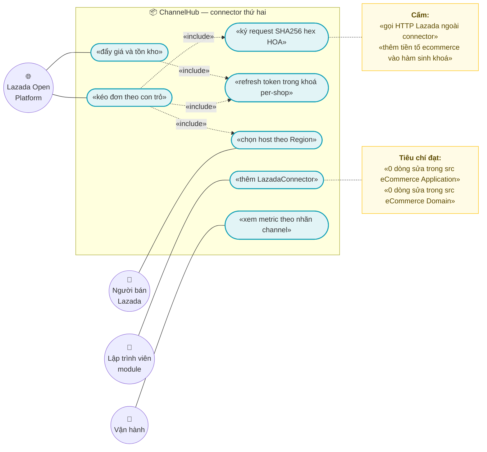
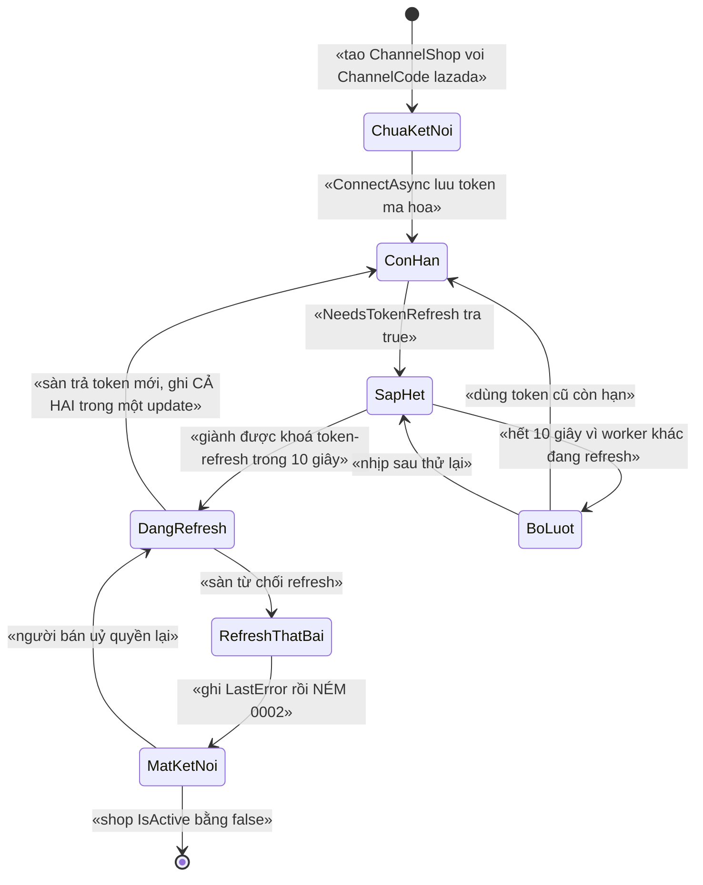
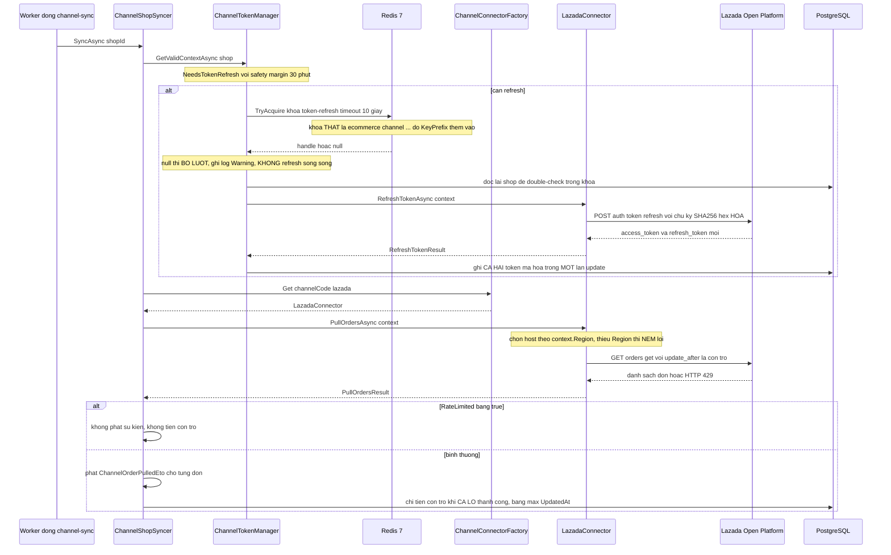

# `CHN-003` — Connector Lazada (chứng minh abstraction đúng)

| Thuộc tính | Nội dung |
|---|---|
| **Mã** | `CHN-003` |
| **Module** | **ChannelHub** — `modules/ChannelHub/eCommerce.ChannelHub.Domain` · `.Application` · `.Application.Contracts` · `.EntityFrameworkCore` |
| **Giai đoạn** | **GĐ4 — Tăng trưởng** (`docs/implementation-plan.md:115`, `:449`). Nền đã có sẵn từ Phase 0 + GĐ1 |
| **Ưu tiên** | **Must have** cho GĐ4 — *"Lazada: connector thứ hai — chứng minh abstraction `IChannelConnector` đúng (thêm sàn không sửa `Sales`)"* (`docs/implementation-plan.md:224`) |
| **Trạng thái** | 🟡 `Draft` — chờ review |
| **Người viết / người review** | *(điền)* / **Kiến trúc trưởng** |
| **Phiên bản / ngày** | `v0.1 — 13/10/2026` |
| **Tài liệu liên quan** | `docs/features/XC-003-khoa-phan-tan-quy-uoc.md` (khoá — **bắt buộc đọc §5.4**) · `docs/features/chn-002-connector-shopee.md` (connector thứ nhất, `F1`–`F9` **kế thừa sang đây**) · `docs/features/XC-002-outbox-inbox-chong-trung-su-kien.md` (idempotency) · `docs/features/XC-005-observability-log-metric.md` (log/metric) · `docs/features/XC-001-money-currency-lam-tron.md` (tiền/làm tròn) · `docs/features/XC-006-phan-loai-thue-gtgt.md` (thuế — **connector không được biết**) · `docs/features/XC-004-xac-thuc-phan-quyen-tenant.md` (phân quyền) · `CHN-001` (OAuth kết nối shop) · `CHN-004` (allotment) · `ACC-001` · `REP-002` · `docs/runtime-verification-report.md` |

---

## 0. Tóm tắt & quyết định thiết kế

**Tóm tắt:** `CHN-003` thêm **connector thứ hai** (`LazadaConnector`) vào ChannelHub. Giá trị của tài liệu này
**không** nằm ở việc "tích hợp thêm một sàn" — nó nằm ở chỗ **đây là phép thử của kiến trúc**: nếu thêm một sàn
mà **phải sửa `Sales`/`Orders`/schema DB**, thì abstraction `IChannelConnector` đã **sai**, và cái sai đó phải lộ ra
**trên giấy** chứ không phải sau khi đã viết 3 tháng code.

**Vì sao phải viết tài liệu này trước khi code:** `chứng minh abstraction đúng` là một **tuyên bố kiểm chứng được**,
không phải một nhận xét. Tài liệu này biến nó thành **NFR-CHN-003-011**: *thêm Lazada ⇒ **0 dòng** sửa trong
`src/eCommerce.Application/**` và `src/eCommerce.Domain/**`* — đo bằng `git diff --stat`. Và nó ghi rõ
**khe hở duy nhất** tìm được khi đọc code (xem §15.2 **G2**: `Region` nullable + host theo quốc gia), cùng
**cái bẫy chết người** mà `XC-003` §5.4 đã cảnh báo (tiền tố `ecommerce:` **không** được có trong hàm sinh khoá).

**Điểm xuất phát thật (đã đọc code, không viết theo trí nhớ):**

| Đã có thật | Bằng chứng (file thật) | Ý nghĩa với `CHN-003` |
|---|---|---|
| Abstraction `IChannelConnector` + `IChannelConnectorFactory` | `modules/ChannelHub/eCommerce.ChannelHub.Application.Contracts/Connectors/IChannelConnector.cs:95-114` · `:117-122` | Điểm mở rộng **đã tồn tại**; Lazada chỉ cần implement |
| Factory **đã có sẵn dòng cho Lazada, đang bị comment** | `Connectors/ChannelConnectorFactory.cs:23` (`// [LazadaConnector.Code] = typeof(LazadaConnector),`) | Chi phí đăng ký = **1 dòng** — đúng như thiết kế mong đợi |
| `ChannelShopContext` **đã có `Region`** | `IChannelConnector.cs:13` | Abstraction **đã lường trước** sàn đa quốc gia — nhưng Shopee **chưa dùng** |
| `Channel.Code = "lazada"` **đã được seed** | `src/eCommerce.DbMigrator/eCommerceDataSeedContributor.cs:30` | **Không cần seed mới**, chỉ cần bỏ comment factory |
| Khoá lock per-shop **đã có tên** cho mọi sàn (`channel:{channelCode}:{shopId}:…`) | `modules/ChannelHub/eCommerce.ChannelHub.Domain/ChannelHubConsts.cs:22-31` | Lazada **dùng lại** 3 khoá này; **không** thêm khoá mới |
| Tiền tố khoá thật do `KeyPrefix = "ecommerce:"` sinh ra (khoá thật `ecommerce:channel:…`) | `src/eCommerce.HttpApi.Host/eCommerceHttpApiHostModule.cs:115-128` (+ `XC-003` §5.4) | Hàm sinh khoá của module **KHÔNG** được chứa `ecommerce:` (nếu không ⇒ **tiền tố đôi**) |
| `Region` / `ExternalItemId` / `ExternalSku` / `LastSyncedAtUtc` / `LastError` — **đủ trường**, không cần cột mới | `Domain/Entities/ChannelEntities.cs:50, 131, 133, 69, 76` | **0 migration** cho Lazada |
| Metric đã có nhãn hữu hạn **`channel`** | `src/eCommerce.Domain.Shared/Observability/eCommerceMetrics.cs:64, 75-78` | Shopee/Lazada **so sánh được** trên cùng metric, **cấm** nhãn `shopId` (`:81-84`) |
| `ShopeeConnector` là **PoC** (`EnableLiveCalls = false`) và **chưa có** `HttpClient` nào được đăng ký | `Connectors/ShopeeConnector.cs:12-15, 80-87` · `ChannelHubOptions.cs:47` · grep `AddHttpClient` trong repo = **0** kết quả (ngoài comment `ShopeeConnector.cs:13`) | `CHN-003` **phải** giải bài "HTTP client" cho **cả hai** sàn, không chỉ Lazada (xem `ADR-06`) |
| Chữ ký Lazada đã được **khảo sát và ghi trong comment của interface** | `IChannelConnector.cs:91` — *"Lazada: sign = HEX HOA(HMAC-SHA256(app_secret, api_path + concat(sorted params) + body)); code chỉ dùng 1 lần, đổi token trong 30 phút"* | Có sẵn định hướng, **nhưng chưa có code** — xem §6.1 |

**Phạm vi:**
- ✅ **`LazadaConnector`** implement `IChannelConnector`: `PullOrdersAsync`, `PushListingAsync`, `RefreshTokenAsync`, `PingAsync`.
- ✅ **Thuật toán ký Lazada**: `api_path` + tham số **sắp xếp theo tên** + `HMAC-SHA256` + **hex HOA**; `sign_method=sha256`.
- ✅ **Chọn host theo quốc gia** (`Region`) — vì Lazada là sàn **đa quốc gia** (VN/SG/MY/PH/TH/ID).
- ✅ **Đăng ký 1 dòng** vào `ChannelConnectorFactory` + **1 dòng** DI + **1 section cấu hình**.
- ✅ **Test chứng minh abstraction**: quét mã nguồn chứng minh **0** tham chiếu `LazadaConnector` ngoài `ChannelConnectorFactory`/DI.
- ✅ **Đo "0 dòng sửa"** trong app (`NFR-CHN-003-011`).
- ✅ Khoá lock + metric + log theo đúng `XC-003`/`XC-005`.
- ✅ **Idempotency ở mọi biên vào** (theo `XC-002`) — dùng chung index đã có.

**Không nằm trong phạm vi:**
- ❌ **OAuth kết nối shop Lazada** (đổi `code` lấy token lần đầu) — thuộc **`CHN-001`** (`ConnectAsync` hiện nhận token **có sẵn** qua DTO: `src/eCommerce.Application/Channels/ChannelAppService.cs:70-125`).
- ❌ **Webhook/push của Lazada** — cần `IIdempotencyGuard` + bảng inbox nghiệp vụ của `XC-002`, hiện **chưa có trong code** (grep `IIdempotencyGuard` toàn repo = **0**). Ghi nhận ở §7.2, **không** triển khai ở `CHN-003`.
- ❌ **Allotment theo kênh** (chia tồn kho cho từng sàn) — thuộc **`CHN-004`**; ở đây chỉ **đọc** `ChannelListing.AllottedQuantity` (`ChannelEntities.cs:142`) và **tôn trọng**.
- ❌ **Tạo/sửa đơn nội bộ** khi nhận đơn sàn — ChannelHub chỉ **phát sự kiện** (`ChannelShopSyncer.cs:69-89`); việc tạo `Order` thuộc app/`SAL-005`.
- ❌ **Tính thuế GTGT** — connector **không được biết** thuế. Phân loại + thuế suất thuộc `XC-006`/module `Tax`; dòng ETO chỉ mang `UnitPrice`/`DiscountAmount` (`IChannelConnector.cs:19-27`).
- ❌ **Đối soát settlement / phí sàn** — thuộc `REC-002`.
- ❌ **Báo cáo doanh thu/lãi gộp** (`REP-002`, GĐ3) và **xuất liệu kế toán** (`ACC-001`, GĐ3): **chưa có file tài liệu trong `docs/features/`** (đã liệt kê toàn bộ thư mục: chỉ có `rep-001`, `rep-003`, không có `rep-002`, không có `acc-001`) ⇒ **chưa có tài liệu — kế hoạch GĐ3** (`docs/implementation-plan.md:437, 441`). `CHN-003` chỉ **đảm bảo dữ liệu kênh đủ để hai tài liệu đó dùng**, xem §10.
- ❌ **Bật `EnableLiveCalls` trên production** — cần credential + sandbox Lazada (xem §15.1 **Q1**).

### 0.1 Quyết định thiết kế (ADR ngắn)

| # | Quyết định | Phương án đã cân nhắc | Lý do chọn | Hệ quả |
|---|---|---|---|---|
| **ADR-01** | `LazadaConnector` là **một class riêng** implement `IChannelConnector`; **cấm** lớp base chung `MarketplaceConnectorBase` | (a) base class dùng chung cho mọi sàn · (b) **mỗi sàn một class độc lập** | Chữ ký **ngược nhau** giữa hai sàn — Shopee **hex thường** (`ShopeeConnector.cs:54` `ToLowerInvariant()`), Lazada **hex HOA** (`IChannelConnector.cs:91`). Timestamp cũng **khác đơn vị** (Shopee **giây** — `ShopeeConnector.cs:66`; Lazada **mili-giây** — xem §6.1). Base class dùng chung ⇒ **một trong hai sàn chắc chắn sai** và **không có lỗi biên dịch** | Trùng lặp ~40 dòng (gọi HTTP, retry) **được chấp nhận**; phần dùng chung chỉ được tách thành **helper không mang ngữ nghĩa ký** (ADR-07) |
| **ADR-02** | **Khoá lock dùng lại nguyên tên** `ChannelHubConsts.LockKeys.*`; **cấm** thêm khoá mới cho Lazada | (a) khoá riêng `…:lazada:…` · (b) **dùng `channelCode` làm biến** | Tên khoá **đã** tham số hoá theo `channelCode` (`ChannelHubConsts.cs:22-31`) ⇒ khoá per-shop đã tự phân biệt sàn. Thêm khoá mới = **hai nguồn sự thật** — đúng lỗi **F1 của `XC-003`** | **0 dòng sửa** trong `ChannelHubConsts.cs`; `TC-02` chứng minh `LockKeys` chỉ có **3** hàm sinh |
| **ADR-03** | 🚨 **Hàm sinh khoá của module TUYỆT ĐỐI không chứa tiền tố `ecommerce:`** | (a) viết `ecommerce:channel:…` trong consts cho "đúng tài liệu `XC-003` §5" · (b) **để `KeyPrefix` thêm** | `AbpDistributedLockOptions.KeyPrefix = "ecommerce:"` và ABP ghép **`KeyPrefix + name`** **không** có dấu phân cách (`eCommerceHttpApiHostModule.cs:115-128`). Chép nguyên bảng §5 của `XC-003` vào code ⇒ khoá thật thành **`ecommerce:ecommerce:channel:…`** ⇒ **lock không chặn gì** và **không có lỗi biên dịch** | `TC-01` **bắt buộc**: hàm sinh khoá **không** được chứa `ecommerce:`; **bảng §5 của `XC-003` mô tả khoá THẬT trong Redis**, không phải giá trị hàm trả về |
| **ADR-04** | **Host Lazada chọn theo `ChannelShop.Region`**; thiếu/rỗng ⇒ **NÉM LỖI**, **cấm** mặc định | (a) một `BaseUrl` cố định như Shopee (`ChannelHubOptions.cs:44`) · (b) **map `region → host`** + ném lỗi khi thiếu | Lazada là sàn **đa quốc gia**: `api.lazada.vn` / `.sg` / `.my` / `.ph` / `.th` / `.id`. Mặc định sai quốc gia ⇒ **đẩy giá/tồn sang shop nước khác** — lỗi **im lặng** nguy hiểm nhất của luồng này | `LazadaOptions` có `Regions: { "vn": "https://api.lazada.vn", … }`; `Region` trở thành **bắt buộc với shop Lazada** (`BR-005`); xem khe hở §15.2 **G2** |
| **ADR-05** | **`Region` lấy từ `ChannelShopContext.Region`**, **không** truyền thêm tham số vào interface | (a) thêm `Region` vào tham số method · (b) **dùng field đã có** | `ChannelShopContext.Region` **đã tồn tại** (`IChannelConnector.cs:13`) và `ChannelTokenManager.ToContext` **đã map** nó (`ChannelTokenManager.cs:140`) | **0 dòng sửa** trong interface ⇒ abstraction **đứng vững**; đây là bằng chứng mạnh nhất cho `NFR-011` |
| **ADR-06** | **HTTP qua `IHttpClientFactory` có đặt tên**, mỗi sàn một `HttpClient` | (a) `new HttpClient()` · (b) **`AddHttpClient("lazada")` + `HttpMessageHandler` bơm được** | `new HttpClient()` trong class transient ⇒ **socket exhaustion**; và **không test được** vì không thay được handler. Hiện repo **chưa có** `AddHttpClient` nào (grep = **0**) | Việc đăng ký `HttpClient` phục vụ **cả Shopee và Lazada** ⇒ **phải** làm ở `ChannelHubApplicationModule` (module-owned), **không** sửa Host; xem `BR-014` |
| **ADR-07** | Helper dùng chung **chỉ** cho phần **không mang ngữ nghĩa sàn**: escape RFC 3986, dựng query, đọc `Retry-After`, chuyển `float → decimal` | (a) helper chung cho cả **ký** · (b) **chỉ** helper vô nghĩa-về-sàn | Ký là chỗ **khác nhau** giữa các sàn (ADR-01). Đưa ký vào helper chung ⇒ sàn thứ ba sẽ **buộc** phải uốn theo | `Sign`/`BuildBaseString` ở **mỗi** connector; **cấm** gọi `Sign` của sàn này cho sàn kia (`BR-007`) |
| **ADR-08** | **Sắp xếp tham số theo TÊN (ordinal) rồi mới ghép** — thứ tự là **một phần của chữ ký** | (a) dùng thứ tự khai báo · (b) **sort tường minh** | Chữ ký Lazada = `api_path + concat(sorted name+value)`. Sai thứ tự ⇒ **mọi** request bị từ chối, nhưng chữ ký vẫn "sinh ra được" ⇒ lỗi **im lặng** | Tách `BuildSignString(...)` khỏi `Sign(...)` **cùng lý do** `ShopeeConnector.BuildBaseString` đã được tách (`ShopeeConnector.cs:57-61`) để **test được thứ tự** |
| **ADR-09** | **Tiền: `decimal` + làm tròn theo `XC-001`; `float`/`double` bị CẤM** | (a) giữ `float` như sàn trả · (b) **convert tường minh sang `decimal` ngay tại biên** | `ChannelOrderLineModel.UnitPrice`/`DiscountAmount` đã là `decimal` (`IChannelConnector.cs:25-26`), `ChannelListing.ChannelPrice` là `decimal(18,4)` (`ChannelHubDbContextModelCreatingExtensions.cs:66`). Nhưng **tài liệu Lazada mô tả `Price`/`Voucher`/`ShippingFee` là `float`** ⇒ **phải** convert tại biên | ⚠️ `Money` của `XC-001` **chưa có trong code** (grep `eCommerce.Kernel` / `record struct Money` = **0**) ⇒ `CHN-003` dùng **`decimal` trần + quy tắc làm tròn chép từ `XC-001` §6.1**, và **ghi nợ** chuyển sang `Money` khi Kernel ra đời (§15.2 **G6**) |
| **ADR-10** | **Con trỏ đồng bộ = `max(UpdatedAt)` của lô đã phát sự kiện thành công**; **cấm** gán `UtcNow` | (a) `now` khi lô rỗng/thành công · (b) **`max(UpdatedAt)`** | `ChannelShopSyncer.cs:95` hiện gán `pull.NewSyncCursorUtc ?? DateTime.UtcNow` ⇒ nhánh `?? UtcNow` **nhảy qua** mọi đơn có `UpdatedAt` nhỏ hơn `now` nhưng chưa kịp đọc (độ trễ ghi của sàn) ⇒ **mất đơn im lặng** | `LazadaConnector` **phải** trả `NewSyncCursorUtc = max(UpdatedAt)`; `BR-010`/`TC-09`; nhánh `?? UtcNow` cần sửa — **đây là thay đổi ở `ChannelShopSyncer` (module-owned, không phải app)** |
| **ADR-11** | **`PullOrdersResult` cần thêm tín hiệu "còn dữ liệu" (`HasMore`)** — Lazada phân trang `offset`/`limit` | (a) đoán theo `Orders.Count == MaxOrdersPerPull` · (b) **cờ tường minh** | Tài liệu Lazada (bản SellerCenter cũ) cảnh báo nguyên văn: *"if you do page through results, note that the list of orders might change during paging"*, `Limit` tối đa **100**, có `Offset` | ⏳ **chưa có trong code — kế hoạch GĐ4**: thêm `bool HasMore` vào `PullOrdersResult` (`IChannelConnector.cs:41-52`) — **tương thích ngược** (chỉ thêm property) ⇒ `ShopeeConnector` không phải sửa; xem §15.2 **G5** |
| **ADR-12** | **Không thêm entity/bảng/cột nào cho Lazada** | (a) bảng cấu hình riêng cho sàn · (b) **cấu hình ở `ChannelHubOptions`** | Mọi thứ Lazada cần **đã có**: `ChannelShop.Region`, `ExternalShopId`, `ChannelListing.ExternalItemId`/`ExternalSku`, token mã hoá (`ChannelEntities.cs:46, 50, 131, 133`). Thêm bảng ⇒ phải khai `DbSet` trên `eCommerceDbContext` (`eCommerceDbContext.cs:48-55` **đã ghi rõ** hệ quả nếu thiếu) ⇒ **phá vỡ** chính điều `CHN-003` muốn chứng minh | **0 migration · 0 `DbSet`**; `TC-23` chứng minh bằng cách quét migration/snapshot không đổi |

> 📌 Ghi lại cả phương án **BỊ LOẠI** và lý do — để 6 tháng sau không ai hỏi lại *"sao không làm một base class cho gọn"*.
> 🔍 **Mọi khẳng định về code trong tài liệu này đều kèm đường dẫn file thật.** Phần **chưa có trong code** đều ghi rõ
> **"chưa có trong code — kế hoạch GĐ4"**; phần không kiểm chứng được ghi **"chưa kiểm chứng được"**.

---

## 1. Use Case Specification

| Thuộc tính | Nội dung |
|---|---|
| **Use Case ID** | `CHN-003` |
| **Use Case Name** | Thêm sàn Lazada **chỉ bằng một connector mới**, không sửa tầng nghiệp vụ |
| **Description** | *"Là kiến trúc trưởng, tôi muốn thêm sàn Lazada mà **không phải sửa** `Sales`/`Orders`/schema DB, để chứng minh `IChannelConnector` là abstraction **đúng** — và để sàn thứ ba, thứ tư chỉ còn là việc viết một class."* |
| **Actor(s)** | **Kiến trúc trưởng / lập trình viên** (người thêm connector) · **Người bán trên Lazada** (uỷ quyền shop) · **Hệ thống** (`ChannelSyncSupervisorWorker` → worker động → `ChannelShopSyncer` → `ChannelTokenManager` → `ChannelConnectorFactory` → `LazadaConnector`) · **Lazada Open Platform** (nguồn & đích) · **Vận hành** (xem lỗi/rate limit) |
| **Priority** | **Must have** (GĐ4) |
| **Trigger** | (a) nhịp worker động của shop (mặc định **300 s** — `ChannelHubOptions.cs:10`); (b) người dùng bấm **chạy tay** (`SyncNowAsync` — `ChannelAppService.cs:143-187`); (c) token sắp hết hạn ⇒ refresh; (d) sự kiện nội bộ **tồn kho/giá thay đổi** ⇒ cần push (**phụ thuộc `INV-*`/`PRC-*`**, xem §7.2) |
| **Pre-Condition(s)** | • **Tenant hiện tại** (`TenantId`) — `ChannelShop` là `IMultiTenant` (`ChannelEntities.cs:38-40`).<br>• **`Channel.Code = "lazada"` đã tồn tại** — **đã seed sẵn** (`eCommerceDataSeedContributor.cs:30`), `Code` **unique** (`ChannelHubDbContextModelCreatingExtensions.cs:27`).<br>• **`Region` của shop Lazada có giá trị** (`"vn"`, `"sg"`, …) — entity cho phép `null` (`ChannelEntities.cs:50`), và **`ConnectAsync` hiện KHÔNG kiểm tra** (`ChannelAppService.cs:92`) ⇒ xem **G2**.<br>• **Shop `IsActive = true`** và có `AccessTokenEncrypted`/`RefreshTokenEncrypted` (`ChannelEntities.cs:56-59`).<br>• **Connector đã đăng ký**: `ChannelConnectorFactory.IsSupported("lazada")` = `true` — **hiện là `false`** vì dòng đăng ký **đang bị comment** (`ChannelConnectorFactory.cs:23`).<br>• **Redis 7** sẵn sàng; Redis chết ⇒ **lock vô hiệu nhưng app vẫn chạy** (`AbortOnConnectFail = false` — `eCommerceHttpApiHostModule.cs:141`).<br>• **`ChannelCode` = `"lazada"`** tham gia **mọi** khoá lock và **mọi** khoá idempotency — **không** có nhánh `if (channelCode == "lazada")` ở tầng nghiệp vụ. |
| **Post-Condition(s)** | • `LazadaConnector` phục vụ **đủ 4 method** của `IChannelConnector` (`IChannelConnector.cs:95-114`).<br>• **`0` dòng** sửa trong `src/eCommerce.Application/**`, `src/eCommerce.Domain/**`, `src/eCommerce.EntityFrameworkCore/**` (đo bằng `git diff --stat`) — `NFR-011`.<br>• Đơn kéo về ⇒ phát `ChannelOrderPulledEto` (`ChannelEvents.cs:16-30`) **đúng một lần về mặt nghiệp vụ** nhờ index `(TenantId, ChannelCode, ExternalOrderId)` (`eCommerceDbContext.cs:184-186`).<br>• Mọi lỗi của shop **có** `ChannelShop.LastError` (`ChannelShopSyncer.cs:109`).<br>• **Không** có khoá nào bị **tiền tố đôi** trong Redis. |
| **Basic Flow** | 1. Lập trình viên thêm **5 điểm chạm** ở §6.2 (**1 file mới + 4 dòng sửa**).<br>2. `ChannelSyncSupervisorWorker` mỗi nhịp đọc shop `IsActive` và **chỉ** `AddAsync` khi worker **chưa có** hoặc **nhịp đã đổi** (`ChannelSyncSupervisorWorker.cs:81-85`) ⇒ worker động tên `channel-sync:lazada:{externalShopId}` (`:123`) **chạy thật**.<br>3. Worker gọi `ChannelShopSyncer.SyncAsync(shopId, ct)` (`ChannelSyncSupervisorWorker.cs:96`).<br>4. `ChannelTokenManager.GetValidContextAsync` kiểm tra hạn token (`ChannelTokenManager.cs:62-65`); nếu cần refresh ⇒ giành khoá `ChannelHubConsts.LockKeys.ChannelTokenRefresh("lazada", externalShopId)` với timeout `LockTimeoutSeconds` = **10 s** (`ChannelHubOptions.cs:22`) **và double-check** bên trong khoá (`ChannelTokenManager.cs:86-91`).<br>5. `ChannelConnectorFactory.Get("lazada")` trả `LazadaConnector` (`ChannelConnectorFactory.cs:30-40`).<br>6. `LazadaConnector.PullOrdersAsync(context)` **chọn host theo `context.Region`** (ADR-04), ký request **hex HOA** (ADR-08), gọi `GET /orders/get` với `update_after` = con trỏ.<br>7. Ánh xạ sang `ChannelOrderModel` (`IChannelConnector.cs:29-39`) — **không** tạo `Order`, **không** tính thuế.<br>8. Mỗi đơn ⇒ phát `ChannelOrderPulledEto` (`ChannelShopSyncer.cs:69-89`).<br>9. Cả lô thành công ⇒ tiến con trỏ bằng `NewSyncCursorUtc` = `max(UpdatedAt)` (ADR-10). |
| **Alternative Flow** | **A1 — HTTP 429 (vượt quota)**: connector trả `RateLimited = true`; `ChannelShopSyncer` **không** phát sự kiện, **không** tiến con trỏ, ghi log `Warning` (`ChannelShopSyncer.cs:58-64`).<br>**A2 — Lô trả về đủ `limit`** ⇒ `HasMore = true` ⇒ **không** tiến con trỏ tới hết lô; nhịp sau đọc tiếp (**ADR-11**, ⏳ chưa có trong code).<br>**A3 — Không giành được khoá token-refresh** ⇒ `ChannelTokenManager` trả context **cũ** + log `Warning`, **bỏ lượt** (`ChannelTokenManager.cs:74-83`) — **cấm** refresh song song.<br>**A4 — Lazada trả `updated_at` **trùng** giữa hai nhịp** ⇒ đơn được phát lại ⇒ **idempotency** hấp thụ (`BR-012`) — đây là **hệ quả đã biết** của con trỏ `>=`.<br>**A5 — Push tồn/giá**: đường **riêng**, trong khoá `…:stock-push`, **không** nằm trong `SyncAsync` (kế thừa `CHN-002` **D10**). |
| **Exception Flow** | **E1:** shop Lazada **thiếu `Region`** ⇒ **NÉM** `BusinessException` `eCommerce:Channel:0009` (**không** mặc định quốc gia) — `BR-005`.<br>**E2:** `ChannelConnectorFactory.Get` gặp kênh **chưa hỗ trợ** ⇒ hiện ném `ArgumentException` (`ChannelConnectorFactory.cs:34-37`) — **phải** đổi thành `BusinessException` `eCommerce:Channel:0004` (kế thừa `CHN-002` **F8**).<br>**E3:** refresh token thất bại ⇒ ghi `LastError` rồi **NÉM** `eCommerce:Channel:0002` (`ChannelTokenManager.cs:96-105`).<br>**E4:** `4xx` nghiệp vụ ⇒ **không** retry; ghi `LastSyncError` + `MarkError` (`ChannelEntities.cs:171-175`) — ⚠️ `MarkError` hiện **chưa có nơi gọi** (`CHN-002` **F1/F3**).<br>**E5:** chữ ký sai do lệch thứ tự tham số ⇒ sàn trả lỗi chữ ký ⇒ **không** retry (lỗi **lập trình**, phải lộ ở CI bằng `TC-03`).<br>**E6:** `EnableLiveCalls = true` khi chưa code xong ⇒ **`NotImplementedException`** — giữ **cùng khuôn** với `ShopeeConnector.cs:94-95, 112, 133, 144` (cố ý).<br>**E7:** `Region` không có trong map host ⇒ **NÉM** `eCommerce:Channel:0009` kèm `WithData("Region", …)` — **cấm** rơi về host mặc định. |
| **Business Rules** | • **BR-CHN-003-001**: **Mọi** lời gọi HTTP Lazada **phải** đi qua `IChannelConnector` của module ChannelHub; **cấm** gọi HTTP sàn từ app service, worker, hay module khác (kế thừa `BR-CHN-002-001`).<br>• **BR-CHN-003-002**: **Mọi** lần refresh token **phải** nằm trong khoá `ChannelHubConsts.LockKeys.ChannelTokenRefresh(channelCode, shopId)` **và** phải **double-check** trong khoá trước khi gọi sàn.<br>• **BR-CHN-003-003**: **Mọi** lần push tồn/giá **phải** nằm trong khoá `…:stock-push`; **cấm** acquire **lồng** cùng tên khoá (`XC-003` D6 — lock **không** reentrant).<br>• **BR-CHN-003-004**: Tên khoá **chỉ** sinh từ `ChannelHubConsts.LockKeys.*`; 🚨 **cấm** chuỗi `ecommerce:` **bên trong** hàm sinh khoá (tiền tố do `AbpDistributedLockOptions.KeyPrefix` thêm — `XC-003` §5.4, `eCommerceHttpApiHostModule.cs:127`).<br>• **BR-CHN-003-005**: Host Lazada **phải** chọn theo `ChannelShop.Region`; `Region` **rỗng/không có trong map** ⇒ **NÉM LỖI**; **cấm** mặc định quốc gia.<br>• **BR-CHN-003-006**: `timestamp` của Lazada là **mili-giây** (13 chữ số); **cấm** dùng chung hàm timestamp với Shopee (**giây**).<br>• **BR-CHN-003-007**: Chữ ký Lazada = `HMAC-SHA256(app_secret, api_path + concat(sorted(name+value)))`, **hex HOA**; `sign_method=sha256`; **cấm** tái sử dụng `Sign` của connector khác.<br>• **BR-CHN-003-008**: Tham số đưa vào chuỗi ký **phải** sắp xếp theo **tên** (ordinal) và **phải** escape theo **RFC 3986**; **cấm** dựa vào thứ tự khai báo.<br>• **BR-CHN-003-009**: **Mọi** trường tiền (`UnitPrice`, `DiscountAmount`, `ShippingFee`, `ChannelDiscount`, giá push) **phải** là `decimal`; **cấm** `double`/`float`; giá trị `float` từ sàn **phải** convert **tường minh** tại biên và **cấm** so tiền bằng `==` (`XC-001` BR-003/BR-008).<br>• **BR-CHN-003-010**: **Chỉ** tiến con trỏ **sau khi** phát thành công sự kiện cho **cả lô**; con trỏ = **`max(UpdatedAt)` của lô**; **cấm** gán `UtcNow`; **cấm** cho con trỏ đi lùi.<br>• **BR-CHN-003-011**: Khi lô trả về đủ `limit` ⇒ **phải** báo `HasMore = true` và **không** coi là "đã hết đơn" (⏳ `HasMore` **chưa có trong code — kế hoạch GĐ4**, `ADR-11`).<br>• **BR-CHN-003-012**: `HTTP 429` ⇒ **phải** trả `RateLimited = true`; **cấm** retry dồn trong cùng nhịp; **cấm** tiến con trỏ khi bị rate limit.<br>• **BR-CHN-003-013**: **Mọi** biên vào (webhook đơn, handler `ChannelOrderPulledEto`, job push) **phải** idempotent qua `IIdempotencyGuard` **trước** mọi side effect (`XC-002` BR-004) — ⚠️ `IIdempotencyGuard` **chưa có trong code** (grep = 0) ⇒ **phụ thuộc cứng** cho webhook.<br>• **BR-CHN-003-014**: Khoá chống trùng đơn sàn **phải** là `(TenantId, ChannelCode, ExternalOrderId)`; dòng đơn `(OrderId, ExternalLineId)` — **khớp** index đã có (`eCommerceDbContext.cs:184-186`, `:206-208`).<br>• **BR-CHN-003-015**: Cùng khoá chống trùng + **khác** `PayloadHash` ⇒ **NÉM** `eCommerce:Messaging:0002`; **cấm** ghi đè (`XC-002` BR-006).<br>• **BR-CHN-003-016**: Webhook **chỉ** được xử lý khi **đã xác thực chữ ký**; **cấm** đọc payload trước khi xác thực (⏳ chưa triển khai — thuộc phạm vi webhook, §7.2).<br>• **BR-CHN-003-017**: **Cấm** retry lỗi nghiệp vụ `4xx`; **chỉ** retry `408`/`429`/`5xx`/lỗi mạng, tối đa theo cấu hình, có backoff (**cấm** retry vô hạn).<br>• **BR-CHN-003-018**: HTTP **phải** qua `IHttpClientFactory` có đặt tên; **cấm** `new HttpClient()` trong connector (ADR-06).<br>• **BR-CHN-003-019**: `[Authorize]` ở **cấp class**; tên permission lấy từ **hằng số** (`eCommerceConsts.Permissions.Channels.*`); **cấm** magic string.<br>• **BR-CHN-003-020**: **Cấm** log token/secret (kể cả bản mã hoá); log **phải** có cấu trúc + `CorrelationId`; **cấm** `Console.Write*` (`XC-005` BR-005/BR-007).<br>• **BR-CHN-003-021**: Mọi thao tác ghi **phải** qua Unit of Work của ABP; ghi **cả** access token **và** refresh token trong **một** lần update (`ChannelTokenManager.cs:108-114`).<br>• **BR-CHN-003-022**: Metric **phải** lấy tên từ `eCommerceMetricNames` và nhãn **phải** nằm trong `eCommerceMetricTags.Allowed`; **cấm** nhãn `shopId`/`orderId`/`sku` (`eCommerceMetrics.cs:75-84`).<br>• **BR-CHN-003-023**: Connector **cấm** biết **thuế**: không đọc/không tính `TaxRate`/`TaxAmount`; phân loại thuế **chỉ** thuộc `XC-006`/module `Tax`.<br>• **BR-CHN-003-024**: **Cấm** truy vấn nặng trên DB giao dịch cho mục đích **báo cáo/sức khoẻ kênh**; dữ liệu tổng hợp **phải** đi qua read-model (`REP-001`/`REP-002`) — connector chỉ được đọc theo khoá chính/index đã có (`ChannelHubDbContextModelCreatingExtensions.cs:48, 51, 69, 72`).<br>• **BR-CHN-003-025**: **Một phiên bản ABP duy nhất** (`10.7.0` — `Directory.Packages.props:22-82`); thêm Lazada **cấm** thêm gói ABP hay nâng version riêng lẻ. |
| **Non-Functional Requirement** | • **NFR-CHN-003-001**: Một nhịp pull (≤ `MaxOrdersPerPull` = **50** — `ChannelHubOptions.cs:19`, không có đơn mới) p95 **< 3 s**.<br>• **NFR-CHN-003-002**: **0** lần refresh token song song cho cùng một shop (2 tiến trình + Redis thật).<br>• **NFR-CHN-003-003**: **0** khoá bị **tiền tố đôi**; **100 %** khoá của kênh khớp `ecommerce:channel:…` khi grep (`XC-003` NFR-006).<br>• **NFR-CHN-003-004**: **0** `double`/`float` trong model/ETO/connector của kênh (test **reflection**).<br>• **NFR-CHN-003-005**: Tỉ lệ nhịp trả `RateLimited` **< 5 %**/ngày bình thường.<br>• **NFR-CHN-003-006**: **100 %** log của connector có `CorrelationId`; **0** dòng chứa token.<br>• **NFR-CHN-003-007**: Chữ ký sinh ra **luôn** đúng định dạng `^[0-9A-F]{64}$` và **ổn định** với cùng input (vector test cố định).<br>• **NFR-CHN-003-008**: **0** request gửi lại cho lỗi `4xx` (đếm bằng `HttpMessageHandler` giả).<br>• **NFR-CHN-003-009**: `channel_sync_failed_total` **được phát thật** từ ChannelHub với nhãn `channel` ∈ `Allowed` (hôm nay: hằng số + counter **đã có** — `eCommerceMetrics.cs:29, 149-150`; **chưa có nơi phát** — kế thừa `CHN-002` **F9**).<br>• **NFR-CHN-003-010**: Hàng rào DB: chèn 2 lần cùng `(TenantId, ChannelCode, ExternalOrderId)` ⇒ **DB chặn** (kể cả `TenantId = NULL` — nhờ `NULLS NOT DISTINCT`, `Migrations/20261013024226_Fix_NullableTenantId_UniqueIndexes.cs:70-76`).<br>• **NFR-CHN-003-011** 🎯: **Thêm Lazada ⇒ 0 dòng sửa trong `src/eCommerce.Application/**` và `src/eCommerce.Domain/**`** — đo bằng `git diff --stat` trên **đúng** PR của `CHN-003`. |

---

## 2. Sơ đồ Use Case



---

## 3. Sơ đồ trạng thái — vòng đời token/uỷ quyền của shop Lazada

> Chọn **vòng đời token/uỷ quyền của shop** làm state machine của tài liệu này (khác `CHN-002` — tài liệu đó chọn
> `ChannelListing.Status`), vì Lazada có **thời hạn token khác Shopee** và đây là trạng thái **duy nhất** mà
> `CHN-003` thực sự tác động. Trạng thái `ChannelListing.Status` **không** thuộc phạm vi tài liệu này
> (thuộc `CHN-002`/`CHN-004`).
>
> ⚠️ **Sự thật về code hiện tại:** trạng thái này **không** là enum mà là **tổ hợp trường** trên `ChannelShop`:
> `AccessTokenExpiresAtUtc`, `RefreshTokenExpiresAtUtc`, `AuthorizationExpiresAtUtc`, `LastError`, `IsActive`
> (`ChannelEntities.cs:61-76`), cộng hàm `NeedsTokenRefresh(nowUtc, safetyMargin)` (`ChannelEntities.cs:112-113`).
> ⇒ **Không có** state machine tường minh, và **chuyển trạng thái sai KHÔNG ném lỗi** — vi phạm **quy ước #11**
> (state machine phải ném lỗi). Đây là **phát hiện G4** (§15.2) và là **nợ thiết kế** phải trả ở GĐ4.



**Bảng chuyển trạng thái & guard (mọi chuyển sai **phải ném lỗi**, không im lặng):**

| # | Từ → Sang | Guard (điều kiện cho phép) | Hành động kèm theo | Nếu guard sai thì? |
|---|---|---|---|---|
| 1 | `[*]` → `ChuaKetNoi` | `ConnectAsync` với `ChannelCode = "lazada"` **và** `IsSupported("lazada") = true` | Ghi `ChnChannelShops`; token **mã hoá** (`ChannelAppService.cs:97-103`) | `IsSupported` = `false` ⇒ hiện ném `ArgumentException` (`ChannelConnectorFactory.cs:34-37`) — **phải** đổi thành `eCommerce:Channel:0004` |
| 2 | `ChuaKetNoi` → `ConHan` | Có `AccessTokenEncrypted` **và** `Region` **hợp lệ trong map host** | Lưu `Region`; `ChannelShopContext.Region` được map (`ChannelTokenManager.cs:140`) | 🚨 `Region` rỗng ⇒ **NÉM** `eCommerce:Channel:0009` (**E1**) — **cấm** mặc định quốc gia |
| 3 | `ConHan` → `SapHet` | `NeedsTokenRefresh(now, 30 phút)` = `true` (`ChannelHubOptions.cs:16`) | — | Token hết hạn mà không refresh ⇒ mọi call trả `401`/lỗi token ⇒ phải ném `0002` |
| 4 | `SapHet` → `DangRefresh` | Giành được khoá `…:token-refresh` **trong 10 s** | Gọi `RefreshTokenAsync`; **double-check** trong khoá (`ChannelTokenManager.cs:86-91`) | Không giành được ⇒ sang `BoLuot` + log `Warning` (**bắt buộc** thêm metric `lock_skipped_total` — `XC-003` BR-010) |
| 5 | `DangRefresh` → `ConHan` | Sàn trả `Success && AccessToken != null` | Ghi **cả hai** token trong **một** update (`ChannelTokenManager.cs:108-114`); phát `ChannelShopTokenRefreshedEto` (`:116-124`) | `Success = false` ⇒ sang `RefreshThatBai` |
| 6 | `RefreshThatBai` → `MatKetNoi` | — | `LastError = result.Error`; **NÉM** `BusinessException eCommerce:Channel:0002` (`ChannelTokenManager.cs:96-105`) | **Cấm** nuốt lỗi rồi đi tiếp (shop sẽ "chết im lặng") |
| 7 | `MatKetNoi` → `DangRefresh` | Người bán uỷ quyền lại (thuộc `CHN-001`) | Ghi token mới | ⚠️ `AuthorizationExpiresAtUtc` **được ghi nhưng chưa bao giờ đọc** ⇒ cần job cảnh báo (kế thừa `CHN-002` **F7**) |
| 8 | `BoLuot` → `ConHan` | Token cũ **vẫn còn hạn** sau safety margin | Dùng token cũ cho nhịp này | Nếu token cũ **đã hết hạn** ⇒ call sàn thất bại ⇒ phải **NÉM** `0002`, **cấm** im lặng |
| 9 | `MatKetNoi` → `[*]` | `IsActive = false` (`ChannelSyncSupervisorWorker.cs:109-120` huỷ worker) | Bản ghi **giữ nguyên** để đối soát | — |

> ⚠️ **Trạng thái nguy hiểm nhất là `BoLuot`:** trông "vô hại" (chỉ bỏ một nhịp) nhưng **hôm nay nó chỉ log
> `Warning` mà không có metric** (`ChannelTokenManager.cs:78-80`). Với Lazada — nơi **access token sống lâu hơn
> Shopee** (xem §6.1) — số nhịp bị bỏ có thể **nhiều** hơn, và nếu token hết hạn đúng lúc đó thì shop
> **ngừng đồng bộ im lặng**. Vì vậy `BR-002` **bắt buộc** đi kèm metric `lock_skipped_total{module}`.

---

## 4. Sequence Diagram & luồng dữ liệu

### 4.1 Sequence — một nhịp đồng bộ shop Lazada (có refresh token + chọn host theo `Region`)



### 4.2 DFD — đường đi một đơn Lazada (bảng, vì đã dùng hết ngân sách 3 sơ đồ Mermaid)

| # | Bước | Vào | Ra | Nơi ghi | Nguồn (code thật) |
|---|---|---|---|---|---|
| 1 | Supervisor quét shop | `ChnChannelShops` (`IsActive`) | worker động `channel-sync:lazada:{shopId}` | bộ nhớ (`RegisteredWorkers`) | `ChannelSyncSupervisorWorker.cs:54, 81-105, 123` |
| 2 | Token | `ChannelShop` | `ChannelShopContext` (token **plaintext** trong RAM) | `ChnChannelShops` (bản **mã hoá**) | `ChannelTokenManager.cs:134-148` · `ChannelEntities.cs:56-59` |
| 3 | Chọn connector | `ChannelCode = "lazada"` | `LazadaConnector` | — | `ChannelConnectorFactory.cs:18-25, 30-40` |
| 4 | Chun bị request | `context.Region` + options | host Lazada của **đúng quốc gia** | — | `IChannelConnector.cs:13` · `ChannelHubOptions.cs` (⏳ `LazadaOptions` **chưa có**) |
| 5 | Pull đơn | con trỏ `LastSyncedAtUtc` (`update_after`) | `PullOrdersResult` | — | `ChannelEntities.cs:69` · `ChannelShopSyncer.cs:56` |
| 6 | Phát sự kiện | `ChannelOrderModel` | `ChannelOrderPulledEto` | `AbpEventOutbox` (cùng transaction) | `ChannelShopSyncer.cs:69-89` · `ChannelEvents.cs:16-30` |
| 7 | Tiến con trỏ | `NewSyncCursorUtc` = `max(UpdatedAt)` | `LastSyncedAtUtc` | `ChnChannelShops` | `ChannelShopSyncer.cs:95-97` |
| 8 | Push tồn/giá *(đường riêng)* | `ChannelListing` + tồn kho | `PushListingResult` | `ChnChannelListings` | `IChannelConnector.cs:54-72` · `ChannelEntities.cs:117-175` |
| 9 | Xử lý tại app *(ngoài ChannelHub)* | `ChannelOrderPulledEto` | `OrdOrders` + `OrdOrderLines` | DB giao dịch | `eCommerceDbContext.cs:162-209` · **app subscribe** (không thuộc module) |

> 🎯 **Điểm mấu chốt của DFD:** bước 3 và 4 là **toàn bộ** chỗ "biết Lazada" trong hệ thống. Mọi bước còn lại
> **không** biết sàn nào — đây chính là nội dung cần chứng minh của `CHN-003`.

---

## 5. Mô hình dữ liệu

### 5.1 Bảng đã có trong code — **KHÔNG tạo bảng mới** (ADR-12)

| Bảng | Entity | Trường mà Lazada **dùng** | Đủ cho Lazada? | Nguồn |
|---|---|---|---|---|
| `ChnChannels` | `Channel` | `Code` (**unique**), `Type`, `IsActive`, `HoldsInventory` | ✅ dòng `"lazada"` **đã seed** | `ChannelEntities.cs:9-32` · `ChannelHubDbContextModelCreatingExtensions.cs:18-28` · `eCommerceDataSeedContributor.cs:30` |
| `ChnChannelShops` | `ChannelShop` | `ChannelCode`, `ExternalShopId`, **`Region`**, `AccessTokenEncrypted`, `RefreshTokenEncrypted`, `AccessTokenExpiresAtUtc`, `RefreshTokenExpiresAtUtc`, `AuthorizationExpiresAtUtc`, `LastSyncedAtUtc`, `LastError`, `PushStatus`, `SyncIntervalSeconds` | ✅ **đủ** — không cần cột mới | `ChannelEntities.cs:38-114` · `ChannelHubDbContextModelCreatingExtensions.cs:30-52` |
| `ChnChannelListings` | `ChannelListing` | `ProductVariantId`, `InternalSku`, `ExternalItemId`, `ExternalSku`, `ChannelPrice` (**decimal 18,4**), `AllottedQuantity`, `Status`, `LastSyncError` | ✅ **đủ** | `ChannelEntities.cs:117-175` · `ChannelHubDbContextModelCreatingExtensions.cs:54-73` |
| `OrdOrders` | `Order` (app) | `ChannelCode`, `ChannelShopId`, `ExternalOrderId` | ✅ **không đổi** | `eCommerceDbContext.cs:162-192` |
| `OrdOrderLines` | `OrderLine` (app) | `ExternalLineId`, `UnitPrice`, `DiscountAmount` | ✅ **không đổi** | `eCommerceDbContext.cs:194-209` |

**Ba unique index là hàng rào chống trùng thật** (không phải lock — `XC-003` D2):

| Index | Bảng | Ý nghĩa với `CHN-003` |
|---|---|---|
| `(TenantId, ChannelCode, ExternalShopId)` | `ChnChannelShops` | một shop của sàn chỉ kết nối **một lần** trong một tenant — **dùng chung** cho Shopee/Lazada nhờ có `ChannelCode` (`ChannelHubDbContextModelCreatingExtensions.cs:48`) |
| `(TenantId, ChannelCode, ExternalOrderId)` **filtered** `ExternalOrderId IS NOT NULL` | `OrdOrders` | đơn Lazada gửi trùng (pull lặp / webhook) **không** tạo 2 đơn (`eCommerceDbContext.cs:184-186`) |
| `(OrderId, ExternalLineId)` **filtered** `ExternalLineId IS NOT NULL` | `OrdOrderLines` | gửi trùng **không** nhân đôi dòng đơn (`eCommerceDbContext.cs:206-208`) |
| `(TenantId, ChannelShopId, ProductVariantId)` | `ChnChannelListings` | một biến thể chỉ map **một lần** cho một shop (`ChannelHubDbContextModelCreatingExtensions.cs:69`) |

> 🎯 **Đây là câu trả lời cho `XC-003` D2** (*"bỏ lock đi, DB có chặn không?"*) **trong bối cảnh đa sàn:**
> **CÓ** — và **quan trọng hơn**: cả 4 index **đều đã có `ChannelCode` hoặc `ChannelShopId`**, tức là **thiết kế
> từ đầu đã lường trước nhiều sàn**. Thêm Lazada **không** phải sửa một index nào ⇒ bằng chứng dữ liệu cho
> `NFR-CHN-003-011`.
>
> ⚠️ Cả ba index có `TenantId` ⇒ **phải** giữ `NULLS NOT DISTINCT`; nếu không, chúng **mất tác dụng** khi
> `TenantId = NULL` — đúng lỗi **F1/C4** của `XC-004`, **đã sửa** cho `ChnChannelShops` + `ChnChannelListings`
> (`Migrations/20261013024226_Fix_NullableTenantId_UniqueIndexes.cs:70-76`). Trạng thái `OrdOrders`/`OrdOrderLines`:
> **chưa kiểm chứng được** trong phạm vi `CHN-003` (cần đọc migration tương ứng) — **ghi lại để review**.

**Index phục vụ truy vấn của worker** (đã có, dùng chung cho mọi sàn):

| Index | Cột | Mục đích | Nguồn |
|---|---|---|---|
| INDEX | `(IsActive, ChannelCode)` | supervisor quét shop đang hoạt động — **có `ChannelCode`** nên Lazada dùng chung | `ChannelHubDbContextModelCreatingExtensions.cs:51` |
| INDEX | `(ChannelShopId, ExternalItemId)` | tra ngược từ `item_id` của sàn về SKU nội bộ khi nhận webhook | `ChannelHubDbContextModelCreatingExtensions.cs:72` |

### 5.2 Trường **cần thêm** — chưa có trong code — kế hoạch GĐ4

| # | Trường / thay đổi | Loại | Vì sao cần | Trạng thái |
|---|---|---|---|---|
| 1 | `LazadaOptions` (`AppKey`, `AppSecret`, `Regions: Dictionary<string,string>`, `EnableLiveCalls`, `MaxAttempts`, `TimeoutSeconds`) | **cấu hình**, không phải DB | Lazada cần `app_key`/`app_secret` và **host theo quốc gia**; hiện `ChannelHubOptions` **chỉ có `Shopee`** (`ChannelHubOptions.cs:25, 28-48`) và `appsettings.json` **chỉ có section `Shopee`** (`appsettings.json:8-20`) | ⏳ **chưa có trong code — kế hoạch GĐ4** |
| 2 | `PullOrdersResult.HasMore` (`bool`) | **code**, không phải DB | Tín hiệu "còn dữ liệu" cho phân trang `offset`/`limit` của Lazada — `ADR-11`, `BR-011` | ⏳ **chưa có trong code — kế hoạch GĐ4** |
| 3 | `ChannelShop.AuthorizationExpiresAtUtc` **được đọc** (job nhắc hạn uỷ quyền) | code | Với Lazada, refresh token có hạn **hữu hạn** ⇒ hết hạn uỷ quyền ⇒ shop chết. Hôm nay trường này **chỉ được ghi** (`ChannelAppService.cs:93, 110`), **chưa chỗ nào so sánh** (kế thừa `CHN-002` **F7**) | ⏳ **chưa có trong code — kế hoạch GĐ4** |
| 4 | Cột `WebhookSecret` **hoặc** secret ở `LazadaOptions` | DB **hoặc** cấu hình | Xác thực chữ ký webhook Lazada — **quyết định theo `Q4`** (nếu là secret **một app** thì để cấu hình) | ⏳ **chưa có trong code — kế hoạch GĐ4** |
| 5 | Bảng inbox nghiệp vụ `InboxRecords` | thuộc module `Messaging` | Chống trùng webhook theo `(TenantId, EventType, IdempotencyKey)` (`XC-002` BR-005) | ⏳ **chưa có trong code** — `XC-002` là **phụ thuộc CỨNG** trước khi làm webhook |

> ⚠️ **`InboxRecords` là phụ thuộc CỨNG, không phải "nice to have"** — `XC-002` D3 đã chứng minh `AbpEventInbox`
> của ABP **không có `TenantId`** và `MessageId` **không unique** ⇒ nếu làm webhook Lazada trước khi có
> `InboxRecords` thì webhook gửi trùng sẽ **tạo 2 đơn** và **không có lỗi nào**. Vì vậy webhook **nằm ngoài**
> phạm vi `CHN-003`.

---

## 6. Hợp đồng API

### 6.1 Hợp đồng với Lazada (ra ngoài) — **chưa có trong code — kế hoạch GĐ4**

> ⚠️ **Mức độ tin cậy của bảng này (nói thẳng):**
> **a)** Định hướng chữ ký **đã có trong repo**: `IChannelConnector.cs:91` — *"Lazada: sign = HEX HOA(HMAC-SHA256(app_secret, api_path + concat(sorted params) + body)); code chỉ dùng 1 lần, đổi token trong 30 phút"*.
> **b)** Chi tiết còn lại lấy từ **nguồn ngoài** và **chưa kiểm chứng trên sandbox Lazada**:
> trang tài liệu chính thức [open.lazada.com](https://open.lazada.com/apps/doc/api) là **ứng dụng JS** ⇒
> `web_fetch` **không đọc được nội dung** (đã thử: HTTP 200 nhưng body rỗng). Nguồn thay thế đã đọc được:
> gói cộng đồng [`lazada-open-api`](https://github.com/tudinhacoustic/lazada-open-api) (ví dụ chữ ký + response token),
> và tài liệu **SellerCenter API cũ** [`GetOrders`](https://lazada-sellercenter.readme.io/docs/getorders) /
> [`Signing requests`](https://lazada-sellercenter.readme.io/docs/signing-requests).
> **c)** ⇒ Mọi dòng ghi **"chưa kiểm chứng được"** dưới đây **phải** được xác minh với tài liệu chính thức **trước khi code** (`Q1`/`Q2`).

| # | Endpoint Lazada (đề xuất) | Dùng cho | Đối chiếu với `IChannelConnector` | Mức tin cậy |
|---|---|---|---|---|
| 1 | `GET /orders/get` (hoặc `/order/get`) | kéo danh sách đơn theo `update_after` | `PullOrdersAsync` (`IChannelConnector.cs:101`) | ⚠️ **chưa kiểm chứng được** tên path chính xác |
| 2 | `GET /order/items/get` | chi tiết dòng đơn | `PullOrdersAsync` | ⚠️ **chưa kiểm chứng được** |
| 3 | `POST /product/price_quantity/update` | **đẩy giá + tồn trong CÙNG một call** | `PushListingAsync` (`IChannelConnector.cs:104`) | ⚠️ **chưa kiểm chứng được**; tài liệu SellerCenter cũ có mục `UpdatePriceQuantity` |
| 4 | `POST /auth/token/create` | đổi `code` ⇒ token (**thuộc `CHN-001`**) | — | ✅ có ví dụ chạy được ở nguồn ngoài |
| 5 | `POST /auth/token/refresh` | refresh token | `RefreshTokenAsync` (`IChannelConnector.cs:110`) | ✅ có ví dụ chạy được ở nguồn ngoài |
| 6 | `GET /seller/get` (hoặc tương đương) | `PingAsync` kiểm tra token | `PingAsync` (`IChannelConnector.cs:113`) | ⚠️ **chưa kiểm chứng được** |

**Ràng buộc bắt buộc của Lazada (đối chiếu với những gì đã **kiểm chứng được**):**

| # | Ràng buộc | Bằng chứng | Hệ quả thiết kế |
|---|---|---|---|
| 1 | Chữ ký = `HMAC-SHA256` trên `api_path` + tham số **sắp xếp theo tên**, kết quả **hex HOA** | `IChannelConnector.cs:91` + ví dụ chữ ký **64 ký tự HOA** (`EC3C4FE4…`) ở nguồn ngoài | **ADR-01** (không base class), **ADR-08** (sort tường minh), `BR-007` |
| 2 | Tham số phải **escape RFC 3986**, ghép `name=value` bằng `&` | Tài liệu **SellerCenter** [`Signing requests`](https://lazada-sellercenter.readme.io/docs/signing-requests): *"Names and values must be URL encoded according to RFC 3986 standard, concatenated with the character '='. Each parameter set (name=value) must be separated with the character '&'."* | **ADR-07**: escape là helper **dùng chung** (không mang ngữ nghĩa sàn) |
| 3 | `timestamp` là **mili-giây** | Nguồn ngoài: `timestamp: '1697642709712'` (13 chữ số); **SellerCenter cũ lại dùng ISO8601** | 🚨 **BR-006**: Lazada = **ms**, Shopee = **giây** (`ShopeeConnector.cs:66`) ⇒ **cấm** dùng chung hàm |
| 4 | `access_token` sống **~7 ngày** (`expires_in: 604800`), refresh token **~30 ngày** (`refresh_expires_in: 2589988`) | Nguồn ngoài (response token mẫu) | ⚠️ **chưa kiểm chứng được** bằng tài liệu chính thức. Nếu đúng: `TokenRefreshSafetyMarginMinutes = 30` (`ChannelHubOptions.cs:16`) **vẫn hợp lý**; nhưng **KHÔNG** được suy ra "refresh token có rotate hay không" từ đây ⇒ **vẫn phải** lock (BR-002) |
| 5 | `code` (authorization code) **chỉ dùng 1 lần** | `IChannelConnector.cs:91` | Thuộc `CHN-001`; `BR-002` vẫn áp dụng để token **không** bị ghi đè chéo |
| 6 | Phân trang `offset` + `limit`, **`limit` tối đa 100**, và *"the list of orders might change during paging"* | Tài liệu **SellerCenter** [`GetOrders`](https://lazada-sellercenter.readme.io/docs/getorders) (nguyên văn) | 🚨 **ADR-11** + **BR-011**: `PullOrdersResult` **thiếu** tín hiệu `HasMore` (**G5**) |
| 7 | Trường tiền trong response mẫu là **`float`** (`Price`, `Voucher`, `ShippingFee`) | Tài liệu **SellerCenter** [`GetOrders`](https://lazada-sellercenter.readme.io/docs/getorders) — kiểu ghi là `float` (⚠️ **API cũ**, **chưa kiểm chứng được** cho Open Platform hiện tại) | 🚨 **BR-009** + `TC-19`: **phải** convert sang `decimal` tại biên; **cấm** để `float` lọt vào model (`IChannelConnector.cs:25-26` đã là `decimal`) |
| 8 | Có `status`, `sort_by`, `sort_direction`, `created_after`/`updated_after` | Tài liệu SellerCenter `GetOrders` | Bản đồ sang con trỏ `LastSyncedAtUtc`; dùng `updated_after` (không dùng `created_after`) để không bỏ sót đơn **cập nhật** |
| 9 | Quota theo app/shop; vượt ⇒ lỗi rate limit | ⚠️ **chưa kiểm chứng được** ngưỡng cụ thể | `BR-012`: `RateLimited = true`, **không** retry dồn |

**Hệ quả kiến trúc quan trọng nhất của bảng trên:** cả **9** ràng buộc **đều nằm trong** connector.
**Không** ràng buộc nào cần sửa `Sales`, `Orders`, hay schema DB. Đây là **bằng chứng thiết kế** cho `NFR-011`.

### 6.2 🎯 **NĂM ĐIỂM CHẠM** — toàn bộ chi phí thêm Lazada (đây là "chứng minh abstraction")

| # | File | Thay đổi | Số dòng | Bắt buộc? |
|---|---|---|---|---|
| 1 | `modules/ChannelHub/eCommerce.ChannelHub.Application/Connectors/LazadaConnector.cs` | **FILE MỚI** — implement `IChannelConnector` (`ShopeeConnector.cs` là khuôn mẫu) | ~250 | ✅ |
| 2 | `modules/ChannelHub/eCommerce.ChannelHub.Application/Connectors/ChannelConnectorFactory.cs:23` | **bỏ comment** đúng dòng đã chuẩn bị sẵn: `[LazadaConnector.Code] = typeof(LazadaConnector),` | **1** | ✅ |
| 3 | `modules/ChannelHub/eCommerce.ChannelHub.Application/ChannelHubApplicationModule.cs:25` | thêm `context.Services.AddTransient<Connectors.LazadaConnector>();` + (ADR-06) đăng ký `IHttpClientFactory` cho **cả hai** sàn | ~5 | ✅ |
| 4 | `modules/ChannelHub/eCommerce.ChannelHub.Application/ChannelHubOptions.cs` | thêm `class LazadaOptions` + 1 property `Lazada` (cạnh `Shopee` — `:25`) | ~25 | ✅ |
| 5 | `src/eCommerce.HttpApi.Host/appsettings.json:8-20` | thêm section `Lazada` (⚠️ **cấu hình**, không phải code; **cấm** commit `app_secret`) | ~8 | ✅ |
| — | `test/eCommerce.Tests/ChannelHub/LazadaSigningTests.cs` | **FILE MỚI** (khuôn mẫu: `ShopeeSigningTests.cs`) | ~120 | ✅ |
| **0** | `src/eCommerce.Application/**` · `src/eCommerce.Domain/**` · `src/eCommerce.EntityFrameworkCore/**` · `src/eCommerce.Domain.Shared/**` | **KHÔNG SỬA DÒNG NÀO** | **0** | 🎯 `NFR-011` |

**Đối chiếu "trước / sau" để thấy abstraction đã đúng sẵn ở đâu:**

| Khả năng cần cho Lazada | Đã có sẵn từ trước? | Bằng chứng |
|---|---|---|
| Chọn connector theo mã kênh | ✅ **có** | `ChannelConnectorFactory.cs:18-40` |
| Mang ngữ cảnh shop **đa quốc gia** | ✅ **có** (`Region`) | `IChannelConnector.cs:13` · `ChannelTokenManager.cs:140` |
| Nhịp riêng theo shop | ✅ **có** | `ChannelEntities.cs:79` · `ChannelSyncSupervisorWorker.cs:63-64` |
| Tên worker theo **(kênh, shop)** | ✅ **có** | `ChannelSyncSupervisorWorker.cs:123` |
| Khoá lock theo **(kênh, shop)** | ✅ **có** | `ChannelHubConsts.cs:22-31` |
| Chống trùng đơn theo **(tenant, kênh, đơn sàn)** | ✅ **có** | `eCommerceDbContext.cs:184-186` |
| Metric gắn nhãn **`channel`** | ✅ **có** | `eCommerceMetrics.cs:64, 75-78` |
| Seed kênh `"lazada"` | ✅ **có** | `eCommerceDataSeedContributor.cs:30` |
| Phân trang nhiều hơn `MaxOrdersPerPull` | ❌ **thiếu** `HasMore` | `ADR-11`, **G5** |
| `HttpClient` cho gọi thật | ❌ **thiếu** (`AddHttpClient` = 0) | `ADR-06`, **G3** |
| Bắt buộc `Region` với shop sàn đa quốc gia | ❌ **thiếu** validation | **G2**, `BR-005` |

### 6.3 Endpoint của ta — **đã có** (không thêm mới)

| Method + route | Method C# | Permission | Đã có? |
|---|---|---|---|
| `GET /api/app/channel/shops` | `GetShopsAsync` | *chỉ `[Authorize]` trần* | ✅ `ChannelAppService.cs:47-57` |
| `GET /api/app/channel/shop/{id}` | `GetShopAsync` | *chỉ `[Authorize]` trần* | ✅ `ChannelAppService.cs:59-63` |
| `POST /api/app/channel/connect` | `ConnectAsync` | `eCommerce.Channels.Manage` | ✅ `ChannelAppService.cs:69-125` |
| `POST /api/app/channel/{id}/set-active` | `SetActiveAsync` | `eCommerce.Channels.Manage` | ✅ `ChannelAppService.cs:127-137` |
| `POST /api/app/channel/{id}/sync-now` | `SyncNowAsync` | `eCommerce.Channels.Sync` | ✅ `ChannelAppService.cs:143-187` (⚠️ đi **vòng qua** `ChannelShopSyncer`/`ChannelTokenManager` — kế thừa `CHN-002` **F3**) |

> ⚠️ **Đã đo thật** (`docs/runtime-verification-report.md:82`): `GET /channel/shops` **chỉ** có `[Authorize]` trần
> ⇒ trả **`200` kể cả khi thiếu** `eCommerce.Channels.Manage`. `CHN-003` **không** đổi hành vi này (thuộc `XC-004`/`CHN-001`)
> nhưng ghi lại vì đây là bề mặt lộ **danh sách shop của mọi sàn**.
>
> 🎯 **Kết luận cho `NFR-011`:** thêm Lazada **không cần** endpoint mới. Người dùng chọn sàn chỉ bằng
> **giá trị `ChannelCode`** trong DTO `ConnectChannelShopDto` — app **không** có `switch` theo sàn.

### 6.4 Mã lỗi

**Đã có trong code** (`ChannelHubConsts.cs:36-42`):

| Mã | Hằng số | Khi nào | Ném ở đâu (trạng thái thật) |
|---|---|---|---|
| `eCommerce:Channel:0001` | `ChannelShopNotFound` | không tìm thấy shop | ⏳ **định nghĩa có, chưa có nơi ném** — hiện `GetAsync` ném `EntityNotFoundException` của ABP (kế thừa `CHN-002` **F8**) |
| `eCommerce:Channel:0002` | `ChannelTokenExpired` | refresh token thất bại | ✅ `ChannelTokenManager.cs:102-104` — **dùng chung được cho Lazada, không sửa** |
| `eCommerce:Channel:0003` | `ChannelRateLimited` | sàn báo hết quota | ⏳ **chưa có nơi ném** — hiện chỉ set `RateLimited = true` (`ChannelShopSyncer.cs:61`) |
| `eCommerce:Channel:0004` | `ChannelNotSupported` | chưa có connector cho kênh | ⏳ **chưa có nơi ném** — hiện ném `ArgumentException` (`ChannelConnectorFactory.cs:34-37`, `ChannelAppService.cs:74-76`) |

**Cần thêm cho Lazada — chưa có trong code — kế hoạch GĐ4:**

| Mã đề xuất | HTTP | Khi nào | Thông điệp | Vì sao **không** dùng mã chung |
|---|---|---|---|---|
| `eCommerce:Channel:0009` | `422` | Shop Lazada **thiếu `Region`** hoặc `Region` **không có trong map host** | `Shop {shopId} chưa có khu vực (Region) hợp lệ nên không thể gọi Lazada.` | Đây là lỗi **cấu hình dữ liệu shop**, khác hẳn "kênh chưa hỗ trợ" (`0004`) và "token hỏng" (`0002`) |
| `eCommerce:Channel:0010` | `500` | `app_secret`/`app_key` **chưa cấu hình** nhưng `EnableLiveCalls = true` | `Chưa cấu hình thông tin ứng dụng Lazada.` | **Không** dùng `0004`: kênh **đã** hỗ trợ, chỉ thiếu cấu hình — chống đối soát sai |
| `eCommerce:Channel:0006` | `409` | Không giành được khoá `…:stock-push` trong timeout | `Shop đang được đồng bộ bởi tiến trình khác, vui lòng thử lại.` | ✅ **kế thừa nguyên** đề xuất `CHN-002` §6.4 — **dùng chung cho mọi sàn** |

> 📌 **Quy ước mã lỗi:** miền kênh **chỉ** nằm ở `ChannelHubConsts.cs` với dạng `eCommerce:Channel:*`
> (đã chuẩn hoá: 3 mã trùng ở `eCommerceConsts.ErrorCodes` **đã bị xoá** — `eCommerceConsts.cs:80-84`).
> 🎯 Điểm đáng chú ý cho `CHN-003`: **tên file mã lỗi không có chữ "Shopee"** ⇒ thêm Lazada **không** tạo ra
> nguồn sự thật thứ hai. Nếu ai đó tạo `LazadaErrorCodes`, đó là **dấu hiệu abstraction đã bị phá**.

### 6.5 Hợp đồng idempotency (dùng lại của `XC-002`, **không** tự định nghĩa mới)

| Biên vào | `IdempotencyKey` đề xuất | `PayloadHash` | Nguồn |
|---|---|---|---|
| Webhook đơn Lazada *(chưa làm)* | `{ChannelCode}:order:{ExternalOrderId}` | SHA-256 của payload **chuẩn hoá** | `XC-002` BR-005 |
| Handler `ChannelOrderPulledEto` (đường pull) | `{ChannelCode}:order:{ExternalOrderId}` (**cùng** khuôn ⇒ webhook + pull **không** tạo 2 đơn) | SHA-256 của ETO chuẩn hoá | `XC-002` BR-005 |
| Job push tồn/giá | `{ChannelCode}:listing:{ExternalItemId}:{Version}` | SHA-256 của `(price, quantity)` | `XC-002` BR-004 |
| Refresh token | **Không áp dụng** — refresh **không** idempotent theo payload (mỗi lần sinh token **mới**); cơ chế đúng là **lock + double-check** | — | `XC-003` §7.3 · `ChannelTokenManager.cs:85-91` |

> 🎯 **Khoá idempotency của webhook và của pull PHẢI TRÙNG NHAU.** Nếu đặt khác nhau thì cùng một đơn đến 2 đường
> ⇒ **2 đơn**. Với `CHN-003`, điểm này **quan trọng hơn** so với Shopee vì Lazada **vừa** có pull theo
> `updated_after` **vừa** có cơ chế push ⇒ xác suất "cùng một đơn đến 2 đường" **cao hơn**.

---

## 7. Sự kiện, tích hợp ngoài & idempotency

### 7.1 Sự kiện **phát ra** (đã có trong code — **không sửa** khi thêm Lazada)

| ETO | Khi nào | Ai tiêu thụ | Nguồn |
|---|---|---|---|
| `ChannelOrderPulledEto` (+ `ChannelOrderPulledLineEto`) | mỗi đơn kéo được **hoặc** mỗi webhook hợp lệ | **app** subscribe → tạo `Order` (idempotent theo `ExternalOrderId`) | `ChannelEvents.cs:16-40` · phát tại `ChannelShopSyncer.cs:69-89` |
| `ChannelShopTokenRefreshedEto` | refresh token thành công | audit + cảnh báo vận hành | `ChannelEvents.cs:43-52` · phát tại `ChannelTokenManager.cs:116-124` |

**Đối chiếu khuôn ETO bắt buộc của `XC-002` D11 — trạng thái thật:**

| Trường bắt buộc | `ChannelOrderPulledEto` có? | Ghi chú cho `CHN-003` |
|---|---|---|
| `EventId`, `OccurredOn` | ❌ **chưa có** | `ChannelEvents.cs:16-30` (kế thừa `CHN-002` **F5**) |
| `AggregateId`, `AggregateVersion` | ❌ **chưa có** | **Hệ quả trực tiếp:** **không** từ chối được sự kiện đến **sai thứ tự**. Với Lazada, đơn đến **sai thứ tự** rất dễ xảy ra vì `updated_after` + phân trang có thể thay đổi giữa các trang (ràng buộc #6 ở §6.1) |
| `CorrelationId` | ❌ **chưa có** | `XC-005` BR-003: **không** nối được log xuyên pull → app |
| `TenantId`, `ChannelCode`, `ExternalShopId`, `ExternalOrderId` | ✅ **có** | ✅ đủ cho khoá chống trùng `BR-014` |
| Tiền là `decimal` | ✅ **có** (`ShippingFee`, `ChannelDiscount`, `UnitPrice`, `DiscountAmount`) | Đúng `BR-009` — **không** có `double` |

### 7.2 **Nhận** sự kiện / dữ liệu từ ngoài

| # | Nguồn | Cơ chế | Xác thực | Idempotency | Trong phạm vi `CHN-003`? |
|---|---|---|---|---|---|
| 1 | **Kéo theo con trỏ** (không phải sự kiện) | `GET /orders/get` — **ta chủ động gọi** | OAuth token | idempotent **tự nhiên** (đọc lại cùng khoảng ⇒ cùng kết quả; trùng bị `BR-014` chặn) | ✅ **CÓ** |
| 2 | **Webhook đơn Lazada** | HTTP `POST` tới endpoint mới | **chữ ký** (`BR-016`) — ⚠️ **chưa kiểm chứng được** Lazada có HMAC hay không (`Q3`) | `IIdempotencyGuard` + unique index | ❌ **KHÔNG** — phụ thuộc `XC-002` |
| 3 | **Webhook trạng thái shop** | HTTP `POST` | chữ ký | `(TenantId, ChannelCode, ChannelShopId, EventType)` | ❌ **KHÔNG** |
| 4 | Sự kiện **nội bộ** cần push (**tồn kho/giá thay đổi**) | `IDistributedEventBus` | trong hệ thống | `XC-002` — ⏳ ⚠️ **`StockChangedEto` chưa tồn tại trong code** (grep toàn repo: **0** kết quả) ⇒ **phụ thuộc `INV-001`/`INV-003`/`PRC-001`** | ❌ **KHÔNG** (đường push chỉ **có sẵn** trong connector) |

> 📌 **Không dùng** `ILocalEventBus` cho sự kiện liên module — theo `XC-002` D10.

### 7.3 Gọi API ra ngoài (hợp đồng với Lazada)

| # | Mục | Giá trị đề xuất | Ghi chú |
|---|---|---|---|
| 1 | Base URL | **theo `Region`**: `vn`→`https://api.lazada.vn`, `sg`→`https://api.lazada.sg`, `my`→`https://api.lazada.my`, `ph`→`https://api.lazada.com.ph`, `th`→`https://api.lazada.co.th`, `id`→`https://api.lazada.co.id` | ⚠️ danh sách host **chưa kiểm chứng được** cho Open Platform hiện tại; **cấm** hard-code host trong code (phải ở `appsettings.json`) |
| 2 | Timeout | `TimeoutSeconds` (đề xuất **15 s**) | ⏳ chưa có trong `LazadaOptions` |
| 3 | Retry | **chỉ** `408`/`429`/`5xx`/lỗi mạng; tối đa `MaxAttempts` (đề xuất **5**, khớp `XC-002`); backoff | `BR-017` |
| 4 | **Không** retry | **mọi** `4xx` nghiệp vụ (chữ ký sai, token sai, item không tồn tại) | `BR-017`, `TC-21` |
| 5 | `429` | **Không** retry trong cùng nhịp; trả `RateLimited = true` | `BR-012` |
| 6 | Nếu thất bại | ghi `LastError` / `LastSyncError` + metric; **không** rollback dữ liệu đã ghi | §12 |

### 7.4 ⚠️ Vì sao **BẮT BUỘC** có CẢ lock **VÀ** idempotency (áp cho Lazada)

| Tình huống **thật** sẽ xảy ra | Lock có chặn? | Idempotency có chặn? |
|---|---|---|
| 2 instance cùng **refresh** token của 1 shop Lazada | ✅ **CÓ** — khoá per-shop, đã **kiểm chứng A/B** thật trên Shopee (`docs/runtime-verification-report.md:40-49`); **cùng cơ chế, cùng khoá** cho Lazada | ❌ **Không** (token mới mỗi lần) |
| Lazada gửi lại **cùng webhook** 5 lần | ❌ **Không** (lock đã nhả giữa các lần) | ✅ **CÓ** — unique index `(TenantId, ChannelCode, ExternalOrderId)` |
| Đơn đến **đồng thời** từ webhook **và** từ pull | ❌ **Không** (2 đường khác nhau, không cùng khoá) | ✅ **CÓ** — **cùng** khoá idempotency (§6.5) |
| 2 instance cùng **push giá/tồn** của 1 shop | ✅ **CÓ** — khoá `…:stock-push` | ✅ **CÓ** — cùng `(item, version)` |
| **Redis chết** | ❌ **Mất tác dụng** (`AbortOnConnectFail = false` ⇒ app vẫn chạy — `eCommerceHttpApiHostModule.cs:141`) | ✅ **VẪN** hoạt động (nằm ở DB) |

⇒ **Bắt buộc có CẢ HAI.** Vì `CHN-003` **không** làm webhook, cột 2 của bảng trên hiện **chưa được thoả** cho
đường webhook — đó là lý do `BR-013` nằm trong danh sách **phụ thuộc cứng** chứ không phải "ghi chú".

---

## 8. Bất biến & xử lý đồng thời

### 8.1 Bất biến

| # | Bất biến | Cơ chế bảo vệ | Trạng thái |
|---|---|---|---|
| 1 | **Tối đa 1 chủ thể** refresh token của một shop Lazada tại một thời điểm | Lock `ecommerce:channel:lazada:{shopId}:token-refresh` + double-check | ✅ **cơ chế đã kiểm chứng A/B thật** (trên Shopee, **cùng** khoá/`channelCode`) |
| 2 | **0** khoá bị **tiền tố đôi** (`ecommerce:ecommerce:…`) | Hàm sinh khoá **không** chứa `ecommerce:`; `KeyPrefix` là nguồn duy nhất | ✅ **đã sửa + kiểm chứng** (`eCommerceHttpApiHostModule.cs:127`, MONITOR — `docs/runtime-verification-report.md:31`) — `TC-01` **phải** giữ |
| 3 | Host Lazada **luôn đúng quốc gia của shop** | `Region` bắt buộc + map host + **NÉM** lỗi khi thiếu | ⏳ **chưa có trong code — kế hoạch GĐ4** (**G2**) |
| 4 | Con trỏ `LastSyncedAtUtc` **không đi lùi** và **không nhảy qua đơn chưa đọc** | Chỉ ghi từ `pull.NewSyncCursorUtc` = `max(UpdatedAt)` khi lô thành công | 🟡 **nửa vời**: `ChannelShopSyncer.cs:95` có `?? DateTime.UtcNow` ⇒ **nhánh này vi phạm** (**G1**) |
| 5 | Bị **rate limit** ⇒ **không** mất đơn, **không** tiến con trỏ | `if (pull.RateLimited)` ⇒ bỏ nhánh phát sự kiện + không update | ✅ đã có (`ChannelShopSyncer.cs:58-64`) |
| 6 | Đơn Lazada gửi trùng (pull lặp / webhook) ⇒ **đúng 1** đơn nội bộ | Unique `(TenantId, ChannelCode, ExternalOrderId)` + (`IIdempotencyGuard` khi có webhook) | 🟡 index **đã có**; guard ⏳ **chưa có trong code** |
| 7 | **Không** giá trị tiền nào là `float`/`double` | `decimal` ở model (`IChannelConnector.cs:25-26`) + convert tại biên + test reflection | ⏳ cần test cho connector Lazada (**`TC-19`**) |
| 8 | **Không** token nào bị log hoặc trả ra DTO | `ToDto` **không** copy token (`ChannelAppService.cs:193-209`); comment cấm log (`ChannelTokenManager.cs:133`) | ✅ đã có — áp dụng nguyên cho Lazada |
| 9 | **Không** connector nào được biết **thuế** | `ChannelOrderModel` **không** có trường thuế (`IChannelConnector.cs:29-39`) | ✅ đã đúng **về cấu trúc** (`BR-023`) |
| 10 | Thêm sàn **không** đụng schema DB | 4 index đều đã có `ChannelCode`/`ChannelShopId`; không thêm cột | ✅ **đã đúng** — chính là `NFR-011` |
| 11 | **Mọi** khoá của kênh **grep được** bằng `ecommerce:` | `KeyPrefix = "ecommerce:"` | ✅ đã sửa + kiểm chứng (C11) |
| 12 | Bất biến nghiệp vụ **vẫn đúng khi Redis chết** | Ràng buộc DB (§5.1) | 🟡 index đủ; **phải** kiểm `NULLS NOT DISTINCT` cho `OrdOrders` |

### 8.2 Xử lý đồng thời

| # | Tình huống | Cơ chế | Ghi chú |
|---|---|---|---|
| 1 | 2 instance cùng refresh token 1 shop Lazada | Lock per-shop + **double-check** trong lock | ✅ đã có (`ChannelTokenManager.cs:67-91`) |
| 2 | 2 instance cùng push giá/tồn 1 shop | Lock `…:stock-push` | ⏳ **tên khoá đã có** (`ChannelHubConsts.cs:26-27`) nhưng **chưa có nơi gọi** (kế thừa `CHN-002` **F1** — **nghiêm trọng hơn** khi có 2 sàn) |
| 3 | Shop Lazada mới kết nối **giữa** nhịp supervisor | Nhịp sau thấy shop ⇒ đăng ký worker | ✅ đã có (`ChannelSyncSupervisorWorker.cs:54`) |
| 4 | 2 sàn của **cùng một** biến thể cùng push giá | **Hai khoá khác nhau** (`channelCode` khác) ⇒ **không** chặn nhau ⇒ **CHỦ Ý** | ⚠️ Đây là **điểm cần review**: việc chống bán vượt giữa 2 sàn **không** thuộc lock kênh — thuộc `CHN-004`/allotment (`ChannelEntities.cs:142`) |
| 5 | **Đổi nhịp** `SyncIntervalSeconds` | Nhịp khác ⇒ `RegisteredWorkers` không khớp ⇒ đăng ký lại | ✅ đã có (`ChannelSyncSupervisorWorker.cs:81-85`) |
| 6 | Nhiều instance **cùng** chạy supervisor | ⚠️ **Chưa có lock cho supervisor** ⇒ **mỗi instance** đăng ký worker **của riêng nó** ⇒ cùng shop chạy **N lần** ⇒ trùng lặp **được** idempotency hấp thụ, nhưng **tiêu quota N lần** — **nhân đôi** khi có 2 sàn | ⏳ kế hoạch GĐ4 (kế thừa `CHN-002` **F6** / `Q5`) |
| 7 | **Khoá bị treo** (TTL dài hơn thao tác) | TTL của `DistributedLock` + gỡ tay bằng `redis-cli` | ⚠️ namespace **cache** dùng `"eCommerce:"` (`eCommerceHttpApiHostModule.cs:112`) còn **lock** dùng `"ecommerce:"` (`:127`) — **hai tiền tố KHÁC hoa-thường**, **cấm** copy nhầm (`XC-003` §14 Q5) |
| 8 | Webhook Lazada đến **trước** khi pull xong cùng đơn | Cùng khoá idempotency ⇒ luồng thứ hai **bỏ qua** | ⏳ chưa có webhook |

**Khoá phân tán dùng trong feature** — **không thêm khoá mới** (ADR-02):

| Tên khoá (hàm sinh → khoá **thật** trong Redis) | Hàm sinh khoá | Phạm vi | Vì sao cần | TTL |
|---|---|---|---|---|
| `ChannelTokenRefresh("lazada", shopId)` → `ecommerce:channel:lazada:{shopId}:token-refresh` | `ChannelHubConsts.cs:22-23` | theo shop | refresh token phải **tuần tự** | **30 s** (đo thật trên Shopee — `XC-003` §5.4; Lazada **chưa đo**) |
| `ChannelStockPush("lazada", shopId)` → `ecommerce:channel:lazada:{shopId}:stock-push` | `ChannelHubConsts.cs:26-27` | theo shop | 2 instance cùng push ⇒ giá/tồn cuối **ngẫu nhiên** | **120 s** (đề xuất) |
| `ChannelOrderPull("lazada", shopId)` → `ecommerce:channel:lazada:{shopId}:order-pull` | `ChannelHubConsts.cs:30-31` | theo shop | tránh 2 worker cùng dịch con trỏ | ⚠️ **không nơi nào gọi** (kế thừa `CHN-002` **F1**) — **phải** quyết: **gọi** hoặc **xoá** (`Q6`) |

> 🚨 **Cạm bẫy đã được ghi thành `ADR-03`/`BR-004`:** cột "Tên khoá" ở trên **cố ý** in **cả hai** dạng
> (hàm trả về ⭢ khoá thật trong Redis). Người viết connector Lazada **chắc chắn** sẽ mở `XC-003` §5, thấy
> `ecommerce:channel:…`, và có nguy cơ **chép tiền tố vào consts** ⇒ sinh ra `ecommerce:ecommerce:channel:…`.
> `TC-01` là **lưới chặn bắt buộc**.

**Idempotency key:** xem §6.5. **Không** tự định nghĩa mới.

---

## 9. Phân quyền

**Có áp dụng** — permission **đã có sẵn** trong code và **dùng chung** cho mọi sàn (không có permission riêng theo sàn):

| Permission | Hằng số | Dùng ở đâu (code thật) | Ai nên có |
|---|---|---|---|
| `eCommerce.Channels` | `eCommerceConsts.Permissions.Channels.Default` | định nghĩa nhóm (`eCommerceConsts.cs:33-40`) | — |
| `eCommerce.Channels.Manage` | `...Channels.Manage` | `ChannelAppService.ConnectAsync` (`:69`), `SetActiveAsync` (`:127`) | quản trị kênh |
| `eCommerce.Channels.Sync` | `...Channels.Sync` | `ChannelAppService.SyncNowAsync` (`:143`) | vận hành |
| *(cấp class)* | `[Authorize]` trần | `ChannelAppService` (`:27`) | mọi người dùng đã đăng nhập |

**Permission cần thêm cho `CHN-003`:** **KHÔNG** — và đây là một **kết quả tích cực** của abstraction:
kết nối một shop Lazada là **cùng** thao tác nghiệp vụ với shop Shopee, chỉ khác **giá trị `ChannelCode`**.
Nếu ai đó đề xuất `eCommerce.Channels.ManageLazada`, đó là **dấu hiệu** abstraction đã bị phá.

**Permission kế thừa từ `CHN-002` (vẫn nên thêm ở GĐ4, không thuộc `CHN-003`):**

| Permission đề xuất | Dùng cho | Lý do **tách riêng** |
|---|---|---|
| `eCommerce.Channels.PushListing` | push tồn/giá **thủ công** | Push **thay đổi giá/tồn trên sàn thật** ⇒ rủi ro **tiền** (với Lazada: **nhiều quốc gia** ⇒ rủi ro cao hơn) |
| `eCommerce.Channels.ViewDiagnostics` | xem `LastError`, `PushStatus` | Thông tin lỗi có thể chứa **chi tiết nội bộ** |

**Quy tắc bắt buộc (đã đúng trong code, phải giữ):**

| # | Quy tắc | Nguồn |
|---|---|---|
| 1 | `[Authorize]` ở **cấp class** | `ChannelAppService.cs:27` + `XC-004` BR-001 (`BR-019`) |
| 2 | Tên permission lấy từ **hằng số**, **cấm** magic string | `ChannelAppService.cs:69, 127, 143` + `XC-004` BR-003 |
| 3 | Permission **phải** được **định nghĩa** trong provider (thiếu ⇒ `403` cho **mọi** người) | `eCommercePermissionDefinitionProvider.cs:37-40` |
| 4 | Cách ly tenant: shop/đơn của tenant khác ⇒ **`404`**, **không** `403` | `XC-004` BR-008 |
| 5 | Webhook `[AllowAnonymous]` (nếu làm ở GĐ4) **phải** nằm trong allowlist + ghi lý do | `XC-004` BR-004 |

> ⚠️ **Không có permission nào cho webhook** — đúng, vì webhook **không thể** có token của ta. Bảo vệ webhook
> là **chữ ký**, **không** phải permission. Ghi rõ để không ai "thêm `[Authorize]` cho đủ" rồi vô tình chặn
> sạch webhook của sàn.

---

## 10. UI Mockup & mapping dữ liệu

**Không có UI riêng trong phạm vi `CHN-003`** — UI quản trị kênh thuộc **`WEB-001`** và màn hình kết nối shop
thuộc **`CHN-001`**. Tài liệu này **chỉ** chốt **mapping dữ liệu** mà UI phải hiển thị, và **một quy tắc
kiến trúc quan trọng**: UI **không** được có nhánh riêng theo sàn.

| Vùng UI (thuộc `WEB-001`/`CHN-001`) | Dữ liệu | Nguồn (**code thật**) | Quy tắc hiển thị |
|---|---|---|---|
| Danh sách shop (mọi sàn) | `ChannelCode`, `ExternalShopId`, `ShopName`, **`Region`**, `IsActive` | `ChannelShopDto` (`ChannelDtos.cs:7-23`) qua `GetShopsAsync` | 🎯 Cột **`Region`** trở nên **quan trọng** với Lazada (quyết định host) ⇒ **phải** hiển thị, và **cảnh báo** nếu rỗng |
| Cột token | `HasRefreshToken`, `AccessTokenExpiresAtUtc`, `AuthorizationExpiresAtUtc` | `ChannelShopDto` | ⚠️ **Chỉ** hiện **cờ** và **hạn**, **TUYỆT ĐỐI KHÔNG** hiện giá trị token (`ChannelAppService.cs:201`) |
| Cột lỗi | `LastError`, `PushStatus` | `ChannelShopDto` | hiển thị **thân thiện**; **không** hiển thị stack trace |
| Nhãn sàn | `ChannelCode` (`"shopee"`/`"lazada"`) | `ChannelShopDto.ChannelCode` | **Chỉ** là **nhãn**; **cấm** dùng để `if/switch` bật/tắt tính năng ở UI |
| Khi **rate limit** | `RateLimited = true` + `Message` | `ChannelSyncResultDto` (`ChannelDtos.cs:59-70`) | *"Sàn đang giới hạn, hệ thống sẽ thử lại sau"* — **không** hiện lỗi hệ thống |
| Khi khoá bận | mã `eCommerce:Channel:0006` (đề xuất) | response `409` | *"đang xử lý, vui lòng thử lại"* (`XC-003` §10) |
| Khi **thiếu Region** | mã `eCommerce:Channel:0009` | response `422` | *"Shop chưa có khu vực hợp lệ"* + nút sửa — **phải** chỉ rõ **shop nào** |
| ⏳ **Chưa có UI** | mốc **giá/tồn đã đẩy** từng phần | `CHN-002` §5.2 #1/#2 | ⏳ **chưa có trong code — kế hoạch GĐ4** |

**Mapping cho báo cáo/kế toán (liên quan `ACC-001` + `REP-002`) — chỉ nêu, không làm ở đây:**

| Dữ liệu cần | Đã có sẵn? | Nguồn | Ghi chú cho `CHN-003` |
|---|---|---|---|
| Đơn thuộc sàn nào | ✅ **có** (`OrdOrders.ChannelCode`) | `eCommerceDbContext.cs:168` | ⇒ **xuất liệu kế toán (`ACC-001`) chỉ cần `GROUP BY ChannelCode`** — **không** cần logic riêng cho Lazada 🎯 |
| Doanh thu/lãi gộp theo kênh | ⏳ tài liệu **chưa tồn tại** | `docs/implementation-plan.md:437` (`REP-002` = GĐ3); `docs/features/` **không có** file `rep-002` | `CHN-003` **không** thêm truy vấn nào; `REP-002` **phải** dùng **read-model** (khuôn `REP-001`) và **cấm** query nặng trên DB giao dịch (`BR-024`) |
| Số SKU chưa phân loại thuế | ✅ hằng số metric đã có | `eCommerceMetrics.cs:32, 163-165` (`tax_unclassified_skus`) | Thuộc `XC-006` — **connector không** được đọc/ghi trường thuế (`BR-023`) |

> 🎯 **Vì sao bảng này quan trọng dù "không có UI riêng":** cột `Region` **đã có sẵn** trong DTO
> (`ChannelShopDto`) nhưng cho tới nay **vô nghĩa** với Shopee (một `BaseUrl` cố định — `ChannelHubOptions.cs:44`).
> Với Lazada nó trở thành **dữ liệu bắt buộc**, trong khi `ConnectAsync` **không** kiểm tra (`ChannelAppService.cs:92`)
> ⇒ UI **phải** cảnh báo, nếu không shop sẽ "chết" ngay nhịp sync đầu tiên với lỗi `0009`.

---

## 11. Migration & seed

| Mục | Nội dung | Trạng thái |
|---|---|---|
| Migration **cần thêm** cho `CHN-003` | **KHÔNG CÓ** — không thêm bảng/cột/index nào (`ADR-12`, §5.1) | ✅ 🎯 đây là **kết quả** cần chứng minh |
| Bảng/index **đã có** (dùng chung cho mọi sàn) | `ChnChannels`, `ChnChannelShops`, `ChnChannelListings` tạo ở `20261009070214_Initial`; cấu hình tại `ChannelHubDbContextModelCreatingExtensions.cs:12-74` | ✅ **đã chạy thật** (49 bảng — `docs/runtime-verification-report.md:75`) |
| Migration **đã có** (`NULLS NOT DISTINCT`) | `20261013024226_Fix_NullableTenantId_UniqueIndexes.cs:70-76` cho `ChnChannelShops` + `ChnChannelListings` | ✅ **đã chứng minh trước/sau** bằng SQL thật (`docs/runtime-verification-report.md:79-81`) |
| Seed `Channel` mã `"lazada"` | 🎯 **ĐÃ CÓ SẴN** — `eCommerceDataSeedContributor.cs:30` (`type: 1` = Marketplace, `holdsInventory: true`), và **idempotent** nhờ kiểm `FirstOrDefaultAsync` trước khi chèn (`:36-40`) | ✅ **không cần làm gì** |
| Seed `ChannelListing` | **Không seed tự động** — do người dùng ánh xạ (hoặc job đối chiếu SKU ở GĐ4) | ⏳ kế hoạch GĐ4 |
| Seed permission mới | **Không có** permission mới (§9) | ✅ |
| `DbSet` trên `eCommerceDbContext` | **Không đổi** — 3 `DbSet` của ChannelHub đã có (`eCommerceDbContext.cs:53-55`), kèm comment giải thích hệ quả nếu thiếu (`:48-52`) | ✅ |
| Cấu hình bắt buộc | Section `Lazada` trong `appsettings.json` (⏳ **chưa có** — hiện chỉ có `Shopee`: `appsettings.json:14-19`) + bind trong Host (⚠️ `Configure<ChannelHubOptions>` **đã** bind cả section: `eCommerceHttpApiHostModule.cs:148` ⇒ thêm property `Lazada` vào `ChannelHubOptions` là **đủ**, **không** sửa Host 🎯) | 🟡 cơ chế bind **đã có**; **giá trị thật** ⏳ chưa có |
| 🔒 Secret | **Cấm** commit `app_secret`/`app_key` (`ChannelHubOptions.cs:24-25` đã ghi quy tắc tương tự cho Shopee); dùng user-secrets / biến môi trường / vault | ⏳ phải xác nhận ngoài repo |
| Rollback | **Không cần** (không đổi schema). Rollback tính năng = **comment lại 1 dòng** ở `ChannelConnectorFactory.cs:23` + xoá `LazadaConnector.cs` | ✅ |

> 🎯 **So sánh đáng chú ý:** `CHN-002` (Shopee) phải thêm **6 cột** ở GĐ4 (§5.2 của tài liệu đó).
> `CHN-003` (Lazada) thêm **0 cột**. Lý do: các cột `CHN-002` cần là để **phân biệt giá và tồn đã đẩy**
> (`LastPricePushedAtUtc`, `LastPushedPrice`, …) — nhu cầu đó **không** phát sinh thêm khi có sàn thứ hai,
> vì `ChannelListing` **đã** là per-shop. ⇒ Kết luận đúng đắn: **`CHN-003` không cần schema mới**.

---

## 12. Xử lý lỗi & trường hợp biên

| # | Tình huống | Nguyên nhân | Hành vi | Phản hồi / dấu vết | Trạng thái |
|---|---|---|---|---|---|
| 1 | **HTTP 429** (vượt quota Lazada) | gọi quá nhiều | **Không** retry trong nhịp; `RateLimited = true`; **không** tiến con trỏ | log `Warning` + metric | ✅ **đã có** khung (`ChannelShopSyncer.cs:58-64`) |
| 2 | **HTTP 5xx** / timeout | sàn lỗi tạm | Retry ở nhịp sau (backoff), **không** vô hạn | metric `{result=retry}` | ⏳ GĐ4 (`BR-017`) |
| 3 | **HTTP 4xx** nghiệp vụ | item bị xoá, SKU sai, token sai | **Không** retry; `MarkError` (`ChannelEntities.cs:171-175`) | log + cảnh báo | 🟡 `MarkError` **đã có**, **chưa có nơi gọi** (`CHN-002` F1) |
| 4 | **Refresh token thất bại** | token hết hạn/bị thu hồi | Ghi `LastError` rồi **NÉM** `BusinessException eCommerce:Channel:0002` | `4xx`/`500` + log | ✅ **đã có** (`ChannelTokenManager.cs:96-105`) |
| 5 | **Không giành được khoá** token-refresh | instance khác đang refresh | Trả context **cũ**, log `Warning`, **bỏ lượt** | ⚠️ **thiếu metric** `lock_skipped_total` — `XC-003` BR-010 yêu cầu log **+ metric** | 🟡 `ChannelTokenManager.cs:74-83` |
| 6 | **Không giành được khoá** stock-push | instance khác đang push | **NÉM** `409` (`eCommerce:Channel:0006`) hoặc `SkipIfBusy` + metric | lỗi có mã | ⏳ **chưa có trong code** (`CHN-002` F1) |
| 7 | 🆕 **`Region` rỗng / không có trong map host** | shop Lazada nhập thiếu khu vực | **NÉM** `eCommerce:Channel:0009`; **cấm** mặc định quốc gia | `422` + `WithData("Region", …)` | ⏳ **chưa có trong code** — **G2**, `BR-005` |
| 8 | 🆕 **`Region` có giá trị nhưng không phải quốc gia Lazada có mặt** | dữ liệu sai (`"us"`) | **NÉM** `0009` (tra map thất bại) | `422` | ⏳ GĐ4 |
| 9 | 🆕 **`app_key`/`app_secret` trống** mà `EnableLiveCalls = true` | cấu hình thiếu | **NÉM** `eCommerce:Channel:0010` khi resolve/khởi tạo connector — **cấm** gọi ra ngoài với chữ ký rỗng | `500` + log `Error` | ⏳ GĐ4 |
| 10 | 🆕 **Lô trả về đủ `limit`** (còn đơn) | phân trang Lazada | **Không** tiến con trỏ tới hết; đặt `HasMore = true` | log `Debug` + metric | ⏳ **chưa có trong code** — **G5**, `BR-011` |
| 11 | **Redis chết** | sự cố hạ tầng | App **vẫn chạy** (`AbortOnConnectFail = false` — `eCommerceHttpApiHostModule.cs:141`); lock **vô hiệu**; DB là hàng rào cuối | log `Error` + metric | ✅ đã có cơ chế; ⏳ cần metric |
| 12 | **Webhook chữ ký sai** (GĐ4) | giả mạo / cấu hình sai | **Từ chối** (`400`), log `Warning`, metric; **không** đọc payload | — | ⏳ ngoài phạm vi `CHN-003` |
| 13 | **Webhook trùng** (GĐ4) | Lazada gửi lại | `IIdempotencyGuard` ⇒ **không** side effect; metric `duplicate` | — | ⏳ phụ thuộc `XC-002` |
| 14 | **SKU của sàn chưa ánh xạ** | thiếu `ChannelListing` | **NÉM/log lỗi**, **cấm** bỏ qua | `eCommerce:Channel:0007` (đề xuất `CHN-002`) | ⏳ GĐ4 |
| 15 | **`AuthorizationExpiresAtUtc` đã qua** | người bán không gia hạn uỷ quyền | Shop **không** refresh được ⇒ `IsActive = false` + cảnh báo | — | ⏳ **chưa có trong code** (`CHN-002` F7) — **quan trọng hơn** với Lazada vì refresh token **hữu hạn** |
| 16 | **Đơn đến sai thứ tự** | `updated_after` + phân trang thay đổi giữa các trang | ⏳ **chưa xử lý được** vì ETO thiếu `AggregateVersion` | — | ⏳ phụ thuộc `XC-002` D6 (`CHN-002` F5) |
| 17 | **`EnableLiveCalls = true` khi chưa code xong** | cấu hình sai | **`NotImplementedException`** — cố ý | `500` + log | ✅ khuôn đã có (`ShopeeConnector.cs:94-95, 112, 133, 144`) |
| 18 | **Chữ ký sai do lệch thứ tự / lệch đơn vị timestamp** | lập trình sai | Sàn từ chối **mọi** request; **không** retry | `4xx` + log | 🎯 **phải** bắt ở CI bằng `TC-03`, `TC-04` (**không** để lộ ở runtime) |

**Chiến lược transaction:** đúng theo `XC-003` §12 — **phạm vi khoá bao NGOÀI Unit of Work**, không nằm trong
transaction (khoá được nhả **sau** khi transaction kết thúc). Trong code hiện tại: `await using var handle`
(`ChannelTokenManager.cs:69`) bao ngoài các lệnh `UpdateAsync` (`:100`, `:114`). **Lazada giữ nguyên** hành vi này.

> ⚠️ **Kế thừa nguyên cảnh báo của `CHN-002`:** `ChannelShopSyncer.cs:97, 110` và `ChannelTokenManager.cs:100, 114`
> dùng `UpdateAsync(..., autoSave: true, ...)`. `autoSave: true` **vẫn** đi qua `IUnitOfWorkManager` của ABP nên
> **không** vi phạm quy ước *"mọi thao tác ghi qua UoW"*, **nhưng** nếu sau này cần gộp nhiều ghi trong một
> transaction thì `autoSave: true` sẽ **commit sớm**. Ghi lại để review, **không** phải lỗi hiện tại.

---

## 13. Phi chức năng

| Mã | Yêu cầu | Ngưỡng đo được | Cách kiểm chứng |
|---|---|---|---|
| **NFR-CHN-003-001** | Độ trễ một nhịp pull (≤ 50 đơn, không có đơn mới) | p95 **< 3 s** | integration test + log `DurationMs` |
| **NFR-CHN-003-002** | Refresh token **không** song song cho cùng shop | **0** lần (2 tiến trình + Redis thật) | test đa instance (tiền lệ A/B: `docs/runtime-verification-report.md:40-49`) |
| **NFR-CHN-003-003** | Khoá lock **grep được**, không tiền tố đôi | **100 %** khớp `ecommerce:channel:` · **0** chuỗi `ecommerce:` trong consts | test quét mã nguồn (`TC-01`) |
| **NFR-CHN-003-004** | **0** `double`/`float` trong model/ETO/connector kênh | **0** | test **reflection** (`TC-19`) |
| **NFR-CHN-003-005** | Tỉ lệ nhịp bị rate limit | **< 5 %**/ngày bình thường | metric `channel_rate_limited_total` (⏳ chưa có) |
| **NFR-CHN-003-006** | Log có `CorrelationId`, **không** có token | **100 %** / **0** | quét log + review (`BR-020`) |
| **NFR-CHN-003-007** | Định dạng + tính ổn định của chữ ký | `^[0-9A-F]{64}$`, cùng input ⇒ cùng chữ ký | unit test vector cố định (`TC-03`, `TC-04`) |
| **NFR-CHN-003-008** | `4xx` **không** retry | **0** request gửi lại | `HttpMessageHandler` giả **đếm** số lần gọi (`TC-21`) |
| **NFR-CHN-003-009** | `channel_sync_failed_total` **được phát thật**, nhãn `channel` ∈ `Allowed` | ≥ 1 counter tăng khi sync lỗi; **0** nhãn ngoài `Allowed` | test `MeterListener` (`TC-24`) |
| **NFR-CHN-003-010** | Hàng rào DB chặn trùng đơn | **0** dòng thứ 2 khi chèn trùng (kể cả `TenantId NULL`) | integration test PostgreSQL (`TC-25`) |
| **NFR-CHN-003-011** 🎯 | **Thêm Lazada ⇒ 0 dòng sửa trong app/domain** | `git diff --stat` trên PR của `CHN-003`: **0** file trong `src/eCommerce.Application/**` và `src/eCommerce.Domain/**` | kiểm ở CI (`TC-26`) |

**Metric — trạng thái thật (không suy đoán):**

| Metric | Đã có trong code? | Nguồn |
|---|---|---|
| `channel_sync_failed_total` | ✅ **hằng số + `Counter<long>` ĐÃ CÓ** | `eCommerceMetrics.cs:29, 112, 149-150` |
| `lock_timeout_total` · `lock_skipped_total` · `lock_ttl_exceeded_total` | ✅ **ĐÃ CÓ** | `eCommerceMetrics.cs:22-24, 108-110, 141-146` |
| nhãn `channel` (để so sánh Shopee vs Lazada) | ✅ **ĐÃ CÓ trong allowlist** | `eCommerceMetrics.cs:64, 75-78` |
| nhãn bị **cấm** (`shopId`/`lockKey`/`sku`…) | ✅ **ĐÃ CÓ** danh sách chặn | `eCommerceMetrics.cs:81-84` |
| `channel_orders_pulled_total` | ⏳ **chưa có trong code — kế hoạch GĐ4** | — |
| `channel_listing_push_total{result}` | ⏳ **chưa có trong code — kế hoạch GĐ4** | — |
| `channel_rate_limited_total` | ⏳ **chưa có trong code — kế hoạch GĐ4** | — |
| `channel_token_refresh_total{result}` | ⏳ **chưa có trong code — kế hoạch GĐ4** | — |
| `channel_webhook_signature_invalid_total` | ⏳ **chưa có trong code — kế hoạch GĐ4** | — |

> 🚨 **`channel_sync_failed_total` đã có hằng số + counter nhưng CHƯA có nơi phát:** `ChannelShopSyncer.cs:100-111`
> ghi lỗi và `ChannelSyncSupervisorWorker.cs:98-102` log lỗi, nhưng **không** class nào trong `modules/ChannelHub/**`
> inject `eCommerceMetrics` (grep `eCommerceMetrics` trong module = **0**). Đây **đúng** món nợ mà `XC-005`
> §15.2 F1 ghi nhận (*"12 metric chưa có nơi phát"* — `docs/runtime-verification-report.md:146`).
> `CHN-003` **phải** trả món nợ này **cho kênh**, và làm **một lần** cho **cả hai** sàn (nhãn `channel` đã sẵn).
>
> ⚠️ **Nhãn metric `channel` lấy giá trị nào?** Lấy **`ChannelCode`** (`"shopee"`/`"lazada"`/`"web"`/`"tiktok"` —
> `eCommerceDataSeedContributor.cs:28-31`) ⇒ **hữu hạn** (4 giá trị), **đúng** `XC-005` BR-009.
> **Cấm** lấy `ChannelShop.ExternalShopId` làm nhãn (cardinality cao).

**Log — trạng thái thật:**

| Hạng mục | Trạng thái trong repo |
|---|---|
| `UseCorrelationId()` | ✅ **có** — `eCommerceHttpApiHostModule.cs:202` (kiểm chứng thật: header `X-Correlation-Id` trả về — `docs/runtime-verification-report.md:123`) |
| Log **JSON một dòng** (`Console.FormatterName = json`) | ⚠️ **chưa kiểm chứng được**: `XC-005` §11 nói **phải** thêm và `docs/runtime-verification-report.md:125` ghi *"✅ JSON 1 dòng"*, **nhưng** `grep FormatterName` toàn repo **chỉ khớp trong file tài liệu `XC-005`** — **không** có trong `appsettings.json` (`:29-35`), `appsettings.Development.json` (`:8-15`), hay `Program.cs`. **Ghi nhận để review, không kết luận** |
| `ILogger<T>` có cấu trúc | ✅ connector hiện dùng `ILogger` có tham số hoá (`ShopeeConnector.cs:82-84`, `ChannelShopSyncer.cs:63, 107`) — **khuôn mẫu** cho Lazada |
| `Console.Write*` | ✅ **0** chỗ (theo `XC-005` §15.2) |

---

## 14. Test cases & Acceptance Criteria

### 14.1 Danh sách test case

| ID | Mục tiêu | Loại | Input | Expected | Phủ |
|---|---|---|---|---|---|
| **TC-01** | 🚨 Hàm sinh khoá **không** chứa `ecommerce:` (chống tiền tố đôi) | Unit (quét mã nguồn) | quét `ChannelHubConsts.LockKeys.*` + literal khoá trong `modules/ChannelHub/**` | **0** chuỗi `ecommerce:` trong hàm sinh khoá; **0** literal khoá ngoài consts | **BR-004**, NFR-003 |
| **TC-02** | Tên khoá **dùng chung** cho hai sàn, **không** thêm khoá mới | Unit (reflection) | `typeof(ChannelHubConsts.LockKeys).GetMethods()` | **đúng 3** hàm sinh khoá; **0** khoá chứa literal `"lazada"` | **ADR-02**, BR-002/003 |
| **TC-03** | Chuỗi ký Lazada: `api_path` + tham số **sắp xếp theo tên**, escape RFC 3986 | Unit | `BuildSignString("/orders/get", {b:2, a:1, timestamp:…})`; giá trị có ký tự đặc biệt | chuỗi theo **đúng** thứ tự `a`,`b`,`timestamp`; ký tự đặc biệt **escape RFC 3986** đúng | **BR-007**, **BR-008**, NFR-007 |
| **TC-04** | `Sign` trả **hex HOA** 64 ký tự và **ổn định** | Unit (vector cố định) | cùng input gọi 2 lần | `^[0-9A-F]{64}$`; hai lần **bằng nhau**; **khác** khi đổi **bất kỳ** thành phần | **BR-007**, NFR-007 |
| **TC-05** | `timestamp` Lazada là **mili-giây**, **khác** đơn vị Shopee | Unit | `LazadaConnector.CreateTimestamp(now)` vs `ShopeeConnector` | Lazada 13 chữ số; **khác** hàm của Shopee | **BR-006** |
| **TC-06** | Chọn host **đúng** theo `Region` | Unit | `Region = "vn"`, `"sg"`, `"my"` | base URL **đúng** từng quốc gia | **BR-005** |
| **TC-07** | `Region` **rỗng** ⇒ **NÉM** `eCommerce:Channel:0009` | Unit | `Region = null` | `BusinessException` mã `0009`, có `WithData("Region")` | **BR-005**, **E1** |
| **TC-08** | `Region` **lạ** (`"us"`) ⇒ **NÉM** `0009`, **không** rơi về mặc định | Unit | `Region = "us"` | exception mã `0009` | **BR-005**, **E7** |
| **TC-09** | Con trỏ = **`max(UpdatedAt)`** của lô, **KHÔNG** phải `UtcNow` | Unit (handler giả) | 3 đơn với `UpdatedAt` cũ hơn `now` | `NewSyncCursorUtc` = `max(UpdatedAt)` | **BR-010**, ADR-10 |
| **TC-10** | Lô **đủ `limit`** ⇒ `HasMore = true`, **không** coi là hết | Unit | 50 đơn khi `limit = 50` | `HasMore = true` | **BR-011** (⏳ phụ thuộc `ADR-11`) |
| **TC-11** | **HTTP 429** ⇒ `RateLimited = true`; **KHÔNG** phát sự kiện; **KHÔNG** tiến con trỏ | Unit | handler trả `429` | `OrdersPulled = 0`, con trỏ **không đổi** | **BR-012** |
| **TC-12** | **HTTP 4xx** ⇒ **KHÔNG** retry | Unit (đếm số lần gọi) | handler trả `400` | handler được gọi **đúng 1 lần** | **BR-017**, NFR-008 |
| **TC-13** | **HTTP 5xx** ⇒ retry có backoff, dừng ở `MaxAttempts` | Unit | handler luôn `500` | gọi **đúng** `MaxAttempts` lần, **không** vô hạn | **BR-017** |
| **TC-14** | `app_key`/`app_secret` **trống** + `EnableLiveCalls = true` ⇒ **NÉM** `0010` | Unit | options rỗng | exception mã `0010`; **0** request ra ngoài | §12 #9 |
| **TC-15** | Ánh xạ đơn Lazada → `ChannelOrderModel`; `UnitPrice`/`DiscountAmount` là **`decimal`**, **không** mất chữ số | Unit (handler giả, payload có `float`) | JSON mẫu | map đúng; giá trị **bằng** về `decimal` | **BR-009** |
| **TC-16** | Refresh token: **double-check** ⇒ worker khác đã refresh ⇒ **KHÔNG** gọi sàn lần 2 | **Integration** (Redis) | 2 luồng cùng shop | `RefreshTokenAsync` gọi **1** lần | **BR-002**, NFR-002 |
| **TC-17** | **Không** giành được khoá token-refresh ⇒ **bỏ lượt** + log (không refresh song song) | **Integration** | khoá bị giữ tay (`redis-cli`) | **KHÔNG** refresh; trả context **cũ** | **BR-002** |
| **TC-18** | `ChannelConnectorFactory.IsSupported("lazada")` = `true`; `Get("lazada")` trả `LazadaConnector` | Unit | factory đã đăng ký | `IsSupported = true`; kiểu trả về **đúng** | §6.2 #2 |
| **TC-19** | **0** `double`/`float` trong assembly Contracts + connector của kênh | Unit (**reflection**) | quét `eCommerce.ChannelHub.*` | **0** trường | **BR-009**, NFR-004 |
| **TC-20** | **Cấm** connector biết thuế: `ChannelOrderModel` **không** có trường thuế; connector **không** tham chiếu module/khái niệm `TaxRate`/`TaxAmount` | Unit (reflection + quét) | quét `modules/ChannelHub/**` | **0** kết quả `TaxRate`/`TaxAmount`/`TaxClassification` | **BR-023** |
| **TC-21** | HTTP qua `IHttpClientFactory`: handler giả **bơm được**; **cấm** `new HttpClient()` trong connector; **mọi** lời gọi HTTP tới host Lazada **chỉ** nằm trong `LazadaConnector.cs` | Unit (quét + DI) | resolve connector từ DI test; quét `modules/ChannelHub/**` + `src/**` | handler giả **được gọi**; **0** `new HttpClient(`; **0** host Lazada ngoài `LazadaConnector.cs` | **BR-001**, **BR-018**, ADR-06 |
| **TC-22** | **Không** log token / secret | Unit (quét) | tìm `AccessToken`/`RefreshToken`/`AppSecret` trong lời gọi log | **0** match | **BR-020**, NFR-006 |
| **TC-23** | **0 migration/`DbSet` mới** khi thêm Lazada | Unit (quét) | đếm file `Migrations/*.cs` + `DbSet` trong `eCommerceDbContext.cs` | **không đổi** so với trước `CHN-003` | **ADR-12**, NFR-011 |
| **TC-24** | `channel_sync_failed_total{channel}` **tăng** khi sync Lazada lỗi; nhãn ∈ `Allowed` | **Integration** (`MeterListener`) | handler giả lỗi | counter **tăng**; **0** nhãn ngoài `eCommerceMetricTags.Allowed` | **BR-022**, NFR-009 |
| **TC-25** | Chèn 2 đơn cùng `(TenantId, ChannelCode = "lazada", ExternalOrderId)` ⇒ **DB chặn** (kể cả `TenantId = NULL`) | **Integration** (PostgreSQL) | `INSERT` trùng | `duplicate key` | **BR-014**, NFR-010 |
| **TC-26** 🎯 | **`0` dòng sửa trong `src/eCommerce.Application/**` + `src/eCommerce.Domain/**`** | CI (đo diff) | `git diff --stat` của PR `CHN-003` | **0** file trong 2 thư mục đó | **NFR-011** |
| **TC-27** | `git diff` **không** chạm `Directory.Packages.props` (một phiên bản ABP duy nhất) | CI (đo diff) | diff của PR | **0** thay đổi version ABP | **BR-025** |
| **TC-28** | Worker động của shop Lazada **chạy thật** (không bị "đăng ký lại vô hạn") | **Integration** | supervisor **5 s** + worker **10 s** | **0** lần `Replaced`, worker **chạy** (đúng ca đã đo ở **C10**) | NFR-001, §0 |
| **TC-29** | 🚨 **Đường push tồn/giá PHẢI nằm trong khoá `…:stock-push`** — quét mã nguồn: có **ít nhất 1** lời gọi `LockKeys.ChannelStockPush`; **0** acquire **lồng** cùng tên khoá | Unit (quét mã nguồn) | quét `modules/ChannelHub/**` | **≥ 1** lời gọi `ChannelStockPush`; **0** acquire lồng | **BR-003** (`CHN-002` **F1** — hôm nay **0** lời gọi ⇒ test **đỏ**, phải xanh ở GĐ4) |
| **TC-30** | Connector **không** chạy truy vấn nặng trên DB giao dịch | Unit (quét mã nguồn) | quét `modules/ChannelHub/**`: `.GroupBy(`, `.Sum(`, `ExecuteSqlRaw`, `FromSqlRaw`, LINQ không khoá chính trong vòng lặp | **0** match trên đường đồng bộ; mọi truy vấn dùng `GetAsync`/`GetListAsync` theo index đã có | **BR-024** |
| **TC-31** | **Mọi** app service của kênh có `[Authorize]` **cấp class**; permission lấy từ **hằng số** | Unit (reflection + quét) | quét `*AppService` trong `eCommerce.Application` | **100 %** có `[Authorize]` cấp class; **0** magic string permission | **BR-019** |
| **TC-32** | Refresh thành công ⇒ ghi **cả** access token **và** refresh token trong **MỘT** lần `UpdateAsync` (qua UoW) | Unit (repository giả **đếm** lời gọi) | refresh trả cả 2 token | `UpdateAsync` gọi **đúng 1** lần; cả 2 trường **đã** ghi | **BR-021** |

### 14.2 Fixture skeleton (xUnit) — ba test quan trọng nhất

```csharp
public class LazadaConnectorTests
{
    /// TC-01 — 🚨 CÁI BẪY ĐÃ ĐƯỢC XC-003 §5.4 CẢNH BÁO:
    /// bảng §5 của XC-003 ghi khoá Ở DẠNG KHOÁ THẬT TRONG REDIS ("ecommerce:channel:…").
    /// Nếu ai đó chép nguyên tiền tố đó vào hàm sinh khoá của module thì ABP sẽ ghép thành
    /// "ecommerce:ecommerce:channel:…" ⇒ LOCK KHÔNG CHẶN GÌ và KHÔNG có lỗi biên dịch.
    /// Test này quét MÃ NGUỒN nên bắt được cả trường hợp thêm sàn mới sau này.
    [Fact]
    public void TC01_ham_sinh_khoa_khong_duoc_chua_tien_to_ecommerce()
    {
        var viPham = QuetMaNguon(duongDan: "modules/ChannelHub", mau: "LockKeys")
            .Where(dong => dong.Chua("ecommerce:"))
            .ToList();

        Assert.True(viPham.Count == 0,
            "Ham sinh khoa KHONG duoc chua tien to (se bi ghep doi):\n" + string.Join("\n", viPham));
    }

    /// TC-03 — chi tiết dễ viết sai NHẤT của Lazada: thứ tự tham số là MỘT PHẦN của chữ ký.
    /// (Cùng lý do ShopeeConnector tách BuildBaseString ra khỏi Sign — ShopeeConnector.cs:57-61.)
    [Fact]
    public void TC03_chuoi_ky_sap_xep_theo_ten_va_escape_rfc3986()
    {
        var sut = TaoLazadaConnector(appKey: "123", appSecret: "secret");

        var actual = sut.BuildSignString("/orders/get", new SortedDictionary<string, string>
        {
            ["timestamp"] = "1697642709712",
            ["b"] = "2",
            ["a"] = "1"
        });

        // a < b < timestamp — va khong co dau phan cach la giua api_path va tham so.
        Assert.Equal("/orders/geta1b2timestamp1697642709712", actual);
    }

    /// TC-07 — BR-005: THIEU Region thi PHAI NEM, khong duoc mac dinh quoc gia.
    /// 🚨 Neu mac dinh sai quoc gia thi he thong day GIA/TON sang shop nuoc khac — loi im lang.
    [Fact]
    public void TC07_thieu_region_thi_nem_loi_chu_khong_mac_dinh()
    {
        var sut = TaoLazadaConnector(region: null);

        var ex = Assert.Throws<BusinessException>(() => sut.ResolveBaseUrl(region: null));

        Assert.Equal("eCommerce:Channel:0009", ex.Code);
    }
}
```

### 14.3 Acceptance Criteria (Definition of Done)

- [ ] **32** test case pass, phủ **22/25 BR** và **hết 11 NFR** — **3 BR còn lại** (`BR-013`, `BR-015`, `BR-016`) **không phủ được** ở `CHN-003` vì phụ thuộc chưa có trong code; **lý do ghi rõ ở §14.5** (không được coi là "đã xong")
- [ ] 🎯 **`NFR-011` đo được**: PR của `CHN-003` có **0** file thay đổi trong `src/eCommerce.Application/**` và `src/eCommerce.Domain/**` (`TC-26`)
- [ ] **5 điểm chạm** ở §6.2 **đúng** — không nhiều hơn (mỗi điểm chạm thêm là một dấu hiệu abstraction bị rò)
- [ ] **0** migration mới; `Migrations/` + `eCommerceDbContext.cs` **không đổi** (`TC-23`)
- [ ] `Directory.Packages.props` **không đổi** version ABP (`TC-27`)
- [ ] `LazadaConnector` gọi **thật** được các endpoint §6.1 trên **sandbox Lazada**; `EnableLiveCalls = true` **chỉ** ở môi trường có credential
- [ ] **Đo thật** trên sandbox: 1 đơn kéo về → 1 `ChannelOrderPulledEto` → `OrdOrders` có 1 dòng
- [ ] **Đo thật** trên sandbox: push giá + tồn → kiểm tra **trên Lazada** giá/tồn đã đổi, **đúng shop đúng quốc gia**
- [ ] Test đa instance (2 process + Redis thật): **0** refresh song song
- [ ] Khoá `…:stock-push` **đã có nơi gọi** (`CHN-002` F1 đóng) và `…:order-pull` **có quyết định rõ** (gọi hoặc xoá — `Q6`)
- [ ] Metric §13 **đã có nơi phát**; `channel_sync_failed_total{channel}` **thực sự** được phát từ ChannelHub
- [ ] `Region` **được kiểm tra** ở **cả hai** chỗ: `ConnectAsync` (thuộc `CHN-001`, xem `G2`) **và** trong connector (thuộc `CHN-003`)
- [ ] **Bảng §6.1 đã được xác minh** với tài liệu chính thức của Lazada (`Q1`/`Q2`) — **0** dòng còn ghi *"chưa kiểm chứng được"* trước khi code
- [ ] Tài liệu này cập nhật khớp code (nếu phải lệch: **sửa tài liệu trước**, cùng pull request)

### 14.4 Definition of Ready

- [x] ✅ Đã đọc **code thật** của ChannelHub (Domain/Application/Contracts/EFCore) + app service + seed + metrics, và **ghi rõ** phần nào đã có / chưa có
- [x] ✅ Đã xác nhận **4 unique index** dùng chung được cho mọi sàn (đều có `ChannelCode`/`ChannelShopId`)
- [x] ✅ Đã xác nhận **`Channel.Code = "lazada"` đã seed** (`eCommerceDataSeedContributor.cs:30`) ⇒ không cần seed mới
- [x] ✅ Đã xác nhận **khoá lock per-shop đã tham số hoá theo `channelCode`** ⇒ không cần khoá mới
- [x] ✅ Đã xác nhận **metric đã có nhãn `channel`** trong allowlist ⇒ so sánh được hai sàn
- [x] ✅ Đã ghi lại **cái bẫy tiền tố đôi** (`ADR-03`, `TC-01`) — đây là rủi ro **cao nhất** khi thêm sàn mà đọc `XC-003` §5
- [ ] **Chốt `Q1`/`Q2`**: có sandbox Lazada + tài liệu chính thức **đọc được** để xác minh §6.1 (danh sách endpoint, đơn vị `timestamp`, thời hạn token, có rotate hay không)
- [ ] **Chốt `Q3`**: webhook Lazada có HMAC không, dải IP, cơ chế push
- [ ] **Chốt `Q4`**: `WebhookSecret` là **một secret cho cả app** (⇒ `LazadaOptions`) hay **theo shop** (⇒ cột DB + migration)
- [ ] **Chốt `Q5`**: `HasMore` — thêm vào `PullOrdersResult` (đề xuất) hay xử lý bằng so sánh `Orders.Count == limit`
- [ ] **Chốt `Q6`**: khoá `…:order-pull` — **gọi** hay **xoá**
- [ ] **Chốt `Region` validation** thuộc `CHN-001` (sửa `ConnectAsync`) hay chỉ trong connector (`G2`)

### 14.5 BR **chưa phủ được** ở `CHN-003` — có lý do, **không** được coi là đã xong

> Ba BR dưới đây **thuộc** `CHN-003` (đã phát biểu ở §1) nhưng **không viết được test xanh** ở giai đoạn này
> vì **phụ thuộc chưa tồn tại trong code**. Ghi rõ để **không** ai tick nhầm ô "phủ hết BR" ở §14.3.

| BR | Nội dung | Vì sao **chưa phủ được** | Bằng chứng | Cần gì để phủ |
|---|---|---|---|---|
| **BR-CHN-003-013** | Mọi biên vào **phải** idempotent qua `IIdempotencyGuard` **trước** mọi side effect | Interface **chưa tồn tại** ⇒ **không** viết được test tham chiếu nó; bảng inbox nghiệp vụ `InboxRecords` cũng **chưa có** ⇒ chưa có biên vào nào để test | grep `IIdempotencyGuard` toàn repo = **0** kết quả · `XC-002` D3 (chứng minh `AbpEventInbox` của ABP **không** có `TenantId`, `MessageId` **không** unique) | `XC-002` xong (bảng inbox + guard) **trước** khi làm webhook Lazada |
| **BR-CHN-003-015** | Cùng khoá chống trùng + **khác** `PayloadHash` ⇒ **NÉM** `eCommerce:Messaging:0002` | Cơ chế `PayloadHash` **nằm trong** `IIdempotencyGuard` (chưa có) ⇒ không có API nào để test | Cùng nguồn với **BR-013**; mã lỗi `eCommerce:Messaging:0002` **chưa có** trong code (grep = **0**) | `XC-002` xong |
| **BR-CHN-003-016** | Webhook **chỉ** xử lý khi **đã** xác thực chữ ký; **cấm** đọc payload trước khi xác thực | Webhook Lazada **nằm ngoài** phạm vi `CHN-003` (§0) và **chưa có** cơ chế ký webhook nào được xác minh | `Q3` = `Open` (**chưa kiểm chứng được** Lazada có HMAC hay không) · không có endpoint webhook nào trong repo | `Q3` đóng **và** `XC-002` xong |

> 📌 **Ngược lại — 22 BR còn lại đều có ít nhất một test ở §14.1**, trong đó **`TC-29`** là test **cố ý đỏ
> ở hiện tại**: nó kiểm *"đường push tồn/giá phải nằm trong khoá `…:stock-push`"*, mà hôm nay **0** lời gọi
> `LockKeys.ChannelStockPush` tồn tại (`CHN-002` **F1**). Đây là cách biến một phát hiện *"im lặng"*
> thành **lỗi CI** thay vì một dòng ghi chú — đúng kết luận của `docs/runtime-verification-report.md:112`.

---

## 15. Câu hỏi mở, giả định & lịch sử thay đổi

### 15.1 Câu hỏi mở

| # | Câu hỏi | Cần ai | Trạng thái | Ảnh hưởng |
|---|---|---|---|---|
| **Q1** | Có **tài khoản sandbox Lazada Open Platform** (app đã duyệt, có `app_key`/`app_secret`) chưa? | Chủ sản phẩm + Lazada | ⬜ `Open` | **Chặn** toàn bộ nhánh live; `EnableLiveCalls` **phải** giữ `false` tới khi có |
| **Q2** | **Tài liệu chính thức của Lazada** (danh sách endpoint, đơn vị `timestamp`, thời hạn token, rotate hay không) — trang `open.lazada.com` là **SPA**, `web_fetch` **không đọc được** | Lazada (tài liệu) | ⬜ `Open` — 🔴 **BLOCKER** cho §6.1 | Không xác minh được §6.1 ⇒ **không** được code nhánh live |
| **Q3** | Webhook/push của Lazada: cơ chế ký gì, có HMAC không, dải IP? | Lazada | ⬜ `Open` | Nếu **không** có HMAC ⇒ phải dùng **IP allowlist + đối soát chủ động** (đúng bài học `SHP-002` của GHTK) |
| **Q4** | `WebhookSecret`: **một secret cho cả app** hay **theo shop**? | Kiến trúc trưởng | ⬜ `Open` — **đề xuất** một secret cho cả app (đặt ở `LazadaOptions`) vì đơn giản hơn và khớp mô hình Shopee | Nếu **theo shop** ⇒ thêm cột + **migration** ⇒ **phá** `NFR-011` |
| **Q5** | Thêm `bool HasMore` vào `PullOrdersResult` hay suy ra từ `Orders.Count == limit`? | Kiến trúc trưởng | ⬜ `Open` — **đề xuất THÊM cờ** (tường minh, tương thích ngược, `ShopeeConnector` không phải sửa) | Suy diễn theo `Count == limit` ⇒ **sai** khi sàn trả ít hơn `limit` do lọc trạng thái |
| **Q6** | Khoá `…:order-pull` (`ChannelHubConsts.cs:30-31`): **gọi** hay **xoá**? Hiện **không nơi nào gọi** | Kiến trúc trưởng | ⬜ `Open` — **đề xuất XOÁ** (mỗi shop có worker riêng; con trỏ + unique index đã đủ) | Khoá chết trong consts dễ khiến người sau **tưởng** đã được bảo vệ — đúng `CHN-002` **F1** |
| **Q7** | `Region` của shop Lazada: kiểm tra ở `ConnectAsync` (**`CHN-001`**, sửa app — **phá** `NFR-011`) hay **chỉ** trong connector (**`CHN-003`**, lỗi muộn hơn)? | Kiến trúc trưởng | ⬜ `Open` — **đề xuất**: kiểm **trong connector** để giữ `NFR-011`, và mở một việc riêng cho `CHN-001` | Kiểm sớm tốt hơn cho người dùng, nhưng làm bẩn phép đo "0 dòng sửa" |
| **Q8** | Refresh token Lazada **có ROTATE** không? | Lazada (tài liệu) | ⬜ `Open` — **chưa kiểm chứng được** | 🚨 Nếu **có** mà ta không lock ⇒ shop **mất kết nối vĩnh viễn**. **Thiết kế hiện tại lock vô điều kiện** ⇒ an toàn kể cả khi câu trả lời là "có" |
| **Q9** | `Money` của `XC-001` **đã sẵn sàng** để ChannelHub dùng chưa? | Kiến trúc trưởng | ⬜ `Open` — **chưa có trong code** (grep `eCommerce.Kernel` = 0) | `BR-009` dùng **`decimal` trần** + quy tắc chép từ `XC-001` §6.1 ⇒ **phải** có test làm tròn (`TC-15`) và **ghi nợ** chuyển sang `Money` |
| **Q10** | Thêm sàn thứ ba (TikTok Shop) — có cần `HasMore` + `HttpClient` **trước** không, hay làm luôn ở `CHN-003`? | Kiến trúc trưởng | ⬜ `Open` — **đề xuất** làm `HttpClient` (ADR-06) **và** `HasMore` (ADR-11) ở `CHN-003` vì **cả hai** sàn đều cần | Làm muộn ⇒ sàn thứ ba lại phải sửa interface lần nữa (đúng thứ abstraction sinh ra để tránh) |
| **Q11** | Supervisor cần **lock** khi chạy nhiều instance không? (kế thừa `CHN-002` Q5) | Kiến trúc trưởng | ⬜ `Open` — **đề xuất CÓ**, `ecommerce:channel:supervisor:{tenantId}` + `SkipIfBusy` | Với **2 sàn**, trùng lặp tiêu quota **gấp đôi**; NFR-005 **< 5 %** khó giữ |
| **Q12** | Tỉ lệ lỗi `float → decimal` khi sàn trả số thập phân dài: có cần **cảnh báo** khi làm tròn **mất** chữ số không? | Kế toán + Kiến trúc trưởng | ⬜ `Open` | Làm tròn im lặng ⇒ lệch tiền **1–2 đồng** trên mỗi dòng ⇒ cộng dồn thành **lệch báo cáo**; `XC-001` BR-005 nói làm tròn **theo từng dòng** |

### 15.2 🚨 Sai lệch phát hiện được khi viết tài liệu này (đọc code thật)

> Các phát hiện dưới đây đánh số **G\*** (để **không** trùng số với **F\*** của `CHN-002` — tài liệu này
> **kế thừa** F1–F9 của `CHN-002` và **không** đánh lại số).

| # | Sai lệch | Bằng chứng | Mức độ | Xử lý |
|---|---|---|---|---|
| **G1** 🆕 | **Con trỏ đồng bộ có thể NHẢY QUA đơn chưa đọc**: `ChannelShopSyncer` gán `pull.NewSyncCursorUtc ?? DateTime.UtcNow`. Nếu connector trả `NewSyncCursorUtc = null` (ví dụ sàn không trả `updated_at` cho lô rỗng), con trỏ nhảy tới **`UtcNow`** ⇒ mọi đơn có `updated_at < now` nhưng **chưa** được đọc (do độ trễ ghi của sàn) **mất vĩnh viễn** — **không** exception, **không** log | `ChannelShopSyncer.cs:95` (nguyên văn `shop.LastSyncedAtUtc = pull.NewSyncCursorUtc ?? DateTime.UtcNow;`) | 🔴 **Cao** (mất đơn **im lặng**, và **không** thể phát hiện bằng test đơn vị thông thường) | ⬜ **Chưa sửa** — `BR-010` + `ADR-10` + `TC-09`: connector **phải** trả `max(UpdatedAt)`; nhánh `?? UtcNow` **phải** được xem lại (⚠️ nằm ở `ChannelShopSyncer` — **module-owned**, nên **không** phá `NFR-011`) |
| **G2** 🆕 | **`Region` là `string?` và `ConnectAsync` KHÔNG kiểm tra** ⇒ shop Lazada có thể được tạo **không có khu vực**; tới khi connector chạy mới lộ. Không có kiểm tra nào ở **bất kỳ** tầng nào (Host **không** có `switch` theo sàn; `IsSupported` chỉ hỏi **có connector** hay không) | `ChannelEntities.cs:50` (`public string? Region { get; set; }`) · `ChannelAppService.cs:92` (`Region = input.Region,` — **không** validate) · `ChannelAppService.cs:72-77` (chỉ kiểm `IsSupported`) | 🟠 **Trung bình–Cao** — hệ quả nặng (đẩy giá/tồn **sai quốc gia**) nhưng **phát hiện muộn**, không sai dữ liệu ngay | ⬜ **Chưa sửa** — `BR-005` + `TC-07`/`TC-08`; **quyết định phạm vi** ở `Q7` (kiểm ở connector để giữ `NFR-011`, hoặc ở `CHN-001`) |
| **G3** 🆕 | **Chưa có `HttpClient` nào trong repo** ⇒ **không sàn nào gọi được HTTP thật**; `ShopeeConnector` trả `NotImplementedException` khi `EnableLiveCalls = true`. Đăng ký HTTP là việc **của cả hai sàn** nhưng **chưa nằm trong kế hoạch của tài liệu nào** | grep `AddHttpClient` toàn repo = **0** kết quả; chỉ có comment TODO ở `ShopeeConnector.cs:13`; `ChannelHubApplicationModule.cs:21-34` **không** đăng ký `HttpClient` | 🟠 **Trung bình** (chặn cả hai sàn, không sai dữ liệu) | ⬜ **Chưa sửa** — `ADR-06` + `BR-018` + `TC-21`; **phải** làm ở `ChannelHubApplicationModule` (module-owned ⇒ không phá `NFR-011`) |
| **G4** 🆕 | **Vòng đời token/uỷ quyền KHÔNG phải state machine và KHÔNG ném lỗi ở phần lớn chuyển trạng thái**: trạng thái là **tổ hợp 5 trường** trên `ChannelShop`; `NeedsTokenRefresh` là **hàm thuần**; nhánh "token cũ đã hết hạn" **không** bị chặn (chỉ log `Warning` rồi trả context cũ) | `ChannelEntities.cs:61-76` (5 trường) · `:112-113` (`NeedsTokenRefresh`) · `ChannelTokenManager.cs:74-83` (nhánh **bỏ lượt** chỉ log `Warning`, **không** kiểm token cũ có còn hạn không) | 🟠 **Trung bình** — vi phạm **quy ước #11** (*state machine PHẢI NÉM LỖI*); hệ quả: shop có thể **ngừng đồng bộ im lặng** | ⬜ **Chưa sửa** — §3 + `BR-002`; **bắt buộc** thêm metric `lock_skipped_total` **và** kiểm "token cũ còn hạn" trước khi trả context (⚠️ sửa ở `ChannelTokenManager` — module-owned) |
| **G5** 🆕 | **`PullOrdersResult` THIẾU tín hiệu "còn dữ liệu"**: không có `HasMore`/`TotalCount`. Với Lazada (phân trang `offset`/`limit`, `limit` tối đa **100**, và tài liệu **cảnh báo** *"the list of orders might change during paging"*), `MaxOrdersPerPull = 50` (`ChannelHubOptions.cs:19`) ⇒ **có thể** bỏ sót đơn mà **không** có dấu hiệu nào ⇒ **phải** thêm cờ | `IChannelConnector.cs:41-52` (không có trường "còn dữ liệu"); `ChannelHubOptions.cs:19` | 🟠 **Trung bình–Cao** (mất đơn **im lặng**) | ⏳ **chưa có trong code — kế hoạch GĐ4**: `ADR-11` + `BR-011` + `TC-10` |
| **G6** 🆕 | **`Money`/`eCommerce.Kernel` CHƯA TỒN TẠI trong repo**, trong khi `XC-001` (nền, "phải xong TRƯỚC GĐ1") định nghĩa nó và `CHN-002` **D9** đã yêu cầu dùng. ChannelHub hiện **chỉ** dùng `decimal` trần | grep `eCommerce.Kernel` / `record struct Money` / `class Money` trong `*.cs` = **0**; `ChannelEntities.cs:136` `decimal? ChannelPrice`; `IChannelConnector.cs:25-26` `decimal` | 🟡 **Thấp–Trung bình** (không sai ngay, nhưng **mỗi sàn tự làm tròn một kiểu** ⇒ lệch tiền **giữa các kênh**) | ⬜ **Chưa sửa** — `ADR-09` + `BR-009` + `Q9`; `CHN-003` **ghi nợ** chuyển sang `Money` khi Kernel ra đời |
| **G7** 🆕 | **Cấu hình log JSON mà `XC-005`/báo cáo kiểm chứng khẳng định là "đã có" thì KHÔNG thấy trong repo** | `grep FormatterName` toàn repo: **chỉ** khớp `docs/features/XC-005-observability-log-metric.md:240, 317`. **Không** có trong `appsettings.json:29-35`, `appsettings.Development.json:8-15`, `Program.cs` — dù `docs/runtime-verification-report.md:125` ghi *"✅ JSON 1 dòng"* | 🟡 **Thấp** (không sai dữ liệu; ảnh hưởng khả năng truy vết log) | ⚠️ **Chưa kiểm chứng được** trong phạm vi `CHN-003` — **ghi nhận để review**, không kết luận; nếu đúng là thiếu thì `XC-005` §11 mục (1) **chưa xong** |

**Các sai lệch KẾ THỪA từ `CHN-002`** (vẫn **chưa sửa**, và **quan trọng hơn** khi có sàn thứ hai):

| # | Sai lệch (nguồn) | Ảnh hưởng **riêng** với Lazada |
|---|---|---|
| **F1** (`chn-002-connector-shopee.md:795`) | Khoá `…:stock-push` và `…:order-pull` **khai báo mà không nơi nào gọi** | Với **2 sàn**, số cặp (shop, sàn) **tăng** ⇒ số lần push chồng nhau **tăng**; khoá chết nghĩa là **không** bảo vệ gì. **Nghiêm trọng hơn** |
| **F3** (`:797`) | `SyncNowAsync` **đi vòng qua** `ChannelShopSyncer`/`ChannelTokenManager`: không refresh token, không khoá, không phát sự kiện | Với Lazada, "chạy tay" sẽ **luôn** thất bại khi token quá 7 ngày ⇒ người dùng thấy lỗi dù worker nền **đang** chạy tốt |
| **F4** (`:798`) | `ChannelListing.Status` là `int` trần, `MarkSynced` gán `2`, `MarkError` gán `3`, **không guard** | Ảnh hưởng **cả hai** sàn; không riêng Lazada |
| **F5** (`:799`) | ETO thiếu `EventId`/`AggregateVersion`/`CorrelationId` | 🚨 **Quan trọng hơn** với Lazada: `updated_after` + phân trang thay đổi giữa các trang ⇒ đơn đến **sai thứ tự** **thường xuyên hơn** |
| **F6** (`:800`) | Supervisor **không có lock** ⇒ N instance × N sàn đăng ký worker riêng | Quota bị tiêu **gấp đôi**; `Q11` |
| **F7** (`:801`) | `AuthorizationExpiresAtUtc` **ghi mà không bao giờ đọc** | 🚨 **Quan trọng hơn**: refresh token Lazada **hữu hạn** ⇒ hết hạn uỷ quyền = shop chết; không có job nhắc ⇒ **chết im lặng** |
| **F8** (`:802`) | `ChannelHubErrorCodes.ChannelShopNotFound`/`ChannelRateLimited`/`ChannelNotSupported` **định nghĩa mà không ném**; code ném `EntityNotFoundException`/`ArgumentException` | `CHN-003` **phải** sửa `ChannelConnectorFactory` để ném `0004` (`BR`/§6.4) — nếu không, abstraction vẫn "gãy" ở chỗ mã lỗi |
| **F9** (`:803`) | `channel_sync_failed_total` **có hằng số + counter nhưng chưa có nơi phát** | `CHN-003` **phải** phát, **một lần** cho **cả hai** sàn, dùng nhãn `channel` (đã có trong allowlist) |

> 🎯 **Điểm chung của G1–G6 và F1–F9:** **KHÔNG** có lỗi biên dịch, **KHÔNG** exception, **`exit 0`**.
> Đây **đúng** loại lỗi mà `docs/runtime-verification-report.md:11-12` gọi là *"im lặng"* — **7 trên 14** lỗi thật
> của Phase 0 thuộc loại này. Vì vậy mỗi phát hiện trên đều **phải** trở thành **một test tự động** (§14),
> không phải một dòng ghi chú.

### 15.3 Giả định

| # | Giả định | Nếu giả định SAI thì sao |
|---|---|---|
| 1 | **`Channel.Code` là "hợp đồng" giữa connector và dữ liệu**: `ChannelConnectorFactory` tra theo `channelCode` (`ChannelConnectorFactory.cs:18-25`), seed dùng **cùng** chuỗi `"lazada"` (`eCommerceDataSeedContributor.cs:30`) | Nếu ai đó seed `"Lazada"` (hoa) ⇒ factory `StringComparer.OrdinalIgnoreCase` (`ChannelConnectorFactory.cs:18`) **vẫn** tìm thấy, **nhưng** nhãn metric và `OrdOrders.ChannelCode` sẽ **khác hoa-thường** ⇒ báo cáo tách sai. ⚠️ **Đề xuất**: dùng **chữ thường** ở **mọi** nơi, và seed là nguồn sự thật |
| 2 | **Khoá lock per-shop đủ cho cả hai sàn** (không cần khoá toàn cục cho Lazada) | Nếu Lazada có khái niệm "shop cha" quản nhiều shop con ⇒ **phải** đổi khoá + khoá idempotency |
| 3 | **`updated_at` của Lazada là con trỏ đủ tin** để không bỏ sót đơn | Nếu sàn có **độ trễ ghi** `updated_at` ⇒ đơn bị bỏ **im lặng** ⇒ **phải** có job đối soát chủ động **và** xử lý `G1`/`G5` |
| 4 | **Refresh token Lazada có thể CÓ rotate** (chưa kiểm chứng được — `Q8`) | Thiết kế **lock vô điều kiện** ⇒ **an toàn** trong cả hai trường hợp; nếu chắc chắn **không** rotate thì **vẫn giữ** lock (chi phí thấp, lợi ích rõ) |
| 5 | **Thời hạn token Lazada**: access token ~**7 ngày**, refresh token ~**30 ngày** (nguồn ngoài, chưa kiểm chứng) | Nếu thực tế **ngắn hơn Shopee** (vài giờ) thì `TokenRefreshSafetyMarginMinutes = 30` (`ChannelHubOptions.cs:16`) **quá lớn theo tỉ lệ** ⇒ refresh **liên tục** ⇒ tiêu quota. ⚠️ `LazadaOptions` **nên** có `SafetyMarginMinutes` **riêng**, **không** dùng chung `ChannelHubOptions` |
| 6 | **`EnableLiveCalls = false` (PoC) được giữ** cho dev/CI | Nếu xoá PoC ⇒ **mất** khả năng test không cần credential ⇒ CI **đỏ** ở mọi máy chưa có sandbox (`CHN-002` D3, giả định #4) |
| 7 | **Redis dùng chung một instance** cho lock + cache, với **hai tiền tố khác hoa-thường** (`"ecommerce:"` cho lock — `eCommerceHttpApiHostModule.cs:127`; `"eCommerce:"` cho cache — `:112`) | **Cấm** copy nhầm giá trị; nếu tách Redis ⇒ cần cấu hình **2** connection (`XC-003` §11) |
| 8 | **`app_key`/`app_secret` là một bộ cho cả app**, không theo shop | Nếu **theo shop** ⇒ phải thêm cột + **migration** ⇒ **phá** `NFR-011` (`Q4`) |

### 15.4 Lịch sử thay đổi

| Phiên bản | Ngày | Người | Thay đổi |
|---|---|---|---|
| v0.1 | 13/10/2026 | *(điền)* | Bản nháp đầu — lập từ **code thật** của ChannelHub (Domain/Application/Contracts/EFCore) + app service + seed + metrics + migration; xác nhận **`"lazada"` đã seed** (`eCommerceDataSeedContributor.cs:30`), **dòng đăng ký factory đã có sẵn nhưng đang bị comment** (`ChannelConnectorFactory.cs:23`), **4 unique index dùng chung được cho mọi sàn**, **metric đã có nhãn `channel`**; phát hiện **G1–G7** (§15.2), trong đó **G1** (con trỏ có thể nhảy qua đơn chưa đọc) và **G5** (`PullOrdersResult` thiếu `HasMore`) là **cao**; ghi rõ **bảng §6.1 chưa kiểm chứng được** với tài liệu chính thức Lazada (trang `open.lazada.com` là SPA, `web_fetch` không đọc được) và biến **"abstraction đúng"** thành tiêu chí đo được **`NFR-CHN-003-011`** (`0` dòng sửa trong `src/eCommerce.Application/**` + `src/eCommerce.Domain/**`) |
