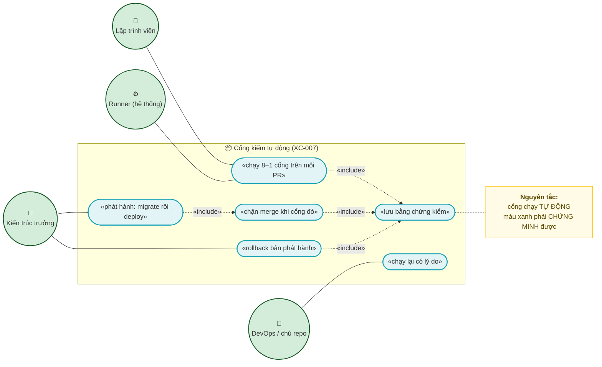
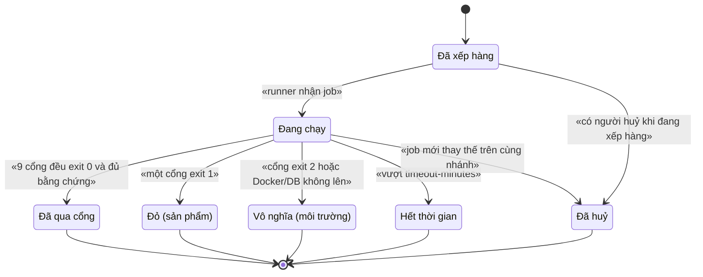
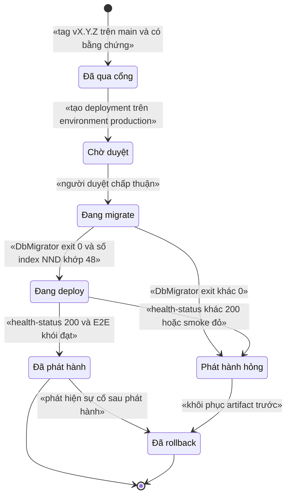
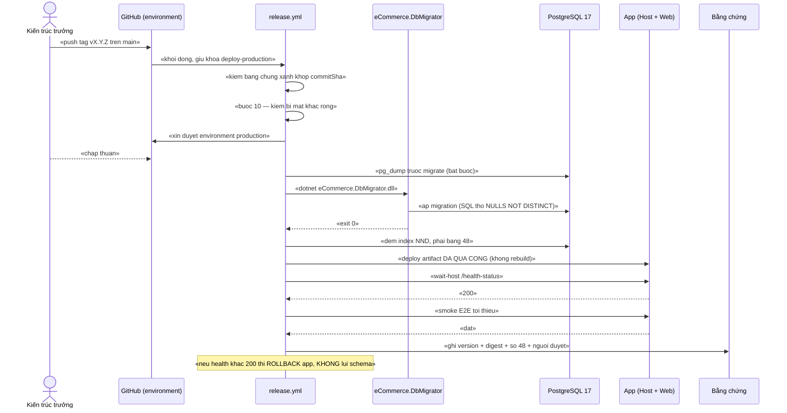
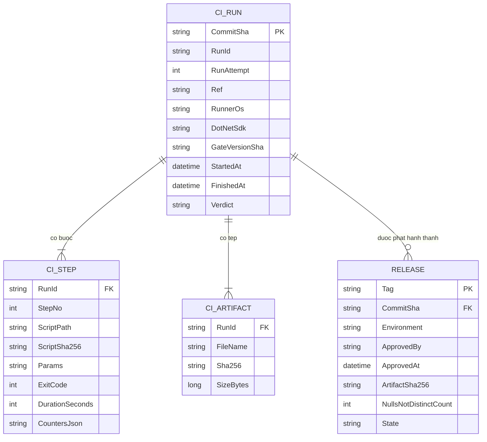

# `XC-007` — CI/CD: cổng kiểm tự động và quy trình phát hành

| Thuộc tính | Nội dung |
|---|---|
| **Mã** | `XC-007` |
| **Module** | Nền tảng (cross-cutting) |
| **Giai đoạn** | **Nền — trước GĐ1** |
| **Ưu tiên** | **Must have** — 🔑 *"Cổng không chạy tự động thì không phải cổng"* ([`BAN-GIAO-GD1-2026-10-17.md`](../../handover/BAN-GIAO-GD1-2026-10-17.md) §10, dòng 274) |
| **Trạng thái** | 🟡 `Draft` — chờ review |
| **Người viết / người reviewer** | `agent (phiên 17/10/2026)` / `Kiến trúc trưởng` |
| **Phiên bản / ngày** | `v0.1 — 17/10/2026` |
| **Tài liệu liên quan** | `XC-002` (outbox/inbox) · `XC-003` (khoá phân tán) · `XC-005` (observability) · `WEB-001` (§97–§99 E2E) · [`implementation-plan.md`](../../implementation-plan.md) §7.0 · [`design-doc-guidelines.md`](../../design-doc-guidelines.md) §3.2 (cổng kiểm tài liệu) · Mẫu: [feature-design-template.md](../../templates/feature-design-template.md) |

---

## 📌 QUYẾT ĐỊNH CHỦ DỰ ÁN — 17/10/2026 (`Q7` = **GitHub**)

> **Repo từ xa sẽ đặt trên GitHub** ⇒ nền CI là **GitHub Actions** (`ubuntu-latest`).

| Mục | Nội dung |
|---|---|
| **Chốt** | Nền tảng **GitHub** · workflow `.github/workflows/ci.yml` gọi `pwsh -File tools/kiem-tat-ca.ps1 -DayDu` · runner **`ubuntu-latest`** + bản vá khả chuyển **P-01…P-06** |
| **Trạng thái hạ tầng (đo 17/10/2026)** | ✅ **ĐÃ CÓ repo từ xa**: `origin` = `https://github.com/hungnt9801/eCommerce` · đã push **273 commit**, `refs/heads/main` = `ab9a7ff` (khẳng định lại bằng `git ls-remote`). ❌ `.github` / `azure-pipelines.yml` / `Jenkinsfile` **vẫn chưa tồn tại** ⇒ 📌 **`S9` chạy được ngay**; việc còn lại là tạo workflow. ⚠️ Repo đang **PUBLIC** — bí mật thật phải đi qua **GitHub Secrets**, không commit |
| **Không đổi** | ⚠️ Vẫn **KHÔNG** dùng `windows-latest` (integration test ghim `postgres:17-alpine` = Linux) · 🚨 vẫn phải **build làm nóng** trước để vá **F2** (`-GhiNho` trả `exit 2` trên runner sạch ⇒ **CI đỏ ngay ngày đầu**) · vẫn phải `commit tools/package-lock.json` (**F4**) |
| **Điều kiện bật required check** | Chỉ bật khi `tools/test-cong-kiem.ps1` **xanh trên Linux** — chưa có bằng chứng thì **chưa** bật (tránh required check flaky) |

---

## 0. Tóm tắt & quyết định thiết kế

### Bối cảnh — vì sao tài liệu này tồn tại (đo lại, không suy đoán)

**Tóm tắt:** dự án **đã có** một cổng kiểm 8 bước chạy được bằng **một lệnh** (`tools/kiem-tat-ca.ps1`), nhưng cổng đó
**chỉ chạy khi có người nhớ gõ lệnh**. `XC-007` biến cổng đó thành **cơ chế**: pipeline tự chạy trên mỗi thay đổi,
**chặn merge khi đỏ**, lưu **bằng chứng kiểm** gắn với `commitSha`, và định nghĩa **quy trình phát hành** (migrate →
deploy → rollback) để không ai phải "tự nghĩ lại" mỗi lần lên bản.

**Ba nguồn ghi nợ (cả ba đã đọc trực tiếp):**

| # | Nguồn | Nội dung nguyên văn | Đo lại hôm nay |
|---|---|---|---|
| 1 | [`BAN-GIAO-GD1-2026-10-17.md`](../../handover/BAN-GIAO-GD1-2026-10-17.md) **§7 việc #2** (dòng 217) | *"🔑 **Thêm CI** (`.github/workflows`) gọi `pwsh -File tools\kiem-tat-ca.ps1 -DayDu`"* — lý do: *"📌 Nền **đã sẵn 8 bước**; 🔒 không có CI thì **mọi cổng chỉ chạy khi có người nhớ**"* | ✅ Đúng. `tools/kiem-tat-ca.ps1` tồn tại, 356 dòng, 8 bước |
| 2 | `web-001` **§99.5** (dòng 3525) | *"🚨 **Chưa có CI**"* — *"📌 Nay **8 bước** là nền: thêm CI thì **chỉ cần gọi** `kiem-tat-ca.ps1 -DayDu`"*; nợ #2 cùng bảng: *"⚠️ 📌 Nếu CI gọi **thiếu** `-DayDu` thì bước này **không chạy** ⇒ 🔒 cần **một chỗ** ghi rõ "CI phải dùng `-DayDu`""* | ✅ Đúng. Chính `XC-007` là "một chỗ" đó (§6) |
| 3 | [`implementation-plan.md`](../../implementation-plan.md) **Phụ lục A** | Lúc viết phiếu: **52 tài liệu**, **không có mã `XC-007`** ⇒ lỗ hổng tài liệu có thật | ✅ **Nay đã có `XC-007` ở MỌI chỗ** (đo 17/10/2026): `:110` (**7** tài liệu nền, `XC-001`…`XC-007`), `:120`, `:157`, `:370` (**55** tài liệu, cập nhật 17/10/2026), `:387` (dòng mô tả `XC-007`), `:487`, `:497` (*"52 bản gốc + 3 bổ sung"*), `:530`. 📌 Lỗ hổng **đã đóng bằng tài liệu**, phần **còn thiếu là code** (`.github/workflows` vẫn **chưa có**) |

> 🔑 **Bài học áp dụng ngay vào tài liệu này:** con số trong tài liệu **trôi** nếu không đo lại. Mọi con số dưới đây đều
> ghi kèm **cách đo**; số nào chưa đo thì ghi **"chưa đo"** — không suy ra.

**Hiện trạng hạ tầng CI (đo bằng lệnh, 17/10/2026):**

| Hạng mục | Hiện trạng | Bằng chứng (đo được) |
|---|---|---|
| `.github/` | ❌ **KHÔNG tồn tại** | `Test-Path .github` = `False`; liệt kê thư mục gốc chỉ có: `.git` `.vs` `docs` `modules` `shared` `src` `test` `tools` + 8 tệp (`.editorconfig` `.gitignore` `Directory.Build.props` `Directory.Packages.props` `docker-compose.yml` `eCommerce.slnx` `global.json` `README.md` `THIRD-PARTY-NOTICES.md`) |
| `azure-pipelines.yml` / `Jenkinsfile` / `.gitlab-ci.yml` | ❌ **KHÔNG có** | cùng phép liệt kê thư mục gốc |
| **Git remote** | ✅ **CÓ** (`origin`) | `origin` = `https://github.com/hungnt9801/eCommerce` · `git ls-remote` trả `refs/heads/main = ab9a7ff` (đo lại 17/10/2026 sau khi push) |
| Nhánh hiện tại | `main` | `git branch --show-current` = `main`; HEAD = `83fb4e6 docs: ban giao GD1 cho phien moi` |
| Hook commit | ⚠️ **Chưa kích hoạt** | `tools/git-hooks/commit-msg` **có** (47 dòng, chặn message ngoài ASCII) nhưng `git config core.hooksPath` **trả rỗng** ⇒ hook **không chạy**; hook nhắc `tools/commit-msg-kiem.ps1` — tệp này **KHÔNG tồn tại** (`Test-Path` = `False`) |
| Cổng 8 bước | ✅ **Có** | `tools/kiem-tat-ca.ps1` (356 dòng), tham số `-BoQuaIntegration` / `-BoQuaE2E` / `-DayDu` (`:52`–`:56`) |
| Cổng tham chiếu tài liệu | ✅ **Có, nhưng CHƯA nối vào cổng 8 bước** | `tools/kiem-link-tai-lieu.ps1` (85 dòng, thoát `1` khi có tham chiếu chết — `:85`); **`tools/kiem-tat-ca.ps1` KHÔNG gọi nó** (grep `kiem-link-tai-lieu` trong `tools/kiem-tat-ca.ps1` = **0**) ⇒ CI **phải gọi riêng** (bước ⑨). 📌 Nó **đã có test** riêng: 5 ca `R`–`V` trong `tools/test-cong-kiem.ps1:255` (nhóm 1b) |
| Hạ tầng dev | ✅ `postgres:17-alpine` + `redis:7-alpine` | `docker-compose.yml:7` · `:24`; tên container `ecommerce-postgres` (`:8`) · `ecommerce-redis` (`:25`); healthcheck `pg_isready` (`:16`) · `redis-cli ping` (`:33`) |
| Integration test | ✅ **Testcontainers**, image **ghim** | `test/eCommerce.IntegrationTests/PostgreSqlSchemaFixture.cs:26` = `new PostgreSqlBuilder("postgres:17-alpine")`; gói `Testcontainers.PostgreSql 4.16.0` (`eCommerce.IntegrationTests.csproj:19`) |
| .NET SDK | `10.0.400`, `rollForward: latestFeature` | `global.json:3`–`:4` |
| `tools/package-lock.json` | 🚨 **BỊ `.gitignore`** ⇒ CI **không thể** `npm ci` | `.gitignore` mục `## Node`: `node_modules/` + `package-lock.json` |
| `.moc-build.json` | 🚨 **BỊ `.gitignore`** | `.gitignore` mục `# Moc build tam` |
| Bí mật VNPay | 🚨 **RỖNG** | `"TmnCode": ""`, `"HashSecret": ""` (`BAN-GIAO-GD1` §0 #3 dòng 17; §3.1 dòng 74) |
| Mật khẩu hạ tầng dev | ⚠️ **Commit công khai** | `docker-compose.yml:11` `POSTGRES_PASSWORD: ecommerce_dev_only` — **chỉ chấp nhận cho dev**, cấm dùng cho CI/production (§7.3) |

**Phạm vi (CÓ làm):**
- ✅ Chọn **nền CI** + **runner OS** (có ADR và phương án bị loại — §0.1).
- ✅ **Hợp đồng của cổng**: bảng 8 bước ↔ script ↔ tham số ↔ mã thoát ↔ điều kiện đỏ (§6), kèm **`-DayDu` là bắt buộc**.
- ✅ **State machine** của một lần chạy pipeline và của một bản phát hành (§3).
- ✅ **Mô hình bằng chứng** (artifact): cái gì **phải** lưu để chứng minh một bản build đã qua cổng (§5).
- ✅ **Quy trình phát hành**: migrate trên DB có dữ liệu thật, `NULLS NOT DISTINCT`, regenerate `schema.sql`,
  cập nhật con số **48**, rollback (§11).
- ✅ **Phân quyền**: ai chạy lại, ai deploy production, required checks (§9).
- ✅ **Bất biến đồng thời**: không merge khi đỏ, migration trước app, một pipeline/một môi trường (§8).

**Không nằm trong phạm vi (KHÔNG làm ở tài liệu này):**
- ❌ **Tạo tệp `.github/workflows/*.yml`** — đây là **tài liệu thiết kế**, không phải mã. Việc tạo workflow là
  **lát cắt 1** của implementation (§14.4 DoR + §15.2 F2). Đoạn YAML trong §14.2 chỉ là **đặc tả**.
- ❌ **Sửa các script cổng** — bản vá khả chuyển (P-01…P-06, §7.4) được **liệt kê chính xác** nhưng **chưa thực hiện**.
- ❌ **Chọn nhà cung cấp cloud/hạ tầng production** (VPS, Kubernetes, IIS…) — thuộc tài liệu vận hành riêng.
- ❌ **Cấu hình DNS/TLS/backup** của production.
- ❌ **Chi phí** — chưa đo (§15.1 Q6).

### 0.1 Quyết định thiết kế (ADR ngắn)

| # | Quyết định | Phương án đã cân nhắc | Lý do chọn | Hệ quả |
|---|---|---|---|---|
| **D1** | **GitHub Actions** | (a) **GitHub Actions** · (b) Azure Pipelines · (c) Jenkins (tự dựng) · (d) GitLab CI | (a) **không cần hạ tầng riêng**, `pwsh`/`node`/`docker` có sẵn trên runner, `concurrency` + `environment` (người duyệt) + **required status checks** là **tính năng sẵn có** — đúng 3 thứ §8/§9 cần; pipeline là **YAML trong repo** ⇒ review được như code | Phụ thuộc GitHub ⇒ **`git remote` đang TRỐNG** (đo được) ⇒ phải tạo repo từ xa trước (Q1). **Bị loại (b)(c)(d):** xem ghi chú dưới |
| **D2** | Runner = **`ubuntu-latest`** + **bản vá khả chuyển P-01…P-06** cho 3 script cổng | (a) `windows-latest` · (b) **`ubuntu-latest` + vá** · (c) **self-hosted Windows + Docker Desktop** | 🚨 **Quyết định bị ép bởi một ràng buộc đo được**: runner Windows của GitHub **chỉ có Docker engine chế độ Windows container** ⇒ **không chạy được image Linux**, mà integration test **bắt buộc** `postgres:17-alpine` (**Linux**) — `PostgreSqlSchemaFixture.cs:26`. Ngoài ra `services:`/`container:` là **chỉ-Linux**. → (a) **loại** vì bước ③④⑤⑥⑧ **không chạy được** | ✅ `ubuntu-latest` có Docker Linux ⇒ Testcontainers + `docker compose` chạy được. ⚠️ **Đánh đổi:** phải sửa **6 điểm** Windows-only (§7.4) và **chứng minh lại cổng trên Linux** bằng `tools/test-cong-kiem.ps1` **trước khi tin màu xanh** — nếu không, ta chỉ đổi "cổng không chạy" thành "cổng chạy sai môi trường" |
| **D2-b** | *(bị loại)* Self-hosted Windows + Docker Desktop | — | Giữ nguyên script, nhưng: phải có **máy luôn bật**, bí mật repo **nằm trên máy cá nhân**, và "cổng đã chứng minh" vẫn là **một máy của một người** — đúng thứ CI phải xoá bỏ | Dùng lại **chỉ khi** Q2 chốt rằng việc port tốn hơn vận hành runner riêng |
| **D3** | Cổng là **MỘT lệnh duy nhất** (`-DayDu`), CI **không** gọi từng bước rời | (a) gọi 8 script riêng trong 8 step · (b) **một step gọi `kiem-tat-ca.ps1`** | (a) tái tạo đúng lỗi gốc: **quên một bước** ⇒ "tất cả xanh" mà bước đó **chưa chạy** (`kiem-tat-ca.ps1:16`). (b) thứ tự + dừng-ngay-khi-đỏ + exit code **do một chỗ** thi hành | Muốn thêm cổng mới (⑨) ⇒ thêm **step riêng** hoặc thêm **bước 9 trong script**; ghi ở §6.1 |
| **D4** | 🚨 **`-DayDu` BẮT BUỘC** trên CI + **3 phép khẳng định** trên log | (a) tin `exit 0` · (b) **khẳng định `E2E: N/N` + 0 dòng `[BO QUA]`** | Thiếu `-DayDu` ⇒ bước ⑧ **im lặng không chạy** (`kiem-tat-ca.ps1:300`, `:329`) ⇒ **exit 0 mà cổng yếu đi** — đúng loại "cổng luôn-xanh" ở §12 | CI **đỏ** nếu log không có `E2E: ` hoặc có `[BO QUA]` (§6.2) |
| **D5** | **Bằng chứng là artifact gắn `commitSha`** (log 8 bước + `Evidence.json` + digest) | (a) chỉ xem màu xanh trên UI · (b) lưu artifact | (a) màu xanh **không chứng minh** bước ⑧ đã chạy. (b) log của `kiem-tat-ca.ps1` đã ghi ra `tools/_tam-kiem/` (`:61`, `:354`) ⇒ chỉ cần **upload** | Lưu ≥ 90 ngày (NFR-008); **không** commit log vào git (`.gitignore` đã bỏ `*.log` + `tools/_*.txt`) |
| **D6** | **Phát hành KHÔNG rebuild** — promote đúng artifact đã qua cổng | (a) build lại ở bước deploy · (b) promote artifact + so digest | (a) "đã qua cổng" **không còn đúng** cho binary mới (dù cùng commit) — trái tinh thần `kiem-moc-build.ps1` | Deploy **đỏ** nếu digest khác digest đã ghi trong bằng chứng |
| **D7** | Migration chạy **TRƯỚC** app, bằng `eCommerce.DbMigrator` | (a) app tự migrate khi khởi động · (b) **migrator riêng** | (b) đã có sẵn **và** chính comment trong code nói lý do: *"Tách khỏi Host để CI/CD có thể chạy migration trước khi deploy phiên bản mới"* (`src/eCommerce.DbMigrator/Program.cs:15`) | Hai bước tuần tự + chặn deploy nếu migrator `exit ≠ 0` (§11) |
| **D8** | Tuần tự theo môi trường bằng `concurrency` + `environment` (người duyệt) | (a) không khoá · (b) `concurrency` | (a) hai pipeline cùng migrate ⇒ **deadlock/khoá bảng** trên DB thật | `cancel-in-progress: false` khi đang deploy (§8.3) |
| **D9** | Bí mật: **GitHub Environments secrets** (scope `production`), cấm in log; **VNPay rỗng ⇒ CHẶN production** | (a) secret ở repo scope · (b) **environment scope + gate "đủ bí mật"** | (a) mọi workflow/PR đều chạm được bí mật production. (b) giảm bề mặt + **bí mật rỗng phải làm ĐỎ**, không được phát hành với chuỗi rỗng | Thêm **bước ⑩ "đủ điều kiện phát hành"** (§6.1) kiểm `TmnCode`/`HashSecret` **khác rỗng** trước khi deploy |
| **D10** | **Bỏ `tools/package-lock.json` khỏi `.gitignore`** (hoặc ghim tuyệt đối) | (a) để nguyên, chạy `npm install` · (b) **commit lock** | (a) `mermaid: ^12.1.0` (`tools/package.json:16`) + **không có lock** ⇒ cùng commit có thể **parse khác nhau** ⇒ cổng Mermaid **flaky ngẫu nhiên**. (b) `npm ci` tất định | Repo tăng ~63 KB (`tools/package-lock.json` hiện 62.966 byte trên máy); đổi `.gitignore` là **việc của lát cắt 1** |
| **D11** | Cổng **tham chiếu tài liệu** là cổng **bắt buộc** của CI | (a) để ngoài CI (như hiện nay) · (b) **bắt buộc** | (a) tham chiếu chết **không làm đỏ `dotnet build`** — [`design-doc-guidelines.md`](../../design-doc-guidelines.md) §3.2 (dòng 117–123) đã ghi đúng lý do này | CI có **9** cổng (8 + tham chiếu), xem §6.1 |
| **D12** | Rollback: **chỉ app** tự động; **DB rollback là thủ công có duyệt** | (a) tự chạy `Down` migration · (b) **thủ công** | (a) `Down` trên DB có dữ liệu thật **mất dữ liệu** và không lường được; (b) `Down` chỉ dùng ở dev | Có **kịch bản rollback viết sẵn** + diễn tập ≤ 15 phút (NFR-010) |

> **Vì sao KHÔNG chọn Azure Pipelines / Jenkins** *(ghi lại để 6 tháng sau không ai hỏi lại)*:
> **(b) Azure Pipelines** — cùng **đúng một** ràng buộc đã loại `windows-latest`: theo tài liệu Testcontainers,
> *"Windows agents use the Docker Windows engine and **cannot run Linux containers**"*
> ([dotnet.testcontainers.org/cicd](https://dotnet.testcontainers.org/cicd/)) ⇒ vẫn phải dùng agent Linux + vá script,
> mà lại thêm phụ thuộc **tổ chức Azure DevOps** và một hệ định nghĩa pipeline thứ hai.
> **(c) Jenkins** — phải **tự vận hành** master + agent, cài plugin, vá bảo mật, sao lưu cấu hình; dự án **không có**
> người trực ops, và mọi thứ Jenkins làm được ở đây (chạy 1 lệnh + lưu log + chặn merge) đều **có sẵn** ở (a).
> **(d) GitLab CI** — phải **chuyển nơi lưu mã nguồn**; không có lý do kỹ thuật nào.
> 🔑 **Điểm chung của cả ba phương án bị loại:** chúng **không** giải quyết vấn đề thật (cổng phải chạy tự động);
> chúng chỉ **thêm một hệ thống phải bảo trì**. Và **không** phương án nào làm ràng buộc Docker-Linux biến mất.

---

## 1. Use Case Specification

| Thuộc tính | Nội dung |
|---|---|
| **Use Case ID** | `XC-007` |
| **Use Case Name** | Cổng kiểm tự động chặn thay đổi xấu & phát hành có bằng chứng |
| **Description** | *"Là **lập trình viên**, tôi muốn mỗi lần mở PR được **máy** kiểm 8+1 cổng và báo **đỏ/xanh trong ≤ 10 phút** — để tôi không phải nhớ gõ lệnh và không merge được thứ đã hỏng. Là **DevOps/chủ repo**, tôi muốn phát hành **đúng artifact đã qua cổng**, migrate **trước** app, và có **bằng chứng** để trả lời 'bản này đã kiểm gì' — để sự cố không phải là cuộc điều tra trí nhớ."* |
| **Actor(s)** | **Lập trình viên** (mở PR) · **Kiến trúc trưởng** (duyệt thay đổi cổng, duyệt production) · **DevOps** (vận hành workflow, bí mật) · **Chủ repo** (branch protection, quyền) · **Hệ thống** (runner chạy cổng) |
| **Priority** | **Must have** — là **điều kiện** để các cổng khác có hiệu lực |
| **Trigger** | `pull_request` (mở/cập nhật PR) · `push` lên `main` · `push` tag `v*` (phát hành) · `schedule` (hằng đêm) · `workflow_dispatch` (chạy tay có lý do) |
| **Pre-Condition(s)** | • **Tenant/kênh:** **Không áp dụng** — CI **không** phục vụ nghiệp vụ đa tenant; nhưng **dữ liệu DB mà cổng dùng phải là DB dev sạch** (`kiem-db.ps1` nhóm ① — 10 bảng **phải rỗng**, `:83`–`:94`).<br>• Repo đã có **remote** (hiện **TRỐNG** — Q1) và đã bật Actions.<br>• Runner có: `pwsh` 7+, `dotnet` SDK **10.0.400** (`global.json:3`), `node`+`npm`, **Docker Linux**, `yarn` (cho `abp install-libs`).<br>• `tools/**` đã vá khả chuyển **P-01…P-06** (§7.4) — **chưa làm**.<br>• PostgreSQL **17** + Redis **7** sẵn sàng (§7.1). |
| **Post-Condition(s)** | • Mỗi commit được kiểm có **bản ghi bằng chứng** (§5) gồm: `commitSha`, kết quả **8+1** cổng, **số đếm thật**, digest artifact, `runnerOs`, phiên bản SDK.<br>• `main` **không** nhận commit nào có bằng chứng **đỏ/thiếu**.<br>• Bản phát hành trỏ tới **đúng** artifact đã qua cổng (digest khớp).<br>• DB production đã migrate **trước** khi app mới nhận request.<br>• **0** giá trị bí mật trong log/artifact. |
| **Basic Flow** | 1. Lập trình viên mở PR ⇒ GitHub phát `pull_request`.<br>2. Workflow **`ci.yml`** cấp quyền tối thiểu, đặt `concurrency: ci-«ref»`.<br>3. Bước chuẩn bị: checkout (`fetch-depth: 1`), cache NuGet/npm, `docker compose up -d` (Postgres 17 + Redis 7) + chờ healthcheck.<br>4. **Build làm nóng** (bắt buộc — xem §12 E-03) rồi chạy `pwsh -NoProfile -File tools/kiem-tat-ca.ps1 -DayDu`.<br>5. Cổng chạy **8 bước theo thứ tự cố định**, **dừng ngay** khi một bước hỏng.<br>6. Chạy **bước ⑨** `tools/kiem-link-tai-lieu.ps1` (tham chiếu tài liệu).<br>7. CI **khẳng định** đầu ra: có `E2E: N/N`, **0** dòng `[BO QUA]`, exit code `0` (§6.2).<br>8. Upload artifact bằng chứng + ghi `$GITHUB_STEP_SUMMARY`.<br>9. Required check xanh ⇒ nút merge mở. Đỏ ⇒ **chặn merge** (BR-004). |
| **Alternative Flow** | **A1: `push` lên `main`** (sau merge) — chạy **cùng** cổng trên `main` + upload bằng chứng; **không** chạy deploy.<br>**A2: chạy hằng đêm (`schedule`)** — chạy lại cổng trên `main` để phát hiện **trôi môi trường** (image/tool mới) — đây là cách duy nhất phát hiện "cổng xanh vì cache cũ".<br>**A3: chạy tay (`workflow_dispatch`)** — **bắt buộc** nhập `lyDo`; bằng chứng ghi `lyDo` + người kích (BR-015).<br>**A4: phát hành (tag `v*`)** — workflow `release.yml`: tải artifact đã qua cổng (§5) → **duyệt** → migrate → deploy → smoke (§11). |
| **Exception Flow** | **E1: một bước `exit 1`** ⇒ pipeline **Failed**; **không** chạy bước sau; artifact **vẫn** upload (bằng chứng của cái ĐỎ cũng là bằng chứng).<br>**E2: `exit 2`** ("PHEP KIEM VO NGHIA" / không kết nối DB) ⇒ trạng thái **Inconclusive**, **không** phải `Failed`; người trực phải **sửa môi trường** — cấm đổi thành xanh (BR-006).<br>**E3: vượt `timeout-minutes`** ⇒ `TimedOut`, job bị kill; coi như **đỏ** (không được "treo rồi xanh").<br>**E4: mất bí mật / bí mật rỗng** ⇒ bước ⑩ **đỏ**, ghi rõ *"chưa đủ điều kiện phát hành"* (D9).<br>**E5: PR từ fork** ⇒ **không** có secrets ⇒ chỉ chạy cổng **không** cần bí mật; nếu cổng cần bí mật ⇒ **đỏ có thông điệp** (không im lặng). |
| **Business Rules** | • **BR-XC-007-001**: Mọi commit vào `main` **PHẢI** có một lần chạy cổng **xanh** trên **chính** `commitSha` đó; required check tên **`cong-12-buoc`** phải xanh trước khi merge.<br>• **BR-XC-007-002**: 🚨 CI **CẤM** gọi `tools/kiem-tat-ca.ps1` mà thiếu **`-DayDu`**, **CẤM** `-BoQuaIntegration`, **CẤM** `-BoQuaE2E`, **CẤM** `-ChoPhepRong`.<br>• **BR-XC-007-003**: Mọi lần chạy phải **chứng minh bước ⑧ đã chạy**: log có dòng khớp `E2E: ` **và** tổng số ca `N/N` với `N > 0`; log **0** dòng `[BO QUA]`.<br>• **BR-XC-007-004**: Cổng **đỏ** ⇒ **không merge** (branch protection + required status check; cấm `continue-on-error` cho step cổng).<br>• **BR-XC-007-005**: Cổng chỉ được tính cho commit **sẽ merge** — dùng `github.event.pull_request.head.sha`; nếu nhánh bị rebase/force-push ⇒ **chạy lại** (cấm tái dùng kết quả cũ).<br>• **BR-XC-007-006**: **Phân biệt** `exit 1` (sản phẩm) với `exit 2` (môi trường/vô nghĩa); cấm đổi `2` thành xanh, cấm nuốt.<br>• **BR-XC-007-007**: Thay đổi `tools/**` **PHẢI** kèm lần chạy `tools/test-cong-kiem.ps1` **xanh** (bước ⑦) trong **cùng** lần chạy cổng.<br>• **BR-XC-007-008**: **Không bước nào được bỏ qua im lặng** — trên CI **0** bước bị bỏ; mọi lần bỏ phải in lý do (script đã làm: `:218`, `:331`) **và** CI phải khẳng định là **không có**.<br>• **BR-XC-007-009**: Giá trị bí mật **KHÔNG** được xuất hiện trong log/artifact/`STEP_SUMMARY`; cấm `echo $env:*SECRET*`, cấm `set -x` với biến bí mật.<br>• **BR-XC-007-010**: **Một** pipeline được deploy/phát hành một môi trường tại một thời điểm (D8); **cấm** huỷ giữa lúc migrate.<br>• **BR-XC-007-011**: Phát hành **KHÔNG rebuild**; digest artifact phát hành **phải khớp** digest trong bằng chứng (D6).<br>• **BR-XC-007-012**: Migration chạy **TRƯỚC** app; deploy **dừng** nếu `eCommerce.DbMigrator` trả `exit ≠ 0` (D7).<br>• **BR-XC-007-013**: Mọi migration làm đổi schema **PHẢI** regenerate `test/eCommerce.IntegrationTests/Assets/schema.sql` **và** cập nhật con số **48** (`PostgreSqlSchemaTests.cs:151`) **trong cùng PR** — nếu không, bước ④ hoặc ⑥ sẽ đỏ.<br>• **BR-XC-007-014**: Deploy production **chỉ** từ tag `v*` trên `main`, qua environment **`production`** có **≥ 1 người duyệt**.<br>• **BR-XC-007-015**: Mọi lần **chạy lại** phải ghi lý do; tối đa **2** lần; nếu xanh sau khi đỏ ⇒ **phải** mở ticket `flaky` **kèm 2 URL run** (cấm im lặng — §12).<br>• **BR-XC-007-016**: Cổng ⑨ phải thoát `0` và **không** có tham chiếu chết **mới**; số tham chiếu chết đã biết **phải** giữ nguyên hoặc giảm (không được tăng).<br>• **BR-XC-007-017**: Cache **không** được là nguồn sự thật của kết quả: mọi lần chạy phải **tự build lại** (`--no-incremental`, `/nodeReuse:false` — `kiem-tat-ca.ps1:148`) và **kiểm mốc** (bước ②). |
| **Non-Functional Requirement** | • **NFR-XC-007-001**: Pipeline **đầy đủ (8+1 cổng) ≤ 10 phút** wall-clock trên runner; riêng `kiem-tat-ca.ps1 -DayDu` **≤ 4 phút** (máy dev đo **145–155 s** — `BAN-GIAO-GD1` §1 dòng 31).<br>• **NFR-XC-007-002**: **0** bước bị bỏ qua im lặng trên `main` (đo bằng §6.2).<br>• **NFR-XC-007-003**: **100 %** commit trên `main` có bằng chứng cổng xanh gắn đúng `commitSha`.<br>• **NFR-XC-007-004**: Tỉ lệ **flaky < 2 %** (≤ 1 lần đỏ-không-do-commit trên **50** lần chạy).<br>• **NFR-XC-007-005**: **0** chuỗi bí mật trong log (quét tự động §14 TC-17).<br>• **NFR-XC-007-006**: Phản hồi đầu tiên (đến hết bước ③ unit test) **≤ 4 phút**.<br>• **NFR-XC-007-007**: Restore NuGet khi cache hit **≤ 45 s**, tỉ lệ hit **≥ 80 %**.<br>• **NFR-XC-007-008**: Lưu bằng chứng **≥ 90 ngày** (khớp `XC-005` Q4: log 90 ngày).<br>• **NFR-XC-007-009**: **Tái lập**: cùng `commitSha` chạy 2 lần ⇒ **cùng phán quyết** và **cùng số đếm** (2/2).<br>• **NFR-XC-007-010**: Rollback app **≤ 15 phút**, đo bằng diễn tập (§11.5).<br>• **NFR-XC-007-011**: Cổng **không** phụ thuộc dịch vụ ngoài có phí/không ổn định — chỉ GH runner + Docker + Postgres/Redis container + npm registry + NuGet.<br>• **NFR-XC-007-012**: Chi phí mỗi lần chạy — **chưa đo** (§15.1 Q6). |

---

## 2. Sơ đồ Use Case



### Chú giải

| Ký hiệu | Ý nghĩa |
|---|---|
| ⭕ Xanh lá | Actor (người hoặc hệ thống) |
| 🟦 Bầu dục xanh dương | Use Case |
| 🟨 Khung vàng | Note |
| `───` | Liên kết Actor ↔ Use Case |
| `-.«include».->` | Quan hệ bao hàm |

---

## 3. Sơ đồ trạng thái (state machine)

### 3.1 Trạng thái một **lần chạy pipeline**



| # | Từ → Sang | Guard (điều kiện cho phép) | Hành động kèm theo | Nếu guard sai thì? |
|---|---|---|---|---|
| 1 | `Queued` → `Running` | Runner rảnh **và** `concurrency` cho phép **và** đủ quyền đọc repo | Gắn `runId`, `runAttempt`, `runnerOs` | Vẫn `Queued`; **không** được coi là xanh |
| 2 | `Running` → `Passed` | **9/9** cổng `exit 0` **VÀ** log có `E2E: N/N` (`N>0`) **VÀ** 0 dòng `[BO QUA]` | Upload bằng chứng (§5) + `STEP_SUMMARY` | Thiếu một điều kiện ⇒ **`Failed`** (không phải `Passed`) |
| 3 | `Running` → `Failed` | Một cổng trả **`exit 1`** | Upload log + **dừng** các bước sau (`kiem-tat-ca.ps1:75` — `Buoc` ném lỗi) | — |
| 4 | `Running` → `Inconclusive` | Cổng trả **`exit 2`** (`kiem-moc-build.ps1:101`,`:113`,`:150`; `kiem-db.ps1:137`) **hoặc** không kết nối được Docker/Postgres | Upload log + **gắn nhãn "môi trường"**, mở việc sửa hạ tầng | 🔒 **CẤM** chuyển sang `Passed`; cấm "thử lại đến khi xanh" |
| 5 | `Running` → `TimedOut` | Vượt `timeout-minutes` | Kill job; upload log tới lúc kill | Coi như **đỏ**; **cấm** tăng timeout để "cho xanh" mà không có lý do ghi lại |
| 6 | `Running` → `Cancelled` | Có job mới cùng `concurrency` nhóm `ci-«ref»` (PR) | Không upload bằng chứng "xanh" | **Không** dùng làm bằng chứng merge (BR-005) |
| 7 | `Passed` → `[*]` | — | Bằng chứng **bất biến** (không sửa được) | Hấp thụ (absorbing) |
| 8 | `Failed`/`Inconclusive`/`TimedOut` → **chạy lại** | Người có quyền + **lý do** (BR-015) | Sinh `runAttempt` mới; **giữ** bản ghi cũ | Quá 2 lần ⇒ phải mở ticket `flaky` |

> ⚠️ **Quy tắc bất di bất dịch #11:** guard sai phải **NÉM LỖI / ghi log có cấu trúc**, **không im lặng**.
> Ở CI, "im lặng" có dạng đặc biệt: **một bước không chạy mà vẫn `exit 0`** — đó là lý do BR-003/BR-008 tồn tại.
> **Ai được chuyển:** `Queued→Running` do **runner** (không phải người); `→Cancelled` do **người có quyền ghi** hoặc
> do **cơ chế concurrency**; `→Passed` **chỉ** do kết quả cổng, **không** do người bấm.

### 3.2 Trạng thái một **bản phát hành**



| # | Từ → Sang | Guard (điều kiện cho phép) | Hành động kèm theo | Nếu guard sai thì? |
|---|---|---|---|---|
| 1 | `[*]` → `Passed` | Tag `v*` trỏ vào commit **trên `main`** **và** có bằng chứng xanh khớp `commitSha` (D6/BR-011) | Khoá bằng chứng; tính digest artifact | **NÉM** "thiếu bằng chứng cho commit này" — **cấm** phát hành |
| 2 | `Passed` → `Awaited` | Có **≥ 1** người duyệt cấu hình trên environment `production` (BR-014) | Ghi người duyệt + thời điểm vào bằng chứng | Vẫn `Awaited`; **không** tự duyệt (cấm self-approve) |
| 3 | `Awaited` → `Migrating` | Người duyệt chấp thuận **VÀ** bước ⑩ "đủ bí mật" xanh (D9) | `pg_dump` trước migrate; giữ khoá `deploy-«env»` | **Đỏ** với thông điệp "chưa đủ điều kiện phát hành" |
| 4 | `Migrating` → `Deploying` | `eCommerce.DbMigrator` **exit 0** **VÀ** số index `NULLS NOT DISTINCT` **= 48** (đọc từ `PostgreSqlSchemaTests.cs:151`) | Ghi số 48 + hash `schema.sql` vào bằng chứng | Sang **`Broken`**; **cấm** deploy app lên schema nửa vời |
| 5 | `Migrating` → `Broken` | Migrator exit ≠ 0 / timeout | Giữ DB ở trạng thái đã dump; **không** chạy `Down` tự động (D12) | — |
| 6 | `Deploying` → `Deployed` | `/health-status` = **200** (`tools/wait-host.ps1:38`) **VÀ** smoke E2E tối thiểu xanh | Ghi phiên bản + digest + thời điểm | Sang `Broken` |
| 7 | `Deployed` → `RolledBack` | Có quyết định của **DevOps + Kiến trúc trưởng**; trong **15 phút** (NFR-010) | Deploy lại artifact **trước** (digest đã ghi); **không** `Down` migration | Nếu schema đã đổi không tương thích ⇒ **forward-fix**, không lùi DB |
| 8 | `Broken` → `RolledBack` | Có artifact trước + dump trước migrate | Khôi phục app; đối chiếu dữ liệu | Nếu không có dump ⇒ **sự cố mức cao nhất** (§11.4) |

> 🔑 Cả hai state machine đều **hấp thụ** ở trạng thái cuối: `Passed`/`Deployed`/`RolledBack` **không** tự đổi ngược.
> Muốn đổi ⇒ **một lần chạy mới** (có `runAttempt` mới), để lịch sử **không bị ghi đè**.

---

## 4. Sequence Diagram & luồng dữ liệu

### 4.1 PR → cổng → merge

```mermaid
sequenceDiagram
    actor DEV as Lập trình viên
    participant GH as GitHub (PR + checks)
    participant RUN as Runner ubuntu-latest
    participant PRE as Chuẩn bị (cache + compose)
    participant GATE as kiem-tat-ca.ps1 -DayDu
    participant LINK as kiem-link-tai-lieu.ps1
    participant ART as Artifact bằng chứng

    DEV->>GH: «mo PR / cap nhat PR»
    GH->>RUN: «pull_request, checkout head.sha»
    RUN->>PRE: «restore cache NuGet + npm»
    PRE->>PRE: «docker compose up -d, cho healthcheck»
    RUN->>RUN: «build lam nong (bat buoc)»
    RUN->>GATE: «pwsh -File tools/kiem-tat-ca.ps1 -DayDu»
    Note over GATE: 8 buoc, DUNG NGAY khi mot buoc hong
    GATE-->>RUN: «exit 0 hoac 1 hoac 2 + log o tools/_tam-kiem»
    RUN->>LINK: «buoc 9 — tham chieu tai lieu»
    LINK-->>RUN: «exit 0/1»
    RUN->>RUN: «khang dinh log: co E2E N/N, 0 dong [BO QUA]»
    alt «du 9 cong va du bang chung»
        RUN->>ART: «upload log + Evidence.json»
        RUN-->>GH: «check cong-12-buoc = success»
        GH-->>DEV: «nut merge MO»
        DEV->>GH: «merge (squash)»
    else «mot cong exit 1»
        RUN-->>GH: «check = failure»
        GH-->>DEV: «merge BI CHAN, kem dong loi dau tien»
    else «exit 2 hoac thieu E2E N/N»
        RUN-->>GH: «check = failure, nhan MOI TRUONG»
        Note over GH: «cam doi sang xanh, cam continue-on-error»
    end
```

### 4.2 Phát hành: migrate trước, deploy sau



---

## 5. Mô hình dữ liệu của **bằng chứng kiểm** (artifact)

> 🚨 **Đây là mục quan trọng nhất của tài liệu này.** Một cổng không lưu bằng chứng thì **không chứng minh được**
> điều gì: màu xanh trên UI là **trạng thái hiện tại**, không phải **sự thật đã qua**. Và đúng bài học
> *"Không tin `exit 0`"* (`BAN-GIAO-GD1` §5.2 dòng 186): ta phải lưu **thứ đo được**, không lưu **kết luận**.

### 5.1 ERD (mô hình **lô-gíc** — ⚠️ **chưa có bảng nào trong DB**)



📌 **Trạng thái thật:** **không** có bảng `CI_RUN`/`CI_STEP`/`CI_ARTIFACT`/`RELEASE` trong repo (không có entity,
không migration — `grep` tên bảng = 0). Mô hình trên là **đặc tả bằng chứng**; **nơi lưu thật** ở lát cắt 1 là
**GitHub Actions artifacts** + `Evidence.json`. Nếu sau này cần truy vấn (dashboard, audit nội bộ) ⇒ mới tạo bảng,
**cùng một bộ trường**.

### 5.2 **Bắt buộc lưu** — danh sách đóng (thiếu một mục ⇒ bằng chứng KHÔNG hợp lệ)

| # | Trường | Kiểu | Nguồn đo được | Vì sao **bắt buộc** |
|---|---|---|---|---|
| 1 | `CommitSha` (40 hex) | `string` | `github.event.pull_request.head.sha` | Không có nó thì "xanh" **không gắn** với mã nào ⇒ không chặn được merge sai commit (BR-005) |
| 2 | `RunId` + `RunAttempt` | `string`/`int` | GitHub context | Phân biệt lần chạy gốc và lần chạy lại (BR-015) |
| 3 | **Kết quả 8 bước**: `StepNo` · `tên` · `exitCode` · `durationSeconds` | `int`/`string` | script in mỗi bước + `$LASTEXITCODE` | 🔑 *"0 bước bị bỏ qua im lặng"* chỉ chứng minh được nếu **có 8 dòng**, mỗi dòng có `exitCode` |
| 4 | **Log thô 9 tệp** | `string` (file) | `tools/_tam-kiem/` (`kiem-tat-ca.ps1:61`): `moc-ghi.log` `build.log` `moc-kiem.log` `unit.log` `integration.log` `mermaid.log` `db.log` `test-cong.log` `e2e.log` (`:140`,`:149`,`:163`,`:186`,`:202`,`:225`,`:243`,`:284`,`:313`) | Log là **bằng chứng gốc**; `Evidence.json` chỉ là bản tóm tắt — **cấm** thay log bằng tóm tắt |
| 5 | **Số đếm thật** của từng bước | `json` | dòng `Passed!`/`E2E: N/N`/`DB: x/y bat bien DAT` trong log | Con số là thứ phân biệt "chạy thật" với "in OK suông". **Baseline lúc bàn giao** (`BAN-GIAO-GD1` §1 dòng 35–42): unit **1181**, integration **38**, mermaid **197 khối · 0 lỗi**, DB **21/21**, cổng **17/17**, E2E **59/59**. ⚠️ **Đo lại 17/10/2026:** `test-cong-kiem.ps1` nay có **22** ca (thêm 5 ca `R`–`V` cho cổng ⑨) ⇒ con số "17/17" trong bàn giao **đã trôi**. 📌 Đây là **mốc so sánh**, **không** phải hằng số cứng (xem §5.4) |
| 6 | **Bằng chứng "build ĐÃ VÀO"** | `string` | hai dòng: `kiem-moc-build.ps1:205` (`✅ MOI tep deu DOI moc ⇒ ban build DA VAO` — nằm trong `moc-kiem.log`) **và** `kiem-tat-ca.ps1:180` in lại (`✅ Build DA VAO (moi moc deu doi).` — nằm trong log của cổng) | Đúng bài học *"Không tin `exit 0` — kiểm **mốc**"*: `exit 0` **không** chứng minh binary mới. 🚨 **Phải khẳng định đúng chuỗi của từng tệp log** — chuỗi in ở hai nơi **khác nhau** (xem A4 §6.2) |
| 7 | `ScriptSha256` của **mọi** script trong `tools/` đã chạy | `string` | hash tệp | Nếu cổng bị sửa để "cho xanh", hash đổi ⇒ phát hiện được. Đây là **bất biến cuối** của chính cổng (BR-007) |
| 8 | `RunnerOs` + `DotNetSdk` + `NodeVersion` | `string` | runner | "xanh trên máy tôi" ≠ "xanh trên runner" (§7.4) |
| 9 | `GateVersionSha` = commit của `tools/**` | `string` | `git log -1 -- tools/` | Cho biết cổng nào đã sinh ra kết quả |
| 10 | `Digest artifact` (sha256 của `eCommerce.*.dll` đã publish + `schema.sql`) | `string` | hash tệp | Là cầu nối **duy nhất** giữa "đã qua cổng" và "được phát hành" (D6/BR-011) |
| 11 | **Số index `NULLS NOT DISTINCT`** (48) + hash `schema.sql` | `int`/`string` | `grep` từ `db.log` + hash tệp | Ràng buộc schema quan trọng nhất của dự án (`BAN-GIAO-GD1` §4.1 dòng 122–124) |
| 12 | `Verdict` ∈ `Passed`/`Failed`/`Inconclusive`/`TimedOut`/`Cancelled` | `enum` | §3.1 | **Bắt buộc** phân biệt `Inconclusive` với `Failed` (BR-006) |

### 5.3 **KHÔNG** lưu (và vì sao)

| Không lưu | Lý do |
|---|---|
| Dữ liệu DB thật của môi trường dev (dump, bảng) | Có thể chứa PII/probe; `kiem-db.ps1` nhóm ① đã buộc DB **sạch** (10 bảng phải rỗng) |
| Giá trị bí mật, connection string đầy đủ | BR-009 — artifact là nơi **rò bí mật** rất dễ xảy ra (log bị upload lên nơi nhiều người đọc) |
| `bin/`, `obj/`, `node_modules/` | Không phải bằng chứng; `.gitignore` đã bỏ; artifact sẽ phình |
| "Ảnh chụp màn hình" thay cho log | Không kiểm chứng được bằng máy ⇒ **không** phải bằng chứng |

### 5.4 Quy ước về **con số** (chống "hai nguồn sự thật")

| Con số | Nguồn sự thật **duy nhất** | Cấm |
|---|---|---|
| **48** index `NULLS NOT DISTINCT` | `test/eCommerce.IntegrationTests/PostgreSqlSchemaTests.cs:151` (`Assert.Equal(48L, ...)`); `kiem-db.ps1:198`–`:232` **đọc từ chính test này** | 🚨 Viết cứng `48` trong workflow/YAML hoặc trong `kiem-db.ps1` (script đã cố ý tránh — `:44`, `:202`) |
| Số unit/integration test | output của `dotnet test` | Viết cứng "1181" trong điều kiện xanh; chỉ dùng làm **mốc báo động** (giảm bất thường) |
| Số khối mermaid | `tools/check-mermaid.mjs:65` in `Tổng: N khối · lỗi: F` | Điều kiện `F == 0` là **đủ**; `N` chỉ ghi nhận |
| Số ca E2E | dòng `E2E: N/N` (`kiem-e2e.ps1:779`) | 🚨 **Đừng đếm số lần gọi `Kq`** — đo được **63** lời gọi `Kq`, nhưng số ca **chạy** = **59** (một số nằm trong `if`/vòng lặp). Đây là bài học đã ghi ở `BAN-GIAO-GD1` §1 dòng 42 |

---

## 6. Hợp đồng của **cổng** (thay cho "hợp đồng API")

> Feature này **không có** app service, **không có** REST endpoint (§6 của mẫu được **thay bằng** hợp đồng dưới đây).
> Hợp đồng gồm 3 phần: **tham số** (§6.1), **đầu ra phải khẳng định** (§6.2), **điều cấm** (§6.3).

### 6.1 Bảng bước CI ↔ script ↔ tham số ↔ thời gian ↔ điều kiện đỏ

**Lệnh duy nhất của CI (D3/BR-002):**

```powershell
pwsh -NoProfile -File tools/kiem-tat-ca.ps1 -DayDu
pwsh -NoProfile -File tools/kiem-link-tai-lieu.ps1    # buoc 9 (chua noi vao script tren)
```

| Bước | Nội dung | Script (đường/dẫn:dòng) | Tham số **trên CI** | Thời gian kỳ vọng | Điều kiện **ĐỎ** | Mã thoát |
|---|---|---|---|---|---|---|
| **①** | Dọn tiến trình `dotnet` + chờ cổng 5000/5100 trống | `tools/kiem-tat-ca.ps1:99` | (không tham số) | **chưa đo** (script in giây từng bước — `:78`) | Cổng **vẫn bị chiếm** sau 60 s ⇒ `throw` (`:127`–`:131`) | `1` |
| **②** | Build + **KIỂM MỐC nhị phân** | `tools/kiem-tat-ca.ps1:137` → `tools/kiem-moc-build.ps1` (`-GhiNho` `:139`, build `:148`, `-Kiem` `:162`) | `-Ten eCommerce.*.dll`; build **`--no-incremental /nodeReuse:false`** | ⚠️ **chưa đo** trên CI; ghi chú trong `test-cong-kiem.ps1:147` nói `--no-incremental` "chậm hơn (~40s)" | `exit 1` = **binary KHÔNG đổi** (`kiem-moc-build.ps1:202`) · `exit 2` = **phép kiểm vô nghĩa** (`:101`, `:113`, `:150`) | `1` / `2` |
| **③** | Unit test | `tools/kiem-tat-ca.ps1:184` | `dotnet test test\eCommerce.Tests\eCommerce.Tests.csproj --nologo --no-build` | **chưa đo** (baseline **1181/1181**) | `exit ≠ 0` | `1` |
| **④** | Integration test (PostgreSQL **thật**, Testcontainers) | `tools/kiem-tat-ca.ps1:200` | **KHÔNG** `-BoQuaIntegration` (bắt buộc) | **chưa đo** (baseline **38/38**) | `exit ≠ 0` ⇒ script **nhắc kiểm Docker/Testcontainers trước khi kết luận về mã nguồn** (`:212`) | `1` |
| **⑤** | Khối mermaid | `tools/kiem-tat-ca.ps1:222` | `npm run check:mermaid` (`tools/package.json:8` → `node check-mermaid.mjs ..`) | **chưa đo** (baseline **197 khối · 0 lỗi**) | `exit ≠ 0` | `1` |
| **⑥** | Bất biến DB (21 bất biến + tự dò GUID probe) | `tools/kiem-tat-ca.ps1:237` → `tools/kiem-db.ps1` | **KHÔNG** `-ChoPhepRong` | **chưa đo** (baseline **21/21**) | `exit 1` = bất biến hỏng · `exit 2` = **không kết nối được** (`kiem-db.ps1:137`) | `1` / `2` |
| **⑦** | Test cho **chính các cổng** | `tools/kiem-tat-ca.ps1:265` → `tools/test-cong-kiem.ps1` | (chỉ thêm `-ChiKiemMoc` khi `-BoQuaIntegration` — CI **cấm**) | **chưa đo** (baseline **22/22** — đo 17/10/2026; bàn giao ghi 17/17) | `exit ≠ 0` | `1` |
| **⑧** | **E2E có phiên đăng nhập (HTML THẬT)** | `tools/kiem-tat-ca.ps1:301` → `tools/kiem-e2e.ps1` | **CHỈ chạy khi `-DayDu`** (`:300`), không `-BoQuaE2E` | **chưa đo** (baseline **59/59**) | `exit ≠ 0` ⇒ **đọc từng ca** trước khi kết luận về sản phẩm (`:325`) | `1` |
| **⑨** | Tham chiếu tài liệu | `tools/kiem-link-tai-lieu.ps1:85` | `-ChiTiet` (tuỳ chọn) | **chưa đo** | `exit 1` = có **tham chiếu chết** | `1` |
| **⑩** | Đủ điều kiện phát hành (**chỉ** workflow phát hành) | **chưa có trong repo** (đặc tả D9) | kiểm `TmnCode`/`HashSecret` **≠ rỗng**; `git remote`; tag ⊂ `main` | **chưa đo** | Bí mật rỗng ⇒ **đỏ** với thông điệp *"chưa đủ điều kiện phát hành"* | `1` |

> 🚨 **`-DayDu` là BẮT BUỘC trên CI.** Bằng chứng đo được: `kiem-tat-ca.ps1:300` chỉ chạy bước ⑧ khi
> `if ($DayDu -and -not $BoQuaE2E)`; nhánh còn lại (`:329`) **in `[BO QUA]`** rồi **đi tiếp** tới `exit 0` (`:356`).
> ⇒ Gọi thiếu `-DayDu` cho ra **`exit 0` y hệt** một lần chạy đầy đủ, chỉ khác **một dòng log**.
> Đó là lý do BR-003 buộc CI **khẳng định sự hiện diện của `E2E: N/N`** chứ không tin `exit 0`.

### 6.2 Đầu ra **phải khẳng định** (cổng của cổng — chạy sau bước ⑧/⑨)

| # | Phép khẳng định | Cách kiểm (đo được) | Nếu sai |
|---|---|---|---|
| A1 | `exit code` của lệnh cổng = **0** | `$LASTEXITCODE` của `pwsh -File ...` | Đỏ, in 15 dòng cuối log |
| A2 | Bước ⑧ **đã chạy** | 🚨 **Đọc `E2E: N/N` từ `tools/_tam-kiem/e2e.log`** (log **của bước**), **và** `e2e.log` phải **MỚI** (mtime ≥ lúc bắt đầu chạy). 📌 **KHÔNG** đọc từ log của cổng: dòng tổng kết nằm ở **cuối** `e2e.log` mà `kiem-tat-ca.ps1` chỉ in **26 dòng đầu** khớp mẫu (§16.3 **S9-A**) | **Đỏ**: "thiếu dòng E2E ⇒ cổng bị bỏ bước ⑧" |
| A3 | **Không** bước nào bị bỏ | 🚨 **Neo theo ĐẦU DÒNG**: `^\s*──\s*\[BO QUA\]` ra **0** dòng. 📌 **KHÔNG** được kiem chữ `[BO QUA]` trơn: tên ca kiểm của bước ⑦ **có chứa** chuỗi đó (`X4) Log co [BO QUA] …`) ⇒ một lần chạy **XANH** cũng bị báo **ĐỎ** (§16.3 **S9-A**) | **Đỏ** |
| A4 | Bước ② **chứng minh build đã vào** | log của cổng có `Build DA VAO` (`kiem-tat-ca.ps1:180`) **hoặc** `moc-kiem.log` có `MOI tep deu DOI moc` (`kiem-moc-build.ps1:205`). 🚨 **Hai chuỗi KHÁC nhau** — khẳng định sai chuỗi sẽ cho đỏ giả | **Đỏ**: "binary không đổi" |
| A5 | **Đủ 8 dòng** kết quả bước | đếm `✅ XONG` trong log = **8** (mỗi `Buoc` in `:79`) | **Đỏ**: "có bước không chạy" |
| A6 | Không có **dòng báo động** | dòng **BẮT ĐẦU** bằng `🚨` sau `Trim()` = **0**. 🚨 **KHÔNG** được cấm ký tự `🚨` nói chung: **tên ca kiểm** dùng chính `🚨` làm neo (*"[S5 🚨 khach BI CHAN dat hang => …] DAT"*) ⇒ một lần chạy **XANH** có **39** dòng như vậy (§16.3 **S9-B**) | **Đỏ** (kể cả khi exit 0) |
| A7 | Cổng ⑨: **số tham chiếu chết không tăng** | so với baseline đã ghi trong bằng chứng lần trước | **Đỏ** nếu tăng |
| A8 | **0** chuỗi bí mật trong log | quét §14 TC-17 | **Đỏ** + coi là **sự cố bảo mật** |

### 6.3 Cấm (hợp đồng âm)

| ❌ Cấm | Vì sao | Cách phát hiện |
|---|---|---|
| `continue-on-error: true` cho step cổng | Biến **đỏ** thành **xanh** mà không ai thấy | review + TC-18 (quét YAML) |
| `if: always()` trên step cổng | Chạy cổng trong trạng thái **đã hỏng** ⇒ kết quả vô nghĩa | review |
| `-BoQuaIntegration` / `-BoQuaE2E` / `-ChoPhepRong` / thiếu `-DayDu` | BR-002 | TC-18 (quét workflow) |
| `pull_request_target` để lấy secrets | Cho PR từ fork chạy mã **với** bí mật ⇒ lỗ hổng kinh điển | quét workflow (TC-20) |
| Chạy `Down` migration tự động | D12 | review + TC-22 |
| Tăng `timeout-minutes` để "cho xanh" | Che dấu **treo** (mà treo thường là lỗi thật) | review + ghi lý do |
| 🚨 **Ống dẫn output của lệnh cổng** (`... \| Tee-Object`, `\| Select-String`, `2>&1 \| ...`) | `$LASTEXITCODE` khi đó là của **lệnh cuối trong ống dẫn** (thường **luôn 0**) ⇒ *"build 0 lỗi"* có thể là **SAI**. Đây là **quy tắc ①** của chính `tools/kiem-tat-ca.ps1:24`–`:26`; nay nó áp dụng cho **workflow** nữa | TC-25 (quét YAML): step cổng **không** được có `\|` sau lệnh `pwsh -File` |

---

## 7. Sự kiện, tích hợp ngoài & idempotency

### 7.1 Dịch vụ ngoài / hạ tầng mà cổng cần

| Thành phần | Phiên bản (đo được) | Dùng ở bước | Trong CI | Ghi chú |
|---|---|---|---|---|
| **PostgreSQL** | **17** (`postgres:17-alpine` — `docker-compose.yml:7`; fixture ghim cùng image `PostgreSqlSchemaFixture.cs:26`) | ③④⑥⑦⑧ | ✅ **service container / compose** | 🔑 Bước **⑥** gọi `docker exec -i ecommerce-postgres psql` (`kiem-db.ps1:114`) ⇒ container **phải tên** `ecommerce-postgres` ⇒ phải dùng **`docker compose up -d`** (tên do `docker-compose.yml:8` đặt), **không** dùng `services:` của GitHub (tên container do nền tảng sinh, **không** đặt được) |
| **Redis** | **7** (`redis:7-alpine` — `docker-compose.yml:24`) | ⑦⑧ (app cần cache + **distributed lock**) | ✅ compose | Thiếu Redis ⇒ app **sập lúc khởi động** (bài học Phase 0 — `design-doc-guidelines.md` §1 dòng 15) |
| **Docker** | Linux engine | ③④⑤⑥⑦⑧ | ✅ có sẵn trên `ubuntu-latest` | 🚨 **Đây là lý do loại `windows-latest`** (§0.1 D2): Windows runner chỉ có Docker **Windows container** ⇒ `postgres:17-alpine` (Linux) **không chạy được**; `services:`/`container:` cũng **chỉ-Linux**. Nguồn: [dotnet.testcontainers.org/cicd](https://dotnet.testcontainers.org/cicd/) + [workflow syntax](https://docs.github.com/en/actions/reference/workflow-syntax-for-github-actions) |
| **.NET SDK** | **10.0.400** (`global.json:3`, `rollForward: latestFeature`) | ②③④⑦ | ✅ `actions/setup-dotnet` | Lệch SDK ⇒ test có thể đỏ vì **lý do khác** — ghim đúng `global.json` |
| **Node + npm** | Node 20+ (chưa ghim — §15.2 F4) | ⑤ | ✅ | `tools/package.json:16` là range `^12.1.0` ⇒ cần lock (D10) |
| **yarn** | 1.x (chưa ghim) | ⑧ (chuẩn bị `wwwroot/libs`) | ✅ | `abp install-libs -wd src/eCommerce.Web` **bắt buộc** trước E2E — `BAN-GIAO-GD1` §6 dòng 203 |
| **NuGet** | cache `~/.nuget/packages` | ②③④ | ✅ `actions/cache` | Khoá cache = hash `Directory.Packages.props` + `Directory.Build.props` |
| **npm cache** | `~/.npm` | ⑤ | ✅ | ⚠️ Chỉ tất định **sau** khi commit lock (D10) |

### 7.2 Sự kiện vào (thay cho "webhook") — idempotency của pipeline

| Nguồn | Loại | Nội dung dùng | Chống trùng / chống chạy chồng | Nếu lỗi |
|---|---|---|---|---|
| `pull_request` | `synchronize`/`opened`/`reopened` | `head.sha` | `concurrency: ci-«ref»` + `cancel-in-progress: true` (PR) | `Failed`/`Inconclusive` |
| `push` (`main`) | push | `github.sha` | `concurrency: ci-main`, `cancel-in-progress: false` | Như trên |
| `push` tag `v*` | release | tag + commit | `concurrency: deploy-«environment»`, `cancel-in-progress: **false**` | Sang `Broken` (§3.2) |
| `schedule` (hằng đêm) | cron | `main` | Cùng nhóm `ci-main` | Mở ticket "trôi môi trường" |
| `workflow_dispatch` | tay | `sha` + **`lyDo`** | Ghi `lyDo` vào bằng chứng | Từ chối nếu `lyDo` rỗng |

> 🔑 **Idempotency của deploy:** chạy lại một tag **đã** phát hành phải là **no-op có kiểm chứng** (so digest đang chạy
> với digest bằng chứng; khớp ⇒ không deploy lại, ghi "đã ở trạng thái mong muốn"). Cấm "deploy lại mù".

### 7.3 Bí mật (secrets) — **cách ly** và **không rò**

| Bí mật | Dùng ở đâu | Phạm vi | Trạng thái hôm nay | Quy tắc |
|---|---|---|---|---|
| `VNPAY_TMN_CODE` / `VNPAY_HASH_SECRET` | gọi cổng thanh toán ở môi trường **staging/production** | **environment `production`** (+ `staging`) | 🚨 **RỖNG** (`"TmnCode": ""`, `"HashSecret": ""` — `BAN-GIAO-GD1` §0 #3, §3.1) | Bí mật **rỗng** ⇒ bước ⑩ **ĐỎ** (D9). **Cấm** phát hành với chuỗi rỗng (`BAN-GIAO-GD1` §3.1 dòng 74: *"Sandbox URL có nhưng **không có credential**"*) |
| `ConnectionStrings__Default` | migrate + app | environment scope | ⚠️ dev: `docker-compose.yml:11` `ecommerce_dev_only` (commit công khai — **chỉ dev**) | Production: **chỉ** từ secrets; **cấm** commit `appsettings.Production.json` (đã `.gitignore`) |
| `ABP_ADMIN_PASSWORD` (seed) | migrate/seed | environment scope | Mật khẩu dev `1q2w3E*` nằm **trong script E2E** (`kiem-e2e.ps1:254`) | 🚨 **Không** dùng mật khẩu này cho production; E2E chỉ dùng **tài khoản seed của môi trường kiểm** (§15.2 F5) |
| `GITHUB_TOKEN` | checkout/upload artifact | `permissions:` tối thiểu (`contents: read`, `actions: read`) | — | **Cấm** `permissions: write-all` |
| GitHub App / PAT cho deploy | gọi API hạ tầng | environment `production` | — | Chỉ DevOps tạo; hạn 90 ngày; ghi ngày hết hạn vào bằng chứng |

**Bốn quy tắc bí mật (áp dụng cho mọi workflow):**
1. 🔒 **Chỉ** tham chiếu qua `${{ secrets.X }}` hoặc `env:` — **cấm** giá trị literal trong YAML/script.
2. 🔒 **Cấm in**: không `Write-Output $env:X`, không `echo`, không `set -x` khi có bí mật; dùng `::add-mask::` cho mọi
   giá trị phái sinh (ví dụ token ký URL).
3. 🔒 **Cấm** upload tệp có bí mật vào artifact; danh sách artifact là **đóng** (§5.2 mục 4).
4. 🔒 **Kiểm chứng bằng máy:** TC-17 quét log/artifact tìm giá trị bí mật (lấy từ chính secret store trong job, **so
   khớp mà không in ra**).

### 7.4 Bản vá khả chuyển **P-01…P-06** (điều kiện của D2 — ✅ **ĐÃ THỰC HIỆN ở `S9`, 21/10/2026** — xem §16)

| # | Vị trí | Hiện tại (Windows-only) | Cần thành | Ảnh hưởng nếu bỏ qua |
|---|---|---|---|---|
| **P-01** | `tools/kiem-tat-ca.ps1:102` | `Get-CimInstance Win32_Process -Filter "Name='dotnet.exe'"` | nhánh `$IsWindows` / lọc `Get-Process dotnet` theo đường dẫn | Bước ① **nổ** ⇒ cổng đỏ **vì môi trường** ngay từ bước đầu |
| **P-02** | `tools/kiem-tat-ca.ps1:118`, `:127`; `tools/kiem-e2e.ps1:157` | `Get-NetTCPConnection -LocalPort ...` | `[System.Net.Sockets.TcpClient]` hoặc `ss`/`lsof` có nhánh | Không phát hiện được cổng bị chiếm ⇒ **"build ghi hụt"** quay lại (bốn lần đã trả giá) |
| **P-03** | `tools/kiem-e2e.ps1:116`, `:236`, `:251`, `:321`, `:413`, `:579` | `curl.exe` (6 chỗ gọi) | `$curl = if ($IsWindows) { 'curl.exe' } else { 'curl' }` | Bước ⑧ **nổ** ở mọi ca |
| **P-04** | `tools/kiem-e2e.ps1:219`; `tools/kiem-moc-build.ps1:53`–`:56` | đường dẫn ghim `src\...\bin\Debug\net10.0` | `Join-Path` từng đoạn / `-ThuMuc` truyền từ CI | ⑧ không tìm thấy `bin`; ② trả **`exit 2`** (`thay.Count -eq 0`, `:95`) |
| **P-05** | `tools/kiem-e2e.ps1:223` | `Start-Process ... -WindowStyle Hidden` | bỏ `-WindowStyle` khi `$IsWindows` = false | ⑧ **nổ** khi khởi động Web |
| **P-06** | `tools/kiem-link-tai-lieu.ps1:20`, `:37` | regex/`Replace` dùng `\\` | dùng `[IO.Path]::DirectorySeparatorChar` | Tên tệp trong báo cáo sai (không làm sai kết luận) — **ưu tiên thấp** |

> ✅ **`S9` ĐÃ VÁ CẢ SÁU — nhưng thực tế là 8 tệp, không phải 6 điểm** (§16.3 **S9-C**): bốn `probe-*.ps1`
> (`S2`…`S6`) **sao lại** đúng 3 khuôn trên. ⇒ Toàn bộ logic hệ điều hành nay nằm ở **một tệp**
> `tools/nen-tang.ps1` (`La-Windows` · `Lay-Curl` · `Lay-DuongDanBin` · `Test-CongDangMo` ·
> `Lay-PidDangNghe` · `Lay-TienTrinhECommerce` · `Start-TienTrinhAn`), và `test-cong-kiem.ps1` nhóm **`Y`**
> **quét mọi script** để khuôn cũ **không thể quay lại**.

> 🔒 **Điều kiện để tin CI xanh sau khi vá:** chạy `tools/test-cong-kiem.ps1` **trên Linux** và thấy **22/22**
> (hiện chỉ chứng minh trên **Windows**). Nếu chưa có bước này ⇒ mọi màu xanh trên CI là **chưa được kiểm chứng**
> (§12 E-08).

---

## 8. Bất biến & xử lý đồng thời

### 8.1 Bất biến

| # | Bất biến | Cơ chế bảo vệ | Kiểm bằng |
|---|---|---|---|
| 1 | **Không merge được khi cổng đỏ** | branch protection: required status check **`cong-12-buoc`**; `enforce_admins: true`. 📌 Cổng ⑨ (`kiem-link-tai-lieu.ps1`) là **step 11 trong CÙNG job** ⇒ một check là đủ (xem §16.7 **S11-1**) | TC-13 (thử merge khi đỏ) |
| 2 | **Không bước nào bị bỏ qua im lặng** | `-DayDu` + A2/A3/A5 (§6.2) | TC-15 |
| 3 | **Cổng phải chạy trên đúng commit sẽ merge** | dùng `head.sha`; cấm tái dùng kết quả cũ sau rebase | TC-14 |
| 4 | **Migration chạy TRƯỚC app** | `release.yml` tuần tự; deploy chặn nếu migrator exit ≠ 0 (D7) | TC-21 |
| 5 | **Phát hành không rebuild** | digest phải khớp bằng chứng (D6/BR-011) | TC-16 |
| 6 | **Số 48 trong test là nguồn sự thật duy nhất** | `kiem-db.ps1:198`–`:232` **đọc từ test**; CI cấm hard-code | TC-12 |
| 7 | **Bí mật không vào log** | §7.3 + quét TC-17 | TC-17 |
| 8 | **Bí mật rỗng ⇒ không phát hành** | bước ⑩ (D9) | TC-20 |
| 9 | **Cổng tự nó không bị "sửa cho xanh" mà không ai biết** | `ScriptSha256` trong bằng chứng + `test-cong-kiem.ps1` (bước ⑦) + CODEOWNERS `tools/**` | TC-19 |
| 10 | **Bằng chứng là bất biến** | artifact + hash; không sửa được sau khi upload | TC-11 |

### 8.2 Tình huống đồng thời

| # | Tình huống | Cơ chế |
|---|---|---|
| 1 | Hai PR cùng nhánh, push liên tiếp | `concurrency: ci-«ref»` + `cancel-in-progress: true` ⇒ lần cũ **bị huỷ** (không tính là xanh) |
| 2 | Hai lần chạy trên `main` (merge liên tiếp) | `concurrency: ci-main`, `cancel-in-progress: false` ⇒ **xếp hàng**, không huỷ (bằng chứng của `main` phải đầy đủ từng commit) |
| 3 | Hai release cùng môi trường | `concurrency: deploy-production`, `cancel-in-progress: false` ⇒ **tuần tự** |
| 4 | Migrate chạy chồng (CI + người chạy tay) | 🔒 **Khoá phân tán** ở tầng ứng dụng — xem §8.3 |
| 5 | Nhiều job cùng dùng Postgres `ecommerce-postgres` | Mỗi job có runner riêng + compose riêng ⇒ **không chia sẻ**; cấm trỏ CI vào DB chung |
| 6 | E2E và `kiem-db` chạy song song trên cùng DB | **Cấm**: chúng đều **tiêm dữ liệu**; phải chạy tuần tự trong **một** lệnh (`kiem-tat-ca.ps1` đã tuần tự) |

### 8.3 Khoá phân tán & nhóm `concurrency` — **tên chính xác**

| Tên | Phạm vi | Vì sao cần | Trạng thái |
|---|---|---|---|
| `ci-${{ github.ref }}` | mỗi nhánh/PR | không chạy 2 lần cho cùng một nhánh | **chưa có trong repo** (workflow chưa tạo) |
| `ci-main` | `main` | bằng chứng `main` không được bị huỷ | **chưa có trong repo** |
| `deploy-${{ inputs.environment }}` | mỗi môi trường (giá trị dùng thật: `deploy-production`, `deploy-staging`) | BR-010: một pipeline/một môi trường | **chưa có trong repo** |
| `ecommerce:ops:migrate:{environment}` | khoá **ứng dụng** (Redis, ABP `IDistributedLock`) | chặn migrate chồng khi có người chạy tay song song với CI | **chưa có trong repo** — tên đặt theo khuôn `ecommerce:<module>:<đối tượng>:<id>` của `XC-003` (dòng 47, 206–213) |
| `ecommerce:ops:deploy:{environment}` | khoá **ứng dụng** | chặn 2 tiến trình deploy cùng môi trường khi `concurrency` của nền tảng không phủ (ví dụ chạy ngoài CI) | **chưa có trong repo** |

> 📌 **Vì sao cần cả hai lớp khoá:** `concurrency` của GitHub chỉ phủ **workflow của chính repo đó**; nó **không** biết
> về một người đang chạy `dbMigrator` bằng tay trên cùng DB. Khoá ứng dụng là lớp duy nhất phủ được ca đó — và nó
> phải **ném lỗi** khi không giành được (đúng `XC-003` BR-XC-003-010), **không** `SkipIfBusy` cho deploy.
> TTL đề xuất: migrate **1800 s**, deploy **1800 s** (đủ dài hơn thời gian thao tác thật; **chưa đo** trên production).

---

## 9. Phân quyền

> Feature này **không** có permission ABP nào (không có endpoint). "Phân quyền" ở đây là **quyền trên nền tảng CI** +
> **quyền trong repo** — thứ quyết định ai có thể **làm yếu cổng**.

### 9.1 Ma trận quyền

| Hành động | Lập trình viên | Maintainer | DevOps | Kiến trúc trưởng | Chủ repo |
|---|---|---|---|---|---|
| Xem kết quả cổng / log | ✅ | ✅ | ✅ | ✅ | ✅ |
| **Chạy lại** pipeline của PR mình (≤ 2 lần, có lý do — BR-015) | ✅ | ✅ | ✅ | ✅ | ✅ |
| Chạy lại pipeline của **người khác** | ✖ | ✅ | ✅ | ✅ | ✅ |
| Sửa `tools/**` (cổng) | PR (cần review **bắt buộc**) | PR | PR | ✅ duyệt | ✅ |
| Sửa `.github/workflows/**` | ✖ | ✖ | ✅ | ✅ duyệt | ✅ |
| Tạo/đọc **bí mật** | ✖ | ✖ | ✅ | ✖ (chỉ biết **đã có**) | ✅ |
| **Duyệt** deploy `staging` | ✖ | ✖ | ✅ | ✅ | ✅ |
| **Duyệt** deploy `production` | ✖ | ✖ | ✅ **và** ✅ Kiến trúc trưởng (2 người) | ✅ | ✅ |
| Bấm **rollback** | ✖ | ✖ | ✅ | ✅ duyệt | ✅ |
| Bật/tắt branch protection | ✖ | ✖ | ✖ | ✖ | ✅ |
| Xoá bằng chứng/artifact | ✖ | ✖ | ✖ | ✖ | ✅ (chỉ sau 90 ngày — NFR-008) |

### 9.2 Required checks & branch protection trên `main`

| Thiết lập | Giá trị | Vì sao |
|---|---|---|
| Require PR before merging | ✅ | Cổng chạy ở PR |
| Required status checks | **`cong-12-buoc`** | BR-001/BR-004. Tên **phải** khớp `jobs.<id>.name` trong workflow. 📌 Một check vì cổng ⑨ là step 11 **trong cùng job** — `CiWorkflowTests.Ten_job_phai_khop_required_check` khoá **chéo** tên này với mục §9.2 |
| Require branches up to date | ✅ | Chống "xanh trên base cũ" (BR-005) |
| Require conversation resolution | ✅ | Câu hỏi review không bị bỏ qua |
| Dismiss stale approvals khi push | ✅ | Duyệt lại sau thay đổi |
| Enforce for administrators | ✅ | Chính người duyệt cũng không merge khi đỏ — 🔑 *"cổng luôn-đỏ thì người ta học cách bỏ qua"*, và cổng **có ngoại lệ cho admin** thì cũng thế |
| Allow force push | ✖ | Lịch sử `main` bất biến; force-push ⇒ phải chạy lại cổng |
| Allow deletions | ✖ | — |
| Require linear history | ✅ | Truy vết commit ↔ bằng chứng |
| CODEOWNERS | `.github/**`, `tools/**`, `Directory.*.props`, `global.json` → **DevOps + Kiến trúc trưởng** | Đổi cổng/công cụ phải có người hiểu hậu quả |

### 9.3 Environment `production`

| Thiết lập | Giá trị |
|---|---|
| Required reviewers | **2** (DevOps + Kiến trúc trưởng); **cấm** người kích tự duyệt |
| Wait timer | **0** (duyệt là đủ; timer chỉ làm chậm rollback) |
| Deployment branches | **chỉ** tag `v*` (và `main` nếu cần hotfix — có ghi lý do) |
| Secrets | scope `production` **chỉ** ở đây; không có ở repo scope |

> 🔑 **Nguyên tắc "cổng phải mạnh hơn người vội":** mọi thiết lập ở trên đều nhằm một việc — **không** có đường tắt
> nào để đưa một commit **chưa qua cổng** lên `main` mà **không để lại dấu vết**.

---

## 10. UI Mockup & mapping dữ liệu

**Không có UI do ta viết.** Bề mặt hiển thị là **UI sẵn có** của GitHub + bảng tóm tắt do job ghi ra. Mục này vẫn
được điền vì nó trả lời câu hỏi *"bằng chứng hiện ra ở đâu"*.

| Vùng UI | Dữ liệu hiển thị | Nguồn (trường) | Hành động |
|---|---|---|---|
| **PR → tab Checks** | tên check `cong-12-buoc`, thời lượng | `CI_RUN.Verdict`, `CI_STEP.DurationSeconds` | Bấm vào xem log; nút merge **mờ** khi đỏ |
| **Actions → run summary** (`$GITHUB_STEP_SUMMARY`) | bảng 9 bước: `exitCode` · giây · số đếm | §5.2 mục 3+5 | Đọc nhanh, không cần tải log |
| **Actions → Artifacts** | `Evidence.json`, 9 tệp log | §5.2 mục 4 | Tải về làm bằng chứng kiểm toán |
| **Environments → production** | ai duyệt, lúc nào, tag, digest | `RELEASE.ApprovedBy/ApprovedAt/ArtifactSha256` | Duyệt / xem lịch sử |
| **Commit (badge)** | ✅/❌ gắn `commitSha` | check run | Truy từ commit → bằng chứng |

**Nội dung `STEP_SUMMARY` bắt buộc (9 dòng + 1 dòng kết luận):**

| Cột | Ví dụ (định dạng, **không** phải số đo thật) |
|---|---|
| Bước | `② Build + kiểm mốc` |
| `exitCode` | `0` |
| Giây | *in từ script* (`kiem-tat-ca.ps1:78`) |
| Số đếm | `Build DA VAO` · `1181/1181` · `38/38` · `197 khối · 0 lỗi` · `21/21` · `22/22` · `59/59` · `0 tham chiếu chết mới` |

> ⚠️ **Nguyên tắc §9 của quy ước** (*"nếu số liệu đếm ≠ số dòng hiển thị ⇒ ghi rõ"*) áp dụng ở đây: dòng
> *"E2E 59/59"* là số ca **CHẠY**, không phải số lần gọi `Kq` (**63**) — đã ghi ở §5.4. Nếu summary in "63 ca"
> thì **chính summary sai**.

---

## 11. Quy trình phát hành (thay cho "Migration & seed")

> Mục này **thay** §11 của mẫu. Tinh thần giữ nguyên: **thay đổi schema là thay đổi nguy hiểm nhất**, và mọi thứ phải
> làm theo thứ tự đã trả giá — quy trình dưới đây **sao lại** `BAN-GIAO-GD1` §9.1 (dòng 259–268) rồi **thêm** phần
> phát hành/rollback mà bàn giao chưa có.

### 11.1 Các bước phát hành (tuần tự, có cổng giữa mỗi bước)

| # | Bước | Lệnh / kiểm | Điều kiện đi tiếp | Nếu hỏng |
|---|---|---|---|---|
| 1 | **Chốt commit** | tag `vX.Y.Z` trỏ commit trên `main`; có bằng chứng xanh khớp `commitSha` | digest khớp (D6) | **Dừng** — không có ngoại lệ |
| 2 | **Sao lưu** | `pg_dump` toàn bộ DB **trước** migrate | dump **mở lại được** (kiểm bằng `pg_restore --list`) | **Dừng** — không migrate khi không có đường lùi |
| 3 | **Migrate** | `dotnet eCommerce.DbMigrator.dll` (từ `src\eCommerce.DbMigrator\bin\Debug\net10.0` — `BAN-GIAO-GD1` §9.1) | `exit 0` | Sang `Broken`; giữ nguyên app **cũ** |
| 4 | **Kiểm schema** | `select count(*) from pg_indexes where indexdef like '%NULLS NOT DISTINCT%'` = **48**; đối chiếu `AbpPermissionGrants` > 0 | đúng **48** và quyền còn | **Dừng** — schema nửa vời nguy hiểm hơn không migrate |
| 5 | **Deploy app** | artifact **đã qua cổng** (không rebuild) | — | rollback app (§11.4) |
| 6 | **Health** | `tools/wait-host.ps1 -Url https://«host»` chờ `/health-status` = 200 (`:38`–`:62`) | `200` trong ≤ 90 s | rollback app |
| 7 | **Smoke** | E2E tối thiểu: đăng nhập + 1 trang admin = 200 + 1 route API = 200 | đạt | rollback app |
| 8 | **Ghi bằng chứng** | tag · digest · số 48 · người duyệt · thời điểm | — | — |

### 11.2 Migration trên DB **có dữ liệu thật** — khác dev ở đúng 4 điểm

| Điểm | Dev (`docker-compose`) | Production (thật) | Vì sao |
|---|---|---|---|
| Khoá bảng | không ai dùng | migration **có thể khoá bảng** ⇒ phải chọn cửa sổ; cấm chạy giờ cao điểm | một `ALTER TABLE` trên bảng lớn giữ khoá ⇒ cửa hàng ngừng bán |
| `NULLS NOT DISTINCT` | viết bằng **SQL thô** trong migration (`BAN-GIAO-GD1` §4.1 dòng 122) | ⚠️ **phải** kèm `DROP INDEX IF EXISTS` trước `CREATE UNIQUE INDEX` — **cùng một câu** trong migration | thiếu `DROP` ⇒ migrate đỏ **chỉ trên DB đã có index** (dev tạo mới nên không thấy) |
| Dữ liệu trùng | không có | có thể **đã có** bản ghi trùng ⇒ `CREATE UNIQUE INDEX` **thất bại** | phải **kiểm trước**: chạy truy vấn tìm trùng **trước** khi migrate; có kế hoạch xử lý |
| Backfill | không cần | cột `NOT NULL` mới ⇒ phải **3 bước**: thêm cột nullable → backfill → đặt `NOT NULL` (expansion–contraction) | một migration `NOT NULL` trên bảng có dữ liệu ⇒ đỏ hàng loạt |

**Truy vấn kiểm trùng `NULLS NOT DISTINCT` (chạy TRƯỚC migrate, cho từng index có `TenantId`):**

```sql
-- Vi du cho IX_CatProducts_TenantId_Code: Tim ban ghi trung khi TenantId = NULL.
-- 📌 TenantId NULL la truong hop NGUY HIEM NHAT: unique index thuong KHONG chan duoc.
select "Code", count(*) as so
from "CatProducts"
where "TenantId" is null
group by "Code"
having count(*) > 1;
```

> 🔑 Nếu truy vấn trả **> 0 dòng** ⇒ **DỪNG**: phải hợp nhất dữ liệu **có người quyết định** trước, rồi mới migrate.
> Cấm "xoá bớt cho migrate chạy được" — đó là xoá dữ liệu thật để làm xanh một cổng (cùng bài học với
> `kiem-db.ps1:27`–`:30`).

### 11.3 Regenerate `schema.sql` + cập nhật con số **48** (bắt buộc trong **cùng PR**)

```powershell
# 1) Tao migration
dotnet ef migrations add «Ten» --project src\eCommerce.EntityFrameworkCore --startup-project src\eCommerce.DbMigrator

# 2) THEM TAY SQL tho NULLS NOT DISTINCT (+ DROP INDEX IF EXISTS) neu co unique index tren IMultiTenant
#    -> BAT BUOC, khong de EF tu sinh

# 3) Build + chay migrator tren DB dev
dotnet build src\eCommerce.DbMigrator
cd src\eCommerce.DbMigrator\bin\Debug\net10.0 ; dotnet eCommerce.DbMigrator.dll

# 4) Regenerate schema.sql (nguon cho integration test)
#    test\eCommerce.IntegrationTests\Assets\schema.sql

# 5) Cap nhat con so 48 trong test  ->  chi MOT noi
#    test\eCommerce.IntegrationTests\PostgreSqlSchemaTests.cs  (dong 151: Assert.Equal(48L, ...))

# 6) Chay lai cong: buoc 4 (integration) + buoc 6 (kiem-db) PHAI xanh
pwsh -NoProfile -File tools\kiem-tat-ca.ps1 -DayDu
```

| Nếu quên bước | Cổng nào bắt | Triệu chứng |
|---|---|---|
| Regenerate `schema.sql` | **④** integration test | `F1_du_48_index...` đỏ (schema trong tệp **cũ hơn** migration) |
| Cập nhật số 48 | **⑥** `kiem-db.ps1` | `NND thucTe=49 · tuTest=48` ⇒ đỏ (`kiem-db.ps1:242`) — 🔑 và **đúng** là phải đỏ: hai nguồn sự thật lệch nhau |
| Thêm SQL thô `NULLS NOT DISTINCT` | **④** | unique index **không chặn trùng khi `TenantId` NULL** — lỗ hổng đã trả giá (C4/F1) |

### 11.4 Rollback — 3 kịch bản, chọn theo **cái gì đã đổi**

| Kịch bản | Khi nào | Cách làm | Rủi ro |
|---|---|---|---|
| **R1. Rollback app** | schema **tương thích ngược** (thường đúng nếu theo expansion–contraction) | deploy lại artifact **trước** (digest đã ghi trong bằng chứng) | ✅ Thấp; ≤ 15 phút (NFR-010) |
| **R2. Forward-fix** | schema **đã** đổi không tương thích, app cũ không chạy được | viết migration/app sửa tiếp, phát hành bản vá | ⚠️ Cần người; **không** lùi DB |
| **R3. Restore dump** | dữ liệu **đã** hỏng (migration sai logic) | dừng app → khôi phục dump ở bước 2 → deploy bản trước → đối chiếu | 🚨 Mất dữ liệu phát sinh **sau** dump ⇒ **sự cố mức cao nhất**, phải báo ngay |

> 🚨 **CẤM chạy `Down` migration trên production** (D12). `Down` chỉ dùng ở dev; trên DB có dữ liệu thật nó là
> **một cách xoá dữ liệu có vẻ hợp lý**.

### 11.5 Diễn tập rollback (bắt buộc trước lần phát hành thật đầu tiên)

| # | Việc | Đo được |
|---|---|---|
| 1 | Chạy R1 trên staging với một bản "cố tình hỏng" (đổi 1 chuỗi hiển thị) | thời gian từ quyết định → `200` trở lại (**mục tiêu ≤ 15 phút**) |
| 2 | Chạy R3 trên **bản sao** DB staging | dump mở lại được; thời gian restore |
| 3 | Ghi cả hai vào bằng chứng phát hành | có số thật, **không** phải "đã thử" |

---

## 12. Xử lý lỗi & trường hợp biên

> Tinh thần mẫu giữ nguyên: phân biệt **(a) không có dữ liệu — không phải lỗi** với **(b) lỗi thật**. Ở CI, dạng
> tương ứng là: **(a) môi trường chưa sẵn sàng (`exit 2`/Inconclusive)** ≠ **(b) sản phẩm hỏng (`exit 1`/Failed)**.
> 🔒 Gộp hai thứ này là cách một cổng **tự sát**: người ta sửa sai chỗ, hoặc học cách bỏ qua cổng.

| # | Tình huống | Nguyên nhân | Hành vi | Phân loại | Phòng / phát hiện |
|---|---|---|---|---|---|
| **E-01** | **Cổng luôn-đỏ** (flaky) | thứ tự/giờ, cổng bị chiếm, DB còn dữ liệu probe | Người ta **học cách bỏ qua** cổng ⇒ cổng vô dụng đúng lúc cần | 🚨 **Nghiêm trọng** | `tools/test-cong-kiem.ps1` (**22 ca** — đo 17/10/2026) chứng minh cổng **bắt** cả hai chiều: A/A2 (mốc đổi ⇒ xanh; không đổi ⇒ `exit 1`), C/D/E/F (mốc rỗng/sai ⇒ `exit 2`), **R/S/T** (tham chiếu **sống/chết** — cả hai chiều), H (dòng xoá mềm ⇒ `exit 1`), J (rác ở bảng **ngoài** danh sách vẫn bị bắt). 📌 Ngân sách flaky **< 2 %** (NFR-004) |
| **E-02** | **Cổng luôn-xanh** (test không thật chạy) | `-DayDu` thiếu; `continue-on-error`; probe tiêm **không** xảy ra | `exit 0` **không** có nghĩa gì | 🚨 **Nghiêm trọng nhất** | A2/A3/A5 (§6.2); ca **L/M/N/O/P** của `test-cong-kiem.ps1` chính là để chống ca *"phép tiêm không xảy ra"* — bài học `sal-006` §25.5 (*"tiêm không thành"* và *"cổng không bắt"* **trông giống hệt nhau**) |
| **E-03** | 🚨 **Runner SẠCH: bước ② đỏ ngay** | `kiem-moc-build.ps1 -GhiNho` **không thấy tệp nào** (chưa có `bin/`) ⇒ `exit 2` (`:95`–`:102`) ⇒ `kiem-tat-ca.ps1:144` **ném** | Lần chạy đầu trên máy/runner sạch **luôn đỏ** — vì **môi trường**, không phải sản phẩm | 🟠 **Cao** (đỏ giả ngày đầu) | **Bắt buộc** build làm nóng **trước** lệnh cổng (§6.1), **hoặc** vá `kiem-moc-build.ps1` để `-GhiNho` bỏ qua khi chưa có mốc (xem F2, §15.2). 🔑 Đây là **phát hiện mới** của tài liệu này — chưa từng gặp vì máy dev **đã có** `bin/` (`Test-Path` = `True` cả hai thư mục Host + Web) |
| **E-04** | `exit 2` bị đọc thành "sản phẩm hỏng" | không phân biệt mã | Sửa **sai chỗ** (đã trả giá: `Web-001` §97.6) | 🟠 Cao | BR-006 + A1; log của script đã **in rõ** "PHEP KIEM VO NGHIA" (`kiem-moc-build.ps1:149`; `kiem-db.ps1:136`) |
| **E-05** | Docker không có / không Linux | runner Windows (D2) | Bước ③④⑥⑦⑧ đỏ/không chạy | 🟠 Cao | Chọn `ubuntu-latest`; thêm **bước tiền đề** kiểm `docker info` **trước** cổng và **đỏ với thông điệp "môi trường"** |
| **E-06** | `npm install` ra phiên bản **khác** ⇒ mermaid flaky | `^12.1.0` + **không có lock** (`tools/package.json:16`, `.gitignore` bỏ `package-lock.json`) | Cùng commit, hai kết quả | 🟠 Cao | **D10**: commit lock + `npm ci`; ghi `NodeVersion` + `mermaid` version vào bằng chứng |
| **E-07** | E2E xanh nhưng UI **thiếu CSS/JS** | `wwwroot/libs` không commit (`.gitignore`) và **chưa** chạy `abp install-libs` | Trang `200` nhưng **trơ** (`BAN-GIAO-GD1` §6 dòng 203) | 🟠 Cao | CI **bắt buộc** chạy `abp install-libs -wd src/eCommerce.Web` **trước** ⑧; ⚠️ **và** biết rằng E2E hiện **không** kiểm CSS ⇒ đây là **điểm mù đã biết** (`web-001` §99.5 nợ #1–#2 vẫn mở) |
| **E-08** | Cổng xanh trên Linux **chưa từng** được chứng minh | P-01…P-06 chưa làm; `test-cong-kiem.ps1` mới chạy trên Windows | "Xanh" có thể là **xanh sai** | 🚨 **Chặn** | DoR: chỉ bật required check **sau khi** `test-cong-kiem.ps1` xanh **trên runner Linux** (ghi vào bằng chứng) |
| **E-09** | DB còn dữ liệu probe từ lần chạy trước | job bị kill giữa đường | Bước ⑥ đỏ (`kiem-db.ps1` nhóm ①) | 🟡 Thấp | Runner mới mỗi job + compose volume **mới**; `kiem-e2e.ps1` có **tiền đề DB sạch** (`:126`–`:151`) |
| **E-10** | Cổng 5000/5100 bị chiếm | job khác trên cùng runner (self-hosted) | ② "build ghi hụt" | 🟠 Cao | `ubuntu-latest` (máy mới); bước ① kiểm cổng trước build |
| **E-11** | Log quá dài ⇒ bị cắt | 1181 test + E2E | Không đọc được ca đỏ | 🟡 Thấp | Upload **artifact** (không phụ thuộc cắt log UI); `STEP_SUMMARY` chỉ tóm tắt |
| **E-12** | Mật khẩu E2E bị đổi | người đổi `admin@abp.io` | ⑧ đỏ tại **đăng nhập** — "lỗi ĐĂNG NHẬP, KHÔNG phải lỗi sản phẩm" (`kiem-e2e.ps1:266`) | 🟡 Thấp | Script đã phân biệt sẵn; CI phải **in nguyên câu đó** để người đọc không kết luận sai |
| **E-13** | PR từ fork **không** có secrets | cơ chế của nền tảng | Cổng cần bí mật **không chạy** | 🟡 Thấp | Fork ⇒ chỉ chạy cổng **không** cần bí mật; nếu bắt buộc ⇒ **đỏ có thông điệp** (E5 §1) |
| **E-14** | Cổng bị sửa để "cho xanh" | áp lực tiến độ | Cổng **mất giá trị** mà vẫn xanh | 🚨 Nghiêm trọng | `ScriptSha256` trong bằng chứng + CODEOWNERS `tools/**` + bước ⑦ (`test-cong-kiem.ps1`) trong **cùng** lần chạy |

**Chiến lược transaction:** **Không áp dụng** kiểu nghiệp vụ. Tương đương gần nhất là **"giao dịch" của pipeline**:
một bước chỉ được coi là **đã xong** khi (i) `exitCode` ghi nhận, (ii) log nằm trong artifact, (iii) `STEP_SUMMARY`
có dòng tương ứng. Thiếu một trong ba ⇒ bước đó **không tồn tại** (đúng tinh thần *"im lặng không phân biệt được với
không chạy"*).

---

## 13. Phi chức năng

| Mã | Yêu cầu | Ngưỡng **đo được** | Cách kiểm chứng |
|---|---|---|---|
| **NFR-XC-007-001** | Thời gian pipeline | **≤ 10 phút** (wall-clock, cache hit); riêng cổng **≤ 4 phút** (máy dev: **145–155 s** — `BAN-GIAO-GD1` §1 dòng 31) | `started_at`→`completed_at` của run; ghi vào bằng chứng |
| **NFR-XC-007-002** | Không bước bị bỏ im lặng | **0** dòng `[BO QUA]`; **8** dòng `✅ XONG` | A3 + A5 (§6.2) |
| **NFR-XC-007-003** | Độ phủ cổng trên `main` | **100 %** commit trên `main` có bằng chứng xanh khớp `sha` | truy vấn artifact theo `sha` (TC-11) |
| **NFR-XC-007-004** | Flaky | **< 2 %** (≤ 1/50 lần chạy) | đếm `Failed` không kèm commit mới trong 30 ngày |
| **NFR-XC-007-005** | Rò bí mật | **0** chuỗi bí mật trong log/artifact | TC-17 |
| **NFR-XC-007-006** | Phản hồi sớm | đến hết bước ③ **≤ 4 phút** | mốc thời gian từng bước |
| **NFR-XC-007-007** | Cache NuGet | restore **≤ 45 s** khi hit; hit **≥ 80 %** | log step + thống kê 20 run |
| **NFR-XC-007-008** | Lưu bằng chứng | **≥ 90 ngày** | cấu hình `retention-days`; khớp `XC-005` Q4 |
| **NFR-XC-007-009** | Tái lập | cùng `sha` chạy 2 lần ⇒ **cùng Verdict** và **cùng số đếm** | TC-10 (chạy 2 lần, so `Evidence.json`) |
| **NFR-XC-007-010** | Rollback app | **≤ 15 phút** | diễn tập §11.5 |
| **NFR-XC-007-011** | Phụ thuộc ngoài | **0** dịch vụ trả phí ngoài runner/Docker/registry | review workflow |
| **NFR-XC-007-012** | Tỉ lệ "xanh giả" (cổng xanh mà bước không chạy) | **0** | A2/A5 + TC-15 |
| **NFR-XC-007-013** | Chi phí mỗi run | **chưa đo** (§15.1 Q6) | đo sau 20 run thật |

---

## 14. Test cases & Acceptance Criteria

### 14.1 Danh sách test case (phủ **mọi** BR/NFR, gồm **ca cố tình làm hỏng**)

| ID | Mục tiêu | Loại | Input chính | Expected | Phủ |
|---|---|---|---|---|---|
| **TC-01** | Cổng chạy **happy path** trên runner | Workflow thử | `-DayDu` trên `main` | `Passed`; 8 dòng `✅ XONG`; có `E2E: 59/59` | BR-001, NFR-001 |
| **TC-02** | 🚨 **Cổng đỏ khi code hỏng** (âm tính) | Workflow, PR cố tình hỏng | thêm `int x = "chuoi";` (lỗi biên dịch) | `Failed` ở bước ②; in dòng lỗi; **không** chạy ③–⑧ | BR-004 |
| **TC-03** | 🚨 **Cổng đỏ khi test hỏng** | PR cố tình | sửa 1 assert của unit test | `Failed` ở ③; log có `Failed!` | BR-004 |
| **TC-04** | 🚨 **Cổng đỏ khi schema thiếu `NULLS NOT DISTINCT`** | PR cố tình | bỏ 1 index trong migration | ④ **hoặc** ⑥ đỏ; `NND thucTe ≠ 48` | BR-013, NFR-004 |
| **TC-05** | 🚨 **Cổng đỏ khi mermaid sai** | PR cố tình | đổi `·` thành `;` trong một `Note over` | ⑤ đỏ; `check-mermaid.mjs` in `FAIL` đúng tệp:dòng | BR-008 |
| **TC-06** | 🚨 **Cổng đỏ khi tham chiếu chết** | PR cố tình | thêm `` `docs/features/khong-ton-tai.md` `` | ⑨ đỏ, `exit 1`, in đúng đường dẫn | BR-016 |
| **TC-07** | 🚨 **Cổng đỏ khi DB còn dấu vết probe** | job cố tình | chèn 1 dòng `K9...` vào `CatProducts` | ⑥ đỏ, nêu đúng bảng/cột | BR-008 |
| **TC-08** | 🚨 **Cổng đỏ khi build KHÔNG vào** | cố tình | giữ tiến trình Web đang chạy rồi build | ② `exit 1` + `KHONG DOI`; **không** chạy test | BR-017, NFR-004 |
| **TC-09** | 🚨 **Cổng đỏ khi tiêm không xảy ra** | unit | chạy nhóm ca `L/M/N/P` của `test-cong-kiem.ps1` | `TiemVaoTep`/`TiemVaoDb` **NÉM** | NFR-012 (chống xanh giả) |
| **TC-10** | **Tái lập**: 2 lần cùng `sha` | Workflow | `workflow_dispatch` 2 lần | cùng `Verdict`, cùng số đếm | NFR-009 |
| **TC-11** | **Bằng chứng đầy đủ** | Kiểm artifact | tải `Evidence.json` | đủ **12** trường §5.2; `ScriptSha256` khớp `tools/**` | NFR-003, NFR-008 |
| **TC-12** | **Số 48 lấy từ test, không hard-code** | Unit | grep workflow/YAML | **0** chỗ viết `48` ngoài `PostgreSqlSchemaTests.cs` | BR-013 |
| **TC-13** | **Không merge khi đỏ** | Thao tác | thử merge PR đỏ | nút merge **khoá**; `git push --force` vào `main` **bị từ chối** | BR-004 |
| **TC-14** | **Cổng gắn đúng commit** | Workflow | rebase nhánh sau khi cổng xanh | check **mất hiệu lực**; buộc chạy lại (branch "up to date") | BR-005 |
| **TC-15** | 🚨 **Phát hiện bỏ bước ⑧** | Workflow, âm tính | gọi cổng **thiếu** `-DayDu` (cố tình) | CI **ĐỎ** vì thiếu dòng `E2E: ` (A2) — chứng minh **cổng của cổng** hoạt động | BR-002/003, NFR-012 |
| **TC-16** | **Không rebuild khi phát hành** | Workflow | phát hành, so digest | digest **khớp** bằng chứng; đổi artifact ⇒ **đỏ** | BR-011 |
| **TC-17** | **Không rò bí mật** | Quét | quét log/artifact tìm giá trị bí mật | **0** khớp; script in bí mật (cố tình) ⇒ **đỏ** | BR-009, NFR-005 |
| **TC-18** | **Quét tham số cấm** | Unit (quét YAML) | grep `-BoQuaIntegration`,`-BoQuaE2E`,`-ChoPhepRong`,`continue-on-error` | **0** khớp trên step cổng | BR-002, §6.3 |
| **TC-19** | 🚨 **Cổng bị sửa mà không chạy lại test cổng** | Unit (quét) | đổi `tools/*.ps1`, không chạy ⑦ | pipeline **đỏ** (bước ⑦ đỏ khi tiêm lỗi vào `kiem-moc-build.ps1`) | BR-007 |
| **TC-20** | **Bí mật rỗng ⇒ không phát hành** | Workflow | `TmnCode=""` | bước ⑩ **đỏ** + thông điệp "chưa đủ điều kiện phát hành" | BR-014 (gián tiếp), D9 |
| **TC-21** | **Migration trước app** | Workflow | migrator lỗi (cố tình: sửa 1 migration sai) | deploy **không chạy**; trạng thái `Broken`; app cũ vẫn sống | BR-012 |
| **TC-22** | **Rollback app ≤ 15 phút** | Diễn tập | chạy R1 trên staging | về bản trước; `/health-status` 200; **không** `Down` migration | NFR-010, BR-011 |
| **TC-23** | **`exit 2` ≠ `exit 1`** | Workflow | tắt Docker (cố tình) | `Inconclusive` (không phải `Failed`); thông điệp "môi trường" | BR-006 |
| **TC-24** | **Không có bí mật trong `STEP_SUMMARY`** | Kiểm | đọc summary | **0** giá trị bí mật; chỉ có số đếm + tên bước | BR-009 |
| **TC-25** | 🚨 **Không ống dẫn output của cổng** | Unit (quét YAML) | grep `pwsh -File tools/kiem-tat-ca` có `\|` cùng dòng | **0** khớp; nếu có ⇒ job kiểm **đỏ** (vì `$LASTEXITCODE` sẽ là của lệnh cuối) | §6.3, BR-002 |

### 14.2 Fixture skeleton — **đặc tả**, KHÔNG phải tệp để commit ở nhiệm vụ này

> ⚠️ Ba khối dưới đây là **đặc tả thiết kế**. Việc tạo tệp `.github/workflows/*.yml` thuộc **lát cắt 1** (§14.4).
> Chúng ở đây để review **trước** khi viết, đúng quy tắc *"sửa tài liệu trước, rồi mới code"*
> ([`design-doc-guidelines.md`](../../design-doc-guidelines.md) §4 dòng 138).

```yaml
# ĐẶC TẢ TỐI THIỂU — bản thật: .github/workflows/ci.yml (đã có trong repo từ `S9`, xem §16)
name: ci
on:
  pull_request:
  push:
    branches: [main]

permissions:
  contents: read
  actions: read

concurrency:
  group: ci-${{ github.ref }}
  cancel-in-progress: ${{ github.event_name == 'pull_request' }}

jobs:
  cong-12-buoc:
    name: cong-12-buoc          # <-- TEN NAY phai khop required status check (§9.2)
    runs-on: ubuntu-latest
    timeout-minutes: 30
    steps:
      - uses: actions/checkout@v4
        with:
          ref: ${{ github.event.pull_request.head.sha || github.sha }}
          fetch-depth: 1

      - uses: actions/setup-dotnet@v4
        with:
          global-json-file: global.json

      - uses: actions/setup-node@v4
        with:
          node-version: 20
          cache: npm
          cache-dependency-path: tools/package-lock.json   # D10: phai commit lock

      - name: Cache NuGet
        uses: actions/cache@v4
        with:
          path: ~/.nuget/packages
          key: nuget-${{ hashFiles('Directory.Packages.props', 'Directory.Build.props') }}

      - name: Tien de — Docker phai la Linux engine
        run: docker info --format '{{.OSType}}' | grep -q linux

      - name: Ha tang (PostgreSQL 17 + Redis 7)
        run: docker compose up -d --wait

      - name: Thu vien client cua Web (E2E can CSS/JS)
        run: |
          dotnet tool install -g Volo.Abp.Cli
          abp install-libs -wd src/eCommerce.Web

      - name: BUILD LAM NONG (bat buoc — xem E-03)
        run: dotnet build eCommerce.slnx -v m --no-incremental /nodeReuse:false

      - name: CONG 1..8  (bat buoc -DayDu)
        shell: pwsh
        run: |
          # 🚨 KHONG ong danh: `... -DayDu | Tee-Object gate.log` lam $LASTEXITCODE la cua
          #    Tee-Object (LUON 0) -> "tat ca xanh" tren mot lan chay DO.
          #    Dung `*>` ghi ra tep — dung quy tac (1) cua chinh kiem-tat-ca.ps1 (dong 24-26).
          & pwsh -NoProfile -File tools/kiem-tat-ca.ps1 -DayDu *> gate.log
          $ma = $LASTEXITCODE
          Get-Content gate.log -Tail 80      # de nguoi doc thay duoi log ngay trong UI
          exit $ma

      - name: CONG 9 — tham chieu tai lieu
        shell: pwsh
        run: pwsh -NoProfile -File tools/kiem-link-tai-lieu.ps1

      - name: Khang dinh dau ra (cổng của cổng — §6.2)
        if: always()
        shell: pwsh
        run: pwsh -NoProfile -File tools/ci-khang-dinh.ps1 -Log gate.log   # đặc tả, chưa có

      - name: Bang chung
        if: always()
        uses: actions/upload-artifact@v4
        with:
          name: bang-chung-${{ github.sha }}
          retention-days: 90
          path: |
            gate.log
            tools/_tam-kiem/*.log
            Evidence.json
```

```powershell
# ĐẶC TẢ (chưa có trong repo) — tools/ci-khang-dinh.ps1
# "Cổng của cổng": exit 0 KHONG duoc tin. Khang dinh 6 dieu kien do duoc.
param([Parameter(Mandatory)][string]$Log)

$noiDung = Get-Content $Log -Raw
$loi = @()

# A2 — buoc 8 PHAI da chay
if ($noiDung -notmatch '(?m)^\s*E2E:\s*(\d+)/(\d+)\s+ca DAT') { $loi += 'A2: thieu dong "E2E: N/N" ⇒ buoc 8 KHONG chay' }
elseif ([int]$Matches[1] -le 0) { $loi += 'A2: E2E chay 0 ca ⇒ vo nghia' }

# A3 — khong buoc nao bi bo
if ($noiDung -match '\[BO QUA\]') { $loi += 'A3: co buoc bi BO QUA ⇒ khong phai lan chay day du' }

# A5 — du 8 dong ket qua buoc
$soBuoc = ([regex]::Matches($noiDung, '✅ XONG')).Count
if ($soBuoc -ne 8) { $loi += "A5: chi thay $soBuoc/8 dong '✅ XONG' ⇒ co buoc khong chay" }

# A6 — khong co canh bao do trong log
if ($noiDung -match '🚨') { $loi += 'A6: log co dong 🚨 (ke ca khi exit 0)' }

# A4 — build PHAI chung minh da vao.
# 🚨 CHUOI NAY KHAC voi chuoi trong moc-kiem.log: o day la dong do kiem-tat-ca.ps1:180 in ra.
#    Khang dinh nham chuoi ('MOI tep deu DOI moc') se cho DO GIA tren mot lan chay TOT.
if ($noiDung -notmatch 'Build DA VAO') { $loi += 'A4: thieu bang chung "build DA VAO"' }

if ($loi.Count -gt 0) {
    $loi | ForEach-Object { Write-Output "🚨 $_" }
    exit 1
}
Write-Output '✅ DU BANG CHUNG: 8 buoc, co E2E, 0 buoc bi bo.'
exit 0
```

```csharp
// ĐẶC TẢ (chưa có trong repo) — test doc workflow = bo bien phap, khong phai tai lieu
public class CiWorkflowTests
{
    /// TC-18 — cam tham so lam yeu cong (BR-002).
    [Fact]
    public void TC18_khong_co_tham_so_lam_yeu_cong_trong_workflow()
    {
        var cam = new[] { "-BoQuaIntegration", "-BoQuaE2E", "-ChoPhepRong", "continue-on-error: true" };
        var vanBan = DocTatCaWorkflow();

        var viPham = cam.Where(c => vanBan.Contains(c, StringComparison.OrdinalIgnoreCase)).ToList();
        Assert.True(viPham.Count == 0, "Workflow chua tham so bi cam:\n" + string.Join("\n", viPham));
    }

    /// TC-12 — so 48 chi duoc ton tai o MOT noi (PostgreSqlSchemaTests), khong o workflow.
    [Fact]
    public void TC12_so_48_chi_co_trong_test_schema()
    {
        var vanBan = DocTatCaWorkflow();

        Assert.False(vanBan.Contains("NULLS NOT DISTINCT", StringComparison.OrdinalIgnoreCase),
            "Workflow dang hard-code so index NULLS NOT DISTINCT — phai doc tu PostgreSqlSchemaTests.");
        Assert.False(vanBan.Contains("Assert.Equal(48"), "Workflow khong duoc chua assert cua test schema.");
    }
}
```

### 14.3 Acceptance Criteria (Definition of Done)

- [ ] 25 test case ở §14.1 pass — **kể cả 13 ca âm tính** (TC-02…TC-09, TC-15, TC-19, TC-21, TC-23, TC-25)
- [ ] Cổng chạy **tự động** trên **mọi** PR và trên `main`; **không** cần người gõ lệnh
- [ ] 🚨 `-DayDu` được dùng ở **đúng một chỗ** (workflow) và **có** khẳng định A2/A3/A5 (§6.2)
- [ ] **Bản vá P-01…P-06** xong **và** `test-cong-kiem.ps1` = **22/22 trên runner Linux** (E-08)
- [ ] Bằng chứng (§5.2) đủ **12 trường**, lưu ≥ 90 ngày; `Evidence.json` sinh tự động
- [ ] Branch protection + required checks bật; **`enforce_admins: true`**; CODEOWNERS cho `tools/**`
- [ ] `release.yml`: migrate → kiểm 48 → deploy → health → smoke → bằng chứng; **rollback đã diễn tập**
- [ ] Bước ⑩ "đủ điều kiện phát hành" **đỏ** khi `TmnCode`/`HashSecret` rỗng (**hiện đang rỗng**)
- [ ] **0** bí mật trong log/artifact; secrets **chỉ** ở environment `production`
- [ ] `tools/package-lock.json` **đã commit** + workflow dùng `npm ci` (D10)
- [ ] Tài liệu này cập nhật khớp thực tế: mọi con số **đo lại**, không chép từ bàn giao

### 14.4 Definition of Ready (trước khi viết workflow)

- [x] ✅ Đã **đo** hiện trạng (17/10/2026): `.github` **không tồn tại**; ✅ `git remote` **ĐÃ CÓ** (`origin` = GitHub, đã push 273 commit); `core.hooksPath` **chưa đặt**;
      8 bước cổng **có**; cổng ⑨ **có nhưng chưa nối**; `package-lock.json` **bị ignore**
- [x] ✅ Đã **đọc** mọi script cổng và ghi `đường/dẫn:dòng` cho từng khẳng định
- [x] ✅ Đã xác định **ràng buộc cứng** (Docker Linux) và **hệ quả** (P-01…P-06)
- [ ] **Q1** (nơi đặt repo/CI) **đã chốt** — nếu chưa, không thể tạo workflow
- [ ] **Q2** (runner: `ubuntu-latest` vs self-hosted) **đã chốt** bởi Kiến trúc trưởng
- [ ] **Q3** (bí mật VNPay sandbox) **đã có** hoặc **chấp nhận** rằng production bị chặn
- [ ] P-01…P-06 được **lên việc** với người + thời điểm (nếu chọn D2)

---

## 15. Câu hỏi mở, giả định & lịch sử thay đổi

### 15.1 Câu hỏi mở

| # | Câu hỏi | Cần ai trả lời | Trạng thái | Ảnh hưởng nếu chưa trả lời |
|---|---|---|---|---|
| **Q1** | **Repo từ xa đặt ở đâu**? | **Chủ repo** | ✅ **ĐÃ TRẢ LỜI 17/10/2026** | ✅ **GitHub**: `https://github.com/hungnt9801/eCommerce` — đã push **273 commit**, `refs/heads/main` = `ab9a7ff` (§0.1 D1) |
| **Q2** | Runner: **`ubuntu-latest` + vá P-01…P-06** hay **self-hosted Windows + Docker Desktop**? | **Kiến trúc trưởng + DevOps** | `Open` (tài liệu này **đề xuất** `ubuntu-latest`, §0.1 D2) | Nếu chọn self-hosted ⇒ cần máy, bí mật trên máy, và **không** cần port; nếu chọn ubuntu ⇒ cần 1 việc port + chứng minh lại cổng |
| **Q3** | **Credential VNPay sandbox** (`TmnCode`/`HashSecret`) khi nào có? | **Chủ repo** (liên hệ VNPay) | `Open` — hiện **rỗng** | Bước ⑩ **đỏ** ⇒ không phát hành được bản có thanh toán; E2E không kiểm được "tiền thật" (`BAN-GIAO-GD1` §3.1) |
| **Q4** | **Môi trường staging** có chưa (host/DB), hay CI chỉ kiểm rồi dừng? | **DevOps + chủ repo** | `Open` | Không có staging ⇒ không diễn tập rollback (§11.5) ⇒ NFR-010 **không đo được** |
| **Q5** | Ai là **2 người duyệt** production (tên thật)? Nhóm hiện chỉ có **1** người biết hạ tầng? | **Chủ repo** | `Open` | Không đủ 2 người ⇒ hoặc không phát hành được, hoặc phải hạ chuẩn xuống 1 (rủi ro) |
| **Q6** | **Chi phí** runner/tháng chấp nhận được? (chưa đo) | **Chủ repo** | `Open` | Không ảnh hưởng kỹ thuật; ảnh hưởng việc có bật `schedule` hằng đêm hay không |
| **Q7** | Có bật **merge queue** không (thay vì "branch up to date")? | **DevOps** | `Open` | Merge queue giảm chờ đợi + bảo đảm cổng trên commit **sau khi** merge; chưa bật thì dùng "require up to date" |
| **Q8** | Lưu bằng chứng **90 ngày** có đủ cho kiểm toán nội bộ không? (kế toán có thể cần lâu hơn) | **Kiến trúc trưởng + kế toán** | `Open` | Nếu cần lâu hơn ⇒ phải đẩy bằng chứng sang kho riêng (S3/Azure Blob) |
| **Q9** | Có cần **ký số commit** (GPG/Sigstore) không? | **Kiến trúc trưởng** | `Open` | Ảnh hưởng trải nghiệm dev; không chặn cổng |

### 15.2 🚨 Phát hiện (đo được trong phiên này)

| # | Vấn đề | Bằng chứng | Mức độ | Xử lý |
|---|---|---|---|---|
| **F1** | **Số tài liệu lệch nhau** (52 ↔ 55, 6 ↔ 7 nền) **trong lúc** tài liệu được tổ chức lại theo module | ⏱ **Lúc đo giữa phiên:** §A.3 ghi **55** + có `XC-007` (`:370`, `:387`) nhưng bảng tổng hợp ghi **6 XC / 52** và bảng tiến độ ghi **6/52** ⇒ hai nguồn sự thật. ✅ **Đo lại cuối phiên:** `:110` = **7** (`XC-001`…`XC-007`), `:116` = **55**, `:497` = *"52 bản gốc + 3 bổ sung 17/10/2026"*, `:530` = 7 nền | 🟡 Thấp | ✅ **ĐÃ ĐỒNG BỘ** (phiên song song sửa `implementation-plan.md`). 🔑 **Bài học giữ lại:** trong lúc tài liệu được tái cấu trúc, **mọi con số đều trôi** — nên mỗi khẳng định phải ghi **cách đo**, và phải **đo lại ngay trước khi kết luận** (đúng `BAN-GIAO-GD1` §5.2 dòng 180–186) |
| **F2** | 🚨 **`kiem-moc-build.ps1 -GhiNho` trả `exit 2` trên máy SẠCH** (chưa có `bin/`) ⇒ `kiem-tat-ca.ps1:144` ném ⇒ **lần chạy đầu trên CI luôn đỏ**, vì lý do **môi trường** | `kiem-moc-build.ps1:95`–`:102` (`$thay.Count -eq 0` ⇒ `exit 2`); máy dev có `bin/` nên **chưa từng** thấy | 🟠 **Cao** (đỏ giả ngày đầu; dễ bị "sửa" bằng cách bỏ cổng) | ⬜ **Chưa sửa.** Hai cách: (a) **CI** build làm nóng trước (đã ghi §6.1/§14.2 — **rẻ nhất**); (b) vá script: nếu **chưa có mốc** ⇒ coi là "chưa có bản build trước" và cho qua **kèm cảnh báo** (⚠️ nhưng **không** được làm mất ca `F` của `test-cong-kiem.ps1:230` — nơi **cố tình** kiểm "lọc rỗng ⇒ `exit 2`") |
| **F3** | **Cổng tham chiếu tài liệu chưa nối vào cổng 8 bước** ⇒ nếu chỉ gọi `kiem-tat-ca.ps1` thì cổng ⑨ **không chạy** | grep `kiem-link-tai-lieu` trong `tools/kiem-tat-ca.ps1` = **0** (nó chỉ được gọi từ `test-cong-kiem.ps1` nhóm 1b `:255`) | 🟠 Trung bình | ⬜ **Chưa sửa.** CI **phải** chạy ⑨ **riêng** (§6.1). 📌 **Trạng thái cổng ⑨ đo được:** giữa phiên này là `FAIL — 4` rồi `FAIL — 3` tham chiếu chết (đích `ADDR-004` **chưa tồn tại**); sau khi `docs/features/address/addr-004-so-dia-chi-khach.md` được tạo (phiên song song) ⇒ **`PASS — 0 tham chiếu chết`**. 🔑 **Vì vậy con số baseline cho A7 phải đọc tại thời điểm bật required check**, không chép từ tài liệu này |
| **F4** | **`tools/package-lock.json` bị `.gitignore`** ⇒ `npm ci` không dùng được, `mermaid ^12.1.0` không tất định | `.gitignore` mục `## Node`; `tools/package.json:16` | 🟠 Cao (flaky cổng ⑤) | ⬜ **Chưa sửa** — D10 |
| **F5** | **Mật khẩu admin dev nằm trong script E2E** (`kiem-e2e.ps1:254` `1q2w3E*`) và trong bàn giao (`BAN-GIAO-GD1` §6 dòng 199). Nếu môi trường kiểm dùng chung mật khẩu với production ⇒ lộ | đọc trực tiếp hai chỗ | 🟠 Trung bình | ⬜ Cần quyết định: tài khoản seed của **môi trường kiểm** phải **khác** production; ghi ở §7.3 |
| **F6** | **Runner chỉ chạy được Linux container** ⇒ `windows-latest` **không** dùng được cho cổng hiện tại (do ③④⑤⑥⑧) | `PostgreSqlSchemaFixture.cs:26` (Linux image) + tài liệu Testcontainers/GitHub | 🟠 Cao (định hình D2) | ✅ **Đã xử lý bằng thiết kế**: D2 chọn `ubuntu-latest` + P-01…P-06; ⚠️ P-01…P-06 **chưa làm** ⇒ xem E-08 |
| **F7** | **Con số "17 ca" trong bàn giao ĐÃ TRÔI**: `test-cong-kiem.ps1` nay có **22** ca (thêm **5 ca `R`–`V`** cho cổng ⑨, từ `:255`), bàn giao vẫn ghi **17/17** | `tools/test-cong-kiem.ps1` (22 `It`: A,A2,B,C,D,E,F · R,S,T,U,V · L,M,N,O,P · G,H,I,J,K; tổng kết `:569`) vs `BAN-GIAO-GD1` §1 dòng 41 (**17/17**) | 🟡 Thấp (không ảnh hưởng cổng) | ✅ **`README-probe.md:447` ĐÃ cập nhật** thành *"22 ca — chia bốn nhóm"* (phiên song song). ⬜ Còn lại: `BAN-GIAO-GD1` vẫn ghi 17 — 🔑 **bài học**: con số kiểm chứng **phải đọc từ script**, không chép từ bàn giao (§5.4) |
| **F8** | **Hook `commit-msg` chưa kích hoạt** (`core.hooksPath` rỗng) và hook nhắc `tools/commit-msg-kiem.ps1` — **tệp không tồn tại** | `git config core.hooksPath` = rỗng; `Test-Path tools\commit-msg-kiem.ps1` = `False`; hook dòng 20, 42 | 🟡 Thấp | ⬜ Việc của CI/khởi tạo máy: `git config core.hooksPath tools/git-hooks` (một lệnh, hook tự nói ở dòng 14–16). 📌 CI **không** cần hook — nhưng nếu muốn chặn message xấu thì **cổng CI** là chỗ đúng hơn hook cục bộ |

### 15.3 Giả định

| # | Giả định | Nếu giả định SAI thì sao |
|---|---|---|
| **A1** | Runner `ubuntu-latest` có `docker` **Linux engine** và `docker compose` v2 | Bước ③④⑥⑧ không chạy ⇒ phải self-hosted (Q2) hoặc dùng DB ngoài |
| **A2** | Cổng chạy được trên Linux sau P-01…P-06 **mà không đổi ngữ nghĩa** | Nếu phải viết lại logic (không chỉ đổi API hệ điều hành) ⇒ mất giá trị "cổng đã chứng minh"; khi đó **quay lại** D2-b (self-hosted Windows) |
| **A3** | `abp install-libs` chạy được trong CI (cần `dotnet tool` + yarn + mạng) | E2E có thể vẫn xanh (không kiểm CSS) nhưng **không** đại diện UI thật ⇒ E-07 |
| **A4** | Bí mật VNPay **sẽ có** trước khi phát hành thật | Nếu không ⇒ production **bị chặn** (đúng ý D9) hoặc phải tắt thanh toán |
| **A5** | DB production **không** dùng chung với DB dev (không phải `ecommerce_dev_only`) | Nếu dùng chung ⇒ mật khẩu đã commit công khai ⇒ **sự cố bảo mật** |
| **A6** | Không ai cần deploy **ngoài** CI (khẩu lệnh `docker compose up` trên VPS) | Nếu có ⇒ khoá `ecommerce:ops:deploy:*` (§8.3) trở thành **bắt buộc**, không chỉ "nên có" |
| **A7** | 8 bước cổng là **đủ** cho GĐ1; chưa cần test tải/hiệu năng trong CI | Nếu cần ⇒ thêm bước ⑪ (test tải) và NFR-001 phải nâng lên (10 phút **không** đủ) |

### 15.4 Lịch sử thay đổi

| Phiên bản | Ngày | Người | Thay đổi |
|---|---|---|---|
| **v0.1** | **17/10/2026** | `agent (phiên 17/10/2026)` | Bản nháp đầu. Hiện trạng **đo trực tiếp**: `.github` **không tồn tại**; `git remote` **trống**; `core.hooksPath` **chưa đặt**; cổng 8 bước **có** (`tools/kiem-tat-ca.ps1`, 356 dòng); cổng ⑨ **có nhưng chưa nối**; `package-lock.json` **bị ignore**. **ADR**: GitHub Actions + `ubuntu-latest` + vá P-01…P-06 (D1/D2), loại `windows-latest` vì **Docker Windows engine không chạy image Linux** và `services:` **chỉ-Linux** (D2, F6). Hợp đồng cổng §6 ghi **`-DayDu` bắt buộc** + **3 phép khẳng định** trên log (A2/A3/A5). **8 phát hiện** F1–F8, trong đó **F2** (`-GhiNho` ⇒ `exit 2` trên máy sạch) là **mới** và sẽ làm CI **đỏ ngay ngày đầu** nếu không build làm nóng |

---

## Phụ lục: nguồn của từng khẳng định (đường/dẫn:dòng)

| Khẳng định | Nguồn |
|---|---|
| 8 bước + tham số `-DayDu`/`-BoQuaIntegration`/`-BoQuaE2E` | `tools/kiem-tat-ca.ps1:38`–`:56`, `:99`, `:137`, `:184`, `:200`, `:222`, `:237`, `:265`, `:301` |
| Bước ⑧ chỉ chạy khi `-DayDu` | `tools/kiem-tat-ca.ps1:300`, nhánh bỏ in `[BO QUA]` tại `:329` |
| Cổng đỏ ⇒ dừng ngay | `tools/kiem-tat-ca.ps1:75` (ném trong `Buoc`) |
| Ba mã thoát của cổng mốc | `tools/kiem-moc-build.ps1:202` (`1`), `:101`/`:113`/`:150` (`2`), `:206` (`0`) |
| Chứng minh "build đã vào" bằng mốc, không bằng `exit 0` | `tools/kiem-moc-build.ps1:7`–`:18`, `:195`–`:205` |
| Đọc số 48 từ test (một nguồn sự thật) | `tools/kiem-db.ps1:44`, `:198`–`:232`; `test/eCommerce.IntegrationTests/PostgreSqlSchemaTests.cs:151` |
| DB "phải rỗng" ≠ "giữ lịch sử" | `tools/kiem-db.ps1:20`–`:30`, `:83`–`:99` |
| 22 ca test cho chính các cổng | `tools/test-cong-kiem.ps1` (22 `It`: A,A2,B,C,D,E,F · **R,S,T,U,V** · L,M,N,O,P · G,H,I,J,K); tổng kết `:569` |
| "Không tin `exit 0` — kiểm mốc hoặc cỡ/chuỗi trong DLL" | [`BAN-GIAO-GD1-2026-10-17.md`](../../handover/BAN-GIAO-GD1-2026-10-17.md) §5.2 dòng 186–188 |
| 145–155 giây + số đếm từng bước | [`BAN-GIAO-GD1-2026-10-17.md`](../../handover/BAN-GIAO-GD1-2026-10-17.md) §1 dòng 31–42 |
| Hai tiến trình + cổng 5000/5100 + `wwwroot/libs` | [`BAN-GIAO-GD1-2026-10-17.md`](../../handover/BAN-GIAO-GD1-2026-10-17.md) §6 dòng 194–207 |
| Quy trình migration (6 bước) | [`BAN-GIAO-GD1-2026-10-17.md`](../../handover/BAN-GIAO-GD1-2026-10-17.md) §9.1 dòng 259–268 |
| `NULLS NOT DISTINCT` bắt buộc + con số 48 | [`BAN-GIAO-GD1-2026-10-17.md`](../../handover/BAN-GIAO-GD1-2026-10-17.md) §4.1 dòng 122–124 |
| Cổng tham chiếu tài liệu + lý do | [`design-doc-guidelines.md`](../../design-doc-guidelines.md) §3.2 dòng 117–123; `tools/kiem-link-tai-lieu.ps1:1`–`:11`, `:85` |
| Quy tắc Mermaid 11–14 | [`design-doc-guidelines.md`](../../design-doc-guidelines.md) §5 dòng 157–160; `:120` nhắc cổng tham chiếu |
| Cấm `;` / `<...>` trong Mermaid | [`design-doc-guidelines.md`](../../design-doc-guidelines.md) §7 dòng 195–202 |
| Khuôn tên khoá `ecommerce:<module>:<đối tượng>:<id>` | `docs/features/cross-cutting/XC-003-khoa-phan-tan-quy-uoc.md:47`, `:206`–`:213` |
| Metric/log + "không log bí mật" | [XC-005](XC-005-observability-log-metric.md) §0.1 D6 (dòng 56), §13 |
| E2E 59 ca và bẫy "đừng đếm `Kq`" | `tools/kiem-e2e.ps1:779` (dòng `E2E: N/N`); 63 lời gọi `Kq` (đếm); [`BAN-GIAO-GD1-2026-10-17.md`](../../handover/BAN-GIAO-GD1-2026-10-17.md) §1 dòng 42 |
| E2E đăng nhập thật + bẫy mật khẩu | `tools/kiem-e2e.ps1:241`–`:266` |
| `DbMigrator` tách khỏi Host **để CI/CD migrate trước** | `src/eCommerce.DbMigrator/Program.cs:15` |
| PostgreSQL 17 / Redis 7 + healthcheck + tên container | `docker-compose.yml:7`–`:35` |
| Testcontainers ghim `postgres:17-alpine` | `test/eCommerce.IntegrationTests/PostgreSqlSchemaFixture.cs:26`; `eCommerce.IntegrationTests.csproj:19` |
| .NET SDK 10.0.400 | `global.json:3`–`:4`; `Directory.Build.props:3` (`net10.0`) |
| `services:`/`container:` + Docker Linux-container của Windows runner | [Testcontainers CI](https://dotnet.testcontainers.org/cicd/) · [GitHub workflow syntax](https://docs.github.com/en/actions/reference/workflow-syntax-for-github-actions) |

---

## 16. TIẾN ĐỘ TRIỂN KHAI — phiên `S9` (21/10/2026): CI THẬT + VÁ KHẢ CHUYỂN LINUX

> 🟡 **Trạng thái của `S9`: MỘT PHẦN — và phần còn thiếu là phần quan trọng nhất.** Pipeline **đã có trong repo**,
> vá khả chuyển **đã xong**, "cổng của cổng" **đã có test hai chiều**; **nhưng:**
> ❌ **`S9` CHƯA có lần chạy nào trên GitHub Actions** — phiên đó **không có quyền `git push`**.
> ✅ **`S11` (21/10/2026) ĐÃ CHẠY TRÊN GITHUB ACTIONS THẬT** — xem **§17** (bằng chứng: URL lần chạy + số ca
> đọc từ log). 📌 Đoạn §16.1–§16.6 dưới đây giữ nguyên làm **nhật ký của `S9`**, không sửa lại cho "đẹp".

### 16.1 Đã làm (kèm bằng chứng)

| # | Việc | Tệp | Bằng chứng |
|---|---|---|---|
| 1 | **Workflow CI thật**: `pull_request` · `push main` · `schedule` · `workflow_dispatch` (bắt buộc `lyDo`) | `.github/workflows/ci.yml` | YAML hợp lệ (parse bằng thư viện `yaml`: 15 step) · `CiWorkflowTests` **10 ca** |
| 2 | 🚨 **BUILD LÀM NÓNG trước cổng** — vá **F2** | bước 8 của workflow | `CiWorkflowTests.F2_build_lam_nong_phai_dung_TRUOC_buoc_cong` (kiểm **thứ tự**, không chỉ kiểm có mặt) |
| 3 | **Cổng ⑨** (`kiem-link-tai-lieu.ps1`) là **step riêng** của workflow | bước 11 (trong **cùng** job `cong-12-buoc`) | CI **đỏ** khi có tham chiếu chết; `link.log` vào artifact |
| 4 | **Cổng của cổng** (`§6.2` A1…A7) + `Evidence.json` | `tools/ci-khang-dinh.ps1` (**mới**) | `test-cong-kiem.ps1` nhóm **`X1…X8`**: **2 ca xanh** (log đầy đủ · **tên ca chứa `[BO QUA]`**) + **6 ca đỏ** (A2 thiếu log · A2 `2/3` · A3 bỏ bước · A4 thiếu `Build DA VAO` · A5 11 bước · A6 dòng `🚨`) |
| 5 | **Thư viện một chỗ cho khác biệt Windows/Linux** | `tools/nen-tang.ps1` (**mới**) | `test-cong-kiem.ps1` nhóm **`Y1…Y5`**: quét **mọi** script (**hai chiều**), cổng **hai chiều** thật, đường dẫn `bin`, `curl` |
| 6 | **Vá khả chuyển P-01…P-06** — 📌 **thực tế là 8 tệp, không phải 6 điểm** (xem §16.3 **S9-C**) | `kiem-tat-ca` · `kiem-e2e` · `kiem-moc-build` · `kiem-link-tai-lieu` · `probe-so-dia-chi` · `probe-khach-hang` · `probe-thanh-toan` · `probe-don-san` · `route-check` | `Y1` (quét: cấm tái xuất hiện) + `Y3/Y4/Y5` (hành vi thật) + **chạy lại toàn bộ cổng trên Windows vẫn xanh** |
| 7 | **`tools/package-lock.json` được commit** — vá **F4** | `.gitignore` thêm `!tools/package-lock.json` | `git status` thấy `?? tools/package-lock.json` · `npm ci --dry-run` = *"up to date"* (lock **đồng bộ**) |
| 8 | **Cấm tham số làm yếu cổng BẰNG MÁY** | `CiWorkflowTests` (TC-18/TC-25/TC-12/`-DayDu`/F2/tên job) | ✅ **Đo chiều ngược**: tiêm `continue-on-error` ⇒ 1 ca ĐỎ; bỏ `-DayDu` ⇒ 1 ca ĐỎ; thêm ống dẫn ⇒ 1 ca ĐỎ; khôi phục ⇒ **10/10 xanh** |
| 9 | **Dòng máy đọc được cho số bước** | `kiem-tat-ca.ps1` in `TONG SO BUOC DAT: N` | `ci-khang-dinh.ps1` khẳng định `N` = số dòng `✅ XONG` **và** `N ≥ 12` |

### 16.2 Số đo thật

**Trên Linux thật** — container `mcr.microsoft.com/dotnet/sdk:10.0` = **Ubuntu 24.04.5 LTS**, kernel WSL2,
`pwsh` **7.6.7** (cài bằng `dotnet tool install --global PowerShell`), SDK **10.0.402** (thỏa `global.json`
10.0.400 + `rollForward: latestFeature`). 📌 **Không dùng Windows ở bất kỳ bước nào** — cây nguồn được
copy **sạch** (không `bin/`, không `obj/`, không `.git`) đúng như một runner vừa checkout.

| Phép đo | Kết quả |
|---|---|
| `dotnet build eCommerce.slnx -v m --no-incremental -nodeReuse:false` (**đúng lệnh build làm nóng của CI**) | ✅ **thành công** · **0 error** · 8 warning (`CS8604` — có sẵn từ trước) · **60.52s** |
| `test-cong-kiem.ps1 -ChiKiemMoc` (nhóm **không** chạm DB: `A…F` · `R…V` · `W1/W2` · `X1…X8` · `Y1…Y5` · `L…P`) | ✅ **32/32 DAT · 0 HỎNG** — 📌 chạy **HAI lần**: lần đầu **31/31** (trước khi thêm ca `X8`), lần sau **32/32** trên **mã CUỐI CÙNG đã commit** ⇒ *cùng một kết luận, không phải một lần may* |
| Nhóm `G…K` (chạm DB, cần `docker exec`) | ⚠️ **CHƯA CHẠY được trong môi trường này** — không mount được Docker socket của Docker Desktop vào container (`docker version` ⇒ `server=` rỗng). 📌 Nhóm này **không chứa mã phụ thuộc hệ điều hành** (chỉ `docker exec … psql`); trên runner GitHub thì `docker` **có sẵn** |
| 🔑 **F2 tái hiện được bằng đo, không phải suy đoán** | Lần chạy **ĐẦU TIÊN** (trước khi build làm nóng) trên cây **sạch**: `kiem-moc-build.ps1 -GhiNho` trả **`exit 2`** ⇒ **`A`, `A2`, `B`, `C`, `D`, `F`, `Y4`** = **7 ca ĐỎ vì MÔI TRƯỜNG** — 📌 và một ca **ĐỎ vì LỖI THẬT** (`Y3`, xem **S9-5**). ✅ Sau `dotnet build`: **32/32** |

**Windows (máy dev, `-DayDu`)**: xem §16.6.

### 16.3 🚨 Ba điều chỉnh so với bản ĐẶC TẢ — cả ba đều DO ĐƯỢC, không phải suy đoán

| # | Bản đặc tả viết | Đo được (21/10/2026) | Cách sửa |
|---|---|---|---|
| **S9-A** | §6.2 **A2**: *"log khớp `^E2E: \d+/\d+ ca DAT$`"* | 🚨 **Không bao giờ khớp — kể cả lần chạy XANH.** `kiem-tat-ca.ps1` chỉ in **26 dòng đầu** khớp `✅\|🚨\|E2E:` của log E2E (`Select-Object -First 26`), mà dòng tổng kết `E2E:` nằm ở **cuối** tệp (`e2e.log` = 12.934 byte) | ✅ Đọc `E2E: N/N` từ **chính** `tools/_tam-kiem/e2e.log` **và** kiểm **mtime** để loại log của lần chạy trước |
| **S9-B** | §6.2 **A6**: *"Không có `🚨` trong log"* | 🚨 Một lần chạy **XANH** có **39** dòng chứa `🚨` — vì **tên ca kiểm** dùng `🚨` làm neo (`[S5 🚨 khach BI CHAN dat hang => …] DAT`) | ✅ Chỉ cấm dòng **BẮT ĐẦU** bằng `🚨` sau `Trim()` — đúng dạng của *dòng báo động* |
| **S9-C** | §7.4: **P-01…P-06 = "6 điểm Windows-only"** | 🚨 **8 tệp.** Bốn `probe-*.ps1` (`S2`/`S3`/`S5`/`S6`) **sao lại** đúng 3 khuôn: `Get-NetTCPConnection`, `bin\Debug\net10.0`, `-WindowStyle Hidden` | ✅ Sửa **một chỗ** (`tools/nen-tang.ps1`) + thêm **cổng quét**: thêm probe mà sao chép khuôn cũ ⇒ **ĐỎ** |

**Về F2 — cách chữa đã chọn và cách chữa bị LOẠI (ghi để phiên sau không mở lại):**

- ✅ **Đã chọn (a):** CI **build làm nóng** trước khi gọi cổng. Rẻ nhất, không đổi ngữ nghĩa cổng.
- ❌ **Bị loại (b):** cho `-GhiNho` *"bỏ qua khi chưa có `bin/`"*. 📌 Khi đó `-Kiem` thấy **mọi** tệp là
  *"MỚI (chưa có trong mốc)"* ⇒ `$khongDoi` rỗng ⇒ script in **"✅ MOI tep deu DOI moc ⇒ ban build DA VAO"**
  **mà không có một bằng chứng nào**. 🔒 Đó là *"cổng xanh vì lý do sai"* — đúng loại hỏng mà chính
  `kiem-moc-build.ps1` sinh ra để chống.
- ➕ **Đã thêm (b'):** thông điệp `exit 2` nay **phân biệt** *"chưa có bản build nào"* (môi trường) với
  *"lọc tệp sai"* — 📌 trước đó cả hai in **cùng một câu**, và người đọc log sẽ **đi sửa mã nguồn** trong khi
  việc cần làm là **build làm nóng**.

### 16.4 ⏳ CÒN LẠI / CHƯA KIỂM CHỨNG (ghi rõ, không nói quá)

| # | Việc | Vì sao chưa xong | Hệ quả |
|---|---|---|---|
| 1 | 🚨 **Chưa có lần chạy GitHub Actions nào** | Phiên này **không có credential push** (`git push --dry-run` ⇒ *"could not read Username"*). Repo **công khai** nhưng push cần token | ❗ **Required check `cong-8-buoc` CHƯA bật** ⇒ *"cổng không chạy tự động thì không phải cổng"* **vẫn còn đúng**. Việc đầu tiên của phiên sau: `git push` → xem **một** lần chạy xanh → **rồi mới** bật branch protection (§9.2). 🚨 **`S10` ĐO LẠI 21/10/2026 — VẪN Y NGUYÊN, nay có bằng chứng mạnh hơn:** `GET /repos/hungnt9801/eCommerce/actions/runs` ⇒ **`total_count = 0`** (chưa **từng** có lần chạy nào) · `GET …/contents/.github/workflows/ci.yml` ⇒ **`404`** (workflow **không có** trên `origin/main`) · `git rev-list --count origin/main..HEAD` = **11** commit chưa đẩy · môi trường **vẫn không có** credential (`GITHUB_TOKEN`/`GH_TOKEN` **không đặt**; `credential.helper = manager` đòi đăng nhập tương tác ⇒ `git push` **treo**) ⇒ 📌 ghi thành **`Q-S10-5`** ở tệp bàn giao |
| 2 | **Branch protection + CODEOWNERS + environment `production`** | Là **thiết lập trên GitHub**, không phải tệp trong repo (và cần quyền admin) | Cần đặt: §9.2 (8 mục) + §9.3 (4 mục) + CODEOWNERS cho `.github/**`, `tools/**` |
| 3 | **`release.yml`** (migrate → kiểm NND → deploy → health → smoke) | Cần **staging** + **secrets**; `Q3`/`Q4`/`Q5` còn `Open` ⇒ viết bây giờ là **viết một kịch bản không chạy được** | Bước ⑩ *"đủ điều kiện phát hành"* **chưa có**; D6/D7 **chưa kiểm chứng** |
| 4 | **Thời gian pipeline trên runner (NFR-001 ≤ 10 phút)** | Chưa chạy được trên CI | Máy dev: cổng `-DayDu` **266.1s**; **chưa đo** phần `abp install-libs` (E-07) và build làm nóng **trên runner** |
| 5 | **`abp install-libs` chạy được trên `ubuntu-latest`?** | Chưa có runner | Nếu hỏng ⇒ bước ⑧ vẫn có thể xanh nhưng **UI thiếu CSS/JS** (E-07 — điểm mù **đã biết**) |
| 6 | **A7 (số tham chiếu chết "không tăng")** | Hiện chỉ khẳng định **= 0** (baseline hôm nay là 0) | Nếu sau này chấp nhận nợ > 0 thì phải đổi thành **so với baseline ghi trong bằng chứng** |
| 7 | **§5.2 "12 trường" bằng chứng** | `Evidence.json` sinh **19 khóa đo được**; 3 trường **không đo được ở CI** (người duyệt, thời điểm deploy, `deploymentId`) | Thiếu là **thiếu** — không điền giá trị giả |
| 8 | **`Q2` (self-hosted vs ubuntu) chính thức** | Tài liệu **đề xuất** ubuntu + vá; chủ dự án **chưa ký** | Nếu chọn self-hosted thì **bỏ** được vá — nhưng mất tính *"cổng đã chứng minh trên máy người khác"* |

### 16.5 Phát hiện của `S9` (cả năm đều *"không làm đỏ cổng nào trước đó"*)

| # | Phát hiện | Bằng chứng | Vì sao đáng ghi |
|---|---|---|---|
| **S9-1** | 🚨 **BA phép khẳng định của §6.2 sẽ làm cổng LUÔN ĐỎ trên một lần chạy XANH** | **A2**: chuỗi `E2E: N/N` **không có** trong log cổng (bị `-First 26` cắt) · **A3**: tên ca kiểm của bước ⑦ **chứa** `[BO QUA]` ⇒ `A3` báo đỏ trên log xanh · **A6**: lần chạy xanh có **39** dòng `🚨` | 🔑 Bài học trung tâm của dự án, lần thứ **N**: *"một phép đo bất ngờ thường là phép đo SAI"*. 📌 Cả ba đều **không phải** lỗi sản phẩm, và cả ba đều dẫn tới **cùng một hành động sai**: ai đó **bỏ A2/A3/A6** cho CI xanh — tức là **bỏ đúng cái cổng** bảo vệ bước ⑧. ✅ Sửa: neo **đúng dạng dòng**, và đọc từ **log của bước** thay vì log tóm tắt |
| **S9-2** | **Bẫy TỰ THAM CHIẾU của cổng quét** — xuất hiện **BA lần** trong cùng một phiên: (①) **mã của cổng quét** chứa mẫu nó cấm; (②) **tên ca kiểm** chứa mẫu đó; (③) **tên ca kiểm** chứa `[BO QUA]` làm `A3` báo đỏ trên **log xanh thật** | ① và ② đo được **2 lần đỏ liên tiếp** của `Y1` khi viết nhóm `Y`; ③ đo được khi chạy `ci-khang-dinh.ps1` trên **`_s9-final.log`** (log của một lần chạy **XANH**, `exit 0`) ⇒ `A3` báo **ĐỎ** | ✅ Sửa: **ghép chuỗi** (`'Get-NetTCP' + 'Connection'`) và **neo theo dạng dòng** (`^\s*──\s*\[BO QUA\]`) — 📌 cùng họ với `S8`: *phép quét văn bản thô không phân biệt mã với chú thích / tên ca*. 🔑 Quy tắc: **cổng không được chứa nguyên văn thứ nó cấm**, và nếu buộc phải có thì **neo chặt hơn** chứ đừng bỏ phép kiểm |
| **S9-3** | 🚨 **P-01…P-06 (6 điểm) đã trôi thành 8 tệp** — 4 probe mới đều **sao chép** khuôn Windows-only | `grep` trước khi vá: `Get-NetTCPConnection` ở **6** tệp · `bin\Debug` ở **6** tệp · `-WindowStyle` ở **5** tệp | 🔑 Sửa từng chỗ ⇒ lần sau thêm probe lại sai. ✅ Gom về `nen-tang.ps1` + **cổng quét** ⇒ tái phạm là **ĐỎ**. 📌 *"Nợ kỹ thuật sinh ra theo mẫu"*: người ta sao chép **cái đang có**, không sao chép **cái đúng** |
| **S9-4** | **`tools/package-lock.json` bị `.gitignore` che bằng mẫu KHÔNG có `/`** ⇒ ngoại lệ `!tools/package-lock.json` **phải đặt SAU** dòng ignore | `git check-ignore` trước/sau; `git status` thấy `??` chỉ sau khi thêm ngoại lệ | 📌 Nếu đặt ngoại lệ **trước**, git vẫn ignore (dòng sau thắng) — triệu chứng là *"đã sửa mà lock vẫn không được commit"*, **không có lỗi nào** |
| **S9-5** | 🚨 **`Lay-PidDangNghe` trả RỖNG *im lặng* trên container tối giản** — bản đầu chỉ dùng `ss`/`lsof`, mà image `dotnet/sdk` **không có cả hai** | Đo trên Linux thật: ca `Y3` **ĐỎ** với *"do duoc: [], can co 43"* — tức phép dò **không tìm thấy** listener **đang tồn tại** | 🔑 Đúng họ *"kiểm không chạy mà báo ĐẠT"*: hàm trả rỗng, nơi gọi tưởng *"không có tiến trình nào"* ⇒ 🔒 hàng rào chống *"build ghi hụt"* **mất tác dụng mà không có lỗi nào**. ✅ Sửa: đọc `/proc/net/tcp` lấy **inode** rồi quét `/proc/*/fd` tìm `socket:[inode]` — **không cần cài gì**; `ss`/`lsof` chỉ còn là lớp dự phòng |

### 16.6 Nhật ký đo của `S9`

| Lúc | Phép đo | Kết quả |
|---|---|---|
| **ĐẦU phiên** (trước khi sửa, `-DayDu`, **12 bước**) | `exit 0 · 266.1s` · unit **1399** · integration **71** · mermaid **213/0** · DB **25/25** · NND **53 = 53** · **62** quyền · **86** chỗ quét · cổng **24/24** · E2E **123/123** · probe **17/26/26/49** | ✅ **Khớp bảng `S8`** ở **mọi** số đếm (thời gian **+2.8 %** — máy) ⇒ *baseline `S8` vẫn đúng*, không suy đoán từ tài liệu |
| **Linux thật** (container Ubuntu 24.04) | build làm nóng + `test-cong-kiem.ps1 -ChiKiemMoc` | ✅ build **0 error · 60.52s** · **32/32 DAT** (chi tiết §16.2) |
| **CUỐI phiên** (`-DayDu`, 12 bước, **cây đã sửa xong**) | `exit 0 · 249.6s` · unit **1409** · integration **71** · mermaid **213/0** · DB **25/25** · NND **53 = 53** · **62** quyền · **86** chỗ quét · cổng **37/37** · E2E **123/123** · probe **17/26/26/49** · `TONG SO BUOC DAT: 12` | ✅ **Mọi cổng xanh.** ➕ `ci-khang-dinh.ps1` chạy trên **chính** log này ⇒ `exit 0` + `Evidence.json` (đọc được `E2E: 123/123`, `NND thucTe=53 · tuTest=53`, `37/37` ca cổng, sha256 của **9 script** + **2 DLL**) |
| **Lần chạy lại trên cây ĐÃ COMMIT** (`b1e7c63`) | `exit 0 · 251.6s` · **cùng mọi số ca** (1409 · 71 · 37 · 123 · 25/25) | 📌 Chênh **0,8 %** = **máy** — 🔑 đúng cách đọc: *cái ĐO ĐƯỢC phải khớp; cái không khớp chỉ là thời gian* |

