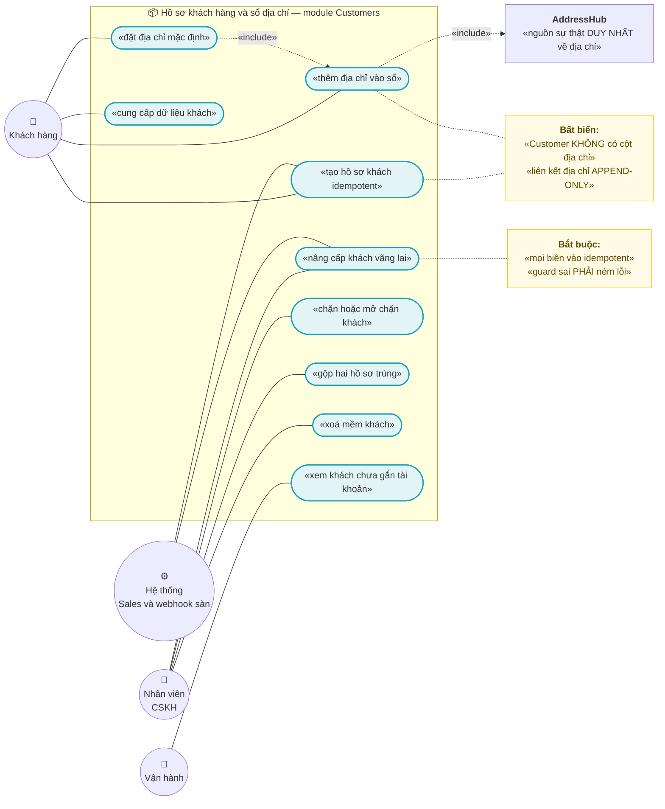
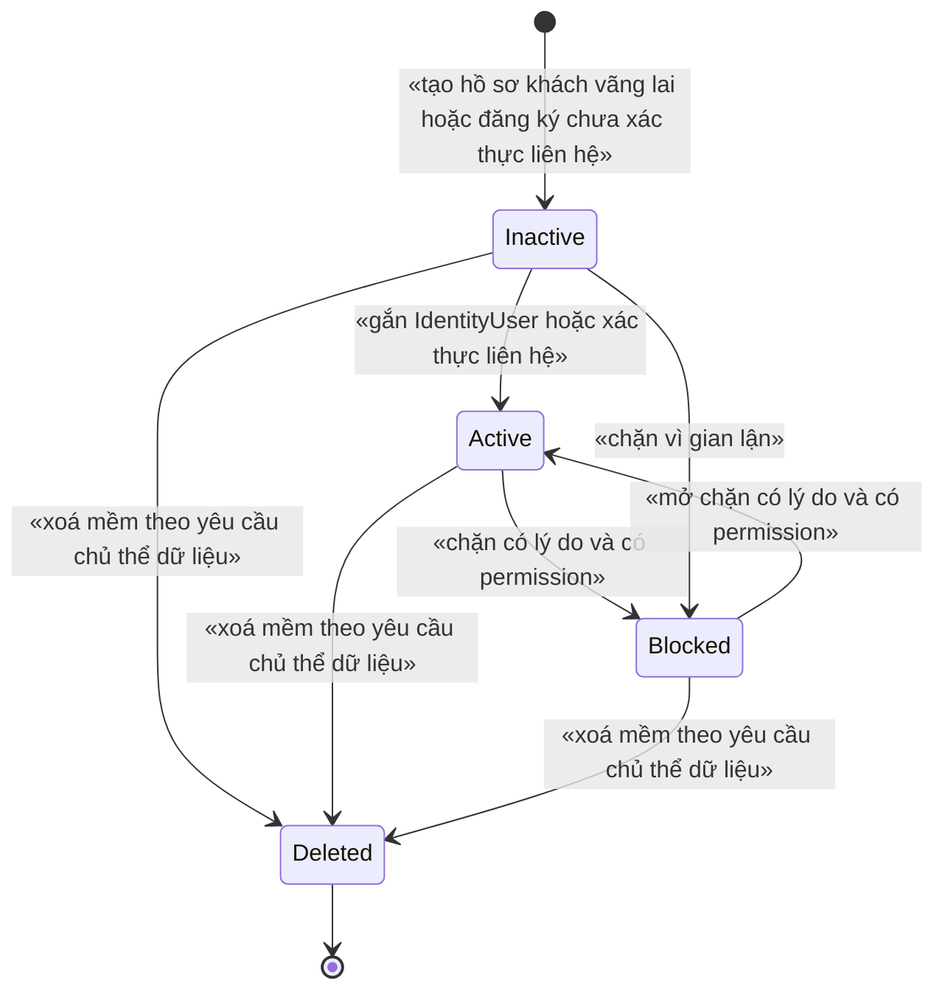
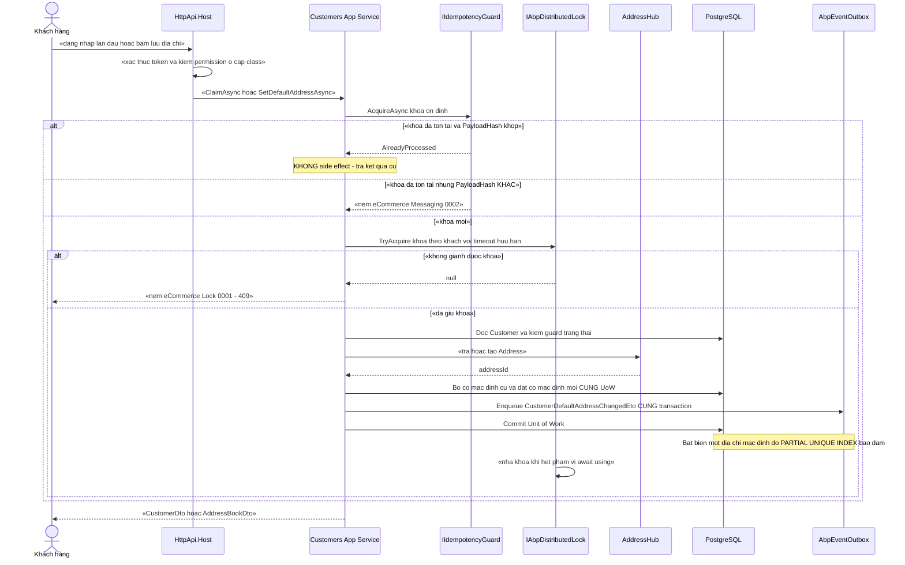
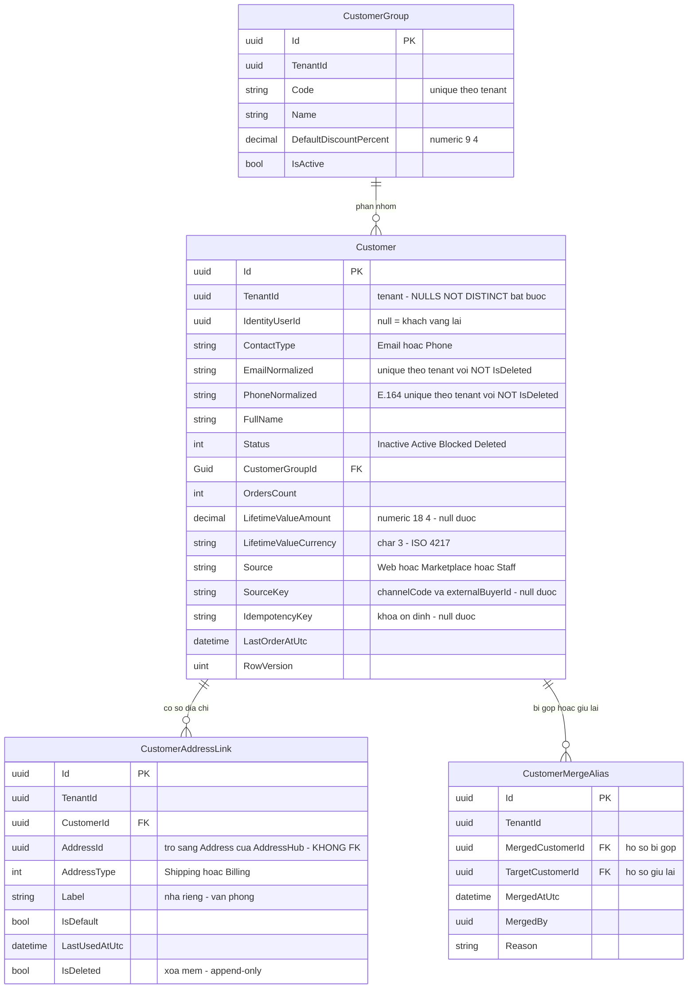

# `CUS-001` — Hồ sơ khách hàng và sổ địa chỉ

| Thuộc tính | Nội dung |
|---|---|
| **Mã** | `CUS-001` |
| **Module** | **Customers** — dự kiến `modules/Customers/eCommerce.Customers.{Domain,Application,Application.Contracts,EntityFrameworkCore}`. ⚠️ **Module này CHƯA tồn tại trong repo** (đã kiểm: `Test-Path modules/Customers` = `False`; `eCommerce.slnx` chỉ có `ChannelHub`, `PaymentHub`, `Tax`) |
| **Giai đoạn** | **GĐ1** — `docs/implementation-plan.md:412` (bảng `CUS-001` → `Customers`); danh sách GĐ1 ở `docs/implementation-plan.md:112` |
| **Ưu tiên** | **Must have** |
| **Trạng thái** | 🟡 `Draft` — chờ review · 🚧 **0 dòng code của feature này trong repo** |
| **Người viết / người review** | *(điền)* / **Kiến trúc trưởng + BA + Pháp chế dữ liệu cá nhân** |
| **Phiên bản / ngày** | `v0.1 — 13/10/2026` |
| **Tài liệu liên quan** | `XC-001` (Money/làm tròn) · `XC-002` (outbox/inbox + idempotency) · `XC-003` (khoá phân tán) · `XC-004` (xác thực/phân quyền/tenant) · `XC-005` (observability) · `XC-006` (thuế GTGT) · **`ADDR-001`/`ADDR-002`/`ADDR-003` (AddressHub — ⚠️ CHƯA có file tài liệu)** · `SAL-002` (đặt hàng — tạo khách vãng lai) · `SAL-003` (state machine đơn) · `EINV-001` (hoá đơn — đọc tên/MST/địa chỉ người mua) · `PRC-001` (nhóm khách ảnh hưởng giá) · `LOY-001` · `REV-001` · `WEB-001` (UI đăng nhập) · `docs/implementation-plan.md` · `docs/structure-and-techstack.md` |

---

## 0. Tóm tắt & quyết định thiết kế

**Tóm tắt:** `CUS-001` định nghĩa **hồ sơ khách hàng** (`Customer`, gắn tuỳ chọn với `IdentityUser` của ABP) và **sổ địa chỉ** của khách trên nền **`AddressHub` — nguồn sự thật DUY NHẤT về địa chỉ**. Tài liệu chốt 3 bất biến định hình toàn bộ thiết kế:

1. **`Address` thuộc `AddressHub`, KHÔNG thuộc `Customers`** — `Customers` chỉ giữ **liên kết + metadata sổ địa chỉ** (nhãn, cờ mặc định, thứ tự). Đây là cách duy nhất để tránh **mô hình địa chỉ hai nguồn sự thật** đã bị ghi nhận là anti-pattern phải tránh của dự án (`docs/business-modules-proposal.md:259`, `docs/implementation-plan.md:181`).
2. **Khách vãng lai là hạng nhất (first-class)**: `Order.CustomerId` là **`Guid?`** (`src/eCommerce.Domain/Entities/Orders/Order.cs:29`) ⇒ đơn không có khách **vẫn hợp lệ**; hệ thống **không** được bắt buộc tạo `Customer` để bán được. Khách vãng lai được **nâng cấp** (claim) thành khách có tài khoản bằng đường idempotent.
3. **Dữ liệu khách là dữ liệu cá nhân ⇒ có nghĩa vụ pháp lý**: **Luật Bảo vệ dữ liệu cá nhân số 91/2025/QH15** hiệu lực **01/01/2026** quy định quyền của chủ thể dữ liệu gồm *"Xem, chỉnh sửa hoặc yêu cầu chỉnh sửa dữ liệu cá nhân; Yêu cầu cung cấp, xóa, hạn chế xử lý dữ liệu cá nhân"* (khoản 1 Điều 4). Vì vậy **xoá khách là XOÁ MỀM** và **liên kết địa chỉ là APPEND-ONLY** (không hard-delete), để vừa thoả nghĩa vụ vừa giữ được **bất biến chứng từ** (hoá đơn, đơn hàng đã phát hành).

**Vì sao phải viết tài liệu này trước khi code — 3 lỗi im lặng đã xảy ra thật trong dự án:**

| # | Bài học (có bằng chứng trong repo) | Hệ quả bắt buộc cho `CUS-001` |
|---|---|---|
| 1 | **Mô hình địa chỉ hai nguồn sự thật** (nopCommerce: `Customer.StreetAddress…` + entity `Address` + `CustomerAddressMapping`) đã bị ghi là **anti-pattern phải tránh** — `docs/business-modules-proposal.md:259` | `Customer` **KHÔNG** có cột `Street`/`Ward`/`Province` nào. Có **test reflection** (`TC-14`) chặn tái phát |
| 2 | **Khoá phân tán có 2 nguồn sự thật ⇒ khoá không bảo vệ gì mà không có lỗi biên dịch** (`XC-003` §15.2 **F1**; bằng chứng `src/eCommerce.Domain.Shared/eCommerceConsts.cs:91-96` vs `modules/ChannelHub/eCommerce.ChannelHub.Domain/ChannelHubConsts.cs:23`) | Khoá lock của `Customers` **chỉ** nằm ở `CustomersConsts.LockKeys` — **cấm** viết literal khoá trong app service; **cấm** khai báo lại ở `eCommerceConsts` |
| 3 | **Guard trạng thái no-op im lặng làm sự kiện rơi không để lại dấu vết** (bài học `SetPaidStatus()` của eShop — `XC-002` §0 bài học #4; quy ước #11 ở `docs/structure-and-techstack.md:143`) | Mọi chuyển trạng thái `Customer` **phải NÉM LỖI** có mã (§3) |

**Phạm vi:**
- ✅ Entity `Customer` (gắn tuỳ chọn `IdentityUserId`), vòng đời trạng thái **có bảng guard ném lỗi**.
- ✅ Sổ địa chỉ: bảng liên kết `CustomerAddressLink` (nhãn, `AddressType`, cờ mặc định, ngày dùng gần nhất) trỏ tới `Address` của `AddressHub`.
- ✅ Bất biến **"tối đa MỘT địa chỉ mặc định cho mỗi (khách, loại địa chỉ)"** ở **tầng DB** (partial unique index + `NULLS NOT DISTINCT`).
- ✅ **Nâng cấp khách vãng lai** (claim) và **đăng ký** khách mới **idempotent** ở mọi biên vào.
- ✅ `CustomerGroup` (nhóm khách — dữ liệu tham chiếu cho `PRC-*`), **không** hard-code trong code.
- ✅ Hợp đồng `.Contracts` (`ICustomerDirectory`) để module khác **đọc snapshot** — **cấm** module khác đọc DB của `Customers`.
- ✅ Nghĩa vụ dữ liệu cá nhân: che PII khi log, xuất dữ liệu (quyền *"yêu cầu cung cấp"*), xoá mềm (quyền *"yêu cầu xóa"*).
- ✅ Hợp đồng API, mã lỗi, phân quyền, migration/seed, NFR, 16 test case.

**Không nằm trong phạm vi:**
- ❌ **Dữ liệu hành chính 2 cấp/3 cấp, mã địa chỉ theo hãng vận chuyển, chuẩn hoá địa chỉ** — thuộc **`ADDR-001`…`ADR-003`** (`docs/implementation-plan.md:387-389`). ⚠️ **Chưa có file tài liệu nào của `ADDR-*`** trong `docs/features/`; đây là **phụ thuộc chặn** (§15.1 **Q1**).
- ❌ **Giỏ hàng · checkout · đơn hàng · snapshot địa chỉ giao lên đơn** — thuộc `SAL-001`/`SAL-002`. `CUS-001` chỉ **đọc** sổ địa chỉ.
- ❌ **Đăng ký/đăng nhập, mật khẩu, 2FA, social login** — thuộc ABP Identity + `XC-004` + `WEB-001`.
- ❌ **Chính sách giá theo nhóm khách** — thuộc `PRC-001`/`PRC-002`; `CUS-001` chỉ **cung cấp** `CustomerGroupId`.
- ❌ **Xếp hạng khách (VIP/tier) và điểm thưởng** — thuộc `LOY-001` (`docs/features/loy-001-diem-thuong.md`).
- ❌ **Quy trình xử lý yêu cầu xoá/cung cấp dữ liệu cá nhân** (tiếp nhận, thời hạn, biên bản) — thuộc quy trình pháp chế; `CUS-001` chỉ cung cấp **API + dấu vết kỹ thuật**.
- ❌ **UI storefront/admin** — thuộc `WEB-*`; tài liệu này chỉ chốt **mapping dữ liệu** (§10).

### 0.1 Quyết định thiết kế (ADR ngắn)

| # | Quyết định | Phương án đã cân nhắc | Lý do chọn | Hệ số / Hệ quả |
|---|---|---|---|---|
| **ADR-01** | **`Address` do `AddressHub` sở hữu; `Customers` giữ bảng LIÊN KẾT `CustomerAddressLink`** | (a) `Customer` giữ cột địa chỉ (kiểu nopCommerce) · (b) `Customers` sở hữu entity `Address` · (c) **liên kết sang `AddressHub`** | (a) là **đúng anti-pattern** đã ghi nhận: *"Hai mô hình địa chỉ song song"* (`docs/business-modules-proposal.md:259`); (b) vi phạm quy ước module sở hữu miền của mình — địa chỉ 2 cấp/3 cấp + mã hãng vận chuyển là **miền riêng** (P0, `docs/structure-and-techstack.md:14`); (c) một nguồn sự thật duy nhất | `Customer` **0 cột địa chỉ**; có test reflection **TC-14** chặn. `Address` **KHÔNG** có `DbSet` trong `eCommerceDbContext` — nó thuộc DbContext của `AddressHub` |
| **ADR-02** | **Bảng liên kết là APPEND-ONLY + xoá mềm**, gỡ địa chỉ = `IsDeleted = true` | (a) xoá cứng khỏi sổ · (b) xoá mềm | Sổ địa chỉ là **chứng từ lịch sử**: cần biết khách từng dùng địa chỉ nào khi đối soát đơn/hàng hoàn. Xoá cứng ⇒ mất khả năng giải trình (*"đơn này giao tới đâu lúc đó"*). Đồng thời **Luật 91/2025/QH15 Điều 4** cho quyền *"yêu cầu xóa"* — nhưng nghĩa vụ đó được thoả bằng **xoá mềm + ẩn hoàn toàn khỏi truy vấn**, không phá chứng từ | Cần `IsDeleted` của ABP (đã bật: `IsDeleted` xuất hiện trong mọi bảng — `src/eCommerce.EntityFrameworkCore/Migrations/20261013012648_Add_Tax_Module.cs:37,67`); index unique phải **có filter `IsDeleted = false`** kèm `NULLS NOT DISTINCT` (§5.2) |
| **ADR-03** | **Khách vãng lai là hạng nhất**: `Customer` **tuỳ chọn**; `Order.CustomerId` giữ `Guid?` | (a) bắt buộc có `Customer` trước khi đặt hàng (tạo "khách ẩn danh") · (b) cho phép `null` | (a) đẻ ra hàng loạt bản ghi rác + **buộc** webhook sàn phải tạo khách trước khi tạo đơn (thêm một điểm hỏng cho mỗi webhook); (b) đúng hiện trạng code: `Order.CustomerId` là `Guid?` — `src/eCommerce.Domain/Entities/Orders/Order.cs:29`, và `docs/features/sal-002-checkout-va-dat-hang.md` dòng **A4** đã ghi *"Đặt hàng cho khách vãng lai … `CustomerId = null`"* | Không có ràng buộc khoá ngoại nào bắt buộc từ Đơn sang Khách; **nâng cấp vãng lai** là thao tác tường minh, idempotent (ADR-07) |
| **ADR-04** | **Chuyển trạng thái khách là STATE MACHINE NÉM LỖI** (`Inactive → Active → Blocked → Active`) | (a) `Status` là trường dữ liệu ai cũng ghi · (b) state machine có guard ném `BusinessException` | Quy ước bất di bất dịch **#11**: *"State machine phải NÉM lỗi, không im lặng"* (`docs/structure-and-techstack.md:143`). Khách `Blocked` mà vẫn đặt được hàng là **lỗ hổng kinh doanh** (khách chây nợ, gian lận COD) | Test **TC-01/TC-02/TC-03**; `Blocked` là **trạng thái hấp thụ có điều kiện** — chỉ `Unblock` mới ra, và phải có permission + lý do |
| **ADR-05** | **Idempotency key ỔN ĐỊNH** cho nâng cấp vãng lai, **sinh từ dữ liệu nghiệp vụ** | (a) `Guid.NewGuid()` mỗi lần · (b) key sinh từ `(tenantId, channelCode, externalOrderId)` / `(tenantId, contact)` | (a) retry ⇒ **khách trùng** (đúng lỗi `D7` của `XC-002`: *"khoá mới mỗi lần retry ⇒ mỗi retry là một giao dịch mới"* — `docs/features/XC-002-outbox-inbox-chong-trung-su-kien.md:59`); (b) khoá bất biến qua mọi lần thử | Có cột `IdempotencyKey` + **unique index** `(TenantId, IdempotencyKey)` với `NULLS NOT DISTINCT`; retry **đọc lại** kết quả, không tạo mới |
| **ADR-06** | **Bất biến "một địa chỉ mặc định" là RÀNG BUỘC DB**, không chỉ kiểm trong code | (a) chỉ kiểm trong domain service · (b) **partial unique index** | Đúng `XC-003` **D2**: *"nếu bỏ lock đi, DB có chặn không?"* — Redis chết thì lock vô hiệu nhưng app **vẫn chạy** (`AbortOnConnectFail = false`, `src/eCommerce.HttpApi.Host/eCommerceHttpApiHostModule.cs:141`, `:127`) ⇒ nếu chỉ dựa vào lock thì **2 địa chỉ cùng là mặc định, sai âm thầm** | `CREATE UNIQUE INDEX … WHERE "IsDefault" AND NOT "IsDeleted"` + `NULLS NOT DISTINCT` (§5.2, §11) — theo đúng tiền lệ migration `src/eCommerce.EntityFrameworkCore/Migrations/20261013024226_Fix_NullableTenantId_UniqueIndexes.cs` |
| **ADR-07** | **Nâng cấp khách vãng lai (claim) là thao tác ĐỔI CHỦ SỞ HỮU, không tạo bản ghi mới** | (a) tạo `Customer` mới rồi trỏ lại đơn · (b) gán `IdentityUserId` + `Contact` cho `Customer` cũ | (a) làm **hai khách cho một con người** ⇒ lịch sử mua, điểm thưởng (`LOY-001`), đánh giá (`REV-001`) **phân mảnh** không gộp được; (b) giữ được toàn bộ lịch sử | Guard: chỉ claim được khi `Customer.IdentityUserId IS NULL` **và** `Customer.Status <> Blocked`; vi phạm ⇒ **NÉM** `eCommerce:Customers:0004` |
| **ADR-08** | **Khoá phân tán cho 2 tài nguyên dùng chung** (đổi địa chỉ mặc định, claim khách) | (a) không khoá · (b) khoá toàn cục theo tenant · (c) **khoá theo `(tenantId, customerId)`** | `XC-003` **D7**: khoá toàn cục ⇒ khách A chặn khách B **vô cớ**. Tài nguyên là **của một khách** | Tên khoá ở `CustomersConsts.LockKeys`; theo `XC-003` **F5**, hàm sinh khoá **KHÔNG** chứa tiền tố `ecommerce:` (tiền tố do `AbpDistributedLockOptions.KeyPrefix` ghép — `src/eCommerce.HttpApi.Host/eCommerceHttpApiHostModule.cs:127`) |
| **ADR-09** | **`CustomerGroup` là DỮ LIỆU, không hard-code** | (a) enum `Retail/Wholesale/Vip` trong code · (b) bảng + seed | Cùng lý do đã chốt ở `XC-006` **D1**: nhóm khách là **đầu vào của bảng giá** (`PRC-001` §15.1 Q5 còn `Open`) ⇒ sẽ đổi theo chương trình kinh doanh; hard-code ⇒ phải release lại phần mềm | Bảng `CusGroups` + seed idempotent; `Customer.CustomerGroupId` nullable (`null` = khách lẻ mặc định) |
| **ADR-10** | **Giá trị tiền của khách lưu bằng CỘT RỜI `decimal` + `Currency`, KHÔNG dùng `Money` complex type** | (a) `Money LifetimeValue` · (b) **cột `numeric(18,4)` + `varchar(3)`** | `XC-001` **D6** + §15.1.1 **Q3**: `Money` là `readonly record struct` ⇒ làm complex type **nullable** vướng **bug #37559** chỉ vá ở EF Core 11, nên `XC-001` đã chốt *"tiền nullable vẫn dùng cột rời trên EF 10"* | `LifetimeValueAmount` (**nullable**) + `LifetimeValueCurrency`; **cấm** `double`/`float`; **cấm** so tiền bằng `==` (`XC-001` **BR-003**) |
| **ADR-11** | **Che PII ở tầng ghi log, không chỉ ở tầng hiển thị** | (a) nhắc nhở trong review · (b) **hàm mask bắt buộc + test quét** | PII của khách (email, SĐT, địa chỉ) **sẽ** lọt vào log nếu chỉ dựa vào kỷ luật — và log là nơi khó xoá nhất khi có yêu cầu xoá dữ liệu. Tiền lệ đã có trong repo: `PaymentTransaction.MaskSensitiveData` (được `LOY-001` **D**/**BR-009** dẫn lại) | Hàm `PiiMasker.Mask(email/phone)` là **đường duy nhất** để đưa PII vào log; test **TC-11** quét mã nguồn |
| **ADR-12** | **Module khác đọc khách qua `.Contracts`, CẤM đọc DB của `Customers`** | (a) `Sales` join thẳng `CusCustomers` · (b) **interface `ICustomerDirectory` ở `.Contracts`** | Quy ước bất di bất dịch **#3**: *"Mọi module sở hữu entity của mình; module → app là phụ thuộc ngược, cấm"* (`docs/structure-and-techstack.md:135`). Tiền lệ thật: `LOY-001` **D8** (`docs/features/loy-001-diem-thuong.md:80`) chọn ETO thay vì gọi thẳng | `eCommerce.Customers.Application.Contracts` chứa DTO/interface; **cấm** tham chiếu `.Domain` (đúng `XC-002` **D12**) |

> 📌 **Ghi lại cả phương án BỊ LOẠI và lý do** — để 6 tháng sau không ai hỏi lại *"sao không làm cách kia"*.
> 🔎 **Giới hạn của tài liệu này:** mọi khẳng định về **code hiện có** đều có **đường dẫn file + dòng** đã đọc/grep.
> Mọi thứ **chưa có trong code** đều ghi rõ **"chưa có trong code"**. Mọi con số **chưa đo được** ghi **"chưa kiểm chứng"**.

---

## 1. Use Case Specification

| Thuộc tính | Nội dung |
|---|---|
| **Use Case ID** | `CUS-001` |
| **Use Case Name** | Quản lý hồ sơ khách hàng và sổ địa chỉ, **không có hai nguồn sự thật về địa chỉ** |
| **Description** | *"Là hệ thống bán hàng đa kênh, tôi muốn mỗi khách hàng có **một** hồ sơ và **một** sổ địa chỉ duy nhất dùng chung cho website và mọi sàn, để đơn từ mọi kênh đều giao đúng chỗ, hoá đơn ghi đúng người mua, và khách vãng lai vẫn mua được mà không sinh bản ghi rác — đồng thời hệ thống tuân thủ nghĩa vụ bảo vệ dữ liệu cá nhân."* |
| **Actor(s)** | **Khách hàng** (đã xác thực — tự xem/sửa hồ sơ và sổ địa chỉ **của mình**) · **Nhân viên CSKH** (tra cứu, sửa, gộp khách — có permission) · **Quản trị tenant** (nhóm khách, chặn khách) · **Hệ thống** (`Sales` tạo khách vãng lai; `ChannelHub` webhook sàn; `EInvoiceHub` đọc người mua) · **Vận hành** (xem khách chưa gắn tài khoản, chạy đối soát) |
| **Priority** | **Must have** |
| **Trigger** | (a) khách tự đăng ký hoặc được tạo khi đặt đơn trên website; (b) webhook sàn tạo đơn cho khách **chưa có** trong hệ thống; (c) khách/nhân viên thêm–sửa–chọn địa chỉ; (d) khách đăng nhập lần đầu ⇒ **nâng cấp** hồ sơ vãng lai; (e) yêu cầu dữ liệu cá nhân (cung cấp/xoá) |
| **Pre-Condition(s)** | • **Tenant hiện tại** (`TenantId` từ `ICurrentTenant`). ⚠️ Hệ thống hiện chạy **1 tenant** và `TenantId` **có thể là `NULL`** ⇒ mọi unique index của feature **phải** dùng **`NULLS NOT DISTINCT`** (`XC-004` **BR-009** + bằng chứng thật ở `src/eCommerce.EntityFrameworkCore/Migrations/20261013024226_Fix_NullableTenantId_UniqueIndexes.cs:39-86`).<br>• **`AddressHub` đã có** và có API tra cứu/tạo `Address` — ⚠️ **CHƯA có trong code** (không có `modules/AddressHub`, không có tài liệu `ADDR-*`) ⇒ **phụ thuộc chặn GĐ1** (§15.1 **Q1**).<br>• **`IdentityUser`** tồn tại khi hồ sơ được gắn tài khoản — module Identity của ABP đã có (`src/eCommerce.EntityFrameworkCore/Migrations/20261009102044_Added_Identity.cs`).<br>• **`XC-002` đã bật outbox/inbox + `IIdempotencyGuard`** — ⚠️ **CHƯA có trong code**: không có `modules/Messaging`, không có `IIdempotencyGuard`/`InboxRecords` trong repo (đã grep toàn bộ `*.cs`) ⇒ **phụ thuộc chặn**.<br>• **`ChannelCode`**: **có** mặt ở **mọi biên vào từ kênh** (tạo khách vãng lai từ webhook sàn có `ChannelCode` + `ExternalOrderId`) và **không** tham gia quyết định hồ sơ/địa chỉ (khách hàng là **một người**, không phải một người trên mỗi kênh — xem §15.1 **Q4**). |
| **Post-Condition(s)** | • Mỗi khách có **đúng một** `Customer` trong tenant; `Email`/`Phone` chuẩn hoá là **duy nhất** trong tenant (trừ bản ghi đã xoá mềm).<br>• Sổ địa chỉ có **tối đa một** địa chỉ mặc định cho mỗi `(CustomerId, AddressType)` — **bảo đảm bởi DB**, không chỉ bởi code.<br>• Bản ghi liên kết địa chỉ **không bị xoá cứng**; gỡ địa chỉ ⇒ `IsDeleted = true` + bản ghi audit.<br>• Mọi lần nâng cấp vãng lai **idempotent**: cùng khoá ⇒ **0** khách mới.<br>• Mọi thay đổi hồ sơ/địa chỉ **có bản ghi audit** của ABP (`FullAuditedAggregateRoot` sẵn có — xem cách dùng ở `src/eCommerce.Domain/Entities/Orders/Order.cs:10`).<br>• Log **không** chứa PII thô. |
| **Basic Flow** | 1. **Tạo khách mới** (đăng ký trên web **hoặc** hệ thống tạo từ webhook sàn): app service gọi `IIdempotencyGuard.AcquireAsync(khoá ổn định)` — `AlreadyProcessed` ⇒ **trả kết quả cũ, kết thúc**.<br>2. Chuẩn hoá `Email` (trim + lowercase) và `Phone` (E.164 `+84…`), kiểm trùng trong tenant.<br>3. Tạo `Customer` ở trạng thái `Inactive` (chưa xác thực liên hệ) **hoặc** `Active` nếu có `IdentityUserId` hợp lệ; ghi trong **một Unit of Work**.<br>4. Phát `CustomerRegisteredEto` qua **outbox** (cùng transaction — `XC-002` BR-001).<br>5. **Thêm địa chỉ**: app service gọi `AddressHub` để **tra/tạo** `Address` ⇒ nhận `addressId` ⇒ ghi `CustomerAddressLink` (nhãn, `AddressType`, `IsDefault`, `LastUsedAtUtc`).<br>6. Nếu `IsDefault = true` ⇒ giành khoá `CustomersConsts.LockKeys.DefaultAddress(tenantId, customerId)` **trước** khi bỏ cờ mặc định của địa chỉ cũ và đặt cờ cho địa chỉ mới (bên trong khoá — `XC-003` **D6**: lock **không reentrant** ⇒ **cấm** acquire lồng).<br>7. **Nâng cấp vãng lai** (`ClaimAsync`): kiểm guard (ADR-07) ⇒ gán `IdentityUserId`, chuyển `Inactive → Active`, giữ **nguyên** `CustomerId` ⇒ lịch sử đơn/điểm/đánh giá **không phân mảnh**.<br>8. Kết thúc: ghi audit, phát ETO tương ứng, ghi metric. |
| **Alternative Flow** | **A1: Khách vãng lai mua không cần hồ sơ** — `Order.CustomerId = null`; đơn **vẫn hợp lệ** (`src/eCommerce.Domain/Entities/Orders/Order.cs:29`). Hệ thống **không** tạo `Customer` rỗng; chỉ tạo khi khách đăng ký hoặc khi có yêu cầu nghiệp vụ rõ (hoá đơn cần MST, hoặc chăm sóc khách).<br>**A2: Webhook sàn cho khách chưa có** — tạo hồ sơ **vãng lai có nguồn** (`Source = Marketplace`, `SourceKey = {channelCode}:{externalBuyerId}`) và ghi `CustomerAddressLink` trỏ tới `Address` được tạo từ địa chỉ giao của đơn; **khoá idempotency** `Customer:{tenantId}:{channelCode}:{externalBuyerId}` ⇒ webhook gửi lại **không** tạo khách thứ hai.<br>**A3: Địa chỉ sửa sai** — **KHÔNG** sửa `Address` tại chỗ nếu đã dùng cho đơn đã phát hành. Tạo **bản ghi `Address` mới** ở `AddressHub` + `CustomerAddressLink` mới, link cũ `IsDeleted = true`. (Đây là hệ quả trực tiếp của ADR-02 và của nguyên tắc snapshot `XC-006` **BR-002**: thay đổi cấu hình **không** làm đổi chứng từ cũ.)<br>**A4: Gỡ địa chỉ đang là mặc định** — hệ thống **tự** chọn địa chỉ còn lại **dùng gần nhất** làm mặc định; **0** địa chỉ còn lại ⇒ **không** có mặc định (hợp lệ, không phải lỗi).<br>**A5: Khách trùng (2 hồ sơ cho 1 người)** — nhân viên dùng `POST /merge` với `Idempotency-Key`; hệ thống **gộp** theo hướng dẫn §6.1: đơn/điểm/đánh giá **giữ nguyên** `CustomerId` cũ ⇒ **gộp bằng alias** (`CustomerMergeAlias`), **cấm** UPDATE hàng loạt `Order.CustomerId` (sẽ chạm DB của module `Sales`). |
| **Exception Flow** | **E1:** `Email`/`Phone` đã tồn tại trong tenant ⇒ **NÉM** `eCommerce:Customers:0002` (kèm `customerId` hiện có để UI gợi ý "đăng nhập / gộp").<br>**E2:** cùng `IdempotencyKey` nhưng **`PayloadHash` khác** ⇒ **NÉM** `eCommerce:Messaging:0002` (theo `XC-002` **BR-006**) — **cấm** coi là bản ghi trùng.<br>**E3:** chuyển trạng thái sai (ví dụ `Blocked → Inactive`, `Deleted → Active`) ⇒ **NÉM** `eCommerce:Customers:0001` — **cấm** no-op im lặng (quy ước #11).<br>**E4:** claim khi khách **đã có** `IdentityUserId` ⇒ **NÉM** `eCommerce:Customers:0004`.<br>**E5:** `AddressHub` không tìm thấy/không tạo được `Address` (mã tỉnh/xã không hợp lệ, hoặc `AddressHub` chưa sẵn sàng) ⇒ **NÉM** `eCommerce:Customers:0003` + **giữ nguyên** dữ liệu đã ghi trong transaction (rollback toàn bộ UoW).<br>**E6:** xoá khách **đã có đơn** ⇒ **NÉM** `eCommerce:Customers:0005`: khách **phải** được xoá mềm (§9/§10), **cấm** hard-delete — đây là **bất biến chứng từ** (hoá đơn đã phát hành phải tra được người mua).<br>**E7:** thao tác lên khách **thuộc tenant khác** ⇒ trả **`404`** (**không** `403`) — `XC-004` **BR-008**, không tiết lộ sự tồn tại.<br>**E8:** `UPDATE … WHERE Status = @expected` ảnh hưởng **0 dòng** (luồng khác đã đổi) ⇒ **NÉM** `eCommerce:Customers:0006`, **không** coi là thành công (`XC-002` **BR-008**). |
| **Business Rules** | • **BR-CUS-0001**: `Customer` **KHÔNG** chứa bất kỳ trường địa chỉ nào (`Street`/`Ward`/`District`/`Province`/`FullAddress`). Mọi địa chỉ là `Address` của `AddressHub`, tham chiếu qua `CustomerAddressLink`. **Cấm** hai nguồn sự thật về địa chỉ.<br>• **BR-CUS-0002**: Mỗi `(TenantId, CustomerId, AddressType)` có **tối đa MỘT** địa chỉ mặc định; bảo đảm bằng **partial unique index** ở DB (ADR-06) — **không** chỉ bằng kiểm tra trong domain.<br>• **BR-CUS-0003**: `CustomerAddressLink` là **APPEND-ONLY + xoá mềm**; **CẤM** `DELETE` cứng và **CẤM** sửa `AddressId` của một liên kết đã tồn tại (sửa địa chỉ = tạo liên kết mới).<br>• **BR-CUS-0004**: `Email`/`Phone` **bắt buộc chuẩn hoá** (trim; email lowercase; phone E.164) trước khi lưu và **duy nhất trong tenant** với các bản ghi `NOT IsDeleted` (`NULLS NOT DISTINCT`).<br>• **BR-CUS-0005**: Mọi chuyển trạng thái `Customer` **phải** có guard và **phải NÉM** `BusinessException` có mã khi sai; **cấm** no-op im lặng (quy ước #11).<br>• **BR-CUS-0006**: Mọi **biên vào** (HTTP tạo/sửa khách, webhook sàn, job nâng cấp/đối soát) **phải** idempotent qua `IIdempotencyGuard` **trước** mọi side effect (`XC-002` **BR-004**).<br>• **BR-CUS-0007**: Idempotency key **ổn định** và **sinh từ dữ liệu nghiệp vụ**; **CẤM** `Guid.NewGuid()` cho mỗi lần gọi (`XC-002` **BR-007**, **D7**).<br>• **BR-CUS-0008**: Giá trị tiền (giá trị vòng đời, hạn mức) là **`decimal` + `Currency` cột rời**; **CẤM** `double`/`float` (`XC-001` **BR-008**); **CẤM** so sánh tiền bằng `==` — dùng `>=`/`<=`/`decimal.Compare` (`XC-001` **BR-003**).<br>• **BR-CUS-0009**: Mọi thao tác ghi đi qua **Unit of Work**; dữ liệu nghiệp vụ + bản ghi **outbox** + **audit** ghi trong **cùng** transaction (`XC-002` **BR-001**, quy ước #13 ở `docs/structure-and-techstack.md:145`).<br>• **BR-CUS-0010**: Khoá phân tán **chỉ** dùng cho tài nguyên chia sẻ: **đổi địa chỉ mặc định** (khoá theo khách) và **claim/merge** (khoá theo khách). Khoá **phải** sinh từ `CustomersConsts.LockKeys`; **CẤM** literal khoá trong code nghiệp vụ (`XC-003` **BR-001/BR-002**).<br>• **BR-CUS-0011**: **CẤM** hard-delete `Customer` khi đã có `OrdersCount > 0` **hoặc** đã gắn `IdentityUserId`; xoá là **xoá mềm + ẩn khỏi mọi truy vấn**. Vi phạm ⇒ `eCommerce:Customers:0005`.<br>• **BR-CUS-0012**: **CẤM** đưa PII thô (email, số điện thoại, địa chỉ đầy đủ, `IdentityUserId`) vào **log** ở mức `Information` trở lên; mọi log PII **phải** đi qua hàm mask (ADR-11).<br>• **BR-CUS-0013**: **CẤM** trả PII của khách khác; truy vấn danh sách **luôn** lọc theo tenant + theo quyền; lỗi truy cập chéo tenant ⇒ **`404`** (`XC-004` **BR-008**).<br>• **BR-CUS-0014**: Mọi thay đổi hồ sơ/địa chỉ **phải** có **audit** truy được *ai · khi nào · cũ → mới*; đổi **địa chỉ mặc định** và **chặn/mở chặn** khách **bắt buộc** có lý do (`Reason`).<br>• **BR-CUS-0015**: `CustomerGroup` là **dữ liệu** (không hard-code); đổi nhóm khách **không** hồi tố giá/chứng từ đã phát sinh (đơn cũ giữ snapshot giá — `SAL-002` ADR-02).<br>• **BR-CUS-0016**: Module khác **CẤM** đọc bảng `Cus*`; **chỉ** đọc qua `ICustomerDirectory` ở `.Contracts` (ADR-12).<br>• **BR-CUS-0017**: Tuân thủ **Luật BVDLCN 91/2025/QH15** khoản 1 Điều 4 (hiệu lực **01/01/2026**): hệ thống **phải** có đường (a) **cung cấp** dữ liệu khách (quyền *"yêu cầu cung cấp"*), (b) **xoá** dữ liệu khách (quyền *"yêu cầu xóa"*) — cả hai **có dấu vết audit** và **không** phá bất biến chứng từ. |
| **Non-Functional Requirement** | • **NFR-CUS-0001**: `GET /api/app/customers/{id}` p95 **< 150 ms** với 50.000 khách/tenant (⚠️ **chưa kiểm chứng** — chưa có code).<br>• **NFR-CUS-0002**: Danh sách khách (phân trang 20) p95 **< 300 ms**.<br>• **NFR-CUS-0003**: Nâng cấp vãng lai gửi **100 lần** ⇒ **đúng 1** khách (NFR idempotency).<br>• **NFR-CUS-0004**: **0** PII thô trong log — test quét mã nguồn + test log thật.<br>• **NFR-CUS-0005**: **100 %** thay đổi hồ sơ/địa chỉ có bản ghi audit trong **< 1 s**.<br>• **NFR-CUS-0006**: Cách ly tenant: tenant A **không** đọc/ghi được dữ liệu tenant B — **0** rò rỉ (integration test 2 tenant).<br>• **NFR-CUS-0007**: **100 %** app service có `[Authorize]` ở **cấp class**; **0** permission dùng mà chưa định nghĩa (`XC-004` **BR-001/BR-002** + test reflection **TC-01/TC-02** của `XC-004`).<br>• **NFR-CUS-0008**: **0** unique index nào của module thiếu `NULLS NOT DISTINCT` (test schema — mở rộng `test/eCommerce.IntegrationTests/PostgreSqlSchemaTests.cs:144`).<br>• **NFR-CUS-0009**: Bất biến "một địa chỉ mặc định" **đúng khi Redis chết**: dừng Redis ⇒ DB vẫn chặn (integration test, cùng tinh thần `XC-003` **TC-11**).<br>• **NFR-CUS-0010**: API **cung cấp** dữ liệu khách trả **đầy đủ** hồ sơ + sổ địa chỉ + lịch sử liên kết trong **1** lần gọi (không phân trang cắt cụt) — phục vụ nghĩa vụ *"yêu cầu cung cấp"*. |

---

## 2. Sơ đồ Use Case



### Chú giải

| Ký hiệu | Ý nghĩa |
|---|---|
| ⭕ Xanh lá | Actor (người dùng + hệ thống) |
| 🟦 Bầu dục xanh dương | Use Case |
| 🟨 Khung vàng | Note (bất biến / ràng buộc) |
| `───` | Liên kết Actor ↔ Use Case |
| `-.«include».->` | Quan hệ bao hàm |
| `ADDR` (hình chữ nhật, không viền màu) | Hệ thống ngoài module — **AddressHub** |

---

## 3. Sơ đồ trạng thái (state machine)

### 3.1 Vòng đời `Customer`



**Bảng chuyển trạng thái & guard (mọi chuyển sai **PHẢI NÉM LỖI**, không im lặng):**

| # | Từ → Sang | Guard (điều kiện cho phép) | Ai được phép chuyển | Side effect kèm theo | Nếu guard sai thì? |
|---|---|---|---|---|---|
| 1 | `[*]` → `Inactive` | Có `Contact` (email **hoặc** phone) chuẩn hoá hợp lệ **và** chưa trùng trong tenant | Khách (tự đăng ký) · Hệ thống (`Sales`, webhook sàn) | Ghi `Customer` + outbox `CustomerRegisteredEto` **cùng UoW** | **NÉM** `eCommerce:Customers:0002` (trùng) / `eCommerce:Customers:0007` (contact không hợp lệ) |
| 2 | `[*]` → `Active` | Có `IdentityUserId` hợp lệ **và** user thuộc tenant hiện tại | Hệ thống (sau khi IdentityUser được tạo) | Outbox `CustomerRegisteredEto` | **NÉM** `eCommerce:Customers:0007` |
| 3 | `Inactive` → `Active` | (`IdentityUserId` được gán) **hoặc** (liên hệ đã xác thực) | Khách · CSKH | Outbox `CustomerActivatedEto` | **NÉM** `eCommerce:Customers:0001` |
| 4 | `Active` → `Blocked` | Người gọi có `eCommerce.Customers.Block` **và** `Reason` không rỗng | CSKH · Quản trị tenant | Outbox `CustomerBlockedEto` + audit (`Reason`) + metric | **NÉM** `eCommerce:Customers:0001` / `403` |
| 5 | `Inactive` → `Blocked` | như trên | CSKH · Quản trị tenant | như trên | **NÉM** `eCommerce:Customers:0001` |
| 6 | `Blocked` → `Active` | Người gọi có `eCommerce.Customers.Block` **và** `Reason` không rỗng (lý do mở chặn) | CSKH · Quản trị tenant | Outbox `CustomerUnblockedEto` + audit + metric | **NÉM** `eCommerce:Customers:0001` |
| 7 | `{Inactive, Active, Blocked}` → `Deleted` | Người gọi có `eCommerce.Customers.Delete` **và** (`OrdersCount <= 0` **hoặc** đã xác nhận giữ chứng từ) | CSKH · Quản trị tenant | **XOÁ MỀM** + ẩn toàn bộ `CustomerAddressLink` (kể cả `IsDefault`) + audit | **NÉM** `eCommerce:Customers:0005` nếu cố hard-delete; `eCommerce:Customers:0001` nếu `Deleted → *` |
| 8 | `Deleted` → bất kỳ | **KHÔNG** có guard nào cho phép | — | — | **Trạng thái HẤP THỤ**: mọi chuyển dịch khỏi `Deleted` ⇒ **NÉM** `eCommerce:Customers:0001`. Muốn "khôi phục" ⇒ **tạo hồ sơ mới** (không tái sinh bản ghi đã xoá) |
| 9 | chuyển **lùi** bất kỳ (`Blocked → Inactive`, `Active → Inactive`) | **KHÔNG** có guard nào cho phép | — | — | **NÉM** `eCommerce:Customers:0001` — **cấm** tuyệt đối (đồng quy tắc `NOT-002` **BR-004**) |

> ⚠️ **Quy tắc bất di bất dịch #11** (`docs/structure-and-techstack.md:143`): guard sai **phải NÉM LỖI** (hoặc ghi log có cấu trúc), **không** im lặng.
> **Trạng thái hấp thụ (absorbing):** `Deleted`. `Blocked` **không** hấp thụ vì còn đường `Unblock` **có kiểm soát**.
> **Ai được phép chuyển:** do **app service có permission** (người) hoặc **job/hệ thống** (không người) — **không** có đường nào để domain tự đổi trạng thái mà bỏ qua guard.

### 3.2 Vòng đời `CustomerAddressLink` (sổ địa chỉ)

| # | Từ → Sang | Guard | Side effect | Nếu guard sai thì? |
|---|---|---|---|---|
| 1 | `[*]` → `Liên kết thường` | `Address` tồn tại **và** thuộc tenant hiện tại/địa chỉ dùng chung; `Label` ≤ 128 ký tự; chưa có liên kết **trùng** `(CustomerId, AddressId, AddressType)` còn hiệu lực | Ghi `CustomerAddressLink` (`IsDefault = false`, `IsDeleted = false`) | **NÉM** `eCommerce:Customers:0003` (không có address) / `eCommerce:Customers:0008` (liên kết trùng) |
| 2 | `Liên kết thường` → `Mặc định` | Giành được khoá `CustomersConsts.LockKeys.DefaultAddress(tenantId, customerId)` **và** `AddressType` khớp **và** `Customer.Status <> Deleted` | Trong **cùng** UoW: bỏ cờ mặc định của địa chỉ cũ **cùng `AddressType`** + đặt cờ cho liên kết này + audit `Reason` (nếu do nhân viên) + outbox `CustomerDefaultAddressChangedEto` | Không giành được khoá ⇒ **NÉM** `eCommerce:Lock:0001` (`XC-003` **BR-010**) — **cấm** bỏ qua im lặng |
| 3 | `Mặc định` → `Liên kết thường` | Bỏ cờ mặc định tường minh | Ghi audit | **NÉM** `eCommerce:Customers:0001` nếu liên kết không ở trạng thái `Mặc định` |
| 4 | `bất kỳ (còn hiệu lực)` → `Đã gỡ` | Người gọi có quyền trên sổ địa chỉ của khách (khách tự gỡ **hoặc** CSKH) | `IsDeleted = true` (+ `DeletedAtUtc` do ABP cung cấp); nếu liên kết đang là **mặc định** ⇒ chạy **A4** (tự chọn địa chỉ dùng gần nhất) | — (thao tác hợp lệ); nếu liên kết **đã** ở `Đã gỡ` ⇒ **NÉM** `eCommerce:Customers:0001` |
| 5 | `Đã gỡ` → `bất kỳ` | **KHÔNG** cho phép "bỏ xoá" (un-delete) | — | **NÉM** `eCommerce:Customers:0001`. Muốn dùng lại ⇒ tạo **liên kết mới** trỏ cùng `Address` (được phép, xem bất biến 5 ở §8.1) |
| 6 | `sửa AddressId của liên kết đã tồn tại` | **KHÔNG** cho phép | — | **NÉM** `eCommerce:Customers:0009` (**BR-CUS-0003** — append-only) |

---

## 4. Sequence Diagram & luồng dữ liệu

### 4.1 Sequence — nâng cấp khách vãng lai + đặt địa chỉ mặc định (biên vào idempotent)



### 4.2 Quy tắc trình tự BẮT BUỘC (đọc kèm §4.1 — thay cho sơ đồ DFD để giữ ngân sách 3 sơ đồ)

> Mục này **không** có sơ đồ (đã dùng hết ngân sách 3 sơ đồ: §2, §3.1, §4.1). Trình tự dưới đây **bắt buộc** —
> mọi sai khác thứ tự đều là **lỗi thiết kế**, không phải lựa chọn phong cách.

| # | Bước | Bắt buộc vì | Nếu đảo thứ tự thì sao |
|---|---|---|---|
| 1 | **Xác thực + kiểm permission** (cấp class) | `XC-004` **D3/BR-001** — ABP không tự bảo vệ app service | Endpoint hở; `TC-01` của `XC-004` đỏ |
| 2 | **Kiểm chủ sở hữu** (`Customer.IdentityUserId == CurrentUser.Id`) khi actor là khách | `BR-CUS-0013` | Khách A sửa hồ sơ khách B — **lỗ hổng dữ liệu cá nhân** |
| 3 | **`IIdempotencyGuard.AcquireAsync`** với khoá ổn định | `BR-CUS-0006/0007`, `XC-002` **BR-004** — *trước* mọi side effect | Retry/webhook trùng ⇒ **khách trùng** |
| 4 | **Giành khoá phân tán** (chỉ với thao tác đổi mặc định/claim/merge) | `BR-CUS-0010`, `XC-003` **D6** (không acquire lồng) | Hai luồng cùng đổi mặc định ⇒ dựa hoàn toàn vào DB |
| 5 | **Đọc `Customer` + kiểm guard trạng thái** | `BR-CUS-0005` — guard sai **phải NÉM** | No-op im lặng ⇒ thao tác "thành công" mà không làm gì |
| 6 | **Gọi `AddressHub`** tra/tạo `Address` | ADR-01 — `Address` là nguồn sự thật duy nhất | Copy cột địa chỉ vào `Customer` ⇒ **anti-pattern** (`TC-14` đỏ) |
| 7 | **Ghi `Customer` + `CustomerAddressLink` + outbox + audit** trong **cùng** UoW | `BR-CUS-0009`, `XC-002` **BR-001** | Dual-write ⇒ mất sự kiện hoặc dữ liệu lệch |
| 8 | **Commit**, rồi **nhả khoá** (`await using` kết thúc) | `XC-003` §12 — phạm vi khoá **bao ngoài** UoW | Khoá nhả trước commit ⇒ luồng khác đọc dữ liệu cũ |
| 9 | **Ghi log đã mask PII** | `BR-CUS-0012` | PII vào log ⇒ khó xoá khi có yêu cầu dữ liệu cá nhân |

---

## 5. Mô hình dữ liệu

### 5.1 ERD



> 📌 **Đọc kỹ:** quan hệ `CustomerAddressLink → Address` **KHÔNG** có khoá ngoại trong ERD **và** trong DB.
> `Address` thuộc **`AddressHub`** — module khác ⇒ theo quy ước #3 (`docs/structure-and-techstack.md:135`) và **ADR-12**,
> ta dùng **tham chiếu mềm bằng `Guid`**. Tiền lệ trong repo: `docs/features/rev-001-danh-gia-san-pham.md` ghi rõ
> *"tham chiếu **mềm** bằng `Guid` — module **không** có khoá ngoại sang bảng của module khác"*.

### 5.2 Bảng & cột (Data Dictionary)

**Bảng `CusCustomers`** — hồ sơ khách hàng (⚠️ **chưa có trong code**; tên bảng đề xuất theo tiền tố `Cus`)

| Cột | Kiểu | Null? | Ý nghĩa | Ghi chú |
|---|---|---|---|---|
| `Id` | `uuid` | ✖ | khoá chính | `FullAuditedAggregateRoot<Guid>` (mẫu: `src/eCommerce.Domain/Entities/Orders/Order.cs:10`) |
| `TenantId` | `uuid` | ✔ | tenant sở hữu | **bắt buộc** `IMultiTenant`; `NULL` khi chạy 1 tenant (`XC-004` §5.2 **F1**) |
| `IdentityUserId` | `uuid` | ✔ | tài khoản ABP Identity | `null` = **khách vãng lai** (ADR-03). **KHÔNG** có FK cứng sang `AbpUsers` nếu muốn tách module — xem §15.1 **Q5** |
| `ContactType` | `int` | ✖ | `Email=0` · `Phone=1` | kênh liên hệ chính |
| `EmailNormalized` | `varchar(320)` | ✔ | email đã trim + lowercase | RFC 5321 tối đa 320 ký tự |
| `PhoneNormalized` | `varchar(20)` | ✔ | E.164 (`+84…`) | **cấm** lưu số thô chưa chuẩn hoá |
| `FullName` | `varchar(256)` | ✖ | tên khách | snapshot dùng cho hoá đơn (`EINV-001`) — ⚠️ hoá đơn **vẫn phải** snapshot riêng |
| `Status` | `int` | ✖ | `Inactive=0` · `Active=1` · `Blocked=2` · `Deleted=3` | theo §3.1 |
| `CustomerGroupId` | `uuid` | ✔ | nhóm khách | `null` = khách lẻ mặc định |
| `OrdersCount` | `int` | ✖ | số đơn **đã đặt** (mọi kênh) | cập nhật bởi consumer ETO (§7.2) — **không** truy vấn chéo module |
| `LifetimeValueAmount` | `numeric(18,4)` | ✔ | tổng giá trị đơn **hoàn tất** | ⚠️ **`decimal`, KHÔNG BAO GIỜ `double`** (`XC-001` **BR-008**); `HasPrecision(18, 4)` — tiền lệ `src/eCommerce.EntityFrameworkCore/eCommerceDbContext.cs:173-178` |
| `LifetimeValueCurrency` | `char(3)` | ✔ | ISO-4217 HOA | theo `XC-001` §5.2; **cột rời** vì nullable (ADR-10) |
| `Source` | `int` | ✖ | `Web=0` · `Marketplace=1` · `Staff=2` · `Import=3` | nguồn hồ sơ |
| `SourceKey` | `varchar(128)` | ✔ | `{channelCode}:{externalBuyerId}` | **có** khi `Source = Marketplace` |
| `IdempotencyKey` | `varchar(200)` | ✔ | khoá ổn định của lần tạo | **unique** theo tenant (ADR-05) |
| `LastOrderAtUtc` | `timestamptz` | ✔ | lần đặt hàng gần nhất | phục vụ U9 "khách chưa gắn tài khoản" + phân khúc |
| `RowVersion` | `bytea`/`xmin` | ✖ | optimistic concurrency | ABP `ConcurrencyStamp` sẵn có; dùng cho guard §3.1 |

**Bảng `CusAddressLinks`** — **sổ địa chỉ** (bảng liên kết; **APPEND-ONLY + xoá mềm**)

| Cột | Kiểu | Null? | Ý nghĩa | Ghi chú |
|---|---|---|---|---|
| `Id` | `uuid` | ✖ | khoá chính | |
| `TenantId` | `uuid` | ✔ | tenant | |
| `CustomerId` | `uuid` | ✖ | khách sở hữu | FK **trong cùng module** ⇒ **có** FK cứng được |
| `AddressId` | `uuid` | ✖ | `Address` của `AddressHub` | 🚨 **tham chiếu MỀM** — **KHÔNG** FK (ADR-01, ADR-12). **Chưa kiểm chứng** được hành vi khi `Address` bị xoá mềm ở `AddressHub` ⇒ **Q1** §15.1 |
| `AddressType` | `int` | ✖ | `Shipping=0` · `Billing=1` | tách sổ theo mục đích; bất biến "một mặc định" áp **theo từng loại** |
| `Label` | `varchar(128)` | ✔ | "Nhà riêng", "Văn phòng" | chỉ để hiển thị |
| `IsDefault` | `bool` | ✖ | mặc định cho `AddressType` này | bảo vệ bằng partial unique index |
| `LastUsedAtUtc` | `timestamptz` | ✔ | lần dùng gần nhất trên đơn | dùng cho **A4** (tự chọn mặc định thay thế) |
| `IsDeleted` / `DeletedAtUtc` / `DeleterId` | `bool` / `timestamptz` / `uuid` | — | xoá mềm của ABP | gỡ địa chỉ = xoá mềm (**BR-CUS-0003**) |

**Bảng `CusGroups`** — nhóm khách (**dữ liệu**, không hard-code — ADR-09)

| Cột | Kiểu | Null? | Ý nghĩa | Ghi chú |
|---|---|---|---|---|
| `Id` | `uuid` | ✖ | khoá chính | |
| `TenantId` | `uuid` | ✔ | tenant | |
| `Code` | `varchar(32)` | ✖ | mã nhóm (`RETAIL`, `WHOLESALE`, `VIP`) | **unique** theo tenant |
| `Name` | `varchar(128)` | ✖ | tên hiển thị | |
| `DefaultDiscountPercent` | `numeric(9,4)` | ✔ | % giảm mặc định gợi ý cho `PRC-*` | ⚠️ **`decimal`**, KHÔNG `double`; mẫu `HasPrecision(9, 4)` — tiền lệ `modules/Tax/eCommerce.Tax.EntityFrameworkCore/TaxDbContextModelCreatingExtensions.cs:33` |
| `IsActive` | `bool` | ✖ | ngừng dùng nhóm | **cấm xoá cứng** nhóm đang được dùng |

**Bảng `CusMergeAliases`** — gộp hồ sơ trùng (A5)

| Cột | Kiểu | Null? | Ý nghĩa | Ghi chú |
|---|---|---|---|---|
| `Id` | `uuid` | ✖ | khoá chính | |
| `TenantId` | `uuid` | ✔ | tenant | |
| `MergedCustomerId` | `uuid` | ✖ | hồ sơ **bị** gộp (giữ nguyên, chuyển `Deleted`) | **unique** theo tenant |
| `TargetCustomerId` | `uuid` | ✖ | hồ sơ **giữ lại** | `<> MergedCustomerId` (CHECK) |
| `MergedAtUtc` / `MergedBy` / `Reason` | `timestamptz` / `uuid` / `varchar(512)` | ✖ | dấu vết | phục vụ khiếu nại |

**Index & ràng buộc** *(đây là phần hay bị bỏ sót nhất — phải liệt kê hết)*

| Bảng | Loại | Cột | Mục đích |
|---|---|---|---|
| `CusCustomers` | **UNIQUE** `NULLS NOT DISTINCT` | `(TenantId, EmailNormalized) WHERE NOT "IsDeleted"` | chống trùng email (**BR-CUS-0004**) |
| `CusCustomers` | **UNIQUE** `NULLS NOT DISTINCT` | `(TenantId, PhoneNormalized) WHERE NOT "IsDeleted"` | chống trùng SĐT |
| `CusCustomers` | **UNIQUE** `NULLS NOT DISTINCT` | `(TenantId, IdempotencyKey) WHERE "IdempotencyKey" IS NOT NULL` | **idempotency** tạo khách (ADR-05) |
| `CusCustomers` | **UNIQUE** `NULLS NOT DISTINCT` | `(TenantId, IdentityUserId) WHERE "IdentityUserId" IS NOT NULL` | **một** hồ sơ cho **một** tài khoản |
| `CusCustomers` | **UNIQUE** `NULLS NOT DISTINCT` | `(TenantId, Source, SourceKey) WHERE "SourceKey" IS NOT NULL` | **idempotency** webhook sàn (A2) |
| `CusCustomers` | INDEX | `(TenantId, Status, LastOrderAtUtc)` | danh sách + phân khúc |
| `CusAddressLinks` | **UNIQUE** `NULLS NOT DISTINCT` | `(TenantId, CustomerId, AddressId, AddressType) WHERE NOT "IsDeleted"` | chống liên kết trùng (bất biến 5) |
| `CusAddressLinks` | **UNIQUE PARTIAL** `NULLS NOT DISTINCT` | `(TenantId, CustomerId, AddressType) WHERE "IsDefault" AND NOT "IsDeleted"` | 🚨 **BẤT BIẾN "một địa chỉ mặc định"** (**BR-CUS-0002**, ADR-06) |
| `CusAddressLinks` | INDEX | `(TenantId, CustomerId, IsDeleted, AddressType)` | đọc sổ địa chỉ |
| `CusAddressLinks` | INDEX | `(TenantId, AddressId)` | tra **địa chỉ này đang được khách nào dùng** (hữu ích khi `AddressHub` đổi/ẩn địa chỉ) |
| `CusGroups` | **UNIQUE** `NULLS NOT DISTINCT` | `(TenantId, Code)` | chống trùng mã nhóm |
| `CusMergeAliases` | **UNIQUE** `NULLS NOT DISTINCT` | `(TenantId, MergedCustomerId)` | một hồ sơ chỉ bị gộp **một lần** |
| `CusMergeAliases` | CHECK | `"MergedCustomerId" <> "TargetCustomerId"` | không tự gộp chính mình |
| `CusCustomers` | CHECK | `"LifetimeValueCurrency" IS NULL OR "LifetimeValueCurrency" ~ '^[A-Z]{3}$'` | mã tiền tệ hợp lệ (`XC-001` §5.2) |
| `CusCustomers` | CHECK | `"ContactType" <> 0 OR "EmailNormalized" IS NOT NULL` | `Email` ⇒ phải có email |
| `CusCustomers` | CHECK | `"ContactType" <> 1 OR "PhoneNormalized" IS NOT NULL` | `Phone` ⇒ phải có SĐT |
| `CusCustomers` | CHECK | `"Source" <> 1 OR "SourceKey" IS NOT NULL` | nguồn sàn ⇒ phải có `SourceKey` |

> 🚨 **Vì sao `WHERE NOT "IsDeleted"` lại BẮT BUỘC:** ABP bật **soft-delete** — đã kiểm chứng `IsDeleted` có mặt trên **mọi** bảng
> (`src/eCommerce.EntityFrameworkCore/Migrations/20261013012648_Add_Tax_Module.cs:37,67`). Nếu unique index **không** lọc
> `IsDeleted`, thì **khách đã xoá mềm vẫn chiếm** email/SĐT ⇒ khách mới **không đăng ký được** bằng chính email của mình.
> Đây là loại lỗi im lặng rất khó chẩn đoán vì thông báo lỗi chỉ là *"duplicate key"*.
> 📌 Tiền lệ xử lý cùng vấn đề ở `EXCLUDE` constraint của Tax: `20261013012648_Add_Tax_Module.cs:114-116` ghi rõ
> *"ABP soft-delete: bản ghi đã xoá vẫn chiếm khung. Thêm `IsDeleted` WITH = vào khoá"*.

---

## 6. Hợp đồng API

### 6.1 Application Service

| Mục | Giá trị |
|---|---|
| Interface | `ICustomerAppService`, `ICustomerAddressAppService`, `ICustomerGroupAppService` — đặt tại `eCommerce.Customers.Application.Contracts` (⚠️ **chưa có trong code**) |
| Implementation | `CustomerAppService`, `CustomerAddressAppService`, `CustomerGroupAppService` — tại `eCommerce.Customers.Application` |
| `[Authorize]` | **cấp CLASS** (**bắt buộc**, `XC-004` **D3/BR-001**) + permission cụ thể ở từng method |
| Query trong module khác | **chỉ** qua `ICustomerDirectory` ở `.Contracts` (ADR-12) |

```csharp
// eCommerce.Customers.Application.Contracts — ⚠️ CHƯA có trong code, đây là HỢP ĐỒNG đề xuất

public interface ICustomerAppService : IApplicationService
{
    Task<CustomerDto> GetAsync(Guid id);
    Task<PagedResultDto<CustomerListItemDto>> GetListAsync(GetCustomersInput input);
    Task<CustomerDto> CreateAsync(CreateCustomerDto input);          // bắt buộc Idempotency-Key
    Task<CustomerDto> UpdateAsync(Guid id, UpdateCustomerDto input);
    Task<CustomerDto> ClaimAsync(ClaimCustomerDto input);            // nâng cấp khách vãng lai (A2/ADR-07)
    Task BlockAsync(Guid id, BlockCustomerDto input);                // bắt buộc Reason
    Task UnblockAsync(Guid id, UnblockCustomerDto input);            // bắt buộc Reason
    Task DeleteAsync(Guid id, DeleteCustomerDto input);              // XOÁ MỀM; có thể ném 0005
    Task<CustomerMergeResultDto> MergeAsync(MergeCustomersDto input); // A5, bắt buộc Idempotency-Key
    Task<CustomerDataExportDto> ExportPersonalDataAsync(Guid id);     // quyền "yêu cầu cung cấp" (BR-0017)
    Task<PagedResultDto<CustomerListItemDto>> GetUnlinkedAsync(...);  // khách chưa gắn IdentityUser (U9)
}

public interface ICustomerAddressAppService : IApplicationService
{
    Task<AddressBookDto> GetAddressBookAsync(Guid customerId);
    Task<CustomerAddressLinkDto> AddAddressAsync(Guid customerId, AddCustomerAddressDto input);
    Task<CustomerAddressLinkDto> SetDefaultAsync(Guid customerId, Guid linkId);
    Task RemoveAddressAsync(Guid customerId, Guid linkId);            // xoá MỀM + A4
}

/// <summary>
/// Hợp đồng cho module KHÁC đọc dữ liệu khách. Module khác CẤM đọc bảng Cus* (ADR-12/BR-CUS-0016).
/// Trả DTO BẤT BIẾN (snapshot) — consumer phải tự lưu bản sao nếu cần giữ lịch sử (SAL-002 ADR-02).
/// </summary>
public interface ICustomerDirectory
{
    Task<CustomerSnapshotDto?> FindAsync(Guid customerId, CancellationToken ct = default);
    Task<IReadOnlyList<CustomerSnapshotDto>> FindManyAsync(IReadOnlyCollection<Guid> ids, CancellationToken ct = default);
    Task<bool> IsBlockedAsync(Guid customerId, CancellationToken ct = default);
}
```

**Hợp đồng `ICustomerDirectory` — vì sao trả `CustomerSnapshotDto` chứ không trả entity:**
`Sales`/`EInvoiceHub` cần **tên + MST + địa chỉ** để in hoá đơn, nhưng hoá đơn **phải** là snapshot
(`EINV-001` §5 ghi rõ `BuyerName` là *"snapshot — **không** đọc lại `Customers` khi in"`).
⇒ `ICustomerDirectory` **chỉ** phục vụ **thời điểm tạo**, **không** phục vụ in lại.

### 6.2 REST endpoint

| Method | Route | Quyền | Mô tả |
|---|---|---|---|
| `GET` | `/api/app/customers` | `eCommerce.Customers.View` | danh sách + lọc (trạng thái, nhóm, nguồn) |
| `GET` | `/api/app/customers/{id}` | `eCommerce.Customers.View` | chi tiết |
| `GET` | `/api/app/customers/me` | *(chỉ cần đăng nhập)* | hồ sơ **của chính mình** |
| `POST` | `/api/app/customers` | `eCommerce.Customers.Manage` | tạo — **bắt buộc** header `Idempotency-Key` |
| `PUT` | `/api/app/customers/{id}` | `eCommerce.Customers.Manage` | sửa (không đổi `Status`) |
| `POST` | `/api/app/customers/claim` | `eCommerce.Customers.Manage` | nâng cấp khách vãng lai |
| `POST` | `/api/app/customers/{id}/block` | `.Block` | chặn — bắt buộc `reason` |
| `POST` | `/api/app/customers/{id}/unblock` | `.Block` | mở chặn — bắt buộc `reason` |
| `DELETE` | `/api/app/customers/{id}` | `.Delete` | **xoá mềm** |
| `POST` | `/api/app/customers/merge` | `.Merge` | gộp 2 hồ sơ — **bắt buộc** `Idempotency-Key` |
| `GET` | `/api/app/customers/{id}/personal-data` | `.ExportPersonalData` | **cung cấp dữ liệu cá nhân** (Luật 91/2025 Đ4) |
| `GET` | `/api/app/customers/{id}/addresses` | `.View` *(hoặc chính chủ)* | sổ địa chỉ |
| `POST` | `/api/app/customers/{id}/addresses` | `.ManageAddress` | thêm địa chỉ |
| `POST` | `/api/app/customers/{id}/addresses/{linkId}/default` | `.ManageAddress` | **đặt mặc định** (khoá phân tán) |
| `DELETE` | `/api/app/customers/{id}/addresses/{linkId}` | `.ManageAddress` | gỡ (xoá mềm) |
| `GET`/`POST`/`PUT` | `/api/app/customer-groups` | `.ManageGroups` | nhóm khách (dữ liệu, ADR-09) |

**Request mẫu — tạo khách**

```json
{
  "contactType": "Email",
  "email": "Khach.Hang@Example.COM ",
  "fullName": "Nguyễn Văn A",
  "customerGroupId": null,
  "source": "Web"
}
```
> `email` được chuẩn hoá thành `khach.hang@example.com` trước khi kiểm trùng và lưu (BR-CUS-0004).

**Response mẫu — chi tiết khách**

```json
{
  "id": "3f0d…",
  "fullName": "Nguyễn Văn A",
  "emailMaskedForList": "kh***@example.com",
  "status": "Active",
  "customerGroupId": null,
  "ordersCount": 3,
  "lifetimeValue": { "amount": 1250000.0000, "currency": "VND" },
  "hasIdentityAccount": true,
  "defaultShippingAddressId": "9a1c…"
}
```

**Mã lỗi nghiệp vụ**

| Mã | HTTP | Khi nào | Thông điệp |
|---|---|---|---|
| `eCommerce:Customers:0001` | `409` | Chuyển trạng thái không hợp lệ (kể cả chuyển **lùi**) | `Không thể chuyển hồ sơ khách từ {currentStatus} sang {targetStatus}.` |
| `eCommerce:Customers:0002` | `409` | Email/SĐT đã tồn tại trong tenant | `Liên hệ này đã thuộc một hồ sơ khách khác ({customerId}).` |
| `eCommerce:Customers:0003` | `400` | Không tìm thấy/tạo được `Address` ở `AddressHub` | `Địa chỉ không hợp lệ hoặc không tồn tại.` |
| `eCommerce:Customers:0004` | `409` | Nâng cấp khách đã có tài khoản | `Hồ sơ khách đã gắn tài khoản; không thể nâng cấp lần hai.` |
| `eCommerce:Customers:0005` | `409` | Cố **hard-delete** khách đã có đơn | `Không thể xoá vĩnh viễn khách đã phát sinh đơn hàng; hãy dùng xoá mềm.` |
| `eCommerce:Customers:0006` | `409` | `UPDATE … WHERE Status = @expected` ảnh hưởng 0 dòng | `Hồ sơ khách đã bị thay đổi bởi tiến trình khác, vui lòng tải lại.` |
| `eCommerce:Customers:0007` | `400` | Contact không hợp lệ / thiếu trường bắt buộc theo `ContactType` | `Dữ liệu liên hệ không hợp lệ: {reason}.` |
| `eCommerce:Customers:0008` | `409` | Liên kết địa chỉ trùng (cùng địa chỉ + cùng loại, còn hiệu lực) | `Địa chỉ này đã có trong sổ địa chỉ của khách.` |
| `eCommerce:Customers:0009` | `400` | Cố sửa `AddressId`/`AddressType` của liên kết đã tồn tại | `Không thể sửa địa chỉ của một mục đã có trong sổ; hãy thêm mục mới.` |
| `eCommerce:Customers:0010` | `400` | Gộp vào chính mình, hoặc 2 hồ sơ **khác tenant** | `Không thể gộp hai hồ sơ khách này.` |
| `eCommerce:Messaging:0002` | `409` | Cùng `IdempotencyKey` nhưng `PayloadHash` khác (`XC-002` **BR-006**) | `Khoá chống trùng đã dùng cho dữ liệu khác.` |
| `eCommerce:Lock:0001` | `409` | Không giành được khoá đổi địa chỉ mặc định trong timeout (`XC-003`) | `Tài nguyên đang được xử lý bởi tiến trình khác, vui lòng thử lại.` |
| *(không có mã riêng)* | `401` | Không token / sai chữ ký / hết hạn | `XC-004` **BR-007** |
| *(không có mã riêng)* | `403` | Thiếu permission, **hoặc** permission chưa định nghĩa | `XC-004` **BR-002/E3** |
| *(không có mã riêng)* | `404` | Khách thuộc **tenant khác** | `XC-004` **BR-008** — cố ý, **không** tiết lộ sự tồn tại |

> ⚠️ **Ba tiền tố mã lỗi đang tồn tại SONG SONG trong repo — cần một quyết định trước khi code `Customers`:**
> `eCommerce:Customers:*` (mã mới của feature này) · `eCommerce:Tax:*` (`modules/Tax/eCommerce.Tax.Domain/TaxErrorCodes.cs:13-34`) ·
> `eCommerce:Channel:*` (`modules/ChannelHub/eCommerce.ChannelHub.Domain/ChannelHubConsts.cs:38-41`).
> Ba tiền tố này **nhất quán** với nhau. Nhưng **khoá lock** thì **KHÔNG** nhất quán: `TaxLockKeys.Classification`
> **có** `ecommerce:` (`modules/Tax/eCommerce.Tax.Domain/TaxErrorCodes.cs:46`) trong khi `ChannelHubConsts.LockKeys.ChannelTokenRefresh`
> **không** có (`modules/ChannelHub/eCommerce.ChannelHub.Domain/ChannelHubConsts.cs:23`) ⇒ theo `XC-003` **F5**
> (`KeyPrefix = "ecommerce:"` — `src/eCommerce.HttpApi.Host/eCommerceHttpApiHostModule.cs:127`), khoá của Tax thành
> **`ecommerce:ecommerce:tax:…` (TIỀN TỐ ĐÔI)**. Phát hiện này **đã được ghi** ở `docs/features/einv-001-phat-hanh-hoa-don-dien-tu.md`
> §15.2 **F5** nhưng **chưa sửa**. ⇒ `Customers` chọn kiểu **ĐÚNG** (không tiền tố) và **ghi nhận** đây là việc phải sửa ở `Tax` (§15.2 **G2**).

---

## 7. Sự kiện, tích hợp ngoài & idempotency

### 7.1 Sự kiện phát ra (ETO)

| ETO | Phát khi | Trường dữ liệu | Ai tiêu thụ | Handler có idempotent? |
|---|---|---|---|---|
| `CustomerRegisteredEto` | `[*] → Inactive/Active` | `EventId`, `OccurredOn`, `AggregateId` (= `CustomerId`), `AggregateVersion`, `TenantId`, `CustomerId`, `IdentityUserId?`, `Source`, `ChannelCode?`, `CorrelationId` | `Sales` (gắn đơn vãng lai vào hồ sơ nếu khớp), `LOY-001` (tạo tài khoản điểm), `NOT-001` (email chào mừng) | ✅ handler **bắt buộc** gọi `IIdempotencyGuard` với khoá `Customer:{tenantId}:{customerId}:Registered` (`XC-002` **BR-004**) |
| `CustomerActivatedEto` | `Inactive → Active` | như trên (không PII) | `LOY-001`, `NOT-001` | ✅ khoá `…:Activated:{aggregateVersion}` |
| `CustomerBlockedEto` | `Active/Inactive → Blocked` | `…`, `Reason` (**đã cắt ngắn**, **đã mask**) | `Sales` (chặn đặt hàng), `NOT-001` (nếu chính sách cho phép) | ✅ khoá `…:Blocked:{aggregateVersion}` |
| `CustomerUnblockedEto` | `Blocked → Active` | `…`, `Reason` | `Sales` | ✅ như trên |
| `CustomerDefaultAddressChangedEto` | đổi địa chỉ mặc định | `…`, `CustomerId`, `AddressType`, `AddressId`, `LinkId` | `Sales` (gợi ý địa chỉ ở checkout), `WEB-*` (cache) | ✅ khoá `…:DefaultAddress:{linkId}` |
| `CustomerMergedEto` | gộp hồ sơ | `…`, `MergedCustomerId`, `TargetCustomerId`, `Reason` | `LOY-001`, `REV-001`, `REP-*` (gộp báo cáo) | ✅ khoá `…:Merged:{mergedCustomerId}` |

**Quy tắc payload ETO** (theo `XC-002` **D11**): **bắt buộc** có `EventId`, `OccurredOn`, `AggregateId`, `AggregateVersion`,
`TenantId`, `ChannelCode?`, `CorrelationId`; payload **≤ 100 KB** (`XC-002` **NFR-012**); 🚨 **CẤM** chứa PII thô
(không email, không SĐT, không địa chỉ đầy đủ) — consumer cần thì **đọc** qua `ICustomerDirectory`.

> 📌 **Cơ chế:** outbox của ABP + relay — chi tiết ở `XC-002`. Khi `XC-002` **chưa có trong code** (hiện trạng: **không** có
> `modules/Messaging`, **không** có `IIdempotencyGuard` — đã grep toàn bộ `*.cs`), `CUS-001` **không thể** hoàn thành:
> đây là **phụ thuộc chặn** (§15.1 **Q2**).

### 7.2 Sự kiện / webhook nhận vào

| Nguồn | Loại | Xác thực | Chống trùng bằng | Nếu xử lý lỗi? | Thứ tự đến |
|---|---|---|---|---|---|
| `Sales` — `OrderPlacedEto` | nội bộ (distributed event, đã qua outbox) | nội bộ | khoá `Order:{orderId}:Placed` + **tăng `OrdersCount` bằng `UPDATE` có điều kiện** (`WHERE AggregateVersion < @v`) | DLQ (`XC-002`) + retry; **không** nuốt | ✅ có thể sai ⇒ theo `AggregateVersion` |
| `Sales` — `OrderCompletedEto` | nội bộ | nội bộ | khoá `Order:{orderId}:Completed:{aggregateVersion}` | DLQ + retry | ✅ |
| Webhook sàn (tạo khách vãng lai) | **HTTP** | chữ ký của sàn + idempotency (`XC-002` §7.3) | **unique** `(TenantId, Source, SourceKey)` + khoá `Customer:{tenantId}:{channelCode}:{externalBuyerId}` | `409` + **không** ghi gì; lỗi hạ tầng ⇒ DLQ | ✅ webhook có thể đến **sau** `OrderPaid` ⇒ **không** phụ thuộc thứ tự |

> ⚠️ **Không** có webhook nào của `Customers` tự nhận: việc tạo khách từ sàn là **hệ quả** của đường webhook đơn hàng
> (`SAL-005`), và `Customers` chỉ **được gọi** qua `.Contracts` **hoặc** tiêu thụ ETO — **cấm** gọi ngược sang `Sales`.

### 7.3 Gọi API ra ngoài

**Không áp dụng — lý do:** `Customers` **không** gọi NCC nào. Việc tra/tạo `Address` là gọi **module nội bộ `AddressHub`**
qua `.Contracts` (không phải HTTP; trong modular monolith là **gọi trong tiến trình**, có timeout + xử lý lỗi như §12).
Không có xác thực chữ ký, không có retry qua mạng, không có IP allowlist.

**Idempotency key (bảng đăng ký — nguồn sự thật duy nhất cho mọi biên vào):**

| Biên vào | Cách sinh khoá | ⚠️ Lưu ý |
|---|---|---|
| `POST /api/app/customers` | `Idempotency-Key` do client gửi (header) → lưu vào `Customer.IdempotencyKey` | **thiếu** header ⇒ **NÉM** `eCommerce:Customers:0007`; **cấm** tự sinh khoá mới (ADR-05) |
| Webhook sàn tạo khách vãng lai | `Customer:{tenantId}:{channelCode}:{externalBuyerId}` | `externalBuyerId` do sàn cấp ⇒ **ổn định**; **cấm** dùng `ExternalOrderId` (một người mua có thể có nhiều đơn ⇒ sẽ tạo nhiều khách) |
| Nâng cấp vãng lai (`claim`) | `Customer:{tenantId}:{customerId}:Claim` | `customerId` do **ta** sở hữu ⇒ ổn định |
| Gộp hồ sơ (`merge`) | `Idempotency-Key` do client gửi + unique `(TenantId, MergedCustomerId)` | gộp lại cùng cặp ⇒ **NÉM** `eCommerce:Customers:0010` (đã gộp) chứ **không** gộp lần hai |
| ETO nhận vào (`OrderPlaced`/`OrderCompleted`) | `Order:{orderId}:{EventType}:{aggregateVersion}` | theo `XC-002` **D6/BR-014**: `aggregateVersion` chống áp dụng bản cũ |

---

## 8. Bất biến & xử lý đồng thời

### 8.1 Bất biến

| # | Bất biến | Cơ chế bảo vệ |
|---|---|---|
| 1 | `Customer` **không** chứa trường địa chỉ nào | **Test reflection** `TC-14` + review; vi phạm ⇒ đỏ CI (`ADR-01`, **BR-CUS-0001**) |
| 2 | Mỗi `(TenantId, CustomerId, AddressType)` có **tối đa một** địa chỉ mặc định | **Partial unique index** `(TenantId, CustomerId, AddressType) WHERE IsDefault AND NOT IsDeleted NULLS NOT DISTINCT` — **DB là hàng rào cuối** (**BR-CUS-0002**, ADR-06) |
| 3 | `Email`/`Phone` **duy nhất** trong tenant (trừ bản ghi xoá mềm) | 2 unique index có filter `NOT IsDeleted` + `NULLS NOT DISTINCT` (**BR-CUS-0004**) |
| 4 | `CustomerAddressLink` **append-only**; gỡ = xoá mềm; **cấm** đổi `AddressId`/`AddressType` | Guard ném `eCommerce:Customers:0009`; **test** chứng minh không có đường UPDATE (**BR-CUS-0003**, `TC-15`) |
| 5 | Liên kết **đã gỡ** không thể "bỏ xoá" | Guard ném `eCommerce:Customers:0001`; dùng lại địa chỉ ⇒ tạo **liên kết mới** (được phép) |
| 6 | Một hồ sơ cho **một** tài khoản | **unique** `(TenantId, IdentityUserId) WHERE NOT NULL NULLS NOT DISTINCT` |
| 7 | Một hồ sơ chỉ bị **gộp một lần** | **unique** `(TenantId, MergedCustomerId)` + CHECK `<>` target |
| 8 | Trạng thái khách **không** chuyển lùi, `Deleted` là **hấp thụ** | State machine §3.1 — mọi đường sai **NÉM** `eCommerce:Customers:0001` (**BR-CUS-0005**) |
| 9 | Bất biến 2 **vẫn đúng khi Redis chết** | DB constraint (ADR-06) + integration test `TC-13` (dừng Redis) — cùng tinh thần `XC-003` **TC-11** |
| 10 | **0** PII thô trong log | Hàm mask **bắt buộc** + test quét mã nguồn `TC-11` (**BR-CUS-0012**) |
| 11 | Mọi tạo/nâng cấp khách **idempotent** | unique `(TenantId, IdempotencyKey)` + `(TenantId, Source, SourceKey)` + `IIdempotencyGuard` (**BR-CUS-0006/0007**) |
| 12 | Không hard-delete khách đã có đơn | Guard ném `eCommerce:Customers:0005` (**BR-CUS-0011**) |

### 8.2 Xử lý đồng thời

| # | Tình huống | Cơ chế |
|---|---|---|
| 1 | Hai instance cùng **đặt mặc định** 2 địa chỉ khác nhau của cùng khách | Khoá `CustomersConsts.LockKeys.DefaultAddress(tenantId, customerId)` (**bao ngoài** UoW — `XC-003` §12) + **partial unique index** làm chốt cuối ⇒ nếu lock vô hiệu (Redis chết) thì **DB chặn**, không có "2 mặc định" |
| 2 | Hai luồng cùng **nâng cấp** một hồ sơ vãng lai | `RowVersion`/`ConcurrencyStamp` + `UPDATE … WHERE Status = @expected AND IdentityUserId IS NULL`; **0 dòng** ⇒ **NÉM** `eCommerce:Customers:0006` (`XC-002` **BR-008**) |
| 3 | Hai luồng cùng **tạo** khách bằng cùng email | unique `(TenantId, EmailNormalized) WHERE NOT IsDeleted` ⇒ luồng thứ hai nhận lỗi DB ⇒ ánh xạ `eCommerce:Customers:0002` (**lưới an toàn**, không phải luồng bình thường) |
| 4 | Webhook sàn gửi **trùng** cho cùng người mua | khoá idempotency + unique `(TenantId, Source, SourceKey)` + `IIdempotencyGuard` ⇒ **đúng 1** khách |
| 5 | Hai nhân viên cùng **gộp** hai hồ sơ (ngược chiều nhau) | Khoá theo **cặp đã sắp xếp** (nhỏ trước) `CustomersConsts.LockKeys.Merge(tenantId, min, max)` ⇒ hai chiều **cùng một khoá**; unique `(TenantId, MergedCustomerId)` chặn gộp lần hai |
| 6 | Job **đối soát `OrdersCount`/`LifetimeValue`** chạy trên nhiều instance | Khoá `CustomersConsts.LockKeys.StatsJob(tenantId, ky)` + chế độ **`SkipIfBusy`** **bắt buộc** log + metric (`XC-003` **D10**/A1) |
| 7 | **Redis chết** | Fail-open: app vẫn chạy (`AbortOnConnectFail = false` — `src/eCommerce.HttpApi.Host/eCommerceHttpApiHostModule.cs:141`); **DB là hàng rào cuối**; **phải** có metric `lock_timeout_total`/`lock_skipped_total` (đã có — `src/eCommerce.Domain.Shared/Observability/eCommerceMetrics.cs:22-24`) |

**Khoá phân tán dùng trong feature** *(tên đề xuất — theo `XC-003` **F5**: **KHÔNG** chứa tiền tố `ecommerce:` trong hàm sinh khoá)*

| Hàm sinh khoá (đề xuất) | Khoá thật trong Redis | Phạm vi | Vì sao cần | TTL / timeout |
|---|---|---|---|---|
| `CustomersConsts.LockKeys.DefaultAddress(tenantId, customerId)` | `ecommerce:cus:default-address:{tenantId}:{customerId}` | theo khách | chống 2 luồng đặt 2 địa chỉ mặc định (bất biến 2) | TTL **15 s** · timeout **10 s** (`XC-003` **D8**) |
| `CustomersConsts.LockKeys.Merge(tenantId, minId, maxId)` | `ecommerce:cus:merge:{tenantId}:{minId}:{maxId}` | theo cặp khách | chống gộp 2 chiều đồng thời | TTL **60 s** · timeout **10 s** |
| `CustomersConsts.LockKeys.StatsJob(tenantId, period)` | `ecommerce:cus:stats-job:{tenantId}:{period}` | theo tenant + kỳ | chống 2 instance cùng cập nhật thống kê | TTL **300 s** · `SkipIfBusy` **bắt buộc** log + metric |

**Idempotency key:** xem bảng đăng ký ở **§7.3** (nguồn sự thật duy nhất; **cấm** sinh khoá ở nơi khác).

---

## 9. Phân quyền

> ⚠️ **Nhắc lại (`XC-004` **D2/D3**):** ABP **không** tự bảo vệ app service ⇒ **bắt buộc `[Authorize]` ở CẤP CLASS**;
> và **permission chưa định nghĩa ⇒ `403` cho MỌI người, kể cả admin** (đúng lỗi Phase 0). Vì vậy **8 hằng số** dưới đây
> **phải** được thêm vào `eCommerceConsts.Permissions` (`src/eCommerce.Domain.Shared/eCommerceConsts.cs:15-74`) **và**
> khai báo trong `eCommercePermissionDefinitionProvider` (`src/eCommerce.Application.Contracts/Permissions/eCommercePermissionDefinitionProvider.cs:23-60`)
> **trong cùng một PR** — nếu không, `TC-02` của `XC-004` sẽ đỏ (và production trả `403` cho tất cả).

| Permission (đề xuất) | Nhóm | Method được gán | Vai trò mặc định | Ghi chú |
|---|---|---|---|---|
| `eCommerce.Customers.Default` | `Customers` | *(nhóm cha)* | — | hằng số nhóm cha, theo mẫu `Products.Default` (`src/eCommerce.Domain.Shared/eCommerceConsts.cs:21`) |
| `eCommerce.Customers.View` | `Customers` | `GetAsync`, `GetListAsync`, `GetAddressBookAsync`, `GetUnlinkedAsync` | CSKH · quản trị tenant | — |
| `eCommerce.Customers.Manage` | `Customers` | `CreateAsync`, `UpdateAsync`, `ClaimAsync` | CSKH | — |
| `eCommerce.Customers.Block` | `Customers` | `BlockAsync`, `UnblockAsync` | quản trị tenant | **bắt buộc** `Reason` (`BR-CUS-0014`) |
| `eCommerce.Customers.Delete` | `Customers` | `DeleteAsync` | quản trị tenant | **xoá mềm**; `BR-CUS-0011` |
| `eCommerce.Customers.ManageAddress` | `Customers` | `AddAddressAsync`, `SetDefaultAsync`, `RemoveAddressAsync` | khách (**của mình**) · CSKH | **bắt buộc** kiểm chủ sở hữu khi actor là khách |
| `eCommerce.Customers.Merge` | `Customers` | `MergeAsync` | quản trị tenant | thao tác **không hoàn tác** ⇒ cần quyền cao |
| `eCommerce.Customers.ManageGroups` | `Customers` | `CustomerGroupAppService.*` | quản trị tenant | dữ liệu ảnh hưởng **giá** (`PRC-*`) |
| `eCommerce.Customers.ExportPersonalData` | `Customers` | `ExportPersonalDataAsync` | quản trị tenant + **CSKH có uỷ quyền** | **nghĩa vụ pháp lý** (Luật 91/2025/QH15 Đ4) ⇒ phải **audit** ai xuất, lúc nào |
| `eCommerce.Customers.Me` *(không phải permission)* | — | `GET /api/app/customers/me` | **mọi user đã đăng nhập** | **CẤM** dùng `[Authorize]` trần cho các endpoint khác: chỉ endpoint "của chính mình" mới được như vậy |

**Quy tắc "chính chủ" (ownership) — bắt buộc ghi rõ vì đây là chỗ dễ hở nhất:**
- Actor là **khách**: mọi thao tác `*Address*`/`GetAsync` **phải** kiểm `Customer.IdentityUserId == CurrentUser.Id` **ở tầng app service** (không phải UI). Lệch ⇒ **`404`** (`XC-004` **BR-008**).
- Actor là **CSKH**: đi qua permission; **không** được tự động coi là chính chủ.
- Actor là **job/hệ thống**: dùng `client_credentials` **scope hẹp** (`XC-004` **BR-013**), **cấm** cấp quyền admin.

**Bảng phân tầng host/tenant** (theo `XC-004` §5.3):

| Tầng | Ai có | Ví dụ | `TenantId` của grant |
|---|---|---|---|
| **Host** | quản trị hệ thống | `eCommerce.Customers.ManageGroups` (nhóm khách ảnh hưởng **giá toàn hệ thống**) | `null` |
| **Tenant** | quản trị/nhân viên tenant | `eCommerce.Customers.View`, `.ManageAddress` | tenant tương ứng |

---

## 10. UI Mockup & mapping dữ liệu

**Có UI** (khác `XC-*`): `CUS-001` là feature nghiệp vụ, nhưng **UI do `WEB-*` thực thi** — tài liệu này chốt **mapping dữ liệu**.

| Vùng UI | Thành phần | Dữ liệu hiển thị | Nguồn (DTO / trường) | Hành động / Quy tắc |
|---|---|---|---|---|
| **Hồ sơ của tôi** | form | họ tên, email, SĐT, nhóm khách | `CustomerDto` | SĐT/email hiển thị **đã mask một phần** trên danh sách; **chỉ chính chủ** thấy đầy đủ |
| **Sổ địa chỉ** | danh sách thẻ | nhãn, địa chỉ đầy đủ (từ `AddressHub`), huy hiệu **Mặc định** | `AddressBookDto` | nút *Đặt mặc định* · *Gỡ* (xoá mềm) · *Thêm* |
| **Thêm/sửa địa chỉ** | form 2 cấp/3 cấp | tỉnh/xã (2 cấp mới) hoặc tỉnh/huyện/xã (3 cấp cũ) | `AddressHub` (`ADDR-001`) | ⚠️ **khi sửa** địa chỉ đã dùng cho đơn đã phát hành ⇒ UI **phải** hiện rõ *"sẽ tạo địa chỉ mới, đơn cũ giữ nguyên"* (**A3**) |
| **Danh sách khách (admin)** | bảng + lọc | mã, họ tên, liên hệ (**mask**), trạng thái, nhóm, số đơn, giá trị vòng đời | `CustomerListItemDto` | lọc theo trạng thái/nguồn/nhóm; **không** hiện `IdentityUserId` thô |
| **Chi tiết khách (admin)** | tab | hồ sơ · sổ địa chỉ · **lịch sử trạng thái** · audit | `CustomerDto` + `AbpAuditLogs` | nút *Chặn/Mở chặn* (**bắt buộc nhập lý do**) · *Gộp* · *Xoá mềm* · *Xuất dữ liệu cá nhân* |
| **Khách chưa gắn tài khoản** | bảng + đếm | khách `IdentityUserId = null` ưu tiên theo **giá trị vòng đời** | `GetUnlinkedAsync` | phục vụ CSKH mời đăng ký |
| **Cảnh báo khách `Blocked`** | banner | trạng thái + lý do + thời điểm | `CustomerDto` | hiện **ngay** trên màn hình bán hàng/checkout (`WEB-003`) — **không** để phát hiện lúc đặt hàng |

> 📌 **Ghi rõ chênh lệch (theo thói quen tốt của tài liệu SRS gốc):**
> **`OrdersCount` và `LifetimeValue` là số liệu TỔNG HỢP CÓ ĐỘ TRỄ** — chúng được cập nhật bởi **consumer ETO** (§7.2),
> **không** phải trong cùng transaction với việc đặt hàng. ⇒ UI **phải** ghi rõ *"cập nhật gần nhất lúc …"* để
> nhân viên không kết luận sai khi vừa có đơn mới. **Không** dùng hai trường này cho quyết định tài chính.
>
> **Trạng thái rỗng:** khách chưa có địa chỉ ⇒ hiện **hướng dẫn thêm địa chỉ**, **không** hiện bảng trống
> (không có dữ liệu **khác** lỗi — thói quen tốt của tài liệu SRS gốc).
>
> **PII trên UI:** danh sách **luôn** mask (`kh***@example.com`, `+8490***1234`); chi tiết **chỉ** hiện đầy đủ khi
> actor là **chính chủ** hoặc có `eCommerce.Customers.View`. **Cấm** đưa PII vào URL/query string (lọt vào log truy cập).

---

## 11. Migration & seed

| Mục | Nội dung |
|---|---|
| Migration | **Có** — đề xuất tên `Added_Customers_Module` (⚠️ **chưa có trong code**). Bảng dự kiến: `CusCustomers`, `CusAddressLinks`, `CusGroups`, `CusMergeAliases` |
| Tạo bảng + index thường | EF Core sinh được: `HasIndex(...).IsUnique().HasFilter(...)`, `HasPrecision(18, 4)`, `HasCheckConstraint(...)` — tiền lệ `modules/Tax/eCommerce.Tax.EntityFrameworkCore/TaxDbContextModelCreatingExtensions.cs:20-26,33` và `src/eCommerce.EntityFrameworkCore/eCommerceDbContext.cs:184-186` |
| 🚨 **`NULLS NOT DISTINCT`** | EF Core **KHÔNG** mô hình hoá được (`XC-004` §5.2 phương án A) ⇒ **phải viết SQL thô NGAY TRONG migration tạo bảng**, **không** để nợ như `XC-004` **F1** đã phải sửa lại. Mẫu chính xác: `src/eCommerce.EntityFrameworkCore/Migrations/20261013024226_Fix_NullableTenantId_UniqueIndexes.cs:39-86` |
| 🚨 **Filter `WHERE NOT "IsDeleted"`** | Bắt buộc trên **mọi** unique index của khách/địa chỉ (§5.2) — nếu thiếu, khách đã xoá mềm **chiếm** email/SĐT |
| 🚨 **Partial unique index cho địa chỉ mặc định** | `CREATE UNIQUE INDEX "IX_CusAddressLinks_TenantId_CustomerId_AddressType_Default" ON "CusAddressLinks" ("TenantId","CustomerId","AddressType") NULLS NOT DISTINCT WHERE "IsDefault" AND NOT "IsDeleted";` — **đây là hàng rào bảo đảm BR-CUS-0002** |
| Seed **bắt buộc** | `CustomerGroupDataSeedContributor`: `RETAIL` (khách lẻ), `WHOLESALE` (bán sỉ), `VIP` — **idempotent** (kiểm theo `(TenantId, Code)` trước khi thêm). Mẫu: `src/eCommerce.DbMigrator/TaxRateScheduleDataSeedContributor.cs` |
| Seed **KHÔNG làm** | 🚫 **Không** seed khách hàng mẫu vào production. **Không** seed `Customer` nào chứa PII thật |
| **Bảng KHÔNG tạo ở đây** | 🚫 `Address` — thuộc **`AddressHub`** (ADR-01). `CUS-001` **không** tạo/không migrate bảng địa chỉ (kể cả ở GĐ1 khi `AddressHub` chưa sẵn sàng — xem §15.1 **Q1**) |
| Ảnh hưởng dữ liệu cũ | **Không backfill**: hiện **chưa có** bảng `Customer` nào trong DB (`eCommerceDbContextModelSnapshot.cs` không có entity `Customers`). ⚠️ Nhưng `OrdOrders.CustomerId` **đã tồn tại** (`src/eCommerce.EntityFrameworkCore/Migrations/20261009070214_Initial.cs:197`) ⇒ đơn cũ có `CustomerId` **không trỏ tới đâu** (đã `null` toàn bộ trên thực tế — **chưa kiểm chứng** bằng dữ liệu thật) |
| Rollback | `Down` = xoá 4 bảng + index. ⚠️ **Mất dữ liệu khách** ⇒ chỉ dùng khi **chưa** có dữ liệu thật. Nếu đã có ⇒ **không** rollback, phải viết migration tiến |
| Kiểm chứng bắt buộc sau migration | Chạy `test/eCommerce.IntegrationTests` (fixture dùng PostgreSQL 17 thật qua Testcontainers — `test/eCommerce.IntegrationTests/PostgreSqlSchemaFixture.cs:26`) và **mở rộng** `F1_du_11_index_deu_dung_NULLS_NOT_DISTINCT` (`test/eCommerce.IntegrationTests/PostgreSqlSchemaTests.cs:144`) thành test **quét động mọi index của `Cus*`** thay vì danh sách cứng, để migration sau không lặng lẽ làm mất `NULLS NOT DISTINCT` |

---

## 12. Xử lý lỗi & trường hợp biên

| Tình huống | Nguyên nhân | Hành vi hệ thống | Phản hồi tới client |
|---|---|---|---|
| Khách **không có** địa chỉ nào | khách mới | trả sổ địa chỉ **rỗng** — **không phải lỗi** | `200` + mảng rỗng + hướng dẫn UI |
| Khách **chưa** gắn tài khoản (`IdentityUserId = null`) | khách vãng lai/webhook | **hợp lệ** — `OrdersCount` vẫn tăng; hiện trong báo cáo *"khách chưa gắn tài khoản"* | `200` |
| Email/SĐT trùng | khách đăng ký lại | **NÉM** `eCommerce:Customers:0002` kèm `customerId` hiện có ⇒ UI gợi ý **đăng nhập** hoặc **gộp** | `409` |
| Contact không hợp lệ (email sai định dạng, SĐT không phải số VN) | dữ liệu vào sai | **NÉM** `eCommerce:Customers:0007` — **không** tự "sửa" dữ liệu | `400` |
| **Chuyển trạng thái sai / lùi** | thao tác sai hoặc 2 luồng đua | **NÉM** `eCommerce:Customers:0001` — **cấm** no-op im lặng | `409` |
| `UPDATE … WHERE Status = @expected` ảnh hưởng **0 dòng** | luồng khác đã đổi | **NÉM** `eCommerce:Customers:0006` — **không** coi là thành công | `409` |
| Hai luồng cùng **đặt mặc định** | tranh chấp | lock ⇒ luồng sau **chờ tới timeout** rồi `eCommerce:Lock:0001`; nếu **Redis chết** ⇒ **DB chặn** (partial unique index) ⇒ ánh xạ `0006` + metric | `409` |
| `AddressHub` không tìm thấy địa chỉ | mã tỉnh/xã sai hoặc `AddressHub` chưa sẵn sàng | **NÉM** `eCommerce:Customers:0003`; **rollback** toàn bộ UoW (không ghi liên kết "treo") | `400` |
| `AddressHub` **chưa tồn tại** (GĐ1 sớm) | phụ thuộc chưa xong | 🚨 **KHÔNG** được "tạm" copy cột địa chỉ vào `Customer` (phá ADR-01) ⇒ **chặn feature**, không có đường vòng | — |
| Liên kết địa chỉ đã tồn tại | khách thêm trùng | **NÉM** `eCommerce:Customers:0008` | `409` |
| Cố sửa `AddressId` của liên kết cũ | thao tác sai | **NÉM** `eCommerce:Customers:0009` — hướng dẫn *"thêm mục mới"* | `400` |
| Gỡ địa chỉ **đang là mặc định** | khách gỡ | **Không** lỗi: tự chọn địa chỉ còn lại **dùng gần nhất** làm mặc định (**A4**); **0** địa chỉ còn lại ⇒ **không** có mặc định | `200` |
| Cố **hard-delete** khách đã có đơn | thao tác sai | **NÉM** `eCommerce:Customers:0005` ⇒ hướng dẫn **xoá mềm** | `409` |
| Gộp hồ sơ **khác tenant** / gộp vào chính mình | tấn công hoặc lỗi | **NÉM** `eCommerce:Customers:0010`; **`404`** nếu hồ sơ kia thuộc tenant khác (`XC-004` **BR-008**) | `400`/`404` |
| Truy cập khách **tenant khác** | cố truy cập | **`404`** — **không** tiết lộ sự tồn tại | `404` |
| Cùng `IdempotencyKey` + `PayloadHash` **khác** | xung đột khoá | **NÉM** `eCommerce:Messaging:0002` (**`XC-002` BR-006**) — **cấm** ghi đè | `409` |
| Webhook sàn gửi trùng | at-least-once | **0** khách mới; trả kết quả cũ | `200` |
| Yêu cầu **xoá dữ liệu cá nhân** của khách đã có hoá đơn | Luật 91/2025 Đ4 | **Xoá mềm** + ẩn khỏi mọi truy vấn; **giữ** dữ liệu cần cho chứng từ (đã snapshot trên hoá đơn — `EINV-001` §5). Ghi audit *ai yêu cầu · khi nào · phạm vi* | `200` + thông báo phạm vi |
| Yêu cầu **cung cấp dữ liệu cá nhân** | Luật 91/2025 Đ4 | Trả **đầy đủ** hồ sơ + sổ địa chỉ + lịch sử liên kết (**NFR-CUS-0010**); **audit** ai xuất | `200` |
| PII lọt vào log | lập trình sai | 🚨 **Phát hiện ở test quét `TC-11`** + review (**BR-CUS-0012**) — không phải xử lý runtime | — |
| Lỗi runtime (DB, deadlock, timeout) | hạ tầng | `rollback` + log có `CorrelationId` (**đã có** `XC-005`; `eCommerceMetrics.LoggingFailures` — `src/eCommerce.Domain.Shared/Observability/eCommerceMetrics.cs:35`) | lỗi chung `500` |

**Chiến lược transaction:**
- Mọi thao tác ghi ⇒ **Unit of Work** của ABP (quy ước #13 — `docs/structure-and-techstack.md:145`).
- `Customer` + `CustomerAddressLink` + **outbox** + **audit** ghi **cùng** một transaction (`XC-002` **BR-001**).
- **Phạm vi khoá phân tán BAO NGOÀI UoW** (`await using` ở tầng app service) ⇒ khoá được **nhả sau** khi transaction kết thúc (`XC-003` §12). **Cấm** acquire lồng cùng tên khoá (`XC-003` **D6/BR-005**).
- Gọi `AddressHub`: trong modular monolith là **gọi trong tiến trình** ⇒ nằm **trong** UoW (rollback chung). Khi tách service ⇒ phải đổi sang **saga/bù trừ** (thuộc `SAL-004`) — xem §15.1 **Q6**.

---

## 13. Phi chức năng

| Mã | Yêu cầu | Ngưỡng đo được | Cách kiểm chứng |
|---|---|---|---|
| NFR-CUS-0001 | Độ trễ đọc chi tiết khách | p95 **< 150 ms** với 50.000 khách/tenant | benchmark / integration test — ⚠️ **chưa kiểm chứng** (chưa có code) |
| NFR-CUS-0002 | Độ trễ danh sách khách | p95 **< 300 ms** (phân trang 20) | integration test |
| NFR-CUS-0003 | Idempotency nâng cấp vãng lai | gửi **100 lần** cùng khoá ⇒ **đúng 1** khách | integration test `TC-04` |
| NFR-CUS-0004 | PII trong log | **0** PII thô ở mức `Information`+ | test quét mã nguồn + đọc log thật `TC-11` |
| NFR-CUS-0005 | Audit thay đổi hồ sơ/địa chỉ | **100 %** có bản ghi trong **< 1 s** | integration test đọc `AbpAuditLogs` `TC-12` |
| NFR-CUS-0006 | Cách ly tenant | tenant A **không** đọc/ghi được dữ liệu tenant B | integration test 2 tenant `TC-10` |
| NFR-CUS-0007 | `[Authorize]` + permission | **100 %** app service có `[Authorize]` cấp class; **0** permission "mồ côi" | **tái dùng** `TC-01`/`TC-02` của `XC-004` (⚠️ hiện **chưa có** file test đó trong `test/eCommerce.Tests` — đã kiểm danh sách file) |
| NFR-CUS-0008 | Unique index đúng chuẩn | **0** index `Cus*` thiếu `NULLS NOT DISTINCT`; **0** index khách/địa chỉ thiếu filter `NOT IsDeleted` | integration test schema (mở rộng `test/eCommerce.IntegrationTests/PostgreSqlSchemaTests.cs:144`) |
| NFR-CUS-0009 | Bất biến địa chỉ mặc định khi Redis chết | dừng Redis + 2 luồng ⇒ **vẫn đúng 1** mặc định | integration test `TC-13` |
| NFR-CUS-0010 | Xuất dữ liệu cá nhân đầy đủ | **1** lần gọi trả đủ hồ sơ + sổ địa chỉ + lịch sử liên kết (không cắt cụt) | integration test `TC-16` |
| NFR-CUS-0011 | Hiệu năng job đối soát thống kê | 50.000 khách < **5 phút** | integration test — ⚠️ **chưa kiểm chứng** |
| NFR-CUS-0012 | Metric | có metric đếm khách tạo mới + gauge khách chưa gắn tài khoản; **0** nhãn có cardinality cao | mở rộng `eCommerceMetricNames`/`eCommerceMetricTags` (`src/eCommerce.Domain.Shared/Observability/eCommerceMetrics.cs:13-85`) + test `TC-06`/`TC-07` của `XC-005` |

> 📌 **Metric đề xuất cần thêm vào bảng đăng ký** (`src/eCommerce.Domain.Shared/Observability/eCommerceMetrics.cs`):
> `customer_created_total` (Counter) · `customer_unlinked` (ObservableGauge) · `customer_address_default_conflict_blocked_total` (Counter — **lưới an toàn**, kỳ vọng **0**).
> 🚨 **CẤM** gắn nhãn `customerId`/`email`/`phone` (cardinality cao — `eCommerceMetricTags.Forbidden` đã liệt kê `email`, `phone` — `src/eCommerce.Domain.Shared/Observability/eCommerceMetrics.cs:81-84`).

---

## 14. Test cases & Acceptance Criteria

### 14.1 Danh sách test case

| ID | Mục tiêu | Loại | Input chính | Expected | Phủ |
|---|---|---|---|---|---|
| **TC-01** | Mọi chuyển trạng thái **sai** đều **NÉM LỖI** | Unit | `Deleted → Active`, `Blocked → Inactive`, `Active → Inactive` | `BusinessException` `eCommerce:Customers:0001` | **BR-CUS-0005** |
| **TC-02** | Chặn/mở chặn cần **lý do** | Unit | `BlockAsync` không `Reason` | `BusinessException` `0007` | **BR-CUS-0014** |
| **TC-03** | `Blocked` chặn đặt hàng | **Integration** | khách `Blocked` gọi API checkout của `Sales` | **từ chối** (theo hợp đồng `ICustomerDirectory.IsBlockedAsync`) | BR-CUS-0005 |
| **TC-04** | **Idempotency** nâng cấp vãng lai | **Integration** | gửi 100 lần cùng khoá claim | **đúng 1** khách; `IdentityUserId` gán **một** lần | **BR-CUS-0006/0007**, NFR-0003 |
| **TC-05** | Cùng khoá + `PayloadHash` **khác** ⇒ ném | Unit | 2 payload khác nhau, cùng key | `BusinessException` `eCommerce:Messaging:0002` | **BR-CUS-0007** (`XC-002` BR-006) |
| **TC-06** | 🚨 **Một địa chỉ mặc định** — bất biến DB | **Integration** | chèn **trực tiếp SQL** 2 dòng `IsDefault = true` cùng `(TenantId, CustomerId, AddressType)` | **DB từ chối** (`UniqueViolation` 23505) | **BR-CUS-0002**, ADR-06 |
| **TC-07** | Đặt mặc định **thay thế** đúng cách | **Integration** | khách có địa chỉ A (mặc định), đặt B làm mặc định | A mất cờ, B có cờ; **vẫn 1** mặc định | **BR-CUS-0002** |
| **TC-08** | Hai luồng **đồng thời** đặt mặc định | **Integration** | 2 request song song (A và B) | **đúng 1** thắng; luồng kia nhận `eCommerce:Lock:0001` **hoặc** lỗi unique ⇒ **0** trạng thái 2 mặc định | **BR-CUS-0010**, NFR-0009 |
| **TC-09** | Gỡ địa chỉ **đang mặc định** | **Integration** | gỡ mặc định, còn 1 địa chỉ khác | địa chỉ còn lại thành mặc định (**A4**); **0** địa chỉ còn lại ⇒ không mặc định, **không lỗi** | **BR-CUS-0002** |
| **TC-10** | **Cách ly tenant** | **Integration** | tenant B đọc/sửa khách của tenant A | **`404`** (không `403`) | **BR-CUS-0013**, NFR-0006 |
| **TC-11** | **0 PII thô trong log** | Unit (quét mã nguồn) + Integration | grep `_logger.*email`/`phone`/`address` thô; đọc log khi tạo khách | **0** match; log chỉ chứa giá trị đã mask | **BR-CUS-0012**, NFR-0004 |
| **TC-12** | **Audit** khi đổi hồ sơ/địa chỉ/trạng thái | **Integration** | sửa tên, đổi mặc định, chặn khách | có bản ghi audit đủ *ai · khi nào · cũ → mới* trong **< 1 s** | **BR-CUS-0014**, NFR-0005 |
| **TC-13** | 🚨 **Redis chết** ⇒ bất biến vẫn đúng | **Integration** | dừng Redis, 2 luồng cùng đặt mặc định | DB **chặn** ⇒ vẫn **1** mặc định; app **không** sập | **BR-CUS-0002**, NFR-0009 |
| **TC-14** | **CẤM** `Customer` có trường địa chỉ | Unit (**reflection**) | duyệt mọi property/field của type `Customer` | **0** property khớp `Street`/`Ward`/`District`/`Province`/`Address`/`FullAddress` | **BR-CUS-0001**, ADR-01 |
| **TC-15** | `CustomerAddressLink` **append-only** | **Integration** | cố `UPDATE` `AddressId` của liên kết đã tồn tại; cố `DELETE` cứng | `0009`; bản ghi vẫn còn (xoá mềm) | **BR-CUS-0003** |
| **TC-16** | **Xuất dữ liệu cá nhân** đầy đủ | **Integration** | khách có 3 địa chỉ (1 đã gỡ) + 2 đơn | trả hồ sơ + **toàn bộ** liên kết (kể cả đã gỡ, có cờ) trong **1** response; có audit | **BR-CUS-0017**, NFR-0010 |
| TC-17 | **Xoá mềm** rồi đăng ký lại cùng email | **Integration** | xoá khách A (email X) → tạo khách mới email X | **thành công** (index có filter `NOT IsDeleted`) | **BR-CUS-0004**, §5.2 |
| TC-18 | Trùng email/SĐT còn hiệu lực ⇒ ném | **Integration** | 2 khách cùng email (chưa xoá) | `BusinessException` `eCommerce:Customers:0002` + `UniqueViolation` nếu chèn thẳng SQL | **BR-CUS-0004** |
| TC-19 | Không hard-delete khách đã có đơn | **Integration** | khách `OrdersCount = 3`, gọi delete cứng | `BusinessException` `eCommerce:Customers:0005` | **BR-CUS-0011** |
| TC-20 | Gộp 2 hồ sơ: **không** phân mảnh lịch sử | **Integration** | gộp A vào B (A có 2 đơn) | `CusMergeAliases` có 1 dòng; A `Deleted`; **0** UPDATE trên bảng `Ord*` | **BR-CUS-0015**, A5 |
| TC-21 | Không **hard-code** nhóm khách | Unit (reflection/grep) | quét assembly nghiệp vụ tìm chuỗi `"RETAIL"`/`"VIP"` trong code (không phải seed) | **0** match | **BR-CUS-0015**, ADR-09 |
| TC-22 | Module khác **không** đọc bảng `Cus*` | Unit (quét mã nguồn) | grep `DbSet<Customer>`/`CusCustomers` trong `modules/**` khác | **0** match ngoài module `Customers` | **BR-CUS-0016**, ADR-12 |

### 14.2 Fixture skeleton (xUnit)

```csharp
// ⚠️ CHƯA có trong code — test/eCommerce.Tests chưa có file cho Customers.
// Đặt tại: test/eCommerce.Tests/Customers/CustomerStateMachineTests.cs

public class CustomerStateMachineTests
{
    /// TC-01 — quy ước #11: guard sai PHẢI ném lỗi, KHÔNG no-op im lặng.
    [Theory]
    [InlineData(CustomerStatus.Deleted, CustomerStatus.Active)]
    [InlineData(CustomerStatus.Blocked, CustomerStatus.Inactive)]
    [InlineData(CustomerStatus.Active,  CustomerStatus.Inactive)]
    public void TC01_chuyen_trang_thai_sai_thi_nem_loi(CustomerStatus tu, CustomerStatus sang)
    {
        var khach = TaoKhachVoiTrangThai(tu);

        var ex = Assert.Throws<BusinessException>(() => ChuyenTrangThai(khach, sang));

        Assert.Equal("eCommerce:Customers:0001", ex.Code);
    }

    /// TC-14 — ADR-01/BR-CUS-0001: CẤM Customer có trường địa chỉ (chống anti-pattern nopCommerce).
    [Fact]
    public void TC14_Customer_khong_duoc_co_truong_dia_chi()
    {
        string[] cam =
        [
            "Street", "StreetAddress", "Ward", "WardName", "District", "DistrictName",
            "Province", "ProvinceName", "FullAddress", "Address", "AddressId", "ZipCode"
        ];

        var viPham = typeof(Customer).GetProperties()
            .Select(p => p.Name)
            .Where(ten => cam.Contains(ten, StringComparer.OrdinalIgnoreCase))
            .ToList();

        Assert.True(viPham.Count == 0,
            "Customer KHONG duoc chua truong dia chi (hai nguon su that). Vi pham: "
            + string.Join(", ", viPham));
    }

    /// TC-01 (XC-004) — NFR-CUS-0007: bắt buộc [Authorize] cấp CLASS.
    [Fact]
    public void NFR07_moi_app_service_cua_Customers_co_Authorize_o_cap_class()
    {
        var thieu = typeof(CustomerAppService).Assembly.GetTypes()
            .Where(t => t.Name.EndsWith("AppService") && !t.IsAbstract && !t.IsInterface)
            .Where(t => !t.GetCustomAttributes(typeof(AuthorizeAttribute), inherit: true).Any())
            .Select(t => t.FullName)
            .ToList();

        Assert.True(thieu.Count == 0, "Thieu [Authorize] cap class:\n" + string.Join("\n", thieu));
    }
}

// Đặt tại: test/eCommerce.IntegrationTests/CustomerAddressInvariantTests.cs
// Dùng lại fixture PostgreSQL 17 thật: test/eCommerce.IntegrationTests/PostgreSqlSchemaFixture.cs

[Collection("postgres")]
public class CustomerAddressInvariantTests
{
    /// TC-06 — BR-CUS-0002: bất biến "một địa chỉ mặc định" do DB bảo đảm, KHÔNG do lock.
    /// Chèn thẳng SQL để chứng minh hàng rào nằm ở DB (XC-003 D2: "bỏ lock đi, DB có chặn không?").
    [Fact]
    public async Task TC06_DB_chan_hai_dia_chi_mac_dinh_cung_loai()
    {
        var customerId = Guid.NewGuid();

        await ChenLienKetAsync(Guid.NewGuid(), null, customerId, Guid.NewGuid(), isDefault: true);

        var ex = await Assert.ThrowsAsync<PostgresException>(() =>
            ChenLienKetAsync(Guid.NewGuid(), null, customerId, Guid.NewGuid(), isDefault: true));

        Assert.Equal(PostgresErrorCodes.UniqueViolation, ex.SqlState);   // 23505
    }

    /// TC-17 — BR-CUS-0004: xoá mềm KHÔNG được chiếm email (index phải có filter NOT IsDeleted).
    [Fact]
    public async Task TC17_xoa_mem_roi_thi_dang_ky_lai_duoc_cung_email()
    {
        await ChenKhachAsync(Guid.NewGuid(), null, "trung@example.com", isDeleted: true);

        await ChenKhachAsync(Guid.NewGuid(), null, "trung@example.com", isDeleted: false);   // phải THÀNH CÔNG

        Assert.Equal(1L, await DemAsync(
            "select count(*) from \"CusCustomers\" where \"EmailNormalized\" = 'trung@example.com' and not \"IsDeleted\""));
    }
}
```

### 14.3 Acceptance Criteria (Definition of Done)

- [ ] **22 test case** ở §14.1 pass, phủ **hết 17 BR** và **12 NFR**
- [ ] **`TC-06` chứng minh DB chặn 2 địa chỉ mặc định** (chèn thẳng SQL, không qua app service) — đây là **điều kiện quan trọng nhất** của tài liệu này (ADR-06)
- [ ] **`TC-13` dừng Redis** mà bất biến vẫn đúng (NFR-CUS-0009) — ⚠️ **cần Redis + PostgreSQL thật**
- [ ] **`TC-14` reflection** chứng minh `Customer` **0** trường địa chỉ (BR-CUS-0001)
- [ ] **`TC-17`** chứng minh xoá mềm không chiếm email (filter `NOT IsDeleted` trên index)
- [ ] Mọi unique index của `Cus*` có **`NULLS NOT DISTINCT`** — kiểm bằng test schema **quét động** (NFR-CUS-0008)
- [ ] **8 permission mới** đã thêm vào `eCommerceConsts.Permissions` **và** `eCommercePermissionDefinitionProvider` **và** `TC-02` của `XC-004` vẫn xanh
- [ ] **`ICustomerDirectory`** trong `.Contracts`; **0** chỗ nào trong `modules/**` (khác `Customers`) đọc bảng `Cus*` (TC-22)
- [ ] **Migration chạy được từ DB trống** và trên DB đã có dữ liệu (dùng `test/eCommerce.IntegrationTests`)
- [ ] **Seed nhóm khách idempotent** (chạy 2 lần ⇒ vẫn 3 nhóm)
- [ ] **0 PII thô trong log** (TC-11)
- [ ] **Bảng đăng ký idempotency key (§7.3) khớp 100 % với code** — có test quét phát hiện khoá không có trong bảng
- [ ] Tài liệu này **cập nhật khớp code** sau khi triển khai

### 14.4 Definition of Ready

- [x] ✅ Vị trí module đã chốt: `Customers` (GĐ1 — `docs/implementation-plan.md:412`)
- [x] ✅ Đã kiểm: **`modules/Customers` CHƯA tồn tại**; **`shared/eCommerce.Kernel` CHƯA tồn tại**; **`modules/Messaging` (XC-002) CHƯA tồn tại**; **không có tài liệu `ADDR-*`**
- [x] ✅ Đã kiểm: `Order.CustomerId` là **`Guid?`** (`src/eCommerce.Domain/Entities/Orders/Order.cs:29`) ⇒ khách vãng lai hợp lệ
- [x] ✅ Đã kiểm: tiền lệ `NULLS NOT DISTINCT` (`src/eCommerce.EntityFrameworkCore/Migrations/20261013024226_Fix_NullableTenantId_UniqueIndexes.cs`) và tiền lệ test schema (`test/eCommerce.IntegrationTests/PostgreSqlSchemaTests.cs`)
- [ ] Chốt **`AddressHub` có phải điều kiện chặn GĐ1** không (§15.1 **Q1**)
- [ ] Chốt **`XC-002` có phải điều kiện chặn** không (§15.1 **Q2**)
- [ ] Chốt **danh sách 8 permission** + gán vai trò mặc định (§9)
- [ ] Chốt **quy trình nghiệp vụ** cho yêu cầu dữ liệu cá nhân (§15.1 **Q3**)
- [ ] Chốt **quan hệ `IdentityUserId`**: FK cứng sang `AbpUsers` hay tham chiếu mềm (§15.1 **Q5**)
- [ ] Tài liệu được review & **Approved** (Kiến trúc trưởng + BA + Pháp chế dữ liệu cá nhân)

---

## 15. Câu hỏi mở, giả định & lịch sử thay đổi

### 15.1 Câu hỏi mở

| # | Câu hỏi | Cần ai | Trạng thái | Ảnh hưởng nếu chưa trả lời |
|---|---|---|---|---|
| **Q1** | **`AddressHub` là điều kiện CHẶN GĐ1** hay được phép làm `Customers` sau? `ADDR-001…003` **chưa có tài liệu** (`docs/implementation-plan.md:387-389` mới chỉ là dòng kế hoạch) và **chưa có code** | Kiến trúc trưởng | ⬜ `Open` | Nếu `AddressHub` chưa xong ⇒ `CUS-001` **không thể** hoàn thành (sổ địa chỉ trỏ vào đâu?). 🚨 **Cấm** đường vòng "tạm lưu địa chỉ trong `Customer`" — đó **chính là** anti-pattern hai nguồn sự thật mà tài liệu này tồn tại để chặn |
| **Q2** | **`XC-002` (outbox/inbox + `IIdempotencyGuard`) là điều kiện CHẶN** không? Hiện **chưa có trong code** (không có `modules/Messaging`, không có `IIdempotencyGuard`) | Kiến trúc trưởng | ⬜ `Open` | Nếu chưa có ⇒ **BR-CUS-0006/0007** không thi hành được ⇒ phải **hoãn** phần nâng cấp vãng lai + ETO, hoặc tự viết chống trùng **cục bộ** (⚠️ **rủi ro** hai nguồn sự thật — đúng lỗi `XC-003` **F1**) |
| **Q3** | Quy trình nghiệp vụ khi khách yêu cầu **cung cấp/xoá dữ liệu cá nhân**: ai tiếp nhận, xác minh danh tính chủ thể, thời hạn, biên bản? | Pháp chế dữ liệu cá nhân + BA | ⬜ `Open` | **Luật 91/2025/QH15 Điều 4** đã xác lập **quyền**; điều luật ghi *"phải kịp thời thực hiện trong thời hạn theo quy định của pháp luật"* — ⚠️ **con số thời hạn cụ thể CHƯA kiểm chứng** trong tài liệu này. Thiếu quy trình ⇒ hệ thống có API nhưng **không ai chịu trách nhiệm** thực hiện |
| **Q4** | Một khách mua trên **web + 2 sàn** — gộp thành **1 hồ sơ** hay **1 hồ sơ/kênh**? | BA | ⬜ `Open` (đề xuất: **1 hồ sơ**) | Tài liệu này **giả định 1 hồ sơ** (khách hàng là **một con người**, không phải một người trên mỗi kênh). Nếu chốt ngược lại ⇒ phải thêm `Source` vào khoá unique và **bỏ** unique `(TenantId, EmailNormalized)` ⇒ lịch sử mua/điểm/đánh giá **phân mảnh** (`LOY-001`, `REV-001` đều theo `CustomerId`) |
| **Q5** | `Customer.IdentityUserId` là **FK cứng** sang `AbpUsers` hay **tham chiếu mềm** `Guid`? | Kiến trúc trưởng | ⬜ `Open` (đề xuất: **FK cứng trong cùng DbContext hợp nhất**) | Ở **modular monolith** hiện tại, ABP Identity nằm **cùng** `eCommerceDbContext` (`src/eCommerce.EntityFrameworkCore/eCommerceDbContext.cs:84`) ⇒ FK cứng **được**. Khi tách service ⇒ phải đổi thành tham chiếu mềm ⇒ **ảnh hưởng migration** |
| **Q6** | Khi tách `AddressHub`/`Identity` thành **service riêng**, gọi `AddressHub` trong UoW sẽ **không còn atomic** — cần saga/bù trừ? | Kiến trúc trưởng | ⬜ `Open` (GĐ4) | Hiện là gọi **trong tiến trình** ⇒ rollback chung (an toàn). Khi tách ⇒ phải thiết kế **bù trừ** (thuộc `SAL-004`) hoặc **outbox 2 bước**. Chưa làm bây giờ nhưng **phải ghi** để không thiết kế sai đường |
| **Q7** | **Ai được xem PII đầy đủ** của khách (không mask) — chỉ quản trị tenant, hay cả CSKH? | BA + Security | ⬜ `Open` | Ảnh hưởng §9/§10. Tài liệu này **mặc định**: có `eCommerce.Customers.View` ⇒ xem đầy đủ; danh sách ⇒ **luôn mask** |
| **Q8** | Khách **doanh nghiệp** (có MST, tên đơn vị) có cần mô hình riêng? | BA + Kế toán | ⬜ `Open` | `EINV-001` §5 cần `BuyerName` + MST cho hoá đơn. Tài liệu này **chưa** có trường MST ⇒ nếu khách doanh nghiệp là kịch bản thật ⇒ thêm `TaxCode`/`LegalName` (**BR-CUS-0008** vẫn áp dụng cho mọi trường tiền) |
| **Q9** | Ngưỡng **"khách chưa gắn tài khoản" bao lâu thì vô hiệu**? | BA + Vận hành | ⬜ `Open` | Ảnh hưởng job dọn dẹp + báo cáo NFR-CUS-0012. Chưa có quyết định ⇒ **không** tự động vô hiệu khách (an toàn hơn) |

### 15.2 🚨 Sai lệch & phát hiện trong repo (đã kiểm bằng đọc/grep)

| # | Vấn đề | Bằng chứng (đã kiểm) | Mức độ | Xử lý |
|---|---|---|---|---|
| **G1** | **Module `Customers` và `AddressHub` CHƯA tồn tại**; `shared/eCommerce.Kernel` **chưa tồn tại**; `modules/Messaging` (`XC-002`) **chưa tồn tại** | `Test-Path` trả `False` cho cả 4 đường dẫn; `eCommerce.slnx` chỉ liệt kê `ChannelHub`, `PaymentHub`, `Tax`; grep toàn bộ `*.cs` **không** có `IIdempotencyGuard`/`InboxRecords`/`Money` | 🟠 Trung bình (đã biết) | ✅ Đã ghi ở §14.4 + **Q1/Q2**. `CUS-001` là **tài liệu thiết kế trước code** — đúng quy trình dự án |
| **G2** | **Khoá lock của `Tax` có TIỀN TỐ ĐÔI**: `TaxLockKeys` đã chứa `ecommerce:` trong khi `KeyPrefix = "ecommerce:"` ⇒ khoá thật là `ecommerce:ecommerce:tax:…` | `modules/Tax/eCommerce.Tax.Domain/TaxErrorCodes.cs:46,50` (`$"ecommerce:tax:…"`) vs `src/eCommerce.HttpApi.Host/eCommerceHttpApiHostModule.cs:127` (`KeyPrefix = "ecommerce:"`); đối chứng `modules/ChannelHub/eCommerce.ChannelHub.Domain/ChannelHubConsts.cs:23` (**không** tiền tố) | 🔴 **Cao** (khoá không đúng quy ước; **đã có cảnh báo** nhưng **chưa sửa**) | ⬜ **Chưa sửa** — đã ghi ở `docs/features/einv-001-phat-hanh-hoa-don-dien-tu.md` §15.2 **F5**. `Customers` **không** lặp lại lỗi: hàm sinh khoá **KHÔNG** chứa `ecommerce:` (ADR-08). **Đề nghị** thống nhất toàn repo: **bỏ** tiền tố khỏi mọi hàm sinh khoá |
| **G3** | **`CustomerId` trên đơn là `Guid?` nhưng chưa có bảng `Customer` nào** ⇒ dữ liệu `OrdOrders.CustomerId` hiện **không trỏ tới đâu** | `src/eCommerce.Domain/Entities/Orders/Order.cs:29`; `src/eCommerce.EntityFrameworkCore/Migrations/20261009070214_Initial.cs:197`; `eCommerceDbContextModelSnapshot.cs:2468`; **0** entity `Customer` | 🟡 Thấp (chưa có dữ liệu thật — ⚠️ **chưa kiểm chứng** bằng dữ liệu production) | ✅ Không cần backfill (ADR-03: khách vãng lai hợp lệ). Khi có module, `CustomerId` cũ vẫn `null` — **hợp lệ** |
| **G4** | **`XC-004` yêu cầu test `TC-01`/`TC-02` chạy trong CI nhưng file test đó CHƯA có trong repo** | `docs/features/XC-004-xac-thuc-phan-quyen-tenant.md` §14.2 đặc tả `AuthorizationGuardTests`; danh sách file trong `test/eCommerce.Tests/` **không có** file nào cho authorization (đã liệt kê: chỉ có `ChannelHub/`, `Domain/`, `Observability/`, `PaymentHub/`, `Tax/`) | 🟠 Trung bình | ⬜ `CUS-001` **phụ thuộc** `NFR-CUS-0007` vào 2 test đó ⇒ **phải** viết chúng **trước** (hoặc cùng PR) khi thêm 8 permission mới |
| **G5** | **Migration `20261013024226` ghi chú rõ**: nếu một migration **do EF sinh tự động** sau này tạo lại index, thuộc tính **`NULLS NOT DISTINCT` sẽ MẤT** | `src/eCommerce.EntityFrameworkCore/Migrations/20261013024226_Fix_NullableTenantId_UniqueIndexes.cs:23-25` (nguyên văn: *"nếu một migration do EF sinh tự động sau này tạo lại một trong các index dưới đây, thuộc tính sẽ mất"*) | 🔴 **Cao** (lỗi im lặng quay lại) | 🔒 `CUS-001` **phải** tạo `NULLS NOT DISTINCT` **ngay trong migration tạo bảng** (§11) + **test quét động** thay vì danh sách cứng (`NFR-CUS-0008`) |
| **G6** | **Cảnh báo của `XC-003` §5.4 hệ quả #2** (*"tên khoá do module sinh KHÔNG chứa tiền tố"*) **chưa được áp dụng đồng nhất** trong repo | `modules/ChannelHub/…/ChannelHubConsts.cs:23` (**đúng**) vs `modules/Tax/…/TaxErrorCodes.cs:46` (**sai**) — cùng G2 | 🟠 Trung bình | ⬜ Thuộc `docs/coding-conventions.md` (⚠️ **file này chưa tồn tại** — `docs/structure-and-techstack.md:170` liệt kê là *"việc phải làm trước khi code GĐ1"*) |

### 15.3 Giả định

| # | Giả định | Nếu giả định SAI thì sao |
|---|---|---|
| 1 | **Một khách = một hồ sơ** cho mọi kênh (web + sàn) | Nếu SAI ⇒ bỏ unique `(TenantId, EmailNormalized)` + thêm `Source` vào khoá ⇒ **lịch sử mua/điểm/đánh giá phân mảnh**, phải gộp về sau bằng `CusMergeAliases` (tốn kém) |
| 2 | `AddressHub` sẽ được làm **trước hoặc cùng** `Customers` | Nếu SAI ⇒ `CUS-001` **bị chặn**; **cấm** đường vòng copy cột địa chỉ (phá ADR-01) |
| 3 | `TenantId` **có thể là `NULL`** trong giai đoạn 1 tenant | Nếu luôn có tenant ⇒ `NULLS NOT DISTINCT` **vẫn cần** (để GĐ4 không phải sửa lại) — `XC-004` **Q6** đã chốt *"CHUNG DB, lọc theo `TenantId`"* |
| 4 | `IIdempotencyGuard` của `XC-002` sẽ tồn tại **trước khi** code `CUS-001` | Nếu SAI ⇒ **BR-CUS-0006/0007** không thi hành được; **cấm** tự viết cơ chế chống trùng riêng (rủi ro hai nguồn sự thật) |
| 5 | Khách **không** cần MST/tên đơn vị ở GĐ1 | Nếu SAI (khách doanh nghiệp là kịch bản thật) ⇒ thêm trường + xử lý **Q8**; `EINV-001` sẽ cần |
| 6 | Không có yêu cầu **hard-delete** khách đã có đơn (kể cả theo Luật BVDLCN) | Nếu SAI ⇒ phải thiết kế **ẩn danh hoá** (`Customer` thành `Anonymous-{guid}`, xoá PII khỏi hồ sơ nhưng **giữ** `Id` để chứng từ tra được). Ghi ở **Q3** |
| 7 | `Address` ở `AddressHub` là **dùng chung** (không nhân bản theo khách) | Nếu `AddressHub` thiết kế **mỗi khách một bản `Address`** ⇒ quan hệ là **1–1** chứ không phải **n–n** qua sổ địa chỉ ⇒ **phải sửa §5** trước khi code. **Cần xác nhận với `ADDR-*`** (Q1) |
| 8 | Số điện thoại VN chuẩn hoá về **E.164 `+84…`** | Nếu khách quốc tế ⇒ cần `CountryCode` + thư viện `libphonenumber`; hiện **chưa** có gói nào trong `Directory.Packages.props` |

### 15.4 Lịch sử thay đổi

| Phiên bản | Ngày | Người | Thay đổi |
|---|---|---|---|
| `v0.1` | 13/10/2026 | *(điền)* | Bản nháp đầu — cấu trúc theo `docs/features/XC-003-khoa-phan-tan-quy-uoc.md`. Chốt **12 ADR**, **17 BR**, **12 NFR**, **22 TC**. Kiểm **code thật**: `modules/Customers`, `shared/eCommerce.Kernel`, `modules/Messaging`, tài liệu `ADDR-*` **đều CHƯA tồn tại**; `Order.CustomerId` là `Guid?` (`src/eCommerce.Domain/Entities/Orders/Order.cs:29`). Ghi nhận **6 phát hiện** ở §15.2 (**G2** và **G5** mức 🔴 Cao); 9 câu hỏi mở (trong đó **Q1**/**Q2** là **phụ thuộc chặn**) |

---

### 15.5 Nguồn pháp lý đã kiểm cho §0/§9/§14 (nghĩa vụ dữ liệu cá nhân)

| Nội dung dùng trong tài liệu | Nguồn |
|---|---|
| **Luật Bảo vệ dữ liệu cá nhân số 91/2025/QH15** — hiệu lực **01/01/2026**; quyền của chủ thể dữ liệu ở **khoản 1 Điều 4**: *được biết · đồng ý/rút lại đồng ý · **xem, chỉnh sửa hoặc yêu cầu chỉnh sửa** · **yêu cầu cung cấp, xóa, hạn chế xử lý*** · phản đối xử lý · khiếu nại/tố cáo/khởi kiện · yêu cầu biện pháp bảo vệ | [Cổng TTĐT tỉnh Hà Tĩnh — Luật BVDLCN có hiệu lực từ 01/01/2026](https://hatinh.gov.vn/vi/bai-viet/luat-bao-ve-du-lieu-ca-nhan-chinh-thuc-co-hieu-luc-thi-hanh-tu-ngay-112026) · [Luật 91/2025/QH15 — vbpl.vn](https://vbpl.vn/van-ban/chi-tiet/--179252) · [chinhphu.vn](https://chinhphu.vn/?docid=214590&pageid=27160&typegroupid=3) |
| **Nghị định 356/2025/NĐ-CP** (31/12/2025) — quy định chi tiết thi hành Luật BVDLCN | [NĐ 356/2025/NĐ-CP — vbpl.vn](https://vbpl.vn/van-ban/chi-tiet/--187276) · [vanban.chinhphu.vn](https://vanban.chinhphu.vn/?docid=216387&pageid=27160) |

> ⚠️ **Chưa kiểm chứng:** **thời hạn cụ thể** để thực hiện quyền của chủ thể dữ liệu (điều luật chỉ ghi
> *"trong thời hạn theo quy định của pháp luật"*) và **trình tự xác minh danh tính** chủ thể. ⇒ Đây là **Q3**;
> **không** được ghi một con số thời hạn nào vào thiết kế trước khi pháp chế xác nhận.
