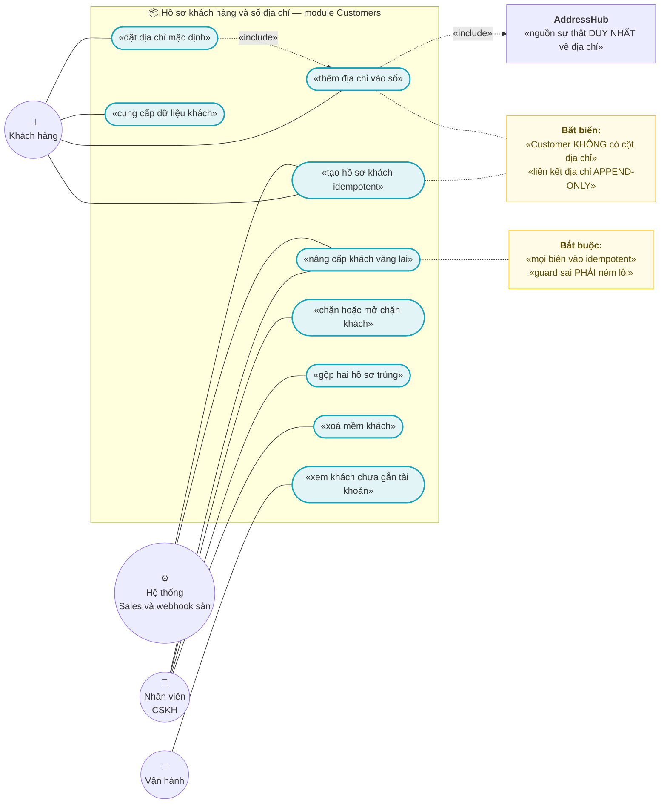
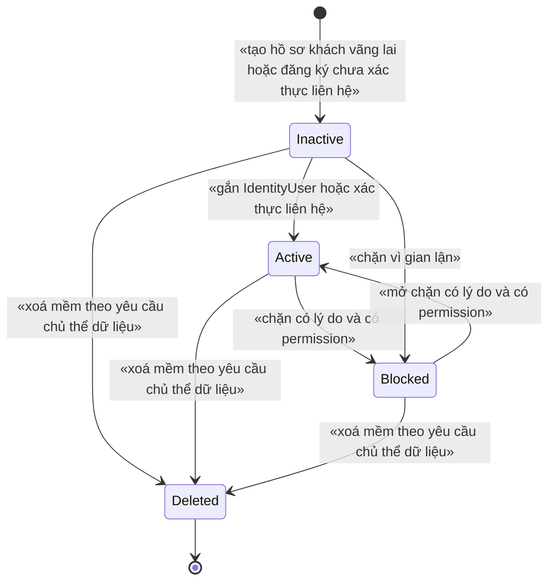
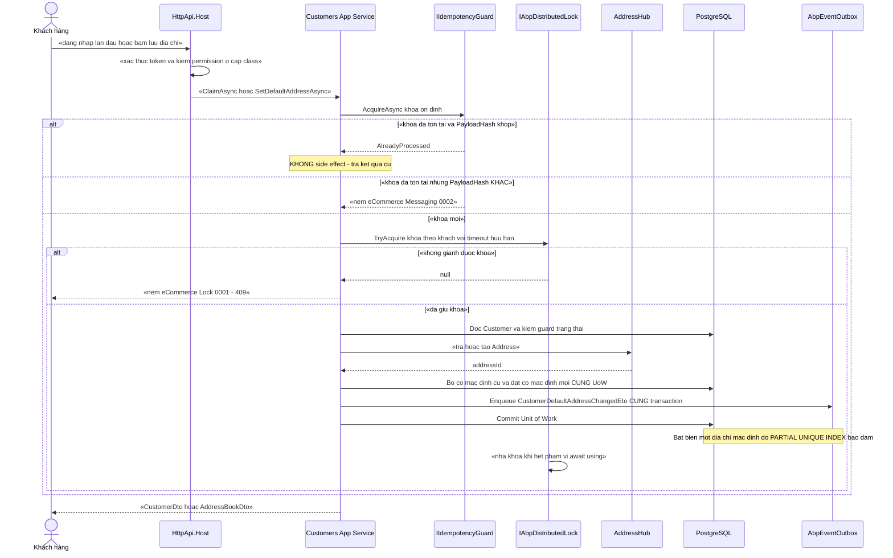
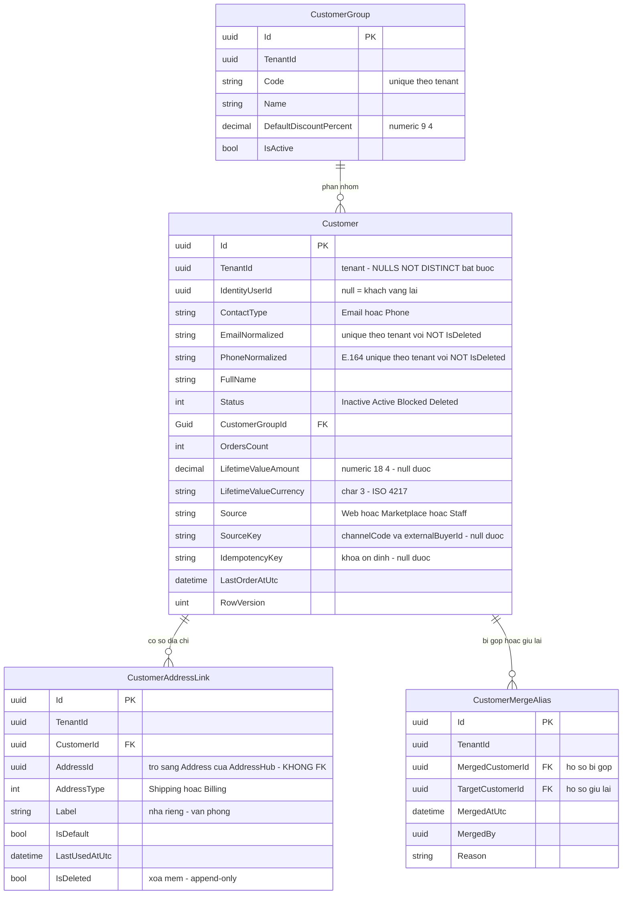

# `CUS-001` — Hồ sơ khách hàng và sổ địa chỉ

| Thuộc tính | Nội dung |
|---|---|
| **Mã** | `CUS-001` |
| **Module** | **Customers** — ✅ **ĐÃ TỒN TẠI** tại `modules/Customers/eCommerce.Customers.{Domain,Application,Application.Contracts,EntityFrameworkCore}` (kiểm 17/10/2026: `Customer.cs`, `CustomerGroup.cs`, `CustomerAppService.cs`, `CustomerDirectory.cs`). 📌 Dòng này trước đây ghi *"module CHƯA tồn tại"* — **đã lỗi thời** |
| **Giai đoạn** | **GĐ1** — `docs/implementation-plan.md:412` (bảng `CUS-001` → `Customers`); danh sách GĐ1 ở `docs/implementation-plan.md:112` |
| **Ưu tiên** | **Must have** |
| **Trạng thái** | 🟡 `Draft` — chờ review · ✅ **ĐỦ 12 LÁT CẮT ĐÃ CÓ CODE** (§16 · §20–§27 · **§28 = `S3`**) · ✅ **sổ địa chỉ ĐÃ XONG** (`ADDR-004` phần A+B, `S1`/`S2`) · ✅ **cổng khách bị chặn ĐÃ NỐI** vào đường bán hàng (`S3` — trước đó **khách `Blocked` vẫn đặt được hàng**) · ⏳ còn **UI nhóm khách** + **gán khách vào nhóm** (§28.6) |
| **Người viết / người review** | *(điền)* / **Kiến trúc trưởng + BA + Pháp chế dữ liệu cá nhân** |
| **Phiên bản / ngày** | `v0.2 — 17/10/2026` (sửa dòng *"0 dòng code"* đã sai + đường dẫn theo cấu trúc `docs/features/<module>/`; trước: `v0.1 — 13/10/2026`) |
| **Tài liệu liên quan** | `XC-001` (Money/làm tròn) · `XC-002` (outbox/inbox + idempotency) · `XC-003` (khoá phân tán) · `XC-004` (xác thực/phân quyền/tenant) · `XC-005` (observability) · `XC-006` (thuế GTGT) · **`ADDR-001`/`ADDR-002`/`ADDR-003` (AddressHub)** · ⭐ **`ADDR-004` (sổ địa chỉ: `Address` + `CustomerAddressLink` — tài liệu CHỦ SỞ HỮU của nợ chặn này)** · `SAL-002` (đặt hàng — tạo khách vãng lai) · `SAL-003` (state machine đơn) · `EINV-001` (hoá đơn — đọc tên/MST/địa chỉ người mua) · `PRC-001` (nhóm khách ảnh hưởng giá) · `LOY-001` · `REV-001` · `WEB-001` (UI đăng nhập) · `docs/implementation-plan.md` · `docs/structure-and-techstack.md` |

---

## 0. Tóm tắt & quyết định thiết kế

**Tóm tắt:** `CUS-001` định nghĩa **hồ sơ khách hàng** (`Customer`, gắn tuỳ chọn với `IdentityUser` của ABP) và **sổ địa chỉ** của khách trên nền **`AddressHub` — nguồn sự thật DUY NHẤT về địa chỉ**. Tài liệu chốt 3 bất biến định hình toàn bộ thiết kế:

1. **`Address` thuộc `AddressHub`, KHÔNG thuộc `Customers`** — `Customers` chỉ giữ **liên kết + metadata sổ địa chỉ** (nhãn, cờ mặc định, thứ tự). Đây là cách duy nhất để tránh **mô hình địa chỉ hai nguồn sự thật** đã bị ghi nhận là anti-pattern phải tránh của dự án (`docs/business-modules-proposal.md:259`, `docs/implementation-plan.md:181`).
2. **Khách vãng lai là hạng nhất (first-class)**: `Order.CustomerId` là **`Guid?`** (`src/eCommerce.Domain/Entities/Orders/Order.cs:29`) ⇒ đơn không có khách **vẫn hợp lệ**; hệ thống **không** được bắt buộc tạo `Customer` để bán được. Khách vãng lai được **nâng cấp** (claim) thành khách có tài khoản bằng đường idempotent.
3. **Dữ liệu khách là dữ liệu cá nhân ⇒ có nghĩa vụ pháp lý**: **Luật Bảo vệ dữ liệu cá nhân số 91/2025/QH15** hiệu lực **01/01/2026** quy định quyền của chủ thể dữ liệu gồm *"Xem, chỉnh sửa hoặc yêu cầu chỉnh sửa dữ liệu cá nhân; Yêu cầu cung cấp, xóa, hạn chế xử lý dữ liệu cá nhân"* (khoản 1 Điều 4). Vì vậy **xoá khách là XOÁ MỀM** và **liên kết địa chỉ là APPEND-ONLY** (không hard-delete), để vừa thoả nghĩa vụ vừa giữ được **bất biến chứng từ** (hoá đơn, đơn hàng đã phát hành).

**Vì sao phải viết tài liệu này trước khi code — 3 lỗi im lặng đã xảy ra thật trong dự án:**

| # | Bài học (có bằng chứng trong repo) | Hệ quả bắt buộc cho `CUS-001` |
|---|---|---|
| 1 | **Mô hình địa chỉ hai nguồn sự thật** (nopCommerce: `Customer.StreetAddress…` + entity `Address` + `CustomerAddressMapping`) đã bị ghi là **anti-pattern phải tránh** — `docs/business-modules-proposal.md:259` | `Customer` **KHÔNG** có cột `Street`/`Ward`/`Province` nào. Có **test reflection** (`TC-14`) chặn tái phát |
| 2 | **Khoá phân tán có 2 nguồn sự thật ⇒ khoá không bảo vệ gì mà không có lỗi biên dịch** (`XC-003` §15.2 **F1**; bằng chứng `src/eCommerce.Domain.Shared/eCommerceConsts.cs:91-96` vs `modules/ChannelHub/eCommerce.ChannelHub.Domain/ChannelHubConsts.cs:23`) | Khoá lock của `Customers` **chỉ** nằm ở `CustomersConsts.LockKeys` — **cấm** viết literal khoá trong app service; **cấm** khai báo lại ở `eCommerceConsts` |
| 3 | **Guard trạng thái no-op im lặng làm sự kiện rơi không để lại dấu vết** (bài học `SetPaidStatus()` của eShop — `XC-002` §0 bài học #4; quy ước #11 ở `docs/structure-and-techstack.md:143`) | Mọi chuyển trạng thái `Customer` **phải NÉM LỖI** có mã (§3) |

**Phạm vi:**
- ✅ Entity `Customer` (gắn tuỳ chọn `IdentityUserId`), vòng đời trạng thái **có bảng guard ném lỗi**.
- ✅ Sổ địa chỉ: bảng liên kết `CustomerAddressLink` (nhãn, `AddressType`, cờ mặc định, ngày dùng gần nhất) trỏ tới `Address` của `AddressHub`.
- ✅ Bất biến **"tối đa MỘT địa chỉ mặc định cho mỗi (khách, loại địa chỉ)"** ở **tầng DB** (partial unique index + `NULLS NOT DISTINCT`).
- ✅ **Nâng cấp khách vãng lai** (claim) và **đăng ký** khách mới **idempotent** ở mọi biên vào.
- ✅ `CustomerGroup` (nhóm khách — dữ liệu tham chiếu cho `PRC-*`), **không** hard-code trong code.
- ✅ Hợp đồng `.Contracts` (`ICustomerDirectory`) để module khác **đọc snapshot** — **cấm** module khác đọc DB của `Customers`.
- ✅ Nghĩa vụ dữ liệu cá nhân: che PII khi log, xuất dữ liệu (quyền *"yêu cầu cung cấp"*), xoá mềm (quyền *"yêu cầu xóa"*).
- ✅ Hợp đồng API, mã lỗi, phân quyền, migration/seed, NFR, 16 test case.

**Không nằm trong phạm vi:**
- ❌ **Dữ liệu hành chính 2 cấp/3 cấp, mã địa chỉ theo hãng vận chuyển, chuẩn hoá địa chỉ** — thuộc **`ADDR-001`…`ADR-003`** (`docs/implementation-plan.md:387-389`). ⚠️ **Chưa có file tài liệu nào của `ADDR-*`** trong `docs/features/`; đây là **phụ thuộc chặn** (§15.1 **Q1**).
- ❌ **Giỏ hàng · checkout · đơn hàng · snapshot địa chỉ giao lên đơn** — thuộc `SAL-001`/`SAL-002`. `CUS-001` chỉ **đọc** sổ địa chỉ.
- ❌ **Đăng ký/đăng nhập, mật khẩu, 2FA, social login** — thuộc ABP Identity + `XC-004` + `WEB-001`.
- ❌ **Chính sách giá theo nhóm khách** — thuộc `PRC-001`/`PRC-002`; `CUS-001` chỉ **cung cấp** `CustomerGroupId`.
- ❌ **Xếp hạng khách (VIP/tier) và điểm thưởng** — thuộc `LOY-001` (`docs/features/loyalty/loy-001-diem-thuong.md`).
- ❌ **Quy trình xử lý yêu cầu xoá/cung cấp dữ liệu cá nhân** (tiếp nhận, thời hạn, biên bản) — thuộc quy trình pháp chế; `CUS-001` chỉ cung cấp **API + dấu vết kỹ thuật**.
- ❌ **UI storefront/admin** — thuộc `WEB-*`; tài liệu này chỉ chốt **mapping dữ liệu** (§10).

### 0.1 Quyết định thiết kế (ADR ngắn)

| # | Quyết định | Phương án đã cân nhắc | Lý do chọn | Hệ số / Hệ quả |
|---|---|---|---|---|
| **ADR-01** | **`Address` do `AddressHub` sở hữu; `Customers` giữ bảng LIÊN KẾT `CustomerAddressLink`** | (a) `Customer` giữ cột địa chỉ (kiểu nopCommerce) · (b) `Customers` sở hữu entity `Address` · (c) **liên kết sang `AddressHub`** | (a) là **đúng anti-pattern** đã ghi nhận: *"Hai mô hình địa chỉ song song"* (`docs/business-modules-proposal.md:259`); (b) vi phạm quy ước module sở hữu miền của mình — địa chỉ 2 cấp/3 cấp + mã hãng vận chuyển là **miền riêng** (P0, `docs/structure-and-techstack.md:14`); (c) một nguồn sự thật duy nhất | `Customer` **0 cột địa chỉ**; có test reflection **TC-14** chặn. `Address` **KHÔNG** có `DbSet` trong `eCommerceDbContext` — nó thuộc DbContext của `AddressHub` |
| **ADR-02** | **Bảng liên kết là APPEND-ONLY + xoá mềm**, gỡ địa chỉ = `IsDeleted = true` | (a) xoá cứng khỏi sổ · (b) xoá mềm | Sổ địa chỉ là **chứng từ lịch sử**: cần biết khách từng dùng địa chỉ nào khi đối soát đơn/hàng hoàn. Xoá cứng ⇒ mất khả năng giải trình (*"đơn này giao tới đâu lúc đó"*). Đồng thời **Luật 91/2025/QH15 Điều 4** cho quyền *"yêu cầu xóa"* — nhưng nghĩa vụ đó được thoả bằng **xoá mềm + ẩn hoàn toàn khỏi truy vấn**, không phá chứng từ | Cần `IsDeleted` của ABP (đã bật: `IsDeleted` xuất hiện trong mọi bảng — `src/eCommerce.EntityFrameworkCore/Migrations/20261013012648_Add_Tax_Module.cs:37,67`); index unique phải **có filter `IsDeleted = false`** kèm `NULLS NOT DISTINCT` (§5.2) |
| **ADR-03** | **Khách vãng lai là hạng nhất**: `Customer` **tuỳ chọn**; `Order.CustomerId` giữ `Guid?` | (a) bắt buộc có `Customer` trước khi đặt hàng (tạo "khách ẩn danh") · (b) cho phép `null` | (a) đẻ ra hàng loạt bản ghi rác + **buộc** webhook sàn phải tạo khách trước khi tạo đơn (thêm một điểm hỏng cho mỗi webhook); (b) đúng hiện trạng code: `Order.CustomerId` là `Guid?` — `src/eCommerce.Domain/Entities/Orders/Order.cs:29`, và `docs/features/sales/sal-002-checkout-va-dat-hang.md` dòng **A4** đã ghi *"Đặt hàng cho khách vãng lai … `CustomerId = null`"* | Không có ràng buộc khoá ngoại nào bắt buộc từ Đơn sang Khách; **nâng cấp vãng lai** là thao tác tường minh, idempotent (ADR-07) |
| **ADR-04** | **Chuyển trạng thái khách là STATE MACHINE NÉM LỖI** (`Inactive → Active → Blocked → Active`) | (a) `Status` là trường dữ liệu ai cũng ghi · (b) state machine có guard ném `BusinessException` | Quy ước bất di bất dịch **#11**: *"State machine phải NÉM lỗi, không im lặng"* (`docs/structure-and-techstack.md:143`). Khách `Blocked` mà vẫn đặt được hàng là **lỗ hổng kinh doanh** (khách chây nợ, gian lận COD) | Test **TC-01/TC-02/TC-03**; `Blocked` là **trạng thái hấp thụ có điều kiện** — chỉ `Unblock` mới ra, và phải có permission + lý do |
| **ADR-05** | **Idempotency key ỔN ĐỊNH** cho nâng cấp vãng lai, **sinh từ dữ liệu nghiệp vụ** | (a) `Guid.NewGuid()` mỗi lần · (b) key sinh từ `(tenantId, channelCode, externalOrderId)` / `(tenantId, contact)` | (a) retry ⇒ **khách trùng** (đúng lỗi `D7` của `XC-002`: *"khoá mới mỗi lần retry ⇒ mỗi retry là một giao dịch mới"* — `docs/features/cross-cutting/XC-002-outbox-inbox-chong-trung-su-kien.md:59`); (b) khoá bất biến qua mọi lần thử | Có cột `IdempotencyKey` + **unique index** `(TenantId, IdempotencyKey)` với `NULLS NOT DISTINCT`; retry **đọc lại** kết quả, không tạo mới |
| **ADR-06** | **Bất biến "một địa chỉ mặc định" là RÀNG BUỘC DB**, không chỉ kiểm trong code | (a) chỉ kiểm trong domain service · (b) **partial unique index** | Đúng `XC-003` **D2**: *"nếu bỏ lock đi, DB có chặn không?"* — Redis chết thì lock vô hiệu nhưng app **vẫn chạy** (`AbortOnConnectFail = false`, `src/eCommerce.HttpApi.Host/eCommerceHttpApiHostModule.cs:141`, `:127`) ⇒ nếu chỉ dựa vào lock thì **2 địa chỉ cùng là mặc định, sai âm thầm** | `CREATE UNIQUE INDEX … WHERE "IsDefault" AND NOT "IsDeleted"` + `NULLS NOT DISTINCT` (§5.2, §11) — theo đúng tiền lệ migration `src/eCommerce.EntityFrameworkCore/Migrations/20261013024226_Fix_NullableTenantId_UniqueIndexes.cs` |
| **ADR-07** | **Nâng cấp khách vãng lai (claim) là thao tác ĐỔI CHỦ SỞ HỮU, không tạo bản ghi mới** | (a) tạo `Customer` mới rồi trỏ lại đơn · (b) gán `IdentityUserId` + `Contact` cho `Customer` cũ | (a) làm **hai khách cho một con người** ⇒ lịch sử mua, điểm thưởng (`LOY-001`), đánh giá (`REV-001`) **phân mảnh** không gộp được; (b) giữ được toàn bộ lịch sử | Guard: chỉ claim được khi `Customer.IdentityUserId IS NULL` **và** `Customer.Status <> Blocked`; vi phạm ⇒ **NÉM** `eCommerce:Customers:0004` |
| **ADR-08** | **Khoá phân tán cho 2 tài nguyên dùng chung** (đổi địa chỉ mặc định, claim khách) | (a) không khoá · (b) khoá toàn cục theo tenant · (c) **khoá theo `(tenantId, customerId)`** | `XC-003` **D7**: khoá toàn cục ⇒ khách A chặn khách B **vô cớ**. Tài nguyên là **của một khách** | Tên khoá ở `CustomersConsts.LockKeys`; theo `XC-003` **F5**, hàm sinh khoá **KHÔNG** chứa tiền tố `ecommerce:` (tiền tố do `AbpDistributedLockOptions.KeyPrefix` ghép — `src/eCommerce.HttpApi.Host/eCommerceHttpApiHostModule.cs:127`) |
| **ADR-09** | **`CustomerGroup` là DỮ LIỆU, không hard-code** | (a) enum `Retail/Wholesale/Vip` trong code · (b) bảng + seed | Cùng lý do đã chốt ở `XC-006` **D1**: nhóm khách là **đầu vào của bảng giá** (`PRC-001` §15.1 Q5 còn `Open`) ⇒ sẽ đổi theo chương trình kinh doanh; hard-code ⇒ phải release lại phần mềm | Bảng `CusGroups` + seed idempotent; `Customer.CustomerGroupId` nullable (`null` = khách lẻ mặc định) |
| **ADR-10** | **Giá trị tiền của khách lưu bằng CỘT RỜI `decimal` + `Currency`, KHÔNG dùng `Money` complex type** | (a) `Money LifetimeValue` · (b) **cột `numeric(18,4)` + `varchar(3)`** | `XC-001` **D6** + §15.1.1 **Q3**: `Money` là `readonly record struct` ⇒ làm complex type **nullable** vướng **bug #37559** chỉ vá ở EF Core 11, nên `XC-001` đã chốt *"tiền nullable vẫn dùng cột rời trên EF 10"* | `LifetimeValueAmount` (**nullable**) + `LifetimeValueCurrency`; **cấm** `double`/`float`; **cấm** so tiền bằng `==` (`XC-001` **BR-003**) |
| **ADR-11** | **Che PII ở tầng ghi log, không chỉ ở tầng hiển thị** | (a) nhắc nhở trong review · (b) **hàm mask bắt buộc + test quét** | PII của khách (email, SĐT, địa chỉ) **sẽ** lọt vào log nếu chỉ dựa vào kỷ luật — và log là nơi khó xoá nhất khi có yêu cầu xoá dữ liệu. Tiền lệ đã có trong repo: `PaymentTransaction.MaskSensitiveData` (được `LOY-001` **D**/**BR-009** dẫn lại) | Hàm `PiiMasker.Mask(email/phone)` là **đường duy nhất** để đưa PII vào log; test **TC-11** quét mã nguồn |
| **ADR-12** | **Module khác đọc khách qua `.Contracts`, CẤM đọc DB của `Customers`** | (a) `Sales` join thẳng `CusCustomers` · (b) **interface `ICustomerDirectory` ở `.Contracts`** | Quy ước bất di bất dịch **#3**: *"Mọi module sở hữu entity của mình; module → app là phụ thuộc ngược, cấm"* (`docs/structure-and-techstack.md:135`). Tiền lệ thật: `LOY-001` **D8** (`docs/features/loyalty/loy-001-diem-thuong.md:80`) chọn ETO thay vì gọi thẳng | `eCommerce.Customers.Application.Contracts` chứa DTO/interface; **cấm** tham chiếu `.Domain` (đúng `XC-002` **D12**) |

> 📌 **Ghi lại cả phương án BỊ LOẠI và lý do** — để 6 tháng sau không ai hỏi lại *"sao không làm cách kia"*.
> 🔎 **Giới hạn của tài liệu này:** mọi khẳng định về **code hiện có** đều có **đường dẫn file + dòng** đã đọc/grep.
> Mọi thứ **chưa có trong code** đều ghi rõ **"chưa có trong code"**. Mọi con số **chưa đo được** ghi **"chưa kiểm chứng"**.

---

## 1. Use Case Specification

| Thuộc tính | Nội dung |
|---|---|
| **Use Case ID** | `CUS-001` |
| **Use Case Name** | Quản lý hồ sơ khách hàng và sổ địa chỉ, **không có hai nguồn sự thật về địa chỉ** |
| **Description** | *"Là hệ thống bán hàng đa kênh, tôi muốn mỗi khách hàng có **một** hồ sơ và **một** sổ địa chỉ duy nhất dùng chung cho website và mọi sàn, để đơn từ mọi kênh đều giao đúng chỗ, hoá đơn ghi đúng người mua, và khách vãng lai vẫn mua được mà không sinh bản ghi rác — đồng thời hệ thống tuân thủ nghĩa vụ bảo vệ dữ liệu cá nhân."* |
| **Actor(s)** | **Khách hàng** (đã xác thực — tự xem/sửa hồ sơ và sổ địa chỉ **của mình**) · **Nhân viên CSKH** (tra cứu, sửa, gộp khách — có permission) · **Quản trị tenant** (nhóm khách, chặn khách) · **Hệ thống** (`Sales` tạo khách vãng lai; `ChannelHub` webhook sàn; `EInvoiceHub` đọc người mua) · **Vận hành** (xem khách chưa gắn tài khoản, chạy đối soát) |
| **Priority** | **Must have** |
| **Trigger** | (a) khách tự đăng ký hoặc được tạo khi đặt đơn trên website; (b) webhook sàn tạo đơn cho khách **chưa có** trong hệ thống; (c) khách/nhân viên thêm–sửa–chọn địa chỉ; (d) khách đăng nhập lần đầu ⇒ **nâng cấp** hồ sơ vãng lai; (e) yêu cầu dữ liệu cá nhân (cung cấp/xoá) |
| **Pre-Condition(s)** | • **Tenant hiện tại** (`TenantId` từ `ICurrentTenant`). ⚠️ Hệ thống hiện chạy **1 tenant** và `TenantId` **có thể là `NULL`** ⇒ mọi unique index của feature **phải** dùng **`NULLS NOT DISTINCT`** (`XC-004` **BR-009** + bằng chứng thật ở `src/eCommerce.EntityFrameworkCore/Migrations/20261013024226_Fix_NullableTenantId_UniqueIndexes.cs:39-86`).<br>• **`AddressHub` đã có** và có API tra cứu/tạo `Address` — ⚠️ **CHƯA có trong code** (không có `modules/AddressHub`, không có tài liệu `ADDR-*`) ⇒ **phụ thuộc chặn GĐ1** (§15.1 **Q1**).<br>• **`IdentityUser`** tồn tại khi hồ sơ được gắn tài khoản — module Identity của ABP đã có (`src/eCommerce.EntityFrameworkCore/Migrations/20261009102044_Added_Identity.cs`).<br>• **`XC-002` đã bật outbox/inbox + `IIdempotencyGuard`** — ⚠️ **CHƯA có trong code**: không có `modules/Messaging`, không có `IIdempotencyGuard`/`InboxRecords` trong repo (đã grep toàn bộ `*.cs`) ⇒ **phụ thuộc chặn**.<br>• **`ChannelCode`**: **có** mặt ở **mọi biên vào từ kênh** (tạo khách vãng lai từ webhook sàn có `ChannelCode` + `ExternalOrderId`) và **không** tham gia quyết định hồ sơ/địa chỉ (khách hàng là **một người**, không phải một người trên mỗi kênh — xem §15.1 **Q4**). |
| **Post-Condition(s)** | • Mỗi khách có **đúng một** `Customer` trong tenant; `Email`/`Phone` chuẩn hoá là **duy nhất** trong tenant (trừ bản ghi đã xoá mềm).<br>• Sổ địa chỉ có **tối đa một** địa chỉ mặc định cho mỗi `(CustomerId, AddressType)` — **bảo đảm bởi DB**, không chỉ bởi code.<br>• Bản ghi liên kết địa chỉ **không bị xoá cứng**; gỡ địa chỉ ⇒ `IsDeleted = true` + bản ghi audit.<br>• Mọi lần nâng cấp vãng lai **idempotent**: cùng khoá ⇒ **0** khách mới.<br>• Mọi thay đổi hồ sơ/địa chỉ **có bản ghi audit** của ABP (`FullAuditedAggregateRoot` sẵn có — xem cách dùng ở `src/eCommerce.Domain/Entities/Orders/Order.cs:10`).<br>• Log **không** chứa PII thô. |
| **Basic Flow** | 1. **Tạo khách mới** (đăng ký trên web **hoặc** hệ thống tạo từ webhook sàn): app service gọi `IIdempotencyGuard.AcquireAsync(khoá ổn định)` — `AlreadyProcessed` ⇒ **trả kết quả cũ, kết thúc**.<br>2. Chuẩn hoá `Email` (trim + lowercase) và `Phone` (E.164 `+84…`), kiểm trùng trong tenant.<br>3. Tạo `Customer` ở trạng thái `Inactive` (chưa xác thực liên hệ) **hoặc** `Active` nếu có `IdentityUserId` hợp lệ; ghi trong **một Unit of Work**.<br>4. Phát `CustomerRegisteredEto` qua **outbox** (cùng transaction — `XC-002` BR-001).<br>5. **Thêm địa chỉ**: app service gọi `AddressHub` để **tra/tạo** `Address` ⇒ nhận `addressId` ⇒ ghi `CustomerAddressLink` (nhãn, `AddressType`, `IsDefault`, `LastUsedAtUtc`).<br>6. Nếu `IsDefault = true` ⇒ giành khoá `CustomersConsts.LockKeys.DefaultAddress(tenantId, customerId)` **trước** khi bỏ cờ mặc định của địa chỉ cũ và đặt cờ cho địa chỉ mới (bên trong khoá — `XC-003` **D6**: lock **không reentrant** ⇒ **cấm** acquire lồng).<br>7. **Nâng cấp vãng lai** (`ClaimAsync`): kiểm guard (ADR-07) ⇒ gán `IdentityUserId`, chuyển `Inactive → Active`, giữ **nguyên** `CustomerId` ⇒ lịch sử đơn/điểm/đánh giá **không phân mảnh**.<br>8. Kết thúc: ghi audit, phát ETO tương ứng, ghi metric. |
| **Alternative Flow** | **A1: Khách vãng lai mua không cần hồ sơ** — `Order.CustomerId = null`; đơn **vẫn hợp lệ** (`src/eCommerce.Domain/Entities/Orders/Order.cs:29`). Hệ thống **không** tạo `Customer` rỗng; chỉ tạo khi khách đăng ký hoặc khi có yêu cầu nghiệp vụ rõ (hoá đơn cần MST, hoặc chăm sóc khách).<br>**A2: Webhook sàn cho khách chưa có** — tạo hồ sơ **vãng lai có nguồn** (`Source = Marketplace`, `SourceKey = {channelCode}:{externalBuyerId}`) và ghi `CustomerAddressLink` trỏ tới `Address` được tạo từ địa chỉ giao của đơn; **khoá idempotency** `Customer:{tenantId}:{channelCode}:{externalBuyerId}` ⇒ webhook gửi lại **không** tạo khách thứ hai.<br>**A3: Địa chỉ sửa sai** — **KHÔNG** sửa `Address` tại chỗ nếu đã dùng cho đơn đã phát hành. Tạo **bản ghi `Address` mới** ở `AddressHub` + `CustomerAddressLink` mới, link cũ `IsDeleted = true`. (Đây là hệ quả trực tiếp của ADR-02 và của nguyên tắc snapshot `XC-006` **BR-002**: thay đổi cấu hình **không** làm đổi chứng từ cũ.)<br>**A4: Gỡ địa chỉ đang là mặc định** — hệ thống **tự** chọn địa chỉ còn lại **dùng gần nhất** làm mặc định; **0** địa chỉ còn lại ⇒ **không** có mặc định (hợp lệ, không phải lỗi).<br>**A5: Khách trùng (2 hồ sơ cho 1 người)** — nhân viên dùng `POST /merge` với `Idempotency-Key`; hệ thống **gộp** theo hướng dẫn §6.1: đơn/điểm/đánh giá **giữ nguyên** `CustomerId` cũ ⇒ **gộp bằng alias** (`CustomerMergeAlias`), **cấm** UPDATE hàng loạt `Order.CustomerId` (sẽ chạm DB của module `Sales`). |
| **Exception Flow** | **E1:** `Email`/`Phone` đã tồn tại trong tenant ⇒ **NÉM** `eCommerce:Customers:0003` (kèm `customerId` hiện có để UI gợi ý "đăng nhập / gộp").<br>**E2:** cùng `IdempotencyKey` nhưng **`PayloadHash` khác** ⇒ **NÉM** `eCommerce:Messaging:0002` (theo `XC-002` **BR-006**) — **cấm** coi là bản ghi trùng.<br>**E3:** chuyển trạng thái sai (ví dụ `Blocked → Inactive`, `Deleted → Active`) ⇒ **NÉM** `eCommerce:Customers:0002` — **cấm** no-op im lặng (quy ước #11).<br>**E4:** claim khi khách **đã có** `IdentityUserId` ⇒ **NÉM** `eCommerce:Customers:0004`.<br>**E5:** `AddressHub` không tìm thấy/không tạo được `Address` (mã tỉnh/xã không hợp lệ, hoặc `AddressHub` chưa sẵn sàng) ⇒ **NÉM** `eCommerce:Customers:0016` + **giữ nguyên** dữ liệu đã ghi trong transaction (rollback toàn bộ UoW).<br>**E6:** xoá khách **đã có đơn** ⇒ **NÉM** `eCommerce:Customers:00xx`: khách **phải** được xoá mềm (§9/§10), **cấm** hard-delete — đây là **bất biến chứng từ** (hoá đơn đã phát hành phải tra được người mua).<br>**E7:** thao tác lên khách **thuộc tenant khác** ⇒ trả **`404`** (**không** `403`) — `XC-004` **BR-008**, không tiết lộ sự tồn tại.<br>**E8:** `UPDATE … WHERE Status = @expected` ảnh hưởng **0 dòng** (luồng khác đã đổi) ⇒ **NÉM** `eCommerce:Customers:00xx`, **không** coi là thành công (`XC-002` **BR-008**). |
| **Business Rules** | • **BR-CUS-0001**: `Customer` **KHÔNG** chứa bất kỳ trường địa chỉ nào (`Street`/`Ward`/`District`/`Province`/`FullAddress`). Mọi địa chỉ là `Address` của `AddressHub`, tham chiếu qua `CustomerAddressLink`. **Cấm** hai nguồn sự thật về địa chỉ.<br>• **BR-CUS-0002**: Mỗi `(TenantId, CustomerId, AddressType)` có **tối đa MỘT** địa chỉ mặc định; bảo đảm bằng **partial unique index** ở DB (ADR-06) — **không** chỉ bằng kiểm tra trong domain.<br>• **BR-CUS-0003**: `CustomerAddressLink` là **APPEND-ONLY + xoá mềm**; **CẤM** `DELETE` cứng và **CẤM** sửa `AddressId` của một liên kết đã tồn tại (sửa địa chỉ = tạo liên kết mới).<br>• **BR-CUS-0004**: `Email`/`Phone` **bắt buộc chuẩn hoá** (trim; email lowercase; phone E.164) trước khi lưu và **duy nhất trong tenant** với các bản ghi `NOT IsDeleted` (`NULLS NOT DISTINCT`).<br>• **BR-CUS-0005**: Mọi chuyển trạng thái `Customer` **phải** có guard và **phải NÉM** `BusinessException` có mã khi sai; **cấm** no-op im lặng (quy ước #11).<br>• **BR-CUS-0006**: Mọi **biên vào** (HTTP tạo/sửa khách, webhook sàn, job nâng cấp/đối soát) **phải** idempotent qua `IIdempotencyGuard` **trước** mọi side effect (`XC-002` **BR-004**).<br>• **BR-CUS-0007**: Idempotency key **ổn định** và **sinh từ dữ liệu nghiệp vụ**; **CẤM** `Guid.NewGuid()` cho mỗi lần gọi (`XC-002` **BR-007**, **D7**).<br>• **BR-CUS-0008**: Giá trị tiền (giá trị vòng đời, hạn mức) là **`decimal` + `Currency` cột rời**; **CẤM** `double`/`float` (`XC-001` **BR-008**); **CẤM** so sánh tiền bằng `==` — dùng `>=`/`<=`/`decimal.Compare` (`XC-001` **BR-003**).<br>• **BR-CUS-0009**: Mọi thao tác ghi đi qua **Unit of Work**; dữ liệu nghiệp vụ + bản ghi **outbox** + **audit** ghi trong **cùng** transaction (`XC-002` **BR-001**, quy ước #13 ở `docs/structure-and-techstack.md:145`).<br>• **BR-CUS-0010**: Khoá phân tán **chỉ** dùng cho tài nguyên chia sẻ: **đổi địa chỉ mặc định** (khoá theo khách) và **claim/merge** (khoá theo khách). Khoá **phải** sinh từ `CustomersConsts.LockKeys`; **CẤM** literal khoá trong code nghiệp vụ (`XC-003` **BR-001/BR-002**).<br>• **BR-CUS-0011**: **CẤM** hard-delete `Customer` khi đã có `OrdersCount > 0` **hoặc** đã gắn `IdentityUserId`; xoá là **xoá mềm + ẩn khỏi mọi truy vấn**. Vi phạm ⇒ `eCommerce:Customers:00xx`.<br>• **BR-CUS-0012**: **CẤM** đưa PII thô (email, số điện thoại, địa chỉ đầy đủ, `IdentityUserId`) vào **log** ở mức `Information` trở lên; mọi log PII **phải** đi qua hàm mask (ADR-11).<br>• **BR-CUS-0013**: **CẤM** trả PII của khách khác; truy vấn danh sách **luôn** lọc theo tenant + theo quyền; lỗi truy cập chéo tenant ⇒ **`404`** (`XC-004` **BR-008**).<br>• **BR-CUS-0014**: Mọi thay đổi hồ sơ/địa chỉ **phải** có **audit** truy được *ai · khi nào · cũ → mới*; đổi **địa chỉ mặc định** và **chặn/mở chặn** khách **bắt buộc** có lý do (`Reason`).<br>• **BR-CUS-0015**: `CustomerGroup` là **dữ liệu** (không hard-code); đổi nhóm khách **không** hồi tố giá/chứng từ đã phát sinh (đơn cũ giữ snapshot giá — `SAL-002` ADR-02).<br>• **BR-CUS-0016**: Module khác **CẤM** đọc bảng `Cus*`; **chỉ** đọc qua `ICustomerDirectory` ở `.Contracts` (ADR-12).<br>• **BR-CUS-0017**: Tuân thủ **Luật BVDLCN 91/2025/QH15** khoản 1 Điều 4 (hiệu lực **01/01/2026**): hệ thống **phải** có đường (a) **cung cấp** dữ liệu khách (quyền *"yêu cầu cung cấp"*), (b) **xoá** dữ liệu khách (quyền *"yêu cầu xóa"*) — cả hai **có dấu vết audit** và **không** phá bất biến chứng từ. |
| **Non-Functional Requirement** | • **NFR-CUS-0001**: `GET /api/app/customers/{id}` p95 **< 150 ms** với 50.000 khách/tenant (⚠️ **chưa kiểm chứng** — chưa có code).<br>• **NFR-CUS-0002**: Danh sách khách (phân trang 20) p95 **< 300 ms**.<br>• **NFR-CUS-0003**: Nâng cấp vãng lai gửi **100 lần** ⇒ **đúng 1** khách (NFR idempotency).<br>• **NFR-CUS-0004**: **0** PII thô trong log — test quét mã nguồn + test log thật.<br>• **NFR-CUS-0005**: **100 %** thay đổi hồ sơ/địa chỉ có bản ghi audit trong **< 1 s**.<br>• **NFR-CUS-0006**: Cách ly tenant: tenant A **không** đọc/ghi được dữ liệu tenant B — **0** rò rỉ (integration test 2 tenant).<br>• **NFR-CUS-0007**: **100 %** app service có `[Authorize]` ở **cấp class**; **0** permission dùng mà chưa định nghĩa (`XC-004` **BR-001/BR-002** + test reflection **TC-01/TC-02** của `XC-004`).<br>• **NFR-CUS-0008**: **0** unique index nào của module thiếu `NULLS NOT DISTINCT` (test schema — mở rộng `test/eCommerce.IntegrationTests/PostgreSqlSchemaTests.cs:144`).<br>• **NFR-CUS-0009**: Bất biến "một địa chỉ mặc định" **đúng khi Redis chết**: dừng Redis ⇒ DB vẫn chặn (integration test, cùng tinh thần `XC-003` **TC-11**).<br>• **NFR-CUS-0010**: API **cung cấp** dữ liệu khách trả **đầy đủ** hồ sơ + sổ địa chỉ + lịch sử liên kết trong **1** lần gọi (không phân trang cắt cụt) — phục vụ nghĩa vụ *"yêu cầu cung cấp"*. |

---

## 2. Sơ đồ Use Case



### Chú giải

| Ký hiệu | Ý nghĩa |
|---|---|
| ⭕ Xanh lá | Actor (người dùng + hệ thống) |
| 🟦 Bầu dục xanh dương | Use Case |
| 🟨 Khung vàng | Note (bất biến / ràng buộc) |
| `───` | Liên kết Actor ↔ Use Case |
| `-.«include».->` | Quan hệ bao hàm |
| `ADDR` (hình chữ nhật, không viền màu) | Hệ thống ngoài module — **AddressHub** |

---

## 3. Sơ đồ trạng thái (state machine)

### 3.1 Vòng đời `Customer`



**Bảng chuyển trạng thái & guard (mọi chuyển sai **PHẢI NÉM LỖI**, không im lặng):**

| # | Từ → Sang | Guard (điều kiện cho phép) | Ai được phép chuyển | Side effect kèm theo | Nếu guard sai thì? |
|---|---|---|---|---|---|
| 1 | `[*]` → `Inactive` | Có `Contact` (email **hoặc** phone) chuẩn hoá hợp lệ **và** chưa trùng trong tenant | Khách (tự đăng ký) · Hệ thống (`Sales`, webhook sàn) | Ghi `Customer` + outbox `CustomerRegisteredEto` **cùng UoW** | **NÉM** `eCommerce:Customers:0003` (trùng) / `eCommerce:Customers:0007` (contact không hợp lệ) |
| 2 | `[*]` → `Active` | Có `IdentityUserId` hợp lệ **và** user thuộc tenant hiện tại | Hệ thống (sau khi IdentityUser được tạo) | Outbox `CustomerRegisteredEto` | **NÉM** `eCommerce:Customers:0007` |
| 3 | `Inactive` → `Active` | (`IdentityUserId` được gán) **hoặc** (liên hệ đã xác thực) | Khách · CSKH | Outbox `CustomerActivatedEto` | **NÉM** `eCommerce:Customers:0002` |
| 4 | `Active` → `Blocked` | Người gọi có `eCommerce.Customers.Block` **và** `Reason` không rỗng | CSKH · Quản trị tenant | Outbox `CustomerBlockedEto` + audit (`Reason`) + metric | **NÉM** `eCommerce:Customers:0002` / `403` |
| 5 | `Inactive` → `Blocked` | như trên | CSKH · Quản trị tenant | như trên | **NÉM** `eCommerce:Customers:0002` |
| 6 | `Blocked` → `Active` | Người gọi có `eCommerce.Customers.Block` **và** `Reason` không rỗng (lý do mở chặn) | CSKH · Quản trị tenant | Outbox `CustomerUnblockedEto` + audit + metric | **NÉM** `eCommerce:Customers:0002` |
| 7 | `{Inactive, Active, Blocked}` → `Deleted` | Người gọi có `eCommerce.Customers.Delete` **và** (`OrdersCount <= 0` **hoặc** đã xác nhận giữ chứng từ) | CSKH · Quản trị tenant | **XOÁ MỀM** + ẩn toàn bộ `CustomerAddressLink` (kể cả `IsDefault`) + audit | **NÉM** `eCommerce:Customers:00xx` nếu cố hard-delete; `eCommerce:Customers:0002` nếu `Deleted → *` |
| 8 | `Deleted` → bất kỳ | **KHÔNG** có guard nào cho phép | — | — | **Trạng thái HẤP THỤ**: mọi chuyển dịch khỏi `Deleted` ⇒ **NÉM** `eCommerce:Customers:0002`. Muốn "khôi phục" ⇒ **tạo hồ sơ mới** (không tái sinh bản ghi đã xoá) |
| 9 | chuyển **lùi** bất kỳ (`Blocked → Inactive`, `Active → Inactive`) | **KHÔNG** có guard nào cho phép | — | — | **NÉM** `eCommerce:Customers:0002` — **cấm** tuyệt đối (đồng quy tắc `NOT-002` **BR-004**) |

> ⚠️ **Quy tắc bất di bất dịch #11** (`docs/structure-and-techstack.md:143`): guard sai **phải NÉM LỖI** (hoặc ghi log có cấu trúc), **không** im lặng.
> **Trạng thái hấp thụ (absorbing):** `Deleted`. `Blocked` **không** hấp thụ vì còn đường `Unblock` **có kiểm soát**.
> **Ai được phép chuyển:** do **app service có permission** (người) hoặc **job/hệ thống** (không người) — **không** có đường nào để domain tự đổi trạng thái mà bỏ qua guard.

### 3.2 Vòng đời `CustomerAddressLink` (sổ địa chỉ)

| # | Từ → Sang | Guard | Side effect | Nếu guard sai thì? |
|---|---|---|---|---|
| 1 | `[*]` → `Liên kết thường` | `Address` tồn tại **và** thuộc tenant hiện tại/địa chỉ dùng chung; `Label` ≤ 128 ký tự; chưa có liên kết **trùng** `(CustomerId, AddressId, AddressType)` còn hiệu lực | Ghi `CustomerAddressLink` (`IsDefault = false`, `IsDeleted = false`) | **NÉM** `eCommerce:Customers:0016` (không có address) / `eCommerce:Customers:0010` (liên kết trùng) |
| 2 | `Liên kết thường` → `Mặc định` | Giành được khoá `CustomersConsts.LockKeys.DefaultAddress(tenantId, customerId)` **và** `AddressType` khớp **và** `Customer.Status <> Deleted` | Trong **cùng** UoW: bỏ cờ mặc định của địa chỉ cũ **cùng `AddressType`** + đặt cờ cho liên kết này + audit `Reason` (nếu do nhân viên) + outbox `CustomerDefaultAddressChangedEto` | Không giành được khoá ⇒ **NÉM** `eCommerce:Lock:0001` (`XC-003` **BR-010**) — **cấm** bỏ qua im lặng |
| 3 | `Mặc định` → `Liên kết thường` | Bỏ cờ mặc định tường minh | Ghi audit | **NÉM** `eCommerce:Customers:0002` nếu liên kết không ở trạng thái `Mặc định` |
| 4 | `bất kỳ (còn hiệu lực)` → `Đã gỡ` | Người gọi có quyền trên sổ địa chỉ của khách (khách tự gỡ **hoặc** CSKH) | `IsDeleted = true` (+ `DeletedAtUtc` do ABP cung cấp); nếu liên kết đang là **mặc định** ⇒ chạy **A4** (tự chọn địa chỉ dùng gần nhất) | — (thao tác hợp lệ); nếu liên kết **đã** ở `Đã gỡ` ⇒ **NÉM** `eCommerce:Customers:0002` |
| 5 | `Đã gỡ` → `bất kỳ` | **KHÔNG** cho phép "bỏ xoá" (un-delete) | — | **NÉM** `eCommerce:Customers:0002`. Muốn dùng lại ⇒ tạo **liên kết mới** trỏ cùng `Address` (được phép, xem bất biến 5 ở §8.1) |
| 6 | `sửa AddressId của liên kết đã tồn tại` | **KHÔNG** cho phép | — | **NÉM** `eCommerce:Customers:0013` (**BR-CUS-0003** — append-only) |

---

## 4. Sequence Diagram & luồng dữ liệu

### 4.1 Sequence — nâng cấp khách vãng lai + đặt địa chỉ mặc định (biên vào idempotent)



### 4.2 Quy tắc trình tự BẮT BUỘC (đọc kèm §4.1 — thay cho sơ đồ DFD để giữ ngân sách 3 sơ đồ)

> Mục này **không** có sơ đồ (đã dùng hết ngân sách 3 sơ đồ: §2, §3.1, §4.1). Trình tự dưới đây **bắt buộc** —
> mọi sai khác thứ tự đều là **lỗi thiết kế**, không phải lựa chọn phong cách.

| # | Bước | Bắt buộc vì | Nếu đảo thứ tự thì sao |
|---|---|---|---|
| 1 | **Xác thực + kiểm permission** (cấp class) | `XC-004` **D3/BR-001** — ABP không tự bảo vệ app service | Endpoint hở; `TC-01` của `XC-004` đỏ |
| 2 | **Kiểm chủ sở hữu** (`Customer.IdentityUserId == CurrentUser.Id`) khi actor là khách | `BR-CUS-0013` | Khách A sửa hồ sơ khách B — **lỗ hổng dữ liệu cá nhân** |
| 3 | **`IIdempotencyGuard.AcquireAsync`** với khoá ổn định | `BR-CUS-0006/0007`, `XC-002` **BR-004** — *trước* mọi side effect | Retry/webhook trùng ⇒ **khách trùng** |
| 4 | **Giành khoá phân tán** (chỉ với thao tác đổi mặc định/claim/merge) | `BR-CUS-0010`, `XC-003` **D6** (không acquire lồng) | Hai luồng cùng đổi mặc định ⇒ dựa hoàn toàn vào DB |
| 5 | **Đọc `Customer` + kiểm guard trạng thái** | `BR-CUS-0005` — guard sai **phải NÉM** | No-op im lặng ⇒ thao tác "thành công" mà không làm gì |
| 6 | **Gọi `AddressHub`** tra/tạo `Address` | ADR-01 — `Address` là nguồn sự thật duy nhất | Copy cột địa chỉ vào `Customer` ⇒ **anti-pattern** (`TC-14` đỏ) |
| 7 | **Ghi `Customer` + `CustomerAddressLink` + outbox + audit** trong **cùng** UoW | `BR-CUS-0009`, `XC-002` **BR-001** | Dual-write ⇒ mất sự kiện hoặc dữ liệu lệch |
| 8 | **Commit**, rồi **nhả khoá** (`await using` kết thúc) | `XC-003` §12 — phạm vi khoá **bao ngoài** UoW | Khoá nhả trước commit ⇒ luồng khác đọc dữ liệu cũ |
| 9 | **Ghi log đã mask PII** | `BR-CUS-0012` | PII vào log ⇒ khó xoá khi có yêu cầu dữ liệu cá nhân |

---

## 5. Mô hình dữ liệu

### 5.1 ERD



> 📌 **Đọc kỹ:** quan hệ `CustomerAddressLink → Address` **KHÔNG** có khoá ngoại trong ERD **và** trong DB.
> `Address` thuộc **`AddressHub`** — module khác ⇒ theo quy ước #3 (`docs/structure-and-techstack.md:135`) và **ADR-12**,
> ta dùng **tham chiếu mềm bằng `Guid`**. Tiền lệ trong repo: `docs/features/reviews/rev-001-danh-gia-san-pham.md` ghi rõ
> *"tham chiếu **mềm** bằng `Guid` — module **không** có khoá ngoại sang bảng của module khác"*.

### 5.2 Bảng & cột (Data Dictionary)

**Bảng `CusCustomers`** — hồ sơ khách hàng (⚠️ **chưa có trong code**; tên bảng đề xuất theo tiền tố `Cus`)

| Cột | Kiểu | Null? | Ý nghĩa | Ghi chú |
|---|---|---|---|---|
| `Id` | `uuid` | ✖ | khoá chính | `FullAuditedAggregateRoot<Guid>` (mẫu: `src/eCommerce.Domain/Entities/Orders/Order.cs:10`) |
| `TenantId` | `uuid` | ✔ | tenant sở hữu | **bắt buộc** `IMultiTenant`; `NULL` khi chạy 1 tenant (`XC-004` §5.2 **F1**) |
| `IdentityUserId` | `uuid` | ✔ | tài khoản ABP Identity | `null` = **khách vãng lai** (ADR-03). **KHÔNG** có FK cứng sang `AbpUsers` nếu muốn tách module — xem §15.1 **Q5** |
| `ContactType` | `int` | ✖ | `Email=0` · `Phone=1` | kênh liên hệ chính |
| `EmailNormalized` | `varchar(320)` | ✔ | email đã trim + lowercase | RFC 5321 tối đa 320 ký tự |
| `PhoneNormalized` | `varchar(20)` | ✔ | E.164 (`+84…`) | **cấm** lưu số thô chưa chuẩn hoá |
| `FullName` | `varchar(256)` | ✖ | tên khách | snapshot dùng cho hoá đơn (`EINV-001`) — ⚠️ hoá đơn **vẫn phải** snapshot riêng |
| `Status` | `int` | ✖ | `Inactive=0` · `Active=1` · `Blocked=2` · `Deleted=3` | theo §3.1 |
| `CustomerGroupId` | `uuid` | ✔ | nhóm khách | `null` = khách lẻ mặc định |
| `OrdersCount` | `int` | ✖ | số đơn **đã đặt** (mọi kênh) | cập nhật bởi consumer ETO (§7.2) — **không** truy vấn chéo module |
| `LifetimeValueAmount` | `numeric(18,4)` | ✔ | tổng giá trị đơn **hoàn tất** | ⚠️ **`decimal`, KHÔNG BAO GIỜ `double`** (`XC-001` **BR-008**); `HasPrecision(18, 4)` — tiền lệ `src/eCommerce.EntityFrameworkCore/eCommerceDbContext.cs:173-178` |
| `LifetimeValueCurrency` | `char(3)` | ✔ | ISO-4217 HOA | theo `XC-001` §5.2; **cột rời** vì nullable (ADR-10) |
| `Source` | `int` | ✖ | `Web=0` · `Marketplace=1` · `Staff=2` · `Import=3` | nguồn hồ sơ |
| `SourceKey` | `varchar(128)` | ✔ | `{channelCode}:{externalBuyerId}` | **có** khi `Source = Marketplace` |
| `IdempotencyKey` | `varchar(200)` | ✔ | khoá ổn định của lần tạo | **unique** theo tenant (ADR-05) |
| `LastOrderAtUtc` | `timestamptz` | ✔ | lần đặt hàng gần nhất | phục vụ U9 "khách chưa gắn tài khoản" + phân khúc |
| `RowVersion` | `bytea`/`xmin` | ✖ | optimistic concurrency | ABP `ConcurrencyStamp` sẵn có; dùng cho guard §3.1 |

**Bảng `CusAddressLinks`** — **sổ địa chỉ** (bảng liên kết; **APPEND-ONLY + xoá mềm**)

| Cột | Kiểu | Null? | Ý nghĩa | Ghi chú |
|---|---|---|---|---|
| `Id` | `uuid` | ✖ | khoá chính | |
| `TenantId` | `uuid` | ✔ | tenant | |
| `CustomerId` | `uuid` | ✖ | khách sở hữu | FK **trong cùng module** ⇒ **có** FK cứng được |
| `AddressId` | `uuid` | ✖ | `Address` của `AddressHub` | 🚨 **tham chiếu MỀM** — **KHÔNG** FK (ADR-01, ADR-12). **Chưa kiểm chứng** được hành vi khi `Address` bị xoá mềm ở `AddressHub` ⇒ **Q1** §15.1 |
| `AddressType` | `int` | ✖ | `Shipping=0` · `Billing=1` | tách sổ theo mục đích; bất biến "một mặc định" áp **theo từng loại** |
| `Label` | `varchar(128)` | ✔ | "Nhà riêng", "Văn phòng" | chỉ để hiển thị |
| `IsDefault` | `bool` | ✖ | mặc định cho `AddressType` này | bảo vệ bằng partial unique index |
| `LastUsedAtUtc` | `timestamptz` | ✔ | lần dùng gần nhất trên đơn | dùng cho **A4** (tự chọn mặc định thay thế) |
| `IsDeleted` / `DeletedAtUtc` / `DeleterId` | `bool` / `timestamptz` / `uuid` | — | xoá mềm của ABP | gỡ địa chỉ = xoá mềm (**BR-CUS-0003**) |

**Bảng `CusGroups`** — nhóm khách (**dữ liệu**, không hard-code — ADR-09)

| Cột | Kiểu | Null? | Ý nghĩa | Ghi chú |
|---|---|---|---|---|
| `Id` | `uuid` | ✖ | khoá chính | |
| `TenantId` | `uuid` | ✔ | tenant | |
| `Code` | `varchar(32)` | ✖ | mã nhóm (`RETAIL`, `WHOLESALE`, `VIP`) | **unique** theo tenant |
| `Name` | `varchar(128)` | ✖ | tên hiển thị | |
| `DefaultDiscountPercent` | `numeric(9,4)` | ✔ | % giảm mặc định gợi ý cho `PRC-*` | ⚠️ **`decimal`**, KHÔNG `double`; mẫu `HasPrecision(9, 4)` — tiền lệ `modules/Tax/eCommerce.Tax.EntityFrameworkCore/TaxDbContextModelCreatingExtensions.cs:33` |
| `IsActive` | `bool` | ✖ | ngừng dùng nhóm | **cấm xoá cứng** nhóm đang được dùng |

**Bảng `CusMergeAliases`** — gộp hồ sơ trùng (A5)

| Cột | Kiểu | Null? | Ý nghĩa | Ghi chú |
|---|---|---|---|---|
| `Id` | `uuid` | ✖ | khoá chính | |
| `TenantId` | `uuid` | ✔ | tenant | |
| `MergedCustomerId` | `uuid` | ✖ | hồ sơ **bị** gộp (giữ nguyên, chuyển `Deleted`) | **unique** theo tenant |
| `TargetCustomerId` | `uuid` | ✖ | hồ sơ **giữ lại** | `<> MergedCustomerId` (CHECK) |
| `MergedAtUtc` / `MergedBy` / `Reason` | `timestamptz` / `uuid` / `varchar(512)` | ✖ | dấu vết | phục vụ khiếu nại |

**Index & ràng buộc** *(đây là phần hay bị bỏ sót nhất — phải liệt kê hết)*

| Bảng | Loại | Cột | Mục đích |
|---|---|---|---|
| `CusCustomers` | **UNIQUE** `NULLS NOT DISTINCT` | `(TenantId, EmailNormalized) WHERE NOT "IsDeleted"` | chống trùng email (**BR-CUS-0004**) |
| `CusCustomers` | **UNIQUE** `NULLS NOT DISTINCT` | `(TenantId, PhoneNormalized) WHERE NOT "IsDeleted"` | chống trùng SĐT |
| `CusCustomers` | **UNIQUE** `NULLS NOT DISTINCT` | `(TenantId, IdempotencyKey) WHERE "IdempotencyKey" IS NOT NULL` | **idempotency** tạo khách (ADR-05) |
| `CusCustomers` | **UNIQUE** `NULLS NOT DISTINCT` | `(TenantId, IdentityUserId) WHERE "IdentityUserId" IS NOT NULL` | **một** hồ sơ cho **một** tài khoản |
| `CusCustomers` | **UNIQUE** `NULLS NOT DISTINCT` | `(TenantId, Source, SourceKey) WHERE "SourceKey" IS NOT NULL` | **idempotency** webhook sàn (A2) |
| `CusCustomers` | INDEX | `(TenantId, Status, LastOrderAtUtc)` | danh sách + phân khúc |
| `CusAddressLinks` | **UNIQUE** `NULLS NOT DISTINCT` | `(TenantId, CustomerId, AddressId, AddressType) WHERE NOT "IsDeleted"` | chống liên kết trùng (bất biến 5) |
| `CusAddressLinks` | **UNIQUE PARTIAL** `NULLS NOT DISTINCT` | `(TenantId, CustomerId, AddressType) WHERE "IsDefault" AND NOT "IsDeleted"` | 🚨 **BẤT BIẾN "một địa chỉ mặc định"** (**BR-CUS-0002**, ADR-06) |
| `CusAddressLinks` | INDEX | `(TenantId, CustomerId, IsDeleted, AddressType)` | đọc sổ địa chỉ |
| `CusAddressLinks` | INDEX | `(TenantId, AddressId)` | tra **địa chỉ này đang được khách nào dùng** (hữu ích khi `AddressHub` đổi/ẩn địa chỉ) |
| `CusGroups` | **UNIQUE** `NULLS NOT DISTINCT` | `(TenantId, Code)` | chống trùng mã nhóm |
| `CusMergeAliases` | **UNIQUE** `NULLS NOT DISTINCT` | `(TenantId, MergedCustomerId)` | một hồ sơ chỉ bị gộp **một lần** |
| `CusMergeAliases` | CHECK | `"MergedCustomerId" <> "TargetCustomerId"` | không tự gộp chính mình |
| `CusCustomers` | CHECK | `"LifetimeValueCurrency" IS NULL OR "LifetimeValueCurrency" ~ '^[A-Z]{3}$'` | mã tiền tệ hợp lệ (`XC-001` §5.2) |
| `CusCustomers` | CHECK | `"ContactType" <> 0 OR "EmailNormalized" IS NOT NULL` | `Email` ⇒ phải có email |
| `CusCustomers` | CHECK | `"ContactType" <> 1 OR "PhoneNormalized" IS NOT NULL` | `Phone` ⇒ phải có SĐT |
| `CusCustomers` | CHECK | `"Source" <> 1 OR "SourceKey" IS NOT NULL` | nguồn sàn ⇒ phải có `SourceKey` |

> 🚨 **Vì sao `WHERE NOT "IsDeleted"` lại BẮT BUỘC:** ABP bật **soft-delete** — đã kiểm chứng `IsDeleted` có mặt trên **mọi** bảng
> (`src/eCommerce.EntityFrameworkCore/Migrations/20261013012648_Add_Tax_Module.cs:37,67`). Nếu unique index **không** lọc
> `IsDeleted`, thì **khách đã xoá mềm vẫn chiếm** email/SĐT ⇒ khách mới **không đăng ký được** bằng chính email của mình.
> Đây là loại lỗi im lặng rất khó chẩn đoán vì thông báo lỗi chỉ là *"duplicate key"*.
> 📌 Tiền lệ xử lý cùng vấn đề ở `EXCLUDE` constraint của Tax: `20261013012648_Add_Tax_Module.cs:114-116` ghi rõ
> *"ABP soft-delete: bản ghi đã xoá vẫn chiếm khung. Thêm `IsDeleted` WITH = vào khoá"*.

---

## 6. Hợp đồng API

### 6.1 Application Service

| Mục | Giá trị |
|---|---|
| Interface | `ICustomerAppService`, `ICustomerAddressAppService`, `ICustomerGroupAppService` — đặt tại `eCommerce.Customers.Application.Contracts` (⚠️ **chưa có trong code**) |
| Implementation | `CustomerAppService`, `CustomerAddressAppService`, `CustomerGroupAppService` — tại `eCommerce.Customers.Application` |
| `[Authorize]` | **cấp CLASS** (**bắt buộc**, `XC-004` **D3/BR-001**) + permission cụ thể ở từng method |
| Query trong module khác | **chỉ** qua `ICustomerDirectory` ở `.Contracts` (ADR-12) |

```csharp
// eCommerce.Customers.Application.Contracts — ⚠️ CHƯA có trong code, đây là HỢP ĐỒNG đề xuất

public interface ICustomerAppService : IApplicationService
{
    Task<CustomerDto> GetAsync(Guid id);
    Task<PagedResultDto<CustomerListItemDto>> GetListAsync(GetCustomersInput input);
    Task<CustomerDto> CreateAsync(CreateCustomerDto input);          // bắt buộc Idempotency-Key
    Task<CustomerDto> UpdateAsync(Guid id, UpdateCustomerDto input);
    Task<CustomerDto> ClaimAsync(ClaimCustomerDto input);            // nâng cấp khách vãng lai (A2/ADR-07)
    Task BlockAsync(Guid id, BlockCustomerDto input);                // bắt buộc Reason
    Task UnblockAsync(Guid id, UnblockCustomerDto input);            // bắt buộc Reason
    Task DeleteAsync(Guid id, DeleteCustomerDto input);              // XOÁ MỀM; có thể ném 0005
    Task<CustomerMergeResultDto> MergeAsync(MergeCustomersDto input); // A5, bắt buộc Idempotency-Key
    Task<CustomerDataExportDto> ExportPersonalDataAsync(Guid id);     // quyền "yêu cầu cung cấp" (BR-0017)
    Task<PagedResultDto<CustomerListItemDto>> GetUnlinkedAsync(...);  // khách chưa gắn IdentityUser (U9)
}

public interface ICustomerAddressAppService : IApplicationService
{
    Task<AddressBookDto> GetAddressBookAsync(Guid customerId);
    Task<CustomerAddressLinkDto> AddAddressAsync(Guid customerId, AddCustomerAddressDto input);
    Task<CustomerAddressLinkDto> SetDefaultAsync(Guid customerId, Guid linkId);
    Task RemoveAddressAsync(Guid customerId, Guid linkId);            // xoá MỀM + A4
}

/// <summary>
/// Hợp đồng cho module KHÁC đọc dữ liệu khách. Module khác CẤM đọc bảng Cus* (ADR-12/BR-CUS-0016).
/// Trả DTO BẤT BIẾN (snapshot) — consumer phải tự lưu bản sao nếu cần giữ lịch sử (SAL-002 ADR-02).
/// </summary>
public interface ICustomerDirectory
{
    Task<CustomerSnapshotDto?> FindAsync(Guid customerId, CancellationToken ct = default);
    Task<IReadOnlyList<CustomerSnapshotDto>> FindManyAsync(IReadOnlyCollection<Guid> ids, CancellationToken ct = default);
    Task<bool> IsBlockedAsync(Guid customerId, CancellationToken ct = default);
}
```

**Hợp đồng `ICustomerDirectory` — vì sao trả `CustomerSnapshotDto` chứ không trả entity:**
`Sales`/`EInvoiceHub` cần **tên + MST + địa chỉ** để in hoá đơn, nhưng hoá đơn **phải** là snapshot
(`EINV-001` §5 ghi rõ `BuyerName` là *"snapshot — **không** đọc lại `Customers` khi in"`).
⇒ `ICustomerDirectory` **chỉ** phục vụ **thời điểm tạo**, **không** phục vụ in lại.

### 6.2 REST endpoint

| Method | Route | Quyền | Mô tả |
|---|---|---|---|
| `GET` | `/api/app/customers` | `eCommerce.Customers.View` | danh sách + lọc (trạng thái, nhóm, nguồn) |
| `GET` | `/api/app/customers/{id}` | `eCommerce.Customers.View` | chi tiết |
| `GET` | `/api/app/customers/me` | *(chỉ cần đăng nhập)* | hồ sơ **của chính mình** |
| `POST` | `/api/app/customers` | `eCommerce.Customers.Manage` | tạo — **bắt buộc** header `Idempotency-Key` |
| `PUT` | `/api/app/customers/{id}` | `eCommerce.Customers.Manage` | sửa (không đổi `Status`) |
| `POST` | `/api/app/customers/claim` | `eCommerce.Customers.Manage` | nâng cấp khách vãng lai |
| `POST` | `/api/app/customers/{id}/block` | `.Block` | chặn — bắt buộc `reason` |
| `POST` | `/api/app/customers/{id}/unblock` | `.Block` | mở chặn — bắt buộc `reason` |
| `DELETE` | `/api/app/customers/{id}` | `.Delete` | **xoá mềm** |
| `POST` | `/api/app/customers/merge` | `.Merge` | gộp 2 hồ sơ — **bắt buộc** `Idempotency-Key` |
| `GET` | `/api/app/customers/{id}/personal-data` | `.ExportPersonalData` | **cung cấp dữ liệu cá nhân** (Luật 91/2025 Đ4) |
| `GET` | `/api/app/customers/{id}/addresses` | `.View` *(hoặc chính chủ)* | sổ địa chỉ |
| `POST` | `/api/app/customers/{id}/addresses` | `.ManageAddress` | thêm địa chỉ |
| `POST` | `/api/app/customers/{id}/addresses/{linkId}/default` | `.ManageAddress` | **đặt mặc định** (khoá phân tán) |
| `DELETE` | `/api/app/customers/{id}/addresses/{linkId}` | `.ManageAddress` | gỡ (xoá mềm) |
| `GET`/`POST`/`PUT` | `/api/app/customer-groups` | `.ManageGroups` | nhóm khách (dữ liệu, ADR-09) — ⚠️ **route THẬT** (`S3`) là `/api/app/customer-group/danh-sach` (**GET**) · `/tao-nhom` (**POST**) · `/{id}/cap-nhat-nhom` (**POST**); xem **§28.4** |

**Request mẫu — tạo khách**

```json
{
  "contactType": "Email",
  "email": "Khach.Hang@Example.COM ",
  "fullName": "Nguyễn Văn A",
  "customerGroupId": null,
  "source": "Web"
}
```
> `email` được chuẩn hoá thành `khach.hang@example.com` trước khi kiểm trùng và lưu (BR-CUS-0004).

**Response mẫu — chi tiết khách**

```json
{
  "id": "3f0d…",
  "fullName": "Nguyễn Văn A",
  "emailMaskedForList": "kh***@example.com",
  "status": "Active",
  "customerGroupId": null,
  "ordersCount": 3,
  "lifetimeValue": { "amount": 1250000.0000, "currency": "VND" },
  "hasIdentityAccount": true,
  "defaultShippingAddressId": "9a1c…"
}
```

**Mã lỗi nghiệp vụ**

> 🚨 **MÃ LỖI: CODE LÀ NGUỒN SỰ THẬT.** Đo trực tiếp **17/10/2026** từ
> `modules/Customers/eCommerce.Customers.Domain/CustomerErrorCodes.cs:15-50` — code **chỉ có 8 mã**,
> và **nghĩa của chúng KHÁC** bảng đề xuất cũ của tài liệu này (đã sửa: xem ghi chú ⚠️ cuối mục).
> 📌 Trong **thân bài** ở trên, các mã `eCommerce:Customers:00xx` đã được **đánh lại số theo code**;
> chỗ nào code **chưa có mã** thì ghi **`00xx`** — đó **không phải** mã thật.

**Nhóm `eCommerce:Customers:*` — 8 mã CÓ THẬT trong code**

| Mã | Hằng số | HTTP (đề xuất) | Khi nào | Thông điệp |
|---|---|---|---|---|
| `0001` | `KhongTimThayKhach` | `404` | Không thấy khách — **kể cả** khách thuộc tenant khác (cố ý không tiết lộ, `XC-004` **BR-008**) | `Không tìm thấy hồ sơ khách.` |
| `0002` | `ChuyenTrangThaiKhongHopLe` | `409` | Chuyển trạng thái không hợp lệ: chuyển **lùi**, khỏi **`Deleted`** (hấp thụ), hoặc guard sai | `Không thể chuyển hồ sơ khách từ {currentStatus} sang {targetStatus}.` |
| `0003` | `LienHeDaTonTai` | `409` | `Email`/`SĐT` đã thuộc **một khách khác** trong cùng tenant | `Liên hệ này đã thuộc một hồ sơ khách khác ({customerId}).` |
| `0004` | `KhachDaCoChu` | `409` | Nâng cấp (claim) khách **đã** gắn tài khoản, hoặc gán tài khoản đã có khách | `Hồ sơ khách đã gắn tài khoản; không thể nâng cấp lần hai.` |
| `0005` | `KhachDangBiChan` | `409` | Khách đang `Blocked` mà vẫn cố giao dịch | `Hồ sơ khách đang bị chặn.` |
| `0006` | `ThieuThongTinBatBuoc` | `400` | Thiếu trường bắt buộc theo `ContactType` | `Thiếu thông tin bắt buộc: {reason}.` |
| `0007` | `LienHeKhongHopLe` | `400` | Liên hệ sai định dạng / không chuẩn hoá được | `Dữ liệu liên hệ không hợp lệ: {reason}.` |
| `0008` | `MaNhomDaTonTai` | `409` | `CustomerGroup` trùng **mã** trong tenant | `Mã nhóm khách đã tồn tại.` |

> 📌 Cột **HTTP** là **đề xuất của tài liệu**, **chưa** kiểm chứng — code hiện chưa gắn HTTP status vào từng mã.

**Khái niệm của tài liệu mà code CHƯA CÓ MÃ** — 🚨 **phải cấp mã ở `S3`** trước khi code chúng

| Khái niệm | Ghi chú |
|---|---|
| Cố **hard-delete** khách đã có đơn | `00xx`. ⚠️ **Không** dùng lại `0005` — số đó **đã** là `KhachDangBiChan` |
| `UPDATE … WHERE Status = @expected` ảnh hưởng **0 dòng** (hồ sơ khách) | `00xx`. Với **liên kết địa chỉ** thì đã có `0012` (`ADDR-004`) |
| Gộp 2 hồ sơ: gộp vào chính mình / **khác tenant** | `00xx`. 📌 Code hiện **chưa có** `MergeAsync` ⇒ có thể khái niệm này **không cần** |

**Dải mã của `ADDR-004` — ĐÃ CÓ, dùng cho sổ địa chỉ** (`eCommerce:Customers:0010…0016`)

| Mã | Khi nào |
|---|---|
| `0010` | Liên kết trùng (`AddressId` + `AddressType` còn hiệu lực) |
| `0011` | Không có liên kết / đã gỡ |
| `0012` | Chuyển trạng thái mặc định sai; `UPDATE` ảnh hưởng **0 dòng** |
| `0013` | Cố sửa `AddressId`/`AddressType` của liên kết đã có |
| `0014` | Cố "bỏ xoá" liên kết đã gỡ |
| `0015` | Vượt trần địa chỉ/khách |
| `0016` | `AddressId` không tồn tại / `CoDungDuoc = false` |

**Mã dùng chung từ module khác**

| Mã | HTTP | Khi nào |
|---|---|---|
| `eCommerce:Messaging:0002` | `409` | Cùng `IdempotencyKey` nhưng `PayloadHash` khác (`XC-002` **BR-006**) |
| `eCommerce:Lock:0001` | `409` | Không giành được khoá đổi địa chỉ mặc định trong timeout (`XC-003`) |
| *(không có mã riêng)* | `401` | Không token / sai chữ ký / hết hạn — `XC-004` **BR-007** |
| *(không có mã riêng)* | `403` | Thiếu permission, **hoặc** permission **chưa định nghĩa** — `XC-004` **BR-002/E3** |
| *(không có mã riêng)* | `404` | Khách thuộc **tenant khác** — `XC-004` **BR-008** (cố ý không tiết lộ; trùng `0001`) |

> ⚠️ **ĐÃ SỬA 17/10/2026 (nợ §15.3 #11 của `ADDR-004`):** bảng đề xuất cũ ghi
> `0001` = *"chuyển trạng thái không hợp lệ"* và `0008` = *"liên kết trùng"* — **SAI với code**
> (code: `0001` = `KhongTimThayKhach`, `0008` = `MaNhomDaTonTai`). Nay toàn bộ thân bài đã
> đánh lại số theo **code**; khái niệm chưa có mã ghi `00xx`.

> ⚠️ **Ba tiền tố mã lỗi đang tồn tại SONG SONG trong repo — cần một quyết định trước khi code `Customers`:**
> `eCommerce:Customers:*` (mã mới của feature này) · `eCommerce:Tax:*` (`modules/Tax/eCommerce.Tax.Domain/TaxErrorCodes.cs:13-34`) ·
> `eCommerce:Channel:*` (`modules/ChannelHub/eCommerce.ChannelHub.Domain/ChannelHubConsts.cs:38-41`).
> Ba tiền tố này **nhất quán** với nhau. Nhưng **khoá lock** thì **KHÔNG** nhất quán: `TaxLockKeys.Classification`
> **có** `ecommerce:` (`modules/Tax/eCommerce.Tax.Domain/TaxErrorCodes.cs:46`) trong khi `ChannelHubConsts.LockKeys.ChannelTokenRefresh`
> **không** có (`modules/ChannelHub/eCommerce.ChannelHub.Domain/ChannelHubConsts.cs:23`) ⇒ theo `XC-003` **F5**
> (`KeyPrefix = "ecommerce:"` — `src/eCommerce.HttpApi.Host/eCommerceHttpApiHostModule.cs:127`), khoá của Tax thành
> **`ecommerce:ecommerce:tax:…` (TIỀN TỐ ĐÔI)**. Phát hiện này **đã được ghi** ở `docs/features/einvoice/einv-001-phat-hanh-hoa-don-dien-tu.md`
> §15.2 **F5** nhưng **chưa sửa**. ⇒ `Customers` chọn kiểu **ĐÚNG** (không tiền tố) và **ghi nhận** đây là việc phải sửa ở `Tax` (§15.2 **G2**).

---

## 7. Sự kiện, tích hợp ngoài & idempotency

### 7.1 Sự kiện phát ra (ETO)

| ETO | Phát khi | Trường dữ liệu | Ai tiêu thụ | Handler có idempotent? |
|---|---|---|---|---|
| `CustomerRegisteredEto` | `[*] → Inactive/Active` | `EventId`, `OccurredOn`, `AggregateId` (= `CustomerId`), `AggregateVersion`, `TenantId`, `CustomerId`, `IdentityUserId?`, `Source`, `ChannelCode?`, `CorrelationId` | `Sales` (gắn đơn vãng lai vào hồ sơ nếu khớp), `LOY-001` (tạo tài khoản điểm), `NOT-001` (email chào mừng) | ✅ handler **bắt buộc** gọi `IIdempotencyGuard` với khoá `Customer:{tenantId}:{customerId}:Registered` (`XC-002` **BR-004**) |
| `CustomerActivatedEto` | `Inactive → Active` | như trên (không PII) | `LOY-001`, `NOT-001` | ✅ khoá `…:Activated:{aggregateVersion}` |
| `CustomerBlockedEto` | `Active/Inactive → Blocked` | `…`, `Reason` (**đã cắt ngắn**, **đã mask**) | `Sales` (chặn đặt hàng), `NOT-001` (nếu chính sách cho phép) | ✅ khoá `…:Blocked:{aggregateVersion}` |
| `CustomerUnblockedEto` | `Blocked → Active` | `…`, `Reason` | `Sales` | ✅ như trên |
| `CustomerDefaultAddressChangedEto` | đổi địa chỉ mặc định | `…`, `CustomerId`, `AddressType`, `AddressId`, `LinkId` | `Sales` (gợi ý địa chỉ ở checkout), `WEB-*` (cache) | ✅ khoá `…:DefaultAddress:{linkId}` |
| `CustomerMergedEto` | gộp hồ sơ | `…`, `MergedCustomerId`, `TargetCustomerId`, `Reason` | `LOY-001`, `REV-001`, `REP-*` (gộp báo cáo) | ✅ khoá `…:Merged:{mergedCustomerId}` |

**Quy tắc payload ETO** (theo `XC-002` **D11**): **bắt buộc** có `EventId`, `OccurredOn`, `AggregateId`, `AggregateVersion`,
`TenantId`, `ChannelCode?`, `CorrelationId`; payload **≤ 100 KB** (`XC-002` **NFR-012**); 🚨 **CẤM** chứa PII thô
(không email, không SĐT, không địa chỉ đầy đủ) — consumer cần thì **đọc** qua `ICustomerDirectory`.

> 📌 **Cơ chế:** outbox của ABP + relay — chi tiết ở `XC-002`. Khi `XC-002` **chưa có trong code** (hiện trạng: **không** có
> `modules/Messaging`, **không** có `IIdempotencyGuard` — đã grep toàn bộ `*.cs`), `CUS-001` **không thể** hoàn thành:
> đây là **phụ thuộc chặn** (§15.1 **Q2**).

### 7.2 Sự kiện / webhook nhận vào

| Nguồn | Loại | Xác thực | Chống trùng bằng | Nếu xử lý lỗi? | Thứ tự đến |
|---|---|---|---|---|---|
| `Sales` — `OrderPlacedEto` | nội bộ (distributed event, đã qua outbox) | nội bộ | khoá `Order:{orderId}:Placed` + **tăng `OrdersCount` bằng `UPDATE` có điều kiện** (`WHERE AggregateVersion < @v`) | DLQ (`XC-002`) + retry; **không** nuốt | ✅ có thể sai ⇒ theo `AggregateVersion` |
| `Sales` — `OrderCompletedEto` | nội bộ | nội bộ | khoá `Order:{orderId}:Completed:{aggregateVersion}` | DLQ + retry | ✅ |
| Webhook sàn (tạo khách vãng lai) | **HTTP** | chữ ký của sàn + idempotency (`XC-002` §7.3) | **unique** `(TenantId, Source, SourceKey)` + khoá `Customer:{tenantId}:{channelCode}:{externalBuyerId}` | `409` + **không** ghi gì; lỗi hạ tầng ⇒ DLQ | ✅ webhook có thể đến **sau** `OrderPaid` ⇒ **không** phụ thuộc thứ tự |

> ⚠️ **Không** có webhook nào của `Customers` tự nhận: việc tạo khách từ sàn là **hệ quả** của đường webhook đơn hàng
> (`SAL-005`), và `Customers` chỉ **được gọi** qua `.Contracts` **hoặc** tiêu thụ ETO — **cấm** gọi ngược sang `Sales`.

### 7.3 Gọi API ra ngoài

**Không áp dụng — lý do:** `Customers` **không** gọi NCC nào. Việc tra/tạo `Address` là gọi **module nội bộ `AddressHub`**
qua `.Contracts` (không phải HTTP; trong modular monolith là **gọi trong tiến trình**, có timeout + xử lý lỗi như §12).
Không có xác thực chữ ký, không có retry qua mạng, không có IP allowlist.

**Idempotency key (bảng đăng ký — nguồn sự thật duy nhất cho mọi biên vào):**

| Biên vào | Cách sinh khoá | ⚠️ Lưu ý |
|---|---|---|
| `POST /api/app/customers` | `Idempotency-Key` do client gửi (header) → lưu vào `Customer.IdempotencyKey` | **thiếu** header ⇒ **NÉM** `eCommerce:Customers:0007`; **cấm** tự sinh khoá mới (ADR-05) |
| Webhook sàn tạo khách vãng lai | `Customer:{tenantId}:{channelCode}:{externalBuyerId}` | `externalBuyerId` do sàn cấp ⇒ **ổn định**; **cấm** dùng `ExternalOrderId` (một người mua có thể có nhiều đơn ⇒ sẽ tạo nhiều khách) |
| Nâng cấp vãng lai (`claim`) | `Customer:{tenantId}:{customerId}:Claim` | `customerId` do **ta** sở hữu ⇒ ổn định |
| Gộp hồ sơ (`merge`) | `Idempotency-Key` do client gửi + unique `(TenantId, MergedCustomerId)` | gộp lại cùng cặp ⇒ **NÉM** `eCommerce:Customers:00xx` (đã gộp) chứ **không** gộp lần hai |
| ETO nhận vào (`OrderPlaced`/`OrderCompleted`) | `Order:{orderId}:{EventType}:{aggregateVersion}` | theo `XC-002` **D6/BR-014**: `aggregateVersion` chống áp dụng bản cũ |

---

## 8. Bất biến & xử lý đồng thời

### 8.1 Bất biến

| # | Bất biến | Cơ chế bảo vệ |
|---|---|---|
| 1 | `Customer` **không** chứa trường địa chỉ nào | **Test reflection** `TC-14` + review; vi phạm ⇒ đỏ CI (`ADR-01`, **BR-CUS-0001**) |
| 2 | Mỗi `(TenantId, CustomerId, AddressType)` có **tối đa một** địa chỉ mặc định | **Partial unique index** `(TenantId, CustomerId, AddressType) WHERE IsDefault AND NOT IsDeleted NULLS NOT DISTINCT` — **DB là hàng rào cuối** (**BR-CUS-0002**, ADR-06) |
| 3 | `Email`/`Phone` **duy nhất** trong tenant (trừ bản ghi xoá mềm) | 2 unique index có filter `NOT IsDeleted` + `NULLS NOT DISTINCT` (**BR-CUS-0004**) |
| 4 | `CustomerAddressLink` **append-only**; gỡ = xoá mềm; **cấm** đổi `AddressId`/`AddressType` | Guard ném `eCommerce:Customers:0013`; **test** chứng minh không có đường UPDATE (**BR-CUS-0003**, `TC-15`) |
| 5 | Liên kết **đã gỡ** không thể "bỏ xoá" | Guard ném `eCommerce:Customers:0002`; dùng lại địa chỉ ⇒ tạo **liên kết mới** (được phép) |
| 6 | Một hồ sơ cho **một** tài khoản | **unique** `(TenantId, IdentityUserId) WHERE NOT NULL NULLS NOT DISTINCT` |
| 7 | Một hồ sơ chỉ bị **gộp một lần** | **unique** `(TenantId, MergedCustomerId)` + CHECK `<>` target |
| 8 | Trạng thái khách **không** chuyển lùi, `Deleted` là **hấp thụ** | State machine §3.1 — mọi đường sai **NÉM** `eCommerce:Customers:0002` (**BR-CUS-0005**) |
| 9 | Bất biến 2 **vẫn đúng khi Redis chết** | DB constraint (ADR-06) + integration test `TC-13` (dừng Redis) — cùng tinh thần `XC-003` **TC-11** |
| 10 | **0** PII thô trong log | Hàm mask **bắt buộc** + test quét mã nguồn `TC-11` (**BR-CUS-0012**) |
| 11 | Mọi tạo/nâng cấp khách **idempotent** | unique `(TenantId, IdempotencyKey)` + `(TenantId, Source, SourceKey)` + `IIdempotencyGuard` (**BR-CUS-0006/0007**) |
| 12 | Không hard-delete khách đã có đơn | Guard ném `eCommerce:Customers:00xx` (**BR-CUS-0011**) |

### 8.2 Xử lý đồng thời

| # | Tình huống | Cơ chế |
|---|---|---|
| 1 | Hai instance cùng **đặt mặc định** 2 địa chỉ khác nhau của cùng khách | Khoá `CustomersConsts.LockKeys.DefaultAddress(tenantId, customerId)` (**bao ngoài** UoW — `XC-003` §12) + **partial unique index** làm chốt cuối ⇒ nếu lock vô hiệu (Redis chết) thì **DB chặn**, không có "2 mặc định" |
| 2 | Hai luồng cùng **nâng cấp** một hồ sơ vãng lai | `RowVersion`/`ConcurrencyStamp` + `UPDATE … WHERE Status = @expected AND IdentityUserId IS NULL`; **0 dòng** ⇒ **NÉM** `eCommerce:Customers:00xx` (`XC-002` **BR-008**) |
| 3 | Hai luồng cùng **tạo** khách bằng cùng email | unique `(TenantId, EmailNormalized) WHERE NOT IsDeleted` ⇒ luồng thứ hai nhận lỗi DB ⇒ ánh xạ `eCommerce:Customers:0003` (**lưới an toàn**, không phải luồng bình thường) |
| 4 | Webhook sàn gửi **trùng** cho cùng người mua | khoá idempotency + unique `(TenantId, Source, SourceKey)` + `IIdempotencyGuard` ⇒ **đúng 1** khách |
| 5 | Hai nhân viên cùng **gộp** hai hồ sơ (ngược chiều nhau) | Khoá theo **cặp đã sắp xếp** (nhỏ trước) `CustomersConsts.LockKeys.Merge(tenantId, min, max)` ⇒ hai chiều **cùng một khoá**; unique `(TenantId, MergedCustomerId)` chặn gộp lần hai |
| 6 | Job **đối soát `OrdersCount`/`LifetimeValue`** chạy trên nhiều instance | Khoá `CustomersConsts.LockKeys.StatsJob(tenantId, ky)` + chế độ **`SkipIfBusy`** **bắt buộc** log + metric (`XC-003` **D10**/A1) |
| 7 | **Redis chết** | Fail-open: app vẫn chạy (`AbortOnConnectFail = false` — `src/eCommerce.HttpApi.Host/eCommerceHttpApiHostModule.cs:141`); **DB là hàng rào cuối**; **phải** có metric `lock_timeout_total`/`lock_skipped_total` (đã có — `shared/eCommerce.Kernel/Observability/eCommerceMetrics.cs:22-24`) |

**Khoá phân tán dùng trong feature** *(tên đề xuất — theo `XC-003` **F5**: **KHÔNG** chứa tiền tố `ecommerce:` trong hàm sinh khoá)*

| Hàm sinh khoá (đề xuất) | Khoá thật trong Redis | Phạm vi | Vì sao cần | TTL / timeout |
|---|---|---|---|---|
| `CustomersConsts.LockKeys.DefaultAddress(tenantId, customerId)` | `ecommerce:cus:default-address:{tenantId}:{customerId}` | theo khách | chống 2 luồng đặt 2 địa chỉ mặc định (bất biến 2) | TTL **15 s** · timeout **10 s** (`XC-003` **D8**) |
| `CustomersConsts.LockKeys.Merge(tenantId, minId, maxId)` | `ecommerce:cus:merge:{tenantId}:{minId}:{maxId}` | theo cặp khách | chống gộp 2 chiều đồng thời | TTL **60 s** · timeout **10 s** |
| `CustomersConsts.LockKeys.StatsJob(tenantId, period)` | `ecommerce:cus:stats-job:{tenantId}:{period}` | theo tenant + kỳ | chống 2 instance cùng cập nhật thống kê | TTL **300 s** · `SkipIfBusy` **bắt buộc** log + metric |

**Idempotency key:** xem bảng đăng ký ở **§7.3** (nguồn sự thật duy nhất; **cấm** sinh khoá ở nơi khác).

---

## 9. Phân quyền

> ⚠️ **Nhắc lại (`XC-004` **D2/D3**):** ABP **không** tự bảo vệ app service ⇒ **bắt buộc `[Authorize]` ở CẤP CLASS**;
> và **permission chưa định nghĩa ⇒ `403` cho MỌI người, kể cả admin** (đúng lỗi Phase 0). Vì vậy **8 hằng số** dưới đây
> **phải** được thêm vào `eCommerceConsts.Permissions` (`src/eCommerce.Domain.Shared/eCommerceConsts.cs:15-74`) **và**
> khai báo trong `eCommercePermissionDefinitionProvider` (`src/eCommerce.Application.Contracts/Permissions/eCommercePermissionDefinitionProvider.cs:23-60`)
> **trong cùng một PR** — nếu không, `TC-02` của `XC-004` sẽ đỏ (và production trả `403` cho tất cả).

> 🚨 **TRẠNG THÁI CODE (đo 17/10/2026):** code **CHỈ CÓ 2** permission cho module này —
> `eCommerce.Customers` (`.Default`) và `eCommerce.Customers.Manage`
> (`src/eCommerce.Domain.Shared/eCommerceConsts.cs:160-167`; đăng ký tại
> `.../eCommercePermissionDefinitionProvider.cs:104-105`).
> 🔒 **Bảng dưới là ĐỀ XUẤT, CHƯA có trong code.** Dùng các tên `.View`/`.Block`/`.Delete`/`.ManageGroups`/…
> **hôm nay** ⇒ `403` cho **mọi** người, kể cả admin (đúng lỗi Phase 0 — `XC-004` **E3**).
> ⚠️ Ngoài ra `ADDR-004` yêu cầu thêm nhóm **`eCommerce.Addresses.*`** (`.Manage`, `.ManageBook`, `.Verify`)
> — cũng **chưa có**.

| Permission | Nhóm | Có trong code? | Method được gán | Vai trò mặc định |
|---|---|---|---|---|
| ✅ `eCommerce.Customers` (`.Default`) | `Customers` | ✅ **CÓ** | `GetAsync`, `GetListAsync` | CSKH · quản trị tenant |
| ✅ `eCommerce.Customers.Manage` | `Customers` | ✅ **CÓ** | `CreateAsync`, `UpdateAsync`, `ClaimAsync`, `BlockAsync`, `UnblockAsync`, `DeleteAsync` | CSKH |
| ⏳ `eCommerce.Customers.View` | `Customers` | ❌ **chưa** | tách `View` khỏi `Manage` | CSKH |
| ⏳ `eCommerce.Customers.Block` | `Customers` | ❌ **chưa** | `BlockAsync`, `UnblockAsync` | quản trị tenant |
| ⏳ `eCommerce.Customers.Delete` | `Customers` | ❌ **chưa** | `DeleteAsync` | quản trị tenant |
| ⏳ `eCommerce.Addresses.ManageBook` | `Addresses` | ❌ **chưa** | `AddAddressAsync`, `SetDefaultAsync`, `RemoveAddressAsync` | khách (của mình) · CSKH |
| ⏳ `eCommerce.Customers.Merge` | `Customers` | ❌ **chưa** | `MergeAsync` | quản trị tenant |
| ⏳ `eCommerce.Customers.ManageGroups` | `Customers` | ❌ **chưa** | `CustomerGroupAppService.*` | quản trị tenant |
| ⏳ `eCommerce.Customers.ExportPersonalData` | `Customers` | ❌ **chưa** | `ExportPersonalDataAsync` | quản trị tenant + CSKH có uỷ quyền |
|---|---|---|---|---|
| `eCommerce.Customers.Default` | `Customers` | *(nhóm cha)* | — | hằng số nhóm cha, theo mẫu `Products.Default` (`src/eCommerce.Domain.Shared/eCommerceConsts.cs:21`) |
| `eCommerce.Customers.View` | `Customers` | `GetAsync`, `GetListAsync`, `GetAddressBookAsync`, `GetUnlinkedAsync` | CSKH · quản trị tenant | — |
| `eCommerce.Customers.Manage` | `Customers` | `CreateAsync`, `UpdateAsync`, `ClaimAsync` | CSKH | — |
| `eCommerce.Customers.Block` | `Customers` | `BlockAsync`, `UnblockAsync` | quản trị tenant | **bắt buộc** `Reason` (`BR-CUS-0014`) |
| `eCommerce.Customers.Delete` | `Customers` | `DeleteAsync` | quản trị tenant | **xoá mềm**; `BR-CUS-0011` |
| `eCommerce.Customers.ManageAddress` | `Customers` | `AddAddressAsync`, `SetDefaultAsync`, `RemoveAddressAsync` | khách (**của mình**) · CSKH | **bắt buộc** kiểm chủ sở hữu khi actor là khách |
| `eCommerce.Customers.Merge` | `Customers` | `MergeAsync` | quản trị tenant | thao tác **không hoàn tác** ⇒ cần quyền cao |
| `eCommerce.Customers.ManageGroups` | `Customers` | `CustomerGroupAppService.*` | quản trị tenant | dữ liệu ảnh hưởng **giá** (`PRC-*`) |
| `eCommerce.Customers.ExportPersonalData` | `Customers` | `ExportPersonalDataAsync` | quản trị tenant + **CSKH có uỷ quyền** | **nghĩa vụ pháp lý** (Luật 91/2025/QH15 Đ4) ⇒ phải **audit** ai xuất, lúc nào |
| `eCommerce.Customers.Me` *(không phải permission)* | — | `GET /api/app/customers/me` | **mọi user đã đăng nhập** | **CẤM** dùng `[Authorize]` trần cho các endpoint khác: chỉ endpoint "của chính mình" mới được như vậy |

**Quy tắc "chính chủ" (ownership) — bắt buộc ghi rõ vì đây là chỗ dễ hở nhất:**
- Actor là **khách**: mọi thao tác `*Address*`/`GetAsync` **phải** kiểm `Customer.IdentityUserId == CurrentUser.Id` **ở tầng app service** (không phải UI). Lệch ⇒ **`404`** (`XC-004` **BR-008**).
- Actor là **CSKH**: đi qua permission; **không** được tự động coi là chính chủ.
- Actor là **job/hệ thống**: dùng `client_credentials` **scope hẹp** (`XC-004` **BR-013**), **cấm** cấp quyền admin.

**Bảng phân tầng host/tenant** (theo `XC-004` §5.3):

| Tầng | Ai có | Ví dụ | `TenantId` của grant |
|---|---|---|---|
| **Host** | quản trị hệ thống | `eCommerce.Customers.ManageGroups` (nhóm khách ảnh hưởng **giá toàn hệ thống**) | `null` |
| **Tenant** | quản trị/nhân viên tenant | `eCommerce.Customers.View`, `.ManageAddress` | tenant tương ứng |

---

## 10. UI Mockup & mapping dữ liệu

**Có UI** (khác `XC-*`): `CUS-001` là feature nghiệp vụ, nhưng **UI do `WEB-*` thực thi** — tài liệu này chốt **mapping dữ liệu**.

| Vùng UI | Thành phần | Dữ liệu hiển thị | Nguồn (DTO / trường) | Hành động / Quy tắc |
|---|---|---|---|---|
| **Hồ sơ của tôi** | form | họ tên, email, SĐT, nhóm khách | `CustomerDto` | SĐT/email hiển thị **đã mask một phần** trên danh sách; **chỉ chính chủ** thấy đầy đủ |
| **Sổ địa chỉ** | danh sách thẻ | nhãn, địa chỉ đầy đủ (từ `AddressHub`), huy hiệu **Mặc định** | `AddressBookDto` | nút *Đặt mặc định* · *Gỡ* (xoá mềm) · *Thêm* |
| **Thêm/sửa địa chỉ** | form 2 cấp/3 cấp | tỉnh/xã (2 cấp mới) hoặc tỉnh/huyện/xã (3 cấp cũ) | `AddressHub` (`ADDR-001`) | ⚠️ **khi sửa** địa chỉ đã dùng cho đơn đã phát hành ⇒ UI **phải** hiện rõ *"sẽ tạo địa chỉ mới, đơn cũ giữ nguyên"* (**A3**) |
| **Danh sách khách (admin)** | bảng + lọc | mã, họ tên, liên hệ (**mask**), trạng thái, nhóm, số đơn, giá trị vòng đời | `CustomerListItemDto` | lọc theo trạng thái/nguồn/nhóm; **không** hiện `IdentityUserId` thô |
| **Chi tiết khách (admin)** | tab | hồ sơ · sổ địa chỉ · **lịch sử trạng thái** · audit | `CustomerDto` + `AbpAuditLogs` | nút *Chặn/Mở chặn* (**bắt buộc nhập lý do**) · *Gộp* · *Xoá mềm* · *Xuất dữ liệu cá nhân* |
| **Khách chưa gắn tài khoản** | bảng + đếm | khách `IdentityUserId = null` ưu tiên theo **giá trị vòng đời** | `GetUnlinkedAsync` | phục vụ CSKH mời đăng ký |
| **Cảnh báo khách `Blocked`** | banner | trạng thái + lý do + thời điểm | `CustomerDto` | hiện **ngay** trên màn hình bán hàng/checkout (`WEB-003`) — **không** để phát hiện lúc đặt hàng |

> 📌 **Ghi rõ chênh lệch (theo thói quen tốt của tài liệu SRS gốc):**
> **`OrdersCount` và `LifetimeValue` là số liệu TỔNG HỢP CÓ ĐỘ TRỄ** — chúng được cập nhật bởi **consumer ETO** (§7.2),
> **không** phải trong cùng transaction với việc đặt hàng. ⇒ UI **phải** ghi rõ *"cập nhật gần nhất lúc …"* để
> nhân viên không kết luận sai khi vừa có đơn mới. **Không** dùng hai trường này cho quyết định tài chính.
>
> **Trạng thái rỗng:** khách chưa có địa chỉ ⇒ hiện **hướng dẫn thêm địa chỉ**, **không** hiện bảng trống
> (không có dữ liệu **khác** lỗi — thói quen tốt của tài liệu SRS gốc).
>
> **PII trên UI:** danh sách **luôn** mask (`kh***@example.com`, `+8490***1234`); chi tiết **chỉ** hiện đầy đủ khi
> actor là **chính chủ** hoặc có `eCommerce.Customers.View`. **Cấm** đưa PII vào URL/query string (lọt vào log truy cập).

---

## 11. Migration & seed

| Mục | Nội dung |
|---|---|
| Migration | **Có** — đề xuất tên `Added_Customers_Module` (⚠️ **chưa có trong code**). Bảng dự kiến: `CusCustomers`, `CusAddressLinks`, `CusGroups`, `CusMergeAliases` |
| Tạo bảng + index thường | EF Core sinh được: `HasIndex(...).IsUnique().HasFilter(...)`, `HasPrecision(18, 4)`, `HasCheckConstraint(...)` — tiền lệ `modules/Tax/eCommerce.Tax.EntityFrameworkCore/TaxDbContextModelCreatingExtensions.cs:20-26,33` và `src/eCommerce.EntityFrameworkCore/eCommerceDbContext.cs:184-186` |
| 🚨 **`NULLS NOT DISTINCT`** | EF Core **KHÔNG** mô hình hoá được (`XC-004` §5.2 phương án A) ⇒ **phải viết SQL thô NGAY TRONG migration tạo bảng**, **không** để nợ như `XC-004` **F1** đã phải sửa lại. Mẫu chính xác: `src/eCommerce.EntityFrameworkCore/Migrations/20261013024226_Fix_NullableTenantId_UniqueIndexes.cs:39-86` |
| 🚨 **Filter `WHERE NOT "IsDeleted"`** | Bắt buộc trên **mọi** unique index của khách/địa chỉ (§5.2) — nếu thiếu, khách đã xoá mềm **chiếm** email/SĐT |
| 🚨 **Partial unique index cho địa chỉ mặc định** | `CREATE UNIQUE INDEX "IX_CusAddressLinks_TenantId_CustomerId_AddressType_Default" ON "CusAddressLinks" ("TenantId","CustomerId","AddressType") NULLS NOT DISTINCT WHERE "IsDefault" AND NOT "IsDeleted";` — **đây là hàng rào bảo đảm BR-CUS-0002** |
| Seed **bắt buộc** | `CustomerGroupDataSeedContributor`: `RETAIL` (khách lẻ), `WHOLESALE` (bán sỉ), `VIP` — **idempotent** (kiểm theo `(TenantId, Code)` trước khi thêm). Mẫu: `src/eCommerce.DbMigrator/TaxRateScheduleDataSeedContributor.cs` |
| Seed **KHÔNG làm** | 🚫 **Không** seed khách hàng mẫu vào production. **Không** seed `Customer` nào chứa PII thật |
| **Bảng KHÔNG tạo ở đây** | 🚫 `Address` — thuộc **`AddressHub`** (ADR-01). `CUS-001` **không** tạo/không migrate bảng địa chỉ (kể cả ở GĐ1 khi `AddressHub` chưa sẵn sàng — xem §15.1 **Q1**) |
| Ảnh hưởng dữ liệu cũ | **Không backfill**: hiện **chưa có** bảng `Customer` nào trong DB (`eCommerceDbContextModelSnapshot.cs` không có entity `Customers`). ⚠️ Nhưng `OrdOrders.CustomerId` **đã tồn tại** (`src/eCommerce.EntityFrameworkCore/Migrations/20261009070214_Initial.cs:197`) ⇒ đơn cũ có `CustomerId` **không trỏ tới đâu** (đã `null` toàn bộ trên thực tế — **chưa kiểm chứng** bằng dữ liệu thật) |
| Rollback | `Down` = xoá 4 bảng + index. ⚠️ **Mất dữ liệu khách** ⇒ chỉ dùng khi **chưa** có dữ liệu thật. Nếu đã có ⇒ **không** rollback, phải viết migration tiến |
| Kiểm chứng bắt buộc sau migration | Chạy `test/eCommerce.IntegrationTests` (fixture dùng PostgreSQL 17 thật qua Testcontainers — `test/eCommerce.IntegrationTests/PostgreSqlSchemaFixture.cs:26`) và **mở rộng** `F1_du_11_index_deu_dung_NULLS_NOT_DISTINCT` (`test/eCommerce.IntegrationTests/PostgreSqlSchemaTests.cs:144`) thành test **quét động mọi index của `Cus*`** thay vì danh sách cứng, để migration sau không lặng lẽ làm mất `NULLS NOT DISTINCT` |

---

## 12. Xử lý lỗi & trường hợp biên

| Tình huống | Nguyên nhân | Hành vi hệ thống | Phản hồi tới client |
|---|---|---|---|
| Khách **không có** địa chỉ nào | khách mới | trả sổ địa chỉ **rỗng** — **không phải lỗi** | `200` + mảng rỗng + hướng dẫn UI |
| Khách **chưa** gắn tài khoản (`IdentityUserId = null`) | khách vãng lai/webhook | **hợp lệ** — `OrdersCount` vẫn tăng; hiện trong báo cáo *"khách chưa gắn tài khoản"* | `200` |
| Email/SĐT trùng | khách đăng ký lại | **NÉM** `eCommerce:Customers:0003` kèm `customerId` hiện có ⇒ UI gợi ý **đăng nhập** hoặc **gộp** | `409` |
| Contact không hợp lệ (email sai định dạng, SĐT không phải số VN) | dữ liệu vào sai | **NÉM** `eCommerce:Customers:0007` — **không** tự "sửa" dữ liệu | `400` |
| **Chuyển trạng thái sai / lùi** | thao tác sai hoặc 2 luồng đua | **NÉM** `eCommerce:Customers:0002` — **cấm** no-op im lặng | `409` |
| `UPDATE … WHERE Status = @expected` ảnh hưởng **0 dòng** | luồng khác đã đổi | **NÉM** `eCommerce:Customers:00xx` — **không** coi là thành công | `409` |
| Hai luồng cùng **đặt mặc định** | tranh chấp | lock ⇒ luồng sau **chờ tới timeout** rồi `eCommerce:Lock:0001`; nếu **Redis chết** ⇒ **DB chặn** (partial unique index) ⇒ ánh xạ `0006` + metric | `409` |
| `AddressHub` không tìm thấy địa chỉ | mã tỉnh/xã sai hoặc `AddressHub` chưa sẵn sàng | **NÉM** `eCommerce:Customers:0016`; **rollback** toàn bộ UoW (không ghi liên kết "treo") | `400` |
| `AddressHub` **chưa tồn tại** (GĐ1 sớm) | phụ thuộc chưa xong | 🚨 **KHÔNG** được "tạm" copy cột địa chỉ vào `Customer` (phá ADR-01) ⇒ **chặn feature**, không có đường vòng | — |
| Liên kết địa chỉ đã tồn tại | khách thêm trùng | **NÉM** `eCommerce:Customers:0010` | `409` |
| Cố sửa `AddressId` của liên kết cũ | thao tác sai | **NÉM** `eCommerce:Customers:0013` — hướng dẫn *"thêm mục mới"* | `400` |
| Gỡ địa chỉ **đang là mặc định** | khách gỡ | **Không** lỗi: tự chọn địa chỉ còn lại **dùng gần nhất** làm mặc định (**A4**); **0** địa chỉ còn lại ⇒ **không** có mặc định | `200` |
| Cố **hard-delete** khách đã có đơn | thao tác sai | **NÉM** `eCommerce:Customers:00xx` ⇒ hướng dẫn **xoá mềm** | `409` |
| Gộp hồ sơ **khác tenant** / gộp vào chính mình | tấn công hoặc lỗi | **NÉM** `eCommerce:Customers:00xx`; **`404`** nếu hồ sơ kia thuộc tenant khác (`XC-004` **BR-008**) | `400`/`404` |
| Truy cập khách **tenant khác** | cố truy cập | **`404`** — **không** tiết lộ sự tồn tại | `404` |
| Cùng `IdempotencyKey` + `PayloadHash` **khác** | xung đột khoá | **NÉM** `eCommerce:Messaging:0002` (**`XC-002` BR-006**) — **cấm** ghi đè | `409` |
| Webhook sàn gửi trùng | at-least-once | **0** khách mới; trả kết quả cũ | `200` |
| Yêu cầu **xoá dữ liệu cá nhân** của khách đã có hoá đơn | Luật 91/2025 Đ4 | **Xoá mềm** + ẩn khỏi mọi truy vấn; **giữ** dữ liệu cần cho chứng từ (đã snapshot trên hoá đơn — `EINV-001` §5). Ghi audit *ai yêu cầu · khi nào · phạm vi* | `200` + thông báo phạm vi |
| Yêu cầu **cung cấp dữ liệu cá nhân** | Luật 91/2025 Đ4 | Trả **đầy đủ** hồ sơ + sổ địa chỉ + lịch sử liên kết (**NFR-CUS-0010**); **audit** ai xuất | `200` |
| PII lọt vào log | lập trình sai | 🚨 **Phát hiện ở test quét `TC-11`** + review (**BR-CUS-0012**) — không phải xử lý runtime | — |
| Lỗi runtime (DB, deadlock, timeout) | hạ tầng | `rollback` + log có `CorrelationId` (**đã có** `XC-005`; `eCommerceMetrics.LoggingFailures` — `shared/eCommerce.Kernel/Observability/eCommerceMetrics.cs:35`) | lỗi chung `500` |

**Chiến lược transaction:**
- Mọi thao tác ghi ⇒ **Unit of Work** của ABP (quy ước #13 — `docs/structure-and-techstack.md:145`).
- `Customer` + `CustomerAddressLink` + **outbox** + **audit** ghi **cùng** một transaction (`XC-002` **BR-001**).
- **Phạm vi khoá phân tán BAO NGOÀI UoW** (`await using` ở tầng app service) ⇒ khoá được **nhả sau** khi transaction kết thúc (`XC-003` §12). **Cấm** acquire lồng cùng tên khoá (`XC-003` **D6/BR-005**).
- Gọi `AddressHub`: trong modular monolith là **gọi trong tiến trình** ⇒ nằm **trong** UoW (rollback chung). Khi tách service ⇒ phải đổi sang **saga/bù trừ** (thuộc `SAL-004`) — xem §15.1 **Q6**.

---

## 13. Phi chức năng

| Mã | Yêu cầu | Ngưỡng đo được | Cách kiểm chứng |
|---|---|---|---|
| NFR-CUS-0001 | Độ trễ đọc chi tiết khách | p95 **< 150 ms** với 50.000 khách/tenant | benchmark / integration test — ⚠️ **chưa kiểm chứng** (chưa có code) |
| NFR-CUS-0002 | Độ trễ danh sách khách | p95 **< 300 ms** (phân trang 20) | integration test |
| NFR-CUS-0003 | Idempotency nâng cấp vãng lai | gửi **100 lần** cùng khoá ⇒ **đúng 1** khách | integration test `TC-04` |
| NFR-CUS-0004 | PII trong log | **0** PII thô ở mức `Information`+ | test quét mã nguồn + đọc log thật `TC-11` |
| NFR-CUS-0005 | Audit thay đổi hồ sơ/địa chỉ | **100 %** có bản ghi trong **< 1 s** | integration test đọc `AbpAuditLogs` `TC-12` |
| NFR-CUS-0006 | Cách ly tenant | tenant A **không** đọc/ghi được dữ liệu tenant B | integration test 2 tenant `TC-10` |
| NFR-CUS-0007 | `[Authorize]` + permission | **100 %** app service có `[Authorize]` cấp class; **0** permission "mồ côi" | **tái dùng** `TC-01`/`TC-02` của `XC-004` (⚠️ hiện **chưa có** file test đó trong `test/eCommerce.Tests` — đã kiểm danh sách file) |
| NFR-CUS-0008 | Unique index đúng chuẩn | **0** index `Cus*` thiếu `NULLS NOT DISTINCT`; **0** index khách/địa chỉ thiếu filter `NOT IsDeleted` | integration test schema (mở rộng `test/eCommerce.IntegrationTests/PostgreSqlSchemaTests.cs:144`) |
| NFR-CUS-0009 | Bất biến địa chỉ mặc định khi Redis chết | dừng Redis + 2 luồng ⇒ **vẫn đúng 1** mặc định | integration test `TC-13` |
| NFR-CUS-0010 | Xuất dữ liệu cá nhân đầy đủ | **1** lần gọi trả đủ hồ sơ + sổ địa chỉ + lịch sử liên kết (không cắt cụt) | integration test `TC-16` |
| NFR-CUS-0011 | Hiệu năng job đối soát thống kê | 50.000 khách < **5 phút** | integration test — ⚠️ **chưa kiểm chứng** |
| NFR-CUS-0012 | Metric | có metric đếm khách tạo mới + gauge khách chưa gắn tài khoản; **0** nhãn có cardinality cao | mở rộng `eCommerceMetricNames`/`eCommerceMetricTags` (`shared/eCommerce.Kernel/Observability/eCommerceMetrics.cs:13-85`) + test `TC-06`/`TC-07` của `XC-005` |

> 📌 **Metric đề xuất cần thêm vào bảng đăng ký** (`shared/eCommerce.Kernel/Observability/eCommerceMetrics.cs`):
> `customer_created_total` (Counter) · `customer_unlinked` (ObservableGauge) · `customer_address_default_conflict_blocked_total` (Counter — **lưới an toàn**, kỳ vọng **0**).
> 🚨 **CẤM** gắn nhãn `customerId`/`email`/`phone` (cardinality cao — `eCommerceMetricTags.Forbidden` đã liệt kê `email`, `phone` — `shared/eCommerce.Kernel/Observability/eCommerceMetrics.cs:81-84`).

---

## 14. Test cases & Acceptance Criteria

### 14.1 Danh sách test case

| ID | Mục tiêu | Loại | Input chính | Expected | Phủ |
|---|---|---|---|---|---|
| **TC-01** | Mọi chuyển trạng thái **sai** đều **NÉM LỖI** | Unit | `Deleted → Active`, `Blocked → Inactive`, `Active → Inactive` | `BusinessException` `eCommerce:Customers:0002` | **BR-CUS-0005** |
| **TC-02** | Chặn/mở chặn cần **lý do** | Unit | `BlockAsync` không `Reason` | `BusinessException` `0007` | **BR-CUS-0014** |
| **TC-03** | `Blocked` chặn đặt hàng | **Integration** | khách `Blocked` gọi API checkout của `Sales` | **từ chối** (theo hợp đồng `ICustomerDirectory.IsBlockedAsync`) | BR-CUS-0005 |
| **TC-04** | **Idempotency** nâng cấp vãng lai | **Integration** | gửi 100 lần cùng khoá claim | **đúng 1** khách; `IdentityUserId` gán **một** lần | **BR-CUS-0006/0007**, NFR-0003 |
| **TC-05** | Cùng khoá + `PayloadHash` **khác** ⇒ ném | Unit | 2 payload khác nhau, cùng key | `BusinessException` `eCommerce:Messaging:0002` | **BR-CUS-0007** (`XC-002` BR-006) |
| **TC-06** | 🚨 **Một địa chỉ mặc định** — bất biến DB | **Integration** | chèn **trực tiếp SQL** 2 dòng `IsDefault = true` cùng `(TenantId, CustomerId, AddressType)` | **DB từ chối** (`UniqueViolation` 23505) | **BR-CUS-0002**, ADR-06 |
| **TC-07** | Đặt mặc định **thay thế** đúng cách | **Integration** | khách có địa chỉ A (mặc định), đặt B làm mặc định | A mất cờ, B có cờ; **vẫn 1** mặc định | **BR-CUS-0002** |
| **TC-08** | Hai luồng **đồng thời** đặt mặc định | **Integration** | 2 request song song (A và B) | **đúng 1** thắng; luồng kia nhận `eCommerce:Lock:0001` **hoặc** lỗi unique ⇒ **0** trạng thái 2 mặc định | **BR-CUS-0010**, NFR-0009 |
| **TC-09** | Gỡ địa chỉ **đang mặc định** | **Integration** | gỡ mặc định, còn 1 địa chỉ khác | địa chỉ còn lại thành mặc định (**A4**); **0** địa chỉ còn lại ⇒ không mặc định, **không lỗi** | **BR-CUS-0002** |
| **TC-10** | **Cách ly tenant** | **Integration** | tenant B đọc/sửa khách của tenant A | **`404`** (không `403`) | **BR-CUS-0013**, NFR-0006 |
| **TC-11** | **0 PII thô trong log** | Unit (quét mã nguồn) + Integration | grep `_logger.*email`/`phone`/`address` thô; đọc log khi tạo khách | **0** match; log chỉ chứa giá trị đã mask | **BR-CUS-0012**, NFR-0004 |
| **TC-12** | **Audit** khi đổi hồ sơ/địa chỉ/trạng thái | **Integration** | sửa tên, đổi mặc định, chặn khách | có bản ghi audit đủ *ai · khi nào · cũ → mới* trong **< 1 s** | **BR-CUS-0014**, NFR-0005 |
| **TC-13** | 🚨 **Redis chết** ⇒ bất biến vẫn đúng | **Integration** | dừng Redis, 2 luồng cùng đặt mặc định | DB **chặn** ⇒ vẫn **1** mặc định; app **không** sập | **BR-CUS-0002**, NFR-0009 |
| **TC-14** | **CẤM** `Customer` có trường địa chỉ | Unit (**reflection**) | duyệt mọi property/field của type `Customer` | **0** property khớp `Street`/`Ward`/`District`/`Province`/`Address`/`FullAddress` | **BR-CUS-0001**, ADR-01 |
| **TC-15** | `CustomerAddressLink` **append-only** | **Integration** | cố `UPDATE` `AddressId` của liên kết đã tồn tại; cố `DELETE` cứng | `0009`; bản ghi vẫn còn (xoá mềm) | **BR-CUS-0003** |
| **TC-16** | **Xuất dữ liệu cá nhân** đầy đủ | **Integration** | khách có 3 địa chỉ (1 đã gỡ) + 2 đơn | trả hồ sơ + **toàn bộ** liên kết (kể cả đã gỡ, có cờ) trong **1** response; có audit | **BR-CUS-0017**, NFR-0010 |
| TC-17 | **Xoá mềm** rồi đăng ký lại cùng email | **Integration** | xoá khách A (email X) → tạo khách mới email X | **thành công** (index có filter `NOT IsDeleted`) | **BR-CUS-0004**, §5.2 |
| TC-18 | Trùng email/SĐT còn hiệu lực ⇒ ném | **Integration** | 2 khách cùng email (chưa xoá) | `BusinessException` `eCommerce:Customers:0003` + `UniqueViolation` nếu chèn thẳng SQL | **BR-CUS-0004** |
| TC-19 | Không hard-delete khách đã có đơn | **Integration** | khách `OrdersCount = 3`, gọi delete cứng | `BusinessException` `eCommerce:Customers:00xx` | **BR-CUS-0011** |
| TC-20 | Gộp 2 hồ sơ: **không** phân mảnh lịch sử | **Integration** | gộp A vào B (A có 2 đơn) | `CusMergeAliases` có 1 dòng; A `Deleted`; **0** UPDATE trên bảng `Ord*` | **BR-CUS-0015**, A5 |
| TC-21 | Không **hard-code** nhóm khách | Unit (reflection/grep) | quét assembly nghiệp vụ tìm chuỗi `"RETAIL"`/`"VIP"` trong code (không phải seed) | **0** match | **BR-CUS-0015**, ADR-09 |
| TC-22 | Module khác **không** đọc bảng `Cus*` | Unit (quét mã nguồn) | grep `DbSet<Customer>`/`CusCustomers` trong `modules/**` khác | **0** match ngoài module `Customers` | **BR-CUS-0016**, ADR-12 |

### 14.2 Fixture skeleton (xUnit)

```csharp
// ⚠️ CHƯA có trong code — test/eCommerce.Tests chưa có file cho Customers.
// Đặt tại: test/eCommerce.Tests/Customers/CustomerStateMachineTests.cs

public class CustomerStateMachineTests
{
    /// TC-01 — quy ước #11: guard sai PHẢI ném lỗi, KHÔNG no-op im lặng.
    [Theory]
    [InlineData(CustomerStatus.Deleted, CustomerStatus.Active)]
    [InlineData(CustomerStatus.Blocked, CustomerStatus.Inactive)]
    [InlineData(CustomerStatus.Active,  CustomerStatus.Inactive)]
    public void TC01_chuyen_trang_thai_sai_thi_nem_loi(CustomerStatus tu, CustomerStatus sang)
    {
        var khach = TaoKhachVoiTrangThai(tu);

        var ex = Assert.Throws<BusinessException>(() => ChuyenTrangThai(khach, sang));

        Assert.Equal("eCommerce:Customers:0002", ex.Code);
    }

    /// TC-14 — ADR-01/BR-CUS-0001: CẤM Customer có trường địa chỉ (chống anti-pattern nopCommerce).
    [Fact]
    public void TC14_Customer_khong_duoc_co_truong_dia_chi()
    {
        string[] cam =
        [
            "Street", "StreetAddress", "Ward", "WardName", "District", "DistrictName",
            "Province", "ProvinceName", "FullAddress", "Address", "AddressId", "ZipCode"
        ];

        var viPham = typeof(Customer).GetProperties()
            .Select(p => p.Name)
            .Where(ten => cam.Contains(ten, StringComparer.OrdinalIgnoreCase))
            .ToList();

        Assert.True(viPham.Count == 0,
            "Customer KHONG duoc chua truong dia chi (hai nguon su that). Vi pham: "
            + string.Join(", ", viPham));
    }

    /// TC-01 (XC-004) — NFR-CUS-0007: bắt buộc [Authorize] cấp CLASS.
    [Fact]
    public void NFR07_moi_app_service_cua_Customers_co_Authorize_o_cap_class()
    {
        var thieu = typeof(CustomerAppService).Assembly.GetTypes()
            .Where(t => t.Name.EndsWith("AppService") && !t.IsAbstract && !t.IsInterface)
            .Where(t => !t.GetCustomAttributes(typeof(AuthorizeAttribute), inherit: true).Any())
            .Select(t => t.FullName)
            .ToList();

        Assert.True(thieu.Count == 0, "Thieu [Authorize] cap class:\n" + string.Join("\n", thieu));
    }
}

// Đặt tại: test/eCommerce.IntegrationTests/CustomerAddressInvariantTests.cs
// Dùng lại fixture PostgreSQL 17 thật: test/eCommerce.IntegrationTests/PostgreSqlSchemaFixture.cs

[Collection("postgres")]
public class CustomerAddressInvariantTests
{
    /// TC-06 — BR-CUS-0002: bất biến "một địa chỉ mặc định" do DB bảo đảm, KHÔNG do lock.
    /// Chèn thẳng SQL để chứng minh hàng rào nằm ở DB (XC-003 D2: "bỏ lock đi, DB có chặn không?").
    [Fact]
    public async Task TC06_DB_chan_hai_dia_chi_mac_dinh_cung_loai()
    {
        var customerId = Guid.NewGuid();

        await ChenLienKetAsync(Guid.NewGuid(), null, customerId, Guid.NewGuid(), isDefault: true);

        var ex = await Assert.ThrowsAsync<PostgresException>(() =>
            ChenLienKetAsync(Guid.NewGuid(), null, customerId, Guid.NewGuid(), isDefault: true));

        Assert.Equal(PostgresErrorCodes.UniqueViolation, ex.SqlState);   // 23505
    }

    /// TC-17 — BR-CUS-0004: xoá mềm KHÔNG được chiếm email (index phải có filter NOT IsDeleted).
    [Fact]
    public async Task TC17_xoa_mem_roi_thi_dang_ky_lai_duoc_cung_email()
    {
        await ChenKhachAsync(Guid.NewGuid(), null, "trung@example.com", isDeleted: true);

        await ChenKhachAsync(Guid.NewGuid(), null, "trung@example.com", isDeleted: false);   // phải THÀNH CÔNG

        Assert.Equal(1L, await DemAsync(
            "select count(*) from \"CusCustomers\" where \"EmailNormalized\" = 'trung@example.com' and not \"IsDeleted\""));
    }
}
```

### 14.3 Acceptance Criteria (Definition of Done)

- [ ] **22 test case** ở §14.1 pass, phủ **hết 17 BR** và **12 NFR**
- [ ] **`TC-06` chứng minh DB chặn 2 địa chỉ mặc định** (chèn thẳng SQL, không qua app service) — đây là **điều kiện quan trọng nhất** của tài liệu này (ADR-06)
- [ ] **`TC-13` dừng Redis** mà bất biến vẫn đúng (NFR-CUS-0009) — ⚠️ **cần Redis + PostgreSQL thật**
- [ ] **`TC-14` reflection** chứng minh `Customer` **0** trường địa chỉ (BR-CUS-0001)
- [ ] **`TC-17`** chứng minh xoá mềm không chiếm email (filter `NOT IsDeleted` trên index)
- [ ] Mọi unique index của `Cus*` có **`NULLS NOT DISTINCT`** — kiểm bằng test schema **quét động** (NFR-CUS-0008)
- [ ] **8 permission mới** đã thêm vào `eCommerceConsts.Permissions` **và** `eCommercePermissionDefinitionProvider` **và** `TC-02` của `XC-004` vẫn xanh
- [ ] **`ICustomerDirectory`** trong `.Contracts`; **0** chỗ nào trong `modules/**` (khác `Customers`) đọc bảng `Cus*` (TC-22)
- [ ] **Migration chạy được từ DB trống** và trên DB đã có dữ liệu (dùng `test/eCommerce.IntegrationTests`)
- [ ] **Seed nhóm khách idempotent** (chạy 2 lần ⇒ vẫn 3 nhóm)
- [ ] **0 PII thô trong log** (TC-11)
- [ ] **Bảng đăng ký idempotency key (§7.3) khớp 100 % với code** — có test quét phát hiện khoá không có trong bảng
- [ ] Tài liệu này **cập nhật khớp code** sau khi triển khai

### 14.4 Definition of Ready

- [x] ✅ Vị trí module đã chốt: `Customers` (GĐ1 — `docs/implementation-plan.md:412`)
- [x] ✅ Đã kiểm: **`modules/Customers` CHƯA tồn tại**; **`shared/eCommerce.Kernel` CHƯA tồn tại**; **`modules/Messaging` (XC-002) CHƯA tồn tại**; **không có tài liệu `ADDR-*`**
- [x] ✅ Đã kiểm: `Order.CustomerId` là **`Guid?`** (`src/eCommerce.Domain/Entities/Orders/Order.cs:29`) ⇒ khách vãng lai hợp lệ
- [x] ✅ Đã kiểm: tiền lệ `NULLS NOT DISTINCT` (`src/eCommerce.EntityFrameworkCore/Migrations/20261013024226_Fix_NullableTenantId_UniqueIndexes.cs`) và tiền lệ test schema (`test/eCommerce.IntegrationTests/PostgreSqlSchemaTests.cs`)
- [ ] Chốt **`AddressHub` có phải điều kiện chặn GĐ1** không (§15.1 **Q1**)
- [ ] Chốt **`XC-002` có phải điều kiện chặn** không (§15.1 **Q2**)
- [ ] Chốt **danh sách 8 permission** + gán vai trò mặc định (§9)
- [ ] Chốt **quy trình nghiệp vụ** cho yêu cầu dữ liệu cá nhân (§15.1 **Q3**)
- [ ] Chốt **quan hệ `IdentityUserId`**: FK cứng sang `AbpUsers` hay tham chiếu mềm (§15.1 **Q5**)
- [ ] Tài liệu được review & **Approved** (Kiến trúc trưởng + BA + Pháp chế dữ liệu cá nhân)

---

## 15. Câu hỏi mở, giả định & lịch sử thay đổi

### 15.1 Câu hỏi mở

| # | Câu hỏi | Cần ai | Trạng thái | Ảnh hưởng nếu chưa trả lời |
|---|---|---|---|---|
| **Q1** | **`AddressHub` là điều kiện CHẶN GĐ1** hay được phép làm `Customers` sau? `ADDR-001…003` **chưa có tài liệu** (`docs/implementation-plan.md:387-389` mới chỉ là dòng kế hoạch) và **chưa có code** | Kiến trúc trưởng | ⬜ `Open` | Nếu `AddressHub` chưa xong ⇒ `CUS-001` **không thể** hoàn thành (sổ địa chỉ trỏ vào đâu?). 🚨 **Cấm** đường vòng "tạm lưu địa chỉ trong `Customer`" — đó **chính là** anti-pattern hai nguồn sự thật mà tài liệu này tồn tại để chặn |
| **Q2** | **`XC-002` (outbox/inbox + `IIdempotencyGuard`) là điều kiện CHẶN** không? Hiện **chưa có trong code** (không có `modules/Messaging`, không có `IIdempotencyGuard`) | Kiến trúc trưởng | ⬜ `Open` | Nếu chưa có ⇒ **BR-CUS-0006/0007** không thi hành được ⇒ phải **hoãn** phần nâng cấp vãng lai + ETO, hoặc tự viết chống trùng **cục bộ** (⚠️ **rủi ro** hai nguồn sự thật — đúng lỗi `XC-003` **F1**) |
| **Q3** | Quy trình nghiệp vụ khi khách yêu cầu **cung cấp/xoá dữ liệu cá nhân**: ai tiếp nhận, xác minh danh tính chủ thể, thời hạn, biên bản? | Pháp chế dữ liệu cá nhân + BA | ⬜ `Open` | **Luật 91/2025/QH15 Điều 4** đã xác lập **quyền**; điều luật ghi *"phải kịp thời thực hiện trong thời hạn theo quy định của pháp luật"* — ⚠️ **con số thời hạn cụ thể CHƯA kiểm chứng** trong tài liệu này. Thiếu quy trình ⇒ hệ thống có API nhưng **không ai chịu trách nhiệm** thực hiện |
| **Q4** | Một khách mua trên **web + 2 sàn** — gộp thành **1 hồ sơ** hay **1 hồ sơ/kênh**? | BA | ⬜ `Open` (đề xuất: **1 hồ sơ**) | Tài liệu này **giả định 1 hồ sơ** (khách hàng là **một con người**, không phải một người trên mỗi kênh). Nếu chốt ngược lại ⇒ phải thêm `Source` vào khoá unique và **bỏ** unique `(TenantId, EmailNormalized)` ⇒ lịch sử mua/điểm/đánh giá **phân mảnh** (`LOY-001`, `REV-001` đều theo `CustomerId`) |
| **Q5** | `Customer.IdentityUserId` là **FK cứng** sang `AbpUsers` hay **tham chiếu mềm** `Guid`? | Kiến trúc trưởng | ⬜ `Open` (đề xuất: **FK cứng trong cùng DbContext hợp nhất**) | Ở **modular monolith** hiện tại, ABP Identity nằm **cùng** `eCommerceDbContext` (`src/eCommerce.EntityFrameworkCore/eCommerceDbContext.cs:84`) ⇒ FK cứng **được**. Khi tách service ⇒ phải đổi thành tham chiếu mềm ⇒ **ảnh hưởng migration** |
| **Q6** | Khi tách `AddressHub`/`Identity` thành **service riêng**, gọi `AddressHub` trong UoW sẽ **không còn atomic** — cần saga/bù trừ? | Kiến trúc trưởng | ⬜ `Open` (GĐ4) | Hiện là gọi **trong tiến trình** ⇒ rollback chung (an toàn). Khi tách ⇒ phải thiết kế **bù trừ** (thuộc `SAL-004`) hoặc **outbox 2 bước**. Chưa làm bây giờ nhưng **phải ghi** để không thiết kế sai đường |
| **Q7** | **Ai được xem PII đầy đủ** của khách (không mask) — chỉ quản trị tenant, hay cả CSKH? | BA + Security | ⬜ `Open` | Ảnh hưởng §9/§10. Tài liệu này **mặc định**: có `eCommerce.Customers.View` ⇒ xem đầy đủ; danh sách ⇒ **luôn mask** |
| **Q8** | Khách **doanh nghiệp** (có MST, tên đơn vị) có cần mô hình riêng? | BA + Kế toán | ⬜ `Open` | `EINV-001` §5 cần `BuyerName` + MST cho hoá đơn. Tài liệu này **chưa** có trường MST ⇒ nếu khách doanh nghiệp là kịch bản thật ⇒ thêm `TaxCode`/`LegalName` (**BR-CUS-0008** vẫn áp dụng cho mọi trường tiền) |
| **Q9** | Ngưỡng **"khách chưa gắn tài khoản" bao lâu thì vô hiệu**? | BA + Vận hành | ⬜ `Open` | Ảnh hưởng job dọn dẹp + báo cáo NFR-CUS-0012. Chưa có quyết định ⇒ **không** tự động vô hiệu khách (an toàn hơn) |

### 15.2 🚨 Sai lệch & phát hiện trong repo (đã kiểm bằng đọc/grep)

| # | Vấn đề | Bằng chứng (đã kiểm) | Mức độ | Xử lý |
|---|---|---|---|---|
| **G1** | **Module `Customers` và `AddressHub` CHƯA tồn tại**; `shared/eCommerce.Kernel` **chưa tồn tại**; `modules/Messaging` (`XC-002`) **chưa tồn tại** | `Test-Path` trả `False` cho cả 4 đường dẫn; `eCommerce.slnx` chỉ liệt kê `ChannelHub`, `PaymentHub`, `Tax`; grep toàn bộ `*.cs` **không** có `IIdempotencyGuard`/`InboxRecords`/`Money` | 🟠 Trung bình (đã biết) | ✅ Đã ghi ở §14.4 + **Q1/Q2**. `CUS-001` là **tài liệu thiết kế trước code** — đúng quy trình dự án |
| **G2** | **Khoá lock của `Tax` có TIỀN TỐ ĐÔI**: `TaxLockKeys` đã chứa `ecommerce:` trong khi `KeyPrefix = "ecommerce:"` ⇒ khoá thật là `ecommerce:ecommerce:tax:…` | `modules/Tax/eCommerce.Tax.Domain/TaxErrorCodes.cs:46,50` (`$"ecommerce:tax:…"`) vs `src/eCommerce.HttpApi.Host/eCommerceHttpApiHostModule.cs:127` (`KeyPrefix = "ecommerce:"`); đối chứng `modules/ChannelHub/eCommerce.ChannelHub.Domain/ChannelHubConsts.cs:23` (**không** tiền tố) | 🔴 **Cao** (khoá không đúng quy ước; **đã có cảnh báo** nhưng **chưa sửa**) | ⬜ **Chưa sửa** — đã ghi ở `docs/features/einvoice/einv-001-phat-hanh-hoa-don-dien-tu.md` §15.2 **F5**. `Customers` **không** lặp lại lỗi: hàm sinh khoá **KHÔNG** chứa `ecommerce:` (ADR-08). **Đề nghị** thống nhất toàn repo: **bỏ** tiền tố khỏi mọi hàm sinh khoá |
| **G3** | **`CustomerId` trên đơn là `Guid?` nhưng chưa có bảng `Customer` nào** ⇒ dữ liệu `OrdOrders.CustomerId` hiện **không trỏ tới đâu** | `src/eCommerce.Domain/Entities/Orders/Order.cs:29`; `src/eCommerce.EntityFrameworkCore/Migrations/20261009070214_Initial.cs:197`; `eCommerceDbContextModelSnapshot.cs:2468`; **0** entity `Customer` | 🟡 Thấp (chưa có dữ liệu thật — ⚠️ **chưa kiểm chứng** bằng dữ liệu production) | ✅ Không cần backfill (ADR-03: khách vãng lai hợp lệ). Khi có module, `CustomerId` cũ vẫn `null` — **hợp lệ** |
| **G4** | **`XC-004` yêu cầu test `TC-01`/`TC-02` chạy trong CI nhưng file test đó CHƯA có trong repo** | `docs/features/cross-cutting/XC-004-xac-thuc-phan-quyen-tenant.md` §14.2 đặc tả `AuthorizationGuardTests`; danh sách file trong `test/eCommerce.Tests/` **không có** file nào cho authorization (đã liệt kê: chỉ có `ChannelHub/`, `Domain/`, `Observability/`, `PaymentHub/`, `Tax/`) | 🟠 Trung bình | ⬜ `CUS-001` **phụ thuộc** `NFR-CUS-0007` vào 2 test đó ⇒ **phải** viết chúng **trước** (hoặc cùng PR) khi thêm 8 permission mới |
| **G5** | **Migration `20261013024226` ghi chú rõ**: nếu một migration **do EF sinh tự động** sau này tạo lại index, thuộc tính **`NULLS NOT DISTINCT` sẽ MẤT** | `src/eCommerce.EntityFrameworkCore/Migrations/20261013024226_Fix_NullableTenantId_UniqueIndexes.cs:23-25` (nguyên văn: *"nếu một migration do EF sinh tự động sau này tạo lại một trong các index dưới đây, thuộc tính sẽ mất"*) | 🔴 **Cao** (lỗi im lặng quay lại) | 🔒 `CUS-001` **phải** tạo `NULLS NOT DISTINCT` **ngay trong migration tạo bảng** (§11) + **test quét động** thay vì danh sách cứng (`NFR-CUS-0008`) |
| **G6** | **Cảnh báo của `XC-003` §5.4 hệ quả #2** (*"tên khoá do module sinh KHÔNG chứa tiền tố"*) **chưa được áp dụng đồng nhất** trong repo | `modules/ChannelHub/…/ChannelHubConsts.cs:23` (**đúng**) vs `modules/Tax/…/TaxErrorCodes.cs:46` (**sai**) — cùng G2 | 🟠 Trung bình | ⬜ Thuộc `docs/coding-conventions.md` (⚠️ **file này chưa tồn tại** — `docs/structure-and-techstack.md:170` liệt kê là *"việc phải làm trước khi code GĐ1"*) |

### 15.3 Giả định

| # | Giả định | Nếu giả định SAI thì sao |
|---|---|---|
| 1 | **Một khách = một hồ sơ** cho mọi kênh (web + sàn) | Nếu SAI ⇒ bỏ unique `(TenantId, EmailNormalized)` + thêm `Source` vào khoá ⇒ **lịch sử mua/điểm/đánh giá phân mảnh**, phải gộp về sau bằng `CusMergeAliases` (tốn kém) |
| 2 | `AddressHub` sẽ được làm **trước hoặc cùng** `Customers` | Nếu SAI ⇒ `CUS-001` **bị chặn**; **cấm** đường vòng copy cột địa chỉ (phá ADR-01) |
| 3 | `TenantId` **có thể là `NULL`** trong giai đoạn 1 tenant | Nếu luôn có tenant ⇒ `NULLS NOT DISTINCT` **vẫn cần** (để GĐ4 không phải sửa lại) — `XC-004` **Q6** đã chốt *"CHUNG DB, lọc theo `TenantId`"* |
| 4 | `IIdempotencyGuard` của `XC-002` sẽ tồn tại **trước khi** code `CUS-001` | Nếu SAI ⇒ **BR-CUS-0006/0007** không thi hành được; **cấm** tự viết cơ chế chống trùng riêng (rủi ro hai nguồn sự thật) |
| 5 | Khách **không** cần MST/tên đơn vị ở GĐ1 | Nếu SAI (khách doanh nghiệp là kịch bản thật) ⇒ thêm trường + xử lý **Q8**; `EINV-001` sẽ cần |
| 6 | Không có yêu cầu **hard-delete** khách đã có đơn (kể cả theo Luật BVDLCN) | Nếu SAI ⇒ phải thiết kế **ẩn danh hoá** (`Customer` thành `Anonymous-{guid}`, xoá PII khỏi hồ sơ nhưng **giữ** `Id` để chứng từ tra được). Ghi ở **Q3** |
| 7 | `Address` ở `AddressHub` là **dùng chung** (không nhân bản theo khách) | Nếu `AddressHub` thiết kế **mỗi khách một bản `Address`** ⇒ quan hệ là **1–1** chứ không phải **n–n** qua sổ địa chỉ ⇒ **phải sửa §5** trước khi code. **Cần xác nhận với `ADDR-*`** (Q1) |
| 8 | Số điện thoại VN chuẩn hoá về **E.164 `+84…`** | Nếu khách quốc tế ⇒ cần `CountryCode` + thư viện `libphonenumber`; hiện **chưa** có gói nào trong `Directory.Packages.props` |

### 15.4 Lịch sử thay đổi

| Phiên bản | Ngày | Người | Thay đổi |
|---|---|---|---|
| `v0.1` | 13/10/2026 | *(điền)* | Bản nháp đầu — cấu trúc theo `docs/features/cross-cutting/XC-003-khoa-phan-tan-quy-uoc.md`. Chốt **12 ADR**, **17 BR**, **12 NFR**, **22 TC**. Kiểm **code thật**: `modules/Customers`, `shared/eCommerce.Kernel`, `modules/Messaging`, tài liệu `ADDR-*` **đều CHƯA tồn tại**; `Order.CustomerId` là `Guid?` (`src/eCommerce.Domain/Entities/Orders/Order.cs:29`). Ghi nhận **6 phát hiện** ở §15.2 (**G2** và **G5** mức 🔴 Cao); 9 câu hỏi mở (trong đó **Q1**/**Q2** là **phụ thuộc chặn**) |

---

### 15.5 Nguồn pháp lý đã kiểm cho §0/§9/§14 (nghĩa vụ dữ liệu cá nhân)

| Nội dung dùng trong tài liệu | Nguồn |
|---|---|
| **Luật Bảo vệ dữ liệu cá nhân số 91/2025/QH15** — hiệu lực **01/01/2026**; quyền của chủ thể dữ liệu ở **khoản 1 Điều 4**: *được biết · đồng ý/rút lại đồng ý · **xem, chỉnh sửa hoặc yêu cầu chỉnh sửa** · **yêu cầu cung cấp, xóa, hạn chế xử lý*** · phản đối xử lý · khiếu nại/tố cáo/khởi kiện · yêu cầu biện pháp bảo vệ | [Cổng TTĐT tỉnh Hà Tĩnh — Luật BVDLCN có hiệu lực từ 01/01/2026](https://hatinh.gov.vn/vi/bai-viet/luat-bao-ve-du-lieu-ca-nhan-chinh-thuc-co-hieu-luc-thi-hanh-tu-ngay-112026) · [Luật 91/2025/QH15 — vbpl.vn](https://vbpl.vn/van-ban/chi-tiet/--179252) · [chinhphu.vn](https://chinhphu.vn/?docid=214590&pageid=27160&typegroupid=3) |
| **Nghị định 356/2025/NĐ-CP** (31/12/2025) — quy định chi tiết thi hành Luật BVDLCN | [NĐ 356/2025/NĐ-CP — vbpl.vn](https://vbpl.vn/van-ban/chi-tiet/--187276) · [vanban.chinhphu.vn](https://vanban.chinhphu.vn/?docid=216387&pageid=27160) |

> ⚠️ **Chưa kiểm chứng:** **thời hạn cụ thể** để thực hiện quyền của chủ thể dữ liệu (điều luật chỉ ghi
> *"trong thời hạn theo quy định của pháp luật"*) và **trình tự xác minh danh tính** chủ thể. ⇒ Đây là **Q3**;
> **không** được ghi một con số thời hạn nào vào thiết kế trước khi pháp chế xác nhận.

---

## 16. ✅ **LÁT CẮT 1 — MODULE `Customers`: HỒ SƠ KHÁCH + NHÓM KHÁCH + PII** (16/10/2026)

> ⚠️ **PHẠM VI NÓI RÕ — SỔ ĐỊA CHỈ CHƯA LÀM, VÀ CÓ LÝ DO ĐO ĐƯỢC:**
> `CUS-001` §0 chốt **3 bất biến**, trong đó bất biến #1 là *"`Address` thuộc `AddressHub`, `Customers` chỉ giữ
> **liên kết**"*. Nhưng khi kiểm mã: **`Address` CHƯA TỒN TẠI** trong `AddressHub` — module đó hiện chỉ có
> bảng ĐVHC (`AdministrativeUnit`) và mã địa chỉ theo hãng vận chuyển (`CarrierAddressMapping`).
> ⇒ `CustomerAddressLink` **không thể** trỏ tới bảng chưa có ⇒ **sổ địa chỉ bị CHẶN CÓ THẬT** (§16.5 nợ 1).
> 📌 Đây **đúng** điều tài liệu §0 đã cảnh báo: *"`ADDR-001`…`ADR-003` là **phụ thuộc chặn**"*.
> **Lát cắt này làm phần KHÔNG bị chặn** — và không giả vờ rằng đã xong.

### 16.1 Đã làm gì

| # | Thành phần | Nội dung |
|---|---|---|
| **1** | **Module `Customers` MỚI** (`modules/Customers/…`, 4 project: Domain · Application · Application.Contracts · EntityFrameworkCore) | Khuôn theo `Pricing`. 🚨 **Bắt buộc** `[DependsOn(CustomersApplicationModule)]` ở Host — thiếu ⇒ ABP không quét app service ⇒ **404 body rỗng** dù build/test xanh (bài học C8/C16) |
| **2** | **`Customer`** (bảng `CusCustomers`) | `Name` · `Email`/`Phone` (**PII**, có kiểm định dạng + chuẩn hoá) · `IdentityUserId` (**`null` = khách vãng lai**, `ADR-03`) · `Status` · `CustomerGroupId` · **LTV cột rời** (`ADR-10`) · **`IdempotencyKey`** (`ADR-05`) |
| **3** | **`CustomerGroup`** (bảng `CusGroups`) | `ADR-09`: nhóm khách là **DỮ LIỆU** (đầu vào bảng giá `PRC-001` Q5), **không** hard-code `enum` |
| **4** | **Máy trạng thái NÉM LỖI** (`ADR-04`) | `KichHoat` **không** ra được khỏi `Blocked` · `Chan`/`MoChan` **BẮT BUỘC có lý do** · `MoChan` khách không bị chặn ⇒ **NÉM** |
| **5** | **Nâng cấp khách vãng lai** (`ADR-07`) | **một tài khoản ⇒ tối đa MỘT khách**; đã có chủ ⇒ NÉM · đang bị chặn ⇒ NÉM · gọi lại **đúng** tài khoản đó ⇒ **idempotent** |
| **6** | **`PiiMasker`** (`ADR-11`) | Che email/SĐT **giữ đủ để đối chiếu, không đủ để dùng**; có `CheTrongChuoi` cho payload thô |
| **7** | **`ICustomerDirectory`** (hợp đồng đọc cho module khác — `ADR-12`) | CHỈ ĐỌC. Hiện thực ở lớp nội bộ **`CustomerDirectory`** (`ITransientDependency`, **không** phải application service) |
| **8** | **3 unique index `NULLS NOT DISTINCT`** (SQL thô) | nhóm khách · **một-tài-khoản-một-khách** · **khoá idempotency** — vì `TenantId` có thể `NULL` |
| **9** | Mã lỗi riêng `eCommerce:Customers:0002…0008` · permission `eCommerce.Customers`(`.Manage`) | 8 mã, mỗi mã một **hành động khác nhau** cho CSKH |
| **10** | API **5 endpoint** (đo bằng swagger thật) | `danh-sach` (**GET**) · `tao-khach` · `nang-cap-khach-vang-lai/{id}` · `chan-khach/{id}` · `mo-chan-khach/{id}` |

### 16.2 🚨 Bài học ĐO ĐƯỢC: **hợp đồng nội bộ KHÔNG được để ABP sinh thành endpoint**

Phiên bản đầu: `CustomerAppService` **hiện thực luôn** `ICustomerDirectory` (mà interface đó kế thừa
`IApplicationService`). **Đo bằng `tools/route-check.ps1`** ⇒ swagger có:

```
/api/app/customer/tim-theo-id/{customerId}               POST   ← SAI ngữ nghĩa
/api/app/customer/tim-theo-tai-khoan/{identityUserId}    POST   ← SAI ngữ nghĩa
/api/app/customer/cho-phep-giao-dich/{customerId}        POST   ← SAI ngữ nghĩa
```

⇒ Ba method **CHỈ ĐỌC** bị conventional controller sinh thành **`POST`** (mặc định của nó).
📌 **Vì sao đây là lỗi thật, không phải "chuyện hình thức":** `POST` bị proxy/CDN coi là **không idempotent**
⇒ **không cache**, công cụ vận hành **không dám gọi lại**, và không ai đọc swagger hiểu được đây là tra cứu.
🔒 **Cách sửa (đã áp):** bỏ `IApplicationService` khỏi `ICustomerDirectory`; lớp hiện thực là
`CustomerDirectory` (`ITransientDependency`) ⇒ **không** sinh endpoint. `ADR-12` vốn nói hợp đồng này được gọi
**trong cùng tiến trình**, **không** qua HTTP ⇒ đây mới là **đúng ý định thiết kế**.
📌 **Bài học chung:** *"một lớp phục vụ hai vai trò"* (vừa là API, vừa là hợp đồng nội bộ) **lộ ra ngay**
ở phép đo route đầu tiên — nếu chỉ đọc mã thì **không thấy** gì bất thường.

### 16.3 ✅ Kiểm chứng

| Nhóm | Số ca | Nội dung |
|---|---|---|
| Trạng thái | 8 | `Inactive` **vẫn dùng được** · `KichHoat` idempotent · `Chan` cần lý do · **`KichHoat` KHÔNG ra được khỏi `Blocked`** · `MoChan` khách không bị chặn ⇒ NÉM · `MoChan` cần lý do |
| Nâng cấp vãng lai (`ADR-07`) | 5 | được + tự `Active` · **gọi lại cùng tài khoản ⇒ idempotent** · **đã có chủ khác ⇒ NÉM** · **đang bị chặn ⇒ NÉM** · tài khoản rỗng ⇒ NÉM |
| Liên hệ / PII | 10 | email sai (4 dạng) · SĐT sai (3 dạng) · email **chuẩn hoá chữ thường** · không có liên hệ ⇒ vẫn tạo được · tên rỗng ⇒ NÉM |
| Khoá idempotency | 1 | **không ghi đè** khoá đã có |
| 🚨 **`ADR-01` (reflection)** | 1 | `Customer` **KHÔNG** có cột `Street`/`Ward`/`Province`/`Address`… ⇒ chặn "hai mô hình địa chỉ" tái phát (`TC-14`) |
| `PiiMasker` | 13 | che email/SĐT đúng dạng · rỗng ⇒ `(không có)` · **không có `@` ⇒ KHÔNG in nguyên văn** · che trong payload · **idempotent** |
| Cơ chế CI khác | — | `RangBuocDbChuaAnhXaTests` **chặn được** 3 ràng buộc mới chưa ánh xạ (lần thứ **3** trong lượt này) · `DbSetRegistrationTests` (2 `DbSet` mới) · `BatBienPhanQuyenTests` (permission khai **cả hai nơi**) |
| **Tổng** | **+43** | `889 unit` · `38 integration` · build **0 lỗi/0 cảnh báo** · **46** index `NULLS NOT DISTINCT` (**43 → 46**) |

**DB THẬT sau migration `20261016081435_Cus001_Customers_CustomerGroups`:**

| Kiểm | Kết quả **đo được** |
|---|---|
| `__EFMigrationsHistory` | có dòng migration này |
| Bảng | `CusCustomers` · `CusGroups` |
| Index `NULLS NOT DISTINCT` toàn DB | **46** (trước: 43) |
| Permission seed | `AbpPermissionGrants` có `eCommerce.Customers` + `eCommerce.Customers.Manage` |
| Route thật (swagger) | **5** endpoint, **không** còn `POST`-cho-method-đọc |

### 16.4 ⏳ NỢ (KHÔNG phải tính năng đã có)

| # | Nợ | Ghi chú |
|---|---|---|
| **1** | 🚨 **SỔ ĐỊA CHỈ CHƯA LÀM** (`CustomerAddressLink` + `AddressType` + cờ mặc định) | **BỊ CHẶN CÓ THẬT**: `Address` **chưa tồn tại** trong `AddressHub`. Bất biến *"tối đa MỘT địa chỉ mặc định cho mỗi (khách, loại)"* ở DB **chưa** viết được (partial unique index cần bảng đích tồn tại) |
| **2** | ~~**Chưa có `CustomerGroup` API/seed**~~ | ✅ **ĐÃ CÓ (`S3`, 18/10/2026)** — `CustomerGroupAppService` + `ICustomerGroupAppService` (3 method: danh sách **có phân trang** + `SoKhach` · tạo · sửa) · seed `RETAIL`/`WHOLESALE`/`VIP` (idempotent **theo TỪNG MÃ**) · quyền `Customers.ManageGroups` (**hai nơi**) · `0008` ⇒ **`409`**. 📄 **§28** · ⏳ còn: **UI** + **gán** khách vào nhóm (§28.6) |
| **3** | **Chưa kiểm chứng HTTP** cho lát cắt này | ✅ **ĐÃ KIỂM CHỨNG 16/10/2026 — 15/15 ca** (xem **§16.6**): nay **đã gọi API thật** + **đọc lại DB** + **kiểm log không chứa PII thô** |
| **4** | ~~**Chưa nối đường bán hàng với `ChoPhepGiaoDichAsync`**~~ | ✅ **ĐÃ NỐI (`S3`, 18/10/2026)** — cổng `CuaKiemKhachGiaoDich` (**một** định nghĩa, **hai** chỗ gọi: `CheckoutAppService` + `DonHangAppService`), ném `0005` **TRƯỚC** mọi tác dụng phụ. 🔒 Chứng minh bằng **HTTP thật**: khách `Blocked` ⇒ `403` + `0005` · **0 lượt giữ chỗ · 0 sổ giải trình · 0 đơn**; **và** hai chiều ngược (khách thường / khách vãng lai **KHÔNG** bị `0005`). 📄 **§28** |
| **5** | ~~**Chưa có xuất dữ liệu cá nhân**~~ | ✅ **ĐÃ CÓ** (`XuatDuLieuCaNhanAsync` + `CusDataExportLogs`, 16/10/2026). ➕ **`ADDR-004` B10 (18/10/2026): bản xuất GỒM SỔ ĐỊA CHỈ**, kể cả mục **đã gỡ** (có cờ `DaGo`) ⇒ đóng **một phần** `NFR-CUS-0010`/`TC-16` — ⏳ còn **đường xoá mềm có kiểm** (quyền *"yêu cầu xóa"*) |
| **6** | **Chưa có `TenantId` filter test** + chưa có ETO `CustomerChangedEto` | Module khác (`LOY-001` D8) sẽ cần **ETO**; nay chưa phát sự kiện nào |
| **7** | ~~`GetDanhSachAsync` **chưa phân trang**~~ | ✅ **ĐÃ PHÂN TRANG (`S3`, 18/10/2026)** — `GetDanhSachPhanTrangAsync` → `PagedResultDto` (đếm **TRƯỚC** khi cắt trang · `ThenBy(Id)` để **tất định** · trần `1..200` giữ nguyên nghĩa *"không kéo cả bảng"*) · `/KhachHang?trang=N` hiện *"trang X / Y · tổng N"*. 📄 **§28** |

### 16.6 ✅ **KIỂM CHỨNG HTTP THẬT — 15/15 ca ĐẠT** (16/10/2026, Host :5000 + PostgreSQL 17)

> Đóng nợ **§16.4 #3**. Probe: `tools\_tam-cus\cus-001-kiem.ps1` (token thật, gọi API thật, **đọc lại DB**).

| # | Ca | Kỳ vọng | **Đo được** |
|---|---|---|---|
| C1 | `POST tao-khach` (khách mới + khoá idempotency) | `200` · `Inactive` · **là khách vãng lai** | **`200`** · `Inactive` · `laKhachVangLai=true` ✅ |
| C2 | **Gửi lại CÙNG khoá idempotency** | trả **CÙNG** khách, không tạo thứ hai | **`200`** · **cùng `id`** (`3a2455fd-…`) ✅ |
| D1 | Trùng **email** với khoá idempotency **khác** | `403` · `Customers:0003` | **`403` · `eCommerce:Customers:0016`** ✅ |
| E1 | Nâng cấp khách vãng lai | hết vãng lai · tự `Active` | **`200`** · `laKhachVangLai=false` · `Active` ✅ |
| E2 | **Gọi LẠI** cùng tài khoản | idempotent (`200`, **không** ném) | **`200`** ✅ |
| E3 | Nâng cấp sang tài khoản **KHÁC** | `403` · `Customers:0004` | **`403` · `0004`** ✅ (đổi chủ sở hữu ⇒ chặn) |
| F0 | `cho-phep-giao-dich/{id}` (hợp đồng nội bộ) | **`404`** — đã gỡ khỏi API | **`404`** ✅ (xác nhận §16.2 đã sửa) |
| F1 | Chặn khách | `Blocked` · `dungDuoc=false` | **`200`** · `Blocked` · `dungDuoc=false` ✅ |
| F2 | Chặn **LẦN HAI** | idempotent | **`200`** ✅ |
| F3 | Nâng cấp khách **ĐANG BỊ CHẶN** | `403` · `Customers:0005` | **`403` · `0005`** ✅ (không cho đường vòng qua lệnh chặn) |
| F4 | Gỡ chặn (có lý do) | `Active` · `dungDuoc=true` | **`200`** · `Active` · `true` ✅ |
| F5 | Gỡ chặn khách **KHÔNG** bị chặn | `403` · `Customers:0002` | **`403` · `0002`** ✅ (**không im lặng** — đúng `ADR-04`) |
| G1 | Email **sai định dạng** | `403` · `Customers:0007` | **`403` · `0007`** ✅ |
| I1 | Neo log đường tạo khách | có dòng | `CUS-DA-TAO` = 1 · `CUS-IDEM-TRUNG` = 1 · `CUS-LIENHE-TRUNG` = 1 · `CUS-DOI-TRANG-THAI` = 3 ✅ |
| **I2** | 🚨 **Log KHÔNG được chứa email thô** (`ADR-11`) | **0** dòng | **0 dòng** ✅ — *PII thật sự được che ở đường chạy thật* |

**Trạng thái DB sau phép đo (đọc bằng `SELECT`):**

| Kiểm | Giá trị **đo được** |
|---|---|
| `CusCustomers` (khách thử `K98%`) | **1** dòng: `Status=1` (`Active`) · có `IdentityUserId` · `IdempotencyKey=k98:order:1` · **`IsDeleted=false`** |
| Tổng `CusCustomers` | **1** — 🔒 **không có rác**: ca G1 (email sai) **NÉM trước khi ghi** ⇒ DB **sạch** |
| Index `NULLS NOT DISTINCT` của 2 bảng khách | **3** (đúng 3 bất biến: nhóm · tài khoản · idempotency) |

📌 **Vì sao ca I2 quan trọng nhất:** mọi thứ khác là *"API trả đúng mã"*; **I2** mới chứng minh **nghĩa vụ pháp lý**
(Luật 91/2025/QH15) **có hiệu lực ở đường chạy thật** — tức `PiiMasker` **được dùng**, không chỉ **tồn tại**.

### 16.7 Lịch sử thay đổi (bổ sung)

| Phiên bản | Ngày | Người | Thay đổi |
|---|---|---|---|
| v0.2 | 16/10/2026 | *(agent, session GĐ1)* | **§16 — LÁT CẮT 1**: **module `Customers` MỚI** (4 project) · `Customer` + `CustomerGroup` · **máy trạng thái NÉM LỖI** (`ADR-04`) · **nâng cấp vãng lai** (`ADR-07`, một-tài-khoản-một-khách) · **`PiiMasker`** (`ADR-11`) · **`ICustomerDirectory`** + lớp nội bộ `CustomerDirectory` (`ADR-12`) · **3 unique index `NULLS NOT DISTINCT`** (nhóm · tài khoản · idempotency) · mã lỗi `0001…0008` · permission `eCommerce.Customers` · **+43 unit test** (889 tổng). Ghi **§16.2** (hợp đồng nội bộ **không** được để ABP sinh endpoint — đo được `POST` cho method đọc) · **§16.4** (nợ: **sổ địa chỉ BỊ CHẶN** vì `Address` chưa tồn tại · chưa kiểm chứng HTTP · **chưa nối đường bán hàng**) |

---

## 20. ✅ **LÁT CẮT 4 — XUẤT DỮ LIỆU CÁ NHÂN** (17/10/2026) — *quyền truy cập của chủ thể, Luật **91/2025/QH15***

### 20.1 🔑 **Vì sao — và vì sao nó KHÔNG chỉ là "thêm một endpoint"**

Luật **91/2025/QH15** cho chủ thể dữ liệu quyền **TRUY CẬP** (biết mình đang bị lưu gì) và **LẤY BẢN SAO**.
📌 Một hệ thống **không** làm được điều đó thì **không tuân thủ** — và 🔒 **không thể "chữa" bằng cách ghi trong
tài liệu**: **không có đường gọi** nghĩa là **không có tính năng**.

📌 Trước lát cắt này, `KhachHangController` **đã ghi rõ** trong chú thích: *"nếu cần xuất thì đó phải là một
tính năng riêng có kiểm soát (**chưa làm — nợ đã ghi**)"*. ✅ Nay **đã làm**, và chú thích đó **đã được sửa**
(🔑 một chú thích nói *"chưa làm"* khi đã làm là **chú thích nói ngược sự thật** — bài học §18.6 #3).

### 20.2 🚨 **HAI QUYẾT ĐỊNH THIẾT KẾ — cả hai đều có lý do**

**① QUYỀN = `Customers.Manage`, KHÔNG phải `Customers.Default`.**
🔑 `Default` là quyền **XEM HỒ SƠ** (danh sách, chi tiết). Còn đây là **XUẤT TOÀN BỘ PII CỦA MỘT NGƯỜI RA MỘT TỆP**
— 📌 đó là **mức độ tiếp cận khác hẳn**: một người có thể được phép *"xem khách trong màn hình"* mà **không**
nên được phép *"tải cả hồ sơ về máy mình"*.
🔒 Tách quyền là **nguyên tắc tối thiểu đặc quyền** — và nó **cũng** là điều luật đòi hỏi (*"chỉ người có
trách nhiệm"*). ⚠️ Nếu dùng `Default` thì **mọi** nhân viên đọc được danh sách khách cũng **xuất được** — 📌 và
**không ai biết**, vì cả hai đều là *"xem khách"*.

**② MỖI DÒNG CÓ `Nguon` VÀ `LyDo`.**
🔑 Một bản xuất **không có nguồn** thì **không kiểm chứng được**, và người vận hành **không trả lời được** câu
hỏi *"sao các anh có cái này?"* — 📌 mà đó **chính là** câu hỏi luật bắt phải trả lời (**mục đích xử lý**).
➕ Nên `XuatDuLieuCaNhanDto` **không** tái dùng `CustomerDto`: 🔑 `CustomerDto` là DTO **vận hành** — nó
**không** nói *"trường này ở đâu ra"*, *"vì sao hệ thống giữ nó"*.

### 20.3 ✅ **Cấu trúc bản xuất**

| Phần | Nội dung |
|---|---|
**Định danh bản xuất** | `CustomerId` · `TenKhach` (⚠️ một bản xuất **không tên chủ thể** là một bản xuất **không kiểm chứng được**) · `XuatLucUtc` · `NguoiXuat` (🔒 trả lời *"ai đã xem dữ liệu của tôi"*) |
⛔ **`CanhBao`** | **BẮT BUỘC** — 🔒 bản xuất chứa **dữ liệu cá nhân**, phải xử lý như **tài liệu mật** |
**10 dòng dữ liệu** | Mã khách · Họ tên · Email · SĐT · Tài khoản đăng nhập · Trạng thái · Nhóm khách · Giá trị vòng đời · **Ghi chú nội bộ** · Ngày tạo — mỗi dòng có `Nguon` + `LyDo` + `LaDuLieuCaNhan` |

🔑 **HAI CHI TIẾT ĐÁNG CHÚ Ý:**
<list type="bullet">
  <item>⚠️ **Trường TRỐNG vẫn phải có DÒNG** (`GiaTri = null`): 🔒 *"không có"* và *"không hiện"* là **hai điều
    khác nhau** với người đang hỏi *"các anh giữ gì về tôi"*;</item>
  <item>⚠️ **`Ghi chu noi bo` được GHI RÕ là ghi chú của nhân viên**, không phải thông tin khách cung cấp —
    📌 nếu không nói rõ thì khách đọc một câu do nhân viên viết cho nhân viên và **hiểu sai**; và 🔑 đó cũng là
    loại dữ liệu **dễ bị lợi dụng nhất**.</item>
</list>

### 20.4 ✅ **Web UI: tải về dưới dạng TỆP, không render vào trang**

`GET /KhachHang/XuatDuLieu/{id}` (🔑 `GET` vì thao tác **chỉ đọc** — đúng ngữ nghĩa HTTP; 🔒 **quyền nằm ở
`CustomerAppService`**, không phải ở controller) trả **tệp JSON tải về**.

🔒 **VÌ SAO LÀ TỆP (không phải trang HTML):** một trang HTML chứa PII sẽ bị **cache**, **in**, **chụp màn hình**,
và **ở lại** trong lịch sử trình duyệt. 📌 Một tệp tải về thì người dùng **biết mình đang giữ gì** — 🔑 và đó
đúng là điều luật muốn: chủ thể **kiểm soát bản sao**.
➕ Tên tệp có tiền tố `xuat-du-lieu-ca-nhan-` + mã khách ⇒ 🔒 người dùng **nhận ra ngay** đây là tài liệu mật.
➕ `WriteIndented` + `UnsafeRelaxedJsonEscaping` ⇒ 🔑 tệp **đọc được bằng mắt** và **giữ nguyên dấu tiếng Việt**
(⚠️ escape mặc định biến `Đ` thành `\u0110` — đúng nhưng **khó đọc** cho người không phải lập trình viên).

### 20.5 ✅ **KIỂM CHỨNG — 12/12 CA DB + HTTP + LOG THẬT, và 5 CA MỚI TRONG E2E THƯỜNG TRÚ**

**Probe API (12/12 ĐẠT):**
| Ca | Đo được |
|---|---|
**A1** tiền đề | Gieo 1 khách có Email/SĐT/Note (khẳng định bằng `select`) |
**B1** | Lấy được token — ⚠️ **kiểm trước** vì `401` là lỗi **đăng nhập**, không phải lỗi sản phẩm |
**C1** | `POST /api/app/customer/xuat-du-lieu-ca-nhan/{id}` ⇒ **`200`** |
**C2** | Có `customerId` + `tenKhach` |
**C3** | Có `xuatLucUtc` + `nguoiXuat` (**vết kiểm toán**) |
**C4** | Có `canhBao` chứa **`TAI LIEU MAT`** + **`91/2025/QH15`** |
**C5** | **MỌI** dòng có `nguon` + `lyDo` (`soDong=10`) |
**C6** | Trả về **đủ PII thật**: Email + SĐT |
**C7** | **4** dòng đánh dấu `LaDuLieuCaNhan` |
**C8** | Trường **trống** vẫn có dòng (không bị bỏ) |
**D1** | Log có neo **`[CUS-XUAT-DU-LIEU-CA-NHAN]`** (có vết) |
🚨 **D2** | **Log KHÔNG chứa PII thô** (`emailTho=0` · `sdtTho=0`) — 🔒 `ADR-11`: ghi PII thô vào log nghĩa là **bản sao thứ hai** của dữ liệu cá nhân ở một nơi **không ai kiểm soát** |

**5 ca mới trong `kiem-e2e.ps1` (E2E thường trú):** **D7** nút *"Xuất dữ liệu"* có trên trang ·
**D7a** `GET /KhachHang/XuatDuLieu/{id}` = **`200`** (🔑 đo **đường đi thật của người dùng** qua cookie phiên) ·
**D7b** tệp chứa **PII thật** · **D7c** mọi dòng có `nguon`+`lyDo` · **D7d** tệp có **cảnh báo tài liệu mật**.
➡️ **E2E: 16/16 ĐẠT** · **8 bước** · `exit 0` · **150.5s**.

### 20.6 🐞 **Lỗi của tôi — và một lỗi lặp lại LẦN THỨ TƯ**

| # | Lỗi | Bài học |
|---|---|---|
🚨 **1** | **Viết `INSERT` bằng THOÁT NHÁY** trong probe ⇒ **`ParserError`** | 🔒 **LẦN THỨ TƯ** của họ lỗi này (§25.5 · §26.5 #1 · §32.9 #2 · lượt này). ✅ Chữa: **here-string**. 📌 Và tôi lại **viết here-string LỒNG TRONG here-string** ⇒ `ParserError` lần nữa ⇒ 🔑 phải **ghi tệp bằng công cụ sửa tệp** |
🚨 **2** | **Dùng mật khẩu làm client secret** ⇒ `invalid_client` (`ID2055`) ⇒ probe **dừng** | 🔑 **HAI chuỗi KHÁC NHAU:** `AdminPassword = "1q2w3E*"` (chữ **`E`** hoa) nhưng `ClientSecret = "1q2w3e*"` (chữ **`e`** thường). 📌 **Lần thứ HAI** của họ lỗi *"sai một ký tự trong thông tin đăng nhập ⇒ 401/invalid_client ⇒ suýt kết luận sai về sản phẩm"* (§20.6 #1 · lượt này) |
**3** | **`$home` là biến CHỈ-ĐỌC** (E2E, §32) | 🔒 **LẦN THỨ BA** của cùng một lỗi ⇒ 📌 **ghi vào tài liệu KHÔNG ĐỦ** |

🔑 **ĐIỂM CHUNG CỦA #1 VÀ #2:** cả hai đều là **lỗi của PHÉP ĐO, không phải của SẢN PHẨM** — và 🔒 cả hai đều
có thể dẫn tới **kết luận sai về sản phẩm**. ✅ Cách chặn đã có: **kiểm token trước** (B1) và **khẳng định
phép tiêm đã xảy ra** (`ham-tiem.ps1`) ⇒ 📌 nhờ vậy tôi **không** kết luận sai lần nào trong lượt này.

### 20.7 ⏳ NỢ

| # | Nợ | Ghi chú |
|---|---|---|
**1** | 🚨 **Chưa có xuất dữ liệu cho CHÍNH CHỦ tự làm** (self-service) | 📌 Hiện luồng là **nhân viên hỗ trợ xuất hộ**. 🔑 Luật cho quyền đó, nhưng để **chủ thể tự tải** cần **đăng nhập của khách** — hệ thống **chưa có** cổng khách hàng |
**2** | **Chưa có XOÁ dữ liệu** (quyền được xoá) | ⚠️ Luật cũng có quyền này. 📌 Xoá khó hơn xuất: **sổ cái append-only** và **chứng từ kế toán** có nghĩa vụ lưu ⇒ 🔒 cần **thiết kế** (xoá gì, giữ gì, ẩn danh hoá ra sao), **không** thể làm vội |
**3** | **Bản xuất chưa gồm dữ liệu từ MODULE KHÁC** | 🚨 Chưa gồm **đơn hàng**, **địa chỉ giao**, **lịch sử thanh toán** — 🔑 mà đó là **phần lớn** dữ liệu cá nhân thật. 📌 Nợ **lớn** đã ghi |
**4** | **Chưa có bản ghi kiểm toán RIÊNG cho mỗi lần xuất** | ⚠️ Hiện chỉ có **dòng log** (`Warning`). 🔑 *"ai đã xuất dữ liệu của tôi"* là câu hỏi luật ⇒ 📌 nên là **bảng** (tra được), không phải **log** (đọc bằng mắt) |
**5** | **Chưa có sổ địa chỉ** (`CUS-001`) | Entity `Address` **chưa có trong code**, nhưng 🟢 **đã có thiết kế + đã duyệt**: [`ADDR-004`](../address/addr-004-so-dia-chi-khach.md) (17/10/2026) ⇒ nợ chặn đã **có quyết định**, còn **code** là việc `S1`/`S2` |

### 20.8 Lịch sử thay đổi (bổ sung)

| Phiên bản | Ngày | Người | Thay đổi |
|---|---|---|---|
| v1.1 | 17/10/2026 | *(agent, session GĐ1)* | **§20 — LÁT CẮT 4: XUẤT DỮ LIỆU CÁ NHÂN** (quyền truy cập của chủ thể, Luật **91/2025/QH15**): thêm **`XuatDuLieuCaNhanDto`** + **`DongDuLieuCaNhanDto`** (`Truong` · `GiaTri` · **`Nguon`** · **`LyDo`** · `LaDuLieuCaNhan`) + **`CustomerAppService.XuatDuLieuCaNhanAsync(customerId)`** (route thật: `POST /api/app/customer/xuat-du-lieu-ca-nhan/{customerId}`) + **`GET /KhachHang/XuatDuLieu/{id}`** (tải **tệp JSON**) + nút trên `/KhachHang`. 🔑 **VÌ SAO KHÔNG CHỈ LÀ "THÊM ENDPOINT":** Luật cho chủ thể quyền **TRUY CẬP** và **LẤY BẢN SAO** — 📌 hệ thống **không** làm được thì **không tuân thủ**, và 🔒 **không thể "chữa" bằng tài liệu** (*"không có đường gọi"* = *"không có tính năng"*). 🚨 **HAI QUYẾT ĐỊNH THIẾT KẾ:** ① **quyền = `Customers.Manage`** (không phải `Default`) — 🔑 `Default` là *"xem hồ sơ"*, còn đây là *"xuất toàn bộ PII của một người ra một tệp"*: **mức độ tiếp cận khác hẳn**; 📌 nếu dùng `Default` thì **mọi** nhân viên đọc danh sách khách cũng **xuất được** và **không ai biết** (cả hai đều là *"xem khách"*); ② **mỗi dòng có `Nguon` + `LyDo`** — 🔑 bản xuất không có nguồn thì **không kiểm chứng được**, và *"sao các anh có cái này?"* **chính là** câu hỏi luật bắt trả lời (**mục đích xử lý**); 📌 nên **không** tái dùng `CustomerDto` (DTO **vận hành**, không nói *"trường này ở đâu ra"*). ➕ **`XuatLucUtc` + `NguoiXuat`** (🔒 trả lời *"ai đã xem dữ liệu của tôi"*) · ⛔ **`CanhBao` tài liệu mật BẮT BUỘC** · ⚠️ **trường TRỐNG vẫn có DÒNG** (*"không có"* ≠ *"không hiện"*) · ⚠️ **`Ghi chu noi bo` ghi RÕ là của nhân viên** (📌 không thì khách **hiểu sai**; 🔑 và đó là loại dữ liệu **dễ bị lợi dụng nhất**). ✅ **Web UI trả TỆP, không render vào trang:** 🔒 trang HTML chứa PII sẽ bị **cache/in/chụp màn hình/ở lại lịch sử trình duyệt**; 📌 tệp tải về thì người dùng **biết mình đang giữ gì** (đúng điều luật muốn); ➕ tên tệp có tiền tố `xuat-du-lieu-ca-nhan-` · `WriteIndented` + `UnsafeRelaxedJsonEscaping` (🔑 đọc được bằng mắt, **giữ dấu tiếng Việt**). ✅ **KIỂM CHỨNG 12/12 ca DB + HTTP + LOG thật** (gồm 🚨 **D2: log KHÔNG chứa PII thô** — 🔒 `ADR-11`: ghi PII thô vào log là **bản sao thứ hai** ở nơi **không ai kiểm soát**) ➕ **5 ca mới trong E2E thường trú** (D7/D7a/D7b/D7c/D7d — 🔑 đo **đường đi thật của người dùng** qua cookie phiên) ⇒ **E2E 16/16** · **8 bước** · `exit 0` · **150.5s** · 1155 unit · 38 integration · mermaid 197/0 · DB 21/21 · test cổng 17/17. 🐞 **BA LỖI CỦA TÔI:** (1) 🚨 **viết `INSERT` bằng THOÁT NHÁY** ⇒ `ParserError` — 🔒 **LẦN THỨ TƯ** của họ lỗi này (§25.5 · §26.5 #1 · §32.9 #2 · lượt này), ✅ chữa bằng here-string, ⚠️ **rồi lại viết here-string LỒNG TRONG here-string** ⇒ `ParserError` lần nữa ⇒ 🔑 phải ghi tệp bằng **công cụ sửa tệp**; (2) 🚨 **dùng MẬT KHẨU làm CLIENT SECRET** ⇒ `invalid_client` (`ID2055`) ⇒ probe **dừng** — 🔑 **HAI chuỗi khác nhau**: `AdminPassword = "1q2w3E*"` (**`E`** hoa) nhưng `ClientSecret = "1q2w3e*"` (**`e`** thường) ⇒ 📌 **LẦN THỨ HAI** của họ lỗi *"sai một ký tự trong thông tin đăng nhập ⇒ suýt kết luận sai về sản phẩm"*; (3) **`$home` là biến CHỈ-ĐỌC** — 🔒 **LẦN THỨ BA** ⇒ 📌 **ghi vào tài liệu KHÔNG ĐỦ**. 🔑 **ĐIỂM CHUNG #1 VÀ #2: cả hai là lỗi của PHÉP ĐO, KHÔNG của SẢN PHẨM** — và cả hai đều có thể dẫn tới **kết luận sai về sản phẩm**; ✅ **nhờ kiểm token trước (B1) và khẳng định phép tiêm đã xảy ra (`ham-tiem.ps1`) mà tôi KHÔNG kết luận sai lần nào trong lượt này**. Ghi **§20.7** (nợ: 🚨 **chưa có self-service cho chính chủ** — cần **cổng khách hàng**, hệ thống chưa có · **chưa có XOÁ dữ liệu** (⚠️ luật cũng có quyền này; 📌 xoá **khó hơn** xuất vì **sổ cái append-only** + **chứng từ kế toán** có nghĩa vụ lưu ⇒ 🔒 cần **thiết kế**, không thể làm vội) · 🚨 **bản xuất CHƯA gồm dữ liệu từ MODULE KHÁC** (**đơn hàng**, **địa chỉ giao**, **lịch sử thanh toán** — 🔑 mà đó là **phần lớn** dữ liệu cá nhân thật, **nợ LỚN**) · **chưa có bảng kiểm toán riêng cho mỗi lần xuất** (hiện chỉ **log**; 🔑 *"ai đã xuất dữ liệu của tôi"* là câu hỏi luật ⇒ nên là **bảng tra được**) · **chưa có sổ địa chỉ** (**nợ chặn**)) |

---

## 21. ✅ **LÁT CẮT 5 — BẢN XUẤT GỒM ĐƠN HÀNG** (17/10/2026) — *đóng nợ §20.7 #3*

### 21.1 🔑 **Vì sao đây là nợ LỚN NHẤT của tính năng vừa xây**

Ở §20, bản xuất chỉ có **hồ sơ khách** (`ten`, `email`, `sdt`, `trạng thái`…). ⚠️ Nhưng *"tôi đã mua gì, khi
nào, bao nhiêu tiền"* mới là **lý do** chủ thể dữ liệu hỏi — 📌 tức **phần lớn** dữ liệu cá nhân thật nằm ở
**ĐƠN HÀNG**, không ở hồ sơ.
🔒 Một bản xuất thiếu đơn hàng là **thiếu hụt nghiêm trọng**: nó trả lời **câu hỏi dễ** và **bỏ** câu hỏi thật.

🔑 **Và nợ này KHÔNG cần credential** — chỉ cần đọc `OrdOrders` + `OrdOrderLines` theo `CustomerId`, với
**cùng khuôn** (`Nguon` + `LyDo`) đã có. 📌 Nên nó là việc **đúng** để làm ngay.

### 21.2 ✅ **Bốn quyết định thiết kế**

**① TÁCH `DonHang` KHỎI `CacDong`.** 📌 `CacDong` là danh sách *(trường, giá trị)* **cố định** của **hồ sơ**;
còn đơn hàng là danh sách **DÀI và TĂNG THEO THỜI GIAN**. 🔒 Nhét vào `CacDong` sẽ làm bản xuất **không đọc
được** khi khách mua nhiều (📌 500 đơn nằm lẫn trong danh sách trường là **vô dụng** cho cả hai mục đích).
➕ Tách ra thì **đếm được** — người đọc thấy ngay *"khách này có bao nhiêu đơn"*.

**② CÓ TRẦN, VÀ KHI CHẠM TRẦN THÌ PHẢI NÓI RÕ** (`TranDonHangMotLanXuat = 200` + `DonHangBiCat`).
🔑 Trần vì **hai** lý do: **hiệu năng** (một khách mua hàng năm có thể có **hàng nghìn** đơn) và
**ít người đọc** (📌 một tệp JSON 5000 đơn thì **không ai đọc** — và bản xuất **không ai đọc** thì **không phục
vụ** quyền truy cập).
🚨 **Và `DonHangBiCat` là bắt buộc:** 🔒 một bản xuất **im lặng cắt bớt** sẽ khiến người đọc tin rằng
*"khách chỉ có bấy nhiêu đơn"* — 📌 và đó là một **lời khẳng định SAI về dữ liệu cá nhân**.

**③ SẮP XẾP TẤT ĐỊNH** (`CreationTime` rồi `Id`): 🔑 nếu chỉ sắp xếp theo thời gian thì nhiều đơn cùng mốc sẽ
cho **thứ tự khác nhau mỗi lần** ⇒ 📌 bản xuất **không tái lập được** ⇒ khó so sánh.
➕ **Và đếm TỔNG trước khi cắt** ⇒ nói được *"có bao nhiêu, hiện bao nhiêu"*.

**④ NẠP DÒNG HÀNG MỘT LẦN (chống N+1).** 📌 Một lệnh SQL cho mỗi đơn sẽ thành **200 lệnh** — chậm và dễ gây tải.
➕ **Và `DonHangTomTat` là kiểu CÓ TÊN**, không phải anonymous type: 🔒 một lỗi dịch biểu thức ở đây sẽ **ném
lúc chạy** (không phải lúc build) ⇒ 📌 chỉ biết khi **gọi thật** — đúng loại lỗi **khó lần ra**.

➕ **Tham chiếu `eCommerce.Domain`** từ module (`module → app` là **hợp lệ**), 🔑 và **đọc thẳng repository**
chứ **không** gọi `IOrderAppService`: ⚠️ gọi app service của app chính sẽ tạo **vòng**, vì
`eCommerce.Application` **đã** tham chiếu `Customers.Application`.

### 21.3 ✅ **Dòng tóm tắt trong `CacDong`**

➕ Thêm dòng **`So don hang`** vào `CacDong` — 🔑 để người đọc thấy **ngay** quy mô mua hàng **kể cả khi**
không đọc hết danh sách đơn. ⚠️ Và khi bị cắt, `GiaTri` **nói rõ**: *"… (⚠️ bản xuất CHỈ liệt kê 200 đơn CŨ
NHẤT — xem `donHangBiCat`)"*.

### 21.4 ✅ **KIỂM CHỨNG — 5 CA MỚI, ĐO TRÊN DỮ LIỆU THẬT, TRONG E2E THƯỜNG TRÚ**

E2E gieo **1 đơn thật** (`K97E2E-DON-001`, kênh `web`, `GrandTotal = 250000`) + **1 dòng hàng**
(`K97E2E-SKU-01`, `SoLuong = 2`) — 🔑 **trỏ về đúng khách probe** (`CustomerId`).

| Ca | Đo được |
|---|---|
**D8a** | Bản xuất **có** đơn hàng (`tongSoDon > 0`) |
**D8b** | Đơn có **mã đơn thật** + **kênh** + **tổng tiền** |
**D8c** | Dòng hàng có **SKU thật** + **số lượng** |
**D8d** | **Không bị cắt** (`donHangBiCat = false`, vì 1 < trần 200) |
**D8e** | Dòng hàng có **`nguon`** (`OrdOrderLines.*`) |

➡️ **E2E: 21/21 ĐẠT** · **8 bước** · `exit 0` · **149.6s** · 1155 unit · 38 integration · mermaid 197/0 ·
DB 21/21 · test cổng 17/17.
➕ **Dọn dẹp có thứ tự:** 🔑 xoá **dòng hàng → đơn → khách** (⚠️ `OrdOrders.CustomerId` trỏ tới `CusCustomers`
⇒ xoá khách trước sẽ **vi phạm khoá ngoại** hoặc để lại đơn **mồ côi**). ➕ **Điều kiện tiên đề** nay kiểm
**cả** khách sót **và** đơn sót.

### 21.5 🐞 **HAI lỗi của tôi — và một trong đó là lỗi CÔNG CỤ đã cắn lần thứ SÁU**

**① 🚨 HERE-STRING LỒNG TRONG HERE-STRING ⇒ `ParserError`** — 🔒 **LẦN THỨ BA** của họ lỗi này
(§25.5 · §32 · lượt này). ✅ Chữa: dùng **công cụ sửa tệp** (`edit`) với ngữ cảnh, **không** here-string.

**② 🚨🚨 VÀ ĐIỀU ĐÁNG GIÁ NHẤT — BUILD dùng BẢN CACHE, VÀ MÃ CỦA TÔI BỊ MẤT MỘT PHẦN MÀ KHÔNG AI BÁO:**
Sau khi thêm logic, `dotnet build` báo **`exit 0` · 0 error**, ⚠️ nhưng `D8a–D8e` **ĐỎ**.
🔑 **Chẩn đoán đúng là ĐO, không suy luận:**
<list type="number">
  <item>Soi **chuỗi trong DLL** ⇒ `OrdOrderLines` **KHÔNG có** (⚠️ cách này **không đủ**: hằng chuỗi có thể bị
    **intern** vào một DLL khác — 📌 tôi đã **suýt kết luận sai** vì điều đó);</item>
  <item>**Đo CỠ DLL:** `36352` → **`44544`** byte sau khi build lại ⇒ 🔑 **bằng chứng quyết định** rằng mã
    **đã vào**;</item>
  <item>Đọc **mã nguồn trên đĩa** ⇒ phát hiện **khối đọc đơn hàng + dòng tóm tắt BỊ MẤT** (⚠️ phép
    `String.Replace` của tôi ở bước trước **không khớp** hoặc **ghi đè** một phần — 🔒 cùng họ với §26.5 #1);
    📌 và tệp **không** dựng được như đang có (dòng log vẫn tham chiếu `dto.TongSoDon`) — ⚠️ tức bản **cache**
    đã che lỗi biên dịch.</item>
</list>

🔒 **BÀI HỌC (quan trọng hơn cả hai lỗi):**
<list type="number">
  <item>**`exit 0` KHÔNG chứng minh DLL đã đổi** — 🔑 phải **KIỂM MỐC** (`tools\kiem-moc-build.ps1`) hoặc
    **ĐO CỠ/CHUỖI** trong DLL. 📌 Đây là lần thứ **SÁU** của họ bẫy này trong dự án;</item>
  <item>⚠️ **"Không thấy chuỗi trong DLL" KHÔNG đủ để kết luận** (hằng chuỗi có thể nằm ở DLL khác) ⇒
    🔑 **cỡ DLL** và **mốc thời gian** là bằng chứng **mạnh hơn**;</item>
  <item>🔒 **Sửa mã bằng `String.Replace` là NGUỒN của họ lỗi này** — đã vấp **nhiều lần** ⇒ 📌 dùng **`edit`
    với ngữ cảnh**, và **kiểm lại tệp SAU khi sửa**.</item>
</list>

### 21.6 ⏳ NỢ

| # | Nợ | Ghi chú |
|---|---|---|
**1** | 🚨 **Bản xuất vẫn CHƯA gồm ĐỊA CHỈ GIAO HÀNG** | 🔑 *"giao tới đâu"* là dữ liệu cá nhân **quan trọng** — 📌 nhưng entity `Address` **chưa tồn tại** ⇒ **nợ CHẶN** |
**2** | **Chưa gồm LỊCH SỬ THANH TOÁN** | ⚠️ `PayTransactions` có `OrderId` (không phải `CustomerId`) ⇒ 📌 phải đi **qua đơn hàng** — khả thi nhưng chưa làm |
**3** | **Chưa gồm dữ liệu THUẾ** (`EInvoice`) | 📌 Hóa đơn điện tử cũng chứa PII (tên, mã số thuế) |
**4** | 🚨 **Chưa có CI** | 📌 Nay **8 bước** là nền |
**5** | **Tên sản phẩm không có trong bản xuất** (chỉ **SKU**) | 🔑 Đây là **đánh đổi có chủ ý** (SKU **bất biến**, tên có thể đổi) — ⚠️ nhưng 📌 khách đọc SKU **không hiểu ngay** ⇒ nên bổ sung **tên tại thời điểm mua** (snapshot) nếu có |
**6** | **Chưa có bảng kiểm toán riêng cho mỗi lần xuất** | ⚠️ Vẫn chỉ có **log** |

### 21.7 Lịch sử thay đổi (bổ sung)

| Phiên bản | Ngày | Người | Thay đổi |
|---|---|---|---|
| v1.2 | 17/10/2026 | *(agent, session GĐ1)* | **§21 — LÁT CẮT 5: BẢN XUẤT GỒM ĐƠN HÀNG** (đóng nợ §20.7 #3): thêm **`DonHangCaNhanDto`** + **`DongHangCaNhanDto`** + **`DonHang`**/**`DonHangBiCat`**/**`TongSoDon`** vào `XuatDuLieuCaNhanDto` + **`TranDonHangMotLanXuat = 200`** + đọc `OrdOrders`/`OrdOrderLines` trong `XuatDuLieuCaNhanAsync` + **`DonHangTomTat`** (kiểu **CÓ TÊN** cho phép chiếu EF) + tham chiếu `eCommerce.Domain`. 🔑 **VÌ SAO ĐÂY LÀ NỢ LỚN NHẤT CỦA §20:** *"tôi đã mua gì, khi nào, bao nhiêu tiền"* mới là **lý do** chủ thể dữ liệu hỏi ⇒ 📌 **phần lớn** dữ liệu cá nhân thật nằm ở **ĐƠN HÀNG**, không ở hồ sơ; 🔒 bản xuất thiếu đơn hàng trả lời **câu hỏi dễ** và **bỏ** câu hỏi thật. ➕ **Và nợ này KHÔNG cần credential** ⇒ việc **đúng** để làm ngay. ✅ **BỐN QUYẾT ĐỊNH:** ① **tách `DonHang` khỏi `CacDong`** (📌 `CacDong` là danh sách *cố định* của **hồ sơ**; đơn hàng **dài và tăng theo thời gian** ⇒ nhét vào sẽ làm bản xuất **không đọc được** khi khách mua nhiều; ➕ tách ra thì **đếm được**) · ② **có trần + `DonHangBiCat`** (🔑 trần vì **hiệu năng** và **ít người đọc**; 🚨 **im lặng cắt bớt** sẽ khiến người đọc tin *"khách chỉ có bấy nhiêu đơn"* ⇒ **lời khẳng định SAI về dữ liệu cá nhân**) · ③ **sắp xếp TẤT ĐỊNH** (`CreationTime` rồi `Id`) + **đếm TỔNG trước khi cắt** (📌 nếu chỉ sắp theo thời gian thì nhiều đơn cùng mốc cho **thứ tự khác nhau mỗi lần** ⇒ bản xuất **không tái lập được**) · ④ **nạp dòng hàng MỘT LẦN** (chống **N+1**: 200 lệnh SQL) + **`DonHangTomTat` kiểu CÓ TÊN** (🔒 lỗi dịch biểu thức EF sẽ **ném lúc chạy**, không phải lúc build ⇒ khó lần ra). ➕ **Dòng tóm tắt `So don hang` trong `CacDong`** — 🔑 thấy **ngay** quy mô mua hàng kể cả khi không đọc hết danh sách đơn. ➕ **Tham chiếu `eCommerce.Domain`** (`module → app` **hợp lệ**) và **đọc thẳng repository** — ⚠️ gọi `IOrderAppService` sẽ tạo **vòng** vì `eCommerce.Application` **đã** tham chiếu `Customers.Application`. ✅ **KIỂM CHỨNG — 5 CA MỚI ĐO TRÊN DỮ LIỆU THẬT trong E2E THƯỜNG TRÚ** (gieo 1 đơn `K97E2E-DON-001` kênh `web` `250000` + 1 dòng hàng `K97E2E-SKU-01` × 2, **trỏ đúng khách probe**): **D8a** có đơn · **D8b** mã đơn + kênh + tổng tiền · **D8c** SKU + số lượng · **D8d** không bị cắt · **D8e** dòng hàng có `nguon`. ➡️ **E2E 21/21** · **8 bước** · `exit 0` · **149.6s** · 1155 unit · 38 integration · mermaid 197/0 · DB 21/21 · test cổng 17/17. ➕ **Dọn dẹp CÓ THỨ TỰ** (🔑 dòng hàng → đơn → khách, ⚠️ `OrdOrders.CustomerId` trỏ tới `CusCustomers`) + **điều kiện tiên đề** kiểm **cả** khách sót **và** đơn sót. 🐞 **HAI LỖI:** (1) 🚨 **here-string LỒNG trong here-string** ⇒ `ParserError` — 🔒 **LẦN THỨ BA** của họ lỗi này (§25.5 · §32 · lượt này) ⇒ ✅ dùng **công cụ sửa tệp**; (2) 🚨🚨 **ĐIỀU ĐÁNG GIÁ NHẤT — BUILD dùng BẢN CACHE VÀ MÃ CỦA TÔI BỊ MẤT MỘT PHẦN MÀ KHÔNG AI BÁO:** `dotnet build` báo **`exit 0` · 0 error** ⚠️ nhưng `D8a–D8e` **ĐỎ**; 🔑 **chẩn đoán đúng là ĐO, không suy luận:** (a) soi **chuỗi trong DLL** ⇒ không có `OrdOrderLines` ⚠️ **nhưng cách này KHÔNG ĐỦ** (hằng chuỗi có thể bị **intern** vào DLL khác) — 📌 **tôi đã suýt kết luận sai** vì điều đó; (b) ✅ **ĐO CỠ DLL:** `36352` → **`44544`** byte ⇒ **bằng chứng quyết định** rằng mã **đã vào**; (c) đọc **mã nguồn trên đĩa** ⇒ phát hiện **khối đọc đơn hàng + dòng tóm tắt BỊ MẤT** (⚠️ phép `String.Replace` **không khớp** hoặc **ghi đè một phần** — 🔒 cùng họ §26.5 #1), 📌 và tệp **không** dựng được như đang có (dòng log vẫn tham chiếu `dto.TongSoDon`) ⇒ ⚠️ **bản cache đã che lỗi biên dịch**. 🔒 **BÀI HỌC (quan trọng hơn cả hai lỗi):** ① **`exit 0` KHÔNG chứng minh DLL đã đổi** — 🔑 phải **KIỂM MỐC** (`tools\kiem-moc-build.ps1`) hoặc **ĐO CỠ/CHUỖI** trong DLL — 📌 **lần thứ SÁU** của họ bẫy này; ② ⚠️ **"không thấy chuỗi trong DLL" KHÔNG đủ để kết luận** (hằng chuỗi có thể nằm ở DLL khác) ⇒ **cỡ DLL** và **mốc thời gian** là bằng chứng **mạnh hơn**; ③ 🔒 **sửa mã bằng `String.Replace` là NGUỒN của họ lỗi này** — đã vấp **nhiều lần** ⇒ **dùng `edit` với ngữ cảnh** và **kiểm lại tệp SAU khi sửa**. Ghi **§21.6** (nợ: 🚨 **chưa gồm ĐỊA CHỈ GIAO HÀNG** (*"giao tới đâu"* là PII **quan trọng** — nhưng entity `Address` **chưa tồn tại** ⇒ **nợ CHẶN**) · chưa gồm **LỊCH SỬ THANH TOÁN** (⚠️ `PayTransactions` có `OrderId` **không** phải `CustomerId` ⇒ phải đi **qua đơn hàng**) · chưa gồm **dữ liệu THUẾ** (`EInvoice` cũng chứa PII) · 🚨 **chưa có CI** · **tên sản phẩm không có** (chỉ **SKU** — 🔑 đánh đổi **có chủ ý** vì SKU **bất biến**, ⚠️ nhưng khách đọc SKU **không hiểu ngay**) · **chưa có bảng kiểm toán riêng cho mỗi lần xuất**) |

---

## 22. ✅ **LÁT CẮT 6 — NHẬT KÝ KIỂM TOÁN XUẤT DỮ LIỆU CÁ NHÂN** (17/10/2026) — *đóng nợ §20.7 #4 và §21.6 #6*

### 22.1 🔑 **Vì sao LOG không đủ — ba câu hỏi luật đặt ra**

Ở §20–§21, mỗi lần xuất PII đều ghi **một dòng log** (neo `[CUS-XUAT-DU-LIEU-CA-NHAN]`). Nhưng câu hỏi luật
đặt ra là: **AI** đã xuất dữ liệu của tôi? **KHI NÀO**? **BAO NHIÊU LẦN**?

🔒 **Log không trả lời được** vì:
<list type="number">
  <item><b>Log bị xoay vòng/hết hạn</b> — 📌 sau 30 ngày (hoặc sau khi xoay tệp) **không còn** gì để tra;
    ⚠️ và *"năm ngoái ai đã xuất dữ liệu của tôi"* là câu hỏi **có thật**;</item>
  <item><b>Log không TRA CỨU được</b> — 🔑 muốn tra *"khách X bị xuất mấy lần"* phải **grep một tệp văn bản**,
    📌 và grep phụ thuộc **định dạng dòng log** (đổi một chữ là hỏng);</item>
  <item><b>Log nằm NGOÀI giao dịch</b> — ⚠️ nếu lần xuất **thất bại giữa đường** thì dòng log có thể **không**
    được ghi, trong khi 🔒 một **lần THỬ xuất** cũng là sự kiện **cần vết**.</item>
</list>

✅ Bảng `CusDataExportLogs` trả lời **cả ba bằng MỘT câu truy vấn** — 📌 và đó là khác biệt giữa **ghi lại** và
**trả lời được**.

### 22.2 ✅ **Năm quyết định thiết kế**

**① `CreationAuditedEntity`, KHÔNG `FullAudited` và KHÔNG aggregate.** 🔒 **Không soft-delete** — 🚨 một nhật ký
kiểm toán **xóa được** thì **không còn là** nhật ký: 📌 người có quyền xóa sẽ **xóa vết của chính mình**.
➕ Không `AggregateRoot` (ghi-một-lần, đọc-nhiều ⇒ không có bất biến nghiệp vụ để bảo vệ) · không
`ConcurrencyStamp`/`ExtraProperties` (⚠️ chúng tồn tại để hỗ trợ **sửa đổi có kiểm soát** — 🔒 mà một dòng
**không bao giờ sửa** thì hai cột đó là **trống rỗng**).

**② KHÔNG UNIQUE INDEX — cố ý.** 🔑 Nhiều lần xuất cùng một khách trong cùng một giây là **hợp lệ**, và
📌 chính sự **lặp lại** mới là thứ cần **phát hiện**; ⚠️ một unique index sẽ **chặn** lần thứ hai ⇒ 🔒 ta **mất**
đúng dấu hiệu đáng ngờ nhất. ➕ **Hệ quả:** bảng này **không** làm tăng số index cần `NULLS NOT DISTINCT`
⇒ ✅ **NND vẫn = 48** (đã đo).

**③ UoW RIÊNG (`requiresNew: true`) để ghi nhật ký.** ⚠️ Nếu ghi chung UoW, một lỗi ở bước sau sẽ **cuốn theo**
cả nhật ký ⇒ 📌 ta **mất vết** đúng ở những lần **đáng ngờ nhất**. 🔑 Và nếu ghi nhật ký **thất bại**, ta
**KHÔNG** chặn nghiệp vụ của người dùng (họ đang làm việc **hợp pháp**) — ⚠️ nhưng phải **nói thật** bằng
`LogError` + neo `[CUS-NHAT-KY-XUAT-LOI]`: 🔒 một vết **im lặng mất** còn tệ hơn một vết **không có** (ta **tưởng**
là có).

**④ Bất biến ở ENTITY, không chỉ ở DB.** `CustomerId` rỗng ⇒ **NÉM** (*"xuất dữ liệu của ai?"* là câu hỏi đầu
tiên) · `NguoiXuat` rỗng/khoảng trắng ⇒ **NÉM** (🔑 một vết rỗng là một vết **vô dụng**) · số âm ⇒ **NÉM**
(⚠️ số âm **không thể** là sự thật).

**⑤ CẮT theo độ dài, KHÔNG NÉM.** 📌 Đây là **nhật ký kiểm toán**; ⚠️ nếu nó **ném** vì một lý do quá dài thì
🔑 **sự kiện xuất PII sẽ không được ghi** — ta **mất vết** chỉ vì một **cái tên**. 🔒 Một vết **bị cắt** vẫn
**tốt hơn** không có vết nào.

➕ **Và nhật ký KHÔNG chứa PII** — 🔑 nó ghi **số liệu** (`SoDongHoSo`, `SoDonHang`, `DonHangBiCat`), không ghi
**nội dung**. 📌 Nếu nó chứa PII thì ta vừa tạo **bản sao thứ hai** của dữ liệu cá nhân ở một nơi **không ai
kiểm soát** — đúng cái mà `ADR-11` cấm.

### 22.3 🗄️ **Migration + schema thật**

`20261016204226_Cus001_NhatKyXuatDuLieuCaNhan` — bảng `CusDataExportLogs`
(`Id`, `TenantId`, `CustomerId`, `NguoiXuat`, `XuatLucUtc`, `SoDongHoSo`, `SoDonHang`, `DonHangBiCat`, `LyDo`,
`CreationTime`, `CreatorId`) + **2 index** tra cứu (**theo khách** — *"dữ liệu của TÔI bị xuất khi nào"*;
**theo thời gian** — *"tuần này AI đã xuất gì"*).

✅ **Đã đo trên DB thật:** bảng **có thật** (11 cột) · `has-pending-model-changes` = **không có thay đổi** ·
**NND = 48** không đổi · **36** migration.

### 22.4 ✅ **KIỂM CHỨNG — 15 UNIT TEST + 5 CA E2E**

**`CustomerDataExportLogTests` (15 ca ĐẠT):**
| Ca | Bất biến |
|---|---|
**TC01** | `CustomerId` rỗng ⇒ **NÉM** (không có *"xuất chung chung"*) |
**TC02** | `NguoiXuat` `null`/`""`/`"   "` ⇒ **NÉM** — 🚨 *"một vết rỗng là một vết vô dụng"* |
**TC03** | số âm ⇒ **NÉM** |
**TC04** | **`0` là HỢP LỆ** — khách chưa mua gì là **bình thường** (⚠️ chặn `0` sẽ làm ta **không ghi được** nhật ký cho lần xuất **đầu tiên** — 📌 đúng lần quan trọng nhất) |
**TC05** | tên quá dài ⇒ **CẮT, không ném** |
**TC06** | `LyDo` quá dài ⇒ cắt; `""`/`"   "` ⇒ **`null`** (🔑 phân biệt *"không có lý do"* với *"có nhưng rỗng"*) |
**TC07** | lý do hợp lệ đi qua **nguyên vẹn** (chống cắt quá tay) |
**TC08** | 🚨 **chống lỗi "tham số hoán đổi"** — `SoDongHoSo` và `SoDonHang` **cùng kiểu `int`**; 🔒 nếu hoán đổi thì nhật ký **vẫn hợp lệ** (dữ liệu **sai** nhưng **không triệu chứng**) ⇒ ✅ dùng **hai giá trị KHÁC NHAU** và kiểm **từng trường** |
🚨 **TC09** | **KHÔNG soft-delete** — kiểm **dấu hiệu thật** (`IsDeleted`/`DeletionTime`/`DeleterId` **không tồn tại**) + kiểu cơ sở **không** chứa `FullAudited` |
**TC10** | **append-only** — mọi trường nghiệp vụ **không có setter công khai** (⚠️ sửa được = che giấu được) |
**TC11** | có `DbSet` **và** map đúng bảng `CusDataExportLogs` |
**TC12** | **không có unique index** (🔑 vì sự **lặp lại** mới là thứ cần **phát hiện**) |

**5 ca E2E mới (`kiem-e2e.ps1`, đo DB THẬT):** **D9a** DB **có** dòng nhật ký · **D9b** có **người xuất thật**
(`admin`, ⚠️ không rỗng) · **D9c** **số đơn = 1** khớp bản xuất · **D9d** `donHangBiCat = false` · 🚨 **D9e** nhật
ký **KHÔNG chứa PII** (không email/SĐT/tên).

➡️ **E2E: 26/26 ĐẠT** · **8 bước** · `exit 0` · **152s** · **1170** unit · 38 integration · mermaid 197/0 ·
DB 21/21 · test cổng 17/17.

### 22.5 🐞 **BA lỗi của tôi — lỗi #1 là lỗi THẬT trong SẢN PHẨM**

**① 🚨🚨 QUÊN `DbSet<>` TRÊN `eCommerceDbContext` ⇒ `/KhachHang` TRẢ `500`.**
🔑 ABP đăng ký `IRepository<T>` bằng cách **QUÉT các thuộc tính `DbSet<>`** (không quét model) ⇒
`IRepository<CustomerDataExportLog>` **không được đăng ký** ⇒ **DI nổ lúc chạy**.
⚠️ **Triệu chứng KHÔNG hề trỏ tới nhật ký:** nó là `GET /KhachHang` (danh sách khách) trả **`500`** — 🔒 và
**build xanh, 1155 unit test xanh**.
📌 **Và đây KHÔNG phải lỗi mới:** nó **đã xảy ra thật** ở `CAT-002` (15/10/2026) với `Category` ⇒ 🔑 **đã có**
`DbSetRegistrationTests` sinh ra để chặn nó. ⚠️ Nhưng lần này tôi **thêm entity rồi chạy E2E TRƯỚC khi chạy unit
test** ⇒ 📌 **lưới an toàn có sẵn mà tôi không đi qua**. ✅ Chữa: thêm `DbSet` + thêm **TC11** khoá riêng cho
entity này.
🔒 **BÀI HỌC:** *"chạy đúng thứ tự các bước kiểm"* **cũng** là một phần của độ tin cậy — 📌 thêm entity thì
**chạy unit test TRƯỚC**, đừng để E2E làm lưới đầu tiên.

**② ⚠️ ĐOÁN namespace ABP `ISoftDelete` — SAI HAI LẦN** (`Volo.Abp.Domain.Entities.SoftDelete` rồi
`Volo.Abp.SoftDelete`, cả hai **không tồn tại**).
✅ **Chữa (và cách này MẠNH HƠN):** thay vì import namespace, kiểm **DẤU HIỆU THẬT** của xóa mềm — sự **hiện
diện** của `IsDeleted`/`DeletionTime`/`DeleterId`. 🔑 Cách này không quan tâm ABP gọi interface là gì; 📌 nó hỏi
*"entity có khả năng bị xóa mềm không"* — **đúng câu hỏi ta cần**.

**③ ⚠️ Đặt tên test CÓ DẤU CÁCH** (`TC04_... khach khong co don nao ...`) ⇒ **6 lỗi cú pháp C#**.
🔑 Khác với PowerShell (nơi dấu cách trong tên hàm **hợp lệ**), C# **không** cho. ✅ Chữa: `_`.

### 22.6 ⏳ NỢ

| # | Nợ | Ghi chú |
|---|---|---|
**1** | 🚨 **Chưa có UI xem nhật ký** | 📌 Bảng có thật, nhưng **người kiểm toán chưa có màn hình** ⇒ hiện phải **truy vấn SQL**. 🔑 Đây là nợ **kế tiếp** |
**2** | **Chưa có cảnh báo khi xuất LẶP LẠI bất thường** | 🔑 Bảng đã **đủ dữ liệu** để phát hiện (📌 và vì thế tôi **cố ý không** đặt unique index) — ⚠️ nhưng **chưa có** luật cảnh báo |
**3** | **`LyDo` chưa được điền từ UI** | ⚠️ Luôn `null` hiện tại ⇒ 📌 *"vì sao xuất"* chưa trả lời được |
**4** | 🚨 **Bảng KHÔNG nằm trong `kiem-db.ps1`** | 🔒 **Cố ý** (đây là **dữ liệu thật**, không phải bảng phải-rỗng) — ⚠️ nhưng nghĩa là **không có cổng** nào kiểm nó **tăng đúng** khi xuất |
**5** | **Chưa có chính sách LƯU TRỮ** (bao lâu thì xóa nhật ký) | 📌 Luật yêu cầu **giới hạn thời gian lưu** — ⚠️ nhưng xóa nhật ký kiểm toán lại **mâu thuẫn** với mục đích của nó ⇒ 🔒 cần **thiết kế**, không thể làm vội |
**6** | **Chưa gồm dữ liệu module khác** (địa chỉ giao, thanh toán, thuế) | ⚠️ Vẫn là **nợ** nhưng **không còn bị chặn về thiết kế**: địa chỉ giao nay có `ADDR-004` (🟢 Approved 17/10/2026); thanh toán xem `PAY-001`; thuế xem `XC-006` |

### 22.7 Lịch sử thay đổi (bổ sung)

| Phiên bản | Ngày | Người | Thay đổi |
|---|---|---|---|
| v1.3 | 17/10/2026 | *(agent, session GĐ1)* | **§22 — LÁT CẮT 6: NHẬT KÝ KIỂM TOÁN XUẤT DỮ LIỆU CÁ NHÂN** (đóng nợ §20.7 #4 và §21.6 #6): thêm **`CustomerDataExportLog`** (`CreationAuditedEntity`, **KHÔNG** soft-delete, **KHÔNG** aggregate, **KHÔNG** `ConcurrencyStamp`/`ExtraProperties`) + **`DbSet<CustomerDataExportLog>`** + mapping `CusDataExportLogs` + **2 index** tra cứu (theo **khách** và theo **thời gian**) + migration **`20261016204226_Cus001_NhatKyXuatDuLieuCaNhan`** + ghi nhật ký trong **UoW RIÊNG** (`requiresNew: true`) + **15 unit test** + **5 ca E2E**. 🔑 **VÌ SAO LOG KHÔNG ĐỦ:** câu hỏi luật là **AI** đã xuất dữ liệu của tôi, **KHI NÀO**, **BAO NHIÊU LẦN** — 🔒 log **không trả lời được** vì (a) **bị xoay vòng/hết hạn** (*"năm ngoái ai đã xuất dữ liệu của tôi"* là câu hỏi **có thật**), (b) **không TRA CỨU được** (phải grep tệp văn bản, 📌 và grep phụ thuộc **định dạng dòng log**), (c) **nằm NGOÀI giao dịch** (⚠️ một lần **THỬ xuất** thất bại cũng là sự kiện **cần vết**); ✅ bảng trả lời **cả ba bằng MỘT câu truy vấn**. ✅ **NĂM QUYẾT ĐỊNH:** ① **`CreationAuditedEntity`** — 🔒 **không soft-delete** (🚨 nhật ký **xóa được** thì **không còn là** nhật ký: người có quyền xóa sẽ **xóa vết của chính mình**), ➕ không aggregate, ➕ không `ConcurrencyStamp`/`ExtraProperties` (⚠️ chúng phục vụ **sửa đổi có kiểm soát**, 🔒 mà dòng **không bao giờ sửa** thì chúng **trống rỗng**); ② **KHÔNG unique index** (🔑 nhiều lần xuất cùng khách cùng giây là **hợp lệ**, và 📌 chính sự **lặp lại** mới cần **phát hiện**; ⚠️ unique index sẽ **chặn** lần thứ hai ⇒ **mất** dấu hiệu đáng ngờ nhất) ⇒ ✅ **hệ quả: NND vẫn = 48**; ③ **UoW RIÊNG** (`requiresNew: true`) — ⚠️ ghi chung UoW thì một lỗi ở bước sau **cuốn theo** cả nhật ký ⇒ **mất vết** đúng ở lần **đáng ngờ nhất**; 🔑 và nếu ghi nhật ký **thất bại** thì **KHÔNG** chặn nghiệp vụ (người dùng làm việc **hợp pháp**) nhưng phải **nói thật** (`LogError` + `[CUS-NHAT-KY-XUAT-LOI]`): 🔒 một vết **im lặng mất** tệ hơn một vết **không có**; ④ **bất biến ở ENTITY**: `CustomerId` rỗng ⇒ **NÉM**, `NguoiXuat` rỗng/khoảng trắng ⇒ **NÉM** (🔑 vết rỗng là vết **vô dụng**), số âm ⇒ **NÉM**; ⑤ **CẮT theo độ dài, KHÔNG NÉM** — 📌 nếu nhật ký **ném** vì một cái tên quá dài thì 🔑 **sự kiện xuất PII không được ghi** ⇒ 🔒 vết **bị cắt** vẫn **tốt hơn** không có. ➕ **Nhật ký KHÔNG chứa PII** (ghi **số liệu**, không ghi **nội dung**) — 📌 nếu chứa thì ta tạo **bản sao thứ hai** của dữ liệu cá nhân ở nơi **không ai kiểm soát** (`ADR-11`). ✅ **MIGRATION + SCHEMA THẬT:** `CusDataExportLogs` 11 cột + 2 index; đo được: **bảng có thật** · `has-pending-model-changes` = **không có thay đổi** · **NND = 48** · **36** migration. ✅ **KIỂM CHỨNG 15 UNIT TEST + 5 CA E2E:** **TC01** `CustomerId` rỗng ⇒ ném · **TC02** `NguoiXuat` `null`/`""`/`"   "` ⇒ ném · **TC03** số âm ⇒ ném · **TC04** **`0` HỢP LỆ** (⚠️ chặn `0` sẽ làm **không ghi được** nhật ký lần xuất **đầu tiên** — 📌 lần quan trọng nhất) · **TC05** tên dài ⇒ **cắt** · **TC06** `LyDo` dài ⇒ cắt, `""` ⇒ `null` · **TC07** lý do hợp lệ **nguyên vẹn** · 🚨 **TC08 chống lỗi "tham số hoán đổi"** (`SoDongHoSo`/`SoDonHang` **cùng `int`** — 🔒 hoán đổi thì nhật ký **vẫn hợp lệ**, dữ liệu **sai** mà **không triệu chứng**) · 🚨 **TC09 KHÔNG soft-delete** (kiểm **dấu hiệu thật** `IsDeleted`/`DeletionTime`/`DeleterId`, không import namespace ABP) · **TC10 append-only** (không setter công khai) · **TC11** có `DbSet` + map đúng bảng · **TC12** **không unique index**; **E2E: D9a** DB có dòng · **D9b** người xuất thật (`admin`) · **D9c** số đơn = 1 · **D9d** `donHangBiCat = false` · 🚨 **D9e** nhật ký **KHÔNG chứa PII** ⇒ **E2E 26/26** · **8 bước** · `exit 0` · **152s** · **1170** unit · 38 integration · mermaid 197/0 · DB 21/21 · test cổng 17/17. 🐞 **BA LỖI:** (1) 🚨🚨 **QUÊN `DbSet<>` TRÊN `eCommerceDbContext` ⇒ `/KhachHang` TRẢ `500`** — 🔑 ABP đăng ký `IRepository<T>` bằng **QUÉT `DbSet<>`** (không quét model) ⇒ `IRepository<CustomerDataExportLog>` **không được đăng ký** ⇒ **DI nổ lúc chạy**; ⚠️ **triệu chứng KHÔNG hề trỏ tới nhật ký** (nó là `GET` **danh sách khách**) và 🔒 **build xanh, 1155 unit test xanh**; 📌 **KHÔNG phải lỗi mới** — **đã xảy ra thật** ở `CAT-002` (15/10/2026) với `Category` ⇒ 🔑 **đã có** `DbSetRegistrationTests` sinh ra để chặn nó, ⚠️ nhưng lần này tôi **thêm entity rồi chạy E2E TRƯỚC khi chạy unit test** ⇒ 📌 **lưới an toàn có sẵn mà tôi không đi qua**; ✅ chữa: thêm `DbSet` + **TC11** khoá riêng cho entity này; 🔒 **bài học: *"chạy đúng thứ tự các bước kiểm"* CŨNG là một phần của độ tin cậy — thêm entity thì chạy unit test TRƯỚC, đừng để E2E làm lưới đầu tiên**; (2) ⚠️ **ĐOÁN namespace ABP `ISoftDelete` — SAI HAI LẦN** ⇒ ✅ chữa bằng cách **mạnh hơn**: kiểm **DẤU HIỆU THẬT** của xóa mềm thay vì import namespace (🔑 không quan tâm ABP gọi interface là gì, 📌 hỏi *"entity có khả năng bị xóa mềm không"*); (3) ⚠️ **đặt tên test CÓ DẤU CÁCH** ⇒ **6 lỗi cú pháp C#** (🔑 khác PowerShell, nơi dấu cách **hợp lệ**) ⇒ ✅ `_`. Ghi **§22.6** (nợ: 🚨 **chưa có UI xem nhật ký** ⇒ người kiểm toán phải **truy vấn SQL** (**nợ kế tiếp**) · **chưa có cảnh báo khi xuất LẶP LẠI bất thường** (🔑 bảng đã **đủ dữ liệu**, 📌 và vì thế tôi **cố ý không** đặt unique index) · **`LyDo` chưa được điền từ UI** · 🚨 **bảng KHÔNG nằm trong `kiem-db.ps1`** — 🔒 **cố ý** (đây là **dữ liệu thật**, ⚠️ nhưng nghĩa là **không có cổng** nào kiểm nó **tăng đúng** khi xuất) · **chưa có chính sách LƯU TRỮ** (📌 luật yêu cầu **giới hạn thời gian lưu** — ⚠️ nhưng xóa nhật ký kiểm toán lại **mâu thuẫn** với mục đích của nó ⇒ 🔒 cần **thiết kế**) · **chưa gồm dữ liệu module khác** (**nợ chặn**)) |

---

## 23. ✅ **LÁT CẮT 7 — MÀN HÌNH NHẬT KÝ KIỂM TOÁN** (17/10/2026) — *đóng nợ §22.6 #1*

### 23.1 🔑 **Vì sao — "bằng chứng không ai đọc được thì không phục vụ câu hỏi nào"**

Ở §22 tôi đã xây bảng `CusDataExportLogs` (nhật ký kiểm toán xuất PII). 🔒 **Nhưng một bằng chứng không ai
đọc được thì không phục vụ câu hỏi nào** — 📌 và tôi đã **tự ghi nợ** ở §22.6 #1:
*"chưa có UI xem nhật ký ⇒ người kiểm toán phải **TRUY VẤN SQL**"*.

✅ Lát cắt này **đóng nợ đó**: `GET /KhachHang/NhatKy` (`[NHATKYXUATDULIEU-MAN-HINH]`) + liên kết từ `/KhachHang`.

### 23.2 🔒 **BA QUY TẮC HIỂN THỊ — mỗi cái chống một cách nói dối**

**① PHẢI NÓI RÕ KHI BỊ CẮT.** ⚠️ Nếu bảng chỉ hiện 100 dòng mà **không nói gì** thì người kiểm toán **tin** rằng
*"chỉ có 100 lần xuất"* — 📌 và đó là một **kết luận sai về bằng chứng**. Vì vậy dòng đầu **luôn** nói
*"**N** dòng đang hiển thị trên tổng **M** lần xuất"*, ➕ khi `BiCat` thì hiện **cảnh báo** *"⚠️ ĐÃ BỊ CẮT — còn X
lần xuất không hiển thị"*.

**② KHÁCH ĐÃ BỊ XOÁ THÌ PHẢI NÓI RÕ.** 🔒 `CustomerId` **không** đặt FK cứng ⇒ nhật ký **sống sót** khi hồ sơ
khách bị xoá (📌 **đó là lý do thiết kế**). ⚠️ Nhưng nếu màn hình để **trống** thì người đọc hiểu là **lỗi hiển
thị** ⇒ 📌 hiện rõ *"(hồ sơ đã bị xoá)"* kèm `title` giải thích.

**③ KHÔNG CÓ DÒNG NÀO ≠ "KHÔNG CÓ GÌ BẤT THƯỜNG".** 🔑 Câu chữ khi rỗng nói đúng điều đó: *"Không có lần xuất
nào khớp **bộ lọc**. 📌 Điều này **không** có nghĩa là *'không ai từng xuất dữ liệu'*."*

➕ **Và `LyDo` trống thì hiện *"(không ghi lý do)"*** — ⚠️ để trống trông như **lỗi**, trong khi sự thật là
**nợ đã ghi** (§22.6 #3: `LyDo` chưa được điền từ UI).

### 23.3 ✅ **HAI QUYẾT ĐỊNH KỸ THUẬT**

**① LỌC NGÀY KIỂU NỬA MỞ (`< den + 1 ngày`).** 🔒 Nếu lấy `<= denNgay` với mốc `00:00` thì **mọi** lần xuất
**trong ngày cuối cùng** bị **mất** — ⚠️ và đó là loại lỗi **im lặng** nguy hiểm nhất với một màn hình **kiểm
toán**: 🔑 người kiểm toán kết luận *"không ai xuất"* khi thực tế **có**.

**② KHÔNG PARSE NGÀY Ở CONTROLLER — nhận CHUỖI rồi `TryParse`.** 📌 Nếu nhận `DateTime?` thẳng thì một giá trị
rác trên URL làm **`ModelState` không hợp lệ** ⇒ ⚠️ trang trả **`400`**: người kiểm toán **gõ sai một ký tự** là
**mất cả màn hình**, thay vì chỉ **bỏ qua bộ lọc**. 🔒 Với màn hình **kiểm toán**, *"hiện nhiều hơn yêu cầu"*
**an toàn hơn** *"không hiện gì"*.

➕ **Quyền = `Customers.Manage`** — 🔑 **nhất quán với quyền XUẤT**: nếu một người được phép **xuất** PII thì họ
**cũng** phải được phép **xem vết** của việc xuất. 📌 Ngược lại thì ta có tình huống vô lý: người **làm** được
việc nhưng **không tự kiểm** được mình. ⚠️ Và **không** dùng `Customers.Default`: 🔒 nhật ký này nói **ai đã làm
gì với dữ liệu cá nhân** ⇒ 📌 nó là **thông tin về nhân viên**, không phải **thông tin về khách**.

➕ **Sắp xếp tất định** (`XuatLucUtc` rồi `Id`, mới nhất trước) — 🔑 nếu chỉ sắp theo thời gian thì nhiều dòng
cùng mốc cho **thứ tự khác nhau mỗi lần** ⇒ 📌 kết quả **không tái lập được**.

### 23.4 ✅ **KIỂM CHỨNG — 6 CA E2E MỚI, ĐO HTML THẬT**

| Ca | Đo được |
|---|---|
**D10a** | `GET /KhachHang/NhatKy` ⇒ **`200`** |
**D10b** | Màn hình có neo **`[NHATKYXUATDULIEU-MAN-HINH]`** (🔑 chứng minh đúng là trang nhật ký) |
🚨 **D10c** | Màn hình **nói rõ "hiển thị / tổng"** + tổng = **2** — 📌 chống **cắt bớt im lặng** |
**D10d** | Hiện **CẢ HAI** dòng (người xuất `admin` **và** `K97E2E-nhanvien-b`) |
**D10e** | Hiện **đúng số liệu từng dòng** (`17`) — ⚠️ không lặp lại số của dòng kia |
**D10f** | **Không** bị cắt ⇒ nói **"tất cả"**, ⚠️ **không báo động giả** |

🔑 **VÌ SAO ĐO **2** DÒNG (không phải 1):** ⚠️ với **một** dòng thì **không phân biệt được** *"màn hình hiện
đúng"* với *"màn hình chỉ hiện dòng đầu"* — 📌 một lỗi **rất dễ mắc**. ➕ Và hai dòng có **số liệu khác hẳn
nhau** (`1` vs `17`) ⇒ kiểm được rằng màn hình hiện **đúng từng dòng**.

➕ **Neo view mới vào `ViewAnchorTests`** ⇒ khoá *"màn hình tồn tại và render"* ở tầng unit test.

➡️ **E2E: 32/32 ĐẠT** · **8 bước** · `exit 0` · **149.8s** · **1170** unit · 38 integration · mermaid 197/0 ·
DB 21/21 · test cổng 17/17.

### 23.5 🐞 **Hai lỗi của tôi**

**① ⚠️ Viết bộ lọc NGÀY vào view TRƯỚC khi service nhận tham số đó.** 🔑 Nếu tôi dừng ở đó thì form **hiện ra
nhưng không có tác dụng** — 📌 một **control chết** còn tệ hơn **không có control**: người dùng **tin** rằng họ
đã lọc, và 🔒 với màn hình **kiểm toán** thì *"tôi đã lọc"* dẫn tới **kết luận sai về bằng chứng**.
✅ Chữa: thêm `tuNgayUtc`/`denNgayUtc` vào app service **trước khi** build.
🔑 **Bài học:** thêm UI thì phải hỏi **ngay** *"service có nhận tham số này chưa?"* — 📌 cùng họ với
*"nút bấm không có handler"*.

**② ⚠️ `String.Replace` không khớp ⇒ nav link KHÔNG được thêm** (in ra `CANH BAO: khong khop view`).
🔒 **Lần thứ BẢY** của họ lỗi này trong dự án. ✅ Chữa: dùng **công cụ sửa tệp** (`edit`) với ngữ cảnh chính xác.
📌 Và **may mắn** là script của tôi **in cảnh báo** thay vì **im lặng** — 🔑 đó là lý do tôi phát hiện ngay.

### 23.6 ⏳ NỢ

| # | Nợ | Ghi chú |
|---|---|---|
**1** | 🚨 **Chưa có XUẤT nhật ký ra tệp (CSV)** | 📌 Người kiểm toán thường cần **đính kèm bằng chứng** vào báo cáo ⇒ ⚠️ hiện phải **chép tay** |
**2** | **Chưa có cảnh báo khi xuất LẶP LẠI bất thường** | 🔑 Bảng đã **đủ dữ liệu** (📌 và vì thế tôi **cố ý không** đặt unique index ở §22) — ⚠️ nhưng **chưa có** luật cảnh báo |
**3** | **`LyDo` vẫn chưa được điền** (⚠️ màn hình hiện *"(không ghi lý do)"*) | 📌 Nợ từ §22.6 #3 **vẫn mở** — cần ô nhập lý do ở luồng xuất |
**4** | **Chưa có bộ lọc theo NGƯỜI XUẤT** | 🔑 Câu hỏi *"nhân viên X đã xuất những gì"* là câu hỏi **kiểm toán** thật |
**5** | **Chưa phân trang** (chỉ **trần 100** + lọc ngày) | 📌 Chấp nhận được **tạm**, nhưng ⚠️ một khách có **>100** lần xuất thì phải lọc ngày để xem hết |
**6** | **Chưa có test cho lọc NGÀY** | ⚠️ Logic nửa mở mới thêm **chưa được khoá** bằng test ⇒ 📌 **nợ kế tiếp** |
**7** | **Chưa gồm dữ liệu module khác** (địa chỉ giao, thanh toán, thuế) | ⚠️ **Nợ chặn** (`Address` chưa tồn tại) |

### 23.7 Lịch sử thay đổi (bổ sung)

| Phiên bản | Ngày | Người | Thay đổi |
|---|---|---|---|
| v1.4 | 17/10/2026 | *(agent, session GĐ1)* | **§23 — LÁT CẮT 7: MÀN HÌNH NHẬT KÝ KIỂM TOÁN** (đóng nợ §22.6 #1): thêm **`NhatKyXuatDuLieuDto`** + **`KetQuaNhatKyXuatDuLieuDto`** (`CacDong` + **`TongSo`** + **`BiCat`**) + **`CustomerAppService.GetNhatKyXuatDuLieuAsync(customerId, tuNgayUtc, denNgayUtc, toiDa)`** (route thật `GET /api/app/customer/nhat-ky-xuat-du-lieu`) + **`GET /KhachHang/NhatKy`** (`NhatKy.cshtml`, neo **`[NHATKYXUATDULIEU-MAN-HINH]`**) + liên kết từ `/KhachHang` + neo vào **`ViewAnchorTests`**. 🔑 **VÌ SAO:** ở §22 tôi đã xây bảng `CusDataExportLogs` — 🔒 nhưng **một bằng chứng không ai đọc được thì không phục vụ câu hỏi nào** — 📌 và tôi đã **tự ghi nợ**: *"người kiểm toán phải TRUY VẤN SQL"*. 🔒 **BA QUY TẮC HIỂN THỊ (mỗi cái chống một cách NÓI DỐI):** ① **phải nói rõ khi bị cắt** (⚠️ bảng chỉ hiện 100 dòng mà **không nói gì** ⇒ người kiểm toán **tin** *"chỉ có 100 lần xuất"* = **kết luận sai về bằng chứng**; ➕ khi `BiCat` thì hiện **cảnh báo**) · ② **khách đã bị xoá thì phải nói rõ** (🔒 `CustomerId` **không** FK cứng ⇒ nhật ký **sống sót** khi hồ sơ khách bị xoá — 📌 **đó là lý do thiết kế**; ⚠️ để **trống** thì người đọc hiểu là **lỗi hiển thị**) · ③ **không có dòng nào ≠ "không có gì bất thường"** (🔑 câu chữ khi rỗng phải nói đúng: *"không có lần xuất nào khớp **bộ lọc**"*) · ➕ **`LyDo` trống ⇒ hiện *"(không ghi lý do)"*** (⚠️ để trống trông như **lỗi**, trong khi sự thật là **nợ đã ghi**). ✅ **HAI QUYẾT ĐỊNH KỸ THUẬT:** ① **lọc ngày kiểu NỬA MỞ** (`< den + 1 ngày`) — 🔒 nếu lấy `<= denNgay` với mốc `00:00` thì **mọi** lần xuất **trong ngày cuối cùng** bị **mất**, ⚠️ và đó là loại lỗi **im lặng** nguy hiểm nhất với màn hình **kiểm toán** (🔑 kết luận *"không ai xuất"* khi thực tế **có**); ② **KHÔNG parse ngày ở controller** — nhận **CHUỖI** rồi `TryParse` (📌 nếu nhận `DateTime?` thẳng thì giá trị rác trên URL làm **`ModelState` không hợp lệ** ⇒ **`400`**: gõ sai một ký tự là **mất cả màn hình**; 🔒 với màn hình **kiểm toán**, *"hiện nhiều hơn yêu cầu"* **an toàn hơn** *"không hiện gì"*). ➕ **Quyền = `Customers.Manage`** — 🔑 **nhất quán với quyền XUẤT**: ai **xuất** được PII thì **cũng** phải **xem vết** được (📌 ngược lại thì người **làm** được việc nhưng **không tự kiểm** được mình); ⚠️ **không** dùng `Customers.Default` vì 🔒 nhật ký nói **ai đã làm gì với dữ liệu cá nhân** ⇒ nó là **thông tin về NHÂN VIÊN**, không phải về khách. ➕ **Sắp xếp TẤT ĐỊNH** (`XuatLucUtc` rồi `Id`) — 📌 nếu không thì kết quả **không tái lập được**. ✅ **KIỂM CHỨNG 6 CA E2E MỚI ĐO HTML THẬT:** **D10a** `200` · **D10b** neo màn hình · 🚨 **D10c** nói rõ *"hiển thị / tổng"* + tổng = **2** (chống **cắt bớt im lặng**) · **D10d** hiện **cả hai** dòng (`admin` **và** `K97E2E-nhanvien-b`) · **D10e** hiện **đúng số liệu từng dòng** (**17**) · **D10f** không bị cắt ⇒ nói *"tất cả"*, ⚠️ **không báo động giả**; 🔑 **vì sao đo 2 DÒNG (không phải 1):** ⚠️ với **một** dòng thì **không phân biệt được** *"màn hình hiện đúng"* với *"màn hình chỉ hiện dòng đầu"* — 📌 một lỗi **rất dễ mắc**; ➕ hai dòng có **số liệu khác hẳn nhau** (`1` vs `17`) ⇒ kiểm được **đúng từng dòng**; ➕ **neo view vào `ViewAnchorTests`** ⇒ khoá *"màn hình tồn tại và render"* ở tầng unit. ➡️ **E2E 32/32** · **8 bước** · `exit 0` · **149.8s** · **1170** unit · 38 integration · mermaid 197/0 · DB 21/21 · test cổng 17/17. 🐞 **HAI LỖI:** (1) ⚠️ **viết bộ lọc NGÀY vào view TRƯỚC khi service nhận tham số đó** — 🔑 nếu dừng ở đó thì form **hiện ra nhưng không có tác dụng**: 📌 một **control chết** còn tệ hơn **không có control**, vì người dùng **tin** rằng họ đã lọc, và 🔒 với màn hình **kiểm toán** thì *"tôi đã lọc"* dẫn tới **kết luận sai về bằng chứng** ⇒ ✅ chữa: thêm `tuNgayUtc`/`denNgayUtc` vào app service **trước khi** build; 🔑 **bài học: thêm UI thì phải hỏi NGAY *"service có nhận tham số này chưa?"*** — cùng họ với *"nút bấm không có handler"*; (2) ⚠️ **`String.Replace` không khớp ⇒ nav link KHÔNG được thêm** (script in `CANH BAO: khong khop view`) — 🔒 **lần thứ BẢY** của họ lỗi này ⇒ ✅ dùng **công cụ sửa tệp** (`edit`); 📌 và **may mắn** là script **in cảnh báo** thay vì **im lặng** — 🔑 đó là lý do tôi phát hiện ngay. Ghi **§23.6** (nợ: 🚨 **chưa có XUẤT nhật ký ra CSV** (📌 người kiểm toán cần **đính kèm bằng chứng** ⇒ ⚠️ hiện **chép tay**) · **chưa có cảnh báo xuất LẶP LẠI** (🔑 bảng đã **đủ dữ liệu**) · **`LyDo` vẫn chưa được điền** (**nợ từ §22.6 #3 vẫn mở**) · **chưa lọc theo NGƯỜI XUẤT** (🔑 câu hỏi *"nhân viên X đã xuất gì"* là câu hỏi **kiểm toán** thật) · **chưa phân trang** (📌 tạm chấp nhận) · ⚠️ **chưa có test cho lọc NGÀY** (logic nửa mở mới thêm **chưa được khoá** ⇒ **nợ kế tiếp**) · **chưa gồm dữ liệu module khác** (**nợ chặn**)) |

---

## 24. ✅ **LÁT CẮT 8 — TEST LỌC NGÀY + LỌC THEO NGƯỜI XUẤT** (17/10/2026) — *đóng nợ §23.6 #4 và #6*

### 24.1 🚨 **VÀ ĐÃ BẮT ĐƯỢC MỘT LỖI SẢN PHẨM THẬT — lỗi MÚI GIỜ trong bộ lọc ngày**

Ở §23.3 tôi đã viết **`tu?.ToUniversalTime()`** trong controller, kèm chú thích *"phải so sánh cùng mốc, nếu
không sẽ lệch theo múi giờ máy chủ"*. 🔑 **Chú thích đó ĐÚNG về nguyên tắc — nhưng CÁCH LÀM thì SAI.**

**Đo được (máy chủ ở `SE Asia Standard Time`, UTC+7):**
| Bước | Giá trị |
|---|---|
`DateTime.TryParse("2020-01-02")` | `Kind = **Unspecified**` |
`ToUniversalTime()` trên `Unspecified` | ⚠️ **coi là giờ ĐỊA PHƯƠNG** rồi **TRỪ offset** ⇒ `2020-01-01 17:00` |
Dòng nhật ký thật | `2020-01-02 03:04:05+00` |

🔒 **HẬU QUẢ — bộ lọc DỊCH SỚM 7 TIẾNG:**
<list type="bullet">
  <item>`tuNgay` **rộng hơn** ⇒ 🔴 **LỌT** những dòng lẽ ra phải bị **loại**;</item>
  <item>`denNgay` **hẹp hơn** ⇒ 🔴 **MẤT** những dòng lẽ ra phải **hiện**.</item>
</list>

🔑 **VÀ ĐÂY LÀ LOẠI LỖI TỆ NHẤT VỚI MỘT MÀN HÌNH KIỂM TOÁN:** nó **không báo lỗi**, kết quả **trông như hợp lý**,
và 📌 người kiểm toán **kết luận sai về bằng chứng** — ⚠️ *"không ai xuất trong ngày đó"* khi thực tế **CÓ**.

✅ **CHỮA:** nhãn form đã ghi rõ *"(UTC)"* ⇒ 🔑 **ngày trên form LÀ ngày UTC** ⇒ dùng
`DateTimeStyles.AssumeUniversal | AdjustToUniversal` và **BỎ** `ToUniversalTime()`.
📌 Chọn cách này thay vì *"để `Unspecified` rồi tin nó đúng"*: 🔒 **`Unspecified` chính là nguồn của lỗi**.

➕ **Và ca `D12` khoá nó lại:** lọc `tuNgay = denNgay = 2020-01-02` **phải** thấy dòng lúc `03:04:05`.

### 24.2 🐞 **Và một lỗi THỨ HAI — lỗi của PHÉP ĐO, suýt làm tôi tin sản phẩm hỏng**

Lần chạy đầu tiên: `D11c` và `D13c` **ĐỎ** với `con admin = True`. ⚠️ Trông như **bộ lọc không hoạt động**.

🔑 **NHƯNG nguyên nhân là PHÉP ĐO:** tôi kiểm `>admin<` trên **CẢ TRANG**, và nó khớp
**`<option>admin</option>` của DROPDOWN** — 📌 chứ **không** phải một dòng trong bảng.
✅ **Chữa:** tách **`<tbody>`** trước rồi mới kiểm.

🔒 **CÙNG HỌ VỚI BÀI HỌC §97.6 #3** (`href="#"` duy nhất trên trang là **dropdown của THEME**):
**phải tách đúng VÙNG trước khi khẳng định** — ⚠️ nếu không, ta **đo một thứ khác** với thứ mình **tưởng**.
➕ Và thêm ca **`D11a`** khẳng định vùng `<tbody>` **KHÔNG rỗng** — 🔑 chống *"đo một vùng rỗng"*: 📌 nếu tách
hỏng thì **mọi** ca *"KHÔNG có X"* sẽ **XANH vì lý do SAI** (⚠️ không có gì thì không có gì để tìm).

### 24.3 ✅ **Lọc theo NGƯỜI XUẤT — và vì sao khớp CHÍNH XÁC**

Thêm `nguoiXuat` vào `GetNhatKyXuatDuLieuAsync` + **dropdown** (`GetDanhSachNguoiXuatNhatKyAsync`) + giữ
`customerId` khi lọc.

🔒 **KHỚP CHÍNH XÁC (`==`), KHÔNG `Contains` — ba lý do:**
<list type="number">
  <item>`Contains` làm **"ẩn"** (nhân viên **An** khớp với **Anh**, **Hoàng An**, …) ⇒ ⚠️ kết quả **thừa** dòng
    ⇒ 📌 với màn hình **kiểm toán**, *"thừa"* nghĩa là **gán sai cho người khác** — 🔑 **nghiêm trọng hơn**
    *"thiếu"*;</item>
  <item>`Contains` **không dùng được index** ⇒ quét **cả bảng**; ⚠️ bảng nhật ký **chỉ tăng** ⇒ 📌 loại chậm
    **ngày càng tệ**;</item>
  <item>Giá trị đến từ **dropdown** (danh sách người xuất **thật**), ⚠️ **không** phải ô nhập tự do
    ⇒ 📌 không cần *"tìm gần đúng"*.</item>
</list>

🔑 **VÀ DROPDOWN LÀ MỘT QUYẾT ĐỊNH, KHÔNG PHẢI SỰ LƯỜI:** ⚠️ nếu là ô nhập tự do thì người kiểm toán **gõ sai một
ký tự** sẽ nhận **0 dòng** — 📌 và với màn hình **kiểm toán** thì *"0 dòng"* bị đọc thành *"không ai xuất"*:
🔒 một **kết luận sai về bằng chứng** sinh ra từ một **lỗi gõ tay**.
➕ Sắp xếp dropdown **tất định** (`OrderBy`) ⇒ 🔑 không đổi thứ tự mỗi lần tải trang.

➕ **Và form lọc giữ `customerId`** (hidden input) — ⚠️ nếu không thì bấm *"Lọc"* sẽ **mất ngữ cảnh khách** ⇒
📌 trả về nhật ký của **MỌI** khách trong khi người dùng **tưởng** đang xem của một người.

### 24.4 ✅ **KIỂM CHỨNG — 11 CA E2E MỚI, MỖI BỘ LỌC ĐO CẢ HAI CHIỀU**

🔑 **VÌ SAO PHẢI ĐO CẢ HAI CHIỀU:** ⚠️ một bộ lọc **luôn trả về TẤT CẢ** thì *"lọc được"* trông **đúng** ở mọi
ca chỉ kiểm *"có thấy dòng X không"*. 📌 Nên mỗi bộ lọc phải được đo **cả** *"có dòng cần thấy"* **VÀ**
*"KHÔNG có dòng phải bị loại"*.

| Ca | Đo được |
|---|---|
**D11a** | Tách được `<tbody>` — ⚠️ vùng đo **KHÔNG rỗng** (`687` ký tự) — 🛡️ chống *"đo vùng rỗng"* |
**D11b** | Lọc ngày `[2020-01-01..2020-01-31]` ⇒ **`200`** |
**D11c** | ✅ **CHIỀU "CÓ"**: dòng trong khoảng **hiện** |
🚨 **D11d** | ✅ **CHIỀU "KHÔNG"**: dòng **hôm nay** (`admin`) **BỊ LOẠI** (`False`) |
**D11e** | Tổng = **1** — 🔑 không chỉ *"không thấy"* mà **đếm đúng** |
🚨 **D12** | `denNgay` **BAO GỒM** cả ngày đó (nửa mở) — dòng `03:04:05` vẫn hiện — 🔑 **khoá lỗi múi giờ §24.1** |
**D13a** | Lọc người xuất ⇒ **`200`** |
**D13b** | ✅ **CHIỀU "CÓ"**: đúng người đó **hiện**, tổng = **1** |
🚨 **D13c** | ✅ **CHIỀU "KHÔNG"**: dòng của người khác **BỊ LOẠI** |
**D13d** | Dropdown có **CẢ HAI** người xuất **THẬT** (`admin` + `K97E2E-nhanvien-b`) |
**D14** | Form lọc **GIỮ** `customerId` |

➡️ **E2E: 43/43 ĐẠT** · **8 bước** · `exit 0` · **157s** · **1170** unit · 38 integration · mermaid 197/0 ·
DB 21/21 · test cổng 17/17.

### 24.5 🐞 **Lỗi thứ ba: `@*` trong tệp C#**

⚠️ Tôi viết khối chú thích **`@* … *@`** (cú pháp **Razor**) trong **`KhachHangController.cs`** — một tệp
**C#** ⇒ **`error CS1056: Unexpected character '@'`**.
🔑 **Bài học:** cú pháp chú thích **không** giống nhau giữa `.cshtml` và `.cs`. ✅ Chữa: chuyển sang `//`.

### 24.6 ⏳ NỢ

| # | Nợ | Ghi chú |
|---|---|---|
**1** | 🚨 **Chưa có test cho lọc ngày ở tầng UNIT** | 🔑 Hiện `D11`–`D14` **đo qua HTTP + DB thật** (mạnh hơn, 📌 nhưng **chậm** và cần Web chạy) ⇒ ⚠️ nên có test nhanh cho **logic** nếu tách được |
**2** | **Chưa có XUẤT nhật ký ra CSV** | 📌 Người kiểm toán cần **đính kèm bằng chứng** (nợ từ §23.6 #1) |
**3** | **Chưa có cảnh báo khi xuất LẶP LẠI bất thường** | 🔑 Bảng đã **đủ dữ liệu** |
**4** | **`LyDo` vẫn chưa được điền** | ⚠️ Nợ từ §22.6 #3 **vẫn mở** |
**5** | **Chưa phân trang** | 📌 Tạm chấp nhận (trần **100** + lọc ngày + lọc người) |
**6** | ⚠️ **Múi giờ: ngày trên form là UTC** | 🔑 Nhất quán với `XuatLucUtc` — 📌 nhưng ⚠️ **chưa có chỉ dẫn cho người dùng ở múi giờ khác** (họ phải tự quy đổi) |
**7** | **Chưa gồm dữ liệu module khác** (địa chỉ giao, thanh toán, thuế) | ⚠️ **Nợ chặn** (`Address` chưa tồn tại) |

### 24.7 Lịch sử thay đổi (bổ sung)

| Phiên bản | Ngày | Người | Thay đổi |
|---|---|---|---|
| v1.5 | 17/10/2026 | *(agent, session GĐ1)* | **§24 — LÁT CẮT 8: TEST LỌC NGÀY + LỌC THEO NGƯỜI XUẤT** (đóng nợ §23.6 #4 và #6) — 🚨 **VÀ ĐÃ BẮT ĐƯỢC MỘT LỖI SẢN PHẨM THẬT: lỗi MÚI GIỜ trong bộ lọc ngày.** ➕ Thêm **`nguoiXuat`** vào `GetNhatKyXuatDuLieuAsync` (**khớp CHÍNH XÁC** `==`, **không** `Contains`) + **`GetDanhSachNguoiXuatNhatKyAsync`** (dropdown từ **dữ liệu THẬT**, `Distinct().OrderBy()`) + dropdown trong `NhatKy.cshtml` + **hidden `customerId`** khi lọc + **11 ca E2E** (`D11a`–`D14`). 🚨 **LỖI MÚI GIỜ (§24.1):** ở §23.3 tôi viết `tu?.ToUniversalTime()` kèm chú thích *"phải so sánh cùng mốc, nếu không sẽ lệch theo múi giờ máy chủ"* — 🔑 **chú thích ĐÚNG về nguyên tắc nhưng CÁCH LÀM thì SAI**: `DateTime.TryParse("2020-01-02")` cho `Kind = **Unspecified**`, và `ToUniversalTime()` trên `Unspecified` **coi là giờ ĐỊA PHƯƠNG** rồi **TRỪ offset** (máy chủ `SE Asia Standard Time` = **UTC+7**) ⇒ `2020-01-02 00:00` thành **`2020-01-01 17:00` UTC** ⇒ 🔒 **bộ lọc DỊCH SỚM 7 TIẾNG**: `tuNgay` **rộng hơn** ⇒ **LỌT** dòng lẽ ra phải **loại**; `denNgay` **hẹp hơn** ⇒ **MẤT** dòng lẽ ra phải **hiện**; 🔑 **và đây là loại lỗi TỆ NHẤT với màn hình KIỂM TOÁN:** nó **không báo lỗi**, kết quả **trông như hợp lý**, và 📌 người kiểm toán **kết luận sai về bằng chứng** (*"không ai xuất trong ngày đó"* khi thực tế **CÓ**); ✅ chữa: nhãn form đã ghi rõ *"(UTC)"* ⇒ 🔑 **ngày trên form LÀ ngày UTC** ⇒ dùng `DateTimeStyles.AssumeUniversal | AdjustToUniversal` và **BỎ** `ToUniversalTime()` (📌 chọn cách này thay vì *"để `Unspecified` rồi tin nó đúng"* — 🔒 **`Unspecified` chính là nguồn của lỗi**), ➕ ca **`D12`** khoá lại (lọc `tuNgay = denNgay = 2020-01-02` **phải** thấy dòng `03:04:05`). 🐞 **LỖI CỦA PHÉP ĐO (§24.2) — suýt làm tôi tin sản phẩm hỏng:** lần chạy đầu `D11c`/`D13c` **ĐỎ** với `con admin = True` (⚠️ trông như **bộ lọc không hoạt động**) — 🔑 **nhưng nguyên nhân là PHÉP ĐO:** tôi kiểm `>admin<` trên **CẢ TRANG** và nó khớp **`<option>admin</option>` của DROPDOWN**, 📌 **không** phải một dòng trong bảng; ✅ chữa: tách **`<tbody>`** trước rồi mới kiểm; 🔒 **cùng họ với §97.6 #3** (`href="#"` duy nhất trên trang là **dropdown của THEME**) — **phải tách đúng VÙNG trước khi khẳng định**, ⚠️ nếu không ta **đo một thứ khác** với thứ mình **tưởng**; ➕ thêm ca **`D11a`** khẳng định vùng `<tbody>` **KHÔNG rỗng** — 🔑 chống *"đo một vùng rỗng"* (📌 nếu tách hỏng thì **mọi** ca *"KHÔNG có X"* sẽ **XANH vì lý do SAI**). ✅ **LỌC THEO NGƯỜI XUẤT — KHỚP CHÍNH XÁC, ba lý do:** ① `Contains` làm **"ẩn"** (nhân viên **An** khớp **Anh**, **Hoàng An**…) ⇒ ⚠️ kết quả **thừa** ⇒ 📌 với màn hình **kiểm toán**, *"thừa"* nghĩa là **gán sai cho người khác** — 🔑 **nghiêm trọng hơn** *"thiếu"*; ② `Contains` **không dùng được index** ⇒ quét **cả bảng**, ⚠️ bảng nhật ký **chỉ tăng** ⇒ 📌 chậm **ngày càng tệ**; ③ giá trị đến từ **dropdown** (dữ liệu **thật**) ⇒ 📌 không cần *"tìm gần đúng"*; 🔑 **và dropdown là một QUYẾT ĐỊNH:** ⚠️ ô nhập tự do ⇒ gõ sai một ký tự ⇒ **0 dòng** ⇒ 📌 với màn hình **kiểm toán**, *"0 dòng"* bị đọc thành *"không ai xuất"* = 🔒 **kết luận sai về bằng chứng** từ một **lỗi gõ tay**; ➕ form lọc **giữ `customerId`** (hidden) — ⚠️ nếu không thì bấm *"Lọc"* **mất ngữ cảnh khách** ⇒ 📌 trả về nhật ký của **MỌI** khách trong khi người dùng **tưởng** đang xem của một người. ✅ **KIỂM CHỨNG 11 CA E2E MỚI — MỖI BỘ LỌC ĐO CẢ HAI CHIỀU** (🔑 vì ⚠️ một bộ lọc **luôn trả về TẤT CẢ** thì *"lọc được"* trông **đúng** ở mọi ca chỉ kiểm *"có thấy dòng X không"*): **D11a** tách `<tbody>` **không rỗng** (`687` ký tự) · **D11b** `200` · **D11c** ✅ **chiều "CÓ"** · 🚨 **D11d** ✅ **chiều "KHÔNG"** (dòng hôm nay **BỊ LOẠI**) · **D11e** tổng = **1** (🔑 **đếm đúng**, không chỉ *"không thấy"*) · 🚨 **D12** `denNgay` **bao gồm** cả ngày đó (nửa mở) ⇒ 🔑 **khoá lỗi múi giờ** · **D13a** `200` · **D13b** ✅ **chiều "CÓ"** · 🚨 **D13c** ✅ **chiều "KHÔNG"** · **D13d** dropdown có **CẢ HAI** người xuất **THẬT** · **D14** form **giữ `customerId`**. ➡️ **E2E 43/43** · **8 bước** · `exit 0` · **157s** · **1170** unit · 38 integration · mermaid 197/0 · DB 21/21 · test cổng 17/17. 🐞 **LỖI THỨ BA:** ⚠️ viết khối chú thích **`@* … *@`** (cú pháp **Razor**) trong **`KhachHangController.cs`** — một tệp **C#** ⇒ **`error CS1056: Unexpected character '@'`**; 🔑 **bài học: cú pháp chú thích KHÔNG giống nhau giữa `.cshtml` và `.cs`** ⇒ ✅ chuyển sang `//`. Ghi **§24.6** (nợ: 🚨 **chưa có test lọc ngày ở tầng UNIT** (🔑 hiện `D11`–`D14` **đo qua HTTP + DB thật** — mạnh hơn 📌 nhưng **chậm** và cần Web chạy) · **chưa có XUẤT nhật ký ra CSV** (nợ từ §23.6 #1) · **chưa có cảnh báo xuất LẶP LẠI** · **`LyDo` vẫn chưa được điền** (**nợ từ §22.6 #3 vẫn mở**) · **chưa phân trang** (📌 tạm chấp nhận) · ⚠️ **múi giờ: ngày trên form là UTC** (🔑 nhất quán với `XuatLucUtc` — 📌 nhưng ⚠️ **chưa có chỉ dẫn cho người dùng ở múi giờ khác**) · **chưa gồm dữ liệu module khác** (**nợ chặn**)) |

---

## 25. ✅ **LÁT CẮT 9 — XUẤT NHẬT KÝ KIỂM TOÁN RA CSV** (17/10/2026) — *đóng nợ §24.6 #2 và §23.6 #1*

### 25.1 🔑 **Vì sao — "bằng chứng phải đi kèm báo cáo"**

Người kiểm toán **phải đính kèm bằng chứng** vào báo cáo. ⚠️ Không có tệp thì họ **chép tay** — 📌 và dữ liệu
**chép tay** thì **không kiểm chứng được**: 🔒 không ai biết nó có khớp với hệ thống hay không.

✅ `GET /KhachHang/NhatKyCsv` trả **tệp CSV** + liên kết *"Xuất tệp CSV (theo bộ lọc đang xem)"* trên màn hình.

### 25.2 🚨 **BA CÁI BẪY CỦA CSV — mỗi cái tạo ra một tệp ĐỌC SAI**

🔒 **Và một tệp bằng chứng đọc sai còn tệ hơn KHÔNG CÓ tệp:** 📌 nó khiến người ta **tin** rằng mình đã kiểm.

| # | Bẫy | Hậu quả |
|---|---|---|
**①** | **Thiếu BOM UTF-8** | 🔑 Excel (bản phổ biến ở VN) **không** tự nhận UTF-8 ⇒ tiếng Việt thành **rác** — ⚠️ và tệp đó là thứ **gửi cho cơ quan kiểm toán** |
**②** | **Dấu phẩy trong dữ liệu** | ⚠️ một lý do như *"theo yêu cầu, qua điện thoại"* **tách thành hai cột** ⇒ 🔒 **toàn bộ các cột sau bị LỆCH**, 📌 và người đọc **không hề biết** (bảng vẫn trông hợp lệ) |
**③** | **Dấu `"` trong dữ liệu** | ⚠️ theo **RFC 4180** phải **nhân đôi** (`"` → `""`) — 📌 nếu không thì dấu `"` **đóng trường sớm** và phần còn lại **tràn ra ngoài** |

➕ **Và `\r\n` (không phải `\n`)**: 🔒 RFC 4180 quy định **CRLF**; ⚠️ một số trình đọc coi `\n` trần là **ký tự
trong ô** ⇒ 📌 **toàn bộ tệp thành MỘT ô**.

### 25.3 ✅ **`CsvNhatKy` — lớp HÀM THUẦN, và vì sao nó tồn tại**

🔑 **Không `string.Join(",")` trong controller.** Lớp này gom **ba quy tắc** vào **một chỗ**:
`Boc` (**luôn** bọc `"…"` + nhân đôi `"`) · `Dong` (ghép một dòng, dùng `Boc` cho **mọi** trường) ·
`XuongDong` (**CRLF**) · `Bom` (**EF BB BF**).

🔒 **VÌ SAO `Boc` LUÔN BỌC (kể cả khi không cần):** ⚠️ nếu chỉ bọc khi *"thấy dấu phẩy"* thì một giá trị chứa
**xuống dòng** hoặc chứa `"` sẽ được xử lý **khác nhau tuỳ dữ liệu** ⇒ 📌 đó là loại lỗi **chỉ xuất hiện với một
số dòng** ⇒ 🔑 **không tái hiện được** ở ca kiểm bình thường. ✅ Luôn bọc ⇒ **một quy tắc duy nhất**.

➕ **Và `null` ghi thành Ô TRỐNG** (không phải chữ `"null"`) — 🔑 nếu ghi chữ `null` thì người đọc **không phân
biệt được** *"không có dữ liệu"* với *"dữ liệu là chuỗi null"*.

🔑 **Vì nó là hàm THUẦN** ⇒ ✅ **test được bằng unit test nhanh** — 📌 và đó **chính là** nợ §24.6 #1
(*"chưa có test ở tầng unit"*).

### 25.4 🔒 **HAI DÒNG BẮT BUỘC NẰM TRONG CHÍNH TỆP**

**① DÒNG TIỀN ĐỀ** — ai xuất tệp, lúc nào, và **tệp KHÔNG chứa PII**. 🔑 Tệp **rời khỏi hệ thống** ⇒ 📌 nó phải
**tự mô tả** được.
**② ⛔ DÒNG CẢNH BÁO KHI BỊ CẮT** — 🔒 tệp được đọc ở **nơi khác, lúc khác, bởi người khác** ⇒ 📌 người đó
**không có cách nào** biết bằng chứng đã bị cắt. 🔑 Đó là **chính xác** kiểu **kết luận sai về bằng chứng** mà
§22–§24 đang chống.

➕ **Tên tệp có mốc thời gian UTC** ⇒ 🔑 xuất nhiều lần **không ghi đè** nhau, và 📌 người đọc biết **bản nào là
bản nào**.
➕ **Tái dùng ĐÚNG bộ lọc của màn hình** (cùng tham số + cùng `KieuUtc`) — 📌 nếu lọc khác nhau thì *"cái tôi
thấy"* và *"cái tôi gửi đi"* **không khớp**, 🔑 và đó là điều tệ nhất với một bằng chứng.

### 25.5 ✅ **KIỂM CHỨNG — 11 UNIT TEST + 11 CA E2E**

**`CsvNhatKyTests` (11/11 ĐẠT):** **TC01** BOM đúng **`EF BB BF`** · 🚨 **TC02** `Encoding.UTF8.GetBytes`
**KHÔNG** tự thêm BOM (đo được: `"Nhật"` = **6 byte**, không phải 9) ⇒ phải **ghép thủ công** · 🚨 **TC03** dấu
phẩy **không** tách cột · **TC04** `"` **nhân đôi** · **TC05** luôn bọc (một quy tắc) · **TC06** `null` ⇒ ô
trống · **TC07** ghép dòng đúng số trường — 🔑 **đọc bằng bộ đọc CSV thật**, không đếm dấu phẩy · **TC08** CRLF ·
**TC09** dòng cảnh báo có **cả hai** con số · **TC10** dòng tiền đề có luật + **"KHÔNG chứa nội dung dữ liệu cá
nhân"** · **TC11** mọi trường đều được bọc.

**11 ca E2E mới (đo TỆP THẬT, byte thô):**
| Ca | Đo được |
|---|---|
**D15a** | Tải được tệp (`637` byte) |
🚨 **D15b** | **BOM UTF-8** — đo **byte thô** `EF BB BF` (📌 `Invoke-WebRequest` **che mất** BOM vì nó giải mã) |
**D15c** | `Content-Type: text/csv` |
**D15d** | `Content-Disposition` có tên `nhat-ky-xuat-du-lieu-ca-nhan-…csv` |
**D15e** | Có **dòng tiền đề** (luật + *"KHÔNG chứa nội dung dữ liệu cá nhân"*) |
**D15f** | Có **dòng dữ liệu thật** (`K97E2E-nhanvien-b` + `"17"`) |
🚨 **D15g** | **Escape RFC 4180**: dữ liệu probe có **dấu phẩy VÀ nháy kép** ⇒ đo được `"K97E2E ly do, co ""nhay kep"" trong do"` |
**D15h** | Dòng tiêu đề có **đúng 8 trường** (hệ quả của escape: không bị lệch cột) |
🚨 **D15i** | **Không** bị cắt ⇒ **KHÔNG** có dòng cảnh báo (⚠️ không báo động giả) |
🚨 **D16a** | ✅ **CHIỀU CÒN LẠI**: ép `toiDa=1` ⇒ **CÓ** dòng cảnh báo |
**D16b** | Dòng cảnh báo có **cả hai** con số (`Chỉ chứa 1 trên tổng 2`) |
**D16c** | Tệp bị cắt **chỉ có 1 dòng dữ liệu** (🔑 `toiDa` **thật sự** được áp dụng) |
**D16d** | Dòng được giữ là dòng **MỚI NHẤT** (`admin` hôm nay) — 🔑 khoá luận điểm *"mới nhất trước"* |

🔑 **VÌ SAO `D15i` MỘT MÌNH KHÔNG ĐỦ:** ⚠️ nó chỉ kiểm *"không bị cắt thì không có cảnh báo"*. 🔒 Nếu chỉ có nó
thì một bản **bỏ hẳn dòng cảnh báo** vẫn **XANH toàn bộ** — 📌 tức phép kiểm **không bao giờ chạy** ở nhánh quan
trọng. ✅ Đo **cả hai chiều** là nguyên tắc đã dùng ở §24 (`D11`/`D13`): 🔑 một phép kiểm chỉ đo **một phía** thì
*"luôn đúng"* và *"không hoạt động"* **trông giống hệt nhau**.

➡️ **E2E: 56/56 ĐẠT** · **8 bước** · `exit 0` · **148.4s** · **1181** unit · 38 integration · mermaid 197/0 ·
DB 21/21 · test cổng 17/17.

### 25.6 🐞 **BỐN lỗi của tôi — và ba trong đó là lỗi của PHÉP ĐO**

**① `CurrentUser` không tồn tại trong `Controller`** (`CS0103`) — 📌 `Controller` **không** kế thừa
`ApplicationService`. ⚠️ Rồi thử `ICurrentUser` (`Volo.Abp.Users`) ⇒ cũng **không resolve** (dự án Web thiếu
tham chiếu gói).
✅ **Chữa (và đơn giản hơn):** dùng thẳng **`HttpContext?.User?.Identity?.Name`** — 🔑 không thêm phụ thuộc nào,
và 📌 đây là **nguồn thật** mà mọi lớp khác cũng đọc từ đó (cookie auth của Web).

**② 🚨 Kỳ vọng của tôi SAI: `"Nhật"` = 5 byte?** — ⚠️ **Sai.** `"Nhật"` là **4 ký tự**, và `ậ` chiếm **3 byte**
trong UTF-8 (không phải 2) ⇒ **6 byte**. 📌 Sản phẩm đúng, **test của tôi sai** ⇒ ✅ sửa **kỳ vọng**, và 🔑 ghi
rõ **phép đếm** vào test (vì chính con số đó là bằng chứng *"có BOM"* và *"không BOM"* khác nhau thật).

**③ 🚨 `D16c` ĐO SAI — và suýt làm tôi kết luận `toiDa` không hoạt động.** Tôi kiểm *"tệp bị cắt có dòng
`K97E2E-nhanvien-b`"* ⇒ **0 dòng** ⇒ ⚠️ trông như **`toiDa` không có tác dụng**.
🔑 **Sự thật:** `GetNhatKyXuatDuLieuAsync` sắp **mới nhất TRƯỚC** ⇒ `toiDa = 1` giữ dòng **HÔM NAY** (`admin`),
⚠️ **không** phải dòng 2020. ✅ **Chữa:** đếm **số dòng dữ liệu** (bất kể là ai) — 📌 đó mới là điều `toiDa`
điều khiển.

**④ 🚨 `D16d` ĐO SAI LẦN NỮA — vì tôi quên rằng MỌI Ô ĐỀU ĐƯỢC BỌC `"`.** Hai lần liên tiếp đếm **0**:
lần đầu neo `^\d{4}-` (⚠️ dòng bắt đầu bằng `"`), lần hai neo `"admin"` trên chuỗi **giải mã**.
🔑 **Và đây là lần thứ ba trong cùng một ca mà phép đo của tôi sai** ⇒ ✅ **đổi cách làm:** thay vì **đoán
thêm**, tôi **IN RA dòng thật** rồi mới kết luận:
```
"2026-10-16 21:30:57","admin","e0000000-…-0000000000e1","K97E2E Khach Probe","11","1","khong","(khong ghi ly do)"
```
🔒 **Bài học (lặp lại từ §24.5):** khi một phép đo cho kết quả **bất ngờ**, 🔑 việc đúng là **ĐO CHUỖI THẬT**,
không phải **suy luận thêm một tầng nữa**.

**⑤ ➕ Và hai lần tôi viết cú pháp SAI loại tệp:** `//` (C#) trong **tệp PowerShell** ⇒ `ParserError`, và
**vô tình xoá mất ca `D14`** khi chèn khối mới. ✅ Chữa: dùng **công cụ sửa tệp** với ngữ cảnh, và **kiểm lại**
danh sách ca (`D14` = 1, `D15` = 1) trước khi chạy.
🔑 **Bài học: `//` là C#, `#` là PowerShell** — 📌 cùng họ với lỗi `@*` (Razor) trong `.cs` ở §24.

### 25.7 ⏳ NỢ

| # | Nợ | Ghi chú |
|---|---|---|
**1** | **Chưa có cảnh báo khi xuất LẶP LẠI bất thường** | 🔑 Bảng đã **đủ dữ liệu** (📌 và vì thế tôi **cố ý** không đặt unique index ở §22) |
**2** | **`LyDo` vẫn chưa được điền** | ⚠️ Nợ từ §22.6 #3 → §23.6 #2 → **vẫn mở**; 📌 tệp CSV ghi `"(khong ghi ly do)"` |
**3** | **Chưa phân trang** | 📌 Tạm chấp nhận (trần **100**/CSV, **500**/API + lọc ngày + lọc người) |
**4** | ⚠️ **Múi giờ: ngày trên form là UTC** | 🔑 Nhất quán với `XuatLucUtc` — 📌 nhưng **chưa có chỉ dẫn** cho người dùng ở múi giờ khác |
**5** | ⚠️ **CSV dùng dấu phẩy — chưa hỗ trợ `;` cho Excel locale** | 📌 Ở một số locale, Excel mặc định dùng `;` ⇒ 🔒 tệp sẽ **thành một cột**. ⚠️ **BOM giúp ích nhưng không giải quyết hết** — 📌 nợ **thật**, chưa xử lý |
**6** | **Chưa có test cho `toiDa` ở tầng unit** | 🔑 Hiện đo qua E2E (`D16a`–`D16d`) |
**7** | **Chưa gồm dữ liệu module khác** (địa chỉ giao, thanh toán, thuế) | ⚠️ **Nợ chặn** (`Address` chưa tồn tại) |

### 25.8 Lịch sử thay đổi (bổ sung)

| Phiên bản | Ngày | Người | Thay đổi |
|---|---|---|---|
| v1.6 | 17/10/2026 | *(agent, session GĐ1)* | **§25 — LÁT CẮT 9: XUẤT NHẬT KÝ KIỂM TOÁN RA CSV** (đóng nợ §24.6 #2 và §23.6 #1): thêm **`CsvNhatKy`** (**hàm THUẦN**: `Boc` luôn bọc `"…"` + nhân đôi `"` · `Dong` · `XuongDong` = **CRLF** · `Bom` = **EF BB BF** · `DongTienDe` · `DongCanhBaoCat`) + **`GET /KhachHang/NhatKyCsv`** (BOM ghép **thủ công** + tên tệp có **mốc UTC** + `toiDa`) + liên kết *"Xuất tệp CSV (theo bộ lọc đang xem)"* + **11 unit test** + **11 ca E2E**. 🔑 **VÌ SAO:** người kiểm toán **phải đính kèm bằng chứng** vào báo cáo; ⚠️ không có tệp thì họ **chép tay** — 📌 và dữ liệu **chép tay** thì **không kiểm chứng được**. 🚨 **BA CÁI BẪY CỦA CSV (mỗi cái tạo ra một tệp ĐỌC SAI, 🔒 và tệp bằng chứng đọc sai còn tệ hơn KHÔNG CÓ tệp vì 📌 nó khiến người ta TIN rằng mình đã kiểm):** ① **thiếu BOM UTF-8** ⇒ Excel (bản phổ biến ở VN) **không** tự nhận UTF-8 ⇒ tiếng Việt thành **rác**, ⚠️ và tệp đó là thứ **gửi cho cơ quan kiểm toán** · ② **dấu phẩy trong dữ liệu** ⇒ *"theo yêu cầu, qua điện thoại"* **tách thành hai cột** ⇒ 🔒 **toàn bộ các cột sau bị LỆCH**, 📌 và người đọc **không hề biết** · ③ **dấu `"` trong dữ liệu** ⇒ theo **RFC 4180** phải **nhân đôi**, 📌 nếu không thì nó **đóng trường sớm** và phần còn lại **tràn ra ngoài**; ➕ và **`\r\n`** (RFC 4180 quy định **CRLF**) — ⚠️ `\n` trần bị một số trình đọc coi là **ký tự trong ô** ⇒ 📌 **toàn bộ tệp thành MỘT ô**. ✅ **`CsvNhatKy` gom BA QUY TẮC vào MỘT CHỖ** (không `string.Join(",")` trong controller), 🔒 **`Boc` LUÔN BỌC** kể cả khi không cần: ⚠️ nếu chỉ bọc khi *"thấy dấu phẩy"* thì giá trị chứa **xuống dòng**/`"` được xử lý **khác nhau tuỳ dữ liệu** ⇒ 📌 lỗi **chỉ xuất hiện với một số dòng** ⇒ **không tái hiện được**; ✅ luôn bọc ⇒ **một quy tắc duy nhất**; ➕ **`null` ⇒ Ô TRỐNG** (không phải chữ `"null"`) vì 🔑 người đọc phải phân biệt được *"không có dữ liệu"* với *"dữ liệu là chuỗi null"*; 🔑 **và vì là hàm THUẦN** ⇒ ✅ test được bằng **unit test nhanh** — 📌 **chính là nợ §24.6 #1**. 🔒 **HAI DÒNG BẮT BUỘC NẰM TRONG CHÍNH TỆP:** ① **dòng tiền đề** (ai xuất, lúc nào, **tệp KHÔNG chứa PII**) — 🔑 tệp **rời khỏi hệ thống** ⇒ phải **tự mô tả** được; ② ⛔ **dòng cảnh báo khi bị cắt** — 🔒 tệp được đọc ở **nơi khác, lúc khác, bởi người khác** ⇒ 📌 người đó **không có cách nào** biết bằng chứng đã bị cắt (🔑 **chính xác** kiểu **kết luận sai về bằng chứng** mà §22–§24 chống); ➕ tên tệp có **mốc UTC** (🔑 không ghi đè nhau) + **tái dùng ĐÚNG bộ lọc của màn hình** (cùng tham số + cùng `KieuUtc`) — 📌 nếu lọc khác nhau thì *"cái tôi thấy"* và *"cái tôi gửi đi"* **không khớp**. ✅ **KIỂM CHỨNG 11 UNIT TEST + 11 CA E2E:** **TC01** BOM `EF BB BF` · 🚨 **TC02** `Encoding.UTF8.GetBytes` **KHÔNG** tự thêm BOM (⚠️ `File(Encoding.UTF8.GetBytes(s), …)` ⇒ **KHÔNG CÓ BOM** dù `Content-Type` ghi `charset=utf-8`) ⇒ phải **ghép thủ công** · 🚨 **TC03** dấu phẩy **không** tách cột · **TC04** `"` **nhân đôi** · **TC05** luôn bọc · **TC06** `null` ⇒ ô trống · **TC07** ghép dòng đúng số trường (🔑 **đọc bằng bộ đọc CSV THẬT**, ⚠️ không đếm dấu phẩy — 📌 nếu đếm thì test **tự vô hiệu** đúng ở chỗ cần nhất) · **TC08** CRLF · **TC09** cảnh báo có **cả hai** con số · **TC10** tiền đề có luật + *"KHÔNG chứa nội dung dữ liệu cá nhân"* · **TC11** mọi trường đều được bọc; **E2E đo TỆP THẬT (byte thô):** **D15a** tải được (`637` byte) · 🚨 **D15b** **BOM** đo **byte thô** `EF BB BF` (📌 `Invoke-WebRequest` **che mất** BOM vì nó **giải mã** ⇒ ✅ dùng `curl.exe -D` + đọc byte) · **D15c** `text/csv` · **D15d** tên tệp có mốc · **D15e** dòng tiền đề · **D15f** dòng dữ liệu thật · 🚨 **D15g** **escape RFC 4180** với dữ liệu probe có **dấu phẩy VÀ nháy kép** ⇒ đo được `"K97E2E ly do, co ""nhay kep"" trong do"` · **D15h** tiêu đề **đúng 8 trường** · 🚨 **D15i** không bị cắt ⇒ **KHÔNG** có cảnh báo (⚠️ không báo động giả) · 🚨 **D16a** ✅ **CHIỀU CÒN LẠI** (ép `toiDa=1` ⇒ **CÓ** cảnh báo) · **D16b** cảnh báo có **cả hai** con số · **D16c** tệp bị cắt **chỉ 1 dòng dữ liệu** (🔑 `toiDa` **thật sự** được áp dụng) · **D16d** dòng được giữ là **MỚI NHẤT** (🔑 khoá luận điểm *"mới nhất trước"*); 🔑 **VÌ SAO `D15i` MỘT MÌNH KHÔNG ĐỦ:** ⚠️ nó chỉ kiểm *"không bị cắt thì không có cảnh báo"* ⇒ 🔒 một bản **bỏ hẳn dòng cảnh báo** vẫn **XANH toàn bộ** — 📌 phép kiểm **không bao giờ chạy** ở nhánh quan trọng; ✅ đo **cả hai chiều** (nguyên tắc §24): 🔑 một phép kiểm chỉ đo **một phía** thì *"luôn đúng"* và *"không hoạt động"* **trông giống hệt nhau**. ➡️ **E2E 56/56** · **8 bước** · `exit 0` · **148.4s** · **1181** unit · 38 integration · mermaid 197/0 · DB 21/21 · test cổng 17/17. 🐞 **NĂM LỖI — ba trong đó là lỗi của PHÉP ĐO:** ① **`CurrentUser` không tồn tại trong `Controller`** (`CS0103`; `Controller` **không** kế thừa `ApplicationService`) — ⚠️ rồi thử `ICurrentUser` (`Volo.Abp.Users`) cũng **không resolve** (dự án Web thiếu tham chiếu gói) ⇒ ✅ **chữa đơn giản hơn:** dùng thẳng **`HttpContext?.User?.Identity?.Name`** (🔑 không thêm phụ thuộc, 📌 và là **nguồn thật** mà mọi lớp khác đọc từ đó); ② 🚨 **kỳ vọng của tôi SAI: `"Nhật"` = 5 byte?** — ⚠️ sai: `"Nhật"` là **4 ký tự** và `ậ` chiếm **3 byte** (không phải 2) ⇒ **6 byte**; 📌 **sản phẩm đúng, test của tôi sai** ⇒ ✅ sửa **kỳ vọng** + ghi rõ **phép đếm** vào test (🔑 chính con số đó là bằng chứng *"có BOM"* khác *"không BOM"*); ③ 🚨 **`D16c` ĐO SAI, suýt làm tôi kết luận `toiDa` không hoạt động** — tôi kiểm *"tệp bị cắt có dòng `K97E2E-nhanvien-b`"* ⇒ **0 dòng** ⇒ ⚠️ trông như **`toiDa` vô tác dụng**; 🔑 sự thật: hàm sắp **mới nhất TRƯỚC** ⇒ `toiDa = 1` giữ dòng **HÔM NAY** (`admin`), ⚠️ **không** phải dòng 2020 ⇒ ✅ đếm **số dòng dữ liệu** (bất kể là ai) — 📌 đó mới là điều `toiDa` điều khiển; ④ 🚨 **`D16d` ĐO SAI LẦN NỮA vì tôi quên MỌI Ô ĐỀU ĐƯỢC BỌC `"`** — hai lần liên tiếp đếm **0** (lần đầu neo `^\d{4}-`, ⚠️ dòng bắt đầu bằng `"`; lần hai neo `"admin"` trên chuỗi **giải mã**) ⇒ 🔑 **lần thứ ba trong cùng một ca mà phép đo của tôi sai** ⇒ ✅ **đổi cách làm: thay vì ĐOÁN thêm, IN RA dòng thật** rồi mới kết luận — đo được `"2026-10-16 21:30:57","admin","e0000000-…","K97E2E Khach Probe","11","1","khong","(khong ghi ly do)"`; 🔒 **bài học (lặp lại từ §24.5): khi một phép đo cho kết quả BẤT NGỜ, việc đúng là ĐO CHUỖI THẬT, không phải SUY LUẬN THÊM MỘT TẦNG NỮA**; ⑤ ➕ **hai lần viết cú pháp SAI loại tệp:** `//` (C#) trong **tệp PowerShell** ⇒ `ParserError`, và **vô tình xoá mất ca `D14`** khi chèn khối mới ⇒ ✅ dùng **công cụ sửa tệp** + **kiểm lại danh sách ca** (`D14` = 1, `D15` = 1) trước khi chạy; 🔑 **bài học: `//` là C#, `#` là PowerShell** — 📌 cùng họ với lỗi `@*` (Razor) trong `.cs` ở §24. Ghi **§25.7** (nợ: **chưa có cảnh báo xuất LẶP LẠI** (🔑 bảng đã **đủ dữ liệu**) · **`LyDo` vẫn chưa được điền** (**nợ từ §22.6 #3 → §23.6 #2 → vẫn mở**; 📌 tệp CSV ghi `"(khong ghi ly do)"`) · **chưa phân trang** · ⚠️ **múi giờ: ngày trên form là UTC** (📌 chưa có chỉ dẫn cho người dùng khác múi) · ⚠️ **CSV dùng dấu phẩy — chưa hỗ trợ `;` cho locale Excel** (📌 ở một số locale Excel mặc định `;` ⇒ 🔒 tệp **thành một cột**; ⚠️ BOM **giúp ích nhưng không giải quyết hết** — **nợ THẬT**) · **chưa có test `toiDa` ở tầng unit** · **chưa gồm dữ liệu module khác** (**nợ chặn**)) |

---

## 26. ✅ **LÁT CẮT 10 — LÝ DO XUẤT LÀ BẮT BUỘC** (17/10/2026) — *đóng nợ §22.6 #3 → §23.6 #2 → §25.7 #2*

### 26.1 🔑 **Nợ đi qua BA lát cắt mà vẫn mở — nên nó phải đóng**

Ở **§22** tôi tạo cột `LyDo` (và **có test** cho nó: `TC06`/`TC07`/`TC10`). Ở **§23** màn hình hiện
*"(không ghi lý do)"*. Ở **§25** tệp CSV cũng ghi *"(khong ghi ly do)"*.

⚠️ Nhưng **chưa bao giờ** có đường để **điền** nó. 🔒 **Và một cột luôn rỗng thì tệ hơn không có cột:** 📌 nó
khiến ta **tưởng** rằng mình đã trả lời được câu hỏi — trong khi cả ba lát cắt đều đang **hiển thị sự trống rỗng
đó**.

### 26.2 🚨 **Vì sao lý do là BẮT BUỘC (không phải "nên có")**

🔑 **Lý do là một phần của BẢN GHI KIỂM TOÁN**, không phải ghi chú tiện lợi.
🔒 Một lần xuất **không có lý do** thì khi khách hỏi *"sao các anh xuất dữ liệu của tôi?"*, hệ thống **không có
câu trả lời** — ⚠️ và đó **chính xác** là câu hỏi mà Luật **91/2025/QH15** cho khách quyền hỏi.

➕ **Và bắt buộc NGAY TỪ ĐẦU (thay vì để sau) là quan trọng:** 📌 khi đã có dữ liệu thật thì **không thể** thêm
ràng buộc mà không **phá vỡ** lịch sử — ⚠️ hoặc phải **bỏ qua** nó, 🔒 và một ràng buộc bị bỏ qua thì **không còn
là** ràng buộc.

### 26.3 ✅ **Ba quyết định**

**① GUARD Ở APP SERVICE, KHÔNG CHỈ Ở UI.** ⚠️ `required` trong HTML là **tiện nghi**, **không phải guard** —
📌 API, script, và job đều gọi được hàm này. 🔒 `CustomerAppService.XuatDuLieuCaNhanAsync` mới là lớp bảo vệ
**thật**. ➕ Và **`IsNullOrWhiteSpace`** (không chỉ `IsNullOrEmpty`): 🔑 chuỗi **khoảng trắng** không phải là
lý do — 📌 cùng bài học đã áp dụng ở `CustomerDataExportLog`.

**② LÝ DO ĐI THẲNG VÀO NHẬT KÝ.** 🔑 Không chỉ **trả về** cho người gọi: 🔒 một lý do **không được lưu** thì
**không trả lời được** câu hỏi luật về sau.

**③ FORM `GET` (không phải `POST`).** Thao tác **chỉ đọc** ⇒ 📌 đúng ngữ nghĩa HTTP, và không cần anti-forgery
token. ⚠️ Với `POST` thì **mỗi dòng** trong bảng khách cần một token riêng — 📌 phức tạp mà không thêm an toàn.

### 26.4 ✅ **KIỂM CHỨNG — 3 CA MỚI, MỘT CA LÀ GUARD**

| Ca | Đo được |
|---|---|
🚨 **D9f** | **Lý do được LƯU** — `admin\|11\|1\|false\|K97E2E khach yeu cau qua dien thoai` ⇒ 🔑 chứng minh đường **UI → controller → app service → nhật ký** thông suốt (⚠️ không chỉ được **kiểm** rồi **bỏ đi**) |
🚨 **D9g** | **THIẾU lý do ⇒ KHÔNG xuất được** (`HTTP = 500`, ⚠️ **khác** `200`) — ✅ đo **thẳng HTTP**, không qua form ⇒ 📌 đo đúng lớp bảo vệ **thật** |
**D9h** | Lần xuất **bị từ chối KHÔNG ghi thêm** nhật ký (`soNhatKy = 1`) — 🔑 nếu có thì nhật ký **đếm cả lần bị từ chối**, 📌 và đó là thông tin **sai** |

🔑 **VÀ `D9e` PHẢI ĐƯỢC SỬA — nó đã đỏ vì LÝ DO ĐÚNG:** bản đầu tôi cấm **`K97E2E`** ở **mọi nơi** trong dòng nhật
ký ⇒ ⚠️ nó **đỏ dù sản phẩm đúng**, vì 🔑 `NguoiXuat` **thật sự** là `K97E2E-nhanvien-b` (📌 tên **nhân viên
probe**, **không phải** PII của khách). ✅ **Chỉ** cấm **PII của KHÁCH** (`k97e2e@` · `0900000001` · tên khách) —
🔑 đó mới là điều `ADR-11` bảo vệ; 📌 còn tên **người xuất** thì **PHẢI** có (nhật ký mà không biết **AI** thì
vô dụng).

➡️ **E2E: 59/59 ĐẠT** · **8 bước** · `exit 0` · **154.6s** · **1181** unit · 38 integration · mermaid 197/0 ·
DB 21/21 · test cổng 17/17.

### 26.5 🐞 **HAI lỗi của tôi — và lỗi #1 là một BẪY PowerShell đáng ghi lại**

**① 🚨 `?` LÀ ALIAS CỦA `Where-Object` — nên `"$idKhach?lyDo="` KHÔNG cho `idKhach` + `?lyDo=`.**

Dòng này trong E2E:
```powershell
$urlXuat = $web + "/KhachHang/XuatDuLieu/$idKhach?lyDo=" + [uri]::EscapeDataString($lyDoXuat)
```
⚠️ Cho URL **sai**: `/KhachHang/XuatDuLieu/=K97E2E%20...` — `$idKhach` **biến mất**, `?lyDo` **biến mất**, chỉ
còn `=`.

🔑 **ĐO ĐƯỢC (bốn cách ghép, cùng một script):**
| Cách viết | Kết quả đo |
|---|---|
`"X/" + $idKhach + "?lyDo="` | ✅ `X/e0000000-…-0000000000e1?lyDo=` |
`"X/${idKhach}?lyDo="` | ✅ `X/e0000000-…-0000000000e1?lyDo=` |
`"X/$($idKhach)?lyDo="` | ✅ `X/e0000000-…-0000000000e1?lyDo=` |
🚨 `"X/$idKhach?lyDo="` | ❌ **`=`** |

🔑 **NGUYÊN NHÂN:** trong nội suy, `$idKhach?lyDo=` bị hiểu là **pipeline** `$idKhach | ?lyDo=` (`?` là **alias**
của `Where-Object`) ⇒ không phải phép ghép chuỗi. 📌 Và `?lyDo=` là một tham số **không hợp lệ** ⇒ kết quả chỉ
còn `=`.

🔒 **HẬU QUẢ ĐO ĐƯỢC:** URL thành `{id}` **rỗng** ⇒ guard `lyDo` **NÉM** ⇒ **`HTTP 500`** ⇒ ⚠️ **tôi suýt kết
luận rằng GUARD CỦA SẢN PHẨM SAI** — 🔒 trong khi **sản phẩm đúng**, **phép đo của tôi** mới sai.
✅ **Cách đúng:** nối bằng `+`, hoặc `"${idKhach}?lyDo="`, hoặc `"$($idKhach)?lyDo="`.
🔑 **VÀ GHI LẠI THÀNH QUY TẮC:** ⚠️ **nơi nguy hiểm nhất là QUERY STRING** — 📌 đúng chỗ ta luôn viết `"…?thamso="`.
➕ Sau khi sửa, tôi **quét toàn bộ script** tìm cùng mẫu (`"\$bien?…"`) ⇒ ✅ không còn chỗ nào khác.

**② 🚨 `D9f` ĐỎ vì câu SQL đọc `("LyDo" is null)::text` — đọc `true`/`false`, KHÔNG đọc GIÁ TRỊ.**
🔑 **Bài học:** khi một trường được **kiểm**, phải đọc **GIÁ TRỊ** của nó — 📌 `is null` chỉ trả lời *"có hay
không"*, 🔒 còn câu hỏi ở đây là *"giá trị là gì"*. ✅ Chữa: `coalesce("LyDo", '(khong co)')`.

➕ **Và `D9e` đỏ theo sau đó** — nhưng vì **lý do đúng** (xem §26.4). 📌 Cả hai lần đều là **lỗi phép đo**, và cả
hai lần **tôi đọc log / in dòng thật rồi mới kết luận** — 🔑 đúng theo bài học §25.6 #4.

### 26.6 ⏳ NỢ

| # | Nợ | Ghi chú |
|---|---|---|
**1** | **Chưa có cảnh báo khi xuất LẶP LẠI bất thường** | 🔑 Bảng đã **đủ dữ liệu** (📌 và vì thế tôi **cố ý** không đặt unique index ở §22) |
**2** | **Chưa phân trang** | 📌 Tạm chấp nhận (trần **100**/CSV, **500**/API + lọc ngày + lọc người) |
**3** | ⚠️ **Múi giờ: ngày trên form là UTC** | 🔑 Nhất quán với `XuatLucUtc` — 📌 nhưng **chưa có chỉ dẫn** cho người dùng ở múi giờ khác |
**4** | ⚠️ **CSV dùng dấu phẩy — chưa hỗ trợ `;` cho locale Excel** | 📌 Ở một số locale, Excel mặc định `;` ⇒ 🔒 tệp **thành một cột**; ⚠️ BOM **giúp ích nhưng không giải quyết hết** — **nợ thật** |
**5** | **Chưa có test `toiDa` ở tầng unit** | 🔑 Hiện đo qua E2E (`D16a`–`D16d`) |
**6** | **`LyDo` chưa bắt buộc ở tầng ENTITY** | ⚠️ Guard ở **app service** ⇒ 📌 một job ghi thẳng repository vẫn **lọt**. 🔑 Cân nhắc: đưa vào **constructor** của `CustomerDataExportLog` (📌 nhưng sẽ phá **dữ liệu cũ** nếu có — hiện **chưa có**, nên **còn kịp**) |
**7** | **Chưa gồm dữ liệu module khác** (địa chỉ giao, thanh toán, thuế) | ⚠️ **Nợ chặn** (`Address` chưa tồn tại) |

### 26.7 Lịch sử thay đổi (bổ sung)

| Phiên bản | Ngày | Người | Thay đổi |
|---|---|---|---|
| v1.7 | 17/10/2026 | *(agent, session GĐ1)* | **§26 — LÁT CẮT 10: LÝ DO XUẤT LÀ BẮT BUỘC** (đóng nợ §22.6 #3 → §23.6 #2 → §25.7 #2): thêm **`lyDo`** vào `CustomerAppService.XuatDuLieuCaNhanAsync` (**guard `IsNullOrWhiteSpace` ⇒ NÉM `ThieuThongTinBatBuoc`**) + truyền vào `CustomerDataExportLog` + tham số ở `KhachHangController.XuatDuLieu` + **form GET + ô nhập `lyDo` `required`** ở `/KhachHang` + **3 ca E2E** (`D9f`/`D9g`/`D9h`). 🔑 **VÌ SAO ĐÓ LÀ NỢ PHẢI ĐÓNG:** ở **§22** tôi tạo cột `LyDo` (**có test**: `TC06`/`TC07`/`TC10`), ở **§23** màn hình hiện *"(không ghi lý do)"*, ở **§25** tệp CSV cũng ghi *"(khong ghi ly do)"* — ⚠️ **nhưng CHƯA BAO GIỜ có đường để ĐIỀN nó**; 🔒 **và một cột luôn rỗng thì tệ hơn không có cột:** 📌 nó khiến ta **tưởng** mình đã trả lời được câu hỏi, trong khi cả ba lát cắt đang **hiển thị sự trống rỗng đó**. 🚨 **VÌ SAO BẮT BUỘC (không phải "nên có"):** 🔑 lý do là một phần của **BẢN GHI KIỂM TOÁN**; 🔒 một lần xuất **không có lý do** thì khi khách hỏi *"sao các anh xuất dữ liệu của tôi?"* hệ thống **không có câu trả lời** — ⚠️ **chính xác** câu hỏi mà Luật **91/2025/QH15** cho khách quyền hỏi; ➕ **và bắt buộc NGAY TỪ ĐẦU (thay vì để sau) là quan trọng:** 📌 khi đã có dữ liệu thật thì **không thể** thêm ràng buộc mà không **phá vỡ** lịch sử — ⚠️ hoặc phải **bỏ qua** nó, 🔒 và một ràng buộc bị bỏ qua thì **không còn là** ràng buộc. ✅ **BA QUYẾT ĐỊNH:** ① **guard ở APP SERVICE, không chỉ ở UI** — ⚠️ `required` trong HTML là **tiện nghi**, **không phải guard** (📌 API/script/job đều gọi được hàm này) ⇒ 🔒 `CustomerAppService` mới là lớp bảo vệ **thật**; ➕ **`IsNullOrWhiteSpace`** (không chỉ `IsNullOrEmpty`) vì 🔑 chuỗi **khoảng trắng** không phải là lý do; ② **lý do đi THẲNG VÀO NHẬT KÝ** — 🔑 không chỉ **trả về** cho người gọi, vì 🔒 một lý do **không được lưu** thì **không trả lời được** câu hỏi luật về sau; ③ **form `GET`** (thao tác **chỉ đọc** ⇒ 📌 đúng ngữ nghĩa HTTP + không cần anti-forgery token; ⚠️ với `POST` thì **mỗi dòng** cần một token riêng — 📌 phức tạp mà không thêm an toàn). ✅ **KIỂM CHỨNG 3 CA MỚI:** 🚨 **D9f** lý do **được lưu** (`admin\|11\|1\|false\|K97E2E khach yeu cau qua dien thoai`) ⇒ 🔑 chứng minh đường **UI → controller → app service → nhật ký** thông suốt (⚠️ không chỉ được **kiểm** rồi **bỏ đi**) · 🚨 **D9g** **thiếu lý do ⇒ KHÔNG xuất được** (`HTTP = 500`, ⚠️ **khác** `200`) — ✅ đo **thẳng HTTP**, không qua form ⇒ đo đúng lớp bảo vệ **thật** · **D9h** lần bị **từ chối KHÔNG ghi thêm** nhật ký (`soNhatKy = 1`) — 🔑 nếu có thì nhật ký **đếm cả lần bị từ chối**, 📌 và đó là thông tin **sai**; ➕ **và `D9e` PHẢI ĐƯỢC SỬA — nó đã đỏ vì LÝ DO ĐÚNG:** bản đầu cấm **`K97E2E`** ở **mọi nơi** ⇒ ⚠️ **đỏ dù sản phẩm đúng**, vì 🔑 `NguoiXuat` **thật sự** là `K97E2E-nhanvien-b` (📌 tên **nhân viên probe**, **không phải** PII của khách) ⇒ ✅ **chỉ** cấm **PII của KHÁCH** (`k97e2e@` · `0900000001` · tên khách) — 🔑 đó mới là điều `ADR-11` bảo vệ, 📌 còn tên **người xuất** thì **PHẢI** có (nhật ký mà không biết **AI** thì vô dụng). ➡️ **E2E 59/59** · **8 bước** · `exit 0` · **154.6s** · **1181** unit · 38 integration · mermaid 197/0 · DB 21/21 · test cổng 17/17. 🐞 **HAI LỖI — VÀ LỖI #1 LÀ MỘT BẪY POWERSHELL ĐÁNG GHI LẠI:** ① 🚨 **`?` LÀ ALIAS CỦA `Where-Object`** ⇒ dòng `$web + "/KhachHang/XuatDuLieu/$idKhach?lyDo=" + …` cho URL **SAI** `/KhachHang/XuatDuLieu/=K97E2E%20…` — `$idKhach` **biến mất**, `?lyDo` **biến mất**, chỉ còn `=`; 🔑 **ĐO ĐƯỢC bốn cách ghép:** `"X/" + $idKhach + "?lyDo="` ✅ · `"X/${idKhach}?lyDo="` ✅ · `"X/$($idKhach)?lyDo="` ✅ · 🚨 `"X/$idKhach?lyDo="` ❌ **`=`**; 🔑 **nguyên nhân:** trong nội suy `$idKhach?lyDo=` bị hiểu là **pipeline** `$idKhach | ?lyDo=` (`?` là **alias** của `Where-Object`) ⇒ 📌 không phải phép ghép chuỗi, và `?lyDo=` là tham số **không hợp lệ** nên chỉ còn `=`; 🔒 **hậu quả đo được:** URL có `{id}` **rỗng** ⇒ guard `lyDo` **NÉM** ⇒ **`HTTP 500`** ⇒ ⚠️ **tôi suýt kết luận rằng GUARD CỦA SẢN PHẨM SAI** — 🔒 trong khi **sản phẩm đúng**, **phép đo của tôi** mới sai; ✅ **cách đúng:** nối bằng `+`, hoặc `"${idKhach}?lyDo="`, hoặc `"$($idKhach)?lyDo="`; 🔑 **VÀ GHI THÀNH QUY TẮC: nơi nguy hiểm nhất là QUERY STRING** — 📌 đúng chỗ ta luôn viết `"…?thamso="`; ➕ sau khi sửa, tôi **quét toàn bộ script** tìm cùng mẫu (`"\$bien?…"`) ⇒ ✅ không còn chỗ nào khác; ② 🚨 **`D9f` đỏ vì câu SQL đọc `("LyDo" is null)::text`** — nó trả **`true`/`false`**, **KHÔNG** trả **GIÁ TRỊ** ⇒ 🔑 **bài học:** khi một trường được **kiểm**, phải đọc **GIÁ TRỊ** của nó — 📌 `is null` chỉ trả lời *"có hay không"*, 🔒 mà câu hỏi ở đây là *"giá trị là gì"*; ✅ chữa: `coalesce("LyDo", '(khong co)')`; ➕ và `D9e` đỏ theo sau đó — nhưng vì **lý do đúng**; 📌 cả hai lần đều là **lỗi phép đo**, và cả hai lần **tôi đọc log / in dòng thật rồi mới kết luận** (🔑 đúng theo bài học §25.6 #4). Ghi **§26.6** (nợ: **chưa có cảnh báo xuất LẶP LẠI** (🔑 bảng đã **đủ dữ liệu**) · **chưa phân trang** · ⚠️ **múi giờ: ngày trên form là UTC** (chưa có chỉ dẫn) · ⚠️ **CSV chưa hỗ trợ `;` cho locale Excel** (📌 một số locale ⇒ 🔒 tệp **thành một cột**; ⚠️ BOM **không giải quyết hết** — **nợ thật**) · **chưa có test `toiDa` ở tầng unit** · **`LyDo` chưa bắt buộc ở tầng ENTITY** (⚠️ guard ở **app service** ⇒ 📌 job ghi thẳng repository vẫn **lọt**; 🔑 cân nhắc đưa vào **constructor** — 📌 hiện **chưa có dữ liệu cũ** nên **còn kịp**) · **chưa gồm dữ liệu module khác** (**nợ chặn**)) |

---

## 27. ✅ **LÁT CẮT 11 — RÀO `LyDo` Ở TẦNG ENTITY: ĐÃ THỬ, VÀ KẾT LUẬN LÀ *KHÔNG NÊN*** (17/10/2026) — *đóng nợ §26.6 #6 bằng một QUYẾT ĐỊNH CÓ ĐO LƯỜNG*

### 27.1 🔑 **Vì sao tôi thử — và đây KHÔNG phải một việc "làm cho có"**

Ở **§26.6 #6** tôi tự ghi nợ: *"`LyDo` chưa bắt buộc ở tầng **ENTITY** ⇒ ⚠️ một job ghi thẳng repository vẫn
**lọt**"*, kèm ghi chú *"hiện **chưa có dữ liệu cũ** nên **còn kịp**"*.

🔑 **Lý do đúng đắn về nguyên tắc:** 📌 một guard ở **lớp gọi** là **tiện nghi**, không phải **bất biến** —
🔒 job/seeder/app service khác ghi thẳng repository sẽ **không** đi qua nó.

✅ Vậy tôi **đã thử**: thêm vào constructor của `CustomerDataExportLog` một rào chặn **chuỗi khoảng trắng**, với
lập luận *"rào hẹp hơn `required`, để `null` vẫn hợp lệ cho dữ liệu cũ"*.

### 27.2 🚨 **VÀ NÓ ĐỎ — vì một lý do THẬT, không phải vì test cũ**

Rào mới làm ca **`TC05b`/`TC06`** đỏ: chúng khẳng định `Tao(lyDo: "")` và `Tao(lyDo: "   ")` cho `LyDo = null`.

🔑 **Điều đáng giá là tôi KHÔNG sửa test ngay.** Tôi **đo** trước, và phát hiện **ba** điều:

| # | Đo được | Ý nghĩa |
|---|---|---|
**①** | `CustomerAppService` **đã** có guard `string.IsNullOrWhiteSpace(lyDo)` ⇒ **NÉM** | 🔒 **Chính sách "phải có lý do" ĐÃ được bảo vệ** — 📌 nợ §26.6 #6 **nhẹ hơn** tôi tưởng |
**②** | E2E **`D9g`** đã **đo được** `HTTP 500` khi thiếu lý do | ✅ Bảo vệ đó **có bằng chứng**, không phải suy luận |
**③** | Entity **đã** chuẩn hoá `""`/`"   "` ⇒ `null` (hành vi **cũ**, có test) | ⚠️ Rào mới **đổi ngữ nghĩa** của một hành vi đang được khoá |

### 27.3 🔒 **Ba lý do để KHÔNG đặt rào ở entity — và lý do #2 là lý do quyết định**

**① `""` VÀ `"   "` ĐỀU NGHĨA LÀ *"KHÔNG CÓ LÝ DO"*.** 🔑 `""` là ô nhập **để trống**; `"   "` là gõ **khoảng
trắng**. ⚠️ **NÉM** ở entity sẽ làm **hỏng luồng hợp lệ** — 📌 một người để trống ô rồi bấm nút sẽ nhận **lỗi**,
trong khi ý định của họ **hoàn toàn rõ ràng**.

**② 🚨 TẠO RA HAI NGUỒN SỰ THẬT.** 🔒 Luật *"phải có lý do"* chỉ nên ở **MỘT chỗ**. 📌 Hai chỗ thì một ngày nào
đó chúng sẽ **khác nhau** — ⚠️ và khi đó ta **không biết chỗ nào đúng**. 🔑 Đây đúng là bài học đã ghi ở
`XC-003` **F1** và đã áp dụng nhiều lần trong dự án (*"một đại lượng, một nguồn sự thật"*).

**③ VÀ NÓ KHÔNG BẢO VỆ ĐƯỢC GÌ THÊM.** ⚠️ Mọi đường ghi **trong sản phẩm** đều đi qua **app service** — 📌 mà
app service **đã** có guard **và** đã có test E2E (`D9g`). 🔑 Cái duy nhất nó thêm là **rủi ro** ở ① và ②.

### 27.4 ✅ **QUYẾT ĐỊNH: GIỮ NGUYÊN — entity CHUẨN HOÁ, lớp gọi KIỂM CHÍNH SÁCH**

| Tầng | Trách nhiệm | Trạng thái |
|---|---|---|
**ENTITY** (`CustomerDataExportLog`) | 🔑 Chuẩn hoá giá trị vô nghĩa (`""`/`"   "` ⇒ `null`) và **cắt** theo độ dài | ✅ **Giữ nguyên** — 📌 nó làm đúng phần **dữ liệu** của mình |
**LỚP GỌI** (`CustomerAppService`) | 🔒 **Chính sách**: *"xuất PII phải có lý do"* ⇒ **NÉM** | ✅ **Đã có** + **E2E `D9g`** đo được `HTTP 500` |

🔑 **Đây là nguyên tắc đã ghi ở `ADR`/§11: *"kiểm ở lớp gọi là tiện nghi; bất biến phải ở entity"*** — 📌 **nhưng
một bất biến phải là điều ĐÚNG với MỌI giá trị của entity.** 🔒 `LyDo = null` **hợp lệ** (cột thêm sau; dòng cũ
có `null` là **sự thật**) ⇒ ⚠️ *"phải có `LyDo`"* **không phải** bất biến của entity — 📌 nó là **luật của
NGHIỆP VỤ XUẤT**, và nghiệp vụ xuất nằm ở **app service**.

➕ **Và tôi giữ lại ghi chú này trong TEST** (`TC06`) — 🔑 để lần sau có ai định "siết cho chặt" thì **đọc được
lý do** thay vì làm lại từ đầu. 📌 Một quyết định **không được ghi** thì sẽ bị **đảo ngược** bởi người kế tiếp.

### 27.5 🐞 **Lỗi của tôi trong lát cắt này: lại DẤU CÁCH trong tên hàm test**

⚠️ Tôi viết `TC05c_CHUOI_KHOANG_TRANG_thi_NEM__KHONG duoc im lang chuan hoa thanh null()` ⇒ **6 lỗi cú pháp C#**.

🔒 **ĐÂY LÀ LẦN THỨ HAI** (§22.5 #3 · lượt này) ⇒ 🔑 **một bài học ghi hai lần mà vẫn tái diễn ⇒ nó cần một CƠ
CHẾ, không phải một lời nhắc.** ✅ Chữa ngay lượt này: sau khi sửa, tôi **quét tự động** mọi tệp test tìm mẫu
`public void <tên> <có dấu cách>(` ⇒ 📌 và kết quả là **0**.
➕ **Đề xuất cơ chế** (ghi vào nợ): thêm một **ca trong `test-cong-kiem.ps1`** quét `test\**\*.cs` tìm mẫu đó —
🔑 biến một bài học **đã ghi hai lần** thành một **cổng tự động**.

### 27.6 ⏳ NỢ

| # | Nợ | Ghi chú |
|---|---|---|
**1** | 🚨 **Chưa có cổng quét "dấu cách trong tên hàm test"** | 🔑 Bài học **đã ghi HAI LẦN** (§22.5 #3 · §27.5) ⇒ 📌 đề xuất: một ca trong `test-cong-kiem.ps1` (⚠️ hiện tôi chỉ **quét tay** mỗi lần) |
**2** | **Chưa có cảnh báo khi xuất LẶP LẠI bất thường** | 🔑 Bảng đã **đủ dữ liệu** (📌 và vì thế tôi **cố ý** không đặt unique index ở §22) |
**3** | **Chưa phân trang** | 📌 Tạm chấp nhận (trần **100**/CSV, **500**/API + lọc ngày + lọc người) |
**4** | ⚠️ **Múi giờ: ngày trên form là UTC** | 🔑 Nhất quán với `XuatLucUtc` — 📌 nhưng **chưa có chỉ dẫn** cho người dùng ở múi giờ khác |
**5** | ✅ **ĐÃ ĐÓNG — `S10` (21/10/2026)**: **CSV CÓ hỗ trợ `;`** cho locale Excel dùng `,` làm dấu thập phân | 📌 `CsvNhatKy.PhanCachChamPhay` + `DongVoi` + `DocPhanCach`; `/KhachHang/NhatKyCsv?phanCach=cham-phay`; **hai liên kết** trên màn hình; tệp **tự khai** dấu phân cách. 📄 **§29** — 📌 nợ `Mau01CsvExporter` (tờ khai thuế) **vẫn mở**, xem §29.4 |
**6** | **Chưa có test `toiDa` ở tầng unit** | 🔑 Hiện đo qua E2E (`D16a`–`D16d`) |
**7** | **Chưa gồm dữ liệu module khác** (địa chỉ giao, thanh toán, thuế) | ⚠️ **Nợ chặn** (`Address` chưa tồn tại) |

### 27.7 Lịch sử thay đổi (bổ sung)

| Phiên bản | Ngày | Người | Thay đổi |
|---|---|---|---|
| v1.8 | 17/10/2026 | *(agent, session GĐ1)* | **§27 — LÁT CẮT 11: RÀO `LyDo` Ở TẦNG ENTITY — ĐÃ THỬ, VÀ KẾT LUẬN LÀ *KHÔNG NÊN*** (đóng nợ §26.6 #6 **bằng một QUYẾT ĐỊNH CÓ ĐO LƯỜNG**, không phải bằng cách thêm rào): 🔑 ở §26.6 #6 tôi tự ghi nợ *"`LyDo` chưa bắt buộc ở tầng ENTITY ⇒ ⚠️ job ghi thẳng repository vẫn **lọt**"* — 📌 lý do **đúng về nguyên tắc** (guard ở **lớp gọi** là tiện nghi, không phải **bất biến**), ✅ **nên tôi ĐÃ THỬ** thêm rào chặn **chuỗi khoảng trắng** vào constructor. 🚨 **VÀ NÓ ĐỎ — vì một lý do THẬT**: `TC05b`/`TC06` khẳng định `Tao(lyDo: "")`/`Tao(lyDo: "   ")` cho `LyDo = null`; 🔑 **điều đáng giá là tôi KHÔNG sửa test ngay** mà **ĐO trước**, và phát hiện **ba** điều: ① `CustomerAppService` **đã** có guard `string.IsNullOrWhiteSpace(lyDo)` ⇒ **NÉM** ⇒ 🔒 **chính sách "phải có lý do" ĐÃ được bảo vệ** (📌 nợ §26.6 #6 **nhẹ hơn** tôi tưởng) · ② E2E **`D9g`** đã **đo được** `HTTP 500` khi thiếu lý do ⇒ ✅ bảo vệ đó **có bằng chứng**, không phải suy luận · ③ entity **đã** chuẩn hoá `""`/`"   "` ⇒ `null` (hành vi **cũ**, **có test**) ⇒ ⚠️ rào mới **đổi ngữ nghĩa** của một hành vi đang được khoá. 🔒 **BA LÝ DO ĐỂ KHÔNG ĐẶT RÀO Ở ENTITY — và #2 là lý do QUYẾT ĐỊNH:** ① **`""` và `"   "` đều nghĩa là *"không có lý do"*** (📌 `""` = ô nhập **để trống**, `"   "` = gõ **khoảng trắng**) ⇒ ⚠️ **NÉM** sẽ làm **hỏng luồng hợp lệ** (một người để trống ô rồi bấm nút sẽ nhận **lỗi**, trong khi ý định của họ **hoàn toàn rõ ràng**); ② 🚨 **TẠO RA HAI NGUỒN SỰ THẬT** — 🔒 luật *"phải có lý do"* chỉ nên ở **MỘT chỗ**; 📌 hai chỗ thì một ngày nào đó chúng sẽ **khác nhau**, ⚠️ và khi đó ta **không biết chỗ nào đúng** (🔑 đúng bài học `XC-003` **F1**: *"một đại lượng, một nguồn sự thật"*); ③ ⚠️ **và nó KHÔNG bảo vệ được gì thêm** — mọi đường ghi **trong sản phẩm** đều đi qua **app service**, 📌 mà app service **đã** có guard **và** đã có test E2E ⇒ 🔑 cái duy nhất nó thêm là **rủi ro** ở ① và ②. ✅ **QUYẾT ĐỊNH:** **ENTITY** giữ nguyên (🔑 chuẩn hoá giá trị vô nghĩa + cắt theo độ dài — 📌 nó làm đúng phần **dữ liệu** của mình) · **LỚP GỌI** (`CustomerAppService`) giữ **chính sách** ⇒ **NÉM** (✅ đã có + **E2E `D9g`** đo được `HTTP 500`); 🔑 **nguyên tắc:** *"kiểm ở lớp gọi là tiện nghi; bất biến phải ở entity"* — 📌 **NHƯNG một bất biến phải là điều ĐÚNG với MỌI giá trị của entity**; 🔒 `LyDo = null` **hợp lệ** (cột thêm sau; dòng cũ có `null` là **sự thật**) ⇒ ⚠️ *"phải có `LyDo`"* **không phải** bất biến của entity — 📌 nó là **luật của NGHIỆP VỤ XUẤT**, và nghiệp vụ xuất nằm ở **app service**; ➕ **và tôi giữ lại GHI CHÚ NÀY TRONG TEST** (`TC06`) — 🔑 để lần sau có ai định *"siết cho chặt"* thì **đọc được lý do** thay vì làm lại từ đầu (📌 **một quyết định KHÔNG ĐƯỢC GHI thì sẽ bị ĐẢO NGƯỢC bởi người kế tiếp**). 🐞 **LỖI CỦA TÔI TRONG LÁT CẮT NÀY: LẠI DẤU CÁCH TRONG TÊN HÀM TEST** — viết `TC05c_CHUOI_KHOANG_TRANG_thi_NEM__KHONG duoc im lang chuan hoa thanh null()` ⇒ **6 lỗi cú pháp C#**; 🔒 **ĐÂY LÀ LẦN THỨ HAI** (§22.5 #3 · lượt này) ⇒ 🔑 **một bài học ghi hai lần mà vẫn tái diễn ⇒ nó cần một CƠ CHẾ, không phải một lời nhắc**; ✅ chữa ngay lượt này: sau khi sửa, tôi **quét tự động** mọi tệp test tìm mẫu `public void <tên> <có dấu cách>(` ⇒ 📌 kết quả **0**. ✅ **KIỂM CHỨNG ĐẦY ĐỦ:** **E2E 59/59** · **8 bước** · `exit 0` · **1181** unit · **38** integration · mermaid **197/0** · DB **21/21** · test cổng **17/17** · DB sạch lại (`KHACH_K97=0` · `DON_K97=0` · `NHATKY=0` · `BAOMAT=true`). Ghi **§27.6** (nợ: 🚨 **chưa có cổng quét *"dấu cách trong tên hàm test"*** — 🔑 bài học **đã ghi HAI LẦN** ⇒ 📌 đề xuất một ca trong `test-cong-kiem.ps1` (⚠️ hiện chỉ **quét tay** mỗi lần) · **chưa có cảnh báo xuất LẶP LẠI** (🔑 bảng đã **đủ dữ liệu**) · **chưa phân trang** · ⚠️ **múi giờ: ngày trên form là UTC** (chưa có chỉ dẫn) · ⚠️ **CSV chưa hỗ trợ `;` cho locale Excel** (📌 một số locale ⇒ 🔒 tệp **thành một cột**; ⚠️ BOM **không giải quyết hết** — **nợ thật**) · **chưa có test `toiDa` ở tầng unit** · **chưa gồm dữ liệu module khác** (**nợ chặn**)) |


---

## 28. ✅ **LÁT CẮT 12 — `S3`: ĐÓNG `CUS-001`** (18/10/2026)

> 🎯 **PHẠM VI PHIÊN:** đóng **ba nợ** của `CUS-001` — §16.4 **#2** (`CustomerGroup` API + seed), **#4**
> (**nối `ChoPhepGiaoDichAsync` vào đường bán hàng**) và **#7** (phân trang). 📌 Hai trong ba là **tính năng
> thiếu**; một là **LỖI THẬT** đang chạy.

### 28.1 🔑 Vì sao — và vì sao nợ #4 là **LỖI**, không phải "thiếu sót"

| # | Nợ (trước `S3`) | Sự thật **đo được** | Hậu quả |
|---|---|---|---|
| **#4** | Chưa nối `ChoPhepGiaoDichAsync` vào đường bán hàng | Hàm **được định nghĩa 1 nơi, gọi 0 nơi** (`gd1-coding-sessions.md` §2.1 #3) | 🚨 **Khách đang bị CHẶN vẫn đặt được hàng** — đúng nghiệp vụ `ADR-04` muốn chặn (khách chây nợ / gian lận COD) |
| **#2** | Chưa có `CustomerGroup` API + seed | Entity + bảng + **3 unique index** đã có từ 16/10/2026, **0 endpoint** | 🔑 Bảng **không có đường ghi** = *"hard-code nằm trong DB"* ⇒ trái `ADR-09` |
| **#7** | `GetDanhSachAsync` chưa phân trang | Trả **top N** (trần `toiDa ≤ 500`), **không** có `totalCount` | ⚠️ Người vận hành **không biết còn ai nữa**; cách duy nhất để chắc là **nâng trần** ⇒ kéo cả bảng PII về một trang |

🔑 **Bài học lớn nhất:** *một cổng được **định nghĩa** mà **không ai gọi** thì **không phải** cổng* — cùng họ với
*"cổng không chạy tự động thì không phải cổng"*. 📌 Và lỗi này **không có triệu chứng nào**: build xanh, **1219**
unit test xanh, E2E xanh (vì **không ca nào hỏi** *"khách bị chặn thì sao"*).

### 28.2 🔒 Năm quyết định thiết kế (mỗi cái có lý do, không phải phong cách)

**① CỔNG GOM VỀ **MỘT** CHỖ — `CuaKiemKhachGiaoDich.DamBaoDuocGiaoDichAsync`.**
📌 Hai đường bán hàng (`CheckoutAppService.TinhVaGiuChoAsync` + `DonHangAppService.TaoTuCheckoutAsync`) cần **cùng**
một luật ⇒ nếu mỗi nơi tự viết `if`, ta có **hai bản sao** của *"thế nào là bị chặn"* và **hai câu thông điệp**
khác nhau cho CSKH. 🔒 Và cổng **NÉM**, không trả `bool`: `bool` là *"một nhánh code mà ai đó có thể quên kiểm"*.

**② CỔNG ĐẶT **TRƯỚC MỌI TÁC DỤNG PHỤ** — không chỉ trước khi ghi đơn.**
🚨 Nếu cổng đặt **sau** bước giữ chỗ: đơn không được tạo **nhưng hàng vẫn bị giam 15 phút** ⇒ *"sửa một chỗ, hậu
quả ở chỗ khác"*, ⚠️ và **không có lỗi nào** để lần ra. 📌 Probe có **ca riêng** cho việc này (`T20`: 0 lượt giữ
chỗ · 0 sổ giải trình · 0 đơn).

**③ CỔNG KIỂM Ở **CẢ HAI** BIÊN (checkout **và** tạo đơn) — có chủ ý, không phải trùng lặp.**
📌 `TaoTuCheckoutAsync` là **API công khai** (`SAL-001`) cho module/đối tác ⇒ *"checkout đã kiểm"* **KHÔNG** suy ra
*"đường tạo đơn đã kiểm"*. 🔑 Nguyên tắc: **mỗi biên vào tự chịu trách nhiệm về cổng của nó**.

**④ `CustomerId` ĐƯỢC ĐƯA VÀO ĐƯỜNG WEB — trước `S3`, đơn web **không thuộc về ai**.**
🔒 Đây không chỉ là "thêm ô chọn": `TaoDonTuCheckoutInput.CustomerId` **đã có** nhưng `DatHangController` **không
truyền** ⇒ 📌 bản xuất dữ liệu cá nhân của khách **thiếu đúng những đơn web** (`ADR-10` / Luật 91/2025/QH15).
➕ Ô chọn khách **chỉ render khi người dùng có `Customers.Default`** (`IPermissionChecker`) — 🔑 `/DatHang` là màn
hình của **người bán hàng** (`Orders.Manage`), hai quyền **khác nhau**, không được giả định.
⚠️ Khách **bị chặn vẫn HIỆN** trong ô chọn (có nhãn *"ĐANG CHẶN"*): 📌 lọc ở UI là *"đặt cổng ở chỗ dễ đi vòng
nhất"* — `disabled` trong HTML thì ai cũng sửa được.

**⑤ NHÓM KHÁCH = QUYỀN RIÊNG `Customers.ManageGroups`.**
🔑 Nhóm là **đầu vào của bảng giá** (`PRC-001` Q5) ⇒ đổi nhóm là đổi **giá cho cả một tập khách**. 📌 Người trực
CSKH cần `Manage` (chặn khách chây nợ) **không** đương nhiên được đổi thứ ảnh hưởng **doanh thu** (đặc quyền tối
thiểu — cùng nguyên tắc `Addresses.Manage` vs `Addresses.ManageBook`). 📌 Khai **HAI NƠI** (hằng số + provider),
thiếu một nơi ⇒ `403` cho **mọi người** kể cả `admin`.

### 28.3 ✅ Đã làm gì

| # | Thành phần | Nội dung |
|---|---|---|
| **1** | 🚨 **Cổng khách bị chặn** (`src/eCommerce.Application/Sales/CuaKiemKhachGiaoDich.cs`) | gọi `ICustomerDirectory.ChoPhepGiaoDichAsync` (`ADR-12`: **hỏi** module sở hữu, **không** đọc thẳng bảng) · `0005` + `customerId` + `lyDo` · vãng lai (`null`) **luôn được mua** (`ADR-03`) |
| **2** | **Nối vào 2 đường bán hàng** | `CheckoutInput.CustomerId` (**mới**) + cổng **bước ⓪** của `TinhVaGiuChoAsync`; `TaoTuCheckoutAsync` cũng có cổng ⓪ (trước `new Order`) |
| **3** | **Đường web mang khách** | `DatHangInput.KhachId` (`Guid?`) · ô chọn khách ở `/DatHang` (kèm nhãn *"ĐANG CHẶN"*, giới hạn 100 dòng **có nói rõ**) · `CustomerId` đi vào **cả** checkout **và** đơn |
| **4** | **Phân trang** | `CustomerAppService.GetDanhSachPhanTrangAsync` → `PagedResultDto<CustomerDto>` (đếm **TRƯỚC** khi cắt trang, `ThenBy(Id)` để sắp xếp **tất định**) · `/KhachHang?trang=N` hiện *"trang X / Y · tổng N"* + liên kết **thuần server** |
| **5** | **API nhóm khách** | `ICustomerGroupAppService` + `CustomerGroupAppService`: `GetDanhSachAsync` (kèm `SoKhach` — **một** truy vấn gom nhóm, không N+1) · `TaoNhomAsync` (trùng mã ⇒ `0008`) · `CapNhatNhomAsync` (🔒 **`Code` bất biến**) |
| **6** | **Seed nhóm khách** | `CustomerGroupDataSeedContributor` (`RETAIL`/`WHOLESALE`/`VIP`) — 🔑 idempotent **theo TỪNG MÃ**, **không** theo `count() > 0` (📌 nếu theo `count` thì một DB đã có nhóm khác sẽ **không bao giờ** được thêm `VIP`) |
| **7** | **Quyền `eCommerce.Customers.ManageGroups`** | khai **hai nơi** (`eCommerceConsts` + `eCommercePermissionDefinitionProvider`); DB: `AbpPermissionGrants` **57 → 58** |
| **8** | **Ánh xạ `0008` ⇒ HTTP `409`** | 📌 thiếu nó thì "trùng mã nhóm" trả **`403`** ⇒ client đọc thành *"tôi không có quyền"* (đo được: probe `T14` đỏ ở lần chạy đầu) |
| **9** | **Ba cổng kiểm mới/sửa** | ① `tools/probe-khach-hang.ps1` (**26 ca HTTP thật**, bước ⑩ của `-DayDu`) · ② `kiem-e2e.ps1` + **8 ca HTML thật** (`S1`…`S8`) · ③ `kiem-db.ps1`: `CusGroups` chuyển từ *"phải RỖNG"* sang **①b** — *"đúng 3 nhóm chuẩn + không rác probe"* (**mạnh hơn**, xem §28.5 ⑤) |
| **10** | **Test hồi quy mới** | `CuaKiemKhachBiChanTests` (**9 ca**): khoá *"mỗi đường bán hàng **PHẢI** gọi cổng"* + *"cổng phải đi **TRƯỚC** tính tiền / giữ chỗ / ghi đơn"* + **4 ca cho chính phép quét**; `NhomKhachKhongHardCodeTests` (**TC-21** / `BR-CUS-0015`) |

### 28.4 ✅ Kiểm chứng — số đo THẬT (18/10/2026)

| Cổng | Trước `S3` | Sau `S3` | Ghi chú |
|---|---|---|---|
| Unit test | **1219** | **1228** (+9) | `CuaKiemKhachBiChanTests` 9 ca |
| Integration test | 46 | 46 | **không** migration mới ⇒ NND giữ **51** |
| E2E HTML thật | 59 | **67** (+8) | `S1`…`S8` — gồm **ca chặn** (`S5`,`S6`) và **hai ca chiều ngược** (`S7`,`S8`) |
| Probe HTTP thật (mới) | — | **26/26** | `tools/probe-khach-hang.ps1` — bước ⑩ của `-DayDu` |
| Bất biến DB | 23/23 | **23/23** | `CusGroups`: ① → **①b** (đúng 3 nhóm chuẩn, 0 rác probe) · quyền `cần`: 9 → **10** |
| Mermaid | 213 · 0 lỗi | 213 · 0 lỗi | **không** thêm sơ đồ (không cần) |

**Đo được trên dữ liệu THẬT (trích log probe — `T19`…`T24`):**

| Đo | Kết quả |
|---|---|
| Khách `Blocked` ⇒ checkout | `403` · `eCommerce:Customers:0005` · **giuCho=0 · soGia=0 · don=0** |
| Khách `Blocked` ⇒ tạo đơn (`SAL-001`) | `403` · `0005` · **0 đơn** |
| Khách **không** bị chặn ⇒ checkout | `403` (**KHÔNG** phải `0005` — hỏng ở bước giá vì SKU probe không có giá) |
| Khách **vãng lai** (không `customerId`) | `403` (**KHÔNG** phải `0005`) |
| E2E `/DatHang` với khách bị chặn | HTTP `200` (trang lỗi) · HTML có `eCommerce:Customers:0005` · `OrdOrders` **0** dòng |
| Phân trang | trang 1 = 2 dòng · trang 2 = 1 dòng · **trùng id = 0** · `totalCount = 3` ở **cả hai** trang |
| Nhóm khách | `GET` 200 (3 nhóm seed) · `POST` 200 · trùng mã ⇒ **409 + `0008`** · sửa tên ⇒ DB **đã đổi** (đọc lại) · `Code` **bất biến** |

**Route THẬT (đo bằng `tools/route-check.ps1` — không đoán):**

```
GET    /api/app/customer/danh-sach-phan-trang            keyword · skipCount · maxResultCount
GET    /api/app/customer-group/danh-sach                 skipCount · maxResultCount
POST   /api/app/customer-group/tao-nhom
POST   /api/app/customer-group/{id}/cap-nhat-nhom
```

⚠️ **Sai lệch tài liệu — ghi TẠI ĐÂY thay vì viết lại cả §6.2:** §6.2 (bản **Draft**) ghi
`GET`/`POST`/`PUT /api/app/customer-groups`; **thật** là `/api/app/customer-group/...` và **cập nhật là `POST`**
(ABP conventional controller sinh `POST` cho method ghi). 📌 §6.2 là **bảng thiết kế của cả tính năng** (còn
`/api/app/customers/{id}`, `.merge`, `.Delete`… **chưa có** trong code) ⇒ 📌 viết lại nó thành *"route thật"* sẽ
**XÓA mất thiết kế chưa làm**; ✅ nên sai lệch được ghi **ở đây** (đúng tiền lệ `ADDR-004` §16.5 **F1**: *"route tài
liệu ≠ thật"*), §6.2 giữ nguyên trạng thái **Draft**.

### 28.5 🐞 **NĂM lỗi của tôi trong phiên này — cả năm đều là lỗi của PHÉP ĐO, không phải của sản phẩm**

**① 🚨 TÔI TỰ LÀM HỎNG PHÉP ĐO CỦA CHÍNH MÌNH — phép tiêm để lại DLL CŨ.**
Để chứng minh test "bắt được lỗi", tôi **tiêm** (xoá lời gọi cổng) ⇒ chạy test ⇒ **ĐỎ** ✅ ⇒ khôi phục tệp. 📌 Nhưng
tôi **không build lại** sau khi khôi phục, và bước tiêm đã sinh ra `eCommerce.Application.dll` **KHÔNG có cổng**
trong `src\eCommerce.Web\bin\`. 🔒 Kết quả: **E2E đỏ** ở ca `S5` với triệu chứng **y hệt sản phẩm hỏng** — trong
khi sản phẩm **đúng**. 🔑 **Đây là bẫy #14 của `SESSION-KICKOFF` §4, đúng nguyên văn** (*"sửa nguồn rồi chạy
`--no-build` là đọc bản CŨ"*) — 📌 chỉ khác là lần này nó xảy ra với **thư mục `bin` của app**, không phải project
test. ✅ **Chữa:** build lại **toàn solution** trước khi tin bất kỳ kết quả E2E nào.

**② 🚨 VÀ PHÉP ĐO "KIỂM DLL" CỦA TÔI KHÔNG PHÂN BIỆT ĐƯỢC HAI BẢN.**
Tôi kiểm *"DLL có chứa chuỗi `CuaKiemKhachGiaoDich` không"* ⇒ **True** cho **cả hai** bản (bản có cổng và bản bị
tiêm) — vì **tên lớp vẫn tồn tại** dù **lời gọi** bị gỡ. 🔒 Một phép kiểm **luôn XANH** là phép kiểm **vô dụng**;
📌 nó chỉ *"có vẻ"* đúng. ✅ Phép đo **đúng** là **hành vi** (gọi thật ⇒ `0005`), không phải **chuỗi trong tệp**.

**③ `IndexOf` khớp CHUỖI CON — test báo sai thứ tự.**
Test *"cổng phải trước bước giữ chỗ"* dùng neo `GiuChoAsync` ⇒ khớp **`TimGiuChoAsync`** (hàm **CHỈ ĐỌC**, chạy
trước cổng) ⇒ test **ĐỎ**, báo *"cổng ở SAU bước giữ chỗ"* — ⚠️ **sai**. 📌 Sản phẩm đúng, **phép đo** sai.
✅ Chữa: neo theo **tên biến** (`_giuCho.GiuChoAsync(`) để chỉ khớp lời gọi **ghi thật**.

**④ 🚨 `DungDuoc` KHÔNG PHẢI CỘT DB.**
Probe viết `where not "DungDuoc"` ⇒ PostgreSQL **lỗi cột không tồn tại**. 🔒 Nếu tôi bọc trong `try/catch` thì
*"0 dòng"* sẽ được đọc thành *"chưa chặn"* ⇒ **kết luận sai hoàn toàn**. ✅ `DungDuoc` là **thuộc tính tính toán**
(`Status != Blocked`) ⇒ SQL phải dùng **`"Status" = 2`**. 📌 Đã kiểm bằng `information_schema.columns` **trước**
khi sửa.

**⑤ `CusGroups` "PHẢI RỖNG" LÀ BẤT BIẾN SAI — và phát hiện này đến từ việc ĐỌC LẠI con số.**
Sau khi thêm seed, `kiem-db.ps1` **ĐỎ** ở `CusGroups` — và đó là **đúng**: bất biến cũ nói *"bảng phải rỗng"*.
📌 Nhưng bảng rỗng **trước `S3`** không phải vì "sạch" — mà vì **chưa có đường ghi nào** (đúng cái nợ §16.4 #2
ghi). 🔑 **Một bất biến mô tả sai sự thật thì không phải bất biến**; ✅ thay bằng bất biến **MẠNH HƠN** (nhóm ①b:
*đúng 3 nhóm chuẩn **và** không rác probe*) — 📌 nó bắt được **cả** *thiếu seed* **lẫn** *rác probe*, hai thứ mà
"phải rỗng" **không** bắt được cái nào.

### 28.6 ⏳ NỢ còn lại (sau `S3` — `CUS-001` **đóng**, đây là nợ của GĐ1 nói chung)

| # | Nợ | Vì sao chưa làm |
|---|---|---|
| **1** | ⚠️ **Màn hình UI quản trị nhóm khách** | `S3` làm **API + seed** (đúng phạm vi). 📌 Hiện quản trị nhóm qua API; 🔑 chưa có `/NhomKhach` trên Web |
| **2** | ⚠️ **Gán khách vào nhóm qua API** | `Customer.CustomerGroupId` **có** cột + `ADR-09`, nhưng **chưa** có method gán ⇒ 📌 hiện phải ghi DB. ⚠️ Nợ **mới** phát sinh khi nhóm có đường ghi (§16.4 #2 đóng **một nửa**) |
| **3** | ⚠️ **Xoá nhóm** | **Cố ý** không làm: xoá một nhóm đang được dùng sẽ làm `CustomerGroupId` trỏ vào **mã không còn tồn tại** ⇒ giá cũ mất căn cứ. 📌 Cần người quyết: **chặn xoá** hay **chuyển khách sang nhóm khác** trước |
| **4** | ⚠️ **Cổng chỉ kiểm `Blocked`** | `ADR-04` chỉ chặn `Blocked`; 📌 **hạn mức tín dụng** / nợ xấu theo số tiền **chưa** có luật ⇒ 🔑 cần người quyết (không tự thêm) |
| **5** | ⚠️ **`/DatHang` vẫn cho chọn khách không có địa chỉ giao** | `ADDR-004` B11 (chọn địa chỉ khi đặt) **hoãn đúng hạn** ở `S2` — 📌 nợ **chuyển** sang `S8` |

### 28.7 Lịch sử thay đổi (bổ sung)

| Phiên bản | Ngày | Người | Thay đổi |
|---|---|---|---|
| v1.9 | 18/10/2026 | *(agent, session `S3`)* | **§28 — LÁT CẮT 12: `S3` ĐÓNG `CUS-001`**: ✅ **nối cổng `ChoPhepGiaoDichAsync` vào đường bán hàng** (🚨 **LỖI THẬT**: hàm định nghĩa 1 nơi, gọi 0 nơi ⇒ **khách `Blocked` vẫn đặt được hàng**) — cổng gom về `CuaKiemKhachGiaoDich` (**một** định nghĩa, **hai** chỗ gọi: checkout + tạo đơn), **NÉM** (`0005`) thay vì trả `bool`, đặt **TRƯỚC mọi tác dụng phụ** ⇒ probe chứng minh **0 lượt giữ chỗ · 0 sổ giải trình · 0 đơn** · **`CustomerGroup` API + seed** (3 nhóm, idempotent **theo mã**) + quyền mới `Customers.ManageGroups` (**hai nơi**, grants **57 → 58**) + ánh xạ `0008` ⇒ **`409`** · **phân trang** `PagedResultDto` (đếm **trước** khi cắt trang) + `/KhachHang?trang=N` có **tổng số** · **đường web mang khách vào đơn** (`KhachId` — trước đó đơn web **không thuộc về ai**, lỗ hổng bản xuất PII). 📊 **Test:** unit **1219 → 1228** · E2E **59 → 67** · probe mới **26/26** · DB **23/23** (bất biến `CusGroups`: ① → **①b**, **mạnh hơn**). 🐞 **5 lỗi của tôi — cả 5 là lỗi PHÉP ĐO** (DLL cũ do phép tiêm để lại · kiểm DLL bằng chuỗi **không phân biệt được** hai bản · `IndexOf` khớp **chuỗi con** `TimGiuChoAsync` · `DungDuoc` **không phải cột** · bất biến *"`CusGroups` phải rỗng"* **mô tả sai sự thật**). ⏳ Nợ mới: UI nhóm khách · **gán** khách vào nhóm · **xoá** nhóm (cần người quyết) |
| v1.10 | 21/10/2026 | *(agent, session `S10`)* | **§29 — LÁT CẮT 13: DẤU PHÂN CÁCH `;` CHO EXCEL LOCALE VIỆT** — 🚨 **đóng nợ §27.6 #5**, một nợ **đã đi qua 4 lát cắt** mà không ai đóng (vì nó *"không làm đỏ cổng nào"*). ✅ `CsvNhatKy` nay có **`PhanCachChamPhay`** + `DongVoi(phanCach, …)` (**một** quy tắc bọc cho **cả hai** chế độ) · `DocPhanCach` (giá trị **lạ ⇒ `null`**) · tệp **tự khai** dấu phân cách · tên tệp có **hậu tố `-cham-phay`** · `/KhachHang/NhatKyCsv?phanCach=phay\|cham-phay` (**giá trị lạ ⇒ `400`**) · **hai liên kết** trên màn hình. 📊 unit **+6** (`TC12`…`TC17`) · E2E **+10** (`D17a`…`D17j`, **đo hai chiều**). 🔑 **BOM không cứu được dấu phân cách** — hai việc khác nhau. ⏳ Còn: `Mau01CsvExporter` (tờ khai thuế) vẫn dấu phẩy — **nợ riêng của `TAX`, không đóng ở đây** |

---

## 29. ✅ **LÁT CẮT 13 — `S10`: DẤU PHÂN CÁCH `;` CHO EXCEL LOCALE VIỆT** (21/10/2026) — *đóng nợ §27.6 #5*

### 29.1 🔑 Vì sao — và một câu dễ tưởng đã hiểu

Nợ **§27.6 #5** nói: *"CSV dùng dấu phẩy — chưa hỗ trợ `;` cho locale Excel"*. Nó **đúng**, và nó **đã nằm đó
qua §27 → §28** mà không đóng — 📌 lý do: **nó không làm đỏ cổng nào** (một tệp bằng chứng đọc sai **vẫn trả
`HTTP 200`**).

🔒 **Và đây là chỗ dễ hiểu sai nhất, nên ghi thành một câu:**

> **BOM và dấu phân cách là hai việc KHÁC NHAU.** `BOM` nói *"tệp này là UTF-8"*; **dấu phân cách** nói
> *"cột ngăn nhau bằng ký tự nào"*. Ở locale dùng `,` làm **dấu thập phân** (tiếng Việt, Đức, Pháp…), Excel
> coi `;` là dấu ngăn danh sách ⇒ 🔒 một tệp `,` được mở thành **ĐÚNG MỘT CỘT** — **dù có BOM**.

### 29.2 🔒 Ba quyết định (mỗi cái chặn một cách hỏng)

| # | Quyết định | Vì sao (không phải phong cách) |
|---|---|---|
| **1** | **HAI liên kết trên UI** — `phay` và `cham-phay`; **KHÔNG đổi ngầm định** | 🔒 Đổi ngầm định thành `;` sẽ **phá** mọi trình đọc đang đúng (RFC 4180) và **đổi nghĩa** các tệp đã xuất. ✅ Người dùng **chọn**, và 📌 họ **thấy** mình đang chọn bản nào |
| **2** | Tham số URL là **chuỗi chữ** (`phay`/`cham-phay`), ⚠️ **không** phải ký tự `;`; 🚨 **giá trị lạ ⇒ `400`** | `;` trong query string bị một số tầng (proxy/bộ định tuyến) cắt thành **dấu ngăn tham số** ⇒ 🔒 tham số **mất im lặng**. ➕ Và **rơi im lặng về dấu phẩy** khi gõ sai (`?phanCach=champhay`) ⇒ 📌 người kiểm toán nhận **tệp SAI** mà **tưởng** đang cầm bản `;` — đúng loại lỗi của tệp bằng chứng |
| **3** | Tệp **tự khai** dấu phân cách (`Dau phan cach (delimiter): …`) **và** tên tệp có hậu tố `-cham-phay` | 🔑 Tệp **rời khỏi hệ thống** ⇒ người nhận phải biết đọc bằng dấu nào. 📌 Và hai bản khác dấu mà **cùng tên** thì tải về cùng thư mục trình duyệt thêm `(1)` ⇒ **không còn biết bản nào là bản nào** |

➕ **Một quy tắc bọc DUY NHẤT cho cả hai chế độ** (`Boc` luôn bọc): ⚠️ nếu mỗi chế độ có cách bọc riêng thì
*"luật chỉ một chỗ"* của `CsvNhatKy` **mất hiệu lực**, và 📌 lỗi chỉ hiện ở **một** trong hai chế độ — đúng loại
lỗi **không tái hiện được**.

### 29.3 ✅ Kiểm chứng — và chứng minh cổng **ĐỎ được**

| Tầng | Ca | Đo được |
|---|---|---|
| Unit | `TC12`…`TC17` (**+6**) | `;` là phân cách **thật** (không chỉ đổi tên) · dữ liệu chứa dấu phân cách vẫn **một trường** (**cả hai chế độ**) · dấu lạ ⇒ **NÉM** · tiền đề **tự khai** dấu phân cách · `DocPhanCach`: `""`/`phay`/`cham-phay`/`CHAM-PHAY` hợp lệ, **`champhay`/`;`/`dau-cham-phay` ⇒ `null`** · tên tệp **khác nhau** |
| E2E | `D17a`…`D17j` (**+10**) | tệp `;` có thật + **BOM** · tên tệp `-cham-phay` · tiêu đề **8 trường** với `;` · **tự khai** · escape RFC 4180 **giống hệt** bản `,` · 🚨 **CHIỀU NGƯỢC**: tệp `;` **không** dùng `,` **và** tệp `,` **không** dùng `;` · `phanCach=sai` ⇒ **`400`** · UI **có** liên kết |

🚨 **Phép tiêm (mutation) — để chứng minh ca kiểm KHÔNG luôn xanh:** đổi `DongVoi` thành
`string.Join(PhanCachPhay, …)` (bỏ qua tham số) ⇒ **`TC12`/`TC13`/`TC15` ĐỎ**; hoàn nguyên ⇒ xanh.
📌 *"Luôn đúng"* và *"không hoạt động"* **trông giống hệt nhau** nếu không tiêm.

### 29.4 ⏳ Nợ còn lại (ghi rõ để không ai tưởng đã xong)

| # | Nợ | Ghi chú |
|---|---|---|
| **1** | ⚠️ **`Mau01CsvExporter` (tờ khai thuế) vẫn dùng `,`** | 📌 **Nợ riêng của `TAX`**, không đóng ở đây: nó là tệp **kê khai**, đầu ra có thể được **nạp vào hệ thống khác** ⇒ 🔒 đổi dấu phân cách cần **người quyết** (đúng luật §15.1: không tự chọn đáp án) |
| **2** | ⚠️ **Người dùng vẫn phải BIẾT chọn bản nào** | 📌 Nhãn ghi *"Excel tiếng Việt"* — ✅ đủ cho người quen Excel; ⚠️ chưa có **chỉ dẫn theo locale** trong tài liệu người dùng |

