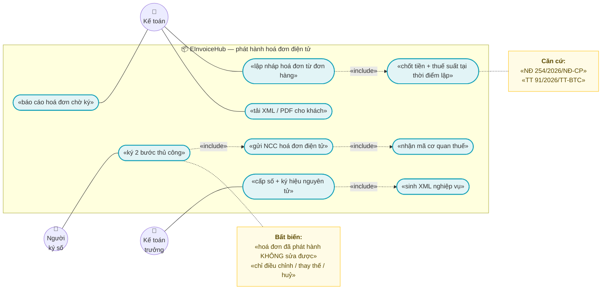
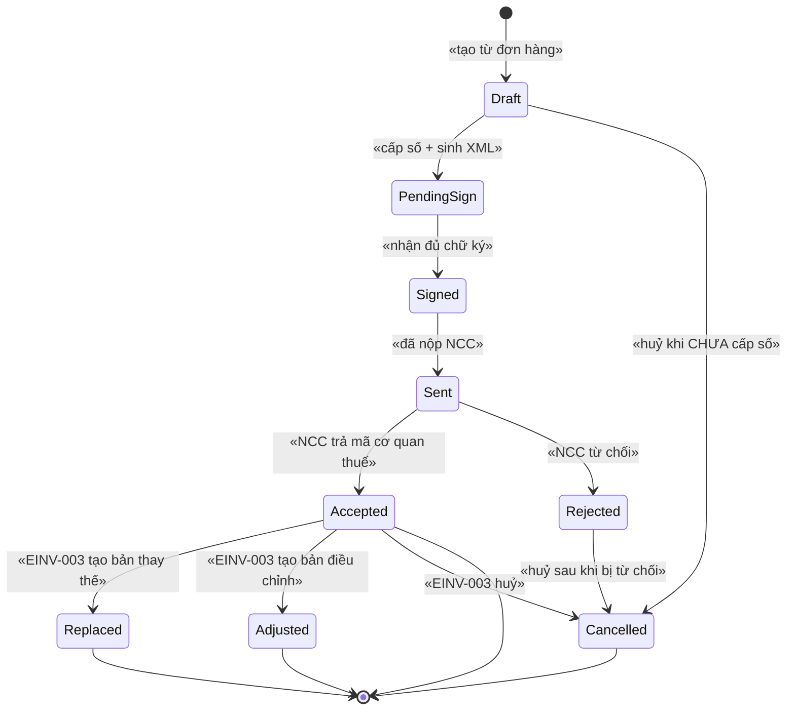
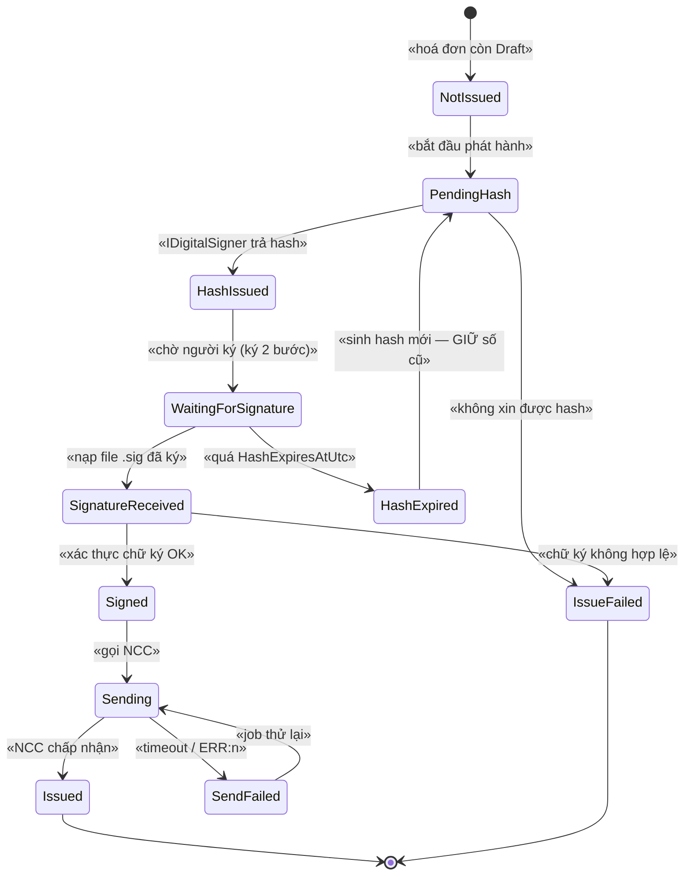
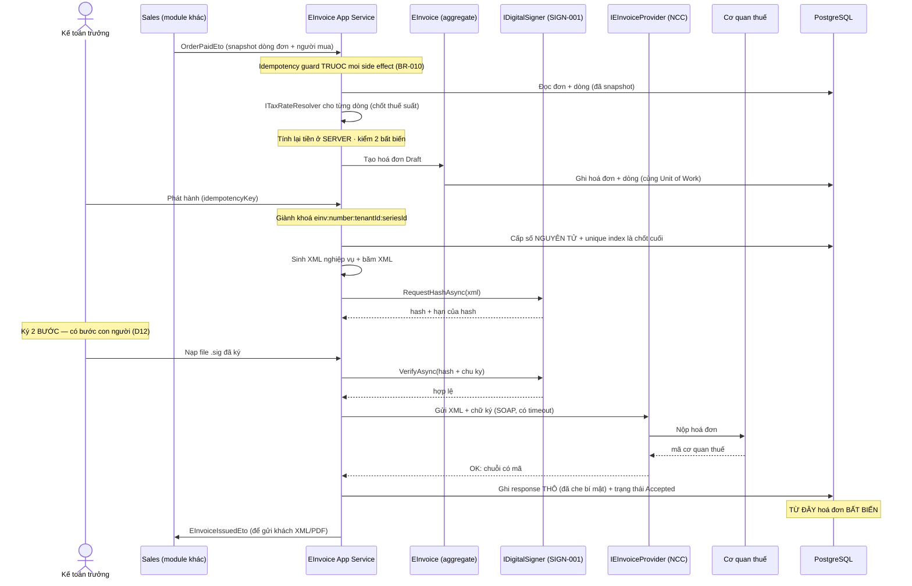
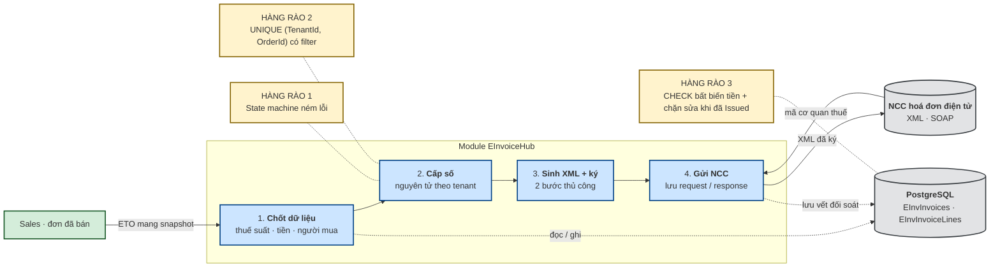
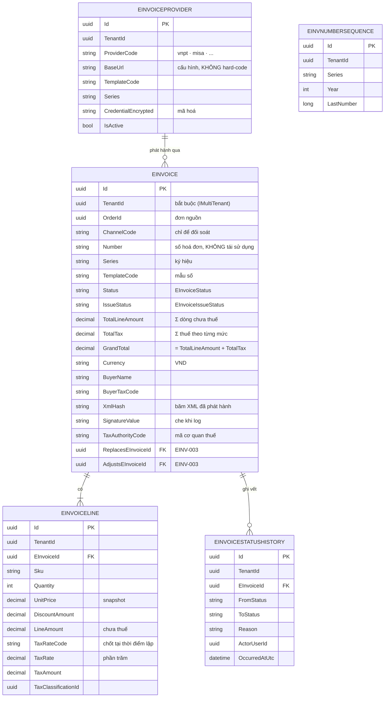

# `EINV-001` — Phát hành hoá đơn điện tử (NĐ 254/2026/NĐ-CP + TT 91/2026/TT-BTC)

| Thuộc tính | Nội dung |
|---|---|
| **Mã** | `EINV-001` |
| **Module** | **EInvoiceHub** — đề xuất `modules/EInvoiceHub/` với các project `eCommerce.EInvoiceHub.Domain` · `.EntityFrameworkCore` · `.Application` · `.Application.Contracts`. ⚠️ **Module này CHƯA tồn tại trong code** (đã kiểm: chỉ có `modules/ChannelHub`, `modules/PaymentHub`, `modules/Tax`) |
| **Giai đoạn** | **GĐ0 — Pháp lý** (`docs/implementation-plan.md` §5, §6.2). ⚠️ **Phụ thuộc cứng:** `XC-001` (Money/làm tròn) · `XC-006` (phân loại thuế) · `XC-002` (idempotency) — cả ba **chưa Approved** |
| **Ưu tiên** | **Must have** — đây là **nghĩa vụ pháp lý hiện hành**, không phải tính năng tuỳ chọn |
| **Trạng thái** | 🟡 `Draft` — chờ review |
| **Người viết / người review** | *(điền)* / **Kiến trúc trưởng + Kế toán + (nếu cần) luật sư** — theo `docs/design-doc-guidelines.md` §6: có **pháp lý** ⇒ review **bắt buộc** có kiến trúc trưởng + kế toán |
| **Phiên bản / ngày** | `v0.1 — 14/10/2026` |
| **Tài liệu liên quan** | `XC-001` (BR-010/011/012 — 2 bất biến hoá đơn) · `XC-002` (outbox/inbox + idempotency) · `XC-003` (khoá phân tán) · `XC-004` (`[Authorize]` cấp class + permission) · `XC-006` (phân loại thuế GTGT + Mẫu 01) · `EINV-002` (gửi CQT) · `EINV-003` (điều chỉnh/thay thế/huỷ) · `SIGN-001` (ký 2 bước) · `SAL-002` · `docs/implementation-plan.md` §6.2 + Phụ lục A |

---

## 0. Tóm tắt & quyết định thiết kế

**Tóm tắt:** `EINV-001` chốt cách hệ thống **lập và phát hành hoá đơn điện tử** theo căn cứ pháp lý **hiện hành** —
**Nghị định 254/2026/NĐ-CP** (hiệu lực **01/7/2026**, thay thế NĐ 123/2020/NĐ-CP và NĐ 70/2025/NĐ-CP) hướng dẫn bởi
**Thông tư 91/2026/TT-BTC**. Feature này **tạo bản ghi chứng từ bất biến**: một khi hoá đơn đã phát hành thì
**số tiền, thuế suất, số/ký hiệu và XML đã ký không bao giờ được sửa** — muốn đổi phải đi con đường
**điều chỉnh / thay thế / huỷ** (`EINV-003`).

**Vì sao phải viết tài liệu này trước khi code:** sai ở đây **không sửa được về sau**. Hoá đơn đã cấp mã của cơ quan thuế,
đã gửi khách, đã vào tờ khai — không có migration nào lấy lại được. Và căn cứ pháp lý **vừa thay đổi** (01/7/2026):
mọi tài liệu/tri thức tham chiếu NĐ 123/2020 đều **đã hết hiệu lực** (`XC-001` §15.1.2 đã tra và ghi rõ).

**Phạm vi:**
- ✅ **Lập hoá đơn** từ đơn hàng đã bán (nguồn dữ liệu: `Orders.Order` + `Sales` phát ETO) — **snapshot** toàn bộ số tiền.
- ✅ **State machine 2 trục** (trục **hoá đơn** + trục **phát hành**) — mọi chuyển trạng thái sai **NÉM LỖI**.
- ✅ **Cấp số & ký hiệu** hoá đơn đúng quy tắc, **không tái sử dụng**, cấp **nguyên tử**.
- ✅ **Sinh XML** thành phần dữ liệu nghiệp vụ + **luồng ký 2 bước thủ công** (phối hợp `SIGN-001`).
- ✅ **Gửi NCC HĐĐT** qua abstraction `IEInvoiceProvider` (`EINV-002` làm chi tiết SOAP/XML + parse `OK:`/`ERR:`).
- ✅ **Idempotency ở MỌI biên vào** + **khoá phân tán** theo quy ước `XC-003`.
- ✅ **Lưu vết đối soát**: XML thô + phản hồi thô của NCC (có che dữ liệu nhạy cảm).
- ✅ **Đầu ra cho khách**: tải XML/PDF, tra cứu theo đơn.

**Không nằm trong phạm vi:**
- ❌ **Chi tiết giao thức với cơ quan thuế** (SOAP/ASMX, endpoint, parse chuỗi `OK:…`/`ERR:n`) — thuộc **`EINV-002`**.
- ❌ **Điều chỉnh / thay thế / huỷ hoá đơn** (chuỗi chứng từ thay thế, thời hạn, mẫu 04/06…) — thuộc **`EINV-003`**.
  Tài liệu này **chỉ** chốt các **trường liên kết** (`ReplacesEInvoiceId`, `AdjustsEInvoiceId`) để `EINV-003` dùng.
- ❌ **Quy trình ký chi tiết + quản lý chứng thư số (HSM/USB token/SmartCA)** — thuộc **`SIGN-001`**.
  Tài liệu này chốt **hợp đồng** `IDigitalSigner` và **trạng thái** để `SIGN-001` cài đặt.
- ❌ **Định nghĩa thuế suất & phân loại SKU** — thuộc **`XC-006`** (đã có code lõi ở `modules/Tax/`).
- ❌ **Xuất Mẫu 01 (Phụ lục III)** — thuộc **`XC-006`** (đã có `Mau01Part2Calculator`) / `ACC-001`.
- ❌ **Chính sách làm tròn tiền** — thuộc **`XC-001`**.
- ❌ **Tích hợp cổng thanh toán / hoàn tiền** — thuộc `PaymentHub` + `REC-*`.
- ❌ **Hoá đơn đầu vào (mua vào)** — hệ thống **không** có phân hệ mua vào (đã ghi ở `XC-006` §6.3 điểm 3).

### 0.1 Quyết định thiết kế (ADR ngắn)

| # | Quyết định | Phương án đã cân nhắc | Lý do chọn | Hệ quả |
|---|---|---|---|---|
| **D1** | **Module riêng `EInvoiceHub`**, không nhét vào `Sales` hay `Tax` | (a) đặt trong `src/eCommerce.Domain` cạnh `Order` · (b) nhét vào `modules/Tax` · (c) module riêng `modules/EInvoiceHub` | (a) lặp lại đúng lỗi đã xảy ra: `ChannelHub`/`PaymentHub`/`Tax` đã tách module, entity ở `src/` là **nợ kiến trúc** đã ghi ở `XC-003` §15.2 **F4** · (b) `Tax` là **bảng thuế suất**, hoá đơn là **chứng từ bất biến gửi ra cơ quan thuế** — hai vòng đời khác hẳn · (c) khớp `docs/structure-and-techstack.md` §2.2 (đã liệt kê `EInvoiceHub/` là 🔴 P0) | Thêm một thư mục module; phải khai báo **`DbSet`** ở DbContext hợp nhất (D2) |
| **D2** | Entity của module **phải** có `DbSet` trên `eCommerceDbContext` hợp nhất | (a) chỉ gọi `builder.ConfigureEInvoiceHub()` · (b) khai báo `DbSet` **và** gọi `ConfigureEInvoiceHub()` | **Lỗi đã gặp thật ở Phase 0** với `ChannelHub`: thiếu `DbSet` ⇒ `AddDefaultRepositories(includeAllEntities: true)` **không** đăng ký `IRepository<T>` ⇒ runtime báo `"The requested service 'IRepository<ChannelShop, Guid>' has not been registered."` | Bắt buộc sửa **2 chỗ** (`eCommerceDbContext.cs` + `OnModelCreating`); có test kiểm |
| **D3** | **2 trục trạng thái trực giao**: trục **hoá đơn** (`EInvoiceStatus`) + trục **phát hành/ký** (`EInvoiceIssueStatus`) | (a) **một** enum gộp 12 trạng thái · (b) hai trục riêng | (a) `implementation-plan.md` §6.2 gộp `Draft → PendingSign → Signed → Sent → Accepted` vào **một** danh sách, nhưng như vậy **không** biểu diễn được ca thật: hoá đơn **đã bị thay thế** (`Replaced`) nhưng vẫn đang `Signed`; hoặc **đã gửi NCC thất bại** mà vẫn `Draft` hợp lệ · (b) `SAL-003` đã chốt **state machine 4 trục** cho đơn ⇒ giữ nhất quán tư duy "trục trực giao" | Phải kiểm tra **cả hai** trục ở mọi guard; test phải phủ **tích hai trục** (ma trận §3.3) |
| **D4** | **Bất biến tiền kiểm ở TẦNG DB** (CHECK constraint), không chỉ ở domain | (a) chỉ kiểm trong domain `ValidateForIssue()` · (b) domain + `CHECK` ở DB | Quy tắc bất di bất dịch `XC-003` **D2**: *"nếu bỏ lock/ràng buộc mềm đi, DB có chặn không? Nếu KHÔNG ⇒ thiết kế SAI"*. Hoá đơn là chứng từ pháp lý ⇒ cần hàng rào cứng. Đây cũng là **BR-XC-001-010/011** | Tổng số tiền **tính ở server**; **cấm** client gửi tổng lên; `CHECK` bằng SQL thô (EF Core không khai báo được `SUM` của bảng con ⇒ dùng trigger/`CHECK` trên cột đã tính + test) — **chưa kiểm chứng** cách làm cụ thể trên PostgreSQL (xem §15.1 Q5) |
| **D5** | **Phát hành là hành động TƯỜNG MINH**, có thể tự động theo lịch — **không** tự động ngay khi thanh toán | (a) tự động phát hành ngay trong handler `OrderPaidEto` · (b) người dùng bấm "Phát hành" · (c) bấm tay **hoặc** job theo lịch (mặc định bật) | (a) chặn event bus bằng HTTP SOAP tới NCC ⇒ **event rơi** khi NCC chậm, và `OrderPaidEto` bị retry sẽ tạo hoá đơn trùng; hơn nữa `Draft` cần người **kiểm tra MST/tên người mua** — dữ liệu này lấy từ `Customers` và rất hay sai · (c) giữ kiểm soát của kế toán nhưng không bắt bấm từng cái | Có cấu hình `eCommerce.EInvoice.AutoIssueMode` (`Manual` \| `Scheduled`) + giờ chạy; **mặc định `Scheduled` lúc 20:00** (sau giờ chốt đơn) |
| **D6** | **Idempotency guard ở MỌI biên vào**, kể cả nút bấm của người dùng | (a) chỉ chống trùng ở webhook NCC · (b) mọi biên vào | Quy tắc bất di bất dịch #9 (`implementation-plan.md` §3). Nút "Phát hành" bị bấm 2 lần / double-submit / retry của proxy đều tạo **2 hoá đơn cho cùng 1 đơn** ⇒ **sai pháp lý**, không xoá được | Mọi request phát hành **bắt buộc** có `IdempotencyKey` **ổn định**; unique index ở DB là chốt cuối |
| **D7** | **Khoá phân tán theo `tenantId` + `orderId`/`invoiceId`**, cấp phát số cũng có khoá riêng | (a) không khoá (tin DB) · (b) khoá theo tenant · (c) khoá hẹp theo đối tượng | Cấp số hoá đơn là **tài nguyên chia sẻ** thật (quy tắc #12). ⚠️ **Bài học `XC-003` F5 (đã bắt bằng `redis-cli MONITOR`)**: tiền tố `ecommerce:` do **`KeyPrefix`** của ABP cấp (`eCommerceHttpApiHostModule.cs:127` = `"ecommerce:"`), **hàm sinh khoá của module KHÔNG chứa tiền tố** | Hàm sinh khoá **không** viết `ecommerce:` — nếu viết sẽ thành **tiền tố đôi** `ecommerce:ecommerce:…` |
| **D8** | **Cấp số nguyên tử ở DB**, không sinh số trong bộ nhớ | (a) `MAX(Number)+1` rồi ghi · (b) bảng đếm + `UPDATE … RETURNING` trong transaction · (c) `SEQUENCE` | (a) **đua nhau** ⇒ hai hoá đơn cùng số (đã có tiền lệ: `XC-004` **F1** unique index mất tác dụng khi `TenantId` NULL) · (c) `SEQUENCE` không theo tenant/không rollback được theo nghiệp vụ | Bảng `EInvNumberSequences` + unique index `(TenantId, SeriesId, Year, Number)` là **chốt cuối**; **không** tái sử dụng số sau khi huỷ |
| **D9** | **Lưu XML thô + phản hồi thô của NCC**, có **che** dữ liệu nhạy cảm | (a) không lưu · (b) lưu tất cả kể cả chữ ký · (c) lưu + che | (a) không đối soát được khi cơ quan thuế chất vấn · (b) **chữ ký số là dữ liệu nhạy cảm**, lưu nguyên vào log/DB là bề mặt rủi ro — `PaymentTransaction.MaskSensitiveData` (`PaymentTransaction.cs:147`) đã làm đúng cho payload webhook ⇒ **kế thừa cùng cách** | Trường `RawRequestXml`/`RawResponse` **giới hạn độ dài** + hàm `MaskSecrets`; log **không** bao giờ in chữ ký |
| **D10** | **Chốt (snapshot) thuế suất vào dòng hoá đơn**, không tính lại khi đọc | (a) đọc lại `TaxRateSchedule`/`TaxClassification` khi in hoá đơn · (b) chép giá trị vào `EInvoiceLine` | (a) `XC-006` **BR-XC-006-002** đã chốt: *"thay đổi cấu hình KHÔNG làm đổi chứng từ cũ"*; hơn nữa mức 8% **hết hạn 31/12/2026** ⇒ hoá đơn tháng 12/2026 in lại tháng 1/2027 sẽ **sai** nếu đọc lại | Dòng hoá đơn lưu `TaxRateCode` + `TaxRate` + `TaxAmount` + `TaxClassificationId` **tại thời điểm lập**; có test |
| **D11** | **Giao tiếp với NCC qua `IEInvoiceProvider`**, `Sales` giao tiếp qua **ETO**, không gọi chéo | (a) `EInvoiceHub` tham chiếu `Sales` để đọc đơn · (b) `Sales` phát ETO mang **snapshot**, `EInvoiceHub` consume | Quy tắc bất di bất dịch #3: **module → app là CẤM**; và `EInvoiceHub` **không được** tham chiếu module `Sales`. Ngược lại `EInvoiceHub` **được** tham chiếu `.Contracts` của `Tax` (`ITaxRateResolver`) vì **hợp đồng** là hợp lệ (`structure-and-techstack.md` §2.3) | `Sales` phải phát `OrderPaidEto` **có snapshot dòng đơn**; nếu chỉ phát `OrderId` thì `EInvoiceHub` **không** lập được hoá đơn |
| **D12** | **Ký 2 bước THỦ CÔNG**: có trạng thái "chờ người ký", **không** hứa tự động hoá 100% | (a) tự động hoàn toàn bằng HSM/remote signing · (b) 2 bước có bước người | Quyết định #2 đã chốt (`implementation-plan.md` §2): *"Ký số: thủ công; không mua HSM"*. VNPT dùng **xin Hash → gửi hash đã ký**, với token/USB **không thể** tự động (`business-modules-proposal.md` §6.7) | Có trạng thái `WaitingForSignature` **có thể treo lâu** ⇒ phải có **nhắc việc + báo cáo hoá đơn chờ ký**; SLA không tự động được |
| **D13** | Trong môi trường dev **không có PostgreSQL/Docker**, test phải **unit-hoá được** và **skip tường minh** phần cần DB | (a) viết integration test rồi để đỏ · (b) tách unit (thuần) khỏi integration và `Skip` có lý do | Tiền lệ thật: `XC-004` **F1** và `XC-006` §14.5 đều ghi *"chưa chạy trên PostgreSQL thật"* vì máy dev không có DB ⇒ nhiều ràng buộc **chưa kiểm chứng**. Ghi rõ **tốt hơn** để đỏ mơ hồ | `EInvoiceNumberAllocator`/`EInvoiceXmlBuilder`/state machine phải là **hàm thuần** (như `Mau01Part2Calculator` + `TaxRateResolver`) ⇒ test được **không cần DB** |

> *Ghi lại cả phương án BỊ LOẠI và lý do — để 6 tháng sau không ai hỏi lại "sao không làm cách kia".*

---

## 1. Use Case Specification

| Thuộc tính | Nội dung |
|---|---|
| **Use Case ID** | `EINV-001` |
| **Use Case Name** | Lập và phát hành hoá đơn điện tử **bất biến**, đúng căn cứ pháp lý hiện hành |
| **Description** | *"Là kế toán của một shop bán hàng đa kênh, tôi muốn hệ thống tự lập hoá đơn điện tử từ đơn hàng đã bán — đúng số tiền, đúng thuế suất tại thời điểm lập, cấp số không trùng, và lưu vết để giải trình với cơ quan thuế — để tôi không phải nhập tay và không bao giờ phải sửa chứng từ đã phát hành."* |
| **Actor(s)** | **Kế toán** (lập/kiểm tra, ký) · **Kế toán trưởng** (phát hành, huỷ — cùng `EINV-003`) · **Người ký số** (nạp file hash đã ký) · **Hệ thống** (`Sales` phát ETO, job theo lịch) · **NCC HĐĐT** (nhận XML, trả mã CQT) · **Cơ quan thuế** (gián tiếp, qua NCC — chi tiết ở `EINV-002`) |
| **Priority** | **Must have** |
| **Trigger** | (a) **job theo lịch** chạy lúc 20:00 và tìm thấy đơn đủ điều kiện phát hành · (b) kế toán bấm **"Phát hành"** trên một đơn · (c) kế toán bấm **"Lập nháp"** để kiểm tra trước khi phát hành · (d) NCC trả kết quả (webhook/poll) — xử lý ở `EINV-002`, tài liệu này chỉ nhận **trạng thái** |
| **Pre-Condition(s)** | • **Tenant hiện tại** (`TenantId` từ `ICurrentTenant`) — mọi entity của feature đều `IMultiTenant`.<br>• **`ChannelCode` của đơn**: hiện **không** tham gia quyết định phát hành (hoá đơn theo **người mua + hàng hoá**, không theo kênh bán — nhất quán `XC-006` §1). Lưu `ChannelCode` trên hoá đơn **chỉ để đối soát**.<br>• Đơn đã ở trạng thái **đủ điều kiện phát hành** (`Orders.OrderStatus` ∈ {`Completed`} hoặc `PaymentStatus` = `Paid` — **ngưỡng cụ thể cần BA chốt**, xem §15.1 **Q2**).<br>• **Thông tin người mua** đầy đủ: `Tên đơn vị/cá nhân` + `MST` (nếu là tổ chức) — lấy từ `Customers`.<br>• **Mọi dòng hàng đã được phân loại thuế** và có mức thuế suất **hiệu lực tại ngày lập** (`XC-006` BR-001/004). SKU chưa phân loại ⇒ **chặn** với `eCommerce:Tax:0003`.<br>• **Cấu hình NCC** (`EInvoiceProvider`) đã có, đang `Active`, và **có chứng thư số còn hiệu lực** (`SIGN-001`).<br>• `XC-001` (`Money`) · `XC-002` (idempotency) · `XC-006` (tax resolver) đã **Approved/đã có code**.<br>• ⚠️ **Máy dev hiện KHÔNG có PostgreSQL/Docker** ⇒ các điều kiện cần DB (`CHECK`, unique index) **chưa kiểm chứng** trong môi trường này. |
| **Post-Condition(s)** | • Hoá đơn ở `EInvoiceStatus` hợp lệ và **mọi số tiền đã chốt (bất biến)**.<br>• **Đúng tối đa MỘT** hoá đơn `Issued`+ cho mỗi `(TenantId, OrderId)` — hàng rào là unique index.<br>• Số hoá đơn **đã cấp và không thể tái sử dụng**, kể cả khi hoá đơn bị huỷ sau đó.<br>• XML thành phần dữ liệu nghiệp vụ **đã lưu** và **băm (hash) đã lưu** để phát hiện sửa đổi.<br>• Mọi lần gọi NCC **có bản ghi `request/response`** (đã che bí mật).<br>• Mọi chuyển trạng thái **có dấu vết** (audit của ABP + `EInvoiceStatusHistory`). |
| **Basic Flow** | 1. `Sales` phát `OrderPaidEto` **mang snapshot** (số đơn, người mua, dòng hàng, tiền) ⇒ `EInvoiceHub` ghi một bản ghi **`EInvoiceDraftRequest`** (hàng đợi lập hoá đơn), **chưa** cấp số.<br>2. Job/kế toán gọi `CreateDraftAsync(orderId, idempotencyKey)`: hệ thống **chống trùng** trước mọi side effect (D6).<br>3. Hệ thống **nạp dòng đơn đã snapshot**, gọi `ITaxRateResolver.ResolveEffectiveRateAsync(…)` cho **từng dòng** ⇒ **chốt** `TaxRateCode`/`TaxRate`/`TaxClassificationId`.<br>4. Hệ thống **tính lại toàn bộ tiền ở server** (`LineAmount = Quantity × UnitPrice − DiscountAmount`; `TaxAmount` làm tròn **theo từng dòng**; `TotalTax` = **Σ dòng**; `GrandTotal = Σ LineAmount + TotalTax`) — **không** nhận tổng từ client (D4).<br>5. Hệ thống **nhóm theo mức thuế suất** và **kiểm 2 bất biến** (`XC-001` BR-010/011) — sai ⇒ **ném lỗi**, không tạo bản ghi.<br>6. Hoá đơn ở `EInvoiceStatus.Draft` + `IssueStatus.NotIssued`. Kế toán **xem lại** (mẫu số, ký hiệu, MST, tên người mua) và sửa **chỉ khi còn `Draft`**.<br>7. Kế toán bấm **"Phát hành"** ⇒ hệ thống **giành khoá phân tán** `einv:number:{tenantId}:{seriesId}` → **cấp số nguyên tử** (D8) → sinh **XML** → chuyển `IssueStatus.PendingHash`, `EInvoiceStatus.PendingSign`.<br>8. Hệ thống gọi bước 1 của ký số: **xin hash** từ `IDigitalSigner` ⇒ `IssueStatus.HashIssued`, lưu `HashToSign` base64.<br>9. **Người ký** nạp **file hash đã ký** (`.sig`) vào màn hình "chờ ký" ⇒ hệ thống lưu `SignatureValue` + chuyển `IssueStatus.SignatureReceived` → `Signed`, `EInvoiceStatus.Signed`.<br>10. Hệ thống gửi XML + chữ ký tới NCC qua `IEInvoiceProvider` ⇒ lưu `request/response`; NCC chấp nhận ⇒ `EInvoiceStatus.Sent` (chi tiết `EINV-002` xử lý mã CQT).<br>11. Khi nhận kết quả **mã của cơ quan thuế** ⇒ `EInvoiceStatus.Accepted` + lưu `TaxAuthorityCode`, `IssuedAtUtc`. **Từ đây hoá đơn bất biến.**<br>12. Hệ thống phát `EInvoiceIssuedEto` để `Sales`/`Reporting`/`Notifications` dùng (gửi khách file XML/PDF). |
| **Alternative Flow** | **A1: Phát hành theo lịch (mặc định)** — job 20:00 quét đơn đủ điều kiện, gọi bước 2 cho **từng đơn**; giành khoá `einv:issue:{tenantId}:{orderId}`; không giành được ⇒ **bỏ qua nhịp này + log + metric** (đúng `XC-003` **D10** chế độ `SkipIfBusy`).<br>**A2: NCC không trả ngay (SOAP treo)** — request ghi `IssueStatus.Sending` + gọi có **timeout**; hết timeout ⇒ `IssueStatus.SendFailed` + **job thử lại** (không rollback dữ liệu đã ghi).<br>**A3: Đã có hoá đơn cho đơn này** — trả về **hoá đơn cũ** + `IdempotencyOutcome.AlreadyProcessed`, **không** tạo bản ghi thứ hai (D6).<br>**A4: Sửa `Draft`** — chỉ khi `EInvoiceStatus.Draft` **và** `IssueStatus ∈ {NotIssued, SendFailed}`; ngoài ra **ném** `eCommerce:EInvoice:0007`.<br>**A5: Ký lại sau khi hash hết hạn** — `HashExpiresAtUtc` đã qua ⇒ sinh **hash mới**, giữ **nguyên số hoá đơn** (số đã cấp không thu hồi được).<br>**A6: Thay thế/điều chỉnh** — hoá đơn mới có `ReplacesEInvoiceId`/`AdjustsEInvoiceId`; bản cũ chuyển `EInvoiceStatus.Replaced`/`Adjusted` **nhưng giữ nguyên số và tiền** (chi tiết `EINV-003`). |
| **Exception Flow** | **E1:** SKU chưa phân loại thuế ⇒ `BusinessException` `eCommerce:Tax:0003` (**kế thừa `XC-006`**), **chặn phát hành**, thông điệp **chỉ rõ mã SKU** + hướng dẫn.<br>**E2:** không có mức thuế suất nào hiệu lực tại ngày lập ⇒ `eCommerce:Tax:0002` (**kế thừa `XC-006`**).<br>**E3:** không tìm thấy `TaxClassification` hợp lệ ⇒ `eCommerce:EInvoice:0004`.<br>**E4:** vi phạm bất biến tiền (`Σ dòng thuế ≠ TotalTax` hoặc `GrandTotal ≠ Σ LineAmount + TotalTax`) ⇒ `eCommerce:EInvoice:0003` (**không** tạo hoá đơn; đây là lỗi lập trình phải lộ ra CI).<br>**E5:** chuyển trạng thái sai ⇒ `eCommerce:EInvoice:0001` (kèm `currentStatus` + `expectedStatus`) — **cấm** im lặng bỏ qua (quy tắc #11).<br>**E6:** cấp số trùng ⇒ **DB từ chối** (unique index) ⇒ `eCommerce:EInvoice:0005`; **không** tự tăng số rồi thử lại mù quáng (số đã dùng thuộc chứng từ khác).<br>**E7:** chứng thư số **hết hạn / bị thu hồi** ⇒ `eCommerce:EInvoice:0006` — **chặn** trước khi xin hash, không đợi NCC từ chối.<br>**E8:** NCC trả `ERR:n` (không có HTTP status semantic) ⇒ parse chuỗi ở `EINV-002`, ghi `IssueStatus.SendFailed` + `ProviderError`; **không** rollback hoá đơn đã cấp số.<br>**E9:** hai luồng cùng phát hành **một đơn** ⇒ luồng thứ hai **không** giành được khoá ⇒ `eCommerce:EInvoice:0002` (hoặc bỏ qua nếu là job — A1).<br>**E10:** người dùng **double-click** nút Phát hành ⇒ cùng `IdempotencyKey` ⇒ trả hoá đơn cũ, **không** ném lỗi (A3).<br>**E11:** `RecentAverageCost`/giá vốn không có — **không áp dụng** ở `EINV-001` (hoá đơn đầu ra không cần giá vốn). |
| **Business Rules** | • **BR-EINV-001-001**: Mọi chuyển trạng thái **phải** qua guard của state machine (§3); chuyển sai ⇒ **NÉM** `eCommerce:EInvoice:0001`. **Cấm** im lặng bỏ qua.<br>• **BR-EINV-001-002**: Hoá đơn đã `Issued`+ (`Signed`/`Sent`/`Accepted`) là **BẤT BIẾN**: **cấm** sửa/xoá mọi trường số tiền, thuế, số, ký hiệu, người mua. Muốn đổi ⇒ `EINV-003`.<br>• **BR-EINV-001-003**: Mọi số tiền **tính ở server**; **cấm** nhận `GrandTotal`/`TotalTax` từ client; DTO đầu vào **không có** trường tổng.<br>• **BR-EINV-001-004**: Bất biến `XC-001` BR-010: **`TotalTax` == Σ thuế của các nhóm thuế suất** (kiểm **sau khi** đã làm tròn từng dòng).<br>• **BR-EINV-001-005**: Bất biến `XC-001` BR-011: **`GrandTotal` == Σ `LineAmount` + `TotalTax`**.<br>• **BR-EINV-001-006**: **Đúng tối đa MỘT** hoá đơn `Issued`+ cho mỗi `(TenantId, OrderId)`; unique index có filter là **hàng rào cuối**.<br>• **BR-EINV-001-007**: Số hoá đơn **đã cấp KHÔNG BAO GIỜ** được tái sử dụng, kể cả khi hoá đơn bị huỷ/thay thế; số cấp **nguyên tử** ở DB.<br>• **BR-EINV-001-008**: Thuế suất **chốt tại thời điểm lập** (snapshot theo `XC-006` BR-002); đổi cấu hình **không** làm đổi hoá đơn cũ.<br>• **BR-EINV-001-009**: Dòng hoá đơn **bắt buộc** có `TaxRateCode`; SKU chưa phân loại ⇒ **chặn** (`eCommerce:Tax:0003`).<br>• **BR-EINV-001-010**: **Mọi biên vào** phải đi qua idempotency guard **trước mọi side effect**, với `IdempotencyKey` **ổn định** (cấm `Guid.NewGuid()` mỗi lần thử).<br>• **BR-EINV-001-011**: Mọi thao tác ghi qua **Unit of Work**; **không** dùng `IRepository` với `autoSave: true` lẻ tẻ khi còn bước phải cùng transaction (kế thừa lỗi `ChannelTokenManager` gọi `UpdateAsync(…, autoSave: true)`).<br>• **BR-EINV-001-012**: **Lưu** XML thô + phản hồi thô của NCC để đối soát; **cấm** lưu/ghi log **chữ ký số** và **khoá bí mật** ở dạng rõ.<br>• **BR-EINV-001-013**: Khoá phân tán dùng **duy nhất** hàm trong `EInvoiceHubConsts.LockKeys`; **cấm** viết literal khoá; **cấm** thêm tiền tố `ecommerce:` vào hàm (D7).<br>• **BR-EINV-001-014**: Mọi entity `IMultiTenant`; hoá đơn của tenant A **không** đọc/ghi được từ tenant B. Mọi unique index có `TenantId` **phải** `NULLS NOT DISTINCT` (`XC-004` BR-009).<br>• **BR-EINV-001-015**: Chuỗi thay thế/điều chỉnh **không được đứt**: hoá đơn thay thế **phải** trỏ tới bản bị thay thế; **cấm** tạo bản thay thế mồ côi.<br>• **BR-EINV-001-016**: **Cấm** hard-code endpoint/mẫu số/ký hiệu của NCC; mọi thứ đọc từ `EInvoiceProvider` (cấu hình) — kế thừa `implementation-plan.md` §6.2 DoD(4).<br>• **BR-EINV-001-017**: **Cấm** gọi NCC khi chưa có **chữ ký hợp lệ** (`SignatureValue` khác rỗng) — nộp XML không ký là **sai pháp lý**.<br>• **BR-EINV-001-018**: Khi **không** giành được khoá ở tầng HTTP ⇒ trả **`409`** (`XC-003` **Q4** đã chốt) với `eCommerce:EInvoice:0002`; job định kỳ thì **bỏ qua + log + metric**. |
| **Non-Functional Requirement** | • **NFR-EINV-001-001**: `CreateDraftAsync` cho đơn **≤ 100 dòng** ⇒ p95 **< 1,5 s** (gồm ≤ 100 lần gọi `ITaxRateResolver` có cache).<br>• **NFR-EINV-001-002**: Sinh **XML** cho hoá đơn ≤ 100 dòng ⇒ p95 **< 300 ms** (hàm thuần, không I/O).<br>• **NFR-EINV-001-003**: Cấp số hoá đơn **0 trùng** trong test đồng thời **20 luồng × 50 lần**.<br>• **NFR-EINV-001-004**: **100 %** nhánh state machine (cả hai trục) có test — kể cả nhánh **guard sai**.<br>• **NFR-EINV-001-005**: **100 %** lần gọi NCC có bản ghi `request/response` (đã che bí mật) + `CorrelationId`.<br>• **NFR-EINV-001-006**: Gửi trùng cùng `IdempotencyKey` ⇒ **0** hoá đơn thừa (test 10 lần gửi).<br>• **NFR-EINV-001-007**: `TotalTax` và `GrandTotal` khớp bất biến §1 **100 %** trên **10.000** bộ dữ liệu ngẫu nhiên (property-based).<br>• **NFR-EINV-001-008**: Hoá đơn đã `Issued`+ **không** sửa được qua **mọi** đường (app service, SQL thô bị chặn bởi trigger/`CHECK`) — test âm.<br>• **NFR-EINV-001-009**: Cách ly tenant: **0** rò rỉ qua API (integration 2 tenant).<br>• **NFR-EINV-001-010**: **0** chữ ký số / khoá bí mật xuất hiện trong log (test quét log + review).<br>• **NFR-EINV-001-011**: **100 %** chuyển trạng thái ghi `EInvoiceStatusHistory` (ai/khi nào/từ đâu tới đâu).<br>• **NFR-EINV-001-012**: Thời gian **lưu trữ** hoá đơn thoả luật kế toán (Luật Kế toán 88/2015/QH13 Điều 41) — ⚠️ **CHƯA XÁC MINH** số năm và **chưa xác minh** điều khoản tương ứng trong NĐ 254/2026 (xem §15.1 **Q6**). **Không** được ghi con số cụ thể khi chưa tra. |

---

## 2. Sơ đồ Use Case



### Chú giải

| Ký hiệu | Ý nghĩa |
|---|---|
| ⭕ Xanh lá | Actor |
| 🟦 Bầu dục xanh dương | Use Case |
| 🟨 Khung vàng | Note |
| `───` | Liên kết Actor ↔ Use Case |
| `-.«include».->` | Quan hệ bao hàm |

---

## 3. Sơ đồ trạng thái (state machine) — **BẮT BUỘC nếu feature có vòng đời**

> Feature này **có** vòng đời ⇒ mục này **áp dụng**. Và theo **D3**, vòng đời gồm **HAI TRỤC TRỰC GIAO**:
> trục **hoá đơn** (`EInvoiceStatus` — *chứng từ đang là gì về mặt pháp lý*) và trục **phát hành**
> (`EInvoiceIssueStatus` — *việc gửi/ký đang ở bước nào*). **Cấm** gộp hai trục (xem D3).

### 3.1 Trục 1 — `EInvoiceStatus` (vòng đời chứng từ)



### 3.2 Trục 2 — `EInvoiceIssueStatus` (vòng đời phát hành/ký)



### 3.3 Bảng chuyển trạng thái & guard

**Trục `EInvoiceStatus`:**

| # | Từ → Sang | Guard (điều kiện cho phép) | Hành động kèm theo | Nếu guard sai thì? |
|---|---|---|---|---|
| 1 | `[*]` → `Draft` | Đơn đủ điều kiện + **mọi dòng đã phân loại thuế** + 2 bất biến tiền đúng | Sinh `EInvoiceLine`, chốt thuế suất | **NÉM** `eCommerce:Tax:0003` / `eCommerce:EInvoice:0003` / `0004` |
| 2 | `Draft` → `PendingSign` | Có ≥ 1 dòng; `SellerTaxCode` + `BuyerName` + ký hiệu/mẫu số hợp lệ; **cấp được số** | Cấp số (khoá + transaction), sinh XML, lưu `XmlHash` | **NÉM** `eCommerce:EInvoice:0005` (trùng số) / `0007` (thiếu trường bắt buộc) |
| 3 | `PendingSign` → `Signed` | `IssueStatus = SignatureReceived` **và** chữ ký hợp lệ | Lưu `SignatureValue`, `SignedAtUtc` | **NÉM** `eCommerce:EInvoice:0001` |
| 4 | `Signed` → `Sent` | `SignatureValue` khác rỗng (**BR-017**) + `IssueStatus = Sending` | Ghi `SentAtUtc` + bản ghi request | **NÉM** `eCommerce:EInvoice:0001` |
| 5 | `Sent` → `Accepted` | NCC trả **mã cơ quan thuế** hợp lệ (`EINV-002`) | Lưu `TaxAuthorityCode`, `IssuedAtUtc` ⇒ 🔒 **bất biến từ đây** | **NÉM** `eCommerce:EInvoice:0001` |
| 6 | `Sent` → `Rejected` | NCC trả `ERR:n` | Lưu `ProviderError`; **giữ số đã cấp** | **NÉM** `eCommerce:EInvoice:0001` |
| 7 | `Draft` → `Cancelled` | **Chưa** cấp số (`Number` rỗng) | Đánh dấu huỷ | **NÉM** `eCommerce:EInvoice:0001` — hoá đơn **đã cấp số** phải đi đường `EINV-003` |
| 8 | `Rejected` → `Cancelled` | Chưa `Accepted` | Đánh dấu huỷ | **NÉM** `eCommerce:EInvoice:0001` |
| 9 | `Accepted` → `Replaced` / `Adjusted` / `Cancelled` | Có **chứng từ thay thế/điều chỉnh hợp lệ** (`EINV-003`), **BR-015** | Lưu liên kết 2 chiều | **NÉM** `eCommerce:EInvoice:0001` |

**Trục `EInvoiceIssueStatus`:**

| # | Từ → Sang | Guard | Hành động kèm theo | Nếu guard sai thì? |
|---|---|---|---|---|
| 1 | `NotIssued` → `PendingHash` | Quyền `eCommerce.EInvoice.Issue` + chứng thư **còn hiệu lực** + `SignatureValue` rỗng | Sinh XML + gọi `IDigitalSigner.RequestHashAsync` | **NÉM** `eCommerce:EInvoice:0006` (chứng thư) / `403` (quyền) |
| 2 | `PendingHash` → `HashIssued` | Signer trả hash không rỗng | Lưu `HashToSign`, `HashExpiresAtUtc` | **NÉM** `eCommerce:EInvoice:0001` |
| 3 | `HashIssued` → `WaitingForSignature` | Luôn cho phép (ký 2 bước **bắt buộc** có bước người — D12) | Ghi vào **báo cáo chờ ký** | — |
| 4 | `WaitingForSignature` → `SignatureReceived` | File `.sig` đọc được + base64 hợp lệ | Lưu tạm `SignatureValue`, `SignedByUserId` | **NÉM** `eCommerce:EInvoice:0001` |
| 5 | `SignatureReceived` → `Signed` | **Xác thực chữ ký** khớp `HashToSign` + chứng thư còn hiệu lực tại thời điểm ký | `EInvoiceStatus` → `Signed` | **NÉM** `eCommerce:EInvoice:0001` |
| 6 | `WaitingForSignature` → `HashExpired` | `now > HashExpiresAtUtc` | Metric `einv_hash_expired_total` | — (không lỗi — **hợp lệ**, chờ lâu là bình thường) |
| 7 | `HashExpired` → `PendingHash` | Luôn cho phép | **GIỮ nguyên số hoá đơn** (BR-007) | — |
| 8 | `Signed` → `Sending` → `Issued` \| `SendFailed` | Kết quả NCC | Lưu request/response (đã che) | `SendFailed` ⇒ **job thử lại**, **không** rollback |

> ⚠️ **Quy tắc bất di bất dịch #11: guard sai phải NÉM LỖI (hoặc ghi log có cấu trúc), không im lặng.**
> Ba ngoại lệ **có chủ ý** (không ném lỗi) được ghi rõ lý do:
> **(a)** `HashExpired` — chờ người ký lâu là **chuyện bình thường** của ký 2 bước (D12), không phải lỗi;
> **(b)** job theo lịch không giành được khoá ⇒ **bỏ qua nhịp** + log + metric (`XC-003` **D10**, chế độ `SkipIfBusy`);
> **(c)** gửi trùng cùng `IdempotencyKey` ⇒ trả **kết quả cũ**, không ném (E10) — vì đây là **hành vi đúng** mà client mong đợi.
>
> **Trạng thái hấp thụ (absorbing):** `Replaced` · `Adjusted` · `Cancelled` · `Issued` — **không** có đường ra.
> `Accepted` **không** hấp thụ vì `EINV-003` còn có thể thay thế/điều chỉnh/huỷ nó.

**Ai được phép chuyển:** `Draft → PendingSign` và `[*] → Cancelled` do **kế toán trưởng** (permission `eCommerce.EInvoice.Issue`/`Cancel`);
`WaitingForSignature → …` do **người ký số** (`eCommerce.EInvoice.Sign`); mọi chuyển do **NCC trả kết quả** chỉ do **handler idempotent** (`EINV-002`),
**không** có endpoint cho người dùng nhảy thẳng `Sent → Accepted`.

---

## 4. Sequence Diagram & luồng dữ liệu

### 4.1 Sequence — từ đơn đã bán tới hoá đơn có mã cơ quan thuế



### 4.2 DFD — đường đi của một hoá đơn và **ba hàng rào bảo vệ bất biến**



> 📌 **Ba hàng rào là ba lớp độc lập** — theo `XC-003` **D2**: *"bỏ lớp mềm đi, lớp cứng còn chặn không?"*.
> Nếu **chỉ** có state machine trong code (hàng rào 1) thì một script SQL sửa tay vẫn phá được chứng từ ⇒
> **hàng rào 3 ở DB là bắt buộc** (D4).

---

## 5. Mô hình dữ liệu

### 5.1 ERD

**Toàn bộ entity dưới đây CHƯA có trong code** — đã kiểm: `modules/` chỉ có `ChannelHub`, `PaymentHub`, `Tax`;
`src/eCommerce.EntityFrameworkCore/eCommerceDbContext.cs` **không** có `DbSet` nào của hoá đơn.
Mô hình dưới là **kế hoạch GĐ0**.



### 5.2 Bảng & cột (Data Dictionary)

**Bảng `EInvInvoices`** — *chứng từ hoá đơn điện tử; **bất biến** sau khi `Accepted`*

| Cột | Kiểu | Null? | Nguồn / ý nghĩa | Ghi chú |
|---|---|---|---|---|
| `Id` | `uuid` | ✖ | khoá chính | |
| `TenantId` | `uuid` | ✔ | tenant sở hữu | **bắt buộc** vì entity là `IMultiTenant` (`XC-004` BR-009) |
| `OrderId` | `uuid` | ✖ | đơn nguồn | **không** FK sang bảng `OrdOrders` (module→app cấm; giữ liên kết **mềm** theo id) |
| `ChannelCode` | `varchar(32)` | ✖ | kênh phát sinh đơn | **chỉ để đối soát** — không tham gia quyết định thuế/phát hành |
| `Number` | `varchar(32)` | ✔ | số hoá đơn | ✔ vì `Draft` **chưa** có số; đã cấp ⇒ **cấm** đổi (BR-007) |
| `Series` | `varchar(16)` | ✖ | ký hiệu hoá đơn | cùng `TemplateCode` + `ProviderCode` |
| `TemplateCode` | `varchar(16)` | ✖ | mẫu số | |
| `Status` | `int` | ✖ | `EInvoiceStatus` | lưu **int** + enum trong code |
| `IssueStatus` | `int` | ✖ | `EInvoiceIssueStatus` | trục thứ hai (D3) |
| `BuyerName` | `varchar(512)` | ✖ | tên người mua | snapshot — **không** đọc lại `Customers` khi in |
| `BuyerTaxCode` | `varchar(32)` | ✔ | MST người mua | ✔ vì khách cá nhân có thể không có MST |
| `BuyerAddress` | `varchar(1024)` | ✔ | địa chỉ trên hoá đơn | dùng `AddressHub` (`ADDR-001…003`) — **chưa có** |
| `TotalLineAmount` | `numeric(18,4)` | ✖ | Σ `LineAmount` | ⚠️ **decimal, không bao giờ `double`** (`XC-001` BR-008) |
| `TotalTax` | `numeric(18,4)` | ✖ | Σ thuế theo **từng mức** | **BẤT BIẾN** `XC-001` BR-010 |
| `GrandTotal` | `numeric(18,4)` | ✖ | `TotalLineAmount + TotalTax` | **BẤT BIẾN** `XC-001` BR-011 |
| `Currency` | `varchar(8)` | ✖ | mã ISO-4217 | ⚠️ `XC-001` §11 khuyến nghị thu về `char(3)`; bảng hiện có (`OrdOrders.Currency`) đang `varchar(8)` ⇒ **giữ nhất quán với code hiện tại**, ghi nhận nợ |
| `XmlHash` | `varchar(128)` | ✔ | SHA-256 của XML đã phát hành | dùng **phát hiện sửa đổi** sau này |
| `RawRequestXml` | `text` | ✔ | XML gửi NCC | ⚠️ **giới hạn độ dài** + che bí mật (D9) |
| `RawResponse` | `text` | ✔ | phản hồi thô NCC | ⚠️ NCC trả **chuỗi** `"OK:…"`/`"ERR:n"` **không có HTTP status semantic** |
| `SignatureValue` | `text` | ✔ | chữ ký số (base64) | 🚨 **CẤM** ghi ra log (BR-012) |
| `HashToSign` | `varchar(512)` | ✔ | hash xin từ signer | |
| `HashExpiresAtUtc` | `timestamptz` | ✔ | hạn của hash | quá hạn ⇒ sinh hash mới, **giữ số** |
| `SignedByUserId` | `uuid` | ✔ | ai nạp file `.sig` | |
| `TaxAuthorityCode` | `varchar(64)` | ✔ | mã của cơ quan thuế | có ⇒ hoá đơn **bất biến** |
| `IssuedAtUtc` | `timestamptz` | ✔ | thời điểm phát hành | **UTC** (quy ước `eCommerceDomainModule.cs:58`) |
| `ProviderError` | `varchar(2048)` | ✔ | lỗi từ NCC | |
| `IdempotencyKey` | `varchar(256)` | ✔ | khoá chống trùng (**ổn định**) | unique index |
| `ReplacesEInvoiceId` | `uuid` | ✔ | hoá đơn bị thay thế | `EINV-003`; **BR-015** |
| `AdjustsEInvoiceId` | `uuid` | ✔ | hoá đơn bị điều chỉnh | `EINV-003`; **BR-015** |

**Bảng `EInvInvoiceLines`** — *dòng hoá đơn; `numeric(18,4)` cho mọi trường tiền*

| Cột | Kiểu | Null? | Nguồn / ý nghĩa | Ghi chú |
|---|---|---|---|---|
| `Id` | `uuid` | ✖ | khoá chính | |
| `TenantId` | `uuid` | ✔ | tenant | |
| `EInvoiceId` | `uuid` | ✖ | FK nội bộ module | **cascade** khi xoá `Draft` chưa cấp số |
| `Sku` | `varchar(64)` | ✖ | mã SKU **snapshot** | khớp `OrdOrderLines.Sku` (`varchar(64)`) |
| `Quantity` | `int` | ✖ | số lượng | `> 0` (CHECK) |
| `UnitPrice` | `numeric(18,4)` | ✖ | đơn giá **snapshot** | ⚠️ **không** đọc lại `CatProductVariants.Price` |
| `DiscountAmount` | `numeric(18,4)` | ✖ | giảm giá dòng | `>= 0` (CHECK) |
| `LineAmount` | `numeric(18,4)` | ✖ | `Quantity × UnitPrice − DiscountAmount` | **chưa thuế** (khớp `XC-001` D5: lưu net + tax riêng) |
| `TaxRateCode` | `varchar(32)` | ✖ | mã mức thuế **chốt tại thời điểm lập** | **BR-009**; khớp `TaxRateSchedules.Code` (`varchar(32)`) |
| `TaxRate` | `numeric(9,4)` | ✖ | thuế suất **phần trăm** | khớp `TaxRateSchedules.Rate` (`numeric(9,4)`) |
| `TaxAmount` | `numeric(18,4)` | ✖ | tiền thuế **đã làm tròn theo dòng** | `XC-001` BR-005 |
| `TaxClassificationId` | `uuid` | ✔ | bản ghi phân loại đã dùng | để **giải trình**; khớp `TaxClassifications.Id` |

**Bảng `EInvProviders`** — *cấu hình NCC; bí mật **mã hoá***

| Cột | Kiểu | Null? | Ý nghĩa | Ghi chú |
|---|---|---|---|---|
| `Id` | `uuid` | ✖ | khoá chính | |
| `TenantId` | `uuid` | ✔ | tenant | |
| `ProviderCode` | `varchar(32)` | ✖ | `vnpt` · `misa` · … | unique theo tenant |
| `BaseUrl` | `varchar(512)` | ✖ | endpoint | 🚨 **BR-016: KHÔNG hard-code** — nguồn phải được xác minh với NCC |
| `TemplateCode` / `Series` | `varchar(16)` | ✖ | mẫu số / ký hiệu | |
| `CredentialEncrypted` | `text` | ✖ | tài khoản/khoá NCC | ⚠️ dùng `IStringEncryptionService` — **đã có tiền lệ**: `ChannelAppService` inject `IStringEncryptionService` (`src/eCommerce.Application/Channels/ChannelAppService.cs:32`) |
| `IsActive` | `bool` | ✖ | đang dùng | **đúng 1** provider `Active` cho mỗi tenant (unique index có filter) |

**Bảng `EInvNumberSequences`** — *bộ đếm số hoá đơn (D8)*

| Cột | Kiểu | Null? | Ý nghĩa | Ghi chú |
|---|---|---|---|---|
| `Id` | `uuid` | ✖ | khoá chính | |
| `TenantId` | `uuid` | ✔ | tenant | |
| `Series` | `varchar(16)` | ✖ | ký hiệu | |
| `Year` | `int` | ✖ | năm | số hoá đơn thường reset theo năm |
| `LastNumber` | `bigint` | ✖ | số cuối **đã cấp** | cập nhật bằng `UPDATE … RETURNING` trong transaction |

**Bảng `EInvStatusHistory`** — *lịch sử chuyển trạng thái (NFR-011)*

| Cột | Kiểu | Null? | Ý nghĩa |
|---|---|---|---|
| `Id` | `uuid` | ✖ | khoá chính |
| `TenantId` | `uuid` | ✔ | tenant |
| `EInvoiceId` | `uuid` | ✖ | hoá đơn |
| `FromStatus` / `ToStatus` | `varchar(32)` | ✖ | trạng thái **cả hai trục** dạng `Status/IssueStatus` |
| `Reason` | `varchar(512)` | ✔ | lý do (bắt buộc với chuyển do người) |
| `ActorUserId` | `uuid` | ✔ | `null` = do job/NCC |
| `OccurredAtUtc` | `timestamptz` | ✖ | UTC |

**Index & ràng buộc** *(đây là phần hay bị bỏ sót nhất — phải liệt kê hết)*

| Loại | Bảng | Cột / điều kiện | Mục đích |
|---|---|---|---|
| **UNIQUE** | `EInvInvoices` | `(TenantId, OrderId) WHERE "Status" NOT IN (Cancelled…)` | **BR-006** — chống tạo 2 hoá đơn cho 1 đơn. ⚠️ *Điều kiện filter cụ thể chưa chốt* (xem §15.1 **Q4**) |
| **UNIQUE** | `EInvInvoices` | `(TenantId, Series, Number)` | **BR-007** — chống trùng số; là **hàng rào cuối** của D8 |
| **UNIQUE** | `EInvInvoices` | `(TenantId, IdempotencyKey)` | **BR-010** — idempotency |
| **UNIQUE** | `EInvInvoices` | `(TenantId, ProviderCode, TaxAuthorityCode)` | chống nhận 2 hoá đơn cùng mã CQT |
| **UNIQUE** | `EInvProviders` | `(TenantId, ProviderCode)` | một cấu hình cho mỗi NCC |
| **INDEX** | `EInvInvoices` | `(TenantId, Status, IssueStatus, CreatedAt)` | danh sách + **báo cáo chờ ký** (D12) |
| **INDEX** | `EInvInvoices` | `(TenantId, BuyerTaxCode)` | tra cứu theo MST |
| **INDEX** | `EInvInvoiceLines` | `(EInvoiceId)` | nạp dòng |
| **CHECK** | `EInvInvoiceLines` | `Quantity > 0` | bất biến số lượng |
| **CHECK** | `EInvInvoiceLines` | `DiscountAmount >= 0` | ⚠️ **không** đặt `Amount > 0` cho tiền (`XC-001` §5.2: có số tiền âm hợp lệ) |
| **CHECK** | `EInvInvoiceLines` | `TaxRate >= 0 AND TaxRate <= 100` | khớp `CK_TaxRateSchedules_Rate` (`TaxDbContextModelCreatingExtensions.cs:22`) |
| **CHECK** | `EInvInvoices` | `GrandTotal = TotalLineAmount + TotalTax` | **BR-005** — bất biến tiền, **hàng rào cứng** (D4) |
| **CHECK** | `EInvInvoices` | `Status <> Accepted OR (Number IS NOT NULL AND TaxAuthorityCode IS NOT NULL AND SignatureValue IS NOT NULL)` | **BR-002/BR-017** — không thể có hoá đơn "đã phát hành" mà thiếu số/chữ ký |
| **RÀNG BUỘC `SUM`** | `EInvInvoices` ↔ `EInvInvoiceLines` | `TotalTax == Σ TaxAmount` **và** `TotalLineAmount == Σ LineAmount` | 🚨 **BR-004** — ⚠️ **EF Core KHÔNG khai báo được** ràng buộc liên bảng ⇒ phải dùng **trigger** hoặc kiểm trong application + test. **CHƯA kiểm chứng** (xem §15.1 **Q5**) |
| **CHẶN SỬA** | `EInvInvoices` | trigger: `BEFORE UPDATE` nếu `OLD.Status IN (Accepted, Replaced, Adjusted)` **và** trường tiền/số đổi ⇒ **RAISE EXCEPTION** | **BR-002** — chặn "sửa tay" ở tầng SQL (**NFR-008**) |
| **`NULLS NOT DISTINCT`** | tất cả index có `TenantId` | — | **BR-014** — `XC-004` **F1** + **đã sửa** cho 11 index ở `20261013024226_Fix_NullableTenantId_UniqueIndexes.cs`; index mới **phải** làm tương tự |

> ⚠️ **Ràng buộc `NULLS NOT DISTINCT` là BẮT BUỘC cho bảng mới**: theo `XC-004` §15.5 **F1 đã sửa** cho 11 index hiện có,
> nhưng máy dev **không có PostgreSQL** ⇒ index mới của feature này **chưa kiểm chứng được** cho tới khi có DB.

---

## 6. Hợp đồng API

### 6.1 Application Service

| Mục | Giá trị |
|---|---|
| Interface | `IEInvoiceAppService` — đặt tại **`eCommerce.EInvoiceHub.Application.Contracts`** |
| Implementation | `EInvoiceAppService` — đặt tại **`eCommerce.EInvoiceHub.Application`** |
| `[Authorize]` | **cấp CLASS bắt buộc** (`XC-004` BR-001/D3) — bài học thật: `ChannelAppService` phải đặt `[Authorize]` cấp class (`src/eCommerce.Application/Channels/ChannelAppService.cs:27`) |
| Unit of Work | Mọi method ghi **qua** Unit of Work (`eCommerceHttpApiHostModule.cs:60` đã đặt `TransactionBehavior = Auto`) |

| Method | Input (DTO) | Output (DTO) | Ghi chú |
|---|---|---|---|
| `CreateDraftAsync` | `CreateEInvoiceDraftDto` (`OrderId`, `IdempotencyKey`, `BuyerName?`, `BuyerTaxCode?`, `BuyerAddress?`, `Note?`) | `EInvoiceDto` | ⚠️ **CẤM** có trường tổng tiền trong DTO (**BR-003**) |
| `UpdateDraftAsync` | `UpdateEInvoiceDraftDto` | `EInvoiceDto` | chỉ khi `Draft` + `NotIssued\|SendFailed` (A4) |
| `IssueAsync` | `IssueEInvoiceDto` (`EInvoiceId`, `IdempotencyKey`) | `EInvoiceDto` | cấp số + sinh XML + `PendingHash` |
| `RequestHashAsync` | `Guid id` | `EInvoiceDto` | gọi `IDigitalSigner` (bước 1) |
| `SubmitSignatureAsync` | `SubmitSignatureDto` (`EInvoiceId`, `SignatureBase64`, `IdempotencyKey`) | `EInvoiceDto` | bước 2 — **người ký** |
| `SendToProviderAsync` | `Guid id` | `EInvoiceDto` | nộp NCC (chi tiết `EINV-002`) |
| `GetAsync` / `GetListAsync` | `Guid id` / `PagedAndSortedResultRequestDto` | `EInvoiceDto` / `PagedResultDto<EInvoiceDto>` | lọc theo `TenantId` tự động |
| `GetXmlAsync` | `Guid id` | `RemoteStreamContent` | tải XML đã ký |
| `GetPdfAsync` | `Guid id` | `RemoteStreamContent` | tải PDF — ⚠️ **nguồn PDF chưa chốt**, xem §15.1 **Q3** |
| `GetPendingSignatureAsync` | `PagedAndSortedResultRequestDto` | `PagedResultDto<EInvoiceDto>` | **báo cáo chờ ký** (D12) |
| `RepublishAsync` *(đề xuất, thuộc `EINV-002`)* | `Guid id` | `EInvoiceDto` | gửi lại khi `SendFailed` |

### 6.2 REST endpoint

| Mục | Giá trị |
|---|---|
| Method / Route | `POST /api/app/e-invoice/draft` · `POST /api/app/e-invoice/{id}/issue` · `POST /api/app/e-invoice/{id}/request-hash` · `POST /api/app/e-invoice/{id}/submit-signature` · `POST /api/app/e-invoice/{id}/send` · `GET /api/app/e-invoice` · `GET /api/app/e-invoice/{id}/xml` · `GET /api/app/e-invoice/{id}/pdf` · `GET /api/app/e-invoice/pending-signature` |
| Authentication | `Bearer` (OpenIddict — `eCommerceHttpApiHostModule.cs:76`) |
| Permission | Xem §9 |
| Content-Type | `application/json` |
| Auto API controller | Đăng ký thêm assembly: `options.ConventionalControllers.Create(typeof(EInvoiceHubApplicationModule).Assembly)` — hiện chỉ có 2 dòng (`eCommerceHttpApiHostModule.cs:154-155`) ⇒ **phải thêm dòng thứ 3** |

**Request mẫu — `POST /api/app/e-invoice/draft`**

```json
{
  "orderId": "3f0b1c2e-9a41-4c8e-9b2a-5f7e6d1a0c33",
  "idempotencyKey": "EInv:Draft:{tenantId}:{orderId}:v1",
  "buyerName": "CÔNG TY TNHH ABC",
  "buyerTaxCode": "0101234567",
  "buyerAddress": "Số 1 Đường X, Phường Y, Tỉnh Z",
  "note": null
}
```

> ⚠️ **KHÔNG có `grandTotal`/`totalTax` trong request** — cố ý (**BR-003**). Nếu client cần hiển thị trước,
> dùng `GET /api/app/order/{id}` của `Sales`, **không** gửi ngược lên.

**Response mẫu — 201**

```json
{
  "id": "8c1d2e3f-4a5b-6c7d-8e9f-0a1b2c3d4e5f",
  "orderId": "3f0b1c2e-9a41-4c8e-9b2a-5f7e6d1a0c33",
  "number": null,
  "series": "1C26TAA",
  "templateCode": "1/001",
  "status": "Draft",
  "issueStatus": "NotIssued",
  "totalLineAmount": 100000000.0000,
  "totalTax": 8000000.0000,
  "grandTotal": 108000000.0000,
  "currency": "VND",
  "lines": [
    {
      "sku": "SP-001",
      "quantity": 1,
      "unitPrice": 100000000.0000,
      "discountAmount": 0.0000,
      "lineAmount": 100000000.0000,
      "taxRateCode": "VAT8",
      "taxRate": 8.0000,
      "taxAmount": 8000000.0000
    }
  ]
}
```

**Mã lỗi nghiệp vụ**

| Mã | HTTP | Khi nào | Thông điệp |
|---|---|---|---|
| `eCommerce:EInvoice:0001` | `400`/`409` | Chuyển trạng thái không hợp lệ | `Không thể chuyển hoá đơn từ {current} sang {expected}.` |
| `eCommerce:EInvoice:0002` | `409` | Không giành được khoá (đang xử lý) | `Hoá đơn đang được xử lý bởi tiến trình khác, vui lòng thử lại.` (**`XC-003` Q4** đã chốt `409`) |
| `eCommerce:EInvoice:0003` | `500` | Vi phạm bất biến tiền (lỗi lập trình) | `Dữ liệu hoá đơn không nhất quán: tổng tiền không khớp.` |
| `eCommerce:EInvoice:0004` | `400` | Không có phân loại thuế hợp lệ cho một dòng | `SKU '{sku}' chưa có phân loại thuế hiệu lực.` |
| `eCommerce:EInvoice:0005` | `409` | Trùng số hoá đơn (DB từ chối) | `Số hoá đơn vừa cấp đã tồn tại, vui lòng thử lại.` |
| `eCommerce:EInvoice:0006` | `409` | Chứng thư số hết hạn/bị thu hồi | `Chứng thư số không còn hiệu lực, không thể phát hành.` |
| `eCommerce:EInvoice:0007` | `400` | Sửa hoá đơn đã phát hành | `Hoá đơn đã phát hành không sửa được; hãy dùng điều chỉnh/thay thế.` |
| `eCommerce:Tax:0003` | `400` | **Kế thừa `XC-006`** — SKU chưa phân loại | `SKU '{sku}' chưa phân loại thuế — vào Phân loại thuế để xử lý.` |
| `eCommerce:Tax:0002` | `400` | **Kế thừa `XC-006`** — không có mức thuế hiệu lực | `Không có mức thuế suất hiệu lực tại ngày lập hoá đơn.` |
| `eCommerce:Money:0001…0005` | `400`/`500` | **Kế thừa `XC-001`** | xem `XC-001` §6.2 |
| `eCommerce:Lock:0001` | `409` | **Kế thừa `XC-003`** | `Tài nguyên đang được xử lý bởi tiến trình khác.` |

> 📌 **Quy ước mã lỗi:** `eCommerce:EInvoice:*` (không gắn `Hub`) — nhất quán với tiền lệ
> `eCommerce:Channel:*` (`ChannelHubConsts.cs:38`) và `eCommerce:Tax:*` (`TaxErrorCodes.cs:13`).
> ✅ **Đã sửa ở `XC-004` §15.5 F5**: toàn bộ mã lỗi nay về dạng `eCommerce:<Module>:*`.

---

## 7. Sự kiện, tích hợp ngoài & idempotency — **BẮT BUỘC**

### 7.1 Sự kiện phát ra (ETO)

| ETO | Khi nào phát | Trường dữ liệu | Ai tiêu thụ | Handler có idempotent? |
|---|---|---|---|---|
| `EInvoiceIssuedEto` *(đề xuất)* | `Sent → Accepted` (có mã CQT) | `EInvoiceId`, `OrderId`, `Number`, `Series`, `TaxAuthorityCode`, `GrandTotal`, `Currency`, `IssuedAtUtc` | `Sales` (đánh dấu đơn đã xuất hoá đơn), `Notifications` (`NOT-001`) gửi khách, `Reporting` (`REP-*`) | ✅ có — khoá tự nhiên `EInvoiceId` + unique index |
| `EInvoiceIssueFailedEto` *(đề xuất)* | `Sending → SendFailed` | `EInvoiceId`, `ProviderError`, `AttemptCount` | `Notifications` (cảnh báo kế toán), `Reporting` | ✅ có |
| `EInvoiceSignatureRequestedEto` *(đề xuất)* | `HashIssued → WaitingForSignature` | `EInvoiceId`, `HashExpiresAtUtc` | `Notifications` (nhắc **người ký**) | ✅ có |

> ⚠️ **Cả 3 ETO phải đi qua outbox của ABP** (`XC-002` §6.3): *"nếu thiếu cấu hình Outboxes thì `AddToOutboxAsync` trả `false`
> và ABP rơi về publish **TRỰC TIẾP**"* ⇒ mất tính nguyên tử. Ở code hiện tại,
> `src/eCommerce.EntityFrameworkCore/eCommerceDbContext.cs` **CHƯA** implements `IHasEventOutbox`/`IHasEventInbox`
> và **chưa** có `builder.ConfigureEventOutbox()` ⇒ **nợ của `XC-002`**, ghi nhận ở §15.2 **F2**.

### 7.2 Sự kiện / webhook nhận vào

| Nguồn | Loại | Xác thực | Chống trùng bằng | Nếu xử lý lỗi? | Thứ tự đến |
|---|---|---|---|---|---|
| `Sales` (module nội bộ) | **ETO** `OrderPaidEto` (mang **snapshot** dòng đơn) | In-process/distributed event bus của ABP; **inbox** chống trùng (`XC-002`) | `IdempotencyKey = EInv:Order:{tenantId}:{orderId}` **ổn định** | Retry (inbox `InboxProcessorFailurePolicy.Retry`) → **DLQ** | **Có thể đến trước** `OrderPlacedEto` ⇒ handler **phải** tự kiểm dữ liệu đơn có đủ chưa, **không** giả định thứ tự |
| NCC HĐĐT | **Webhook / poll** kết quả (chi tiết `EINV-002`) | ⚠️ **chưa kiểm chứng** NCC có chữ ký cho callback hay không ⇒ dùng **đối soát chủ động (poll)** là chính, webhook là **phụ** | `IdempotencyKey = EInv:Provider:{tenantId}:{providerCode}:{providerInvoiceId}:{result}` | Retry → DLQ | **Có thể sai thứ tự** (`Sent` xong mới nhận `Accepted` của lần gửi trước) ⇒ guard theo **state machine** chứ không theo thứ tự |
| Job theo lịch (20:00) | Job nội bộ | Không có biên ngoài | `IdempotencyKey = EInv:Draft:{tenantId}:{orderId}:{date:yyyyMMdd}` | Log + metric + chạy lại nhịp sau | — |

> ⚠️ **Ghi rõ điều chưa kiểm chứng:** với **VNPT**, tài liệu mô tả SOAP/ASMX trả về **chuỗi** `"OK:…"`/`"ERR:n"`
> **không có HTTP status semantic** (`business-modules-proposal.md` §6.7). ⇒ Việc xác thực callback (nếu có)
> **chưa kiểm chứng** — phải xác nhận với NCC. Tài liệu này **không** giả định là có HMAC.

### 7.3 Gọi API ra ngoài

| NCC | Endpoint (base URL) | Auth | Timeout | Retry | Nếu thất bại |
|---|---|---|---|---|---|
| VNPT (đề xuất làm trước — `implementation-plan.md` §17 #3) | 🚨 **ĐỌC TỪ CẤU HÌNH** `EInvProviders.BaseUrl` — **CẤM hard-code** (**BR-016**) | Tài khoản/khoá NCC (mã hoá trong `CredentialEncrypted`) | **30 s** *(đề xuất — xem §15.1 Q7)* | **3 lần**, backoff luỹ thừa (**đề xuất**) | Ghi `IssueStatus.SendFailed` + `ProviderError`; **KHÔNG** rollback hoá đơn đã cấp số; job thử lại |
| MISA / BKAV / Viettel SInvoice / M-Invoice… | **chưa có spec** | — | — | — | `business-modules-proposal.md` §6.7 ghi rõ **16 mục "KHÔNG TÌM THẤY"**, gồm base URL chính thức MISA và endpoint điều chỉnh/thay thế ⇒ **không hard-code, không đoán** |

> ⚠️ **Idempotency key khi gọi NCC** (kế thừa `XC-002` §6.4): khoá **phải ổn định** qua các lần retry.
> **Đúng:** `EInv:{tenantId}:{invoiceNumber}:{series}` · **Sai:** `Guid.NewGuid().ToString()`.
> ⚠️ `IaC` **chưa kiểm chứng** NCC nào chấp nhận khoá idempotency của ta — cần xác nhận trong hợp đồng/sandbox.

---

## 8. Bất biến & xử lý đồng thời

### 8.1 Bất biến

| # | Bất biến | Cơ chế bảo vệ |
|---|---|---|
| 1 | `TotalTax == Σ` thuế của các **nhóm thuế suất** (`XC-001` BR-010) | Kiểm trong domain **+** test + ⚠️ **ràng buộc liên bảng ở DB CHƯA kiểm chứng** (§5.2) |
| 2 | `GrandTotal == TotalLineAmount + TotalTax` (`XC-001` BR-011) | Kiểm trong domain + **`CHECK` ở DB** (khai báo được vì cùng bảng) |
| 3 | Hoá đơn `Accepted`+ **không sửa được** (BR-002) | **Trigger `BEFORE UPDATE`** ở DB + guard domain + **test âm** (NFR-008) |
| 4 | Đúng **1** hoá đơn `Issued`+ cho mỗi `(TenantId, OrderId)` (BR-006) | **UNIQUE index có filter** + khoá phân tán `einv:issue:…` |
| 5 | Số hoá đơn **không trùng và không tái sử dụng** (BR-007) | Cấp số **nguyên tử** (`UPDATE … RETURNING`) + **UNIQUE** `(TenantId, Series, Number)`; **không** dùng lại số sau huỷ |
| 6 | Thuế suất **chốt tại thời điểm lập** (BR-008) | Snapshot vào `EInvoiceLine.TaxRateCode`/`TaxRate`/`TaxClassificationId` (D10) |
| 7 | Mọi lần gửi NCC có **chữ ký** trước (BR-017) | Guard `SignatureValue` khác rỗng **+** `CHECK` `Status <> Accepted OR SignatureValue IS NOT NULL` |
| 8 | Mọi biên vào **idempotent** (BR-010) | Idempotency guard trước side effect + **UNIQUE** `(TenantId, IdempotencyKey)` |
| 9 | Tenant A **không** đọc/ghi dữ liệu tenant B (BR-014) | Query filter của ABP + `IMultiTenant`; test 2 tenant |
| 10 | **Mọi** unique index có `TenantId` **vẫn hiệu lực khi `TenantId` NULL** (BR-014) | `NULLS NOT DISTINCT` (`XC-004` **F1** đã sửa; `20261013024226_Fix_NullableTenantId_UniqueIndexes.cs`) — index **mới** phải làm tương tự |
| 11 | Chữ ký số **không** lọt vào log (BR-012) | Hàm che dùng chung + review + test quét log |
| 12 | Mọi chuyển trạng thái có **vết** (NFR-011) | `EInvStatusHistory` + audit log ABP |
| 13 | Chuỗi thay thế/điều chỉnh **không đứt** (BR-015) | Guard: bản thay thế **phải** trỏ tới bản gốc; **cấm** mồ côi — chi tiết `EINV-003` |

### 8.2 Xử lý đồng thời

| # | Tình huống | Cơ chế |
|---|---|---|
| 1 | **Job 20:00 chạy trên nhiều instance**, cùng quét một đơn | Khoá `einv:issue:{tenantId}:{orderId}` + `SkipIfBusy` (`XC-003` D10) ⇒ instance thứ hai **bỏ qua có log + metric** |
| 2 | **Kế toán bấm 2 lần** / double-submit | Cùng `IdempotencyKey` ⇒ trả hoá đơn cũ (`AlreadyProcessed`), `0` bản ghi thừa (NFR-006) |
| 3 | **Hai kế toán cùng phát hành hai đơn khác nhau** ⇒ tranh **cấp số** | Khoá `einv:number:{tenantId}:{series}` **bao quanh** transaction cấp số + `UPDATE … RETURNING` + unique index là **chốt cuối** |
| 4 | **Ký lại** khi hash đã hết hạn (người ký để qua đêm) | Hash mới, **giữ nguyên số** (BR-007); test `TC-14` |
| 5 | **NCC trả kết quả chậm / gửi lại** | Idempotency theo `(providerCode, providerInvoiceId, result)` + state machine guard ⇒ lần 2 **không** đổi trạng thái, chỉ tăng bộ đếm |
| 6 | **Redis chết** | Lock **vô hiệu** nhưng app **vẫn chạy** (`AbortOnConnectFail = false`, `eCommerceHttpApiHostModule.cs:141`) ⇒ **DB constraint là hàng rào cuối** (`XC-003` D2). ⚠️ Hệ quả: **hai** instance cùng cấp số cho cùng series ⇒ `UNIQUE` chặn, một bên nhận `eCommerce:EInvoice:0005` |
| 7 | **Cùng một đơn** vừa được job vừa được người dùng phát hành | Khoá `einv:issue:…` ⇒ một bên `409` hoặc bỏ qua; **và** unique index `(TenantId, OrderId)` chặn đường thứ hai |

**Khoá phân tán dùng trong feature** *(liệt kê chính xác tên khoá)*

| Tên khoá | Phạm vi | Vì sao cần |
|---|---|---|
| `einv:issue:{tenantId}:{orderId}` | theo đơn | chống 2 luồng phát hành **cùng một đơn** |
| `einv:number:{tenantId}:{series}` | theo tenant + ký hiệu | chống tranh **cấp số** (tài nguyên chia sẻ giữa mọi đơn) |
| `einv:send:{tenantId}:{eInvoiceId}` | theo hoá đơn | chống gửi NCC trùng song song |

> 🔒 Ba hàm sinh khoá **phải** nằm ở `EInvoiceHubConsts.LockKeys` (module sở hữu) và **KHÔNG** chứa tiền tố
> `ecommerce:` — ⚠️ **bài học `XC-003` F5 (bắt bằng `redis-cli MONITOR`)**: ABP ghép `KeyPrefix + name`
> **không có dấu phân cách** (`eCommerceHttpApiHostModule.cs:119-127`). Nếu hàm sinh khoá cũng thêm `ecommerce:`
> thì khoá thật thành **`ecommerce:ecommerce:einv:…`**.
> ⚠️ **Lưu ý về code hiện tại:** `ChannelHubConsts.LockKeys` (`ChannelHubConsts.cs:23`) hiện trả `"channel:…"`
> — **đúng** theo D7 (không có tiền tố), nhưng **lệch** với bảng §5 của `XC-003` (bảng đó ghi khoá **đầy đủ** có
> `ecommerce:`). Đây là **hai cách trình bày**, không phải lỗi; feature này ghi rõ để tránh lặp lại F5.

**Idempotency key** *(nếu gọi NCC)*

| Đối tượng | Cách sinh khoá | ⚠️ Lưu ý |
|---|---|---|
| Nhận ETO từ `Sales` | `EInv:Order:{tenantId}:{orderId}` | **ỔN ĐỊNH** — không sinh mới mỗi lần |
| Nút "Phát hành" | `EInv:Issue:{tenantId}:{eInvoiceId}` | Client gửi lên; server **lưu** vào `IdempotencyKey` |
| Gửi NCC | `EInv:{tenantId}:{series}:{number}` | Khoá này **đã** ổn định vì số hoá đơn đã cấp và không đổi |
| Nhận kết quả NCC | `EInv:Provider:{tenantId}:{providerCode}:{providerInvoiceId}:{result}` | Trùng ⇒ tăng `WebhookReceivedCount`, **không** đổi trạng thái |

---

## 9. Phân quyền

| Permission *(đề xuất — chưa có trong code)* | Nhóm | Method được gán | Vai trò mặc định |
|---|---|---|---|
| `eCommerce.EInvoice` (`Default`) | `eInvoiceConsts.Permissions.EInvoice` | `[Authorize]` **cấp class** | mọi người dùng nội bộ đã đăng nhập |
| `eCommerce.EInvoice.View` | trên | `GetAsync`, `GetListAsync`, `GetPendingSignatureAsync`, `GetXmlAsync`, `GetPdfAsync` | **kế toán**, kế toán trưởng |
| `eCommerce.EInvoice.Create` | trên | `CreateDraftAsync`, `UpdateDraftAsync` | **kế toán** |
| `eCommerce.EInvoice.Issue` | trên | `IssueAsync`, `RequestHashAsync` | **kế toán trưởng** (cấp số = chốt chứng từ) |
| `eCommerce.EInvoice.Sign` | trên | `SubmitSignatureAsync` | **người ký số** (có chứng thư) |
| `eCommerce.EInvoice.Send` | trên | `SendToProviderAsync` | **kế toán trưởng** |
| `eCommerce.EInvoice.ManageProvider` | trên | CRUD `EInvProviders` | **host admin** (cấu hình ảnh hưởng toàn hệ thống) |

📌 **Bắt buộc, đã có tiền lệ lỗi thật (Phase 0):**
1. **`[Authorize]` ở CẤP CLASS** — `XC-004` **D3/BR-001**; lỗi thật: `GetShopsAsync` từng chạy được khi **chưa** xác thực.
2. **Mọi permission dùng trong `[Authorize]` PHẢI được định nghĩa** trong `eCommercePermissionDefinitionProvider`
   (`src/eCommerce.Application.Contracts/Permissions/eCommercePermissionDefinitionProvider.cs`) —
   **thiếu định nghĩa ⇒ `403` cho MỌI người kể cả admin** (`XC-004` **D2/E3**). Hiện provider có **21** định nghĩa
   (`XC-004` §5.1 ghi 21 = 21 hằng số) ⇒ thêm 7 permission mới **phải** thêm cả hằng số (`eCommerceConsts.Permissions`) **và** định nghĩa.
3. **Cấm magic string** — dùng hằng số (`XC-004` BR-003).
4. Kiểm quyền **ở server**, không chỉ ẩn nút trên UI (`XC-004` D6/BR-005).

> ⚠️ **Nhắc lại:** `EInvoiceHub` là **module** ⇒ hằng số permission của nó **phải** nằm ở **module**
> (`EInvoiceHubConsts.Permissions`), **không** nhét vào `eCommerceConsts` của app — đúng quy ước
> *"module sở hữu hằng số của mình"* (`ChannelHubConsts.cs:8-11`, `TaxErrorCodes.cs:6-8`).
> ⚠️ Nhưng `eCommercePermissionDefinitionProvider` nằm ở **app** ⇒ app **được** tham chiếu module (hợp lệ), nên
> provider đọc hằng số từ module là **đúng chiều**.

---

## 10. UI Mockup & mapping dữ liệu

> Không có **mockup hình** trong tài liệu này (UI admin thuộc `WEB-001`). Mô tả **vùng/nội dung** theo mẫu.

**Màn hình 1 — Danh sách hoá đơn**

| Vùng UI | Dữ liệu hiển thị | Nguồn (DTO / trường) | Hành động |
|---|---|---|---|
| Bộ lọc | khoảng ngày · trạng thái (2 trục) · MST · số hoá đơn · kênh | `EInvoiceDto` | lọc |
| Bảng | số · ký hiệu · ngày · người mua · MST · `GrandTotal` · `Status` · `IssueStatus` | `EInvoiceDto` | mở chi tiết · tải XML/PDF |
| Tổng hợp | **Σ `GrandTotal` theo bộ lọc** | tính từ DTO | ⚠️ xem ghi chú chênh lệch bên dưới |

**Màn hình 2 — Chi tiết / kiểm tra trước khi phát hành**

| Vùng UI | Dữ liệu | Nguồn | Quy tắc |
|---|---|---|---|
| Thông tin chung | mẫu số · ký hiệu · số (**trống** khi `Draft`) | `EInvoiceDto` | khi đã có số ⇒ **ô chỉ đọc** |
| Người mua | tên · MST · địa chỉ | `EInvoiceDto` (snapshot) | sửa **chỉ khi** `Draft` |
| Bảng dòng | SKU · SL · đơn giá · giảm giá · thành tiền · **mã thuế suất** · **thuế suất** · tiền thuế | `EInvoiceDto.Lines` | hiện **rõ thuế suất từng dòng** (NĐ 174/2025 yêu cầu — `XC-001` §15.1.2) |
| Tổng | `TotalLineAmount` · `TotalTax` · `GrandTotal` | `EInvoiceDto` | **chỉ đọc** (server tính) |
| Nút | **Phát hành** | — | hiện **cảnh báo chặn** nếu thiếu MST/chưa phân loại; ẩn khi thiếu quyền `Issue` |

**Màn hình 3 — "Chờ ký" (báo cáo hoá đơn chờ ký — D12)**

| Vùng UI | Dữ liệu | Nguồn | Quy tắc |
|---|---|---|---|
| Bảng | số · ký hiệu · người mua · **`HashExpiresAtUtc`** · số ngày chờ | `EInvoiceDto` | **sắp xếp theo hạn hash tăng dần** (cái gần hết hạn lên trước) |
| Nút | **Tải XML để ký** · **Nạp file `.sig`** | — | nạp xong ⇒ gọi `SubmitSignatureAsync` |
| Cảnh báo | hash đã hết hạn | `IssueStatus = HashExpired` | hiện nút **"Sinh hash mới"** + ghi rõ **giữ nguyên số hoá đơn** |

> 📌 **Ghi rõ chênh lệch (kế thừa thói quen tốt của `XC-001` §10 và `XC-006` §10):**
> **(a)** Tổng `GrandTotal` trên danh sách là **tổng của các dòng đã làm tròn theo từng dòng**, nên có thể **khác**
> `Round(tổng chưa làm tròn)` **1–2 đồng** với VND — UI **phải** hiển thị đúng tổng này, **không** tính lại từ tổng gốc
> (`XC-001` **BR-005**).
> **(b)** Hoá đơn `Replaced`/`Adjusted`/`Cancelled` **vẫn chiếm số** ⇒ **số dòng hiển thị ≠ số hoá đơn còn hiệu lực**;
> UI **phải** hiện **hai** con số (tổng số bản ghi vs số còn hiệu lực) — nếu không, kế toán sẽ tưởng thừa/thiếu.

**Trạng thái rỗng:** khi chưa cấu hình NCC đang `Active` ⇒ hiện **hướng dẫn thiết lập** ("vào Cấu hình NCC hoá đơn"),
**không** hiện bảng rỗng kèm nút Phát hành bị vô hiệu — *không có dữ liệu* **khác** *lỗi cấu hình*, UI phải phân biệt.

---

## 11. Migration & seed

| Mục | Nội dung |
|---|---|
| Migration | **CÓ** — `Add_EInvoiceHub_Module`. Bảng mới: `EInvInvoices`, `EInvInvoiceLines`, `EInvProviders`, `EInvNumberSequences`, `EInvStatusHistory` + index + `CHECK` + **trigger chặn sửa** |
| ⚠️ **`NULLS NOT DISTINCT`** | **BẮT BUỘC** cho **mọi** unique index có `TenantId` (**BR-014**). EF Core **không** khai báo được ⇒ phải **SQL thô** trong migration, đúng khuôn mẫu **đã có**: `20261013024226_Fix_NullableTenantId_UniqueIndexes.cs:39-85` |
| ⚠️ **Trigger / `CHECK` liên bảng** | Ràng buộc `TotalTax == Σ TaxAmount` **không** khai báo được bằng EF Core ⇒ **SQL thô** (trigger hoặc kiểm ở tầng app + test). **CHƯA kiểm chứng** (§15.1 **Q5**) |
| ⚠️ **DbSet (D2)** | Phải sửa **`src/eCommerce.EntityFrameworkCore/eCommerceDbContext.cs`**: thêm 5 `DbSet<>` **và** gọi `builder.ConfigureEInvoiceHub()` trong `OnModelCreating`. **Thiếu `DbSet` ⇒ `IRepository<T>` không được đăng ký** (lỗi thật Phase 0, ghi ở `eCommerceDbContext.cs:48-52`) |
| ⚠️ **Gọi `ConfigureEInvoiceHub()`** | Viết `EInvoiceHubDbContextModelCreatingExtensions.ConfigureEInvoiceHub()` ở `modules/EInvoiceHub/eCommerce.EInvoiceHub.EntityFrameworkCore/` — đúng khuôn `TaxDbContextModelCreatingExtensions.ConfigureTax()` (`TaxDbContextModelCreatingExtensions.cs:14`) |
| ⚠️ **`[DependsOn]`** | Thêm `typeof(EInvoiceHub.EntityFrameworkCore.EInvoiceHubEntityFrameworkCoreModule)` vào `eCommerceEntityFrameworkCoreModule` **và** `typeof(EInvoiceHub.EInvoiceHubApplicationModule)` vào `eCommerceHttpApiHostModule` (khuôn hiện có: `eCommerceHttpApiHostModule.cs:48-52`) |
| ⚠️ **Auto API controller** | Thêm `options.ConventionalControllers.Create(typeof(EInvoiceHubApplicationModule).Assembly)` (`eCommerceHttpApiHostModule.cs:154-155` hiện chỉ có 2 dòng) |
| Seed | **CÓ, idempotent** — `EInvoiceProviderDataSeedContributor` tạo **1** `EInvProviders` `Active` cho tenant mặc định, **đọc `BaseUrl` từ cấu hình** (`appsettings`), **KHÔNG** hard-code (**BR-016**). Khuôn tham chiếu: `src/eCommerce.DbMigrator/TaxRateScheduleDataSeedContributor.cs` |
| Seed **KHÔNG** làm | 🚫 **Không** seed mẫu số/ký hiệu thật của doanh nghiệp (phải do kế toán nhập); 🚫 **không** seed chứng thư số; 🚫 **không** seed số hoá đơn bắt đầu (phải chốt với kế toán — §15.1 **Q1**) |
| Ảnh hưởng dữ liệu cũ | **KHÔNG backfill.** Đơn hàng đã bán **trước** khi feature chạy: chính sách **cần chốt** — phát hành bù hay bỏ qua? (xem §15.1 **Q8**) |
| Rollback | `Down()` xoá trigger + 5 bảng. ⚠️ **CẢNH BÁO:** rollback **mất** toàn bộ vết đối soát đã gửi cơ quan thuế ⇒ **cấm** rollback trên production **sau khi** đã có hoá đơn `Accepted`; chỉ được rollback khi chưa phát hành bản nào |
| ⚠️ **Chưa chạy thử** | Giống `XC-006` §14.5 và `XC-004` **F1**: máy dev **không có PostgreSQL/Docker** ⇒ migration này **chưa từng chạy**. Việc đầu tiên khi có DB: `dotnet ef database update` + test chèn **2 hoá đơn cùng số** (phải bị chặn) + test **`UPDATE` hoá đơn `Accepted`** (phải bị trigger chặn) |

---

## 12. Xử lý lỗi & trường hợp biên

| Tình huống | Nguyên nhân | Hành vi hệ thống | Phản hồi tới client |
|---|---|---|---|
| **Không có hoá đơn nào cho đơn này** | đơn chưa phát hành | Trả danh sách **rỗng** | **KHÔNG phải lỗi** — `200` + rỗng |
| **Đơn chưa đủ điều kiện** (chưa giao/chưa thanh toán) | nghiệp vụ | **Từ chối** lập nháp | `400` + `eCommerce:EInvoice:0007` (lý do cụ thể) |
| **SKU chưa phân loại thuế** | kế toán chưa xử lý (`XC-006` A3) | **CHẶN** lập hoá đơn (đã chốt ở `XC-006` **Q2**) | `400` + `eCommerce:Tax:0003` **kèm mã SKU** |
| **Không có mức thuế hiệu lực tại ngày lập** | luật đổi/cấu hình thiếu | **CHẶN** | `400` + `eCommerce:Tax:0002` |
| **Thiếu MST người mua** (khách tổ chức) | dữ liệu khách thiếu | **CHẶN** khi phát hành (**không** chặn khi lưu nháp) | `400` + `eCommerce:EInvoice:0007` nêu rõ trường thiếu |
| **Khách cá nhân không có MST** | hợp lệ | **Cho phép** — `BuyerTaxCode` nullable | bình thường |
| **Vi phạm bất biến tiền** | lỗi lập trình | **NÉM** + **rollback** transaction | `500` + `eCommerce:EInvoice:0003` + log `CorrelationId` |
| **Chuyển trạng thái sai** | gọi sai thứ tự / 2 request đua | **NÉM** `eCommerce:EInvoice:0001` (kèm `current`/`expected`) | `409` |
| **Không giành được khoá** | instance khác đang chạy | HTTP: **NÉM** `eCommerce:EInvoice:0002`; job: **bỏ qua + log + metric** | `409` |
| **Cấp số bị trùng** | race (Redis chết / nhiều instance) | **DB từ chối** ⇒ `eCommerce:EInvoice:0005`; **KHÔNG** tự nhảy số | `409` + client thử lại |
| **Chứng thư số hết hạn** | vận hành | **CHẶN trước** khi xin hash | `409` + `eCommerce:EInvoice:0006` |
| **Người ký để hash hết hạn** | ký 2 bước, chờ lâu (D12) | `HashExpired` ⇒ sinh hash mới, **giữ số** | bình thường — **KHÔNG** phải lỗi |
| **NCC timeout / `ERR:n`** | mạng/NCC | Ghi `SendFailed` + `ProviderError`; **KHÔNG rollback** hoá đơn đã cấp số; **job thử lại** | `202`/`200` + `issueStatus = SendFailed` |
| **NCC từ chối nội dung hoá đơn** | dữ liệu sai (MST sai định dạng…) | `Sent → Rejected`; **giữ số**; kế toán sửa ⇒ **phải** đi đường `EINV-003` | `200` + `status = Rejected` + `providerError` |
| **Nhận kết quả NCC gửi trùng** | NCC retry | Tăng bộ đếm, **không** đổi trạng thái | `200` |
| **Redis chết** | hạ tầng | App **vẫn chạy**; lock vô hiệu; **DB constraint** chặn trùng số/trùng đơn | có thể `409` thay vì xử lý tuần tự |
| **Cùng một đơn có 2 hoá đơn** (do sửa tay DB) | lỗi vận hành | **Phát hiện** bằng báo cáo đối soát + `UNIQUE` ngăn việc tạo mới | — |
| **Sửa hoá đơn `Accepted` bằng SQL** | lỗi vận hành | **Trigger `BEFORE UPDATE` RAISE EXCEPTION** | lỗi DB + log |
| **Chữ ký số lọt vào log** | lỗi lập trình | **BỊ CHẶN ở review + test quét log** (NFR-010) | — |
| **NCC không có endpoint điều chỉnh/thay thế** | chưa khảo sát được | ⚠️ **chưa kiểm chứng** — `business-modules-proposal.md` §6.7 ghi MISA/BKAV **chưa tìm thấy** endpoint này ⇒ `EINV-003` **có thể bị chặn** | cần xác minh với NCC |

**Chiến lược transaction:** **Unit of Work** của ABP (`TransactionBehavior.Auto` — `eCommerceHttpApiHostModule.cs:60-64`).
Phạm vi khoá phân tán **bao ngoài** UoW (theo `XC-003` §12) ⇒ khoá được nhả **sau** khi transaction kết thúc.
⚠️ **CẢNH BÁO với `autoSave: true`:** tiền lệ cần tránh — `ChannelTokenManager` gọi
`UpdateAsync(fresh, autoSave: true)` (`ChannelTokenManager.cs`, trong `GetValidContextAsync`) ⇒ **ghi ngay**,
không chờ UoW. Với hoá đơn, **cấm** dùng `autoSave: true` khi còn bước phải cùng transaction (BR-011).

---

## 13. Phi chức năng

| Mã | Yêu cầu | Ngưỡng đo được | Cách kiểm chứng |
|---|---|---|---|
| NFR-EINV-001-001 | Hiệu năng lập nháp | đơn **≤ 100 dòng** ⇒ p95 **< 1,5 s** | benchmark trong integration test |
| NFR-EINV-001-002 | Hiệu năng sinh XML | ≤ 100 dòng ⇒ p95 **< 300 ms** | unit benchmark (**hàm thuần**, không cần DB) |
| NFR-EINV-001-003 | Cấp số không trùng | **0** trùng trong **20 luồng × 50 lần** | integration (2 instance + PostgreSQL thật) |
| NFR-EINV-001-004 | Phủ state machine | **100 %** nhánh **cả 2 trục** (kể cả guard sai) | unit test liệt kê ma trận §3.3 |
| NFR-EINV-001-005 | Vết gọi NCC | **100 %** lần gọi có `request/response` (đã che) + `CorrelationId` | integration + đọc bảng |
| NFR-EINV-001-006 | Idempotency | gửi **10 lần** cùng khoá ⇒ **0** hoá đơn thừa | integration |
| NFR-EINV-001-007 | Bất biến tiền | **10.000** bộ ngẫu nhiên ⇒ khớp **100 %** | property-based test (khuôn `Mau01Part2CalculatorTests`) |
| NFR-EINV-001-008 | Chứng từ bất biến | **0** đường sửa được hoá đơn `Accepted`+ | test âm: app service **+** SQL thô |
| NFR-EINV-001-009 | Cách ly tenant | tenant A **không** thấy hoá đơn của B | integration 2 tenant (`XC-004` TC-09) |
| NFR-EINV-001-010 | Không lộ bí mật | **0** chữ ký/khoá bí mật trong log | test quét log + review |
| NFR-EINV-001-011 | Vết trạng thái | **100 %** chuyển trạng thái có `EInvStatusHistory` | integration đọc lại lịch sử |
| NFR-EINV-001-012 | Lưu trữ theo luật | ⚠️ **CHƯA XÁC MINH** số năm (Luật Kế toán 88/2015/QH13 Điều 41 — **cần luật sư/kế toán xác nhận**, chưa tra điều khoản tương ứng trong NĐ 254/2026) | §15.1 **Q6** — **Không** được ghi con số cụ thể trước khi tra |
| NFR-EINV-001-013 | Vận hành "chờ ký" | cảnh báo khi có hoá đơn chờ ký **> 24 h** | metric `einv_pending_signature_count` + báo cáo §10 |
| NFR-EINV-001-014 | Observability | mọi lần phát hành có log **cấu trúc** + `CorrelationId` (**đã** wire ở `eCommerceHttpApiHostModule.cs:202`) | kiểm log; metric `einv_issue_failed_total` |

> ⚠️ **Nợ hạ tầng quan sát (kế thừa `XC-005` **F1**):** hiện **chưa** có gói Serilog/OpenTelemetry
> (`Directory.Packages.props` **không** có), metric chỉ **phát** qua `System.Diagnostics.Metrics`
> (`src/eCommerce.Domain.Shared/Observability/eCommerceMetrics.cs`) mà **chưa** có nơi thu. Vì vậy các NFR/metric
> của feature này **chưa kiểm chứng được** cho tới khi `XC-005` xong tầng xuất.
> ⚠️ **Bắt buộc khi thêm metric mới:** tên metric phải thêm vào `eCommerceMetricNames.All`
> (`eCommerceMetrics.cs:38`) **và** khai báo trong `eCommerceMetrics` — có test `TC-06` của `XC-005` đối chiếu
> tên phát ra thật với danh sách. **Cấm** dùng nhãn cardinality cao: `eCommerceMetricTags.Forbidden`
> (`eCommerceMetrics.cs:81`) **đã cấm** `orderId`, `orderNumber`, `sku`, `userId`, `correlationId`, `lockKey`.

---

## 14. Test cases & Acceptance Criteria

### 14.1 Danh sách test case

| ID | Mục tiêu | Loại | Input chính | Expected | Phủ BR/NFR |
|---|---|---|---|---|---|
| **TC-01** | Lập nháp: chốt tiền + thuế suất từng dòng | Unit (**hàm thuần**, cần fake resolver) | 3 dòng, `VAT8`/`VAT10`/`VAT5` | `TotalTax` = Σ thuế dòng; `GrandTotal` = Σ `LineAmount` + `TotalTax` | **BR-004, BR-005**, NFR-007 |
| **TC-02** | Bất biến BR-010: Σ thuế theo mức == `TotalTax` | Unit | dòng lẻ (làm tròn khác nhau) | khớp **chính xác**; lệch ⇒ `eCommerce:EInvoice:0003` | **BR-004** |
| **TC-03** | Bất biến BR-011: `GrandTotal` | Unit | 10.000 bộ ngẫu nhiên (seed cố định) | **100 %** khớp | **BR-005**, NFR-007 |
| **TC-04** | SKU chưa phân loại ⇒ **CHẶN** | Unit | resolver trả `NeedsClassification = true` | ném `eCommerce:Tax:0003` | **BR-009** |
| **TC-05** | Không có mức thuế hiệu lực | Unit | resolver ném `NoEffectiveTaxRate` | ném `eCommerce:Tax:0002` | BR-009 |
| **TC-06** | Chuyển trạng thái **hợp lệ** — cả 2 trục | Unit | ma trận §3.3 (mọi cạnh hợp lệ) | chuyển thành công | **BR-001**, NFR-004 |
| **TC-07** | Chuyển trạng thái **KHÔNG hợp lệ** | Unit (Theory, **mọi** cặp sai) | ví dụ `Draft → Accepted`, `Accepted → Draft` | **NÉM** `eCommerce:EInvoice:0001` + `currentStatus`/`expectedStatus` | **BR-001**, NFR-004 |
| **TC-08** | Không thể sửa hoá đơn đã phát hành | Unit + **Integration** | `Accepted` rồi gọi `UpdateDraftAsync` | ném `eCommerce:EInvoice:0007`; ở DB: trigger **RAISE EXCEPTION** | **BR-002**, NFR-008 |
| **TC-09** | **Idempotency**: gửi 10 lần cùng khoá | **Integration** | cùng `IdempotencyKey`, cùng payload | **1** hoá đơn; 9 lần trả `AlreadyProcessed` | **BR-010**, NFR-006 |
| **TC-10** | Idempotency: cùng khoá **khác payload** | **Integration** | đổi `buyerTaxCode` | **NÉM** xung đột (`XC-002` `IdempotencyOutcome.Conflict`) | **BR-010** |
| **TC-11** | **Cấp số đồng thời** | **Integration** (2 instance + PostgreSQL) | 20 luồng × 50 lần, cùng series | **0** trùng; mọi số **duy nhất & liên tục** | **BR-007**, NFR-003 |
| **TC-12** | Số **không** tái sử dụng sau huỷ | **Integration** | huỷ hoá đơn số 5 ⇒ phát hành tiếp | hoá đơn mới nhận số **6** | **BR-007** |
| **TC-13** | Chỉ **1** hoá đơn cho mỗi đơn | **Integration** | 2 request song song cùng `orderId` | **1** thành công, 1 nhận `409` `eCommerce:EInvoice:0002`; DB **không** có 2 bản ghi | **BR-006**, NFR-006 |
| **TC-14** | Hash hết hạn ⇒ sinh hash mới, **giữ số** | Unit + Integration | `HashExpiresAtUtc` trong quá khứ | `IssueStatus` về `PendingHash`; `Number` **không đổi** | **BR-007**, §3.3 trục 2 |
| **TC-15** | Nộp NCC khi **chưa** có chữ ký | Unit | `SignatureValue` rỗng | **NÉM** — **không** gọi NCC | **BR-017** |
| **TC-16** | Chữ ký sai ⇒ không chuyển `Signed` | Unit | `VerifyAsync` trả `false` | `eCommerce:EInvoice:0001`; **không** đổi `EInvoiceStatus` | §3.3 trục 2 |
| **TC-17** | NCC trả `ERR:n` ⇒ `SendFailed`, **không rollback** | **Integration** (fake provider) | provider trả `"ERR:5 …"` | `IssueStatus = SendFailed`; hoá đơn **vẫn** giữ số; `ProviderError` có dữ liệu | A2/E8 |
| **TC-18** | NCC trả kết quả **trùng** | **Integration** | cùng `providerInvoiceId` + `result` 2 lần | lần 2 **không** đổi trạng thái; bộ đếm tăng | §8.2 #5 |
| **TC-19** | **Không** lộ chữ ký trong log / raw | Unit | hoá đơn có `SignatureValue` | payload lưu **đã che**; log **không** chứa giá trị | **BR-012**, NFR-010 |
| **TC-20** | Cách ly tenant | **Integration** | tenant A gọi `GetAsync` id của B | **`404`** (**không** `403`) | **BR-014**, NFR-009 |
| **TC-21** | `[Authorize]` + permission định nghĩa đủ | Unit (**reflection**) | quét `*AppService` của assembly `EInvoiceHub` | **100 %** có `[Authorize]` cấp class; **0** permission mồ côi | `XC-004` BR-001/002, §9 |
| **TC-22** | `DbSet` cho **mọi** entity của module (D2) | Unit (reflection) | so entity trong assembly với `DbSet` của `eCommerceDbContext` | **0** entity thiếu `DbSet` | **D2** |
| **TC-23** | Unique index **chặn khi `TenantId` NULL** | **Integration** (cần PostgreSQL) | chèn 2 hoá đơn cùng `(Series, Number)`, `TenantId = NULL` | **DB từ chối** | **BR-014**, `XC-004` BR-009 |
| **TC-24** | Thuế suất **chốt**: đổi cấu hình **không** đổi hoá đơn cũ | **Integration** | phát hành ở `VAT8`, sau đó sửa `TaxRateSchedule` | hoá đơn cũ **giữ** `VAT8` + tiền cũ | **BR-008** |
| **TC-25** | Chuỗi thay thế **không đứt** | Unit | tạo bản thay thế không trỏ bản gốc | **NÉM** — cấm mồ côi | **BR-015** |
| **TC-26** | XML sinh ra **ổn định** (deterministic) | Unit | cùng hoá đơn, sinh 2 lần | **cùng** chuỗi ⇒ cùng `XmlHash` | §5.2 `XmlHash` |

### 14.2 Fixture skeleton (xUnit)

> ⚠️ **Ghi rõ môi trường:** máy dev hiện **KHÔNG có PostgreSQL/Docker** (`XC-006` §14.5, `XC-004` §15.2).
> Vì vậy **hàm lõi phải là HÀM THUẦN** (khuôn `Mau01Part2Calculator` — `modules/Tax/eCommerce.Tax.Domain/Mau01/Mau01Part2Calculator.cs:58`)
> để test chạy được **không cần DB**. Test cần DB **phải** `Skip` **có lý do**, không để đỏ mơ hồ (D13).
> 7 file test hiện có (**58** `[Fact]`/`[Theory]`) đều là **unit test không cần DB**.

```csharp
using eCommerce.Tax.Classifications;
using Xunit;

namespace eCommerce.Tests.EInvoiceHub;

/// <summary>
/// Test HÀM THUẦN — chạy được trên máy dev KHÔNG có PostgreSQL (D13).
/// Resolver được GIẢ (fake) đúng khuôn ITaxRateResolver của modules/Tax.
/// </summary>
public class EInvoiceDraftBuilderTests
{
    /// TC-01 + TC-03 — hai bất biến tiền của XC-001 (BR-010/BR-011).
    [Fact]
    public void TC03_bat_bien_tien_luon_dung()
    {
        var don = DonHangMau(soDong: 3, tongChuaThue: 180_000_000m);

        var hd = EInvoiceDraftBuilder.Build(don, FakeResolver(VAT8: 2, VAT10: 1));

        // BR-004: TotalTax == Σ thuế theo TỪNG mức thuế suất
        Assert.Equal(TongThueTheoTungMuc(hd), hd.TotalTax);

        // BR-005: GrandTotal == Σ LineAmount + TotalTax
        Assert.Equal(hd.Lines.Sum(x => x.LineAmount) + hd.TotalTax, hd.GrandTotal);
    }

    /// TC-07 — MỌI chuyển trạng thái sai PHAI NÉM LỖI (quy tắc bất di bất dịch #11).
    [Theory]
    [InlineData(EInvoiceStatus.Draft,    EInvoiceStatus.Accepted)]
    [InlineData(EInvoiceStatus.Accepted, EInvoiceStatus.Draft)]
    [InlineData(EInvoiceStatus.Replaced, EInvoiceStatus.PendingSign)]
    public void TC07_chuyen_trang_thai_sai_thi_nem_loi(EInvoiceStatus tu, EInvoiceStatus sang)
    {
        var hd = TaoHoaDonVoiTrangThai(tu);

        var ex = Assert.Throws<BusinessException>(() => hd.ChangeStatus(sang));

        Assert.Equal("eCommerce:EInvoice:0001", ex.Code);
        Assert.Equal(tu.ToString(), ex.Data["currentStatus"]);
        Assert.Equal(sang.ToString(), ex.Data["expectedStatus"]);
    }

    /// TC-04 — SKU chưa phân loại => CHẶN phát hành (kế thừa XC-006 Q2 đã chốt).
    [Fact]
    public void TC04_sku_chua_phan_loai_thi_chan()
    {
        var ex = Assert.Throws<BusinessException>(() =>
            EInvoiceDraftBuilder.Build(DonHangMau(), FakeResolverChuaPhanLoai()));

        Assert.Equal("eCommerce:Tax:0003", ex.Code);
    }

    /// TC-15 — CẤM gọi NCC khi chưa có chữ ký (BR-017).
    [Fact]
    public void TC15_khong_gui_khi_chua_ky()
    {
        var hd = TaoHoaDonDaPhatHanhSoNhungChuaKy();

        var ex = Assert.Throws<BusinessException>(() => hd.EnsureReadyToSend());

        Assert.Equal("eCommerce:EInvoice:0001", ex.Code);
    }
}
```

```csharp
/// <summary>
/// Test CẦN PostgreSQL — PHAI Skip có lý do khi môi trường không có DB.
/// Khuôn Testcontainers đã được dự trù ở docs/implementation-plan.md §7.0 mục 4
/// (project test/eCommerce.IntegrationTests — HIỆN CHƯA TỒN TẠI trong repo).
/// </summary>
public class EInvoiceNumberAllocatorTests
{
    private const string LyDoKhongCoDb =
        "Cần PostgreSQL (Testcontainers) — máy dev hiện KHÔNG có PostgreSQL/Docker (xem XC-006 §14.5).";

    /// TC-11 / NFR-003 — cấp số đồng thời: 0 trùng.
    [Fact(Skip = LyDoKhongCoDb)]
    public async Task TC11_cap_so_dong_thoi_khong_trung() { /* 20 luồng × 50 lần */ }

    /// TC-23 — unique index vẫn chặn khi TenantId NULL (XC-004 F1).
    [Fact(Skip = LyDoKhongCoDb)]
    public async Task TC23_unique_index_chan_khi_tenant_null() { }
}
```

### 14.3 Acceptance Criteria (Definition of Done)

- [ ] 26 test case ở §14.1 pass, phủ **hết 18 BR** và **14 NFR**
- [ ] **Mọi nhánh của state machine §3.3 (CẢ HAI trục) đều có test** — kể cả nhánh **guard sai** (NFR-004)
- [ ] **`TC-07`** liệt kê **mọi cặp trạng thái sai** (không chỉ 3 ví dụ) — chứng minh **không** có đường im lặng
- [ ] **2 test reflection trong CI**: `TC-21` (`[Authorize]` cấp class + permission định nghĩa đủ — kế thừa `XC-004` TC-01/TC-02) và `TC-22` (`DbSet` cho mọi entity — **D2**)
- [ ] **Idempotency**: `TC-09`/`TC-10`/`TC-13` pass; gửi trùng **0** tác dụng phụ
- [ ] **Đồng thời**: `TC-11` chạy **2 instance + PostgreSQL thật**; khoá phân tán §8.2 hoạt động
- [ ] **Bất biến tiền ở DB**: `CHECK (GrandTotal = TotalLineAmount + TotalTax)` **đã** chạy; ràng buộc liên bảng (`Σ`) **đã** kiểm chứng (⚠️ **Q5** — hiện **chưa**)
- [ ] **Trigger chặn sửa** hoá đơn `Accepted`+ **đã** chạy thật (`TC-08`)
- [ ] **`NULLS NOT DISTINCT`** cho **mọi** unique index mới có `TenantId` + `TC-23` chứng minh (`XC-004` BR-009)
- [ ] **Cách ly tenant** đúng (`TC-20`); trả **`404`** khi tài nguyên tenant khác (`XC-004` BR-008)
- [ ] **`TC-19`**: **0** chữ ký/khoá bí mật trong log hoặc trong payload đã lưu
- [ ] **Migration** chạy được từ DB trống **và** trên DB đã có dữ liệu
- [ ] **Seed idempotent**, **`BaseUrl` đọc từ cấu hình** (BR-016) — **0** hard-code endpoint NCC
- [ ] **Đã gọi được sandbox NCC** và phát hành **1 hoá đơn thật** (`implementation-plan.md` §6.2 DoD(1))
- [ ] **Lưu raw request/response** đủ để đối soát (`implementation-plan.md` §6.2 DoD(3))
- [ ] **`README`/tài liệu** ghi rõ ký **2 bước thủ công** (D12) và **đã** có màn hình "chờ ký"
- [ ] **Tài liệu này đã cập nhật khớp code thực tế** (nếu có sai khác khi code)
- [ ] **`npm --prefix tools run check:mermaid` = 0 lỗi**

### 14.4 Definition of Ready (trước khi bắt đầu code)

- [ ] Tài liệu đã **review và Approved** — theo `design-doc-guidelines.md` §6: **bắt buộc** có
      **Kiến trúc trưởng + Kế toán** (feature có **pháp lý**) và **người đã liên hệ NCC**
- [ ] Mọi **câu hỏi mở §15.1** đã trả lời (hiện **8 câu đang `Open`**)
- [ ] **`XC-001`** đã **Approved** và `Money` **đã có code** (kiểm: `shared/eCommerce.Kernel` **chưa tồn tại**)
- [ ] **`XC-006`** đã có `ITaxRateResolver` **dùng được** (✅ code lõi **đã có** ở `modules/Tax/`)
- [ ] **`XC-002`** đã có `IIdempotencyGuard` **và** outbox/inbox **bật trên DbContext** (⚠️ **chưa có** — §15.2 **F2**)
- [ ] **Có môi trường PostgreSQL** (Docker) để chạy migration + integration test (⚠️ **hiện chưa có**)
- [ ] **`SIGN-001`** đã chốt hợp đồng `IDigitalSigner` (2 bước) và **có chứng thư sandbox**
- [ ] **Chốt NCC HĐĐT nào làm trước** + **có tài khoản sandbox** (`implementation-plan.md` §16 #3: **VNPT**)
- [ ] **Chốt mẫu số/ký hiệu** và **số hoá đơn bắt đầu** với kế toán (§15.1 **Q1**)
- [ ] **Có file mẫu XML** do NCC xuất ra (nếu **không** có, chốt rằng dùng lược đồ **tự công bố** của NCC và ghi rõ **rủi ro**)
- [ ] `BR`/`NFR` đã có mã và **kiểm chứng được**

---

## 15. Câu hỏi mở, giả định & lịch sử thay đổi

### 15.1 Câu hỏi mở

| # | Câu hỏi | Cần ai | Trạng thái | Ảnh hưởng nếu chưa trả lời |
|---|---|---|---|---|
| **Q1** | **Mẫu số, ký hiệu hoá đơn và số bắt đầu** là gì? Có **reset số theo năm** không? | **Kế toán trưởng** | `Open` | 🔴 Không thể cấp số đúng. `EInvNumberSequences` có cột `Year` **theo giả định** ⇒ nếu **không** reset theo năm thì phải bỏ cột (migration phải sửa) |
| **Q2** | **Điều kiện "đơn đủ điều kiện phát hành"** là gì — `OrderStatus.Completed`, `PaymentStatus.Paid`, hay **cả hai**? Có phát hành cho đơn **COD** chưa thu tiền không? | **BA + Kế toán trưởng** | `Open` | 🔴 Không xác định được **thời điểm** phát hành ⇒ hoặc phát hành sớm (sai pháp lý), hoặc job 20:00 không tìm thấy đơn nào |
| **Q3** | **PDF hoá đơn** lấy từ đâu: NCC trả về, hay ta tự sinh? Nếu tự sinh thì dùng thư viện nào? | Kiến trúc trưởng + NCC | `Open` | 🟠 Hiện `Directory.Packages.props` **không** có gói PDF nào (đã kiểm: **0** tham chiếu `Pdf`/`iText`/`QuestPDF` trong mọi `.csproj`). Nếu phải tự sinh ⇒ **thêm dependency + license review** |
| **Q4** | **Điều kiện filter** của unique index `(TenantId, OrderId)` là gì — loại **những** trạng thái nào (chỉ `Cancelled`, hay cả `Rejected`)? | **Kiến trúc trưởng + Kế toán** | `Open` | 🔴 Nếu filter quá rộng ⇒ **không** tạo được hoá đơn thay thế; nếu quá hẹp ⇒ **tạo được 2 hoá đơn** cùng đơn. Đây là **hàng rào cuối** của BR-006 |
| **Q5** | Dùng **trigger** hay **kiểm ở tầng app** cho ràng buộc `TotalTax == Σ TaxAmount` (liên bảng)? | Kiến trúc trưởng | `Open` | 🟠 Trigger = hàng rào cứng nhưng **chưa kiểm chứng** và phức tạp khi migration; app = đơn giản nhưng **không** chặn được SQL sửa tay. **BR-004** phụ thuộc câu này |
| **Q6** | **Số năm lưu trữ** hoá đơn điện tử theo luật hiện hành (NĐ 254/2026) là bao nhiêu? | **Kế toán + luật sư** | `Open` | 🟠 NFR-012 **không** đo được. **Không** được ghi con số suy đoán — `business-modules-proposal.md` §6.7 đã ghi *"số năm lưu trữ"* nằm trong nhóm **16 mục KHÔNG TÌM THẤY** |
| **Q7** | **Timeout + số lần retry** khi gọi NCC: 30 s / 3 lần có phù hợp không? NCC có **idempotency key** không? | NCC + Kiến trúc trưởng | `Open` | 🟠 Ảnh hưởng `IssueStatus.SendFailed` và **trùng hoá đơn** ở NCC nếu NCC không hỗ trợ idempotency |
| **Q8** | Đơn hàng **đã bán trước khi** feature chạy: phát hành **bù** hay **bỏ qua**? | **Kế toán trưởng** | `Open` | 🟠 Ảnh hưởng §11 (ảnh hưởng dữ liệu cũ) — **chưa** quyết thì không viết job backfill |
| **Q9** | NCC **có chữ ký/HMAC** cho callback kết quả không? | NCC | `Open` | 🟠 Nếu **không** ⇒ phải dùng **poll chủ động** làm kênh chính (đúng bài học GHTK ở `SHP-002`) và **không** tin webhook |
| **Q10** | Hoá đơn cho **khách cá nhân** (không MST): có cần **tên/CCCD** không? Ngưỡng giá trị nào phải có? | **Kế toán + luật sư** | `Open` | 🟠 Ảnh hưởng validate bắt buộc trước phát hành (hiện `BuyerTaxCode` đang nullable theo giả định) |

> ⚠️ **Không** được trình bày bất kỳ kết luận pháp lý nào ở trên như **đã xác minh**. Hai điều **ĐÃ** xác minh
> (kế thừa `XC-001` §15.1.2/§15.1.3, không phải tự tra trong tài liệu này):
> **(1)** NĐ 123/2020 + NĐ 70/2025 **đã hết hiệu lực** từ **01/7/2026**; căn cứ hiện hành là **NĐ 254/2026/NĐ-CP** + **TT 91/2026/TT-BTC**.
> **(2)** **Cả hai** văn bản **KHÔNG** quy định về **làm tròn** hay **số chữ số thập phân** (đếm từ khoá trên toàn văn TT 91: `làm tròn` = **0**, `chữ số thập phân` = **0**).
> ⇒ **Ba** điểm dưới đây là **suy luận thiết kế của tài liệu này**, **CHƯA** đối chiếu văn bản gốc:
> (a) rằng mọi hoá đơn **phải** có chữ ký số trước khi nộp (BR-017); (b) rằng cần lưu **đủ** XML + phản hồi (BR-012);
> (c) rằng số hoá đơn **không** được tái sử dụng (BR-007). Cả ba **rất có khả năng đúng theo thông lệ** nhưng **cần**
> kế toán/luật sư xác nhận và **dẫn điều khoản cụ thể** trước khi `Approved`.

### 15.2 🚨 Sai lệch & nợ kỹ thuật phát hiện được khi viết tài liệu này

| # | Vấn đề | Bằng chứng (đã kiểm bằng đọc file) | Mức độ | Xử lý |
|---|---|---|---|---|
| **F1** | **Module `EInvoiceHub` hoàn toàn CHƯA có trong code.** Không có entity, `DbSet`, permission, migration, test nào cho hoá đơn điện tử | `modules/` chỉ có `ChannelHub`, `PaymentHub`, `Tax`; `src/eCommerce.EntityFrameworkCore/eCommerceDbContext.cs` **0** `DbSet` hoá đơn; grep `EInvoice` trong `*.cs` chỉ ra **7** kết quả và **tất cả** là **XML comment** trong `modules/Tax/` (ví dụ `TaxErrorCodes.cs:18`, `TaxRateResolution.cs:27`) | 🔴 **Cao** (feature P0 pháp lý chưa có gì) | ⬜ **Chưa làm** — đây chính là **kế hoạch GĐ0**; tài liệu này là bước **Definition of Ready** trước khi code (`implementation-plan.md` §5 cổng tài liệu) |
| **F2** | **Hạ tầng idempotency & outbox/inbox CHƯA có.** `IIdempotencyGuard` (hợp đồng của `XC-002` §6.4) **không** tồn tại; `eCommerceDbContext` **không** implements `IHasEventOutbox`/`IHasEventInbox`, **không** có `OutgoingEventRecord`/`IncomingEventRecord` | grep `IIdempotencyGuard`/`IHasEventOutbox`/`OutgoingEventRecord` trong `src/`, `modules/` = **0** kết quả; `eCommerceDbContext.cs:33` chỉ `AbpDbContext<eCommerceDbContext>` | 🔴 **Cao** — **BR-010** (idempotency ở mọi biên vào) là **quy tắc bất di bất dịch #9** nhưng **không có** hạ tầng để thực thi | ⬜ Ghi nhận: `XC-002` **Draft**, chưa code. Feature này **không thể** hoàn thành BR-010 nếu `XC-002` chưa xong |
| **F3** | **`shared/eCommerce.Kernel` CHƯA tồn tại** ⇒ `Money`/`Currency`/`MoneyAllocator`/`LockKeyPrefix` (hợp đồng `XC-001` §6.1 và `XC-003` §6.1) **chưa có code**. Toàn bộ code hiện tại dùng `decimal` trực tiếp | `Test-Path shared` = `False`; grep `Money|Kernel` trong mọi `*.cs` của `src`, `modules`, `test` = **0** kết quả; entity tiền dùng `decimal` + `string Currency` (ví dụ `Order.cs:39-47`, `PaymentTransaction.cs:53-55`) | 🟠 **Trung bình** (nhưng **BR-004/BR-005** dựa trên `Money`) | ⬜ `implementation-plan.md` §7.0 mục 1 là việc **bắt buộc** trước GĐ1. Feature này ghi rõ **phụ thuộc** thay vì giả định đã có |
| **F4** | **`KeyPrefix` của lock**: ABP ghép **không có dấu phân cách** ⇒ khoá thật = `KeyPrefix + name`. Nếu hàm sinh khoá của module **cũng** thêm `ecommerce:` thì thành **tiền tố đôi** | `eCommerceHttpApiHostModule.cs:119-127` (`options.KeyPrefix = "ecommerce:"`); hàm sinh khoá hiện tại **không** có tiền tố: `ChannelHubConsts.cs:23` → `"channel:…"` | 🟠 **Trung bình** (nếu lặp lại) | ✅ **Đã ghi vào D7 + §8.2**; tài liệu này chốt **cấm** thêm tiền tố trong `EInvoiceHubConsts.LockKeys` |
| **F5** | **Tài liệu `XC-003` §5 ghi khoá kèm tiền tố `ecommerce:`** trong khi code hiện tại **không** có tiền tố ⇒ **hai cách trình bày** cho cùng một khoá. Đây **đúng là** dạng "hai nguồn sự thật" mà `XC-003` **F1/F5** đã cảnh báo | So sánh `XC-003` §5 (`ecommerce:tax:classification:{tenantId}:{targetId}`) với code `TaxErrorCodes.cs:45-46` (`$"ecommerce:tax:classification:{tenantId}:{targetId}"` — **có** tiền tố!) và `ChannelHubConsts.cs:23` (**không** có tiền tố) | 🟠 **Trung bình** | 🚨 **Phát hiện thật:** hai module **khác nhau** đang làm **hai kiểu khác nhau**: `TaxLockKeys` **có** `ecommerce:`, `ChannelHubConsts.LockKeys` **không** có. Với `KeyPrefix = "ecommerce:"`, khoá thật của `Tax` là **`ecommerce:ecommerce:tax:classification:…`** (⚠️ **tiền tố đôi** — đúng lỗi F5 của `XC-003`). ⬜ **Cần sửa**: chọn **một** kiểu và sửa module lệch. Việc này **chưa** được xử lý ở đâu |
| **F6** | **`ChannelHubConsts.LockKeys` KHÔNG có tiền tố** ⇒ **test `TC-09`/`NFR-006` của `XC-003`** (*"grep `ecommerce:` liệt kê đủ toàn bộ khoá"*) **sẽ đỏ** nếu viết đúng như tài liệu | `ChannelHubConsts.cs:23,27,31` | 🟡 **Thấp** (nhưng là **mâu thuẫn tài liệu ↔ code**) | ⬜ Ghi nhận — thuộc phạm vi `XC-003`, **không** thuộc `EINV-001` |
| **F7** | **Chưa có `.Application` cho module `Tax`** ⇒ `ITaxRateResolver` (hợp đồng `EInvoice` **phụ thuộc**) mới có **domain service**, chưa có đường API/app service hoàn chỉnh | `XC-006` §14.5 ghi ⬜ *"Application service (CRUD, duyệt, import, xuất Mẫu 01) — chưa"*; `modules/Tax/` **không** có project `.Application` | 🟠 **Trung bình** | ⬜ Ghi nhận: `EInvoiceHub` **được** tham chiếu `eCommerce.Tax.Domain` (có `ITaxRateResolver`) — **đủ** để dùng; nhưng **chưa** có app service để kế toán nhập phân loại ⇒ **có thể chặn** luồng thật (không ai nhập được phân loại) |
| **F8** | 🚨 **Mâu thuẫn thật giữa hai tài liệu về quy ước mã lỗi**: `ChannelHubErrorCodes` dùng `eCommerce:Channel:*` (`ChannelHubConsts.cs:38`) trong khi `TaxErrorCodes` dùng `eCommerce:Tax:*` (`TaxErrorCodes.cs:13`) — **hai tiền tố khác nhau cho cùng một quy ước** (`Channel` **HOA** vs `Tax` **Hoa-thường**) | `ChannelHubConsts.cs:38-41` vs `TaxErrorCodes.cs:13-34` | 🟡 **Thấp** (chỉ ảnh hưởng đối soát/log) | ⬜ Ghi nhận cho `coding-conventions.md`. Feature này chọn `eCommerce:EInvoice:*` (ngắn, không gắn `Hub`) và **ghi rõ** để không tạo nguồn sự thật thứ ba |

### 15.3 Giả định

| # | Giả định | Nếu giả định SAI thì sao |
|---|---|---|
| 1 | **Một** NCC hoá đơn **đang hoạt động** cho mỗi tenant (không phát hành song song 2 NCC) | Nếu cần 2 NCC ⇒ phải thêm `ProviderCode` vào **unique index số hoá đơn** và vào **idempotency key**; `EInvProviders` phải cho phép **nhiều** `IsActive` (bỏ unique filter) |
| 2 | **Số hoá đơn reset theo năm** (`EInvNumberSequences.Year`) | Nếu **không** reset ⇒ bỏ cột `Year` khỏi bảng **và** khỏi unique index; Q1 phải chốt **trước** khi viết migration |
| 3 | **Ký 2 bước** luôn có **bước con người** (D12) ⇒ có trạng thái chờ ký **có thể treo lâu** | Nếu NCC hỗ trợ **remote signing/HSM** ⇒ có thể tự động hoá; `HashExpired → PendingHash` vẫn cần như **lưới an toàn**, không cần bỏ |
| 4 | **`Sales` phát `OrderPaidEto` CÓ snapshot dòng đơn** | Nếu `Sales` chỉ phát `OrderId` ⇒ `EInvoiceHub` **không lập được** hoá đơn (module→app **cấm**) ⇒ **phải** sửa `Sales` trước; đây là **phụ thuộc liên module** cần xác nhận với `SAL-*` |
| 5 | **NCC trả kết quả dạng chuỗi** (`OK:…`/`ERR:n`), **không** có HTTP status semantic | Nếu NCC có REST + status chuẩn ⇒ adapter đơn giản hơn; nhưng `IEInvoiceProvider` **đã** che khác biệt ⇒ **không** đổi tài liệu này |
| 6 | Dữ liệu người mua (tên/MST/địa chỉ) **có sẵn** và **đúng** từ `Customers` | Nếu thường xuyên sai/thiếu ⇒ luồng **bắt buộc có bước kiểm tra của kế toán** (đúng như D5 chọn `Scheduled` chứ không auto) |
| 7 | `TenantId` **có thể là `NULL`** (hệ thống hiện chạy **1 tenant**) — kế thừa `XC-004` §15.3 giả định 1 | Nếu luôn có tenant ⇒ **F1** của `XC-004` nhẹ hơn, **nhưng** vẫn **phải** `NULLS NOT DISTINCT` (**BR-014**) |
| 8 | **Redis 7 sẵn sàng** và `AbortOnConnectFail = false` (`eCommerceHttpApiHostModule.cs:141`) | Nếu Redis **chết**: lock vô hiệu, app **vẫn chạy**, **DB** là hàng rào cuối (§8.2 #6) — **không** mất dữ liệu, chỉ mất tính tuần tự |
| 9 | Máy dev **KHÔNG có PostgreSQL/Docker** ⇒ migration + `CHECK`/trigger/unique index **chưa** kiểm chứng | Nếu có DB ⇒ **phải** chạy `dotnet ef database update` + `TC-11`/`TC-23` **trước** khi coi tài liệu này là "đã kiểm chứng" (D13) |

### 15.4 Lịch sử thay đổi

| Phiên bản | Ngày | Người | Thay đổi |
|---|---|---|---|
| v0.1 | 14/10/2026 | *(điền)* | Bản nháp đầu — lập theo cấu trúc 16 mục của `XC-003`; **13 ADR**, **18 BR**, **14 NFR**, **26 test case**, 3 sơ đồ Mermaid. **Mọi khẳng định về code đều kèm đường dẫn file thật đã kiểm**. Ghi nhận **8 phát hiện F1–F8** ở §15.2, trong đó **F5** và **F8** là **mâu thuẫn thật giữa code hiện tại và tài liệu nền** (`TaxLockKeys` có tiền tố `ecommerce:` còn `ChannelHubConsts.LockKeys` **không** có; mã lỗi `eCommerce:Channel:*` vs `eCommerce:Tax:*`). **10 câu hỏi mở** chưa trả lời ⇒ **chưa** đủ Definition of Ready |

---

## 17. TRẠNG THÁI TRIỂN KHAI (13/10/2026) — mục (e): **lõi Domain đã xong**

Module **`eCommerce.EInvoice.Domain`** đã tạo, hiện thực hoá **state machine 2 trục** — điểm dễ hiểu sai
nhất của hoá đơn điện tử:

| Trục | Enum | Giá trị |
|---|---|---|
| **1 — PHÁT HÀNH** (với khách) | `EInvoiceStatus` | `Nhap` → `DaKy` → `DaPhatHanh` → `DaDieuChinh` / `DaThayThe` / `DaHuy` |
| **2 — GỬI CƠ QUAN THUẾ** (tuân thủ) | `TaxAuthorityStatus` | `ChuaGui` → `DaGui` → `DaNhan` / `BiTuChoi` (→ gửi lại) |

**Vì sao 2 trục là bắt buộc:** hoá đơn có thể **đã phát hành cho khách** nhưng CQT **từ chối**. Gộp hai
chuyện vào một trường trạng thái thì **không biểu diễn được** trạng thái thật đó ⇒ mất thông tin để xử lý.
Test `CQT_TU_CHOI_thi_KHONG_doi_TRUC_PHAT_HANH` khoá bất biến này.

**Kết quả:** `161/161` unit test (thêm **20** test) · build **0 lỗi / 0 cảnh báo**.

**Ràng buộc PHÁP LÝ đã cưỡng chế bằng code (không chỉ bằng tài liệu):**

| Bất biến | Cách cưỡng chế |
|---|---|
| **Phải KÝ trước khi PHÁT HÀNH** | `PhatHanh()` từ `Nhap` ⇒ ném `eCommerce:EInvoice:0102`; trạng thái **không đổi** khi bị từ chối |
| **Điều chỉnh / thay thế / huỷ BẮT BUỘC có lý do** | `YeuCauLyDo(...)` ⇒ ném `0103` (lý do là thông tin bắt buộc trên chứng từ) |
| **Không huỷ hoá đơn ĐÃ điều chỉnh / ĐÃ thay thế** | ném `0101` — nếu cho huỷ sẽ có **hai chứng từ cùng "xoá" một nghĩa vụ** ⇒ sổ sách không đối chiếu được |
| **`DaHuy` là trạng thái KẾT THÚC** | mọi thao tác sau đó ném `0104` |
| **Chưa phát hành thì không gửi CQT** | ném `0105` · **chưa gửi thì không nhận kết quả** ⇒ `0106` |
| **Không xoá hoá đơn** | điều chỉnh/thay thế/huỷ chỉ **đổi trạng thái + trỏ** tới hoá đơn liên quan |

**Mã lỗi dùng dải `0101–0199`** — tách khỏi dải `0001–0007` mà `EINV-001`/`EINV-002` từng đề xuất **trùng nhau** (phát hiện F2 của `EINV-003`).

### ⚠️ CÒN LẠI của `EINV-001`

| # | Việc | Ghi chú |
|---|---|---|
| 1 | **Ký hiệu mẫu số + cấp số hoá đơn** (quy tắc liên tục, không trùng) | Cần **khoá phân tán** + `IdempotencyGuard` (đã có) |
| 2 | **Sinh XML** theo `TT 91/2026/TT-BTC` | 🚧 Cần **bảng trường bắt buộc** chính thức |
| 3 | **Tích hợp NCC** (2 bước ký) | Phụ thuộc `SIGN-001`; cần **chứng thư sandbox** |
| 4 | **Gửi CQT + parse `OK:` / `ERR:`** | Thuộc `EINV-002` |
| 5 | **Bảng DB** cho `EInvoice` | Chưa nối EF Core (domain đã sẵn sàng) |
| 6 | **Hoá đơn điều chỉnh/thay thế** | Cần bảng liên kết + ràng buộc "chỉ một bản thay thế đang hiệu lực" |