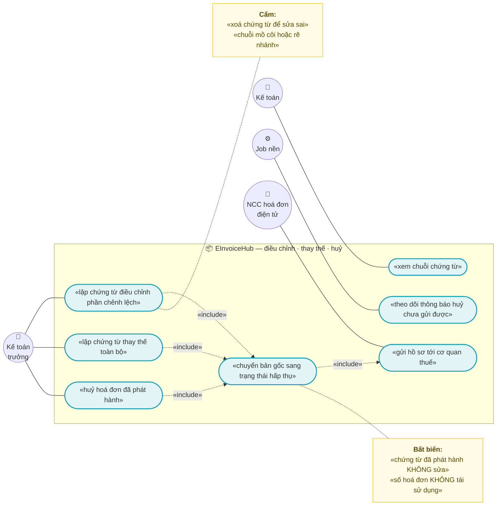
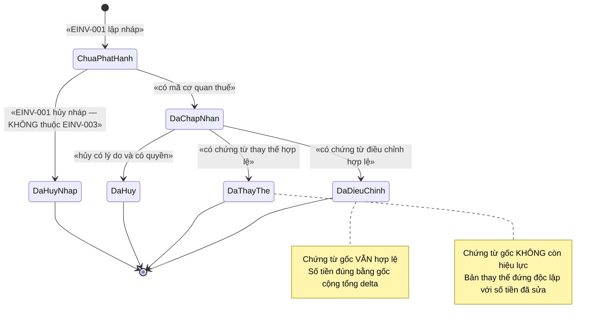
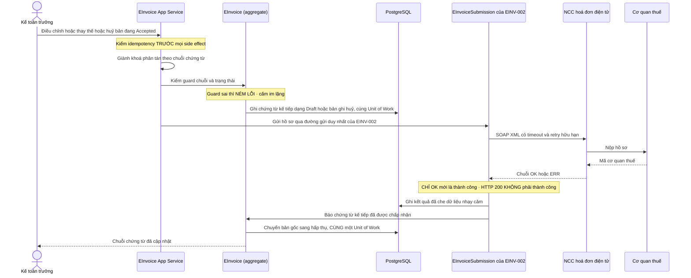

# `EINV-003` — Điều chỉnh, thay thế, huỷ hoá đơn

| Thuộc tính | Nội dung |
|---|---|
| **Mã** | `EINV-003` |
| **Module** | **EInvoiceHub** — `modules/EInvoiceHub/` với `eCommerce.EInvoiceHub.Domain` · `.EntityFrameworkCore` · `.Application` · `.Application.Contracts`. ⚠️ **Module này CHƯA có trong code** — đã kiểm: `modules/` chỉ có `ChannelHub`, `PaymentHub`, `Tax` (xem `eCommerce.slnx` và §5.1). Khuôn tên module theo `docs/structure-and-techstack.md:74` (`EInvoiceHub/` … *"phát hành · gửi CQT · **điều chỉnh/thay thế/huỷ** · tra cứu"* 🔴 P0) |
| **Giai đoạn** | **GĐ0 — Pháp lý** (`docs/implementation-plan.md:392` dòng `EINV-003` trong Phụ lục A.3; cổng GĐ0 ở `docs/implementation-plan.md:148`) |
| **Ưu tiên** | **Must have** — sửa sai chứng từ đã phát hành là **nghĩa vụ pháp lý**, không phải tính năng tuỳ chọn |
| **Trạng thái** | 🟡 `Draft` — chờ review |
| **Người viết / người review** | *(điền)* / **Kiến trúc trưởng + Kế toán** (bắt buộc: có **pháp lý** và có **state machine** — `docs/design-doc-guidelines.md:133-135`) + *(nếu cần)* luật sư |
| **Phiên bản / ngày** | `v0.1 — 15/10/2026` |
| **Tài liệu liên quan** | `EINV-001` (phát hành — nguồn của `ReplacesEInvoiceId`/`AdjustsEInvoiceId`) · `EINV-002` (đường gửi cơ quan thuế duy nhất) · `SIGN-001` (ký 2 bước) · `XC-001` (Money/làm tròn) · `XC-002` (outbox/inbox + idempotency) · `XC-003` (khoá phân tán) · `XC-004` (`[Authorize]` + permission + tenant) · `XC-005` (observability) · `XC-006` (phân loại thuế) · `SAL-003` (state machine 4 trục của đơn) · `docs/implementation-plan.md` §6.2 + Phụ lục A |

> 📌 **Quy ước mã trong tài liệu này:** quyết định thiết kế dùng `ADR-01…ADR-14`, quy tắc nghiệp vụ dùng `BR-01…BR-20`, phi chức năng dùng `NFR-01…NFR-11`, test dùng `TC-01…TC-31`.
> **Mọi khẳng định về code đều kèm đường dẫn file thật đã kiểm bằng `read`/`grep`.** Phần **chưa có trong code** đều ghi rõ **"chưa có trong code — kế hoạch GĐ0"**.

---

## 0. Tóm tắt & quyết định thiết kế

**Tóm tắt:** `EINV-003` chốt cách hệ thống **sửa một hoá đơn đã phát hành** mà **không sửa chứng từ**. Ba hành động duy nhất
được phép: **điều chỉnh** (adjustment — chứng từ gốc **vẫn hợp lệ**, phần chênh lệch nằm ở chứng từ mới),
**thay thế** (replacement — chứng từ gốc **mất hiệu lực**, nội dung đúng nằm ở chứng từ mới), và **huỷ**
(cancellation — **không sinh chứng từ mới**, chỉ ghi một bản ghi huỷ append-only + chuyển trạng thái).
Cả ba đều **không xoá, không UPDATE** chứng từ đã phát hành: đây là hệ quả trực tiếp của `EINV-001` **BR-EINV-001-002**
(*"hoá đơn đã `Issued`+ là BẤT BIẾN"*) và của **D2 `XC-003`** (*"bỏ lớp mềm đi, lớp cứng ở DB còn chặn không?"*).

**Vì sao phải có tài liệu này (3 lỗi im lặng nó chặn):**

| # | Lỗi im lặng nếu làm sai | Hậu quả |
|---|---|---|
| 1 | **UPDATE** chứng từ đã phát hành cho "nhanh" | Số tiền trên hệ thống **khác** số tiền trên chứng từ đã gửi cơ quan thuế ⇒ **không giải trình được** |
| 2 | Tạo bản thay thế mà **không** chuyển bản gốc sang `Replaced` | **Hai** chứng từ cùng hiệu lực cho một nghiệp vụ ⇒ **đếm trùng doanh thu/thuế** |
| 3 | **Xoá** chứng từ sai để phát hành lại, hoặc **tái sử dụng số** hoá đơn | Mất vết chứng từ; vi phạm `EINV-001` **BR-EINV-001-007** (*"số hoá đơn đã cấp KHÔNG BAO GIỜ được tái sử dụng"*) |

**Phạm vi:**
- ✅ **Ba hành động** trên chứng từ **đã `Accepted`**: điều chỉnh · thay thế · huỷ — kèm **guard ném lỗi** ở mọi nhánh (§3).
- ✅ **Chuỗi chứng từ (chain) có kiểm soát**: bản gốc → bản điều chỉnh/thay thế → … , **cấm** mồ côi, **cấm** rẽ nhánh, **cấm** tự trỏ (§5.4, §8).
- ✅ **Bất biến tiền của phần chênh lệch (delta)**: `GrandTotal_delta == Σ LineAmount_delta + TotalTax_delta` và `TotalTax_delta == Σ thuế theo từng mức`.
- ✅ **Khoá phân tán** theo quy ước `XC-003` + **idempotency ở MỌI biên vào** + **ghi qua Unit of Work**.
- ✅ **Đường gửi cơ quan thuế duy nhất**: kế thừa `EInvoiceSubmission` + `EInvoiceResponseParser` của `EINV-002` ⇒ **`HTTP 200` KHÔNG phải thành công**, chỉ `OK:` mới là.
- ✅ **Vết kiểm toán**: bản ghi huỷ append-only + `EInvStatusHistory` + audit log ABP.

**Không nằm trong phạm vi:**
- ❌ **Lập & phát hành hoá đơn** (cấp số, ký, XML, gửi CQT lần đầu) — thuộc `EINV-001` / `EINV-002`.
  Tài liệu này **chỉ** dùng lại cơ chế đó, **không** định nghĩa đường phát hành thứ hai.
- ❌ **Huỷ hoá đơn CHƯA cấp số** (`Draft` không có `Number`) — thuộc `EINV-001` §3.3 dòng 7; **không** ảnh hưởng cơ quan thuế nên **không** cần `EINV-003`.
- ❌ **Quy trình ký chi tiết + quản lý chứng thư số** — thuộc `SIGN-001`.
- ❌ **Quy tắc pháp lý cụ thể** (mẫu/biểu mẫu, thời hạn được huỷ, thời hạn thông báo) — tài liệu này **KHÔNG** khẳng định điều khoản nào;
  mọi điểm pháp lý nằm ở **§15.1** dạng `Open — chưa kiểm chứng`.
- ❌ **Từ chối/Chấp nhận của người mua đối với chứng từ điều chỉnh** — chưa chốt có phải mô hình hoá hay không (§15.1 **Q7**).
- ❌ **Hoàn tiền / điều chỉnh công nợ** — thuộc `REC-*` / `SAL-006` (`RMA`).

### 0.1 Quyết định thiết kế (ADR ngắn)

| # | Quyết định | Phương án đã cân nhắc | Lý do chọn | Hệ quả |
|---|---|---|---|---|
| **ADR-01** | **Sửa sai = chứng từ MỚI**, tuyệt đối **không UPDATE** chứng từ đã phát hành | (a) UPDATE trường sai · (b) xoá rồi tạo lại · (c) chứng từ mới + liên kết | (a)/(b) làm lệch chứng từ đã gửi cơ quan thuế ⇒ mất khả năng giải trình. (c) đúng khuôn **append-only** đã có tiền lệ trong repo: `TaxClassification.UpdateDraft` chỉ cho sửa khi còn `Draft` (`modules/Tax/eCommerce.Tax.Domain/Classifications/TaxClassification.cs:99-119`), `Cancel()` chỉ cho `Draft` (`…/TaxClassification.cs:183-188`) | Số bản ghi tăng theo số lần sửa (chấp nhận được); **bắt buộc** trigger chặn sửa ở DB (`EINV-001` §5.2 đã có) |
| **ADR-02** | **Điều chỉnh lưu DELTA**, **thay thế lưu FULL** | (a) cả hai lưu full · (b) cả hai lưu delta · (c) điều chỉnh delta + thay thế full | Ngữ nghĩa khác nhau: điều chỉnh = **thay đổi một phần** (chứng từ gốc vẫn hợp lệ) ⇒ delta kiểm được bằng số học; thay thế = **thay toàn bộ** ⇒ phải có nội dung đầy đủ để đứng độc lập | Cần cờ `IsDelta` ở dòng hoá đơn (§5.3); **phải sửa** `CHECK (Quantity > 0)` của `EINV-001` §5.2 — xem §15.2 **F9** |
| **ADR-03** | **Mỗi chứng từ chỉ có TỐI ĐA MỘT chứng từ kế tiếp cho mỗi loại liên kết** ⇒ dữ liệu là **CHUỖI**, không phải cây | (a) cho nhiều bản thay thế song song · (b) chuỗi | (a) ⇒ hai chứng từ cùng hiệu lực cho một nghiệp vụ ⇒ **đếm trùng**; không trả lời được "bản nào đang có hiệu lực" | Cần `RevisionRootId` để nhóm chuỗi; unique index có filter là **hàng rào cuối** (§5.4) |
| **ADR-04** | **Bản gốc chuyển trạng thái hấp thụ ngay khi chứng từ kế tiếp được `Accepted`**, trong **cùng một Unit of Work** | (a) người dùng bấm "xác nhận thay thế" riêng · (b) tự động khi kế tiếp `Accepted` | (a) **quên bấm** ⇒ hai chứng từ cùng hiệu lực mà **không có lỗi nào**; (b) nhất quán với `EINV-001` §3.3 dòng 9 (`Accepted → Replaced/Adjusted/Cancelled` với guard *"có chứng từ thay thế/điều chỉnh hợp lệ"*) | Không có endpoint "đánh dấu thủ công"; thay vào đó có **job đối soát chuỗi mồ côi** (§12) |
| **ADR-05** | **Huỷ sinh bản ghi append-only `EInvCancellations`**, không sinh chứng từ mới, **không cấp số** | (a) xoá mềm chứng từ · (b) tạo chứng từ "huỷ" có số · (c) bản ghi huỷ riêng | (a) mất vết; (b) lãng phí số hoá đơn và sai ngữ nghĩa (*"huỷ"* không phải *"phát hành chứng từ mới"*); (c) huỷ cần **lý do + người duyệt + thời điểm**, không cần số | Thêm 1 bảng; không đụng `EInvNumberSequences` |
| **ADR-06** | **Thông báo huỷ cho cơ quan thuế đi qua `EINV-002`** và được **theo dõi riêng** (`NoticeSubmissionId`), **không** chặn việc chuyển trạng thái nội bộ | (a) chặn huỷ tới khi CQT chấp nhận · (b) huỷ nội bộ ngay, thông báo theo dõi riêng | (a) NCC treo ⇒ kế toán **không huỷ được** chứng từ sai; (b) vẫn có dấu vết và **cảnh báo** khi chưa thông báo được | Trạng thái `Cancelled` **không** đồng nghĩa "đã thông báo xong" ⇒ UI **phải** hiển thị riêng (§10). ⚠️ **Điều kiện/thời hạn pháp lý chưa kiểm chứng** (§15.1 **Q3**) |
| **ADR-07** | **Tiền dùng `decimal` + `Money`, cấm so `==` trên tiền**; so bằng **minor units** | (a) so `decimal` bằng `==` · (b) `ToMinorUnits()` | `XC-001` **BR-XC-001-003**; bài học EShop so `ActualTotalPrice == OriginalPaymentAmount`. Delta **âm** là hợp lệ (`XC-001` §5.2: *"có số tiền hợp lệ âm (điều chỉnh, hoàn tiền, ledger âm)"*) | Mọi guard tiền dùng `Money.ToMinorUnits()`; **không** đặt `CHECK (Amount > 0)` cho trường tiền |
| **ADR-08** | **Idempotency ở MỌI biên vào** (3 endpoint của người dùng + webhook kết quả từ NCC), khoá **ỔN ĐỊNH** | (a) chỉ chống trùng ở webhook · (b) mọi biên vào | Nguyên tắc bất di bất dịch #9 (`docs/implementation-plan.md:52`) và `EINV-001` **D6**/**BR-EINV-001-010** | **Cấm** `Guid.NewGuid()` cho khoá idempotency; unique index `NULLS NOT DISTINCT` là chốt cuối |
| **ADR-09** | **Khoá phân tán** theo `XC-003`, hàm sinh khoá **KHÔNG chứa tiền tố** `ecommerce:` | (a) hàm sinh khoá tự thêm `ecommerce:` · (b) để `KeyPrefix` của ABP cấp tiền tố | Host **đã** đặt `options.KeyPrefix = "ecommerce:"` (`src/eCommerce.HttpApi.Host/eCommerceHttpApiHostModule.cs:127`) và ABP ghép **không có dấu phân cách** (`…/eCommerceHttpApiHostModule.cs:119-121`) ⇒ hàm sinh khoá thêm tiền tố sẽ thành **tiền tố đôi** | Khoá thật: `ecommerce:einvoice:revision:{tenantId}:{rootId}`; ⚠️ **code hiện tại đang lệch chỗ này** — xem §15.2 **F5** |
| **ADR-10** | **State machine NÉM LỖI**, không im lặng | (a) `if` rồi `return false` · (b) ném `BusinessException` | Nguyên tắc #11 (`docs/implementation-plan.md:54`) và khuôn **đã có trong code**: `TaxClassification.Approve` ném `BusinessException(TaxErrorCodes.InvalidStatusTransition)` (`modules/Tax/eCommerce.Tax.Domain/Classifications/TaxClassification.cs:126-129`), `Supersede` ném khi bản thay thế chưa duyệt (`…/TaxClassification.cs:157-160`) | Test phủ **mọi cặp trạng thái sai** (§14) |
| **ADR-11** | **Mọi thao tác ghi qua Unit of Work**; **cấm** `autoSave: true` khi còn bước phải cùng transaction | (a) `UpdateAsync(entity, autoSave: true)` · (b) để UoW commit | UoW đã bật `TransactionBehavior = Auto` (`src/eCommerce.HttpApi.Host/eCommerceHttpApiHostModule.cs:63`); **tiền lệ cần tránh**: `ChannelTokenManager` gọi `UpdateAsync(fresh, autoSave: true, …)` (`modules/ChannelHub/eCommerce.ChannelHub.Application/Sync/ChannelTokenManager.cs:100`) ⇒ ghi ngay, không chờ UoW | Có test quét mã nguồn (§14 `TC-29`) |
| **ADR-12** | **Ràng buộc DB là hàng rào cuối** (CHECK + UNIQUE + trigger), không tin state machine | (a) chỉ guard trong code · (b) guard + ràng buộc DB | **D2 `XC-003`**: *"nếu bỏ lock/guard đi, DB có chặn không? Nếu KHÔNG ⇒ thiết kế SAI"* | Câu hỏi review bắt buộc: *"bỏ state machine và bỏ khoá đi, DB có chặn ghi 2 chứng từ cùng hiệu lực không?"* |
| **ADR-13** | **Dùng lại `EInvoiceSubmission` + `EInvoiceResponseParser` của `EINV-002`**, **không** viết đường gửi/parse thứ hai | (a) tự gọi NCC trong `EINV-003` · (b) đi qua `EINV-002` | `EINV-002` **BR-EINV-002-001** đã chốt: kết quả **CHỈ** xác định bằng parse `OK:`/`ERR:`, **cấm** dùng `IsSuccessStatusCode`. Hai đường gửi ⇒ hai parser ⇒ lệch kết luận (đúng loại lỗi *"hai nguồn sự thật"* đã gặp ở `XC-003` §15.2 **F1**) | Không phát sinh adapter mới; chỉ thêm 1 loại payload |
| **ADR-14** | **Lõi phải là HÀM THUẦN để test không cần DB**, phần cần DB chạy bằng **Testcontainers PostgreSQL** (hạ tầng **đã có** trong repo) | (a) viết integration test rồi để đỏ vì thiếu DB · (b) tách hàm thuần + integration có điều kiện | Khuôn hàm thuần **đã có thật**: `TaxRateResolver.Resolve` (`modules/Tax/eCommerce.Tax.Domain/Classifications/TaxRateResolver.cs:16-27` — *"không chạm DB, không phụ thuộc thời gian hệ thống"*). Hạ tầng DB thật **đã có**: `test/eCommerce.IntegrationTests/` (fixture + `Testcontainers.PostgreSql` 4.16.0) | ⚠️ `EINV-001` §14.2 (`…einv-001…md:981-983`) ghi *"project integration test — HIỆN CHƯA TỒN TẠI trong repo"* — **nay đã lệch** (xem §15.2 **F7**) |

> *Ghi lại cả phương án BỊ LOẠI và lý do — để 6 tháng sau không ai hỏi lại "sao không làm cách kia".*

---

## 1. Use Case Specification

| Thuộc tính | Nội dung |
|---|---|
| **Use Case ID** | `EINV-003` |
| **Use Case Name** | Điều chỉnh · thay thế · huỷ hoá đơn điện tử **đã phát hành**, không sửa chứng từ |
| **Description** | *"Là kế toán trưởng của một shop bán hàng đa kênh, tôi muốn sửa sai một hoá đơn đã phát hành — bằng điều chỉnh, thay thế hoặc huỷ — để chứng từ trên hệ thống và chứng từ đã gửi cơ quan thuế luôn khớp nhau, chuỗi chứng từ không đứt, và không có hai chứng từ cùng hiệu lực cho một nghiệp vụ."* |
| **Actor(s)** | **Kế toán trưởng** (điều chỉnh/thay thế/huỷ — người chốt chứng từ) · **Kế toán** (lập, tra cứu chuỗi) · **Job nền** (đối soát chuỗi mồ côi, nhắc thông báo huỷ chưa gửi) · **NCC hoá đơn điện tử** (nhận hồ sơ, trả `OK:`/`ERR:` — qua `EINV-002`) · **Hệ thống** (guard, khoá, idempotency) |
| **Priority** | **Must have** |
| **Trigger** | (a) kế toán phát hiện sai số tiền/thuế/thông tin người mua trên hoá đơn đã `Accepted`; (b) khách trả hàng một phần ⇒ phải điều chỉnh giảm; (c) chứng từ bị lập sai hoàn toàn ⇒ thay thế; (d) chứng từ không còn hiệu lực (khách không nhận, sai MST nghiêm trọng) ⇒ huỷ; (e) job định kỳ phát hiện chứng từ có liên kết nhưng bản gốc chưa đổi trạng thái. |
| **Pre-Condition(s)** | • **Tenant hiện tại** (`ICurrentTenant`) — mọi entity của feature là `IMultiTenant`, và `TenantId` **có thể là `NULL`** (hệ thống đang chạy 1 tenant — `XC-004` §5.2 **F1**) ⇒ **mọi** unique index **phải** `NULLS NOT DISTINCT`.<br>• **Chứng từ nguồn đang ở `EInvoiceStatus.Accepted`** và **là bản CUỐI của chuỗi** (không có chứng từ kế tiếp đang dang dở).<br>• Chứng từ nguồn **đã có đủ**: `Number`, `Series`, `TaxAuthorityCode`, `SignatureValue` (theo `EINV-001` **BR-EINV-001-002**/BR-017).<br>• **Quyền** `eCommerce.Invoices.Adjust` / `.Replace` / `.Cancel` (định nghĩa mới — §9; **hiện chưa có** trong `src/eCommerce.Domain.Shared/eCommerceConsts.cs:19-73`).<br>• **Có cấu hình NCC đang hoạt động** (`IsActive = true`) vì bước cuối phải gửi hồ sơ tới cơ quan thuế (`EINV-002` §1).<br>• **Tiền & thuế**: bản điều chỉnh/thay thế **lấy thuế suất từ snapshot của bản gốc** (không resolve lại) — `EINV-001` **D10**/BR-008.<br>• `ChannelCode` **không** tham gia quyết định (hoá đơn theo người mua + hàng hoá, không theo kênh bán — nhất quán `EINV-001` §1).<br>• ⚠️ **Chưa kiểm chứng**: điều kiện/thời hạn pháp lý cho phép điều chỉnh/thay thế/huỷ (§15.1 **Q1/Q2/Q3**) — **không** được coi là đã xác minh. |
| **Post-Condition(s)** | • **Chứng từ đã phát hành KHÔNG bị sửa và KHÔNG bị xoá** — chỉ **thêm** bản ghi.<br>• **Đúng một** chứng từ ở trạng thái "có hiệu lực" tại **đuôi chuỗi**; mọi chứng từ trước đó ở `Replaced`/`Adjusted`/`Cancelled` (**hấp thụ**).<br>• **Số hoá đơn không bị tái sử dụng**; bản điều chỉnh/thay thế nhận **số mới** qua đúng cơ chế cấp số của `EINV-001` (**D8**).<br>• **Huỷ** có bản ghi `EInvCancellations` (append-only) + trạng thái `Cancelled` + **vết thông báo** tới cơ quan thuế.<br>• Mọi chuyển trạng thái có **dấu vết**: `EInvStatusHistory` (`EINV-001` §5.2) + audit log ABP.<br>• Mọi lần gửi cơ quan thuế có bản ghi `EInvoiceSubmission` (**đã che dữ liệu nhạy cảm**) + `CorrelationId`. |
| **Basic Flow** | 1. Kế toán trưởng chọn chứng từ đang `Accepted` (đuôi chuỗi) và chọn **một** trong ba hành động, kèm `IdempotencyKey` **ổn định**, `Reason` (**bắt buộc**) và `LegalReference` (tuỳ chọn).<br>2. Hệ thống **kiểm idempotency TRƯỚC mọi side effect** (`XC-002`; ADR-08) — đã xử lý cùng khoá ⇒ trả **kết quả cũ**, không tạo bản ghi mới.<br>3. Hệ thống **giành khoá phân tán** `invoice:revision:{tenantId}:{rootId}` (timeout hữu hạn, mặc định 10 s) — không giành được ⇒ ném `eCommerce:Lock:0001` (hoặc bỏ qua nếu là job).<br>4. Hệ thống kiểm **guard chuỗi + trạng thái** (§3) — sai ⇒ **NÉM LỖI** (`BR-01`, `BR-02`, `BR-05`, `BR-07`).<br>5. **Điều chỉnh/thay thế**: hệ thống tạo **chứng từ mới ở `Draft`** cùng `Kind` (`Adjustment`/`Replacement`) + liên kết `AdjustsEInvoiceId`/`ReplacesEInvoiceId` + `RevisionRootId`; **tiền tính ở SERVER**, **không** nhận tổng từ client (`EINV-001` BR-003).<br>6. Hệ thống **kiểm 2 bất biến tiền** trên phần delta (`BR-18`) — sai ⇒ `eCommerce:EInvoice:3004`, **không** ghi bản ghi.<br>7. Chứng từ kế tiếp đi qua **đúng** đường phát hành của `EINV-001` (cấp số → sinh XML → ký 2 bước) và gửi qua **đường gửi duy nhất** của `EINV-002`; **chỉ `OK:`** mới là thành công (`BR-12`).<br>8. Khi chứng từ kế tiếp có **mã cơ quan thuế**: hệ thống chuyển **bản gốc** sang `Adjusted`/`Replaced` (**cùng một Unit of Work** với `Accepted` của bản kế tiếp — ADR-04) và ghi `EInvStatusHistory`.<br>9. **Huỷ**: hệ thống ghi `EInvCancellations` + `EInvStatusHistory`, chuyển bản gốc sang `Cancelled`, rồi gửi hồ sơ thông báo qua `EINV-002`, lưu `NoticeSubmissionId`.<br>10. Hệ thống phát ETO tương ứng (§7.1) để `Sales`/Reporting/Notifications xử lý tiếp. |
| **Alternative Flow** | **A1: Job đối soát chạy trên nhiều instance** — dùng chế độ **bỏ qua nhịp** (`XC-003` **D10**) + log + metric `lock_skipped_total`; **không** ném lỗi.<br>**A2: Gửi trùng cùng `IdempotencyKey`** — trả **kết quả cũ** + `AlreadyProcessed`, **không** ném (đây là hành vi client mong đợi).<br>**A3: Thông báo huỷ gửi thất bại (`ERR:` / timeout)** — chứng từ **vẫn** `Cancelled` ở nội bộ, nhưng bản ghi huỷ ở trạng thái **"chưa thông báo được"** ⇒ hiện trên báo cáo + job thử lại; **không** rollback trạng thái đã ghi (`EINV-002` **D7**).<br>**A4: Bản điều chỉnh bị từ chối (`Rejected`)** — bản gốc **giữ nguyên `Accepted`** (vì chưa có chứng từ kế tiếp hợp lệ) ⇒ đúng trạng thái, **không** cần sửa tay.<br>**A5: Ký lại khi hash hết hạn** — dùng nguyên cơ chế `EINV-001` **A5** (sinh hash mới, **giữ nguyên số**). |
| **Exception Flow** | **E1:** chuyển trạng thái sai ⇒ `BusinessException` `eCommerce:EInvoice:3001` (kèm `currentStatus` + `expectedStatus`).<br>**E2:** chứng từ nguồn **không** ở `Accepted` (ví dụ `Draft`, `Rejected`, `Replaced`) ⇒ `eCommerce:EInvoice:3002`.<br>**E3:** thiếu/sai liên kết chứng từ gốc (không có link, tự trỏ, hoặc **cả hai** link) ⇒ `eCommerce:EInvoice:3003`.<br>**E4:** vi phạm bất biến tiền của delta ⇒ `eCommerce:EInvoice:3004` (**không** tạo bản ghi; đây là lỗi lập trình phải lộ ra CI).<br>**E5:** chứng từ đã `Cancelled`/`Replaced` (**hấp thụ**) ⇒ `eCommerce:EInvoice:3005`.<br>**E6:** chuỗi đứt/vòng lặp (`RevisionRootId` trỏ sai, không tìm được tổ tiên) ⇒ `eCommerce:EInvoice:3006`.<br>**E7:** đã tồn tại chứng từ kế tiếp **chưa hoàn tất** (rẽ nhánh) ⇒ `eCommerce:EInvoice:3007`.<br>**E8:** thiếu `Reason` ⇒ `eCommerce:EInvoice:3008`.<br>**E9:** bản thay thế **không khác** bản gốc ở bất kỳ trường nội dung nào ⇒ `eCommerce:EInvoice:3009` (chống phát hành chứng từ vô nghĩa).<br>**E10:** không gửi được **thông báo huỷ** tới cơ quan thuế ⇒ `eCommerce:EInvoice:3010` (`502`/`409`) + hàng đợi người xử lý.<br>**E11:** không giành được khoá phân tán ⇒ `eCommerce:Lock:0001` (`409`).<br>**E12:** SKU chưa phân loại thuế khi lập bản điều chỉnh cho dòng **mới** ⇒ `eCommerce:Tax:0003` (kế thừa `XC-006`). |
| **Business Rules** | • **BR-01**: Chỉ **ba** hành động được phép trên chứng từ `Accepted`: điều chỉnh · thay thế · huỷ. Mọi hành động/đường khác ⇒ **NÉM** (không im lặng).<br>• **BR-02**: Chứng từ đã phát hành là **BẤT BIẾN** — cấm sửa/xoá `Number`, `Series`, `TaxAuthorityCode`, `BuyerName`, mọi trường tiền/thuế và liên kết chuỗi; sửa = **chứng từ mới** (ADR-01).<br>• **BR-03**: Mọi hành động **bắt buộc** có `Reason` (chuỗi có nghĩa) + người thực hiện + thời điểm; `LegalReference` tuỳ chọn nhưng **khuyến nghị**.<br>• **BR-04**: Bản **điều chỉnh** lưu **delta** (được phép âm); bản **thay thế** lưu **giá trị đầy đủ** (ADR-02).<br>• **BR-05**: Bản gốc **phải** chuyển sang `Adjusted`/`Replaced`/`Cancelled` và chứng từ kế tiếp **phải** trỏ tới bản gốc — **cùng một transaction** (ADR-04); nếu không ⇒ **không** được coi là hoàn tất.<br>• **BR-06**: `ReplacesEInvoiceId` và `AdjustsEInvoiceId` **loại trừ nhau** (XOR) và **khác `Id`** (cấm tự trỏ) — ràng buộc `CHECK` ở DB.<br>• **BR-07**: Mỗi chứng từ có **tối đa một** chứng từ kế tiếp cho mỗi loại liên kết ⇒ **cấm rẽ nhánh**; unique index có filter là **hàng rào cuối** (ADR-03).<br>• **BR-08**: `Cancelled` và `Replaced` là trạng thái **HẤP THỤ** — **cấm** mọi chuyển ra khỏi chúng; muốn sửa tiếp ⇒ tạo chứng từ mới trỏ tới **đuôi chuỗi** đang `Accepted`.<br>• **BR-09**: Số hoá đơn **không bao giờ** tái sử dụng; huỷ **không** cấp số mới; bản điều chỉnh/thay thế **cấp số mới** qua cơ chế của `EINV-001` **D8**.<br>• **BR-10**: Thuế suất của bản điều chỉnh/thay thế **lấy từ snapshot của bản gốc**; **cấm** resolve lại theo ngày hiện tại (`EINV-001` **D10**/BR-008; `XC-006` **BR-XC-006-002**).<br>• **BR-11**: **Idempotency ở MỌI biên vào**, khoá **ổn định**, **cấm** `Guid.NewGuid()`; unique index `(TenantId, IdempotencyKey)` là chốt cuối.<br>• **BR-12**: Mọi lần gửi cơ quan thuế đi qua `EINV-002`; **`HTTP 200` KHÔNG phải thành công** — chỉ `OK:`; phản hồi không parse được ⇒ `Unparseable` + **cấm** retry tự động.<br>• **BR-13**: **100 %** chuyển trạng thái ghi `EInvStatusHistory` + audit; chuyển do **người** **phải** có `Reason`.<br>• **BR-14**: Khoá phân tán **chỉ** dùng hàm trong `EInvoiceHubConsts.LockKeys`; **cấm** viết literal khoá; **cấm** thêm tiền tố `ecommerce:` trong hàm sinh khoá (ADR-09).<br>• **BR-15**: Mọi thao tác ghi qua **Unit of Work**; **cấm** `autoSave: true` khi còn bước phải cùng transaction (ADR-11).<br>• **BR-16**: `[Authorize]` ở **cấp CLASS**; mọi permission dùng trong `[Authorize]` **phải** được **định nghĩa** (`XC-004` **D2**/BR-001/BR-002). Điều chỉnh/thay thế/huỷ chỉ **kế toán trưởng**.<br>• **BR-17**: Truy cập chứng từ của **tenant khác** ⇒ trả **`404`**, **không** `403` (`XC-004` **BR-008**).<br>• **BR-18**: Bất biến tiền của delta: `GrandTotal_delta == Σ LineAmount_delta + TotalTax_delta` **và** `TotalTax_delta == Σ thuế theo từng mức thuế suất` (áp `XC-001` **BR-XC-001-010/011** cho **delta**).<br>• **BR-19**: **Cấm** điều chỉnh/thay thế/huỷ một chứng từ đang có **chứng từ kế tiếp chưa hoàn tất** (chống 2 nhánh — BR-07).<br>• **BR-20**: **Cấm** sửa/xoá chứng từ/khoá liên kết đã `Cancelled`/`Replaced` qua **mọi** đường, kể cả SQL thô ⇒ trigger `BEFORE UPDATE` **RAISE EXCEPTION**. |
| **Non-Functional Requirement** | • **NFR-01**: Lập bản điều chỉnh cho chứng từ ≤ 100 dòng ⇒ p95 **< 1,5 s**.<br>• **NFR-02**: Cấp số cho bản điều chỉnh/thay thế ⇒ **0** trùng trong **20 luồng × 50 lần**.<br>• **NFR-03**: **100 %** nhánh state machine (§3) có test — **kể cả** nhánh guard sai.<br>• **NFR-04**: **0** chứng từ mồ côi/vòng lặp trên **10.000** bộ dữ liệu sinh tự động + test DB thật.<br>• **NFR-05**: **100 %** lần gửi cơ quan thuế có bản ghi submission (đã che) + `CorrelationId`.<br>• **NFR-06**: Bất biến delta §BR-18 đúng **100 %** trên **10.000** bộ ngẫu nhiên (property-based).<br>• **NFR-07**: **0** chữ ký số / khoá bí mật xuất hiện trong **log** (test quét).<br>• **NFR-08**: Cách ly tenant: **0** rò rỉ qua API (integration 2 tenant).<br>• **NFR-09**: **100 %** thao tác điều chỉnh/thay thế/huỷ có vết `EInvStatusHistory` (ai/khi nào/từ đâu tới đâu).<br>• **NFR-10**: Thời gian **lưu trữ** chứng từ + vết: ⚠️ **CHƯA XÁC MINH** — **không** ghi con số (kế thừa `EINV-001` NFR-012 / `EINV-002` Q6; `docs/implementation-plan.md` §14 rủi ro #8).<br>• **NFR-11**: Mọi metric mới **phải** có tên trong `eCommerceMetricNames.All` (`src/eCommerce.Domain.Shared/Observability/eCommerceMetrics.cs:38-52`) **và** nhãn **không** nằm trong `eCommerceMetricTags.Forbidden` (`…/eCommerceMetrics.cs:81-84`). |

---

## 2. Sơ đồ Use Case



### Chú giải

| Ký hiệu | Ý nghĩa |
|---|---|
| ⭕ Xanh lá | Actor (kế toán trưởng · kế toán · job nền · NCC) |
| 🟦 Bầu dục xanh dương | Use Case |
| 🟨 Khung vàng | Note (bất biến / điều cấm) |
| `───` | Liên kết Actor ↔ Use Case |
| `-.«include».->` | Quan hệ bao hàm |

> 📌 **Vì sao `UC5` là `«include»` của cả ba hành động:** cả ba đều kết thúc bằng **cùng một** bước không thể bỏ —
> chuyển bản gốc sang trạng thái hấp thụ **trong cùng transaction** (ADR-04). Nếu bước này tách rời (ví dụ một nút bấm riêng)
> thì sẽ có khoảng thời gian **hai chứng từ cùng hiệu lực** mà **không có lỗi nào** (đúng loại lỗi im lặng mà tài liệu này chặn).

---

## 3. Sơ đồ trạng thái (state machine) — **BẮT BUỘC nếu feature có vòng đời**

> Feature này **có** vòng đời ⇒ mục này **áp dụng**. Sơ đồ dưới đây mô tả **trục chứng từ** (`EInvoiceStatus` của `EINV-001` §3.1)
> ở **góc nhìn chuỗi**: mỗi chứng từ chỉ có **một** đường đi tiếp, và **ba trạng thái hấp thụ** là điểm kết thúc.
> `EINV-003` **không** thêm trục trạng thái thứ ba trên `EInvoice` (giữ nguyên **D3** của `EINV-001`: 2 trục trực giao).



**Bảng chuyển trạng thái & guard (mọi chuyển sai **phải ném lỗi**, không im lặng — BR-01/ADR-10):**

| # | Từ → Sang | Ai được chuyển | Guard (điều kiện cho phép) | Hành động kèm theo | Nếu guard sai |
|---|---|---|---|---|---|
| 1 | `ChuaPhatHanh` → `DaChapNhan` | `EINV-001`/`EINV-002` (handler nhận `OK:`) | Có `TaxAuthorityCode` hợp lệ | Lưu mã CQT; 🔒 bất biến từ đây | — (ngoài phạm vi tài liệu này) |
| 2 | `DaChapNhan` → `DaDieuChinh` | Hệ thống (khi bản điều chỉnh `Accepted`) | Bản điều chỉnh **hợp lệ** (BR-05/BR-06/BR-07) **và** bản gốc là **đuôi chuỗi** | Ghi liên kết 2 chiều + `EInvStatusHistory` + phát `EInvoiceAdjustedEto` | **NÉM** `eCommerce:EInvoice:3002`/`3003`/`3007` |
| 3 | `DaChapNhan` → `DaThayThe` | Hệ thống (khi bản thay thế `Accepted`) | Bản thay thế **hợp lệ** + **có khác biệt** với bản gốc (BR, `3009`) | Ghi liên kết 2 chiều + lịch sử + phát `EInvoiceReplacedEto` | **NÉM** `eCommerce:EInvoice:3009`/`3003` |
| 4 | `DaChapNhan` → `DaHuy` | **Kế toán trưởng** (`eCommerce.Invoices.Cancel`) | Có `Reason`, **không** có chứng từ kế tiếp chưa hoàn tất, và (nếu luật yêu cầu) đủ điều kiện huỷ | Ghi `EInvCancellations` + lịch sử + gửi thông báo qua `EINV-002` | **NÉM** `eCommerce:EInvoice:3007`/`3008` |
| 5 | `ChuaPhatHanh` → `DaHuyNhap` | **Kế toán trưởng** — **thuộc `EINV-001`** §3.3 dòng 7 | **Chưa** cấp số (`Number` rỗng) | Đánh dấu huỷ nháp | **NÉM** nếu đã có số ⇒ phải đi đường `EINV-003` |
| 6 | `DaDieuChinh`/`DaThayThe`/`DaHuy` → **bất kỳ** | — | 🚫 **Trạng thái hấp thụ** — không có đường ra | — | **NÉM** `eCommerce:EInvoice:3005` (BR-08) |
| 7 | `DaChapNhan` → `DaChapNhan` (tự chuyển) | — | 🚫 Không có nghĩa | — | **NÉM** `eCommerce:EInvoice:3001` (kèm `currentStatus`/`expectedStatus`) |

> ⚠️ **Quy tắc bất di bất dịch #11** (`docs/implementation-plan.md:54`): guard sai **phải NÉM LỖI**, không im lặng.
> **Hai ngoại lệ CÓ CHỦ Ý** (không ném) được ghi rõ lý do:
> **(a)** job định kỳ **không giành được khoá** ⇒ bỏ qua nhịp + log + metric (`XC-003` **D10**, chế độ `SkipIfBusy`);
> **(b)** gửi trùng **cùng `IdempotencyKey`** ⇒ trả **kết quả cũ** (A2) — vì đó là hành vi client mong đợi.
>
> **Trạng thái hấp thụ:** `DaDieuChinh` (`Adjusted`) · `DaThayThe` (`Replaced`) · `DaHuy` (`Cancelled`) · `DaHuyNhap`.
> **`DaChapNhan` (`Accepted`) KHÔNG hấp thụ** — vì `EINV-003` còn có thể điều chỉnh/thay thế/huỷ nó (nhất quán `EINV-001` §3.3).
>
> **Ghi chú quan trọng cho kế toán/UI:** `Adjusted` **không** có nghĩa "chứng từ vô hiệu" — chứng từ gốc **vẫn hợp lệ**,
> con số đúng của nghiệp vụ = **gốc + tổng delta của cả chuỗi**. Chỉ `Replaced` và `Cancelled` mới là "không còn hiệu lực".

---

## 4. Sequence Diagram & luồng dữ liệu



### 4.1 DFD — đường đi của một lần sửa sai

*(Mô tả bằng bảng để giữ đúng giới hạn **tối đa 3 sơ đồ** Mermaid của tài liệu này: đã dùng sơ đồ ở §2, §3 và §4.)*

| Bước | Việc | Nơi xảy ra | Ghi chú |
|---|---|---|---|
| 1 | **Kiểm chuỗi + idempotency** | `EInvoiceHub.Application` | **Trước mọi side effect** (ADR-08) — đã xử lý cùng khoá ⇒ trả kết quả cũ |
| 2 | **Giành khoá phân tán** theo chuỗi | `IAbpDistributedLock` | Bao **ngoài** Unit of Work (`XC-003` §12) |
| 3 | **Tạo chứng từ kế tiếp** (delta hoặc full) | `EInvoiceHub.Domain` → PostgreSQL | Cùng transaction với việc ghi liên kết |
| 4 | **Phát hành + ký** | dùng lại `EINV-001` | **Không** có đường phát hành thứ hai |
| 5 | **Gửi cơ quan thuế** | dùng lại `EINV-002` | Chỉ `OK:` mới là thành công (BR-12) |
| 6 | **Chuyển bản gốc sang hấp thụ** | Domain → PostgreSQL | **Cùng** transaction với bước 5 ghi kết quả (BR-05/ADR-04) |
| 7 | **Lưu vết đối soát** | PostgreSQL (`EInvoiceSubmission`, đã che) | 100 % lần gọi NCC (NFR-05) |

> 📌 **Ba hàng rào độc lập** — theo **D2 `XC-003`**: *"bỏ lớp mềm đi, lớp cứng còn chặn không?"*.

| Hàng rào | Nội dung | Bằng chứng / vị trí |
|---|---|---|
| **1 — mềm** | State machine **NÉM LỖI** ở mọi nhánh sai (ADR-10) | §3 bảng chuyển trạng thái; khuôn đã có: `modules/Tax/eCommerce.Tax.Domain/Classifications/TaxClassification.cs:122-134` |
| **2 — nửa cứng** | `UNIQUE` **có filter** trên `ReplacesEInvoiceId`/`AdjustsEInvoiceId` + `UNIQUE (TenantId, EInvoiceId)` trên bản ghi huỷ | §5.4 #1/#2/#3 |
| **3 — cứng** | `CHECK` (XOR, tự trỏ, mồ côi, bất biến tiền) + **trigger** chặn `UPDATE`/`DELETE` | §5.4 #7–#12, #16 |

> Nếu **chỉ** có hàng rào 1 thì một script SQL sửa liên kết vẫn tạo được **hai chứng từ cùng hiệu lực**
> ⇒ **hàng rào 3 ở DB là bắt buộc** (ADR-12).

---

## 5. Mô hình dữ liệu

### 5.1 Vị trí module & trạng thái code (đã kiểm bằng `read`/`grep`)

| Thành phần | Trạng thái trong repo | Bằng chứng |
|---|---|---|
| Project `eCommerce.EInvoiceHub.*` | ❌ **chưa có trong code — kế hoạch GĐ0** | `modules/` chỉ có `ChannelHub`, `PaymentHub`, `Tax`; `eCommerce.slnx` liệt kê module: ChannelHub (4 project) · PaymentHub (3) · Tax (2) |
| Entity `EInvoice`, `EInvoiceLine` | ❌ **chưa có trong code — kế hoạch GĐ0** (thuộc `EINV-001`) | `src/eCommerce.EntityFrameworkCore/eCommerceDbContext.cs:36-64` có **12** `DbSet` (Catalog, Inventory, Orders, ChannelHub, PaymentHub, Tax) — **0** `DbSet` hoá đơn |
| Entity `EInvoiceSubmission` (của `EINV-002`) | ❌ **chưa có trong code — kế hoạch GĐ0** | như trên; `grep` `EInvoice` trong `*.cs` chỉ ra **comment** (ví dụ `modules/Tax/eCommerce.Tax.Domain/TaxErrorCodes.cs:18`) |
| Entity `EInvCancellations` (tài liệu này đề xuất) | ❌ **chưa có trong code — kế hoạch GĐ0** | `grep "EInvCancellations"` = 0 |
| Cột `ReplacesEInvoiceId` / `AdjustsEInvoiceId` | ❌ **chưa có trong code**, đã **dành chỗ** ở `EINV-001` §5.2 | `grep "ReplacesEInvoiceId\|AdjustsEInvoiceId"` trong `*.cs` = **0** kết quả |
| `IAbpDistributedLock` (khoá phân tán) | ✅ **đã có code** — dùng trực tiếp, **chưa** có helper `ILockManager` của `XC-003` §6.1 | `modules/ChannelHub/eCommerce.ChannelHub.Application/Sync/ChannelTokenManager.cs:29,69` |
| `Money` / `Currency` (value object) | ❌ **chưa có trong code** — thư mục `shared/` chưa tồn tại | `grep "Money"` trong `*.cs` = 0; entity tiền dùng `decimal` trực tiếp (`src/eCommerce.Domain/Entities/Orders/Order.cs:39-50`) |
| Hạ tầng test PostgreSQL thật | ✅ **đã có code** | `test/eCommerce.IntegrationTests/eCommerce.IntegrationTests.csproj:19` (`Testcontainers.PostgreSql` 4.16.0) · `test/eCommerce.IntegrationTests/PostgreSqlSchemaFixture.cs:26` (`postgres:17-alpine`) |
| Idempotency guard dùng chung (`XC-002`) | ❌ **chưa có trong code** | `grep "IIdempotencyGuard"` = 0; `eCommerceDbContext.cs:33` chỉ `AbpDbContext<eCommerceDbContext>` (không có `IHasEventOutbox`/`IHasEventInbox`) |
| Metric cho EInvoice | ❌ **chưa có** trong bảng đăng ký | `src/eCommerce.Domain.Shared/Observability/eCommerceMetrics.cs:13-53` — **12** metric, **0** metric hoá đơn |
| Permission cho hoá đơn | ❌ **chưa có** | `src/eCommerce.Domain.Shared/eCommerceConsts.cs:19-73` — **7** nhóm, không có `Invoices`; `src/eCommerce.Application.Contracts/Permissions/eCommercePermissionDefinitionProvider.cs:28-59` — **21** định nghĩa, **0** cho hoá đơn |

> 📌 **Hệ quả bắt buộc (bài học Phase 0 — `eCommerceDbContext.cs:48-52`):** entity của module **phải** được khai **`DbSet`**
> trên DbContext hợp nhất, nếu không `AddDefaultRepositories(includeAllEntities: true)` **không** đăng ký `IRepository<T>` ⇒
> runtime ném `"The requested service 'IRepository<…, Guid>' has not been registered."`. Với `EINV-003` điều này áp cho
> `EInvCancellations` **và** cho `EInvoice`/`EInvoiceLine` của `EINV-001`.

### 5.2 ERD (biểu diễn bằng **bảng** để giữ giới hạn **tối đa 3 sơ đồ** Mermaid — sơ đồ đã dùng ở §2, §3, §4)

| Từ | Quan hệ | Tới | Ý nghĩa nghiệp vụ |
|---|---|---|---|
| `EInvInvoices` | 1 → 0..1 (**adjusts**) | `EInvInvoices` | bản điều chỉnh trỏ tới bản bị điều chỉnh (delta). Đúng **một** bản điều chỉnh cho một chứng từ (BR-07) |
| `EInvInvoices` | 1 → 0..1 (**replaces**) | `EInvInvoices` | bản thay thế trỏ tới bản bị thay thế (full). Đúng **một** bản thay thế (BR-07) |
| `EInvInvoices` | 1 → 0..1 (**cancellation**) | `EInvCancellations` | một chứng từ chỉ bị huỷ **một lần**; `Cancelled` là hấp thụ (BR-08) |
| `EInvInvoices` | 1 → 0..1 (**submission**) | `EInvoiceSubmission` (`EINV-002`) | thông báo huỷ đi qua **đường gửi duy nhất** của `EINV-002` (ADR-13) |
| `EInvInvoices` | 1 → * | `EInvInvoiceLines` | dòng của chứng từ điều chỉnh (delta) hoặc thay thế (full) |
| `EInvInvoices` | 1 → * | `EInvStatusHistory` | vết chuyển trạng thái (NFR-09) |
| `EInvInvoices` (chuỗi) | * → 1 (**root**) | `EInvInvoices` | `RevisionRootId` nhóm cả chuỗi về **chứng từ gốc đầu tiên** để tra cứu/mồ côi |

> 🔒 **Quan hệ tự thân KHÔNG dùng FK cứng của EF sang bảng `OrdOrders`/`Customers`** — module **không** được tham chiếu app
> (nguyên tắc #3, `docs/implementation-plan.md:46`); liên kết với đơn hàng là **liên kết mềm theo id** (kế thừa `EINV-001` §5.2 `OrderId`).

### 5.3 Bảng & cột (Data Dictionary)

**Bảng `EInvInvoices` — các cột THÊM cho `EINV-003`** *(bảng này do `EINV-001` §5.2 tạo; đây chỉ là phần `EINV-003` bổ sung)*

| Cột | Kiểu | Null? | Nguồn / ý nghĩa | Ghi chú |
|---|---|---|---|---|
| `Kind` | `int` | ✖ | `Origin` (0) · `Adjustment` (1) · `Replacement` (2) | quyết định **cách đọc** các trường tiền (delta hay full) — ADR-02 |
| `RevisionRootId` | `uuid` | ✔ | chứng từ **gốc đầu chuỗi** | ✖ khi `Kind = Origin`; **bắt buộc** khi `Kind ≠ Origin` (CHECK) |
| `RevisionSequence` | `int` | ✖ | độ sâu trong chuỗi (gốc = 0) | dùng cho UI + guard chống vòng lặp (BR-06/BR-07) |
| `RevisionReason` | `varchar(1024)` | ✔ | **lý do** sửa sai (BR-03) | **bắt buộc** khi `Kind ≠ Origin` **hoặc** đã huỷ (CHECK) |
| `RevisionLegalReference` | `varchar(512)` | ✔ | căn cứ/văn bản kèm theo | phục vụ giải trình |
| `AdjustedOrReplacedAtUtc` | `timestamptz` | ✔ | thời điểm bản gốc chuyển trạng thái hấp thụ | **UTC** (quy ước `src/eCommerce.Domain/eCommerceDomainModule.cs`) |
| *(đã dành chỗ ở `EINV-001`)* `ReplacesEInvoiceId`, `AdjustsEInvoiceId` | `uuid` | ✔ | trỏ tới **bản liền trước** trong chuỗi | **XOR** + khác `Id` (BR-06) |

**Bảng `EInvInvoiceLines` — cột THÊM cho dòng delta**

| Cột | Kiểu | Null? | Ý nghĩa | Ghi chú |
|---|---|---|---|---|
| `IsDelta` | `boolean` | ✖ | dòng này chứa **phần chênh lệch** (được phép âm) | với bản điều chỉnh = `true`, bản thay thế/gốc = `false` |
| `LineAmountDelta` | `numeric(18,4)` | ✔ | chênh lệch thành tiền chưa thuế | ⚠️ **decimal, không bao giờ `double`** (`XC-001` BR-008); **âm** hợp lệ |
| `TaxAmountDelta` | `numeric(18,4)` | ✔ | chênh lệch tiền thuế (đã làm tròn **theo từng dòng**) | `XC-001` BR-005 |
| `QuantityChanged` | `int` | ✔ | số lượng thay đổi (âm = giảm) | dùng cho dòng **mới thêm** hoặc **bớt** ở bản điều chỉnh |

> 🚨 **Phải sửa `CHECK` của `EINV-001`:** `EINV-001` §5.2 khai `CHECK (Quantity > 0)` trên `EInvInvoiceLines`.
> Dòng **delta** hợp lệ có thể có `Quantity = 0` (chỉ đổi tiền, không đổi số lượng) ⇒ `CHECK` phải đổi thành
> `CHECK (("IsDelta" AND "Quantity" >= 0) OR (NOT "IsDelta" AND "Quantity" > 0))`. Đây là **việc phải sửa `EINV-001`** — ghi ở §15.2 **F9**
> (quy tắc vàng `docs/implementation-plan.md` **A.1**: *"nếu code phải lệch tài liệu, sửa tài liệu trước — trong cùng pull request"*).

**Bảng `EInvCancellations` — bản ghi huỷ, APPEND-ONLY** *(bảng MỚI của `EINV-003`)*

| Cột | Kiểu | Null? | Nguồn / ý nghĩa | Ghi chú |
|---|---|---|---|---|
| `Id` | `uuid` | ✖ | khoá chính | |
| `TenantId` | `uuid` | ✔ | tenant sở hữu | **bắt buộc** vì entity là `IMultiTenant` (`XC-004` BR-009) |
| `EInvoiceId` | `uuid` | ✖ | chứng từ bị huỷ (liên kết **mềm** trong cùng module) | `UNIQUE` để chặn huỷ 2 lần (BR-08) |
| `Reason` | `varchar(1024)` | ✖ | **lý do huỷ** | **bắt buộc** (BR-03) |
| `LegalReference` | `varchar(512)` | ✔ | căn cứ/văn bản kèm theo | |
| `CancelledAtUtc` | `timestamptz` | ✖ | thời điểm huỷ (UTC) | |
| `CancelledByUserId` | `uuid` | ✖ | ai bấm huỷ | `null` **cấm** — huỷ là hành động của người, không của job |
| `NoticeStatus` | `int` | ✖ | `NotRequired` (0) · `Pending` (1) · `Notified` (2) · `Failed` (3) | trạng thái **thông báo cho cơ quan thuế** (ADR-06) |
| `NoticeSubmissionId` | `uuid` | ✔ | liên kết tới `EInvoiceSubmission` (`EINV-002`) | `null` khi `NotRequired`/chưa gửi |
| `IdempotencyKey` | `varchar(256)` | ✖ | khoá chống trùng (**ổn định**) | unique index |
| `ExtraProperties` · `ConcurrencyStamp` · `CreationTime` · `CreatorId` · `IsDeleted` | — | — | chuẩn ABP `FullAuditedAggregateRoot` | |

> ⚠️ **`IsDeleted` của ABP + "append-only" — hai điều khác nhau, phải nói rõ:**
> bản ghi huỷ **cấm** xoá cứng; nếu dùng soft-delete của ABP thì **cấm** đặt `IsDeleted = true` trên `EInvCancellations`
> và trên `EInvInvoices` đã `Accepted` — trigger ở §5.4 chặn cả `DELETE` lẫn `UPDATE` làm mất hiệu lực.

### 5.4 Index & ràng buộc *(phần hay bị bỏ sót nhất — và là **hàng rào cuối** khi tầng ứng dụng sai)*

| # | Loại | Bảng | Cột / điều kiện | Mục đích |
|---|---|---|---|---|
| 1 | **UNIQUE** *(bắt buộc `NULLS NOT DISTINCT`)* | `EInvInvoices` | `(TenantId, ReplacesEInvoiceId) WHERE "ReplacesEInvoiceId" IS NOT NULL` | **BR-07**: một chứng từ chỉ bị thay thế **một lần** ⇒ cấm rẽ nhánh |
| 2 | **UNIQUE** *(bắt buộc `NULLS NOT DISTINCT`)* | `EInvInvoices` | `(TenantId, AdjustsEInvoiceId) WHERE "AdjustsEInvoiceId" IS NOT NULL` | **BR-07**: chuỗi điều chỉnh không rẽ nhánh |
| 3 | **UNIQUE** *(bắt buộc `NULLS NOT DISTINCT`)* | `EInvCancellations` | `(TenantId, EInvoiceId)` | **BR-08**: một chứng từ chỉ huỷ **một lần** |
| 4 | **UNIQUE** *(bắt buộc `NULLS NOT DISTINCT`)* | `EInvCancellations` | `(TenantId, IdempotencyKey)` | **BR-11**: idempotency |
| 5 | **UNIQUE** | `EInvInvoices` | `(TenantId, IdempotencyKey)` — *đã có ở `EINV-001` §5.2* | **BR-11** |
| 6 | **UNIQUE** | `EInvInvoices` | `(TenantId, Series, Number)` — *đã có ở `EINV-001` §5.2* | **BR-09**: cấm trùng số, cấm tái sử dụng |
| 7 | **CHECK** | `EInvInvoices` | `("ReplacesEInvoiceId" IS NULL) OR ("AdjustsEInvoiceId" IS NULL)` | **BR-06**: XOR hai liên kết |
| 8 | **CHECK** | `EInvInvoices` | `"ReplacesEInvoiceId" IS DISTINCT FROM "Id" AND "AdjustsEInvoiceId" IS DISTINCT FROM "Id"` | **BR-06**: cấm **tự trỏ** |
| 9 | **CHECK** | `EInvInvoices` | `"Kind" = 0 OR ("RevisionRootId" IS NOT NULL AND "RevisionReason" IS NOT NULL)` | **BR-03/BR-05**: chứng từ điều chỉnh/thay thế **phải** có gốc + lý do |
| 10 | **CHECK** | `EInvInvoices` | `"Kind" = 0 OR ("ReplacesEInvoiceId" IS NOT NULL OR "AdjustsEInvoiceId" IS NOT NULL)` | **BR-05**: cấm chứng từ "con" **mồ côi** |
| 11 | **CHECK** | `EInvInvoices` | `"GrandTotal" = "TotalLineAmount" + "TotalTax"` | **BR-18** (kế thừa `EINV-001` §5.2; áp cho cả delta vì delta cũng là một bộ ba số) |
| 12 | **CHECK** | `EInvInvoiceLines` | `("IsDelta" AND "Quantity" >= 0) OR (NOT "IsDelta" AND "Quantity" > 0)` | **thay** `CHECK` cũ của `EINV-001` — xem §5.3 và **F9** |
| 13 | **INDEX** | `EInvInvoices` | `(TenantId, RevisionRootId, RevisionSequence)` | tra cứu **chuỗi chứng từ** (§10) |
| 14 | **INDEX** | `EInvCancellations` | `(TenantId, NoticeStatus, CreationTime)` | job nhắc/thử lại **thông báo huỷ** (A3, NFR) |
| 15 | **CHECK (liên bảng)** | `EInvInvoices` ↔ `EInvInvoiceLines` | `TotalTax_delta == Σ TaxAmount_delta` **và** `TotalLineAmount_delta == Σ LineAmount_delta` | 🚨 **BR-18(a)** — ⚠️ **EF Core KHÔNG khai báo được** ràng buộc liên bảng ⇒ phải dùng **trigger**; **chưa kiểm chứng** cách làm trên PostgreSQL (kế thừa `EINV-001` §15.1 **Q5**) |
| 16 | **TRIGGER chặn sửa** | `EInvInvoices`, `EInvCancellations` | `BEFORE UPDATE OR DELETE` khi `OLD.Status IN (Adjusted, Replaced, Cancelled)` **hoặc** `OLD.Kind <> 0` và trường liên kết/tiền đổi ⇒ **RAISE EXCEPTION** | **BR-02/BR-20** — chặn sửa tay ở tầng SQL |
| 17 | **`NULLS NOT DISTINCT`** | **mọi** unique index có `TenantId` | — | **bắt buộc** (`XC-004` BR-009). Tiền lệ SQL thô **đã có trong repo**: `src/eCommerce.EntityFrameworkCore/Migrations/20261013024226_Fix_NullableTenantId_UniqueIndexes.cs:39-85` (11 index) |

> 🚨 **PHÁT HIỆN CÓ BẰNG CHỨNG — thêm index mới sẽ làm ĐỎ test hiện có:**
> `test/eCommerce.IntegrationTests/PostgreSqlSchemaTests.cs:148` khẳng định **đúng bằng 11**:
> `Assert.Equal(11L, await DemAsync("select count(*) from pg_indexes where … indexdef like '%NULLS NOT DISTINCT%'"))`,
> và danh sách đích danh `phaiCo` ở `…/PostgreSqlSchemaTests.cs:152-165`.
> ⇒ Migration của `EINV-003` **bắt buộc** cập nhật **cả hai** (`11 → 11 + n` **và** thêm tên index mới vào `phaiCo`),
> nếu không CI **đỏ** — đây là **lưới an toàn hoạt động đúng thiết kế**, phải nằm trong DoD (§14.3). Xem §15.2 **F6**.

> ⚠️ **Ràng buộc #15 KHÔNG thay thế được kiểm tra trong domain:** domain **vẫn** phải kiểm (E4) để lỗi lộ ra **trước** khi ghi;
> trigger là **lưới an toàn** cho đường SQL thô. Đây chính là **ADR-12**.

---

## 6. Hợp đồng API

### 6.1 Application Service

| Mục | Giá trị |
|---|---|
| Interface | `IEInvoiceRevisionAppService` — đặt tại **`eCommerce.EInvoiceHub.Application.Contracts`** |
| Implementation | `EInvoiceRevisionAppService` — đặt tại **`eCommerce.EInvoiceHub.Application`** |
| `[Authorize]` | **cấp CLASS bắt buộc** (`XC-004` **D3**/BR-001) — tiền lệ lỗi thật: `GetShopsAsync` từng **công khai** khi chưa xác thực, ghi chú nguyên văn ở `src/eCommerce.Application/Channels/ChannelAppService.cs:21-25` (*"các method còn lại (ví dụ GetShopsAsync) trở thành API CÔNG KHAI — đã quan sát được đúng như vậy khi chạy thử"*) |
| Unit of Work | Mọi method ghi **qua** Unit of Work (`src/eCommerce.HttpApi.Host/eCommerceHttpApiHostModule.cs:63` — `TransactionBehavior = Auto`) |

| Method | Input (DTO) | Output (DTO) | Ghi chú |
|---|---|---|---|
| `CreateAdjustmentAsync` | `CreateEInvoiceAdjustmentDto` (`EInvoiceId`, `IdempotencyKey`, `Reason`, `LegalReference?`, `Lines[]` **delta**) | `EInvoiceDto` | ⚠️ **CẤM** có trường `grandTotal`/`totalTax` trong DTO — server tự tính (kế thừa `EINV-001` BR-003) |
| `CreateReplacementAsync` | `CreateEInvoiceReplacementDto` (`EInvoiceId`, `IdempotencyKey`, `Reason`, `LegalReference?`, `Lines[]` **full**) | `EInvoiceDto` | bản thay thế phải **khác** bản gốc (E9) |
| `CancelAsync` | `CancelEInvoiceDto` (`EInvoiceId`, `IdempotencyKey`, `Reason`, `LegalReference?`) | `EInvoiceCancellationDto` | **không** cấp số; ghi `EInvCancellations` |
| `GetRevisionChainAsync` | `Guid rootEInvoiceId` | `ListResultDto<EInvoiceDto>` | trả **cả chuỗi** theo `RevisionSequence` |
| `GetPendingCancellationNoticesAsync` | `PagedAndSortedResultRequestDto` | `PagedResultDto<EInvoiceCancellationDto>` | báo cáo **"chưa thông báo được"** (A3) |
| `RetryCancellationNoticeAsync` | `Guid cancellationId` | `EInvoiceCancellationDto` | **tạo bản ghi submission MỚI** ở `EINV-002` (append-only — `EINV-002` BR-010) |
| `GetAsync` / `GetListAsync` | `Guid id` / `PagedAndSortedResultRequestDto` | `EInvoiceDto` / `PagedResultDto<EInvoiceDto>` | lọc tenant tự động; tenant khác ⇒ **`404`** (BR-17) |

### 6.2 REST endpoint

| Mục | Giá trị |
|---|---|
| Method / Route | `POST /api/app/e-invoice-revision/adjustment` · `POST /api/app/e-invoice-revision/replacement` · `POST /api/app/e-invoice-revision/{id}/cancel` · `GET /api/app/e-invoice-revision/chain/{rootId}` · `GET /api/app/e-invoice-revision/pending-cancellation-notices` |
| Authentication | `Bearer` (OpenIddict) — cấu hình ở `src/eCommerce.HttpApi.Host/eCommerceHttpApiHostModule.cs:76-95` |
| Permission | Xem §9 |
| Content-Type | `application/json` |

> 🚨 **BẪY IM LẶNG — phải thêm assembly vào auto API controller:**
> `src/eCommerce.HttpApi.Host/eCommerceHttpApiHostModule.cs:154-155` hiện chỉ có **2** dòng `ConventionalControllers.Create(...)`
> (`eCommerceApplicationModule`, `ChannelHubApplicationModule`). Thiếu dòng cho `EInvoiceHubApplicationModule` ⇒
> app service **không** có endpoint, gọi API trả **`404`**, và **không có lỗi biên dịch nào**. Xem §15.2 **F10**.

**Request mẫu — `POST /api/app/e-invoice-revision/adjustment`** *(điều chỉnh **giảm** 2 sản phẩm ⇒ delta âm)*

```json
{
  "eInvoiceId": "8c1d2e3f-4a5b-6c7d-8e9f-0a1b2c3d4e5f",
  "idempotencyKey": "EInv:Revision:{tenantId}:{eInvoiceId}:ADJ:v1",
  "reason": "Khách trả lại 2 sản phẩm ngày 14/10/2026",
  "legalReference": null,
  "lines": [
    {
      "sku": "SP-001",
      "quantityChanged": -2,
      "unitPrice": 1000000.0000,
      "lineAmountDelta": -2000000.0000,
      "taxRateCode": "VAT8",
      "taxRate": 8.0000,
      "taxAmountDelta": -160000.0000
    }
  ]
}
```

> ⚠️ **KHÔNG có `grandTotal`/`totalTax` trong request** — cố ý (**BR-18**, kế thừa `EINV-001` BR-003).
> ⚠️ **`taxRateCode`/`taxRate` gửi lên sẽ bị KIỂM ĐỐI CHIẾU với snapshot của bản gốc** và **bị từ chối nếu khác** (BR-10):
> client **không** được tự quyết thuế suất.

**Response mẫu — 201** *(chứng từ điều chỉnh ở `Draft`, chưa có số)*

```json
{
  "id": "1f2e3d4c-5b6a-7980-1234-56789abcdef0",
  "kind": "Adjustment",
  "adjustsEInvoiceId": "8c1d2e3f-4a5b-6c7d-8e9f-0a1b2c3d4e5f",
  "revisionRootId": "8c1d2e3f-4a5b-6c7d-8e9f-0a1b2c3d4e5f",
  "revisionSequence": 1,
  "number": null,
  "status": "Draft",
  "issueStatus": "NotIssued",
  "totalLineAmount": -2000000.0000,
  "totalTax": -160000.0000,
  "grandTotal": -2160000.0000,
  "currency": "VND"
}
```

**Mã lỗi nghiệp vụ** *(⚠️ đọc §15.2 **F2** trước — dải `0001–0007` hiện đang **bị hai tài liệu dùng trùng với nghĩa khác nhau**)*

| Mã *(đề xuất dải riêng cho `EINV-003`)* | HTTP | Khi nào | Thông điệp |
|---|---|---|---|
| `eCommerce:EInvoice:3001` | `409` | Chuyển trạng thái không hợp lệ | `Không thể chuyển chứng từ từ {currentStatus} sang {expectedStatus}.` |
| `eCommerce:EInvoice:3002` | `409` | Chứng từ nguồn **không** ở `Accepted` (hoặc không phải đuôi chuỗi) | `Chỉ điều chỉnh/thay thế/huỷ được chứng từ đang có hiệu lực (Accepted).` |
| `eCommerce:EInvoice:3003` | `400` | Liên kết gốc thiếu/sai (thiếu link, tự trỏ, **cả hai** link) | `Liên kết chứng từ gốc không hợp lệ hoặc không đầy đủ.` |
| `eCommerce:EInvoice:3004` | `500` | Vi phạm bất biến tiền của delta (lỗi lập trình) | `Dữ liệu điều chỉnh không nhất quán: tổng chênh lệch không khớp.` |
| `eCommerce:EInvoice:3005` | `409` | Chứng từ đã huỷ/đã thay thế (**hấp thụ**) | `Chứng từ đã huỷ hoặc đã được thay thế, không sửa được nữa.` |
| `eCommerce:EInvoice:3006` | `500` | Chuỗi đứt/vòng lặp | `Chuỗi chứng từ không hợp lệ (mồ côi hoặc vòng lặp).` |
| `eCommerce:EInvoice:3007` | `409` | Đã có chứng từ kế tiếp **chưa hoàn tất** | `Đang có chứng từ kế tiếp chưa hoàn tất cho chứng từ này.` |
| `eCommerce:EInvoice:3008` | `400` | Thiếu **lý do** bắt buộc | `Phải ghi lý do điều chỉnh/thay thế/huỷ.` |
| `eCommerce:EInvoice:3009` | `400` | Bản thay thế **không khác** bản gốc | `Bản thay thế phải khác bản gốc ở ít nhất một trường nội dung.` |
| `eCommerce:EInvoice:3010` | `502`/`409` | Không gửi được **thông báo huỷ** tới cơ quan thuế | `Chưa gửi được thông báo huỷ tới cơ quan thuế, cần kiểm tra thủ công.` |
| `eCommerce:Lock:0001` | `409` | **Kế thừa `XC-003`** — không giành được khoá | `Tài nguyên đang được xử lý bởi tiến trình khác, vui lòng thử lại.` |
| `eCommerce:Money:0001…0005` | `400`/`500` | **Kế thừa `XC-001`** | xem `XC-001` §6.2 |
| `eCommerce:Tax:0002`/`0003` | `400` | **Kế thừa `XC-006`** | xem `modules/Tax/eCommerce.Tax.Domain/TaxErrorCodes.cs:16,19` |

> 📌 **Vì sao dải `3001–3010`:** quy ước `eCommerce:<Module>:<n>` **đã có tiền lệ trong code**
> (`eCommerce:Tax:*` — `modules/Tax/eCommerce.Tax.Domain/TaxErrorCodes.cs:13-34`; `eCommerce:Channel:*` — `modules/ChannelHub/eCommerce.ChannelHub.Domain/ChannelHubConsts.cs:38-41`).
> Nhưng `EINV-001` §6.2 và `EINV-002` §6.2 **đang dùng trùng** `eCommerce:EInvoice:0001–0007` cho **hai bộ nghĩa khác nhau** ⇒
> đây là **phát hiện F2** (§15.2). Đề xuất chốt **dải theo chức năng**: `1xxx` = lập/phát hành (`EINV-001`) · `2xxx` = gửi CQT (`EINV-002`) · `3xxx` = điều chỉnh/thay thế/huỷ (`EINV-003`).
> Việc đổi mã của `EINV-001`/`EINV-002` **phải** làm **trước khi code** (cả hai còn `Draft`).

---

## 7. Sự kiện, tích hợp ngoài & idempotency — **BẮT BUỘC**

### 7.1 Sự kiện phát ra (ETO)

| ETO | Khi nào phát | Trường dữ liệu | Ai tiêu thụ | Handler có idempotent? |
|---|---|---|---|---|
| `EInvoiceAdjustedEto` *(đề xuất)* | bản gốc `Accepted → Adjusted` | `EInvoiceId` (gốc), `AdjustmentEInvoiceId`, `RootEInvoiceId`, `DeltaLineAmount`, `DeltaTax`, `DeltaGrandTotal`, `Reason`, `OccurredAtUtc` | `Sales` (đánh dấu đơn đã điều chỉnh), `ACC-001`/Reporting, `Notifications` (gửi khách chứng từ điều chỉnh) | ✅ có — khoá tự nhiên `AdjustmentEInvoiceId` + unique index |
| `EInvoiceReplacedEto` *(đề xuất)* | bản gốc `Accepted → Replaced` | `EInvoiceId` (gốc), `ReplacementEInvoiceId`, `RootEInvoiceId`, `Reason`, `OccurredAtUtc` | như trên | ✅ có |
| `EInvoiceCancelledEto` *(đề xuất)* | bản gốc `Accepted → Cancelled` | `EInvoiceId`, `CancellationId`, `Reason`, `NoticeStatus`, `OccurredAtUtc` | `Sales`, `ACC-001`, `Notifications`, `REC-*` (loại trừ khỏi đối soát doanh thu) | ✅ có |
| `EInvoiceCancellationNoticeFailedEto` *(đề xuất)* | `NoticeStatus → Failed` | `CancellationId`, `EInvoiceId`, `ProviderError`, `AttemptCount` | `Notifications` (cảnh báo kế toán) | ✅ có |

> ⚠️ **Cả 4 ETO phải đi qua outbox của ABP** (`XC-002` §6.3): nếu thiếu cấu hình/khai báo outbox thì việc publish **rơi về trực tiếp**
> ⇒ mất tính nguyên tử. Ở code hiện tại, `src/eCommerce.EntityFrameworkCore/eCommerceDbContext.cs:33` **chưa** implements
> `IHasEventOutbox`/`IHasEventInbox` và `OnModelCreating` (`…/eCommerceDbContext.cs:71-91`) **chưa** có `builder.ConfigureEventOutbox()`
> ⇒ **nợ của `XC-002`**, ghi nhận ở §15.2 **F1** (kế thừa `EINV-001` §15.2 **F2**).

### 7.2 Sự kiện / webhook nhận vào

| Nguồn | Loại | Xác thực | Chống trùng bằng | Nếu xử lý lỗi? | Thứ tự đến |
|---|---|---|---|---|---|
| `EINV-001`/`EINV-002` (cùng module) | **gọi trực tiếp trong cùng Unit of Work** — **không** qua ETO | không có biên ngoài | `IdempotencyKey` **ổn định** của hành động | Ném lỗi ⇒ rollback cả hai bước (đúng BR-05) | **Không áp dụng** (đồng bộ, một transaction) |
| NCC HĐĐT (kết quả hồ sơ điều chỉnh/thông báo huỷ) | **webhook / poll** | ⚠️ **chưa kiểm chứng** NCC có chữ ký callback hay không ⇒ kênh chính là **poll chủ động** (kế thừa `EINV-002` §7.2) | `IdempotencyKey = EInvoiceSubmission.IdempotencyKey` của `EINV-002` (hash payload đã ký) | Retry → DLQ; ca `Unknown` ⇒ **cấm** retry mù (`EINV-002` **D9**) | **Có thể sai thứ tự** ⇒ guard theo **state machine**, không theo thứ tự |
| Job đối soát chuỗi mồ côi (nội bộ) | Job nền | — | `IdempotencyKey = EInv:RevisionScan:{tenantId}:{yyyyMMddHH}` | Log + metric + chạy lại nhịp sau | — |
| Job nhắc **thông báo huỷ** chưa gửi được | Job nền | — | như trên (theo `CancellationId`) | Log + metric | — |

> ⚠️ **Ghi rõ điều chưa kiểm chứng:** `IEInvoiceProvider`/`EInvoiceResponseParser` **chưa có trong code** (§5.1) và **định dạng thật**
> của NCC cho **điều chỉnh/thay thế/huỷ** **chưa được xác minh** — `docs/business-modules-proposal.md` §6.7 được `EINV-001` §12
> trích dẫn là có nhóm **"KHÔNG TÌM THẤY"** gồm endpoint điều chỉnh/thay thế ⇒ xem §15.1 **Q4**. Tài liệu này **không** giả định
> là có HMAC, **không** hard-code endpoint nào.

### 7.3 Gọi API ra ngoài

**Không áp dụng trực tiếp — lý do:** `EINV-003` **không** tự gọi NCC (ADR-13). Mọi lời gọi đi qua `IEInvoiceProvider`
của `EINV-002`, do đó **timeout/retry/idempotency key** kế thừa nguyên `EINV-002` **D8** (timeout **30 s**, tối đa **3** lần,
backoff **5 s → 20 s**) và `EINV-002` **D9** (*cấm retry mù sau timeout*).

| Đối tượng | Cách sinh khoá idempotency | ⚠️ Lưu ý |
|---|---|---|
| Lập bản điều chỉnh | `EInv:Revision:{tenantId}:{eInvoiceId}:ADJ:{payloadHash}` | **ỔN ĐỊNH** — `payloadHash` = SHA-256 của payload chuẩn hoá |
| Lập bản thay thế | `EInv:Revision:{tenantId}:{eInvoiceId}:REP:{payloadHash}` | như trên |
| Huỷ | `EInv:Revision:{tenantId}:{eInvoiceId}:CAN:{reasonHash}` | ⚠️ **Không** dùng thời điểm hiện tại trong khoá (sẽ thành khoá mới mỗi lần) |
| Gửi hồ sơ/thông báo ra NCC | dùng `EInvoiceSubmission.IdempotencyKey` của `EINV-002` | **Cấm** `Guid.NewGuid()` — anti-pattern đã ghi ở `docs/business-modules-proposal.md` (dẫn bởi `EINV-002` §0) |

---

## 8. Bất biến & xử lý đồng thời

### 8.1 Bất biến

| # | Bất biến | Cơ chế bảo vệ |
|---|---|---|
| 1 | Chứng từ đã phát hành **không sửa, không xoá** | Guard domain + **trigger** `BEFORE UPDATE OR DELETE` (§5.4 #16) + test âm (`TC-30`) |
| 2 | Bản gốc **phải** ở trạng thái hấp thụ khi có chứng từ kế tiếp hợp lệ | ADR-04 (cùng UoW) + guard `3002` + **job đối soát** (§12) |
| 3 | **Không** có hai chứng từ cùng hiệu lực cho một nghiệp vụ | UNIQUE có filter (§5.4 #1/#2) + guard `3007` + test DB (`TC-11`) |
| 4 | **Không** có chứng từ mồ côi, **không** có vòng lặp | `CHECK` #9/#10 + guard `3003`/`3006` + property-based `TC-06`/`TC-07` |
| 5 | Số hoá đơn **không trùng và không tái sử dụng** (kể cả sau huỷ) | Cơ chế cấp số của `EINV-001` **D8** + UNIQUE `(TenantId, Series, Number)` + `TC-19` |
| 6 | Bất biến tiền của delta §BR-18 | Domain + **trigger liên bảng** (§5.4 #15, ⚠️ chưa kiểm chứng) + property-based `TC-03`/`TC-05` |
| 7 | Thuế suất **lấy từ snapshot bản gốc** | So khớp với `EInvInvoiceLines` của bản gốc + guard + `TC-20` |
| 8 | Mọi biên vào **idempotent** | Guard idempotency **trước** side effect + UNIQUE `(TenantId, IdempotencyKey)` + `TC-17`/`TC-18` |
| 9 | Tenant A **không** đọc/ghi được chứng từ tenant B | Query filter ABP + `IMultiTenant`; tenant khác ⇒ **`404`** (`TC-27`) |
| 10 | Mọi unique index có `TenantId` **vẫn hiệu lực khi `TenantId` NULL** | `NULLS NOT DISTINCT` (`XC-004` **F1** đã sửa; tiền lệ `…/Migrations/20261013024226_Fix_NullableTenantId_UniqueIndexes.cs:39-85`) + `TC-23` |
| 11 | Chữ ký số/bí mật **không** lọt vào log | Dùng lại `PaymentTransaction.MaskSensitiveData` (`modules/PaymentHub/eCommerce.PaymentHub.Domain/Entities/PaymentTransaction.cs:147-171`) + test quét `TC-28` |
| 12 | Mọi chuyển trạng thái có **vết** | `EInvStatusHistory` + audit ABP (`NFR-09`) |
| 13 | Chuỗi **không đứt** | `RevisionRootId` + `RevisionSequence` + guard + job đối soát (`NFR-04`) |

### 8.2 Xử lý đồng thời

| # | Tình huống | Cơ chế |
|---|---|---|
| 1 | **Hai kế toán trưởng** cùng sửa **một** chứng từ (một huỷ, một thay thế) | Khoá `invoice:revision:{tenantId}:{rootId}` (bao **ngoài** UoW — `XC-003` §12) ⇒ người thứ hai `409` `eCommerce:Lock:0001` |
| 2 | **Hai chứng từ khác nhau** cùng được sửa ⇒ tranh **cấp số** | Khoá `invoice:number:{tenantId}:{series}` (kế thừa `EINV-001` §8.2) + `UPDATE … RETURNING` + UNIQUE là **chốt cuối** |
| 3 | **Bấm 2 lần** / double-submit nút "Huỷ" | Cùng `IdempotencyKey` ⇒ trả bản ghi cũ (`AlreadyProcessed`), **0** bản ghi thừa (`TC-17`) |
| 4 | Job đối soát chạy trên **nhiều instance** | `SkipIfBusy` + log + metric `lock_skipped_total` (`src/eCommerce.Domain.Shared/Observability/eCommerceMetrics.cs:23`) |
| 5 | Node chết **giữa** lúc gọi NCC | `EINV-002` **D7** (ghi `Pending` + commit **trước** khi gọi) ⇒ có dấu vết; job đối soát xử lý bản ghi treo |
| 6 | **Redis chết** | Khoá **vô hiệu** nhưng app **vẫn chạy** (`src/eCommerce.HttpApi.Host/eCommerceHttpApiHostModule.cs:141` — `AbortOnConnectFail = false`) ⇒ **DB constraint là hàng rào cuối** (ADR-12). Hệ quả: hai instance cùng sửa ⇒ một bên nhận lỗi unique/`3007` |
| 7 | Bản gốc bị sửa **trong lúc** bản kế tiếp đang gửi CQT | Guard trạng thái ở **cả hai** đầu + `RevisionSequence` tăng đơn điệu ⇒ bản kế tiếp chỉ được `Accepted` nếu bản gốc **vẫn** `Accepted` |

**Khoá phân tán dùng trong feature** *(liệt kê chính xác tên khoá — `XC-003` §5)*

| Tên khoá *(hàm sinh khoá trả về — **KHÔNG** có tiền tố)* | Khoá thật trong Redis | Phạm vi | Vì sao cần |
|---|---|---|---|
| `invoice:revision:{tenantId}:{rootId}` | `ecommerce:invoice:revision:…` | theo chuỗi chứng từ | chống hai hành động sửa song song trên cùng chuỗi |
| `invoice:number:{tenantId}:{series}` | `ecommerce:invoice:number:…` | theo tenant + ký hiệu | chống tranh cấp số (kế thừa `EINV-001` §8.2) |
| `invoice:revision-scan:{tenantId}` | `ecommerce:invoice:revision-scan:…` | theo tenant | job đối soát chuỗi mồ côi chạy chồng |

> 🔒 Ba hàm sinh khoá **phải** nằm ở `EInvoiceHubConsts.LockKeys` (module **sở hữu**) và **KHÔNG** chứa tiền tố `ecommerce:` — ADR-09.
> ⚠️ **Bằng chứng code hiện tại ĐANG LỆCH** (phát hiện **F5**, §15.2): `TaxLockKeys` **có** tiền tố
> (`modules/Tax/eCommerce.Tax.Domain/TaxErrorCodes.cs:46,50` → `$"ecommerce:tax:classification:{tenantId}:{targetId}"`)
> trong khi `ChannelHubConsts.LockKeys` **không** (`modules/ChannelHub/eCommerce.ChannelHub.Domain/ChannelHubConsts.cs:23,27,31`).
> Với `KeyPrefix = "ecommerce:"` (`src/eCommerce.HttpApi.Host/eCommerceHttpApiHostModule.cs:127`), khoá thật của `Tax` thành
> **`ecommerce:ecommerce:tax:…`** (tiền tố đôi). `EINV-003` chốt theo hướng **KHÔNG** tiền tố và ghi nhận việc sửa `TaxLockKeys` là **nợ kỹ thuật**.

**Idempotency key**

| Đối tượng | Cách sinh khoá | ⚠️ Lưu ý |
|---|---|---|
| Lập điều chỉnh/thay thế/huỷ | `EInv:Revision:{tenantId}:{eInvoiceId}:{KIND}:{payloadHash}` | **ỔN ĐỊNH** — cấm Guid mới mỗi lần; khác payload ⇒ **Conflict** (`TC-18`) |
| Gửi ra NCC | kế thừa `EINV-002` (hash payload đã ký) | dùng **một** đường gửi duy nhất (ADR-13) |
| Nhận kết quả NCC | kế thừa `EINV-002` | trùng ⇒ tăng bộ đếm, **không** đổi trạng thái |

---

## 9. Phân quyền

> ⚠️ **Trạng thái: CHƯA CÓ trong code.** `src/eCommerce.Domain.Shared/eCommerceConsts.cs:19-73` có **7** nhóm permission
> (`Products`, `Inventory`, `Channels`, `Orders`, `Payments`, `TaxClassification`, `TaxRateSchedule`) — **0** nhóm hoá đơn;
> `src/eCommerce.Application.Contracts/Permissions/eCommercePermissionDefinitionProvider.cs:28-59` định nghĩa **21** permission — **0** cho hoá đơn.

**Đề xuất bổ sung** (khuôn `eCommerce.<Nhóm>.<HànhĐộng>` — `XC-004` **BR-006**; danh từ **số nhiều** cho thực thể đếm được — `XC-004` §5.3):

| Permission | Nhóm | Method được gán | Vai trò mặc định |
|---|---|---|---|
| `eCommerce.Invoices` (`Default`) | `Invoices` | `[Authorize]` **cấp class** | mọi người dùng nội bộ đã đăng nhập |
| `eCommerce.Invoices.View` | `Invoices` | `GetAsync`, `GetListAsync`, `GetRevisionChainAsync`, `GetPendingCancellationNoticesAsync` | **kế toán** |
| `eCommerce.Invoices.Adjust` | `Invoices` | `CreateAdjustmentAsync` | **kế toán trưởng** (con số thuế thay đổi) |
| `eCommerce.Invoices.Replace` | `Invoices` | `CreateReplacementAsync` | **kế toán trưởng** |
| `eCommerce.Invoices.Cancel` | `Invoices` | `CancelAsync`, `RetryCancellationNoticeAsync` | **kế toán trưởng** |
| `eCommerce.Invoices.Submit` / `.Retry` / `.ResolveUnparseable` | `Invoices` | các method **của `EINV-002`** | theo `EINV-002` §9 |

**Bốn bắt buộc khi code (đều là bẫy đã xảy ra thật ở Phase 0):**

| # | Bắt buộc | Vì sao / bằng chứng |
|---|---|---|
| 1 | **`[Authorize]` ở CẤP CLASS** của `EInvoiceRevisionAppService` | Thiếu ⇒ endpoint **công khai**. Lỗi thật: `GetShopsAsync` từng **công khai** khi chưa xác thực — ghi chú nguyên văn tại `src/eCommerce.Application/Channels/ChannelAppService.cs:21-25`; `XC-004` **D3** |
| 2 | **Định nghĩa** mọi permission mới trong `eCommercePermissionDefinitionProvider` | Chưa định nghĩa ⇒ ABP **từ chối tất cả** ⇒ **`403` dù user là admin**. Lỗi Phase 0, ghi tại `src/eCommerce.Application.Contracts/Permissions/eCommercePermissionDefinitionProvider.cs:8-11` |
| 3 | Dùng **hằng số**, **cấm** magic string | Gõ sai 1 ký tự ⇒ `403` không rõ nguyên nhân (`XC-004` **BR-003**/D4) |
| 4 | 🚨 **Hằng số permission phải nằm ở MODULE** (`EInvoiceHubConsts.Permissions`) theo quy ước *"module sở hữu hằng số của mình"* — **nhưng** `eCommerce.Application.Contracts.csproj` hiện **chỉ** tham chiếu `eCommerce.Domain.Shared` ⇒ provider ở app **không** đọc được hằng số của module. **Phải thêm** `ProjectReference` từ `eCommerce.Application.Contracts` sang module `.Application.Contracts` | Bằng chứng: `src/eCommerce.Application.Contracts/eCommerce.Application.Contracts.csproj` (ItemGroup chỉ có `..\eCommerce.Domain.Shared\eCommerce.Domain.Shared.csproj`); `EINV-001` §9 dòng 741-745 giả định *"app được tham chiếu module"* nhưng **hiện chưa có tham chiếu nào** |

> 📌 **Seed permission: KHÔNG cần contributor mới.** `src/eCommerce.DbMigrator/IdentityDataSeedContributor.cs:92-106`
> đọc **toàn bộ** permission từ `IPermissionDefinitionManager` và gán cho role `admin` (lọc theo
> `permission.Providers.Contains(RolePermissionValueProvider.ProviderName)`) ⇒ permission **mới định nghĩa** tự được cấp ở lần seed kế tiếp (**idempotent**).
> ⚠️ **Nhưng** `src/eCommerce.DbMigrator/eCommerce.DbMigrator.csproj` ghi rõ (bug C7): nếu DbMigrator **không** nạp được assembly chứa provider thì danh sách permission **RỖNG** ⇒ `AbpPermissionGrants` = 0 ⇒ **403 cho mọi người**, và **không có lỗi nào được báo**.

**Tenant:** mọi entity `IMultiTenant` + query filter của ABP. Truy cập chứng từ tenant khác ⇒ **`404`** (**không** `403`) — `XC-004` **BR-008**.

> ⚠️ **Phát hiện F3 (§15.2):** `EINV-001` §9 đề xuất tiền tố **`eCommerce.EInvoice.*`**, còn `EINV-002` §9 đề xuất
> **`eCommerce.Invoices.*`** cho **cùng một module** ⇒ **hai nguồn sự thật cho tên permission**. Tài liệu này chốt
> **`eCommerce.Invoices.*`** (khớp tiền lệ `Channels`/`Orders`/`Payments`) và **yêu cầu sửa `EINV-001`** trước khi code.

---

## 10. UI Mockup & mapping dữ liệu

> Không có **mockup hình** trong tài liệu này (UI admin thuộc `WEB-001`). Mô tả **vùng/nội dung** theo mẫu.

**Màn hình 1 — Chuỗi chứng từ (màn hình chính của `EINV-003`)**

| Vùng UI | Dữ liệu hiển thị | Nguồn (DTO / trường) | Hành động |
|---|---|---|---|
| Bộ lọc | khoảng ngày · trạng thái · MST · số hoá đơn | `EInvoiceDto` | lọc |
| **Bảng chuỗi** | `RevisionSequence` · số/ký hiệu · ngày · **loại** (Gốc/Điều chỉnh/Thay thế) · `GrandTotal` **hoặc** delta · `Status` · `IssueStatus` | `GetRevisionChainAsync` | mở chi tiết · tải XML/PDF |
| Cột **"Đang hiệu lực"** | dấu ✅ **chỉ** ở **đuôi chuỗi** (`Accepted`) | suy ra từ chuỗi | — |
| Tổng hợp | **số tiền đúng của nghiệp vụ** = `GrandTotal(gốc)` + `Σ delta` | tính từ DTO | ⚠️ xem ghi chú chênh lệch bên dưới |
| Nút | **Điều chỉnh** · **Thay thế** · **Huỷ** | — | ẩn khi thiếu quyền hoặc khi chứng từ **không phải đuôi chuỗi** |

**Màn hình 2 — Hộp thoại "Điều chỉnh / Thay thế / Huỷ"**

| Vùng UI | Dữ liệu | Nguồn | Quy tắc |
|---|---|---|---|
| Thông tin bản gốc | số · ký hiệu · ngày · người mua · tổng tiền | `EInvoiceDto` | **chỉ đọc** (bất biến) |
| Bảng dòng **điều chỉnh** | SKU · SL thay đổi · đơn giá · **delta thành tiền** · **mã thuế suất** + **thuế suất gốc** · **delta thuế** | `EInvoiceDto.Lines` | thuế suất **chỉ đọc**, lấy từ snapshot bản gốc (`BR-10`) |
| Bảng dòng **thay thế** | như hoá đơn gốc nhưng **sửa được** | `EInvoiceDto.Lines` | hiện **cảnh báo**: *"bản gốc sẽ **mất hiệu lực**"* |
| **Lý do** | `RevisionReason` | input | **bắt buộc** (`BR-03`); nút Lưu **khoá** tới khi nhập |
| Tổng (điều chỉnh) | `ΔLineAmount` · `ΔTax` · `ΔGrandTotal` | DTO | **chỉ đọc** (server tính) |
| Cảnh báo huỷ | — | — | khối **vàng** bắt buộc: *"Huỷ là hành động **không thể hoàn tác** và phải thông báo cho cơ quan thuế."* |

**Màn hình 3 — "Thông báo huỷ chưa gửi được" (báo cáo vận hành — ADR-06)**

| Vùng UI | Dữ liệu | Nguồn | Quy tắc |
|---|---|---|---|
| Bảng | số hoá đơn · lý do · **`NoticeStatus`** · số lần thử · `ProviderError` | `GetPendingCancellationNoticesAsync` | sắp xếp **cũ nhất trước** |
| Nhãn trạng thái | `Pending` → "Chưa gửi" · `Failed` → **"Gửi lỗi — cần xử lý"** · `Notified` → "Đã thông báo" | DTO | **không** bao giờ để trống gây hiểu nhầm |
| Nút | **Gửi lại thông báo** | — | tạo **bản ghi submission MỚI** (`EINV-002` append-only) |

> 📌 **Ghi rõ chênh lệch số liệu (kế thừa thói quen tốt của `XC-001` §10 / `EINV-001` §10):**
> **(a)** *"Số chứng từ trong chuỗi"* **≠** *"số chứng từ còn hiệu lực"*: bản gốc đã `Replaced`/`Cancelled` **vẫn chiếm số**
> ⇒ UI **phải** hiện **hai** con số, nếu không kế toán sẽ tưởng thừa/thiếu.
> **(b)** Với bản **điều chỉnh**, `GrandTotal` của **chính chứng từ đó** là **số âm** khi giảm.
> Đây là **đúng thiết kế** (delta), **không** phải bug: UI phải ghi nhãn *"chênh lệch"* để người dùng không hiểu là hoá đơn âm.
> **(c)** Tổng tiền đúng của nghiệp vụ = `gốc + Σ delta` — UI **phải** tính theo cách này, **không** lấy `GrandTotal` của bản gốc.

**Trạng thái rỗng:** khi chứng từ **chưa** `Accepted` ⇒ **không** hiện ba nút (điều chỉnh/thay thế/huỷ) mà hiện hướng dẫn
*"chứng từ chưa phát hành — sửa ở màn hình nháp"*; *không có dữ liệu* **khác** *không đủ điều kiện* — UI phải phân biệt (`§12`).

---

## 11. Migration & seed

| Mục | Nội dung |
|---|---|
| Migration (đề xuất tên) | `Add_EInvoiceHub_Revision` — ⚠️ **chưa viết** (module chưa tồn tại trong code; §5.1) |
| Bảng tạo mới | `EInvCancellations` (§5.3) |
| Cột thêm | `EInvInvoices`: `Kind`, `RevisionRootId`, `RevisionSequence`, `RevisionReason`, `RevisionLegalReference`, `AdjustedOrReplacedAtUtc` · `EInvInvoiceLines`: `IsDelta`, `LineAmountDelta`, `TaxAmountDelta`, `QuantityChanged` (§5.3) |
| ⚠️ **`CHECK` phải SỬA** | `EInvInvoiceLines.Quantity > 0` của `EINV-001` §5.2 **xung đột** với dòng delta ⇒ thay bằng `CHECK` có `IsDelta` (§5.4 #12). Đây là **việc phải sửa `EINV-001`** — §15.2 **F9** |
| ⚠️ **SQL thô bắt buộc** | Unique index #1/#2/#3/#4 (§5.4) **phải** `NULLS NOT DISTINCT` — EF Core **không** khai báo được. **Tiền lệ đã có trong repo**: `src/eCommerce.EntityFrameworkCore/Migrations/20261013024226_Fix_NullableTenantId_UniqueIndexes.cs:39-85` |
| ⚠️ **Trigger / `CHECK` liên bảng** | Bất biến `TotalTax_delta == Σ TaxAmount_delta` **không** khai báo được bằng EF Core ⇒ SQL thô. **CHƯA kiểm chứng** cách làm trên PostgreSQL (kế thừa `EINV-001` §15.1 **Q5**) |
| ⚠️ **`DbSet` (bắt buộc)** | Phải sửa `src/eCommerce.EntityFrameworkCore/eCommerceDbContext.cs`: thêm `DbSet<EInvCancellation>` **và** `DbSet<EInvoice>`/`DbSet<EInvoiceLine>` (của `EINV-001`) + gọi `builder.ConfigureEInvoiceHub()` trong `OnModelCreating` (`…/eCommerceDbContext.cs:71-91`). Thiếu `DbSet` ⇒ `IRepository<T>` **không** được đăng ký (lỗi thật Phase 0 — ghi tại `…/eCommerceDbContext.cs:48-52`) |
| ⚠️ **`[DependsOn]`** | Thêm module EF của `EInvoiceHub` vào `eCommerceEntityFrameworkCoreModule` **và** application module vào `eCommerceHttpApiHostModule` — khuôn hiện có: `src/eCommerce.HttpApi.Host/eCommerceHttpApiHostModule.cs:48-52` |
| ⚠️ **Auto API controller** | Thêm `options.ConventionalControllers.Create(typeof(EInvoiceHubApplicationModule).Assembly)` — hiện **chỉ có 2 dòng** (`src/eCommerce.HttpApi.Host/eCommerceHttpApiHostModule.cs:154-155`) ⇒ thiếu ⇒ **404 im lặng** (§15.2 **F10**) |
| ⚠️ **Project test** | Thêm `ProjectReference` tới `modules/EInvoiceHub/eCommerce.EInvoiceHub.Domain` vào `test/eCommerce.Tests/eCommerce.Tests.csproj:21-24` (hiện tham chiếu Domain + ChannelHub.Application + PaymentHub.Application + Tax.Domain) |
| ⚠️ **`Assets/schema.sql`** | Phải **sinh lại** sau khi thêm migration: lệnh đã ghi trong `test/eCommerce.IntegrationTests/eCommerce.IntegrationTests.csproj:28-30` (`dotnet ef migrations script -p src\eCommerce.EntityFrameworkCore -s src\eCommerce.DbMigrator -o test\eCommerce.IntegrationTests\Assets\schema.sql`) |
| ⚠️ **Cập nhật test schema** | `test/eCommerce.IntegrationTests/PostgreSqlSchemaTests.cs:148` ghim **`11`** index `NULLS NOT DISTINCT` **và** danh sách `phaiCo` ở `…/PostgreSqlSchemaTests.cs:152-165` ⇒ **bắt buộc** cập nhật (xem §5.4) |
| Seed | **Không có seed mới.** Permission mới tự được cấp cho role `admin` ở lần seed kế tiếp nhờ `src/eCommerce.DbMigrator/IdentityDataSeedContributor.cs:92-106` (**idempotent**) |
| Seed **KHÔNG** làm | 🚫 **Không** seed chứng từ mẫu; 🚫 **không** seed lý do sửa sai; 🚫 **không** seed mẫu số/ký hiệu (phải do kế toán nhập — `EINV-001` §11) |
| Ảnh hưởng dữ liệu cũ | **KHÔNG backfill.** Chưa có hoá đơn nào trong DB (§5.1) ⇒ không có dữ liệu cũ để chuyển |
| Rollback | `Down()` gỡ trigger + xoá cột + drop `EInvCancellations`. 🚨 **CẢNH BÁO:** rollback **mất vết** điều chỉnh/thay thế/huỷ ⇒ **cấm** rollback trên production **sau khi** đã có chứng từ `Adjusted`/`Replaced`/`Cancelled`; chỉ rollback khi chưa phát hành bản nào |
| ⚠️ **Chưa chạy thử** | ⚠️ **chưa kiểm chứng**: migration này **chưa** từng chạy trong môi trường hiện tại. **Nhưng** hạ tầng để chạy **đã có** (`test/eCommerce.IntegrationTests/`, Testcontainers PostgreSQL 17) ⇒ việc đầu tiên khi có Docker: `dotnet ef database update` + `TC-23`/`TC-30` |

---

## 12. Xử lý lỗi & trường hợp biên

| Tình huống | Nguyên nhân | Hành vi hệ thống | Phản hồi tới client |
|---|---|---|---|
| **Chứng từ chưa có điều chỉnh/thay thế nào** | bình thường | Trả **chuỗi chỉ có bản gốc** | **KHÔNG phải lỗi** — `200` |
| **Chứng từ đang `Draft`/`PendingSign`** | chưa phát hành | **Từ chối** cả ba hành động (trừ huỷ nháp thuộc `EINV-001`) | `409` + `3002` |
| **Chứng từ đã `Replaced`/`Cancelled`** | trạng thái hấp thụ | **NÉM** — muốn sửa tiếp phải trỏ tới **đuôi chuỗi** | `409` + `3005` |
| **Thiếu lý do** | người dùng | **Từ chối** | `400` + `3008` |
| **Bản thay thế giống bản gốc** | nhập sai | **Từ chối** | `400` + `3009` |
| **Đã có chứng từ kế tiếp chưa hoàn tất** | 2 người cùng làm | **Từ chối** hành động thứ hai | `409` + `3007` |
| **Thiếu link gốc / tự trỏ / cả hai link** | lỗi lập trình hoặc SQL thô | Domain **NÉM** `3003`; DB **từ chối** bằng `CHECK` | `400` + `3003` |
| **Vi phạm bất biến delta** | lỗi lập trình | **NÉM** + **rollback** transaction | `500` + `3004` + log `CorrelationId` |
| **Chuỗi mồ côi / vòng lặp** (phát hiện bởi job) | dữ liệu hỏng | **KHÔNG** tự sửa; đưa vào hàng đợi người xử lý + cảnh báo | `500` + `3006` (khi gọi API) |
| **NCC trả `ERR:` cho hồ sơ điều chỉnh** | dữ liệu sai/MST sai | Bản kế tiếp `Rejected`; **bản gốc GIỮ `Accepted`** (A4) | `200` + `status = Rejected` + `providerError` |
| **NCC trả `ERR:` cho thông báo huỷ** | dữ liệu/hạ tầng | Bản ghi huỷ `NoticeStatus = Failed`; **KHÔNG** rollback `Cancelled`; job thử lại | `200` + `noticeStatus = Failed` |
| **NCC trả HTML kèm `HTTP 200`** | hạ tầng NCC | `Unparseable` ⇒ **KHÔNG** đổi trạng thái, **KHÔNG** retry tự động (`EINV-002` **D4**/**BR-005**) | `502` + `3010` |
| **Timeout/đứt kết nối** | mạng | `Unknown` ⇒ **cấm** retry mù; **bắt buộc** tra trước (`EINV-002` **D9**) | `504`/`503` (`EINV-002` `0004`/`0005`) |
| **Không giành được khoá** | instance khác đang chạy | HTTP: **NÉM** `eCommerce:Lock:0001`; job: **bỏ qua + log + metric** | `409` |
| **Redis chết** | hạ tầng | App **vẫn chạy**; khoá vô hiệu; **DB constraint** (unique/check/trigger) chặn | có thể `409` thay vì tuần tự |
| **Node chết giữa lúc gọi NCC** | vận hành | DB **có** bản ghi `Pending` (`EINV-002` **D7**) ⇒ job đối soát phát hiện | — |
| **Sửa chứng từ `Cancelled` bằng SQL** | lỗi vận hành | **Trigger `BEFORE UPDATE` RAISE EXCEPTION** | lỗi DB + log |
| **Chữ ký số lọt vào log** | lỗi lập trình | **BỊ CHẶN** ở review + test quét log (`NFR-07`) | — |
| **Tenant trong token khác tenant chứng từ** | cố truy cập | **`404`** (**không** `403`) | `404` |

**Chiến lược transaction:**

| Bước | Transaction | Vì sao |
|---|---|---|
| 1. Kiểm quyền + idempotency + giành khoá | **ngoài** UoW | `XC-003` §12: khoá **bao ngoài** Unit of Work ⇒ khoá được nhả **sau** khi transaction kết thúc |
| 2. Ghi chứng từ kế tiếp (`Draft`) hoặc bản ghi huỷ + outbox | **UoW #1** | nguyên tử với nhau |
| 3. Gọi NCC (SOAP) | **NGOÀI** transaction | không giữ kết nối DB trong lúc chờ mạng (`EINV-002` **D7**) |
| 4. Ghi kết quả + **chuyển bản gốc sang hấp thụ** + phát ETO | **UoW #2** | **BR-05**: hai việc **phải** cùng một transaction; commit **trước khi** nhả khoá |
| 5. Gửi **thông báo huỷ** (huỷ) | **UoW riêng** cho bản ghi submission | lỗi gửi **không** được làm mất trạng thái `Cancelled` (A3/ADR-06) |

> ⚠️ **Đánh đổi đã biết:** nếu process chết **giữa** bước 3 và 4, DB có bản ghi **chưa hoàn tất** mà không ai cập nhật.
> Đây là lý do **job đối soát chuỗi** là **bắt buộc**, không phải tuỳ chọn (§8.2 #4) — nó biến *"treo im lặng"* thành **cảnh báo**.

---

## 13. Phi chức năng

| Mã | Yêu cầu | Ngưỡng đo được | Cách kiểm chứng |
|---|---|---|---|
| NFR-01 | Hiệu năng lập bản điều chỉnh | chứng từ ≤ **100 dòng** ⇒ p95 **< 1,5 s** | benchmark trong integration test |
| NFR-02 | Cấp số cho bản điều chỉnh/thay thế | **0** trùng trong **20 luồng × 50 lần** | integration (2 instance + PostgreSQL thật) |
| NFR-03 | Phủ state machine | **100 %** nhánh §3, **kể cả** guard sai | unit test liệt kê **mọi cặp** trạng thái |
| NFR-04 | Toàn vẹn chuỗi | **0** mồ côi/vòng lặp trên **10.000** bộ sinh tự động | property-based + test DB |
| NFR-05 | Vết gửi cơ quan thuế | **100 %** lần gửi có submission (đã che) + `CorrelationId` | integration + đọc bảng |
| NFR-06 | Bất biến delta | **10.000** bộ ngẫu nhiên ⇒ khớp **100 %** | property-based (khuôn `test/eCommerce.Tests/Tax/Mau01Part2CalculatorTests.cs`) |
| NFR-07 | Không lộ bí mật | **0** chữ ký/khoá bí mật trong log | test quét (khuôn `test/eCommerce.Tests/PaymentHub/WebhookMaskingTests.cs`) |
| NFR-08 | Cách ly tenant | tenant A **không** thấy chứng từ của B | integration 2 tenant (`XC-004` TC-09) |
| NFR-09 | Vết trạng thái | **100 %** chuyển trạng thái có `EInvStatusHistory` | integration đọc lại lịch sử |
| NFR-10 | Lưu trữ theo luật | ⚠️ **CHƯA XÁC MINH số năm** (kế thừa `EINV-001` NFR-012) | §15.1 **Q8** — **cấm** ghi con số suy đoán |
| NFR-11 | Metric đã đăng ký | **0** tên metric phát ra mà **không** có trong `eCommerceMetricNames.All` (`src/eCommerce.Domain.Shared/Observability/eCommerceMetrics.cs:38-52`); **0** nhãn nằm trong `Forbidden` (`…/eCommerceMetrics.cs:81-84`) | test `TC-29` |

> ⚠️ **Hai metric mới cần đăng ký** (kế thừa `EINV-002` §13): `einvoice_revision_total{kind,result}` và `einvoice_cancellation_notice_pending`.
> Hiện `eCommerceMetricNames` **chưa có** metric nào cho hoá đơn (`src/eCommerce.Domain.Shared/Observability/eCommerceMetrics.cs:13-53` — **12** metric).
> **Bắt buộc** thêm vào bảng đăng ký **trước** khi code, nếu không test `TC-06` của `XC-005` **không** đối chiếu được.
> ⚠️ **Cấm** dùng nhãn `eInvoiceId`/`sku`/`userId`/`lockKey` — đã bị cấm tường minh (`eCommerceMetrics.cs:81-84`).

---

## 14. Test cases & Acceptance Criteria

### 14.1 Danh sách test case

| ID | Mục tiêu | Loại | Input chính | Expected | Phủ |
|---|---|---|---|---|---|
| **TC-01** | Điều chỉnh **giảm** | Unit (hàm thuần) | 1 dòng, `quantityChanged = -2` | delta âm đúng; tổng = Σ dòng | **BR-04, BR-18** |
| **TC-02** | Điều chỉnh **tăng** | Unit | 1 dòng, delta dương | delta dương đúng | **BR-04** |
| **TC-03** | Bất biến delta: `GrandTotal_delta = Σ LineAmount_delta + TotalTax_delta` | Unit | 3 dòng, thuế suất khác nhau | khớp **chính xác** (so **minor units**) | **BR-18** |
| **TC-04** | Bất biến delta theo **từng mức thuế suất** | Unit | dòng lẻ, làm tròn khác nhau | `TotalTax_delta == Σ thuế theo mức` | **BR-18** |
| **TC-05** | 10.000 bộ delta ngẫu nhiên | Unit (property) | seed cố định | **100 %** khớp | **BR-18**, NFR-06 |
| **TC-06** | Chuỗi **mồ côi** | Unit | chứng từ `Kind ≠ Origin` **thiếu** cả hai link | **NÉM** `3003`/`3006`; DB `CHECK` từ chối | **BR-05, BR-06** |
| **TC-07** | Chuỗi **vòng lặp** + **tự trỏ** | Unit + **Integration** | `ReplacesEInvoiceId = Id`; chuỗi A→B→A | domain **NÉM**; DB `CHECK` **từ chối** | **BR-06**, NFR-04 |
| **TC-08** | **Mọi cặp** trạng thái sai ⇒ **NÉM** `3001` | Unit (Theory, liệt kê đủ) | ví dụ `Cancelled → Accepted`, `Replaced → Adjusted` | ném `3001` + `currentStatus`/`expectedStatus` | **BR-01, BR-08**, NFR-03 |
| **TC-09** | Điều chỉnh khi bản gốc **chưa** `Accepted` | Unit | bản gốc `Draft`/`Rejected` | **NÉM** `3002`; **0** bản ghi mới | **BR-01** |
| **TC-10** | Thay thế hợp lệ ⇒ bản gốc `Replaced` **cùng UoW** | **Integration** | bản thay thế `Accepted` | bản gốc `Replaced`; **1** transaction; `EInvStatusHistory` có vết | **BR-05**, NFR-09 |
| **TC-11** | **Cấm rẽ nhánh**: bản thay thế thứ hai cho **cùng** bản gốc | **Integration** | tạo 2 bản thay thế | **DB từ chối** (unique có filter) | **BR-07** |
| **TC-12** | Bản thay thế **giống hệt** bản gốc | Unit | không đổi trường nội dung nào | **NÉM** `3009`; **0** bản ghi | **BR-04** (E9) |
| **TC-13** | Huỷ hợp lệ | **Integration** | kế toán trưởng + lý do | `EInvCancellations` **1** dòng; bản gốc `Cancelled`; `NoticeStatus = Pending` | **BR-03, BR-05** |
| **TC-14** | Huỷ **hai lần** | Unit + **Integration** | gọi `CancelAsync` lần 2 | **NÉM** `3005`; DB unique **từ chối** dòng thứ hai | **BR-08** |
| **TC-15** | Huỷ khi có chứng từ kế tiếp **chưa hoàn tất** | Unit | bản kế tiếp `Draft` | **NÉM** `3007` | **BR-19** |
| **TC-16** | Thiếu **lý do** | Unit | `Reason = ""` | **NÉM** `3008` | **BR-03** |
| **TC-17** | **Idempotency**: gửi **10 lần** cùng khoá + cùng payload | **Integration** | cùng `IdempotencyKey` | **1** bản ghi; 9 lần trả `AlreadyProcessed`; **0** lỗi | **BR-11**, NFR |
| **TC-18** | Idempotency: cùng khoá **khác payload** | **Integration** | đổi `Reason` | **NÉM** xung đột (`XC-002` `IdempotencyOutcome.Conflict`) | **BR-11** |
| **TC-19** | Số **không tái sử dụng** sau huỷ | **Integration** | huỷ chứng từ số 5 ⇒ phát hành tiếp | chứng từ mới nhận số **6** | **BR-09** |
| **TC-20** | Thuế suất **lấy từ snapshot bản gốc** | **Integration** | đổi `TaxRateSchedule` **sau** khi bản gốc phát hành ⇒ lập điều chỉnh | bản điều chỉnh dùng **thuế suất gốc**; gửi thuế suất khác ⇒ **bị từ chối** | **BR-10** |
| **TC-21** | Thông báo huỷ: NCC trả `ERR:` | **Integration** (fake provider) | `"ERR:5 …"` | `Cancelled` **giữ nguyên**; `NoticeStatus = Failed`; `3010`; job thử lại tạo **bản ghi mới** | A3, **BR-12** |
| **TC-22** | Thông báo huỷ: `HTTP 200` + **HTML** | Unit | `"«html»«body»502«/body»«/html»"` | `Unparseable` ⇒ **KHÔNG** đổi `NoticeStatus` sang `Notified`; **KHÔNG** retry tự động | **BR-12** |
| **TC-23** | Unique index chặn khi **`TenantId` NULL** | **Integration** (cần PostgreSQL) | chèn 2 bản huỷ cùng hoá đơn, `TenantId = NULL` | **DB từ chối** | **BR-08**, `XC-004` BR-009 |
| **TC-24** | Test schema `NULLS NOT DISTINCT` **đã cập nhật** | **Integration** | `PostgreSqlSchemaTests` sau khi thêm index | đếm = `11 + n` **và** mọi index mới có trong `phaiCo` | §5.4, `XC-004` **F1** |
| **TC-25** | `[Authorize]` cấp class + permission định nghĩa đủ | Unit (**reflection**) | quét `*AppService` của assembly `EInvoiceHub` | **100 %** có `[Authorize]` cấp class; **0** permission mồ côi | **BR-16** |
| **TC-26** | `DbSet` cho **mọi** entity mới | Unit (reflection) | so entity trong assembly với `DbSet` của `eCommerceDbContext` | **0** entity thiếu `DbSet` | §11 |
| **TC-27** | Cách ly tenant | **Integration** | tenant A gọi `GetAsync` id của B | **`404`** (**không** `403`) | **BR-17**, NFR-08 |
| **TC-28** | Không lộ chữ ký/bí mật | Unit (quét) | chứng từ có `SignatureValue` + raw XML | **0** xuất hiện trong log/output | NFR-07 |
| **TC-29** | Quét mã nguồn | Unit (quét) | `grep` | **0** literal khoá; hàm sinh khoá **không** chứa `ecommerce:`; **0** `autoSave: true` trong đường ghi; metric mới có trong `eCommerceMetricNames.All` | **BR-14, BR-15**, NFR-11 |
| **TC-30** | Sửa chứng từ `Cancelled`/`Replaced` bằng **SQL thô** | **Integration** | `UPDATE "EInvInvoices" SET "GrandTotal" = …` | **Trigger RAISE EXCEPTION** | **BR-02, BR-20** |
| **TC-31** | Migration chạy từ DB trống + `Assets/schema.sql` sinh lại | **Integration** | `schema.sql` mới | migration thành công; test schema xanh | §11 |

### 14.2 Fixture skeleton (xUnit)

> ⚠️ **Ghi rõ môi trường:** **lõi phải là HÀM THUẦN** để chạy được **không cần DB** (khuôn **đã có thật**:
> `TaxRateResolver.Resolve` — `modules/Tax/eCommerce.Tax.Domain/Classifications/TaxRateResolver.cs:16-27`).
> Phần cần DB dùng hạ tầng **đã có**: `test/eCommerce.IntegrationTests/` (Testcontainers PostgreSQL 17 —
> `test/eCommerce.IntegrationTests/PostgreSqlSchemaFixture.cs:26`), với **điều kiện** Docker chạy được trong CI.

```csharp
using eCommerce.EInvoiceHub.Revisions;
using Xunit;

namespace eCommerce.Tests.EInvoiceHub;

/// <summary>
/// Test HÀM THUẦN — chạy được trên máy dev KHÔNG có PostgreSQL.
/// Không DI, không DB, không thời gian hệ thống (khuôn TaxRateResolver.Resolve).
/// </summary>
public class EInvoiceRevisionTests
{
    /// TC-03 + TC-04 — hai bất biến tiền áp cho PHẦN CHÊNH LỆCH (BR-18).
    [Fact]
    public void TC03_bat_bien_delta_luon_dung()
    {
        var goc = HoaDonGocMau();
        var dieuChinh = EInvoiceAdjustmentBuilder.Build(goc, DongDieuChinhGiam2SanPham());

        // BR-18: GrandTotal_delta == Σ LineAmount_delta + TotalTax_delta
        Assert.Equal(
            dieuChinh.Lines.Sum(x => x.LineAmountDelta) + dieuChinh.TotalTaxDelta,
            dieuChinh.GrandTotalDelta);

        // BR-18: TotalTax_delta == Σ thuế theo TỪNG mức thuế suất
        Assert.Equal(TongThueTheoTungMuc(dieuChinh), dieuChinh.TotalTaxDelta);
    }

    /// TC-08 — MỌI chuyển trạng thái sai PHẢI NÉM LỖI (quy tắc bất di bất dịch #11).
    [Theory]
    [InlineData(EInvoiceStatus.Cancelled, EInvoiceStatus.Accepted)]
    [InlineData(EInvoiceStatus.Replaced,  EInvoiceStatus.Adjusted)]
    [InlineData(EInvoiceStatus.Draft,     EInvoiceStatus.Replaced)]
    public void TC08_chuyen_trang_thai_sai_thi_nem_loi(EInvoiceStatus tu, EInvoiceStatus sang)
    {
        var hd = TaoHoaDonVoiTrangThai(tu);

        var ex = Assert.Throws<BusinessException>(() => hd.ChangeStatus(sang));

        Assert.Equal("eCommerce:EInvoice:3001", ex.Code);
        Assert.Equal(tu.ToString(), ex.Data["currentStatus"]);
        Assert.Equal(sang.ToString(), ex.Data["expectedStatus"]);
    }

    /// TC-06 + TC-07 — chuỗi KHÔNG được mồ côi và KHÔNG được tự trỏ (BR-06).
    [Fact]
    public void TC07_chuoi_tu_tro_thi_nem_loi()
    {
        var ex = Assert.Throws<BusinessException>(() =>
            EInvoiceRevisionLinks.Guard(banGocId: Guid.Parse("11111111-1111-1111-1111-111111111111"),
                                        replacesId: Guid.Parse("11111111-1111-1111-1111-111111111111"),
                                        adjustsId: null));

        Assert.Equal("eCommerce:EInvoice:3003", ex.Code);
    }

    /// TC-16 — thiếu lý do ⇒ từ chối (BR-03).
    [Fact]
    public void TC16_thieu_ly_do_thi_tu_choi()
    {
        var ex = Assert.Throws<BusinessException>(() =>
            EInvoiceRevisionReason.Guard("   "));

        Assert.Equal("eCommerce:EInvoice:3008", ex.Code);
    }
}
```

```csharp
/// <summary>
/// Test CẦN PostgreSQL — dùng hạ tầng ĐÃ CÓ (Testcontainers PostgreSQL 17).
/// ⚠️ Nếu máy/CI không chạy được Docker ⇒ PHAI Skip có lý do, KHÔNG để đỏ mơ hồ.
/// </summary>
[Collection("postgres")]
public class EInvoiceRevisionSchemaTests
{
    private const string LyDoKhongCoDocker =
        "Cần Docker/PostgreSQL (Testcontainers) — xem test/eCommerce.IntegrationTests/PostgreSqlSchemaFixture.cs.";

    /// TC-11 / TC-07 — unique có filter + CHECK tự trỏ, phải chặn ở tầng DB.
    [Fact(Skip = LyDoKhongCoDocker)]
    public async Task TC11_db_chan_re_nhanh_va_tu_tro() { }

    /// TC-23 — unique vẫn chặn khi TenantId NULL (XC-004 F1).
    [Fact(Skip = LyDoKhongCoDocker)]
    public async Task TC23_unique_chan_khi_tenant_null() { }

    /// TC-30 — trigger chặn sửa chứng từ Cancelled/Replaced.
    [Fact(Skip = LyDoKhongCoDocker)]
    public async Task TC30_trigger_chan_sua_bang_sql_tho() { }

    /// TC-24 — test schema đếm index NULLS NOT DISTINCT (11 + n).
    [Fact(Skip = LyDoKhongCoDocker)]
    public async Task TC24_dem_index_null_not_distinct_da_cap_nhat() { }
}
```

### 14.3 Acceptance Criteria (Definition of Done)

- [ ] **31 test case** ở §14.1 pass, phủ **hết 20 BR** và **11 NFR**
- [ ] **Mọi nhánh của state machine §3** có test — **kể cả** nhánh **guard sai** (NFR-03); `TC-08` liệt kê **mọi cặp** trạng thái sai, không chỉ 3 ví dụ
- [ ] **Chứng từ đã phát hành KHÔNG sửa được qua MỌI đường**: app service **và** SQL thô (`TC-30`, NFR — `BR-02`/`BR-20`)
- [ ] **Ràng buộc DB đã chạy thật**: `CHECK` XOR/tự trỏ/mồ côi + `UNIQUE` có filter + **trigger** + `NULLS NOT DISTINCT` (⚠️ `TC-23`/`TC-30` cần Docker/PostgreSQL)
- [ ] **`CHECK` liên bảng** (`TotalTax_delta == Σ TaxAmount_delta`) **đã kiểm chứng** hoặc ghi rõ **ngoại lệ có lý do** (kế thừa `EINV-001` **Q5** — hiện **chưa**)
- [ ] **`PostgreSqlSchemaTests` đã cập nhật** (`11 → 11 + n` + danh sách `phaiCo`) và `Assets/schema.sql` **đã sinh lại** (`TC-24`, `TC-31`)
- [ ] **Idempotency**: `TC-17`/`TC-18` pass; **0** chỗ dùng `Guid.NewGuid()` cho khoá idempotency
- [ ] **Đồng thời**: `TC-10`/`TC-11`/`TC-19` chạy **2 instance + PostgreSQL thật**; khoá phân tán §8.2 hoạt động
- [ ] **Cách ly tenant** đúng (`TC-27`); trả **`404`** khi tài nguyên tenant khác (`XC-004` BR-008)
- [ ] **Permission**: hằng số ở **module** + **định nghĩa** trong provider + `[Authorize]` **cấp class** (`TC-25`); đã thêm `ProjectReference` cho `eCommerce.Application.Contracts` (§9 bắt buộc #4)
- [ ] **`DbSet` cho mọi entity** + `ConfigureEInvoiceHub()` + `[DependsOn]` + **auto API controller** (§11) — `TC-26`
- [ ] **2 metric mới** đã đăng ký trong `eCommerceMetricNames` **và** không dùng nhãn bị cấm (`TC-29`, NFR-11)
- [ ] **`TC-22`/`TC-21`**: `HTTP 200` **không** được coi là thành công; lỗi gửi thông báo huỷ **không** làm mất trạng thái `Cancelled`
- [ ] **`TC-28`**: **0** chữ ký/khoá bí mật trong log hoặc payload đã lưu
- [ ] **Các việc phải sửa tài liệu khác** (§15.2 **F2/F3/F4/F9**) **đã xử lý** — hoặc ghi rõ **ngoại lệ có lý do** trong cùng pull request (`docs/implementation-plan.md` **A.1**)
- [ ] **`npm --prefix tools run check:mermaid` = 0 lỗi**
- [ ] **Tài liệu này đã cập nhật khớp code thực tế** (nếu có sai khác khi code)

### 14.4 Definition of Ready (trước khi bắt đầu code)

- [ ] Tài liệu đã **review và Approved** — bắt buộc có **Kiến trúc trưởng + Kế toán** (`docs/design-doc-guidelines.md:133-135`)
- [ ] Mọi **câu hỏi mở §15.1** đã trả lời (hiện **10 câu đang `Open`**)
- [ ] **`EINV-001`** đã `Approved` và **đã sửa** 3 điểm xung đột: `CHECK Quantity` (F9), tiền tố permission (F3), dải mã lỗi (F2)
- [ ] **`EINV-002`** đã `Approved` và **đã sửa** dải mã lỗi (F2) + tiền tố permission (F3)
- [ ] **`XC-003`** đã chốt hướng xử lý **F5** (tiền tố trong hàm sinh khoá) để không lặp lại **tiền tố đôi**
- [ ] **`XC-002`** đã có `IIdempotencyGuard` **và** outbox/inbox bật trên `eCommerceDbContext` (⚠️ **chưa có** — §5.1)
- [ ] **`shared/eCommerce.Kernel`** (`Money`, `Currency`, `LockKeyPrefix`) **đã có code** (⚠️ **chưa có** — §5.1)
- [ ] **`XC-006`** đã có `ITaxRateResolver` dùng được (✅ code lõi **đã có** ở `modules/Tax/`)
- [ ] **Có môi trường chạy Docker/PostgreSQL** để chạy migration + integration test (`test/eCommerce.IntegrationTests/` **đã sẵn sàng**)
- [ ] **Chốt NCC HĐĐT** + xác nhận NCC **có** endpoint điều chỉnh/thay thế/huỷ (§15.1 **Q4**)
- [ ] `BR`/`NFR` đã có mã và **kiểm chứng được**

---

## 15. Câu hỏi mở, giả định & lịch sử thay đổi

### 15.1 Câu hỏi mở

> ⚠️ **Không** được trình bày bất kỳ kết luận **pháp lý** nào dưới đây như **đã xác minh**. Tài liệu này **không** tra điều khoản nào;
> hai điều **ĐÃ** xác minh **kế thừa** từ `XC-001` §15.1.2/§15.1.3 (không tự tra lại): **(1)** NĐ 123/2020 + NĐ 70/2025 **đã hết hiệu lực** từ **01/7/2026**,
> căn cứ hiện hành là **NĐ 254/2026/NĐ-CP** + **TT 91/2026/TT-BTC**; **(2)** cả hai văn bản **KHÔNG** quy định về **làm tròn**/số chữ số thập phân.

| # | Câu hỏi | Cần ai | Trạng thái | Ảnh hưởng nếu chưa trả lời |
|---|---|---|---|---|
| **Q1** | Điều khoản **cụ thể** (điều/khoản) của **NĐ 254/2026/NĐ-CP** quy định về **điều chỉnh · thay thế · huỷ** hoá đơn là gì, và **biểu mẫu** tương ứng? | **Kế toán trưởng + luật sư** | 🔴 `Open` — **chưa kiểm chứng** | 🔴 Không được coi `BR-01`…`BR-20` là hợp lệ về pháp lý; **cấm** ghi số hiệu điều khoản khi chưa đọc văn bản gốc |
| **Q2** | **Thời hạn** tối đa được **điều chỉnh/thay thế/huỷ** kể từ khi phát hành là bao lâu? | Kế toán + luật sư | 🔴 `Open` — **chưa kiểm chứng** | 🔴 Guard nghiệp vụ (§3) **thiếu** một điều kiện; hệ thống có thể cho huỷ chứng từ **đã quá hạn** |
| **Q3** | Huỷ chứng từ **đã `Accepted`** có **bắt buộc** gửi **thông báo** tới cơ quan thuế không, và trong bao lâu? | Kế toán + NCC | 🔴 `Open` — **chưa kiểm chứng** | 🟠 Ảnh hưởng `NoticeStatus` (ADR-06) — nếu **không** bắt buộc thì `NotRequired`; nếu **có** ⇒ thiếu kênh thông báo là **vi phạm** |
| **Q4** | NCC (đề xuất **VNPT** — `docs/implementation-plan.md` §17 #3) có **endpoint** cho **điều chỉnh/thay thế/huỷ** không? `EINV-001` §12 dẫn `docs/business-modules-proposal.md` §6.7 là **"KHÔNG TÌM THẤY"** | Kiến trúc trưởng + người liên hệ NCC | 🔴 `Open` — **chưa kiểm chứng** | 🔴 🚨 **Có thể CHẶN toàn bộ feature**: không có endpoint ⇒ không gửi được hồ sơ (ghi nhận ở `EINV-001` §12 dòng cuối) |
| **Q5** | Bản **điều chỉnh** và bản **thay thế** có được **cấp số hoá đơn MỚI** không? | Kế toán trưởng + NCC | 🟠 `Open` — **chưa kiểm chứng** (tài liệu này **giả định CÓ**, theo `EINV-001` BR-007 *"số không tái sử dụng"*) | 🟠 Nếu **không** cấp số mới ⇒ `EInvNumberSequences` + `BR-09` phải sửa; cấu trúc `EInvInvoices` phải cho phép `Number` trùng |
| **Q6** | Cách **NCC/XML** biểu diễn phần chênh lệch: **số âm** hay **số dương + cờ "tăng/giảm"**? | NCC + Kế toán | 🟠 `Open` — **chưa kiểm chứng** | 🟠 Đại diện **nội bộ** (delta âm — ADR-02) đã chốt; chỉ **adapter** phải map lại. Nếu NCC không nhận số âm ⇒ cần cờ `AdjustmentDirection` |
| **Q7** | Người mua có quyền **từ chối** chứng từ **điều chỉnh** không, và hệ thống có phải mô hình hoá trạng thái đó? | Kế toán + luật sư | 🟠 `Open` — **chưa kiểm chứng** | 🟠 Nếu **có** ⇒ phải thêm đường vào (webhook/người nhập) + trạng thái mới ⇒ **sửa state machine §3** |
| **Q8** | **Số năm lưu trữ** chứng từ + vết điều chỉnh/thay thế/huỷ theo luật hiện hành? | Kế toán + luật sư | 🟠 `Open` — **chưa xác minh** (kế thừa `EINV-001` Q6) | 🟠 `NFR-10` **không** đo được. **Không** được ghi con số suy đoán (`docs/business-modules-proposal.md` §6.7 đã ghi *"số năm lưu trữ"* vào nhóm **KHÔNG TÌM THẤY**) |
| **Q9** | Huỷ/điều chỉnh có cần **hai người** (người lập ≠ người duyệt) không? | Kế toán trưởng | 🟡 `Open` | 🟡 Nếu **có** ⇒ thêm trạng thái `PendingApproval` + trường `ApprovedByUserId` ⇒ **sửa §3/§5.3** |
| **Q10** | **Thứ tự KÝ ↔ MÃ CƠ QUAN THUẾ** cho **chứng từ điều chỉnh/thay thế** (kế thừa `EINV-002` **Q5** — câu có rủi ro thiết kế cao nhất) | Kế toán + NCC + luật sư | 🔴 `Open` — **chặn state machine** | 🔴 Nếu mã phải **có trước khi ký** ⇒ luồng phải là *gửi → nhận mã → ký → gửi lại* ⇒ **2 lần gửi** và **§3 phải sửa** |

### 15.2 🚨 Sai lệch & nợ kỹ thuật phát hiện được khi viết tài liệu này

| # | Vấn đề | Bằng chứng (đã kiểm bằng `read`/`grep`) | Mức độ | Xử lý |
|---|---|---|---|---|
| **F1** | **Module `EInvoiceHub` hoàn toàn CHƯA có trong code** — không entity, `DbSet`, permission, migration, test nào cho hoá đơn điện tử | `modules/` chỉ có `ChannelHub`, `PaymentHub`, `Tax` (`eCommerce.slnx`); `src/eCommerce.EntityFrameworkCore/eCommerceDbContext.cs:36-64` — **0** `DbSet` hoá đơn; `grep "EInvoice"` trong `*.cs` chỉ ra **comment** (ví dụ `modules/Tax/eCommerce.Tax.Domain/TaxErrorCodes.cs:18`) | 🔴 **Cao** (feature P0 pháp lý chưa có gì) | ⬜ **Chưa làm** — đây chính là **kế hoạch GĐ0**; tài liệu này là bước **Definition of Ready** (`docs/implementation-plan.md:148`) |
| **F2** | 🚨 **HAI tài liệu `EINV-001` và `EINV-002` dùng TRÙNG dải mã lỗi `eCommerce:EInvoice:0001–0007` với NGHĨA KHÁC NHAU** — ví dụ `0001` = *"chuyển trạng thái không hợp lệ"* (EINV-001) **vs** *"hoá đơn chưa ký"* (EINV-002); `0003` = *"vi phạm bất biến tiền"* **vs** *"phản hồi không parse được"* | `docs/features/einv-001-phat-hanh-hoa-don-dien-tu.md:601-613` **vs** `docs/features/einv-002-gui-co-quan-thue-nhan-ket-qua.md:436-443` | 🔴 **Cao** — đúng loại lỗi *"cùng một mã, hai nghĩa"* mà `XC-003` §15.2 **F1** / `XC-004` §15.2 **F5** đã cảnh báo ⇒ **log/đối soát không phân biệt được** | ⬜ **Chưa sửa** — `EINV-003` đề xuất **dải theo chức năng** (`1xxx`/`2xxx`/`3xxx`) và dùng **`3001–3010`**; phải sửa `EINV-001`/`EINV-002` **trước khi code** (cả hai còn `Draft`) |
| **F3** | **Hai tài liệu đề xuất hai TIỀN TỐ PERMISSION khác nhau cho CÙNG một module**: `eCommerce.EInvoice.*` vs `eCommerce.Invoices.*` | `docs/features/einv-001-phat-hanh-hoa-don-dien-tu.md:722-730` **vs** `docs/features/einv-002-gui-co-quan-thue-nhan-ket-qua.md:589-593` | 🟠 **Trung bình** (gây `403` khó chẩn đoán; `XC-004` **D4** cấm magic string) | ⬜ Chốt **`eCommerce.Invoices.*`** (khớp `Channels`/`Orders`/`Payments`) — phải sửa `EINV-001` §9 |
| **F4** | **Hai tài liệu đề xuất hai TÊN MODULE khác nhau**: `EInvoiceHub` vs `eCommerce.EInvoice.*` | `docs/features/einv-001…md:6` + `docs/structure-and-techstack.md:74` (`EInvoiceHub/`) **vs** `docs/features/einv-002…md:6,280-285` (`modules/EInvoice/`) | 🟠 **Trung bình** (khuôn project lệch ⇒ sửa tên về sau tốn công) | ⬜ Chốt **`EInvoiceHub`**; sửa `EINV-002` §5.1 |
| **F5** | 🚨 **Tiền tố khoá phân tán KHÔNG nhất quán trong code thật**: `TaxLockKeys` **có** `ecommerce:` trong khi host đặt `KeyPrefix = "ecommerce:"` ⇒ khoá thật thành **`ecommerce:ecommerce:tax:…`** (tiền tố đôi); `ChannelHubConsts.LockKeys` **không** có tiền tố (đúng **D7** của `XC-003`) | `modules/Tax/eCommerce.Tax.Domain/TaxErrorCodes.cs:46,50` **vs** `modules/ChannelHub/eCommerce.ChannelHub.Domain/ChannelHubConsts.cs:23,27,31`; `src/eCommerce.HttpApi.Host/eCommerceHttpApiHostModule.cs:119-127` (ghép **không** dấu phân cách + `KeyPrefix = "ecommerce:"`) | 🟠 **Trung bình** (khoá vẫn hoạt động nhưng **sai quy ước** ⇒ gỡ khoá treo bằng tay sẽ gõ sai; đúng bài học `XC-003` **F5**) | ⬜ **Chưa sửa**. `EINV-003` chốt hàm sinh khoá **KHÔNG** chứa tiền tố (ADR-09); việc sửa `TaxLockKeys` là **nợ kỹ thuật** thuộc `XC-003`/`Tax` |
| **F6** | 🚨 **Test schema ghim CỨNG số 11 index `NULLS NOT DISTINCT`** ⇒ migration mới của `EINV-003` sẽ **làm ĐỎ CI** nếu không cập nhật | `test/eCommerce.IntegrationTests/PostgreSqlSchemaTests.cs:148` (`Assert.Equal(11L, …)`) + danh sách đích danh `phaiCo` ở `…/PostgreSqlSchemaTests.cs:152-165` | 🟡 **Thấp** về kỹ thuật nhưng **phải** nằm trong DoD | ⬜ Ghi vào §5.4/§11/§14.3: cập nhật **cả** con số **và** danh sách khi thêm index |
| **F7** | **Thông tin trong `EINV-001`/`EINV-002` ĐÃ LẠC HẬU**: `EINV-001` ghi project integration test *"CHƯA TỒN TẠI trong repo"* — **nay đã tồn tại** | ❌ `docs/features/einv-001-phat-hanh-hoa-don-dien-tu.md:981-983` (*"(project test/eCommerce.IntegrationTests — HIỆN CHƯA TỒN TẠI trong repo)"*) và **D13** ở `…einv-001…md:66`, `…:1089`; `docs/features/einv-002-gui-co-quan-thue-nhan-ket-qua.md:277` (*"`shared/` **chưa tồn tại**"* — nay **vẫn đúng** cho `shared/`, nhưng `test/` thì **đã có**) · ✅ **thực tế**: `test/eCommerce.IntegrationTests/eCommerce.IntegrationTests.csproj` (Testcontainers.PostgreSql **4.16.0**, `…csproj:19`), `test/eCommerce.IntegrationTests/PostgreSqlSchemaFixture.cs:26` (`postgres:17-alpine`), `test/eCommerce.IntegrationTests/Assets/schema.sql`, `test/eCommerce.IntegrationTests/PostgreSqlSchemaTests.cs` | 🟠 **Trung bình** (điều kiện DoD của tài liệu kia đang đánh giá **sai** hạ tầng hiện có) | ⬜ `EINV-001` §14.2/§15.3 cần cập nhật; `EINV-003` dùng **ADR-14** theo thực tế |
| **F8** | **Chưa có state machine nào trong code cho vòng đời đơn/chứng từ**: `Order.SetStatus` đặt trạng thái **KHÔNG guard** | `src/eCommerce.Domain/Entities/Orders/Order.cs:111` (`public void SetStatus(OrderStatus status) => Status = status;`) — ngược lại, khuôn **đúng** đã có: `modules/Tax/eCommerce.Tax.Domain/Classifications/TaxClassification.cs:122-134,149-169,183-188` (**NÉM** `BusinessException`) | 🟠 **Trung bình** (tiền lệ xấu dễ bị copy) | ⬜ `EINV-003` bắt buộc theo khuôn **NÉM LỖI** (ADR-10) + `TC-08` phủ **mọi cặp** sai |
| **F9** | **`CHECK (Quantity > 0)` của `EINV-001` XUNG ĐỘT với dòng delta** của bản điều chỉnh (delta có thể chỉ đổi tiền, `Quantity = 0`) | `docs/features/einv-001-phat-hanh-hoa-don-dien-tu.md:449` (`| Quantity | int | ✖ | … | > 0 (CHECK) |`) **vs** §5.3 tài liệu này | 🟠 **Trung bình** (nếu không sửa ⇒ **không** lưu được bản điều chỉnh hợp lệ) | ⬜ **Phải sửa `EINV-001`** trước khi code: `CHECK` có `IsDelta` (§5.4 #12) |
| **F10** | **Auto API controller chỉ đăng ký 2 assembly** ⇒ app service mới **im lặng không có endpoint** (gọi API trả `404`, **không** lỗi biên dịch) | `src/eCommerce.HttpApi.Host/eCommerceHttpApiHostModule.cs:154-155` | 🟠 **Trung bình** (lỗi im lặng khi thêm module mới) | ⬜ Ghi vào §6.2/§11: **bắt buộc** thêm dòng `ConventionalControllers.Create(typeof(EInvoiceHubApplicationModule).Assembly)` |
| **F11** | **`eCommerce.Application.Contracts` KHÔNG tham chiếu module nào** ⇒ hằng số permission của module **không** đọc được từ `PermissionDefinitionProvider` ở app (mâu thuẫn với giả định ở `EINV-001` §9 dòng 741-745) | `src/eCommerce.Application.Contracts/eCommerce.Application.Contracts.csproj` — `ItemGroup` chỉ có `ProjectReference` tới `..\eCommerce.Domain.Shared\eCommerce.Domain.Shared.csproj` | 🟠 **Trung bình** (nếu làm theo `EINV-001` mà không thêm tham chiếu ⇒ **lỗi biên dịch** hoặc phải nhét hằng số về app ⇒ vi phạm quy ước *"module sở hữu hằng số"*) | ⬜ Ghi vào §9 bắt buộc #4: thêm `ProjectReference` từ `Application.Contracts` sang module `.Application.Contracts` |

### 15.3 Giả định

| # | Giả định | Nếu giả định SAI thì sao |
|---|---|---|
| 1 | Chứng từ **điều chỉnh/thay thế được cấp SỐ MỚI** qua cơ chế cấp số của `EINV-001` **D8** | Nếu **không** cấp số mới ⇒ `BR-09`, `EInvInvoices.Number` (nullable) và unique `(TenantId, Series, Number)` phải sửa — xem **Q5** |
| 2 | **Điều chỉnh** dùng **delta**, **thay thế** dùng **full** (ADR-02) | Nếu NCC/luật yêu cầu cả hai ở dạng **full** ⇒ bỏ `IsDelta`, mọi dòng lưu full; `BR-04`/`BR-18` phải viết lại |
| 3 | **Một** chứng từ chỉ có **một** chứng từ kế tiếp cho mỗi loại liên kết (ADR-03) | Nếu luật cho phép **nhiều** bản điều chỉnh **song song** cùng trỏ một gốc ⇒ bỏ unique #1/#2, thêm bảng liên kết nhiều-nhiều ⇒ **sửa §5.4/§8** |
| 4 | `TenantId` **có thể là `NULL`** (hệ thống chạy **1 tenant** — `XC-004` §5.2 **F1**) | Nếu luôn có tenant ⇒ `NULLS NOT DISTINCT` **vẫn phải giữ** (`XC-004` **BR-009**) — không nhẹ hơn |
| 5 | NCC **chỉ** trả kết quả **đồng bộ** trong response SOAP, **không** callback | Nếu **có** callback cho hồ sơ điều chỉnh ⇒ phải thêm **inbox** + unique index (`XC-002`) — không phải sửa nhỏ |
| 6 | Chứng từ **bản gốc** luôn **còn** trong DB (không bị purge) | Nếu có job purge theo retention ⇒ **cấm** purge chứng từ có `RevisionRootId` con (chuỗi sẽ **đứt**) |
| 7 | **`Redis`** sẵn sàng; khi chết thì **DB constraint** vẫn bảo vệ | Đúng theo `XC-003` **D2**; bằng chứng `AbortOnConnectFail = false` (`src/eCommerce.HttpApi.Host/eCommerceHttpApiHostModule.cs:141`) |
| 8 | **`sales`** coi "đã điều chỉnh" là **có** hoá đơn hợp lệ (không đánh dấu thiếu hoá đơn) | Nếu `Sales` hiểu `Adjusted` = "mất hoá đơn" ⇒ phải sửa `Sales` (đây là **liên kết liên module** cần chốt với `SAL-*`) |
| 9 | Môi trường chạy được **Docker** để dùng Testcontainers PostgreSQL | Nếu **không** ⇒ `TC-10/11/13/17/19/20/23/24/30/31` phải `Skip` **có lý do** (khuôn đã có ở `EINV-001` §14.2), **không** để đỏ mơ hồ |

### 15.4 Lịch sử thay đổi

| Phiên bản | Ngày | Người | Thay đổi |
|---|---|---|---|
| v0.1 | 15/10/2026 | *(điền)* | Bản nháp đầu — lập theo cấu trúc **16 mục** của `XC-003`; **14 ADR**, **20 BR**, **11 NFR**, **31 test case**, **3 sơ đồ** Mermaid (giới hạn tối đa). **Mọi khẳng định về code đều kèm đường dẫn file thật đã kiểm bằng `read`/`grep`**; phần chưa có code đều ghi rõ *"chưa có trong code — kế hoạch GĐ0"*. Ghi nhận **11 phát hiện F1–F11**, trong đó **F2** (hai tài liệu `EINV-001`/`EINV-002` dùng **trùng dải mã lỗi với nghĩa khác nhau**), **F3** (hai tiền tố permission), **F5** (tiền tố khoá **đôi** ở `TaxLockKeys`) và **F9** (`CHECK Quantity` xung đột dòng delta) là **sai lệch thật giữa các tài liệu/giữa tài liệu và code**. **10 câu hỏi mở** chưa trả lời ⇒ **chưa** đủ Definition of Ready |


---

## 17. TRẠNG THÁI TRIỂN KHAI (14/10/2026) — **ràng buộc liên kết đã được cưỡng chế**

### 🚨 BA PHÁT HIỆN THẬT

**1. Tài liệu trong code MÂU THUẪN với code.**
`EInvoice.HoaDonBiDieuChinhId` được ghi là *"hoá đơn bị điều chỉnh (nếu hoá đơn này là bản điều chỉnh)"*
— tức field nằm trên **bản điều chỉnh**. Nhưng `DieuChinh()` đòi **chính hoá đơn này** phải `DaPhatHanh`
rồi đặt nó thành `DaDieuChinh` ⇒ field nằm trên **HOÁ ĐƠN GỐC** và trỏ tới **bản điều chỉnh**.
**Chiều đúng: GỐC → BẢN THAY THẾ/ĐIỀU CHỈNH.** Đã sửa tài liệu + **khoá chiều bằng test**.
*Vì sao nguy hiểm:* viết truy vấn theo chiều ngược sẽ trả về **rỗng** và bị hiểu nhầm là *"chưa điều chỉnh"*.

**2. Hai hoá đơn gốc KHÁC NHAU có thể cùng trỏ tới MỘT bản thay thế.**
Máy trạng thái đã chặn *một gốc bị thay thế hai lần* (lần 2 ném `ChuyenTrangThaiKhongHopLe`),
nhưng **chiều ngược lại thì không ai chặn** ⇒ một chứng từ "thay thế" hai hoá đơn khác nhau — **vô lý về
pháp lý** (bản thay thế chỉ có một nội dung). Không có FK, không có ràng buộc duy nhất nào trên hai cột liên kết.

**3. Test bất biến index có DANH SÁCH ĐÍCH DANH THIẾU 6/19 tên.**
Test khẳng định **tổng số** index `NULLS NOT DISTINCT`, nhưng danh sách tên chỉ có 13. Hệ quả: nếu ai đó
**THÊM một index mới** và **ĐỒNG THỜI làm hỏng một index khác** thì **tổng số không đổi** ⇒ test vẫn **xanh**
trong khi một index đã **mất `NULLS NOT DISTINCT`** — đúng lớp lỗi C4/F1 mà test này sinh ra để chặn.
Đã bổ sung đủ **19 tên**.

### ✅ ĐÃ LÀM

| Thay đổi | Chi tiết |
|---|---|
| **Guard domain** | `ThayThe`/`DieuChinh` từ chối `Guid.Empty` và **trỏ tới chính nó** — mã `eCommerce:EInvoice:0108` |
| **Ràng buộc DB** | `UNIQUE (TenantId, HoaDonBiThayTheId)` + `(TenantId, HoaDonBiDieuChinhId)`, **index MỘT PHẦN** (`WHERE … IS NOT NULL AND NOT IsDeleted`) + **`NULLS NOT DISTINCT`** |
| **Nâng cấp test** | Danh sách đích danh 13 → **19** tên; tổng số 17 → **19** |
| **Tài liệu** | Sửa chiều liên kết + cảnh báo tên trường đọc ngược chiều |

### ✅ CHỨNG MINH TRÊN POSTGRESQL THẬT

| Thử nghiệm | Kết quả |
|---|---|
| Gốc A → bản thay thế X | ✅ `UPDATE 1` |
| Gốc B → **cùng** X | ✅ **CHẶN**: `duplicate key value violates unique constraint "IX_EInvInvoices_TenantId_HoaDonBiThayTheId"` · `(null, cccc…) already exists` |
| Hai hoá đơn **không liên kết** | ✅ `UPDATE 2` (index một phần không ảnh hưởng) |

⚠️ **Chi tiết quyết định:** khoá hiển thị `(null, …)` — nghĩa là `TenantId` NULL. **Nếu thiếu
`NULLS NOT DISTINCT` thì ca này sẽ LỌT trong im lặng** (đúng lỗi C4/F1 đã gặp). Đã kiểm: `schema.sql` có
**19** index NND; integration **20/20**; unit **347/347**.

### ⚠️ GHI CHÚ KỸ THUẬT
- `NULLS NOT DISTINCT` **không diễn đạt được** bằng EF Core fluent API ⇒ migration dùng **SQL thô**:
  `CREATE UNIQUE INDEX … NULLS NOT DISTINCT WHERE …`.
- Tên index dài bị PostgreSQL **cắt ở 63 ký tự** ⇒ test so khớp theo **tiền tố** (`indexname like '{ten}%'`).
- 🪤 **Bẫy đường dẫn đã vấp lại:** `Set-Location` **KHÔNG** đổi CWD của tiến trình .NET ⇒ mọi lời gọi
  `[System.IO.File]` **PHẢI** dùng đường dẫn **tuyệt đối**. Vấp lần này làm hằng số tên index không được
  thêm và build hỏng 2 lỗi (đã sửa).