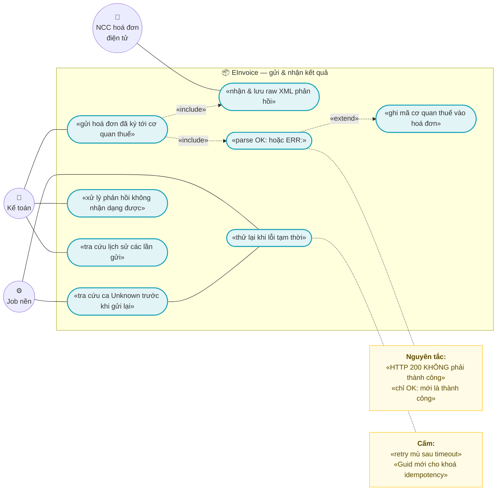
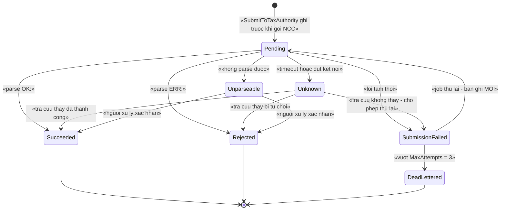
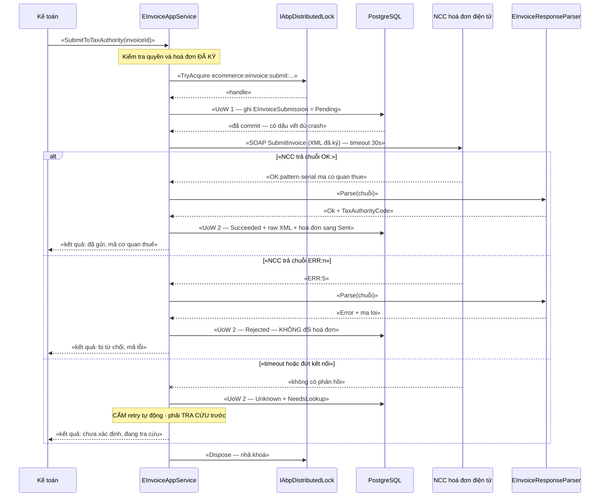
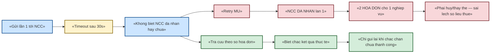

# `EINV-002` — Gửi cơ quan thuế và nhận kết quả (SOAP/XML, parse `OK:` và `ERR:`)

| Thuộc tính | Nội dung |
|---|---|
| **Mã** | `EINV-002` |
| **Module** | **EInvoice** — chưa có trong code: kế hoạch **GĐ0** (đề xuất khuôn `modules/EInvoice/`, xem §5.1) |
| **Giai đoạn** | **GĐ0 — Pháp lý** (`docs/implementation-plan.md` §5, §6.2) |
| **Ưu tiên** | **Must have** (nghĩa vụ pháp lý: NĐ 254/2026/NĐ-CP hiệu lực 01/7/2026) |
| **Trạng thái** | 🟡 `Draft` — chờ review |
| **Người viết / người review** | *(điền)* / **Kiến trúc trưởng + Kế toán + người đã liên hệ NCC** |
| **Phiên bản / ngày** | `v0.1 — 14/10/2026` |
| **Tài liệu liên quan** | `EINV-001` (phát hành hoá đơn) · `EINV-003` (điều chỉnh/thay thế/huỷ) · `SIGN-001` (ký 2 bước) · `XC-001` (Money/làm tròn) · `XC-002` (outbox/inbox) · `XC-003` (khoá phân tán) · `XC-004` (permission/tenant) · `XC-005` (observability) · `XC-006` (phân loại thuế) · `docs/implementation-plan.md` §6.2 · `docs/business-modules-proposal.md` §6.7 |

---

## 0. Tóm tắt & quyết định thiết kế

**Tóm tắt:** `EINV-002` chốt **cách gửi một hoá đơn điện tử ĐÃ KÝ sang cơ quan thuế và cách đọc kết quả trả về**.
Điểm quyết định của feature này nằm ở một sự thật kỹ thuật đã khảo sát: NCC hoá đơn điện tử Việt Nam
(VNPT — nguồn đầy đủ nhất tìm được) dùng **SOAP/ASMX + XML** và **trả về một CHUỖI** dạng
`"OK:…"` hoặc `"ERR:n"`, **không có ngữ nghĩa HTTP status**
(`docs/implementation-plan.md:143`, `docs/business-modules-proposal.md:539`).
⇒ **HTTP 200 KHÔNG phải là thành công.** Nếu code chỉ kiểm `response.IsSuccessStatusCode` thì **mọi hoá đơn bị
cơ quan thuế từ chối đều bị coi là đã gửi thành công** — đây là loại lỗi im lặng đắt nhất của module này.

**Vì sao phải có tài liệu này:** ba lỗi im lặng dưới đây **không có lỗi biên dịch** và chỉ lộ ra khi đã có dữ liệu thật:

| # | Lỗi im lặng | Hậu quả |
|---|---|---|
| 1 | Tin `HTTP 200` là thành công, không parse `OK:`/`ERR:` | Hoá đơn `ERR:` bị đánh dấu đã phát hành ⇒ **kê khai sai với cơ quan thuế** |
| 2 | Sinh `IdempotencyKey = Guid.NewGuid()` **mỗi lần gọi** (anti-pattern đã ghi ở `docs/business-modules-proposal.md:396` — OCC) | Retry ⇒ **gửi trùng hoá đơn**, có thể bị xử phạt |
| 3 | Timeout mạng ⇒ **retry mù** | NCC **đã nhận** ở lần 1 ⇒ **2 hoá đơn cho 1 nghiệp vụ** |

**Phạm vi:**
- ✅ Ranh giới **ai là bên gửi thật**: NCC (T-VAN) hay trực tiếp cơ quan thuế — và vì sao ta đi qua NCC (§0.1 D1).
- ✅ **State machine của một LẦN GỬI** (`EInvoiceSubmission`) — tách khỏi state machine của hoá đơn (`EINV-001`).
- ✅ **Hợp đồng adapter** `IEInvoiceProvider` (SOAP client) + **hàm parse thuần** `EInvoiceResponseParser`.
- ✅ **Bảng đăng ký định dạng phản hồi** đã biết + hành vi với phản hồi **không nhận dạng được**.
- ✅ **Idempotency** ở biên `SubmitToTaxAuthority` (khoá ổn định, bảng append-only, unique index).
- ✅ Lưu **raw XML request/response** để đối soát + che dữ liệu nhạy cảm trước khi log (`XC-005`).
- ✅ Phân loại **lỗi tạm thời vs lỗi vĩnh viễn** và chính sách retry tương ứng.
- ✅ Khoá phân tán theo `XC-003`, permission theo `XC-004`, metric theo `XC-005`.

**Không nằm trong phạm vi:**
- ❌ **Lập hoá đơn** (số/ký hiệu/mẫu số, MST, dòng hàng, PDF) — thuộc **`EINV-001`**.
- ❌ **Điều chỉnh / thay thế / huỷ** hoá đơn — thuộc **`EINV-003`**.
- ❌ **Quy trình ký 2 bước** (xin hash → nạp hash đã ký) và quản lý chứng thư số — thuộc **`SIGN-001`**.
- ❌ **Tra cứu công khai hoá đơn** trên cổng cơ quan thuế (tra cứu theo mã) — không có yêu cầu ở GĐ0, ghi nhận để sau.
- ❌ **Báo cáo tình hình sử dụng hoá đơn** theo kỳ — thuộc `ACC-001`/`EINV-003`.
- ❌ **Gửi email/PDF cho khách** — thuộc `NOT-*`.
- ❌ **Chọn NCC bằng hợp đồng** — quan hệ thương mại, không phải kỹ thuật.

### 0.1 Quyết định thiết kế (ADR ngắn)

| # | Quyết định | Phương án đã cân nhắc | Lý do chọn | Hệ quả |
|---|---|---|---|---|
| **D1** | **Đi qua NCC (T-VAN)** làm bên gửi thật; **không** tự gọi trực tiếp hệ thống cơ quan thuế của mỗi Cục Thuế | (a) gọi trực tiếp cổng thuế theo tài liệu "thành phần dữ liệu nghiệp vụ" của Cục Thuế · (b) qua NCC | `XC-001` §15.1.3 đã ghi rõ: cấu trúc XML + **phương thức truyền nhận** do **Cục Thuế công bố riêng**, **KHÔNG** nằm trong TT 91/2026 ⇒ tự làm là phải bám nhiều bộ tài liệu khác nhau, mỗi Cục một khác. NCC đã làm sẵn việc đó và **chịu trách nhiệm kỹ thuật truyền nhận** | **Phụ thuộc NCC** (rủi ro #1 của `implementation-plan.md` §14). Bù lại: **một** adapter, đổi NCC = đổi adapter, không đổi domain |
| **D2** | `IEInvoiceProvider` là **anti-corruption layer**: domain **không biết** SOAP, XML hay `OK:`/`ERR:` | (a) gọi SOAP thẳng từ app service · (b) adapter + hàm parse thuần | Trộn SOAP vào nghiệp vụ ⇒ **không test được** (cần NCC thật) và **không đổi NCC được**. Tách ra ⇒ hàm parse là **hàm thuần**, test bằng chuỗi mẫu | Thêm 1 lớp; bắt buộc có **hàm parse thuần** (§6.2) + bảng định dạng (§5.3) |
| **D3** | 🚨 **`HTTP 200` KHÔNG phải thành công.** Thành công **chỉ khi** parse ra `OK:` | (a) tin `IsSuccessStatusCode` · (b) parse chuỗi | Đã khảo sát: NCC **không có HTTP status semantic** (`implementation-plan.md:143`). Tin status code ⇒ **mọi từ chối của cơ quan thuế thành "đã phát hành"** | Mọi lần gửi **phải** đi qua `EInvoiceResponseParser`. Test `TC-02`–`TC-06` chặn tái phát |
| **D4** | Phản hồi **không parse được** ⇒ trạng thái `Unparseable` + **KHÔNG** đổi hoá đơn sang đã phát hành + **KHÔNG retry tự động** | (a) coi như thất bại và retry · (b) chặn lại cho người xử lý | Retry một phản hồi **không hiểu** rất có thể là **retry một hoá đơn ĐÃ thành công** (NCC trả về HTML lỗi sau khi đã nhận) ⇒ tạo hoá đơn trùng | Có **hàng đợi "cần người xử lý"**; vận hành **phải** tra trên cổng NCC trước khi gửi lại |
| **D5** | Bảng `EInvoiceSubmission` là **APPEND-ONLY**: retry = **bản ghi MỚI** với `AttemptNumber + 1`, **không UPDATE** kết quả cũ | (a) UPDATE cùng bản ghi · (b) append-only | Cùng triết lý `XC-006` BR-005 (`TaxClassification` append-only) và sổ cái kho (`implementation-plan.md` §3 #8): cơ quan thuế **có thể hỏi lại** "lần thứ 2 ông gửi cái gì, nhận cái gì" | Bảng phình theo số lần retry (chấp nhận được: 1 hoá đơn hiếm khi retry > 5 lần) |
| **D6** | Khoá idempotency **ổn định**, sinh từ `(HoaDonId, ProviderCode, SHA-256 của payload đã ký)` — **KHÔNG** dùng `Guid.NewGuid()` | (a) Guid mới mỗi lần · (b) hash ổn định | Anti-pattern (a) **đã được ghi nhận có bằng chứng** ở OCC (`business-modules-proposal.md:396`) và nó **vô hiệu hoá hoàn toàn** idempotency | Đổi nội dung hoá đơn ⇒ hash đổi ⇒ là **lần gửi mới**, đúng ngữ nghĩa |
| **D7** | Ghi **PENDING trước**, gọi NCC **ngoài** transaction, ghi kết quả ở **Unit of Work mới** | (a) gọi NCC trong transaction · (b) 2 bước | (a) giữ transaction mở trong lúc chờ mạng 30 s ⇒ **giữ kết nối DB vô ích** và có nguy cơ **mất dấu vết** nếu process chết. (b) bảo đảm: dù crash giữa lúc gọi, DB **vẫn có** bản ghi `Pending` để job đối soát xử lý | Cần **job đối soát** cho các bản ghi `Pending`/`Unknown` quá hạn (§3, §4.1) |
| **D8** | Timeout **30 s**/request, tối đa **3 lần** thử, backoff **5 s → 20 s**; acquire khoá với timeout 10 s | (a) không timeout · (b) chờ vô hạn · (c) timeout hữu hạn | `XC-003` BR-004: **cấm** chờ vô hạn; timeout biến sự cố thành **lỗi quan sát được** | Ghi rõ trong cấu hình (`EInvoice:Submit:TimeoutSeconds`…) |
| **D9** | Sau **timeout/đứt kết nối** ⇒ trạng thái `Unknown`, **KHÔNG retry mù**; **bắt buộc** tra theo số hoá đơn trước | (a) retry ngay · (b) tra trước rồi mới retry | Đây là ca nguy hiểm nhất: NCC **có thể đã nhận**. Retry mù ⇒ **hoá đơn trùng** | Có nhánh `UNKNOWN` trong state machine + job tra cứu; chậm hơn nhưng **không tạo trùng** |
| **D10** | **Che dữ liệu nhạy cảm** trước khi lưu log: mật khẩu SOAP, khoá ký, chữ ký số trong XML | (a) log nguyên XML · (b) che | `XC-005` BR-005 + tiền lệ **đã có code thật**: `PaymentTransaction.MaskSensitiveData` (`modules/PaymentHub/eCommerce.PaymentHub.Domain/Entities/PaymentTransaction.cs:147`) che `token`/`secret`/`otp`… và số thẻ | Raw XML **vẫn lưu trong DB** (cần cho đối soát); **không** bao giờ ghi nó ra log nguyên bản |

---

## 1. Use Case Specification

| Thuộc tính | Nội dung |
|---|---|
| **Use Case ID** | `EINV-002` |
| **Use Case Name** | Gửi hoá đơn điện tử đã ký tới cơ quan thuế qua NCC và ghi nhận kết quả **có thể chứng minh được** |
| **Description** | *"Là kế toán, tôi muốn hệ thống gửi hoá đơn sang cơ quan thuế và cho tôi biết CHÍNH XÁC cơ quan thuế đã trả lời gì — kể cả khi câu trả lời đó là từ chối — để tôi không bao giờ tưởng một hoá đơn bị từ chối là đã phát hành."* |
| **Actor(s)** | **Kế toán** (bấm gửi / xử lý ca `Unparseable`) · **Job nền** (retry, tra cứu ca `Unknown`/`Pending`) · **NCC hoá đơn điện tử** (bên gửi thật tới cơ quan thuế) · **Hệ thống** (parser, state machine, lock) |
| **Priority** | **Must have** |
| **Trigger** | (a) hoá đơn đã ở trạng thái đã ký (do `SIGN-001` hoàn tất) và kế toán bấm **Gửi cơ quan thuế**; (b) job phát hiện bản ghi `SubmissionFailed` tới hạn thử lại; (c) job phát hiện bản ghi `Unknown`/`Pending` quá hạn cần tra cứu |
| **Pre-Condition(s)** | • **Tenant hiện tại** (`ICurrentTenant`) — mọi entity `IMultiTenant`; ⚠️ hiện chạy **1 tenant** nên `TenantId` **có thể là `NULL`** (`X C-004` §5.2 F1) ⇒ unique index **phải** `NULLS NOT DISTINCT`.<br>• Hoá đơn **đã ký** (`SigningRequest` đã `Completed` theo `SIGN-001`) — gửi hoá đơn chưa ký là **vi phạm pháp lý**.<br>• Có **cấu hình NCC đang hoạt động** (`EInvoiceProviderConfig`, `IsActive = true`) với base URL + tài khoản; **thiếu ⇒ ném lỗi**, **không** dùng giá trị mặc định trong code.<br>• `TenantId` + `ProviderCode` xác định **duy nhất** một cấu hình NCC.<br>• Kênh bán (`ChannelCode`) **không** tham gia quyết định gửi — hoá đơn không phụ thuộc kênh (khác với `ChannelHub`). |
| **Post-Condition(s)** | • **Luôn tồn tại** một bản ghi `EInvoiceSubmission` cho mỗi lần gửi thật ra ngoài — kể cả khi mất mạng (**đã ghi `Pending` trước khi gọi**).<br>• **Chỉ** khi parse được `OK:` thì hoá đơn mới chuyển sang `Sent` và lưu `TaxAuthorityCode`.<br>• `ERR:` ⇒ hoá đơn **KHÔNG** ở trạng thái đã phát hành; lưu mã lỗi NCC/cơ quan thuế.<br>• Raw XML request/response **đã che dữ liệu nhạy cảm** được lưu để đối soát.<br>• Mọi lần **không giành được khoá** hoặc **không gửi được** đều **có dấu vết** (exception có mã, hoặc log + metric). |
| **Basic Flow** | 1. Kiểm tra quyền `eCommerce.Invoices.Submit` và **hoá đơn đã ký**; sai ⇒ `BusinessException` `eCommerce:EInvoice:0001` / `0006`.<br>2. Mở **khoá phân tán** `ecommerce:einvoice:submit:{tenantId}:{hoaDonId}` (`XC-003`, timeout 10 s) — không giành được ⇒ `eCommerce:Lock:0001`.<br>3. Kiểm tra **idempotency**: đã có `EInvoiceSubmission` `Succeeded` cho cùng `IdempotencyKey` ⇒ **trả kết quả cũ**, không gọi lại.<br>4. Sinh XML nghiệp vụ (do `EINV-001` cung cấp) + ghi `EInvoiceSubmission` trạng thái **`Pending`** trong **Unit of Work #1** (commit).<br>5. Gọi `IEInvoiceProvider.SubmitAsync` (**ngoài** transaction, timeout 30 s, tối đa 3 lần, backoff 5 s → 20 s).<br>6. `EInvoiceResponseParser.Parse(rawResponse)` ⇒ `Ok` / `Error` / `Unparseable`.<br>7. Ghi kết quả + raw XML (đã che) trong **Unit of Work #2**; `Ok` ⇒ hoá đơn `Sent` + `TaxAuthorityCode`; `Error` ⇒ ghi mã lỗi, **không** đổi hoá đơn sang phát hành; phát ETO tương ứng.<br>8. Trả DTO kết quả cho kế toán. |
| **Alternative Flow** | **A1: Lỗi tạm thời** (timeout, 5xx, cơ quan thuế bận) ⇒ `SubmissionFailed` + `NextRetryAtUtc`; job thử lại thành **bản ghi mới** `AttemptNumber + 1` (D5).<br>**A2: Ca `Unknown`** (timeout sau khi NCC **có thể** đã nhận) ⇒ **KHÔNG** retry tự động; job **tra cứu theo số hoá đơn** rồi mới quyết định (D9).<br>**A3: Phản hồi `Unparseable`** ⇒ `Unparseable` + đưa vào **hàng đợi cần người xử lý**; **cấm** retry tự động (D4).<br>**A4: `ERR:` báo trùng số hoá đơn** ⇒ **KHÔNG** retry; job tra cứu xem hoá đơn đó đã có mã cơ quan thuế hay chưa, có rồi ⇒ đóng lại kèm ghi chú.<br>**A5: Job định kỳ chạy trên nhiều instance** ⇒ dùng `SkipIfBusy` + log + metric `lock_skipped_total` (`XC-003` BR-010). |
| **Exception Flow** | **E1:** hoá đơn **chưa ký** ⇒ `BusinessException` `eCommerce:EInvoice:0001` (`400`).<br>**E2:** **thiếu cấu hình NCC** đang hoạt động ⇒ `eCommerce:EInvoice:0002` (`500` — lỗi cấu hình, không phải lỗi người dùng).<br>**E3:** phản hồi **không parse được** ⇒ `eCommerce:EInvoice:0003` (`502`), **không** đổi trạng thái hoá đơn.<br>**E4:** **quá timeout** 30 s × 3 lần ⇒ `eCommerce:EInvoice:0004` (`504`) ⇒ `Unknown` (A2).<br>**E5:** cổng NCC **không kết nối được** (DNS/TLS/TCP) ⇒ `eCommerce:EInvoice:0005` (`503`) ⇒ `SubmissionFailed` (A1).<br>**E6:** phát hiện **gửi trùng** ⇒ `eCommerce:EInvoice:0007` (`409`) + log `Warning` **có `CorrelationId`** (`XC-005`).<br>**E7:** mất khoá phân tán ⇒ `eCommerce:Lock:0001` (`409`) theo `XC-003` §6.2. |
| **Business Rules** | • **BR-EINV-002-001**: Kết quả gửi **CHỈ** được xác định bằng parse `OK:`/`ERR:` bằng `EInvoiceResponseParser`; **cấm** dùng `IsSuccessStatusCode`, **cấm** dùng HTTP status làm kết luận nghiệp vụ.<br>• **BR-EINV-002-002**: **Mọi** phản hồi nhận được từ NCC **phải** được lưu dạng **raw XML** (đã che dữ liệu nhạy cảm), gắn với `EInvoiceSubmission`.<br>• **BR-EINV-002-003**: Hoá đơn **chỉ** được coi là đã gửi thành công khi có `TaxAuthorityCode` lấy từ phản hồi `OK:`.<br>• **BR-EINV-002-004**: `ERR:` ⇒ **tuyệt đối không** đánh dấu hoá đơn là đã phát hành; lưu mã lỗi + thông điệp của NCC.<br>• **BR-EINV-002-005**: Phản hồi **không parse được** ⇒ trạng thái `Unparseable`, **KHÔNG** đổi trạng thái hoá đơn, **CẤM** retry tự động (D4).<br>• **BR-EINV-002-006**: Khoá idempotency **phải ổn định** — sinh từ `(HoaDonId, ProviderCode, SHA-256 payload đã ký)`; **cấm** `Guid.NewGuid()` cho khoá này.<br>• **BR-EINV-002-007**: **Chỉ một** lần gửi cho một hoá đơn tại một thời điểm ⇒ khoá phân tán bắt buộc + ràng buộc DB.<br>• **BR-EINV-002-008**: Retry **chỉ** cho lỗi **tạm thời** đã liệt kê trong allowlist `RetryableErrorCodes`; lỗi **vĩnh viễn** ⇒ dừng, chờ người xử lý. **Cấm** retry mù.<br>• **BR-EINV-002-009**: Sau **timeout/đứt kết nối** ⇒ `Unknown` ⇒ **bắt buộc tra theo số hoá đơn** trước khi gửi lại (D9).<br>• **BR-EINV-002-010**: `EInvoiceSubmission` là **append-only** — retry tạo **bản ghi mới**; **cấm** UPDATE kết quả đã ghi (D5).<br>• **BR-EINV-002-011**: **Cấm hard-code** endpoint/tài khoản NCC — base URL, timeout, retry **đọc từ cấu hình** theo tenant.<br>• **BR-EINV-002-012**: Dữ liệu nhạy cảm (mật khẩu SOAP, khoá ký, chữ ký trong XML) **phải** bị che trước khi **ghi log**; raw XML trong DB là ngoại lệ **có chủ ý**.<br>• **BR-EINV-002-013**: Retry có **giới hạn cứng** `MaxAttempts = 3`; vượt ⇒ `DeadLettered` + hàng đợi người xử lý (chặn vòng lặp vô hạn).<br>• **BR-EINV-002-014**: Mọi lần chuyển trạng thái của `EInvoiceSubmission` sai guard **phải NÉM LỖI** (`eCommerce:EInvoice:0008`) — **cấm** im lặng bỏ qua (`implementation-plan.md` §3 #11). |
| **Non-Functional Requirement** | • **NFR-EINV-002-001**: Parse phản hồi **p95 < 1 ms** (hàm thuần, không I/O).<br>• **NFR-EINV-002-002**: **≥ 95 %** lần gửi ở môi trường bình thường có kết luận **dứt khoát** (không phải `Pending`/`Unknown`) trong **< 60 s**.<br>• **NFR-EINV-002-003**: **100 %** định dạng trong bảng §5.3 có test — **≥ 12** ca, gồm phản hồi **không hợp lệ**.<br>• **NFR-EINV-002-004**: **0** lần chờ vô hạn — mọi lời gọi NCC có timeout (30 s) và tổng thời gian 1 lần gửi **≤ 120 s**.<br>• **NFR-EINV-002-005**: **0** xuất hiện mật khẩu/khoá ký/chữ ký trong **log** (kiểm bằng test quét)<br>• **NFR-EINV-002-006**: Cách ly tenant — tenant A **không** đọc/ghi được `EInvoiceSubmission` của tenant B.<br>• **NFR-EINV-002-007**: **100 %** lần chuyển trạng thái có bản ghi **audit** (ai/khi nào/từ trạng thái nào).<br>• **NFR-EINV-002-008**: Raw XML lưu **≤ 2 MB**/bản ghi; vượt ⇒ cắt + ghi cờ `IsTruncated`. |

---

## 2. Sơ đồ Use Case



### Chú giải

| Ký hiệu | Ý nghĩa |
|---|---|
| ⭕ Xanh lá | Actor (kế toán · job nền · NCC) |
| 🟦 Bầu dục xanh dương | Use Case |
| 🟨 Khung vàng | Note (nguyên tắc / điều cấm) |
| `───` | Liên kết Actor ↔ Use Case |
| `-.«include».->` | Quan hệ bao hàm |
| `-.«extend».->` | Quan hệ mở rộng |

---

## 3. Vòng đời một LẦN GỬI (state machine)

> 📌 **Tách biệt có chủ ý:** state machine dưới đây là của **`EInvoiceSubmission`** (một lần gửi), **không phải**
> của `EInvoice` (vòng đời hoá đơn `Draft → PendingSign → Signed → Sent → Accepted/Rejected → …` thuộc `EINV-001`,
> xem `docs/implementation-plan.md:140`). Một hoá đơn có thể có **nhiều** `EInvoiceSubmission` theo thời gian.



**Bảng chuyển trạng thái & guard (mọi chuyển sai **phải ném lỗi**, không im lặng — BR-014):**

| # | Từ → Sang | Ai được chuyển | Guard (điều kiện cho phép) | Hành động kèm theo | Nếu guard sai |
|---|---|---|---|---|---|
| 1 | `[*]` → `Pending` | App service (`SubmitToTaxAuthorityAsync`) | Hoá đơn **đã ký** **và** có cấu hình NCC đang hoạt động **và** đã giành khoá | Ghi bản ghi `EInvoiceSubmission` + raw XML request (đã che) + commit **trước** khi gọi NCC | **Ném** `eCommerce:EInvoice:0001` / `0002`; **không** tạo bản ghi |
| 2 | `Pending` → `Succeeded` | Kết quả parse | Chuỗi khớp mẫu `OK:` **và** lấy được mã cơ quan thuế | Lưu `TaxAuthorityCode` + raw response; hoá đơn → `Sent`; phát `EInvoiceSentToTaxAuthorityEto` | Không xảy ra (nhánh khác được chọn) |
| 3 | `Pending` → `Rejected` | Kết quả parse | Chuỗi khớp mẫu `ERR:` | Lưu mã lỗi + thông điệp; **KHÔNG** đổi hoá đơn sang `Sent`; phát `EInvoiceRejectedByTaxAuthorityEto` | — |
| 4 | `Pending` → `SubmissionFailed` | Kết quả parse / lỗi kết nối | Lỗi **nằm trong** `RetryableErrorCodes` **hoặc** `EInvoice:0005` | Đặt `NextRetryAtUtc` theo backoff | Lỗi **không** nằm trong allowlist ⇒ đi nhánh `Rejected`/`Unknown`, **không** retry (BR-008) |
| 5 | `Pending` → `Unknown` | Kết quả gọi | Timeout **hoặc** đứt kết nối giữa chừng | Đặt `NeedsLookup = true`; **CẤM** retry tự động (BR-009) | — |
| 6 | `Pending` → `Unparseable` | Kết quả parse | Phản hồi **không** khớp **bất kỳ** mẫu nào trong §5.3 | Đưa vào hàng đợi người xử lý; **KHÔNG** đổi hoá đơn | — |
| 7 | `SubmissionFailed` → `Pending` | Job retry | `Now >= NextRetryAtUtc` **và** `AttemptNumber < MaxAttempts` **và** giành được khoá | **Tạo bản ghi MỚI** `AttemptNumber + 1` (D5) | Vượt `MaxAttempts` ⇒ **`DeadLettered`** + cảnh báo |
| 8 | `Unknown` → `Succeeded`/`Rejected`/`SubmissionFailed` | Job tra cứu | Tra cứu theo số hoá đơn trả về kết quả **xác định** | Ghi **bản ghi mới** là kết quả tra cứu | Tra cứu **không** kết luận được ⇒ **giữ** `Unknown` + cảnh báo (không đoán) |
| 9 | `Unparseable` → `Succeeded`/`Rejected` | **Người** (kế toán) | Có **chứng cứ** từ cổng NCC (ảnh chụp/mã tra cứu) + ghi chú | Ghi bản ghi mới + `ResolvedByUserId` | **Cấm** hệ thống tự chuyển nhánh này (D4) |
| 10 | `Succeeded`/`Rejected`/`DeadLettered` → `[*]` | — | Trạng thái **hấp thụ (absorbing)** | — | Mọi chuyển **ra khỏi** các trạng thái này ⇒ **ném** `eCommerce:EInvoice:0008` |

> ⚠️ **Ba trạng thái hấp thụ** `Succeeded`, `Rejected`, `DeadLettered` **không có đường ra**. Muốn gửi lại một
> hoá đơn đã `Rejected` ⇒ đó là **lần gửi MỚI** (bản ghi mới), không phải chuyển trạng thái bản ghi cũ.
>
> ⚠️ **`Unknown` là trạng thái nguy hiểm nhất:** NCC **có thể** đã nhận hoá đơn. Vì vậy **cấm** retry tự động
> (BR-009) — bắt buộc tra cứu trước. Đây là chỗ dễ tạo **hoá đơn trùng** nhất trong toàn bộ luồng.

---

## 4. Sequence Diagram & luồng dữ liệu

### 4.1 Luồng gửi thành công + luồng lỗi tạm thời



### 4.2 🚨 Vì sao KHÔNG được retry mù sau timeout (D9)



---

## 5. Mô hình dữ liệu

### 5.1 Vị trí module & trạng thái code

| Thành phần | Trạng thái trong repo (đã kiểm bằng `grep`/`glob`) |
|---|---|
| Project `eCommerce.EInvoice.*` | ❌ **chưa có trong code** — `modules/` hiện chỉ có `ChannelHub`, `PaymentHub`, `Tax`; **kế hoạch GĐ0** |
| Entity `EInvoice`, `EInvoiceLine` | ❌ **chưa có trong code** — thuộc `EINV-001` |
| Entity `SigningRequest`, `SigningCertificate` | ❌ **chưa có trong code** — thuộc `SIGN-001` |
| Entity `EInvoiceSubmission` (tài liệu này đề xuất) | ❌ **chưa có trong code** — **kế hoạch GĐ0**, tạo cùng `EINV-001` |
| `IEInvoiceProvider` (adapter NCC) | ❌ **chưa có trong code** — tương tự `IPaymentProvider` đã có ở `modules/PaymentHub/eCommerce.PaymentHub.Domain/Payments/IPaymentProvider.cs`, **nhưng chưa có bản hoá đơn** |
| SOAP/WCF client (`System.ServiceModel.*`) | ❌ **chưa có**: `grep` toàn bộ `*.cs`/`*.csproj` trong `src/`, `modules/`, `test/` cho `ServiceModel`, `BasicHttpBinding`, `Wcf` = **0**; `Directory.Packages.props` **không** có gói SOAP nào |
| Xử lý XML (`XmlSerializer`, `XDocument`, `XmlReader`) | ❌ **chưa có**: `grep` = **0** trên toàn bộ mã nguồn |
| `IHttpClientFactory` / `HttpClient` | ❌ **chưa có** đăng ký: `grep` cho `IHttpClientFactory` = **0**; `HttpClient` chỉ xuất hiện trong **1 comment TODO** ở `modules/ChannelHub/eCommerce.ChannelHub.Application/Connectors/ShopeeConnector.cs:13` |
| `eCommerce.Kernel` (`shared/`) | ❌ **chưa có trong repo**: `glob **/*.csproj` chỉ thấy 18 project, `shared/` **chưa tồn tại** ⇒ mọi tham chiếu `Money` trong tài liệu này là **kế hoạch**, **chưa kiểm chứng** |
| Tiền tệ hiện tại | ⚠️ Là `decimal` **trực tiếp trên entity** (`Order.TaxTotal`, `OrderLine.TaxAmount`…), **chưa** có value object `Money` — xem `eCommerce.EntityFrameworkCore/eCommerceDbContext.cs:173-203` |

> 📌 **Đề xuất khuôn project** (theo `docs/implementation-plan.md` §4, giống `ChannelHub`):
> `modules/EInvoice/eCommerce.EInvoice.Domain` (entity + mã lỗi + state machine + **hàm parse thuần**) ·
> `eCommerce.EInvoice.Application` (app service + adapter SOAP) ·
> `eCommerce.EInvoice.EntityFrameworkCore` (`ConfigureEInvoice()`). Entity **bắt buộc** phải có `DbSet` trên
> `eCommerceDbContext` nếu không có `IRepository` riêng — **bài học Phase 0 đã ghi bằng chứng** tại
> `eCommerceDbContext.cs:48-52`.

### 5.2 Bảng & cột (Data Dictionary)

**Bảng `EInvoiceSubmissions`** — *nhật ký **append-only** của từng lần gửi một hoá đơn sang cơ quan thuế*

| Cột | Kiểu | Null? | Nguồn / ý nghĩa | Ghi chú |
|---|---|---|---|---|
| `Id` | `uuid` | ✖ | khoá chính | |
| `TenantId` | `uuid` | ✔ | tenant sở hữu | **bắt buộc** (`IMultiTenant`); ⚠️ có thể `NULL` — xem `XC-004` F1 |
| `HoaDonId` | `uuid` | ✖ | FK logic → `EInvoice` (module tự sở hữu entity của mình) | **không** FK cứng nếu `EInvoice` ở project khác cùng module |
| `ProviderCode` | `varchar(32)` | ✖ | mã NCC (`vnpt`, `misa`, …) | **không** hard-code; giá trị đến từ cấu hình |
| `AttemptNumber` | `int` | ✖ | lần gửi thứ mấy của hoá đơn này (1, 2, 3…) | tăng khi retry (**bản ghi mới**, D5) |
| `IdempotencyKey` | `varchar(128)` | ✖ | `SHA-256(HoaDonId + ProviderCode + payload đã ký)` | 🔒 **khoá ổn định** (BR-006) — trục chống trùng |
| `Status` | `int` | ✖ | enum `EInvoiceSubmissionStatus` (§5.3) | |
| `RequestXmlEncrypted` | `text` | ✖ | XML **đã gửi**, đã che dữ liệu nhạy cảm | ⚠️ chứa **dữ liệu hoá đơn** (tên/MST khách) — coi là dữ liệu nghiệp vụ |
| `ResponseRawXmlEncrypted` | `text` | ✔ | phản hồi **nguyên văn** từ NCC | `NULL` khi chưa có phản hồi (timeout) |
| `ResponseKind` | `int` | ✔ | `Ok` / `Error` / `Unparseable` | kết quả parse (BR-001) |
| `TaxAuthorityCode` | `varchar(64)` | ✔ | **mã cơ quan thuế** lấy từ `OK:` | 🔒 **chỉ có khi `Succeeded`** (BR-003) |
| `ProviderErrorCode` | `varchar(32)` | ✔ | mã lỗi NCC/cơ quan thuế trong `ERR:` | |
| `ProviderErrorMessage` | `varchar(1024)` | ✔ | thông điệp lỗi đã cắt độ dài | **che** dữ liệu nhạy cảm |
| `IsTruncated` | `boolean` | ✖ | raw XML bị cắt do vượt 2 MB | NFR-008 |
| `NeedsLookup` | `boolean` | ✖ | ca `Unknown` cần tra cứu trước khi gửi lại | BR-009 |
| `NextRetryAtUtc` | `timestamptz` | ✔ | thời điểm được phép thử lại | chỉ đặt khi `SubmissionFailed` |
| `DurationMs` | `int` | ✔ | thời gian gọi NCC | phục vụ NFR-002 |
| `ResolvedByUserId` | `uuid` | ✔ | người xử lý ca `Unparseable` | **bắt buộc** khi chuyển bằng tay (§3 #9) |
| `Note` | `varchar(2048)` | ✔ | ghi chú của người xử lý | |
| `ExtraProperties` · `ConcurrencyStamp` · `CreationTime` · `CreatorId` | — | — | chuẩn ABP `FullAuditedAggregateRoot` | |

> ⚠️ **`RequestXmlEncrypted` / `ResponseRawXmlEncrypted` cần được đối chiếu với kế toán trưởng**: XML hoá đơn
> chứa **tên, MST, địa chỉ người mua**. Đây là **dữ liệu cá nhân/tổ chức** ⇒ cần chốt **thời hạn lưu** và
> **ai được đọc** (xem Q6 §15.1). Bảng này **không** xoá cứng `EInvoice` (append-only) nên dữ liệu **tồn tại vĩnh viễn**
> trừ khi có job dọn theo thoả thuận.

**Bảng `EInvoiceProviderConfigs`** — *cấu hình NCC theo tenant (BR-011: **không** hard-code endpoint)*

| Cột | Kiểu | Null? | Nguồn / ý nghĩa | Ghi chú |
|---|---|---|---|---|
| `Id` | `uuid` | ✖ | khoá chính | |
| `TenantId` | `uuid` | ✔ | tenant sở hữu | |
| `ProviderCode` | `varchar(32)` | ✖ | mã NCC | unique theo `(TenantId, ProviderCode)` |
| `DisplayName` | `varchar(128)` | ✖ | tên hiển thị | |
| `ServiceUrl` | `varchar(512)` | ✖ | **endpoint SOAP** | 🔒 từ cấu hình, **không** commit giá trị thật |
| `Username` | `varchar(128)` | ✖ | tài khoản NCC | |
| `PasswordEncrypted` | `varchar(512)` | ✖ | mật khẩu **đã mã hoá** | dùng `IStringEncryptionService` — **cùng cách** `ChannelShop` đang làm (`modules/ChannelHub/eCommerce.ChannelHub.Domain/Entities/ChannelEntities.cs`, dùng ở `ChannelTokenManager.cs:109`) |
| `AccountTaxCode` | `varchar(32)` | ✖ | MST của **người bán** | |
| `TimeoutSeconds` | `int` | ✖ | mặc định **30** | D8 |
| `MaxAttempts` | `int` | ✖ | mặc định **3** | BR-013 |
| `IsActive` | `boolean` | ✖ | bật/tắt không cần xoá cấu hình | |

**Index & ràng buộc** *(phần hay bị bỏ sót nhất — và là **hàng rào cuối** khi tầng ứng dụng sai)*

| # | Loại | Cột | Mục đích |
|---|---|---|---|
| 1 | **UNIQUE** *(thêm `NULLS NOT DISTINCT`)* | `(TenantId, IdempotencyKey, AttemptNumber)` | chống ghi trùng cùng một lần gửi; ⚠️ **`NULLS NOT DISTINCT` là BẮT BUỘC** vì `TenantId` có thể `NULL` — lỗi **F1 của `XC-004`** đã chứng minh unique index **mất tác dụng** trong trường hợp đó. Tiền lệ SQL thô đã có trong repo: `src/eCommerce.EntityFrameworkCore/Migrations/20261013024226_Fix_NullableTenantId_UniqueIndexes.cs` |
| 2 | **UNIQUE** *(có filter)* | `(TenantId, HoaDonId, AttemptNumber)` | chặn 2 bản ghi cùng số lần gửi cho 1 hoá đơn |
| 3 | INDEX | `(TenantId, Status, NextRetryAtUtc)` | job retry quét bản ghi tới hạn |
| 4 | INDEX | `(TenantId, HoaDonId, CreationTime DESC)` | màn hình lịch sử gửi của một hoá đơn |
| 5 | INDEX *(một phần)* | `(TenantId, NeedsLookup) WHERE NeedsLookup = true` | job tra cứu chỉ quét ca `Unknown` |
| 6 | CHECK | `AttemptNumber >= 1` | bất biến ở tầng DB |
| 7 | CHECK | `DurationMs IS NULL OR DurationMs >= 0` | |
| 8 | CHECK | `Status <> 2 OR TaxAuthorityCode IS NOT NULL` | 🚨 **bất biến quan trọng nhất**: `Succeeded` **phải** có mã cơ quan thuế (BR-003) — chặn ở tầng DB, không chỉ ở code |
| 9 | UNIQUE *(thêm `NULLS NOT DISTINCT`)* | `(TenantId, ProviderCode)` trên `EInvoiceProviderConfigs` | một cấu hình cho mỗi NCC trong một tenant |

> 📌 **Vì sao mọi bất biến đều phải có ràng buộc DB:** đây là **D2 của `XC-003`** — khoá phân tán chỉ **giảm tranh chấp**;
> nếu bỏ khoá đi mà DB không chặn thì thiết kế **SAI**. Câu hỏi kiểm tra khi review:
> *"Bỏ khoá phân tán và bỏ state machine đi, DB có chặn việc ghi 2 kết quả trái ngược cho cùng một hoá đơn không?"*
> Với ràng buộc #1 và #8: **có** (chặn ghi trùng lần gửi và chặn `Succeeded` không có mã).

### 5.3 Bảng đăng ký định dạng phản hồi (nguồn sự thật của parser)

**Lập từ khảo sát tài liệu NCC — xem mức độ xác minh ở cột cuối. Đây là **bảng dữ liệu của parser**, có test `TC-02`–`TC-06`.**

| # | Dạng phản hồi (mẫu) | Phân loại | Trường lấy được | Retry? | Mức độ xác minh |
|---|---|---|---|---|---|
| 1 | `OK:<pattern>;<serial>;<taxCode>` *(mã cơ quan thuế)* | `Ok` | `pattern`, `serial`, `TaxAuthorityCode` | ❌ không | ⚠️ **chưa kiểm chứng** — dạng **suy đoán** từ mô tả `"OK:pattern;serial-…"` ở `docs/business-modules-proposal.md:539`; **phải** đối chiếu tài liệu NCC 313 trang |
| 2 | `OK:` rỗng phần sau | `Unparseable` | — | ❌ không | ⚠️ **chưa kiểm chứng** — không có cơ sở "thành công mà không có mã"; xử lý an toàn là **không** coi là thành công |
| 3 | `ERR:<n>` — mã lỗi **nằm trong** allowlist tạm thời | `Error` | `ProviderErrorCode` | ✅ **có** (BR-008) | ⚠️ **chưa kiểm chứng** — **allowlist chưa có**; xem Q3 §15.1 |
| 4 | `ERR:<n>` — mã lỗi **ngoài** allowlist | `Error` | `ProviderErrorCode` | ❌ không | ⚠️ **chưa kiểm chứng** |
| 5 | `ERR:<n>:<thông điệp>` | `Error` | mã + thông điệp | theo mã | ⚠️ **chưa kiểm chứng** |
| 6 | Phản hồi **rỗng** / `null` / chỉ khoảng trắng | `Unparseable` | — | ❌ không | ✅ **xác định được** (hành vi của ta) |
| 7 | **HTML** (trang lỗi 502/503 của hạ tầng NCC) | `Unparseable` | — | ❌ không | ✅ **xác định được** — đây là ca **nguy hiểm nhất** vì `HTTP 200` **có thể** đi kèm HTML |
| 8 | SOAP `Fault` (HTTP 500 + `<soap:Fault>`) | `Unparseable` → **đối chiếu lại**: nếu Fault nằm trong allowlist thì `Error` | mã fault | theo mã | ⚠️ **chưa kiểm chứng** |
| 9 | XML hợp lệ **nhưng** không có `OK:`/`ERR:` | `Unparseable` | — | ❌ không | ✅ **xác định được** |
| 10 | Chuỗi **có cả** `OK:` và `ERR:` (log hỗn hợp) | `Unparseable` | — | ❌ không | ✅ **xác định được** — **cấm** đoán; phải xử lý bằng người |
| 11 | `OK:` viết **thường** (`ok:`) | `Ok` *(không phân biệt hoa-thường khi so khớp)* | như #1 | ❌ không | ⚠️ **chưa kiểm chứng** — nhưng an toàn để hỗ trợ |
| 12 | Chuỗi dài hơn **2 MB** | cắt + `IsTruncated = true`, rồi parse phần đầu | theo phần đầu | — | ✅ **xác định được** (NFR-008) |

> 🚨 **Nguyên tắc bao trùm:** *"Không hiểu ⇒ KHÔNG kết luận."* Mọi dạng **không** khớp #1/#3/#4/#5/#11 đều đi vào
> `Unparseable` (D4). **Không** có nhánh nào mặc định là "coi như thành công".

---

## 6. Hợp đồng API

### 6.1 Application Service

| Mục | Giá trị |
|---|---|
| Interface | `IEInvoiceAppService` *(đề xuất đặt tại `eCommerce.EInvoice.Application.Contracts`)* |
| Implementation | `EInvoiceAppService` *(đặt tại `eCommerce.EInvoice.Application`)* |
| `[Authorize]` | **cấp CLASS** + permission cụ thể ở từng method (`XC-004` BR-001) — **bắt buộc** |

| Method | Input (DTO) | Output (DTO) | Ghi chú |
|---|---|---|---|
| `SubmitToTaxAuthorityAsync` | `Guid hoaDonId` | `EInvoiceSubmissionDto` | Idempotent; giành khoá; ghi `Pending` trước khi gọi |
| `RetrySubmissionAsync` | `Guid submissionId` | `EInvoiceSubmissionDto` | **Tạo bản ghi mới** `AttemptNumber + 1` (D5); từ chối nếu vượt `MaxAttempts` |
| `LookupSubmissionAsync` | `Guid submissionId` | `EInvoiceSubmissionDto` | Cho ca `Unknown` (BR-009) |
| `GetSubmissionsAsync` | `Guid hoaDonId` | `ListResultDto<EInvoiceSubmissionDto>` | Lịch sử các lần gửi |
| `ResolveUnparseableAsync` | `ResolveUnparseableDto` (`submissionId`, `ketLuan`, `chungCu`, `ghiChu`) | `EInvoiceSubmissionDto` | **Chỉ người** được gọi (D4, §3 #9) |

### 6.2 Helper parse — hàm **THUẦN** (trái tim của feature)

```csharp
namespace eCommerce.EInvoice;

/// <summary>Loại phản hồi sau khi parse — nguồn sự thật duy nhất cho kết luận nghiệp vụ.</summary>
public enum EInvoiceResponseKind
{
    /// <summary>Chuỗi bắt đầu bằng «OK:» — đã được cơ quan thuế tiếp nhận.</summary>
    Ok = 0,

    /// <summary>Chuỗi bắt đầu bằng «ERR:» — bị từ chối, có mã lỗi.</summary>
    Error = 1,

    /// <summary>Không nhận dạng được — CẤM kết luận, CẤM retry tự động (D4).</summary>
    Unparseable = 2
}

public sealed record EInvoiceParseResult(
    EInvoiceResponseKind Kind,
    string? Pattern,
    string? Serial,
    string? TaxAuthorityCode,
    string? ProviderErrorCode,
    string? ProviderErrorMessage);

/// <summary>
/// HÀM THUẦN: không DI, không DB, không thời gian hệ thống ⇒ test được toàn bộ bằng chuỗi mẫu.
/// 🚨 TUYỆT ĐỐI KHÔNG gọi HttpClient hay đọc cấu hình ở đây.
/// </summary>
public static class EInvoiceResponseParser
{
    public static EInvoiceParseResult Parse(string? rawResponse);
}
```

**Mã lỗi nghiệp vụ** *(tiền tố `eCommerce:EInvoice:*` — theo khuôn `eCommerce:<Module>:<n>` đã có tiền lệ)*

| Mã | HTTP | Khi nào | Thông điệp |
|---|---|---|---|
| `eCommerce:EInvoice:0001` | `400` | Hoá đơn **chưa ký** (hoặc không ở trạng thái cho phép gửi) | `Hoá đơn chưa được ký số, không thể gửi cơ quan thuế.` |
| `eCommerce:EInvoice:0002` | `500` | **Thiếu** cấu hình NCC đang hoạt động | `Chưa cấu hình nhà cung cấp hoá đơn điện tử đang hoạt động.` |
| `eCommerce:EInvoice:0003` | `502` | Phản hồi **không parse được** | `Không đọc được kết quả trả về từ nhà cung cấp; cần kiểm tra thủ công.` |
| `eCommerce:EInvoice:0004` | `504` | **Quá timeout** cả 3 lần thử | `Nhà cung cấp không phản hồi trong thời gian cho phép.` |
| `eCommerce:EInvoice:0005` | `503` | **Không kết nối được** tới NCC | `Không kết nối được nhà cung cấp hoá đơn điện tử.` |
| `eCommerce:EInvoice:0006` | `409` | Hoá đơn **đã có** mã cơ quan thuế | `Hoá đơn đã được cơ quan thuế tiếp nhận trước đó.` |
| `eCommerce:EInvoice:0007` | `409` | Phát hiện **gửi trùng** (cùng `IdempotencyKey`) | `Yêu cầu gửi đã tồn tại; không tạo bản ghi mới.` |
| `eCommerce:EInvoice:0008` | `500` | **Chuyển trạng thái sai** guard | `Chuyển trạng thái không hợp lệ: {currentStatus} → {targetStatus}.` |

> 📌 **Tiền tố mã lỗi theo module, không theo app.** Lý do: module **không được** tham chiếu project `src/`
> (`implementation-plan.md` §3 #3), nên không thể dùng `eCommerceConsts.ErrorCodes` của app.
> Tiền lệ **đã có bằng chứng**: `eCommerce.Tax` khai báo mã lỗi **trong chính module** tại
> `modules/Tax/eCommerce.Tax.Domain/TaxErrorCodes.cs:13-34` với đúng khuôn `eCommerce:Tax:00nn`,
> và `ChannelHub` cũng vậy tại `modules/ChannelHub/eCommerce.ChannelHub.Domain/ChannelHubConsts.cs:36-42`.
>
> ⚠️ **Bất biến về định dạng mã lỗi** (kế thừa `XC-004` §15.2 **F5**, nay đã sửa): mã lỗi của module **phải**
> theo `eCommerce:<Module>:00nn`. `EINV-002` đề xuất **8 mã liên tiếp 0001–0008** — chưa cấp phát.

### 6.3 REST endpoint (do ABP auto API controller sinh)

| Mục | Giá trị |
|---|---|
| Method / Route | `POST /api/app/e-invoice/submit-to-tax-authority` · `POST /api/app/e-invoice/retry-submission` · `POST /api/app/e-invoice/lookup-submission` · `GET /api/app/e-invoice/submissions` |
| Authentication | `Bearer (OpenIddict)` |
| Permission | `eCommerce.Invoices.Submit` (và `.Retry`, `.ResolveUnparseable`) — **cần định nghĩa mới**, xem §9 |
| Content-Type | `application/json` |

---

## 7. Sự kiện, tích hợp ngoài & idempotency

### 7.1 Sự kiện phát ra (ETO)

| ETO | Khi nào phát | Trường dữ liệu | Ai tiêu thụ | Handler có idempotent? |
|---|---|---|---|---|
| `EInvoiceSentToTaxAuthorityEto` *(đề xuất)* | khi parse ra `OK:` | `TenantId`, `HoaDonId`, `SubmissionId`, `TaxAuthorityCode`, `SentAtUtc` | `EINV-001` (đổi hoá đơn → `Sent`), `NOT-*` (gửi khách), `ACC-001` | ✅ **có** — tiêu thụ theo `SubmissionId` + state machine của hoá đơn **ném lỗi** khi chuyển sai; outbox/inbox của `XC-002` bảo đảm không mất |
| `EInvoiceRejectedByTaxAuthorityEto` *(đề xuất)* | khi parse ra `ERR:` | `TenantId`, `HoaDonId`, `SubmissionId`, `ProviderErrorCode`, `ProviderErrorMessage` | `EINV-001` (giữ `Signed`, **không** sang `Sent`), `NOT-*` (cảnh báo kế toán) | ✅ **có** — cùng `SubmissionId` |
| `EInvoiceSubmissionNeedsAttentionEto` *(đề xuất)* | khi rơi vào `Unparseable` hoặc `DeadLettered` | `TenantId`, `HoaDonId`, `SubmissionId`, `Reason` | `NOT-*` → **email kỹ thuật + kế toán** | ✅ **có** — cờ `NeedsAttention` trên bản ghi chặn phát trùng |

> 🚨 **Bắt buộc:** mọi ETO đi qua **outbox của ABP** (có relay) — không phát trực tiếp trong handler.
> Lý do đã có bằng chứng: eShop **có bảng outbox nhưng THIẾU relay** ⇒ event nằm `NotPublished` **mãi mãi**
> (`docs/business-modules-proposal.md:330-339`).

### 7.2 Sự kiện / webhook nhận vào

**Không áp dụng — lý do:** NCC hoá đơn điện tử trong khảo sát **không** đẩy kết quả vào ta bằng webhook;
kết quả trả về **đồng bộ trong chính response** của lời gọi SOAP (`docs/implementation-plan.md:143`).
Vì vậy feature này **không** có biên vào từ ngoài ⇒ **không** cần bảng inbox cho webhook.

> ⚠️ **Ngoại lệ cần theo dõi:** nếu NCC được chọn **có** cơ chế callback/thông báo bất đồng bộ (một số NCC có),
> thì **bắt buộc** bổ sung: hàng đợi inbox của `XC-002` + unique index trên `(TenantId, ProviderCode, EventId)`
> **trước khi** code. Trạng thái: **chưa kiểm chứng** — xem Q2 §15.1.

### 7.3 Gọi API ra ngoài — **mục quan trọng nhất của tài liệu này**

| NCC | Endpoint (base URL) | Auth | Timeout | Retry | Nếu thất bại |
|---|---|---|---|---|---|
| **NCC hoá đơn điện tử** (NCC đầu tiên **chưa chốt**) | ⚠️ **CHƯA XÁC MINH** — **không hard-code**; đọc từ `EInvoiceProviderConfigs.ServiceUrl` | Tài khoản/mật khẩu do NCC cấp (**đã mã hoá** bằng `IStringEncryptionService`) + khoá ký theo tài liệu NCC | **30 s** (D8) | **3 lần**, backoff **5 s → 20 s**, **chỉ** với mã lỗi trong `RetryableErrorCodes` | `SubmissionFailed` + `NextRetryAtUtc`; vượt 3 lần ⇒ `DeadLettered` + cảnh báo |

**Hợp đồng adapter**

```csharp
namespace eCommerce.EInvoice;

/// <summary>Một NCC hoá đơn điện tử. Bản đầu tiên theo khảo sát: VNPT (SOAP/ASMX + XML).</summary>
public interface IEInvoiceProvider
{
    string ProviderCode { get; }

    /// <summary>
    /// Gửi XML đã ký. Trả về CHUỖI NGUYÊN VĂN — việc kết luận là của EInvoiceResponseParser.
    /// </summary>
    Task<EInvoiceSubmitResult> SubmitAsync(
        EInvoiceSubmitRequest request,
        CancellationToken cancellationToken = default);

    /// <summary>Tra cứu theo số hoá đơn — dùng cho ca Unknown (BR-009).</summary>
    Task<EInvoiceSubmitResult> LookupAsync(
        EInvoiceLookupRequest request,
        CancellationToken cancellationToken = default);
}
```

| Đặc điểm SOAP/ASMX đã khảo sát | Hệ quả thiết kế |
|---|---|
| Trả về **chuỗi** `"OK:…"` / `"ERR:n"`, **không** có HTTP status semantic (`implementation-plan.md:143`) | **D3**: cấm dùng `IsSuccessStatusCode`; parse là **bắt buộc** |
| Nhiều API VN **không có SDK .NET chính thức** (`business-modules-proposal.md:521-522`) | Tự viết adapter; **không** phụ thuộc SDK cộng đồng chưa xác minh |
| Endpoint của **MISA** chỉ thấy trong **SDK cộng đồng** (`business-modules-proposal.md:549`) | BR-011: **cấm hard-code**; **chưa xác minh** ⇒ đọc từ cấu hình |

**Idempotency key**

| Đối tượng | Cách sinh khoá | ⚠️ Lưu ý |
|---|---|---|
| Một lần gửi hoá đơn | `SHA-256(HoaDonId + ":" + ProviderCode + ":" + payload đã ký)` → hex, 64 ký tự | Phải **ổn định** qua các lần retry — **cấm** `Guid.NewGuid()` (anti-pattern đã có bằng chứng ở `business-modules-proposal.md:396`) |
| Yêu cầu HTTP tới app service | Do client sinh (`Idempotency-Key`) — theo `XC-002` | **Chưa kiểm chứng** cơ chế ABP cụ thể cho HTTP idempotency — không thuộc phạm vi tài liệu này |

---

## 8. Bất biến & xử lý đồng thời

### 8.1 Bất biến

| # | Bất biến | Cơ chế bảo vệ |
|---|---|---|
| 1 | **Không** hoá đơn nào được coi là đã gửi mà **không** có mã cơ quan thuế | `CHECK (Status <> 2 OR TaxAuthorityCode IS NOT NULL)` (§5.2 #8) **+** chỉ nhánh `Ok` mới đặt `TaxAuthorityCode` (BR-003) |
| 2 | **Không** tồn tại 2 bản ghi cùng `(TenantId, IdempotencyKey, AttemptNumber)` | UNIQUE index `NULLS NOT DISTINCT` (§5.2 #1) |
| 3 | `Succeeded`/`Rejected`/`DeadLettered` là **hấp thụ** — không có đường ra | State machine **ném** `eCommerce:EInvoice:0008` (§3 #10) |
| 4 | Retry **không** sửa bản ghi cũ | `EInvoiceSubmission` **append-only** (BR-010) + retry tạo `AttemptNumber + 1` |
| 5 | **Không** gọi NCC ở trạng thái hoá đơn chưa ký | Guard `eCommerce:EInvoice:0001` (§3 #1) |
| 6 | **Không** retry mù sau timeout | `Unknown` + `NeedsLookup = true`; không có đường nào đặt lại `Pending` mà **không** qua tra cứu (§3 #8) |
| 7 | Mọi lần gửi **đều có dấu vết** kể cả khi process chết giữa lúc gọi | Ghi `Pending` + commit **trước** khi gọi NCC (D7) |
| 8 | Dữ liệu nhạy cảm **không** xuất hiện trong log | `EInvoiceLogMasker` (dùng cùng nguyên tắc `PaymentTransaction.MaskSensitiveData` — `modules/PaymentHub/eCommerce.PaymentHub.Domain/Entities/PaymentTransaction.cs:147`) + test quét `TC-12` |

### 8.2 Xử lý đồng thời

| # | Tình huống | Cơ chế |
|---|---|---|
| 1 | 2 kế toán cùng bấm **Gửi** cho 1 hoá đơn | Khoá phân tán `ecommerce:einvoice:submit:{tenantId}:{hoaDonId}` (timeout 10 s) + UNIQUE index #1 làm hàng rào cuối |
| 2 | Retry job chạy trên **nhiều instance** | Khoá `ecommerce:einvoice:retry-scan:{tenantId}` với chế độ `SkipIfBusy` + log + metric `lock_skipped_total` (`XC-003` BR-010) |
| 3 | Job tra cứu chạy trên nhiều instance | Khoá `ecommerce:einvoice:lookup-scan:{tenantId}` — cùng cách |
| 4 | Timeout mạng nhưng NCC **đã nhận** | Trạng thái `Unknown` + **bắt buộc tra cứu** trước khi gửi lại (D9/BR-009) |
| 5 | Redis chết | ⚠️ Khoá **mất tác dụng** nhưng app **vẫn chạy** (`AbortOnConnectFail = false` đã cấu hình — `src/eCommerce.HttpApi.Host/eCommerceHttpApiHostModule.cs:141`). Bất biến vẫn được **UNIQUE index + CHECK** bảo vệ (`XC-003` D2) |

**Khoá phân tán dùng trong feature** *(theo đúng quy ước `eCommerce:<module>:<đối tượng>:<id>[:<hậu tố>]` của `XC-003`)*

| Tên khoá | Phạm vi | Vì sao cần |
|---|---|---|
| `ecommerce:einvoice:submit:{tenantId}:{hoaDonId}` | theo tenant + hoá đơn | chặn 2 lần gửi song song cho cùng một hoá đơn |
| `ecommerce:einvoice:retry-scan:{tenantId}` | theo tenant | job retry chạy chồng trên nhiều instance |
| `ecommerce:einvoice:lookup-scan:{tenantId}` | theo tenant | job tra cứu chạy chồng trên nhiều instance |

> ⚠️ **Hai điều bắt buộc khi hiện thực** (đã có bằng chứng trong `XC-003` §5.4):
> (1) tên khoá do **module** sinh **KHÔNG** chứa tiền tố — tiền tố `ecommerce:` là việc của
> `AbpDistributedLockOptions.KeyPrefix` (đã đặt đúng ở `eCommerceHttpApiHostModule.cs:127`);
> (2) tên khoá **phải** khai báo trong `eCommerce.EInvoice.Domain/EInvoiceLockKeys.cs` — **cấm** viết literal rải rác
> (đó chính là lỗi **F1** của `XC-003`).

**Idempotency key:** xem bảng ở §7.3 — khoá **ổn định**, sinh từ hash payload.

---

## 9. Phân quyền

> ⚠️ **Trạng thái: CHƯA CÓ trong code.** `grep` cho thấy `eCommerceConsts.Permissions` hiện có **7 nhóm**
> (`Products`, `Inventory`, `Channels`, `Orders`, `Payments`, `TaxClassification`, `TaxRateSchedule` —
> `src/eCommerce.Domain.Shared/eCommerceConsts.cs:19-73`) và provider định nghĩa **đủ 21 permission**
> (`src/eCommerce.Application.Contracts/Permissions/eCommercePermissionDefinitionProvider.cs:28-59`).
> **Chưa có** nhóm `Invoices`/`EInvoice`.

**Đề xuất bổ sung** (theo khuôn `eCommerce.<Nhóm>.<HànhĐộng>` — `XC-004` BR-006):

| Permission | Nhóm | Method được gán | Vai trò mặc định |
|---|---|---|---|
| `eCommerce.Invoices` | `Invoices` (Default) | — *(cha)* | — |
| `eCommerce.Invoices.Submit` | `Invoices` | `SubmitToTaxAuthorityAsync` | Kế toán |
| `eCommerce.Invoices.Retry` | `Invoices` | `RetrySubmissionAsync`, `LookupSubmissionAsync` | Kế toán |
| `eCommerce.Invoices.ResolveUnparseable` | `Invoices` | `ResolveUnparseableAsync` | **Kế toán trưởng** (vì ảnh hưởng số liệu thuế) |
| `eCommerce.Invoices.View` | `Invoices` | `GetSubmissionsAsync` | Kế toán, nhân viên |

**Ba bắt buộc khi code (đều là bẫy đã xảy ra thật ở Phase 0 — `XC-004` §15.1 Q1/Q2):**

| # | Bắt buộc | Vì sao |
|---|---|---|
| 1 | `[Authorize]` ở **cấp CLASS** của `EInvoiceAppService` | Thiếu ⇒ endpoint **công khai**. Đã xảy ra thật với `GetShopsAsync` — ghi rõ trong comment tại `src/eCommerce.Application/Channels/ChannelAppService.cs:21-25` |
| 2 | **Định nghĩa** cả 5 permission trong `eCommercePermissionDefinitionProvider` | Chưa định nghĩa ⇒ ABP **từ chối tất cả** ⇒ `403` **dù user là admin**. Lỗi Phase 0, ghi ở `eCommercePermissionDefinitionProvider.cs:8-11` |
| 3 | Dùng **hằng số** `eCommerceConsts.Permissions.Invoices.*`, **cấm** magic string | Gõ sai 1 ký tự ⇒ `403` không rõ nguyên nhân (`XC-004` BR-003/D4) |

**Tenant:** mọi entity `IMultiTenant` + query filter của ABP. Truy cập `EInvoiceSubmission` của tenant khác ⇒ **`404`**
(**không** `403`) theo `XC-004` BR-008 — không tiết lộ sự tồn tại của tài nguyên.

---

## 10. UI Mockup & mapping dữ liệu

**Có UI — màn hình "Hoá đơn điện tử → Gửi cơ quan thuế"** (thuộc UI admin `WEB-001`, vẽ ở đây phần **thuộc `EINV-002`**).

| Vùng UI | Dữ liệu | Nguồn | Quy tắc |
|---|---|---|---|
| **Cột trạng thái gửi** (danh sách) | `Status` + `AttemptNumber` | `EInvoiceSubmissionDto` | Hiển thị **nhãn người đọc**: `Pending` → "Đang gửi"; `Succeeded` → **"Đã tiếp nhận"**; `Rejected` → **"Bị từ chối"**; `Unknown` → **"CHƯA XÁC ĐỊNH"**; `Unparseable` → **"Cần xử lý thủ công"**; `DeadLettered` → **"Đã dừng thử lại"** |
| **Mã cơ quan thuế** | `TaxAuthorityCode` | DTO | **Chỉ hiện** khi `Succeeded`; các trạng thái khác hiện `—` **không** để trống gây hiểu nhầm |
| **Nút Gửi / Gửi lại** | — | — | Ẩn khi `Succeeded`/`DeadLettered`; hiện khi `Rejected` (kèm cảnh báo **"sẽ tạo lần gửi mới"**) |
| **Cảnh báo ca `Unknown`** | `NeedsLookup` | DTO | Khối **vàng** bắt buộc: *"Chưa xác định được kết quả. **Không gửi lại** cho tới khi tra cứu."* — thao tác gửi lại **bị khoá** trên UI |
| **Panel `Unparseable`** | `ResponseRawXml` (đã che) | DTO `*` | Chỉ **kế toán trưởng** thấy nút "Kết luận thủ công"; **bắt buộc** nhập `chungCu` + ghi chú |
| **Lịch sử các lần gửi** | danh sách submission | `GetSubmissionsAsync` | Sắp xếp **mới nhất trước**; mỗi dòng có `CreationTime`, `AttemptNumber`, `DurationMs` |

> 📌 **Ghi rõ chênh lệch số liệu (theo thói quen tốt của tài liệu gốc):** màn hình "Hoá đơn" đếm **theo HOÁ ĐƠN**,
> còn panel lịch sử đếm **theo LẦN GỬI**. Một hoá đơn retry 3 lần ⇒ **1** ở danh sách hoá đơn nhưng **3** dòng lịch sử.
> Đây là chênh lệch **đúng theo thiết kế** (D5) — **không** phải bug. UI **phải** ghi nhãn rõ ("3 lần gửi")
> để tránh bị báo nhầm là lỗi.

---

## 11. Migration & seed

| Mục | Nội dung |
|---|---|
| Migration (đề xuất tên) | `Added_EInvoice_Submission` — **chưa viết** (module chưa tồn tại trong code) |
| Bảng tạo mới | `EInvoiceSubmissions` · `EInvoiceProviderConfigs` (§5.2) |
| ⚠️ **SQL thô bắt buộc** | Unique index #1 và #9 phải dùng **`NULLS NOT DISTINCT`** (EF Core **không** khai báo được). **Tiền lệ đã có trong repo**: `src/eCommerce.EntityFrameworkCore/Migrations/20261013024226_Fix_NullableTenantId_UniqueIndexes.cs`; lý do & bằng chứng ở `XC-004` §5.2 (F1) |
| ⚠️ **`CHECK` bất biến** | `Status <> 2 OR TaxAuthorityCode IS NOT NULL` — **tiền lệ `CHECK` + `EXCLUDE` đã có** trong `src/eCommerce.EntityFrameworkCore/Migrations/20261013012648_Add_Tax_Module.cs:44,74-75,118-130` |
| `DbSet` **(bắt buộc)** | Phải thêm `DbSet<EInvoiceSubmission>` và `DbSet<EInvoiceProviderConfig>` vào `src/eCommerce.EntityFrameworkCore/eCommerceDbContext.cs` **và** gọi `builder.ConfigureEInvoice()`. Thiếu `DbSet` ⇒ `IRepository<T>` **không được đăng ký** ⇒ runtime ném *"The requested service 'IRepository<…>' has not been registered"* — **bài học Phase 0 đã ghi bằng chứng** tại `eCommerceDbContext.cs:48-52` |
| Seed | **1** dòng `EInvoiceProviderConfigs` **rỗng credential** (`IsActive = false`) để UI có chỗ nhập. **Cấm** seed endpoint/mật khẩu thật. Seed **idempotent** (đối chiếu `(TenantId, ProviderCode)`) |
| Ảnh hưởng dữ liệu cũ | **Không** — bảng mới hoàn toàn, chưa có hoá đơn nào trong DB |
| Rollback | `Down()` **chỉ** drop 2 bảng mới. ⚠️ **Mất nhật ký gửi** ⇒ phải **xuất file** trước khi rollback trên production (dữ liệu này là **chứng cứ** với cơ quan thuế) |
| Retention | ⚠️ **CHƯA CHỐT** — thời hạn lưu raw XML và nhật ký gửi. Phải hỏi **kế toán/luật sư** (Q6 §15.1). `implementation-plan.md` §14 #8 đã ghi: *"xác minh số năm lưu trữ (Luật Kế toán 88/2015 Điều 41)"* — **chưa xác minh** |

---

## 12. Xử lý lỗi & trường hợp biên

| Tình huống | Nguyên nhân | Hành vi | Phản hồi |
|---|---|---|---|
| Hoá đơn **chưa có** lần gửi nào | bình thường | Trả **danh sách rỗng** | **Không phải lỗi** (đúng tinh thần §12 mẫu) |
| Hoá đơn **chưa ký** | quy trình sai | **Ném** `0001`, **không** tạo bản ghi, **không** gọi NCC | `400` |
| **Thiếu cấu hình NCC** | cấu hình | **Ném** `0002` | `500` |
| NCC trả **HTML** kèm `HTTP 200` | hạ tầng NCC lỗi | **`Unparseable`** — **KHÔNG** coi là thành công, **KHÔNG** retry tự động (D4) | `eCommerce:EInvoice:0003` (`502`) |
| NCC trả `ERR:` **trùng số hoá đơn** | lần gửi trước **đã thành công** | **KHÔNG** retry; job tra cứu; nếu đã có mã ⇒ đóng lại + ghi chú (`0006`/`0007`) | `409` |
| NCC trả `ERR:` **lỗi vĩnh viễn** (sai định dạng XML, sai MST) | dữ liệu | `Rejected` + `NextRetryAtUtc = NULL`; cảnh báo kế toán | `200` (đã ghi nhận kết quả từ chối) |
| NCC trả `ERR:` **lỗi tạm thời** | NCC bận/hệ thống thuế bảo trì | `SubmissionFailed` + backoff; job thử lại (**bản ghi mới**) | `200` |
| **Timeout** 30 s × 3 | mạng/NCC | `Unknown` + `NeedsLookup`; **cấm** retry tự động (BR-009) | `eCommerce:EInvoice:0004` (`504`) |
| **Đứt kết nối** DNS/TLS/TCP | hạ tầng | `SubmissionFailed` (chưa gửi được chắc chắn) | `eCommerce:EInvoice:0005` (`503`) |
| Phản hồi **> 2 MB** | NCC trả kèm tài liệu | Cắt + `IsTruncated = true`, parse phần đầu | `200` |
| **Sai encoding** (mojibake, không phải UTF-8) | NCC cấu hình sai | ⚠️ **Chưa kiểm chứng** — nguyên tắc: nếu mã cơ quan thuế **không** đọc được ⇒ `Unparseable` (**không** đoán) | `502` |
| **Mất khoá** phân tán | instance khác đang gửi | **Ném** `eCommerce:Lock:0001`; **không** gửi | `409` |
| Retry **vượt 3 lần** | lỗi kéo dài | `DeadLettered` + `EInvoiceSubmissionNeedsAttentionEto` | cảnh báo email |
| **Redis chết** | hạ tầng | App **vẫn chạy** (`AbortOnConnectFail = false`); khoá vô hiệu nhưng **UNIQUE index + CHECK** vẫn chặn ghi trùng | bình thường |
| **Tenant** trong token khác tenant hoá đơn | cố truy cập | **`404`** (**không** `403` — `XC-004` BR-008) | `404` |

**Chiến lược transaction:**

| Bước | Transaction | Vì sao |
|---|---|---|
| 1. Kiểm tra quyền + giành khoá | ngoài UoW | `XC-003` §12: khoá **bao ngoài** Unit of Work |
| 2. Ghi `EInvoiceSubmission = Pending` + outbox | **UoW #1** (commit ngay) | Bảo đảm **có dấu vết** kể cả khi process chết giữa lúc gọi NCC (D7) |
| 3. Gọi NCC (SOAP) | **NGOÀI** transaction | Không giữ kết nối DB trong lúc chờ mạng 30 s |
| 4. Ghi kết quả + đổi trạng thái hoá đơn + outbox | **UoW #2** | Nguyên tử với nhau; ghi kết quả **phải** commit **trước khi** nhả khoá |

> ⚠️ **Đánh đổi đã biết:** nếu process chết **giữa** bước 3 và 4, DB có bản ghi `Pending` **mà không ai cập nhật**.
> Đây là lý do **job đối soát** (§8.2 #2/#3) là **bắt buộc**, không phải tuỳ chọn: job quét `Pending` quá
> `TimeoutSeconds × MaxAttempts` ⇒ chuyển `Unknown` + `NeedsLookup`.

---

## 13. Phi chức năng

| Mã | Yêu cầu | Ngưỡng đo được | Cách kiểm chứng |
|---|---|---|---|
| NFR-EINV-002-001 | Hiệu năng parse | p95 **< 1 ms** cho chuỗi ≤ 64 KB | benchmark trong unit test |
| NFR-EINV-002-002 | Tỉ lệ có kết luận dứt khoát | **≥ 95 %** trong **< 60 s** (môi trường bình thường) | metric `einvoice_submit_total{result}` + đo `DurationMs` |
| NFR-EINV-002-003 | Phủ định dạng phản hồi | **100 %** 12 dạng ở §5.3 có test; **≥ 12** ca | unit test (`TC-02`–`TC-06`) |
| NFR-EINV-002-004 | Không chờ vô hạn | **0** lời gọi không timeout; tổng 1 lần gửi **≤ 120 s** | review cấu hình + test đồng hồ giả |
| NFR-EINV-002-005 | Không rò dữ liệu nhạy cảm vào log | **0** xuất hiện `Password`/khoá ký/chữ ký trong log | test quét (giống `test/eCommerce.Tests/PaymentHub/WebhookMaskingTests.cs`) |
| NFR-EINV-002-006 | Cách ly tenant | tenant A **không** đọc/ghi được submission của B | integration test 2 tenant (cần PostgreSQL) |
| NFR-EINV-002-007 | Audit chuyển trạng thái | **100 %** có bản ghi (ai/khi nào/từ đâu) | integration test đọc audit log |
| NFR-EINV-002-008 | Kích thước raw XML | **≤ 2 MB**/bản ghi; vượt ⇒ cắt + `IsTruncated` | unit test với payload 3 MB |

> ⚠️ **Hai metric mới cần đăng ký** nếu theo `XC-005`: `einvoice_submit_total{result}` và
> `einvoice_submit_duration_seconds`. Hiện `eCommerceMetricNames` **chưa có** metric nào cho EInvoice —
> xem `shared/eCommerce.Kernel/Observability/eCommerceMetrics.cs:13-53` (12 metric, **không** có EInvoice).
> ⇒ **Việc cần làm**: bổ sung vào bảng đăng ký + `eCommerceMetrics` **trước** khi code (theo `XC-005` BR: tên metric
> phải nằm trong bảng đăng ký để test `TC-06` của `XC-005` đối chiếu được).

---

## 14. Test cases & Acceptance Criteria

### 14.1 Danh sách test case

| ID | Mục tiêu | Loại | Input chính | Expected | Phủ |
|---|---|---|---|---|---|
| **TC-01** | Happy path: gửi & nhận mã cơ quan thuế | Unit | chuỗi `OK:1/001;AA/24E;1234567890` | `Kind = Ok`, hoá đơn `Sent`, có `TaxAuthorityCode` | **BR-001, BR-003** |
| **TC-02** | `HTTP 200` + body `ERR:5` ⇒ **KHÔNG** thành công | Unit | `ERR:5` | `Kind = Error`, hoá đơn **KHÔNG** `Sent` | 🚨 **BR-001, BR-004** |
| **TC-03** | `OK:` rỗng phần sau | Unit | `OK:` | `Kind = Unparseable` (**không** đoán là thành công) | BR-005 |
| **TC-04** | Phản hồi rỗng / `null` / khoảng trắng | Unit | `""`, `null`, `"   "` | `Kind = Unparseable` | BR-005 |
| **TC-05** | **HTML** kèm `HTTP 200` | Unit | `"«html»«body»502 Bad Gateway…"` | `Kind = Unparseable`, **KHÔNG** retry | 🚨 **BR-001, BR-005** |
| **TC-06** | Chuỗi có **cả** `OK:` và `ERR:` | Unit | `"…ERR:5…OK:…"` | `Kind = Unparseable` (**cấm** đoán) | BR-005 |
| **TC-07** | `HTTP 500` + SOAP `Fault` | Unit | XML Fault | Theo allowlist ⇒ `Error`, **không** `Succeeded` | BR-004, BR-008 |
| **TC-08** | **Idempotency**: gửi 2 lần cùng payload | Unit | 2 lần gọi `Submit` | **1** bản ghi NCC-call; lần 2 trả kết quả cũ / `0007` | 🚨 **BR-006** |
| **TC-09** | Khoá idempotency **ổn định** | Unit | 2 lần tính hash cùng input | **Cùng** chuỗi; khác payload ⇒ **khác** chuỗi | **BR-006** |
| **TC-10** | 2 worker cùng gửi 1 hoá đơn | **Integration** (cần Redis) | 2 task song song | **Chỉ 1** gọi NCC; task kia `eCommerce:Lock:0001` | **BR-007** |
| **TC-11** | **Timeout** ⇒ `Unknown` + `NeedsLookup` | Unit (đồng hồ giả) | NCC không phản hồi | `Unknown`; **KHÔNG** có lần gửi thứ 2 tự động | 🚨 **BR-009** |
| **TC-12** | Không rò mật khẩu/khoá ký vào log | Unit (quét) | payload + response có credential | **0** xuất hiện trong output log | **BR-012**, NFR-005 |
| **TC-13** | Ghi **raw XML** cho mọi phản hồi | Unit | mỗi dạng ở §5.3 | `ResponseRawXmlEncrypted` **khác `NULL`** | **BR-002** |
| **TC-14** | `Rejected` là **hấp thụ** | Unit | gọi `Retry` trên bản ghi `Rejected` | **Ném** `0008` (**không** im lặng) | **BR-014**, §3 #10 |
| **TC-15** | Retry tạo **bản ghi MỚI**, không UPDATE | Unit | `SubmissionFailed` ⇒ retry | `AttemptNumber` = 2; **1** bản ghi cũ **không đổi**; tổng **2** dòng | 🚨 **BR-010** |
| **TC-16** | Vượt `MaxAttempts = 3` | Unit | retry lần 4 | `DeadLettered` + phát ETO cảnh báo | **BR-013** |
| **TC-17** | Lỗi **ngoài** allowlist **không** retry | Unit | `ERR:` mã lạ | `Rejected`, `NextRetryAtUtc = NULL` | **BR-008** |
| **TC-18** | Cách ly tenant | **Integration** (cần PostgreSQL) | tenant B đọc submission của A | **`404`** (không `403`) | NFR-006, `XC-004` BR-008 |
| **TC-19** | DB chặn 2 bản ghi cùng `IdempotencyKey` **khi `TenantId` NULL** | **Integration** | chèn 2 dòng, `TenantId = NULL` | **DB từ chối** (unique) | 🚨 **BR-006/007**, `XC-004` F1 |
| **TC-20** | Thiếu permission ⇒ `403` | **Integration** | token thiếu `Invoices.Submit` | `403` | NFR (permission) |
| **TC-21** | Hoá đơn **chưa ký** ⇒ từ chối | Unit | `Status = Signed`? (chưa) | **Ném** `0001`, **0** lần gọi NCC | **BR-001** (pre-condition) |
| **TC-22** | Cắt payload **> 2 MB** | Unit | 3 MB | `IsTruncated = true`, không ném | NFR-008 |

### 14.2 Fixture skeleton (xUnit)

```csharp
public class EInvoiceResponseParserTests
{
    /// TC-01 + TC-02 — hai ca quan trọng nhất: OK: là thành công, ERR: KHÔNG phải thành công.
    [Theory]
    [InlineData("OK:1/001;AA/24E;1234567890", EInvoiceResponseKind.Ok,    "1234567890")]
    [InlineData("ERR:5",                      EInvoiceResponseKind.Error, null)]
    [InlineData("",                           EInvoiceResponseKind.Unparseable, null)]
    [InlineData("«html»«body»502«/body»«/html»", EInvoiceResponseKind.Unparseable, null)]
    [InlineData("ERR:5 OK:1/001",             EInvoiceResponseKind.Unparseable, null)]
    public void TC02_parse_dung_loai_phan_hoi(string raw, EInvoiceResponseKind kind, string? taxCode)
    {
        var result = EInvoiceResponseParser.Parse(raw);

        Assert.Equal(kind, result.Kind);
        Assert.Equal(taxCode, result.TaxAuthorityCode);
    }

    /// TC-09 — khoá idempotency PHẢI ổn định (chống anti-pattern Guid.NewGuid()).
    [Fact]
    public void TC09_khoa_idempotency_on_dinh()
    {
        var a = TinhKhoaIdempotency(hoaDonId: Guid.Parse("..."), "vnpt", payloadDaKy);
        var b = TinhKhoaIdempotency(hoaDonId: Guid.Parse("..."), "vnpt", payloadDaKy);

        Assert.Equal(a, b);   // cùng input ⇒ cùng khoá
    }
}
```

### 14.3 Acceptance Criteria (Definition of Done)

- [ ] **22 test case** ở §14.1 pass, phủ **hết 14 BR** và **8 NFR**
- [ ] 🚨 `TC-02` **và** `TC-05` chạy trong CI — đây là **điều kiện quan trọng nhất**: chứng minh `HTTP 200` **không** được coi là thành công
- [ ] `TC-08`/`TC-09` chứng minh khoá idempotency **ổn định** (0 chỗ dùng `Guid.NewGuid()` cho khoá này — có test quét mã nguồn)
- [ ] `TC-11` chứng minh **không** có retry tự động sau timeout
- [ ] `TC-15` chứng minh `EInvoiceSubmission` **append-only** (0 câu `UPDATE` kết quả cũ)
- [ ] `TC-19` chứng minh **UNIQUE index vẫn chặn khi `TenantId = NULL`** (cần PostgreSQL)
- [ ] **5 permission** của §9 đã **định nghĩa** trong `eCommercePermissionDefinitionProvider` + `[Authorize]` ở cấp class
- [ ] **2 metric** `einvoice_submit_total` + `einvoice_submit_duration_seconds` đã đăng ký trong `eCommerceMetricNames` (`XC-005`)
- [ ] Tên khoá phân tán nằm trong `eInvoiceLockKeys` của module, **0** literal khoá trong code nghiệp vụ (`XC-003` BR-001)
- [ ] **Bảng §5.3 đã đối chiếu tài liệu NCC thật** — mọi mục còn ghi *"chưa kiểm chứng"* phải được xác minh hoặc ghi rõ ngoại lệ
- [ ] Endpoint NCC **0** hard-code (đọc từ `EInvoiceProviderConfigs`)
- [ ] Tài liệu này cập nhật khớp code (quy tắc vàng: lệch ⇒ **sửa tài liệu trước**, cùng pull request)

### 14.4 Definition of Ready

- [ ] Tài liệu được **review & Approved** (Kiến trúc trưởng + **Kế toán** + người đã liên hệ NCC)
- [ ] **Q1** đã trả lời: NCC nào làm đầu tiên + **ServiceUrl thật** + tài khoản sandbox
- [ ] **Q2** đã trả lời: NCC có callback bất đồng bộ không (quyết định §7.2 có cần inbox)
- [ ] **Q3** đã trả lời: allowlist `RetryableErrorCodes` (**chặn BR-008**)
- [ ] **Q5** đã trả lời: thứ tự **ký ↔ mã cơ quan thuế** (chặn state machine §3)
- [ ] **Q4** đã trả lời: cơ chế cấp số hoá đơn (ai cấp, cấp khi nào)
- [ ] `EINV-001` (entity `EInvoice`) đã **Approved** — `EINV-002` phụ thuộc trực tiếp
- [ ] `SIGN-001` đã **Approved** — vì pre-condition là "hoá đơn đã ký"
- [ ] 2 metric đã thêm vào bảng đăng ký `XC-005` **trước** khi code

---

## 15. Câu hỏi mở, giả định & lịch sử thay đổi

### 15.1 Câu hỏi mở

| # | Câu hỏi | Cần ai | Trạng thái | Ảnh hưởng |
|---|---|---|---|---|
| **Q1** | NCC hoá đơn điện tử **nào làm đầu tiên**, và **ServiceUrl** + tài khoản sandbox thật là gì? | Kiến trúc trưởng + người liên hệ NCC | 🔴 **`Open`** | `implementation-plan.md` §17 #3 **đề xuất VNPT** nhưng **chưa chốt**. Không có URL ⇒ **không code được adapter** (BR-011) |
| **Q2** | NCC có **callback/thông báo bất đồng bộ** kết quả không, hay **chỉ** trả đồng bộ? | NCC | 🔴 **`Open`** — **chưa kiểm chứng** | Nếu **có** ⇒ bắt buộc thêm **inbox** + unique index `(TenantId, ProviderCode, EventId)` (`XC-002`) trước khi code (§7.2) |
| **Q3** | **Allowlist mã lỗi tạm thời** (`RetryableErrorCodes`) gồm những mã nào? | NCC + Kế toán | 🔴 **`Open`** — **chặn BR-008** | Thiếu allowlist ⇒ **không phân biệt được** lỗi tạm thời và vĩnh viễn ⇒ hoặc retry mù (**nguy hiểm**) hoặc không retry gì (**hoá đơn kẹt**) |
| **Q4** | **Số hoá đơn** do ai cấp, cấp **khi nào** (trước khi gửi hay NCC cấp trong `OK:`)? | Kế toán + NCC | 🔴 **`Open`** — **chưa kiểm chứng** | Ảnh hưởng trực tiếp mô hình dữ liệu `EInvoice` (thuộc `EINV-001`) và **trục tra cứu** ca `Unknown` (BR-009) |
| **Q5** | 🚨 **Thứ tự KÝ và MÃ CƠ QUAN THUẾ**: hoá đơn **có mã** thì mã đó được sinh **trước** hay **sau** khi ký? | Kế toán + NCC + **luật sư** | 🔴 **`Open`** — **chặn state machine** | `XC-001` §15.1.3 trích TT 91/2026 Điều 3 K2: XML gồm **3 phần** — dữ liệu nghiệp vụ + **chữ ký số** + (**nếu có**) **mã cơ quan thuế**. Nếu mã **phải có trước** khi ký ⇒ luồng là *gửi → nhận mã → ký → gửi lại*, tức **2 lần** gửi CQT và **state machine §3 phải sửa**. Nếu mã sinh **sau** khi ký ⇒ luồng hiện tại (1 lần gửi) đúng. **Đây là câu hỏi có rủi ro thiết kế cao nhất của tài liệu này** |
| **Q6** | **Thời hạn lưu** nhật ký gửi + raw XML là bao nhiêu năm, và **ai** được đọc raw XML (có tên/MST người mua)? | Kế toán + luật sư | 🔴 **`Open`** — **chưa xác minh** | `implementation-plan.md` §14 #8 ghi *"xác minh số năm lưu trữ (Luật Kế toán 88/2015 Điều 41)"* — **chưa làm**. Ảnh hưởng §11 (retention) + §9 (phân quyền đọc) |
| **Q7** | Ta gửi **trực tiếp** tới cơ quan thuế hay **qua T-VAN**? | Kiến trúc trưởng + Kế toán | 🟡 **`Open`** (D1 **đề xuất** qua T-VAN) | Nếu trực tiếp ⇒ phải bám nhiều bộ tài liệu của từng Cục Thuế ⇒ **tăng mạnh** khối lượng và rủi ro |
| **Q8** | Chính sách retry: **3 lần**, backoff **5 s → 20 s** — chấp nhận? | Kiến trúc trưởng + Vận hành | 🟡 **`Open`** (D8 **đề xuất**) | Quá ngắn ⇒ hoá đơn kẹt lâu; quá dài ⇒ job nghẽn |
| **Q9** | Có cần **đối chiếu tự động** hoá đơn đã gửi với cổng tra cứu cơ quan thuế theo lịch không? | Kế toán + Kiến trúc trưởng | 🟡 **`Open`** | Nếu cần ⇒ thêm job định kỳ (và **chắc chắn** cần allowlist Q3 để tránh retry mù) |

### 15.2 Giả định

| # | Giả định | Nếu giả định SAI thì sao |
|---|---|---|
| 1 | NCC **chỉ** trả kết quả **đồng bộ** trong response SOAP, không callback | Nếu **có** callback ⇒ **phải** thêm đường vào + inbox + unique index (§7.2) — không phải sửa nhỏ |
| 2 | Phản hồi **luôn** bắt đầu bằng `OK:` hoặc `ERR:` | Nếu NCC đổi định dạng ⇒ nhánh `Unparseable` **tăng vọt** (an toàn dữ liệu, **kém** vận hành). Vì vậy §5.3 phải được kiểm chứng **trước** khi code |
| 3 | Số hoá đơn **ổn định** và **tra cứu được** ⇒ dùng làm trục tra cứu ca `Unknown` | Nếu **không** tra cứu được theo số ⇒ BR-009 **không thực hiện được** ⇒ phải chuyển sang **đối chiếu bằng tay** với NCC |
| 4 | Mã cơ quan thuế **duy nhất** và **bất biến** | Nếu mã đổi (cấp lại) ⇒ cần xử lý riêng ở `EINV-003`; `TaxAuthorityCode` ở đây là **snapshot** |
| 5 | `IdempotencyKey` giữ trong **128 ký tự** là đủ | Hex SHA-256 = **64** ký tự ⇒ dư. Chỉ sai nếu đổi sang mã hoá khác (base64 + tiền tố) |
| 6 | Redis sẵn sàng; khi chết thì **UNIQUE index + CHECK** vẫn bảo vệ | Đúng theo `XC-003` D2; đã có bằng chứng `AbortOnConnectFail = false` tại `eCommerceHttpApiHostModule.cs:141` |

### 15.3 🚨 Sai lệch / phát hiện khi lập tài liệu (từ code thật)

| # | Phát hiện | Bằng chứng (đã kiểm bằng `grep`/`glob`/`read`) | Mức độ | Xử lý |
|---|---|---|---|---|
| **F1** | **Module EInvoice chưa tồn tại trong code** — `modules/` chỉ có `ChannelHub`, `PaymentHub`, `Tax` | `Get-ChildItem modules -Recurse -Directory` · `glob **/*.csproj` (18 project) · `grep EInvoice` trong `*.cs` ⇒ **1** kết quả, và đó là **comment** ở `modules/Tax/eCommerce.Tax.Domain/Classifications/TaxRateResolution.cs:27` | 🟠 Trung bình (đúng kế hoạch GĐ0) | Đã ghi rõ **"chưa có trong code — kế hoạch GĐ0"** ở §5.1. **Không** được coi là đã có |
| **F2** | **Không có bất kỳ hạ tầng SOAP/WCF/XML nào** | `grep` `ServiceModel` = **0**, `BasicHttpBinding` = **0**, `Wcf` = **0**, `XmlSerializer` = **0**, `XDocument` = **0**, `XmlReader` = **0** trên toàn bộ `src/`, `modules/`, `test/`; `Directory.Packages.props` **không** có gói SOAP | 🟠 Trung bình | Phải **chọn** cách gọi SOAP **trước** khi code (Q1). **Chưa quyết** trong tài liệu này — cố ý, vì chưa có NCC |
| **F3** | **Chưa có `IHttpClientFactory`** — chỉ có **1 comment TODO** | `grep IHttpClientFactory` = **0**; `grep HttpClient` = **1**, tại `modules/ChannelHub/eCommerce.ChannelHub.Application/Connectors/ShopeeConnector.cs:13` (comment) | 🟡 Thấp | Khi code EInvoice phải đăng ký `AddHttpClient` (hoặc SOAP client) **có timeout** — hiện **chưa có mẫu nào** trong repo để theo |
| **F4** | **`eCommerce.Kernel` chưa tồn tại** ⇒ mọi tham chiếu `Money` trong tài liệu là **kế hoạch**, **chưa kiểm chứng** | `glob **/*.csproj` **không** có project `Kernel`; thư mục `shared/` **không** tồn tại (chỉ có `docs`, `modules`, `src`, `test`, `tools`) | 🟡 Thấp (với `EINV-002` — feature này **không** tính tiền) | Ghi rõ: `EINV-002` **không** phát sinh phép toán tiền ⇒ **không** bị chặn bởi việc thiếu `Money` |
| **F5** | **Không có metric nào cho EInvoice** trong bảng đăng ký | `shared/eCommerce.Kernel/Observability/eCommerceMetrics.cs:13-53` — **12** metric, **0** metric hoá đơn | 🟡 Thấp | Đã ghi thành **việc bắt buộc** ở §13 + §14.3 |
| **F6** | **Chưa có permission nào cho hoá đơn** | `eCommerceConsts.cs:19-73` — **7** nhóm, **0** nhóm `Invoices`; `eCommercePermissionDefinitionProvider.cs:28-59` — **21** permission, **0** cho hoá đơn | 🟠 Trung bình | §9 đề xuất **5** permission mới; **bắt buộc** định nghĩa trước khi code, nếu không ⇒ `403` cho **mọi** người (`XC-004` D2/E3) |
| **F7** | **Dạng phản hồi `OK:`/`ERR:` CHƯA được kiểm chứng từ tài liệu gốc NCC** | Nguồn duy nhất tìm được là mô tả ở `docs/business-modules-proposal.md:539` (`"OK:pattern;serial-…"` hoặc `ERR:n`), **không** phải trích dẫn tài liệu NCC 313 trang; tài liệu gốc **chưa có trong repo** | 🔴 **Cao** — đây là **giả định nền** của toàn bộ parser | §5.3 ghi rõ từng dòng là **"chưa kiểm chứng"**; **Q1/Q3** phải đóng trước khi code. **Cấm** coi §5.3 là đã xác minh |
| **F8** | **Mã lỗi `eCommerce:EInvoice:*` CHƯA được cấp phát** | `grep "eCommerce:EInvoice"` = **0** trên toàn repo | 🟡 Thấp | §6.2 đề xuất dải **0001–0008**. Theo khuôn đã có tiền lệ ở `TaxErrorCodes.cs` và `ChannelHubConsts.cs:36-42` |

> 📌 **Ghi chú kế thừa từ `XC-004` §15.2 F5 (nay đã sửa):** bài học *"cùng một mã lỗi định nghĩa ở 2 nơi với 2 định dạng"*
> **áp dụng trực tiếp** cho tài liệu này: mã lỗi hoá đơn **chỉ** được định nghĩa ở `eCommerce.EInvoice.Domain/EInvoiceErrorCodes.cs`
> của **module sở hữu**, **không** khai báo lại ở `eCommerceConsts.ErrorCodes` của app.

### 15.4 Lịch sử thay đổi

| Phiên bản | Ngày | Người | Thay đổi |
|---|---|---|---|
| v0.1 | 14/10/2026 | *(điền)* | Bản nháp đầu — lập **bảng đăng ký định dạng phản hồi (§5.3)**, ghi rõ **mức độ xác minh** từng dòng; chốt **D3 (`HTTP 200` không phải thành công)** và **D9 (cấm retry mù sau timeout)**; ghi **8 phát hiện F1–F8** với đường dẫn file thật; mở **9 câu hỏi**, trong đó **Q5 (thứ tự ký ↔ mã cơ quan thuế)** có rủi ro thiết kế cao nhất |


---

## 18. TRẠNG THÁI TRIỂN KHAI (14/10/2026) — **phần PHÂN TÍCH PHẢN HỒI đã xong**

`EInvoiceResponseParser` (trong `modules/EInvoice/eCommerce.EInvoice.Domain/`) đã hiện thực quy ước
`OK:` / `ERR:` với nguyên tắc **FAIL-CLOSED**:

| Phản hồi | Kết quả | Ghi chú |
|---|---|---|
| `OK:<mã>` (mọi chữ hoa/thường, có khoảng trắng) | ✅ thành công + `MaCQT` | ⚠️ `OK:` **thiếu mã** ⇒ **NÉM LỖI** (`0302`): không có mã thì **không thể đối chiếu về sau** |
| `ERR:<mã>` | ❌ thất bại + `MaLoi` (+ mô tả nếu có) | |
| Rỗng / khoảng trắng | ❌ **NÉM LỖI** (`0303`) | Rỗng **không** phải thành công — không có bằng chứng CQT đã nhận |
| **Chuỗi lạ** (`SUCCESS`, `200 OK`, XML, `Thành công`…) | ❌ **NÉM LỖI** (`0301`) | 🚨 **Nhánh chống lỗi im lặng quan trọng nhất**: coi "không nhận dạng được" là thành công ⇒ hoá đơn **chưa được cấp mã** mà kế toán tưởng đã xong |

**Kết quả:** unit **220/220** (13 test cho parser) · build **0 lỗi / 0 cảnh báo**.

> 🐛 **Kỳ vọng SAI của test (không phải lỗi code):** tôi gộp `"OK"` (thiếu dấu `:`) chung với `"OK:"` ⇒ test đỏ.
> Hành vi của code là **đúng**: `"OK"` là **định dạng lạ** nên rơi vào nhánh "không nhận dạng được" — vẫn
> **fail-closed**, chỉ khác mã lỗi. Đã sửa **kỳ vọng của test** và ghi lại lý do.

### ⚠️ CÒN LẠI của `EINV-002`
| # | Việc | Ghi chú |
|---|---|---|
| 1 | **`IHttpClientFactory` chưa có trong repo** (phát hiện F3, xác nhận: `grep IHttpClientFactory` = 0) | Cần thêm gói `Microsoft.Extensions.Http` + đăng ký client cho CQT (timeout, retry, certificate) |
| 2 | **Gửi SOAP/XML thật tới CQT** | Cần **endpoint + chứng thư sandbox** từ CQT/NCC ⇒ **chưa kiểm chứng được** |
| 3 | **Đối chiếu danh sách mã lỗi CQT** | `LaLoiTamThoi` hiện là **đề xuất** (chỉ `5`/`TIMEOUT`) — phải đối chiếu tài liệu thật |
| 4 | **Job gửi lại hoá đơn `BiTuChoi`** | Dùng `IdempotencyGuard` + khoá phân tán đã có |