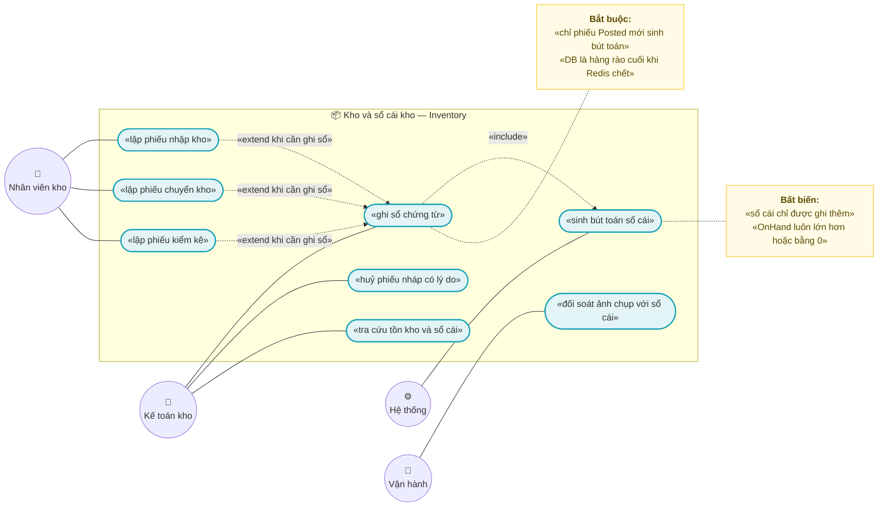
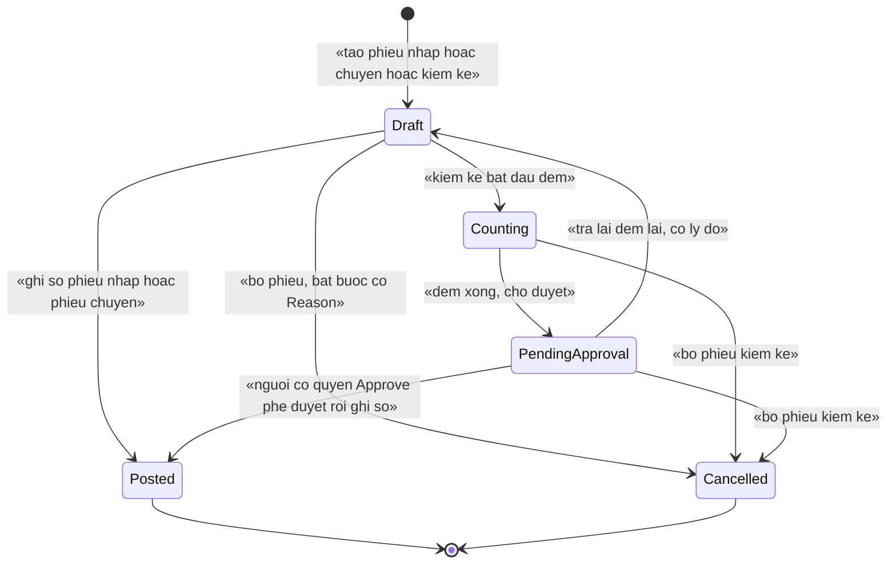
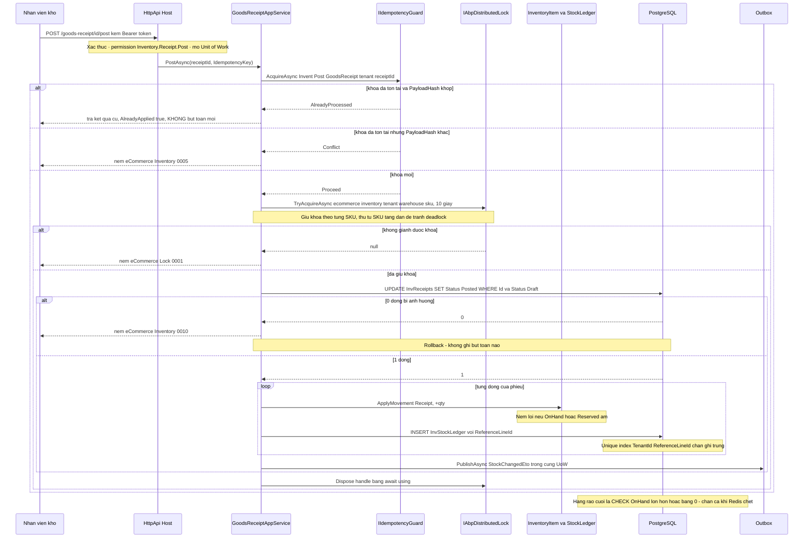

# `INV-001` — Nhập, chuyển, kiểm kê và sổ cái kho (append-only)

| Thuộc tính | Nội dung |
|---|---|
| **Mã** | `INV-001` |
| **Module** | **Inventory** — đề xuất tách `modules/Inventory/eCommerce.Inventory.Domain` · `.Application` · `.Application.Contracts` · `.EntityFrameworkCore`; entity hiện nằm ở `src/eCommerce.Domain/Entities/Inventory/StockLedger.cs` |
| **Giai đoạn** | **GĐ1 — Bán được** (`docs/implementation-plan.md:112`, `docs/implementation-plan.md:404`) |
| **Ưu tiên** | **Must have** |
| **Trạng thái** | 🟡 `Draft` — chờ review |
| **Người viết / người review** | *(điền)* / **Kiến trúc trưởng + BA + Kế toán kho** |
| **Phiên bản / ngày** | `v0.1 — 13/10/2026` |
| **Tài liệu liên quan** | `XC-001` (Money/làm tròn) · `XC-002` (outbox/inbox, idempotency, DLQ) · `XC-003` (khoá phân tán & quy ước tên khoá) · `XC-004` (xác thực/phân quyền/tenant) · `XC-005` (observability) · `INV-002` (giữ chỗ + TTL — ranh giới) · `INV-003` (phân bổ tồn theo kênh) · `CHN-004` (đẩy tồn đa kênh) · `SAL-003` (trạng thái đơn) · `REP-003` (báo cáo tồn kho) · `docs/implementation-plan.md` · `docs/structure-and-techstack.md` |

---

## 0. Tóm tắt & quyết định thiết kế

**Tóm tắt:** `INV-001` chốt **cách tồn kho thay đổi một cách có kiểm soát**: ba loại **chứng từ** (phiếu nhập kho, phiếu
chuyển kho, phiếu kiểm kê) và **một sổ cái kho chỉ được ghi thêm** (`InvStockLedger`). Chứng từ có vòng đời rõ ràng
(`Draft → Posted`), **chỉ khi ghi sổ (Posted)** mới sinh bút toán và mới cập nhật ảnh chụp tồn kho `InvItems`.
Điểm quan trọng nhất: **sổ cái là nguồn sự thật**, `InvItems` chỉ là **ảnh chụp để đọc nhanh** — chính ghi chú này
đã có sẵn trong code (`src/eCommerce.Domain/Entities/Inventory/StockLedger.cs:8`).

**Vì sao phải viết tài liệu này trước khi code (đã kiểm trong repo):**

| # | Sự thật đã kiểm bằng `read`/`grep` | Hệ quả |
|---|---|---|
| 1 | `InventoryItem`, `StockLedgerEntry` **đã có** (`StockLedger.cs:10,84`), có `DbSet` trên DbContext hợp nhất (`src/eCommerce.EntityFrameworkCore/eCommerceDbContext.cs:40-41`) và **đã có bảng thật** trong migration `20261009070214_Initial` (`InvItems`, `InvStockLedger`) | Khung dữ liệu đã sẵn — nhưng **0 dòng code nào ghi vào sổ cái** |
| 2 | `grep` toàn `src/` **+** `modules/` **+** `test/`: `ApplyMovement` chỉ xuất hiện **trong chính entity và test** (`test/eCommerce.Tests/Domain/OrderAndInventoryTests.cs:59-98`) | 🚨 **Chưa có app service, chưa có chứng từ, chưa có API** — đúng như `INV-002` §0 đã ghi nhận |
| 3 | **Không có** entity `Warehouse` trong code (`grep "class Warehouse"` = 0); `InventoryItem.WarehouseId` là `Guid` trần (`StockLedger.cs:14`). Kế hoạch có `Warehouse` (`docs/implementation-plan.md:179`) | Phải tạo mới — xem **ADR-01** |
| 4 | **Không có** `CHECK` nào trên `InvItems`/`InvStockLedger`: kiểm âm kho **chỉ** ở C# bằng `if (OnHand < 0 \|\| Reserved < 0)` (`StockLedger.cs:70-74`) | 🚨 `XC-003` D2 hỏi *"bỏ lock đi, DB có chặn không?"* ⇒ **hiện tại DB KHÔNG chặn** — xem **ADR-03**, `BR-021` |
| 5 | `StockMovementType` có 7 giá trị, **thiếu** giá trị cho **kiểm kê** và **thiếu** giá trị cho **chuyển kho đến/đi** (`src/eCommerce.Domain.Shared/Enums.cs:26-48`) | Phải mở rộng enum — xem **ADR-04** |
| 6 | `InventoryItem.ApplyMovement` chỉ nhận **độ lệch** (`quantityDelta`), **không** nhận **số tuyệt đối** (`StockLedger.cs:40`) | Kiểm kê cần "đếm ra 7 khi hệ thống ghi 10" ⇒ cần API mới, **không** được tự `OnHand = 7` từ tầng application |
| 7 | Khoá `eCommerceConsts.LockKeys.InventorySku(warehouseId, sku)` → `ecommerce:inventory:{warehouseId}:{sku}` (`src/eCommerce.Domain.Shared/eCommerceConsts.cs:103-104`) — **chưa nơi nào gọi** và **thiếu `tenantId`** | Dùng lại + ghi nhận **F3** (§15.2), đúng như `INV-002` §0 dòng 7 đã cảnh báo |
| 8 | `eCommerce.Permissions.Inventory.Adjust` **đã định nghĩa** (`eCommerceConsts.cs:27-31`, `eCommercePermissionDefinitionProvider.cs:34-35`) nhưng **0 method nào gắn** nó | Permission "mồ côi" — sẽ có method dùng ở §9 |
| 9 | **Không có** metric nào cho kho trong bảng đăng ký (`src/eCommerce.Domain.Shared/Observability/eCommerceMetrics.cs:13-53`) | Phải bổ sung registry `XC-005` §5.1 — xem §13 |
| 10 | `eCommerce.Kernel` (nơi `XC-001` đặt `Money`) **chưa tồn tại** trong solution: `src/` chỉ có 7 project app, **0** file chứa `eCommerce.Kernel`/`MoneyAllocator` | ⚠️ Không được viết code theo `Money` như đã có — xem **ADR-06** |

> **Vì sao tách "chứng từ" khỏi "bút toán":** nếu cho phép sửa `OnHand` trực tiếp thì **không có gì để đối soát**:
> kế toán kho không trả lời được *"vì sao tồn kho tháng này lệch 37 cái"*. Chứng từ + sổ cái append-only biến mọi
> thay đổi thành **một dòng có nguồn gốc, có người chịu trách nhiệm, có thời điểm**.

**Phạm vi:**
- ✅ Entity **`Warehouse`** (kho) + `DbSet` + migration (ADR-01).
- ✅ Ba loại **chứng từ**: `GoodsReceipt` (nhập), `StockTransfer` (chuyển), `Stocktake` (kiểm kê) + dòng chi tiết của từng loại.
- ✅ **Ghi sổ (post)** chứng từ ⇒ sinh `StockLedgerEntry` (**append-only**) + cập nhật **ảnh chụp** `InventoryItem`.
- ✅ **Bất biến sổ cái**: chỉ ghi thêm; **cấm** sửa/xoá; cơ chế chống ghi trùng ở tầng DB (ADR-05, `BR-002`).
- ✅ **Idempotency ở mọi biên vào** (ghi sổ, huỷ, kiểm kê, nhập hàng loạt) theo `XC-002` `BR-XC-002-004`.
- ✅ Khoá phân tán theo `(tenant, warehouse, sku)` cho mọi thao tác ghi + ràng buộc DB là chốt cuối (`XC-003` D2).
- ✅ Sự kiện phát ra `StockChangedEto` (trong cùng UoW, `useOutbox: true`).
- ✅ App service + permission + endpoint tra cứu sổ cái & tồn kho.

**Không nằm trong phạm vi:**
- ❌ **Giữ chỗ (reservation) + TTL + job nhả kho** — thuộc **`INV-002`**; `INV-001` **không** chạm `Reserved` của luồng giữ chỗ.
- ❌ **Phân bổ tồn theo kênh** (`AvailableToPromise`, `StockAllotment`) — thuộc **`INV-003`** và `CHN-004`.
- ❌ **Giá vốn / giá trị tồn kho / bút toán kế toán tiền** — thuộc **`ACC-001`** (chưa viết). `INV-001` ghi **số lượng** và
  **đơn giá để tra cứu**; **không** ghi bút toán kế toán, **không** tính giá vốn bình quân.
- ❌ **Đa kho theo pháp nhân / kho của đối tác 3PL** — ngoài GĐ1.
- ❌ **Saga điều phối nhiều bước có bù trừ** — thuộc `SAL-004`.
- ❌ **Màn hình UI** — thuộc `WEB-001`/`WEB-*`; tài liệu này chỉ chốt **hợp đồng dữ liệu cho UI** (§10).
- ❌ **Sửa/xoá bút toán sổ cái** — **vĩnh viễn không** nằm trong phạm vi (bất biến `BR-001`).

### 0.1 Quyết định thiết kế (ADR ngắn)

| # | Quyết định | Phương án đã cân nhắc | Lý do chọn | Hệ quả |
|---|---|---|---|---|
| **ADR-01** | **Tạo entity `Warehouse`** trong module Inventory; **giữ** `InventoryItem.WarehouseId` là `Guid` (không FK cứng) | (a) không có bảng kho, coi `WarehouseId` là Guid tự do · (b) **bảng `Warehouse` + Guid mềm** · (c) FK cứng `InvItems.WarehouseId → Warehouses.Id` | (a) **không thể** validate kho tồn tại/đang hoạt động ⇒ nhập kho vào Guid rác mà không ai biết · (c) FK cứng chặn việc tách module thành microservice ở GĐ4 và làm migration khó hơn khi seed/backfill | Thêm 1 bảng `InvWarehouses`; mọi thao tác ghi **phải** kiểm kho tồn tại + `IsActive`; `WarehouseId` vẫn là **tham chiếu mềm** (giống cách module tránh tham chiếu `src/`) |
| **ADR-02** | **Chứng từ + ghi sổ (post) là hai bước**; **chỉ `Posted` mới sinh bút toán** | (a) ghi thẳng bút toán khi tạo phiếu · (b) nháp → duyệt → ghi sổ | (a) nhân viên kho gõ nhầm số lượng là **tồn kho sai ngay**, không có chỗ sửa · (b) `Draft` sửa được tự do, `Posted` là **bất biến** ⇒ vừa linh hoạt vừa có chứng từ | Thêm cột `Status` + `PostedAtUtc`/`PostedBy`; `Draft` **không** ảnh hưởng tồn kho; `Posted` **cấm** sửa/xoá (`BR-024`) |
| **ADR-03** | **Ràng buộc DB là chốt cuối**: thêm `CHECK` cho `InvItems`/`InvStockLedger` | (a) chỉ kiểm trong domain (`StockLedger.cs:70`) · (b) chỉ tin lock Redis · (c) **CHECK ở DB + kiểm domain + lock** | `XC-003` D2: Redis chết ⇒ lock **vô hiệu** nhưng app **vẫn chạy** (`AbortOnConnectFail = false`, `src/eCommerce.HttpApi.Host/eCommerceHttpApiHostModule.cs:141`) ⇒ nếu bất biến chỉ dựa vào lock thì **sai dữ liệu âm thầm**. Hiện trạng: DB **không** chặn (`StockLedger.cs:70-74` chỉ so `< 0` trong bộ nhớ) | Migration phải **kiểm dữ liệu cũ trước** khi thêm CHECK (§11) — nếu đã có dòng âm thì migration **fail**, phải xử lý tay |
| **ADR-04** | **Mở rộng `StockMovementType`**: thêm `StocktakeGain`/`StocktakeLoss`/`TransferOut`/`TransferIn`, **giữ** các giá trị cũ | (a) dùng lại `Adjustment` cho cả kiểm kê và chuyển kho · (b) thêm 4 giá trị mới | (a) **không thể** viết báo cáo "hao hụt kiểm kê" vì `Adjustment` trộn hai nghiệp vụ khác nhau; cũng **không thể** chống ghi trùng bút toán chuyển kho (2 vế cùng 1 loại) | ⚠️ Giá trị enum lưu dạng `int` trong DB (`InvStockLedger."MovementType"`) ⇒ **chỉ được THÊM ở cuối** (`7,8,9,10`), **cấm** đổi số của 7 giá trị cũ (`Enums.cs:26-48`) |
| **ADR-05** | **Chống ghi trùng sổ cái bằng unique index** trên `(TenantId, ReferenceLineId)`, không bằng kiểm tra ở app | (a) app kiểm "đã ghi chưa" rồi mới ghi · (b) unique index trên `(TenantId, ReferenceType, ReferenceId, MovementType)` · (c) **unique index trên GUID dòng chứng từ** | (a) hai luồng cùng đọc ⇒ cùng ghi ⇒ **trùng** (đúng lỗi mà `XC-002` E7 sinh ra để chặn) · (b) **không đủ**: một phiếu chuyển kho sinh **2** bút toán cùng `(ReferenceId, MovementType = Transfer)` khi hai vế đều đi qua bộ nhớ ⇒ phải thêm cột phân biệt; dùng GUID dòng là **duy nhất theo thiết kế**, không phụ thuộc cách đánh số | Thêm cột **`ReferenceLineId` (`uuid`, nullable)** vào `InvStockLedger` + unique index có filter. Mỗi dòng chứng từ sinh **tối đa một** bút toán ⇒ ghi sổ lại là **no-op** ở tầng DB |
| **ADR-06** | **`INV-001` không dùng `Money`**; nếu có trường tiền thì dùng `decimal(18,4)` + `Currency char(3)` theo `XC-001` | (a) dùng `Money` của `eCommerce.Kernel` · (b) `decimal` trần | ✅ **Đã kiểm**: `eCommerce.Kernel` **chưa tồn tại** trong solution (`src/` chỉ có 7 project app, **0** file chứa `eCommerce.Kernel`) ⇒ viết code theo `Money` là viết theo thứ **chưa có**. Đồng thời `INV-001` là nghiệp vụ **số lượng** — không có phép tính tiền nào ở luồng chính | Mọi trường tiền **tuỳ chọn** (`UnitCost` trên dòng phiếu nhập) khai `decimal(18,4)`; **cấm** `double`/`float` (`BR-017`); khi `XC-001` xong ⇒ chuyển sang `Money` (việc riêng, có migration) |
| **ADR-07** | **Idempotency key ổn định** dạng `Invent:Post:{documentType}:{tenantId}:{documentId}` | (a) `Guid.NewGuid()` mỗi lần gọi · (b) khoá từ dữ liệu nghiệp vụ | `XC-002` `BR-XC-002-007`: khoá mới mỗi retry ⇒ **mỗi retry là một lần ghi sổ mới** ⇒ tồn kho tăng gấp đôi | Unique index `(TenantId, IdempotencyKey)` trên **bảng chứng từ**; retry **đọc lại** kết quả cũ, **không** sinh khoá mới |
| **ADR-08** | **Lock theo `(tenantId, warehouseId, sku)`**, chế độ `ThrowOnTimeout` cho HTTP, `SkipIfBusy` cho job/import | (a) lock theo cả kho (thô) · (b) theo SKU toàn hệ thống · (c) **theo (kho, SKU) trong tenant** | (a) một SKU bận ⇒ chặn **mọi** SKU khác của cùng kho ⇒ giảm thông lượng vô cớ · (b) tenant A chặn tenant B (`XC-003` D7 cấm) | Sửa `eCommerceConsts.LockKeys.InventorySku` để **có `tenantId`** (**F3**, §15.2) — ⚠️ đây là **thay đổi chuỗi khoá**, phải làm **trước** khi có instance chạy thật, nếu không sẽ tạo hai họ khoá song song đúng như lỗi **F1** của `XC-003` |
| **ADR-09** | **Ghi sổ bằng `UPDATE … WHERE Status = 'Draft'` + kiểm số dòng**, không đọc-rồi-ghi | (a) đọc entity, đổi `Status`, `SaveChanges` · (b) `ExecuteUpdateAsync` có điều kiện | (a) hai request ghi sổ đồng thời **cùng qua** bước đọc ⇒ sinh **2 bộ bút toán** (may mắn là ADR-05 chặn ở tầng sổ cái, nhưng tồn kho đã bị cộng 2 lần ở bảng ảnh chụp) · (b) đúng `XC-002` `BR-XC-002-008` | Mọi chuyển trạng thái chứng từ dùng `UPDATE … WHERE`; **0 dòng bị ảnh hưởng ⇒ NÉM LỖI** (`XC-002` E7) |
| **ADR-10** | **Đối soát định kỳ `InventoryItem` với `SUM(StockLedgerEntry)`** là bắt buộc, có metric | (a) tin vào code · (b) job đối soát + metric | `InventoryItem` là **ảnh chụp thứ hai** của cùng một sự thật (`StockLedger.cs:8`) ⇒ mọi ảnh chụp **sẽ** lệch; lệch tồn kho là lỗi **im lặng** và phá niềm tin vào số liệu | Job đối soát + metric `inventory_ledger_drift` (bổ sung registry `XC-005` §5.1); lệch ⇒ **cảnh báo**, **không** tự sửa |
| **ADR-11** | **Kiểm kê tách "đếm" và "duyệt" thành 2 quyền** (`Count` và `Approve`), ghi sổ là bước thứ ba | (a) một quyền `Adjust` cho tất cả · (b) tách quyền | Kiểm kê là **nơi dễ mất hàng nhất** (một người vừa đếm vừa duyệt vừa ghi sổ ⇒ có thể che thâm hụt). Tách quyền biến việc đó thành **không thể** về mặt kỹ thuật | Thêm permission `eCommerce.Inventory.Stocktake.Count` / `.Approve` / `.Post`; **ghi audit** cho cả 3 bước |
| **ADR-12** | **`StockChangedEto` phát trong cùng UoW với `useOutbox: true`** | (a) phát trực tiếp · (b) outbox | `XC-002` `BR-XC-002-001/002`: phát ngoài outbox ⇒ **dual-write** ⇒ `CHN-004` đẩy tồn lên sàn có thể chạy **trước khi** transaction commit (bán số hàng chưa hề tồn tại) | Phụ thuộc cấu hình `AbpDistributedEventBusOptions.Outboxes` của `XC-002` **phải bật tường minh**; nếu thiếu ⇒ rơi về dual-write **không báo lỗi** (`XC-002` D2) |

---

## 1. Use Case Specification

| Thuộc tính | Nội dung |
|---|---|
| **Use Case ID** | `INV-001` |
| **Use Case Name** | Nhập, chuyển, kiểm kê kho và ghi **sổ cái kho chỉ-ghi-thêm** |
| **Description** | *"Là nhân viên kho / kế toán kho, tôi muốn ghi nhận mọi thay đổi tồn kho bằng chứng từ có vòng đời và một sổ cái không thể sửa, để tồn kho luôn đối soát được với thực tế — và để không ai (kể cả lỗi phần mềm) âm thầm sửa được lịch sử kho."* |
| **Actor(s)** | **Nhân viên kho** (tạo/ghi sổ phiếu nhập, phiếu chuyển) · **Nhân viên kiểm kê** (đếm) · **Kế toán kho / quản lý** (duyệt kiểm kê, ghi sổ) · **Hệ thống** (bút toán, đối soát, phát sự kiện) · **Vận hành** (xem metric lệch sổ cái) |
| **Priority** | **Must have** — không có sổ cái thì các module sau (`INV-002` giữ chỗ, `INV-003` phân bổ, `REP-003` báo cáo) **không có nguồn sự thật** |
| **Trigger** | (a) hàng về kho ⇒ tạo phiếu nhập; (b) cần chuyển hàng giữa hai kho ⇒ tạo phiếu chuyển; (c) tới kỳ kiểm kê (hoặc phát hiện lệch) ⇒ tạo phiếu kiểm kê; (d) hàng bán bị trả lại ⇒ phiếu nhập loại `CustomerReturn` (nhận từ `SAL-003`); (e) job đối soát phát hiện lệch ảnh chụp với sổ cái |
| **Pre-Condition(s)** | • **Tenant hiện tại** (`TenantId` từ `ICurrentTenant`) — **bắt buộc**; `TenantId` rỗng ⇒ **NÉM** (`BR-020`).<br>• **Kho tồn tại và `IsActive = true`** trong tenant hiện tại (ADR-01) — cả kho nguồn **và** kho đích với phiếu chuyển.<br>• **SKU đã có** trong danh mục: `CatProductVariants.Sku`, max length **64** (`eCommerceDbContext.cs:122`, `:129`) — `INV-001` **không** tạo SKU.<br>• Phiếu ở trạng thái `Draft` (hoặc `Counting`/`PendingApproval` với kiểm kê) — **`Posted` không ghi sổ lại được** (`BR-024`).<br>• Đã bật outbox/inbox **tường minh** theo `XC-002` D2 (nếu thiếu ⇒ sự kiện rơi về **dual-write** mà không báo lỗi).<br>• Redis 7 sẵn sàng — **không** phải điều kiện sống còn: Redis chết ⇒ lock vô hiệu nhưng **DB vẫn chặn** (ADR-03).<br>• **`ChannelCode`**: **có** mặt khi biến động phát sinh từ một kênh bán (`"web"`, `"shopee"`…) và **không** áp dụng cho biến động nội bộ (nhập mua, chuyển kho, kiểm kê) — nhưng **vẫn là cột nullable** trên sổ cái để đối soát đa kênh (`StockLedger.cs:106`). |
| **Post-Condition(s)** | • Mỗi dòng chứng từ `Posted` có **đúng một** `StockLedgerEntry` — hàng rào là unique index `(TenantId, ReferenceLineId)` (ADR-05, `BR-002`).<br>• `InvItems.OnHand` **khớp** tổng `QuantityDelta` của sổ cái cho `(TenantId, WarehouseId, Sku)` (`NFR-007`).<br>• `OnHand >= 0` và `Reserved >= 0` **luôn đúng**, kể cả khi Redis chết (CHECK ở DB, `BR-021`).<br>• Phiếu `Posted` **bất biến**: không API nào sửa/xoá được (`BR-024`).<br>• Mỗi lần ghi sổ **có** bản ghi audit của ABP (ai, khi nào) (`BR-023`) và **có** `CorrelationId` trong log (`NFR-009`).<br>• `StockChangedEto` đã ghi **cùng transaction** với dữ liệu nghiệp vụ ⇒ **hoặc** cả hai cùng có, **hoặc** cả hai cùng không (`BR-022`). |
| **Basic Flow** | 1. Nhân viên kho tạo phiếu nhập: `POST /api/app/goods-receipt` (permission `eCommerce.Inventory.Receipt.Create`) với `IdempotencyKey` **ổn định** `Invent:Create:GoodsReceipt:{tenantId}:{clientDocumentKey}`.<br>2. App service gọi `IIdempotencyGuard.AcquireAsync` (`XC-002` `BR-XC-002-004`) ⇒ `Proceed` / `AlreadyProcessed` / `Conflict`.<br>3. Thêm dòng: mỗi dòng gọi `GoodsReceipt.AddLine(sku, quantity, unitCost)` — domain **NÉM LỖI** nếu `quantity <= 0` hoặc trùng `sku` (`BR-008`).<br>4. Nhân viên bấm **Ghi sổ**: `POST /api/app/goods-receipt/{id}/post` (permission `eCommerce.Inventory.Receipt.Post`).<br>5. App service **giành khoá** `ecommerce:inventory:{tenantId}:{warehouseId}:{sku}` cho **từng** `sku` theo thứ tự **sắp xếp tăng dần** (tránh deadlock), timeout **10 s**, chế độ `ThrowOnTimeout`.<br>6. Trong phạm vi khoá: `UPDATE InvReceipts SET Status = Posted WHERE Id = @id AND Status = Draft` — **kiểm số dòng bị ảnh hưởng**; `0` dòng ⇒ **NÉM** `eCommerce:Inventory:0010` (ADR-09).<br>7. Với mỗi dòng: `InventoryItem.ApplyMovement(Receipt, +qty)` **hoặc** tạo `InventoryItem` mới nếu chưa có — cả hai trong **cùng** transaction.<br>8. Chèn `StockLedgerEntry` cho **từng** dòng: `MovementType = Receipt`, `QuantityDelta = +qty`, `BalanceAfter` = `OnHand` sau biến động, `ReferenceType = "GoodsReceipt"`, `ReferenceId = receiptId`, `ReferenceLineId = lineId`.<br>9. Phát `StockChangedEto` qua `IDistributedEventBus` **trong cùng UoW, `useOutbox: true`** (`BR-022`).<br>10. Nhả khoá (`await using`) ⇒ commit UoW ⇒ **dữ liệu + sổ cái + outbox cùng sống hoặc cùng chết**.<br>11. Trả `GoodsReceiptDto` (`Status = Posted`, `PostedAtUtc`, `TotalQuantity`). |
| **Alternative Flow** | **A1: Hàng bán trả lại** — dùng **cùng** phiếu nhập với `ReceiptKind = CustomerReturn` ⇒ `MovementType = CustomerReturn`, `ReferenceType = "OrderReturn"`, `ReferenceId = orderReturnId` (nhận từ `SAL-003`); dòng chứng từ **vẫn** là `ReferenceLineId` của chính phiếu nhập.<br>**A2: Chuyển kho chưa nhận** — ghi sổ phát sinh **2** bút toán: `TransferOut` ở kho nguồn (`-qty`) **và** `TransferIn` ở kho đích (`+qty`) trong **cùng một** transaction (quyết định: **không** mô hình "hàng đang đi đường" ở GĐ1 — xem **Q2** §15.1) ⇒ tổng tồn hệ thống **không đổi**.<br>**A3: Kiểm kê có lệch** — `StocktakeLine.CountedQuantity != SystemQuantity` ⇒ khi ghi sổ sinh **2** bút toán cho dòng đó: đảo phần hệ thống (`StocktakeLoss`, `-SystemQuantity` nếu hệ thống cao hơn) rồi ghi phần đếm được (`StocktakeGain`, `+CountedQuantity`) — **tuyệt đối không** gán `OnHand = CountedQuantity` (xem `BR-009`).<br>**A4: Kiểm kê lệch bằng 0** — dòng `CountedQuantity == SystemQuantity` ⇒ **không** sinh bút toán nào (`BR-009` cấm bút toán 0) và **vẫn** được đánh dấu đã ghi sổ.<br>**A5: Bỏ phiếu** — `Draft → Cancelled`, **bắt buộc** có `Reason`; **không** sinh bút toán, **không** ảnh hưởng tồn kho (`BR-019`).<br>**A6: Nhập hàng loạt từ file** — job `SkipIfBusy`: không giành được khoá ⇒ **bỏ qua** dòng đó, ghi log `Information` + metric `lock_skipped_total{module=inventory}`; **không** ném lỗi (`XC-003` D10). |
| **Exception Flow** | **E1:** SKU/kho không tồn tại hoặc kho `IsActive = false` ⇒ `BusinessException` **`eCommerce:Inventory:0002`**.<br>**E2:** phiếu không tồn tại **hoặc thuộc tenant khác** ⇒ **`eCommerce:Inventory:0003`** + HTTP **`404`** (**không** `403` — `XC-004` `BR-XC-004-008`).<br>**E3:** ghi sổ phiếu **không** ở trạng thái `Draft` (ví dụ đã `Posted`, hoặc kiểm kê chưa `Approved`) ⇒ **`eCommerce:Inventory:0004`** — **cấm** no-op im lặng (quy ước #11 dự án).<br>**E4:** biến động làm `OnHand < 0` hoặc `Reserved < 0` ⇒ **`eCommerce:Inventory:0001`** (`InsufficientStock`, **đã có** ở `eCommerceConsts.cs:79`) + rollback; nếu lọt tới DB ⇒ CHECK ném `PostgresException` ⇒ app **bọc** thành `0001` (ADR-03).<br>**E5:** cùng `IdempotencyKey` nhưng `PayloadHash` **khác** ⇒ **`eCommerce:Inventory:0005`** (`XC-002` `BR-XC-002-006`).<br>**E6:** `UPDATE … WHERE Status = …` ảnh hưởng **0 dòng** ⇒ **NÉM** **`eCommerce:Inventory:0010`** — **cấm** coi là thành công (`XC-002` E7).<br>**E7:** không giành được khoá trong timeout ⇒ **`eCommerce:Lock:0001`** (`XC-003` §6.2) — **không** tạo mã riêng cho Inventory.<br>**E8:** phiếu chuyển có kho nguồn **=** kho đích ⇒ **`eCommerce:Inventory:0006`** (lỗi tham số, không phải lỗi nghiệp vụ).<br>**E9:** ghi sổ lại phiếu đã `Posted` với cùng khoá ⇒ **không phải lỗi**: `IIdempotencyGuard` trả `AlreadyProcessed` + `PayloadHash` khớp ⇒ trả kết quả cũ (`AlreadyApplied = true`), **0** bút toán mới (`BR-003`).<br>**E10:** dòng kiểm kê có `CountedQuantity < 0` ⇒ **`eCommerce:Inventory:0007`**. |
| **Business Rules** | Xem **§8.1** — **24 BR** (`BR-001`…`BR-024`) phát biểu đầy đủ ở đó (tránh lặp hai nơi, theo cách làm của `INV-002`). |
| **Non-Functional Requirement** | Xem **§13** — **12 NFR** (`NFR-001`…`NFR-012`). |

> **Ghi chú về `TenantId` + `ChannelCode` (theo mẫu §1):** Pre-condition **bắt buộc** ghi `TenantId` — mọi chứng từ,
> mọi bút toán, mọi khoá lock đều thuộc một tenant (`BR-020`). `ChannelCode` **có** mặt với biến động từ kênh bán
> (`Sale`, `CustomerReturn` của đơn sàn) và **không** áp dụng cho biến động nội bộ (`Receipt` mua hàng, `Transfer*`,
> `Stocktake*`) — nhưng **vẫn là cột** (nullable) để `REP-003`/`CHN-004` đối soát theo kênh.

---

## 2. Sơ đồ Use Case



### Chú giải

| Ký hiệu | Ý nghĩa |
|---|---|
| ⭕ Xanh lá | Actor (người dùng + hệ thống) |
| 🟦 Bầu dục xanh dương | Use Case |
| 🟨 Khung vàng | Note (bất biến / quy tắc bắt buộc) |
| `───` | Liên kết Actor ↔ Use Case |
| `-.«include».->` | Quan hệ bao hàm |
| `-.«extend khi …».->` | Quan hệ mở rộng (chỉ xảy ra ở nhánh đó) |

---

## 3. Sơ đồ trạng thái (state machine)

> Ba chứng từ dùng **cùng một khuôn** `Draft → (Counting → PendingApproval) → Posted`, cộng nhánh `Cancelled`.
> Chỉ **kiểm kê** đi qua `Counting`/`PendingApproval` (ADR-11). Sơ đồ dưới vẽ **một** state machine chung —
> phần khác nhau được ghi rõ ở bảng guard.



**Bảng chuyển trạng thái & guard (mọi chuyển sai **phải ném lỗi**, không im lặng):**

| # | Từ → Sang | Guard (điều kiện cho phép) | Hành động kèm theo | Nếu guard sai |
|---|---|---|---|---|
| 1 | `[*] → Draft` | Có `TenantId` + `WarehouseId` (kho tồn tại, `IsActive`); ≥ **1** dòng; mọi dòng `Quantity > 0`; `IdempotencyKey` mới hoặc trùng-khớp-hash | Ghi chứng từ + dòng; **KHÔNG** chạm `InvItems`, **KHÔNG** sinh bút toán | Kho/SKU sai ⇒ **`0002`**; `Quantity <= 0` ⇒ `ArgumentException` (lỗi lập trình); trùng khoá khác hash ⇒ **`0005`** |
| 2 | `Draft → Posted` (nhập / chuyển) | `UPDATE … WHERE Id = @id AND Status = 'Draft'` ảnh hưởng **≥ 1** dòng; đã giành đủ khoá `(tenant, warehouse, sku)` | Sinh bút toán cho **từng** dòng (`Receipt`/`CustomerReturn` hoặc `TransferOut`+`TransferIn`); cập nhật `InvItems`; `PostedAtUtc`/`PostedBy`; phát `StockChangedEto` | `0` dòng ⇒ **NÉM `0010`** (bị luồng khác ghi sổ hoặc đã `Posted`); hết khoá ⇒ **`eCommerce:Lock:0001`** |
| 3 | `Draft → Counting` | **Chỉ** phiếu kiểm kê; đã chốt **ảnh chụp hệ thống** (`SystemQuantity`) cho mọi dòng **tại thời điểm bắt đầu đếm** | Ghi `SystemQuantity` + `CountStartedAtUtc` | Thiếu ảnh chụp ⇒ **NÉM `0010`** — *không* được đọc `OnHand` sống khi ghi sổ (xem `BR-009` giải thích) |
| 4 | `Counting → PendingApproval` | Mọi dòng có `CountedQuantity` (**kể cả 0**) | Ghi `CountedAtUtc`/`CountedBy`; audit | Dòng thiếu số đếm ⇒ **NÉM `0010`** |
| 5 | `PendingApproval → Posted` | Người gọi có permission `…Stocktake.Approve` **và** `UPDATE … WHERE Status = 'PendingApproval'` ảnh hưởng **≥ 1** dòng | Sinh bút toán `StocktakeGain`/`StocktakeLoss` cho **từng** dòng lệch; cập nhật `InvItems`; `ApprovedBy` + `PostedBy` (**hai** cột, có thể **khác** người); phát `StockChangedEto` | Không đủ quyền ⇒ **`403`** (`XC-004` E2); `0` dòng ⇒ **NÉM `0010`** |
| 6 | `PendingApproval → Draft` | Có `Reason` không rỗng | Xoá `CountedQuantity` của mọi dòng; audit | Thiếu `Reason` ⇒ **NÉM `0004`** |
| 7 | `Draft`/`Counting`/`PendingApproval → Cancelled` | Có `Reason` không rỗng (`BR-019`) | Ghi `CancelledAtUtc`/`CancelReason`; **KHÔNG** sinh bút toán, **KHÔNG** chạm `InvItems` | Thiếu `Reason` ⇒ **NÉM `0004`** |
| 8 | `Posted → bất kỳ` | **KHÔNG** có guard nào cho phép | — | 🚫 **Trạng thái hấp thụ**: mọi chuyển dịch khỏi `Posted` ⇒ **NÉM `0004`**. Muốn sửa ⇒ tạo **phiếu đảo** (bút toán mới), **không** sửa phiếu cũ (`BR-001`, `BR-024`) |
| 9 | `Cancelled → bất kỳ` | **KHÔNG** có guard nào cho phép | — | **Hấp thụ** ⇒ **NÉM `0004`** |

> ⚠️ **Vì sao `Stocktake` phải chốt `SystemQuantity` ở bước 3 (guard #3) — đây là chỗ dễ sai nhất:**
> nếu lúc ghi sổ mới đọc `OnHand` sống để tính độ lệch thì giữa lúc **đếm** và lúc **duyệt** có thể đã có
> phiếu nhập/xuất khác ⇒ độ lệch tính ra **sai** và tồn kho bị **điều chỉnh hai lần** (một lần bởi nghiệp vụ
> thật, một lần bởi kiểm kê). Đây đúng loại lỗi "guard im lặng" mà `XC-002` §0 bài học #4 đã cảnh báo.
> Hệ quả bắt buộc: `PendingApproval → Posted` **luôn** ghi `CountedQuantity - SystemQuantity` (**hiệu của ảnh chụp**),
> **không** ghi `CountedQuantity - OnHand`.
>
> **Ai được phép chuyển:** `[*] → Draft` do **app service** (permission `…Create`); `Draft → Posted` do **app service**
> (`…Post`); `Draft → Counting`/`Counting → PendingApproval` do **nhân viên kiểm kê** (`…Stocktake.Count`);
> `PendingApproval → Posted` do **người có `…Stocktake.Approve`**; `→ Cancelled` do **app service** (`…Cancel`, có `Reason`).
> **Trạng thái hấp thụ:** `Posted` và `Cancelled`.

---

## 4. Sequence Diagram & luồng dữ liệu

### 4.1 Ghi sổ phiếu nhập kho — 3 tầng bảo vệ + sổ cái append-only



### 4.2 Ba sơ đồ là đủ — lý do không vẽ thêm

Tài liệu giới hạn **tối đa 3 sơ đồ**. **Use Case** (§2), **State machine** (§3) và **sequence ghi sổ** (§4.1) đã phủ:
ai làm gì, vòng đời ba loại chứng từ, và đường đi đầy đủ của một lần ghi sổ (kể cả hai nhánh lỗi quan trọng nhất).
**DFD riêng** trùng thông tin với §4.1; **ERD riêng** được thay bằng bảng quan hệ ở **§5.1** + **Data Dictionary §5.2**
(bảng đầy đủ hơn sơ đồ vì có ràng buộc và index). Đây là lựa chọn có ý thức, không phải bỏ sót.

---

## 5. Mô hình dữ liệu

### 5.1 ERD

**Không vẽ ERD bằng Mermaid — lý do:** đã dùng đủ **3 sơ đồ** (§2, §3, §4.1). Quan hệ dữ liệu mô tả bằng bảng:

| Từ | Quan hệ | Đến | Ghi chú |
|---|---|---|---|
| `Warehouse` | 1 — n | `GoodsReceipt` / `StockTransfer` / `Stocktake` | qua `WarehouseId`; **có** FK cứng (cùng module, cùng aggregate boundary) |
| `GoodsReceipt` | 1 — n | `GoodsReceiptLine` | FK cứng, `OnDelete(Cascade)` — giống cách `Order` ↔ `OrderLine` đang map (`eCommerceDbContext.cs:188-191`) |
| `StockTransfer` | 1 — n | `StockTransferLine` | như trên |
| `Stocktake` | 1 — n | `StocktakeLine` | như trên |
| mỗi **dòng chứng từ** | 1 — 0..1 | `StockLedgerEntry` | qua `ReferenceLineId` = `Id` của dòng; **không** FK cứng (sổ cái là **nhật ký**, cấm ràng buộc làm chậm ghi) |
| `InventoryItem` | 1 — n | `StockLedgerEntry` | qua `(TenantId, WarehouseId, Sku)`; **ảnh chụp**, không FK cứng |
| `StockLedgerEntry` | n — 0..1 | `Order` / `OrderReturn` (Sales, app) | qua `ReferenceType` + `ReferenceId` — **tham chiếu mềm**: module **cấm** tham chiếu `src/` (quy ước #3) |

> 📌 **Cố ý KHÔNG khai báo FK cứng** từ sổ cái sang `Order`/`OrderReturn`: module không được tham chiếu app, và FK cứng
> sẽ chặn việc tách module thành service ở GĐ4. `ReferenceType` + `ReferenceId` là **tham chiếu mềm** — cùng cách
> `INV-002` §5.1 đã chọn cho `OrderId`.

### 5.2 Bảng & cột (Data Dictionary)

#### 5.2.1 Entity **ĐÃ CÓ** `InventoryItem` → bảng `InvItems` — **thay đổi đề xuất**

Hiện trạng đã kiểm: `InvItems` có **16** cột = **14** cột do migration khai (`20261009070214_Initial:133-156`)
+ **2** cột do ABP thêm khi `ConfigureByConvention()` (`ExtraProperties`, `ConcurrencyStamp`), unique index
`(TenantId, WarehouseId, Sku)` **đã** `NULLS NOT DISTINCT` (`migration 20261013024226_Fix_NullableTenantId_UniqueIndexes.cs:48-50`),
`OnHand`/`Reserved` là `integer NOT NULL`, `Available` là property tính ra (`StockLedger.cs:25`).

| Hạng mục | Hiện trạng (đã kiểm) | Đề xuất `INV-001` | Lý do |
|---|---|---|---|
| Cột `OnHand`, `Reserved` | `int`, setter **private** (`StockLedger.cs:19,22`) | **giữ** | đã đúng — cấm tầng application gán trực tiếp |
| `Available` | computed `OnHand - Reserved` (`StockLedger.cs:25`) | **giữ** | đã đúng, không lưu cột (giữ **một chiều** dữ liệu, cùng triết lý `XC-001` D5) |
| Ràng buộc âm kho | **chỉ** trong C#: `if (OnHand < 0 \|\| Reserved < 0)` (`StockLedger.cs:70-74`) | ➕ **CHECK `"OnHand" >= 0 AND "Reserved" >= 0`** | 🚨 **`BR-021`** — đây là **chốt cuối** khi Redis chết (ADR-03). Hiện tại DB **không** chặn |
| Đồng bộ hoá lạc quan | `ConcurrencyStamp varchar(40)` của ABP (`Initial:144`) — **không** phải token concurrency ở tầng DB | ➕ **`xmin` làm concurrency token** (`UseXminAsConcurrencyToken`) | `XC-002` `BR-XC-002-008` yêu cầu guard ở **tầng DB**; `ConcurrencyStamp` chỉ hiệu lực nếu EF gửi kèm trong `WHERE` |
| Phương thức biến động | `ApplyMovement(type, quantityDelta)` (`StockLedger.cs:40`) | ➕ `ApplyMovement` **giữ nguyên** + thêm overload **theo số tuyệt đối** cho kiểm kê | Kiểm kê cần "đếm ra 7 khi hệ thống ghi 10" ⇒ `delta = Counted − System`, **không** gán `OnHand = 7` từ ngoài (ADR-04) |
| Unique index | `(TenantId, WarehouseId, Sku)` — **đã** `NULLS NOT DISTINCT` | **giữ** | đã đúng |

#### 5.2.2 Entity **ĐÃ CÓ** `StockLedgerEntry` → bảng `InvStockLedger` — **thay đổi đề xuất**

Hiện trạng đã kiểm: **14** cột do migration khai + **2** cột ABP (`ExtraProperties`, `ConcurrencyStamp`) (`Initial:158-185`); `ReferenceType varchar(64)`, `ReferenceId varchar(128)`,
`ChannelCode varchar(32)`, `Note varchar(2048)`, `Sku varchar(64)`;
**2 index tra cứu** `(TenantId, WarehouseId, Sku, OccurredAtUtc)` và `(TenantId, ChannelCode, OccurredAtUtc)`
(`eCommerceDbContext.cs:156,159`); **KHÔNG** có unique index và **KHÔNG** có CHECK nào.

| Hạng mục | Hiện trạng (đã kiểm) | Đề xuất `INV-001` | Lý do |
|---|---|---|---|
| Bảng | `InvStockLedger` (`eCommerceDbContext.cs:146`) | **giữ nguyên tên** | đã có dữ liệu/ migration; đổi tên = rủi ro vô ích |
| ➕ `ReferenceLineId` | **CHƯA CÓ** | `uuid NULL` | **ADR-05** — neo bút toán vào **dòng chứng từ**, cho phép unique index chống ghi trùng. `ReferenceId` (`varchar(128)`) **không** đủ vì phiếu chuyển sinh 2 bút toán cùng `ReferenceId` |
| Unique index | **KHÔNG CÓ** | ➕ **UNIQUE `(TenantId, ReferenceLineId)` WHERE `ReferenceLineId IS NOT NULL`**, `NULLS NOT DISTINCT` | **`BR-002`** — hàng rào **thật** chống ghi trùng bút toán. ⚠️ EF Core **không** mô hình hoá `NULLS NOT DISTINCT` ⇒ **SQL thô** trong migration (đúng cách `migration 20261013024226` đã làm) |
| ➕ CHECK `QuantityDelta <> 0` | **KHÔNG CÓ** | ➕ `CHECK ("QuantityDelta" <> 0)` | **`BR-009`** — cấm bút toán 0 đồng (kiểm kê không lệch ⇒ **không** ghi bút toán) |
| ➕ CHECK `BalanceAfter >= 0` | **KHÔNG CÓ** | ➕ `CHECK ("BalanceAfter" >= 0)` | `BR-021` — số dư sau biến động không bao giờ âm; là **lưới an toàn thứ hai** cho bảng nhật ký |
| Cột `Note` | `varchar(2048)`, setter **public** (`StockLedger.cs:110`) | ➕ đổi thành `private set` + chỉ gán trong constructor | **`BR-001`** — append-only: property `public set` là đường sửa bút toán cũ **qua API**; hiện tại nó tồn tại ⇒ đây là **lỗ hổng thiết kế thật**, xem **F1** §15.2 |
| `MovementType` | `int` (enum `StockMovementType`) | ➕ **thêm 4 giá trị ở CUỐI** enum | ADR-04 — `Receipt=0`…`Transfer=6` (`Enums.cs:28-48`) **không được** đổi số |
| Đơn giá / thành tiền | **KHÔNG CÓ** | **giữ là KHÔNG CÓ** | Giá trị tồn kho thuộc `ACC-001` (ngoài phạm vi). Đơn giá nằm trên **dòng phiếu nhập** (§5.2.3), **không** trên sổ cái ⇒ sổ cái thuần **số lượng**, đổi đơn giá **không** phải sửa nhật ký |

#### 5.2.3 Bốn entity **MỚI** — toàn bộ là thiết kế đề xuất (🆕 **chưa có trong code — kế hoạch GĐ1**)

**Bảng `InvWarehouses`** (ADR-01) — *danh mục kho*

| Cột | Kiểu | Null? | Ý nghĩa | Ghi chú |
|---|---|---|---|---|
| `Id` | `uuid` | ✖ | PK | `FullAuditedAggregateRoot<Guid>` |
| `TenantId` | `uuid` | ✔ | tenant sở hữu | **BẮT BUỘC có giá trị** ở tầng ứng dụng (`BR-020`); unique index phải `NULLS NOT DISTINCT` (`XC-004` `BR-XC-004-009`) |
| `Code` | `varchar(32)` | ✖ | mã kho (`WH-HN-01`) | unique theo tenant |
| `Name` | `varchar(256)` | ✖ | tên kho | |
| `Address` | `varchar(512)` | ✔ | địa chỉ | |
| `IsActive` | `boolean` | ✖ | kho còn dùng | mặc định `true`; kho `IsActive = false` ⇒ **`0002`** khi ghi sổ |
| `IsDefault` | `boolean` | ✖ | kho mặc định | **tối đa một** kho mặc định mỗi tenant (partial unique index) |
| trường audit | — | — | `CreationTime`/`CreatorId`/… | `FullAuditedAggregateRoot` |

**Bảng `InvReceipts` + `InvReceiptLines`** — *phiếu nhập kho*

| Cột (`InvReceipts`) | Kiểu | Null? | Ý nghĩa | Ghi chú |
|---|---|---|---|---|
| `Id` | `uuid` | ✖ | PK | |
| `TenantId` | `uuid` | ✔ | tenant | `BR-020` |
| `Number` | `varchar(64)` | ✖ | số phiếu | unique theo tenant |
| `WarehouseId` | `uuid` | ✖ | kho nhập | FK cứng → `InvWarehouses` |
| `ReceiptKind` | `int` | ✖ | `Purchase=0` · `CustomerReturn=1` · `Production=2` · `Other=9` | quyết định `MovementType` khi ghi sổ |
| `Status` | `int` | ✖ | `Draft=0` · `Posted=1` · `Cancelled=2` | §3 |
| `SupplierName` | `varchar(256)` | ✔ | nhà cung cấp | |
| `ChannelCode` | `varchar(32)` | ✔ | kênh (nếu hàng trả về từ kênh) | khớp `StockLedgerEntry.ChannelCode` (`eCommerceDbContext.cs:152`) |
| `ReferenceType` / `ReferenceId` | `varchar(64)` / `varchar(128)` | ✔ | chứng từ gốc (`OrderReturn`…) | tham chiếu **mềm**, không FK |
| `IdempotencyKey` | `varchar(256)` | ✖ | khoá chống trùng **ổn định** | `Invent:Create:GoodsReceipt:{tenantId}:{clientDocumentKey}` (**ADR-07**) |
| `PayloadHash` | `varchar(64)` | ✖ | SHA-256 payload chuẩn hoá | khác hash ⇒ **`0005`** |
| `PostedAtUtc` / `PostedBy` | `timestamptz` / `uuid` | ✔ | **bắt buộc** khi `Status = Posted` | `BR-023` audit |
| `CancelledAtUtc` / `CancelReason` | `timestamptz` / `varchar(512)` | ✔ | **bắt buộc** khi `Status = Cancelled` | `BR-019` |
| trường audit + `xmin` | — | — | kiểm toán + concurrency | |

| Cột (`InvReceiptLines`) | Kiểu | Null? | Ý nghĩa | Ghi chú |
|---|---|---|---|---|
| `Id` | `uuid` | ✖ | PK — **chính là `ReferenceLineId`** của bút toán | **ADR-05** |
| `ReceiptId` | `uuid` | ✖ | FK → `InvReceipts` | `OnDelete(Cascade)` |
| `Sku` | `varchar(64)` | ✖ | SKU | khớp `CatProductVariants.Sku` (`eCommerceDbContext.cs:122`) |
| `Quantity` | `int` | ✖ | số lượng nhập | `> 0`, **bất biến** sau khi tạo (`BR-008`) |
| `UnitCost` | `numeric(18,4)` | ✔ | đơn giá nhập (tra cứu) | ⚠️ **`decimal`, KHÔNG BAO GIỜ `double`** (`BR-017`); **không** dùng để tính giá vốn trong `INV-001` |
| `UnitCostCurrency` | `char(3)` | ✔ | mã ISO-4217 **HOA** | quy ước `XC-001` §5.2; chỉ khi `UnitCost` có giá trị |
| `Note` | `varchar(512)` | ✔ | ghi chú dòng | |

**Bảng `InvTransfers` + `InvTransferLines`** — *phiếu chuyển kho*

Khác phiếu nhập ở 4 điểm: `FromWarehouseId` + `ToWarehouseId` (**cả hai** FK cứng), `Status` có **5** giá trị
(`Draft=0` · `Posted=1` · `Cancelled=2`), và **`IdempotencyKey`** = `Invent:Create:StockTransfer:{tenantId}:{clientDocumentKey}`.
Dòng có `Sku` + `Quantity > 0`. Khi ghi sổ sinh **2** bút toán / dòng: `TransferOut` (kho nguồn, `-qty`) và
`TransferIn` (kho đích, `+qty`) — **cùng** transaction (A2). CHECK bắt buộc: `"FromWarehouseId" <> "ToWarehouseId"` (`BR-018`).

**Bảng `InvStocktakes` + `InvStocktakeLines`** — *phiếu kiểm kê*

| Cột (`InvStocktakeLines`) | Kiểu | Null? | Ý nghĩa | Ghi chú |
|---|---|---|---|---|
| `Id` | `uuid` | ✖ | PK — `ReferenceLineId` | sinh **tối đa 2** bút toán (A3) ⇒ xem lưu ý index bên dưới |
| `StocktakeId` | `uuid` | ✖ | FK → `InvStocktakes` | |
| `Sku` | `varchar(64)` | ✖ | SKU | unique `(StocktakeId, Sku)` |
| `SystemQuantity` | `int` | ✖ | **ảnh chụp** tồn kho lúc bắt đầu đếm | **bất biến**; guard #3 §3 |
| `CountedQuantity` | `int` | ✔ | số đếm thực tế | `>= 0` (`BR-010`); NULL = chưa đếm |
| `Variance` | *(tính ra)* | — | `CountedQuantity − SystemQuantity` | **KHÔNG lưu cột** |
| `CountedAtUtc` / `CountedBy` | `timestamptz` / `uuid` | ✔ | ai đếm, khi nào | `BR-023` |

> 🚨 **Lưu ý thiết kế quan trọng (A3 vs ADR-05):** một dòng kiểm kê lệch cần **2** bút toán (đảo phần hệ thống + ghi phần
> đếm được) — mà unique index ADR-05 chỉ cho **1** bút toán cho mỗi `ReferenceLineId`. **Cách giải:** bút toán thứ hai
> neo vào **cùng** `ReferenceLineId` nhưng dùng `ReferenceId` mở rộng có hậu tố `#counted`, và unique index được khai
> là **`(TenantId, ReferenceLineId, MovementType)`**. Vì hai bút toán của một dòng lệch **luôn khác `MovementType`**
> (`StocktakeLoss` vs `StocktakeGain`), index vẫn chặn được ghi trùng mà **không** cần cột phụ.
> ⚠️ **Hệ quả:** `BR-002` phải phát biểu là *"tối đa một bút toán cho mỗi **(dòng chứng từ, loại biến động)**"* —
> đúng cách `INV-002` `BR-09` đã phát biểu. Đây là chỗ **dễ hiểu sai** khi code, đã ghi thành **Q5** (§15.1).

**Index & ràng buộc** *(đề xuất — EF + SQL thô khi cần; `NULLS NOT DISTINCT` bắt buộc theo `XC-004` `BR-XC-004-009`)*

| Bảng | Loại | Cột / biểu thức | Mục đích |
|---|---|---|---|
| `InvWarehouses` | UNIQUE **NND** | `(TenantId, Code)` | chống trùng mã kho |
| `InvWarehouses` | UNIQUE **có filter NND** | `(TenantId) WHERE "IsDefault"` | **tối đa một** kho mặc định mỗi tenant |
| `InvReceipts` | UNIQUE **NND** | `(TenantId, Number)` | chống trùng số phiếu |
| `InvReceipts` | UNIQUE **NND** | `(TenantId, IdempotencyKey)` | **hàng rào idempotency** (`BR-003`, ADR-07) |
| `InvReceipts` | INDEX | `(TenantId, WarehouseId, Status, CreationTime)` | danh sách phiếu theo kho |
| `InvReceiptLines` | UNIQUE | `(ReceiptId, Sku)` | cấm hai dòng cùng SKU trong một phiếu (`BR-008`) |
| `InvTransfers` | UNIQUE **NND** | `(TenantId, Number)`, `(TenantId, IdempotencyKey)` | như trên |
| `InvTransfers` | CHECK | `"FromWarehouseId" <> "ToWarehouseId"` | `BR-018` |
| `InvStocktakes` | UNIQUE **NND** | `(TenantId, Number)`, `(TenantId, IdempotencyKey)` | như trên |
| `InvStocktakes` | INDEX | `(TenantId, WarehouseId, Status)` | job/ màn hình kiểm kê đang mở |
| `InvStocktakeLines` | UNIQUE | `(StocktakeId, Sku)` | cấm hai dòng cùng SKU |
| `InvStocktakeLines` | CHECK | `"CountedQuantity" IS NULL OR "CountedQuantity" >= 0` | `BR-010` |
| `InvStocktakeLines` | CHECK | `"Status" <> 'Posted' OR "CountedQuantity" IS NOT NULL` | không ghi sổ dòng chưa đếm |
| `InvStocktakeLines` | CHECK | `"CountedQuantity" IS NULL OR "CountedAtUtc" IS NOT NULL` | `BR-023` |
| `InvReceipts`/`InvTransfers`/`InvStocktakes` | CHECK | `"Status" <> 'Posted' OR ("PostedAtUtc" IS NOT NULL AND "PostedBy" IS NOT NULL)` | `BR-023` — không có trạng thái `Posted` "vô chủ" |
| `InvReceipts`/`InvTransfers`/`InvStocktakes` | CHECK | `"Status" <> 'Cancelled' OR "CancelReason" IS NOT NULL` | `BR-019` |
| `InvStockLedger` | UNIQUE **NND có filter** | `(TenantId, ReferenceLineId, MovementType) WHERE "ReferenceLineId" IS NOT NULL` | **`BR-002`** — hàng rào chống ghi trùng bút toán (**ADR-05**) |
| `InvStockLedger` | CHECK | `"QuantityDelta" <> 0` | `BR-009` |
| `InvStockLedger` | CHECK | `"BalanceAfter" >= 0` | `BR-021` |
| `InvItems` | CHECK | `"OnHand" >= 0 AND "Reserved" >= 0` | **`BR-021`** — chốt cuối khi Redis chết (ADR-03) |
| `InvStockLedger` | *(đã có)* INDEX | `(TenantId, WarehouseId, Sku, OccurredAtUtc)`, `(TenantId, ChannelCode, OccurredAtUtc)` | giữ nguyên (`eCommerceDbContext.cs:156,159`) |

> 📌 **Quy ước dự án:** mọi index phục vụ **idempotency/chống trùng** phải nêu rõ ở đây (`design-doc-guidelines.md` §5
> quy tắc 5) vì đó là **hàng rào cuối cùng khi tầng ứng dụng sai**. Bảng trên có **4** index loại đó:
> `(TenantId, IdempotencyKey)` × 3 bảng chứng từ + `(TenantId, ReferenceLineId, MovementType)` trên sổ cái.

---

## 6. Hợp đồng API

### 6.1 Application Service (module Inventory)

```csharp
namespace eCommerce.Inventory;

/// Hợp đồng kho. Mọi method GHI đều idempotent và mọi lỗi có MÃ (quy ước #11).
/// [Authorize] ở CẤP CLASS theo XC-004 BR-XC-004-001 (D3).
[Authorize(eCommerceConsts.Permissions.Inventory.Default)]
public interface IInventoryAppService : IApplicationService
{
    // ---- chứng từ nhập ----
    Task<GoodsReceiptDto> CreateReceiptAsync(CreateGoodsReceiptDto input);
    Task<GoodsReceiptDto> PostReceiptAsync(PostDocumentDto input);
    Task<GoodsReceiptDto> CancelReceiptAsync(CancelDocumentDto input);

    // ---- chứng từ chuyển ----
    Task<StockTransferDto> CreateTransferAsync(CreateStockTransferDto input);
    Task<StockTransferDto> PostTransferAsync(PostDocumentDto input);

    // ---- chứng từ kiểm kê ----
    Task<StocktakeDto> CreateStocktakeAsync(CreateStocktakeDto input);
    Task<StocktakeDto> StartCountingAsync(Guid stocktakeId);
    Task<StocktakeDto> RecordCountsAsync(RecordStocktakeCountsDto input);
    Task<StocktakeDto> ApproveStocktakeAsync(Guid stocktakeId);   // quyen ...Stocktake.Approve
    Task<StocktakeDto> RejectStocktakeAsync(RejectStocktakeDto input);
    Task<StocktakeDto> PostStocktakeAsync(PostDocumentDto input);

    // ---- tra cứu (khong doi trang thai) ----
    Task<PagedResultDto<InventoryItemDto>> GetStockAsync(GetStockInput input);
    Task<PagedResultDto<StockLedgerEntryDto>> GetLedgerAsync(GetLedgerInput input);

    // ---- danh muc kho ----
    Task<WarehouseDto> CreateWarehouseAsync(CreateWarehouseDto input);
    Task<PagedResultDto<WarehouseDto>> GetWarehousesAsync(GetWarehousesInput input);
}

public sealed record PostDocumentDto(
    Guid DocumentId,
    string IdempotencyKey);        // BAT BUOC - khoa on dinh qua retry (ADR-07)

public sealed record CancelDocumentDto(
    Guid DocumentId,
    string Reason,                 // BAT BUOC - khong rong (BR-019)
    string IdempotencyKey);

public sealed record CreateGoodsReceiptDto(
    Guid WarehouseId,
    ReceiptKind Kind,
    string? SupplierName,
    string? ChannelCode,
    string IdempotencyKey,         // Invent:Create:GoodsReceipt:{tenantId}:{clientDocumentKey}
    IReadOnlyList<CreateGoodsReceiptLineDto> Lines);

public sealed record CreateGoodsReceiptLineDto(
    string Sku,
    int Quantity,                  // > 0
    decimal? UnitCost,             // decimal(18,4) - CAM double (BR-017)
    string? UnitCostCurrency,      // ISO-4217 HOA, char(3)
    string? Note);

public sealed record CreateStockTransferDto(
    Guid FromWarehouseId,
    Guid ToWarehouseId,            // phai KHAC FromWarehouseId (BR-018)
    string IdempotencyKey,
    IReadOnlyList<CreateStockTransferLineDto> Lines);

public sealed record RecordStocktakeCountsDto(
    Guid StocktakeId,
    IReadOnlyList<StocktakeCountDto> Counts,   // CountedQuantity >= 0 (BR-010)
    string IdempotencyKey);

public sealed record StockLedgerEntryDto(
    Guid Id,
    Guid WarehouseId,
    string Sku,
    StockMovementType MovementType,
    int QuantityDelta,
    int BalanceAfter,
    string? ReferenceType,
    string? ReferenceId,
    string? ChannelCode,
    DateTime OccurredAtUtc,
    string? Note);
```

> 📌 **Quy ước quan trọng:** `StockLedgerEntryDto` **chỉ có** getter — **không** có DTO cập nhật/xoá cho sổ cái.
> Đây là cách **duy nhất** để bất biến `BR-001` được bảo vệ ở **cả** tầng hợp đồng API, không chỉ ở domain.
> Nếu tương lai có yêu cầu sửa ⇒ **cấm** thêm endpoint; phải tạo **phiếu đảo** (bút toán mới).

### 6.2 Domain service + Repository (bổ sung — bắt buộc nêu vì sao cần)

```csharp
namespace eCommerce.Inventory;

/// Repository RIENG cho sot cai vi can:
///   1. ExecuteUpdateAsync co dieu kien ON HAND (hang rao tang 2, ADR-09)
///   2. Truy van doi soat SUM(QuantityDelta) theo (TenantId, WarehouseId, Sku)
///   3. Khoa doc khi ghi so (SELECT ... FOR UPDATE) cho phieu nhieu dong
public interface IStockLedgerRepository : IRepository<StockLedgerEntry, Guid>
{
    Task<int> GetBalanceFromLedgerAsync(Guid warehouseId, string sku, CancellationToken ct = default);
    Task<bool> TryIncreaseOnHandAsync(Guid warehouseId, string sku, int delta, CancellationToken ct = default);
}

/// Ap dung mot bien dong len anh chup InvItems. Day la CHO DUY NHAT duoc phep doi OnHand.
/// Nem BusinessException(InventoryErrorCodes.InsufficientStock) neu lam am kho.
public interface IInventoryMovementService
{
    Task<InventoryItem> ApplyAsync(
        Guid warehouseId, string sku, StockMovementType type, int quantityDelta, CancellationToken ct = default);
}
```

> 📌 **Vì sao cần `IInventoryMovementService`:** `InventoryItem.ApplyMovement` (`StockLedger.cs:40`) là API domain
> **đúng** nhưng nó giả định entity **đã được nạp**. Nếu mỗi app service tự `GetAsync` rồi `ApplyMovement` thì
> hai luồng song song **cùng nạp – cùng sửa – cùng ghi** ⇒ **mất cập nhật**, y hệt lỗi mà ADR-09 sinh ra để chặn.
> Gom vào **một** chỗ cho phép: (a) dùng `UPDATE … WHERE` khi có thể, (b) nạp + `xmin` khi cần nhiều dòng,
> (c) ghi bút toán **luôn** đi kèm — không có đường nào ghi `OnHand` mà quên sổ cái (`BR-002`).

### 6.3 REST endpoint (ABP auto API controller sinh tự động)

| Method | Route (ABP sinh) | Permission | Ghi chú |
|---|---|---|---|
| `POST` | `/api/app/inventory/receipt` | `eCommerce.Inventory.Receipt.Create` | trả `409` khi trùng khoá khác hash (`0005`) |
| `POST` | `/api/app/inventory/receipt/{id}/post` | `eCommerce.Inventory.Receipt.Post` | `409` khi hết khoá (`eCommerce:Lock:0001`) hoặc `0004`/`0010` |
| `POST` | `/api/app/inventory/receipt/{id}/cancel` | `eCommerce.Inventory.Receipt.Post` | **bắt buộc** `Reason` |
| `POST` | `/api/app/inventory/transfer` | `eCommerce.Inventory.Transfer.Create` | |
| `POST` | `/api/app/inventory/transfer/{id}/post` | `eCommerce.Inventory.Transfer.Post` | sinh **2** bút toán / dòng |
| `POST` | `/api/app/inventory/stocktake` | `eCommerce.Inventory.Stocktake.Create` | |
| `POST` | `/api/app/inventory/stocktake/{id}/start` | `eCommerce.Inventory.Stocktake.Count` | chốt `SystemQuantity` |
| `POST` | `/api/app/inventory/stocktake/{id}/counts` | `eCommerce.Inventory.Stocktake.Count` | ghi số đếm |
| `POST` | `/api/app/inventory/stocktake/{id}/approve` | `eCommerce.Inventory.Stocktake.Approve` | **khác** người đếm (ADR-11) |
| `POST` | `/api/app/inventory/stocktake/{id}/post` | `eCommerce.Inventory.Stocktake.Post` | sinh bút toán kiểm kê |
| `GET` | `/api/app/inventory/stock` | `eCommerce.Inventory.View` | tra tồn kho (phân trang) |
| `GET` | `/api/app/inventory/ledger` | `eCommerce.Inventory.Ledger.View` | tra sổ cái — **chỉ đọc** |
| `POST` | `/api/app/inventory/warehouse` | `eCommerce.Inventory.Warehouse.Manage` | danh mục kho |
| `GET` | `/api/app/inventory/warehouse` | `eCommerce.Inventory.View` | |

**Mã lỗi nghiệp vụ**

| Mã | HTTP | Khi nào | Thông điệp |
|---|---|---|---|
| `eCommerce:Inventory:0001` | `409` | Biến động làm âm `OnHand`/`Reserved` | `Không đủ tồn kho cho SKU {sku} trong kho {warehouseId} (hiện có {onHand}, cần {requested}).` |
| `eCommerce:Inventory:0002` | `400` | Kho/SKU không tồn tại hoặc kho `IsActive = false` | `Kho {warehouseId} hoặc SKU {sku} không hợp lệ.` |
| `eCommerce:Inventory:0003` | `404` | Không tìm thấy chứng từ **hoặc thuộc tenant khác** (**cố ý** `404`, không `403` — `XC-004` `BR-XC-004-008`) | `Không tìm thấy chứng từ kho.` |
| `eCommerce:Inventory:0004` | `409` | Chuyển trạng thái **sai** (kể cả mọi chuyển khỏi `Posted`/`Cancelled`) | `Không thể chuyển trạng thái chứng từ từ {from} sang {to}.` |
| `eCommerce:Inventory:0005` | `409` | Trùng `IdempotencyKey` nhưng **khác** `PayloadHash` (`XC-002` `BR-XC-002-006`) | `Khoá chống trùng đã dùng với nội dung khác — cần điều tra.` |
| `eCommerce:Inventory:0006` | `400` | Phiếu chuyển có kho nguồn **=** kho đích | `Kho nguồn và kho đích phải khác nhau.` |
| `eCommerce:Inventory:0007` | `400` | Số lượng/số đếm không hợp lệ (`< 0`, hoặc `<= 0` với dòng nhập/chuyển) | `Số lượng không hợp lệ.` |
| `eCommerce:Inventory:0008` | `400` | Chứng từ không có dòng nào, hoặc có hai dòng cùng SKU | `Chứng từ phải có ít nhất một dòng và không trùng SKU.` |
| `eCommerce:Inventory:0009` | `409` | Ghi sổ phiếu kiểm kê khi chưa `Approved` hoặc còn dòng chưa đếm | `Phiếu kiểm kê chưa được duyệt hoặc còn dòng chưa đếm.` |
| `eCommerce:Inventory:0010` | `409` | `UPDATE … WHERE Status = …` ảnh hưởng **0 dòng** (`XC-002` E7) — **cấm** coi là thành công | `Chứng từ đã bị thay đổi bởi tiến trình khác, vui lòng tải lại.` |
| `eCommerce:Lock:0001` | `409` | Không giành được khoá phân tán trong timeout | *(dùng mã **dùng chung** của `XC-003` §6.2 — **không** tạo mã riêng cho Inventory)* |
| `eCommerce:Money:0001` | `400` | *(chỉ khi `XC-001` xong)* so sánh/ cộng hai `Money` khác tiền tệ trên trường `UnitCost` | *(kế thừa `XC-001` §6.2)* |

> 📌 **Kế thừa (không đổi mã):** `eCommerceConsts.ErrorCodes.InsufficientStock = "eCommerce:Inventory:0001"`
> (`src/eCommerce.Domain.Shared/eCommerceConsts.cs:79`) **đã tồn tại** ⇒ **chuyển** hằng số sang `InventoryErrorCodes`
> **giữ nguyên giá trị** (đúng cách `ChannelHubErrorCodes` đã làm ở `modules/ChannelHub/eCommerce.ChannelHub.Domain/ChannelHubConsts.cs:36-42`)
> ⇒ **không** phá vỡ API đang dùng. Khi tách module (ADR-01/`INV-002` D12) thì hằng số đi theo module.

**Chiến lược transaction:** **một** Unit of Work cho **toàn bộ** một lần ghi sổ. Phạm vi khoá phân tán **bao ngoài**
UoW (`await using` ở tầng app service) ⇒ khoá được nhả **sau** khi transaction kết thúc (`XC-003` §12).
Sổ cái, ảnh chụp `InvItems`, và bản ghi outbox **cùng** transaction (`BR-022`).

---

## 7. Sự kiện, tích hợp ngoài & idempotency

### 7.1 Sự kiện **phát ra** (ETO) — theo khuôn `XC-002` D11

| ETO | Khi nào phát | Trường nghiệp vụ chính | Ai tiêu thụ | Ordering? | Idempotent bằng |
|---|---|---|---|---|---|
| `StockChangedEto` | sau khi ghi sổ **thành công** một chứng từ | `DocumentType`, `DocumentId`, `DocumentNumber`, `WarehouseId`, `Changes[]` (`Sku`, `MovementType`, `QuantityDelta`, `BalanceAfter`), `OccurredAtUtc` | `CHN-004` (đẩy tồn lên sàn), `INV-003` (tồn khả dụng theo kênh), `REP-003` (read-model), `INV-002` (tham chiếu khả dụng) | ✅ theo `AggregateId` | `AggregateId = documentId` + ledger append-only: consumer đọc lại sổ cái là **đủ** để tự kiểm |

**Hợp đồng payload bắt buộc** (`XC-002` `BR-XC-002-020`): `EventId`, `OccurredOn`, `AggregateId`, `AggregateVersion`,
`TenantId`, `ChannelCode`, `CorrelationId`.

> ⚠️ **`AggregateVersion` cho chứng từ:** dùng **số lần ghi sổ** của chứng từ (0 = `Draft`, 1 = `Posted`).
> Vì `Posted` là **hấp thụ** (§3) nên giá trị này chỉ có **hai** mức — consumer **không** cần bộ đệm version phức tạp
> cho chứng từ; nhưng **vẫn** phải từ chối bản cũ (`XC-002` §7.4). ⚠️ Quy tắc này **chưa được đối chiếu với `XC-002`**
> khi tài liệu đó chốt `AggregateVersion` cho module khác ⇒ ghi nhận **chưa kiểm chứng**, không đoán (xem **Q4** §15.1).
>
> 📌 **Khớp kế hoạch module:** `docs/implementation-plan.md:179` đã liệt kê `StockChangedEto`, `StockReservedEto`,
> `StockReservationExpiredEto`; `StockReservedEto`/`StockReservationExpiredEto` **thuộc `INV-002`** (`INV-002` §7.1) —
> tài liệu này **chỉ** chốt `StockChangedEto` và **không** phát lại hai sự kiện kia.

### 7.2 Sự kiện / biên vào **nhận vào**

| Nguồn | Loại | Xác thực | Chống trùng bằng | Nếu xử lý lỗi | Thứ tự đến |
|---|---|---|---|---|---|
| Người dùng / UI (`WEB-001`) | gọi **trực tiếp** app service | permission (mục §9) | unique `(TenantId, IdempotencyKey)` trên **bảng chứng từ** + `InboxRecords` (`XC-002`) | `400`/`409` + rollback | không áp dụng |
| `SAL-003` — đơn bán bị **trả lại** | `distributed event` → tạo phiếu nhập `CustomerReturn` | nội bộ, đã qua outbox | khoá `Invent:Create:GoodsReceipt:{tenantId}:{orderReturnId}` (**ổn định** theo `OrderReturn`, không theo lần gọi) | DLQ + retry (`XC-002`) | ✅ **CÓ** thể sai thứ tự ⇒ consumer tự chống trùng theo `orderReturnId` |
| **Import từ file** (Excel/CSV) | job nền | nội bộ + permission của người khởi tạo | khoá **theo dòng** `Invent:Import:{tenantId}:{fileHash}:{rowNumber}` | ghi lỗi theo dòng, **không** rollback cả file; DLQ | không áp dụng |

> ⚠️ **Biên vào `SAL-003` là chỗ dễ trùng nhất:** sự kiện "đơn đã trả hàng" có thể được giao **nhiều lần**
> (`XC-002` §0 bài học #3: redelivery **trừ kho 2 lần**). Vì vậy khoá chống trùng **phải** sinh từ
> `orderReturnId` — **cấm** dùng `Guid.NewGuid()` (`XC-002` `BR-XC-002-007`).

### 7.3 Gọi API **ra ngoài**

**Không áp dụng — lý do:** `INV-001` chỉ đọc/ghi DB nội bộ; **không** gọi NCC nào. Việc **đẩy tồn lên sàn** sau khi
ghi sổ thuộc `ChannelHub` (`CHN-004`, khoá `ChannelHubConsts.LockKeys.ChannelStockPush`,
`modules/ChannelHub/eCommerce.ChannelHub.Domain/ChannelHubConsts.cs:26`); `INV-001` **chỉ** phát `StockChangedEto`
để module đó quyết định. Đây là ranh giới đã chốt ở `CHN-004` dòng 36–37.

### 7.4 Bảng **Idempotency key** của feature này

| Đối tượng | Cách sinh khoá | ⚠️ Lưu ý |
|---|---|---|
| Tạo phiếu nhập | `Invent:Create:GoodsReceipt:{tenantId}:{clientDocumentKey}` | `clientDocumentKey` do client/UI sinh **một lần** và **giữ nguyên** khi thử lại; **cấm** `Guid.NewGuid()` mỗi lần |
| Tạo phiếu chuyển | `Invent:Create:StockTransfer:{tenantId}:{clientDocumentKey}` | như trên |
| Tạo phiếu kiểm kê | `Invent:Create:Stocktake:{tenantId}:{clientDocumentKey}` | như trên |
| **Ghi sổ** (cả 3 loại) | `Invent:Post:{documentType}:{tenantId}:{documentId}` | `documentId` **chính là** khoá ổn định ⇒ thử lại **không** sinh bộ bút toán thứ hai (**ADR-07**) |
| Huỷ phiếu | `Invent:Cancel:{documentType}:{tenantId}:{documentId}` | như trên |
| Nhập từ file | `Invent:Import:{tenantId}:{fileHash}:{rowNumber}` | `fileHash` + số dòng ⇒ chạy lại cùng file **không** nhân đôi dữ liệu |
| Từ `SAL-003` (hàng trả về) | `Invent:Create:GoodsReceipt:{tenantId}:{orderReturnId}` | **ổn định theo `OrderReturn`**, không theo lần giao sự kiện |

> 🚨 **Cấm dùng `DateTime.Now`/`Guid.NewGuid()` làm thành phần khoá** — job/sự kiện chạy lại **phải** ra **cùng** khoá,
> nếu không thì idempotency chỉ là hình thức (đúng cảnh báo của `INV-002` §7.5).

---

## 8. Bất biến & xử lý đồng thời

### 8.1 Business Rules (24) — **nguồn sự thật duy nhất**

| Mã | Phát biểu | Cơ chế bảo vệ | Kiểm bằng |
|---|---|---|---|
| **BR-001** | **Sổ cái kho là APPEND-ONLY**: **cấm** mọi `UPDATE`/`DELETE` trên `InvStockLedger` | (1) `StockLedgerEntry` **không** có API sửa/xoá — kể cả `Note` phải `private set` (**F1** §15.2); (2) **test quét mã nguồn** tìm `Update(`/`Remove(` trên sổ cái; (3) review checklist | `TC-01`, `TC-24` |
| **BR-002** | Mỗi **(dòng chứng từ, loại biến động)** có **tối đa một** bút toán — **cấm** ghi trùng | UNIQUE `(TenantId, ReferenceLineId, MovementType)` **có filter** `NULLS NOT DISTINCT` (`ADR-05`); app **không** được tự kiểm rồi tin | `TC-02`, `TC-16` |
| **BR-003** | Mọi biên vào **ghi** (ghi sổ, huỷ, tạo phiếu, import) **phải** idempotent: cùng `IdempotencyKey` + cùng `PayloadHash` ⇒ **không** side effect lần hai | `IIdempotencyGuard` (`XC-002` `BR-XC-002-004`) + UNIQUE `(TenantId, IdempotencyKey)` trên 3 bảng chứng từ | `TC-03`, `TC-15` |
| **BR-004** | **Chỉ** chứng từ ở trạng thái `Posted` mới sinh bút toán; `Draft`/`Counting`/`PendingApproval`/`Cancelled` ⇒ **0** bút toán | Guard trạng thái ở domain **NÉM LỖI** (`ADR-02`, §3) + `CHECK` trạng thái ở DB | `TC-04`, `TC-05`, `TC-06` |
| **BR-005** | Ghi sổ **phải** dùng `UPDATE … WHERE Status = @expected` và **kiểm số dòng bị ảnh hưởng**; `0` dòng ⇒ **NÉM `0010`** | `ADR-09`; **cấm** đọc-rồi-ghi (`XC-002` `BR-XC-002-008`/E7) | `TC-07`, `TC-16` |
| **BR-006** | `StockLedgerEntry.BalanceAfter` **phải bằng** `OnHand` của `(TenantId, WarehouseId, Sku)` **ngay sau** biến động đó | `IInventoryMovementService` ghi bút toán **trong cùng** bước áp dụng biến động; job đối soát (`ADR-10`) | `TC-08`, `TC-20` |
| **BR-007** | Chứng từ **phải có ≥ 1 dòng**; **cấm** hai dòng cùng `Sku` trong một chứng từ | UNIQUE `(ReceiptId, Sku)` / `(TransferId, Sku)` / `(StocktakeId, Sku)` + NÉM `0008` ở domain | `TC-09` |
| **BR-008** | `Quantity` của dòng nhập/chuyển **phải `> 0`** và **bất biến** sau khi tạo | Validate ở DTO + constructor domain (`ArgumentException`) + `CHECK ("Quantity" > 0)` | `TC-09`, `TC-10` |
| **BR-009** | **Cấm** bút toán có `QuantityDelta = 0`. Kiểm kê **không lệch** ⇒ **không** sinh bút toán. Kiểm kê **có lệch** ⇒ `delta = CountedQuantity − SystemQuantity` | `CHECK ("QuantityDelta" <> 0)` + guard A4 §1 | `TC-11`, `TC-12` |
| **BR-010** | `CountedQuantity >= 0`; **cấm** null-khi-đã-`Posted` | `CHECK` + validate DTO ⇒ **`0007`** | `TC-11` |
| **BR-011** | Mọi kho **thuộc một tenant**; **cấm** bút toán `TenantId` rỗng | Validate `ICurrentTenant` ⇒ **NÉM**; unique index `NULLS NOT DISTINCT` (`XC-004` `BR-XC-004-009`) | `TC-13` |
| **BR-012** | **Cấm** ghi sổ vào kho `IsActive = false` hoặc kho **không tồn tại** | `ADR-01` — kiểm kho trước khi ghi ⇒ **`0002`** | `TC-14` |
| **BR-013** | Mọi thao tác ghi **phải** nằm trong phạm vi khoá `ecommerce:inventory:{tenantId}:{warehouseId}:{sku}`, timeout **hữu hạn** (`XC-003` `BR-XC-003-004`); phiếu nhiều dòng giành khoá theo **thứ tự SKU tăng dần** | `ADR-08`; timeout 10 s (HTTP) / 30 s (job); nhả qua `await using` | `TC-16`, `TC-17` |
| **BR-014** | **Cấm** acquire khoá **lồng** trên cùng tên khoá (`XC-003` `BR-XC-003-005`) | Truyền cờ "đã giữ khoá" xuống tầng dưới, **không** gọi `TryAcquireAsync` lần hai | `TC-17` |
| **BR-015** | Phiếu chuyển **phải** có `FromWarehouseId <> ToWarehouseId` | `CHECK` ở DB + NÉM `0006` ở DTO | `TC-18` |
| **BR-016** | Phiếu chuyển khi ghi sổ sinh **đúng 2** bút toán cho mỗi dòng (`TransferOut` ở nguồn + `TransferIn` ở đích) trong **cùng** transaction | `ADR-04` + `BR-002` (2 `MovementType` khác nhau) | `TC-18` |
| **BR-017** | Mọi trường tiền (`UnitCost`, `UnitCostCurrency`) **phải** là `decimal(18,4)` + `char(3)` HOA; **cấm** `double`/`float` mọi nơi (kể cả DTO) | Quy ước `XC-001` `BR-XC-001-008`; test reflection (§14) | `TC-22` |
| **BR-018** | **Cấm** so sánh tiền bằng `==` trên `decimal`; so bằng minor units (`XC-001` `BR-XC-001-003`) | Khi `XC-001` xong ⇒ dùng `Money.CompareTo`; **hiện tại** `INV-001` **không** có phép so tiền nào (chỉ lưu trữ) | `TC-22` |
| **BR-019** | Huỷ phiếu (`→ Cancelled`) **bắt buộc** có `Reason` không rỗng | `CHECK ("Status" <> 'Cancelled' OR "CancelReason" IS NOT NULL)` + NÉM `0004` | `TC-05` |
| **BR-020** | Mọi chứng từ đã `Posted` **phải** có `PostedAtUtc` + `PostedBy`; kiểm kê **phải** có `ApprovedBy` **khác** `PostedBy` **hoặc** người ghi sổ có quyền `Approve` | `CHECK` + tách permission (`ADR-11`) + audit ABP | `TC-19`, `TC-21` |
| **BR-021** | `OnHand >= 0` và `Reserved >= 0` **luôn**, ở **mọi thời điểm**, **kể cả khi Redis chết** | **CHECK ở DB** (`ADR-03`) + domain ném lỗi (`StockLedger.cs:70-74`) + `CHECK ("BalanceAfter" >= 0)` trên sổ cái | `TC-23`, `TC-24` |
| **BR-022** | `StockChangedEto` **phải** phát qua `IDistributedEventBus` **trong cùng UoW** với `useOutbox: true` | `XC-002` `BR-XC-002-001`; **cấm** phát trực tiếp (dual-write) | `TC-25` |
| **BR-023** | Mọi hành động **tạo / ghi sổ / duyệt / huỷ / đếm** **phải** để lại **bản ghi audit** (ai, khi nào) | Audit log của ABP + `PostedBy`/`CountedBy`/`ApprovedBy` + `CorrelationId` (`XC-005`) | `TC-21` |
| **BR-024** | Chứng từ `Posted` và `Cancelled` là **trạng thái hấp thụ**: **cấm** sửa dòng, **cấm** ghi sổ lại, **cấm** huỷ lại. Muốn sửa ⇒ tạo **phiếu đảo** (bút toán **mới**) | §3 guard #8/#9 ⇒ NÉM `0004`; không có API cập nhật dòng khi `Status <> Draft` | `TC-06` |

### 8.2 Xử lý đồng thời

| # | Tình huống | Cơ chế |
|---|---|---|
| 1 | **Hai người cùng bấm "Ghi sổ" một phiếu** | `UPDATE … WHERE Status = 'Draft'` + kiểm số dòng (`ADR-09`) ⇒ luồng thứ hai **0 dòng** ⇒ **NÉM `0010`**; nếu lại trùng khoá idempotency thì trả kết quả cũ (`E9`) |
| 2 | **Hai phiếu khác nhau cùng chạm một SKU** trong một kho | Khoá `ecommerce:inventory:{tenantId}:{warehouseId}:{sku}` (`ADR-08`) ⇒ **tuần tự hoá**; timeout ⇒ `eCommerce:Lock:0001` |
| 3 | **Phiếu nhiều dòng, hai phiếu chạm hai SKU ngược thứ tự** | Giành khoá theo **thứ tự SKU tăng dần** ⇒ **không** xảy ra deadlock vòng (`BR-013`) |
| 4 | **Job đối soát** chạy song song với ghi sổ | Job **chỉ đọc**; `SkipIfBusy` khi bận khoá; lệch ⇒ **cảnh báo**, **không** tự sửa (`ADR-10`) |
| 5 | **Redis chết** | Lock **vô hiệu** nhưng app **vẫn chạy** (`AbortOnConnectFail = false`, `eCommerceHttpApiHostModule.cs:141`); hàng rào cuối là **CHECK ở DB** (`BR-021`) ⇒ bất biến **vẫn đúng** |
| 6 | **Sửa `Draft` trong khi người khác đang ghi sổ** | `Draft` sửa được (ADR-02); ghi sổ dùng `UPDATE … WHERE Status = 'Draft'` nên **hoặc** sửa xong rồi ghi sổ, **hoặc** ghi sổ xong thì sửa bị **từ chối** (`0004`) — **không** có cửa sổ nào ghi sổ nhầm dữ liệu cũ |

**Khoá phân tán dùng trong feature** *(tên chính xác — theo `XC-003` §5.4: tên khoá do module sinh **KHÔNG** chứa tiền tố `ecommerce:`; tiền tố do `AbpDistributedLockOptions.KeyPrefix` thêm)*

| Tên khoá (hàm sinh) | Chuỗi do hàm trả về | Phạm vi | Vì sao cần |
|---|---|---|---|
| `InventoryLockKeys.WarehouseSku(tenantId, warehouseId, sku)` *(đề xuất, **thay** `eCommerceConsts.LockKeys.InventorySku`)* | `inventory:{tenantId}:{warehouseId}:{sku}` | theo `(kho, SKU)` trong tenant | mọi thao tác ghi tồn kho — **ADR-08**, sửa **F3** |
| `InventoryLockKeys.StocktakePost(tenantId, stocktakeId)` *(đề xuất)* | `inventory:stocktake:{tenantId}:{stocktakeId}` | theo chứng từ | chống **hai** người ghi sổ cùng một phiếu kiểm kê (khác với khoá theo SKU: hai SKU khác nhau vẫn phải tuần tự theo **phiếu**) |
| `InventoryLockKeys.LedgerReconcile(tenantId)` *(đề xuất)* | `inventory:ledger-reconcile:{tenantId}` | theo tenant | job đối soát (ADR-10) — chế độ `SkipIfBusy` + metric |
| *(nền tảng)* `AbpOutbox_{DatabaseName}` · `AbpInbox_{DatabaseName}` | — | ABP tự quản | **CẤM** đặt tên trùng (`XC-003` `BR-XC-003-006`) |

> ⚠️ **Hiện trạng khoá trong code (đã kiểm) — hai sai lệch ảnh hưởng `INV-001`:**
> 1. `eCommerceConsts.LockKeys.InventorySku` trả về **`ecommerce:inventory:{warehouseId}:{sku}`**
>    (`src/eCommerce.Domain.Shared/eCommerceConsts.cs:103-104`) — **có** tiền tố `ecommerce:` (⇒ sai theo
>    `XC-003` §5.4 điểm 2 vì tiền tố là việc của `KeyPrefix`) **và thiếu `tenantId`**. **F3**, §15.2.
> 2. `ChannelHubConsts.LockKeys.*` trả về **`channel:...`** — **đúng** theo `XC-003` §5.4 nhưng **trái** `XC-003` `BR-XC-003-002`
>    (phát biểu "mọi khoá **phải** có tiền tố `ecommerce:`"). **Đây là mâu thuẫn giữa văn bản và thực tế vận hành** — ghi nhận
>    **F4**, §15.2, và **không** tự ý sửa vì không thuộc phạm vi `INV-001`.

**Idempotency key:** xem bảng §7.4 (7 loại khoá, tất cả **ổn định** qua retry).

---

## 9. Phân quyền

`XC-004` `BR-XC-004-001` (D3): **`[Authorize]` ở CẤP CLASS** bắt buộc cho mọi app service — **kể cả** khi mọi method
đều có `[Authorize]` riêng. `XC-004` `BR-XC-004-003` (D4): **cấm** magic string ⇒ mọi `[Authorize]` dùng hằng số
trong `eCommerceConsts.Permissions`.

| Permission | Nhóm (định nghĩa ABP) | Method được gán | Vai trò mặc định | Trạng thái |
|---|---|---|---|---|
| `eCommerce.Inventory` | `Inventory` (**đã định nghĩa**) | `[Authorize]` **cấp class** của `InventoryAppService` | mọi nhân viên kho | ✅ **đã có** (`eCommerceConsts.cs:29`, provider `:34`) |
| `eCommerce.Inventory.Adjust` | con của `Inventory` | *chưa gán* — **giữ** cho thao tác điều chỉnh trực tiếp | quản lý kho | ✅ **đã có** (`eCommerceConsts.cs:30`, provider `:35`) — ⚠️ xem **F2** §15.2 |
| `eCommerce.Inventory.View` | con của `Inventory` | `GetStockAsync`, `GetWarehousesAsync` | nhân viên | 🆕 *chưa có — kế hoạch GĐ1* |
| `eCommerce.Inventory.Ledger.View` | con của `Inventory` | `GetLedgerAsync` | kế toán kho | 🆕 *chưa có — kế hoạch GĐ1* |
| `eCommerce.Inventory.Receipt.Create` | con của `Inventory` | `CreateReceiptAsync` | nhân viên kho | 🆕 *chưa có — kế hoạch GĐ1* |
| `eCommerce.Inventory.Receipt.Post` | con của `Inventory` | `PostReceiptAsync`, `CancelReceiptAsync` | quản lý kho | 🆕 *chưa có — kế hoạch GĐ1* |
| `eCommerce.Inventory.Transfer.Create` | con của `Inventory` | `CreateTransferAsync` | nhân viên kho | 🆕 *chưa có — kế hoạch GĐ1* |
| `eCommerce.Inventory.Transfer.Post` | con của `Inventory` | `PostTransferAsync` | quản lý kho | 🆕 *chưa có — kế hoạch GĐ1* |
| `eCommerce.Inventory.Stocktake.Create` | con của `Inventory` | `CreateStocktakeAsync` | quản lý kho | 🆕 *chưa có — kế hoạch GĐ1* |
| `eCommerce.Inventory.Stocktake.Count` | con của `Inventory` | `StartCountingAsync`, `RecordCountsAsync` | **nhân viên kiểm kê** | 🆕 *chưa có — kế hoạch GĐ1* |
| `eCommerce.Inventory.Stocktake.Approve` | con của `Inventory` | `ApproveStocktakeAsync`, `RejectStocktakeAsync` | **kế toán kho / quản lý** | 🆕 *chưa có — kế hoạch GĐ1* (`ADR-11`) |
| `eCommerce.Inventory.Stocktake.Post` | con của `Inventory` | `PostStocktakeAsync` | kế toán kho | 🆕 *chưa có — kế hoạch GĐ1* |
| `eCommerce.Inventory.Warehouse.Manage` | con của `Inventory` | `CreateWarehouseAsync` | quản trị tenant | 🆕 *chưa có — kế hoạch GĐ1* |

> ⚠️ **Hai điều bắt buộc khi thêm permission (bài học Phase 0, `XC-004` §0):**
> (1) hằng số trong `eCommerceConsts.Permissions` **và** lời gọi `AddChild(...)` trong
> `eCommercePermissionDefinitionProvider` **phải khớp đúng 1-1** — permission **chưa định nghĩa** ⇒ ABP từ chối
> **mọi người**, kể cả admin ⇒ **`403` khó hiểu**; (2) `[Authorize]` **cấp class** bắt buộc —
> `XC-004` §15.5 đã đo thật: thiếu định nghĩa ⇒ `403`, thiếu `[Authorize]` cấp class ⇒ endpoint hở.
> Hai điều này **phải** có test `TC-01`/`TC-02` của `XC-004` phủ tới assembly của module Inventory.

**`[AllowAnonymous]`:** **0** chỗ dùng cho `INV-001` (allowlist của `XC-004` Q1 **không** bao gồm endpoint kho).

**Cách ly tenant:** mọi entity `IMultiTenant` + query filter của ABP; tài nguyên tenant khác ⇒ **`404`**, **không** `403`
(`XC-004` `BR-XC-004-008`).

---

## 10. UI Mockup & mapping dữ liệu

**Không có UI trong tài liệu này** — màn hình thuộc `WEB-001`/`WEB-*`. Tài liệu **chốt hợp đồng dữ liệu** cho UI:

| Vùng UI | Dữ liệu hiển thị | Nguồn (DTO / trường) | Quy tắc |
|---|---|---|---|
| Danh sách chứng từ | số phiếu, loại, kho, trạng thái, số dòng, tổng SL | `GoodsReceiptDto` / `StockTransferDto` / `StocktakeDto` | hiển thị **nhãn** trạng thái (§3), **không** hiển thị số enum |
| Chi tiết chứng từ `Draft` | dòng + ô số lượng sửa được | dòng DTO | **`Posted`/`Cancelled` ⇒ mọi ô khoá** (chỉ đọc) — phản ánh `BR-024` |
| Nút **Ghi sổ** | — | — | **ẩn** khi `Status <> Draft`; khi nhận `409` hiển thị **thông điệp thân thiện** + nút tải lại (**không** log như lỗi hệ thống) |
| Màn hình kiểm kê | `SystemQuantity` (**chỉ đọc**) + ô `CountedQuantity` | dòng DTO | `SystemQuantity` **phải** hiển thị để người đếm biết hệ thống đang ghi bao nhiêu; **cấm** cho sửa |
| Tra tồn kho | `OnHand`, `Reserved`, `Available` | `InventoryItemDto` | ghi rõ `Available = OnHand − Reserved`; `Reserved` do `INV-002` quản lý |
| Tra sổ cái | biến động, `QuantityDelta`, `BalanceAfter`, nguồn, thời điểm | `StockLedgerEntryDto` | **chỉ đọc, không có nút sửa/xoá** — nếu UI có nút sửa thì đó là lỗi thiết kế |
| Cảnh báo lệch | số lệch ảnh chụp vs sổ cái | metric `inventory_ledger_drift` | màn hình vận hành `XC-005`; **chỉ đọc** |

> 📌 **Ghi rõ chênh lệch số liệu (thói quen tốt của `XC-001` §10 / `design-doc-guidelines.md` §5 quy tắc 9):**
> **"Tồn kho đầu kỳ + Σ nhập − Σ xuất"** có thể **khác** `OnHand` **nếu** cửa sổ thời gian của báo cáo **không**
> bao trùm **mọi** bút toán (ví dụ bút toán kiểm kê ghi với `OccurredAtUtc` **sớm hơn** `CreationTime`).
> Quy ước bắt buộc: **đối soát theo `SUM(QuantityDelta)`** (theo **toàn bộ** sổ cái), **không** theo
> `BalanceAfter` của dòng mới nhất. `BalanceAfter` chỉ là **số dư để đọc nhanh** (đúng ghi chú đã có ở
> `StockLedger.cs:97`), **không** phải nguồn sự thật.

---

## 11. Migration & seed

| Mục | Nội dung |
|---|---|
| Migration **1** — schema | `Added_Inventory_Warehouse_Documents`: tạo `InvWarehouses`, `InvReceipts`, `InvReceiptLines`, `InvTransfers`, `InvTransferLines`, `InvStocktakes`, `InvStocktakeLines` (**7 bảng — chưa có trong code, kế hoạch GĐ1**) + `DbSet` tương ứng trên `eCommerceDbContext` (**quy ước bất biến #5**: `AddDefaultRepositories(includeAllEntities: true)` chỉ tạo `IRepository<T>` cho entity **có `DbSet`** — ghi chú này đã có sẵn ở `eCommerceDbContext.cs:48-52`) |
| Migration **2** — sổ cái | ➕ cột `ReferenceLineId uuid NULL` trên `InvStockLedger` + **UNIQUE `(TenantId, ReferenceLineId, MovementType) WHERE "ReferenceLineId" IS NOT NULL` `NULLS NOT DISTINCT`** (SQL thô — EF **không** mô hình hoá `NULLS NOT DISTINCT`, đúng cách `20261013024226_Fix_NullableTenantId_UniqueIndexes.cs:39-86` đã làm) |
| Migration **3** — ràng buộc | ➕ `CHECK` cho `InvItems` (`OnHand`/`Reserved` — **`BR-021`**) và `InvStockLedger` (`QuantityDelta <> 0`, `BalanceAfter >= 0`) + `xmin` concurrency cho `InvItems`/chứng từ |
| ⚠️ **Kiểm dữ liệu cũ TRƯỚC khi thêm CHECK** | Vì `InvItems` **đã** có bảng thật từ `20261009070214_Initial`, migration `CHECK` sẽ **fail** nếu đã tồn tại dòng âm. **Bắt buộc** chạy trước: `SELECT count(*) FROM "InvItems" WHERE "OnHand" < 0 OR "Reserved" < 0;` — **> 0 ⇒ dừng, xử lý tay**. ⚠️ **Chưa kiểm chứng được** giá trị thật vì máy dev **không có PostgreSQL/Docker** (xem §15.2 **F5**) |
| **Backfill `ReferenceLineId`** | Dữ liệu sổ cái **hiện có**: đã kiểm bằng `grep` — **0** chỗ gọi `ApplyMovement` ngoài entity/test ⇒ **không có** bản ghi sổ cái thật nào được sinh bởi nghiệp vụ. Kết luận: **không cần backfill** (`ReferenceLineId` để `NULL`, index có filter nên không ảnh hưởng). ⚠️ **Chưa kiểm chứng**: chưa truy vấn được DB thật để khẳng định bảng **rỗng** |
| Seed | **Có**: 1 kho mặc định `WH-MAIN` (`IsDefault = true`) cho tenant hiện tại — viết dạng `IDataSeedContributor` **idempotent** (chạy lại không tạo trùng; khoá tự nhiên `(TenantId, Code)`); theo khuôn `src/eCommerce.DbMigrator/TaxRateScheduleDataSeedContributor.cs`. ⚠️ Hệ thống hiện chạy **1 tenant** và `TenantId` **có thể là `NULL`** (`XC-004` §15.2 F1/F2) ⇒ seed phải xử lý `TenantId = null` và **không** dựa vào `ICurrentTenant` |
| Ảnh hưởng dữ liệu cũ | **0** bảng bị đổi cột hiện có; chỉ **thêm** cột nullable + **thêm** CHECK. Rủi ro duy nhất là CHECK (mục trên) |
| Rollback | `Down()`: xoá 3 CHECK + index + cột `ReferenceLineId` + 7 bảng mới. ⚠️ Rollback **mất** chứng từ đã ghi sổ ⇒ trên production **cấm** rollback migration này sau khi đã dùng; thay bằng **phiếu đảo** (`BR-024`) |
| Rủi ro cần biết | `NULLS NOT DISTINCT` **không** được EF mô hình hoá ⇒ nếu một migration **do EF sinh tự động** sau này tạo lại index, thuộc tính sẽ **mất** ⇒ migration đó **phải** chạy lại SQL thô. Đã ghi chú sẵn trong `20261013024226_Fix_NullableTenantId_UniqueIndexes.cs:23-25` |

---

## 12. Xử lý lỗi & trường hợp biên

| Tình huống | Nguyên nhân | Hành vi hệ thống | Phản hồi tới client |
|---|---|---|---|
| **Không có dữ liệu** (kho chưa có bút toán, chưa có phiếu) | hệ thống mới | trả **danh sách rỗng** (`totalCount = 0`) | **KHÔNG phải lỗi** — `200` |
| Phiếu `Draft` chưa có dòng | người dùng mới tạo | cho phép **lưu** `Draft`; **chặn ở bước ghi sổ** | `0008` ở bước ghi sổ (`400`) |
| Thiếu/sai tham số (`Quantity <= 0`, `CountedQuantity < 0`) | dữ liệu vào sai | **từ chối** ở validate + domain ném `ArgumentException` | `0007` (`400`) |
| Trùng `Sku` trong một phiếu | gõ sai | **từ chối** | `0008` (`400`) |
| Kho nguồn = kho đích | gõ sai | **từ chối** | `0006` (`400`) |
| Không có quyền | thiếu permission | **chặn** ở tầng app service | `403` (`XC-004` `BR-XC-004-007`) |
| Tài nguyên **tenant khác** | cố truy cập | **không** tiết lộ sự tồn tại | **`404`**, **không** `403` (`XC-004` `BR-XC-004-008`) |
| **Vi phạm bất biến** (âm kho) | nghiệp vụ | domain ném `BusinessException` **`0001`** + **rollback** toàn bộ UoW | `0001` (`409`) |
| CHECK ở DB ném `PostgresException` (âm kho lọt qua tầng app) | 🚨 lỗi lập trình **hoặc** Redis chết | **bọc** thành `BusinessException` **`0001`** + log `Error` + **metric**; **rollback** | `0001` (`409`) |
| `UPDATE … WHERE Status` **0 dòng** | hai luồng cùng ghi sổ | **NÉM `0010`** — **cấm** coi là thành công | `0010` (`409`) |
| Ghi sổ lại phiếu đã `Posted` (cùng khoá) | retry | `AlreadyProcessed` ⇒ trả kết quả cũ, **`AlreadyApplied = true`** | `200` (**không** phải lỗi) |
| Cùng `IdempotencyKey`, **khác** `PayloadHash` | xung đột khoá | **NÉM `0005`** — **cấm** coi là trùng, **cấm** ghi đè | `0005` (`409`) |
| Không giành được khoá trong timeout | instance khác đang chạy | **NÉM** `eCommerce:Lock:0001` (HTTP) / **bỏ qua + log + metric** (job `SkipIfBusy`) | `409` |
| Acquire khoá **lồng** cùng tên | lập trình sai | chờ tới timeout rồi `eCommerce:Lock:0001` — **khó chẩn đoán** ⇒ tài liệu hoá `BR-014` + test | `409` |
| **Redis chết** | sự cố hạ tầng | **fail-open**: app vẫn chạy + log `Error` + metric; **DB vẫn chặn** (`BR-021`) | bình thường |
| Ghi sổ phiếu kiểm kê chưa duyệt | quy trình | **NÉM `0009`** | `0009` (`409`) |
| Ảnh chụp `InvItems` **lệch** sổ cái | bug hoặc sửa tay | job đối soát phát hiện ⇒ **cảnh báo + metric** `inventory_ledger_drift`; **KHÔNG** tự sửa | không (sự cố vận hành) |
| Lỗi runtime (DB timeout, deadlock) | hạ tầng | **rollback** + log có `CorrelationId` (`XC-005`) | lỗi chung `500` |

**Chiến lược transaction:** **MỘT** Unit of Work cho **toàn bộ** một lần ghi sổ (chứng từ + dòng + `InvItems` + sổ cái +
outbox). Phạm vi **khoá phân tán** nằm **ngoài** UoW (`await using` ở app service) ⇒ khoá được nhả **sau** khi
transaction kết thúc — đúng `XC-003` §12. `Draft` lưu ở UoW riêng, **không** giữ khoá.

---

## 13. Phi chức năng

| Mã | Yêu cầu | Ngưỡng đo được | Cách kiểm chứng |
|---|---|---|---|
| **NFR-001** | Độ trễ **ghi sổ** phiếu nhập **200 dòng** (1 kho, 1 SKU/dòng) | p95 **< 500 ms** (máy dev, PostgreSQL thật) | benchmark integration test |
| **NFR-002** | Độ trễ **ghi sổ** phiếu kiểm kê **5.000 dòng** | p95 **< 3 s** | benchmark integration test |
| **NFR-003** | Tra tồn kho 1 SKU | p95 **< 50 ms** | benchmark |
| **NFR-004** | Tra sổ cái 90 ngày của 1 SKU trong 1 kho | p95 **< 300 ms** | benchmark (dùng index `(TenantId, WarehouseId, Sku, OccurredAtUtc)` đã có) |
| **NFR-005** | **0** bút toán bị sửa/xoá | **0** trong **toàn bộ** vòng đời hệ thống | test quét mã nguồn + review; kiểm `LastModificationTime IS NULL` trên `InvStockLedger` (⚠️ xem **F1** §15.2) |
| **NFR-006** | **Hai luồng đồng thời** ghi sổ trên cùng SKU ⇒ **đúng một** thành công, tồn kho **đúng** | **0** trường hợp sai tồn kho trong **100** lần chạy lặp | integration test 2 `Task` song song (PostgreSQL thật + Redis thật) |
| **NFR-007** | `InvItems.OnHand` khớp `SUM(StockLedgerEntry.QuantityDelta)` | **0** bản ghi lệch trên toàn bộ dữ liệu | job đối soát + test `TC-08` + metric `inventory_ledger_drift` |
| **NFR-008** | Gửi lại **cùng** yêu cầu ghi sổ **10 lần** | **đúng 1** bộ bút toán | integration test idempotency |
| **NFR-009** | Cách ly tenant | tenant A **không** đọc/ghi được dữ liệu kho của tenant B (**0** rò rỉ) | integration test 2 tenant |
| **NFR-010** | Observability | **100 %** log nghiệp vụ có `CorrelationId`; **0** log `Information` trong vòng lặp nóng (`XC-005` `BR-XC-005-004`) | kiểm log + test quét |
| **NFR-011** | Audit | **100 %** hành động tạo/ghi sổ/duyệt/huỷ/đếm **có** bản ghi audit | integration test đọc `AbpAuditLogs` |
| **NFR-012** | **Không** `double`/`float` trong bất kỳ entity/DTO nào của Inventory | **0** xuất hiện | test **reflection** (khuôn `XC-001` §14.2 `TC11`) |

**Metric đề xuất (bổ sung bảng đăng ký `XC-005` §5.1 + `eCommerceMetricNames` — 🆕 *chưa có trong code, kế hoạch GĐ1*):**

| Tên metric | Loại | Nhãn (hữu hạn — `XC-005` `BR-XC-005-009`) | Nguồn yêu cầu | Ý nghĩa / ngưỡng |
|---|---|---|---|---|
| `inventory_ledger_drift` | Gauge | `module` | `INV-001` `BR-006`, ADR-10, **NFR-007** | Số `(kho, SKU)` lệch ảnh chụp vs sổ cái; **> 0 ⇒ cảnh báo** |
| `inventory_posting_total` | Counter | `module`, `kind` (`receipt`/`transfer`/`stocktake`), `result` (`ok`/`fail`) | `INV-001` `BR-004`/`BR-005` | Số lần ghi sổ; theo dõi tỉ lệ lỗi |
| `inventory_posting_lines` | Histogram | `module`, `kind` | **NFR-001**, **NFR-002** | Số dòng mỗi lần ghi sổ |
| `inventory_stocktake_variance_total` | Counter | `module` | `BR-009` | Số **lần** phát hiện lệch kiểm kê (không gắn `sku` — cardinality cao, `XC-005` `BR-XC-005-009`) |

> 🚨 **Cấm** dùng `sku`, `warehouseId`, `documentId`, `IdempotencyKey` làm **nhãn metric** — chúng có cardinality cao
> và **đã** nằm trong danh sách **cấm** (`src/eCommerce.Domain.Shared/Observability/eCommerceMetrics.cs:81-84`).
> Cần truy vết theo các giá trị đó ⇒ dùng **log** (đã có `CorrelationId`).

---

## 14. Test cases & Acceptance Criteria

### 14.1 Danh sách test case

| ID | Mục tiêu | Loại | Input chính | Expected | Phủ |
|---|---|---|---|---|---|
| **TC-01** | Sổ cái **append-only**: quét mã nguồn tìm chỗ UPDATE/DELETE sổ cái | Unit (quét mã nguồn) | `grep` `Update(`/`Remove(` trên `StockLedgerEntry` | **0** match ngoài repository chỉ-ghi | **BR-001** |
| **TC-02** | Ghi trùng bút toán bị **DB chặn** | **Integration** | chèn 2 bút toán cùng `(TenantId, ReferenceLineId, MovementType)` | `duplicate key` | **BR-002** |
| **TC-03** | Ghi sổ lại cùng `IdempotencyKey` **10 lần** | **Integration** | 10 lần gọi `PostAsync` | **1** bộ bút toán; 9 lần `AlreadyApplied = true` | **BR-003**, NFR-008 |
| **TC-04** | `Draft` **không** sinh bút toán | Unit | tạo phiếu, không ghi sổ | `InvStockLedger` **rỗng**; `OnHand` không đổi | **BR-004** |
| **TC-05** | Huỷ phiếu có `Reason` | Unit | `Draft → Cancelled` + `Reason` | `Cancelled`, **0** bút toán | **BR-004**, **BR-019** |
| **TC-06** | Chuyển trạng thái **sai** ⇒ **NÉM** | Unit | `Posted → Cancelled`, `Posted → Draft`, `Cancelled → Posted` | `BusinessException` `0004` (**không** no-op) | **BR-024** |
| **TC-07** | Hai luồng cùng ghi sổ một phiếu | **Integration** | 2 `Task` song song cùng `documentId` | **một** thành công; luồng kia **`0010`** | **BR-005** |
| **TC-08** | `BalanceAfter` khớp `OnHand` sau biến động | Unit | nhập 10, xuất 3, nhập 5 | `BalanceAfter` = `10, 7, 12` | **BR-006**, NFR-007 |
| **TC-09** | Chứng từ **0 dòng** / trùng `Sku` | Unit | phiếu không dòng; 2 dòng cùng SKU | `0008` cả hai ca | **BR-007**, **BR-008** |
| **TC-10** | `Quantity <= 0` | Unit | `0`, `-1` | `ArgumentException` (validate) / `0007` | **BR-008** |
| **TC-11** | Kiểm kê **không lệch** ⇒ **không** bút toán | Unit | `Counted == System` | **0** bút toán; `Status = Posted` | **BR-009**, **BR-010** |
| **TC-12** | Kiểm kê **có lệch** ⇒ đúng 2 bút toán, `OnHand` **đúng** | Unit | `System = 10`, `Counted = 7` | `StocktakeLoss −10` + `StocktakeGain +7`; `OnHand = 7` | **BR-009** |
| **TC-13** | `TenantId` rỗng ⇒ **NÉM** | Unit | `ICurrentTenant` không có tenant | `BusinessException` | **BR-011** |
| **TC-14** | Ghi sổ vào kho `IsActive = false` / kho không tồn tại | Unit | `WarehouseId` sai; `IsActive = false` | `0002` cả hai ca | **BR-012** |
| **TC-15** | Cùng khoá idempotency **khác** `PayloadHash` | Unit | đổi `Quantity` rồi gọi lại | `0005` | **BR-003** |
| **TC-16** | **Hai luồng cùng trừ một SKU** trên PostgreSQL thật | **Integration** | tồn 10, 2 luồng cùng bán 7 | **một** thành công, một `0001`; `OnHand = 3` | **BR-013**, **BR-005**, NFR-006 |
| **TC-17** | Khoá phân tán: chủ thể 2 **chờ tới timeout**; **cấm** acquire lồng | **Integration** (cần Redis) | 2 chủ thể cùng khoá; acquire 2 lần trong 1 luồng | chủ thể 2 nhận `null`; lồng ⇒ timeout | **BR-013**, **BR-014** |
| **TC-18** | Phiếu chuyển: **2** bút toán, `From = To` bị chặn | Unit | chuyển 5 từ A sang B; A = B | 2 bút toán; ca sau ⇒ `0006` | **BR-015**, **BR-016** |
| **TC-19** | `Posted`/`Cancelled` **thiếu** `PostedBy`/`CancelReason` bị DB chặn | **Integration** | `UPDATE` trực tiếp vi phạm CHECK | `check constraint` | **BR-019**, **BR-020** |
| **TC-20** | Job đối soát phát hiện **lệch cố ý** | **Integration** | sửa tay `InvItems.OnHand` | metric `inventory_ledger_drift > 0` + **cảnh báo**; **không** tự sửa | **BR-006**, ADR-10, NFR-007 |
| **TC-21** | Audit cho tạo/ghi sổ/duyệt/huỷ/đếm | **Integration** | 5 hành động | **5** bản ghi audit đủ trường | **BR-020**, **BR-023**, NFR-011 |
| **TC-22** | **0** `double`/`float`; tiền đúng `numeric(18,4)` + `char(3)` | Unit (reflection) | duyệt mọi property/field của assembly Inventory | **0** xuất hiện; kiểu cột đúng | **BR-017**, **BR-018**, NFR-012 |
| **TC-23** | **Redis chết** ⇒ app chạy, DB **vẫn chặn** âm kho | **Integration** | dừng Redis; 2 luồng cùng bán 8 khi có 10 | app **không** sập; `OnHand >= 0`; một luồng `0001` | **BR-021**, NFR-006 |
| **TC-24** | **0** bút toán bị sửa/xoá trong suốt vòng test | **Integration** | chạy toàn bộ `TC`; kiểm `LastModificationTime IS NULL` | **0** bản ghi bị sửa | **BR-001**, NFR-005 |
| **TC-25** | `StockChangedEto` ghi **cùng** transaction với sự kiện | **Integration** | kill tiến trình ngay sau `Commit` | **0** sự kiện mất; **0** sự kiện mồ côi | **BR-022** |
| **TC-26** | Cách ly tenant | **Integration** | tenant B đọc sổ cái tenant A | không thấy | NFR-009 |
| **TC-27** | Import **100** phiếu từ file, chạy lại **cùng file** | **Integration** | chạy job 2 lần | lần 2: **0** chứng từ/bút toán mới | **BR-003** |
| **TC-28** | Vật lý hoá công thức kiểm kê: `Counted − System == ΔOnHand` | Unit | 20 ca ngẫu nhiên (seed cố định) | **100 %** khớp | **BR-009**, **BR-006** |
| **TC-29** | `[Authorize]` **cấp class** + **mọi** permission đã định nghĩa | Unit (reflection) | quét `*AppService` của module Inventory; so hằng số vs `PermissionDefinitionProvider` | **100 %** có `[Authorize]`; **0** permission mồ côi | `XC-004` `BR-XC-004-001/002` |
| **TC-30** | Migration `CHECK` **fail** khi có dữ liệu âm có sẵn | **Integration** | chèn dòng âm thủ công rồi chạy migration | migration **fail có thông báo** (không âm thầm bỏ qua) | ADR-03, §11 |

### 14.2 Fixture skeleton (xUnit) — ba test quan trọng nhất

```csharp
public class StockLedgerInvariantTests
{
    /// TC-12 — kiểm kê có lệch: OnHand đi tới ĐÚNG số đếm, và luôn có 2 bút toán.
    /// Đây là test chống lỗi "gán OnHand = CountedQuantity" (BR-009).
    [Fact]
    public void TC12_kiem_ke_lech_thi_OnHand_bang_so_dem_va_co_hai_but_toan()
    {
        var item = new InventoryItem(Guid.NewGuid(), Guid.NewGuid(), "SKU-A");
        item.ApplyMovement(StockMovementType.Receipt, 10);
        Assert.Equal(10, item.OnHand);

        // System = 10, Counted = 7  ⇒  delta = -3
        var delta = 7 - 10;
        item.ApplyMovement(StockMovementType.StocktakeLoss, delta);

        Assert.Equal(7, item.OnHand);          // = số ĐẾM ĐƯỢC, không phải "trừ 7"
        Assert.Equal(7 - 10, delta);
    }

    /// TC-10 — Quantity <= 0 phải ném lỗi ngay ở domain (BR-008).
    [Fact]
    public void TC10_so_luong_khong_hop_le_thi_nem_loi()
    {
        var item = new InventoryItem(Guid.NewGuid(), Guid.NewGuid(), "SKU-A");
        item.ApplyMovement(StockMovementType.Receipt, 10);

        Assert.Throws<InvalidOperationException>(
            () => item.ApplyMovement(StockMovementType.Sale, 11));   // BR-021 ở tầng domain
    }

    /// TC-22 — 0 double/float trong assembly Inventory (khuôn XC-001 §14.2).
    [Fact]
    public void TC22_khong_co_double_float_trong_inventory()
    {
        var bad = typeof(InventoryItem).Assembly.GetTypes()
            .SelectMany(t => t.GetProperties().Select(p => (t, p.PropertyType))
                              .Concat(t.GetFields().Select(f => (t, f.FieldType))))
            .Where(x => x.Item2 == typeof(double) || x.Item2 == typeof(float))
            .ToList();

        Assert.Empty(bad);
    }
}
```

### 14.3 Acceptance Criteria (Definition of Done)

- [ ] **30 test case** ở §14.1 pass, phủ **hết 24 BR** và **12 NFR**
- [ ] **`TC-02` xanh**: chèn trùng bút toán bị **DB chặn** — đây là **điều kiện quan trọng nhất** của tài liệu này
- [ ] **`TC-23` xanh**: **Redis chết** mà `OnHand >= 0` vẫn đúng ⇒ chứng minh `XC-003` D2 *"bỏ lock đi, DB có chặn không?"*
      đã được trả lời **CÓ** cho `INV-001`
- [ ] **`TC-01` + `TC-24` xanh**: chứng minh sổ cái **append-only** bằng **test tự động**, không bằng review
- [ ] **`TC-16` xanh**: hai luồng đồng thời trên PostgreSQL thật + Redis thật, chạy lặp **100** lần không sai tồn kho
- [ ] **`TC-29` xanh**: `[Authorize]` cấp class + **0** permission mồ côi (chống tái phát lỗi Phase 0 của `XC-004`)
- [ ] **`TC-30` xanh**: migration `CHECK` **fail có thông báo** khi dữ liệu cũ đã âm
- [ ] **F1/F3** ở §15.2 đã xử lý (sổ cái hết đường sửa; khoá có `tenantId` **trước** khi có instance chạy thật)
- [ ] Bảng đăng ký metric (§13) đã **bổ sung vào `XC-005` §5.1** + `eCommerceMetricNames` **khớp 100 %**
- [ ] Mọi `DbSet` của 7 bảng mới **đã khai báo** trên `eCommerceDbContext` (quy ước bất vi phạm #5) — nếu thiếu,
      `IRepository<T>` **không** được đăng ký và lỗi **chỉ lộ khi chạy** (`eCommerceDbContext.cs:48-52`)
- [ ] ✅ **Một phiên bản ABP duy nhất** trong `Directory.Packages.props` — `INV-001` **không** thêm gói NuGet nào (**ABP 10.7.0**, `Directory.Packages.props:21-75`)
- [ ] Tài liệu này **cập nhật khớp code** (nếu lệch khi code ⇒ sửa **tài liệu trước**, `design-doc-guidelines.md` §4)

### 14.4 Definition of Ready

- [x] ✅ Đã kiểm: `InventoryItem`/`StockLedgerEntry` **có** trong code + **đã có** bảng thật trong migration
- [x] ✅ Đã kiểm: **0** chỗ gọi `ApplyMovement` ngoài entity/test ⇒ feature **thực sự chưa có**
- [x] ✅ Đã kiểm: `eCommerce.Kernel` (nơi `XC-001` đặt `Money`) **chưa tồn tại** ⇒ ADR-06 (không dùng `Money`)
- [x] ✅ Đã kiểm: `eCommerce.Permissions.Inventory.Adjust` **đã định nghĩa** nhưng **0** method dùng
- [x] ✅ Đã kiểm: unique index `(TenantId, WarehouseId, Sku)` **đã** `NULLS NOT DISTINCT`
- [ ] Chốt **`Warehouse` có cần `IsDefault`** không, và **có cho phép nhiều kho mỗi tenant ở GĐ1** không (**Q1**)
- [ ] Chốt **có mô hình "hàng đang đi đường"** cho phiếu chuyển không (**Q2**)
- [ ] Chốt **`StockMovementType` giữ hay bỏ** `Adjustment`/`Transfer` cũ sau khi thêm 4 giá trị mới (**Q3**) — ảnh hưởng **dữ liệu cũ**
- [ ] Chốt **quy tắc `AggregateVersion`** cho `StockChangedEto` với chủ `XC-002` (**Q4**) — ⚠️ **chưa kiểm chứng**
- [ ] Chốt **cách phát biểu `BR-002`** khi một dòng kiểm kê lệch sinh 2 bút toán (**Q5**) — tránh hiểu sai khi code
- [ ] Có **PostgreSQL 17 + Redis 7** để chạy `TC-02`/`TC-16`/`TC-19`/`TC-23`/`TC-30` (⚠️ máy dev hiện **không có** — §15.2 **F5**)

---

## 15. Câu hỏi mở, giả định & lịch sử thay đổi

### 15.1 Câu hỏi mở

| # | Câu hỏi | Cần ai | Trạng thái | Ảnh hưởng |
|---|---|---|---|---|
| **Q1** | GĐ1 có cần **nhiều kho mỗi tenant** và **kho mặc định** (`IsDefault`) không? | BA + Kiến trúc trưởng | `Open` | Ảnh hưởng ADR-01 + seed §11. Nếu **chỉ 1 kho** ⇒ bỏ `IsDefault`, bỏ partial unique index (đơn giản hơn). ⚠️ Nếu bỏ mà sau này cần ⇒ **migration + backfill** dữ liệu chứng từ |
| **Q2** | Phiếu chuyển kho có cần trạng thái **"hàng đang đi đường"** (`InTransit`) không? | BA + Kế toán kho | `Open` (nghiêng về **KHÔNG** ở GĐ1 — A2) | Nếu **có** ⇒ thêm 2 bước (`Posted → InTransit → Received`), thêm kho ảo "đang đi đường", **không** ghi sổ 2 vế cùng lúc. Ảnh hưởng §3 + `BR-016` |
| **Q3** | Sau khi thêm 4 giá trị enum mới, có **giữ** `Adjustment` (=5) và `Transfer` (=6) không? | Kiến trúc trưởng | `Open` | Giữ ⇒ có **hai** cách biểu diễn cùng nghiệp vụ ⇒ nguy cơ dữ liệu không nhất quán. Bỏ (đánh dấu `[Obsolete]`) ⇒ phải **kiểm dữ liệu cũ** trước. ⚠️ **Chưa kiểm chứng** đã có bản ghi nào dùng 2 giá trị đó chưa (không có DB) |
| **Q4** | `AggregateVersion` của `StockChangedEto` tăng theo **chứng từ** hay theo **SKU**? | Kiến trúc trưởng + chủ `XC-002` | `Open` — ⚠️ **chưa kiểm chứng** | Sai ⇒ consumer `CHN-004` từ chối nhầm sự kiện hợp lệ **hoặc** áp dụng sự kiện cũ ⇒ đẩy tồn sai lên sàn. `INV-002` §7.1 cũng đang để **cùng câu hỏi này mở** (Q4 của tài liệu đó) ⇒ **nên chốt một lần cho cả hai** |
| **Q5** | `BR-002` phát biểu theo **dòng chứng từ** hay theo **(dòng chứng từ, loại biến động)**? | Kiến trúc trưởng | `Open` | Một dòng kiểm kê lệch cần **2** bút toán ⇒ nếu phát biểu theo **dòng** thì `BR-002` **mâu thuẫn** với A3. Đề xuất: theo **(dòng, loại biến động)** — xem lưu ý ở §5.2.3 |
| **Q6** | Có cần **endpoint tra cứu đối soát** (`GET /ledger/reconcile`) cho kế toán không, hay chỉ job + metric? | BA + Kiến trúc trưởng | `Open` | Cần ⇒ thêm 1 endpoint **chỉ đọc**; không cần ⇒ giảm bề mặt API. ⚠️ Endpoint tra cứu **không** được phép sửa lệch (`ADR-10`) |
| **Q7** | Phiếu nhập có cần **nhiều lô (lot)/hạn dùng (expiry)** không? | BA | `Open` | Nếu **có** ⇒ phải thêm `LotNo`/`ExpiryDate` vào dòng + đổi khoá chống trùng dòng (`Sku` → `Sku + LotNo`) ⇒ ảnh hưởng **`BR-007`** và **`BR-002`** |
| **Q8** | Đơn giá nhập (`UnitCost`) có thuộc `INV-001` hay chuyển hẳn sang `ACC-001`? | Kế toán + Kiến trúc trưởng | `Open` | Hiện **giữ** trên dòng phiếu nhập (chỉ để tra cứu). Nếu `ACC-001` nhận ⇒ chuyển, **không** đổi `INV-001` (sổ cái vẫn thuần số lượng — §5.2.2) |

### 15.2 🚨 Sai lệch & lỗ hổng phát hiện được

| # | Vấn đề | Bằng chứng | Mức độ | Xử lý |
|---|---|---|---|---|
| **F1** | 🔴 **Sổ cái CHƯA append-only ở tầng code**: `StockLedgerEntry.Note` có **setter public** ⇒ bất kỳ app service nào (hoặc API sinh tự động từ entity) cũng **sửa được** bút toán cũ. Ghi chú "APPEND-ONLY. Không bao giờ UPDATE/DELETE" **chỉ là comment**, không có gì chặn | `src/eCommerce.Domain/Entities/Inventory/StockLedger.cs:110` (`public string? Note { get; set; }`) so với comment `:80-83` | 🔴 **Cao** — **lỗ hổng thiết kế**, không có lỗi biên dịch; phá bất biến `BR-001` | ⬜ **Chưa sửa** — đề xuất `private set` (**§5.2.2**) + `TC-01`/`TC-24` (test quét mã nguồn). Không được coi là "đã xong" chỉ vì có comment |
| **F2** | 🟠 **Permission `eCommerce.Inventory.Adjust` định nghĩa nhưng 0 method dùng** — đúng loại "permission mồ côi" mà `XC-004` `TC-02` sinh ra để chặn; đồng thời tên có **2 tầng** (`Inventory.Adjust`) trong khi `XC-004` §5.3 khuyến nghị **3 tầng** cho nhóm không đếm được (`Tax.Classification.Manage`) | `src/eCommerce.Domain.Shared/eCommerceConsts.cs:27-31`; `src/eCommerce.Application.Contracts/Permissions/eCommercePermissionDefinitionProvider.cs:34-35`; `grep` `Inventory.Adjust` trong `src/`+`modules/` = **0** chỗ dùng | 🟠 **Trung bình** (không mất an toàn; làm bảng đăng ký permission không đối chiếu được) | ⬜ **Chưa sửa** — `INV-001` §9 gán `Adjust` cho thao tác điều chỉnh trực tiếp, **hoặc** quyết định bỏ (thuộc `coding-conventions.md`, giống **F2** của `XC-003`) |
| **F3** | 🔴 **Khoá kho `eCommerceConsts.LockKeys.InventorySku` THIẾU `tenantId`** ⇒ vi phạm `XC-003` `BR-XC-003-003` (*"khoá phải chứa `tenantId` trừ khoá hạ tầng dùng chung"*). Tenant A giữ khoá SKU `X` ⇒ **chặn** tenant B trên cùng SKU. Đồng thời khoá này **có** tiền tố `ecommerce:` ⇒ **trái** `XC-003` §5.4 điểm 2 (*"tên khoá do module sinh KHÔNG chứa tiền tố"*) ⇒ nếu dùng sẽ thành **tiền tố đôi** `ecommerce:ecommerce:inventory:…` | `src/eCommerce.Domain.Shared/eCommerceConsts.cs:103-104` (`=> $"ecommerce:inventory:{warehouseId}:{sku}"`); `XC-003` §5.4; `KeyPrefix = "ecommerce:"` tại `src/eCommerce.HttpApi.Host/eCommerceHttpApiHostModule.cs:127` | 🔴 **Cao** — **khoá không bảo vệ đúng** (đúng loại lỗi im lặng của `XC-003` §0), và tiền tố đôi làm vận hành gỡ khoá treo **gõ sai** | ⬜ **Chưa sửa** — đề xuất `InventoryLockKeys.WarehouseSku(tenantId, warehouseId, sku)` (§8.2, ADR-08). ⚠️ Phải làm **trước** khi có instance chạy thật, nếu không sẽ tồn tại **hai họ khoá** song song (đúng lỗi **F1** của `XC-003`) |
| **F4** | 🟠 **Mâu thuẫn trong `XC-003` giữa văn bản và thực tế vận hành**: `BR-XC-003-002` phát biểu *"Mọi khoá **phải** có tiền tố `ecommerce:`"*, nhưng §5.4 điểm 2 (đã kiểm chứng bằng `redis-cli MONITOR`) phát biểu *"tên khoá do module sinh **KHÔNG** chứa tiền tố — tiền tố là việc của `KeyPrefix`"*. Code thật theo **§5.4**: `ChannelHubConsts.LockKeys.*` trả về `channel:…` (**không** tiền tố) | `modules/ChannelHub/eCommerce.ChannelHub.Domain/ChannelHubConsts.cs:23,27,31` (`=> $"channel:…"`) so với `XC-003` `BR-XC-003-002`; người dùng thật: `modules/ChannelHub/eCommerce.ChannelHub.Application/Sync/ChannelTokenManager.cs:67` | 🟠 **Trung bình** — **không** gây sai dữ liệu (KeyPrefix bù tiền tố), nhưng làm **bảng đăng ký khoá §5 của `XC-003` không đối chiếu được** và dễ dẫn tới việc "sửa" theo BR-002 rồi tạo **tiền tố đôi** | ⬜ **Chưa sửa** — **ngoài phạm vi `INV-001`**; đề nghị chủ `XC-003` sửa **BR-XC-003-002** cho khớp §5.4 (hoặc ngược lại). Ghi ở đây để `INV-001` **không** tự ý chọn một trong hai |
| **F5** | 🟠 **Chưa kiểm chứng được bằng DB thật**: máy dev **không có PostgreSQL/Docker** (`XC-004` §5.2 đã ghi nhận cùng tình trạng) ⇒ 5 test **Integration** quan trọng nhất (`TC-02`, `TC-16`, `TC-19`, `TC-23`, `TC-30`) và **việc kiểm dữ liệu âm trước khi thêm CHECK** (§11) **chưa chạy được** | `XC-004` §5.2 (*"máy dev **không có PostgreSQL/Docker**"*); `test/eCommerce.IntegrationTests/PostgreSqlSchemaTests.cs` tồn tại nhưng phụ thuộc fixture ngoài | 🟠 **Trung bình** — không phải lỗi code, nhưng **DoD không thể xanh** nếu thiếu | ⬜ Cần môi trường: PostgreSQL 17 + Redis 7 (`docker-compose.yml` **đã có** ở repo root). Ghi vào `§14.4` |
| **F6** | 🟡 **Trường tiền chưa có kiểu dùng chung**: `eCommerce.Kernel`/`Money` của `XC-001` **chưa tồn tại** trong solution (đã kiểm: `src/` có 7 project app, **0** file chứa `eCommerce.Kernel`) ⇒ `UnitCost` là `decimal` trần | `grep "eCommerce.Kernel\|MoneyAllocator"` trong `src/` = **0**; `XC-001` §6.1 định nghĩa `Money` ở `eCommerce.Kernel` | 🟡 **Thấp** cho `INV-001` (sổ cái thuần **số lượng**) | ✅ **Đã xử lý bằng thiết kế**: ADR-06 (`decimal(18,4)` + `char(3)`, **cấm** `double`). Khi `XC-001` xong ⇒ chuyển sang `Money` trong một việc riêng |

> 📌 **Ghi nhận kế thừa:** **F1** của `XC-003` (khoá kênh định nghĩa 2 nơi) và **F4** của `XC-003` (khoá `InventorySku`
> nằm ở app) nay **đã đổi trạng thái**: khoá kênh đã xoá khỏi `eCommerceConsts` (`eCommerceConsts.cs:91-96`) và khoá
> `InventorySku` **vẫn còn** ở app (`eCommerceConsts.cs:98-104`) — chính là **F3/F4** ở trên. `INV-001` là tài liệu
> **đầu tiên** thực sự **dùng** khoá `InventorySku`, nên đây là thời điểm **bắt buộc** phải sửa.

### 15.3 Giả định

| # | Giả định | Nếu giả định SAI thì sao |
|---|---|---|
| 1 | `InvItems`/`InvStockLedger` hiện **rỗng** hoặc không có dòng âm (vì **0** chỗ gọi `ApplyMovement` ngoài test) | Migration `CHECK` **fail**; phải xử lý tay trước. ⚠️ **Chưa kiểm chứng** — cần PostgreSQL |
| 2 | **Một** kho là đủ cho GĐ1 (`WH-MAIN`) | Phải bật nhiều kho ⇒ đã có sẵn `WarehouseId` trên mọi bảng nên **không** migrate lại; chỉ thêm UI + seed |
| 3 | Ghi sổ **luôn ngắn** (không có NCC ngoài, không gọi mạng) ⇒ lock timeout **10 s** là dư | Nếu tương lai ghi sổ gọi NCC ⇒ phải tăng timeout **và** đặt lại TTL khoá (`XC-003` D8) |
| 4 | Không có nghiệp vụ **sửa bút toán** nào là hợp lệ | Nếu phát sinh ⇒ **cấm** thêm endpoint sửa; phải dùng **phiếu đảo**. Sai giả định này ⇒ hỏng `BR-001` **và** giá trị chứng cứ của sổ cái |
| 5 | `AbpDistributedEventBusOptions.Outboxes/Inboxes` **đã** cấu hình tường minh theo `XC-002` D2 | Nếu **thiếu** ⇒ sự kiện rơi về **dual-write** **không báo lỗi** ⇒ `CHN-004` đẩy tồn lên sàn **trước** khi commit ⇒ bán số hàng chưa tồn tại. ⚠️ **Chưa kiểm chứng** trong repo (phụ thuộc `XC-002`) |
| 6 | Người dùng **luôn** gửi `IdempotencyKey` **ổn định** (UI sinh một lần và giữ) | Nếu UI sinh `Guid.NewGuid()` mỗi lần bấm ⇒ mỗi lần thử lại là một phiếu mới ⇒ **nhân đôi tồn kho**. ⚠️ Đây là rủi ro **thật**; phải ghi rõ trong hợp đồng API (§6) **và** test `TC-03` |
| 7 | Khoá `KeyPrefix = "ecommerce:"` của host **không** đổi | Nếu đổi ⇒ mọi khoá thật đổi theo; phải rà lại bảng đăng ký khoá `XC-003` §5 |

### 15.4 Lịch sử thay đổi

| Phiên bản | Ngày | Người | Thay đổi |
|---|---|---|---|
| v0.1 | 13/10/2026 | *(điền)* | Bản nháp đầu — số liệu lấy **từ code thật**: `InventoryItem`/`StockLedgerEntry` **đã có** + **đã có** bảng trong migration; **0** chỗ gọi `ApplyMovement` ngoài entity/test ⇒ feature **chưa có**; `eCommerce.Kernel` **chưa tồn tại**. Phát hiện **F1** (`StockLedgerEntry.Note` setter public ⇒ sổ cái **chưa** append-only), **F2** (permission `Inventory.Adjust` mồ côi), **F3** (khoá kho thiếu `tenantId` + tiền tố đôi), **F4** (mâu thuẫn `XC-003` `BR-XC-003-002` vs §5.4), **F5** (chưa có PostgreSQL để kiểm chứng), **F6** (`Money` chưa tồn tại). Chốt **12 ADR**, **24 BR**, **12 NFR**, **30 TC**; **3 sơ đồ** Mermaid |

---

## 15.5 Bảng đối chiếu nhanh: khẳng định ↔ bằng chứng trong code

> Mọi khẳng định về code trong tài liệu này đều truy được về một dòng thật. Bảng dưới là **chỉ mục** để người
> review kiểm nhanh — không phải nguồn sự thật mới.

| Khẳng định | Đường dẫn & dòng |
|---|---|
| `InvItems`/`InvStockLedger` **đã có** `DbSet` trên DbContext hợp nhất | `src/eCommerce.EntityFrameworkCore/eCommerceDbContext.cs:40-41` |
| Mapping 2 bảng + 2 index tra cứu + unique `(TenantId, WarehouseId, Sku)` | `eCommerceDbContext.cs:132-160`; unique index tại `:141` |
| Unique index `InvItems` **đã** `NULLS NOT DISTINCT` | `src/eCommerce.EntityFrameworkCore/Migrations/20261013024226_Fix_NullableTenantId_UniqueIndexes.cs:48-50` |
| Bảng `InvItems` (14 cột), `InvStockLedger` (15 cột) **đã** tồn tại | `src/eCommerce.EntityFrameworkCore/Migrations/20261009070214_Initial.cs:133-185` |
| Entity + comment "APPEND-ONLY" + `Note { get; set; }` (lỗ hổng **F1**) | `src/eCommerce.Domain/Entities/Inventory/StockLedger.cs:80-83,110` |
| `ApplyMovement` chỉ nhận **độ lệch**; kiểm âm **chỉ** ở C# | `StockLedger.cs:40-75` (kiểm âm tại `:70-74`) |
| `Available = OnHand - Reserved`; `CanReserve` | `StockLedger.cs:25,77` |
| 7 giá trị `StockMovementType`, **thiếu** kiểm kê/chuyển-đến-đi | `src/eCommerce.Domain.Shared/Enums.cs:26-48` |
| Khoá kho **thiếu `tenantId`** + có tiền tố (lỗ hổng **F3**) | `src/eCommerce.Domain.Shared/eCommerceConsts.cs:103-104` |
| `InsufficientStock = "eCommerce:Inventory:0001"` **đã có** | `eCommerceConsts.cs:79` |
| Permission `Inventory` + `Inventory.Adjust` **đã định nghĩa**, **0** method dùng (**F2**) | `eCommerceConsts.cs:27-31`; `src/eCommerce.Application.Contracts/Permissions/eCommercePermissionDefinitionProvider.cs:34-35` |
| `AddDefaultRepositories(includeAllEntities: true)` ⇒ cần `DbSet` | `src/eCommerce.EntityFrameworkCore/eCommerceEntityFrameworkCoreModule.cs:42-47`; ghi chú tại `eCommerceDbContext.cs:48-52` |
| `KeyPrefix = "ecommerce:"` (ghép **có** dấu phân cách) | `src/eCommerce.HttpApi.Host/eCommerceHttpApiHostModule.cs:127` |
| `AbortOnConnectFail = false` (Redis chết ⇒ app vẫn chạy) | `eCommerceHttpApiHostModule.cs:141` |
| Khoá kênh **không** có tiền tố `ecommerce:` (mâu thuẫn **F4**) | `modules/ChannelHub/eCommerce.ChannelHub.Domain/ChannelHubConsts.cs:23,27,31`; dùng thật tại `modules/ChannelHub/eCommerce.ChannelHub.Application/Sync/ChannelTokenManager.cs:67` |
| Bảng đăng ký metric (12 tên, **chưa có** metric kho) + nhãn **cấm** cardinality cao | `src/eCommerce.Domain.Shared/Observability/eCommerceMetrics.cs:13-53,81-84` |
| `eCommerce.Kernel`/`Money` **chưa tồn tại** (**F6**) | `docs/features/XC-001-money-currency-lam-tron.md:190-232` (định nghĩa) vs `grep "eCommerce.Kernel"` trong `src/` = **0** |
| **1 phiên bản ABP duy nhất** = `10.7.0`; EF Core `10.0.11`; Npgsql `10.0.3` | `Directory.Packages.props:21-75,84-87` |
| `INV-001` thuộc **GĐ1**; module Inventory kế hoạch có `Warehouse` | `docs/implementation-plan.md:112,179,404`; `docs/structure-and-techstack.md:67` |
| Ranh giới `INV-001` ↔ `INV-002` (giữ chỗ) ↔ `INV-003` (phân bổ) ↔ `CHN-004` (đẩy tồn) | `docs/features/inv-002-giu-cho-reservation-ttl.md:50-55`; `docs/features/chn-004-allotment-dong-bo-ton-da-kenh.md:36-37` |
| Sổ cái là **nguồn sự thật**, `InventoryItem` là **ảnh chụp** | `src/eCommerce.Domain/Entities/Inventory/StockLedger.cs:8,97` |
| Test hiện có cho kho (chỉ ở tầng domain) | `test/eCommerce.Tests/Domain/OrderAndInventoryTests.cs:54-100` |
| Fixture integration PostgreSQL **đã có** (cần môi trường thật) | `test/eCommerce.IntegrationTests/PostgreSqlSchemaTests.cs:1-23` |

---

## 16. TRẠNG THÁI TRIỂN KHAI — **LÁT CẮT 1: ĐÓNG 3 LỖ HỔNG NỀN (ADR-03/04/05)** (15/10/2026)

### 16.1 Bối cảnh: `INV-001` **không** bắt đầu từ số 0

§0 của tài liệu này đã **đo** rằng `InventoryItem`/`StockLedgerEntry` **đã tồn tại** từ GĐ0 kèm **4 lỗ hổng thật**.
Vì vậy lát cắt này **KHÔNG tạo entity mới** — nó **đóng lỗ hổng**, đúng thứ tự ADR của tài liệu.

| Lỗ hổng §0 (đã đo) | ADR | Trạng thái sau lát cắt này |
|---|---|---|
| Không có `CHECK` nào trên `InvItems`/`InvStockLedger`; kiểm âm kho **chỉ** ở C# | **ADR-03** | ✅ **5 `CHECK`** đã tạo **trong DB thật** (xem §16.2) |
| `StockMovementType` **thiếu** giá trị cho **kiểm kê** và **chuyển kho đến/đi** | **ADR-04** | ✅ thêm **4 giá trị** (`StocktakeGain/Loss`, `TransferOut/In`) **ở CUỐI dải** + `ApplyMovement` xử lý đủ |
| Không có cơ chế chống **ghi trùng** sổ cái ở tầng DB | **ADR-05** | ✅ `ReferenceLineId` + **unique index có bộ lọc** `NULLS NOT DISTINCT` |
| `Reserved > OnHand` **lọt** (chỉ kiểm `>= 0`) ⇒ `Available` **ÂM** | — | ✅ thêm bất biến ở **cả** entity **và** DB (`CK_InvItems_Reserved_KhongVuotOnHand`) |

### 16.2 ✅ BẰNG CHỨNG — **DB THẬT** (PostgreSQL 17), đo bằng `pg_constraint`/`pg_indexes`

| Ràng buộc | Định nghĩa trong DB |
|---|---|
| `CK_InvItems_OnHand_KhongAm` | `CHECK ("OnHand" >= 0)` |
| `CK_InvItems_Reserved_KhongAm` | `CHECK ("Reserved" >= 0)` |
| `CK_InvItems_Reserved_KhongVuotOnHand` | `CHECK ("Reserved" <= "OnHand")` |
| `CK_InvStockLedger_Balance_KhongAm` | `CHECK ("BalanceAfter" >= 0)` |
| `CK_InvStockLedger_Delta_KhacKhong` | `CHECK ("QuantityDelta" <> 0)` |
| `IX_InvStockLedger_TenantId_ReferenceLineId` | `CREATE UNIQUE INDEX … ("TenantId","ReferenceLineId") NULLS NOT DISTINCT WHERE ("ReferenceLineId" IS NOT NULL)` |

- migration `20261015111042_Inv001_ReferenceLineId_Checks_Unique` đã áp; tổng index `NULLS NOT DISTINCT` toàn hệ thống: **35**
- `Assets/schema.sql` đã sinh lại
- **Test:** unit **600/600** (+19) · integration **38/38** (+4) · build `--no-incremental` **0 lỗi / 0 cảnh báo** · mermaid 197/0

**4 test tích hợp mới (đều là hàng rào DB, không phải kiểm tra kiểu "code trông đúng"):**
1. `CHECK` **chặn `OnHand` âm** (`23514`) — nếu không có: **bán thứ không có**.
2. `CHECK` **chặn `Reserved` vượt `OnHand`** (`23514`) — nếu không có: `Available` **âm** ⇒ hệ thống tưởng còn hàng.
3. **Unique chặn ghi trùng sổ cái** theo `ReferenceLineId` (`23505`) — nếu không có: **tồn kho tăng gấp đôi** khi retry/job chạy lại.
4. 🚨 **ĐỐI CHỨNG BẮT BUỘC:** nhiều bút toán **KHÔNG** tham chiếu (`ReferenceLineId = NULL`) **vẫn được phép** — chứng minh bộ lọc `IS NOT NULL` **có tác dụng**. Nếu ai bỏ bộ lọc thì hệ thống chỉ cho phép **MỘT** bút toán điều chỉnh tay ⇒ **khoá cứng nghiệp vụ** với triệu chứng là lỗi unique rất khó hiểu.

### 16.3 🚨 **LỖI THẬT DO CHÍNH TÔI GÂY RA VÀ ĐÃ SỬA TRONG LƯỢT NÀY**

**Gán TRƯỚC — kiểm tra SAU ⇒ entity ở lại trạng thái SAI trong bộ nhớ.**
Phiên bản đầu của `ApplyMovement` **gán** `OnHand`/`Reserved` rồi mới kiểm bất biến; khi vi phạm nó **NÉM** nhưng
entity **đã bị biến đổi**. Test `Giu_cho_VUOT_ton_thuc_thi_NEM` bắt được: sau khi ném, `Reserved` = **6** (không phải `0`).
Trong EF Core entity đó **vẫn đang được theo dõi**; nếu người gọi **bắt** exception rồi `SaveChanges` vì việc khác thì
giá trị sai **được ghi xuống DB** — mà `CHECK` ở DB **có thể không chặn** (nếu giá trị vẫn thoả `>= 0`).
⇒ Sửa: **tính → kiểm → rồi mới gán** (`onHandMoi`/`reservedMoi`). Thông điệp lỗi nay ghi rõ *"KHÔNG thay đổi gì"*.
📌 **Bài học:** *ném lỗi mà để lại rác là gieo bug* — bất biến phải được kiểm **trước khi** biến đổi trạng thái.

### 16.4 📌 Bài học phụ khi viết test

`InvStockLedger` là `FullAuditedEntity<Guid>` ⇒ **KHÔNG** có cột `ExtraProperties` và **KHÔNG** có `ConcurrencyStamp`
(chỉ `AggregateRoot` mới có). Lượt này tôi viết test chèn SQL có hai cột đó ⇒ lỗi `42703` **hai lần liên tiếp**
(`ExtraProperties`, rồi `ConcurrencyStamp`). Đáng chú ý: **chính file test đã có ghi chú** về điều này ở một test khác
⇒ bài học: *khi viết SQL tay, chép cột từ **chính bảng đó** trong test đã chạy được, đừng chép từ bảng "anh em"*.

### 16.5 Còn lại của `INV-001`

| # | Việc | Ghi chú |
|---|---|---|
| 1 | **Entity `Warehouse`** (ADR-01) + invariant `IsActive` | chưa có bảng kho |
| 2 | **Chứng từ + ghi sổ 2 bước** (`Receipt`/`Transfer`/`Stocktake`, chỉ `Posted` mới sinh bút toán) — ADR-02/09 |
| 3 | **Khoá phân tán theo `(tenant, warehouse, sku)`** khi ghi sổ (ADR-08, `ThrowOnTimeout` cho HTTP) |
| 4 | **Idempotency key** `Invent:Post:{documentType}:{tenantId}:{documentId}` (ADR-07) |
| 5 | **Job đối soát** `InventoryItem` với `SUM(StockLedgerEntry)` + **metric** (ADR-10; §0 #9 nói **không có** metric nào cho kho) |
| 6 | **API** `goods-receipt`/`stock-transfer`/`stocktake` + permission `eCommerce.Inventory.*` |

### 16.6 Lịch sử thay đổi (bổ sung)

| Phiên bản | Ngày | Người | Thay đổi |
|---|---|---|---|
| v0.2 | 15/10/2026 | *(agent, session GĐ1)* | **Lát cắt 1 — đóng 3 lỗ hổng nền**: **ADR-03** 5 `CHECK` trên `InvItems`/`InvStockLedger` + bất biến `Reserved <= OnHand`; **ADR-04** thêm 4 `StockMovementType` **ở cuối dải** + `ApplyMovement` xử lý đủ (test khoá **giá trị số** để không diễn giải lại lịch sử); **ADR-05** `ReferenceLineId` + unique index **có bộ lọc** `NULLS NOT DISTINCT`. 🚨 **Sửa lỗi thật** *"gán trước — kiểm sau"* khiến entity ở lại trạng thái sai sau khi ném (§16.3). **+19 unit · +4 integration** (có **đối chứng** bút toán không tham chiếu). DB thật xác nhận **5 `CHECK`** + index bộ lọc; tổng **35** index `NULLS NOT DISTINCT` |

---

## 17. TRẠNG THÁI TRIỂN KHAI — **LÁT CẮT 2: KHO + CHỨNG TỪ (CHỨNG TỪ & GHI SỔ LÀ HAI BƯỚC)** (15/10/2026)

### 17.1 Đã làm

| # | Thành phần | Nội dung |
|---|---|---|
| 1 | **`Warehouse`** (`InvWarehouses`) — **ADR-01** | `Code` (duy nhất/tenant) · `Name` · `Address` · **`IsActive`** + `YeuCauDangHoatDong()`. 📌 Trước đây `InventoryItem.WarehouseId` là `Guid` **"trần"** ⇒ không trả lời được *kho còn hoạt động không? tên gì? thuộc tenant nào?* — và **nhập hàng vào kho đã đóng mà không gì chặn** (`WarehouseId` **vẫn** giữ kiểu `Guid`, **không FK cứng**, theo ADR-01: để di trú được dữ liệu tồn kho trước khi khai báo kho, và để **kho cũ** vẫn giải thích được lịch sử sổ cái) |
| 2 | **`StockDocument`** (`InvStockDocuments`) + **`StockDocumentLine`** — **ADR-02** | `Type` (`GoodsReceipt`/`StockTransfer`/`Stocktake`) · `Status` (`Draft`/`Posted`/`Cancelled`) · `WarehouseId` · `ToWarehouseId` · `OccurredAtUtc` · `IdempotencyKey` (ADR-07) |
| 3 | **Vòng đời + bất biến** | `Draft → Posted` (**NÉM** nếu chưa có dòng) · `Draft → Cancelled` · **đã ghi sổ ⇒ CẤM sửa, CẤM huỷ** (sổ cái append-only ⇒ muốn đảo phải tạo **chứng từ ĐẢO**) · chuyển kho **thiếu kho đích**/**trùng một kho**/**loại khác mà có kho đích** ⇒ **NÉM** · số lượng dòng **≥ 1** |
| 4 | 🔥 **Hợp nhất mã lỗi kho về MỘT nguồn** | Phát hiện `eCommerceConsts.ErrorCodes.InsufficientStock` = `eCommerce:Inventory:0001` **ở tầng app** trong khi miền kho cần **cả dải** ⇒ dấu hiệu **hai nguồn sự thật** (họ lỗi `XC-003` **F2** đã gặp ở miền kênh). Nay `InventoryErrorCodes` là **bản chuẩn duy nhất**; tên cũ **giữ làm bí danh** (`= InventoryErrorCodes.KhongDuTon`) nên **không phá mã đang dùng**, và có **test** khoá hai đường dẫn cho **cùng một giá trị** |

### 17.2 ✅ BẰNG CHỨNG — **DB THẬT** (PostgreSQL 17)

| Index | `NULLS NOT DISTINCT`? |
|---|---|
| `IX_InvWarehouses_TenantId_Code` | **✅ có** |
| `IX_InvStockDocuments_TenantId_Number` | **✅ có** |
| `IX_InvStockDocumentLines_TenantId_Doc_Sku` | **✅ có** |

🚨 **Vì sao phải sửa tay `NULLS NOT DISTINCT` cho CẢ BA:** `TenantId = NULL` (hệ thống 1 tenant) mà PostgreSQL
coi NULL là DISTINCT ⇒ **cả ba unique index mất tác dụng**:
• hai kho **cùng mã** ⇒ chứng từ trỏ `WarehouseId` **không biết** kho nào ⇒ tồn kho tách hai nơi mà báo cáo cộng gộp ⇒ **số liệu kho SAI**;
• hai chứng từ **cùng số** ⇒ đối soát/kiểm toán **không phân biệt được** phiếu nào (*đúng loại lỗi mà số chứng từ tồn tại để ngăn*);
• hai dòng **cùng SKU trong cùng phiếu** ⇒ người đọc phiếu thấy *"nhập 5"* nhưng sổ cái ghi **hai** bút toán ⇒ **cộng sai** mà không có lỗi nào.

- migration `20261015112247_Inv001_Warehouse_StockDocument` đã áp; `Assets/schema.sql` sinh lại; tổng **38** index `NULLS NOT DISTINCT`
- **Test:** unit **617/617** (+17) · integration **38/38** · build `--no-incremental` **0 lỗi / 0 cảnh báo** · mermaid 197/0

📌 **Bất biến "ném lỗi KHÔNG để lại trạng thái sai" nay có test riêng** (`Ghi_so_khi_CHUA_CO_DONG_thi_NEM__va_GIU_NGUYEN_trang_thai`) — rút trực tiếp từ lỗi thật của lát cắt 1 (§16.3): entity bị biến đổi rồi mới ném ⇒ EF vẫn theo dõi ⇒ có thể ghi giá trị sai xuống DB.

### 17.3 Còn lại của `INV-001`

| # | Việc | Ghi chú |
|---|---|---|
| 1 | 🚨 **Dịch vụ GHI SỔ** — ADR-09: `UPDATE … WHERE Status = 'Draft'` + **kiểm số dòng**, **không** đọc-rồi-ghi | phần cốt lõi còn thiếu; nằm trong **khoá phân tán** `(tenant, warehouse, sku)` (ADR-08) |
| 2 | **Sinh bút toán** cho 3 loại chứng từ (nhập: +`OnHand` ở kho nguồn; chuyển: −nguồn/+đích; kiểm kê: lệch) — **cùng transaction** với `InventoryItem` |
| 3 | **Idempotency** thực thi (ADR-07: `Invent:Post:{documentType}:{tenantId}:{documentId}`) |
| 4 | **Job đối soát** `InventoryItem` ↔ `SUM(StockLedgerEntry)` + **metric** (ADR-10; §0 #9: **không có** metric nào cho kho) |
| 5 | **API + permission** `eCommerce.Inventory.Receipt.Create`… (hiện permission mới có `Default`/`Adjust` — cần bổ sung ở **cả hai nơi**: hằng số + provider, nếu không ⇒ 403 cho mọi người) |

### 17.4 Lịch sử thay đổi (bổ sung)

| Phiên bản | Ngày | Người | Thay đổi |
|---|---|---|---|
| v0.3 | 15/10/2026 | *(agent, session GĐ1)* | **Lát cắt 2 — kho + chứng từ**: `Warehouse` (ADR-01, có `IsActive` + bất biến *"kho ngừng dùng ⇒ không tạo chứng từ"*) và `StockDocument`/`StockDocumentLine` (ADR-02: **chứng từ và ghi sổ là HAI bước**; đã ghi sổ ⇒ **cấm sửa/cấm huỷ**) + bất biến chuyển kho. 🔥 **Hợp nhất mã lỗi kho về một nguồn** (`InventoryErrorCodes`) và biến mã cũ ở tầng app thành **bí danh** (chống họ lỗi `XC-003` F2). **3 unique index `NULLS NOT DISTINCT`** (sửa tay). **+17 unit** (gồm test *"ném lỗi không để lại trạng thái sai"*), DB thật xác nhận **38** index. Ghi rõ §17.3: **dịch vụ ghi sổ** là phần cốt lõi còn thiếu |

---

## 18. TRẠNG THÁI TRIỂN KHAI — **LÁT CẮT 3: DỊCH VỤ GHI SỔ + SINH BÚT TOÁN** (15/10/2026)

### 18.1 Đã làm

| # | Thành phần | Nội dung |
|---|---|---|
| 1 | **`TinhButToanChungTu`** — **hàm THUẦN** | quyết định bút toán cho một dòng chứng từ: **nhập** ⇒ 1 bút toán `Receipt` (+); **chuyển kho** ⇒ **2** bút toán (`TransferOut` ở nguồn + `TransferIn` ở đích); **kiểm kê** ⇒ ghi **phần LỆCH** (`StocktakeGain`/`StocktakeLoss`), **khớp ⇒ KHÔNG ghi gì** |
| 2 | 🚨 **Quy ước DẤU được khoá bằng test** | `StockMovementType` **tự quy định chiều** trong `ApplyMovement` ⇒ tham số luôn là **độ lớn DƯƠNG**. Truyền số **âm** cho `TransferOut` sẽ **đảo chiều** (*"xuất kho −5"* thành **NHẬP 5**) mà **không có lỗi nào** |
| 3 | **`InventoryLockKeys.TheoSku(tenant, kho, sku)`** | khoá theo **từng SKU** (không theo cả kho: hai nhân viên nhập **hai SKU khác nhau** cùng kho **không** phải chờ nhau). **Không** tiền tố `ecommerce:` (`XC-003` §5.4 — bài học `PRC-001` **N3**) |
| 4 | **`StockPostingService.GhiSoAsync`** | trình tự: đọc chứng từ + dòng (sắp theo `Sku`) → kiểm **kho còn hoạt động** → **giành khoá cho MỌI SKU theo thứ tự đã sắp xếp** → `GhiSo` → **sinh bút toán + cập nhật `InventoryItem` cùng transaction** |

🚨 **VÌ SAO PHẢI SẮP XẾP SKU TRƯỚC KHI GIÀNH KHOÁ:** hai chứng từ cùng hai SKU nhưng **thứ tự ngược nhau** ⇒
mỗi bên giữ một khoá và chờ bên kia ⇒ **DEADLOCK**. Xếp theo thứ tự **cố định** thì không bao giờ xảy ra.

### 18.2 ⚠️ **ADR-09: CÁCH LÀM THỰC TẾ VÀ GIỚI HẠN — ghi rõ, không che**

Tài liệu đề xuất `UPDATE … WHERE Status = 'Draft'` + **kiểm số dòng** để chặn **hai request ĐỒNG THỜI** cùng ghi sổ.
Cách đó cần **EF Core ngay trong tầng Domain** — mà tầng Domain của dự án **cố ý không phụ thuộc persistence**
(đã kiểm: `GetDbContextAsync` không tồn tại ở đó) ⇒ **không** đặt ở tầng Domain.

✅ **Hàng rào ĐỒNG THỜI thật nằm ở DB và ĐÃ CÓ từ lát cắt 1** (`ADR-05`): unique `(TenantId, ReferenceLineId)` trên
`InvStockLedger`. Hai request đồng thời cùng ghi sổ sẽ chèn bút toán với **cùng `ReferenceLineId`** ⇒ request thứ hai
**vi phạm unique** ⇒ transaction **rollback** ⇒ tồn kho **KHÔNG** bị cộng hai lần. Đúng tinh thần ADR:
*"chống ghi trùng bằng unique index, KHÔNG bằng kiểm tra ở app"*.

⚠️ **CÒN LẠI:** biến `23505` đó thành **mã nghiệp vụ** (`ChungTuKhongOTrangThaiNhap`) bằng một exception filter —
hiện client sẽ thấy **500** cho ca hiếm (hai request đồng thời). Ghi ở §18.4 #1.

### 18.3 ✅ BẰNG CHỨNG

| Phép đo | Kết quả |
|---|---|
| build `--no-incremental` | **0 lỗi / 0 cảnh báo** |
| unit | **630/630** (+13: 10 cho `TinhButToanChungTu` + 3 cho `InventoryLockKeys`) |
| integration | **38/38** · mermaid 197/0 |
| DB | **không đổi schema** (lát cắt này thuần luật + dịch vụ miền) |

**Các phép đo đáng chú ý trong test:**
- **Chuyển kho sinh ĐÚNG 2 bút toán** (một ĐI ở nguồn, một ĐẾN ở đích) — *thiếu một vế là **mất hàng***;
- **`DoLon` luôn DƯƠNG** — khoá quy ước dấu (chiều do `Loai` quyết định);
- **Kiểm kê khớp ⇒ KHÔNG bút toán** — không ghi dòng sổ cái `0` (DB có `CHECK QuantityDelta <> 0`);
- **Kiểm kê khi chưa có bản ghi tồn** ⇒ coi tồn = 0 ⇒ đếm 4 nghĩa là **thừa 4**;
- **khoá chuẩn hoá SKU** — `"  sku-1  "` và `"SKU-1"` cho **cùng** khoá (nếu không, hai request cùng SKU vẫn **lọt** khoá ⇒ mất tác dụng chống bán vượt tồn).

### 18.4 Còn lại của `INV-001`

| # | Việc | Ghi chú |
|---|---|---|
| 1 | **Exception filter** biến `23505` (sổ cái) thành `ChungTuKhongOTrangThaiNhap` | hiện ca hiếm (2 request đồng thời) trả **500** |
| 2 | **API + permission**: tạo chứng từ (nhập/chuyển/kiểm kê) + ghi sổ | cần permission **mới** ở **cả hai nơi** (hằng số + provider) + **chạy lại DbMigrator**, nếu không ⇒ **403 im lặng** |
| 3 | **Idempotency** thực thi (ADR-07) cho `GhiSoAsync` | hiện chỉ có `IdempotencyKey` trên entity, **chưa** dùng để chặn |
| 4 | **Job đối soát** `InventoryItem` ↔ `SUM(StockLedgerEntry)` + **metric** (ADR-10) | §0 #9: **không có** metric nào cho kho |
| 5 | **Kiểm kê cần `SoDemDuoc`** — hiện dùng `StockDocumentLine.Quantity` làm số đếm được | diễn giải này **cần chốt** với BA (xem §18.5) |

### 18.5 📌 Diễn giải cần chốt với BA

Với phiếu **kiểm kê**, trường `Quantity` của dòng hiện được hiểu là **số ĐẾM ĐƯỢC (số thực tế)**, không phải
"số lệch". Đây là lựa chọn **hợp lý nhất** (nhân viên kiểm kê ghi số đếm được; phần lệch do hệ thống tính), nhưng
tài liệu **chưa nói rõ** ⇒ **cần chốt** trước khi làm UI kiểm kê, vì hai cách hiểu cho **hai kết quả khác nhau**
(nếu hiểu là "số lệch" thì `Quantity` âm là hợp lệ — mà `StockDocumentLine` **cấm** số ≤ 0).

### 18.6 Lịch sử thay đổi (bổ sung)

| Phiên bản | Ngày | Người | Thay đổi |
|---|---|---|---|
| v0.4 | 15/10/2026 | *(agent, session GĐ1)* | **Lát cắt 3 — dịch vụ ghi sổ + sinh bút toán**: `TinhButToanChungTu` (**hàm thuần**: nhập 1 bút toán · chuyển kho **2** bút toán · kiểm kê ghi **phần lệch**, khớp ⇒ **không ghi gì**) · `InventoryLockKeys.TheoSku` (không tiền tố `ecommerce:`) · `StockPostingService` (**khoá mọi SKU theo thứ tự sắp xếp** chống DEADLOCK; bút toán + tồn kho **cùng transaction**). 🚨 **Ghi rõ ADR-09 không đặt ở tầng Domain** (cần EF Core; Domain cố ý không phụ thuộc persistence) và **hàng rào đồng thời thật là unique index `ADR-05` ở DB** (§18.2). **+13 unit** (khoá **quy ước dấu** — chỗ dễ sai nhất). Ghi **1 diễn giải cần chốt với BA** (§18.5) |

---

## 19. TRẠNG THÁI TRIỂN KHAI — **LÁT CẮT 4: API KHO + GHI SỔ (KIỂM CHỨNG HTTP)** (15/10/2026)

### 19.1 Đã làm

| # | Thành phần | Nội dung |
|---|---|---|
| 1 | **`StockDocumentAppService`** (`/api/app/stock-document`) | `GET` (lọc theo loại) · `GET /{id}` · `GET /{id}/lines` · **`POST`** (tạo chứng từ `Draft`) · **`POST /{id}/ghi-so`** (ghi sổ) |
| 2 | **Route tường minh** | 📌 Tên hàm là `GhiSoAsync` (**không** phải `PostAsync`) **có chủ ý**: ABP **bỏ** tên hàm khi nó trùng động từ HTTP ⇒ `PostAsync` cho route **mơ hồ** `POST /{id}` (đọc không biết là *"ghi sổ"* hay *"sửa"*) |
| 3 | **Enum chuyển sang `Domain.Shared`** | `StockDocumentType`/`StockDocumentStatus` phải nằm ở `Domain.Shared` để **DTO dùng được** mà `Application.Contracts` **không** phải tham chiếu `eCommerce.Domain` — đúng quy ước repo (tiền lệ `StockMovementType`, `ProductStatus`) |
| 4 | 🔐 **Quyền dùng lại `Inventory.Default`/`Inventory.Adjust`** | 📌 **Chưa** tách quyền chi tiết (`Receipt.Create`…) vì thêm permission **phải khai ở CẢ HAI NƠI + chạy lại `DbMigrator`**, nếu không ⇒ **403 im lặng cho mọi người** (bài học lượt 5). Việc tách quyền là **lát cắt riêng có kiểm chứng riêng** (§19.5 #1) |

### 19.2 🚨 **HAI LỖI THẬT DO KIỂM CHỨNG HTTP BẮT ĐƯỢC** (không phải do đọc code)

**L1 — Chính index ADR-05 của tôi CHẶN OAN phiếu chuyển kho ⇒ *chuyển kho KHÔNG DÙNG ĐƯỢC*.**
Phiếu chuyển kho hợp lệ sinh **HAI** bút toán từ **MỘT** dòng chứng từ (`TransferOut` ở nguồn + `TransferIn` ở đích),
nhưng unique index `(TenantId, ReferenceLineId)` chỉ cho **một** bút toán cho mỗi dòng ⇒ ghi sổ chuyển kho
**luôn `500`** (`23505`). Test đơn vị **không** bắt được (nó chỉ kiểm *"kế hoạch bút toán"*, không chạm DB);
**chỉ kiểm chứng HTTP mới lộ**.
✅ **Sửa:** unique theo **`(TenantId, ReferenceLineId, MovementType)`** — hai vế **khác loại** ⇒ qua được;
còn **ghi sổ lại cùng dòng cùng loại** (retry / hai request đồng thời) **vẫn bị chặn** ⇒ giữ nguyên mục đích ADR-05.
📌 **Bài học:** *ràng buộc DB chặt hơn nghiệp vụ thì không phải "an toàn hơn" — nó là **tính năng không chạy được**.*

**L2 — Miền ném `InvalidOperationException` cho *"không đủ tồn"* ⇒ client nhận `500`.**
Xuất quá tồn (chuyển 999 khi có 60) trả **HTTP 500** — trong khi đây là **lỗi NGHIỆP VỤ** (người dùng cần biết
*"không đủ hàng"*), không phải lỗi hệ thống. CSKH/client **không biết phải làm gì**.
✅ **Sửa:** ném `BusinessException(eCommerceConsts.ErrorCodes.InsufficientStock)` kèm `sku`/`onHand`/`reserved`/
`movementType`. Nay trả **`eCommerce:Inventory:0001`**.

### 19.3 ✅ BẰNG CHỨNG HTTP THẬT (Host + PostgreSQL 17) — **10 phép đo, `fail = 0`**

| # | Phép đo | Kết quả |
|---|---|---|
| 1 | Tạo phiếu nhập 100 ⇒ **`Draft`** | `200` · `Draft` · 1 dòng · **tồn kho = `0`** ✅ (*chứng từ **chưa** ảnh hưởng tồn kho* — ADR-02) |
| 2 | **Ghi sổ** | `200` · `Posted` · **1 bút toán** · **tồn A = `100`** · sổ cái có `ReferenceType=GoodsReceipt`, `ReferenceId=PN-…`, `BalanceAfter=100` ✅ |
| 3 | **Đối chiếu `OnHand` ↔ `SUM(sổ cái)`** (ADR-10) | `100 = 100` ✅ |
| 4 | 🚨 **Ghi sổ LẦN HAI** | **`eCommerce:Inventory:0010`** · tồn **vẫn `100`** ✅ (*không cộng gấp đôi*) |
| 5 | **Phiếu chuyển kho 30 (A→B)** | `200` · **`soButToan = 2`** · A = **`70`**, B = **`30`** · 🚨 **TỔNG TỒN KHÔNG ĐỔI = `True`** ✅ *(bất biến then chốt của chuyển kho)* |
| 6 | **Kiểm kê: đếm 60 so với sổ 70** | `200` · **1 bút toán** · `StocktakeLoss` delta **`10`** · tồn A = **`60`** ✅ |
| 7 | **Kiểm kê KHỚP** (60 so với 60) | `200` · **`soButToan = 0`** · `Posted` ✅ (*không ghi dòng sổ cái `0`*) |
| 8 | 🚨 **Xuất quá tồn** (chuyển 999 khi có 60) | **`eCommerce:Inventory:0001`** ✅ · tồn **vẫn `60`** (**transaction ROLLBACK**) · chứng từ **vẫn `Draft`** ✅ |
| 9 | **Chuyển kho cùng một kho** | **`eCommerce:Inventory:0021`** ✅ |
| 10 | **Kho đã ngừng dùng** | **`eCommerce:Inventory:0002`** ✅ |

- build `--no-incremental`: **0 lỗi / 0 cảnh báo** · unit **630/630** · integration **38/38** · mermaid 197/0
- **DB thật:** `IX_InvStockLedger_TenantId_ReferenceLineId` = `UNIQUE … (TenantId, ReferenceLineId, MovementType)
  **NULLS NOT DISTINCT** WHERE (ReferenceLineId IS NOT NULL)`; tổng **38** index `NULLS NOT DISTINCT`; `schema.sql` sinh lại
- Dọn dẹp: 0 kho / 0 chứng từ / 0 sổ cái / 0 tồn kho · cờ bảo mật đã khôi phục

### 19.4 ⚠️ Ghi chú vận hành (đã gặp thật)

Sửa tay migration **hai lần liên tiếp không khớp** vì file dùng **CRLF** mà script so khớp bằng **LF** ⇒
migration được áp **thiếu `NULLS NOT DISTINCT`** (đếm `pg_indexes` thấy `38 → 37`). Đã sửa bằng `edit` + **áp lại
SQL trực tiếp** lên DB đang chạy (migration đã ghi vào `__EFMigrationsHistory`). 📌 **Bài học:** sau mỗi lần sửa tay
migration, **luôn đếm lại index `NULLS NOT DISTINCT`** trên DB thật — đó là phép kiểm rẻ nhất phát hiện việc sửa tay **không** có tác dụng.

### 19.5 Còn lại của `INV-001`

| # | Việc | Ghi chú |
|---|---|---|
| 1 | **Tách quyền chi tiết** (`Inventory.Receipt.Create`/`Transfer.Create`/`Stocktake.Approve`) | phải khai **cả hai nơi** + **reseed**; làm thành lát cắt có kiểm chứng riêng |
| 2 | **Exception filter** cho `23505` trên sổ cái (ca hai request **đồng thời**) | hiện vẫn **500** — ca hiếm; `GhiSo` tuần tự đã chặn (`0010`) |
| 3 | **Idempotency** thực thi cho ghi sổ (ADR-07) | `IdempotencyKey` có trên entity, **chưa** dùng để chặn |
| 4 | **Job đối soát** + **metric** (ADR-10 / §0 #9) | phép đo #3 mới là đối chiếu **thủ công** |
| 5 | 📌 **Diễn giải `Quantity` của phiếu kiểm kê** (§18.5) | **cần chốt với BA** |
| 6 | **API tạo kho** (hiện E2E chèn kho bằng SQL) | chưa có route cho `Warehouse` |

### 19.6 Lịch sử thay đổi (bổ sung)

| Phiên bản | Ngày | Người | Thay đổi |
|---|---|---|---|
| v0.5 | 15/10/2026 | *(agent, session GĐ1)* | **Lát cắt 4 — API kho + ghi sổ, kiểm chứng HTTP 10 phép đo (`fail = 0`)**: `StockDocumentAppService` (tạo chứng từ + **`POST /{id}/ghi-so`**), enum chuyển sang `Domain.Shared`, quyền dùng lại `Inventory.*`. 🚨 **Sửa 2 lỗi thật do kiểm chứng bắt:** (L1) **index ADR-05 chặn oan phiếu chuyển kho** ⇒ đổi thành unique `(ReferenceLineId, MovementType)` — *ràng buộc chặt hơn nghiệp vụ là tính năng không chạy được*; (L2) miền ném `InvalidOperationException` cho *"không đủ tồn"* ⇒ **`500`** ⇒ đổi thành `BusinessException` (`Inventory:0001`). Bất biến then chốt được đo: **chuyển kho ⇒ TỔNG TỒN KHÔNG ĐỔI**, ghi sổ hai lần **bị chặn**, xuất quá tồn **rollback** |

---

## 20. TRẠNG THÁI TRIỂN KHAI — **LÁT CẮT 5: API KHO + ĐỐI SOÁT TỒN KHO CÓ METRIC** (15/10/2026)

### 20.1 Đã làm

| # | Thành phần | Nội dung |
|---|---|---|
| 1 | **`WarehouseAppService`** (`/api/app/warehouse`) | `GET` (lọc `chiHoatDong`) · **`POST`** (tạo kho; **NÉM `Inventory:0003`** nếu trùng mã — để lỗi ra dưới **mã nghiệp vụ** thay vì `23505`) · **`POST /{id}/ngung-su-dung`** |
| 2 | **`DoiSoatTonKho`** — **hàm THUẦN** | bảng **dấu** của 11 loại biến động + `Tong(...)`; ⚠️ **`Reservation`/`ReservationRelease` có dấu `0`** (chúng đổi **`Reserved`**, **không** đổi `OnHand`) |
| 3 | 🚨 **`InventoryReconciliationService`** (ADR-10) | so **ảnh chụp** `InventoryItem.OnHand` với **nguồn sự thật** `SUM(StockLedgerEntry)`; phát **metric** `inventory_recon_mismatch_skus` (**đây là metric ĐẦU TIÊN cho kho** — §0 #9 ghi trước đó **không có** metric nào); log **`Warning`** (không phải `Error` — xem §20.3) |
| 4 | **`GET /api/app/inventory-reconciliation/doi-soat`** | trả `soCapDaKiem` · `soCapLech` · chi tiết từng cặp lệch (`OnHand` · sổ cái · chênh lệch) |
| 5 | 📌 `eCommerce.Domain` nay tham chiếu **`Kernel`** | để phát metric; `Kernel` **không** phụ thuộc dự án nào ⇒ **không** tạo vòng lặp |

**Hai chiều đối soát (không chỉ một):** (a) mọi `InventoryItem` phải khớp tổng sổ cái; (b) **có bút toán mà KHÔNG có bản ghi tồn kho** cũng là lệch — và là loại **nguy hiểm hơn** (hệ thống sẽ **tạo lại bản ghi từ 0** ⇒ **mất toàn bộ số dư**).

### 20.2 ✅ BẰNG CHỨNG HTTP THẬT (Host + PostgreSQL 17) — 8 phép đo

| # | Phép đo | Kết quả |
|---|---|---|
| 1 | Tạo kho **bằng API** | `200` · `isActive = True` ✅ (không còn phải chèn SQL) |
| 2 | **Tạo kho TRÙNG MÃ** | **`eCommerce:Inventory:0003`** ✅ |
| 3 | Nhập 50 + ghi sổ ⇒ **đối soát ngay** | `soCapLech = 0` ✅ |
| 4 | 🔥 **TẠO LỆCH THẬT** (sửa thẳng `OnHand` = 55 trong DB — *giả lập bug/sửa tay*) | **`soCapLech = 1`** · chi tiết **`OnHand=55 vs sổ cái=50, lệch +5`** ✅ — **đối soát PHÁT HIỆN ĐƯỢC lệch thật**, đây là phép đo chứng minh tính năng **có tác dụng**, không chỉ "trả về 0" |
| 5 | Log Host | **0 dòng `fail:`** ✅ |
| 6 | Sửa lệch (trả về 50) ⇒ đối soát lại | `soCapLech = 0` ✅ |
| 7 | **Ngừng dùng kho** ⇒ tạo chứng từ mới | `200` (`isActive = False`) · chứng từ ⇒ **`Inventory:0002`** ✅ |
| 8 | Dọn dẹp | 0 kho / 0 tồn / 0 sổ cái ✅ · cờ bảo mật đã khôi phục |

- build `--no-incremental`: **0 lỗi / 0 cảnh báo** · unit **646/646** (+16) · integration **38/38** · mermaid 197/0 · **không đổi schema**

### 20.3 📌 Quyết định: dùng `Warning`, **KHÔNG** `Error`

Lệch tồn kho **cần người xem**, nhưng **không** làm chết request nào. Nếu log ở mức `Error` thì tiêu chí
*"Host khởi động không có dòng `fail:`"* — một phần của **quy trình kiểm chứng §2** — sẽ **nhiễu** ở mọi lần chạy
đối soát có lệch. Nhiễu dần sẽ khiến người trực **bỏ qua** cảnh báo thật. ⇒ Metric là kênh **báo động**,
log `Warning` là kênh **chi tiết**.

### 20.4 ⚠️ Giới hạn đã biết — **cách đối soát này KHÔNG dùng được ở quy mô lớn**

Hiện nạp **toàn bộ** `InvStockLedger` rồi gom trong bộ nhớ. Với sổ cái hàng triệu dòng phải chuyển sang
**truy vấn gom ở DB** (`GROUP BY` + `SUM`) hoặc đối soát theo **cửa sổ thời gian + số dư đầu kỳ**.
📌 Ghi rõ ở đây để người sau **không** tưởng cách này dùng được mãi. Ngoài ra: **chưa có job** chạy định kỳ
(hiện gọi qua API/`GET`); metric đã có nhưng **chưa có alert rule** nào gắn vào.

### 20.5 Còn lại của `INV-001`

| # | Việc |
|---|---|
| 1 | **Tách quyền chi tiết** (`Inventory.Receipt.Create`/`Transfer.Create`/`Stocktake.Approve`) + **reseed** |
| 2 | **Exception filter** cho `23505` trên sổ cái (ca hai request **đồng thời**) — hiện vẫn `500` |
| 3 | **Idempotency** thực thi cho ghi sổ (ADR-07) |
| 4 | **Job định kỳ** chạy đối soát + **alert rule** trên metric `inventory_recon_mismatch_skus` |
| 5 | 📌 **Chốt với BA**: diễn giải `Quantity` của phiếu kiểm kê (§18.5) |

### 20.6 Lịch sử thay đổi (bổ sung)

| Phiên bản | Ngày | Người | Thay đổi |
|---|---|---|---|
| v0.6 | 15/10/2026 | *(agent, session GĐ1)* | **Lát cắt 5 — API kho + đối soát có metric**: `WarehouseAppService` (tạo/lọc/ngừng dùng kho; trùng mã ⇒ `Inventory:0003`) và **`InventoryReconciliationService`** (`DoiSoatTonKho` hàm thuần: bảng **dấu** 11 loại, **`Reservation` dấu `0`**; đối soát **hai chiều**) + **metric ĐẦU TIÊN cho kho** `inventory_recon_mismatch_skus`. **Kiểm chứng HTTP 8 phép đo**; phép đo quyết định: **tạo lệch thật ⇒ đối soát phát hiện được** (`OnHand=55 vs sổ cái=50`) rồi **khớp lại** sau khi sửa. Ghi rõ giới hạn (§20.4: nạp toàn sổ cái — **không** dùng được ở quy mô lớn) và quyết định dùng `Warning` (§20.3) |

---

## 21. TRẠNG THÁI TRIỂN KHAI — **`INV-002` GIỮ CHỖ (CHỐNG BÁN VƯỢT TỒN)** (15/10/2026)

### 21.1 Đã làm

| # | Thành phần | Nội dung |
|---|---|---|
| 1 | **`StockReservation`** (`InvStockReservations`) | `WarehouseId` · `Sku` · `Quantity` · `Status` (`Held`/`Released`/`Committed`/`Expired`) · **`ExpiresAtUtc`** · `ReferenceType`/`ReferenceId` (truy vết về giỏ/đơn) |
| 2 | **`QuyetDinhGiuCho`** — **hàm THUẦN** | `CoTheBan = OnHand − Reserved`; `KiemTra(...)` trả **lý do** (không ném) ⇒ tầng gọi quyết định HTTP. 📌 Biên `yeuCau == coTheBan` **PHẢI được phép** — viết `<` thay vì `<=` thì **món cuối cùng không ai mua được** (hàng nằm kho vĩnh viễn, không lỗi nào chỉ ra) |
| 3 | **`StockReservationService`** | 🚨 **GIÀNH KHOÁ `(tenant, kho, SKU)` TRƯỚC KHI ĐỌC TỒN KHO**; rồi `KiemTra` → `Reservation` (tăng `Reserved`) + bút toán sổ cái + bản ghi giữ chỗ — **cùng transaction**; có `NhaChoAsync` và **`NhaChoHetHanAsync`** (job) |
| 4 | **API** (`/api/app/stock-reservation`) | `POST /giu-cho` · `GET /{id}` · `GET /danh-sach` · `POST /{id}/nha-cho` · `POST /nha-cho-het-han` |
| 5 | **Hàng rào DB** | unique `(TenantId, ReferenceId, Sku, WarehouseId)` **có bộ lọc** `ReferenceId IS NOT NULL` + **sửa tay `NULLS NOT DISTINCT`** ⇒ **cùng một giỏ/đơn không giữ chỗ hai lần** cho cùng SKU |

🚨 **VÌ SAO KHOÁ PHẢI ĐƯỢC GIÀNH *TRƯỚC* KHI ĐỌC TỒN KHO:** đọc trước là **vô nghĩa** — hai request cùng đọc
`Available = 1`, rồi cùng khoá **tuần tự**, nhưng **cả hai đã quyết định** dựa trên số cũ ⇒ **cả hai giữ được**
⇒ **bán hai lần cùng một món**. Đây **đúng** là lỗi mà `INV-002` tồn tại để chặn.

📌 **`Released` và `Expired` là hai trạng thái KHÁC NHAU có chủ ý:** cùng trả hàng về `Available`, nhưng lý do khác
(*khách/đơn huỷ* vs *hết TTL*). Gộp làm một thì không trả lời được *"bao nhiêu đơn mất vì khách bỏ ngang?"*.

### 21.2 ✅ BẰNG CHỨNG HTTP THẬT (Host + PostgreSQL 17) — 9 phép đo

Kho có **đúng 1** món (`OnHand = 1`).

| # | Phép đo | Kết quả |
|---|---|---|
| 1 | Chuẩn bị: nhập 1, ghi sổ | `OnHand/Reserved/Available = 1/0/1` ✅ |
| 2 | **KHÁCH-1 giữ món cuối** | `200` · `Held` · hết hạn `10:15` ⇒ **`1/1/0`** ✅ |
| 3 | 🚨 **KHÁCH-2 tranh món cuối** | **`eCommerce:Inventory:0001`** · **`coTheBan = 0` trả về cho client** (để hiển thị *"còn lại 0"*) · `Reserved` **vẫn `1`** ✅ ⇒ **KHÔNG bán vượt tồn** |
| 4 | Khách 1 **huỷ** | `Released` ⇒ **`1/0/1`** ✅ |
| 5 | 🚨 **Nhả chỗ LẦN HAI** | **`eCommerce:Inventory:0030`** · `1/0/1` **không đổi** ✅ (*không cộng `Available` gấp đôi*) |
| 6 | Khách 2 giữ **lại được** (vì khách 1 đã nhả) | `200` · `Held` ⇒ `1/1/0` ✅ |
| 7 | **JOB nhả chỗ quá hạn** (`at = 10:30`) | `soLuotDaNha = 1` ⇒ **`1/0/1`** ✅ · DB có **1 `Released` + 1 `Expired`** ⇒ **phân biệt đúng lý do** |
| 8 | **Sổ cái + đối soát** | 5 bút toán (`Receipt`, `Reservation`, `ReservationRelease` ×2) · `BalanceAfter = 1` (OnHand **không** đổi) · **`soCapLech = 0`** ✅ — **giữ chỗ KHÔNG làm lệch đối soát** (đúng như `DoiSoatTonKho` cho `Reservation` dấu `0`) |
| 9 | ⚠️ Giữ chỗ **trùng nguồn** (cùng `ReferenceId` + SKU) | **`500`** — unique index **chặn được** (không tạo trùng) nhưng lỗi ra dưới dạng **`23505` chưa được map** ⇒ xem §21.3 |

- build `--no-incremental`: **0 lỗi / 0 cảnh báo** · unit **664/664** (+18) · integration **38/38** · mermaid 197/0
- **DB thật:** `InvStockReservations` + `IX_InvStockReservations_TenantId_Ref_Sku_Kho` **UNIQUE … NULLS NOT DISTINCT
  WHERE ReferenceId IS NOT NULL**; tổng **39** index `NULLS NOT DISTINCT`; `schema.sql` sinh lại
- Dọn dẹp: 0 kho / 0 giữ chỗ / 0 tồn / 0 sổ cái ✅ · cờ bảo mật đã khôi phục

### 21.3 ⚠️ Còn lại — **nay có 1 việc đã thành "nợ" rõ ràng, không thể trì hoãn thêm**

| # | Việc | Vì sao **không** trì hoãn được nữa |
|---|---|---|
| 1 | 🚨 **Exception filter map `23505` → mã nghiệp vụ** | Đã xuất hiện ở **3 chỗ**: sổ cái `INV-001` (§19.5 #2), **giữ chỗ trùng nguồn** (§21.2 #9 — **đo được `500`**). Mỗi lần "trùng" hợp lệ về nghiệp vụ lại thành **`500`** ⇒ client **không phân biệt được** *"đã giữ rồi"* với *"hệ thống hỏng"* ⇒ **client sẽ retry** ⇒ tệ hơn |
| 2 | **Job nhả chỗ chạy định kỳ** | hiện **gọi qua endpoint**; chưa có worker (bài học `CHN-002`: job phải `Timer.RunOnStart` để chạy ngay sau restart) |
| 3 | **Chốt giữ chỗ thành xuất kho** (`Committed` → phiếu xuất) | `Chot()` đã có + test *"chốt giữ chỗ quá hạn ⇒ NÉM"*, **chưa** nối vào đường đơn hàng (`SAL-*`) |
| 4 | 📌 **Chốt với BA**: diễn giải `Quantity` phiếu kiểm kê (§18.5) | vẫn treo |

### 21.4 Lịch sử thay đổi (bổ sung)

| Phiên bản | Ngày | Người | Thay đổi |
|---|---|---|---|
| v0.7 | 15/10/2026 | *(agent, session GĐ1)* | **`INV-002` — giữ chỗ**: `StockReservation` (+`ExpiresAtUtc`, `Released` vs `Expired`) · `QuyetDinhGiuCho` (**hàm thuần**, biên `== coTheBan` được phép) · `StockReservationService` (**giành khoá TRƯỚC khi đọc tồn kho** — nếu không thì **hai khách cùng giữ được món cuối**) + job nhả chỗ quá hạn · API 5 route · unique index **có bộ lọc** `NULLS NOT DISTINCT`. **Kiểm chứng HTTP 9 phép đo**: **hai khách tranh món cuối ⇒ chỉ một người giữ được** (`coTheBan = 0`), nhả hai lần **bị chặn** (`0030`), job nhả **đúng lượt quá hạn** (`Expired` ≠ `Released`), **giữ chỗ không làm lệch đối soát**. 🚨 Ghi nhận **`500` ở ca giữ chỗ trùng nguồn** ⇒ exception filter thành **nợ không trì hoãn được** (§21.3 #1) |

---

## 22. `SAL-002` — **CHECKOUT MỘT BƯỚC (TÍNH TIỀN → GIỮ CHỖ)** (15/10/2026)

### 22.1 Vị trí: đây là mắt xích **ghép ba mảnh** đã xây xong

| Mảnh | Đã có từ | Vai trò trong checkout |
|---|---|---|
| **Pricing** (`tinh-gio`, pipeline B1–B8, sổ giải trình, idempotency) | `PRC-001`/`PRC-002` | **số tiền đúng** (bậc thang · làm tròn R1–R4 · tổng = Σ dòng) |
| **Inventory** (`INV-001` ghi sổ, đối soát) | `INV-001` | tồn kho **có nguồn sự thật** + sổ cái append-only |
| **Inventory** (`INV-002` giữ chỗ) | `INV-002` | **chống bán vượt tồn** khi nhiều khách tranh nhau |
| **Ánh xạ vi phạm ràng buộc** (Phụ lục B) | vòng 29 | mọi va chạm trùng trả **mã nghiệp vụ**, không `500` |

### 22.2 Đã làm — `CheckoutAppService` (`POST /api/app/checkout/tinh-va-giu-cho`)

**Thứ tự và lý do:**
1. **Tra sổ giải trình theo `IdempotencyKey` TRƯỚC** ⇒ đã có ⇒ **trả lại kết quả cũ** (kèm lượt giữ chỗ cũ) ⇒ **không** tính lại, **không** giữ chỗ thêm.
2. Kiểm **giữ chỗ dở dang**: có lượt giữ chỗ cho cùng nguồn nhưng **không** có sổ giải trình ⇒ **DỪNG** (`0032`).
   📌 Nếu chạy tiếp thì `Reserved` **tăng gấp đôi** — hàng bị giữ mà không có lý do nào trong sổ.
3. **Tính tiền** (pipeline `Pricing`; hàm này **ghi sổ giải trình**).
4. **Giữ chỗ từng dòng**, nguồn = `Checkout:{khoá}`.
5. Bất kỳ bước nào ném ⇒ **rollback toàn bộ** ⇒ **fail-closed**.

### 22.3 ✅ BẰNG CHỨNG HTTP THẬT (Host + PostgreSQL 17) — 5 phép đo

Nền: kho có `S1 = 10`, `S2 = 1`; bảng giá `S1 = 100.000`, `S2 = 50.000` (kênh `cok-…`).

| # | Phép đo | Kết quả |
|---|---|---|
| 1 | **Checkout thành công**: `S1 × 2` + `S2 × 1`, thuế 10%, giảm cấp đơn 5.000 | `200` · **tổng `269.500`** · **2 lượt giữ chỗ** · `daCo = False` · hết hạn `10:15` · DB: `S1 = 10/2/8`, `S2 = 1/1/0` ✅ — **kiểm tay khớp chính xác**: `(200k + 50k − 5k) × 1,1 = 269,5k` |
| 2 | 🚨 **Gọi lại CÙNG khoá** (*khách bấm Đặt hàng hai lần*) | `200` · tổng **y hệt** · **`daCo = True`** · **`Reserved` vẫn `2` và `1`** ⇒ **không** giữ chỗ thêm ✅ |
| 3 | **GET theo khoá** (client mất kết nối rồi hỏi lại) | `200` · tổng khớp · `daCo = True` ✅ |
| 4 | 🔥 **FAIL-CLOSED**: giỏ `S1 × 2` + **`S2 × 99`** (chỉ có 1) | **`eCommerce:Inventory:0001`** · **0 lượt giữ chỗ mới** · **0 bản ghi sổ giải trình** cho khoá thất bại ⇒ **đã rollback CẢ việc tính giá** ✅ · `S1.Reserved` **vẫn `2`** (*dòng S1 không bị giữ một phần*) |
| 5 | 🔥 **HAI KHÁCH TRANH MÓN CUỐI** (`S2` đã hết `Available`) | **`eCommerce:Inventory:0001`** · **0 bản ghi sổ giải trình** ⇒ **fail-closed** ✅ |

- build `--no-incremental`: **0 lỗi / 0 cảnh báo** · unit **679/679** · integration **38/38** · mermaid 197/0 · **không đổi schema**
- log: **`fail: 0`** · **1 dòng `CHECKOUT IDEMPOTENT`** (chứng minh nhánh replay **đã chạy**)
- dọn dẹp: 0 kho / 0 giữ chỗ / 0 tồn / 0 sổ giải trình / 0 bảng giá ✅

📌 **Phép đo #4 là phép đo quan trọng nhất:** nó phân biệt *"giữ được 1/2 món"* (khách **tưởng** đã đặt, hàng thì **không**)
với **từ chối sạch sẽ**. Bản ghi **sổ giải trình cũng biến mất** — nghĩa là **không còn dấu vết** của một lần tính giá
cho đơn **chưa** giữ được hàng.

### 22.4 ⚠️ Giới hạn đã biết (ghi rõ, không che)

| # | Giới hạn |
|---|---|
| 1 | **MỘT kho cho cả đơn** (`WarehouseId` của input). Chọn kho theo SKU/tồn khả dụng là việc của **`INV-003`** (phân bổ tồn theo kênh) — **chưa** làm |
| 2 | **Chưa tạo ĐƠN HÀNG**: lát cắt này **giữ chỗ + tính tiền**. Sinh `Order`/`OrderLine` và chuyển giữ chỗ thành **xuất kho** là **`SAL-001`/`SAL-003`** |
| 3 | `CheckoutAppService` gọi **app service khác** (`PriceCalculationAppService`) thay vì dịch vụ miền: chấp nhận được vì **cùng transaction** của request (UoW bao ngoài); nếu cần tái dùng **ngoài HTTP** thì phải tách thành dịch vụ miền |
| 4 | **Chưa có job nhả chỗ định kỳ** ⇒ giữ chỗ quá hạn chỉ được nhả khi gọi `POST /nha-cho-het-han` |

### 22.5 Lịch sử thay đổi (bổ sung)

| Phiên bản | Ngày | Người | Thay đổi |
|---|---|---|---|
| v0.8 | 15/10/2026 | *(agent, session GĐ1)* | **`SAL-002` — checkout một bước**: `CheckoutAppService` (`POST /checkout/tinh-va-giu-cho` · `GET /checkout/theo-khoa`) ghép **Pricing** + **INV-002** trong **một** transaction. **Kiểm chứng HTTP 5 phép đo**: thành công (`269.500` — **kiểm tay khớp**) · **gọi lại cùng khoá ⇒ không giữ chỗ thêm** (`daCo = True`, `Reserved` không đổi) · **FAIL-CLOSED** (thiếu hàng ⇒ `Inventory:0001`, **0 lượt giữ chỗ**, **0 sổ giải trình** ⇒ **rollback cả việc tính giá**) · **hai khách tranh món cuối ⇒ đúng một người qua**. Ghi rõ **4 giới hạn** (§22.4) |

---

## 23. `SAL-003` — **CHỐT GIỮ CHỖ → XUẤT KHO** (15/10/2026)

### 23.1 Đã làm — `ChotGiuChoService` (`POST /api/app/stock-reservation/chot-theo-nguon/{referenceId}`)

**HAI BÚT TOÁN cho mỗi lượt chốt** (cố ý, **không** gộp):
| Bút toán | Việc | Vì sao riêng |
|---|---|---|
| `Sale` | trừ `OnHand` | hàng **đã ra khỏi kho** |
| `ReservationRelease` | trả `Reserved` | cam kết giữ chỗ **đã hoàn thành** |

📌 **Gộp làm một bút toán sẽ MẤT khả năng truy vết:** báo cáo *"đã bán bao nhiêu"* (`Sale`) và *"còn đang giữ bao nhiêu"*
(`Reservation` − `ReservationRelease`) là **hai câu hỏi khác nhau**. Cùng `ReferenceLineId` nhưng **khác `MovementType`**
⇒ qua được unique index `(TenantId, ReferenceLineId, MovementType)` (bài học `INV-001` §19.2 **L1**) mà **vẫn** chặn ghi trùng.

### 23.2 🚨 Bất biến then chốt — **toàn bộ lý do lớp này tồn tại**

Khi chốt: **`OnHand` và `Reserved` cùng giảm đúng `q` ⇒ `Available` KHÔNG ĐỔI.**
- Nếu **chỉ** trừ `OnHand` mà **quên** trả `Reserved` ⇒ `Available` **giảm hai lần** cho **cùng một** món hàng ⇒
  hệ thống tưởng **hết hàng** ⇒ **mất doanh thu** mà **không có lỗi nào** để lần ra;
- Nếu **chỉ** trả `Reserved` mà không trừ `OnHand` ⇒ kho **thừa hàng ảo** ⇒ **bán thứ không có**.

### 23.3 **Chốt khi QUÁ HẠN ⇒ TỪ CHỐI** (`0031`) — quyết định có chủ ý

Khi lượt giữ chỗ quá hạn, hàng **đã được trả về `Available`** (job/người khác đã nhả). Nếu vẫn cho xuất kho thì
**cùng một món bán cho hai người**. ⇒ Từ chối là **đúng**; việc xử lý nghiệp vụ (*báo khách chọn lại*) thuộc
**tầng đơn hàng** (`SAL-001`) — **không** nhồi vào tầng kho. 📌 Cố ý **không** "tự động nhả rồi xuất luôn": làm vậy là
**che** mất sự việc *"khách này đã mất hàng"*.

### 23.4 ✅ BẰNG CHỨNG HTTP THẬT (Host + PostgreSQL 17) — 5 phép đo

| # | Phép đo | Kết quả |
|---|---|---|
| 1 | Nền `10` + **checkout giữ 3** (`SAL-002`) | `10/0/10` ⇒ **`10/3/7`** ✅ |
| 2 | 🔥 **CHỐT GIỮ CHỖ → XUẤT KHO** | `200` · `soLuotDaChot = 1` ⇒ **`OnHand/Reserved/Available = 7/0/7`** ✅ — **`OnHand` VÀ `Reserved` cùng giảm `3`, `Available` KHÔNG đổi (`7`)** |
| 2b | Sổ cái | **4 bút toán**: `Receipt(0)` 10 · `Reservation(1)` 3 · **`Sale(3)` 3** (balance 7) · **`ReservationRelease(2)` 3** ✅ |
| 2c | Trạng thái giữ chỗ | **`Committed`** ✅ |
| 3 | **Chốt lần hai** | `200` · `soLuotDaChot = 0` · vẫn `7/0/7` ✅ (*không lỗi, không xuất thêm*) |
| 4 | **Đối soát kho** | `soCapLech = 0` ✅ — giữ chỗ + xuất kho **không** làm lệch |
| 5 | 🔥 **Chốt khi QUÁ HẠN** (giữ lúc `11:00` TTL 5′, chốt lúc `11:10`) | **`eCommerce:Inventory:0031`** · vẫn **`7/2/5`** ⇒ **KHÔNG xuất kho** ✅ |

- build `--no-incremental`: **0 lỗi / 0 cảnh báo** · unit **682/682** (+3) · integration **38/38** · mermaid 197/0 · **không đổi schema**
- log: **`fail: 0`** · dọn dẹp: 0 kho / 0 giữ chỗ / 0 tồn / 0 sổ cái ✅

📌 **Bài học vận hành (đã gặp thật lượt này):** ABP đưa **tham số đơn giản không-nullable vào ĐƯỜNG DẪN**, không phải
query string ⇒ route thật là `…/chot-theo-nguon/{referenceId}`. Gọi sai dạng ⇒ **`405`** (Method Not Allowed) —
một mã **dễ bị hiểu nhầm** là *"hết hạn chứng thực"* hay *"sai quyền"*, trong khi thực chất là **sai hình dạng URL**.
⇒ Luôn **in route từ `swagger.json`** trước khi viết lời gọi (bài học đã ghi ở `PRC-001` §19.7).

### 23.5 Còn lại

| # | Việc | Ghi chú |
|---|---|---|
| 1 | **`SAL-001` — tạo ĐƠN HÀNG** dùng **đúng số tiền** từ sổ giải trình của `SAL-002` (**không** tính lại) | `Order`/`OrderLine` **đã có** từ GĐ0 (`Order.Recalculate()`, `SetTotals`) |
| 2 | Gọi `ChotTheoNguonAsync` **từ luồng xác nhận đơn** (hiện mở endpoint để kiểm chứng) | |
| 3 | **Job nhả chỗ định kỳ** (`Timer.RunOnStart` — bài học `CHN-002`) | |
| 4 | **`INV-003`** phân bổ tồn theo kênh | |

### 23.6 Lịch sử thay đổi (bổ sung)

| Phiên bản | Ngày | Người | Thay đổi |
|---|---|---|---|
| v0.9 | 15/10/2026 | *(agent, session GĐ1)* | **`SAL-003` — chốt giữ chỗ → xuất kho**: `ChotGiuChoService` (khoá theo `(tenant, kho, SKU)`, **hai bút toán** `Sale` + `ReservationRelease`) + endpoint `POST /stock-reservation/chot-theo-nguon/{referenceId}`. **Kiểm chứng HTTP 5 phép đo**: **`OnHand` và `Reserved` cùng giảm ⇒ `Available` không đổi** (`10/3/7` → **`7/0/7`**) · 4 bút toán sổ cái · giữ chỗ `Committed` · chốt lần hai **không** xuất thêm · **chốt quá hạn bị chặn (`0031`)** · **đối soát `0` lệch**. Ghi **bài học `405`** (tham số path vs query) |

---

## 24. `SAL-001` — **TẠO ĐƠN HÀNG TỪ CHECKOUT (SỐ TIỀN LẤY TỪ SỔ GIẢI TRÌNH)** (15/10/2026)

### 24.1 Bất biến quan trọng nhất — và **vì sao KHÔNG tính lại giá**

`DonHangAppService.TaoTuCheckoutAsync` (`POST /api/app/don-hang/tao-tu-checkout`) lấy số tiền **NGUYÊN VĂN** từ
**sổ giải trình** (`PrcPriceCalculationRecords`) của `SAL-002` — **KHÔNG** chạy lại pipeline tính giá.

📌 **Vì sao:** nếu tính lại, giữa hai thời điểm **giá có thể đã đổi** (bảng giá mới được kích hoạt, khuyến mãi hết hạn)
⇒ **khách đã nhìn thấy một số, đơn ghi một số khác** ⇒ tranh chấp **không có cách giải quyết**, vì **cả hai bên đều
"đúng" theo dữ liệu của mình**. Sổ giải trình là **bằng chứng** của con số đã báo khách.

### 24.2 🚨 TRIPWIRE — lưới an toàn rẻ nhất cho loại lỗi tệ nhất của miền bán hàng

Sau khi dựng đơn (`AddLine` với **đúng** `UnitPrice` đã làm tròn từ sổ → `SetDiscount` → `SetTotals` → `Recalculate()`),
hệ thống **BẮT BUỘC** kiểm: `order.GrandTotal == tien.Total`; lệch ⇒ **NÉM, KHÔNG lưu đơn**.

📌 Đây là **hai công thức độc lập** cho cùng một con số: `TinhTienDon` (pipeline giá, làm tròn **từng dòng** R1–R4) và
`Order.Recalculate()` (tổng hợp ở tầng đơn). Nếu ai đó sửa **một trong hai** ⇒ tripwire **nổ ngay**, thay vì
**âm thầm lệch vài đồng trên MỖI đơn** — loại lệch mà kế toán phát hiện sau hàng tháng và **không truy được nguyên nhân**.

### 24.3 Điều kiện tiên quyết: **phải có hàng đang giữ**

Đọc lượt giữ chỗ theo cùng nguồn `Checkout:{khoá}`; **không còn lượt `Held` nào ⇒ NÉM**.
📌 *Đơn mà không có hàng là đơn không giao được* — tạo ra nó chỉ để rồi phải xin lỗi khách.

### 24.4 ✅ BẰNG CHỨNG HTTP THẬT (Host + PostgreSQL 17)

| # | Phép đo | Kết quả |
|---|---|---|
| 0 | Checkout giữ 3 (`S1 = 100.000`, thuế 10%, giảm `7.777`, phí `3.000`) | tổng sổ giải trình = **`324.745`** (subtotal `300.000` · giảm `7.777` · thuế `29.522` · phí `3.000`) |
| 1 | 🔥 **Tạo đơn từ checkout** | `200` · **`GrandTotal = 324.745`** **=** **`TotalTuSoGiaiTrinh = 324.745`** ⇒ **khớp từng đồng, chênh lệch `0`** ✅ · `Pending` · `VND` · dòng đơn `UnitPrice = 100.000` |
| 2 | **DB + truy vết ngược** | `OrdOrders`: subtotal/discount/tax/shipping/grand **khớp** cột `tong_so_giai_trinh = 324.745` lấy từ **sổ giải trình** ✅ |
| 3 | **Đối chứng**: checkout **chưa** giữ chỗ | `403` **`Pricing:0004`** (không có sổ giải trình) · **`0` đơn được tạo** ✅ |
| 4 | **Tồn kho sau khi tạo đơn** (chưa xác nhận) | **`10/3/7`** · giữ chỗ **vẫn `Held`** ✅ — *tạo đơn **không** tự xuất kho; xuất kho là khi **xác nhận*** |
| 5–6 | Dọn dẹp · log | 0 đơn / 0 dòng / 0 kho / 0 giữ chỗ / 0 sổ ✅ · **`fail: 0`** ✅ |

- build `--no-incremental`: **0 lỗi / 0 cảnh báo** · unit **682/682** · integration **38/38** · mermaid 197/0 · **không đổi schema**

📌 **Tripwire ĐÃ CHẠY và PASS** ⇒ hai công thức độc lập (`TinhTienDon` và `Order.Recalculate()`) **đồng ý với nhau**
trên dữ liệu thật — một **đối chứng chéo** mà trước đây chưa từng có.

### 24.5 Còn lại

| # | Việc | Ghi chú |
|---|---|---|
| 1 | **`XacNhanAsync(orderId)`** — xác nhận đơn ⇒ gọi `ChotTheoNguonAsync` ⇒ xuất kho | hiện `ChotGiuChoService` đã có **endpoint** để kiểm chứng, **chưa** gọi từ luồng đơn |
| 2 | **Lưu khoá checkout trên đơn** để xác nhận đơn biết chốt lượt giữ chỗ nào | hiện khoá chỉ có trong log; cần một cột (`ExternalOrderId`/cột riêng) — **cần migration** |
| 3 | **Job nhả chỗ định kỳ** (`Timer.RunOnStart` — bài học `CHN-002`) | |
| 4 | `DonHangAppService.GetAsync` hiện trả `TotalTuSoGiaiTrinh = GrandTotal` *(cùng một nguồn)* và `checkoutKey = "(xem log)"` | **thay thế thật** khi có cột ở #2 |

### 24.6 Lịch sử thay đổi (bổ sung)

| Phiên bản | Ngày | Người | Thay đổi |
|---|---|---|---|
| v1.0 | 15/10/2026 | *(agent, session GĐ1)* | **`SAL-001` — tạo đơn từ checkout**: `DonHangAppService.TaoTuCheckoutAsync` lấy số tiền **từ sổ giải trình** (**không** tính lại) + **tripwire** `GrandTotal == TotalTuSoGiaiTrinh` (NÉM nếu lệch, **không** lưu đơn) + điều kiện **phải có hàng đang giữ**. **Kiểm chứng HTTP**: đơn `324.745` **khớp từng đồng** với sổ (`324.745`, chênh lệch `0`) · truy vết ngược trong DB khớp · **đối chứng** checkout không có hàng ⇒ `0` đơn · tạo đơn **không** tự xuất kho (`10/3/7`, giữ chỗ vẫn `Held`). Ghi **4 việc còn lại** (§24.5) |

---

## 25. `SAL-001` (tiếp) — **KHÉP VÒNG ĐƠN HÀNG: XÁC NHẬN ⇒ XUẤT KHO** (15/10/2026)

### 25.1 Đã làm

| # | Thành phần | Nội dung |
|---|---|---|
| 1 | **Cột `Order.CheckoutIdempotencyKey`** + **unique index có bộ lọc** `(TenantId, CheckoutIdempotencyKey)` **sửa tay `NULLS NOT DISTINCT`** | khoá này cần cho **ba** việc: (a) xác nhận đơn biết **chốt lượt giữ chỗ nào**; (b) **chặn HAI đơn cho MỘT checkout**; (c) **truy vết ngược** về bằng chứng giá. ⚠️ Trước vòng này khoá **chỉ có trong log** ⇒ **cả ba** việc **không** làm được |
| 2 | **`XacNhanAsync(orderId)`** (`POST /api/app/don-hang/{id}/xac-nhan`) | chỉ đơn `Pending` mới xác nhận được ⇒ gọi `ChotGiuChoService.ChotTheoNguonAsync(Checkout:{khoá})` ⇒ **xuất kho** ⇒ `Confirmed`. **NÉM** nếu **không còn lượt giữ chỗ** hoặc lượt giữ chỗ **quá hạn** (`0031`) |

📌 **`XacNhan` là bước DUY NHẤT biến *"hàng đang giữ"* thành *"hàng đã bán"*.** Trước bước này **không** xuất kho:
khách còn có thể huỷ, và huỷ thì chỉ cần **nhả chỗ** (`INV-002`) — **không** phải tạo chứng từ đảo
(sổ cái là **append-only**, `PRC-001` BR-004 tinh thần tương tự).

### 25.2 ✅ BẰNG CHỨNG HTTP THẬT (Host + PostgreSQL 17) — khép vòng đầy đủ

| # | Phép đo | Kết quả |
|---|---|---|
| 0 | Checkout giữ 4 (`100.000`, thuế 10%) | `10/4/6` ✅ |
| 1 | **Tạo đơn** | `200` · `440.000` **khớp** sổ giải trình · `Pending` · **`khoaCheckout` lưu đúng** ✅ |
| 2 | 🚨 **Tạo đơn LẦN HAI từ cùng checkout** | **`eCommerce:Orders:0002`** ✅ (*chặn được: một checkout = một đơn ⇒ không giao hàng hai lần / thu tiền hai lần*) |
| 3 | 🔥 **XÁC NHẬN ĐƠN ⇒ XUẤT KHO** | `200` · **`Confirmed`** · **`6/0/6`** ✅ — `OnHand` và `Reserved` **cùng giảm 4**, `Available` **KHÔNG đổi** · giữ chỗ **`Committed`** · sổ cái **4 bút toán** (`Receipt 10` · `Reservation 4` · **`Sale 4`** · **`ReservationRelease 4`**) |
| 4 | **Xác nhận LẦN HAI** | `403` `Inventory:0001` · vẫn `6/0/6` ✅ |
| 5 | 🔥 **Xác nhận khi giữ chỗ QUÁ HẠN** | **`Inventory:0031`** · `6/1/5` (hàng của đơn 2 **vẫn đang giữ**) · **đơn 2 vẫn `Pending`** ✅ ⇒ *không bán hai lần cùng một món* |
| 6–7 | Dọn dẹp · log | 0 đơn / 0 kho / 0 giữ chỗ / 0 tồn ✅ · `fail: 2` (**đúng bằng** 2 ca vi phạm **cố tình** kích hoạt) |

- build `--no-incremental`: **0 lỗi / 0 cảnh báo** · unit **682/682** · integration **38/38** · mermaid 197/0
- **DB thật:** `IX_OrdOrders_TenantId_CheckoutIdempotencyKey` **UNIQUE … NULLS NOT DISTINCT** WHERE … IS NOT NULL; tổng **40** index `NULLS NOT DISTINCT`; `schema.sql` sinh lại

### 25.3 🔧 Lỗi bảo trì **do chính tôi gây ra** — và đã sửa ngay trong lượt này

Phép đo #2 (**lần chạy đầu**) trả **mã CHUNG `eCommerce:Db:0001`** thay vì mã nói rõ *"đã có đơn rồi"* — vì tôi
**thêm ràng buộc mới mà QUÊN thêm dòng ánh xạ** trong `ViPhamRangBuocDb` (đúng quy tắc bảo trì tôi đã ghi ở
**Phụ lục B §B.5**).
⇒ Sửa: thêm mã **`eCommerce:Orders:0002`** + **một dòng ánh xạ** ⇒ chạy lại ⇒ trả **đúng mã** ✅.
📌 **Bài học:** quy tắc bảo trì đã ghi **vẫn bị vi phạm trong chính vòng làm ra nó** — điều này cho thấy
*"ghi quy tắc"* **không đủ**; cần **cơ chế**. Đề xuất: test quét **tên ràng buộc unique trong `schema.sql`**
và so với danh sách đã ánh xạ ⇒ **thiếu là ĐỎ** (chưa làm; xem §25.4).

### 25.4 Còn lại

| # | Việc | Ghi chú |
|---|---|---|
| 1 | **Test tự động phát hiện ràng buộc CHƯA ánh xạ** | quét `schema.sql` (nguồn sự thật của DB) so với `ViPhamRangBuocDb.CacRangBuocDaAnhXa` — *"ghi quy tắc không đủ, cần cơ chế"* (§25.3) |
| 2 | **`Job nhả chỗ định kỳ`** (`Timer.RunOnStart` — bài học `CHN-002`) | giữ chỗ quá hạn hiện chỉ nhả khi gọi API |
| 3 | **Huỷ đơn ⇒ nhả chỗ** (đường đối xứng với xác nhận) | `NhaChoAsync` đã có; chưa nối vào luồng đơn |
| 4 | **`INV-003`** phân bổ tồn theo kênh (hiện một kho cho cả đơn) | |

### 25.5 Lịch sử thay đổi (bổ sung)

| Phiên bản | Ngày | Người | Thay đổi |
|---|---|---|---|
| v1.1 | 15/10/2026 | *(agent, session GĐ1)* | **Khép vòng đơn hàng**: cột `Order.CheckoutIdempotencyKey` + **unique index chống hai đơn cho một checkout** (`NULLS NOT DISTINCT`, sửa tay) + **`XacNhanAsync`** (xác nhận ⇒ chốt giữ chỗ ⇒ **xuất kho** ⇒ `Confirmed`). **Kiểm chứng HTTP**: đơn `440.000` khớp sổ · **tạo đơn lần hai ⇒ `Orders:0002`** · **xác nhận ⇒ `6/0/6`** (`OnHand` & `Reserved` cùng giảm 4, `Available` không đổi, 4 bút toán sổ cái) · xác nhận hai lần **bị chặn** · **xác nhận khi quá hạn ⇒ `0031`**, đơn **vẫn `Pending`**. 🔧 **Sửa lỗi bảo trì do chính mình gây ra** (§25.3: thiếu dòng ánh xạ ⇒ mã chung) và **ghi nhận cần CƠ CHẾ** chứ không chỉ quy tắc |

---

## 26. **ĐƯỜNG HUỶ + JOB NHẢ CHỖ ĐỊNH KỲ** (15/10/2026) — *một phần ĐÃ kiểm chứng, một phần CHƯA*

### 26.1 Đã làm

| # | Thành phần | Trạng thái |
|---|---|---|
| 1 | **`StockReservationService.NhaTheoNguonAsync(referenceId, at, lyDo)`** — nhả **mọi** lượt `Held` của một nguồn (đường **đối xứng** với `ChotTheoNguonAsync`) | ✅ **đã kiểm chứng** |
| 2 | **`DonHangAppService.HuyDonAsync`** (`POST /api/app/don-hang/{id}/huy-don`) — chỉ đơn `Pending`; **nhả chỗ NGAY** ⇒ `Cancelled`; **idempotent** (huỷ hai lần trả trạng thái hiện tại); **NÉM** nếu đơn **đã xác nhận** (*đã xuất kho ⇒ phải TRẢ HÀNG, không xoá bút toán*) | ✅ **đã kiểm chứng** |
| 3 | **`StockReservationExpiryWorker`** (`AsyncPeriodicBackgroundWorkerBase`, nhịp **1 phút**, **`Timer.RunOnStart = true`**) + đăng ký trong `eCommerceApplicationModule` **theo đúng mẫu đã kiểm chứng** `TaxUnclassifiedSkusWorker` | ⚠️ **đã viết, CHƯA chứng minh có tác dụng** (§26.3) |

### 26.2 ✅ BẰNG CHỨNG HTTP THẬT — **đường huỷ** (đã kiểm chứng)

| # | Phép đo | Kết quả |
|---|---|---|
| 1 | Checkout giữ `S2 × 5` (TTL mặc định 15 phút) | `10/5/5` ✅ |
| 2 | Tạo đơn từ checkout | `200` · `Pending` ✅ |
| 3 | 🔥 **HUỶ ĐƠN** | `200` · **`Cancelled`** · **`10/0/10`** ✅ — **hàng về kho NGAY**, **không** chờ hết TTL · giữ chỗ **`Released`** |
| 4 | **Huỷ lần hai** | `200` · `Cancelled` · vẫn `10/0/10` ✅ (**idempotent**, không nhả thêm) |
| 5 | Dọn dẹp | 0 đơn / 0 kho / 0 giữ chỗ / 0 tồn ✅ · cờ bảo mật khôi phục |

- build `--no-incremental`: **0 lỗi / 0 cảnh báo** · unit **686/686** · integration **38/38** · **không đổi schema**

### 26.3 ⚠️ **JOB NHẢ CHỖ: CHƯA chứng minh được có tác dụng** — ghi rõ, không tô hồng

**Phép đo dự kiến:** gieo một lượt giữ chỗ **đã quá hạn** (`ExpiresAtUtc = 2026-06-15`, "bây giờ" = 2026-10-15),
rồi **khởi động lại Host** ⇒ nếu `RunOnStart` hoạt động thì hàng phải **về kho ngay** khi Host lên.

**Kết quả 2 lần đo — CẢ HAI ĐỀU KHÔNG KẾT LUẬN ĐƯỢC:**

| Lần | Kết quả | Lý do không kết luận được |
|---|---|---|
| 1 | `S1` **vẫn** `10/3/7`, giữ chỗ **vẫn `Held`**, log **0** dòng `JOB NHẢ CHỖ` | Worker **chỉ log khi `soDaNha > 0`** ⇒ **không phân biệt** được *"job không chạy"* với *"job chạy nhưng tìm thấy 0"* ⇒ phép đo **không có giá trị chẩn đoán** |
| 2 | Sau khi thêm **log vô điều kiện**: vẫn **0** dòng | 🚨 **SQL gieo dữ liệu của chính tôi SAI cú pháp** (`"$SKU"` bị hiểu là **tên cột**) ⇒ **không có** lượt giữ chỗ quá hạn nào trong DB ⇒ phép đo **vô nghĩa** |

**So sánh có giá trị duy nhất thu được:** trong log khởi động, **`TaxUnclassifiedSkusWorker` CÓ xuất hiện**
(cùng mẫu `AsyncPeriodicBackgroundWorkerBase` + `RunOnStart`) ⇒ **cơ chế worker của ABP hoạt động trong Host này**;
worker mới **không** xuất hiện ⇒ **nghi vấn nằm ở phía worker của tôi** (chưa chạy, hoặc chạy mà truy vấn ra 0),
**chưa** xác định được là cái nào.

**Việc đã sửa ngay (có giá trị độc lập):** worker nay **log vô điều kiện mỗi lượt quét** (`JOB NHẢ CHỖ: bắt đầu quét…`).
⇒ Lần đo kế tiếp **một lần là đủ** để phân biệt:
- **không** thấy dòng "bắt đầu quét" ⇒ worker **không được chạy** (đăng ký/vòng đời);
- **có** dòng đó mà `Reserved` vẫn > 0 ⇒ **truy vấn** `NhaChoHetHanAsync` **không khớp** (điều kiện `Status`/`ExpiresAtUtc`
  hoặc **phạm vi tenant/UoW** trong worker).

📌 **Bài học (áp dụng cho mọi job sau này):** **job PHẢI log vô điều kiện mỗi lượt** — nếu chỉ log khi "có việc",
thì *"im lặng"* **không** phân biệt được với *"không chạy"*, và mọi phép kiểm chứng job đều **mất giá trị**.
📌 **Bài học phụ:** gieo dữ liệu kiểm chứng bằng SQL nhúng trong chuỗi PowerShell **dễ sai cú pháp im lặng** —
nên viết ra **tệp `.sql`** (`'$bien'` trong nháy **đơn**) rồi `psql -f`, và **luôn `SELECT` lại để xác nhận đã gieo đúng**
trước khi kết luận từ phép đo.

### 26.4 Còn lại

| # | Việc | Ưu tiên |
|---|---|---|
| 1 | 🚨 **Kết luận job nhả chỗ** bằng **một** phép đo đúng (gieo dữ liệu qua tệp `.sql` + xác nhận bằng `SELECT` trước khi chạy Host) | **cao** — *job im lặng là loại lỗi tệ nhất: hàng bị giữ vô hạn mà không ai biết* |
| 2 | Huỷ đơn khi đã `Confirmed` ⇒ **phiếu nhập trả hàng** + đảo tiền (kế toán) | trung bình |
| 3 | `INV-003` phân bổ tồn theo kênh (hiện một kho cho cả đơn) | trung bình |

---

## 27. **JOB NHẢ CHỖ — HAI NGUYÊN NHÂN GỐC ĐÃ TÌM RA VÀ SỬA** (15/10/2026) — *§27 này THAY THẾ kết luận §26.3*

### 27.1 Kết quả cuối: **job HOẠT ĐỘNG** (đã kiểm chứng bằng trạng thái DB thật)

| Thời điểm | `InvStockReservations.Status` | `InvItems.Reserved` | Sổ cái |
|---|---|---|---|
| **TRƯỚC** (giữ chỗ hết hạn `2026-06-15`, "bây giờ" `2026-10-15`) | **`0` (`Held`)** | **`3`** | (chưa có) |
| **SAU khi khởi động Host** (`RunOnStart`) | **`3` (`Expired`)** ✅ | **`0`** ✅ | **`ReservationRelease` = `3`** ✅ |

- `ReleasedAtUtc` được ghi (`2026-10-15 12:30:28`) ✅ · **`fail: 0`** trong log ✅
- ⇒ **`RunOnStart` hoạt động**: hàng đã quá hạn **TỪ TRƯỚC** lúc khởi động được nhả **ngay**, không chờ hết nhịp.

### 27.2 🚨 **HAI NGUYÊN NHÂN GỐC** — cả hai đều thuộc loại *"im lặng"* nguy hiểm nhất

**NN1 — Dòng ĐĂNG KÝ WORKER không hề được ghi vào tệp (script báo "thành công").**
`eCommerceApplicationModule` **không** chứa `AddBackgroundWorkerAsync<StockReservationExpiryWorker>()` dù script sửa tệp
đã in *"đã đăng ký worker"*. Cùng họ bẫy đã gặp nhiều lần trong dự án: **ghép chuỗi/here-string trong script PowerShell**
(`CRLF` vs `LF`, here-string trong biểu thức) ⇒ tệp **không đổi** mà **không có lỗi nào**.
📌 **Phát hiện nhờ `git status`**: tệp **không** nằm trong danh sách thay đổi ⇒ mâu thuẫn với thông báo "thành công".
⇒ **Bài học:** sau khi sửa tệp bằng script, **KIỂM LẠI TỆP** (`Select-String` / `git status`) — **không tin thông báo của script**.
Sửa cuối cùng bằng công cụ `edit` (không ghép chuỗi).

**NN2 — 🚨 WORKER CHẠY NHƯNG NÉM `ObjectDisposedException`** — *không có Unit of Work*.
```
System.ObjectDisposedException: Cannot access a disposed context instance.
Object name: 'eCommerceDbContext'
   at ... StockReservationExpiryWorker.DoWorkAsync(...)
```
`AsyncPeriodicBackgroundWorkerBase` **KHÔNG** tự mở `UnitOfWork` (khác request HTTP — vốn đã có UoW của ABP).
Worker resolve `StockReservationService` (scoped, giữ repository → `DbContext`) mà **không** có UoW
⇒ `DbContext` bị **dispose** trước khi dùng ⇒ **job không làm gì cả**.
📌 Đúng **hình mẫu "job im lặng"**: không exception nào tới người dùng, chỉ là **hàng bị giữ vĩnh viễn** và
*"hết hàng"* là triệu chứng duy nhất — **không thể truy nguyên** từ phía người dùng.
✅ **Sửa:** bọc trong `CreateScope()` + `IUnitOfWorkManager.Begin(requiresNew: true, isTransactional: true)` và
`await uow.CompleteAsync()`; lấy `IClock`/service từ **scope** (không inject scoped vào worker singleton).

### 27.3 📌 **Vì sao tìm ra được — nhờ ĐÚNG MỘT thay đổi: log vô điều kiện**

Ở §26.3, worker **chỉ log khi `soDaNha > 0`** ⇒ hai lần đo đều **không kết luận được** (*"im lặng"* không phân biệt
*"không chạy"* với *"không có việc"*). Sau khi thêm **`Logger.LogInformation("JOB NHẢ CHỖ: bắt đầu quét…")` ở đầu
`DoWorkAsync`**, chỉ **một** lần chạy đã chỉ ra: **worker CÓ chạy** (có dòng "bắt đầu quét") và **NÉM** ngay sau đó.
⇒ **Bài học bắt buộc cho MỌI job từ nay:**
1. **Log vô điều kiện ở đầu mỗi lượt** — để *"im lặng"* **luôn** có nghĩa là *"không chạy"*;
2. **Bọc trong `UnitOfWork`** — worker nền **không** có UoW tự động;
3. **Kiểm lại tệp sau khi sửa bằng script** — thông báo "thành công" **không** đủ tin.

### 27.4 Lịch sử thay đổi (bổ sung)

| Phiên bản | Ngày | Người | Thay đổi |
|---|---|---|---|
| v1.2 | 15/10/2026 | *(agent, session GĐ1)* | **Job nhả chỗ giữ hàng quá hạn — tìm ra 2 nguyên nhân gốc và sửa**: (NN1) dòng đăng ký worker **không được ghi** do bẫy ghép chuỗi (phát hiện nhờ `git status`); (NN2) worker **chạy nhưng ném `ObjectDisposedException`** vì **thiếu `UnitOfWork`** ⇒ **job im lặng, hàng bị giữ vĩnh viễn**. **Kiểm chứng bằng DB thật**: `Held/Reserved=3` ⇒ **`Expired/Reserved=0` + bút toán `ReservationRelease=3`**, `fail: 0`. **Ghi 3 bài học bắt buộc cho mọi job** (§27.3) |
