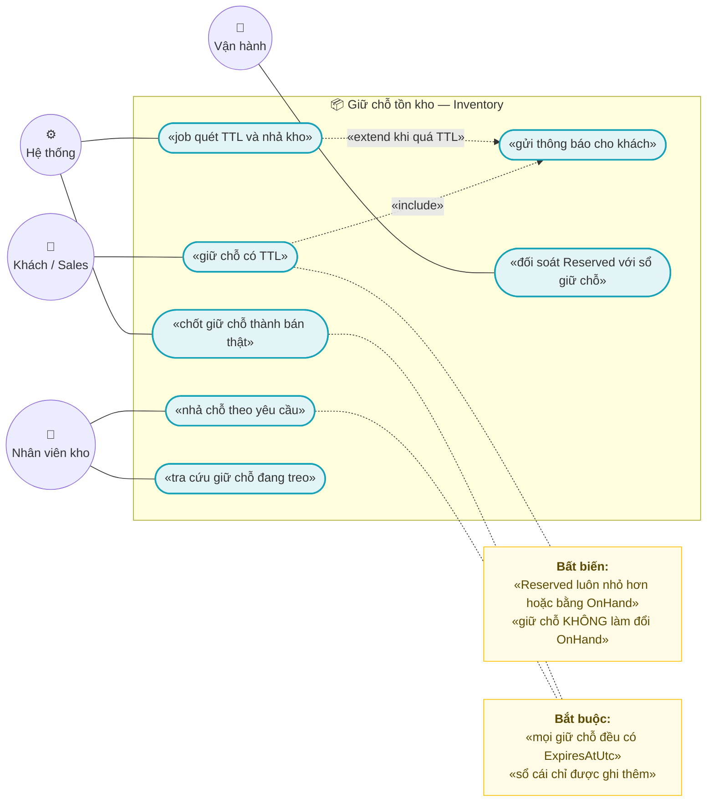
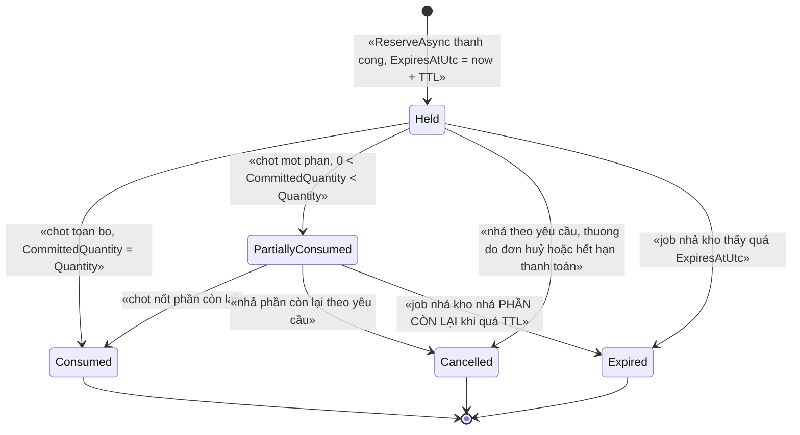
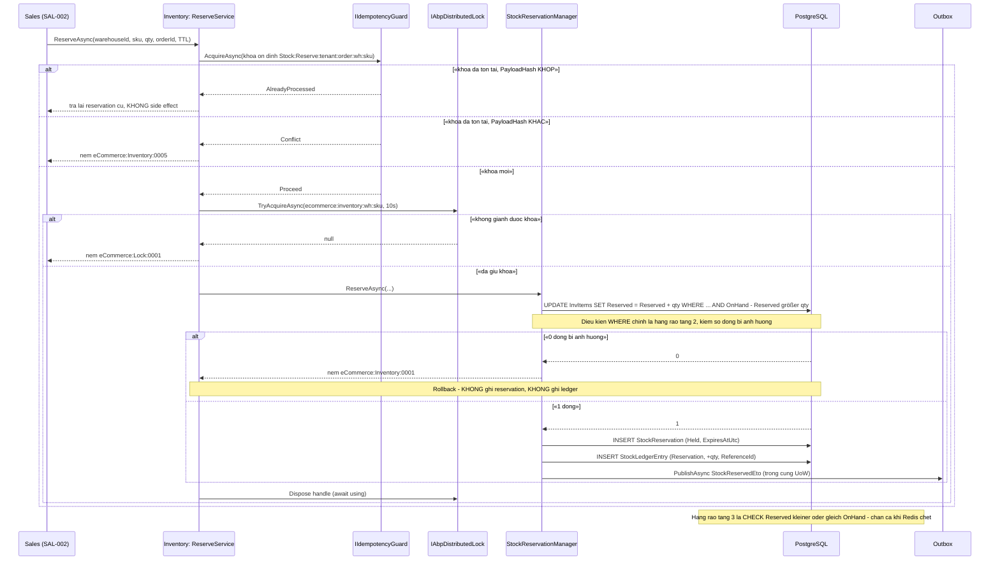
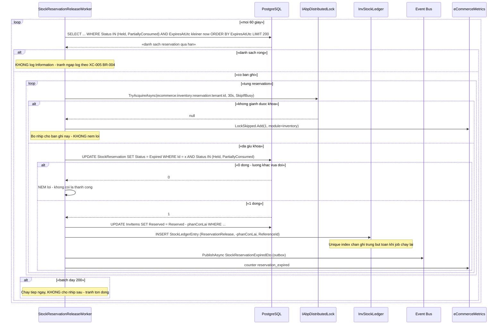

# `INV-002` — Giữ chỗ (reservation) + TTL và job nhả kho

| Thuộc tính | Nội dung |
|---|---|
| **Mã** | `INV-002` |
| **Module** | **Inventory** — đề xuất tách thành `modules/Inventory/eCommerce.Inventory.Domain` · `.Application` · `.Application.Contracts` · `.EntityFrameworkCore`; entity hiện nằm ở `src/eCommerce.Domain/Entities/Inventory/StockLedger.cs` |
| **Giai đoạn** | **GĐ1 — Bán được** (`docs/implementation-plan.md:405`) |
| **Ưu tiên** | **Must have** |
| **Trạng thái** | 🟡 `Draft` — chờ review |
| **Người viết / người review** | *(điền)* / **Kiến trúc trưởng + BA** |
| **Phiên bản / ngày** | `v0.1 — 13/10/2026` |
| **Tài liệu liên quan** | `XC-001` (decimal, `Money`) · `XC-002` (outbox/inbox, idempotency, DLQ) · `XC-003` (khoá phân tán) · `XC-004` (permission/tenant) · `XC-005` (metric/log) · `INV-001` (sổ cái kho, nhập/chuyển/kiểm kê) · `INV-003` (phân bổ tồn theo kênh) · `SAL-002` (đặt hàng) · `SAL-003` (trạng thái đơn) · `docs/implementation-plan.md` · `docs/business-modules-proposal.md` |

---

## 0. Tóm tắt & quyết định thiết kế

**Tóm tắt:** `INV-002` định nghĩa **giữ chỗ tồn kho có thời hạn (TTL)** và **job nhả kho** — cơ chế chống bán vượt tồn kho
(oversell) khi **khách chưa trả tiền** và khi **nhiều kênh bán cùng tranh một SKU**. Giữ chỗ là **một bản ghi có vòng đời**
(`StockReservation`), không phải một phép trừ kho: tồn kho **khả dụng** giảm, nhưng **tồn kho thực (`OnHand`) không đổi**.
TTL hết ⇒ job **nhả kho** (giải phóng giữ chỗ) hoặc đơn được xác nhận ⇒ **chốt** giữ chỗ thành bán thật.

**Vì sao phải viết trước khi code — hiện trạng đã kiểm trong repo:**

| # | Sự thật đã kiểm bằng `read`/`grep` | Hệ quả |
|---|---|---|
| 1 | `StockMovementType.Reservation = 1` và `ReservationRelease = 2` **đã có** (`src/eCommerce.Domain.Shared/Enums.cs:32,35`) | "Giữ chỗ" hiện chỉ là **khái niệm trong enum** |
| 2 | `InventoryItem.ApplyMovement` **có** nhánh `Reservation`/`ReservationRelease` (`src/eCommerce.Domain/Entities/Inventory/StockLedger.cs:53-59`), `Reserved` + `Available = OnHand - Reserved` (`:22-25`), `CanReserve` (`:77`) | Logic **đếm** đã có, nhưng **không có** đối tượng nào ghi lại **ai** giữ, **bao nhiêu**, **đến khi nào** |
| 3 | Kiểm tra âm kho chỉ là `if (OnHand < 0 \|\| Reserved < 0)` (`StockLedger.cs:70-74`) | ⚠️ **Không chặn oversell**: giữ chỗ 11 khi có 10 ⇒ `OnHand=10, Reserved=11` ⇒ **không** âm ⇒ **không ném lỗi** |
| 4 | `grep` toàn repo: **0** chỗ gọi `ApplyMovement`, **0** chỗ dùng `StockMovementType.Reservation` ngoài chính file entity và test (`test/eCommerce.Tests/Domain/OrderAndInventoryTests.cs:59-85`) | 🚨 **Feature CHƯA CÓ TRONG CODE** — kế hoạch **GĐ1** (`docs/implementation-plan.md:179,405`) |
| 5 | **Không có** entity/`DbSet` nào cho reservation; `eCommerceDbContext` chỉ có `InventoryItems` + `StockLedgerEntries` (`src/eCommerce.EntityFrameworkCore/eCommerceDbContext.cs:40-41`) | Phải thêm `DbSet` (quy ước bất biến #5) + migration |
| 6 | **Không có** `Warehouse` entity dù `InventoryItem.WarehouseId` là `Guid` (`StockLedger.cs:14`) | `Warehouse` thuộc **`INV-001`**; `INV-002` chỉ dùng `WarehouseId` |
| 7 | Khoá lock `eCommerceConsts.LockKeys.InventorySku(warehouseId, sku)` → `ecommerce:inventory:{warehouseId}:{sku}` (`src/eCommerce.Domain.Shared/eCommerceConsts.cs:103-104`) — **đúng chuỗi**, nhưng **chưa nơi nào gọi** và **thiếu `tenantId`** | Dùng lại khoá này cho giữ chỗ + ghi nhận **F3** (§15.2) |
| 8 | **Chưa có** background worker nào của Inventory (`grep "BackgroundWorker"` chỉ thấy `ChannelHub`) | Job nhả kho là **việc mới** của `INV-002` |

> **Điểm khác biệt cốt lõi so với "trừ kho ngay":** nếu trừ `OnHand` ngay khi khách bấm đặt hàng thì mọi đơn bỏ dở
> **làm mất hàng bán được**. Nếu **không** giữ chỗ thì hai khách cùng mua 1 SKU cuối **cùng thành công** (oversell).
> Giữ chỗ + TTL là điểm cân bằng: **có** giữ, **nhưng có hạn** — hết hạn thì **tự nhả** và **có dấu vết**.

**Phạm vi:**
- ✅ Entity `StockReservation` (giữ chỗ), vòng đời + **bất biến TTL**.
- ✅ Luồng **giữ chỗ / nhả chỗ / chốt (commit)** + bút toán sổ cái append-only tương ứng.
- ✅ **Job định kỳ nhả kho** (quét TTL) — idempotent, có khoá phân tán, có metric.
- ✅ Ràng buộc DB chống oversell (CHECK `Reserved <= OnHand`) + đồng bộ hoá lạc quan.
- ✅ Idempotency **ở mọi biên vào** theo `XC-002` (`IIdempotencyGuard` + unique index).
- ✅ Sự kiện phát ra (`StockReservedEto`, `StockReleasedEto`, `StockReservationExpiredEto`).
- ✅ App service + permission + endpoint vận hành (tra cứu giữ chỗ đang treo).

**Không nằm trong phạm vi:**
- ❌ **Nhập / chuyển / kiểm kê kho** và định nghĩa `StockLedgerEntry` — thuộc **`INV-001`**.
- ❌ **Phân bổ tồn theo kênh** (`ChannelListing.AllottedQuantity`) — thuộc **`INV-003`**; `INV-002` chỉ **nhận** `ChannelCode`
  làm chiều dữ liệu của giữ chỗ.
- ❌ **Vòng đời đơn hàng** (4 trục trạng thái) — thuộc `SAL-003`; `INV-002` chỉ nghe "đơn đã huỷ / đã xuất" để nhả/chốt.
- ❌ **Thanh toán, hoàn tiền** — thuộc `PaymentHub`/`REC-001`.
- ❌ **Giữ chỗ theo `CartItem`/phiên checkout dài hạn** — quyết định ở §15 **Q3**; giai đoạn này giữ chỗ gắn với **một lần đặt hàng**.
- ❌ **Điều phối nhiều bước có bù trừ (saga)** — thuộc `SAL-004`.

### 0.1 Quyết định thiết kế (ADR ngắn)

| # | Quyết định | Phương án đã cân nhắc | Lý do chọn | Hệ quả |
|---|---|---|---|---|
| **D1** | Giữ chỗ = **entity `StockReservation` có TTL**, **không** trừ `OnHand` | (a) trừ `OnHand` ngay khi đặt · (b) chỉ dùng `Reserved` số nguyên trên `InventoryItem` (không có bản ghi) · (c) **bảng reservation có TTL** | (a) đơn bỏ dở ⇒ **mất hàng bán được** (không có gì để nhả trừ khi làm job hoàn kho) · (b) **không biết nhả bao nhiêu cho ai, khi nào** ⇒ không thể làm job nhả kho, không truy vết được. Đây đúng khoảng trống đã khảo sát: **eShop không giữ chỗ** nên **không có "nhả kho"** (`docs/business-modules-proposal.md:326`) | Thêm 1 bảng; `Reserved` trên `InventoryItem` trở thành **số tổng hợp (derived)**, nguồn sự thật là `StockReservation` |
| **D2** | **`Reserved` vẫn giữ trên `InventoryItem`** (không bỏ) | (a) bỏ `Reserved`, tính `SUM` từ reservation mỗi lần đọc · (b) giữ làm số tổng hợp | `Available` là **truy vấn nóng nhất** của bán hàng; `SUM` trên bảng reservation mỗi lần đọc sẽ chậm và tạo tranh chấp đọc. `Info` hiện có `Reserved` + `Available` (`StockLedger.cs:22-25`) | ⚠️ **Hai nguồn số** ⇒ **bắt buộc** có đối soát định kỳ (**BR-23**) + metric lệch; `InventoryItem` là **ảnh chụp**, giống ghi chú đã có ở `StockLedger.cs:8` |
| **D3** | **Chống oversell: lock + `UPDATE … WHERE` + CHECK constraint ở DB** | (a) chỉ lock Redis · (b) chỉ kiểm tra trong domain · (c) **cả ba tầng**, DB là chốt cuối | `XC-003` D2: *"bỏ lock đi, DB có chặn không?"* — hiện **DB KHÔNG chặn** (`StockLedger.cs:70`). Lock Redis **vô hiệu khi Redis chết** (`AbortOnConnectFail=false`, `src/eCommerce.HttpApi.Host/eCommerceHttpApiHostModule.cs:141`) | Phải thêm `CHECK ("Reserved" <= "OnHand")` ⇒ **migration phải kiểm dữ liệu cũ trước** (§11) |
| **D4** | **Ràng buộc duy nhất của sổ cái**: 1 bút toán cho mỗi **(reservation, loại biến động)** | (a) chỉ dựa vào app kiểm tra · (b) unique index có filter | `StockLedgerEntry` **append-only** (`StockLedger.cs:80-83`) ⇒ chống ghi trùng **không** được bằng UPDATE; unique index là cách duy nhất vừa append-only vừa idempotent | Thêm unique index `(ReferenceType, ReferenceId, MovementType)` filter `ReferenceId IS NOT NULL` |
| **D5** | **TTL: `ExpiresAtUtc` bắt buộc** + `Status` chỉ đổi theo **state machine ném lỗi** | (a) `Status` suy ra từ `ExpiresAtUtc` · (b) cột `Status` có state machine | (a) không biểu diễn được `Consumed`/`Cancelled` và **không** thoả quy ước #11 (state machine phải ném lỗi) | 6 trạng thái (§3); mọi chuyển sai ⇒ `BusinessException` `eCommerce:Inventory:0003` |
| **D6** | **Job nhả kho theo TỪNG reservation**, khoá `…:reservation:{tenantId}:{reservationId}`, chế độ `SkipIfBusy` | (a) khoá theo SKU · (b) khoá toàn cục 1 job · (c) **khoá theo reservation** | (a) một SKU bận ⇒ **chặn cả** SKU khác (giảm thông lượng) · (b) chỉ 1 instance chạy nhưng vẫn phải tuần tự hoá trên cùng hàng | Nhiều instance chạy song song được; tranh chấp chỉ xảy ra khi **cùng một reservation** bị 2 vòng job nhặt |
| **D7** | **`SkipIfBusy` cho job** (không ném lỗi) **nhưng bắt buộc log + metric** | (a) ném lỗi khi bận · (b) bỏ qua im lặng · (c) bỏ qua **có log + metric** | (a) job nhịp 1 phút ném lỗi ⇒ **ngập cảnh báo giả** · (b) vi phạm `XC-003` D10 (im lặng bỏ qua = mất việc mà không ai biết) | Dùng `eCommerceMetrics.LockSkipped` với nhãn `module=inventory` (`shared/eCommerce.Kernel/Observability/eCommerceMetrics.cs:109`) |
| **D8** | **Idempotency key ổn định theo nghiệp vụ**, không `Guid.NewGuid()` | (a) sinh mới mỗi lần gọi · (b) khoá từ dữ liệu nghiệp vụ | `XC-002` BR-007 — khoá mới mỗi retry ⇒ **mỗi retry là một lần giữ chỗ mới** ⇒ giữ ảo, hết kho ảo | `Stock:Reserve:{tenantId}:{orderId}:{warehouseId}:{sku}` + unique index `(TenantId, IdempotencyKey)` |
| **D9** | **Chốt (commit) một phần ⇒ giữ nguyên 1 hàng**, thêm cột `CommittedQuantity` | (a) tách reservation dư thành hàng mới · (b) cộng dồn `CommittedQuantity` | (a) nhân bản hàng ⇒ khó đối soát + phải sinh id mới trong transaction nóng · (b) giữ **1 hàng = 1 lần giữ chỗ**, `OutstandingQuantity = Quantity − CommittedQuantity` | Cần CHECK `0 <= CommittedQuantity <= Quantity`; `Reserved` giảm đúng bằng phần chốt |
| **D10** | **Sổ cái append-only**: nhả chỗ **ghi thêm** bút toán, **không** sửa bút toán cũ | (a) cập nhật `StockLedgerEntry` cũ · (b) ghi bút toán mới | Quy ước bất biến của dự án + ghi chú trong code (`StockLedger.cs:80-83`) và `XC-002` §8.1 bất biến 8 | Bảng ledger **tăng** theo số lần giữ/nhả — chấp nhận được; có test `TC-18` chặn UPDATE/DELETE |
| **D11** | **Đối soát `InventoryItem.Reserved` với `SUM(StockReservation)` là bắt buộc** | (a) tin vào code · (b) job đối soát + metric | Vì **D2** tạo ra **hai nguồn số**; lệch số tồn kho là loại lỗi **im lặng** và phá niềm tin vào tồn kho | Job đối soát + metric `inventory_reservation_drift` (bổ sung registry `XC-005` §5.1) |
| **D12** | **Đặt entity vào module `Inventory`**, khoá + mã lỗi do **module tự sở hữu** | (a) giữ ở `src/eCommerce.Domain` · (b) module mới | Quy ước #3: **cấm** module tham chiếu `src/`; `INV-001`…`003` đều thuộc module Inventory | Chuyển `InventoryItem`/`StockLedgerEntry` sang module ⇒ **sửa `eCommerceDbContext`** (giữ `DbSet` theo quy ước #5) và **chuyển** `eCommerceConsts.LockKeys.InventorySku` + `ErrorCodes.InsufficientStock` về module (**F2/F3** §15.2) |

---

## 1. Use Case Specification

| Thuộc tính | Nội dung |
|---|---|
| **Use Case ID** | `INV-002` |
| **Use Case Name** | Giữ chỗ tồn kho **có TTL** và tự nhả khi hết hạn |
| **Description** | *"Là hệ thống bán hàng đa kênh, tôi muốn giữ tồn kho cho một đơn trong một khoảng thời gian xác định, để hai khách không mua được cùng một món hàng cuối — và để đơn bỏ dở không giữ hàng vĩnh viễn."* |
| **Actor(s)** | **Khách mua / Sales** (qua `SAL-002` khi đặt hàng) · **Hệ thống** (job nhả kho, consumer sự kiện `SAL-003`) · **Nhân viên kho** (tra cứu giữ chỗ treo, nhả tay) · **Vận hành** (xem metric giữ chỗ hết hạn) |
| **Priority** | **Must have** — đây là **điều kiện nghiệm thu GĐ1** *(rủi ro #5 "Oversell đa kênh", `docs/implementation-plan.md:293`)* |
| **Trigger** | (a) `SAL-002` tạo đơn ⇒ cần giữ tồn cho các dòng; (b) job nhịp **1 phút** phát hiện reservation quá `ExpiresAtUtc`; (c) đơn bị huỷ / hết hạn thanh toán (`SAL-003`) ⇒ nhả; (d) đơn được xác nhận/xuất kho ⇒ **chốt**; (e) nhân viên kho nhả tay |
| **Pre-Condition(s)** | • **Tenant hiện tại** (`TenantId` từ `ICurrentTenant`) — **bắt buộc**; reservation **luôn** thuộc một tenant (**BR-12**).<br>• **Kho** (`WarehouseId`) xác định — entity `Warehouse` thuộc `INV-001` (**chưa có trong code**).<br>• `InventoryItem` cho `(tenantId, warehouseId, sku)` **đã tồn tại** ⇒ nếu chưa có, **từ chối** (không tự tạo — xem §12).<br>• **`ChannelCode`** — bắt buộc nếu giữ chỗ phát sinh từ kênh bán (sàn); `"web"` cho website. Đây là **chiều dữ liệu** của reservation; việc **phân bổ tồn theo kênh** thuộc `INV-003`.<br>• Đã bật outbox/inbox tường minh (`XC-002` D2) — nếu **không**, sự kiện **rơi về dual-write** mà không báo lỗi.<br>• Redis 7 sẵn sàng **nhưng không phải điều kiện sống còn** (D3: DB là chốt cuối). |
| **Post-Condition(s)** | • **Hoặc** có đúng **một** `StockReservation` ở trạng thái `Held`/`PartiallyConsumed` cho cặp `(TenantId, IdempotencyKey)`, **hoặc** không có gì thay đổi (**BR-01**).<br>• `InventoryItem.Reserved` tăng/giảm **đúng bằng** `Quantity`/`OutstandingQuantity` của reservation (**BR-04**) và **luôn** `<= OnHand` (**BR-13**).<br>• Mỗi thay đổi giữ/nhả/chốt **có** một `StockLedgerEntry` mới (**BR-02**), **không** bản ghi nào bị UPDATE/DELETE (**D10**).<br>• `Reserved` **không** bao giờ âm; `Available = OnHand − Reserved` **không** bao giờ âm (**BR-06**).<br>• Mọi reservation đều có `ExpiresAtUtc` **hữu hạn** (**BR-05**) và job nhả kho sẽ xử lý nó (**BR-07**). |
| **Basic Flow** | 1. `SAL-002` gọi `ReserveAsync` với `IdempotencyKey` **ổn định** `Stock:Reserve:{tenantId}:{orderId}:{warehouseId}:{sku}`.<br>2. App service gọi `IIdempotencyGuard.AcquireAsync` (**`XC-002` BR-004**) ⇒ `Proceed` / `AlreadyProcessed` / `Conflict`.<br>3. Giành khoá phân tán `ecommerce:inventory:{warehouseId}:{sku}` (timeout **10 s**, chế độ `ThrowOnTimeout`).<br>4. Trong phạm vi khoá: `UPDATE "InvItems" SET "Reserved" = "Reserved" + @qty WHERE … AND "OnHand" - "Reserved" >= @qty` — **kiểm số dòng bị ảnh hưởng**.<br>5. `0` dòng ⇒ **ném** `eCommerce:Inventory:0001`; transaction **rollback**, **không** ghi gì.<br>6. `1` dòng ⇒ chèn `StockReservation` (`Held`, `ExpiresAtUtc = now + TTL`) + chèn `StockLedgerEntry` (`Reservation`, `+qty`, `ReferenceId = reservationId`).<br>7. Phát `StockReservedEto` qua `IDistributedEventBus` **trong cùng UoW, `useOutbox: true`** (**BR-22**).<br>8. Nhả khoá (`await using`), commit UoW ⇒ **dữ liệu + outbox cùng sống hoặc cùng chết**.<br>9. Trả `ReservationResultDto` (`ReservationId`, `ExpiresAtUtc`, `RemainingAvailable`). |
| **Alternative Flow** | **A1: Đã giữ chỗ rồi (retry)** — `IIdempotencyGuard` trả `AlreadyProcessed` + `PayloadHash` khớp ⇒ **không** side effect, trả lại reservation cũ (**BR-08**).<br>**A2: Chốt một phần** — đơn xuất 7/10 ⇒ `CommittedQuantity = 7`, `Status = PartiallyConsumed`; `Reserved` giảm 7; ledger ghi `ReservationRelease` (7, nhả phần đã chốt) + `Sale` (7) (**D9**, BR-15).<br>**A3: Chốt toàn bộ** — `CommittedQuantity == Quantity` ⇒ `Status = Consumed` (trạng thái **hấp thụ**).<br>**A4: Nhả tay bởi nhân viên kho** — `ReleaseAsync(reason: ManualRelease)` ⇒ `Status = Cancelled`; **bắt buộc** có `Reason` + audit (**BR-19**).<br>**A5: Gia hạn TTL** — `ExtendAsync` **chỉ** khi `Status = Held`, phần gia hạn **cộng dồn** không vượt `MaxLifetimeMinutes` (**BR-11**).<br>**A6: Job nhả kho — bận khoá** — `SkipIfBusy` ⇒ bỏ nhịp, ghi log `Information` + `LockSkipped{module=inventory}`; **không** ném lỗi (**D7**). |
| **Exception Flow** | **E1:** không đủ tồn khả dụng ⇒ `BusinessException` **`eCommerce:Inventory:0001`** (`InsufficientStock`) — kèm `WarehouseId`, `Sku`, `Requested`, `Available`.<br>**E2:** không tìm thấy reservation ⇒ **`eCommerce:Inventory:0002`**.<br>**E3:** chuyển trạng thái sai (ví dụ `Cancelled → Held`, `Consumed → Expired`) ⇒ **`eCommerce:Inventory:0003`** — **cấm** no-op im lặng (quy ước #11).<br>**E4:** thao tác trên reservation đã `Expired` (gia hạn/chốt) ⇒ **`eCommerce:Inventory:0004`**.<br>**E5:** cùng `IdempotencyKey` nhưng `PayloadHash` **khác** (cùng đơn, khác số lượng) ⇒ **`eCommerce:Inventory:0005`** — **không** coi là trùng (`XC-002` BR-006).<br>**E6:** gia hạn vượt `MaxLifetimeMinutes` ⇒ **`eCommerce:Inventory:0006`**.<br>**E7:** không giành được khoá trong timeout ⇒ **`eCommerce:Lock:0001`** (`XC-003` §6.2) — **không** dùng mã riêng của Inventory.<br>**E8:** `0` dòng bị ảnh hưởng bởi `ExecuteUpdateAsync` **ở bất kỳ** bước ghi trạng thái nào ⇒ **NÉM LỖI** (`XC-002` E7) — **cấm** coi là thành công. |
| **Business Rules** | Xem **§8.1** — **23 BR** (`BR-01`…`BR-23`) được phát biểu đầy đủ ở đó để không lặp lại hai nơi. |
| **Non-Functional Requirement** | Xem **§13** — **11 NFR** (`NFR-01`…`NFR-11`). |

> **Ghi chú về `TenantId` + `ChannelCode` (theo mẫu §1):** Pre-condition **bắt buộc** ghi `TenantId` — reservation **luôn**
> thuộc tenant (khoá lock cũng phải chứa tenant, xem **F3** §15.2). `ChannelCode` **có** mặt khi giữ chỗ phát sinh từ kênh bán
> và **không** áp dụng cho giữ chỗ nội bộ (kiểm kê/điều chỉnh — thuộc `INV-001`), nhưng **vẫn là cột** (nullable) để tra cứu vận hành.

---

## 2. Sơ đồ Use Case



### Chú giải

| Ký hiệu | Ý nghĩa |
|---|---|
| ⭕ Xanh lá | Actor (người dùng + hệ thống) |
| 🟦 Bầu dục xanh dương | Use Case |
| 🟨 Khung vàng | Note (bất biến / quy tắc bắt buộc) |
| `───` | Liên kết Actor ↔ Use Case |
| `-.«include».->` | Quan hệ bao hàm |
| `-.«extend khi …».->` | Quan hệ mở rộng (chỉ xảy ra ở nhánh đó) |

---

## 3. Sơ đồ trạng thái (state machine)



**Bảng chuyển trạng thái & guard (mọi chuyển sai **phải ném lỗi**, không im lặng):**

| # | Từ → Sang | Guard (điều kiện cho phép) | Hành động kèm theo | Nếu guard sai |
|---|---|---|---|---|
| 1 | `[*] → Held` | Có `TenantId` + `WarehouseId` + `Sku` + `Quantity > 0` + `ExpiresAtUtc > now`; `InventoryItem` tồn tại; `Available >= Quantity` | Chèn reservation + ledger `Reservation`; `Reserved += Quantity`; phát `StockReservedEto` | `Available < Quantity` ⇒ **`0001`**; thiếu `InventoryItem` ⇒ **`0002`**; `Quantity <= 0` ⇒ `ArgumentException` (lỗi lập trình) |
| 2 | `Held → Consumed` | `CommittedQuantity + q <= Quantity` **và** `q > 0` **và** `Status = Held` | `CommittedQuantity += q`; ledger `ReservationRelease(q)` + `Sale(q)`; `Reserved -= q`; phát `StockReleasedEto` (lý do `Consumed`) | `q` vượt `Quantity` ⇒ **`0003`** + rollback (**BR-15**); `Status ≠ Held` ⇒ **`0003`** |
| 3 | `Held → PartiallyConsumed` | `0 < q < Quantity` | như trên, `Status = PartiallyConsumed` | — |
| 4 | `Held → Cancelled` | `Reason` **bắt buộc** (không rỗng) | `Reserved -= Quantity`; ledger `ReservationRelease`; `CancelledAtUtc`; **audit** `who/why` | Thiếu `Reason` ⇒ **`0003`** (**BR-19**) |
| 5 | `Held → Expired` | `now > ExpiresAtUtc` **và** `UPDATE … WHERE Status = 'Held'` ảnh hưởng **≥ 1 dòng** | `Reserved -= Quantity`; ledger `ReservationRelease`; phát `StockReservationExpiredEto` | `0` dòng ⇒ **NÉM** (bị luồng khác đổi) — **`XC-002` E7** |
| 6 | `PartiallyConsumed → Consumed` | `CommittedQuantity + q = Quantity` | như #2 | — |
| 7 | `PartiallyConsumed → Cancelled` | `Reason` bắt buộc | `Reserved -= OutstandingQuantity`; ledger `ReservationRelease` | — |
| 8 | `PartiallyConsumed → Expired` | `now > ExpiresAtUtc` | `Reserved -= OutstandingQuantity` (**chỉ phần còn lại**); ledger `ReservationRelease` | 🚨 Nhả **nhầm cả `Quantity`** ⇒ **âm `Reserved`** ⇒ CHECK DB chặn; phải là `OutstandingQuantity` (**BR-16**) |
| 9 | `Consumed → bất kỳ` | **KHÔNG** có guard cho phép | — | **Trạng thái hấp thụ** ⇒ **NÉM** `0003` |
| 10 | `Cancelled → bất kỳ`, `Expired → bất kỳ` | **KHÔNG** có guard cho phép | — | **Hấp thụ** ⇒ **NÉM** `0003`/`0004` |

> ⚠️ **`Expired` là trạng thái nguy hiểm nhất về mặt nghiệp vụ:** nó **nhả hàng đang bán được**. Vì vậy:
> (1) job nhả kho **phải** dùng `UPDATE … WHERE Status IN ('Held','PartiallyConsumed') AND "ExpiresAtUtc" < now` và
> **kiểm số dòng** — tránh nhả trùng khi đơn vừa được chốt ở cùng thời điểm; (2) job **không** được chạy khi
> `ExpiresAtUtc` chỉ vừa qua trong lúc transaction chốt đang mở ⇒ cần `RowVersion`/`UPDATE … WHERE` (**BR-14**).
> **Ai được phép chuyển:** `[*] → Held` do **app service** (có permission `eCommerce.Inventory.Reserve`); `→ Cancelled` do
> **app service** (permission `Release`) **hoặc job** (khi đơn huỷ); `→ Expired` **chỉ** do **job nhả kho**;
> `→ Consumed`/`PartiallyConsumed` do **app service** (permission `Commit`, gọi từ luồng xuất kho `SAL-00x`).

---

## 4. Sequence Diagram & luồng dữ liệu

### 4.1 Giữ chỗ — 3 tầng bảo vệ chống oversell



### 4.2 Job nhả kho theo TTL — idempotent, có khoá, có metric



### 4.3 Không vẽ thêm sơ đồ — lý do

Tài liệu giới hạn **tối đa 3 sơ đồ**. **Use Case** (§2), **State machine** (§3) và **2 sequence** (4.1–4.2) đã phủ:
ai làm gì, vòng đời bản ghi, đường đi của một lần giữ chỗ và của job. **DFD riêng** và **ERD riêng** bị lược bớt:
DFD trùng thông tin với §4.1–4.2, còn mô hình dữ liệu được trình bày đầy đủ hơn bằng **bảng Data Dictionary §5.2**.
Đây là lựa chọn có ý thức, không phải bỏ sót.

---

## 5. Mô hình dữ liệu

### 5.1 ERD

**Không vẽ ERD bằng Mermaid — lý do:** đã dùng đủ **3 sơ đồ** (§2, §3, §4). Quan hệ dữ liệu được mô tả bằng bảng:

| Từ | Quan hệ | Đến | Ghi chú |
|---|---|---|---|
| `InventoryItem` | 1 — n | `StockReservation` | theo `(TenantId, WarehouseId, Sku)`; **không** khai báo FK cứng (giữ ranh giới aggregate — giống cách `OrderLine` được map) |
| `StockReservation` | 1 — n | `StockLedgerEntry` | qua `ReferenceType = 'StockReservation'` + `ReferenceId = reservationId` |
| `StockReservation` | n — 1 | `Order` (module Sales) | qua cột `OrderId` (`Guid?`), **không** FK cứng: `Order` nằm ở `src/eCommerce.Domain/Entities/Orders/Order.cs` (app), module **cấm** tham chiếu app |

> 📌 **Cố ý KHÔNG khai báo khoá ngoại** giữa module Inventory và `Order`: module không được tham chiếu app (quy ước #3),
> và FK cứng sẽ chặn việc tách module thành service ở GĐ4. `OrderId` là **tham chiếu mềm** (soft reference).

### 5.2 Bảng & cột (Data Dictionary)

#### 5.2.1 Entity **MỚI** `StockReservation` → bảng `InvReservations`

> 🆕 **CHƯA CÓ TRONG CODE** — kế hoạch **GĐ1** (`docs/implementation-plan.md:179`). Toàn bộ cột dưới đây là **thiết kế đề xuất**.

| Cột | Kiểu | Null? | Ý nghĩa | Ghi chú |
|---|---|---|---|---|
| `Id` | `uuid` | ✖ | PK | `FullAuditedAggregateRoot<Guid>` |
| `TenantId` | `uuid` | ✔ | tenant sở hữu | **BẮT BUỘC có giá trị** ở tầng ứng dụng (**BR-12**); unique index phải dùng `NULLS NOT DISTINCT` theo `XC-004` BR-009 |
| `WarehouseId` | `uuid` | ✖ | kho giữ chỗ | `Warehouse` thuộc `INV-001` (chưa có trong code) |
| `Sku` | `varchar(64)` | ✖ | SKU | khớp `InvItems.Sku` (`eCommerceDbContext.cs:137`: `HasMaxLength(64)`) |
| `Quantity` | `int` | ✖ | số lượng **giữ ban đầu** | `> 0` — **không bao giờ** đổi sau khi tạo; **bất biến** để tái lập bút toán |
| `CommittedQuantity` | `int` | ✖ | số lượng **đã chốt** (bán thật) | mặc định `0`; `0 <= CommittedQuantity <= Quantity` |
| `OutstandingQuantity` | *(tính ra, KHÔNG lưu cột)* | — | `Quantity − CommittedQuantity` | giữ **một chiều** dữ liệu, tránh lệch (cùng triết lý `XC-001` D5) |
| `Status` | `int` | ✖ | `Held=0` · `PartiallyConsumed=1` · `Consumed=2` · `Cancelled=3` · `Expired=4` | enum mới `StockReservationStatus`; xem §3 |
| `ExpiresAtUtc` | `timestamptz` | ✖ | **hạn TTL** | **bắt buộc hữu hạn** (**BR-05**); job nhả kho đọc cột này |
| `ChannelCode` | `varchar(32)` | ✔ | kênh bán phát sinh | `"web"`, `"shopee"`… khớp `StockLedgerEntry.ChannelCode` (`eCommerceDbContext.cs:152`) |
| `OrderId` | `uuid` | ✔ | đơn hàng liên quan | **tham chiếu mềm**, không FK (module cấm tham chiếu app) |
| `IdempotencyKey` | `varchar(256)` | ✖ | khoá chống trùng **ổn định** | `Stock:Reserve:{tenantId}:{orderId}:{warehouseId}:{sku}` — **BR-08**, `XC-002` BR-007 |
| `PayloadHash` | `varchar(64)` | ✖ | SHA-256 payload chuẩn hoá | `{warehouseId}\|{sku}\|{quantity}\|{expiresAtUtc}` — khác hash ⇒ **`0005`** |
| `ExpiryExtendedCount` | `int` | ✖ | số lần gia hạn | mặc định `0`; **có audit** mỗi lần (**BR-11**) |
| `CancelledAtUtc` | `timestamptz` | ✔ | thời điểm nhả tay | — |
| `CancelReason` | `varchar(512)` | ✔ | lý do nhả | **bắt buộc** khi `Status = Cancelled` (**BR-19**) |
| `RowVersion` | `xid` (`xmin`) | ✖ | đồng bộ hoá lạc quan | `.UseXminAsConcurrencyToken()` — PostgreSQL; **bắt buộc** theo D3/`XC-002` BR-008 |
| `CreationTime` / `CreatorId` / `LastModificationTime` / `LastModifierId` / `IsDeleted` / `DeleterId` / `DeletionTime` | — | — | trường kiểm toán của `FullAuditedAggregateRoot` | **`IsDeleted` dùng cho XOÁ MỀM của entity này** — **KHÔNG** áp dụng cho sổ cái |

**Index & ràng buộc** *(đề xuất — viết bằng EF + SQL thô khi cần)*

| Loại | Cột / biểu thức | Mục đích |
|---|---|---|
| UNIQUE | `(TenantId, IdempotencyKey)` **NULLS NOT DISTINCT** | **hàng rào chống trùng thật** cho biên vào `ReserveAsync` (**BR-08**) — EF **không** khai báo được `NULLS NOT DISTINCT` ⇒ SQL thô trong migration (giống `XC-004` F1 / migration `Fix_NullableTenantId_UniqueIndexes`) |
| INDEX | `(TenantId, Status, ExpiresAtUtc)` | truy vấn nóng nhất của **job nhả kho** |
| INDEX | `(TenantId, WarehouseId, Sku, Status)` | "SKU này đang bị giữ bao nhiêu" (tra cứu vận hành, `INV-003`) |
| CHECK | `"Quantity" > 0` | **BR-17** |
| CHECK | `"CommittedQuantity" >= 0 AND "CommittedQuantity" <= "Quantity"` | **BR-15** (D9) |
| CHECK | `"ExpiresAtUtc" > "CreationTime"` | **BR-05** — cấm TTL vô hạn/ngược thời gian |
| CHECK | `"Status" <> 3 OR "CancelReason" IS NOT NULL` | **BR-19** — nhả tay phải có lý do |

#### 5.2.2 Entity **ĐÃ CÓ** `StockLedgerEntry` → `InvStockLedger` — **thay đổi đề xuất**

| Hạng mục | Hiện trạng (đã kiểm) | Đề xuất `INV-002` | Lý do |
|---|---|---|---|
| Bảng | `InvStockLedger` (`eCommerceDbContext.cs:146`) | **giữ nguyên** | append-only, đã đúng |
| `MovementType` | `StockMovementType` có `Reservation`/`ReservationRelease` (`Enums.cs:32,35`) | **giữ**, dùng `ReferenceType = "StockReservation"` | `ReferenceType` đã có, `HasMaxLength(64)` (`eCommerceDbContext.cs:150`) |
| Unique index | **KHÔNG có** ràng buộc nào ngoài index tra cứu (`eCommerceDbContext.cs:156,159`) | ➕ **UNIQUE `(ReferenceType, ReferenceId, MovementType)` filter `ReferenceId IS NOT NULL`** | **BR-09** — nếu **không** có, bút toán bị ghi trùng (job chạy lại ⇒ giảm `Reserved` 2 lần) và **không có lỗi biên dịch nào** |
| UPDATE/DELETE | Không có API nào UPDATE (đúng), nhưng **không có ràng buộc** chặn | ✅ Giữ append-only + **test** `TC-18` | Quy ước bất biến: sổ cái kho append-only |

#### 5.2.3 Entity **ĐÃ CÓ** `InventoryItem` → `InvItems` — **thay đổi đề xuất**

| Hạng mục | Hiện trạng (đã kiểm) | Đề xuất `INV-002` | Lý do |
|---|---|---|---|
| Cột `Reserved` | `int`, setter private (`StockLedger.cs:22`) | **giữ** | D2 |
| `Available` | computed `OnHand - Reserved` (`StockLedger.cs:25`) | **giữ** | đã đúng |
| Ràng buộc âm kho | chỉ trong C# (`StockLedger.cs:70-74`) | ➕ **CHECK `"Reserved" <= "OnHand" AND "Reserved" >= 0 AND "OnHand" >= 0`** | **BR-13** — đây là **chốt cuối** khi Redis chết (D3). ⚠️ **Không** có ràng buộc này thì "giữ chỗ 11 khi có 10" **lọt** (đã kiểm: `StockLedger.cs:70` chỉ so `< 0`) |
| Đồng bộ lạc quan | **không có** cột version | ➕ `RowVersion` (`xmin`) | **BR-14** |
| Unique index | `(TenantId, WarehouseId, Sku)` — đã `NULLS NOT DISTINCT` (migration `20261013024226`) | **giữ** | đã đúng |

### 5.3 Enum mới `StockReservationStatus` — vị trí đề xuất

Đặt trong module Inventory (ví dụ `modules/Inventory/eCommerce.Inventory.Domain/StockReservationStatus.cs`), **không** thêm vào
`src/eCommerce.Domain.Shared/Enums.cs` để giữ ranh giới module (quy ước #3). **Khác** với các enum hiện có
(`StockMovementType`, `OrderStatus`, `PaymentStatus`, `ChannelListingStatus`) đang nằm ở app vì domain commerce còn ở `src/`.

---

## 6. Hợp đồng API

### 6.1 Application Service (module Inventory)

```csharp
namespace eCommerce.Inventory.Reservations;

/// Hợp đồng giữ chỗ. Mọi method đều idempotent và mọi lỗi có MÃ (quy ước #11).
public interface IStockReservationAppService : IApplicationService
{
    Task<ReservationResultDto> ReserveAsync(ReserveStockDto input);

    Task<ReservationResultDto> ReleaseAsync(ReleaseReservationDto input);

    Task<ReservationResultDto> CommitAsync(CommitReservationDto input);

    Task<ReservationResultDto> ExtendAsync(ExtendReservationDto input);

    Task<PagedResultDto<StockReservationDto>> GetHeldAsync(GetHeldReservationsDto input);
}

public sealed record ReserveStockDto(
    Guid WarehouseId,
    string Sku,
    int Quantity,
    Guid? OrderId,
    string? ChannelCode,
    string IdempotencyKey,      // BAT BUOC - khoa on dinh (BR-08)
    int TtlMinutes);            // BAT BUOC - khong co TTL vo han (BR-05)

public sealed record ReleaseReservationDto(
    Guid ReservationId,
    string Reason,              // BAT BUOC (BR-19)
    string IdempotencyKey);

public sealed record CommitReservationDto(
    Guid ReservationId,
    int Quantity,               // <= OutstandingQuantity (BR-15)
    string IdempotencyKey);

public sealed record ExtendReservationDto(
    Guid ReservationId,
    int AdditionalMinutes,
    string Reason,
    string IdempotencyKey);

public sealed record ReservationResultDto(
    Guid ReservationId,
    string Status,
    int Quantity,
    int CommittedQuantity,
    int OutstandingQuantity,
    DateTime ExpiresAtUtc,
    int RemainingAvailable,     // = OnHand - Reserved sau thao tac
    bool AlreadyApplied);       // true khi retry trung khoa (A1)
```

### 6.2 Domain service + Repository (bổ sung)

```csharp
namespace eCommerce.Inventory.Reservations;

/// IRepository rieng (KHONG chi dua vao IRepository<T> mac dinh) vi can:
///   1. ExecuteUpdateAsync co dieu kien ON HAND - RESERVED >= qty  (hang rao tang 2)
///   2. SELECT ... FOR UPDATE / khoa lac quan cho luong chot
public interface IStockReservationRepository : IRepository<StockReservation, Guid>
{
    /// Giam Reserved MOT CACH NGUYEN TU. Tra ve false neu khong du kha dung.
    Task<bool> TryIncreaseReservedAsync(
        Guid warehouseId, string sku, int quantity, CancellationToken ct = default);

    /// Giam Reserved. Nem loi neu so dong bi anh huong = 0 (khong im lang).
    Task DecreaseReservedAsync(
        Guid warehouseId, string sku, int quantity, CancellationToken ct = default);

    /// Lay reservation qua han theo lo, uu tien cu nhat (job nha kho).
    Task<List<StockReservation>> GetExpiredAsync(
        DateTime nowUtc, int maxCount, CancellationToken ct = default);
}

/// Chuyen trang thai: guard sai => NEM BusinessException(InventoryErrorCodes.InvalidStatusTransition)
public sealed class StockReservationManager
{
    public Task<StockReservation> CreateAsync(/* ... */);
    public Task<StockReservation> CommitAsync(StockReservation r, int quantity);
    public Task<StockReservation> CancelAsync(StockReservation r, string reason);
    public Task<StockReservation> MarkExpiredAsync(StockReservation r);
    public Task<StockReservation> ExtendAsync(StockReservation r, int minutes, string reason);
}
```

> 📌 **`TryIncreaseReservedAsync` là chỗ duy nhất được phép tăng `Reserved`** — tránh việc tầng application
> tự `item.Reserved += qty` (đọc-rồi-ghi ⇒ **mất cập nhật** khi hai luồng chạy song song, đúng lỗi mà `D3` sinh ra để chặn).
> `InventoryItem.ApplyMovement` (`StockLedger.cs:40`) **vẫn** là API domain cho luồng `INV-001` (nhập/chuyển/kiểm kê)
> nhưng **không** dùng cho giữ chỗ, vì nó không có điều kiện `WHERE` ở tầng DB.

### 6.3 REST endpoint (ABP auto API controller)

| Method | Route (ABP sinh tự động) | Permission | Ghi chú |
|---|---|---|---|
| `POST` | `/api/app/stock-reservation/reserve` | `eCommerce.Inventory.Reserve` | trả `409` khi **không** giành được khoá (`eCommerce:Lock:0001`) |
| `POST` | `/api/app/stock-reservation/release` | `eCommerce.Inventory.Release` | **bắt buộc** `Reason` |
| `POST` | `/api/app/stock-reservation/commit` | `eCommerce.Inventory.Commit` | gọi từ luồng xuất kho |
| `POST` | `/api/app/stock-reservation/extend` | `eCommerce.Inventory.Reserve` | chỉ `Status = Held` |
| `GET` | `/api/app/stock-reservation/held` | `eCommerce.Inventory.Reservation.View` | tra cứu vận hành |

### 6.4 Mã lỗi

| Mã | HTTP | Khi nào | Thông điệp |
|---|---|---|---|
| `eCommerce:Inventory:0001` | `409` | Không đủ tồn khả dụng để giữ chỗ | `Không đủ tồn kho khả dụng cho SKU {sku} (yêu cầu {requested}, khả dụng {available}).` |
| `eCommerce:Inventory:0002` | `404` | Không tìm thấy reservation (hoặc thuộc tenant khác — trả `404`, **không** `403`, theo `XC-004` BR-008) | `Không tìm thấy bản ghi giữ chỗ.` |
| `eCommerce:Inventory:0003` | `409` | Chuyển trạng thái **sai** | `Không thể chuyển trạng thái giữ chỗ từ {from} sang {to}.` |
| `eCommerce:Inventory:0004` | `409` | Thao tác trên reservation hết hạn | `Bản ghi giữ chỗ đã hết hạn ({expiresAtUtc}), không thể thao tác.` |
| `eCommerce:Inventory:0005` | `409` | Trùng `IdempotencyKey` nhưng **khác** `PayloadHash` | `Khoá chống trùng đã dùng với nội dung khác — cần điều tra.` |
| `eCommerce:Inventory:0006` | `409` | Gia hạn vượt thời gian sống tối đa | `Không thể gia hạn quá {maxLifetime} phút kể từ lúc giữ chỗ.` |
| `eCommerce:Lock:0001` | `409` | Không giành được khoá phân tán | *(dùng mã dùng chung của `XC-003` — **không** tạo mã riêng cho Inventory)* |

> 📌 **Kế thừa:** `eCommerceConsts.ErrorCodes.InsufficientStock = "eCommerce:Inventory:0001"` (`src/eCommerce.Domain.Shared/eCommerceConsts.cs:79`)
> **đã tồn tại** ⇒ **chuyển** sang `InventoryErrorCodes.InsufficientStock` cùng giá trị (không đổi mã lỗi — **không** phá API).

---

## 7. Sự kiện, tích hợp ngoài & idempotency

### 7.1 Sự kiện **phát ra** (ETO) — theo khuôn `XC-002` D11

| ETO | Khi nào phát | Trường nghiệp vụ chính | Ai tiêu thụ | Ordering? | Idempotent bằng |
|---|---|---|---|---|---|
| `StockReservedEto` | sau khi giữ chỗ commit | `ReservationId`, `WarehouseId`, `Sku`, `Quantity`, `ExpiresAtUtc`, `OrderId`, `ChannelCode` | Sales (`SAL-002`), ChannelHub (đẩy tồn), Notifications | ✅ theo `ReservationId` | ledger append-only + `AggregateId = reservationId` |
| `StockReleasedEto` | sau khi **nhả** hoặc **chốt** | `ReservationId`, `Sku`, `Quantity`, `Reason` (`Cancelled`/`Consumed`), `CommittedQuantity` | Sales, ChannelHub | ✅ | như trên |
| `StockReservationExpiredEto` | khi job nhả kho xử lý xong | `ReservationId`, `Sku`, `ReleasedQuantity`, `ExpiredAtUtc` | Sales (`SAL-003` để **hủy đơn**), Notifications (nhắc khách) | ✅ | như trên |
| ~~`StockChangedEto`~~ | *(thuộc `INV-001` — nhập/chuyển/kiểm kê)* | — | — | — | — |

> 📌 **Khớp kế hoạch module:** `docs/implementation-plan.md:179` đã liệt kê `StockChangedEto`, `StockReservedEto`,
> `StockReservationExpiredEto`; `XC-002` §7.1 (`XC-002-outbox-inbox-chong-trung-su-kien.md:760`) đã có dòng
> `StockReservedEto` / `StockReleasedEto` **thuộc `INV-002`**. Tài liệu này **chỉ** chốt chi tiết trường + hợp đồng.

**Hợp đồng payload bắt buộc** (`IntegrationEventBase` của `XC-002` BR-020): `EventId`, `OccurredOn`, `AggregateId`,
`AggregateVersion`, `TenantId`, `ChannelCode`, `CorrelationId`.

> ⚠️ **`AggregateVersion` cho reservation:** `INV-002` **chưa xác định** quy tắc tăng (theo bản ghi hay theo SKU).
> Đây là **câu hỏi mở Q4** (§15.1) — **chưa kiểm chứng**, không được đoán.

### 7.2 Sự kiện / biên vào **nhận vào**

| Nguồn | Loại | Xác thực | Chống trùng bằng | Nếu xử lý lỗi |
|---|---|---|---|---|
| `SAL-002` (đặt hàng) | gọi **trực tiếp** app service (không qua event) | permission `eCommerce.Inventory.Reserve` | `InboxRecords` unique `(TenantId, EventType, IdempotencyKey)` + unique `(TenantId, IdempotencyKey)` trên reservation | vào DLQ; **không** rollback dữ liệu đã ghi |
| `SAL-003` (đơn huỷ / đơn xuất kho) | `distributed event` | nội bộ, đã qua outbox | khoá `Stock:Release:{tenantId}:{reservationId}` | DLQ + retry |
| **Job nhả kho** (định kỳ) | `schedule` | nội bộ | khoá `Stock:Expire:{tenantId}:{reservationId}` — **theo bản ghi**, không theo kỳ (job chạy lại **không** nhân đôi bút toán nhờ unique index `BR-09`) | DLQ + retry; job **phải** chạy lại được |

### 7.3 Gọi API **ra ngoài**

**Không áp dụng — lý do:** `INV-002` chỉ đọc/ghi DB nội bộ; **không** gọi NCC nào. Việc **đẩy tồn lên sàn** sau khi giữ chỗ
thuộc `ChannelHub` (`ChannelHubConsts.LockKeys.ChannelStockPush`, `modules/ChannelHub/eCommerce.ChannelHub.Domain/ChannelHubConsts.cs:26`),
`INV-002` **chỉ** phát `StockReservedEto`/`StockReleasedEto` để module đó quyết định.

### 7.4 Ordering — chỗ nào cần

| Nhóm | Cần ordering? | Cách xử lý |
|---|---|---|
| `StockReserved` → `StockReleased`/`Expired` cho **cùng** một `ReservationId` | ✅ **CÓ** | `AggregateId = reservationId`; consumer giữ `AppliedVersion`; `version <= AppliedVersion` ⇒ **bỏ qua + log + metric**; `version > AppliedVersion + 1` ⇒ DLQ `FailureKind = OutOfOrder` (`XC-002` §7.4) |
| `StockReservedEto` **giữa các SKU khác nhau** | ❌ KHÔNG | độc lập |
| Sự kiện **xoá cache** tồn khả dụng của `INV-003` | ❌ KHÔNG | làm lại được nhiều lần |

### 7.5 Bảng **Idempotency key** của feature này

| Đối tượng | Cách sinh khoá | ⚠️ Lưu ý |
|---|---|---|
| Giữ chỗ | `Stock:Reserve:{tenantId}:{orderId}:{warehouseId}:{sku}` | **ổn định** qua retry (**BR-08**). **Cấm** `Guid.NewGuid()`. Nếu đơn **không** có `OrderId` (giữ chỗ tạm) ⇒ dùng `Reserve:{tenantId}:{cartToken}:{warehouseId}:{sku}` **và** ghi rõ rủi ro |
| Nhả chỗ | `Stock:Release:{tenantId}:{reservationId}` | `reservationId` **chính là** khoá ổn định ⇒ retry không nhả 2 lần |
| Hết hạn | `Stock:Expire:{tenantId}:{reservationId}` | **không** dùng `DateTime.Now` làm khoá (job chạy lại phải cùng khoá) |
| Chốt (commit) | `Stock:Commit:{tenantId}:{reservationId}:{shipmentId}` | phải chứa `shipmentId` để hai lần xuất kho khác nhau **không** bị coi là trùng |

---

## 8. Bất biến & xử lý đồng thời

### 8.1 Business Rules (23) — nguồn sự thật duy nhất

| Mã | Phát biểu | Cơ chế bảo vệ | Kiểm bằng |
|---|---|---|---|
| **BR-01** | **Cấm** giữ chỗ **không có TTL**: mọi `StockReservation` **phải** có `ExpiresAtUtc` hữu hạn | CHECK `"ExpiresAtUtc" > "CreationTime"` + DTO **bắt buộc** `TtlMinutes > 0` | `TC-02` |
| **BR-02** | Mọi thay đổi giữ chỗ **phải** sinh một `StockLedgerEntry` **mới** | Domain service ghi ledger trong **cùng UoW**; **cấm** API ghi tắt | `TC-12` |
| **BR-03** | Giữ chỗ **chỉ** thành công khi `Available >= Quantity` | (1) khoá `ecommerce:inventory:{warehouseId}:{sku}`; (2) `UPDATE … WHERE "OnHand" - "Reserved" >= @qty` + kiểm số dòng; (3) CHECK `Reserved <= OnHand` | `TC-01`, **`TC-09`**, **`TC-13`** |
| **BR-04** | `InventoryItem.Reserved` **luôn** bằng `SUM(OutstandingQuantity)` của các reservation `Held`/`PartiallyConsumed` của cùng `(TenantId, WarehouseId, Sku)` | job đối soát + metric `inventory_reservation_drift` | `TC-17` |
| **BR-05** | **TTL bắt buộc hữu hạn**; **cấm** TTL vô hạn hoặc trong quá khứ | như BR-01 + validate ở DTO | `TC-02` |
| **BR-06** | `Reserved >= 0`, `OnHand >= 0`, `Available = OnHand − Reserved >= 0` — **luôn**, ở **mọi** thời điểm | CHECK constraint (D3) + domain ném lỗi (`StockLedger.cs:70`) | `TC-13`, `TC-19` |
| **BR-07** | Reservation quá `ExpiresAtUtc` **phải** được nhả trong vòng **≤ 5 phút** | job nhịp **1 phút** + `NFR-02` | `TC-08` |
| **BR-08** | `ReserveAsync`/`ReleaseAsync`/`CommitAsync`/`ExtendAsync` **idempotent**: cùng `IdempotencyKey` + cùng `PayloadHash` ⇒ **không** side effect lần hai | `IIdempotencyGuard` + UNIQUE `(TenantId, IdempotencyKey)` | `TC-03` |
| **BR-09** | Sổ cái **append-only**: mỗi **(reservation, loại biến động)** có **tối đa một** bút toán | UNIQUE `(ReferenceType, ReferenceId, MovementType)` filter `ReferenceId IS NOT NULL` (D4) | `TC-18` |
| **BR-10** | **Cấm** UPDATE/DELETE bản ghi `StockLedgerEntry` | append-only + **test quét mã nguồn** + review | `TC-18` |
| **BR-11** | Gia hạn TTL **chỉ** khi `Status = Held`; tổng thời gian sống **không** vượt `MaxLifetimeMinutes` (đề xuất **1440 phút = 24 h**); mỗi lần gia hạn **có audit** | guard `ExtendAsync` + `ExpiryExtendedCount` + audit log | `TC-07` |
| **BR-12** | Mọi `StockReservation` **thuộc một tenant**; khoá lock **phải** chứa `tenantId`; `TenantId` rỗng ⇒ **NÉM** (cấm khoá/dữ liệu toàn cục) | validate ở app service + `XC-003` BR-003 + unique index `NULLS NOT DISTINCT` | `TC-14` |
| **BR-13** | **Cấm** `Reserved > OnHand` — chặn ở **cả** tầng ứng dụng **và** DB | CHECK constraint (D3) | **`TC-13`** |
| **BR-14** | Mọi chuyển trạng thái **phải** có guard ở **tầng DB**: `UPDATE … WHERE Status = @expected` (+ `RowVersion`); số dòng ảnh hưởng **0** ⇒ **NÉM LỖI** | `ExecuteUpdateAsync` có điều kiện + `UseXminAsConcurrencyToken` | `TC-11` |
| **BR-15** | `CommittedQuantity` **cộng dồn** và **không** vượt `Quantity`; phần ledger `ReservationRelease` do chốt **không** vượt `Quantity` | guard domain + CHECK `0 <= CommittedQuantity <= Quantity` | `TC-06` |
| **BR-16** | Job **chỉ** nhả `OutstandingQuantity` (**không** nhả lại phần đã chốt) | `MarkExpiredAsync` dùng `OutstandingQuantity`, **không** `Quantity` | `TC-06`, `TC-08` |
| **BR-17** | `Quantity > 0`; **cấm** reservation "không số lượng" | CHECK `"Quantity" > 0` + guard domain | `TC-04` |
| **BR-18** | **Cấm** chuyển trạng thái sai (gồm mọi chuyển **ra khỏi** `Consumed`/`Cancelled`/`Expired`); phải **NÉM** `eCommerce:Inventory:0003` | state machine (§3) ném `BusinessException` | `TC-05` |
| **BR-19** | Nhả **tay** (`ReleaseAsync`) **bắt buộc** có `Reason` + **audit** (ai, vì sao, khi nào) | CHECK `Status <> Cancelled OR CancelReason IS NOT NULL` + audit log của ABP | `TC-10` |
| **BR-20** | **Chỉ 1** luồng được tăng `Reserved` cho một `(warehouse, sku)` tại một thời điểm **trong phạm vi một tiến trình/instance**; vượt tiến trình **phải** dùng khoá `ecommerce:inventory:{warehouseId}:{sku}` | `IAbpDistributedLock` + `UPDATE … WHERE` (D3); **cấm** đọc-rồi-ghi | `TC-09` |
| **BR-21** | **Cấm** `double`/`float`; nếu bổ sung trường **tiền** vào feature này (ví dụ phí giữ chỗ) **phải** dùng `decimal` + `Money`, **cấm** so `==` trên `decimal` (dùng `ToMinorUnits()`) | `XC-001` BR-003/BR-008; hiện feature **không** có trường tiền | `TC-16` |
| **BR-22** | Sự kiện `StockReservedEto`/`StockReleasedEto`/`StockReservationExpiredEto` **phải** phát qua `IDistributedEventBus` với `useOutbox: true` **trong cùng UoW**; **cấm** dual-write | `XC-002` BR-001/BR-002 | `TC-15` |
| **BR-23** | `InventoryItem.Reserved` **phải** được đối soát định kỳ với `SUM(StockReservation)`; lệch ⇒ **log `Error` + metric + cảnh báo**, **không** tự sửa số | job đối soát (D11) | `TC-17` |

### 8.2 Khoá phân tán dùng trong feature *(tên chính xác — theo quy ước `XC-003`)*

> ⚠️ **Cơ chế tiền tố đã kiểm bằng code:** `AbpDistributedLockOptions.KeyPrefix = "ecommerce:"`
> (`src/eCommerce.HttpApi.Host/eCommerceHttpApiHostModule.cs:127`) và ABP ghép **`KeyPrefix + name`** **không** dấu phân cách.
> ⇒ Hàm sinh khoá của module **KHÔNG** chứa tiền tố (`XC-003` §5.4 hệ quả 2). **Khoá thật trong Redis** = `ecommerce:` + tên dưới đây.

| Tên khoá (do module sinh) | Khoá thật trong Redis | Phạm vi | Timeout | Chế độ khi bận | Vì sao cần |
|---|---|---|---|---|---|
| `InventoryLockKeys.InventorySku(tenantId, warehouseId, sku)` → `inventory:{tenantId}:{warehouseId}:{sku}` | `ecommerce:inventory:{tenantId}:{warehouseId}:{sku}` | SKU trong kho | **10 s** | `ThrowOnTimeout` | chống 2 luồng cùng giữ chỗ/tăng `Reserved` |
| `InventoryLockKeys.StockReservation(tenantId, reservationId)` → `inventory:reservation:{tenantId}:{reservationId}` | `ecommerce:inventory:reservation:{tenantId}:{reservationId}` | một bản ghi giữ chỗ | **30 s** | `SkipIfBusy` (job) · `ThrowOnTimeout` (API) | chống job nhả kho và lệnh chốt/API nhả chạy chồng |
| `InventoryLockKeys.ReservationReconcile(tenantId)` → `inventory:reservation-reconcile:{tenantId}` | `ecommerce:inventory:reservation-reconcile:{tenantId}` | theo tenant | **30 s** | `SkipIfBusy` | chỉ 1 instance chạy job đối soát `BR-04`/`BR-23` |

> 📌 **Khác biệt so với registry `XC-003` §5 (cần sửa):** registry ghi `ecommerce:inventory:{warehouseId}:{sku}` và hàm
> `eCommerceConsts.LockKeys.InventorySku(warehouseId, sku)` — **thiếu `tenantId`**. Xem **F3** (§15.2).

### 8.3 Xử lý đồng thời

| # | Tình huống | Cơ chế |
|---|---|---|
| 1 | 2 khách cùng đặt SKU cuối (2 instance khác nhau) | khoá `…:inventory:{tenantId}:{wh}:{sku}` → instance 2 chờ tới timeout; nếu **đã** vào được thì `UPDATE … WHERE OnHand-Reserved >= qty` trả **0 dòng** ⇒ **`0001`** |
| 2 | **Redis chết** | `AbortOnConnectFail=false` (`eCommerceHttpApiHostModule.cs:141`) ⇒ app **vẫn chạy**; khoá **vô hiệu** ⇒ chốt cuối là **CHECK `Reserved <= OnHand`** (**BR-13**) ⇒ ném lỗi DB, transaction rollback, **không** oversell |
| 3 | Job nhả kho **và** lệnh chốt đơn cùng lúc cho **cùng** reservation | khoá `…:reservation:…` + `UPDATE … WHERE Status IN (Held, PartiallyConsumed)`; ai thua thấy **0 dòng** ⇒ **NÉM** (không im lặng) |
| 4 | Job nhả kho chạy trên **nhiều instance** | giới hạn bằng khoá **theo bản ghi** (D6) — nhiều instance chạy song song được, tranh chấp chỉ khi trùng bản ghi |
| 5 | Batch TTL đầy `LIMIT 200` | chạy tiếp **ngay** vòng kế (không chờ nhịp) để không tồn đọng (**BR-07**) |
| 6 | Job chạy lại cùng bản ghi (crash sau commit, trước khi xoá khỏi batch) | UNIQUE `(ReferenceType, ReferenceId, MovementType)` (**BR-09**) + `UPDATE … WHERE Status = expected` ⇒ **không** nhả 2 lần |
| 7 | Job đối soát `BR-04` chạy khi đang có transaction giữ chỗ | đọc **snapshot**; cho phép sai số nhỏ và **cảnh báo** thay vì tự sửa (**BR-23**) |
| 8 | Hai lần gia hạn TTL song song | `RowVersion` (`xmin`) + `UPDATE … WHERE Status = Held` |

**Chiến lược transaction:** phạm vi khoá **bao ngoài** Unit of Work (theo `XC-003` §12): `await using` handle ở tầng
app service/job, `UPDATE` + `INSERT` reservation + `INSERT` ledger + outbox trong **một** UoW, khoá **được nhả sau** khi transaction kết thúc.

---

## 9. Phân quyền

| Permission | Nhóm | Method được gán | Vai trò mặc định | Ghi chú |
|---|---|---|---|---|
| `eCommerce.Inventory.Reservation.View` | Inventory | `GetHeldAsync` | Admin tenant · Nhân viên kho | **đọc** — không có side effect |
| `eCommerce.Inventory.Reserve` | Inventory | `ReserveAsync`, `ExtendAsync` | Nhân viên bán hàng · Job `SAL-002` | gia hạn **cũng** dùng quyền này (cùng bản chất: chiếm tồn kho) |
| `eCommerce.Inventory.Release` | Inventory | `ReleaseAsync` | Nhân viên kho · Admin tenant | nhả tay là **quyết định có rủi ro** ⇒ **bắt buộc** `Reason` (**BR-19**) |
| `eCommerce.Inventory.Commit` | Inventory | `CommitAsync` | Nhân viên kho · Job xuất kho | chốt giữ chỗ thành bán thật — ảnh hưởng `OnHand` |

**Quy ước bắt buộc (đã gặp lỗi thật ở Phase 0 — `XC-004` D2/D3):**
- 🔒 `[Authorize]` ở **CẤP CLASS** trên `StockReservationAppService`; method nào cần quyền riêng thì ghi thêm.
- 🔒 **Không** magic string: dùng `eCommerceConsts.Permissions.Inventory.*`.
- 🔒 Mọi permission trên **phải** được thêm vào `eCommercePermissionDefinitionProvider`
  (`src/eCommerce.Application.Contracts/Permissions/eCommercePermissionDefinitionProvider.cs:34-35`) — **thiếu định nghĩa ⇒ `403` cho MỌI người, kể cả admin**.
- 🔒 **Tenant:** reservation của tenant khác ⇒ trả **`404`**, **không** `403` (`XC-004` BR-008).

**Permission đã có trong code (đã kiểm):** `eCommerce.Inventory` (`Default`) + `eCommerce.Inventory.Adjust`
(`eCommerceConsts.cs:27-31`; định nghĩa tại `eCommercePermissionDefinitionProvider.cs:34-35`).
**4 permission mới ở trên CHƯA CÓ TRONG CODE** — kế hoạch GĐ1 (cập nhật **cả** hằng số **và** provider, có test `TC-20`).

---

## 10. UI Mockup & mapping dữ liệu

**Không có UI riêng của `INV-002`** (không có màn hình "giữ chỗ" cho khách). Ảnh hưởng tới UI ở **3** chỗ:

| Vùng UI | Dữ liệu | Nguồn | Quy tắc hiển thị |
|---|---|---|---|
| Trang sản phẩm / giỏ hàng | **tồn khả dụng** (`OnHand − Reserved`) | `InventoryItem.Available` (`StockLedger.cs:25`) hoặc `INV-003` (theo kênh) | Hiển thị **khả dụng**, **không** hiển thị `OnHand` (tránh khách hiểu sai "còn 10 mà không mua được") |
| Checkout hết hạn giữ chỗ | thông báo + đồng hồ đếm ngược tới `ExpiresAtUtc` | `ReservationResultDto.ExpiresAtUtc` | ⚠️ **Phải** hiển thị **thời điểm hết hạn**; `0001` ⇒ **"hết hàng, vui lòng chọn mức khác"** (**không** hiển thị lỗi hệ thống); `eCommerce:Lock:0001` ⇒ **"đang xử lý, vui lòng thử lại"** |
| Màn hình kho (vận hành) | danh sách giữ chỗ đang treo | `GetHeldAsync` | Chỉ có quyền `Reservation.View`; hiển thị `Sku`, `Quantity`, `OutstandingQuantity`, `ExpiresAtUtc`, `ChannelCode`; nút **Nhả** **bắt buộc** nhập lý do |

> 📌 **Ghi rõ chênh lệch số liệu (thói quen tốt của `XC-001` §10):** `Reserved` là số **tổng hợp** (D2) còn
> `SUM(StockReservation)` là số **chi tiết**. Trong lúc job nhả kho đang chạy, hai số **có thể lệch tạm thời**
> trong vài giây. UI **phải** hiển thị số **tổng hợp** (`Available` trên `InventoryItem`) và **không** tự cộng từ danh sách
> reservation — nếu không, khách sẽ thấy hai con số khác nhau ở hai màn hình và đó **không** phải bug.

---

## 11. Migration & seed

| Mục | Nội dung |
|---|---|
| **Migration 1** *(bắt buộc)* | `Added_Inventory_Reservation`: tạo bảng `InvReservations` + index + CHECK. ⚠️ **CHƯA viết** — kế hoạch GĐ1 |
| **Migration 2** *(bắt buộc)* | ➕ CHECK `CK_InvItems_ReservedWithinOnHand` trên `InvItems` (`"Reserved" <= "OnHand" AND "Reserved" >= 0 AND "OnHand" >= 0`) |
| ⚠️ **Điều kiện tiên quyết của Migration 2** | **Phải chạy trước** truy vấn kiểm dữ liệu cũ: `SELECT * FROM "InvItems" WHERE "Reserved" > "OnHand" OR "Reserved" < 0 OR "OnHand" < 0;`. Nếu **có** dòng ⇒ migration **thất bại** ⇒ phải xử lý dữ liệu trước. 🔍 **Chưa kiểm chứng** được trên DB thật (xem §15.3) |
| **Migration 3** *(bắt buộc)* | ➕ UNIQUE `NULLS NOT DISTINCT` cho `InvReservations (TenantId, IdempotencyKey)` — EF **không** khai báo được ⇒ **SQL thô** (theo tiền lệ migration `20261013024226_Fix_NullableTenantId_UniqueIndexes.cs`, đã làm cho `InvItems` và 10 index khác) |
| **Migration 4** *(bắt buộc)* | ➕ UNIQUE có filter trên `InvStockLedger (ReferenceType, ReferenceId, MovementType) WHERE "ReferenceId" IS NOT NULL` |
| **DbSet (quy ước bất biến #5)** | Thêm `public DbSet<StockReservation> StockReservations { get; set; } = default!;` vào `src/eCommerce.EntityFrameworkCore/eCommerceDbContext.cs` **và** cấu hình qua `builder.ConfigureInventory()` trong `OnModelCreating`. ⚠️ **Thiếu `DbSet` ⇒ `IRepository<StockReservation, Guid>` KHÔNG được đăng ký** — lỗi đã gặp thật ở Phase 0, ghi ngay trong file: `eCommerceDbContext.cs:48-52` |
| **Chuyển entity sang module (D12)** | `InventoryItem`, `StockLedgerEntry` → `modules/Inventory/eCommerce.Inventory.Domain`; cập nhật `using` + `DbSet` + `ConfigureCommerce` → `ConfigureInventory`. Việc này **kéo theo** việc **chuyển** `eCommerceConsts.LockKeys.InventorySku` + `ErrorCodes.InsufficientStock` về module (**F2**, xem §15.2) |
| **Seed dữ liệu** | **Không có.** Không cần cấu hình mặc định trong DB |
| **Cấu hình** | ⚠️ `TtlMinutes` mặc định, `MaxLifetimeMinutes`, nhịp job (1 phút), `BatchSize` (200) — đề xuất đặt trong **ABP Setting theo tenant** (quyết định **Q1/Q2** §15.1). Nếu đặt trong `appsettings.json` thì **không** cấu hình được theo tenant (điểm trừ đã ghi nhận cho `TTL` của sàn TMĐT) |
| **Rollback** | `DROP TABLE "InvReservations"` + `ALTER TABLE "InvItems" DROP CONSTRAINT CK_InvItems_ReservedWithinOnHand` + drop 1 unique index. ⚠️ **Mất dữ liệu giữ chỗ đang treo**; nếu còn reservation `Held`/`PartiallyConsumed`, **phải** nhả `Reserved` trước khi rollback (nếu không, `Reserved` vĩnh viễn treo) |

---

## 12. Xử lý lỗi & trường hợp biên

| Tình huống | Nguyên nhân | Hành vi hệ thống | Phản hồi |
|---|---|---|---|
| Không đủ tồn khả dụng | người khác đã giữ chỗ/mua | `UPDATE` **0 dòng** ⇒ **ném** `0001`; rollback **sạch** (không reservation, không ledger) | `409` + `WarehouseId`/`Sku`/`Requested`/`Available` |
| `InventoryItem` **chưa tồn tại** cho `(tenant, warehouse, sku)` | SKU mới chưa nhập kho | **NÉM** `0002` — **cấm** tự tạo `InventoryItem` (tạo bản ghi tồn 0 ⇒ rồi giữ chỗ **luôn** thất bại; và `INV-001` sở hữu việc tạo) | `404` |
| Không giành được khoá trong timeout | instance khác đang giữ/mua cùng SKU | **NÉM** `eCommerce:Lock:0001`; **job** thì `SkipIfBusy` + log + metric | `409` |
| **Redis chết** | sự cố hạ tầng | **Fail-open**: app chạy, khoá vô hiệu ⇒ **CHECK DB** là chốt cuối (**BR-13**); nếu DB **cũng** không chặn được ⇒ **thiết kế sai**, phải phát hiện ở review | `409`/DB error |
| Job nhả kho chạy **chồng** | nhịp ngắn / nhiều instance | khoá `…:reservation:…` + `SkipIfBusy` + metric `LockSkipped` | bình thường (không lỗi) |
| Job nhả kho gặp `0` dòng bị ảnh hưởng | luồng khác vừa chốt/nhả | **NÉM LỖI** (`XC-002` E7) — **cấm** coi là thành công | log `Warning` + metric |
| Gia hạn TTL quá `MaxLifetimeMinutes` | lạm dụng gia hạn | **NÉM** `0006` | `409` |
| `ExtendAsync`/`CommitAsync` trên reservation đã `Expired` | job đã nhả | **NÉM** `0004` | `409` |
| Cùng `IdempotencyKey` + **khác** `PayloadHash` | cùng đơn nhưng số lượng khác | **NÉM** `0005`; **cấm** coi là trùng và **cấm** ghi đè | `409` + log `Warning` |
| `IdempotencyKey` rỗng/toàn khoảng trắng | lập trình sai | **NÉM** `ArgumentException` (**không** phải `BusinessException` — đây là lỗi lập trình, phải lộ ra CI) | `500` |
| `Quantity <= 0` | dữ liệu vào sai | domain **NÉM** `ArgumentOutOfRangeException` (tiền lệ: `Order.AddLine` ở `Order.cs:72-75` ném đúng loại này) | `400` |
| TTL quá ngắn (ví dụ 1 phút) | cấu hình sai | **Cảnh báo** nếu `< 5 phút` (giá trị nghi vấn) nhưng **cho phép** (một số kênh cần ngắn) | bình thường + log `Warning` |
| TTL quá dài (vượt `MaxLifetimeMinutes` ngay từ đầu) | cấu hình sai | **NÉM** `0006` | `400` |
| Reservation hết hạn **trong lúc** transaction chốt đang mở | tranh chấp thật | `UPDATE … WHERE Status IN (…)` + `RowVersion` ⇒ một bên **0 dòng** ⇒ **NÉM**; **không** có trạng thái "vừa chốt vừa hết hạn" | `409` |
| Tràn `int` khi `Reserved + qty` | dữ liệu cực đoan | CHECK `Reserved <= OnHand` chặn trước; `OnHand` là `int` ⇒ nếu vượt `int.MaxValue` thì **lỗi DB** ⇒ bọc thành lỗi nghiệp vụ. 🔍 **Chưa kiểm chứng** trên dữ liệu thật | `400` |
| Sự kiện `StockReservedEto` phát **thất bại** | transport/handler lỗi | outbox **giữ nguyên** bản ghi, relay thử lại nhịp sau ⇒ at-least-once; consumer **phải** idempotent (`XC-002`) | bình thường |
| **Mất hoàn toàn khoá Redis** khi đang giữ chỗ | sự cố | Khoá hết TTL ⇒ chủ thể khác có thể vào; **DB** vẫn chặn `Reserved > OnHand` | `409`/DB error |
| Lệch `Reserved` vs `SUM(StockReservation)` | bug tiềm ẩn | **log `Error` + metric + cảnh báo**; **KHÔNG** tự sửa (**BR-23**) | trạng thái vận hành |

**Chiến lược transaction:** **một** UoW cho mỗi thao tác (`ReserveAsync`/`ReleaseAsync`/`CommitAsync`) chứa:
`UPDATE InvItems` + `INSERT/UPDATE StockReservation` + `INSERT InvStockLedger` + `PublishAsync(useOutbox: true)`.
Khoá phân tán **bao ngoài** UoW. **Cấm** chia thành nhiều UoW cho một lần giữ chỗ (outbox sẽ **không** cùng transaction ⇒ mất tính nguyên tử).

---

## 13. Phi chức năng

| Mã | Yêu cầu | Ngưỡng đo được | Cách kiểm chứng |
|---|---|---|---|
| **NFR-01** | Độ trễ `ReserveAsync` (1 SKU, khi rảnh) | p95 **< 80 ms** (gồm 1 lần giành khoá Redis) | benchmark + integration |
| **NFR-02** | Độ trễ nhả kho sau khi **quá** TTL | p95 **≤ 5 phút** (job nhịp 1 phút + batch 200) | integration (đặt TTL ngắn rồi đo) |
| **NFR-03** | **0 oversell** khi 2 luồng (thậm chí 2 instance) cùng giữ chỗ SKU cuối | `Reserved <= OnHand` **luôn** đúng; tổng giữ chỗ thành công **≤** tồn khả dụng | integration `TC-09` (2 luồng) + `TC-13` (2 instance) |
| **NFR-04** | **Redis chết** ⇒ app **vẫn chạy** và **không** oversell | **0** bản ghi vi phạm `Reserved <= OnHand` | integration (dừng Redis) `TC-13` |
| **NFR-05** | Idempotency của 4 thao tác | gọi lại **100** lần cùng `IdempotencyKey` ⇒ **đúng 1** side effect | unit/integration `TC-03` |
| **NFR-06** | Sổ cái append-only | **0** `UPDATE`/`DELETE` trên `InvStockLedger` | test quét mã nguồn `TC-18` |
| **NFR-07** | Job nhả kho không ngập log khi rỗng | **0** dòng log `Information` khi rỗng (kế thừa `XC-005` BR-004) | integration `TC-21` |
| **NFR-08** | Bút toán ledger không nhân đôi khi job chạy lại | **1** bút toán cho mỗi `(reservation, MovementType)` | integration `TC-12` |
| **NFR-09** | Cách ly tenant | tenant A **không** đọc/giữ chỗ được dữ liệu tenant B (kể cả `WarehouseId`/`Sku` trùng nhau) | integration 2 tenant `TC-14` |
| **NFR-10** | Cả 3 tầng bảo vệ tồn tại thật | có test chứng minh **từng** tầng: bỏ lock ⇒ `UPDATE` chặn; bỏ `UPDATE` ⇒ CHECK chặn | review + `TC-13` + `TC-09` |
| **NFR-11** | Không làm tăng metric vượt TTL của `INV-002` | `lock_ttl_exceeded_total{module=inventory}` = **0** trên môi trường bình thường | metric (`XC-003` NFR-007) |

**Metric/log phải phát ra (bổ sung registry `XC-005` §5.1 — hiện **12** tên, đã có test `TC-06` chốt cứng):**

| Tên metric đề xuất | Loại | Nhãn | Nguồn |
|---|---|---|---|
| `inventory_reservation_expired_total` | Counter | `channel` (kênh bán) | `BR-07`, job nhả kho |
| `inventory_reservation_outstanding` | Gauge | — | `BR-07` — số giữ chỗ đang treo, cảnh báo khi tăng đơn điệu |
| `inventory_reservation_drift` | Gauge | — | `BR-04`/`BR-23` — **phải** = 0 |
| `inventory_stock_insufficient_total` | Counter | `channel` | `BR-03` — số lần từ chối vì thiếu tồn |

> ⚠️ **Hệ quả bắt buộc:** thêm 4 metric ⇒ phải sửa **`eCommerceMetricNames`** + `eCommerceMetrics`
> (`shared/eCommerce.Kernel/Observability/eCommerceMetrics.cs:13-53,98-166`) **và** cập nhật `XC-005` §5.1,
> vì `MetricsTests.TC06` đối chiếu **đúng 12 tên** (`test/eCommerce.Tests/Observability/MetricsTests.cs:39-47,62-66`)
> ⇒ thêm metric mà quên registry/metadata ⇒ **CI đỏ**. Đây là **chủ ý** (test chống lệch registry).

---

## 14. Test cases & Acceptance Criteria

### 14.1 Danh sách test case

| ID | Mục tiêu | Loại | Input chính | Expected | Phủ |
|---|---|---|---|---|---|
| **TC-01** | Giữ chỗ thành công | Unit | `OnHand=10`, giữ `3` | `Reserved=3`, `Available=7`, `Status=Held`, có 1 ledger `Reservation` | BR-03 |
| **TC-02** | **Không** cho TTL vô hạn/âm | Unit | `TtlMinutes = 0`, `-5` | ném lỗi tham số; **không** ghi gì | **BR-01/BR-05** |
| **TC-03** | Idempotency 4 thao tác | Unit | gọi lại **100** lần cùng `IdempotencyKey` | **1** side effect; lần sau trả `AlreadyApplied=true` | **BR-08**, NFR-05 |
| **TC-04** | `Quantity <= 0` | Unit | `Quantity = 0`, `-1` | ném `ArgumentOutOfRangeException` | **BR-17** |
| **TC-05** | Chuyển trạng thái sai ⇒ **NÉM** | Unit | `Cancelled → Held`, `Consumed → Expired`, `Expired → Consumed` | `BusinessException` `eCommerce:Inventory:0003` | **BR-18** |
| **TC-06** | Chốt một phần + nhả **đúng phần còn lại** | Unit | `Quantity=10`, chốt `7`, TTL hết | `CommittedQuantity=7`, `Status=PartiallyConsumed` → `Expired`; `Reserved` giảm **3** (không phải 10) | **BR-15/BR-16** |
| **TC-07** | Gia hạn TTL | Unit | gia hạn 2 lần trong hạn mức; lần 3 vượt `MaxLifetime` | 2 lần OK + audit; lần 3 ⇒ `0006` | **BR-11** |
| **TC-08** | Job nhả kho xử lý quá hạn | **Integration** | TTL = 5 s, chờ job | trong ≤ 5 phút: `Status=Expired`, `Reserved` về 0, 1 ledger, 1 ETO | **BR-07/BR-16**, NFR-02 |
| **TC-09** | **2 luồng** cùng giữ SKU cuối | **Integration** | `OnHand=1`, 2 luồng giữ `1` song song | **đúng 1** thành công, 1 nhận `0001` | **BR-03/BR-13**, **NFR-03** |
| **TC-10** | Nhả tay **bắt buộc** có lý do + audit | Unit + Integration | `Reason` rỗng ⇒ ném; có `Reason` ⇒ `Cancelled` + audit | `0003` khi rỗng; có bản ghi audit khi hợp lệ | **BR-19** |
| **TC-11** | `UPDATE` **0 dòng** ⇒ **NÉM** | Unit | giả lập trạng thái đã đổi bởi luồng khác | ném lỗi, **không** coi là thành công | **BR-14** |
| **TC-12** | Ledger append-only, replay **không** nhân đôi | **Integration** | chạy job nhả kho **2 lần** cho cùng bản ghi | **1** bút toán `ReservationRelease`; **0** UPDATE | **BR-02/BR-09/BR-10**, NFR-08 |
| **TC-13** | **Redis chết** ⇒ vẫn **không** oversell | **Integration** | dừng Redis, 2 luồng cùng giữ chỗ | tối đa 1 thành công; DB chặn `Reserved > OnHand` | **BR-13**, **NFR-04/BR-10** |
| **TC-14** | Cách ly tenant | **Integration** | tenant A và B cùng `WarehouseId`+`Sku` | B **không** thấy/không nhả được reservation của A (`404`) | **BR-12**, NFR-09 |
| **TC-15** | Sự kiện đi **qua outbox** cùng UoW | **Integration** | giữ chỗ rồi **kill** tiến trình trước relay | `AbpEventOutbox` **có** bản ghi ⇒ không mất sự kiện | **BR-22** |
| **TC-16** | **0** `double`/`float`; **0** so `==` trên `decimal` | Unit (reflection + quét) | quét module Inventory | 0 xuất hiện | **BR-21** |
| **TC-17** | Job đối soát `Reserved` vs `SUM` | **Integration** | cố tình sửa lệch `Reserved` | job **phát hiện + log `Error` + metric**, **không** tự sửa | **BR-04/BR-23** |
| **TC-18** | **0** UPDATE/DELETE trên sổ cái | Unit (quét mã nguồn) | grep `InvStockLedger`/`StockLedgerEntry` | 0 chỗ UPDATE/DELETE | **BR-10**, NFR-06 |
| **TC-19** | CHECK constraint của DB **thật sự** chặn | **Integration** | `INSERT`/`UPDATE` thô đặt `Reserved > OnHand` | PostgreSQL **từ chối** | **BR-06/BR-13** |
| **TC-20** | Permission **đã định nghĩa** | Unit (reflection) | so hằng số vs `PermissionDefinitionProvider` | 0 permission "mồ côi" | §9, `XC-004` TC-02 |
| **TC-21** | Job **không** log khi rỗng | **Integration** | để hệ thống rỗng 3 nhịp job | **0** dòng log `Information` | NFR-07 |
| **TC-22** | `PayloadHash` khác ⇒ **NÉM** `0005` | Unit | cùng key, `Quantity` khác | `eCommerce:Inventory:0005` | **BR-08** |
| **TC-23** | TTL vừa hết **trong lúc** chốt đơn | **Integration** | job + `CommitAsync` chạy song song | một bên thắng; bên thua **NÉM**; **không** có trạng thái lưỡng lự | **BR-14/BR-16** |
| **TC-24** | Chặn mọi chuyển khỏi trạng thái **hấp thụ** | Unit | `Consumed/Cancelled/Expired → *` | **100 %** ném `0003`/`0004` | **BR-18** |

### 14.2 Fixture skeleton (xUnit)

```csharp
public class StockReservationTests
{
    /// TC-09 + TC-13 — hai hang rao quan trong nhat: UPDATE co dieu kien va CHECK cua DB.
    [Fact]
    public async Task TC09_hai_luong_giu_SKU_cuoi_thi_chi_mot_thanh_cong()
    {
        // OnHand = 1, Reserved = 0
        var item = TaoInventoryItem(onHand: 1);

        var ketQua = await Task.WhenAll(
            ThuGiuChoTatCa(item, quantity: 1),
            ThuGiuChoTatCa(item, quantity: 1));

        Assert.Equal(1, ketQua.Count(x => x.ThanhCong));
        Assert.Equal("eCommerce:Inventory:0001", ketQua.Single(x => !x.ThanhCong).ErrorCode);
        Assert.True(item.Reserved <= item.OnHand);   // BR-13
    }

    /// TC-05 — quy uoc #11: chuyen trang thai sai PHAI NEM LOI, khong im lang.
    [Fact]
    public void TC05_chuyen_trang_thai_sai_thi_nem_0003()
    {
        var r = TaoReservation(Status.Cancelled, quantity: 5, committed: 0);

        var ex = Assert.Throws<BusinessException>(() => r.MarkHeld());

        Assert.Equal(InventoryErrorCodes.InvalidStatusTransition, ex.Code); // eCommerce:Inventory:0003
    }

    /// TC-06 — nha kho chi duoc nha PHAN CON LAI, khong nha lai phan da chot (BR-16).
    [Fact]
    public void TC06_chot_mot_phan_roi_het_han_thi_chi_nha_phan_con_lai()
    {
        var r = TaoReservation(Status.Held, quantity: 10, committed: 0);
        r.Commit(7);

        Assert.Equal(3, r.OutstandingQuantity);
        Assert.Equal(Status.PartiallyConsumed, r.Status);

        r.MarkExpired(DateTime.UtcNow);

        Assert.Equal(Status.Expired, r.Status);
        Assert.Equal(3, r.SoLuongDaNha);            // KHONG phai 10
        Assert.Equal(17, r.ReservedSauKhiNha(daGiu: 20)); // 20 - 3
    }
}

public class InventoryLedgerAppendOnlyTests
{
    /// TC-18 — so cai kho APPEND-ONLY: khong duoc co UPDATE/DELETE trong ma nguon module Inventory.
    [Fact]
    public void TC18_khong_co_update_hoac_delete_tren_so_cai()
    {
        var viPham = QuetMaNguonModuleInventory()
            .Where(dong => dong.Contains("StockLedgerEntries.Update")
                        || dong.Contains("StockLedgerEntries.Remove")
                        || dong.Contains("StockLedgerEntries.Delete"))
            .ToList();

        Assert.True(viPham.Count == 0, "So cai kho phai append-only:\n" + string.Join("\n", viPham));
    }
}
```

### 14.3 Acceptance Criteria (Definition of Done)

- [ ] **24 test case** ở §14.1 pass, phủ **hết 23 BR** và **11 NFR**
- [ ] 🚨 **`TC-13` (Redis chết) + `TC-19` (CHECK DB thật) pass** — đây là **điều kiện quan trọng nhất**; nếu **không** có 2 test này thì "chống oversell" chỉ là **khẳng định suông**
- [ ] **`Reserved <= OnHand`** có **CHECK constraint thật** trong DB + **chứng minh trước/sau** bằng SQL thô (như tiền lệ C4 của `XC-004`)
- [ ] **Đối soát 3 tầng**: có test chứng minh **từng** tầng hoạt động độc lập (bỏ lock ⇒ `UPDATE` chặn; bỏ `UPDATE` ⇒ CHECK chặn) — **NFR-10**
- [ ] **0** bút toán sổ cái bị UPDATE/DELETE (`TC-18`); unique index `(ReferenceType, ReferenceId, MovementType)` **đã tạo**
- [ ] **4 permission** đã thêm **cả** hằng số **và** `PermissionDefinitionProvider` (`TC-20`); `[Authorize]` ở **cấp class**
- [ ] **4 metric** mới đã thêm vào `eCommerceMetricNames` + `eCommerceMetrics` **và** `XC-005` §5.1 (nếu không, `MetricsTests.TC06` đỏ)
- [ ] **`NULLS NOT DISTINCT`** cho `InvReservations (TenantId, IdempotencyKey)` đã áp dụng (SQL thô)
- [ ] Truy vấn **kiểm dữ liệu cũ** (`Reserved > OnHand`) đã chạy trên **DB thật** trước khi thêm CHECK
- [ ] **F1/F2/F3** ở §15.2 đã xử lý (hoặc ghi rõ lý do hoãn)
- [ ] Tài liệu này cập nhật khớp code

### 14.4 Definition of Ready

- [x] ✅ Đã kiểm: `InventoryItem`/`StockLedgerEntry` **có thật**, `StockMovementType.Reservation`/`ReservationRelease` **có thật**
- [x] ✅ Đã kiểm: **0** chỗ trong repo gọi `ApplyMovement` ⇒ feature **chưa có trong code**
- [x] ✅ Đã kiểm: **không** có ràng buộc DB nào chặn `Reserved > OnHand` ⇒ **phải** thêm
- [x] ✅ Đã kiểm: cơ chế tiền tố khoá = `KeyPrefix + name` **không** dấu phân cách (`eCommerceHttpApiHostModule.cs:119-127`)
- [ ] **Chốt TTL mặc định** cho `web` và cho `sàn TMĐT` (**Q1**)
- [ ] **Chốt `MaxLifetimeMinutes`** và **có cho gia hạn TTL không** (**Q2**)
- [ ] **Chốt** có giữ chỗ ở bước **giỏ hàng** không, hay **chỉ** ở bước đặt hàng (**Q3**)
- [ ] **Chốt** `AggregateVersion` của reservation (**Q4**)
- [ ] **Chốt** có cho phép **chốt muộn** (late commit) bản ghi đã `Expired` không (**Q5**)
- [ ] **Chốt** TTL/`MaxLifetime` đặt ở **Setting theo tenant** hay `appsettings.json` (**Q2/Q6**)
- [ ] Có môi trường **PostgreSQL 17 + Redis 7** để chạy `TC-08/09/12/13/14/15/17/19/21/23` (`docker-compose.yml` **đã có** trong repo)

---

## 15. Câu hỏi mở, giả định & lịch sử thay đổi

### 15.1 Câu hỏi mở

| # | Câu hỏi | Cần ai | Trạng thái | Ảnh hưởng |
|---|---|---|---|---|
| **Q1** | **TTL mặc định** cho giữ chỗ là bao lâu — khác nhau giữa **web** và **sàn TMĐT**? | BA + Kiến trúc trưởng | ⬜ **Mở** — đề xuất: **web 30 phút** · **sàn TMĐT 7 ngày** (đơn sàn thường thanh toán chậm, có sàn COD). 🔍 **Chưa kiểm chứng** với sàn cụ thể nào | TTL quá ngắn ⇒ mất đơn đang thanh toán; quá dài ⇒ treo hàng, giảm doanh thu |
| **Q2** | `MaxLifetimeMinutes` (đề xuất **1440 phút**) và **có cho gia hạn TTL** không (bao nhiêu lần)? | BA | ⬜ **Mở** — đề xuất: **có**, tối đa **2 lần**, tổng ≤ **24 h**. Lý do: gia hạn **không** giới hạn = TTL vô hạn **trá hình** (**BR-11**) | Ảnh hưởng `BR-11` + `0006` |
| **Q3** | Có giữ chỗ ngay ở bước **giỏ hàng** không, hay **chỉ** khi bấm đặt hàng? | BA + Kiến trúc trưởng | ⬜ **Mở** — đề xuất: **chỉ khi đặt hàng** (giữ ở giỏ ⇒ kẻ xấu giữ sạch tồn kho của đối thủ ⇒ **lỗ hổng kinh doanh**, `BR-19` cũng không đủ chặn). Nếu chọn giữ ở giỏ ⇒ phải có **TTL rất ngắn (≤ 10 phút)** + rate limit | Ảnh hưởng số lượng reservation + tải DB, và **bề mặt lạm dụng** |
| **Q4** | `AggregateVersion` của reservation: tăng theo **bản ghi** hay theo **SKU**? | Kiến trúc trưởng | ⬜ **Mở** — 🔍 **chưa kiểm chứng** | Ảnh hưởng xử lý sự kiện sai thứ tự (`XC-002` §7.4) |
| **Q5** | Có cho **chốt muộn** (late commit) bản ghi đã `Expired` không (ví dụ đơn đã thu tiền nhưng job đã nhả kho)? | BA + Kiến trúc trưởng | ⬜ **Mở** — đề xuất: **CÓ**, nhưng **chỉ** qua một đường **tường minh** (`ReclaimExpiredAsync`) có permission riêng + **audit** + **kiểm tồn kho lại**; **cấm** im lặng cho `Commit` trên bản ghi `Expired` (đó sẽ là **oversell**) | Nếu **không** có đường này ⇒ đơn đã thu tiền mà hết hàng sẽ thành **sự cố CSKH**, không có cách xử lý chuẩn |
| **Q6** | TTL/`MaxLifetime`/nhịp job đặt ở **ABP Setting theo tenant** hay `appsettings.json`? | Kiến trúc trưởng | ⬜ **Mở** — đề xuất **Setting theo tenant** (Q1 nói TTL khác nhau theo kênh + có thể theo tenant) | Ảnh hưởng §11 và khả năng cấu hình động |
| **Q7** | Nhịp job **1 phút** có đủ cho **BR-07 ≤ 5 phút** khi số reservation quá hạn lớn (batch 200/nhịp)? | Kiến trúc trưởng + Vận hành | ⬜ **Mở** — 🔍 **chưa kiểm chứng**; cần đo tải thật. Nếu vượt ⇒ tăng `BatchSize` (chạy tiếp ngay khi batch đầy, D6/C5) **trước khi** giảm nhịp | Ảnh hưởng `NFR-02` |

### 15.2 🚨 Sai lệch phát hiện được

| # | Sai lệch | Bằng chứng | Mức độ | Xử lý |
|---|---|---|---|---|
| **F1** | **DB KHÔNG chặn oversell.** `ApplyMovement` chỉ kiểm `OnHand < 0 \|\| Reserved < 0` ⇒ giữ chỗ **11** khi `OnHand = 10` cho ra `Reserved = 11`, `Reserved >= 0` ⇒ **không ném lỗi**; và **không có** CHECK constraint nào trên `InvItems` | `src/eCommerce.Domain/Entities/Inventory/StockLedger.cs:70-74`; `src/eCommerce.EntityFrameworkCore/eCommerceDbContext.cs:132-142` (chỉ có unique index `(TenantId, WarehouseId, Sku)`) | 🔴 **Cao** (bán vượt tồn kho, **im lặng**) | 🔧 **Phải sửa trong `INV-002`**: thêm CHECK `Reserved <= OnHand` (D3, §11 Migration 2) + `TryIncreaseReservedAsync` dùng `UPDATE … WHERE` (**BR-13/BR-20**) |
| **F2** | **Khoá lock của module Tax bị TIỀN TỐ ĐÔI.** `TaxLockKeys.Classification` trả **`ecommerce:tax:…`** nhưng host đặt `KeyPrefix = "ecommerce:"` (`KeyPrefix + name`) ⇒ khoá thật là **`ecommerce:ecommerce:tax:…`**. Chính `XC-003` §5.4 hệ quả 2 **cấm** điều này | `modules/Tax/eCommerce.Tax.Domain/TaxErrorCodes.cs:45-50` vs `src/eCommerce.HttpApi.Host/eCommerceHttpApiHostModule.cs:119-127` | 🟠 **Trung bình** (hiện **không** nơi nào acquire khoá này ⇒ **chưa** gây hại, nhưng nếu copy sang `INV-002` là lỗi im lặng đúng loại `F1` của `XC-003`) | 🔧 **Sửa trước khi code `INV-002`**: bỏ `ecommerce:` khỏi `TaxLockKeys.*`; **`INV-002`** sinh khoá **không** tiền tố (D3 §8.2) |
| **F3** | **Khoá lock của Inventory THIẾU `tenantId`.** `eCommerceConsts.LockKeys.InventorySku(warehouseId, sku)` → `ecommerce:inventory:{warehouseId}:{sku}` — **không** có `tenantId`, trái `XC-003` BR-003 (khoá tài nguyên tenant **phải** chứa `tenantId`, và **cấm** khoá toàn cục) | `src/eCommerce.Domain.Shared/eCommerceConsts.cs:103-104`; registry `docs/features/cross-cutting/XC-003-khoa-phan-tan-quy-uoc.md:206` (cũng ghi thiếu) | 🟠 **Trung bình** khi bật multi-tenant (GĐ4): hai tenant **cùng `WarehouseId` + `Sku`** sẽ **chặn nhau** vô cớ / hoặc ngược lại **không** chặn đúng nếu id trùng | 🔧 **Sửa trong `INV-002`**: `InventoryLockKeys.InventorySku(tenantId, warehouseId, sku)` + **cập nhật registry `XC-003` §5** (dòng `ecommerce:inventory:…`) |
| **F4** | **Registry khoá `XC-003` §5 không khớp code.** Registry ghi `ecommerce:channel:{channelCode}:{shopId}:token-refresh` nhưng `ChannelHubConsts.LockKeys.ChannelTokenRefresh` trả **`channel:{channelCode}:{shopId}:token-refresh`** (`channel` vs `shopId` + **không** tiền tố). Tương tự `ChannelStockPush`/`ChannelOrderPull` (registry ghi hậu tố `stock-push`/`order-pull`, thực tế `ChannelStockPush` ghi `stock-push` ✅ nhưng **cả hai** đều thiếu tiền tố) | `modules/ChannelHub/eCommerce.ChannelHub.Domain/ChannelHubConsts.cs:22-31` vs `XC-003 §5` (`XC-003-khoa-phan-tan-quy-uoc.md:207-209`) | 🟡 **Thấp** (khoá **vẫn hoạt động**, chỉ **tài liệu sai** ⇒ vận hành gỡ khoá tay sẽ gõ sai) | ⬜ **Ghi nhận** — sửa `XC-003` §5 cho khớp code (**BẮT BUỘC** sửa cả `shopId` → `channelCode` cho đúng tham số) |
| **F5** | **Hai nguồn số cho tồn kho**: `InventoryItem.Reserved` (tổng hợp) và `SUM(StockReservation)` (chi tiết) — hệ quả của **D2** | `StockLedger.cs:22-25` + thiết kế `InvReservations` (§5.2.1) | 🟡 **Thấp–Trung bình** (**im lặng** nếu không đối soát) | ✅ **Đã xử lý bằng thiết kế**: `BR-04`/`BR-23` + job đối soát + metric `inventory_reservation_drift` |
| **F6** | **Chưa có entity `Warehouse`** dù `InventoryItem.WarehouseId` là `Guid` | `StockLedger.cs:14`; `grep "class Warehouse"` toàn repo = **0** | 🟡 **Thấp** cho `INV-002` (chỉ dùng `WarehouseId`), 🔴 cho `INV-001` | ⬜ Ghi nhận cho **`INV-001`** |

### 15.3 Giả định

| # | Giả định | Nếu SAI |
|---|---|---|
| 1 | Mỗi `<Sku, WarehouseId>` có **đúng một** `InventoryItem` (đã bảo đảm bằng unique index `(TenantId, WarehouseId, Sku)`) | Nếu vi phạm ⇒ `UPDATE` khớp nhiều dòng ⇒ **phải** kiểm số dòng **= 1**, không chỉ `>= 1` |
| 2 | `Quantity` là **số nguyên** (`int`) — không bán theo khối lượng thập phân | Nếu bán theo cân/kg ⇒ phải đổi `Quantity` sang `decimal` **và** schema ledger (`QuantityDelta` là `int` — `StockLedger.cs:95`) ⇒ **migration lớn** |
| 3 | Mọi thao tác giữ chỗ đến từ **trong** hệ thống (không có client ngoài gọi API giữ chỗ trực tiếp) | Nếu mở ra ngoài ⇒ **phải** thêm rate limit theo IP/session, nếu không là **bề mặt lạm dụng** giữ sạch tồn kho (**Q3**) |
| 4 | Đồng hồ các instance **đã đồng bộ** (NTP); `ExpiresAtUtc` so bằng giờ **UTC** | Lệch đồng hồ ⇒ nhả kho **sớm/muộn**; cần dùng thời gian **server DB** (`now()`) làm mốc so sánh thay vì giờ app |
| 5 | `InventoryItem` **không** bị xoá cứng khi còn reservation đang treo | Nếu xoá ⇒ reservation **mồ côi** ⇒ `Reserved` treo vĩnh viễn; **phải** có kiểm tra ở `INV-001` |
| 6 | Constraint `Reserved <= OnHand` **không** bị vi phạm bởi **dữ liệu cũ** trên môi trường thật | Migration 2 sẽ **thất bại**. 🔍 **Chưa kiểm chứng** — **chưa** chạy được truy vấn kiểm trên DB thật trong phiên này (không có PostgreSQL khả dụng từ phiên làm việc) ⇒ **phải** chạy **trước** khi tạo migration |
| 7 | Giai đoạn này chạy **1 tenant**, `TenantId` **có thể là `NULL`** (`XC-004` giả định 1) | Nếu `TenantId` NULL ⇒ khoá lock có `tenantId` **rỗng** ⇒ **phải** dùng sentinel/`AbpTenantManagement`; `BR-12` nói **cấm** ⇒ cần chốt cách biểu diễn tenant mặc định trước khi code |

### 15.4 Lịch sử thay đổi

| Phiên bản | Ngày | Người | Thay đổi |
|---|---|---|---|
| v0.1 | 13/10/2026 | *(điền)* | Bản nháp đầu — hiện trạng lấy **từ code thật** (`StockLedger.cs`, `eCommerceDbContext.cs`, `Enums.cs`, `eCommerceConsts.cs`, `eCommerceMetrics.cs`): feature **chưa có trong code**, `Reservation`/`ReservationRelease` mới chỉ là **enum**, **0** chỗ gọi `ApplyMovement`; **phát hiện F1** (DB **không** chặn oversell: giữ 11 khi có 10 **không** ném lỗi), **F2** (khoá `TaxLockKeys` **tiền tố đôi**), **F3** (khoá Inventory **thiếu `tenantId`**), **F4** (registry khoá `XC-003` §5 **không khớp** `ChannelHubConsts`), **F6** (chưa có entity `Warehouse`); 12 ADR · 23 BR · 11 NFR · 24 test case · 3 sơ đồ Mermaid |
