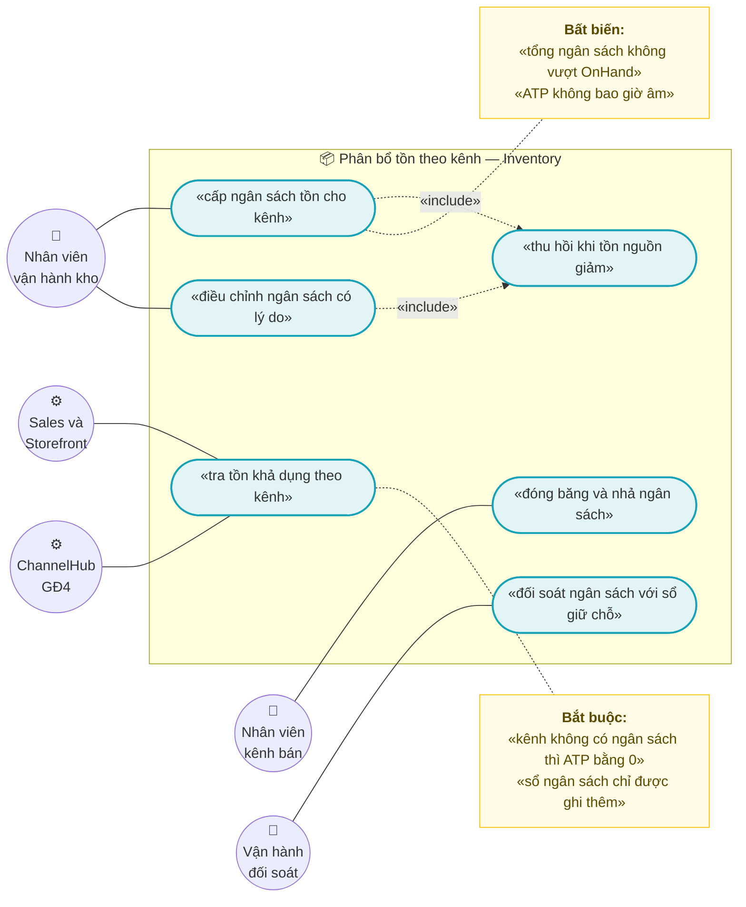
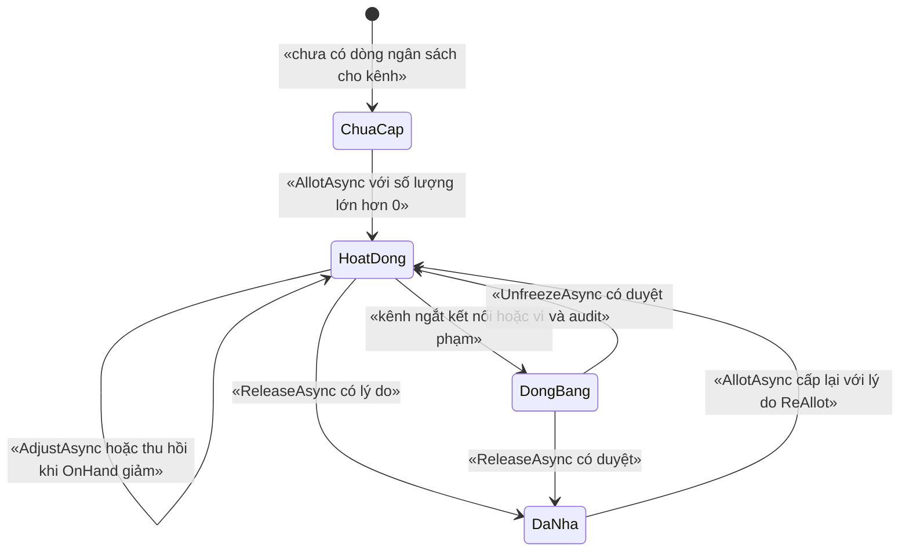
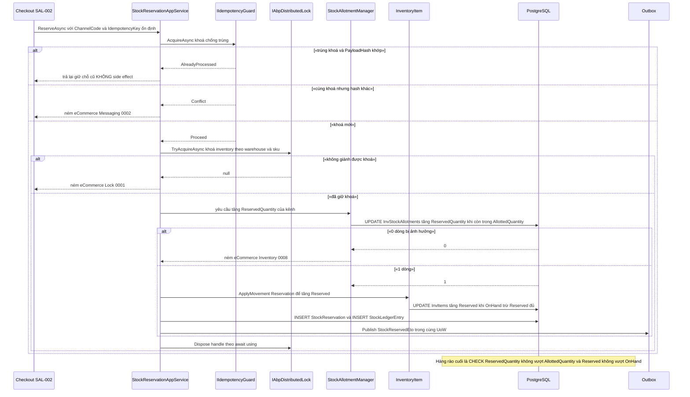

# `INV-003` — Phân bổ tồn theo kênh và tra tồn khả dụng

| Thuộc tính | Nội dung |
|---|---|
| **Mã** | `INV-003` |
| **Module** | **Inventory** — đề xuất `modules/Inventory/eCommerce.Inventory.Domain` · `.Application` · `.Application.Contracts` · `.EntityFrameworkCore`; entity hiện nằm ở `src/eCommerce.Domain/Entities/Inventory/StockLedger.cs` (`InventoryItem`, `StockLedgerEntry`) |
| **Giai đoạn** | **GĐ1 — Bán được** (`docs/implementation-plan.md:406`) |
| **Ưu tiên** | **Must have** — cùng `INV-002` là điều kiện của cổng kiểm soát GĐ1 *"Bán vượt tồn kho là không thể"* (`docs/implementation-plan.md:187`) |
| **Trạng thái** | 🟡 `Draft` — chờ review |
| **Người viết / người review** | *(điền)* / **Kiến trúc trưởng + BA** |
| **Phiên bản / ngày** | `v0.1 — 13/10/2026` |
| **Tài liệu liên quan** | `XC-001` (Money/decimal/làm tròn) · `XC-002` (outbox/inbox, idempotency, DLQ) · `XC-003` (khoá phân tán) · `XC-004` (permission/tenant/allowlist) · `XC-005` (log/metric) · `INV-001` (nhập/chuyển/kiểm kê, sổ cái) · `INV-002` (giữ chỗ + TTL) · `CHN-004` (allotment theo shop — **ranh giới**) · `REP-003` (báo cáo tồn kho) · `WEB-002` (storefront hiển thị mức tồn) · `SAL-002` (checkout/đặt hàng) · `docs/implementation-plan.md` · `docs/business-modules-proposal.md` |

---

## 📌 QUYẾT ĐỊNH CHỦ DỰ ÁN — 17/10/2026 (`Q4` = **A**)

> **`Percent` của hạn mức kênh tính trên tồn khả dụng của TỪNG `(kho, SKU)` — GIỮ NGUYÊN như code.**

| Mục | Nội dung |
|---|---|
| **Chốt** | `HanMucKenh.TinhHanMuc` = `floor(tồnKhảDụng × giaTri / 100)` trên tồn của **từng `(kho, SKU)`** (`src/eCommerce.Domain/Settings/HanMucKenh.cs:13,45`) — **không** phải tổng của cả kênh |
| **Phương án BỊ LOẠI** | Tính trên **tổng tồn của cả kênh** — muốn thế phải có **tồn mô hình hoá theo kênh** (`StockAllotment`, §5.2) mà **code chưa có** ⇒ chi phí lớn, không làm ở GĐ1 |
| **Vì sao** | Hạn mức là **trần an toàn theo từng kho**, **không** phải "ngân sách đã cấp cho kênh" ⇒ 📌 đây là **đọc lại nghĩa**, **không** đổi hành vi |
| **⚠️ Hệ quả bắt buộc — ĐỔI NHÃN UI (việc của `S7`)** | Nhãn *"hạn mức kênh"* dễ bị hiểu là ngân sách kênh ⇒ đổi thành **"trần an toàn của kênh theo từng kho"**, ghi rõ **% tính trên tồn của từng `(kho, SKU)`** trên màn hình + help text |
| **Ghi chú** | ✅ `DonVi` (`Percent`/`Absolute`) **ĐÃ có ở từng dòng** — nợ §16.8 #1 **đã đóng** |

---

## 0. Tóm tắt & quyết định thiết kế

**Tóm tắt:** `INV-003` chốt **phân bổ tồn kho theo kênh** (ngân sách tồn cấp cho từng `ChannelCode`) và **công thức duy nhất
của "tồn khả dụng" (Available-to-Promise — ATP)** để mọi kênh bán biết mình còn được bán bao nhiêu.
Điểm cốt lõi: **phân bổ là một phép CHIA tồn kho vật lý, không phải phép tạo tồn kho** ⇒ bất biến bảo toàn
`Σ ATP(kênh đang hoạt động) + Σ ngân sách(kênh đóng băng) = OnHand − Reserved` (**BR-04**) là bất biến kiểm thử được.

**Vì sao phải có tài liệu này — hiện trạng đã kiểm bằng `read`/`grep` trong repo:**

| # | Sự thật đã kiểm | Hệ quả |
|---|---|---|
| 1 | `InventoryItem` chỉ có `OnHand`, `Reserved`, `Available => OnHand - Reserved` (`src/eCommerce.Domain/Entities/Inventory/StockLedger.cs:19-25`) | **Không có** chiều "kênh" nào trong tồn kho: mọi kênh cùng nhìn **một** con số `Available` |
| 2 | Kiểm tra âm kho chỉ là `if (OnHand < 0 \|\| Reserved < 0)` (`StockLedger.cs:70-74`) | Không chặn được việc **cấp cho các kênh nhiều hơn tồn kho có thật** |
| 3 | `grep` toàn repo `*.cs`: **0** kết quả cho `StockAllotment` và `AvailableToPromise` | Toàn bộ feature này **CHƯA CÓ TRONG CODE** — kế hoạch **GĐ1** |
| 4 | `ChannelListing.AllottedQuantity` **có** trong entity + migration, nhưng **0** chỗ đọc/ghi ngoài khai báo (`modules/ChannelHub/eCommerce.ChannelHub.Domain/Entities/ChannelEntities.cs:142`; `src/eCommerce.EntityFrameworkCore/Migrations/20261009070214_Initial.cs:54`) | ⚠️ Nguy cơ **"nguồn sự thật thứ hai"** cho ngân sách; đã ghi nhận ở `CHN-004` §15.2 **F1** — xem **F2** §15.2 |
| 5 | `StockMovementType` **không có** thành viên nào cho phân bổ (`src/eCommerce.Domain.Shared/Enums.cs:26-48`) | Phân bổ **không phải** biến động kho vật lý ⇒ **cấm** thêm thành viên enum vào `StockMovementType` (xem **D2**) |
| 6 | `eCommerceConsts.Permissions.Inventory` chỉ có `Default` + `Adjust` (`src/eCommerce.Domain.Shared/eCommerceConsts.cs:27-31`) | Feature này cần **permission mới** cho cấp/điều chỉnh/nhả ngân sách (§9) |
| 7 | `eCommerceConsts.LockKeys.InventorySku` trả khoá **CÓ** tiền tố `ecommerce:` (`eCommerceConsts.cs:103-104`) trong khi `AbpDistributedLockOptions.KeyPrefix = "ecommerce:"` (`src/eCommerce.HttpApi.Host/eCommerceHttpApiHostModule.cs:127`) | 🚨 Khoá thật sẽ thành **`ecommerce:ecommerce:inventory:…`** (tiền tố đôi) — vi phạm `XC-003` §5.4 hệ quả 2; xem **F1** §15.2 |
| 8 | `Channel.HoldsInventory` **đã có** (`ChannelEntities.cs:21-22`) | Có sẵn dữ liệu để quyết định kênh nào **chiếm tồn kho** ⇒ chỉ kênh đó mới được cấp ngân sách (**BR-01**) |
| 9 | **Không có** entity `Warehouse` dù `InventoryItem.WarehouseId` là `Guid` (`StockLedger.cs:14`) | Danh mục kho thuộc `INV-001`; `INV-003` chỉ dùng `WarehouseId` (cùng ghi nhận với `INV-002` §0 dòng 32) |
| 10 | `grep "eCommerce.Kernel"` trên `*.cs` = **0** kết quả | `Money`/`LockKeyPrefix` của `XC-001`/`XC-003` **chưa có trong code** ⇒ `INV-003` **không** giả định có `Money` (xem §8.1 **BR-17**) |

> **Vì sao phải làm trước khi đấu sàn:** `CHN-004` (GĐ4) chỉ đẩy lên sàn **phần tồn đã cấp cho shop** và **điều kiện tiên quyết**
> của nó là *"`Inventory` đã phát `AvailableToPromise` cho `(warehouse, sku)` — chưa có trong code — kế hoạch GĐ4
> (phụ thuộc `INV-003`)"* (`docs/features/channel/chn-004-allotment-dong-bo-ton-da-kenh.md:71`).
> Nếu `INV-003` không chốt công thức ATP thì `CHN-004` sẽ **tự nghĩ ra công thức thứ hai** — đúng loại lỗi
> *"hai nguồn sự thật"* mà kế hoạch đã cảnh báo (`docs/business-modules-proposal.md:131`, `:172`).

**Phạm vi:**
- ✅ Entity `StockAllotment` (ngân sách tồn theo **kênh**) + sổ cái `StockAllotmentLedger` **append-only**.
- ✅ **Công thức ATP duy nhất** + domain service tính ATP (không lưu cột — **D3**).
- ✅ Luật **thu hồi ngân sách (reclaim)** tất định khi `OnHand` giảm (**D5**).
- ✅ **Tra tồn khả dụng**: API tra theo `(warehouse, sku, kênh)` (đọc "live" trong UoW) và bản cache cho storefront.
- ✅ Vòng đời ngân sách có **state machine ném lỗi** khi chuyển sai (§3).
- ✅ Idempotency ở **mọi biên vào** + khoá phân tán do module sở hữu.
- ✅ Sự kiện phát ra (`StockAllotmentChangedEto`, `InventoryItemChangedEto` — thứ mà `CHN-004` đang chờ).

**Không nằm trong phạm vi:**
- ❌ **Giữ chỗ (reservation) + TTL + job nhả kho** — thuộc **`INV-002`**; `INV-003` **mở rộng** luồng đó thêm **một guard**
  (ngân sách kênh), không định nghĩa lại (§7.6).
- ❌ **Nhập / chuyển / kiểm kê** và định nghĩa `StockLedgerEntry` — thuộc **`INV-001`**.
- ❌ **Ngân sách theo SHOP của sàn** (`ChannelAllotment` của `CHN-004`) — thuộc `CHN-004` (GĐ4); `INV-003` chỉ định nghĩa
  **trần theo kênh** mà ngân sách shop **phải nằm dưới** (§7.6).
- ❌ **Đẩy tồn/giá lên sàn** — thuộc `CHN-004`.
- ❌ **Báo cáo tồn kho luân chuyển** — thuộc `REP-003` (read-model của Reporting).
- ❌ **Bán nhiều kho cho một dòng đơn** (tách dòng theo kho) — `SAL-002` đã chốt **không tách ở GĐ1**
  (`docs/features/sales/sal-002-checkout-va-dat-hang.md:752`, `:969` Q5).
- ❌ **Giá trị tồn kho bằng tiền** (giá vốn × tồn) — thuộc `REP-002`/`ACC-001`.

### 0.1 Quyết định thiết kế (ADR ngắn)

| # | Quyết định | Phương án đã cân nhắc | Lý do chọn | Hệ quả |
|---|---|---|---|---|
| **D1** | Ngân sách cấp theo **KÊNH** (`ChannelCode`) ở GĐ1; `CHN-004` (GĐ4) cấp theo **SHOP** và **phải nằm dưới trần kênh** | (a) chỉ theo kênh · (b) chỉ theo shop · (c) **hai tầng: kênh (GĐ1) → shop (GĐ4)** | GĐ1 chưa có `ChannelShop` trong luồng bán website; nhưng `CHN-004` §15.1 **Q2** (`:883`) cho thấy ngân sách shop là nhu cầu thật của GĐ4. Hai tầng cho phép GĐ1 chạy được **mà không phải migrate lại** ở GĐ4 | Khi làm GĐ4 phải thêm ràng buộc `Σ ngân sách shop ≤ ngân sách kênh` (`CHN-004` BR-002 phải đọc trần này) |
| **D2** | Phân bổ **KHÔNG** phải biến động kho: **cấm** thêm thành viên vào `StockMovementType` | (a) thêm `Allotment` vào enum `StockMovementType` (`Enums.cs:26-48`) · (b) sổ cái riêng `StockAllotmentLedger` | Phân bổ **không** đổi `OnHand`/`Reserved` ⇒ nếu nhét vào sổ cái kho thì `BalanceAfter` của sổ cái kho trở nên **vô nghĩa** và bất biến `Σ ledger == OnHand` (nếu có) sẽ sai | Có **hai** sổ cái với hai chủ thể khác nhau; phải nói rõ trong tài liệu để không ai đối chiếu chéo sai |
| **D3** | **ATP KHÔNG lưu cột** trong bảng nghiệp vụ; chỉ có **một** hàm tính trong domain | (a) lưu cột `AvailableToPromise` · (b) tính ra | Lưu cột ⇒ hai nguồn số cho cùng một đại lượng (bài học `INV-002` **D2**, `docs/features/inventory/inv-002-giu-cho-reservation-ttl.md:63`). `CHN-004` **BR-003** cũng chốt `AvailableToPromise` **không lưu cột** (`CHN-004:288`) | Mọi truy vấn ATP phải qua domain service; muốn nhanh ⇒ **cache** (`D9`), **không** thêm cột |
| **D4** | **Hàng rào DB cho bất biến tổng** `Σ AllottedQuantity ≤ OnHand`: `SELECT … FOR UPDATE` trên hàng `InvItems` rồi kiểm lại trong **cùng transaction** | (a) chỉ tin lock Redis · (b) trigger `BEFORE INSERT/UPDATE` · (c) transaction `SERIALIZABLE` · (d) **`FOR UPDATE` hàng `InvItems`** | `XC-003` **D2/BR-007** đòi hỏi trả lời được *"bỏ lock đi, DB có chặn không?"*. `InvItems` đã có **đúng một** hàng cho mỗi `(TenantId, WarehouseId, Sku)` (unique index — `src/eCommerce.EntityFrameworkCore/eCommerceDbContext.cs:141`) ⇒ khoá hàng đó là **điểm tuần tự hoá tự nhiên**, không cần `SERIALIZABLE` (đắt, dễ deadlock) và không cần trigger (khó test, khó bảo trì) | Mọi đường ghi ngân sách **bắt buộc** chạy trong transaction có `FOR UPDATE`; nếu ai viết tắt ⇒ **review chặn** |
| **D5** | **Thu hồi ngân sách (reclaim) chạy TRONG cùng UoW** của mọi luồng làm giảm `OnHand`, theo thuật toán **tất định** | (a) job nền thu hồi sau · (b) thu hồi trong cùng UoW | (a) tạo **cửa sổ oversell** giữa lúc `OnHand` giảm và lúc job chạy ⇒ vi phạm **BR-03** trong khoảng đó. Cùng UoW thì hoặc cả hai cùng xong, hoặc cùng rollback | Luồng bán/điều chỉnh kho phải gọi lại domain service; thời gian transaction tăng nhẹ |
| **D6** | Kênh **không có** dòng ngân sách ⇒ **ATP = 0** (fail-closed), và giữ chỗ từ kênh đó bị **TỪ CHỐI** | (a) "không cấp = dùng chung toàn bộ tồn" · (b) **"không cấp = 0"** | (a) khiến **mọi kênh mới** tự động tiêu thụ tồn chưa phân bổ ⇒ không kiểm soát được; đúng loại **fail-open** mà `XC-004` §3 (`:148`) gọi là *"lỗ hổng bảo mật, không phải tiện lợi"* | **Bắt buộc** có seed/CLI cấp ngân sách ban đầu (nhất là kênh `web`) trước khi mở bán — **Q4** §15.1 |
| **D7** | `StockAllotmentLedger` **append-only**; mỗi thay đổi ngân sách sinh **đúng một** dòng, **cùng UoW** | (a) chỉ bảng trạng thái · (b) chỉ sổ cái · (c) **cả hai** | Cùng lý do `CHN-004` **D2** (`CHN-004:48`): đọc nhanh cần bảng trạng thái, đối soát cần sổ cái. Bất biến #6 của dự án: sổ cái **append-only** | Hai bảng phải **luôn** đi cùng transaction ⇒ test `TC-14` |
| **D8** | **Đóng băng (Freeze)** ngân sách khi kênh `IsActive = false` / `HoldsInventory = false` / bị khoá do vi phạm; **cấm** tự nhả | (a) tự nhả về nguồn chung · (b) đóng băng, nhả bằng tay có duyệt | Cùng lý do `CHN-004` **D10** (`CHN-004:56`): listing/kênh vẫn tồn tại sau khi ngắt; nhả ngay ⇒ kênh khác bán hết rồi kênh cũ quay lại bán tiếp phần đã nhả ⇒ **oversell thật** | Cần permission riêng cho "nhả ngân sách" + audit (**BR-12**) |
| **D9** | Tra tồn khả dụng có **HAI đường đọc tách biệt**: `Live` (trong UoW, cho luồng ghi) và `Cached` (Redis + vô hiệu hoá theo sự kiện, cho hiển thị) | (a) chỉ đọc DB mỗi lần · (b) chỉ cache · (c) **hai đường, và luồng ghi CẤM đọc cache** | (a) làm trang danh sách sản phẩm bắn N+1 truy vấn; (b) khiến checkout quyết định trên số **cũ** ⇒ oversell. Tách hai đường là cách duy nhất vừa nhanh vừa đúng | Luồng ghi **bắt buộc** `Live`; cache TTL ngắn + invalidation (`WEB-002` **ADR-07**, `docs/features/web/web-002-storefront-duyet-chi-tiet-san-pham.md:69`) |
| **D10** | **Idempotency ở MỌI biên vào** bằng `IIdempotencyGuard` + **unique index có filter** trên sổ cái | (a) chỉ kiểm trong code · (b) guard + unique index | `XC-002` **BR-004/BR-005** (`docs/features/cross-cutting/XC-002-outbox-inbox-chong-trung-su-kien.md:92`): *"mọi biên vào … phải idempotent: gọi `IIdempotencyGuard` trước mọi side effect"*; index là hàng rào cuối khi code sai | Phải thêm `IdempotencyKey` vào sổ cái + index `WHERE IdempotencyKey IS NOT NULL` |
| **D11** | **Inventory là nguồn sự thật DUY NHẤT** của ATP; `CHN-004` **tiêu thụ**, không được tính lại; `ChannelAllotmentChangedEto` (GĐ4) chỉ dùng để **kiểm tra trần** | (a) hai chiều cùng ghi ngân sách · (b) một chiều: Inventory sở hữu | `CHN-004` **D11** (`CHN-004:57`) nói rõ *"chỉ tiêu thụ `AvailableToPromise` của Inventory, không tự tính lại tồn"*, nhưng **D9** (`CHN-004:55`) lại nói Inventory phải tiêu thụ `ChannelAllotmentChangedEto` ⇒ nếu hiểu theo (a) thì **hai nguồn sự thật** — xem **F6** §15.2 | Phải **sửa `CHN-004` §7.2/D9** cho khớp; `INV-003` ghi rõ ràng buộc một chiều |
| **D12** | Khoá phân tán do **module Inventory tự sở hữu** (`InventoryConsts.LockKeys.*`), tên khoá **KHÔNG** chứa tiền tố `ecommerce:` | (a) giữ `eCommerceConsts.LockKeys` (app) · (b) consts của module | `XC-003` **D3** (`XC-003:46`) cấm ghép chuỗi khoá rải rác; `XC-003` §5.4 hệ quả 2 (`XC-003:255`) chốt *"tên khoá do module sinh KHÔNG chứa tiền tố"*; `XC-003` **F4** (`XC-003:537`) đã ghi nợ việc chuyển `InventorySku` về module | Phải **sửa** `eCommerceConsts.LockKeys.InventorySku` (bỏ tiền tố) hoặc **chuyển** về module — **F1** §15.2 (chưa sửa) |

---

## 1. Use Case Specification

| Thuộc tính | Nội dung |
|---|---|
| **Use Case ID** | `INV-003` |
| **Use Case Name** | Chia tồn kho vật lý cho từng kênh bán và trả lời **"kênh này còn bán được bao nhiêu"** một cách nhất quán |
| **Description** | *"Là hệ thống bán đa kênh, tôi muốn cấp cho mỗi kênh một phần tồn kho xác định và tra được phần còn bán được của kênh đó, để một kênh không tiêu thụ mất phần tồn đã hứa cho kênh khác — và để con số hiển thị cho khách không bao giờ vượt tồn kho có thật."* |
| **Actor(s)** | **Nhân viên vận hành kho** (cấp/điều chỉnh ngân sách, đóng băng, nhả) · **Nhân viên kênh** (xem ATP của kênh mình) · **Hệ thống Sales/Checkout** (`SAL-002` — đọc ATP **live** trước khi giữ chỗ) · **Hệ thống Storefront** (`WEB-002` — hiển thị **mức** tồn) · **Hệ thống ChannelHub** (`CHN-004`, GĐ4 — tiêu thụ ATP) · **Job đối soát** · **Vận hành** (xem lệch, chạy sửa có duyệt) |
| **Priority** | **Must have** |
| **Trigger** | (a) vận hành cấp/điều chỉnh ngân sách cho `(kênh, kho, SKU)`; (b) `CHECKOUT` cần biết ATP của kênh trước khi giữ chỗ; (c) `OnHand` giảm (bán/điều chỉnh/chuyển kho/trả hàng ngược) ⇒ phải thu hồi; (d) kênh bị ngắt kết nối/`HoldsInventory=false` ⇒ đóng băng; (e) job đối soát phát hiện lệch; (f) trang sản phẩm cần hiển thị mức tồn |
| **Pre-Condition(s)** | • **Tenant hiện tại** (`TenantId` từ `ICurrentTenant`) — **bắt buộc**; mọi bảng của feature là `IMultiTenant` (**BR-13**).<br>• **`InventoryItem` cho `(tenantId, warehouseId, sku)` đã tồn tại** — **cấm** tự tạo (unique index đã có: `eCommerceDbContext.cs:141`; xem **BR-19**).<br>• **`ChannelCode`** — **bắt buộc** (đây chính là chiều phân bổ). Kênh **phải** có `HoldsInventory = true` (`ChannelEntities.cs:22`); kênh chỉ-hiển-thị **bị từ chối** (**BR-01**).<br>• **`WarehouseId`** xác định — entity `Warehouse` thuộc `INV-001` (**chưa có trong code**, xem **F4** §15.2).<br>• **Redis 7** sẵn sàng **nhưng không phải điều kiện sống còn**: nếu Redis chết thì khoá vô hiệu, còn `FOR UPDATE` + CHECK ở DB vẫn chặn (**BR-11**, `XC-003` D2; `AbortOnConnectFail = false` tại `eCommerceHttpApiHostModule.cs:141`).<br>• **Đã cấu hình outbox tường minh** (`XC-002` §6.3) — nếu thiếu, sự kiện rơi về dual-write **không báo lỗi**.<br>• **Đã cấp ngân sách ban đầu cho kênh bán chính** (mặc định `web`): **nếu chưa cấp thì ATP = 0** và mọi giữ chỗ **bị từ chối** (D6, **Q4** §15.1). |
| **Post-Condition(s)** | • **Hoặc** có đúng **một** `StockAllotment` cho `(TenantId, WarehouseId, Sku, ChannelCode)`, **hoặc** không có gì thay đổi (idempotent — **BR-09**).<br>• `Σ AllottedQuantity` (mọi dòng `Active`/`Frozen`) **≤ `OnHand`** và `ReservedQuantity ≤ AllottedQuantity` **ở mọi thời điểm** (**BR-02**, **BR-03**).<br>• Bất biến bảo toàn: `Σ_{Active} ATP(kênh) + Σ_{Frozen} AllottedQuantity = OnHand − Reserved` (**BR-04**).<br>• Mỗi thay đổi ngân sách có **đúng một** dòng `StockAllotmentLedger` mới, **không** bản ghi nào bị UPDATE/DELETE (**BR-07**).<br>• Mọi truy vấn ATP trả kèm `ComputedAtUtc` + `Source` (`Live`/`Cached`) để người dùng biết số có thể trễ bao lâu (**BR-18**). |
| **Basic Flow** | 1. Vận hành gọi `AllotAsync(kênh, kho, SKU, số lượng, lý do, IdempotencyKey)`.<br>2. App service gọi `IIdempotencyGuard.AcquireAsync` (**`XC-002` BR-004**) ⇒ `Proceed` / `AlreadyProcessed` / `Conflict`.<br>3. Giành khoá `inventory:allotment:{tenantId}:{warehouseId}:{sku}` (timeout **10 s**, chế độ `ThrowOnTimeout`).<br>4. Trong phạm vi khoá, **trong một transaction**: `SELECT … FROM "InvItems" … FOR UPDATE` (hàng `(TenantId, WarehouseId, Sku)`) — **D4**.<br>5. Đọc `OnHand` + `Σ AllottedQuantity` hiện tại; nếu `Σ + delta > OnHand` ⇒ **NÉM** `eCommerce:Inventory:0007` + rollback.<br>6. Cập nhật `StockAllotment` (tạo mới hoặc điều chỉnh) + ghi **một** dòng `StockAllotmentLedger`.<br>7. Phát `StockAllotmentChangedEto` **trong cùng UoW, `useOutbox: true`** (**BR-15**).<br>8. Nhả khoá (`await using`), commit UoW ⇒ **dữ liệu + outbox + sổ cái cùng sống hoặc cùng chết**.<br>9. Phát **cache invalidation** cho `(warehouse, sku)` (allowlist của `XC-002` — `XC-002:765`). |
| **Alternative Flow** | **A1: Đọc ATP (đường nóng)** — `GetAvailabilityAsync` trả `Live` trong UoW cho luồng ghi; trả `Cached` (TTL ≤ **30 s**) cho hiển thị; **cấm** luồng ghi đọc `Cached` (**D9**, **BR-18**).<br>**A2: `OnHand` giảm (bán/điều chỉnh/chuyển kho)** — domain service thu hồi **trong cùng UoW** theo thuật toán **D5**; ledger ghi `Reason = ReclaimOnStockDecrease`.<br>**A3: Kênh bị ngắt kết nối** — `FreezeAsync` **không** nhả ngân sách (nó vẫn "treo" phần tồn đó, **D8**); ATP của kênh = 0 nhưng phần ngân sách **vẫn bị trừ khỏi phần bán được của kênh khác** ⇒ đóng băng **không** giải phóng tồn.<br>**A4: Cấp lại sau khi đã nhả** — `Released → Active` qua `AllotAsync` với `Reason = ReAllot` (khác `INV-002`: trạng thái `Released` **không** hấp thụ — xem §3).<br>**A5: Nhập ngân sách hàng loạt (CSV)** — mỗi dòng là một `AllotAsync` idempotent; dòng lỗi **không** huỷ cả lô; kết quả trả theo dòng.<br>**A6: Job đối soát phát hiện lệch** — ghi metric + cảnh báo; **không** tự sửa; lệnh `ReconcileFixAsync` cần permission + lý do (**BR-16**). |
| **Exception Flow** | **E1:** `Σ AllottedQuantity + delta > OnHand` ⇒ **`eCommerce:Inventory:0007`** + rollback toàn bộ UoW.<br>**E2:** giữ chỗ vượt ngân sách kênh (`ReservedQuantity + q > AllottedQuantity`) ⇒ **`eCommerce:Inventory:0008`** (không kẹp về 0 — **BR-06**).<br>**E3:** kênh chưa được cấp ngân sách ⇒ **`eCommerce:Inventory:0009`** (fail-closed, **D6**).<br>**E4:** chuyển trạng thái sai (ví dụ `Released → Frozen`, `Frozen → Frozen`) ⇒ **`eCommerce:Inventory:0010`** — **cấm** no-op im lặng (`XC-002` BR-009).<br>**E5:** thao tác tiêu thụ trên ngân sách đang `Frozen` ⇒ **`eCommerce:Inventory:0011`**.<br>**E6:** thiếu `Reason` khi điều chỉnh/nhả/đóng băng ⇒ **`eCommerce:Inventory:0012`**.<br>**E7:** `UPDATE … WHERE` ảnh hưởng **0 dòng** ở **bất kỳ** bước ghi nào ⇒ **NÉM LỖI** (`XC-002` E7, `XC-002:91`) — **cấm** coi là thành công.<br>**E8:** không giành được khoá trong timeout ⇒ **`eCommerce:Lock:0001`** (`XC-003` §6.2) — **không** tạo mã riêng của Inventory.<br>**E9:** cùng `IdempotencyKey` nhưng **khác** payload ⇒ **`eCommerce:Messaging:0002`** (`XC-002` BR-006) — **không** ghi đè.<br>**E10:** đối soát phát hiện lệch `ReservedQuantity` ⇒ **`eCommerce:Inventory:0013`** khi ai đó cố "sửa tay" mà không đúng luồng. |
| **Business Rules** | Xem **§8.1** — **20 BR** (`BR-01`…`BR-20`) phát biểu đầy đủ ở đó (nguồn sự thật duy nhất, không lặp hai nơi). |
| **Non-Functional Requirement** | Xem **§13** — **11 NFR** (`NFR-01`…`NFR-11`). |

> **Ghi chú về `TenantId` + `ChannelCode` (theo mẫu §1):** `TenantId` **bắt buộc** (mọi bảng là `IMultiTenant`, index dùng
> `NULLS NOT DISTINCT` theo `XC-004` **BR-009**). `ChannelCode` **chính là** chiều phân bổ của feature này — khác `INV-002`
> (nơi `ChannelCode` chỉ là chiều dữ liệu phụ), và khác `XC-001` (nơi `ChannelCode` **không** áp dụng).

---

## 2. Sơ đồ Use Case



### Chú giải

| Ký hiệu | Ý nghĩa |
|---|---|
| ⭕ Xanh lá | Actor (người dùng + hệ thống) |
| 🟦 Bầu dục xanh dương | Use Case |
| 🟨 Khung vàng | Note (bất biến / quy tắc bắt buộc) |
| `───` | Liên kết Actor ↔ Use Case |
| `-.«include».->` | Quan hệ bao hàm (thu hồi là **bắt buộc** đi kèm mọi thay đổi ngân sách) |

---

## 3. Vòng đời ngân sách kênh (state machine)



**Bảng chuyển trạng thái & guard (mọi chuyển sai **phải ném lỗi**, không im lặng):**

| # | Từ → Sang | Ai được phép | Guard (điều kiện cho phép) | Hành động kèm theo | Nếu guard sai |
|---|---|---|---|---|---|
| 1 | `[*] → HoatDong` | app service (permission `Allotment.Manage`) | `HoldsInventory = true`; `InventoryItem` tồn tại; `Quantity > 0`; `Σ Allotted + Quantity ≤ OnHand` (trong transaction có `FOR UPDATE`); `Reason` không rỗng | Tạo `StockAllotment` + **một** dòng ledger (`ManualAllot`) + outbox | Thiếu `InventoryItem` ⇒ **`0009`**; vượt `OnHand` ⇒ **`0007`**; thiếu `Reason` ⇒ **`0012`**; kênh không chiếm tồn ⇒ **`0009`** |
| 2 | `HoatDong → HoatDong` | app service / **domain service** (khi thu hồi) | Với `AdjustAsync`: `Reason` bắt buộc + `Σ` sau điều chỉnh `≤ OnHand` + `AllottedQuantity ≥ ReservedQuantity`. Với thu hồi: `OnHand` giảm và `Σ Allotted > OnHand` | Cập nhật `AllottedQuantity` + ledger (`ManualAdjust` / `ReclaimOnStockDecrease`) | Thu hồi xuống dưới `ReservedQuantity` ⇒ **NÉM** `InvalidOperationException` (lỗi lập trình — **BR-08**) |
| 3 | `HoatDong → DongBang` | app service (permission `Allotment.Release`) **hoặc** job (khi phát hiện kênh `IsActive = false`) | `Reason` bắt buộc; ghi `FrozenAtUtc`, `FrozenBy` | Ledger `Freeze` (delta 0, `AllottedAfter` giữ nguyên) + audit | Thiếu `Reason` ⇒ **`0012`**; đã `DongBang` ⇒ **`0010`** |
| 4 | `DongBang → HoatDong` | app service (permission `Allotment.Release`) | Có `ApprovedBy` + `Reason`; **vẫn** phải thoả `Σ Allotted ≤ OnHand` tại thời điểm mở | Ledger `Unfreeze` + audit | Vi phạm bất biến tổng ⇒ **`0007`**; thiếu duyệt ⇒ **`0010`** |
| 5 | `HoatDong → DaNha` | app service (permission `Allotment.Release`) | `Reason` bắt buộc; `ReservedQuantity = 0` **hoặc** có cờ `ForceRelease` + duyệt (phần đang giữ chỗ phải xử lý trước) | `AllottedQuantity = 0`, ledger `Release` (delta âm) | Còn giữ chỗ mà không có duyệt ⇒ **`0010`** |
| 6 | `DongBang → DaNha` | app service (permission `Allotment.Release`) | Có `ApprovedBy` + `Reason` | như #5 | như #5 |
| 7 | `DaNha → HoatDong` | app service (permission `Allotment.Manage`) | `Quantity > 0`, `Reason = ReAllot`, bất biến tổng thoả | Ledger `ReAllot` | Vượt `OnHand` ⇒ **`0007`** |
| 8 | `DaNha → DongBang`, `DongBang → DongBang` | **KHÔNG** ai | — | — | **NÉM** `0010` |
| 9 | Mọi trạng thái → tiêu thụ ngân sách khi `DongBang` | app service giữ chỗ | — | — | **NÉM** `0011` |

> ⚠️ **Hai điểm dễ hiểu sai (ghi rõ để review):**
> 1. **`DaNha` KHÔNG phải trạng thái hấp thụ.** Khác `INV-002` (`Consumed`/`Cancelled`/`Expired` là hấp thụ —
>    `docs/features/inventory/inv-002-giu-cho-reservation-ttl.md:185-186`), ngân sách kênh **có thể được cấp lại** sau khi nhả.
>    Lý do: unique index `(TenantId, WarehouseId, Sku, ChannelCode)` chỉ cho **một** hàng cho mỗi kênh
>    ⇒ nếu `DaNha` hấp thụ thì phải **xoá mềm** rồi tạo hàng mới, làm phức tạp truy vấn và phá vết đối soát.
> 2. **`DongBang` không miễn nhiễm với thu hồi.** Đóng băng chỉ chặn **tiêu thụ thêm** và **nhả tự động**; khi `OnHand`
>    giảm, thu hồi **vẫn có thể** lấy từ phần tự do của hàng `DongBang` (nếu không lấy thì **BR-03** vỡ).
>    Ledger ghi `Reason = ReclaimWhileFrozen` + cảnh báo cho vận hành, vì khi mở băng kênh sẽ thấy ít hơn dự kiến.

---

## 4. Sequence Diagram & luồng dữ liệu

### 4.1 Giữ chỗ có guard ngân sách kênh — 3 tầng bảo vệ



### 4.2 Thu hồi ngân sách khi `OnHand` giảm — thuật toán tất định (D5)

| Bước | Nội dung | Ghi chú |
|---|---|---|
| 1 | Tính `deficit = Σ AllottedQuantity − OnHand` (mọi dòng `Active` + `Frozen`) | `deficit ≤ 0` ⇒ **không làm gì** (không ghi ledger, không log `Information` — tránh ngập log, `XC-005` BR-004) |
| 2 | Tính `pool(c) = AllottedQuantity(c) − ReservedQuantity(c)` cho từng dòng | `pool ≥ 0` được **DB bảo đảm** bằng CHECK `ReservedQuantity ≤ AllottedQuantity` |
| 3 | Sắp xếp các dòng theo `(Priority tăng dần, ChannelCode tăng dần)` | `Priority` nhỏ = **ưu tiên giữ ngân sách** (cùng quy ước `CHN-004:294`); `ChannelCode` là tie-break **tất định** để test được |
| 4 | Thu theo **tỉ lệ phần tự do**, làm tròn bằng **phần dư lớn nhất** cho tới khi hết `deficit` | Cần thuật toán bảo toàn tổng — `XC-001` **D7** (`docs/features/cross-cutting/XC-001-money-currency-lam-tron.md:45`) là tiền lệ; ở đây là số nguyên nên dùng chính phương pháp đó |
| 5 | Nếu `deficit > Σ pool` ⇒ **NÉM** `InvalidOperationException` | Chứng minh được là **không thể xảy ra** nếu CHECK `Reserved ≤ OnHand` (của `INV-002`) tồn tại: `deficit ≤ Σ pool ⟺ ReservedTotal(kênh) ≤ OnHand`. Đây là **giả định 1** §15.3 ⇒ phải **assert**, không được bỏ qua |
| 6 | Ghi **một** dòng ledger cho **mỗi** dòng bị thu hồi (`Reason = ReclaimOnStockDecrease`, `ReferenceType = "StockMovement"`, `ReferenceId = <id bút toán kho>`) | Truy vết được "vì sao ngân sách giảm" — đúng yêu cầu `StockLedgerEntry.ReferenceType/ReferenceId` (`StockLedger.cs:101-103`) |

> 📌 **Ai gọi thu hồi:** `INV-001` (điều chỉnh/kiểm kê/chuyển kho) và `INV-002` (chốt bán — `CommitAsync` làm giảm
> `OnHand`) đều đang nằm **trong cùng module Inventory** ⇒ gọi được **domain service** trực tiếp, **không** vướng
> quy tắc "module không gọi app" (quy ước #3). Đây là lý do kỹ thuật để `INV-003` thuộc module Inventory (**D12**).

### 4.3 Luồng tra tồn khả dụng — hai đường đọc (D9)

| Đường | Ai dùng | Nguồn đọc | Độ trễ chấp nhận | Cấm |
|---|---|---|---|---|
| **`Live`** | `SAL-002` (checkout), `CHN-004` (GĐ4), màn hình vận hành | `InvItems` + `InvStockAllotments` **trong cùng UoW/transaction** | 0 (đọc trong transaction) | **Cấm** đọc cache; **cấm** đọc từ bản chiếu |
| **`Cached`** | `WEB-002` (trang danh sách/chi tiết), banner khuyến mãi | Redis (khoá `inventory:availability:{tenantId}:{warehouseId}:{sku}:{channelCode}`) + vô hiệu hoá theo sự kiện | ≤ `AvailabilityCacheTtlSeconds` (**mặc định 30 s**) + invalidation p95 ≤ **2 s** | **Cấm** dùng để quyết định giữ chỗ (**BR-18**) |

### 4.4 Không vẽ thêm sơ đồ — lý do

Tài liệu giới hạn **tối đa 3 sơ đồ**. **Use Case** (§2), **state machine** (§3) và **sequence giữ chỗ có guard kênh** (§4.1)
đã phủ: ai làm gì, vòng đời ngân sách, và đường đi nguy hiểm nhất (giữ chỗ — nơi có thể gây oversell).
**DFD riêng** trùng thông tin với §4.1–4.3; **ERD riêng** bị thay bằng **bảng quan hệ §5.1** + **Data Dictionary §5.2**
(đúng cách `INV-002` §5.1 đã làm — `docs/features/inventory/inv-002-giu-cho-reservation-ttl.md:304`). Đây là lựa chọn có ý thức,
không phải bỏ sót.

---

## 5. Mô hình dữ liệu

### 5.1 ERD

**Không vẽ ERD bằng Mermaid — lý do:** đã dùng đủ **3 sơ đồ** (§2, §3, §4.1). Quan hệ dữ liệu mô tả bằng bảng:

| Từ | Quan hệ | Đến | Ghi chú |
|---|---|---|---|
| `InventoryItem` | 1 — n | `StockAllotment` | theo `(TenantId, WarehouseId, Sku)`; **không** khai báo FK cứng (giữ ranh giới aggregate, cùng cách `INV-002` §5.1 map — `INV-002:308`) |
| `StockAllotment` | 1 — n | `StockAllotmentLedger` | qua `StockAllotmentId` |
| `StockAllotment` | 1 — n | `StockReservation` (`INV-002`) | **liên kết logic** theo `(TenantId, WarehouseId, Sku, ChannelCode)` — đây là **chi tiết** đứng sau `ReservedQuantity` (**BR-16**) |
| `StockAllotment` | n — 1 | `Channel` (module ChannelHub) | **tham chiếu mềm** bằng `ChannelCode` (chuỗi), **không** FK: entity `Channel` nằm trong module khác (`modules/ChannelHub/.../ChannelEntities.cs:9`) và module không được tham chiếu app |
| `StockAllotmentLedger` | n — 1 | `StockLedgerEntry` (khi do biến động kho gây ra) | **tham chiếu mềm** qua `ReferenceType = "StockMovement"` + `ReferenceId` |

> 📌 **Cố ý KHÔNG khai báo khoá ngoại** giữa module Inventory và `Channel`/`ChnChannelShops`: giữ được ranh giới module
> (quy ước #3) và không chặn việc tách microservice ở GĐ4. `ChannelCode` là **tham chiếu mềm**, cùng quy ước với
> `StockLedgerEntry.ChannelCode` (`StockLedger.cs:105-106`) và `Order.ChannelCode` (`eCommerceDbContext.cs:168`).

### 5.2 Bảng & cột (Data Dictionary)

#### 5.2.1 Entity **MỚI** `StockAllotment` → bảng `InvStockAllotments`

> 🆕 **CHƯA CÓ TRONG CODE** — kế hoạch **GĐ1** (`docs/implementation-plan.md:179` liệt kê `StockAllotment`;
> `docs/business-modules-proposal.md:79` cũng liệt kê). Toàn bộ cột dưới đây là **thiết kế đề xuất**.

| Cột | Kiểu | Null? | Ý nghĩa | Ghi chú |
|---|---|---|---|---|
| `Id` | `uuid` | ✖ | PK | `FullAuditedAggregateRoot<Guid>` như các entity hiện có |
| `TenantId` | `uuid` | ✔ | tenant sở hữu | **BẮT BUỘC có giá trị** ở tầng ứng dụng (**BR-13**); unique index phải `NULLS NOT DISTINCT` (`XC-004` BR-009) |
| `WarehouseId` | `uuid` | ✖ | kho nguồn | khớp `InventoryItem.WarehouseId` (`StockLedger.cs:14`) |
| `Sku` | `varchar(64)` | ✖ | SKU | khớp `InvItems.Sku` (`eCommerceDbContext.cs:137`) |
| `ChannelCode` | `varchar(32)` | ✖ | **kênh được cấp ngân sách** | khớp `StockLedgerEntry.ChannelCode` (`eCommerceDbContext.cs:152`) và `Channel.Code` (`ChannelEntities.cs:12`) |
| `AllottedQuantity` | `int` | ✖ | **ngân sách** đã cấp | `≥ 0`; **`int`**, không `decimal` (đây là **số lượng**, không phải tiền) |
| `ReservedQuantity` | `int` | ✖ | phần **đang giữ chỗ** thuộc kênh này | là **bản sao tổng hợp** của sổ giữ chỗ `INV-002` — xem **D3**/**BR-16**; `0 ≤ ReservedQuantity ≤ AllottedQuantity` |
| `AvailableToPromise` | *(tính ra — **KHÔNG** lưu cột)* | — | `AllottedQuantity − ReservedQuantity` (khi `Active`); **`0`** khi `Frozen`/`Released` | **BR-18**; giữ **một chiều** dữ liệu, tránh lệch (cùng triết lý `XC-001` D5) |
| `Priority` | `int` | ✖ | thứ tự ưu tiên **thu hồi** | số **nhỏ** = ưu tiên giữ ngân sách (cùng quy ước `CHN-004:294`) |
| `Status` | `int` | ✖ | `Active=0` · `Frozen=1` · `Released=2` | enum mới `StockAllotmentStatus`; `ChuaCap` **không** là giá trị lưu — nó là **không có hàng** (**D6**) |
| `FrozenAtUtc` / `FrozenByUserId` | `timestamptz` / `uuid` | ✔ | đóng băng khi nào, bởi ai | **bắt buộc** khi `Status = Frozen` (**BR-12**) |
| `ReleasedAtUtc` / `ReleaseReason` | `timestamptz` / `varchar(512)` | ✔ | nhả khi nào, vì sao | `ReleaseReason` **bắt buộc** khi `Status = Released` |
| `RowVersion` | `xid` (`xmin`) | ✖ | đồng bộ hoá lạc quan | `.UseXminAsConcurrencyToken()`; ⚠️ **hiện chưa có** trên `InvItems` (`eCommerceDbContext.cs:132-142`); `INV-002` §5.2.3 cũng đề xuất thêm |
| `CreationTime` / `CreatorId` / `LastModificationTime` / `LastModifierId` / `IsDeleted` / `DeleterId` / `DeletionTime` | — | — | trường kiểm toán của `FullAuditedAggregateRoot` | **`IsDeleted` dùng cho XOÁ MỀM của entity này** — **KHÔNG** áp dụng cho sổ cái |

#### 5.2.2 Entity **MỚI** `StockAllotmentLedger` → bảng `InvStockAllotmentLedgers`

> 🆕 **CHƯA CÓ TRONG CODE** — kế hoạch **GĐ1**. **APPEND-ONLY** (**BR-07**).

| Cột | Kiểu | Null? | Ý nghĩa | Ghi chú |
|---|---|---|---|---|
| `Id` | `uuid` | ✖ | PK | `FullAuditedEntity<Guid>` (như `StockLedgerEntry`, `StockLedger.cs:84`) |
| `TenantId` | `uuid` | ✔ | tenant | `IMultiTenant` |
| `StockAllotmentId` | `uuid` | ✖ | trỏ tới hàng ngân sách | |
| `WarehouseId` / `Sku` / `ChannelCode` | `uuid` / `varchar(64)` / `varchar(32)` | ✖ | **sao chép** để tra cứu không cần join | cùng phong cách `StockLedgerEntry` (`StockLedger.cs:88-90`) |
| `QuantityDelta` | `int` | ✖ | độ lệch (`+` cấp thêm, `−` thu hồi/nhả) | quy ước dấu tường minh |
| `AllottedAfter` | `int` | ✖ | số dư ngân sách sau điều chỉnh | để đối soát nhanh — **không** phải nguồn sự thật |
| `Reason` | `varchar(64)` | ✖ | `ManualAllot` · `ManualAdjust` · `ReclaimOnStockDecrease` · `ReclaimWhileFrozen` · `Freeze` · `Unfreeze` · `Release` · `ReAllot` · `ReconcileFix` | enum, **không** free text (`XC-006`/`CHN-004` cùng quy ước — `CHN-004:307`) |
| `ReferenceType` / `ReferenceId` | `varchar(64)` / `varchar(128)` | ✔ | nguồn gây ra (`"StockMovement"` + id bút toán kho) | khớp độ dài `StockLedgerEntry` (`eCommerceDbContext.cs:150-151`) |
| `IdempotencyKey` | `varchar(256)` | ✔ | khoá chống trùng của biên vào | `XC-002` BR-005/BR-007 |
| `OccurredAtUtc` | `timestamptz` | ✖ | thời điểm nghiệp vụ | ⚠️ `AbpClockOptions.Kind = Utc` |
| `PerformedByUserId` | `uuid` | ✔ | ai điều chỉnh (`null` = hệ thống/thu hồi) | **bắt buộc** cho `ManualAllot`/`ManualAdjust`/`Release` |

#### 5.2.3 Entity **ĐÃ CÓ** `InventoryItem` → `InvItems` — **thay đổi đề xuất**

| Hạng mục | Hiện trạng (đã kiểm) | Đề xuất `INV-003` | Lý do |
|---|---|---|---|
| `OnHand` / `Reserved` / `Available` | setter private, `Available` computed (`StockLedger.cs:19-25`) | **giữ nguyên** | `INV-003` **không** thêm cột tồn kho mới: ngân sách nằm ở bảng riêng |
| Ràng buộc `Reserved ≤ OnHand` | **chưa có** ở DB (chỉ có `if (OnHand < 0 \|\| Reserved < 0)` — `StockLedger.cs:70-74`) | ➕ **CHECK** (thuộc `INV-002` §5.2.3) — `INV-003` **phụ thuộc** | **Chứng minh thu hồi luôn khả thi** dựa vào ràng buộc này (§4.2 bước 5) |
| Đồng bộ lạc quan | **không có** cột version (`eCommerceDbContext.cs:132-142`) | ➕ `RowVersion` (`xmin`) — **khuyến nghị**, không bắt buộc vì `D4` dùng `FOR UPDATE` | Nếu không có `xmin` thì `FOR UPDATE` vẫn đủ cho `INV-003`; `xmin` giúp các luồng khác (`INV-002`) |
| Unique index | `(TenantId, WarehouseId, Sku)` đã `NULLS NOT DISTINCT` (`20261013024226_Fix_NullableTenantId_UniqueIndexes.cs:48-50`; test `test/eCommerce.IntegrationTests/PostgreSqlSchemaTests.cs:158`) | **giữ nguyên** | Đây **chính là** khoá hàng dùng cho `FOR UPDATE` (**D4**) |

#### 5.2.4 Entity **ĐÃ CÓ** `StockLedgerEntry` → `InvStockLedger` — **không đổi**

| Hạng mục | Hiện trạng (đã kiểm) | Kết luận |
|---|---|---|
| Append-only | Ghi rõ trong XML doc (`StockLedger.cs:80-83`) | ✅ Giữ — `INV-003` **không** thêm cột, **không** UPDATE/DELETE |
| `ChannelCode` | `varchar(32)`, `HasMaxLength(32)` (`eCommerceDbContext.cs:152`) | ✅ Đủ dùng làm chiều phân bổ/đối soát |
| `MovementType` | `StockMovementType` **không** có thành viên phân bổ (`Enums.cs:26-48`) | ✅ **Cố ý giữ nguyên** (**D2**) — phân bổ không phải biến động kho |
| Index hiện có | `(TenantId, WarehouseId, Sku, OccurredAtUtc)` và `(TenantId, ChannelCode, OccurredAtUtc)` (`eCommerceDbContext.cs:156,159`) | ✅ Index thứ hai **đủ** cho đối soát theo kênh |

#### 5.2.5 Quy ước tiền tệ (`XC-001`) — **Không áp dụng + lý do**

`INV-003` **không** có trường tiền nào: ngân sách, ATP, `ReservedQuantity` đều là **số lượng nguyên (`int`)**.
Vì vậy **BR-003** (*cấm so sánh tiền bằng `==`*) và **BR-008** (*cấm `double`/`float`*) của `XC-001`
(`docs/features/cross-cutting/XC-001-money-currency-lam-tron.md:64`) **không áp dụng trực tiếp** ở đây.

🔒 **Ràng buộc kèm theo (để không mở đường cho lỗi sau này):**
1. Nếu về sau thêm **bất kỳ** trường tiền nào vào feature này (ví dụ "giá trị tồn kho theo kênh") ⇒ **bắt buộc** dùng
   `Money`/`decimal` + `Currency`, **cấm** `double`/`float` và **cấm** so `==` (**BR-17**).
2. ⚠️ **Chưa kiểm chứng được:** `eCommerce.Kernel` (nơi `XC-001` §6.1 đặt `Money`) **chưa tồn tại trong repo** —
   `grep "eCommerce.Kernel"` trên mọi `*.cs` = **0** kết quả (xem **F5** §15.2; cùng kết luận với `EINV-001` §15.2 **F3**).
   ⇒ `INV-003` **không** giả định có `Money` ở GĐ1.

### 5.3 Index & ràng buộc (đề xuất — viết bằng EF + SQL thô khi cần)

| Loại | Bảng | Cột / biểu thức | Mục đích |
|---|---|---|---|
| **UNIQUE** `NULLS NOT DISTINCT` | `InvStockAllotments` | `(TenantId, WarehouseId, Sku, ChannelCode)` | **một** ngân sách cho mỗi kênh/kho/SKU; SQL thô vì EF Core **không** khai báo được `NULLS NOT DISTINCT` (tiền lệ: migration `20261013024226` + `XC-004` BR-009) |
| **INDEX** | `InvStockAllotments` | `(TenantId, WarehouseId, Sku)` | tính **bất biến tổng** `Σ AllottedQuantity` theo `(kho, SKU)` — **BR-03** |
| **INDEX** | `InvStockAllotments` | `(TenantId, ChannelCode, Status)` | màn hình vận hành + job quét kênh đang `Frozen` |
| **CHECK** | `InvStockAllotments` | `"AllottedQuantity" >= 0 AND "ReservedQuantity" >= 0` | **BR-02** (phần 1) |
| **CHECK** | `InvStockAllotments` | `"ReservedQuantity" <= "AllottedQuantity"` | **ATP không âm** ở tầng DB — **BR-02** (phần 2), đây là **hàng rào cuối** khi Redis chết (`XC-003` D2) |
| **CHECK** | `InvStockAllotments` | `"Status" <> 1 OR ("FrozenAtUtc" IS NOT NULL AND "FrozenByUserId" IS NOT NULL)` | **BR-12** — đóng băng phải có dấu vết |
| **CHECK** | `InvStockAllotments` | `"Status" <> 2 OR "ReleaseReason" IS NOT NULL` | **BR-12** — nhả phải có lý do |
| **UNIQUE có filter** | `InvStockAllotmentLedgers` | `(TenantId, IdempotencyKey) WHERE "IdempotencyKey" IS NOT NULL` | ⭐ **hàng rào chống trùng** của mọi biên vào (**BR-09**) |
| **INDEX** | `InvStockAllotmentLedgers` | `(TenantId, WarehouseId, Sku, OccurredAtUtc)` | lịch sử ngân sách của một SKU (đối soát, `REP-003`) |
| **INDEX** | `InvStockAllotmentLedgers` | `(TenantId, ChannelCode, OccurredAtUtc)` | đối soát theo kênh |
| ⚠️ **Không có CHECK đơn bảng cho BR-03** | — | `Σ AllottedQuantity ≤ OnHand` là bất biến **giữa nhiều dòng + khác bảng** ⇒ CHECK **không** diễn đạt được | Bảo vệ bằng **`SELECT … FOR UPDATE` trên `InvItems` + kiểm lại trong transaction** (**D4**), **không** dùng trigger/`SERIALIZABLE` — xem §12 và **Q3** §15.1 |

### 5.4 Công thức ATP — nguồn sự thật duy nhất

Ký hiệu: `wh` = kho, `sku` = SKU, `c` = kênh (`ChannelCode`).

| Đại lượng | Công thức | Nguồn dữ liệu | Trạng thái trong code |
|---|---|---|---|
| `OnHand(wh, sku)` | — | `InvItems.OnHand` | ✅ có (`StockLedger.cs:19`) |
| `Reserved(wh, sku)` | — | `InvItems.Reserved` | ✅ có (`StockLedger.cs:22`) |
| `Available(wh, sku)` | `OnHand − Reserved` | `InvItems.Available` | ✅ có (`StockLedger.cs:25`) |
| `AllottedTotal(wh, sku)` | `Σ AllottedQuantity` của các dòng `Active` + `Frozen` | `InvStockAllotments` | 🆕 chưa có |
| **`ATP(c)`** | `AllottedQuantity(c) − ReservedQuantity(c)` nếu `Status = Active`; **`0`** nếu `Frozen`/`Released` | `InvStockAllotments` | 🆕 chưa có |
| `ATP(kênh chưa cấp)` | **`0`** (fail-closed) | — | 🆕 (**D6**) |
| `HeldByFrozen` | `Σ_{Frozen} (AllottedQuantity − ReservedQuantity)` | `InvStockAllotments` | 🆕 chưa có |

> ⚠️ **Lưu ý quan trọng về `DongBang` (để công thức không sai):** đóng băng **KHÔNG** giải phóng phần đã giữ chỗ — một kênh `Frozen` **vẫn có thể** còn `ReservedQuantity > 0` (những giữ chỗ đã tạo trước khi đóng băng, phải được tôn trọng).
> Vì vậy "phần treo" phải là `AllottedQuantity − ReservedQuantity` (**phần tự do bị treo**), **không** phải `AllottedQuantity`.

**Bất biến bảo toàn (BR-04) — dạng đơn giản và đúng trong MỌI trạng thái:**

```
Σ_{mọi dòng có ngân sách} ( AllottedQuantity(c) − ReservedQuantity(c) )  +  Unallotted  =  Available
```

*Chứng minh ngắn:* vế trái `= (AllottedTotal − ReservedQuantityTotal) + (OnHand − AllottedTotal) = OnHand − ReservedQuantityTotal`.
Vì `D6` **chặn** mọi giữ chỗ từ kênh **không** có ngân sách, nên `ReservedQuantityTotal = Reserved` (mọi giữ chỗ đều nằm trong một dòng ngân sách — đây **chính là** đẳng thức mà **BR-16** đối soát)
⇒ vế trái `= OnHand − Reserved = Available`. ✔

| Thành phần | Ý nghĩa |
|---|---|
| `Σ_{Active} ATP(c)` | phần **bán được** (đã chia cho kênh đang hoạt động) |
| `HeldByFrozen` | phần **đang treo** (đã chia cho kênh bị đóng băng — **cố ý không bán được ở đâu**) |
| `Unallotted = OnHand − AllottedTotal` | phần **chưa cấp** — ⚠️ **cũng không bán được ở đâu** (vì `D6`: kênh không có ngân sách ⇒ ATP = 0) |
| **Bất biến viết theo ATP trả ra ngoài** | `Σ_{Active} ATP + HeldByFrozen + Unallotted = Available` *(suy ra từ dạng tổng quát ở trên, vì `Σ_{Active}(A−R) + Σ_{Frozen}(A−R) = Σ_{mọi dòng}(A−R)`)* |

> 🚨 **Hệ quả vận hành bắt buộc nhớ:** tồn kho **chưa cấp cho kênh nào** là tồn **không bán được**.
> Đây là đánh đổi có ý thức của **D6** (fail-closed) — và là lý do **Q4** (§15.1) phải được trả lời **trước khi mở bán**:
> nếu quên cấp ngân sách cho kênh `web` thì **website bán được 0** (rõ ràng, có mã lỗi), chứ **không** âm thầm bán
> phần tồn chưa phân bổ.

### 5.5 Enum mới `StockAllotmentStatus` — vị trí đề xuất

Đặt trong module Inventory (ví dụ `modules/Inventory/eCommerce.Inventory.Domain/StockAllotmentStatus.cs`), **không** thêm vào
`src/eCommerce.Domain.Shared/Enums.cs` — giữ ranh giới module (quy ước #3), theo đúng đề xuất của `INV-002` §5.3
(`docs/features/inventory/inv-002-giu-cho-reservation-ttl.md:375`).

---

## 6. Hợp đồng API

### 6.1 Application Service

```csharp
namespace eCommerce.Inventory.Allotments;

/// Ngân sách tồn theo kênh. Mọi method idempotent và mọi lỗi có MÃ (quy ước #11).
public interface IStockAllotmentAppService : IApplicationService
{
    Task<PagedResultDto<StockAllotmentDto>> GetListAsync(GetAllotmentsInputDto input);

    Task<StockAllotmentDto> AllotAsync(AllotStockDto input);          // cấp (hoặc cấp lại) ngân sách
    Task<StockAllotmentDto> AdjustAsync(AdjustAllotmentDto input);    // điều chỉnh (+/-) có lý do
    Task<StockAllotmentDto> FreezeAsync(FreezeAllotmentDto input);    // đóng băng (D8)
    Task<StockAllotmentDto> UnfreezeAsync(UnfreezeAllotmentDto input);// mở băng (cần duyệt)
    Task<StockAllotmentDto> ReleaseAsync(ReleaseAllotmentDto input);  // nhả hết về "chưa cấp"
    Task ReconcileFixAsync(ReconcileFixAllotmentDto input);           // sửa lệch có duyệt (BR-16)
}

/// Tra tồn khả dụng — HAI đường đọc (D9). Luồng ghi CHỈ được dùng *Live*.
public interface IStockAvailabilityAppService : IApplicationService
{
    /// Đọc LIVE (trong UoW) — dùng cho checkout/giữ chỗ/ChannelHub.
    Task<List<StockAvailabilityDto>> GetLiveAsync(GetAvailabilityDto input);

    /// Đọc qua cache — CHỈ cho hiển thị (WEB-002). Cấm dùng để quyết định ghi.
    Task<List<StockAvailabilityDto>> GetCachedAsync(GetAvailabilityDto input);
}

public sealed record AllotStockDto(
    Guid WarehouseId,
    string Sku,
    string ChannelCode,
    int Quantity,               // > 0
    int Priority,               // số nhỏ = ưu tiên giữ ngân sách
    string Reason,              // BAT BUOC (BR-12/E6)
    string IdempotencyKey);     // BAT BUOC, khoa on dinh (BR-10)

public sealed record AdjustAllotmentDto(
    Guid StockAllotmentId,
    int QuantityDelta,          // +/- ; khong duoc lam ReservedQuantity > AllottedQuantity
    string Reason,              // BAT BUOC
    string IdempotencyKey);

public sealed record ReleaseAllotmentDto(
    Guid StockAllotmentId,
    bool ForceRelease,          // true chi khi co duyet (con giu cho)
    string? ApprovedBy,
    string Reason,
    string IdempotencyKey);

public sealed record GetAvailabilityDto(
    Guid WarehouseId,
    IReadOnlyList<string> Skus,          // batch — cam N+1 (NFR-02)
    string? ChannelCode = null);         // null = tra cho MOI kenh co ngan sach

public sealed record StockAvailabilityDto(
    Guid WarehouseId,
    string Sku,
    string ChannelCode,
    bool IsAllotted,            // false => ATP = 0 voi ly do NotAllotted (D6)
    int OnHand,
    int ReservedTotal,          // InvItems.Reserved
    int AllottedQuantity,
    int ChannelReservedQuantity,
    int AvailableToPromise,     // = AllottedQuantity - ChannelReservedQuantity (Active) hoac 0
    int UnallottedQuantity,     // OnHand - AllottedTotal  (KHONG ban duoc o dau)
    string Status,              // Active / Frozen / Released / NotAllotted
    DateTime ComputedAtUtc,
    string Source);             // "Live" | "Cached"  (BR-18)
```

### 6.2 Domain service (bổ sung)

```csharp
namespace eCommerce.Inventory.Allotments;

/// Cong thuc ATP DUY NHAT (D3). Moi noi can ATP phai goi qua day.
public interface IStockAvailabilityCalculator
{
    int ComputeAtp(int allottedQuantity, int reservedQuantity, StockAllotmentStatus status);
    int ComputeUnallotted(int onHand, int allottedTotal);
}

/// Thu hoi nguong ngan sach khi OnHand giam — thuat toan tat dinh (D5, §4.2).
/// Goi TRONG cung UoW cua moi luong lam giam OnHand (INV-001 va INV-002).
public interface IStockAllotmentReclaimer
{
    /// Tra ve danh sach thay doi da ap dung (de ghi ledger + phat su kien).
    Task<IReadOnlyList<AllotmentChange>> ReclaimAsync(
        Guid warehouseId, string sku, int onHandAfterChange,
        string referenceType, string referenceId, CancellationToken ct = default);
}
```

> 📌 **`IStockAllotmentReclaimer` là chỗ DUY NHẤT được phép giảm `AllottedQuantity` ngoài `AdjustAsync`/`ReleaseAsync`.**
> **Cấm** tầng application tự `allotment.AllottedQuantity -= x` (đọc-rồi-ghi ⇒ **mất cập nhật** khi hai luồng chạy song song —
> đúng loại lỗi mà `INV-002` **D3** và `XC-003` **D2** sinh ra để chặn).

### 6.3 REST endpoint (ABP auto API controller)

| Method | Route (ABP sinh tự động) | Permission | Ghi chú |
|---|---|---|---|
| `GET` | `/api/app/stock-allotment` | `eCommerce.Inventory.Allotment` | danh sách ngân sách; **không** trả dữ liệu tenant khác (**BR-13**) |
| `POST` | `/api/app/stock-allotment/allot` | `eCommerce.Inventory.Allotment.Manage` | vượt `OnHand` ⇒ `409` `0007` |
| `POST` | `/api/app/stock-allotment/adjust` | `eCommerce.Inventory.Allotment.Manage` | **bắt buộc** `Reason` |
| `POST` | `/api/app/stock-allotment/freeze` | `eCommerce.Inventory.Allotment.Release` | **bắt buộc** `Reason` |
| `POST` | `/api/app/stock-allotment/unfreeze` | `eCommerce.Inventory.Allotment.Release` | **bắt buộc** `ApprovedBy` + `Reason` |
| `POST` | `/api/app/stock-allotment/release` | `eCommerce.Inventory.Allotment.Release` | còn giữ chỗ mà không `ForceRelease` ⇒ `409` `0010` |
| `POST` | `/api/app/stock-allotment/reconcile-fix` | `eCommerce.Inventory.Allotment.Manage` | sửa lệch `ReservedQuantity` có duyệt |
| `POST` | `/api/app/stock-availability/live` | `eCommerce.Inventory.Availability` | dùng cho nội bộ/checkout/`CHN-004` |
| `POST` | `/api/app/stock-availability/cached` | `eCommerce.Inventory.Availability` | dùng cho màn hình hiển thị |
| `POST` | `/api/app/stock-availability/public` | *(chưa chốt)* | ⚠️ **Projection công khai cho storefront** — xem **F7** §15.2 và **Q9** §15.1: cần bổ sung allowlist `[AllowAnonymous]` của `XC-004` (`XC-004:505`) **hoặc** để `WEB-002` tự phục vụ |

### 6.4 Mã lỗi

| Mã | HTTP | Khi nào | Thông điệp |
|---|---|---|---|
| `eCommerce:Inventory:0001` `InsufficientStock` | `409` | Không đủ tồn kho **vật lý** (`OnHand − Reserved < q`) | `Không đủ tồn kho khả dụng cho SKU {sku}.` — ✅ **đã có trong code** (`src/eCommerce.Domain.Shared/eCommerceConsts.cs:79`); đề xuất **chuyển** sang `InventoryErrorCodes` cùng giá trị (như `INV-002` §6.4) |
| `eCommerce:Inventory:0002`…`0006` | — | *(dải của `INV-002` — xem `INV-002` §6.4)* | ⬜ **chưa có trong code**; `INV-003` **không** dùng để tránh đụng mã |
| `eCommerce:Inventory:0007` `AllotmentExceedsStock` | `409` | `Σ AllottedQuantity + delta > OnHand` (**BR-03**) | `Tổng ngân sách cấp cho các kênh vượt tồn kho thực của kho. Cần thu hồi ở kênh khác.` |
| `eCommerce:Inventory:0008` `ChannelAllotmentExceeded` | `409` | Giữ chỗ vượt ngân sách kênh (**BR-06**) | `Kênh {channelCode} chỉ còn {atp} đơn vị được bán cho SKU {sku}.` |
| `eCommerce:Inventory:0009` `AllotmentNotFound` | `409` | Kênh chưa được cấp ngân sách (fail-closed, **D6**) | `Kênh {channelCode} chưa được cấp ngân sách tồn cho SKU {sku} — cần cấp trước khi bán.` |
| `eCommerce:Inventory:0010` `InvalidAllotmentStatus` | `409` | Chuyển trạng thái sai (§3) hoặc `UPDATE` 0 dòng (**E7**) | `Không thể chuyển trạng thái ngân sách từ {from} sang {to}.` |
| `eCommerce:Inventory:0011` `AllotmentFrozen` | `409` | Tiêu thụ/nhả tự động khi ngân sách đang `Frozen` | `Ngân sách của kênh {channelCode} đang bị đóng băng.` |
| `eCommerce:Inventory:0012` `ReasonRequired` | `400` | Thiếu `Reason`/`ApprovedBy` | `Thao tác thay đổi ngân sách bắt buộc phải có lý do.` |
| `eCommerce:Inventory:0013` `AllotmentDriftDetected` | `409` | Đối soát phát hiện lệch và có người cố sửa sai luồng (**BR-16**) | `Số liệu ngân sách lệch với sổ giữ chỗ — cần điều tra trước khi sửa.` |
| `eCommerce:Lock:0001` | `409` | Không giành được khoá phân tán | *(dùng mã dùng chung của `XC-003` §6.2 — **không** tạo mã riêng)* |
| `eCommerce:Messaging:0002` | `409` | Cùng `IdempotencyKey` + **khác** payload | *(dùng mã dùng chung của `XC-002` `XC-002:632`)* |

> ⚠️ **Quy ước dải mã:** `eCommerce:Inventory:0001` ✅ có thật trong code; `0002`…`0006` là **đề xuất của `INV-002`**
> (chưa có code). `INV-003` dùng từ **`0007`** để **không** tranh chấp dải mã. Lớp `InventoryErrorCodes`
> **chưa tồn tại trong code** — xem **F8** §15.2.

---

## 7. Sự kiện, tích hợp ngoài & idempotency

### 7.1 Sự kiện **phát ra** (ETO) — theo khuôn `XC-002` **D11** / hợp đồng `IntegrationEventBase`

| ETO | Trạng thái | Khi nào phát | Trường nghiệp vụ chính | Ai tiêu thụ | Ordering? | Idempotent bằng |
|---|---|---|---|---|---|---|
| `StockAllotmentChangedEto` | 🆕 *chưa có — GĐ1* | sau khi ngân sách `(kho, SKU, kênh)` đổi, **trong cùng UoW** | `TenantId`, `WarehouseId`, `Sku`, `ChannelCode`, `AllottedQuantity`, `ChangedQuantityDelta`, `ReservedQuantity`, `Reason`, `Status`, `OccurredAtUtc`, `AggregateVersion` | `CHN-004` (GĐ4 — kiểm tra trần kênh), `REP-003`, màn hình vận hành | ✅ theo `(warehouse, sku, channelCode)` | `IdempotencyKey = "{warehouseId}:{sku}:{channelCode}:{allottedQuantity}"` + `AggregateVersion` |
| `InventoryItemChangedEto` | 🆕 *chưa có — GĐ1* (⚠️ `CHN-004` **đang chờ** — `CHN-004:71`, `:513`) | sau khi `OnHand`/`Reserved` đổi **và** thu hồi đã xong, trong cùng UoW | `TenantId`, `WarehouseId`, `Sku`, `OnHand`, `Reserved`, `Available`, `AllottedTotal`, `Unallotted`, `BalanceAfter`, `AggregateVersion`, `OccurredAtUtc` | `CHN-004` (tính lại ngân sách shop), `REP-003`, `WEB-002` (xoá cache) | ✅ theo `(warehouse, sku)` | `IdempotencyKey = "Inv:{warehouseId}:{sku}:{balanceAfter}"` *(đúng dạng `CHN-004:513` mong đợi)* |
| `AvailabilityCacheInvalidationEto` | 🆕 *chưa có — GĐ1* | sau commit, khi ATP của `(kho, SKU)` đổi | `TenantId`, `WarehouseId`, `Sku`, `Version` | mọi instance (xoá cache), `WEB-002` | ❌ KHÔNG | tự nhiên (làm lại nhiều lần vô hại) |

> 📌 **`AvailabilityCacheInvalidationEto` nằm trong allowlist phát NGOÀI outbox** — `XC-002` **BR-002** cho phép **duy nhất**
> các sự kiện hạ tầng "làm lại được nhiều lần, mất cũng không sai dữ liệu" (`XC-002:765`). Hai ETO nghiệp vụ còn lại
> **bắt buộc** đi qua outbox (`useOutbox: true`, `XC-002` BR-001).

**Hợp đồng payload bắt buộc** (`IntegrationEventBase` — `XC-002:743-754`): `EventId`, `OccurredOn`, `AggregateId`,
`AggregateVersion`, `TenantId`, `ChannelCode`, `CorrelationId`.

> ⚠️ **`AggregateVersion` của `StockAllotment`:** `INV-003` chốt **tăng theo từng hàng `StockAllotment`**
> (`AggregateId = stockAllotmentId`) — khác `INV-002` (nơi quy tắc này còn **`Open`**, `INV-002:522`).
> Lý do: ngân sách là **một hàng độc lập cho mỗi kênh**, không có "tổng" nào cần thứ tự xuyên hàng.

### 7.2 Sự kiện / biên vào **nhận vào**

| Nguồn | Loại | Xác thực | Chống trùng bằng | Nếu xử lý lỗi | Thứ tự đến |
|---|---|---|---|---|---|
| HTTP: cấp/điều chỉnh/đóng băng/nhả ngân sách | `HTTP` | `[Authorize]` cấp class + permission (§9) | `IdempotencyKey` ổn định + UNIQUE filter trên sổ cái (**BR-09**) | `409` + rollback; không có side effect một phần (UoW) | ❌ không cần |
| Job **thu hồi** khi `OnHand` giảm | *(không phải biên vào riêng — chạy **trong cùng UoW** của luồng ghi)* | nội bộ | `ReferenceId` = id bút toán kho + UNIQUE filter | rollback cả UoW (không có "thu hồi một nửa") | — |
| Job **đối soát** định kỳ | `schedule` | nội bộ | `IdempotencyKey = "AllotReconcile:{tenantId}:{kỳ}"` (kỳ xác định — **không** dùng `DateTime.Now`, `XC-002:789`) | DLQ + retry; job phải chạy lại được | ❌ không cần |
| `ChannelAllotmentChangedEto` (**GĐ4** — từ `CHN-004`) | `distributed event` | nội bộ (đã qua outbox) | `InboxRecords` + `IdempotencyKey = "{channelShopId}:{sku}:{allottedQuantity}"` (`CHN-004:499`) | DLQ + retry | ✅ có thể sai ⇒ so `AggregateVersion` |
| `ProductVariantCreatedEto` (từ `CAT-001`) | `distributed event` | nội bộ | `Key = "Variant:{sku}:Created"` | DLQ | ❌ không cần |
| **CSV import ngân sách** (hàng loạt) | `file` | permission `Allotment.Manage` | `Import:{tenantId}:{sha256(fileContent)}` (`XC-002:788`) | trả kết quả **theo dòng**; dòng lỗi không huỷ lô | ❌ không cần |

> 🚨 **Sự kiện từ `CHN-004` `ChannelAllotmentChangedEto` chỉ được dùng để KIỂM TRA TRẦN** (D11): nếu ngân sách shop
> vượt trần kênh thì `INV-003` **phát cảnh báo + metric**, **KHÔNG** tự sửa ngân sách kênh. Lý do ở **F6** §15.2.

### 7.3 Gọi API **ra ngoài**

**Không áp dụng — lý do:** `INV-003` chỉ đọc/ghi DB nội bộ và phát sự kiện; **không** gọi NCC nào.
Việc **đẩy ngân sách lên sàn** thuộc `CHN-004` (`IChannelConnector.PushListingAsync`,
`modules/ChannelHub/eCommerce.ChannelHub.Application.Contracts/Connectors/IChannelConnector.cs:104`);
`INV-003` **chỉ** phát `StockAllotmentChangedEto`/`InventoryItemChangedEto` để module đó quyết định.

**Idempotency key — bảng quy tắc:**

| Đối tượng | Cách sinh khoá | ⚠️ Lưu ý |
|---|---|---|
| Cấp ngân sách | `Allot:{tenantId}:{warehouseId}:{sku}:{channelCode}:{quantity}` | **ổn định theo NỘI DUNG** (giống `CHN-004` **D6**). **Cấm** `Guid.NewGuid()` mỗi lần gọi (**BR-10**) |
| Điều chỉnh | `Adjust:{tenantId}:{stockAllotmentId}:{quantityDelta}:{reason}` | Đổi nội dung ⇒ khoá đổi ⇒ đúng là **việc mới** |
| Đóng băng / mở băng | `Freeze:{tenantId}:{stockAllotmentId}` · `Unfreeze:{tenantId}:{stockAllotmentId}` | Không chứa thời gian ⇒ retry cùng khoá |
| Nhả ngân sách | `Release:{tenantId}:{stockAllotmentId}` | idempotent tự nhiên |
| Thu hồi | `Reclaim:{tenantId}:{warehouseId}:{sku}:{referenceId}` | `referenceId` = id bút toán kho gây ra ⇒ chạy lại **không** thu 2 lần (**BR-11**) |
| Job đối soát | `AllotReconcile:{tenantId}:{kỳ}` | Kỳ xác định được (`XC-002:789`) |
| Sửa lệch | `ReconcileFix:{tenantId}:{stockAllotmentId}:{kỳ}` | Có duyệt + audit |

### 7.4 Ordering — chỗ nào cần

| Nhóm | Cần ordering? | Cách xử lý |
|---|---|---|
| `StockAllotmentChangedEto` cho **cùng** một hàng ngân sách | ✅ **CÓ** | `AggregateId = stockAllotmentId`; consumer giữ `AppliedVersion`; `version <= AppliedVersion` ⇒ **bỏ qua + log + metric**; `version > AppliedVersion + 1` ⇒ DLQ `FailureKind = OutOfOrder` (`XC-002` §7.4, `XC-002:804`) |
| `InventoryItemChangedEto` cho **cùng** `(kho, sku)` | ✅ **CÓ** | `AggregateId` = `"{warehouseId}:{sku}"`, `AggregateVersion` tăng theo `InventoryItem` |
| **Giữa các SKU/kênh khác nhau** | ❌ KHÔNG | độc lập |
| `AvailabilityCacheInvalidationEto` | ❌ KHÔNG | làm lại nhiều lần vô hại |

### 7.5 Idempotency — vì sao **lock KHÔNG** thay thế được idempotency

| | Khoá phân tán (`XC-003`) | Idempotency (`XC-002`) |
|---|---|---|
| Giải bài toán | hai việc chạy **đồng thời** | cùng một việc chạy **lặp lại** (retry/redelivery/import lại file) |
| Nếu Redis chết | mất tác dụng | **vẫn hoạt động** (nằm ở DB) |
| Ví dụ ở feature này | 2 người cùng cấp ngân sách cho một `(kho, SKU, kênh)` | import lại **cùng file** CSV ngân sách |

⇒ **Bắt buộc có CẢ HAI** ở mọi biên vào (§7.2). Đây là hệ quả trực tiếp của `XC-003` §7.3 (`XC-003:328`).

### 7.6 Ranh giới với `CHN-004` — hợp đồng một chiều (D11)

| Nội dung | Chủ sở hữu | Quy tắc |
|---|---|---|
| `OnHand`, `Reserved`, `Available` | **Inventory** (`INV-001`/`INV-002`) | nguồn sự thật duy nhất |
| **Ngân sách theo KÊNH** + **công thức ATP** | **Inventory** (`INV-003`) | nguồn sự thật duy nhất; `ChannelHub` **cấm** tính lại |
| Ngân sách theo **SHOP** (sàn) | `CHN-004` (GĐ4) | **phải** thoả `Σ ngân sách shop của một kênh ≤ AllottedQuantity(kênh)`; `CHN-004` **BR-003** (`CHN-004:288`) phải dùng **đúng** công thức này |
| Đẩy tồn/giá lên sàn | `CHN-004` | `INV-003` **không** biết gì về sàn; chỉ phát sự kiện |
| Sự kiện | một chiều: `INV-003` → `CHN-004` | `ChannelAllotmentChangedEto` (ngược chiều) **chỉ để kiểm tra trần**, **không** ghi ngân sách kênh |

> ✅ **Trả lời `CHN-004` §15.1 Q1** (*"ai là nguồn sự thật của tồn kho khả dụng"* — `CHN-004:882`):
> **Inventory là nguồn sự thật**; con số đưa vào thuật toán phân bổ của `CHN-004` là **`ATP(c)` theo công thức §5.4**,
> **không** phải `InventoryItem.Available` thô — vì `Available` **chưa trừ** phần đã cấp cho kênh khác
> (đúng giả định 3 mà `CHN-004` tự ghi là có thể SAI — `CHN-004:916`).

---

## 8. Bất biến & xử lý đồng thời

### 8.1 Business Rules (20) — nguồn sự thật duy nhất

| Mã | Phát biểu | Cơ chế bảo vệ | Kiểm bằng |
|---|---|---|---|
| **BR-01** | Ngân sách **chỉ** được cấp cho kênh có `HoldsInventory = true` (`ChannelEntities.cs:22`); kênh chỉ-hiển-thị ⇒ **từ chối** | Guard ở app service (đọc `Channel.HoldsInventory`) | `TC-05` |
| **BR-02** | `AllottedQuantity >= 0`, `ReservedQuantity >= 0`, và **`ReservedQuantity <= AllottedQuantity`** — **luôn**, ở mọi thời điểm | **CHECK constraint ở DB** (hàng rào cuối — `XC-003` D2) | `TC-06`, `TC-13` |
| **BR-03** | `Σ AllottedQuantity` (mọi dòng `Active`/`Frozen`) **≤ `OnHand`** | (1) khoá `inventory:allotment:{tenantId}:{warehouseId}:{sku}`; (2) **`SELECT … FOR UPDATE`** trên hàng `InvItems` + kiểm lại trong transaction (**D4**) | `TC-04`, **`TC-09`**, **`TC-13`** |
| **BR-04** | **Bảo toàn:** `Σ_{mọi dòng có ngân sách} (AllottedQuantity − ReservedQuantity) + Unallotted = OnHand − Reserved = Available` (tương đương: `Σ_{Active} ATP(c) + HeldByFrozen + Unallotted = Available`) | Suy ra từ định nghĩa §5.4 + **D6** (không có giữ chỗ nào nằm ngoài ngân sách); test bằng **property-based** | **`TC-03`**, `TC-17` |
| **BR-05** | Kênh **không có** dòng ngân sách ⇒ `ATP = 0`; giữ chỗ từ kênh đó **bị TỪ CHỐI** (fail-closed, **D6**) | Guard ở app service + **`eCommerce:Inventory:0009`** | `TC-06` |
| **BR-06** | Giữ chỗ theo kênh chỉ thành công khi `ReservedQuantity + q <= AllottedQuantity`; đạt được bằng `UPDATE … WHERE` **có kiểm số dòng** — **`0` dòng ⇒ NÉM LỖI**, **cấm** kẹp về 0 | `UPDATE … WHERE` + kiểm số dòng + CHECK BR-02 | **`TC-07`** |
| **BR-07** | Mọi thay đổi ngân sách **phải** sinh **đúng một** dòng `StockAllotmentLedger` **trong cùng transaction**; sổ cái **append-only** (**cấm** UPDATE/DELETE) | Domain service ghi ledger trong cùng UoW; **cấm** API ghi tắt; test quét mã nguồn | `TC-14`, `TC-18` |
| **BR-08** | **Thu hồi bắt buộc** khi `OnHand` giảm hoặc khi thay đổi khác làm vỡ BR-03; thuật toán **tất định** (§4.2); **cấm** giảm `AllottedQuantity` xuống dưới `ReservedQuantity` | `IStockAllotmentReclaimer` là **chỗ duy nhất**; guard + CHECK | `TC-10`, **`TC-11`** |
| **BR-09** | **Mọi biên vào idempotent**: gọi `IIdempotencyGuard` **trước mọi side effect**; UNIQUE filter `(TenantId, IdempotencyKey)` trên sổ cái là hàng rào cuối | `XC-002` `IIdempotencyGuard` + index | `TC-15` |
| **BR-10** | `IdempotencyKey` **ổn định** theo nội dung; **cấm** `Guid.NewGuid()` mỗi lần gọi | Review + test quét mã nguồn | `TC-16` |
| **BR-11** | **Redis chết ⇒ bất biến vẫn đúng**: `FOR UPDATE` + CHECK ở DB vẫn chặn | `XC-003` D2; test tích hợp dừng Redis | **`TC-13`**, `TC-20` |
| **BR-12** | `Freeze`/`Release`/`Adjust` **bắt buộc** có `Reason` (và `ApprovedBy` khi mở băng/nhả cưỡng bức); `FrozenAtUtc`/`FrozenByUserId`/`ReleaseReason` **bắt buộc** tương ứng; **cấm** tự nhả khi kênh ngắt kết nối (**D8**) | CHECK constraint + validate DTO | `TC-08` |
| **BR-13** | Mọi hàng ngân sách **thuộc một tenant**; `TenantId` rỗng ⇒ **NÉM** (cấm dữ liệu toàn cục); unique index dùng **`NULLS NOT DISTINCT`** (`XC-004` BR-009) | validate app service + SQL thô trong migration | `TC-19` |
| **BR-14** | Mọi chuyển trạng thái **sai** ⇒ **NÉM LỖI có mã** (`0010`/`0011`); **cấm** no-op im lặng (quy ước #11, `XC-002` BR-009) | State machine §3 + `UPDATE … WHERE Status = …` | `TC-08`, `TC-12` |
| **BR-15** | Mọi thao tác ghi qua **Unit of Work**; sự kiện phát qua **outbox** trong cùng UoW; **cấm** `IRepository` với `autoSave: true` lẻ tẻ khi còn bước cùng transaction | UoW + `useOutbox: true` (`XC-002` BR-001) | `TC-14` |
| **BR-16** | `ReservedQuantity` **phải** bằng `Σ` phần còn giữ chỗ của các `StockReservation` tương ứng; lệch ⇒ **cảnh báo + metric**, **cấm** tự sửa; sửa bằng `ReconcileFixAsync` **có duyệt + audit** | Job đối soát + metric `inventory_allotment_drift` + permission riêng | `TC-17` |
| **BR-17** | **Không** có `double`/`float` trong bất kỳ trường nào của feature; nếu thêm trường tiền ⇒ **bắt buộc** `Money`/`decimal` + so theo **minor units** (`XC-001` BR-003/BR-008) | Review + test reflection | `TC-20` |
| **BR-18** | Mọi kết quả ATP trả ra **phải** kèm `ComputedAtUtc` + `Source`; **luồng ghi CẤM đọc `Cached`**; TTL cache **≤ 30 s** | API contract + test (luồng ghi không được inject cache) | `TC-20` |
| **BR-19** | **Cấm** tự tạo `InventoryItem` khi cấp ngân sách: `(tenantId, warehouseId, sku)` **phải** đã tồn tại | Guard app service + unique index hiện có (`eCommerceDbContext.cs:141`) | `TC-05` |
| **BR-20** | **Cấm** acquire **lồng** cùng một tên khoá; khi cần nhiều khoá ⇒ **sắp theo thứ tự chữ cái** và acquire **một lần** cho cả request (`XC-003` D6/BR-005) | Review + test `TC-09` | `TC-09` |

### 8.2 Bảng bất biến — "nếu bỏ cơ chế ra thì DB có chặn?"

Theo câu hỏi kiểm tra bắt buộc của `XC-003` **D2/BR-007** (`XC-003:45`):

| # | Bất biến | Cơ chế | Bỏ cơ chế ⇒ DB có chặn? |
|---|---|---|---|
| 1 | `ReservedQuantity ≤ AllottedQuantity` | CHECK | ✅ **có** |
| 2 | `Σ AllottedQuantity ≤ OnHand` | `FOR UPDATE` + kiểm lại trong transaction | ✅ **có** (đã kiểm chứng được bằng 2 transaction đua nhau — `TC-09`) |
| 3 | Mỗi thay đổi ngân sách có **đúng một** dòng sổ cái | Cùng UoW + domain service duy nhất | ❌ **không** (UNIQUE **không** diễn đạt được "mỗi lần đổi đúng 1 dòng") ⇒ **bắt buộc** guard ở tầng ứng dụng + review (**BR-07**) |
| 4 | Cùng `IdempotencyKey` không tạo 2 lần side effect | UNIQUE filter trên sổ cái | ✅ **có** |
| 5 | `ATP(c) ≥ 0` | CHECK #1 + công thức §5.4 | ✅ **có** |
| 6 | Tenant A không thấy ngân sách tenant B | `IMultiTenant` + query filter ABP (`XC-004` BR-009) | ✅ **có** (query filter) |
| 7 | Mọi chuyển trạng thái sai đều có lỗi | State machine §3 | — (**không áp dụng** — đây là bất biến **luồng**, không phải bất biến dữ liệu) |

### 8.3 Khoá phân tán dùng trong feature

> 🚨 **ĐỌC TRƯỚC:** quy ước tiền tố khoá đang **KHÔNG nhất quán** giữa các module (`F1` §15.2).
> `AbpDistributedLockOptions.KeyPrefix = "ecommerce:"` tại `src/eCommerce.HttpApi.Host/eCommerceHttpApiHostModule.cs:127`,
> và ABP ghép `KeyPrefix + tên_khoá` **không** dấu phân cách (chính comment ở `:119` nói vậy).
> `XC-003` §5.4 hệ quả 2 chốt: **tên khoá do module sinh KHÔNG chứa tiền tố**.

| Tên khoá (hàm sinh) | Khoá **thật** trong Redis (nếu tên khoá không có tiền tố) | Trạng thái | Phạm vi | Vì sao cần |
|---|---|---|---|---|
| `InventoryConsts.LockKeys.StockAllotment(tenantId, warehouseId, sku)` | `ecommerce:inventory:allotment:{tenantId}:{warehouseId}:{sku}` | 🆕 **chưa có trong code — GĐ1** | theo `(tenant, kho, SKU)` | bảo vệ **bất biến tổng** BR-03 khi nhiều người cùng cấp/điều chỉnh ngân sách cho các kênh khác nhau của cùng một SKU |
| `InventoryConsts.LockKeys.Reservation(tenantId, warehouseId, sku)` *(thay cho `eCommerceConsts.LockKeys.InventorySku`)* | `ecommerce:inventory:reservation:{tenantId}:{warehouseId}:{sku}` | ⚠️ **đang nằm ở app** (`eCommerceConsts.cs:103-104`) và **thiếu `tenantId`** | theo `(tenant, kho, SKU)` | giữ chỗ — `INV-002` BR-20 (`INV-002:583`); `XC-003` **F4** đã ghi nợ việc chuyển về module |
| `InventoryConsts.LockKeys.AllotmentReconcile(tenantId)` | `ecommerce:inventory:allotment-reconcile:{tenantId}` | 🆕 chưa có — GĐ1 | theo tenant | chống job đối soát chạy chồng trên nhiều instance (`SkipIfBusy` — `XC-003` A1) |

**Hai chế độ khi không giành được khoá** (`XC-003` D10 — `XC-003:53`):

| Ngữ cảnh | Chế độ | Hành vi |
|---|---|---|
| HTTP (cấp/điều chỉnh/nhả ngân sách) | `ThrowOnTimeout` (mặc định) | **NÉM** `eCommerce:Lock:0001` ⇒ `409` |
| Job đối soát định kỳ | `SkipIfBusy` | bỏ nhịp + **log `Information`** + metric `lock_skipped_total{module="inventory"}` (`shared/eCommerce.Kernel/Observability/eCommerceMetrics.cs:109`) — **không** ném lỗi |
| Luồng ghi kho (`INV-001`/`INV-002`) | `ThrowOnTimeout` | **NÉM** — người dùng phải biết |

**TTL đề xuất:** **30 s** cho khoá ngân sách & giữ chỗ (thao tác ngắn, có transaction bao ngoài);
**120 s** cho khoá job đối soát. ⚠️ TTL **phải** lớn hơn thời gian thao tác — rủi ro `HetHan` đã ghi ở `XC-003` §3
(`XC-003:142`) và metric `lock_ttl_exceeded_total` là nơi phát hiện.

### 8.4 Xử lý đồng thời — các tình huống thật

| # | Tình huống | Cơ chế |
|---|---|---|
| 1 | Hai người cùng cấp ngân sách cho **hai kênh khác nhau** của cùng `(kho, SKU)` | Khoá `inventory:allotment:{tenantId}:{warehouseId}:{sku}` **tuần tự hoá**; bên trong transaction `FOR UPDATE` hàng `InvItems` + kiểm lại `Σ Allotted + delta ≤ OnHand` ⇒ người thứ hai **bị từ chối** nếu vượt (**BR-03**) |
| 2 | Bán hàng làm `OnHand` giảm **đồng thời** với cấp ngân sách | Cùng khoá theo `(kho, SKU)` (không acquire lồng — **BR-20**); thu hồi chạy trong cùng transaction ⇒ hoặc thấy số cũ rồi thu, hoặc thấy số mới ⇒ không có cửa sổ oversell |
| 3 | Giữ chỗ đồng thời cho cùng SKU trên **hai kênh** | Mỗi kênh có hàng ngân sách riêng ⇒ `UPDATE … WHERE` trên hai hàng khác nhau, **không** chặn nhau; bất biến toàn cục vẫn giữ nhờ `InvItems.Reserved ≤ OnHand` |
| 4 | Job đối soát chạy trên nhiều instance | Khoá `inventory:allotment-reconcile:{tenantId}` + `SkipIfBusy` + log + metric |
| 5 | Redis chết | Khoá vô hiệu ⇒ tất cả dựa vào `FOR UPDATE` + CHECK (**BR-11**); app **vẫn chạy** (`AbortOnConnectFail = false`, `eCommerceHttpApiHostModule.cs:141`) |
| 6 | Import CSV ngân sách gửi 2 lần | Idempotency key theo `sha256(fileContent)` (`XC-002:788`) ⇒ lần hai trả **kết quả cũ** + cờ `AlreadyImported` |

---

## 9. Phân quyền

**Áp dụng** — feature có endpoint nghiệp vụ. Theo `XC-004`: **`[Authorize]` ở CẤP CLASS bắt buộc** (BR-001, bài học
`GetShopsAsync` — `src/eCommerce.Application/Channels/ChannelAppService.cs:21-28`), tên permission **lấy từ hằng số**
(**cấm** magic string — BR-003) và **phải** được định nghĩa trong `eCommercePermissionDefinitionProvider`
(thiếu định nghĩa ⇒ **`403` cho MỌI người** — `XC-004` D2/E3).

| Permission (hằng số mới) | Nhóm | Method được gán | Vai trò mặc định |
|---|---|---|---|
| `eCommerce.Inventory.Allotment` *(Default/View)* | `Inventory` | `GetListAsync`, `GetLiveAsync`, `GetCachedAsync` | nhân viên kho, nhân viên kênh, kế toán (đọc) |
| `eCommerce.Inventory.Allotment.Manage` | `Inventory` | `AllotAsync`, `AdjustAsync`, `ReconcileFixAsync` | quản trị tenant |
| `eCommerce.Inventory.Allotment.Release` | `Inventory` | `FreezeAsync`, `UnfreezeAsync`, `ReleaseAsync` | quản trị tenant (**nhạy cảm** — cần `ApprovedBy` + audit, **BR-12**) |
| `eCommerce.Inventory.Availability` | `Inventory` | `GetLiveAsync`, `GetCachedAsync` | checkout (service), `CHN-004` (GĐ4) |
| *(chưa chốt)* | — | `stock-availability/public` | ⚠️ xem **F7** §15.2 + **Q9** §15.1 |

**Bảng đăng ký permission của `XC-004` §5.3** (`XC-004:250-258`) phải **cập nhật**: hiện nhóm `Inventory` chỉ có
`Adjust` (`src/eCommerce.Domain.Shared/eCommerceConsts.cs:27-31`) — **chưa có** các hằng số trên trong code (**F8**).

| Quy tắc bắt buộc | Nguồn |
|---|---|
| Mọi app service có `[Authorize]` **cấp class** | `XC-004` BR-001 |
| Mọi permission dùng trong `[Authorize]` **đã** được định nghĩa | `XC-004` BR-002 |
| **Cấm** magic string | `XC-004` BR-003 |
| Tài nguyên tenant khác ⇒ **`404`**, **không** `403` | `XC-004` BR-008 |
| `[AllowAnonymous]` **chỉ** trong allowlist có lý do | `XC-004` BR-004; allowlist hiện tại ở `XC-004:505` |
| Mọi thay đổi ngân sách **có audit** (ai, cũ, mới, khi nào, lý do) | `XC-004` D10 + `XC-005` |

---

## 10. UI Mockup & mapping dữ liệu

**Có UI** (màn hình vận hành kho/kênh). 3 vùng chính:

| Vùng UI | Dữ liệu hiển thị | Nguồn (DTO/trường) | Hành động |
|---|---|---|---|
| **Màn hình "Phân bổ tồn theo kênh"** (`Inventory > Allotment`) | bảng theo `(kho, SKU)` × kênh: `AllottedQuantity`, `ReservedQuantity`, `ATP`, `Priority`, `Status`, `LastChangeReason` | `StockAllotmentDto` | Cấp · Điều chỉnh · Đóng băng · Mở băng · Nhả (đều **bắt buộc** lý do) |
| **Màn hình "Tra tồn khả dụng"** | theo SKU (nhiều kho/nhiều kênh): `OnHand`, `Reserved`, `AllottedTotal`, `UnallottedQuantity`, `ATP` từng kênh, **`ComputedAtUtc`** + **`Source`** | `StockAvailabilityDto` | chỉ đọc; nút "làm mới" (bỏ cache) |
| **Storefront** (`WEB-002`) | **mức** tồn (ví dụ "Còn hàng" / "Sắp hết" / "Hết hàng") theo ngưỡng | projection công khai (**chưa chốt** — **F7**/**Q9**) | thêm vào giỏ (do `SAL-001`/`WEB-003` quyết định) |

**Quy tắc hiển thị bắt buộc (kế thừa thói quen tốt của tài liệu gốc — guideline §5 quy tắc 9):**

| # | Quy tắc | Lý do |
|---|---|---|
| 1 | Hiển thị **ATP**, **không** hiển thị `OnHand` cho khách — tránh khách hiểu sai *"còn 10 mà không mua được"* | khớp `INV-002` §10 (`INV-002:649`) và `WEB-002:53` |
| 2 | Khi lọc theo **một kênh**, con số "tổng" trên màn hình phải ghi rõ là **của kênh đó** — **không** được cộng ATP của nhiều kênh rồi trình bày như "tồn kho" | tổng ATP các kênh **có thể** bằng `Available`, nhưng **không** bằng `OnHand` (phần `Reserved` **không** nằm trong ATP nào) |
| 3 | `UnallottedQuantity > 0` phải hiển thị **cảnh báo vàng**: *"tồn chưa cấp cho kênh nào ⇒ không bán được"* | hệ quả trực tiếp của **D6** — đây là chỗ dễ bị hiểu là lỗi hệ thống |
| 4 | Luôn hiển thị `ComputedAtUtc` + `Source` khi số đến từ cache | **BR-18**; tránh tranh cãi "số trên màn hình khác số trong DB" |
| 5 | Khi nhận `409` `0007`/`0008`/`0009` ⇒ hiển thị **thông điệp nghiệp vụ** + gợi ý hành động (thu hồi kênh khác / cấp ngân sách), **không** hiển thị lỗi hệ thống | đây là tình huống **bình thường** khi phân bổ, không phải sự cố |

---

## 11. Migration & seed

| Mục | Nội dung |
|---|---|
| Migration | `Add_Inventory_StockAllotment` (⬜ **chưa viết** — kế hoạch GĐ1) |
| Bảng tạo mới | `InvStockAllotments`; `InvStockAllotmentLedgers` |
| **SQL thô bắt buộc** | UNIQUE index `(TenantId, WarehouseId, Sku, ChannelCode)` **`NULLS NOT DISTINCT`** — EF Core **không** khai báo được (tiền lệ: migration `20261013024226_Fix_NullableTenantId_UniqueIndexes.cs:48-50`) |
| `DbSet` bắt buộc | ➕ `DbSet<StockAllotment>` + `DbSet<StockAllotmentLedger>` trên **DbContext hợp nhất** — nếu **thiếu**, `AddDefaultRepositories(includeAllEntities: true)` (`src/eCommerce.EntityFrameworkCore/eCommerceEntityFrameworkCoreModule.cs:46`) **không** đăng ký `IRepository<T>` và runtime báo *"The requested service 'IRepository<…, Guid>' has not been registered"* (bài học ghi ngay trong code: `eCommerceDbContext.cs:47-55`, `:60-62`) |
| Mapping | Hàm `ConfigureInventory()` do **module Inventory** tự cung cấp, gọi từ `eCommerceDbContext.OnModelCreating` (cùng khuôn `ConfigureChannelHub()`/`ConfigurePaymentHub()`/`ConfigureTax()` — `eCommerceDbContext.cs:76-78`) |
| Seed | ➕ `StockAllotmentSeedContributor` (**idempotent**, cùng khuôn `TaxRateScheduleDataSeedContributor` — `src/eCommerce.DbMigrator/TaxRateScheduleDataSeedContributor.cs:49-55`): cấp ngân sách ban đầu cho **kênh bán chính** (`Type = OwnStorefront` ⇒ `web`). ⚠️ **Mức cấp chưa chốt** — **Q4** §15.1 (đề xuất: `AllottedQuantity = OnHand − Reserved` tại thời điểm seed, để không chặn bán) |
| Ảnh hưởng dữ liệu cũ | 🚨 **KHÔNG backfill cho kênh sàn** (mỗi kênh phải được cấp **có chủ ý** — **D6**/**D8**). Với kênh `web`: nếu **không** seed/không cấp thì `ATP = 0` ⇒ **website bán được 0** ⇒ **checklist deploy bắt buộc**: chạy seed hoặc CLI cấp ngân sách **trước khi** mở bán |
| Kiểm tra trước khi chạy migration | Đếm số `(kho, SKU)` có `OnHand > 0` để biết **khối lượng** cần cấp ngân sách ban đầu; ghi vào biên bản deploy |
| Rollback | Drop 2 bảng. ⚠️ Sau rollback, hệ thống trở về hành vi **trước** `INV-003`: mọi kênh cùng nhìn `Available`, **không còn** ràng buộc kênh (chấp nhận — đây là lùi tính năng, **không** phải lùi dữ liệu kho) |
| Seed KHÁC | `Warehouse` (thuộc `INV-001` — **chưa có trong code**, **F4**) — `INV-003` **không** tự tạo |

---

## 12. Xử lý lỗi & trường hợp biên

| Tình huống | Nguyên nhân | Hành vi hệ thống | Phản hồi tới client |
|---|---|---|---|
| Kênh **chưa** được cấp ngân sách | chưa cấp (không phải lỗi hệ thống) | **TỪ CHỐI** giữ chỗ, trả `ATP = 0` + `IsAllotted = false` | `409` **`0009`** + nêu rõ cần cấp ngân sách (**không phải** lỗi) |
| Không có dòng ngân sách nào cho SKU | SKU mới chưa phân bổ | trả danh sách rỗng/ATP 0 — **không** phải lỗi | `200` (kèm `UnallottedQuantity`) |
| Tổng ngân sách vượt `OnHand` | cấp quá tay / `OnHand` giảm chưa thu hồi | **NÉM** `0007` + **rollback** toàn bộ UoW | `409` **`0007`** |
| Giữ chỗ vượt ngân sách kênh | khách/kênh bán quá phần được cấp | **NÉM** `0008` — **cấm** kẹp về 0 | `409` **`0008`** |
| `UPDATE … WHERE` ảnh hưởng **0 dòng** | luồng khác vừa đổi trạng thái/số lượng | **NÉM LỖI** (`XC-002` E7, `XC-002:91`) — **cấm** coi là thành công | `409` **`0010`** |
| Chuyển trạng thái sai (§3) | thao tác sai / 2 người cùng bấm | **NÉM** `0010`/`0011` (**BR-14**) | `409` |
| Kênh `HoldsInventory = false` được cấp ngân sách | chọn sai kênh | **NÉM** `0009` (**BR-01**) | `409`/`400` |
| Thiếu `Reason`/`ApprovedBy` | form thiếu | **NÉM** `0012` | `400` **`0012`** |
| Redis không kết nối được | sự cố hạ tầng | **fail-open** cho khoá (app vẫn chạy) — nhưng `FOR UPDATE` + CHECK **vẫn chặn** ⇒ **không** sai dữ liệu | bình thường (có thể `409` `Lock:0001` nếu lock lỗi ở chế độ yêu cầu cứng) |
| Redis chết **và** DB cũng chưa có ràng buộc (CHECK/`FOR UPDATE`) | 🚨 **thiết kế sai** | **phát hiện ở review** (`XC-003` BR-007) — **không** phải xử lý runtime | — |
| Đối soát phát hiện `ReservedQuantity` lệch | event mất / bug | **metric** `inventory_allotment_drift` + cảnh báo; **KHÔNG** tự sửa (**BR-16**) | `409` **`0013`** nếu cố sửa sai luồng |
| Cache trả số cũ | TTL/invalidation trễ | hiển thị kèm `Source = Cached` + `ComputedAtUtc`; luồng ghi **không** bị ảnh hưởng (**BR-18**) | bình thường |
| Import CSV có dòng lỗi | dữ liệu sai một phần | trả kết quả **theo dòng**; dòng lỗi **không** huỷ lô (A5) | `200` + chi tiết dòng |
| `TenantId` rỗng | thiếu ngữ cảnh tenant | **NÉM** tham số (**BR-13**) — **cấm** dữ liệu toàn cục | `400`/`500` |

**Chiến lược transaction (bắt buộc):**

| Tầng | Quy tắc |
|---|---|
| Phạm vi khoá | **bao ngoài** Unit of Work (`await using` ở tầng app service/job) ⇒ khoá được nhả **sau** khi transaction kết thúc (đúng `XC-003` §12, `XC-003:412`) |
| Bên trong transaction | `SELECT … FROM "InvItems" WHERE … FOR UPDATE` (**D4**) **trước** khi đọc `Σ AllottedQuantity` và ghi |
| Thu hồi | **trong cùng** UoW của luồng làm giảm `OnHand` (**D5**) — không tách transaction, không tách job |
| Sổ cái + trạng thái + outbox | **cùng một** transaction ⇒ *"dữ liệu + outbox cùng sống hoặc cùng chết"* (`XC-002` BR-001) |
| Tầng application | **Cấm** `IRepository.UpdateAsync(..., autoSave: true)` lẻ tẻ khi còn bước phải cùng transaction (bài học `ChannelTokenManager` — ghi trong `EINV-001` BR-011) |

---

## 13. Phi chức năng

| Mã | Yêu cầu | Ngưỡng đo được | Cách kiểm chứng |
|---|---|---|---|
| **NFR-01** | Độ trễ tra ATP (1 SKU, 1 kênh) | cache hit p95 **< 20 ms**; cache miss p95 **< 80 ms** | benchmark trong integration test |
| **NFR-02** | Tra ATP theo lô | **100 SKU** trong **1** lần gọi, p95 **< 300 ms**, **0** truy vấn N+1 | test đếm số truy vấn (EF interceptor) |
| **NFR-03** | `ATP(c) ≥ 0` | **0** vi phạm trên **10.000** bộ sinh ngẫu nhiên (`OnHand`, `Reserved`, các ngân sách, trạng thái) | property-based test (**BR-02**, **BR-04**) |
| **NFR-04** | 2 luồng cùng cấp ngân sách vượt `OnHand` | **tối đa 1** thành công; luồng kia nhận `0007` | **integration** PostgreSQL thật (Testcontainers) + Redis |
| **NFR-05** | Redis chết ⇒ app chạy, bất biến vẫn đúng | app **không** sập; **0** bản ghi vi phạm `Σ Allotted ≤ OnHand` | integration (dừng Redis) |
| **NFR-06** | Lệch giữa `ReservedQuantity` và sổ giữ chỗ | **0** trên môi trường bình thường (metric `inventory_allotment_drift`) | job đối soát + metric |
| **NFR-07** | Độ tươi của số hiển thị | cache TTL ≤ **30 s**; invalidation p95 ≤ **2 s** trên **mọi** instance | integration 2 instance |
| **NFR-08** | Mọi thay đổi ngân sách có dòng sổ cái | **100 %** trong **< 1 s** kể từ lúc commit | integration + truy vấn ledger |
| **NFR-09** | Cách ly tenant | tenant A **không** đọc/ghi được ngân sách tenant B | integration 2 tenant |
| **NFR-10** | Phân quyền | **100 %** app service có `[Authorize]` cấp class; **0** permission dùng mà chưa định nghĩa | test reflection (`XC-004` TC-01/TC-02) |
| **NFR-11** | Observability | mọi thay đổi ngân sách có log có `CorrelationId`; metric **không** dùng nhãn cardinality cao (`sku`, `lockKey`, `orderId` **bị cấm** — `shared/eCommerce.Kernel/Observability/eCommerceMetrics.cs:81-84`) | test `TC-07` của `XC-005` |

**Metric cần bổ sung vào bảng đăng ký `XC-005` §5.1** (`docs/features/cross-cutting/XC-005-observability-log-metric.md:181-196`):

| Tên metric | Loại | Nhãn cho phép | Nguồn yêu cầu |
|---|---|---|---|
| `inventory_allotment_drift` | Gauge | — | `INV-003` **BR-16** / NFR-06 |
| `inventory_allotment_exceeded_total` | Counter | `channel`, `reason` | `INV-003` **BR-03**/**BR-06** (bị từ chối) |
| `inventory_reclaim_total` | Counter | `channel`, `reason` | `INV-003` **BR-08** (số lần thu hồi) |

> ⚠️ **Chưa có trong code** — 3 metric trên **chưa** nằm trong `eCommerceMetricNames.All`
> (`eCommerceMetrics.cs:38-52`). Việc bổ sung thuộc `XC-005` §5.1 (bảng đăng ký) + `eCommerceMetrics` — **cần** cập nhật
> **cả hai** để test `TC-06` của `XC-005` (*"tên phát ra thật khớp bảng đăng ký"*) còn xanh.

---

## 14. Test cases & Acceptance Criteria

### 14.1 Danh sách test case

| ID | Mục tiêu | Loại | Input chính | Expected | Phủ |
|---|---|---|---|---|---|
| **TC-01** | Cấp ngân sách cho một kênh | Unit | `(kho, SKU, "web", 50)` | `Active`, `Allotted = 50`, `ATP = 50`, **1** dòng ledger | BR-07 |
| **TC-02** | Cấp vượt `OnHand` ⇒ ném lỗi | Unit | `OnHand = 10`, cấp `11` | `BusinessException` **`0007`**, rollback | **BR-03** |
| **TC-03** | **Bất biến bảo toàn** `Σ (Allotted − ReservedQuantity) + Unallotted = Available` | Unit (property) | 10.000 bộ sinh ngẫu nhiên | **100 %** đúng | **BR-04**, NFR-03 |
| **TC-04** | Tổng ngân sách nhiều kênh vượt `OnHand` | Unit | `web 6` + `shopee 6`, `OnHand = 10` | lần cấp thứ hai ném **`0007`** | **BR-03** |
| **TC-05** | Cấp cho kênh chỉ-hiển-thị / SKU không tồn tại | Unit | `HoldsInventory = false`; SKU lạ | **`0009`** | **BR-01**, **BR-19** |
| **TC-06** | Kênh chưa cấp ⇒ giữ chỗ bị từ chối | Unit | kênh `lazada` không có hàng ngân sách | **`0009`**; `ATP = 0`, `IsAllotted = false` | **BR-05** |
| **TC-07** | Giữ chỗ vượt ngân sách kênh | Unit | `Allotted = 5`, giữ `6` | **`0008`**; `Reserved != 6` khi rollback | **BR-06** |
| **TC-08** | Mọi chuyển trạng thái sai đều ném | Unit (theory) | `Released→Frozen`, `Frozen→Frozen`, tiêu thụ khi `Frozen` | **`0010`** / **`0011`** | **BR-14**, §3 |
| **TC-09** | **2 luồng đồng thời** cấp ngân sách vượt `OnHand` | **Integration** (PG + Redis) | 2 `Task` song song, `OnHand = 10`, mỗi bên cấp `6` | **đúng 1** thành công; bên kia **`0007`**; **0** bản ghi vi phạm | **BR-03**, **BR-20**, NFR-04 |
| **TC-10** | Thu hồi khi `OnHand` giảm | Unit | `OnHand 10→7`, ngân sách `web 10` (không giữ chỗ) | thu hồi **3** từ `web`; **1** dòng ledger/bản ghi; `Σ = 7` | **BR-08** |
| **TC-11** | Thu hồi **không** lấy phần đang giữ chỗ | Unit | `Allotted = 10`, `ReservedQuantity = 8`, `OnHand 10→7` | thu tối đa **2** (phần tự do); ném `InvalidOperationException` nếu `deficit` vượt phần tự do | **BR-08** |
| **TC-12** | Nhả ngân sách khi còn giữ chỗ | Unit | `ReservedQuantity = 3`, `ForceRelease = false` | **`0010`**; có `ApprovedBy` + `ForceRelease` ⇒ thành công + audit | **BR-12**, **BR-14** |
| **TC-13** | **Redis chết** ⇒ DB vẫn chặn | **Integration** | dừng Redis; 2 luồng cấp ngân sách vượt `OnHand` | DB **chặn** (`FOR UPDATE` + CHECK); **0** vi phạm | **BR-11**, NFR-05 |
| **TC-14** | Mọi thay đổi ngân sách có **đúng một** dòng sổ cái + outbox cùng transaction | **Integration** | cấp + điều chỉnh + nhả | số dòng ledger = số thao tác; rollback ⇒ **không** có ledger **và** không có outbox | **BR-07**, **BR-15** |
| **TC-15** | Gửi lại **cùng** `IdempotencyKey` + cùng payload | Unit | `AllotAsync` 2 lần cùng khoá | lần 2 **không** side effect, trả `AlreadyApplied = true` | **BR-09** |
| **TC-16** | Cùng `IdempotencyKey` + **khác** payload | Unit | khoá giống, số lượng khác | **`eCommerce:Messaging:0002`** | **BR-09**/BR-10 |
| **TC-17** | Đối soát phát hiện lệch `ReservedQuantity` | **Integration** | sửa `ReservedQuantity` trực tiếp trong DB rồi chạy job | metric `inventory_allotment_drift` > 0; **KHÔNG** tự sửa | **BR-16**, NFR-06 |
| **TC-18** | Sổ cái **append-only** | Unit (quét mã nguồn + reflection) | tìm `UPDATE`/`DELETE` trên `InvStockAllotmentLedgers` | **0** match | **BR-07** |
| **TC-19** | Cách ly tenant | **Integration** | tenant A đọc/ghi ngân sách tenant B | không thấy / **`0009`**; **không** `403` | **BR-13**, NFR-09 |
| **TC-20** | Không `double`/`float`; luồng ghi **không** đọc cache; ATP có `Source` | Unit (reflection + DI) | quét type của feature; resolve `IStockAvailabilityAppService` trong luồng ghi | 0 `double`/`float`; luồng ghi **không** phụ thuộc cache; mọi DTO ATP có `ComputedAtUtc` | **BR-17**, **BR-18** |

### 14.2 Fixture skeleton (xUnit)

```csharp
public class StockAllotmentTests
{
    [Fact]
    public async Task TC04_tong_ngan_sach_vuot_on_hand_thi_nem_0007()
    {
        var sut = TaoInventoryVoiOnHand(10);

        await sut.AllotAsync(Allot("web", 6));
        var ex = await Assert.ThrowsAsync<BusinessException>(() => sut.AllotAsync(Allot("shopee", 6)));

        Assert.Equal("eCommerce:Inventory:0007", ex.Code);
    }

    [Fact]
    public async Task TC07_giu_cho_vuot_ngan_sach_kenh_thi_nem_0008()
    {
        var sut = TaoInventoryVoiOnHand(10);
        await sut.AllotAsync(Allot("shopee", 5));

        var ex = await Assert.ThrowsAsync<BusinessException>(() =>
            sut.ReserveAsync(new ReserveStockDto(/* ChannelCode = "shopee", Quantity = 6 */)));

        Assert.Equal("eCommerce:Inventory:0008", ex.Code);
    }

    [Fact]
    public async Task TC10_thu_hoi_khi_on_hand_giam()
    {
        var sut = TaoInventoryVoiOnHand(10);
        await sut.AllotAsync(Allot("web", 10));

        var changes = await sut.Reclaimer.ReclaimAsync(wh, "SKU-A", onHandAfterChange: 7,
                                                       referenceType: "StockMovement", referenceId: "mov-1");

        Assert.Equal(-3, changes.Sum(c => c.QuantityDelta));
        Assert.Equal(7, await sut.AllottedTotalAsync(wh, "SKU-A"));
    }

    /// TC-03 — bat bien bao toan: tong (Allotted - ReservedQuantity) + Unallotted = OnHand - Reserved
    [Theory]
    [InlineData(10, new[] { 5, 5 }, new[] { 0, 0 })]
    [InlineData(10, new[] { 4, 3 }, new[] { 1, 2 })]
    public void TC03_bat_bien_bao_toan(int onHand, int[] allots, int[] channelReserved)
    {
        var calc = new StockAvailabilityCalculator();
        var reserved = channelReserved.Sum();

        var atp = allots.Zip(channelReserved)
                       .Select(x => calc.ComputeAtp(x.First, x.Second, StockAllotmentStatus.Active))
                       .Sum();
        var unallotted = calc.ComputeUnallotted(onHand, allots.Sum());

        Assert.Equal(onHand - reserved, atp + unallotted);
    }
}
```

### 14.3 Acceptance Criteria (Definition of Done)

- [ ] 20 test case ở §14.1 pass, phủ **hết 20 BR** và **11 NFR**
- [ ] **Bất biến bảo toàn BR-04** có **property-based test** (10.000 bộ) — không chỉ vài ca cố định
- [ ] **TC-13 (Redis chết)** chứng minh DB vẫn chặn — ⚠️ **cần Redis + PostgreSQL thật**
- [ ] **TC-09** chứng minh `FOR UPDATE` là hàng rào thật (2 transaction đua nhau)
- [ ] **Bảng đăng ký metric (§13)** đã bổ sung vào `XC-005` §5.1 **và** `eCommerceMetricNames` (`eCommerceMetrics.cs:13-53`)
- [ ] **0** literal khoá phân tán trong code nghiệp vụ (`XC-003` BR-001); **0** khoá có tiền tố **đôi** — xem **F1**
- [ ] **Permission đã định nghĩa** trong `eCommercePermissionDefinitionProvider` + bảng đăng ký `XC-004` §5.3 cập nhật
- [ ] `DbSet` cho 2 entity mới **đã** thêm vào DbContext hợp nhất (nếu thiếu ⇒ `IRepository` **không** đăng ký)
- [ ] Migration chạy được từ DB trống **và** trên DB có dữ liệu; **checklist deploy** đã cấp ngân sách ban đầu
- [ ] **F1, F6** ở §15.2 đã được chốt/xử lý (F6 cần **sửa `CHN-004`**); các F khác đã ghi vào việc cần làm
- [ ] Tài liệu này cập nhật khớp code

### 14.4 Definition of Ready

- [x] ✅ Đã kiểm trong repo: **chưa có** `StockAllotment`/`AvailableToPromise`; `InventoryItem` chỉ có `OnHand`/`Reserved`/`Available`
- [x] ✅ Đã kiểm: `Channel.HoldsInventory` **đã có** (`ChannelEntities.cs:22`) ⇒ đủ dữ liệu cho **BR-01**
- [x] ✅ Đã kiểm: unique index `(TenantId, WarehouseId, Sku)` trên `InvItems` **đã** `NULLS NOT DISTINCT` (`20261013024226_…:48-50`)
- [x] ✅ Đã kiểm: `AbpDistributedLockOptions.KeyPrefix = "ecommerce:"` (`eCommerceHttpApiHostModule.cs:127`) + cơ chế ghép **không** dấu phân cách
- [ ] **Q1** (ai là nguồn sự thật của ATP — `CHN-004` Q1) — **đề xuất đã trả lời** ở §7.6, cần **Kiến trúc trưởng xác nhận**
- [ ] **Q3** (`FOR UPDATE` hay `SERIALIZABLE` cho BR-03) — đề xuất **`FOR UPDATE`** (D4), cần chốt
- [ ] **Q4** (mức cấp ngân sách ban đầu cho kênh `web`) — **BẮT BUỘC** chốt trước khi deploy (nếu không ⇒ website bán 0)
- [ ] Chốt **danh sách `Priority` mặc định** theo kênh (nghiệp vụ: kênh nào được giữ ngân sách khi thu hồi)
- [ ] **F1** (tiền tố khoá **đôi** của `InventorySku`) — chốt **một** quy ước toàn hệ thống **trước** khi code

---

## 15. Câu hỏi mở, giả định & lịch sử thay đổi

### 15.1 Câu hỏi mở

| # | Câu hỏi | Cần ai | Trạng thái | Ảnh hưởng |
|---|---|---|---|---|
| **Q1** | **Ai là nguồn sự thật của "tồn kho khả dụng"** — `InventoryItem.Available` hay `ATP` theo kênh? *(đây là `CHN-004` §15.1 Q1 — `CHN-004:882`)* | Kiến trúc trưởng | 🟢 **Đề xuất `Closed`** — **Inventory** là nguồn sự thật; công thức §5.4; `CHN-004` **tiêu thụ**, không tính lại (§7.6). ⚠️ Cần **xác nhận** để đóng Q1 của `CHN-004` | Sai ⇒ hai công thức phân bổ khác nhau ⇒ **BR-03** không kiểm được |
| **Q2** | Mô hình **hai tầng** (trần theo KÊNH ở GĐ1 → ngân sách theo SHOP ở GĐ4) có chấp nhận? *(đối chiếu `CHN-004` Q2 — `CHN-004:883`)* | Kiến trúc trưởng | 🟡 `Open` | Sai ⇒ phải đổi khoá logic của ngân sách ⇒ **migrate lại** |
| **Q3** | Hàng rào DB cho `Σ Allotted ≤ OnHand`: **`SELECT … FOR UPDATE` trên `InvItems`** (đề xuất) hay `SERIALIZABLE` / trigger? *(đối chiếu `CHN-004` Q3 — `CHN-004:884`)* | Kiến trúc trưởng + DBA | 🟡 `Open` — **đề xuất `FOR UPDATE`** (D4) | Không chốt ⇒ vẫn dựa vào lock Redis ⇒ vi phạm `XC-003` BR-007 |
| **Q4** | **Mức cấp ngân sách ban đầu** cho kênh bán chính (`web`) khi deploy: `OnHand − Reserved` hay `0` + cấp tay? | Vận hành + BA | 🔴 `Open` — **BẮT BUỘC chốt trước deploy** | Chọn sai ⇒ **website bán được 0** (chặn bán) hoặc cấp quá tay |
| **Q5** | Ngân sách có **TTL/hết hạn** (chiến dịch flash sale) không? | Nghiệp vụ | 🟡 `Open` — **đề xuất: chưa làm ở GĐ1** (giống `CHN-004` Q5 — `CHN-004:886`) | Cần ⇒ thêm job nhả theo hạn + phức tạp trạng thái `DongBang` |
| **Q6** | Khi `deficit` vượt phần tự do (dữ liệu đã hỏng): **ném lỗi** (đề xuất) hay **cho phép `ReservedQuantity > AllottedQuantity`** tạm? | Kiến trúc trưởng | 🟢 **Đề xuất `Closed` — NÉM LỖI** | Cho phép tạm ⇒ **ATP = 0** ở kênh đó và không tự phục hồi được |
| **Q7** | `Priority` **mặc định** theo kênh (kênh nào được giữ ngân sách khi thu hồi)? | BA + Vận hành | 🔴 `Open` | Ảnh hưởng doanh thu từng kênh; **phải** chốt trước khi code vì có test tất định (`TC-10`) |
| **Q8** | Có làm **bảng chiếu `InvAvailabilitySnapshots`** (read-model) thay cache Redis không? | Kiến trúc trưởng | 🟢 **Đề xuất `Closed` — KHÔNG ở GĐ1**: cache Redis + invalidation là đủ; read-model là việc của `REP-001`/`REP-003` | Làm thêm bảng ⇒ thêm một nguồn số phải đối soát (đúng loại nợ `INV-002` **D2**) |
| **Q9** | Endpoint **công khai** cho storefront hiển thị mức tồn: bổ sung **allowlist `[AllowAnonymous]`** của `XC-004` (`XC-004:505`) hay để `WEB-002` tự phục vụ projection? | Kiến trúc trưởng + Security | 🔴 `Open` (xem **F7** §15.2) | Không chốt ⇒ hoặc storefront **không** hiển thị được tồn, hoặc mở endpoint công khai **ngoài** allowlist (vi phạm `XC-004` BR-004) |
| **Q10** | Khi một SKU có **nhiều kho**, ngân sách cấp theo kho nào và có tự chọn kho không? | BA + Vận hành | 🟡 `Open` — gắn với `SAL-002` Q5 (`sal-002-checkout-va-dat-hang.md:969`) | GĐ1: cấp ngân sách **theo từng kho** và **không** tự chọn kho; đơn nhiều kho vẫn bị từ chối (`SAL-002:752`) |

### 15.2 🚨 Sai lệch & khuyết điểm đọc được từ CODE THẬT (không suy đoán)

| # | Sai lệch | Bằng chứng (đường dẫn thật) | Mức độ | Xử lý |
|---|---|---|---|---|
| **F1** | 🚨 **Khoá lock của Inventory có TIỀN TỐ ĐÔI**: `eCommerceConsts.LockKeys.InventorySku` trả **`ecommerce:inventory:…`** trong khi `AbpDistributedLockOptions.KeyPrefix` **đã là** `"ecommerce:"` và ABP ghép **không** dấu phân cách ⇒ khoá thật thành **`ecommerce:ecommerce:inventory:…`**, vi phạm `XC-003` §5.4 hệ quả 2 | `src/eCommerce.Domain.Shared/eCommerceConsts.cs:103-104` **vs** `src/eCommerce.HttpApi.Host/eCommerceHttpApiHostModule.cs:119-127`. Cùng sai lệch **đã được ghi** ở: `docs/features/inventory/inv-002-giu-cho-reservation-ttl.md:885` (**F2**), `docs/features/reporting/rep-003-bao-cao-ton-kho-hieu-suat-kenh.md:922` (**F5**), `docs/features/sales/sal-002-checkout-va-dat-hang.md:979` (**F1**), `docs/features/shipping/shp-002-webhook-trang-thai-van-don.md` (**F3**) | 🔴 **Cao** (lỗi **im lặng**: lock vẫn "chạy" nhưng **không ai giữ đúng khoá** — đúng loại lỗi `XC-003` **F1/F5**) | ⬜ **CHƯA SỬA.** `INV-003` **chọn theo `XC-003` §5.4**: `InventoryConsts.LockKeys.*` **KHÔNG** chứa tiền tố, và đề nghị **bỏ** `ecommerce:` khỏi `InventorySku` (hoặc chuyển hàm về module — `XC-003` **F4**). ⚠️ **CHƯA KIỂM CHỨNG** bằng `redis-cli MONITOR` trong phiên này (máy viết tài liệu **chưa có Redis**) — **việc đầu tiên khi có môi trường** (đúng cách `XC-003` §5.4 từng tìm ra lỗi) |
| **F2** | **`ChannelListing.AllottedQuantity` tồn tại nhưng 0 nơi đọc/ghi** ⇒ nguy cơ **nguồn sự thật thứ hai** cho ngân sách (một ở ChannelHub, một ở Inventory) | entity: `modules/ChannelHub/eCommerce.ChannelHub.Domain/Entities/ChannelEntities.cs:142`; cột trong migration: `src/eCommerce.EntityFrameworkCore/Migrations/20261009070214_Initial.cs:54`; `grep "AllottedQuantity"` trên `*.cs` **ngoài** entity + migrations = **0** | 🟠 **Trung bình** (gây **hiểu nhầm rằng allotment đã có**, và tạo tiền lệ "hái số ở hai nơi") | ⬜ **Chưa sửa.** `INV-003` **cấm** dùng cột này làm nguồn sự thật; GĐ4 `CHN-004` quyết **dùng làm bản chiếu theo shop** hoặc **xoá** (đã ghi ở `CHN-004` §15.2 **F1** — `CHN-004:897`) |
| **F3** | **Toàn bộ feature CHƯA CÓ TRONG CODE**: `grep "StockAllotment"` và `grep "AvailableToPromise"` trên `*.cs` = **0** kết quả | `src/eCommerce.Domain/Entities/Inventory/StockLedger.cs:10-25` (chỉ `OnHand`/`Reserved`/`Available`); `src/eCommerce.EntityFrameworkCore/eCommerceDbContext.cs:39-41` (chỉ 2 `DbSet` cho Inventory) | 🟠 **Trung bình** (không sai dữ liệu — nhưng **không** được coi là đã tồn tại khi review) | ✅ **Đã ghi rõ**: mọi bảng/cột/khoá/metric của tài liệu này là **kế hoạch GĐ1** |
| **F4** | **Không có entity `Warehouse`** dù `InventoryItem.WarehouseId` là `Guid` | `StockLedger.cs:14`; `grep "Warehouse"` trên `*.cs` = 0 định nghĩa class | 🟡 **Thấp** (đã ghi nhận ở `INV-002` §0 dòng 32) | ⬜ `INV-003` cấp ngân sách theo `WarehouseId` "trần"; danh mục kho thuộc `INV-001` |
| **F5** | **`eCommerce.Kernel` chưa tồn tại** ⇒ `Money`, `Currency`, `LockKeyPrefix` của `XC-001`/`XC-003` **chưa có code** | `grep "eCommerce\.Kernel"` trên mọi `*.cs` = **0**; `grep "Money.Of\|readonly record struct Money"` = **0**. Cùng kết luận: `EINV-001` §15.2 **F3**, `NOT-002` §15.2 **F7** | 🟠 **Trung bình** | ⬜ `INV-003` **không** dùng tiền (§5.2.5) ⇒ **không** phụ thuộc Kernel; khi nào có tiền thì áp **BR-17** |
| **F6** | 🚨 **XUNG ĐỘT THIẾT KẾ với `CHN-004`**: `CHN-004` **D9** nói Inventory **phải** tiêu thụ `ChannelAllotmentChangedEto` để *"phân bổ lại phần đã cấp cho kênh"*, còn `CHN-004` **D11** + **Q1** nói ChannelHub **chỉ** tiêu thụ `AvailableToPromise` của Inventory. Nếu **cả hai chiều cùng ghi** ngân sách ⇒ **hai nguồn sự thật** cho cùng một đại lượng | `docs/features/channel/chn-004-allotment-dong-bo-ton-da-kenh.md:55` (D9) vs `:57` (D11) vs `:882` (Q1) vs `:499` (`ChannelAllotmentChangedEto`) | 🔴 **Cao** (nếu làm theo cả hai chiều: sửa ngân sách ở hai nơi ⇒ **im lặng** sai số) | ⬜ **Chưa sửa — cần sửa `CHN-004`.** `INV-003` chốt **D11 ở đây**: Inventory là nguồn sự thật; `ChannelAllotmentChangedEto` **chỉ** dùng để **kiểm tra trần** + cảnh báo, **KHÔNG** ghi ngân sách kênh. Đề nghị sửa `CHN-004` §7.2/D9 cho khớp |
| **F7** | **Storefront không có đường đọc tồn kho công khai**: allowlist `[AllowAnonymous]` của `XC-004` chỉ có `/connect/*`, `/api/abp/application-configuration`, `/health-status`, Swagger (dev) — **không** có endpoint tồn kho, trong khi `WEB-002` cần hiển thị **mức** tồn | allowlist: `docs/features/cross-cutting/XC-004-xac-thuc-phan-quyen-tenant.md:505`; nhu cầu: `docs/features/web/web-002-storefront-duyet-chi-tiet-san-pham.md:53` | 🟠 **Trung bình** | ⬜ **Chưa chốt** — **Q9** §15.1. Phương án: (a) thêm allowlist cho **một** endpoint projection **hẹp** (chỉ trả mức, không trả số chính xác); (b) `WEB-002` phục vụ projection từ cache của chính nó |
| **F8** | **Chưa có `InventoryErrorCodes`** trong code; mã `eCommerce:Inventory:0001` nằm ở app, và dải `0002…0006` đã bị `INV-002` **đặt trước** trong tài liệu | mã hiện có: `src/eCommerce.Domain.Shared/eCommerceConsts.cs:79`; dải `0002…0006`: `docs/features/inventory/inv-002-giu-cho-reservation-ttl.md` §6.4 | 🟡 **Thấp** | ⬜ `INV-003` dùng từ **`0007`**; khi tách module Inventory (GĐ1) ⇒ chuyển mã về `InventoryErrorCodes` **cùng giá trị** (không phá API) |
| **F9** | **Chưa có permission nào của feature này** trong code; nhóm `Inventory` chỉ có `Default` + `Adjust` | `src/eCommerce.Domain.Shared/eCommerceConsts.cs:27-31`; provider: `src/eCommerce.Application.Contracts/Permissions/eCommercePermissionDefinitionProvider.cs` | 🟡 **Thấp** (nhưng nếu quên định nghĩa ⇒ **`403` cho MỌI người** — `XC-004` D2) | ⬜ Bổ sung 4 hằng số + định nghĩa (§9) **cùng lúc** với code |

### 15.3 Giả định

| # | Giả định | Nếu SAI |
|---|---|---|
| 1 | Tồn tại CHECK `Reserved ≤ OnHand` (**`INV-002`** đề xuất, **chưa có trong code**) | **Chứng minh thu hồi luôn khả thi** (§4.2 bước 5) **mất hiệu lực** ⇒ thu hồi có thể **không đủ** ⇒ phải có đường "treo phần thiếu + khoá bán" (thiết kế lại) |
| 2 | Mỗi `(tenantId, warehouseId, sku)` có **đúng một** `InventoryItem` | `FOR UPDATE` khoá **sai hàng** ⇒ BR-03 **thủng**. Hiện unique index đã bảo đảm (`eCommerceDbContext.cs:141`) |
| 3 | `ChannelCode` **ổn định** và không đổi tên | Đổi mã kênh ⇒ ngân sách "mồ côi" ⇒ phải migrate dữ liệu ngân sách |
| 4 | `OnHand` **chỉ** đổi qua `InventoryItem.ApplyMovement` (`StockLedger.cs:40`) hoặc `UPDATE … WHERE` có kiểm số dòng | Có đường ghi tắt ⇒ **thu hồi không chạy** ⇒ vi phạm BR-03 **âm thầm** |
| 5 | `int` đủ chứa số lượng tồn (không vượt 2 tỉ) | Phải đổi sang `long`; ảnh hưởng migration + mọi phép tính (giống `CHN-004` giả định 5) |
| 6 | Hệ thống chạy **1 tenant**; `TenantId` có thể `NULL` | Nếu bật multi-tenant thật ⇒ query filter + index `NULLS NOT DISTINCT` đã sẵn (`XC-004` BR-009) — **không** phải sửa thiết kế |
| 7 | Redis **sẵn sàng** nhưng **không** phải điều kiện sống còn | Nếu coi Redis là bắt buộc ⇒ vi phạm `XC-003` **D2** (mọi bất biến phải có ràng buộc DB) |
| 8 | `Channel.HoldsInventory` phản ánh đúng thực tế kênh nào chiếm tồn kho | Kênh chỉ-hiển-thị mà bị đánh dấu `true` ⇒ bị cấp ngân sách và **giữ** tồn vô ích |
| 9 | `CHN-004` (GĐ4) sẽ dùng **đúng** công thức ATP §5.4 thay vì tự tính | Sai ⇒ **F6** trở thành lỗi thật: hai công thức ⇒ oversell trên sàn |

### 15.4 Lịch sử thay đổi

| Phiên bản | Ngày | Người | Thay đổi |
|---|---|---|---|
| v0.1 | 13/10/2026 | *(điền)* | Bản nháp đầu. Chốt **12 quyết định** (D1…D12), **20 BR**, **11 NFR**, **20 test case**; lập từ **code thật** (đã kiểm: chưa có `StockAllotment`/`AvailableToPromise`, `Channel.HoldsInventory` đã có, unique index `InvItems` đã `NULLS NOT DISTINCT`). Trả lời `CHN-004` **Q1** (nguồn sự thật ATP) và ghi **F1** (tiền tố khoá **đôi** của `InventorySku` — chưa kiểm chứng bằng `MONITOR`), **F2** (`ChannelListing.AllottedQuantity` chết), **F6** (xung đột hai chiều với `CHN-004` D9/D11), **F7** (thiếu đường đọc tồn công khai cho storefront) |

---

## 16. 🚨 **HẠN MỨC PHÂN BỔ **RIÊNG TỪNG KÊNH** — BẢNG `InvChannelLimits` (16/10/2026)

> **Lát cắt này THAY THẾ kết luận "v1" ở §15.1 (nợ 1) và chú thích cũ của `HanMucKenh`.**
> 📌 Trước lát cắt này, **mọi** kênh dùng **CHUNG một** giá trị hạn mức (`Inv.ChannelLimit.DefaultValue`).

### 16.1 Vấn đề thật (không phải phòng xa)

"Một giá trị hạn mức cho mọi kênh" có **hai hệ quả đo được**, cả hai **không sinh lỗi**:

| # | Hệ quả | Vì sao nghiêm trọng |
|---|---|---|
| **1** | Muốn **siết** kênh A ⇒ **siết luôn** kênh B, C, D | Người vận hành **không dám** bật chính sách ⇒ hạn mức **không bao giờ** được dùng ⇒ tính năng **tồn tại trên giấy** |
| **2** | Hai kênh có **hợp đồng khác nhau** (Shopee siết, TikTok thả) **không thể** diễn đạt | Tầng nghiệp vụ **bị ép** xuống mức thấp nhất: chọn giá trị *"an toàn cho mọi kênh"* = **an toàn cho không kênh nào** |

📌 Đây đúng họ lỗi dự án đã đặt tên: ***"ô chọn có mà chọn không đổi gì"*** — **tệ hơn không làm**, vì người vận hành **tin** một điều không đúng.

### 16.2 Bảng `InvChannelLimits` — khoá nghiệp vụ & vì sao `WarehouseId` **NULLABLE**

| Cột | Kiểu | Ý nghĩa |
|---|---|---|
| `TenantId` | `uuid NULL` | tenant (hệ thống hiện **1 tenant** ⇒ `NULL`) |
| `ChannelCode` | `varchar(32) NOT NULL` | mã kênh — **chuẩn hoá `trim` + chữ thường** ở **MỘT chỗ duy nhất** (`InvChannelLimit.ChuẩnHoáKenh`) |
| `WarehouseId` | `uuid NULL` | 🔑 **`NULL` = hạn mức CẢ KÊNH** (mọi kho); có giá trị = hạn mức **của kênh TRONG kho đó** |
| `GiaTri` | `numeric(18,4) NOT NULL` | giá trị hạn mức (`0` = **TẮT** — quy ước toàn hệ thống) |
| `HanhDong` | `int NOT NULL` | `0 = Block` · `1 = Warn` — **hành động RIÊNG của dòng** |

🔑 **Khoá nghiệp vụ = `(TenantId, ChannelCode, WarehouseId)`.**

⚠️ **`WarehouseId` NULLABLE chính là ca NẶNG NHẤT của lỗi C4/F1** (đã trả giá, `XC-004` Q6): cột **phân biệt**
*"cả kênh"* với *"một kho"* lại **chính là** cột `NULL`, mà PostgreSQL **mặc định coi hai `NULL` là KHÁC NHAU**.
⇒ Unique index **BẮT BUỘC** `NULLS NOT DISTINCT`, và EF Core **không** sinh được mệnh đề đó ⇒ migration có **SQL thô**.
🚨 Thiếu nó: người vận hành khai **HAI** dòng *"hạn mức cả kênh"* cho cùng một kênh mà **không gì chặn**
⇒ **hai hạn mức cho một kênh** ⇒ hành vi phụ thuộc **thứ tự đọc** (không tất định, **không lỗi nào nổi lên**).

### 16.3 Hàm **THUẦN** `HanMucKenh.ChonHanMuc` — luật chọn & vì sao `PhamVi` nay **CÓ** tác dụng

`PhamViHanMuc` (`Inv.ChannelLimit.Scope`) từng là *"ô chọn không đổi gì"*. Nay nó **quyết định dòng nào được xét**:

| `PhamVi` | Thứ tự xét | Nguồn trả về |
|---|---|---|
| **`ChannelWarehouse`** (chặt) | ① dòng có **đúng** `(kênh, kho)` → ② dòng `(kênh, NULL)` → ③ giá trị dùng chung | `BangTheoKenhVaKho` · `BangTheoKenh` · `MacDinhChung` |
| **`Channel`** (lỏng) | **CHỈ** dòng `(kênh, NULL)` → giá trị dùng chung; dòng theo kho **bị BỎ QUA** | `BangTheoKenh` · `MacDinhChung` |

🔒 **Bỏ qua KHÔNG được im lặng:** dòng theo kho bị bỏ qua được **trả ra** qua tham số `out boQua`, và chỗ gọi
**ghi `Warning`** kèm hướng dẫn (*"đổi setting sang `ChannelWarehouse`"*). Nếu bỏ qua im lặng thì người vận hành
đã cấu hình hạn mức theo kho mà **không hiểu vì sao nó không có tác dụng**.

🔑 **Nguồn hạn mức (`NguonHanMuc`) được trả về và GHI VÀO LOG + DỮ LIỆU LỖI `0042`.** Không có nó thì câu hỏi
*"vì sao đơn này bị chặn"* **không trả lời được** — người vận hành phải **suy luận** từ nhiều bảng.

🔒 **Tất định khi nhiều dòng cùng khớp** (dữ liệu đến từ cache/ảnh chụp cũ): chọn **giá trị NHỎ NHẤT** (chặt nhất) rồi `Id` nhỏ nhất.
📌 Lấy *"dòng đầu tiên"* ⇒ kết quả **phụ thuộc thứ tự DB trả về** ⇒ **cùng dữ liệu, hai kết quả**.

### 16.4 Mã lỗi mới (dải `eCommerce:Inventory:0xxx`)

| Mã | Khi nào | Vì sao **mã riêng**, không mượn mã khác |
|---|---|---|
| `0043` `HanMucKenhThieuMaKenh` | Tạo dòng hạn mức **không có mã kênh** | Dòng không gắn kênh **không bao giờ khớp** ⇒ người vận hành **tưởng đã siết kênh** ⇒ **tắt im lặng** |
| `0044` `HanMucKenhGiaTriAm` | Giá trị hạn mức **âm** | `0` = TẮT; cho phép âm tạo **hai cách diễn đạt cùng một ý** ⇒ chỗ đọc hiểu khác nhau ⇒ hạn mức **âm thầm** khác nhau |
| `0045` `HanMucKenhDaTonTai` | DB chặn **trùng** `(kênh, kho)` | `0043` nghĩa *"thiếu mã kênh"* — **sai chỉ dẫn** cho ca trùng lặp (bài học `0040`/`0042`: **mã đúng kỹ thuật nhưng sai nghiệp vụ**) |

### 16.5 ✅ KIỂM CHỨNG HTTP THẬT — **15/15 ca ĐẠT** (Host :5000 + PostgreSQL 17 + Redis 7)

> 📌 **Phương pháp:** mỗi **nhóm chính sách** chạy trong **một phiên Host riêng** (5 phiên), vì ABP cache setting
> **TRONG BỘ NHỚ tiến trình** — xem **§16.6**: đây là bài học tốn **một vòng** của chính lát cắt này.

| Phiên | Chính sách | Ca | Kỳ vọng | **Đo được** |
|---|---|---|---|---|
| 1 | `Absolute` · `Block` · `Channel` · mặc định **0** | E1 kênh lạ, xin 30 | `200` | **`200`** ✅ (mặc định `0` = TẮT ⇒ **không chặn oan**) |
| 1 | | E2 `k94kenh-shopee` (dòng riêng **5**), xin 6 | `403` · `0042` | **`403` `0042`** · `nguonHanMuc = BangTheoKenh` · `hanMuc = 5` ✅ |
| 1 | | E3 **BIÊN** xin đúng **5** | `200` | **`200`** ✅ (bằng hạn mức ⇒ **cho qua**) |
| 1 | | E4 `k94kenh-web` (dòng riêng 5, hành động **WARN**), xin 6 | `200` | **`200`** ✅ (log `[INV003-WARN-CHO-QUA]`) |
| 1 | | E4b **ĐỐI CHỨNG** cùng 6 nhưng kênh `Block` | `403` `0042` | **`403` `0042`** ✅ |
| 1 | | E5 gọi mã kênh **HOA** toàn bộ | `403` `0042` | **`403` `0042`** ✅ (chuẩn hoá ở **một chỗ**) |
| 1 | | E6 **KHÔNG** truyền kênh, mặc định 0 | `200` | **`200`** ✅ |
| 1 | | E7 cùng kênh+kho có dòng theo kho **2** nhưng `Scope=Channel` | `200` | **`200`** ✅ (dòng theo kho **bị bỏ qua** ⇒ `PhamVi` **CÓ** tác dụng) |
| 2 | `Absolute` · `Block` · `Channel` · mặc định **3** | F2 kênh lạ xin 4 | `403` `0042` | **`403` `0042`** · `nguonHanMuc = MacDinhChung` ✅ (rơi về **mặc định chung**) |
| 2 | | F2b **BIÊN** xin đúng 3 | `200` | **`200`** ✅ |
| 2 | | F3 kênh shopee (dòng riêng 5) xin 4 | `200` | **`200`** ✅ (dòng **RIÊNG** thắng mặc định 3) |
| 3 | `Absolute` · `Block` · **`ChannelWarehouse`** · mặc định 3 | G2 kênh shopee xin 3 (dòng kho = **2**) | `403` `0042` | **`403` `0042`** · `nguonHanMuc = BangTheoKenhVaKho` · `hanMuc = 2` ✅ (dòng theo kho **CHẶT HƠN** dòng cả kênh 5) |
| 3 | | G3 **BIÊN** theo kho: xin đúng 2 | `200` | **`200`** ✅ |
| 4 | **`Percent`** · `Block` · `ChannelWarehouse` | H2a `k94kenh-pt` = 10 %, tồn khả dụng 100 ⇒ hạn mức **10**; xin 11 | `403` `0042` | **`403` `0042`** · `hanMuc = 10` ✅ |
| 4 | | H2b **BIÊN** xin đúng 10 | `200` | **`200`** ✅ |
| 5 | `Recon.Mismatch.Action = RequireConfirmation` + ngưỡng `Absolute(1)` | lượt quét **mới** của job đối soát | `KetLuan = 2` | xem **`rec-001`** §16.5 |

**Trạng thái thật sau phép đo (đọc từ DB, không suy luận):**

| Chỉ số | Giá trị đo được | Ý nghĩa |
|---|---|---|
| `InvStockReservations` có `ReferenceId like 'K94-%'` | **9** dòng | chỉ các ca **ĐI QUA** mới sinh giữ chỗ ⇒ 6 ca `403` **không** để lại dấu vết ✅ |
| `InvItems(K94SKU-THUONG)` | `OnHand = 1000`, `Reserved = 83`, `Available = 917` | khớp **chính xác** tổng số lượng của 9 ca đi qua (30+5+6+30+3+3+4+2 = **83**) ✅ |
| `InvItems(K94SKU-PT)` | `OnHand = 100`, `Reserved = 10` | khớp ca H2b ✅ |
| `InvStockLedger` tổng nhập `K94SKU-THUONG` | **1000** | **điều kiện tiên quyết** của phép so lệch: SKU này **KHỚP** sổ cái |
| Neo log `INV003-HANMUC-AP-DUNG` | có dòng | chính sách đang áp **đọc được từ log** (xem §16.6 về **neo ASCII**) |

### 16.6 🚨 BÀI HỌC CỦA CHÍNH LÁT CẮT NÀY — **bẫy cache nằm ở PROBE, không ở sản phẩm**

Lần chạy **đầu tiên** của phép kiểm cho **4 ca SAI** (F2 · G2 · G3 · H2a) — và **không có lỗi nào** chỉ ra.
Nguyên nhân **đã đo**, không đoán:

| # | Điều đã xảy ra | Bằng chứng |
|---|---|---|
| 1 | Đổi `AbpSettings` trong DB rồi xoá cache bằng `--pattern '*TenSetting*'` | Lệnh **không khớp key nào** (`redis-cli --scan` ⇒ `(không có)`), và ca F2 vẫn **cho qua** ⇒ **giá trị CŨ** còn hiệu lực |
| 2 | Key cache **THẬT** của ABP dài và khác hẳn | `c:Volo.Abp.SettingManagement.Setting,k:ecommerce:pn:G,pk:,n:Inv.ChannelLimit.Unit` + `ecommerce:_AbpInMemorySettingCacheStamp` |
| 3 | Đọc log **có dấu** bằng `Select-String` ⇒ **0 dòng** | `host.log` **làm hỏng dấu tiếng Việt** (`HẠN MỨC` → `H?N M?C`) ⇒ **mọi mẫu có dấu đều khớp RỖNG**; phải tìm bằng **neo ASCII** |
| 4 | Phép đo "hạn mức nào đang áp" bị **hết hàng giữa chừng** ở một lần chạy | Các ca `Warn`/`PhamVi` trả `0001` (*không đủ hàng*) ⇒ phép đo **không trả lời được** câu hỏi đang hỏi |

**⇒ Ba quy tắc cho probe sau (bổ sung vào `tools\README-probe.md`):**

1. **Đổi setting của ABP ⇒ xoá cache bằng ĐÚNG mẫu `c:Volo.Abp.SettingManagement.Setting,*` + `*AbpInMemorySettingCacheStamp*`,
   VÀ khởi động lại Host** (cache tầng 2 nằm **trong bộ nhớ tiến trình**, không chỉ Redis).
   🔒 **In ra SỐ KEY đã xoá** — `0 key` là **dấu hiệu mẫu SAI**, không phải *"không có gì để xoá"*.
2. **Log có tiếng Việt ⇒ tìm bằng NEO ASCII** (`[INV003-HANMUC-AP-DUNG]`), **không** bằng chuỗi có dấu.
3. **Cô lập biến số:** phép đo "hạn mức nào đang áp" chỉ có nghĩa khi **tồn khả dụng DƯ** — nếu không, ca hỏng
   trả `0001` và ta **tưởng** đó là kết quả về hạn mức.

### 16.7 Migration & schema (đã áp lên DB **THẬT**)

| Mục | Giá trị **đo được** |
|---|---|
| Migration | `20261016034601_Inv003_ChannelLimits_Rec001_ReconRuns` (**khung do EF sinh**, 3 bảng) |
| Bảng tạo mới | `InvChannelLimits` · `ReconRuns` · `ReconRunMismatches` |
| SQL thô **bắt buộc** | 2 × `CREATE UNIQUE INDEX … NULLS NOT DISTINCT` (`InvChannelLimits` · `ReconRunMismatches`) |
| `CHECK` mới | `CK_InvChannelLimits_GiaTri_KhongAm` (+ 3 `CHECK` của `ReconRuns` — xem `rec-001` §16.7) |
| Ứng dụng | `eCommerce.DbMigrator` (**binary MỚI build**) ⇒ `__EFMigrationsHistory` có dòng migration này |
| Đếm `NULLS NOT DISTINCT` | **40 → 42** ⇒ cập nhật `PostgreSqlSchemaTests.F1_du_42_…` + **danh sách ĐÍCH DANH** (2 tên mới) |
| Ràng buộc mới **đã được ÁNH XẠ** | `IX_InvChannelLimits_…` → `eCommerce:Inventory:0045` · 4 `CHECK` → mã chung `eCommerce:Db:0001` (**cố ý**: hàng rào phòng vệ chiều sâu ⇒ để DB nổ nghĩa là **bug**, không phải hành vi nghiệp vụ) |
| `Assets/schema.sql` | **sinh lại** từ migration ⇒ `RangBuocDbChuaAnhXaTests` thấy ràng buộc mới |

### 16.8 ✅ ĐÃ KIỂM CHỨNG vs ⏳ CÒN NỢ (ghi rõ, không giấu)

**✅ Đã kiểm chứng:**

1. Bảng **riêng từng kênh** có tác dụng **thật** trên đường giữ chỗ (15 ca HTTP + trạng thái DB khớp **từng đơn vị**).
2. **Nguồn hạn mức** trả về đúng **3 nguồn** (`BangTheoKenh` · `BangTheoKenhVaKho` · `MacDinhChung`) — **đo được** từ dữ liệu lỗi `0042`.
3. **`PhamVi` CÓ tác dụng** (E7 vs G2: **cùng** dữ liệu, `Scope` khác ⇒ **kết quả khác**).
4. **Hành động RIÊNG của kênh CÓ tác dụng** (E4 `Warn` cho qua vs E4b `Block` chặn — **cùng** số lượng, **cùng** kho).
5. 4 **hàng rào DB** mới nổ **đúng mã** ở **đường lỗi** (`23505` ×2 · `23514` ×1 · `23503`) — xem `rec-001` §16.6.
6. `793 unit` (**+47**) · `38 integration` · build **0 lỗi / 0 cảnh báo**.

**⏳ Còn nợ (KHÔNG phải tính năng đã có):**

| # | Nợ | Ghi chú |
|---|---|---|
| 1 | **`DonVi` (`Percent`/`Absolute`) vẫn là setting DÙNG CHUNG**, không phải thuộc tính từng dòng | Trộn hai đơn vị trong cùng báo cáo là nguồn sai số khó thấy ⇒ cần người quyết trước khi cho per-row |
| 2 | **`Percent` vẫn tính trên tồn khả dụng của TỪNG `(kho, SKU)`** | Tồn kho **chưa** mô hình hoá theo kênh (§5 việc 3 của gói bàn giao) |
| 3 | **Chưa có API/admin UI** để quản lý `InvChannelLimits` | Hiện phải ghi DB. ⚠️ Kèm **bẫy cache** ở §16.6 ⇒ đây là nợ **ưu tiên cao**, xem §16.9 |
| 4 | **Chưa có job/ETO** khi hạn mức thay đổi (`CHN-004` cần biết để đẩy tồn lên sàn) | Thuộc `CHN-004` (GĐ4); `inv-003` **D11** đã chốt: Inventory là **nguồn sự thật**, `ChannelAllotmentChangedEto` **chỉ** để kiểm trần |
| 5 | Bảng `InvChannelLimits` **KHÔNG phải "ngân sách đã cấp"** (`StockAllotment` của §5.2) | Đây là **TRẦN**, đọc lúc chạy, **không trừ dần** — `F3` §15.2 vẫn còn nguyên giá trị |

### 16.9 🚨 NỢ NÀO ĐÁNG LÀM TIẾP (đề xuất, kèm lý do)

| Ưu tiên | Việc | Vì sao |
|---|---|---|
| **1** | **Đường GHI chuẩn cho admin** (`Volo.Abp.SettingManagement.HttpApi` **hoặc** app service dùng `ISettingManager`) + API cho `InvChannelLimits` | §16.6 chứng minh: ghi DB tay + xoá cache tay là **bẫy đã làm SAI 4 phép đo**. Mỗi lần vận hành sửa hạn mức là một lần **có thể** rơi vào bẫy đó |
| **2** | **`DonVi` theo từng dòng** (§16.8 nợ 1 — sau khi người quyết) | Đây là nợ **số 1** về nghiệp vụ: kênh A muốn `%`, kênh B muốn số tuyệt đối |
| **3** | Job/ETO khi hạn mức đổi (thuộc `CHN-004`) | Không có ⇒ sàn **không biết** hạn mức đã đổi ⇒ hai nguồn số (đúng **F6** §15.2) |

### 16.10 Lịch sử thay đổi (bổ sung)

| Phiên bản | Ngày | Người | Thay đổi |
|---|---|---|---|
| v0.2 | 16/10/2026 | *(agent, session GĐ1)* | **Hạn mức RIÊNG TỪNG KÊNH**: bảng `InvChannelLimits` (khoá `(TenantId, ChannelCode, WarehouseId)`, `WarehouseId NULL` = cả kênh) + migration `Inv003_ChannelLimits_Rec001_ReconRuns` (SQL thô `NULLS NOT DISTINCT`) + hàm thuần `HanMucKenh.ChonHanMuc` (3 nguồn · `PhamVi` **có** tác dụng · bỏ qua **không** im lặng) + 3 mã lỗi (`0043`/`0044`/`0045`) + **47 unit test**. **Kiểm chứng HTTP 15/15 ca** qua **5 phiên Host** (mỗi nhóm chính sách một phiên). Ghi **§16.6** (bẫy cache **ở probe**) · **§16.8** (nợ) · **§16.9** (thứ tự làm tiếp) |
| v0.3 | 16/10/2026 | *(agent, session GĐ1)* | ✅ **ĐÓNG NỢ §16.9 #1 — ĐƯỜNG GHI CHUẨN CHO ADMIN** (**§17**): 6 endpoint `/api/app/chinh-sach-han-muc/*` qua **`ISettingManager`** (tự xoá cache **2 tầng**) + quản lý `InvChannelLimits` (**UPSERT**, **validate kênh có thật** ⇒ `0046`, **validate hành động** ⇒ `Settings:0001`, **xoá mềm**) + permission mới `eCommerce.ChannelLimits` / `.Manage` (đã seed, kiểm trong DB). **Kiểm chứng HTTP 11/11 ca**, trong đó **phép đo then chốt**: đổi chính sách qua API ⇒ **giữ chỗ bị chặn `0042` NGAY**, **KHÔNG** khởi động lại Host, **KHÔNG** xoá cache tay |

---

## 17. ✅ **ĐƯỜNG GHI CHUẨN CHO ADMIN** — ĐÓNG NỢ §16.9 #1 (16/10/2026)

### 17.1 Vấn đề đã đóng

§16.9 xếp *"đường GHI chuẩn cho admin"* là **ưu tiên 1** vì §16.6 đã **đo được**: quy trình vận hành cũ
(**sửa `AbpSettings` bằng SQL + xoá cache bằng tay**) đã làm **4 phép đo cho kết quả SAI mà không có lỗi nào**.
Nghĩa là: **mỗi lần** người vận hành sửa hạn mức là một lần **có thể** rơi vào bẫy đó.

### 17.2 Đã làm gì

| # | Thành phần | Nội dung |
|---|---|---|
| **1** | **`ChinhSachHanMucAppService`** (`src/eCommerce.Application/Inventory/`) | 6 endpoint: `chinh-sach` (GET) · `doi-chinh-sach` (POST) · `danh-sach` (GET) · `kenh-kha-dung` (GET) · `dat-han-muc` (POST) · `{id}/xoa-han-muc` (POST) |
| **2** | 🔒 **Ghi qua `ISettingManager.SetGlobalAsync`** | Đây là **điểm mấu chốt**: ABP **tự xoá cache cả 2 tầng** (Redis **và** bộ nhớ tiến trình) ⇒ **không** cần khởi động lại Host, **không** cần `redis-cli DEL` |
| **3** | **UPSERT theo khoá nghiệp vụ `(kênh, kho)`** | 📌 Cố ý **không** cho client tự chọn `Id`: nếu để client thêm dòng trùng khoá thì DB chặn (`0045`) và người dùng nhận lỗi **đáng lẽ không cần** |
| **4** | **Validate mã kênh có THẬT** (đọc `ChnChannels`) ⇒ **NÉM `0046`** | Chống "tắt im lặng": hạn mức gắn mã kênh **không có thật** sẽ **không bao giờ khớp** lúc giữ chỗ (xem §16.1) |
| **5** | **Validate giá trị setting ở đường GHI** ⇒ **NÉM `eCommerce:Settings:0001`** | 📌 **Cố ý KHÁC đường ĐỌC**: đường đọc gặp giá trị lạ thì **im lặng dùng mặc định** (để **không** làm chết việc bán hàng). Nhưng đường **ghi** mà chấp nhận giá trị lạ = lưu một cấu hình **sẽ bị bỏ qua** ⇒ người vận hành **tin** đã đổi. Ở đây **NÉM**, kèm **danh sách giá trị hợp lệ** |
| **6** | **Cảnh báo NGAY tại chỗ ghi** khi `PhamVi = Channel` mà vừa lưu dòng **theo kho** | §16.3: dòng đó **sẽ bị bỏ qua** lúc chạy ⇒ nói ra **trong cùng một lần bấm** thay vì để người dùng tự phát hiện sau |
| **7** | **Xoá MỀM** dòng hạn mức | Lịch sử chặn đơn (`0042`) phải còn **đối chiếu được** — *"vì sao tháng trước đơn này bị chặn"* |
| **8** | **`GhichuNo()` trả ra trong DTO** | 🚨 Phần dễ bị bỏ nhất khi làm API: API trả *"đã lưu"* trong khi nghiệp vụ **còn giới hạn** ⇒ người vận hành **tin** một điều không đúng. API nay **tự nói ra** 3 nợ đang mở (§16.8) |
| **9** | Permission mới **`eCommerce.ChannelLimits`** + **`.Manage`** | 📌 **VÌ SAO RIÊNG (không mượn `Inventory.Adjust`)**: hạn mức **không phải** nghiệp vụ kho và **không phải** cấu hình hạ tầng — đây là **quyết định kinh doanh** ⇒ người sửa tồn **không đương nhiên** được đổi trần bán của kênh. ⚠️ Thiếu định nghĩa ⇒ **`403` cho MỌI người** ⇒ đã khai ở **cả hai nơi** và **seed** (`AbpPermissionGrants`: 2 dòng **đo được**) |
| **10** | Nạp **`Volo.Abp.SettingManagement.HttpApi`** | ⚠️ **Nhưng KHÔNG thay thế được** lớp này: **đo bằng swagger thật** — ABP 10.7 chỉ phơi `setting-management/emailing` + `setting-management/timezone`, **không** có route cho setting nghiệp vụ |

### 17.3 ✅ KIỂM CHỨNG HTTP THẬT — **11/11 ca ĐẠT**

> 🔑 **PHÉP ĐO THEN CHỐT (E1):** đổi chính sách **qua API** rồi **giữ chỗ NGAY trong CÙNG phiên Host**
> (**không** khởi động lại, **không** xoá cache tay).

| # | Ca | Kỳ vọng | **Đo được** |
|---|---|---|---|
| C1 | Đọc chính sách ban đầu | `200` + 3 ghi chú nợ | **`200`** · `Percent/Block/Channel` · `GiaTriMacDinh=0` · **3 ghi chú** ✅ |
| D1 | Đổi chính sách qua API (`Absolute`·`Block`·`Channel`·mặc định **2**) | `200` + giá trị mới | **`200`** · `DonVi=Absolute` · `GiaTriMacDinh=2` ✅ |
| **E1** | 🎯 kênh **chưa** cấu hình, xin **3 > mặc định 2** — **cùng phiên Host** | `403` · `0042` | **`403` · `0042`** · `nguonHanMuc = MacDinhChung` ✅ ⇒ **chính sách có hiệu lực NGAY** (nếu cache cũ còn thì `0` ⇒ sẽ **đi qua**) |
| E2 | **BIÊN**: xin **đúng 2** | `200` | **`200`** ✅ |
| F1 | Danh mục kênh có thật | ≥ 4 kênh, có `web` | **4 kênh** (`lazada` · `shopee` · `tiktok` · `web`) · `web.holdsInventory=false` ✅ |
| G1 | Đặt hạn mức `Shopee` (HOA) = 5, hành động `Warn` | `200` + chuẩn hoá | **`200`** · `channelCode=shopee` · `hanhDong=Warn` ✅ |
| G2 | Gửi **lần hai** cùng `(kênh, cả kênh)` = 9 | **SỬA**, không tạo dòng mới | **`1` dòng** · `giaTri=9` ✅ (UPSERT) |
| G3 | Kênh **không tồn tại** | `403` · `0046` | **`403` · `eCommerce:Inventory:0046`** ✅ |
| G4 | Hành động **lạ** | `403` · `Settings:0001` | **`403` · `eCommerce:Settings:0001`** ✅ |
| G5 | Đặt dòng **theo kho** khi `PhamVi=Channel` | `200` + **cảnh báo** | **`200`** ✅ (neo log `INV003-BOQUA-DONG-THEO-KHO` — xem §17.4) |
| H1 | **Xoá mềm** dòng theo kho | biến mất khỏi danh sách | `204` · **2 → 1 dòng** · DB: `IsDeleted=true` ✅ |
| I1 | Đổi **ngược** mặc định về `0` | kênh lạ xin 3 **đi qua** | **`200`** ✅ (**đo cả hai chiều**) |

**Trạng thái thật sau phép đo (đọc từ DB):**

| Chỉ số | Giá trị đo được |
|---|---|
| `InvChannelLimits` | 2 dòng: `shopee`/cả kênh `9` (`IsDeleted=false`) · `shopee`/kho `1` (**`IsDeleted=true`** — xoá mềm) |
| `AbpSettings` | `Inv.ChannelLimit.Unit = Absolute` — **do ĐƯỜNG API ghi**, không phải SQL tay |
| `InvStockReservations` (`K96-*`) | **2** dòng = đúng 2 ca đi qua (E2 = 2 · I1 = 3) |
| `InvItems(K96SKU-THUONG)` | `OnHand=500` · `Reserved=5` = **2 + 3** ✅ khớp từng đơn vị |

### 17.4 🚨 Bài học lặp lại: **log tiếng Việt vẫn phải có NEO ASCII**

Lần đo đầu của §17.3 cho **11/11 ca ĐẠT** nhưng phần **L (log)** trả **`0 dòng`** cho **mọi** mẫu có dấu
(`'ĐỔI CHÍNH SÁCH'` · `'HẠN MỨC KÊNH: THÊM'` …) — vì console logger **làm hỏng dấu tiếng Việt** trong `host.log`
(đúng bẫy `inv-003` §16.6 #3, và `tools\README-probe.md` mục **I4**).
⇒ Đã thêm **neo ASCII** vào chính câu log của lớp mới: `[SETTING-DA-DOI]` · `[SETTING-KHONG-DOI-GI]` ·
`[HANMUC-THEM]` · `[HANMUC-SUA]` · `[HANMUC-XOA-MEM]`.

📌 **Quy tắc rút ra (đã ghi vào `tools\README-probe.md` I4):** **neo ASCII là một phần của MÃ SẢN PHẨM**, phải
thêm **ngay khi viết `Logger.*`** — không phải việc của probe. Bằng chứng: hai lát cắt liên tiếp đều **đo được**
đúng hành vi nhưng **không đọc được log** vì thiếu neo.

### 17.5 Lịch sử thay đổi (bổ sung)

| Phiên bản | Ngày | Người | Thay đổi |
|---|---|---|---|
| v0.3 | 16/10/2026 | *(agent, session GĐ1)* | **§17 — ĐƯỜNG GHI CHUẨN CHO ADMIN**: `ChinhSachHanMucAppService` (6 endpoint) + ghi qua **`ISettingManager`** (cache 2 tầng tự xoá) + UPSERT `(kênh, kho)` + validate kênh (`0046`) & hành động (`Settings:0001`) + cảnh báo tại chỗ ghi + xoá mềm + `GhichuNo()` + permission `eCommerce.ChannelLimits`. Nạp `Volo.Abp.SettingManagement.HttpApi` (**đo được: không đủ** — chỉ có `emailing`/`timezone`). **Kiểm chứng 11/11 ca**, then chốt là **E1** (hiệu lực **ngay**, không restart). Ghi **§17.4** (neo ASCII là việc của mã sản phẩm) |

---

## 18. ✅ **LÁT CẮT 3 — `DonVi` THEO TỪNG DÒNG HẠN MỨC** (17/10/2026) — *đóng nợ §16.8 #1 (nợ số 1 về nghiệp vụ)*

### 18.1 🔑 **Vì sao đây là nợ SỐ 1, không phải chi tiết nhỏ**

Nghiệp vụ thật dùng **hai đơn vị cho hai kênh khác nhau**:
<list type="bullet">
  <item>kênh **A** cam kết theo **`%` tồn khả dụng** (vì tồn biến động theo mùa);</item>
  <item>kênh **B** cam kết theo **số lượng tuyệt đối** (vì hợp đồng ghi *"200 chiếc"*).</item>
</list>

⚠️ **Với MỘT đơn vị dùng chung**, người vận hành phải **chọn một trong hai** ⇒ kênh còn lại bị **diễn giải sai**.
🚨 **Và sai IM LẶNG:** `100` đọc là `100%` thay vì `100 chiếc` ⇒ hạn mức **không chặn gì cả** —
**không có lỗi nào, không log, không ném**. 🔑 Đây đúng loại hỏng mà cả dự án xoay quanh.

### 18.2 ✅ **Quyết định thiết kế quan trọng nhất: `null` CÓ NGHĨA = "KHÔNG OVERRIDE"**

| Phương án | Vì sao chọn / loại |
|---|---|
✅ **`DonVi` nullable; `null` = kế thừa setting** | 📌 **Dữ liệu cũ KHÔNG đổi hành vi** ⇒ migration **an toàn**. 🔑 Và *"không override"* là một **trạng thái thật** cần diễn đạt được |
❌ Dùng `0`/giá trị "mặc định" làm cờ *"không override"* | ⚠️ `Percent` = `0` là một **đơn vị HỢP LỆ** ⇒ dùng nó làm cờ tạo **HAI cách diễn đạt cùng một ý** — đúng lỗi mà `GiaTri` đã tránh (xem cảnh báo về số âm ở hàm tạo `InvChannelLimit`) |
❌ Bắt buộc mọi dòng phải khai `DonVi` | 🔒 Sẽ **đổi hành vi** mọi dòng cũ khi migration ⇒ nguy hiểm, và **không** cần thiết |

➕ **Và `DonVi` gán ở CÙNG cửa vào với `GiaTri`/`HanhDong`** (`DatHanMuc`) — 🔒 nếu để đường ghi riêng thì có thể
đổi **đơn vị** mà **quên** đổi **giá trị** ⇒ `100` đổi từ `%` sang `chiếc` **âm thầm** đổi ý nghĩa.

### 18.3 🚨 **Điểm nguy hiểm nhất — và cách chặn: "LẤY LẪN ĐƠN VỊ"**

`DongHanMuc` và `KetQuaHanMuc` là **HAI** chỗ chứa `DonVi` ⇒ có **HAI** đường để lấy sai.
🚨 **Ca xấu nhất:** lấy `GiaTri` của **dòng theo kho** nhưng `DonVi` của **dòng cả kênh** (hoặc của setting)
⇒ `30` (chiếc) bị đọc thành `30%`.

🔒 **Cách chặn:** đặt việc trộn **ngay cạnh** việc chọn dòng — `ChonHanMuc` trả `chon.DonVi ?? donVi`:
<list type="bullet">
  <item>📌 Không có đường nào lấy `GiaTri` của dòng mà lấy `DonVi` của setting — vì cả hai **cùng một** phép gán;</item>
  <item>➕ Và **`KetQuaHanMuc.DonVi` KHÔNG nullable** ⇒ chỗ gọi **luôn** in được *"vượt hạn mức 30 Absolute"* thay vì
    *"vượt hạn mức 30"* (mà `30` một mình thì **vô nghĩa**). 🔑 Một kết quả *"đã chọn"* mà **thiếu** đơn vị thì
    **không diễn đạt được** — chỗ gọi sẽ phải tự đoán.</item>
</list>

### 18.4 ✅ **Màn hình admin — cột "Đơn vị" là BẮT BUỘC, không phải trang trí**

📌 Nếu màn hình hiện `GiaTri` mà **không** hiện đơn vị thì người vận hành **đọc sai cấu hình của chính mình**.
🔒 Vì vậy:
<list type="bullet">
  <item>**Cột "Đơn vị"** trong bảng: dòng có override ⇒ hiện **tên đơn vị**; dòng `null` ⇒ hiện
    **`(kế thừa: Percent)`** — ⚠️ **không** để trống (ô trống làm người dùng tưởng *"chưa đặt"* trong khi thực ra đang **kế thừa**);</item>
  <item>**Ô chọn "Đơn vị"** trong form, với lựa chọn đầu là **`(kế thừa chung: …)`** — 🔑 để trống **là** một lựa chọn, và nó được **ghi rõ**.</item>
</list>

### 18.5 ✅ **KIỂM CHỨNG — 10 UNIT TEST + 7 CA DB/HTTP THẬT**

**`HanMucKenhDonViTests` (10 ca)** — hàm thuần, không DB:
| Nhóm | Bất biến |
|---|---|
**Override thắng** | Dòng có `DonVi` tường minh ⇒ **thắng** setting — 🔒 **kiểm CẢ HAI CHIỀU** (nếu chỉ một chiều thì một phép gán cứng vẫn xanh) |
**Kế thừa** | `null` ⇒ kế thừa; 🔑 **`[Theory]` cả hai giá trị** — chống *"mặc định ngầm"* (`?? Percent` thay vì `?? donVi`) |
🚨 **Không lấy lẫn** | Dòng theo kho **`Absolute`** + dòng cả kênh **`Percent`** ⇒ khi giữ chỗ ở kho, **cả** `GiaTri` **và** `DonVi` phải của **cùng một dòng** |
**`null` ở dòng theo kho** | Kế thừa **setting** (⚠️ **không** kế thừa dòng cả kênh — nếu kế thừa từ dòng khác thì đổi dòng cả kênh sẽ **âm thầm** đổi đơn vị dòng theo kho) |
**Không dòng nào** | `DonVi` = setting (nhất quán với `GiaTri` mặc định) |
**Phạm vi `Channel`** | Dòng theo kho bị bỏ qua ⇒ `DonVi` **cũng** lấy từ dòng **cả kênh** |

**Probe DB/HTTP thật (7/7 ca ĐẠT):**
| Ca | Kết quả đo |
|---|---|
**A1** tiền đề | Gieo 1 dòng `DonVi = 0` + 1 dòng `DonVi = NULL` (kiểm bằng `select`) |
**C1** | API trả `donVi = Percent` cho dòng **có** override |
**C2** | API trả `donVi = null` cho dòng **kế thừa** |
**D1** | `POST donVi=Percent` ⇒ **DB `DonVi = 0`** |
**D2** | `POST donVi` **rỗng** ⇒ **DB `DonVi = NULL`** (quay về **kế thừa**) |
**D3** | `donVi` **SAI** ⇒ **`403` + `eCommerce:Settings:0001`** (🔒 **không** im lặng bỏ qua) |
**D4** | Ném mà **không** để lại rác: DB **vẫn** `NULL` |

### 18.6 🐞 **Lỗi của tôi trong lượt này**

| # | Lỗi | Bài học |
|---|---|---|
**1** | 🚨 **Kỳ vọng của probe ĐOÁN NGƯỢC thứ tự enum** (`DonVi = 0` tôi tưởng là `Absolute`, thật ra là **`Percent`**) ⇒ ca `C1` **ĐỎ** dù sản phẩm **ĐÚNG** | 🔑 **Đọc giá trị enum từ mã nguồn, không đoán.** 📌 Lần thứ **N** trong chuỗi lượt: một ca đỏ **không** tự động nghĩa là sản phẩm sai |
**2** | Nhiều phép `String.Replace` **không khớp** (khoảng trắng/dấu khác) ⇒ tôi **tưởng** đã sửa nhưng file **không đổi** | ✅ Phải **kiểm lại** sau mỗi lần sửa (`Select-String` đếm số lần khớp), hoặc dùng **chỉ số dòng** |
**3** | Chú thích **đã lỗi thời** trong `InvChannelLimit` vẫn nói *"`DonVi` vẫn là setting DÙNG CHUNG"* sau khi tôi thêm cột | 🚨 **Chú thích nói ngược sự thật thì tệ hơn không có chú thích** — đã sửa **trong cùng lượt** |

### 18.7 ⏳ NỢ

| # | Nợ | Ghi chú |
|---|---|---|
**1** | 🚨 **`Percent` vẫn tính trên tồn khả dụng của TỪNG `(kho, SKU)`** | Tồn kho **chưa** mô hình hoá theo kênh (`docs/tiep-tuc-phien-moI.md` §5 việc 3) — 📌 **nợ riêng**, không thuộc lượt này |
**2** | **`HanMucKenhDto.DonVi` là `string?`** (không phải enum) | ⚠️ Vì `Application.Contracts` **không** tham chiếu module `Domain` (layering — đã vấp **ba lần** trong dự án). 🔒 Đổi lại: chuỗi có thể **sai chính tả** ⇒ đã có ca `D3` khoá việc **NÉM** khi sai |
**3** | **Chưa có UI chọn `DonVi` khi sửa dòng đã có** | 📌 Form hiện **thêm/cập nhật** theo khoá `(kênh, kho)`; nút "Sửa" điền sẵn giá trị **chưa** làm |
**4** | **Chưa có test tích hợp cho `StockReservationService`** với `DonVi` theo dòng | 📌 Hàm **thuần** đã có 10 ca; đường **giữ chỗ thật** (đọc DB → chọn → áp) **chưa** đo |

### 18.8 Lịch sử thay đổi (bổ sung)

| Phiên bản | Ngày | Người | Thay đổi |
|---|---|---|---|
| v1.1 | 17/10/2026 | *(agent, session GĐ1)* | **§18 — LÁT CẮT 3: `DonVi` THEO TỪNG DÒNG** (đóng nợ §16.8 **#1 — nợ số 1 về nghiệp vụ**): thêm cột **`DonVi` (nullable)** vào `InvChannelLimits` + migration `20261016175736_Inv003_DonViTheoTungDong` (**áp lên DB thật**; NND **giữ 48** vì không thêm unique index) + `DongHanMuc.DonVi` + **`ChonHanMuc` trả `chon.DonVi ?? donVi`** + `KetQuaHanMuc.DonVi` (**không nullable**) + `StockReservationService` truyền `x.DonVi` + app service **đọc/ghi** `DonVi` (**chuỗi sai ⇒ NÉM**, không im lặng) + **cột & ô chọn "Đơn vị"** trên màn hình (`/HanMucKenh`). 🔑 **HAI QUYẾT ĐỊNH:** (①) **`null` = "không override"** — dùng `0`/giá trị mặc định làm cờ sẽ tạo **hai cách diễn đạt cùng một ý** (và `Percent = 0` là **đơn vị hợp lệ**); nhờ vậy **dữ liệu cũ không đổi hành vi** ⇒ migration **an toàn**; (②) **trộn `DonVi` NGAY CẠNH việc chọn dòng** — vì `DongHanMuc` **và** `KetQuaHanMuc` là hai chỗ chứa `DonVi`, nên có **hai** đường lấy sai; 🚨 ca xấu nhất là lấy `GiaTri` của dòng theo kho mà `DonVi` của dòng cả kênh ⇒ `30` (chiếc) đọc thành `30%` — **không lỗi nào**. ✅ **10 unit test** (`HanMucKenhDonViTests`) + **7/7 ca DB/HTTP thật**: `A1` tiền đề · `C1` API trả override · `C2` API trả `null` (kế thừa) · `D1` POST ⇒ DB `0` · `D2` POST rỗng ⇒ DB `NULL` · `D3` **sai ⇒ `403` + `Settings:0001`** · `D4` **không để lại rác**. 🐞 **Ba lỗi của tôi**: (1) 🚨 **kỳ vọng probe ĐOÁN NGƯỢC thứ tự enum** (`DonVi = 0` là **`Percent`**, không phải `Absolute`) ⇒ ca đỏ dù sản phẩm **ĐÚNG** — 🔑 **đọc enum từ mã nguồn, không đoán**; (2) nhiều `String.Replace` **không khớp** ⇒ tưởng đã sửa mà file **không đổi** (✅ kiểm lại bằng `Select-String`); (3) 🚨 **chú thích đã lỗi thời** trong `InvChannelLimit` vẫn nói *"`DonVi` vẫn là setting dùng chung"* — **chú thích nói ngược sự thật thì tệ hơn không có chú thích** (đã sửa cùng lượt). Ghi **§18.7** (nợ: 🚨 `Percent` vẫn tính trên tồn của **từng `(kho, SKU)`** — tồn **chưa** mô hình hoá theo kênh · `DonVi` là **chuỗi** ở DTO vì layering · chưa có nút **"Sửa"** điền sẵn · chưa có **test tích hợp** cho đường giữ chỗ thật) |

---

## 19. ✅ **LÁT CẮT 4 — TÁCH PHÉP CHIẾU RA HÀM THUẦN + KHOÁ CHỖ `DonVi` CÓ THỂ BỊ ĐÁNH RƠI** (17/10/2026) — *đóng nợ §18.7 #4 (một phần)*

### 19.1 🔑 **Vấn đề: mắt xích yếu nhất của chuỗi `DonVi` nằm ở giữa, và KHÔNG test được**

Ở §18 tôi đã khoá **luật chọn** (`ChonHanMuc`) bằng **10 unit test**. 🚨 Nhưng `DonVi` phải đi qua **ba** chặng:

<list type="number">
  <item>**entity `InvChannelLimit`** (cột `DonVi`) — ✅ đã đo bằng probe §18.5;</item>
  <item>🚨 **phép CHIẾU entity → `DongHanMuc`** — **chỗ yếu nhất, và TRƯỚC LƯỢT NÀY KHÔNG CÓ TEST NÀO**;</item>
  <item>**luật chọn** `ChonHanMuc` — ✅ 10 unit test (§18.5).</item>
</list>

📌 **Vì sao chặng ② nguy hiểm:** nếu phép chiếu **đánh rơi** `DonVi` (ví dụ ai đó rút gọn còn 4 tham số khi
"làm gọn" mã), thì **mọi** dòng đều thành *"kế thừa setting"* ⇒ 🚨 hạn mức `200 chiếc` bị đọc thành `200%`
⇒ **không chặn gì cả** — **không có lỗi nào, không log, không ném**.

🔒 **Và vì sao nó không test được:** phép chiếu nằm **inline** trong `StockReservationService.GiuChoAsync` —
một hàm `async` chạm **4 repository + khoá phân tán + `ISettingProvider`**. Muốn test thì phải có **mock**
(⚠️ `eCommerce.Tests` **không** có thư viện mock, và thêm nó vào **Central Package Management** là rủi ro
**không cần thiết**) hoặc **DB** (⚠️ cũng chưa có fixture).

### 19.2 ✅ **Cách sửa — tách phép chiếu thành hàm THUẦN, và cho nó một GIAO DIỆN TỐI THIỂU**

| Bước | Chi tiết |
|---|---|
**1** | Thêm **`IDongHanMucNguon`** — giao diện **đúng 5 thuộc tính** mà việc chọn hạn mức cần (`Id`, `WarehouseId`, `GiaTri`, `HanhDong`, `DonVi`) |
**2** | `InvChannelLimit` **cài đặt** giao diện đó (chỉ thêm tên vào danh sách — **không** đổi một dòng logic) |
**3** | **`HanMucKenh.ChieuDongHanMuc(IEnumerable<IDongHanMucNguon>)`** — hàm **THUẦN**, `static` |
**4** | `StockReservationService` **gọi** hàm đó thay vì `.Select(...)` inline |

🔑 **VÌ SAO LÀ GIAO DIỆN, KHÔNG NHẬN THẲNG ENTITY** (`InvChannelLimit`):
`eCommerce.Tests` **KHÔNG** tham chiếu `eCommerce.Domain` (layering — 📌 cùng khuôn với việc
`Application.Contracts` không được tham chiếu `Domain`, đã vấp **ba lần** trong dự án).
🔒 Nhận **entity** ⇒ hàm thuần **không test được** — mà **không test được** chính là **lý do** phép chiếu này
từng nằm inline trong một hàm `async` chạm 4 repository.
✅ Giao diện chỉ có **5 thuộc tính** ⇒ test **cài đặt nó bằng một `record` 5 dòng**, không cần DB, không cần mock.

⚠️ **Đánh đổi đã biết:** thêm **một** giao diện cho **một** phép chiếu là **hơi thừa về mặt kỹ thuật**.
📌 Nhưng nó **mua được** khả năng test cho **đúng chỗ** mà `DonVi` có thể bị đánh rơi — 🔑 và đó là **toàn bộ**
mục đích của lát cắt này.

### 19.3 ✅ **KIỂM CHỨNG — 14 CA (10 cũ + 4 MỚI) VÀ ĐÃ TIÊM LẠI ĐÚNG LỖI**

**4 ca MỚI trong `HanMucKenhDonViTests`:**
| Ca | Bất biến |
|---|---|
🚨 **`ChieuDongHanMuc__GIU_NGUYEN_DonVi__khong_danh_roi`** | **`DonVi` đi QUA được phép chiếu** — 📌 khẳng định **cả 4** trường khác (`Id`, `GiaTri`, `HanhDong`) để một phép chiếu "đúng DonVi mà sai GiaTri" cũng **ĐỎ** |
🚨 **`ChieuDongHanMuc__DonVi_null__GIU_null`** | ⚠️ Nếu phép chiếu biến `null` thành một giá trị (`?? Percent`) thì **mọi dòng cũ** (cột `DonVi` = `NULL`) bị **âm thầm** gán đơn vị — 🔑 và lỗi đó **không** lộ ra ở đường chạy: hạn mức vẫn *"chạy"*, chỉ **sai đơn vị** |
**`ChieuDongHanMuc__giu_DU_ca_hai_dong__va_DUNG_thu_tu`** | 🔒 Bất biến *"không mất dòng"*: nếu nuốt mất một dòng thì `ChonHanMuc` (chọn **giá trị nhỏ nhất**) có thể **nới** hạn mức ⇒ **cho qua đơn vượt** |
🚨 **`ChieuDongHanMuc__roi_vao_ChonHanMuc__DonVi_di_TRON_VEN_ca_chuoi`** | **CA NỐI CHUỖI** — chiếu **rồi** chọn, tức **đúng đường thật** của `GiuChoAsync` (`GetListAsync` → `ChieuDongHanMuc` → `ChonHanMuc`), chỉ **khác** là dữ liệu đến từ `record` thay vì DB |

🚨 **VÀ TÔI ĐÃ TIÊM LẠI ĐÚNG LỖI ĐỂ CHẮC LƯỚI BẮT** (bài học `CAT-003` §25.3 / `sal-005` §19.5 /
`web-001` §98.5 — *"lưới chưa từng bắt được gì thì chưa chứng minh nó bắt được gì"*):
<list type="bullet">
  <item>Tiêm: bỏ `x.DonVi` khỏi `.Select(...)` trong `ChieuDongHanMuc`;</item>
  <item>✅ Kết quả: **3 ca ĐỎ** — `GIU_NGUYEN_DonVi`, `roi_vao_ChonHanMuc`, `giu_DU_ca_hai_dong`;</item>
  <item>✅ Sau khi khôi phục: **1127 unit test xanh** (+4) · **38 integration** · mermaid **197/0**.</item>
</list>

📌 **Điều đáng chú ý:** ca `DonVi_null__GIU_null` **vẫn XANH** khi tiêm — 🔑 và đó là **đúng**: bỏ `x.DonVi`
làm mọi dòng thành `null`, nên ca *"`null` giữ `null`"* **không** phân biệt được. 📌 Bài học: **một ca kiểm
không bắt được lỗi nào trong lượt tiêm thì nó không sai — nó chỉ không phải ca bắt lỗi đó.** 🔒 Vì vậy phải
có **nhiều** ca cho **nhiều** hình dạng lỗi.

### 19.4 ⏳ NỢ

| # | Nợ | Ghi chú |
|---|---|---|
**1** | 🚨 **VẪN CHƯA có test tích hợp đầu-cuối thật** cho `GiuChoAsync` | 📌 Nay **cả ba chặng** của chuỗi `DonVi` đều có test **thành phần** (entity ⇒ probe · chiếu ⇒ 4 unit · luật ⇒ 10 unit). ⚠️ Nhưng **đường thật** (`GetListAsync` trên DB → chiếu → chọn → **áp**) **chưa** được chạy liền mạch trong test. 🔑 Cần: fixture DB (`Testcontainers` **đã** có trong `IntegrationTests`) hoặc `WebApplicationFactory` |
**2** | 🚨 **`eCommerce.Tests` KHÔNG có thư viện mock** | 📌 Và tôi **cố ý không thêm**: thêm gói vào **CPM** là thay đổi **hạ tầng test** với rủi ro **không cần thiết** cho một lát cắt nhỏ. 🔑 Nhưng nếu về sau cần mock nhiều nơi thì phải **quyết định** — và ghi lý do |
**3** | 🚨 **Chưa có fixture DB trong `eCommerce.Tests`** | 📌 Cùng họ với nợ `CAT-003` §25.7 #2 / `sal-005` §18.7 #1: nhiều ca *"không đo được"* đều vì **thiếu đường gọi** |
**4** | **`IDongHanMucNguon` là giao diện chỉ có MỘT người cài đặt** | ⚠️ Đánh đổi **có chủ ý** (xem §19.2). 📌 Nếu về sau có nguồn thứ hai (ví dụ ảnh chụp/cache) thì nó **có ích**; nếu không, nó là **một lớp gián tiếp** |

### 19.5 Lịch sử thay đổi (bổ sung)

| Phiên bản | Ngày | Người | Thay đổi |
|---|---|---|---|
| v1.2 | 17/10/2026 | *(agent, session GĐ1)* | **§19 — LÁT CẮT 4: TÁCH PHÉP CHIẾU + KHOÁ CHỖ `DonVi` BỊ ĐÁNH RƠI** (đóng nợ §18.7 #4 một phần): thêm **`IDongHanMucNguon`** (giao diện **5 thuộc tính** — 🔑 vì `eCommerce.Tests` **không** tham chiếu `Domain`, nhận **entity** thì hàm thuần **không test được**) · `InvChannelLimit` cài đặt nó · **`HanMucKenh.ChieuDongHanMuc`** (**hàm THUẦN**) · `StockReservationService` gọi hàm đó thay vì `.Select(...)` inline · **+4 unit test ⇒ 1127**. 🚨 **CHỖ YẾU NHẤT CỦA CHUỖI `DonVi` NẰM Ở GIỮA:** §18 đã khoá **luật chọn** (10 ca) và probe đã đo **entity**, nhưng **phép chiếu entity → `DongHanMuc`** — chỗ `DonVi` **có thể bị đánh rơi** — **KHÔNG có test nào**, vì nó nằm **inline trong một hàm `async` chạm 4 repository + khoá phân tán**. ⚠️ Và hậu quả nếu đánh rơi: **mọi** dòng thành *"kế thừa setting"* ⇒ `200 chiếc` đọc thành `200%` ⇒ **không chặn gì cả**, **không lỗi nào**. 🚨 **ĐÃ TIÊM LẠI ĐÚNG LỖI để chắc lưới bắt** (bỏ `x.DonVi` khỏi phép chiếu ⇒ **3 ca ĐỎ**); ✅ khôi phục ⇒ **1127 unit + 38 integration + mermaid 197/0**. 📌 **Và một quan sát có giá trị:** ca `DonVi_null__GIU_null` **vẫn XANH** khi tiêm — 🔑 **đúng**, vì bỏ `x.DonVi` làm mọi dòng thành `null` nên ca đó **không phân biệt được** ⇒ 📌 **một ca không bắt được lỗi nào trong lượt tiêm thì không sai — nó chỉ không phải ca bắt lỗi đó** ⇒ phải có **nhiều ca cho nhiều hình dạng lỗi**. 🐞 **Hai lỗi của tôi:** (1) `using eCommerce.Inventory;` **không** thêm được vì tệp dùng **file-scoped namespace** (`namespace X;` — **không** có dòng `using` nào) ⇒ sửa bằng cách đổi hướng sang **giao diện tối thiểu** (tốt hơn cho **test**); (2) sao lưu `.k97bak` **sau khi** tiêm ⇒ khôi phục lại **đúng bản đã tiêm** — 🔑 **phải sao lưu TRƯỚC khi sửa, không phải sau**. Ghi **§19.4** (nợ: 🚨 **vẫn chưa có test tích hợp đầu-cuối thật** cho `GiuChoAsync` — cả ba chặng đã có test **thành phần** nhưng **đường thật** chưa chạy liền mạch · 🚨 `eCommerce.Tests` **không có thư viện mock** (**cố ý** không thêm vì CPM) · 🚨 **chưa có fixture DB** trong `eCommerce.Tests` · `IDongHanMucNguon` có **một** người cài đặt — **đánh đổi có chủ ý**) |

---

## 20. ✅ **`S7` — MÀN HÌNH HẠN MỨC: LỌC THEO KHO + PHÂN TRANG + NHÃN THEO `Q4`** (18/10/2026)

> **Phạm vi nói rõ:** lát cắt này đóng **ba** nợ: **§18.7 #3** (*"chưa có UI chọn `DonVi` khi sửa dòng đã có"* —
> một phần, xem §20.5), nợ **bàn giao §7 việc 6** (*"`/HanMucKenh` chọn kho"*) và **quyết định `Q4` = A**
> (*"`S7` phải đổi nhãn UI"* — `gd1-coding-sessions.md:73`).
> 🚫 **CHƯA** làm: *"nút Sửa điền sẵn giá trị"* (§18.7 #3 **phần còn lại**) · kiểm vai trò **chỉ-đọc** · test tích hợp `GiuChoAsync` (§19.4).

### 20.1 Vấn đề thật (đo được trước khi sửa)

| # | Hiện trạng | Hệ quả |
|---|---|---|
| 1 | `Index(string? kenh = null)` + `GetDanhSachAsync(channelCode)` | 🔒 Màn hình **chỉ lọc theo kênh** ⇒ muốn biết *"kho Hà Nội đang bị siết bao nhiêu"* phải **đọc cả bảng** |
| 2 | Không có phân trang; view gọi `Model.DanhSach` (List) | Bảng dài theo **số kênh × số kho** ⇒ tải hết, người dùng cuộn — 📌 cách một bảng cấu hình trở nên **không ai dùng** |
| 3 | Form *"Đặt / cập nhật"* **không có ô chọn kho** (tự ghi chú *"chưa hỗ trợ chọn kho"*) | Hạn mức **theo kho** chỉ đặt được bằng **API/SQL** ⇒ người vận hành **không đặt được** thứ nghiệp vụ cần nhất (`Q4` nói hạn mức là **theo từng kho**) |
| 4 | Nhãn `Percent` chỉ là *"tỉ lệ tồn khả dụng"* | 🚨 Đọc lên vẫn hiểu thành *"kênh được bán 30 % tổng tồn"*, trong khi hệ thống áp **30 % của TỪNG cặp `(kho, SKU)`** ⇒ **sai im lặng** (quyết định `Q4` = A yêu cầu đổi nhãn) |

### 20.2 Đã làm gì

| # | Thành phần | Nội dung |
|---|---|---|
| **1** | `LocHanMucKenhInput` + `GetDanhSachPhanTrangAsync` | lọc `ChannelCode` (chuẩn hoá **cùng hàm** `InvChannelLimit.ChuẩnHoáKenh`) · lọc `WarehouseId` (**`Guid.Empty` = chỉ dòng "cả kênh"**) · `TotalCount` **đếm TRƯỚC khi cắt trang** · trần **200** dòng/trang |
| **2** | `GetKhoKhaDungAsync` + `KhoKhaDungDto` | danh mục kho **có thật** + `SoDongHanMuc` mỗi kho ⇒ thấy **kho nào chưa được cấu hình riêng** (0 dòng) |
| **3** | View `/HanMucKenh` | ô lọc **kho** (kèm lựa chọn `(không gắn kho — hạn mức cả kênh)`) trong **cùng** form với ô kênh + nút **"Bỏ lọc"** · **phân trang** (giữ **cả hai** bộ lọc trên liên kết) · ô **chọn kho** trong form đặt hạn mức · nhãn **"trần an toàn của kênh theo từng kho"** + nhãn `Percent` = *"% tồn khả dụng của TỪNG (kho, SKU)"* |
| **4** | `GhichuNo()` | ghi chú *"giới hạn đã biết"* đổi sang nhãn của `Q4` — 📌 màn hình **không hứa quá** điều hệ thống làm được |
| **5** | Chống tham số lạ | `?kho=<không phải GUID>` ⇒ **bỏ lọc + HIỆN cảnh báo** (⚠️ không `500`, và **không** im lặng mất bộ lọc) |

🔑 **`Guid.Empty` là một LỰA CHỌN THẬT, không phải lỗi gõ:** *"những hạn mức **không gắn kho**"* là một câu hỏi vận hành
hợp lệ (`WarehouseId IS NULL` = hạn mức cả kênh) ⇒ biểu diễn bằng `Guid.Empty` thay vì thêm tham số thứ tư.
📌 Nếu gộp nó với *"mọi kho"* thì người dùng **không có cách nào** tách hai loại dòng ra để so.

### 20.3 ✅ Kiểm chứng — đo trên HTML THẬT + DB THẬT

**`tools/kiem-e2e.ps1`, mục `S7` (13 ca) — dữ liệu gieo: 1 dòng theo `kho` (giá trị `7`) + 1 dòng `cả kênh` (giá trị `13`):**

| Ca | Đo được |
|---|---|
| `S7-H1` | `/HanMucKenh` **in đúng câu** *"trần an toàn của kênh theo từng kho"* ⇒ đổi nhãn theo `Q4` **có hiệu lực** |
| `S7-H2` | có ô lọc `name="kho"` |
| `S7-H3` | có ô chọn `warehouseId` trong form đặt hạn mức |
| `S7-H4` | `[HANMUCKENH-PHAN-TRANG]` + `Tổng **2** dòng` ⇒ `TotalCount` là **tổng**, không phải số của trang |
| 🔑 `S7-H5` | `?kho=<kho>` ⇒ **HIỆN** dòng của kho đó |
| 🚨 `S7-H6` | **chiều ngược:** `?kho=<kho>` ⇒ **ẨN** dòng "cả kênh" |
| 🚨 `S7-H7` | `?kho=ca-kenh` ⇒ hiện dòng **không gắn kho** **và** ẩn dòng theo kho |
| 🔑 `S7-H8` | `?kenh=web&kho=<kho>` ⇒ **hai** bộ lọc cùng tác dụng (📌 nếu mỗi ô nằm trong một form riêng thì bấm Lọc sẽ **xoá** điều kiện kia) |

➕ **Unit test không đổi** cho màn hình (logic lọc nằm ở app service, đo bằng HTTP thật ở trên).

### 20.4 🚨 Lỗi của CHÍNH BỘ ĐO (lần thứ **N** trong dự án — và lần này nguy hiểm hơn)

Lần chạy E2E **đầu tiên**: `S7-H5/H7/H8` **ĐỎ** dù sản phẩm **ĐÚNG**. Nguyên nhân: tôi viết neo
`<td class="text-end">7</td>`, nhưng cột `GiaTri` khai `HasPrecision(18,4)` ⇒ PostgreSQL trả `7.0000` và
Razor in **`7.0000`** ⇒ neo **không bao giờ khớp**.

🔑 **Vì sao ca này đáng ghi hơn một ca đỏ thường:** các ca **chiều ngược** (`S7-H6`: *"phải ẨN giá trị 13"*)
**XANH vì lý do SAI** — chúng xanh chỉ vì `13` cũng in thành `13.0000`, tức là **cùng một lỗi đo** làm
ca "chặn đúng" và ca "chặn bừa" **trông giống hệt nhau**. 📌 Đúng bài học trung tâm của dự án, ở dạng mới:
*"một phép đo bất ngờ thường là phép đo SAI"* — và **đo hai chiều chỉ có giá trị khi cả hai chiều dùng đúng neo**.
✅ Neo nay chịu được phần thập phân: `text-end">\s*7(?:\.0+)?\s*</td>`.

### 20.5 ⏳ NỢ (KHÔNG phải tính năng đã có)

| # | Nợ | Ghi chú |
|---|---|---|
| ~~**1**~~ | ✅ **ĐÃ ĐÓNG 18/10/2026** — ~~Chưa có nút "Sửa" điền sẵn giá trị~~ | Đã có: mỗi dòng một nút **Sửa** ⇒ `GET /HanMucKenh?…&sua=<id>` **điền sẵn** kênh/kho/giá trị/đơn vị/hành động vào form. 🔒 Nút này **chỉ điền sẵn** — đường ghi vẫn là **một** (`POST DatHanMuc`, upsert theo `(kênh, kho)`) ⇒ **không** sinh "hai đường ghi". ⚠️ Nếu `?sua=<id>` mà dòng **không có trên trang** (bookmark cũ) thì màn hình **nói rõ** và **không** điền gì — 📌 form trống mà người dùng tưởng đã nạp dòng khác sẽ **ghi đè dòng đó** bằng giá trị mặc định. 📌 Ô số dùng **`InvariantCulture` + `0.####`** (DB trả `7.0000` ⇒ ô hiện `7`). **+5 ca E2E** (`S7-H9…H13`, gồm **chiều ngược**: trang không `?sua` thì **không** điền sẵn) |
| **2** | **Chưa có test tích hợp cho `GiuChoAsync` với `DonVi` theo dòng** | Như §19.4 #1 (cần fixture DB trong `eCommerce.Tests`) |
| **3** | **`eCommerce.Tests` vẫn KHÔNG có thư viện mock** | Như §19.4 #2 — **cố ý** |
| **4** | **`Percent` vẫn tính trên tồn của TỪNG `(kho, SKU)`** | Ý nghĩa **đã đổi nhãn cho đúng** (`Q4`), nhưng **mô hình tồn theo kênh** thì vẫn chưa có (§18.7 #1) — 📌 đổi nhãn **không** thay đổi hành vi |
| **5** | **Form "Sửa" vẫn là `POST` upsert, chưa phải `PUT` theo `Id`** | 📌 **Cố ý**: khoá nghiệp vụ là `(kênh, kho)`, nên `PUT /{id}` sẽ tạo **đường ghi thứ hai** cho cùng một khoá. ⚠️ Hệ quả: đổi **khoá** của một dòng (sang kênh/kho khác) = **tạo dòng mới**, dòng cũ **vẫn còn** — màn hình **chưa** cảnh báo ca đó |

### 20.6 Lịch sử thay đổi (bổ sung)

| Phiên bản | Ngày | Người | Thay đổi |
|---|---|---|---|
| v1.3 | 18/10/2026 | *(agent, session `S7`)* | **§20 — `S7`: LỌC THEO KHO + PHÂN TRANG + NHÃN `Q4`**: `LocHanMucKenhInput` + `GetDanhSachPhanTrangAsync` (**đếm TRƯỚC khi cắt trang**, trần 200) · `GetKhoKhaDungAsync`/`KhoKhaDungDto` · view: ô lọc **kho** (kèm `(không gắn kho)`) **trong cùng form** với ô kênh · **phân trang** giữ **cả hai** bộ lọc · ô **chọn kho** khi đặt hạn mức · **nhãn** *"trần an toàn của kênh theo từng kho"* + `Percent` = *"% tồn khả dụng của TỪNG (kho, SKU)"* · `GhichuNo()` đổi theo `Q4` · tham số `kho` lạ ⇒ **bỏ lọc + cảnh báo** (không `500`, không im lặng). ✅ **8 ca E2E trên HTML thật + DB thật** (**đo hai chiều** cho mỗi bộ lọc). 🚨 **Lỗi của BỘ ĐO** (§20.4): neo HTML giả định `7` trong khi cột `numeric` in **`7.0000`** ⇒ **3 ca ĐỎ GIẢ**, và các ca **chiều ngược XANH vì lý do sai**. Ghi **§20.5** (nợ: nút Sửa điền sẵn · test tích hợp `GiuChoAsync` · mock · mô hình tồn theo kênh) |
| v1.4 | 21/10/2026 | *(agent, tiếp phiên `S7`)* | **ĐÓNG NỢ §20.5 #1 — NÚT "SỬA" ĐIỀN SẴN** (đóng nốt `INV-003` §18.7 #3): mỗi dòng có nút **Sửa** ⇒ `GET /HanMucKenh?…&sua=<id>` điền sẵn **kênh · kho · giá trị · đơn vị · hành động**; 🔒 **chỉ điền sẵn** (đường ghi vẫn là `POST DatHanMuc` upsert theo `(kênh, kho)`) · ô số dùng `InvariantCulture` + `0.####` (DB trả `7.0000` ⇒ ô hiện `7`) · `?sua=<id>` mà dòng **không có trên trang** ⇒ **nói rõ + không điền gì** (📌 tránh ghi đè một dòng khác bằng giá trị mặc định). **+5 ca E2E** (`S7-H9…H13`, gồm **chiều ngược**: trang không `?sua` **không** điền sẵn). Ghi nợ mới **§20.5 #5** (đổi khoá dòng = tạo dòng mới; màn hình chưa cảnh báo) |
