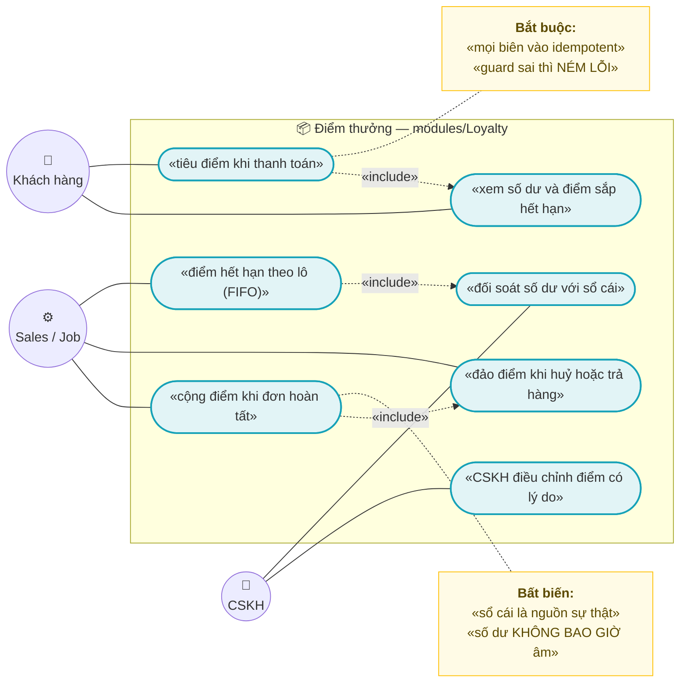
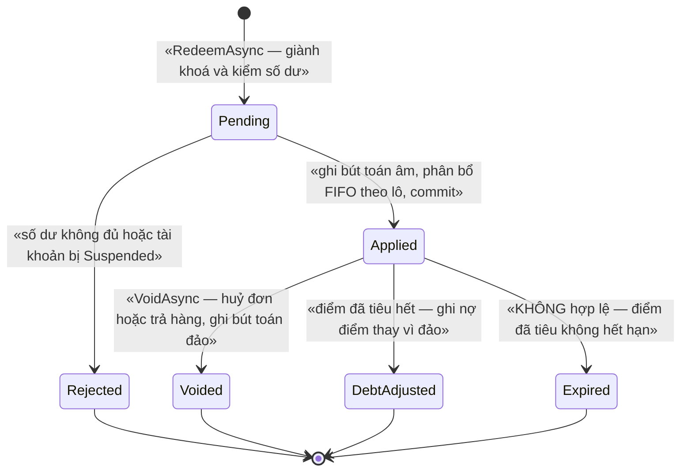
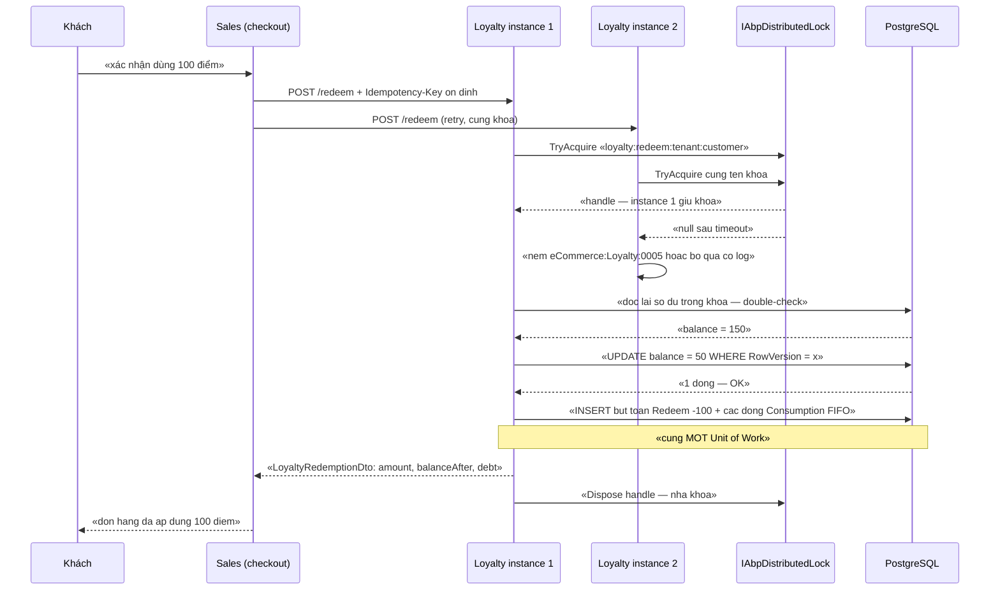
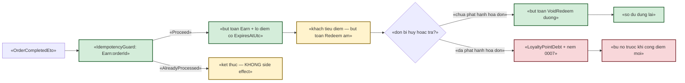
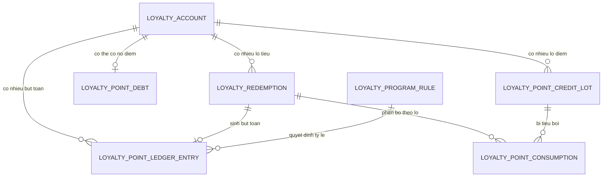

# `LOY-001` — Điểm thưởng

| Thuộc tính | Nội dung |
|---|---|
| **Mã** | `LOY-001` |
| **Module** | **Loyalty** — khuôn chuẩn `modules/Loyalty/eCommerce.Loyalty.Domain` · `.Application` · `.Contracts` · `.EntityFrameworkCore` (đối chiếu khuôn thật của `modules/ChannelHub/`) |
| **Giai đoạn** | **GĐ4 — Tăng trưởng** (`docs/implementation-plan.md` §10, §5, Phụ lục A.3) |
| **Ưu tiên** | **Should have** (không chặn bán hàng; nhưng **chặn** mọi thứ chạm tiền ⇒ phải xong tài liệu trước khi code) |
| **Trạng thái** | 🟡 `Draft` — chờ review |
| **Người viết / người review** | *(điền)* / **Kiến trúc trưởng + Kế toán** (điểm thưởng ảnh hưởng giá trị đơn ⇒ cần kế toán xác nhận chính sách) |
| **Phiên bản / ngày** | `v0.1 — 13/10/2026` |
| **Tài liệu liên quan** | `XC-001` (Money/làm tròn) · `XC-002` (outbox/inbox + idempotency) · `XC-003` (khoá phân tán) · `XC-004` (phân quyền/tenant) · `XC-005` (observability) · `SAL-003` (state machine đơn hàng — nguồn `OrderCompletedEto`) · `INV-001` (khuôn sổ cái append-only) · `REV-001` (đánh giá — cùng nhóm GĐ4) |

> 📌 **Quy ước đọc tài liệu này:** mọi khẳng định về code **đều kèm đường dẫn file thật** đã đọc/kiểm trong repo.
> Chỗ nào **chưa có trong code** đều ghi rõ **“chưa có trong code — kế hoạch GĐ4”**. Không có suy diễn nào được
> trình bày như sự thật đã kiểm chứng.

---

## 0. Tóm tắt & quyết định thiết kế

**Tóm tắt:** `LOY-001` thiết kế **điểm thưởng** cho khách hàng mua trên **mọi kênh**: cộng điểm khi đơn hoàn tất,
tiêu điểm khi thanh toán, đảo điểm khi trả hàng, và **hết hạn điểm theo lô**. Ba trụ của thiết kế:

1. **Sổ cái append-only là nguồn sự thật** — số dư trên `LoyaltyAccount` chỉ là **ảnh chụp** để đọc nhanh.
   Khuôn này **đã có tiền lệ thật trong repo**: `StockLedgerEntry` ở
   [StockLedger.cs](../../src/eCommerce.Domain/Entities/Inventory/StockLedger.cs) ghi rõ
   *“Sổ cái kho — APPEND-ONLY. Không bao giờ UPDATE/DELETE bản ghi ở bảng này”*, còn `InventoryItem.OnHand`
   chỉ là snapshot.
2. **Điểm là `decimal`, không bao giờ `float`/`double`, và không bao giờ so bằng `==`** — theo quy ước bất biến
   của dự án. Hiện repo đã tuân thủ cho **tiền**: `Order.Subtotal/GrandTotal` là `decimal` ở
   [Order.cs](../../src/eCommerce.Domain/Entities/Orders/Order.cs), cấu hình `HasPrecision(18, 4)` ở
   [eCommerceDbContext.cs](../../src/eCommerce.EntityFrameworkCore/eCommerceDbContext.cs) — ⚠️ nhưng **loại `Money`
   vẫn CHƯA có trong code** (xem §0.2 và §15.2 **G1**).
3. **Mọi biên vào idempotent + mọi chuyển trạng thái ném lỗi** — theo `XC-002` (`IIdempotencyGuard`) và quy ước #11.
   Tài liệu này **không tự nghĩ ra** cơ chế chống trùng mới: nó **dùng lại hợp đồng của `XC-002`**.

**Vì sao phải viết tài liệu trước khi code:** điểm thưởng là **nợ phải trả** của doanh nghiệp. Ba lỗi dưới đây
**không có lỗi biên dịch** và chỉ lộ ra khi có tiền thật:

| # | Lỗi im lặng có thể xảy ra | Hậu quả |
|---|---|---|
| 1 | Hai thao tác tiêu điểm song song cùng đọc số dư rồi cùng ghi | **Số dư âm** ⇒ khách tiêu quá số điểm có |
| 2 | Sự kiện `OrderCompletedEto` được giao lại (at-least-once, xem `XC-002`) | **Cộng điểm 2 lần** cho cùng một đơn |
| 3 | Trả hàng nhưng điểm đã tiêu hết | **Đảo điểm thất bại im lặng** ⇒ sổ sách lệch, không ai biết |

**Phạm vi (✅ trong tài liệu này):**

- ✅ Mô hình dữ liệu: `LoyaltyAccount` (snapshot) + `LoyaltyPointLedgerEntry` (append-only) +
  `LoyaltyPointCreditLot` (lô điểm để hết hạn FIFO) + `LoyaltyRedemption` (lô tiêu điểm) +
  `LoyaltyPointConsumption` (lô nào bị tiêu bởi lô tiêu nào) + `LoyaltyProgramRule` (chính sách là **dữ liệu**).
- ✅ Công thức cộng điểm + **quy tắc làm tròn tường minh** (kế thừa `XC-001`) và **kiểm tra biên**.
- ✅ Hai vòng đời trạng thái **có bảng guard ném lỗi**: `LoyaltyAccount` (hoạt động) và
  `LoyaltyRedemption` (lô tiêu điểm).
- ✅ Tiêu điểm **song song**: khoá phân tán theo khách hàng + `CHECK` ở DB + kiểm số dòng UPDATE.
- ✅ Idempotency ở **mọi biên vào** (ETO, HTTP, job) theo hợp đồng `IIdempotencyGuard` của `XC-002`.
- ✅ Sự kiện phát ra/nhận vào, permission, UI, migration/seed, NFR, 23 test case.

**Không nằm trong phạm vi (❌):**

- ❌ **Định nghĩa `OrderCompletedEto` / `OrderReturnedEto`** — thuộc `SAL-003` / `SAL-006`.
  Ở đây chỉ **khai báo hợp đồng mà Loyalty cần** và **điều kiện tiên quyết** (§7.0).
- ❌ **Hạ tầng outbox/inbox, DLQ, canonical payload** — thuộc `XC-002`. Xem §7.0: **hiện chưa bật** trong repo.
- ❌ **Loại `Money` và chính sách làm tròn tiền** — thuộc `XC-001`.
- ❌ **Xếp hạng khách hàng theo điểm (tier), quà tặng, voucher đổi bằng điểm** — giai đoạn sau; ghi ở §15.1.
- ❌ **UI khách hàng đầy đủ** — tài liệu này chốt **mapping dữ liệu**; UI do `WEB-*` thực thi.
- ❌ **Điểm thưởng cho đánh giá sản phẩm** (`REV-001`) — khác feature, dù cùng dùng module `Loyalty`.

### 0.1 Quyết định thiết kế (ADR ngắn)

| # | Quyết định | Phương án đã cân nhắc | Lý do chọn | Hệ quả |
|---|---|---|---|---|
| **D1** | **Sổ cái append-only là nguồn sự thật**; số dư chỉ là snapshot | (a) chỉ giữ `Balance` trên tài khoản · (b) chỉ giữ ledger, tính tổng mỗi lần đọc · (c) **ledger + snapshot** | Có **tiền lệ thật trong repo**: `StockLedgerEntry` + `InventoryItem.OnHand` ([StockLedger.cs](../../src/eCommerce.Domain/Entities/Inventory/StockLedger.cs) dòng 8 và 97–98 ghi rõ *“nguồn sự thật là StockLedgerEntry”*, *“không dùng làm nguồn sự thật”*) | Phải có **job/kiểm tra đối soát** `Balance == SUM(ledger)` (NFR-003); mọi ghi phải qua 1 hàm duy nhất |
| **D2** | **Điểm lưu `decimal(18,2)`**, không `float`/`double`; **cấm so bằng `==`** | (a) `int` điểm · (b) `double` · (c) **`decimal(18,2)`** | Quy ước #1/#2 của dự án (`docs/implementation-plan.md` §3) + tỷ lệ tích điểm có thể lẻ (ví dụ 1 điểm / 10.000 ₫ ⇒ đơn 25.000 ₫ = 2,5 điểm) | Không dùng `int`; mọi so sánh dùng `>=`/`<=`/`CompareTo`; có test reflection (TC-19) |
| **D3** | **Hạn dùng điểm theo LÔ (FIFO)**, không theo số dư | (a) hết hạn toàn bộ điểm sau N tháng kể từ lần dùng cuối · (b) **lô theo bút toán cộng, FIFO** | (a) làm khách **mất oan** điểm cũ khi vừa phát sinh giao dịch mới và **không giải trình được** với khách; (b) truy vết được *“điểm nào hết hạn, vì sao”* — cần cho khiếu nại | Thêm bảng `LoyaltyPointCreditLot` + `LoyaltyPointConsumption`; tiêu điểm phức tạp hơn (phải phân bổ theo lô) |
| **D4** | **Tiêu điểm = GHI NỢ NGAY khi áp dụng** (không tách “giữ chỗ” rồi “xác nhận”) | (a) giữ chỗ rồi xác nhận sau · (b) **trừ ngay, hoàn lại nếu đơn huỷ** | (a) cần thêm trạng thái treo + job nhả, và mở ra cửa sổ **tiêu vượt** giữa “đã giữ” và “đã xác nhận” khi nhiều lô tiêu song song; (b) luồng đơn hàng hiện tại đã có **huỷ/trả** ⇒ dùng lại đúng cơ chế compensation | Bắt buộc có `VoidAsync` (đảo lô tiêu) — xem D5 và BR-016 |
| **D5** | **Đảo điểm khi trả hàng**: nếu điểm đã tiêu hết ⇒ **NÉM LỖI**, tạo `AdjustDebt`, **không** im lặng | (a) kẹp về 0 (im lặng) · (b) cho số dư âm · (c) **ghi nợ điểm + cảnh báo** | (a) sai sổ sách mà không ai biết (đúng bài học *guard im lặng* trong `XC-002` §0); (b) `CHECK` ở DB **sẽ chặn** ⇒ job phải retry vô hạn; (c) **giữ bất biến “không âm”** và **vẫn có dấu vết** | Cần `LoyaltyPointDebt`; điểm âm **phải** bị bù trước khi cộng điểm mới (BR-017) |
| **D6** | **Chống 2 thao tác tiêu song song bằng 3 lớp** | (a) chỉ kiểm tra trong domain · (b) chỉ lock · (c) **lock + `CHECK` DB + kiểm số dòng UPDATE** | Đúng `XC-003` D2: *“nếu bỏ lock đi, DB có chặn không?”* — nếu chỉ dựa vào lock thì Redis chết là **sai dữ liệu âm thầm**. Repo đã có tiền lệ `HasIndex(...).IsUnique()` + `HasFilter(...)` ở [eCommerceDbContext.cs](../../src/eCommerce.EntityFrameworkCore/eCommerceDbContext.cs) dòng 184–186 | Tài khoản **phải** có `RowVersion` (optimistic concurrency của ABP) + `CHECK (Balance >= 0)` |
| **D7** | **Chính sách điểm là DỮ LIỆU** (`LoyaltyProgramRule` có hiệu lực theo thời gian) | (a) hằng số trong code · (b) **bảng cấu hình + `EffectiveFrom/To`** | Cùng lý do đã chốt ở `XC-006`: *“danh mục luật là DỮ LIỆU, không hard-code”* — tỷ lệ tích điểm **sẽ đổi** theo chương trình khuyến mại; đổi bằng code = phải release lại phần mềm | Cần `EffectiveFrom`/`EffectiveTo` + **audit** cho mọi lần đổi; công thức đọc rule **tại thời điểm đơn hoàn tất**, không tại thời điểm đọc |
| **D8** | **Không cho module khác gọi app service của Loyalty**; tích hợp qua **ETO 1 chiều** | (a) Sales gọi thẳng `ILoyaltyAppService` · (b) **ETO** | Quy ước bất biến #3 (*“module → app là cấm”*) + tiền lệ thật: `ChannelShopSyncer` chỉ phát `ChannelOrderPulledEto` và **ghi rõ lý do** ở [ChannelShopSyncer.cs](../../modules/ChannelHub/eCommerce.ChannelHub.Application/Sync/ChannelShopSyncer.cs) dòng 13–18 | Loyalty **không** đọc được DB của Sales; ETO phải mang **đủ dữ liệu** (tổng tiền đơn, SKU, ngày) — nếu thiếu thì **phải** sửa hợp đồng ETO ở `SAL-*`, **không** được gọi ngược |
| **D9** | **Khoá phân tán theo khách hàng** (không theo tenant) | (a) khoá theo tenant · (b) **khoá theo (tenant, customer)** | `XC-003` D7: khoá toàn cục ⇒ khách A chặn khách B vô cớ. Điểm là tài nguyên **của một khách** | Tên khoá theo `XC-003` + **tiền tố do `KeyPrefix`** — xem §5.3 và **G3** ở §15.2 |
| **D10** | **Worker hết hạn điểm** đăng ký như **background worker thật** chạy **1 lần/ngày**, có khoá phân tán + `SkipIfBusy` | (a) chạy trong request · (b) job tuỳ ý không khoá · (c) **worker + khoá + bỏ qua có log/metric** | Chạy trong request ⇒ request chậm bất thường; không khoá ⇒ 2 instance cùng expire ⇒ **ghi trùng** bút toán hết hạn. `XC-003` A1 quy định job định kỳ dùng `SkipIfBusy` **và bắt buộc** log + metric | Phải có metric `loyalty_expiry_job_skipped_total`; job **phải** idempotent (khoá `{JobName}:{tenantId}:{kỳ}` theo `XC-002` §7.3) |
| **D11** | **Điểm chỉ sinh từ đơn đã `Completed`**, không sinh từ `Placed` | (a) cộng ngay khi đặt · (b) **cộng khi hoàn tất** | Cộng sớm ⇒ đơn huỷ/hoàn ⇒ phải đảo **rất nhiều**; và khách có thể **tiêu điểm của đơn chưa chắc thành công** ⇒ nợ khó thu | Phụ thuộc `SAL-003` phát `OrderCompletedEto`; nếu SAL chưa có ⇒ **chặn GĐ4** (§7.0) |
| **D12** | **Không tự viết cơ chế chống trùng cho Loyalty** — dùng `IIdempotencyGuard` của `XC-002` | (a) tự thêm cột unique riêng mỗi bảng · (b) **dùng hợp đồng chung** | Hợp đồng đã có thật trong tài liệu `XC-002` §6.4 (`IIdempotencyGuard.AcquireAsync`, `IdempotencyOutcome`) | Loyalty **phụ thuộc** `eCommerce.Messaging.Contracts`; **cấm** tham chiếu `.Domain` của Messaging (`XC-002` D12) |
| **D13** | **Metric của Loyalty khai báo qua interface ở `.Contracts`**, cài đặt thật ở tầng app | (a) Loyalty tự phát metric bằng `Meter` riêng · (b) **interface + adapter** | Bảng đăng ký metric là **nguồn sự thật duy nhất** ở [eCommerceMetrics.cs](../../src/eCommerce.Domain.Shared/Observability/eCommerceMetrics.cs) và có test `TC-06` đối chiếu tên thật; module **cấm** tham chiếu `src/` (quy ước #3) | Phải thêm 4 tên metric vào `eCommerceMetricNames` + hằng số nhãn mới vào `eCommerceMetricTags` — xem §13 |
| **D14** | **Số dư và nợ điểm hiển thị TÁCH BIỆT** trên UI | (a) một số “điểm khả dụng” đã trừ nợ · (b) **hai số** | (a) làm khách hiểu sai và **không giải trình được** khi có khiếu nại | UI bắt buộc hiện cả `balance` và `debt`; API trả cả hai |

### 0.2 Trạng thái thật của code liên quan (đã kiểm trong repo)

| Hạng mục | Trạng thái thật | Bằng chứng (đường dẫn thật) |
|---|---|---|
| Module `Loyalty` | ❌ **Chưa có trong code — kế hoạch GĐ4** | `modules/` chỉ có `ChannelHub`, `PaymentHub`, `Tax` |
| Loại `Money` (dùng chung) | ❌ **Chưa có trong code** — `grep "class Money|record Money|struct Money"` trên toàn repo: **0 kết quả**. Quyết định #5 của kế hoạch là “port theo thiết kế OCC” | `docs/implementation-plan.md` §2 dòng 31; `XC-001` |
| Tiền là `decimal` | ✅ **Đã tuân thủ cho tiền** | `Order.Subtotal`/`GrandTotal`: [Order.cs](../../src/eCommerce.Domain/Entities/Orders/Order.cs) dòng 38–47; `HasPrecision(18, 4)`: [eCommerceDbContext.cs](../../src/eCommerce.EntityFrameworkCore/eCommerceDbContext.cs) dòng 173–178 |
| Sổ cái append-only (khuôn để học) | ✅ **Đã có thật** | [StockLedger.cs](../../src/eCommerce.Domain/Entities/Inventory/StockLedger.cs) dòng 80–136 |
| `CHECK` constraint ở EF Core | ❌ **Chưa dùng ở đâu trong repo** — chưa có `HasCheckConstraint`. Ràng buộc thật đang dùng là `unique index` + SQL thô `NULLS NOT DISTINCT` | [eCommerceDbContext.cs](../../src/eCommerce.EntityFrameworkCore/eCommerceDbContext.cs) dòng 109–209; [20261013024226_Fix_NullableTenantId_UniqueIndexes.cs](../../src/eCommerce.EntityFrameworkCore/Migrations/20261013024226_Fix_NullableTenantId_UniqueIndexes.cs) |
| `RowVersion` (optimistic concurrency) | ❌ **Chưa có entity nào trong repo khai `RowVersion`** (chưa có `IsConcurrencyToken`) | grep `RowVersion` trên `src/` + `modules/`: 0 kết quả ngoài tài liệu `XC-002` D8 |
| Permission `eCommerce.Loyalty.*` | ❌ **Chưa định nghĩa** | [eCommercePermissionDefinitionProvider.cs](../../src/eCommerce.Application.Contracts/Permissions/eCommercePermissionDefinitionProvider.cs) có 6 nhóm: Products, Inventory, Channels, Orders, Payments, Tax.* |
| Outbox/Inbox của ABP | ❌ **Chưa bật**: `eCommerceDbContext` **không** implement `IHasEventOutbox`/`IHasEventInbox`; `AbpDistributedEventBusOptions` **không** được cấu hình; `OnModelCreating` **không** gọi `ConfigureEventOutbox()`/`ConfigureEventInbox()` | [eCommerceDbContext.cs](../../src/eCommerce.EntityFrameworkCore/eCommerceDbContext.cs) dòng 33 và 71–91 |
| ⚠️ Hệ quả của việc outbox chưa bật | Việc phát ETO hiện là **dual-write** (publish trực tiếp, không ghi cùng transaction) — đúng rủi ro mà `XC-002` D2/BR-002 mô tả. Ví dụ `ChannelShopSyncer` phát ETO ở [ChannelShopSyncer.cs](../../modules/ChannelHub/eCommerce.ChannelHub.Application/Sync/ChannelShopSyncer.cs) dòng 69–89 | — |
| Bảng đăng ký metric | ✅ **Đã có, 12 metric** | [eCommerceMetrics.cs](../../src/eCommerce.Domain.Shared/Observability/eCommerceMetrics.cs) dòng 13–53 |
| Khoá lock thật của hệ thống | ✅ `KeyPrefix = "ecommerce:"` (chữ thường, có dấu `:`) | [eCommerceHttpApiHostModule.cs](../../src/eCommerce.HttpApi.Host/eCommerceHttpApiHostModule.cs) dòng 115–128 |
| ⚠️ Lệch hoa-thường giữa 2 tiền tố | `AbpDistributedCacheOptions.KeyPrefix = "eCommerce:"` (chữ **E HOA**) nhưng `AbpDistributedLockOptions.KeyPrefix = "ecommerce:"` (chữ thường) — **cùng một file**, dòng 112 và 127 | [eCommerceHttpApiHostModule.cs](../../src/eCommerce.HttpApi.Host/eCommerceHttpApiHostModule.cs) |
| Kiểm tra Mermaid | ✅ Có script CI: `npm --prefix tools run check:mermaid` | [check-mermaid.mjs](../../tools/check-mermaid.mjs) |

---

## 1. Use Case Specification

| Thuộc tính | Nội dung |
|---|---|
| **Use Case ID** | `LOY-001` |
| **Use Case Name** | Cộng — tiêu — đảo — hết hạn **điểm thưởng** của khách hàng, **không bao giờ sai sổ và không bao giờ âm điểm** |
| **Description** | *“Là khách hàng mua trên website và sàn, tôi muốn được cộng điểm khi đơn hoàn tất và dùng điểm để giảm tiền đơn sau, để tôi thấy việc mua hàng có giá trị tích luỹ — và tôi muốn số điểm hiển thị luôn khớp với số điểm thực tế có thể dùng.”* |
| **Actor(s)** | **Khách hàng** (đã đăng nhập) · **Nhân viên CSKH** (tra cứu, điều chỉnh điểm — có permission) · **Hệ thống** (`OrderCompletedEto`/`OrderReturnedEto` từ Sales, job hết hạn, API checkout của Sales) · **Vận hành** (xem đối soát, xem job hết hạn) |
| **Priority** | **Should have** |
| **Trigger** | (a) đơn hàng chuyển sang **hoàn tất** ⇒ cộng điểm; (b) khách **áp dụng điểm** ở bước thanh toán ⇒ tiêu điểm; (c) đơn bị **huỷ/trả** ⇒ đảo điểm; (d) **job hết hạn** chạy hằng ngày; (e) CSKH **điều chỉnh** điểm (có lý do + audit) |
| **Pre-Condition(s)** | • **Tenant hiện tại** (`TenantId`) — theo `XC-004` D8/BR-009; hệ thống nay chạy 1 tenant ⇒ `TenantId` **có thể là `NULL`** ⇒ mọi unique index của Loyalty **phải** dùng `NULLS NOT DISTINCT` (tiền lệ migration đã có).<br>• **Khách hàng đã tồn tại** với `CustomerId` (Guid do module `Customers` sở hữu) — Loyalty **không** tạo khách.<br>• **Chính sách điểm có hiệu lực** tại thời điểm cộng/tiêu (`LoyaltyProgramRule`) — **thiếu ⇒ NÉM LỖI**, không mặc định ngầm.<br>• **`OrderCompletedEto` mang đủ dữ liệu**: `OrderId`, `CustomerId`, `Currency`, tổng tiền sau giảm giá, thời điểm hoàn tất, `AggregateVersion`.<br>• `ChannelCode` **có** mặt (để đối soát điểm cộng theo kênh) nhưng **không** tham gia quyết định số điểm trong GĐ4 (xem D7 và §15.1 Q3).<br>• **Redis 7 sẵn sàng** cho khoá phân tán — nếu không, **vẫn phải đúng** nhờ `CHECK` + `RowVersion` (D6). |
| **Post-Condition(s)** | • **Bất biến số 1**: `LoyaltyAccount.Balance >= 0` **luôn đúng**, kể cả khi 2 instance cùng tiêu (DB chặn).<br>• **Bất biến số 2**: `Balance == SUM(LedgerEntry.AmountDelta)` cho mọi tài khoản (đối soát được — NFR-003).<br>• Mỗi đơn hoàn tất sinh **đúng một** bút toán cộng (dù ETO được giao lại bao nhiêu lần).<br>• Mọi lần tiêu có **một** `LoyaltyRedemption` và **các dòng** `LoyaltyPointConsumption` chỉ rõ lô nào bị tiêu.<br>• Mọi lần không tiêu được **có dấu vết**: `BusinessException` có mã **hoặc** bút toán `AdjustDebt` + cảnh báo. |
| **Basic Flow** | 1. Sales hoàn tất đơn ⇒ phát `OrderCompletedEto` (qua outbox — xem §7.0).<br>2. Loyalty consumer gọi `IIdempotencyGuard.AcquireAsync` với khoá `Loyalty:{tenantId}:{customerId}:Earn:{orderId}`; kết quả `AlreadyProcessed` ⇒ **kết thúc, không side effect**.<br>3. Đọc `LoyaltyProgramRule` **có hiệu lực tại `CompletedAtUtc`**; tính `points = floor(grandTotal × earningRate, 2)`.<br>4. Trong **một** Unit of Work: ghi `LoyaltyPointLedgerEntry` (`Earn`, `+points`) + tạo `LoyaltyPointCreditLot` (`RemainingAmount = points`, `ExpiresAtUtc = CompletedAtUtc + ExpiryDays`) + cập nhật `LoyaltyAccount.Balance` + `RowVersion`.<br>5. Phát `LoyaltyPointsEarnedEto`.<br>6. Khách vào checkout, chọn dùng điểm: Sales gọi API **tính trước** (`POST /preview`) để biết số điểm tối đa dùng được.<br>7. Khách xác nhận ⇒ Sales gọi `POST /redeem` với `Idempotency-Key` **ổn định**; Loyalty **giành khoá phân tán** `…:redeem:{customerId}`, đọc lại số dư (**double-check**), phân bổ FIFO theo lô, ghi bút toán `Redeem` âm + `LoyaltyRedemption` + các dòng `Consumption`.<br>8. Trả về `LoyaltyRedemptionDto` (gồm `amount`, `balanceAfter`, `debt`) để Sales trừ vào tiền đơn. |
| **Alternative Flow** | **A1: Đơn huỷ/trả hàng** ⇒ Sales phát `OrderReturnedEto` ⇒ Loyalty gọi `VoidAsync`: đảo **lô tiêu** tương ứng (bút toán `VoidRedeem` dương) **hoặc**, nếu đã phát hành hoá đơn, ghi `AdjustDebt`.<br>**A2: Trả hàng sau khi đã cộng điểm** ⇒ ghi bút toán `Reversal` âm; nếu khách đã tiêu hết ⇒ tạo **nợ điểm** (`LoyaltyPointDebt`) + cảnh báo vận hành (D5).<br>**A3: Job hết hạn** ⇒ giành khoá `…:expire-job:{tenantId}:{kỳ}`, chọn các lô `RemainingAmount > 0` và `ExpiresAtUtc <= now`, ghi bút toán `Expire` âm cho **từng lô**, `SkipIfBusy` nếu không giành được khoá (log + metric).<br>**A4: Khách bị khoá tài khoản** (gian lận) ⇒ `LoyaltyAccount.Status = Suspended` ⇒ **cấm** cộng *và* tiêu; mọi thao tác ⇒ `eCommerce:Loyalty:0009`.<br>**A5: CSKH điều chỉnh điểm** ⇒ bút toán `Adjust` có `Reason` **bắt buộc** + audit; **cấm** sửa/xoá bút toán cũ. |
| **Exception Flow** | **E1:** số điểm yêu cầu **>** số dư khả dụng ⇒ **NÉM** `eCommerce:Loyalty:0001` (thông điệp **nêu số khả dụng**, không chỉ “không đủ”).<br>**E2:** cùng `IdempotencyKey` nhưng **`PayloadHash` khác** ⇒ **NÉM** `eCommerce:Messaging:0002` (theo `XC-002` BR-006) — **không** ghi đè.<br>**E3:** chuyển trạng thái sai (ví dụ `Applied → Applied`, `Voided → Applied`) ⇒ **NÉM** `eCommerce:Loyalty:0010`.<br>**E4:** không tìm thấy chính sách điểm có hiệu lực ⇒ **NÉM** `eCommerce:Loyalty:0002` (**không** dùng mặc định ngầm).<br>**E5:** `UPDATE` số dư ảnh hưởng **0 dòng** (bị luồng khác đổi) ⇒ **NÉM** `eCommerce:Loyalty:0005` và **thử lại** ở nhịp sau (không coi là thành công).<br>**E6:** `CHECK (Balance >= 0)` ở DB bị vi phạm ⇒ ánh xạ thành `eCommerce:Loyalty:0005` + **metric** `loyalty_negative_balance_blocked_total` (**đây là lưới an toàn, không phải luồng bình thường**).<br>**E7:** trả hàng khi điểm đã tiêu hết ⇒ ghi `LoyaltyPointDebt` + **NÉM** `eCommerce:Loyalty:0007` để consumer ghi DLQ (có dấu vết, không im lặng).<br>**E8:** ETO thiếu `CustomerId`/`OrderId`/`Currency` ⇒ **NÉM** `eCommerce:Loyalty:0008` ⇒ DLQ `PoisonMessage` (theo `XC-002` E4) — **không** đoán giá trị thiếu. |
| **Business Rules** | • **BR-LOY-001-001**: Điểm **phải** là `decimal` (kiểu CLR `decimal`, cột `numeric(18,2)`); **CẤM** `float`/`double`/`int` trong mọi trường điểm, kể cả trong ETO (test reflection `TC-19`).<br>• **BR-LOY-001-002**: **CẤM** so sánh điểm/bằng tiền bằng `==`; dùng `>=`, `<=`, hoặc `decimal.Compare`. Ngoại lệ duy nhất: so **bằng 0** sau khi đã làm tròn tường minh ⇒ vẫn phải dùng `<= 0m`/`>= 0m`.<br>• **BR-LOY-001-003**: Mọi thay đổi số dư **phải** sinh **đúng một** `LoyaltyPointLedgerEntry` và **phải** nằm trong **cùng** Unit of Work với cập nhật `LoyaltyAccount.Balance` + `CreditLot`/`Consumption`.<br>• **BR-LOY-001-004**: `LoyaltyPointLedgerEntry` là **append-only** — **CẤM** UPDATE/DELETE (kể cả soft-delete); sửa sai bằng **bút toán đảo**.<br>• **BR-LOY-001-005**: Số dư **không bao giờ âm**: khoá phân tán theo khách + `RowVersion` + `CHECK (Balance >= 0)` (D6).<br>• **BR-LOY-001-006**: Tiêu điểm **phải** theo **FIFO theo lô**: tiêu lô có `ExpiresAtUtc` **gần nhất** trước; **CẤM** tiêu lô đã hết hạn.<br>• **BR-LOY-001-007**: Công thức cộng điểm dùng **duy nhất** `LoyaltyProgramRule` có hiệu lực tại thời điểm hoàn tất đơn; **làm tròn XUỐNG** (`Floor`) tới **2 chữ số thập phân**, tường minh — **CẤM** làm tròn ngầm theo mặc định của CLR.<br>• **BR-LOY-001-008**: Điểm chỉ sinh từ đơn đã **hoàn tất** (`OrderCompletedEto`), **không** từ `Placed`; mỗi đơn **tối đa một** bút toán cộng (khoá idempotency `…:Earn:{orderId}`).<br>• **BR-LOY-001-009**: Mọi **đảo điểm** (huỷ đơn, trả hàng, hết hạn) **phải** sinh bút toán đảo tương ứng; **CẤM** “kẹp về 0” im lặng.<br>• **BR-LOY-001-010**: Nếu đảo vượt số dư ⇒ **phải** tạo `LoyaltyPointDebt` + **NÉM** `eCommerce:Loyalty:0007`; điểm cộng mới **phải** bù nợ **trước** khi vào số dư khả dụng (BR-017).<br>• **BR-LOY-001-011**: Mọi chuyển trạng thái **không hợp lệ** của `LoyaltyRedemption` và `LoyaltyAccount` **phải NÉM** `BusinessException` có mã (`0010` / `0011`) — **CẤM** no-op im lặng (quy ước #11).<br>• **BR-LOY-001-012**: **Mọi** biên vào (ETO, HTTP, job) **phải** gọi `IIdempotencyGuard` **trước mọi side effect**, với khoá **ổn định** — **CẤM** `Guid.NewGuid()` làm khoá.<br>• **BR-LOY-001-013**: API tiêu điểm **phải** nhận `Idempotency-Key` từ Sales; thiếu ⇒ **NÉM** `eCommerce:Loyalty:0006` (fail-closed).<br>• **BR-LOY-001-014**: `LoyaltyAccount` **phải** có `RowVersion`; mọi UPDATE số dư dùng optimistic concurrency và **kiểm số dòng** (0 dòng ⇒ E5).<br>• **BR-LOY-001-015**: **CẤM** hard-code tỷ lệ tích điểm/ngưỡng tiêu điểm trong code; **mọi** tham số chính sách **phải** đọc từ `LoyaltyProgramRule` (D7).<br>• **BR-LOY-001-016**: Đảo một lô tiêu **phải** kiểm tra **không** có bút toán phụ thuộc đã phát hành (hoá đơn đã xuất) — nếu có ⇒ `AdjustDebt`, **không** xoá lịch sử.<br>• **BR-LOY-001-017**: Khi có `LoyaltyPointDebt > 0`, mọi bút toán `Earn` **phải** bù nợ trước; phần còn lại mới vào `Balance` — làm **trong cùng** transaction.<br>• **BR-LOY-001-018**: Mọi thao tác ghi (cộng/tiêu/đảo/điều chỉnh/hết hạn) **phải** chạy trong **Unit of Work** (quy ước #13).<br>• **BR-LOY-001-019**: **CẤM** log `Phone`, `Email`, số điểm gắn kèm định danh cá nhân ở mức `Debug`; log nghiệp vụ chỉ dùng `TenantId`, `CustomerId`, `OrderId`, `Amount`, `IdempotencyKey` (theo `XC-005`).<br>• **BR-LOY-001-020**: Điểm có **hạn dùng**; `ExpiresAtUtc` của lô **phải** được ghi **tại thời điểm cộng** (không tính lại sau) để bảo vệ quyền lợi khách. |
| **Non-Functional Requirement** | • **NFR-LOY-001-001**: API xem số dư p95 **< 50 ms**.<br>• **NFR-LOY-001-002**: Thao tác tiêu điểm ở checkout p95 **< 200 ms** (chặn luồng đặt hàng ⇒ phải nhanh).<br>• **NFR-LOY-001-003**: `Balance == SUM(ledger)` — sai lệch **0** trên 10.000 bút toán (test đối soát `TC-18`).<br>• **NFR-LOY-001-004**: **0** bản ghi ledger bị UPDATE/DELETE (test quét mã nguồn + test DB `TC-21`).<br>• **NFR-LOY-001-005**: **0** lần số dư âm khi 100 request tiêu song song trên **2 instance** (test `TC-16`).<br>• **NFR-LOY-001-006**: ETO gửi lại **100 lần** ⇒ **đúng 1** bút toán cộng cho mỗi đơn (test `TC-14`).<br>• **NFR-LOY-001-007**: **100 %** biên vào gọi `IIdempotencyGuard` (test reflection `TC-22`).<br>• **NFR-LOY-001-008**: Job hết hạn xử lý 100.000 lô trong **< 5 phút**; bỏ qua nhịp khi bận **phải** có log + metric.<br>• **NFR-LOY-001-009**: Mọi thao tác cộng/tiêu/đảo/điều chỉnh đều có log có cấu trúc với `CorrelationId` + `IdempotencyKey`; **0** PII trong log (test quét `TC-23`).<br>• **NFR-LOY-001-010**: Số điểm hiển thị cho khách **không lệch** số dư sau khi thao tác commit — độ trễ đọc lại tối đa **1 s**. |

---

## 2. Sơ đồ Use Case



---

## 3. Vòng đời trạng thái (state machine)

Feature này có **hai** vòng đời. **Cả hai đều phải ném lỗi** khi chuyển sai (quy ước #11 — *“state machine phải NÉM LỖI”*).
Trong sơ đồ dưới đây tôi dùng **một** sơ đồ cho lô tiêu điểm (vòng đời quan trọng nhất, có rủi ro tiền);
vòng đời tài khoản được đặc tả bằng **bảng guard** ngay sau đó (để nằm trong ngân sách **3 sơ đồ** của tài liệu).



**Bảng chuyển trạng thái & guard — `LoyaltyRedemption` (mọi chuyển sai **phải ném lỗi**):**

| # | Từ → Sang | Guard (điều kiện cho phép) | Hành động kèm theo | Nếu guard sai thì? |
|---|---|---|---|---|
| 1 | `[*]` → `Pending` | Đã giành khoá `…:redeem:{customerId}` **và** tài khoản `Status = Active` **và** không có `Debt` chặn | Tạo `LoyaltyRedemption` với `IdempotencyKey` **do Sales truyền** | Thiếu `Idempotency-Key` ⇒ **NÉM** `0006`; tài khoản `Suspended` ⇒ **NÉM** `0009` |
| 2 | `Pending` → `Applied` | `Balance` (đọc lại **trong** khoá) `>=` số điểm yêu cầu **và** `UPDATE` số dư ảnh hưởng **≥ 1 dòng** | Ghi 1 bút toán `Redeem` âm + N dòng `Consumption` (FIFO) + `BalanceAfter` | `UPDATE` 0 dòng ⇒ **NÉM** `0005` (E5); DB vi phạm `CHECK` ⇒ `0005` + metric |
| 3 | `Pending` → `Rejected` | Số dư **<** yêu cầu (kể cả sau double-check) | Ghi lý do + log `Information` (đây **không** phải lỗi hệ thống) | — (nhưng API vẫn trả `0001` cho Sales) |
| 4 | `Applied` → `Voided` | `Status = Applied` **và** chưa có bút toán phụ thuộc đã phát hành (hoá đơn) | Bút toán `VoidRedeem` dương + **hoàn lại** `RemainingAmount` cho **đúng các lô đã tiêu** | Có hoá đơn đã phát hành ⇒ **KHÔNG** `Voided`, chuyển `DebtAdjusted` (BR-016) |
| 5 | `Applied` → `DebtAdjusted` | `Status = Applied` **và** không thể đảo về lô (điểm đã hết hạn/bị tiêu tiếp) | Tạo `LoyaltyPointDebt` + **NÉM** `0007` để consumer ghi DLQ + cảnh báo | Nếu **không** ghi được nợ ⇒ vẫn **NÉM**, log `Critical`, **cấm** nuốt (BR-010 của `XC-002`) |
| 6 | `Applied` → `Expired` | **KHÔNG** có guard nào cho phép | — | **NÉM** `0010`: điểm **đã tiêu** không được hết hạn (đây là lỗi lập trình nghiêm trọng) |
| 7 | `Voided`/`Rejected`/`DebtAdjusted` → bất kỳ | **KHÔNG** có guard | — | **Trạng thái hấp thụ**: mọi chuyển dịch khỏi 3 trạng thái này ⇒ **NÉM** `0010` (trừ đường phát lại DLQ **có** permission) |

**Bảng chuyển trạng thái & guard — `LoyaltyAccount`:**

| # | Từ → Sang | Guard | Hệ quả nếu vi phạm |
|---|---|---|---|
| 1 | `Active` → `Suspended` | CSKH có permission `eCommerce.Loyalty.Adjust` **và** nhập lý do | **NÉM** `0011` |
| 2 | `Suspended` → `Active` | Như trên | **NÉM** `0011` |
| 3 | `Active`/`Suspended` → `Closed` | `Balance <= 0m` **và** `Debt <= 0m` (đã tất toán) | **NÉM** `0012` (không đóng tài khoản còn điểm hoặc còn nợ) |
| 4 | `Closed` → bất kỳ | **KHÔNG** có guard | **Trạng thái hấp thụ** ⇒ **NÉM** `0011` |
| 5 | `Suspended` + thao tác cộng/tiêu | — | **NÉM** `0009` (**cấm** im lặng bỏ qua: nếu `Suspended` thì khách phải được thông báo) |

> ⚠️ **Bảng guard của sổ cái (không phải state machine, nhưng là bất biến ghi):**
> • Bút toán `Earn`/`Adjust`(+) ⇒ `AmountDelta > 0`; nếu `<= 0m` ⇒ **NÉM** `0013`.
> • Bút toán `Redeem`/`Reversal`/`Expire` ⇒ `AmountDelta < 0`; nếu `>= 0m` ⇒ **NÉM** `0013`.
> • **CẤM** mọi `Update`/`Delete` trên bảng ledger — kể cả qua repository (`TC-21`).
> • `BalanceAfter` **phải** khớp `Balance` mới sau commit; lệch ⇒ **NÉM** `0014` (lỗi lập trình, không phải lỗi dữ liệu người dùng).

---

## 4. Sequence Diagram & luồng dữ liệu

### 4.1 Tiêu điểm dưới tranh chấp (2 instance, cùng một khách)



### 4.2 Chuỗi cộng → tiêu → trả hàng (và nhánh nợ điểm)



---

## 5. Mô hình dữ liệu & bảng đăng ký

### 5.1 ERD — quan hệ giữa các bảng



> 📌 **Không** vẽ khoá ngoại **bắt buộc** giữa `LoyaltyProgramRule` và ledger (rule có hiệu lực theo thời gian ⇒
> chỉ **ghi lại** `RuleId` dạng tham chiếu mềm, **không** FK cứng, để rule cũ **không bao giờ** bị xoá mất lịch sử).
> Đây là **cố ý**, giống cách `StockLedgerEntry.ReferenceId` là chuỗi tham chiếu mềm ở
> [StockLedger.cs](../../src/eCommerce.Domain/Entities/Inventory/StockLedger.cs) dòng 100–103.

### 5.2 Bảng & cột (Data Dictionary)

**Tiền tố bảng: `Loy`** (theo mẫu thật `Chn` của ChannelHub ở [ChannelHubConsts.cs](../../modules/ChannelHub/eCommerce.ChannelHub.Domain/ChannelHubConsts.cs) dòng 14
và `DbTablePrefix = "App"` của app ở [eCommerceConsts.cs](../../src/eCommerce.Domain.Shared/eCommerceConsts.cs) dòng 9).

| # | Bảng | Cột chính | Kiểu | Ghi chú |
|---|---|---|---|---|
| 1 | `LoyAccounts` | `Id`, `TenantId`, `CustomerId`, `Balance`, `Debt`, `Status`, `RowVersion`, `ConcurrencyStamp` | `Guid`, `Guid?`, `Guid`, `numeric(18,2)`, `numeric(18,2)`, `int`, `bytea`/`xmin` | **unique `(TenantId, CustomerId)` `NULLS NOT DISTINCT`**; `CHECK (Balance >= 0)`; `CHECK (Debt >= 0)` |
| 2 | `LoyLedgerEntries` | `Id`, `TenantId`, `AccountId`, `CustomerId`, `EntryType`, `AmountDelta`, `BalanceAfter`, `ReferenceType`, `ReferenceId`, `RuleId`, `OccurredAtUtc`, `Note` | `Guid`, `Guid?`, `Guid`, `Guid`, `int`, `numeric(18,2)`, `numeric(18,2)`, `string(64)`, `string(128)`, `Guid?`, `timestamptz`, `string(512)` | **APPEND-ONLY**; **unique `(TenantId, ReferenceType, ReferenceId, EntryType)`** `NULLS NOT DISTINCT` ⇒ chống cộng trùng; index `(TenantId, AccountId, OccurredAtUtc)` |
| 3 | `LoyCreditLots` | `Id`, `TenantId`, `AccountId`, `SourceLedgerEntryId`, `OriginalAmount`, `RemainingAmount`, `EarnedAtUtc`, `ExpiresAtUtc` | `Guid`, `Guid?`, `Guid`, `Guid`, `numeric(18,2)`, `numeric(18,2)`, `timestamptz`, `timestamptz` | **unique `SourceLedgerEntryId`** (1 bút toán cộng ⇒ đúng 1 lô); index `(TenantId, ExpiresAtUtc, RemainingAmount)` cho job hết hạn |
| 4 | `LoyRedemptions` | `Id`, `TenantId`, `AccountId`, `CustomerId`, `Amount`, `Status`, `IdempotencyKey`, `OrderId`, `AppliedAtUtc`, `VoidedAtUtc`, `BalanceAfter`, `RowVersion` | `Guid`, `Guid?`, `Guid`, `Guid`, `numeric(18,2)`, `int`, `string(256)`, `Guid?`, `timestamptz`, `timestamptz?`, `numeric(18,2)`, — | **unique `(TenantId, IdempotencyKey)`** `NULLS NOT DISTINCT`; unique `(TenantId, OrderId)` **có filter** `WHERE OrderId IS NOT NULL` (tiền lệ filter ở [eCommerceDbContext.cs](../../src/eCommerce.EntityFrameworkCore/eCommerceDbContext.cs) dòng 184–186) |
| 5 | `LoyConsumptions` | `Id`, `TenantId`, `RedemptionId`, `CreditLotId`, `Amount` | `Guid`, `Guid?`, `Guid`, `Guid`, `numeric(18,2)` | **unique `(RedemptionId, CreditLotId)`**; `CHECK (Amount > 0)` |
| 6 | `LoyProgramRules` | `Id`, `TenantId`, `Name`, `EarningRate`, `MinRedeemAmount`, `MaxRedeemPercentOfOrder`, `PointExpiryDays`, `EffectiveFrom`, `EffectiveTo`, `IsActive` | `Guid`, `Guid?`, `string(128)`, `numeric(18,6)`, `numeric(18,2)`, `int`, `int`, `date`, `date?`, `bool` | **rule là DỮ LIỆU** (D7); **chặn chồng khung hiệu lực** bằng ràng buộc `EXCLUDE` (xem §11) |
| 7 | `LoyPointDebts` | `Id`, `TenantId`, `AccountId`, `OutstandingAmount`, `OriginRedemptionId`, `CreatedAtUtc`, `SettledAtUtc` | `Guid`, `Guid?`, `Guid`, `numeric(18,2)`, `Guid?`, `timestamptz`, `timestamptz?` | `CHECK (OutstandingAmount >= 0)` |

**Ánh xạ enum (lưu `int` để truy vấn nhanh, đối chiếu cách repo đang làm với `ChannelListingStatus`):**

| Enum | Giá trị | Ý nghĩa |
|---|---|---|
| `LoyaltyAccountStatus` | `Active = 0`, `Suspended = 1`, `Closed = 2` | §3 bảng guard tài khoản |
| `LoyaltyLedgerEntryType` | `Earn = 0`, `Redeem = 1`, `VoidRedeem = 2`, `Reversal = 3`, `Expire = 4`, `Adjust = 5`, `AdjustDebt = 6`, `DebtSettle = 7` | loại bút toán — **mọi** thay đổi số dư đi qua đây |
| `LoyaltyRedemptionStatus` | `Pending = 0`, `Applied = 1`, `Rejected = 2`, `Voided = 3`, `DebtAdjusted = 4` | §3 state machine; `Expired` là trạng thái **bị cấm** |

> 📌 **Vì sao `Redeem` là bút toán ÂM ngay** (D4): luồng đơn hàng đã có **huỷ/trả** nên dùng lại đúng cơ chế bù trừ;
> tách thêm trạng thái “giữ chỗ” sẽ tạo cửa sổ **tiêu vượt** giữa nhiều lô tiêu song song.
> **Đánh đổi đã biết:** nếu Sales áp dụng điểm nhưng **commit đơn thất bại**, Loyalty **phải** nhận `VoidAsync`
> ⇒ **bắt buộc** có cơ chế đối soát “lô tiêu mồ côi” (xem §12 và `Q1`).

### 5.3 Bảng đăng ký khoá phân tán của Loyalty (theo quy ước `XC-003`)

> ⚠️ **G3 (§15.2) — tên khoá dưới đây KHÔNG chứa tiền tố `ecommerce:`**, đúng như `XC-003` §5.4 hệ quả #2:
> *“Tên khoá do module sinh KHÔNG chứa tiền tố — tiền tố là việc của `KeyPrefix`”*. Khoá **thật** trong Redis là
> `KeyPrefix + tên khoá`, và `KeyPrefix` hiện là `"ecommerce:"` — đã kiểm ở
> [eCommerceHttpApiHostModule.cs](../../src/eCommerce.HttpApi.Host/eCommerceHttpApiHostModule.cs) dòng 115–128.

| Khoá (mẫu, **chưa có trong code — kế hoạch GĐ4**) | Hàm sinh khoá | Dùng cho | TTL / timeout | Chế độ khi bận |
|---|---|---|---|---|
| `loyalty:redeem:{tenantId}:{customerId}` | `LoyaltyConsts.LockKeys.Redeem` | tiêu điểm của một khách (chống 2 lô tiêu song song ⇒ số dư âm) | TTL **15 s** · timeout **10 s** | **NÉM** `eCommerce:Loyalty:0005` |
| `loyalty:expire-job:{tenantId}:{kỳ}` | `LoyaltyConsts.LockKeys.ExpireJob` | chống 2 instance cùng chạy job hết hạn ⇒ ghi trùng bút toán `Expire` | TTL **300 s** · timeout **5 s** | **SkipIfBusy** + log + metric `loyalty_expiry_job_skipped_total` |
| `loyalty:account:{tenantId}:{customerId}` | `LoyaltyConsts.LockKeys.Account` | đóng/khoá tài khoản trong khi vẫn có lô tiêu đang chạy | TTL **30 s** · timeout **10 s** | **NÉM** `eCommerce:Loyalty:0005` |

> 🔎 **Quan hệ với `ORDER-PULL`/`TOKEN-REFRESH` của ChannelHub:** **không** dùng chung khoá.
> `ChannelHubConsts.LockKeys.ChannelTokenRefresh` sinh `channel:{channelCode}:{shopId}:token-refresh`
> ([ChannelHubConsts.cs](../../modules/ChannelHub/eCommerce.ChannelHub.Domain/ChannelHubConsts.cs) dòng 22–31)
> — miền **kênh**, không liên quan tới điểm thưởng. Loyalty **không** acquire lồng với khoá của kênh (D6 của `XC-003`).

---

## 6. Hợp đồng API

### 6.1 App service + endpoint (auto API controller của ABP)

Khuôn đặt tên theo tiền lệ thật: `ChannelAppService` có **`[Authorize]` ở CẤP CLASS** và method cần quyền riêng
thì ghi thêm `[Authorize(permission)]` — [ChannelAppService.cs](../../src/eCommerce.Application/Channels/ChannelAppService.cs) dòng 27 và 69.

| Method | Route | Permission | Input | Output | Ghi chú |
|---|---|---|---|---|---|
| `GET` | `/api/app/loyalty/balance` | `eCommerce.Loyalty.View` | — | `LoyaltyBalanceDto` | trả `balance`, `debt`, `expiringSoon` |
| `GET` | `/api/app/loyalty/ledger` | `eCommerce.Loyalty.View` | `PagedAndSortedResultRequestDto` | `PagedResultDto<LoyaltyLedgerEntryDto>` | sắp `OccurredAtUtc` **giảm dần** |
| `POST` | `/api/app/loyalty/preview` | `eCommerce.Loyalty.View` | `PreviewRedeemDto { orderAmount, currency }` | `RedeemPreviewDto { maxRedeemable, balance, debt }` | **không** side effect; dùng cho UI checkout |
| `POST` | `/api/app/loyalty/redeem` | `eCommerce.Loyalty.Redeem` + header `Idempotency-Key` | `RedeemPointsDto { customerId, orderId, amount, currency }` | `LoyaltyRedemptionDto` | **bắt buộc** idempotency key (BR-013) |
| `POST` | `/api/app/loyalty/redemptions/{id}/void` | `eCommerce.Loyalty.Redeem` | `VoidRedeemDto { reason }` | `LoyaltyRedemptionDto` | gọi bởi Sales khi huỷ đơn |
| `POST` | `/api/app/loyalty/adjust` | `eCommerce.Loyalty.Adjust` | `AdjustPointsDto { customerId, amount, reason }` | `LoyaltyBalanceDto` | CSKH; **bắt buộc** `reason`; ghi audit |
| `GET` | `/api/app/loyalty/admin/reconciliation` | `eCommerce.Loyalty.View` | `{ customerId? }` | `LoyaltyReconciliationDto` | so `Balance` với tổng ledger (NFR-003) |

> ⚠️ **Cấm** gọi chéo: `Sales` **không** được tham chiếu `Loyalty.Domain`. Nếu Sales cần số điểm khả dụng,
> gọi **HTTP API** ở trên (đã có `[Authorize]` + permission) **hoặc** nhận về qua ETO. Xem **Q1** ở §15.1
> vì đây là điểm **cần chốt**: tiêu điểm trong luồng checkout mà gọi **HTTP nội bộ** thì phải chấp nhận
> **2 transaction không nguyên tử** ⇒ cần đối soát lô tiêu mồ côi.

### 6.2 Mã lỗi

| Mã | HTTP | Khi nào | Thông điệp gợi ý |
|---|---|---|---|
| `eCommerce:Loyalty:0001` | `409` | Số điểm yêu cầu **>** số dư khả dụng | `Số điểm khả dụng không đủ (hiện có {balance}, yêu cầu {amount}).` |
| `eCommerce:Loyalty:0002` | `500` | Không có `LoyaltyProgramRule` hiệu lực tại thời điểm cần | `Chưa cấu hình chính sách điểm có hiệu lực cho thời điểm này.` |
| `eCommerce:Loyalty:0003` | `400` | Số điểm `<= 0m` hoặc vượt `MaxRedeemPercentOfOrder` | `Số điểm không hợp lệ hoặc vượt mức tối đa cho phép của đơn.` |
| `eCommerce:Loyalty:0004` | `404` | Không có tài khoản điểm cho khách | `Khách hàng chưa có tài khoản điểm.` |
| `eCommerce:Loyalty:0005` | `409` | Không giành được khoá **hoặc** `UPDATE` số dư 0 dòng **hoặc** DB chặn `CHECK` | `Tài khoản điểm đang được xử lý bởi tiến trình khác, vui lòng thử lại.` |
| `eCommerce:Loyalty:0006` | `400` | Thiếu header `Idempotency-Key` | `Thiếu khoá chống trùng cho thao tác tiêu điểm.` |
| `eCommerce:Loyalty:0007` | `409` | Đảo điểm nhưng điểm đã tiêu hết ⇒ tạo nợ điểm | `Không thể đảo đủ số điểm đã cộng; đã ghi nhận nợ điểm cần xử lý.` |
| `eCommerce:Loyalty:0008` | *(không lộ ra ngoài)* | ETO thiếu trường bắt buộc ⇒ DLQ `PoisonMessage` | mã dùng cho log/metric |
| `eCommerce:Loyalty:0009` | `409` | Tài khoản `Suspended`/`Closed` nhưng có thao tác cộng/tiêu | `Tài khoản điểm đang bị tạm khoá hoặc đã đóng.` |
| `eCommerce:Loyalty:0010` | `409` | Chuyển trạng thái `LoyaltyRedemption` sai | `Không thể chuyển trạng thái lô tiêu điểm từ {from} sang {to}.` |
| `eCommerce:Loyalty:0011` | `409` | Chuyển trạng thái `LoyaltyAccount` sai | `Không thể chuyển trạng thái tài khoản điểm từ {from} sang {to}.` |
| `eCommerce:Loyalty:0012` | `409` | Đóng tài khoản khi còn điểm/nợ | `Chỉ đóng được tài khoản điểm khi số dư và nợ đều bằng 0.` |
| `eCommerce:Loyalty:0013` | *(không lộ ra ngoài)* | Dấu của `AmountDelta` sai với `EntryType` | lỗi lập trình ⇒ log `Error` + test |
| `eCommerce:Loyalty:0014` | *(không lộ ra ngoài)* | `BalanceAfter` không khớp số dư sau commit | lỗi lập trình nghiêm trọng ⇒ **NÉM** + `Critical` |
| `eCommerce:Messaging:0002` | `409` | Cùng `IdempotencyKey` nhưng khác `PayloadHash` | kế thừa `XC-002` §6.2 — **không** tự định nghĩa mã mới |

---

## 7. Sự kiện, tích hợp ngoài & idempotency

### 7.0 ⚠️ ĐIỀU KIỆN TIÊN QUYẾT — trạng thái outbox/inbox thật trong repo

**Đã kiểm bằng đọc code:** `eCommerceDbContext` **chưa** implement `IHasEventOutbox`/`IHasEventInbox` và
`OnModelCreating` **chưa** gọi `ConfigureEventOutbox()`/`ConfigureEventInbox()`
([eCommerceDbContext.cs](../../src/eCommerce.EntityFrameworkCore/eCommerceDbContext.cs) dòng 33, 71–91).
⇒ Việc phát ETO hiện là **dual-write**, đúng rủi ro `XC-002` D2/BR-002 mô tả.

| Việc | Trạng thái | Ảnh hưởng tới `LOY-001` |
|---|---|---|
| `XC-002` (outbox/inbox + `IIdempotencyGuard`) | 📄 tài liệu **`Draft`**, code **chưa có** trong repo | ❌ **`LOY-001` KHÔNG được code tới khi `XC-002` xong** — vì BR-012/BR-013 phụ thuộc hợp đồng này |
| `SAL-003` phát `OrderCompletedEto` | ❌ chưa có trong code — kế hoạch GĐ1 | ❌ **chặn** luồng cộng điểm |
| `SAL-006` phát `OrderReturnedEto` | ❌ chưa có trong code — kế hoạch GĐ2 | ❌ **chặn** luồng đảo điểm |
| Module `Loyalty` | ❌ chưa có trong code — kế hoạch GĐ4 | Việc cần làm của tài liệu này |

> 🔒 **Bất biến tiên quyết:** *“Không có `LOY-001` trên môi trường có tiền thật khi `XC-002` chưa bật outbox.”*
> Lý do rất cụ thể: cộng điểm mà **mất** `OrderCompletedEto` ⇒ khách **mất điểm**; cộng điểm mà **phát trùng**
> ⇒ doanh nghiệp **mất tiền**. Cả hai đều là lỗi **im lặng** đúng như `XC-002` đã phân tích.

### 7.1 Sự kiện phát ra (ETO)

| ETO | Khi nào | Trường bắt buộc | Ai tiêu thụ | Idempotent? | Ai ghi sự kiện |
|---|---|---|---|---|---|
| `LoyaltyPointsEarnedEto` | sau khi bút toán `Earn` commit | `EventId`, `OccurredOn`, `AggregateId` (= `AccountId`), `AggregateVersion`, `TenantId`, `CustomerId`, `OrderId`, `Points`, `Currency`, `ExpiresAtUtc`, `RuleId` | `Notifications` (thông báo cho khách), `Reporting` (GĐ3) | ✅ unique `(TenantId, ReferenceType, ReferenceId, EntryType)` | Loyalty |
| `LoyaltyPointsRedeemedEto` | sau khi `LoyaltyRedemption` = `Applied` | như trên + `RedemptionId`, `OrderId`, `Points`, `BalanceAfter` | `Sales` (đối soát giảm giá), `Reporting` | ✅ khoá idempotency của lô tiêu | Loyalty |
| `LoyaltyPointsReversedEto` | sau khi bút toán `Reversal`/`VoidRedeem` commit | như trên + `Reason`, `OriginRedemptionId?` | `Sales`, `Notifications` | ✅ theo `ReferenceId` | Loyalty |
| `LoyaltyPointsExpiringSoonEto` *(đề xuất)* | job hằng ngày, lô hết hạn trong **N ngày** tới | `TenantId`, `CustomerId`, `Points`, `ExpiresAtUtc` | `Notifications` | ❌ không cần (làm lại được, mất cũng không sai dữ liệu) | Loyalty |

> 📌 Trường `AggregateVersion` là **bắt buộc** theo `XC-002` BR-014/D6 — Loyalty **không** tự nghĩ ra cơ chế ordering riêng.
> Consumer nào nhận được bản cũ hơn `AppliedVersion` ⇒ **bỏ qua có log + metric** (không phải lỗi).

**Sự kiện NHẬN VÀO (4 biên vào — theo khung `XC-002` §7.2):**

| Nguồn | Loại | Xác thực | Khoá chống trùng (ổn định) | Nếu lỗi |
|---|---|---|---|---|
| `Sales` | `OrderCompletedEto` (distributed event) | nội bộ, đã qua outbox | `Loyalty:{tenantId}:{customerId}:Earn:{orderId}` | DLQ (`XC-002`) + retry |
| `Sales` | `OrderReturnedEto` | nội bộ | `Loyalty:{tenantId}:{customerId}:Reverse:{orderId}:{returnId}` | DLQ + cảnh báo nếu phải ghi nợ |
| Checkout (`Sales`) | **HTTP** `POST /redeem` | `[Authorize]` + permission `Loyalty.Redeem` | header `Idempotency-Key` do Sales truyền: `Order:{orderId}:Redeem` | `409` cho Sales; **không** tạo lô tiêu |
| Job hết hạn | `schedule` | nội bộ | `LoyaltyExpire:{tenantId}:{kỳ}` (**kỳ = ngày**, không dùng `DateTime.Now`) | DLQ + chạy lại (idempotent) |

### 7.2 Gọi API **ra ngoài**

**Không áp dụng — lý do:** module `Loyalty` **không** gọi nhà cung cấp ngoài nào. Toàn bộ dữ liệu đến từ
sự kiện nội bộ của `Sales` và từ khách hàng qua API của chính hệ thống.

### 7.3 Idempotency key — bảng quy tắc của Loyalty

| Đối tượng | Cách sinh khoá | ⚠️ Lưu ý |
|---|---|---|
| Cộng điểm theo đơn | `Loyalty:{tenantId}:{customerId}:Earn:{orderId}` | `orderId` là Guid do Sales sở hữu ⇒ **ổn định**; **cấm** dùng `ExternalOrderId` (có thể đổi khi sàn đổi mã) |
| Đảo điểm theo trả hàng | `Loyalty:{tenantId}:{customerId}:Reverse:{orderId}:{returnId}` | `returnId` **bắt buộc** — nếu thiếu thì 2 lần trả hàng **một phần** sẽ bị coi là trùng ⇒ **mất bút toán đảo** |
| Tiêu điểm | `Order:{orderId}:Redeem` (Sales truyền qua header) | **ổn định** qua mọi lần retry; **cấm** sinh mới mỗi lần gọi (BR-012) |
| Job hết hạn | `LoyaltyExpire:{tenantId}:{kỳ}` (`kỳ` = `yyyy-MM-dd`) | Chạy lại cùng ngày ⇒ **không** nhân đôi bút toán `Expire` |
| CSKH điều chỉnh | `Loyalty:{tenantId}:{customerId}:Adjust:{ticketId}` | `ticketId` **bắt buộc** — điều chỉnh không có ticket thì **không** idempotent được ⇒ **NÉM** `0003` |

> ⚠️ **`IdempotencyKey` của lô tiêu = `Order:{orderId}:Redeem`** nhưng **unique index** đặt trên
> `(TenantId, IdempotencyKey)` ⇒ hai **tenant** khác nhau có cùng `orderId` **không** đụng nhau;
> và `NULLS NOT DISTINCT` bảo đảm index **có tác dụng khi `TenantId = NULL`** (bài học **F1** của `XC-004`,
> đã sửa bằng migration [20261013024226_Fix_NullableTenantId_UniqueIndexes.cs](../../src/eCommerce.EntityFrameworkCore/Migrations/20261013024226_Fix_NullableTenantId_UniqueIndexes.cs)).

### 7.4 Ordering

| Nhóm | Cần ordering? | Cách xử lý |
|---|---|---|
| Cộng/đảo điểm theo đơn của **một khách** | ✅ **CÓ** | ETO mang `AggregateVersion` = **số bút toán** của tài khoản (tăng đơn điệu trong phạm vi `AccountId`). Consumer từ chối bản cũ (`<= AppliedVersion`) ⇒ bỏ qua + log + metric; thiếu bản trung gian ⇒ DLQ `OutOfOrder` (`XC-002` §7.4) |
| Job hết hạn | ❌ **KHÔNG** | Job **tự xác định kỳ**; idempotent theo khoá `LoyaltyExpire:{tenantId}:{kỳ}` |
| Thông báo “điểm sắp hết hạn” | ❌ **KHÔNG** | Gửi lại không sai dữ liệu; chống gửi trùng do `NOT-001` lo |

> 🚫 **Cấm** “sửa” ordering bằng cách hạ nhịp relay hoặc khoá 1 consumer — theo `XC-002` §7.4.
> Thứ tự **phải** nằm trong dữ liệu (`AggregateVersion`).

---

## 8. Bất biến & xử lý đồng thời

### 8.1 Bất biến

| # | Bất biến | Cơ chế bảo vệ |
|---|---|---|
| 1 | `LoyaltyAccount.Balance >= 0` **luôn đúng** | `CHECK (Balance >= 0)` + `RowVersion` + khoá phân tán theo khách (D6) |
| 2 | `Balance == SUM(LedgerEntry.AmountDelta)` | Bút toán và số dư ghi **cùng** UoW (BR-003) + job đối soát (§12) |
| 3 | Sổ cái **chỉ ghi thêm** | Endpoint API không có `Update`/`Delete`; test quét mã nguồn + test DB (`TC-21`) |
| 4 | Mỗi **bút toán cộng** có đúng **một** lô điểm | unique `LoyCreditLots.SourceLedgerEntryId` |
| 5 | Mỗi **lô tiêu** có `IdempotencyKey` **duy nhất theo tenant** | unique `(TenantId, IdempotencyKey)` `NULLS NOT DISTINCT` |
| 6 | Không tiêu lô **đã hết hạn** | Guard trong domain (`TC-05`) + `ExpiresAtUtc` **ghi tại thời điểm cộng** (BR-020) |
| 7 | Điểm hết hạn **không** được hoàn lại | Không có API nào hoàn bút toán `Expire`; muốn bù **phải** dùng `Adjust` có lý do + audit |
| 8 | Điểm cộng mới **bù nợ trước** | BR-017 — thực thi trong **cùng** transaction cộng điểm |
| 9 | Mọi chuyển trạng thái sai ⇒ **có lỗi** | Bảng guard §3 + `BusinessException` có mã |
| 10 | Không có `double`/`float` trong trường điểm | test reflection `TC-19` |

### 8.2 Xử lý đồng thời

| # | Tình huống | Cơ chế | Nếu cơ chế **mất** (Redis chết) |
|---|---|---|---|
| 1 | Hai thao tác tiêu điểm của **cùng một khách** | khoá `…:redeem:{customerId}` + đọc lại số dư **trong** khoá (double-check) | `RowVersion` + `CHECK` ⇒ **DB chặn** ⇒ `0005`, **không** âm (D6) |
| 2 | Tiêu điểm và **cộng điểm** đồng thời | khoá **khác nhau** (`Redeem` vs không khoá cho `Earn`) ⇒ dựa vào `RowVersion` ⇒ một bên thua và **thử lại** | `RowVersion` vẫn bảo vệ; `Earn` không gây âm nên **an toàn** |
| 3 | Hai instance cùng chạy **job hết hạn** | khoá `…:expire-job:{tenantId}:{kỳ}` + `SkipIfBusy` + log + metric | 2 instance cùng expire ⇒ `unique (TenantId, ReferenceType, ReferenceId, EntryType)` **chặn ghi trùng** (lưới an toàn thứ 2) |
| 4 | Sales gọi `redeem` **rồi** commit đơn **thất bại** | **Chưa giải quyết trong tài liệu này** — cần `VoidAsync` gọi lại + job đối soát “lô tiêu mồ côi” | ⚠️ **Q1** (§15.1) — đây là **rủi ro đã biết**, không được che giấu |
| 5 | Khách đổi hạng/ngừng tham gia | `LoyaltyAccount.Status = Suspended` ⇒ chặn cộng/tiêu **có thông báo** | Không phụ thuộc Redis |

**Khoá phân tán:** 3 khoá ở §5.3. **Idempotency key:** bảng ở §7.3 — **bắt buộc** cho **mọi** biên vào.

---

## 9. Phân quyền

> ⚠️ **Nhắc lại đúng tiền lệ đã gây lỗi thật** (đã ghi ở [ChannelAppService.cs](../../src/eCommerce.Application/Channels/ChannelAppService.cs) dòng 21–26):
> ABP **không** tự bảo vệ application service ⇒ **bắt buộc `[Authorize]` ở cấp CLASS**; và permission **phải** được
> khai báo trong provider, nếu không **mọi người** nhận `403` — provider hiện có **6 nhóm** và **chưa** có Loyalty:
> [eCommercePermissionDefinitionProvider.cs](../../src/eCommerce.Application.Contracts/Permissions/eCommercePermissionDefinitionProvider.cs).

| Permission (**chưa có trong code — kế hoạch GĐ4**) | Nhóm | Method được gán | Vai trò mặc định | Ghi chú |
|---|---|---|---|---|
| `eCommerce.Loyalty.Default` | Loyalty | *(nhóm cha)* | — | theo khuôn `Products.Default` hiện có |
| `eCommerce.Loyalty.View` | Loyalty | `GetBalanceAsync`, `GetLedgerAsync`, `PreviewAsync`, `GetReconciliationAsync` | Khách (đọc của **chính mình**) · CSKH · Admin | Khách **chỉ** thấy dữ liệu của mình (kiểm ở server, **không** chỉ ở UI — D6 của `XC-004`) |
| `eCommerce.Loyalty.Redeem` | Loyalty | `RedeemAsync`, `VoidAsync` | Hệ thống (Sales, client `client_credentials` scope hẹp) | **Không** gán cho khách: khách **không** gọi thẳng API này; Sales gọi thay |
| `eCommerce.Loyalty.Adjust` | Loyalty | `AdjustAsync` | **Chỉ Admin tenant** | Điều chỉnh điểm là **thay đổi giá trị tài sản** ⇒ hẹp nhất; **bắt buộc** `reason` + audit |
| `eCommerce.Loyalty.Expire` | Loyalty | job hết hạn (không qua HTTP) | Hệ thống | Chỉ dùng cho `client_credentials` của job; **cấm** gán cho người |

> 🔒 **Quy tắc bắt buộc:** mọi app service của Loyalty **phải** có `[Authorize]` cấp class; mọi permission dùng trong
> `[Authorize]` **phải** có trong provider — **phải** có 2 test reflection `TC-17`/`TC-18` (theo `XC-004` TC-01/TC-02)
> **trước khi** merge, vì đây đúng là **2 lỗi đã xảy ra thật** ở Phase 0.

---

## 10. UI Mockup & mapping dữ liệu

**Có UI** — 2 bề mặt. ⚠️ **Chưa có trong code — kế hoạch GĐ4** (storefront/admin thuộc `WEB-*`).

**Bề mặt 1 — Storefront (khách):**

| Vùng UI | Dữ liệu hiển thị | Nguồn (DTO/trường) | Quy tắc |
|---|---|---|---|
| Thẻ “Điểm của tôi” | `balance`, `debt`, số điểm **sắp hết hạn** trong 30 ngày | `LoyaltyBalanceDto` | **Bắt buộc hiện `debt` riêng** (D14) — nếu nợ > 0 hiện dòng giải thích, **không** trộn vào số dư |
| Bảng lịch sử điểm | `occurredAtUtc`, `entryType` (nhãn tiếng Việt), `amountDelta`, `balanceAfter`, `referenceId` | `LoyaltyLedgerEntryDto` | hiện **dấu +/-** rõ; `referenceId` hiện dạng liên kết tới đơn nếu có; **không** hiện `RuleId` |
| Checkout — ô “Dùng điểm” | `maxRedeemable` | `RedeemPreviewDto` | gọi `POST /preview` khi khách đổi số lượng; hiện **“tối đa X điểm”**; nhập quá ⇒ hiện lỗi `0001`/`0003` **ngay tại chỗ**, không chờ submit |
| Sau khi áp dụng | `amount`, `balanceAfter` | `LoyaltyRedemptionDto` | tổng tiền đơn **phải** được Sales tính lại và hiện đúng số mới |

**Bề mặt 2 — Admin (CSKH/vận hành):**

| Vùng UI | Dữ liệu | Nguồn | Quy tắc |
|---|---|---|---|
| Tra cứu tài khoản | `customerId`, `balance`, `debt`, `status`, `expiringSoon` | API `balance` (admin) | **Chỉ** hiện dữ liệu của tenant hiện tại |
| Form điều chỉnh điểm | `amount`, `reason` | `AdjustPointsDto` | Ô `reason` **bắt buộc**; hộp thoại xác nhận ghi rõ **số điểm sẽ tăng/giảm**; nút **chỉ** hiện với `eCommerce.Loyalty.Adjust` |
| Tab đối soát | `balanceFromSnapshot`, `balanceFromLedger`, `difference` | `LoyaltyReconciliationDto` | `difference != 0` ⇒ **ô đỏ** + nút tạo ticket; **không** cho sửa tay số dư từ màn hình này |
| Tab lô sắp hết hạn | `expiresAtUtc`, `remainingAmount`, số khách bị ảnh hưởng | API admin | dùng để lên kế hoạch nhắc khách (phối hợp `NOT-001`) |

> 📌 **Ghi rõ chênh lệch có thể hiểu sai:**
> 1. `balance` **không** trừ `debt` ⇒ UI **phải** hiện cả hai, nếu không khách sẽ tưởng dùng được nhiều hơn thực tế.
> 2. `expiringSoon` là số điểm **sẽ hết hạn**, **không** phải số điểm đã mất ⇒ nhãn phải ghi “sắp hết hạn trong N ngày”.
> 3. `maxRedeemable` **phụ thuộc** `MaxRedeemPercentOfOrder` **và** số dư ⇒ thay đổi theo giá trị đơn; UI **không** được cache lâu hơn một lần nhập.
>
> **Trạng thái rỗng:** khách chưa có tài khoản điểm ⇒ hiện **“Bạn chưa có điểm — mua đơn đầu tiên để bắt đầu tích điểm”** (đây là **bình thường**, **không** phải lỗi — theo nguyên tắc “không có dữ liệu ≠ lỗi”).

---

## 11. Migration & seed

| Mục | Nội dung |
|---|---|
| Migration | `Added_Loyalty_Points` (**chưa có trong code — kế hoạch GĐ4**), đặt tại `src/eCommerce.EntityFrameworkCore/Migrations` (nơi chứa 5 migration hiện có, ví dụ [20261013012648_Add_Tax_Module.cs](../../src/eCommerce.EntityFrameworkCore/Migrations/20261013012648_Add_Tax_Module.cs)) |
| `DbSet` **bắt buộc** | **Phải** khai 7 `DbSet` vào [eCommerceDbContext.cs](../../src/eCommerce.EntityFrameworkCore/eCommerceDbContext.cs) — **thiếu `DbSet` thì `IRepository<T>` KHÔNG được đăng ký** (lỗi đã gặp thật ở Phase 0 với `ChannelShop`, ghi ngay trong file đó dòng 48–52) |
| Cấu hình model | `builder.ConfigureLoyalty()` gọi từ `OnModelCreating` — theo khuôn `ConfigureChannelHub()` / `ConfigureTax()` (dòng 76–78 của cùng file) |
| `CHECK` constraint | `LoyAccounts`: `Balance >= 0`, `Debt >= 0`; `LoyConsumptions`: `Amount > 0`; `LoyPointDebts`: `OutstandingAmount >= 0`. ⚠️ **Chưa có tiền lệ `HasCheckConstraint` trong repo** ⇒ đây là **ràng buộc mới** phải kiểm chứng trên **PostgreSQL thật** |
| Unique index + `NULLS NOT DISTINCT` | **Bắt buộc** cho mọi unique index có `TenantId`: `LoyAccounts(TenantId, CustomerId)`, `LoyLedgerEntries(TenantId, ReferenceType, ReferenceId, EntryType)`, `LoyRedemptions(TenantId, IdempotencyKey)`. **Phải** sinh bằng SQL thô trong migration, đúng cách đã làm ở [20261013024226_Fix_NullableTenantId_UniqueIndexes.cs](../../src/eCommerce.EntityFrameworkCore/Migrations/20261013024226_Fix_NullableTenantId_UniqueIndexes.cs) — ⚠️ nhưng lần này viết **ngay trong migration tạo bảng**, **không** để nợ như `XC-004` F1 đã phải sửa lại |
| `EXCLUDE` chống chồng khung hiệu lực | `LoyProgramRules` **phải** có ràng buộc `EXCLUDE USING gist` cho `(TenantId, daterange(EffectiveFrom, EffectiveTo))` — kế thừa cách `Tax` đã làm (⚠️ `XC-006` ghi rõ **chưa chạy trên PostgreSQL thật**) |
| Seed | `LoyaltyProgramRule` **mặc định** cho tenant hiện tại (tỷ lệ, ngưỡng, `PointExpiryDays`) — seed **idempotent** (chạy lại không tạo bản ghi trùng), theo mẫu `TaxRateScheduleDataSeedContributor` ở [eCommerce.DbMigrator](../../src/eCommerce.DbMigrator/TaxRateScheduleDataSeedContributor.cs) |
| Seed permission | Khai `eCommerce.Loyalty.*` trong `eCommercePermissionDefinitionProvider` + gán cho vai trò `admin` trong `IdentityDataSeedContributor` — ⚠️ **nhớ**: provider khai permission là **điều kiện sống còn**, thiếu là `403` cho **mọi người** |
| Ảnh hưởng dữ liệu cũ | **Không backfill**: chưa có điểm nào. ⚠️ Nếu sau này đổi công thức ⇒ **CẤM** tính lại lịch sử; phải tạo rule mới có hiệu lực từ ngày đổi (BR-015) |
| Rollback | `Down()` xoá 7 bảng. ⚠️ **An toàn chỉ khi chưa phát sinh điểm thật**; nếu đã có ⇒ **phải** xuất sổ cái ra file lưu trữ **trước** khi rollback (điểm là **nghĩa vụ với khách**, không được xoá mất dấu vết) |
| Kiểm chứng | Migration **phải** chạy được từ DB trống **và** trên DB đã có dữ liệu; **phải** có test chứng minh chèn **trùng** khi `TenantId IS NULL` **bị chặn** (rủi ro F1 của `XC-004`) |

---

## 12. Xử lý lỗi & trường hợp biên

| Tình huống | Nguyên nhân | Hành vi | Phản hồi |
|---|---|---|---|
| Tiêu quá số dư | UI tính sai **hoặc** 2 request song song | **NÉM** `0001` (nêu số khả dụng) | `409` |
| Redis chết khi đang tiêu | sự cố hạ tầng | Redis chết ⇒ `AbortOnConnectFail=false` ⇒ app chạy; khoá **mất tác dụng**; `RowVersion` + `CHECK` **chặn** số dư âm ⇒ thua thì **NÉM** `0005` | `409` |
| `UPDATE` số dư 0 dòng | luồng khác vừa sửa (optimistic concurrency) | **NÉM** `0005`; ETO consumer để ABP **retry nhịp sau** | `409` / DLQ |
| DB vi phạm `CHECK (Balance >= 0)` | lỗi lập trình **hoặc** lỗ hổng logic | Ánh xạ `0005` + **metric** `loyalty_negative_balance_blocked_total` + log `Critical` | `409` |
| ETO gửi lại | at-least-once — **bình thường** | `IIdempotencyGuard` trả `AlreadyProcessed` ⇒ **0 side effect**; log `Information` + metric | — |
| Cùng khoá khác `PayloadHash` | dữ liệu bị sửa / lỗi sinh khoá | **NÉM** `eCommerce:Messaging:0002`; **không** ghi đè; **không** vào DLQ | `409` |
| Không có rule hiệu lực | chưa cấu hình / cấu hình sai ngày | **NÉM** `0002` ⇒ DLQ; **cấm** dùng tỷ lệ mặc định ngầm | `500` |
| Trả hàng khi điểm đã tiêu hết | khách đã dùng điểm của đơn đó | Tạo `LoyaltyPointDebt` + **NÉM** `0007` + cảnh báo | DLQ + cảnh báo |
| Trả hàng **một phần** | đơn trả 1 trong 3 dòng | Đảo **theo tỷ lệ** dòng trả — ⚠️ **Q2** (§15.1) cần chốt công thức | `200` |
| Job hết hạn không giành được khoá | instance khác đang chạy | `SkipIfBusy`: **bỏ qua nhịp** + log + metric `loyalty_expiry_job_skipped_total` | — |
| Job hết hạn chạy lại cùng ngày | retry / deploy lại | Khoá idempotency `LoyaltyExpire:{tenantId}:{kỳ}` + unique ledger ⇒ **không** ghi trùng | — |
| **Lô tiêu mồ côi** (Sales áp dụng điểm nhưng đơn không commit) | 2 transaction không nguyên tử | ⚠️ **CHƯA giải quyết** — cần job đối soát định kỳ `LoyaltyReconcile:{tenantId}:{kỳ}` đối chiếu lô tiêu **không** gắn đơn nào | **Q1** |
| `TenantId` rỗng trong khoá/index | thiếu ngữ cảnh tenant | **NÉM** lỗi tham số — **cấm** unique index mất tác dụng khi `TenantId` NULL (BR-009 của `XC-004`) | `400`/`500` |
| Đóng tài khoản còn điểm | CSKH thao tác sai | **NÉM** `0012` | `409` |

**Chiến lược transaction (bắt buộc):**

| Thao tác | Phạm vi khoá vs UoW | Lý do |
|---|---|---|
| Tiêu điểm (`RedeemAsync`) | **UoW mở TRƯỚC**, khoá giành **bên trong** UoW, commit **trước khi** nhả khoá | Khác `XC-003` §12 (ở đó khoá bao **ngoài** UoW vì không cần DB row lock). Ở đây **phải** giữ khoá tới lúc commit, nếu không khe hở giữa “commit” và “nhả khoá” cho phép 2 chủ thể cùng qua |
| Cộng điểm (`EarnAsync`) | 1 UoW, **không** cần khoá phân tán | Cộng điểm không gây âm; `RowVersion` đủ bảo vệ tính tuần tự của snapshot |
| Job hết hạn | **1 UoW cho mỗi LÔ** (không một UoW khổng lồ) | Một lô lỗi không làm mất toàn bộ nhịp; `unique` bảo đảm không ghi trùng khi retry |

---

## 13. Phi chức năng

| Mã | Yêu cầu | Ngưỡng đo được | Cách kiểm chứng |
|---|---|---|---|
| NFR-LOY-001-001 | Độ trễ đọc số dư | p95 **< 50 ms** | benchmark trên `LoyAccounts` (1 dòng theo index unique) |
| NFR-LOY-001-002 | Độ trễ tiêu điểm ở checkout | p95 **< 200 ms** | integration test có Redis |
| NFR-LOY-001-003 | Số dư khớp sổ cái | sai lệch **0** trên 10.000 bút toán | `TC-18` (đối soát) |
| NFR-LOY-001-004 | Sổ cái append-only | **0** UPDATE/DELETE | `TC-21` (quét mã nguồn + test DB) |
| NFR-LOY-001-005 | Không số dư âm | **0** trên 100 request song song / 2 instance | `TC-16` |
| NFR-LOY-001-006 | ETO gửi lại 100 lần | **đúng 1** bút toán cộng / đơn | `TC-14` |
| NFR-LOY-001-007 | Idempotency ở mọi biên vào | **100 %** | `TC-22` (reflection) |
| NFR-LOY-001-008 | Job hết hạn | 100.000 lô **< 5 phút**; bỏ qua nhịp **có** log + metric | benchmark + `TC-20` |
| NFR-LOY-001-009 | Log có cấu trúc, không PII | **100 %** thao tác ghi có `CorrelationId` + `IdempotencyKey`; **0** PII | `TC-23` (quét) |
| NFR-LOY-001-010 | Số điểm hiển thị khớp sau commit | lệch **0** sau **1 s** | integration test |

**Metric (⚠️ phải BỔ SUNG vào bảng đăng ký thật [eCommerceMetrics.cs](../../src/eCommerce.Domain.Shared/Observability/eCommerceMetrics.cs) — 12 metric hiện tại **chưa** có metric nào của Loyalty):**

| Tên metric (đề xuất) | Loại | Nhãn hợp lệ | Ngưỡng cảnh báo |
|---|---|---|---|
| `loyalty_points_earned_total` | Counter | `module`, `channel` | — (dùng cho báo cáo) |
| `loyalty_points_redeemed_total` | Counter | `module`, `result` | — |
| `loyalty_expiry_job_skipped_total` | Counter | `reason` | **> 3** nhịp liên tiếp ⇒ cảnh báo |
| `loyalty_negative_balance_blocked_total` | Counter | `module` | **> 0** ⇒ 🚨 **cảnh báo ngay** (lưới an toàn đã bị chạm) |
| `loyalty_reconciliation_difference` | Gauge | `module` | **!= 0** ⇒ cảnh báo |
| `loyalty_points_expiring_soon` | Gauge | `module` | — (phục vụ nhắc khách) |

> 🔒 **Ràng buộc nhãn:** theo `XC-005` BR-009 và danh sách `eCommerceMetricTags.Forbidden` ở
> [eCommerceMetrics.cs](../../src/eCommerce.Domain.Shared/Observability/eCommerceMetrics.cs) dòng 81–85 —
> **CẤM** nhãn `customerId`, `orderId`, `sku`, `lockKey` (cardinality cao ⇒ nổ hệ thống metric).
> Truy vết theo khách/đơn **phải** dùng **log**, không dùng nhãn metric.
> Nhãn mới cần thêm vào `Allowed` (nếu dùng): `jobName`, `period` — **phải** cập nhật cả danh sách `Forbidden` nếu có nguy cơ trùng.

---

## 14. Test cases & Acceptance Criteria

### 14.1 Danh sách test case

| ID | Mục tiêu | Loại | Input | Expected | Phủ |
|---|---|---|---|---|---|
| TC-01 | Cộng điểm khi đơn hoàn tất | Unit | đơn 250.000 ₫, tỷ lệ 1 điểm/10.000 ₫ | 25,00 điểm; **đúng 1** bút toán + **1** lô | BR-003, BR-008 |
| TC-02 | Làm tròn **xuống** 2 chữ số | Unit | đơn 25.000 ₫ cùng tỷ lệ | **2,50** điểm (không phải 2,5 ⇒ 3) | **BR-007** |
| TC-03 | Không có rule hiệu lực ⇒ **NÉM** `0002` | Unit | ngày không khớp khung | `BusinessException` `eCommerce:Loyalty:0002` | **BR-015** |
| TC-04 | Tiêu điểm thành công, FIFO theo lô | Unit | 2 lô: 50 (hết hạn sớm), 100 (muộn hơn); tiêu 70 | tiêu **hết lô 1** + **20** của lô 2 | **BR-006** |
| TC-05 | **Cấm** tiêu lô đã hết hạn | Unit | lô duy nhất đã hết hạn | **NÉM** `0001` (khả dụng = 0) | BR-020 |
| TC-06 | Tiêu quá số dư ⇒ **NÉM** `0001` | Unit | số dư 50, yêu cầu 100 | `BusinessException` `eCommerce:Loyalty:0001` | **BR-005** |
| TC-07 | **Cấm** số dư âm (kiểm trực tiếp trên aggregate) | Unit | 2 lượt tiêu liên tiếp cùng vượt | lượt 2 **ném**; `Balance` **không** âm | **BR-005** |
| TC-08 | Tài khoản `Suspended` ⇒ **NÉM** `0009` | Unit | tài khoản bị tạm khoá | **NÉM** `0009` cho cả cộng **và** tiêu | BR-011 |
| TC-09 | Chuyển trạng thái lô tiêu sai ⇒ **NÉM** `0010` | Unit | `Applied -> Applied`, `Voided -> Applied` | **NÉM** `0010` | **BR-011** |
| TC-10 | Chuyển trạng thái tài khoản sai ⇒ **NÉM** `0011`; đóng khi còn điểm ⇒ `0012` | Unit | `Closed -> Active`; đóng khi `Balance > 0m` | **NÉM** `0011` / `0012` | BR-011 |
| TC-11 | Dấu `AmountDelta` sai ⇒ **NÉM** `0013` | Unit | `EntryType = Earn` với `AmountDelta = -5m` | **NÉM** `0013` | **BR-001** |
| TC-12 | Trả hàng ⇒ bút toán `Reversal` âm | Unit | đơn hoàn tất 25 điểm, sau đó trả hàng | 1 bút toán `Reversal` = `-25,00` | **BR-009** |
| TC-13 | Trả hàng khi điểm đã tiêu hết ⇒ **NÉM** `0007` + tạo nợ | Unit | tiêu hết rồi trả hàng | `LoyaltyPointDebt` = 25; **NÉM** `0007` | **BR-010** |
| TC-14 | **Chống trùng**: ETO gửi **100 lần** | Integration | 1 `OrderCompletedEto`, gửi 100 lần | **đúng 1** bút toán `Earn` | **BR-008/012**, NFR-006 |
| TC-15 | Cùng `IdempotencyKey` khác `PayloadHash` ⇒ **NÉM** | Integration | 2 request, khác 1 ký tự | `eCommerce:Messaging:0002` | BR-012 |
| TC-16 | **2 instance** cùng tiêu trên **cùng** khách | **Integration** (Redis + PostgreSQL) | 100 request song song | **0** số dư âm; tổng tiêu **<=** số dư ban đầu | **BR-005**, NFR-005 |
| TC-17 | **Mọi** app service Loyalty có `[Authorize]` cấp class | Unit (**reflection**) | quét `*AppService` | **100 %** | **BR-011** (kế thừa `XC-004` TC-01) |
| TC-18 | Mọi permission dùng trong `[Authorize]` **đã định nghĩa** | Unit | so hằng số vs provider | **0** mồ côi | (kế thừa `XC-004` TC-02) |
| TC-19 | **0** `double`/`float`/`int` trong trường điểm (entity + ETO) | Unit (**reflection**) | quét property tên chứa `Point`/`Amount` của assembly Loyalty | chỉ `decimal` | **BR-001**, NFR-004 |
| TC-20 | Job hết hạn idempotent + `SkipIfBusy` | Integration | chạy job 2 lần cùng kỳ; 2 instance cùng lúc | **không** nhân đôi bút toán `Expire`; instance 2 **bỏ qua** + metric | BR-009, NFR-008 |
| TC-21 | Sổ cái **append-only** | Unit (quét) + **Integration** | quét mã nguồn tìm `Update(`/`Delete(` trên ledger; thử UPDATE ở DB | **0** match; DB từ chối thao tác ngoài mong đợi | **BR-004**, NFR-004 |
| TC-22 | **Mọi** biên vào gọi `IIdempotencyGuard` | Unit (reflection/quét) | quét consumer + endpoint | **100 %** | **BR-012**, NFR-007 |
| TC-23 | **0** PII trong log nghiệp vụ | Unit (quét) | quét `_logger.*` trong module | **0** tham chiếu `Phone`/`Email` | **BR-019**, NFR-009 |

### 14.2 Fixture skeleton (xUnit) — 3 test quan trọng nhất

```csharp
using eCommerce.Loyalty.Accounts;
using eCommerce.Loyalty.Ledger;
using Shouldly;
using Volo.Abp;
using Xunit;

public class LoyaltyPointTests
{
    /// TC-02 + TC-01: cong diem theo ty le, LAM TRON XUONG 2 chu so.
    [Fact]
    public void TC02_lam_tron_xuong_hai_chu_so()
    {
        var rule = new LoyaltyProgramRule(
            Guid.NewGuid(), name: "mac-dinh",
            earningRate: 0.0001m,          // 1 diem / 10.000 VND
            minRedeemAmount: 10m,
            maxRedeemPercentOfOrder: 50,
            pointExpiryDays: 365,
            effectiveFrom: new DateOnly(2026, 1, 1));

        // 25.000 VND * 0,0001 = 2,5 diem -> LAM TRON XUONG = 2,50 (KHONG phai 3)
        var points = LoyaltyPointsCalculator.CalculateEarn(25_000m, rule);

        points.ShouldBe(2.50m);            // BR-007
        points.ShouldBeLessThanOrEqualTo(2.50m); // BR-002: KHONG dung ==
    }

    /// TC-06: tieu qua so du => NEM 0001, KHONG im lang.
    [Fact]
    public void TC06_tieu_qua_so_du_thi_nem_0001()
    {
        var account = TaoTaiKhoanVoiSoDu(50m);

        var ex = Should.Throw<BusinessException>(() =>
            account.EnsureCanRedeem(100m, rule: null));

        ex.Code.ShouldBe("eCommerce:Loyalty:0001");   // BR-005
    }

    /// TC-09: chuyen trang thai lo tieu sai => NEM 0010 (quy uoc #11: state machine PHAI NEM LOI).
    [Fact]
    public void TC09_chuyen_trang_thai_lo_tieu_sai_thi_nem_0010()
    {
        var redemption = TaoLoTieuDaApplied(amount: 100m);

        var ex = Should.Throw<BusinessException>(() => redemption.MarkVoided(Guid.NewGuid()));

        ex.Code.ShouldBe("eCommerce:Loyalty:0010");   // BR-011
    }
}
```

### 14.3 Acceptance Criteria (Definition of Done)

- [ ] 23 test case pass, phủ **hết 20 BR** và **10 NFR**
- [ ] **`TC-17` + `TC-18` chạy trong CI** (2 test reflection) — chặn tái phát **đúng 2 lỗi Phase 0** (thiếu `[Authorize]` cấp class; permission chưa định nghĩa ⇒ `403` cho mọi người)
- [ ] **`TC-16` chạy với Redis + PostgreSQL thật, 2 instance** — chứng minh **0** số dư âm
- [ ] **`TC-19` pass**: **0** `double`/`float` trong mọi trường điểm (BR-001)
- [ ] **`TC-21` pass**: **0** đường code UPDATE/DELETE trên sổ cái (BR-004)
- [ ] **Bảng đăng ký metric (§13) đã thêm vào `eCommerceMetricNames`** + `TC-06` của `XC-005` vẫn pass
- [ ] **`CHECK (Balance >= 0)` + `NULLS NOT DISTINCT` + `EXCLUDE` chạy được trên PostgreSQL thật** (migration đã kiểm chứng, **không** để nợ như `XC-004` F1)
- [ ] **Tiên quyết §7.0 đã xong**: `XC-002` bật outbox/inbox; `SAL-003` phát `OrderCompletedEto` (nếu chưa ⇒ **hoãn** code Loyalty)
- [ ] **Q1 (lô tiêu mồ côi)** và **Q2 (trả hàng một phần)** đã có quyết định ghi trong tài liệu
- [ ] Tài liệu này cập nhật khớp code

### 14.4 Definition of Ready

- [x] ✅ Đã kiểm tra **thật**: module `Loyalty` **chưa** tồn tại; `Money` **chưa** có; outbox/inbox **chưa** bật (bằng chứng §0.2)
- [x] ✅ Đã có **khuôn tham chiếu thật** để bám: sổ cái append-only (`StockLedgerEntry`), khoá phân tán (`ChannelHubConsts.LockKeys`), state machine ném lỗi (`TaxClassification`), `[Authorize]` cấp class (`ChannelAppService`)
- [ ] Chốt **Q1** — cơ chế xử lý **lô tiêu mồ côi** (2 transaction không nguyên tử giữa Sales và Loyalty)
- [ ] Chốt **Q2** — công thức đảo điểm khi **trả hàng một phần**
- [ ] Chốt **Q3** — điểm có khác nhau theo kênh bán không (ảnh hưởng `LoyaltyProgramRule` có cột `ChannelCode` hay không)
- [ ] Chốt **Q4** — có cho phép **âm điểm (nợ)** hiển thị cho khách hay chỉ hiện nội bộ
- [ ] Chốt **Q5** — thời hạn điểm mặc định (`PointExpiryDays`) và có **cảnh báo trước** khi hết hạn không
- [ ] Xác nhận **kế toán** đồng ý coi điểm thưởng là **chi phí/giảm trừ doanh thu** ở mức nào (ảnh hưởng `ACC-001`)

---

## 15. Câu hỏi mở, giả định & lịch sử thay đổi

### 15.1 Câu hỏi mở

| # | Câu hỏi | Cần ai | Trạng thái | Ảnh hưởng |
|---|---|---|---|---|
| **Q1** | 🔴 **Lô tiêu mồ côi**: Sales gọi `redeem` thành công nhưng commit đơn **thất bại** ⇒ điểm đã trừ mà đơn không tồn tại. Xử lý thế nào? | Kiến trúc trưởng + Sales | ⬜ `Open` | **Rủi ro cao**: nếu không có cơ chế, khách **mất điểm**. Đề xuất: (a) Sales **phải** gọi `void` trong `catch`; (b) job đối soát hằng ngày phát hiện lô tiêu **không** gắn đơn nào và tự `void` sau **24 h** + cảnh báo. **Phải chốt trước khi code** |
| **Q2** | Trả hàng **một phần** ⇒ đảo bao nhiêu điểm? | BA + Kế toán | ⬜ `Open` | Đề xuất: đảo **theo tỷ lệ giá trị dòng trả** trên tổng đơn, làm tròn **xuống**; nhưng nếu điểm đã dùng để giảm giá thì tỷ lệ **phải** tính trên giá **trước** giảm. Cần chốt, nếu không sẽ tranh chấp với khách |
| **Q3** | Điểm có **khác theo kênh** (website vs Shopee) không? | BA | ⬜ `Open` | Nếu **có** ⇒ `LoyaltyProgramRule` **phải** thêm `ChannelCode` + ràng buộc `EXCLUDE` phức tạp hơn. Nếu **không** ⇒ giữ đơn giản (đề xuất) |
| **Q4** | Nợ điểm có **hiện cho khách** không? | BA | ⬜ `Open` | D14 đã chốt **hiện tách biệt**; nhưng mức chi tiết (hiện số, hay chỉ hiện “có khoản cần xử lý”) chưa chốt |
| **Q5** | `PointExpiryDays` mặc định và có **cảnh báo trước** hết hạn? | BA + Marketing | ⬜ `Open` | Ảnh hưởng `NOT-001` (template + hàng đợi). Đề xuất **365 ngày** + nhắc trước **30 ngày** |
| **Q6** | Có cần **duyệt (approve)** khi CSKH điều chỉnh điểm vượt ngưỡng X? | Kế toán trưởng | ⬜ `Open` | Nếu **có** ⇒ thêm state machine cho `LoyaltyAdjustmentRequest` (giống `SigningRequest` của `SIGN-001`). Đề xuất: vượt **1.000 điểm** phải có người duyệt |
| **Q7** | Điểm hết hạn có cần **bút toán riêng cho từng khách** hay gộp theo kỳ? | Kiến trúc trưởng | ✅ `Closed` — **bút toán riêng cho từng lô**, vì sổ cái phải đối soát được **từng khách** (NFR-003). Gộp theo kỳ ⇒ mất khả năng giải trình với khách | Ảnh hưởng khối lượng bút toán (chấp nhận: ~1 bút toán/lô/tháng) |
| **Q8** | `TenantId = NULL` (1 tenant) — có chấp nhận thiết kế unique index `NULLS NOT DISTINCT` **ngay từ đầu**? | Kiến trúc trưởng | ✅ `Closed` — **CÓ**, viết **ngay trong migration tạo bảng**, không để nợ (bài học **F1** của `XC-004` phải sửa lại sau) | Ảnh hưởng §11 |

### 15.2 🚨 Sai lệch & giới hạn phát hiện được (đọc từ code thật)

| # | Vấn đề | Bằng chứng | Mức độ | Xử lý |
|---|---|---|---|---|
| **G1** | **Loại `Money` CHƯA có trong code**, dù `LOY-001` cần nó cho mọi phép tính tiền (tổng đơn ⇒ điểm) | `grep "class Money\|record Money\|struct Money"` trên toàn repo: **0 kết quả**; `docs/implementation-plan.md` §2 dòng 31 chốt “port theo thiết kế OCC” và §7.0 xếp vào việc hạ tầng GĐ1 | 🟠 **Trung bình** (với `LOY-001`) | ⬜ **Phụ thuộc `XC-001`**: `LOY-001` **phải** dùng `Money` khi đã có. **Tạm thời** dùng `decimal` + `Currency` như `Order` đang làm ([Order.cs](../../src/eCommerce.Domain/Entities/Orders/Order.cs) dòng 38–47) — ⚠️ nhưng **phải** chuyển sang `Money` khi có, trong **cùng** PR sửa tài liệu trước |
| **G2** | **Outbox/Inbox CHƯA bật** trong repo ⇒ mọi ETO hiện là **dual-write**. `LOY-001` BR-008/BR-012 phụ thuộc cơ chế này | `eCommerceDbContext` **không** implement `IHasEventOutbox`/`IHasEventInbox`, `OnModelCreating` **không** gọi `ConfigureEventOutbox()`/`ConfigureEventInbox()` — [eCommerceDbContext.cs](../../src/eCommerce.EntityFrameworkCore/eCommerceDbContext.cs) dòng 33, 71–91 | 🔴 **Cao** (với mọi module phát ETO chạm tiền) | ⬜ **Chặn**: `LOY-001` **không** được code tới khi `XC-002` xong. Ghi vào DoD §14.3 |
| **G3** | **Hai tiền tố Redis KHÁC nhau về hoa-thường** trong **cùng một file**: cache `"eCommerce:"` vs lock `"ecommerce:"` | [eCommerceHttpApiHostModule.cs](../../src/eCommerce.HttpApi.Host/eCommerceHttpApiHostModule.cs) dòng **112** và **127** | 🟡 **Thấp** (không sai chức năng, nhưng **gây nhầm khi grep/đối soát**) | ⬜ Đề xuất: chuẩn hoá **cả hai** về `"ecommerce:"` hoặc ghi rõ lý do khác nhau vào `coding-conventions.md`. ⚠️ Đổi tiền tố cache làm **mất hiệu lực cache cũ** ⇒ phải làm khi có cửa sổ bảo trì |
| **G4** | **Chưa có `RowVersion`/`CHECK`/`HasCheckConstraint` ở bất kỳ entity nào** trong repo ⇒ `LOY-001` sẽ là **nơi đầu tiên** dùng 3 cơ chế này | grep `RowVersion`/`HasCheckConstraint` trên `src/` + `modules/`: 0 kết quả; ràng buộc mạnh nhất hiện có là unique index + `EXCLUDE` của Tax | 🟠 **Trung bình** | ⬜ **Phải** kiểm chứng trên **PostgreSQL thật** (không suy luận). Ghi vào DoD |
| **G5** | **Bảng đăng ký metric chưa có metric nào của Loyalty** | [eCommerceMetrics.cs](../../src/eCommerce.Domain.Shared/Observability/eCommerceMetrics.cs) dòng 15–35: 12 metric, **0** metric Loyalty | 🟡 **Thấp** | ⬜ Thêm 6 tên ở §13 khi code; **bắt buộc** cập nhật `All` để test `TC-06` của `XC-005` không vỡ |
| **G6** | **Khoá phân tán `…:redeem:…` giữ khoá xuyên UoW** — **khác** chiến lược ở `XC-003` §12 (“khoá bao ngoài UoW”) | `XC-003` §12 so với §12 tài liệu này | 🟡 **Thấp** (là **quyết định**, không phải lỗi) | ⬜ **Phải** ghi rõ trong `XC-003` (sửa tài liệu trước) rằng tồn tại **2 chiến lược hợp lệ**, chọn theo nhu cầu row-lock. Tránh để người sau tưởng một trong hai là sai |
| **G7** | **Không có integration test nào trong repo** (chỉ unit test) ⇒ các test “2 instance” (`TC-16`, `TC-20`) **chưa có hạ tầng** để chạy | `test/eCommerce.Tests/` chỉ có unit test (ShopeeSigningTests, TaxRateResolverTests, …); `docs/implementation-plan.md` §12 yêu cầu `Testcontainers.PostgreSql` nhưng **chưa** có project integration test | 🔴 **Cao** (ảnh hưởng **giá trị chứng minh** của tài liệu này) | ⬜ **Phải** dựng `test/eCommerce.IntegrationTests` (việc 4 của §7.0 kế hoạch) **trước** khi coi `LOY-001` là “đã kiểm chứng” |

### 15.3 Giả định

| # | Giả định | Nếu SAI |
|---|---|---|
| 1 | `OrderCompletedEto` **sẽ** mang đủ `CustomerId`, `OrderId`, `Currency`, tổng tiền và `AggregateVersion` | Nếu thiếu ⇒ **phải** mở rộng `SAL-003`; Loyalty **không** được phép gọi ngược sang Sales (D8) |
| 2 | Điểm **không** phải là phương tiện thanh toán theo nghĩa pháp lý (chỉ là ưu đãi) | Nếu bị coi là **tiền điện tử** ⇒ phạm vi pháp lý khác hoàn toàn; **phải** hỏi luật sư trước khi phát hành |
| 3 | Khách **không** gọi thẳng API `redeem` (chỉ Sales gọi) | Nếu cho khách gọi thẳng ⇒ phải chống lạm dụng (rate limit) + xác thực chặt hơn; và **phải** chống tự tiêu điểm của mình vào đơn của người khác |
| 4 | Tỷ lệ tích điểm **thay đổi ít** (vài lần/năm) | Nếu thay đổi hằng ngày ⇒ `LoyaltyProgramRule` + `EXCLUDE` có thể thành **nút thắt**; phải xem lại thiết kế cache |
| 5 | Số lô điểm của một khách **< 1.000** trong vòng đời hạn dùng | Nếu vượt ⇒ tiêu điểm FIFO phải đọc nhiều dòng ⇒ cần **gộp lô** hoặc lưu `RemainingAmount` theo chỉ mục phụ |
| 6 | Redis **không** HA ở GĐ1 (đã chốt ở `XC-003` Q3) | Nếu Redis chết lâu ⇒ mọi `redeem` **409** (fail-closed) — chấp nhận được, **không** sai dữ liệu |

### 15.4 Lịch sử thay đổi

| Phiên bản | Ngày | Người | Thay đổi |
|---|---|---|---|
| v0.1 | 13/10/2026 | *(điền)* | Bản nháp đầu — thiết kế **sổ cái append-only + lô điểm FIFO + lô tiêu có state machine**; 14 ADR · **20 BR** · **10 NFR** · **23 test case** · **3 sơ đồ Mermaid**. Mọi khẳng định về code **đều kèm đường dẫn file thật**; các phần **chưa có trong code** ghi rõ **“kế hoạch GĐ4”** (§0.2). Phát hiện & ghi nhận **G1…G7** ở §15.2 — trong đó **G2** (outbox chưa bật) là **điều kiện chặn** phải xử lý trước khi code |
