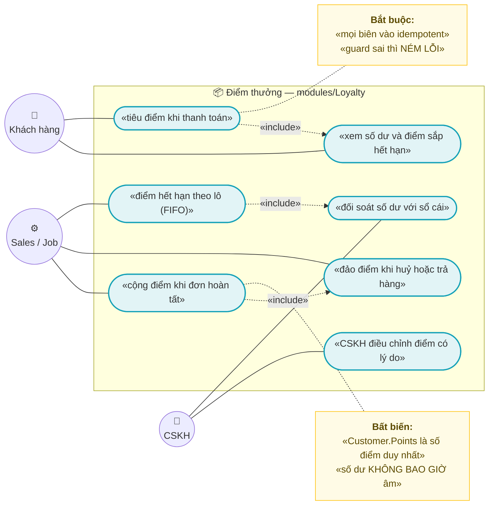
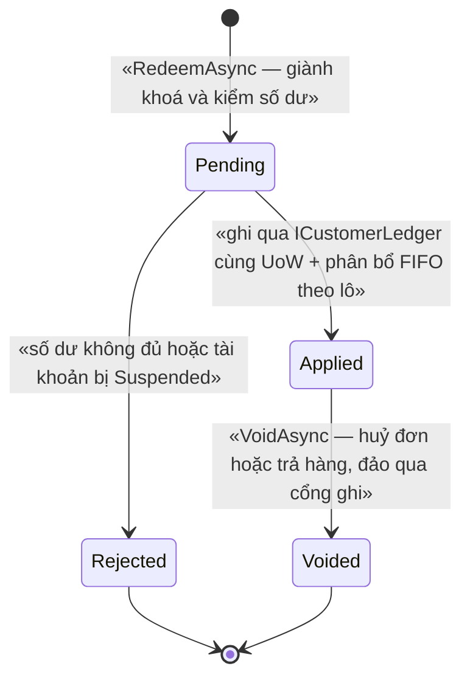
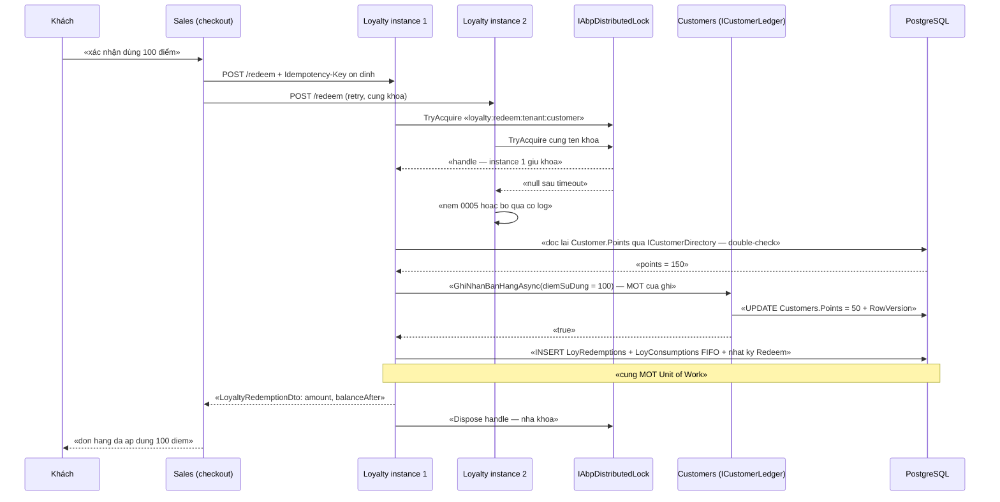
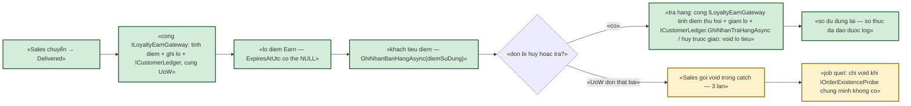
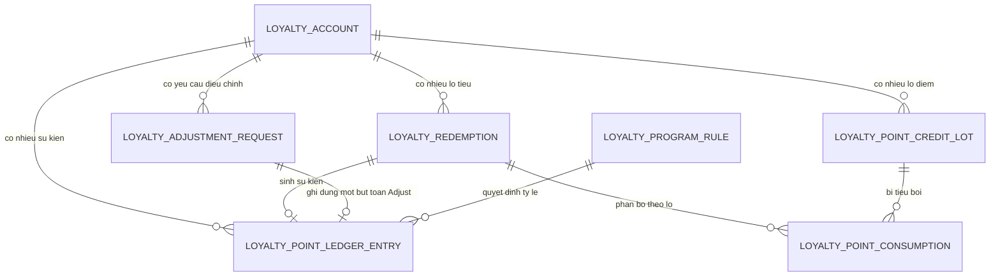

# `LOY-001` — Điểm thưởng

| Thuộc tính | Nội dung |
|---|---|
| **Mã** | `LOY-001` |
| **Module** | **Loyalty** — khuôn chuẩn `modules/Loyalty/eCommerce.Loyalty.Domain` · `.Application` · `.Contracts` · `.EntityFrameworkCore` (đối chiếu khuôn thật của `modules/ChannelHub/`) |
| **Giai đoạn** | **GĐ4 — Tăng trưởng** (`docs/implementation-plan.md` §10, §5, Phụ lục A.3) |
| **Ưu tiên** | **Should have** (không chặn bán hàng; nhưng **chặn** mọi thứ chạm tiền ⇒ phải xong tài liệu trước khi code) |
| **Trạng thái** | 🟡 `Draft` — chờ review |
| **Người viết / người review** | *(điền)* / **Kiến trúc trưởng + Kế toán** (điểm thưởng ảnh hưởng giá trị đơn ⇒ cần kế toán xác nhận chính sách) |
| **Phiên bản / ngày** | `v0.8 — 24/11/2026` |
| **Tài liệu liên quan** | `XC-001` (Money/làm tròn — **đã có code**) · `XC-002` (outbox/inbox + idempotency — **đã bật**) · `XC-003` (khoá phân tán) · `XC-004` (phân quyền/tenant) · `XC-005` (observability) · `SAL-003` (state machine 4 trục — mốc `Delivered`) · `SAL-006` (RMA — nguồn đảo điểm, `BR-023`) · `CUS-001` + `D-45`/`D-133` (một cửa ghi điểm qua `ICustomerLedger`) · `INV-001` (khuôn sổ cái append-only) |

> 📌 **Quy ước đọc tài liệu này:** mọi khẳng định về code **đều kèm đường dẫn file thật** đã đọc/kiểm trong repo.
> Chỗ nào **chưa có trong code** đều ghi rõ **“chưa có trong code — kế hoạch GĐ4”**. Không có suy diễn nào được
> trình bày như sự thật đã kiểm chứng.

---

## 0. Tóm tắt & quyết định thiết kế

**Tóm tắt:** `LOY-001` thiết kế **điểm thưởng** cho khách hàng mua trên **mọi kênh**: cộng điểm khi đơn hoàn tất,
tiêu điểm khi thanh toán, đảo điểm khi trả hàng, và **hết hạn điểm theo lô**. **Mọi** nguồn đổi `Customer.Points`
— đơn Sales ở `Delivered`/trả hàng **và hoá đơn POS bán lẻ** (bán/huỷ/trả) — đều đi **cổng** `ILoyaltyEarnGateway`
để lại sổ lô (`D-168`). Ba trụ của thiết kế:

1. **`Customer.Points` là số điểm DUY NHẤT** (`D-45` ①) — mọi thay đổi đi qua `ICustomerLedger`
   (`Customers.Application.Contracts`) **cùng UoW** với chứng từ. Loyalty là **engine luật + sổ lô FIFO**
   (`LoyCreditLots`/`LoyConsumptions`) chỉ để biết **lô nào bị tiêu và lô nào hết hạn**; nó **không** giữ
   số dư thứ hai (§0.3; `Q9` = `D-45` ① + `D-133`).
2. **Điểm là `decimal`, không bao giờ `float`/`double`, và không bao giờ so bằng `==`** — theo quy ước bất biến
   của dự án. Hiện repo đã tuân thủ cho **tiền**: `Order.Subtotal/GrandTotal` là `decimal` ở
   [Order.cs](../../../modules/Sales/eCommerce.Sales.Domain/Order.cs), cấu hình `HasPrecision(18, 4)` ở
   [eCommerceDbContext.cs](../../../src/eCommerce.EntityFrameworkCore/eCommerceDbContext.cs); loại `Money` **đã có** —
   [Money.cs](../../../shared/eCommerce.Kernel/Money/Money.cs) dòng 24 (xem §0.2 và §15.2 **G1**).
3. **Mọi biên vào idempotent + mọi chuyển trạng thái ném lỗi** — theo `XC-002` (`IIdempotencyGuard`) và quy ước #11.
   Tài liệu này **không tự nghĩ ra** cơ chế chống trùng mới: nó **dùng lại hợp đồng của `XC-002`**.

**Vì sao phải viết tài liệu trước khi code:** điểm thưởng là **nợ phải trả** của doanh nghiệp. Ba lỗi dưới đây
**không có lỗi biên dịch** và chỉ lộ ra khi có tiền thật:

| # | Lỗi im lặng có thể xảy ra | Hậu quả |
|---|---|---|
| 1 | Hai thao tác tiêu điểm song song cùng đọc số dư rồi cùng ghi | **Số dư âm** ⇒ khách tiêu quá số điểm có |
| 2 | Ghi sổ điểm bị gọi **hai lần** (ETO giao lại, hoặc đơn đi lại vào `Delivered`) | **Cộng điểm 2 lần** cho cùng một đơn |
| 3 | Trả hàng nhưng điểm đã tiêu hết | **Đảo điểm thất bại im lặng** ⇒ sổ sách lệch, không ai biết |

**Phạm vi (✅ trong tài liệu này):**

- ✅ Mô hình dữ liệu: `LoyaltyAccount` (đăng ký + trạng thái, **không** cột số dư) +
  `LoyaltyPointLedgerEntry` (nhật ký sự kiện điểm, append-only, **không** phải nguồn số dư) +
  `LoyaltyPointCreditLot` (lô điểm để hết hạn FIFO) + `LoyaltyRedemption` (lô tiêu điểm) +
  `LoyaltyPointConsumption` (lô nào bị tiêu bởi lô tiêu nào) + `LoyaltyProgramRule` (chính sách là **dữ liệu**) +
  `LoyaltyAdjustmentRequest` (điều chỉnh có duyệt — `D-114` P1).
- ✅ Công thức cộng điểm + **quy tắc làm tròn tường minh** (kế thừa `XC-001`) và **kiểm tra biên**.
- ✅ Hai vòng đời trạng thái **có bảng guard ném lỗi**: `LoyaltyAccount` (hoạt động) và
  `LoyaltyRedemption` (lô tiêu điểm).
- ✅ Tiêu điểm **song song**: khoá phân tán theo khách + **một cửa ghi** `ICustomerLedger` (`Customers:0018` chặn tiêu vượt).
- ✅ Idempotency ở **mọi biên vào** (HTTP, job) theo hợp đồng `IIdempotencyGuard` của `XC-002`; đường Sales là **đồng bộ** đánh dấu `OrdOrders.CustomerLedgerPostedAtUtc` (`D-133`).
- ✅ **Biên vào POS bán lẻ** (bán/huỷ/trả) đi **cổng** `ILoyaltyEarnGateway` trong cùng UoW; điểm do server tính, **bỏ tin** `PointsEarned`/`PointsUsed`/`PointsReversed` của client (`D-168`).
- ✅ Sự kiện phát ra/nhận vào, permission, UI, migration/seed, NFR, **53 test case**.

**Không nằm trong phạm vi (❌):**

- ❌ **Định nghĩa `OrderCompletedEto` / `OrderReturnedEto`** — thuộc `SAL-003` / `SAL-006`.
  Ở đây chỉ **khai báo hợp đồng mà Loyalty cần** và **điều kiện tiên quyết** (§7.0).
- ❌ **Hạ tầng outbox/inbox, DLQ, canonical payload** — thuộc `XC-002`. Xem §7.0: **hiện chưa bật** trong repo.
- ❌ **Loại `Money` và chính sách làm tròn tiền** — thuộc `XC-001`.
- ❌ **Xếp hạng khách hàng theo điểm (tier), quà tặng, voucher đổi bằng điểm** — giai đoạn sau; ghi ở §15.1.
- ❌ **UI khách hàng đầy đủ** — tài liệu này chốt **mapping dữ liệu**; UI do frontend hiện hành thực thi (storefront **không** làm lại — `D-06`).
- ❌ **Điểm thưởng cho đánh giá sản phẩm** — `REV-001` **đã bỏ** (`D-70`); không còn yêu cầu này.

### 0.1 Quyết định thiết kế (ADR ngắn)

| # | Quyết định | Phương án đã cân nhắc | Lý do chọn | Hệ quả |
|---|---|---|---|---|
| **D1** | **`Customer.Points` là nguồn duy nhất**; sổ lô FIFO của Loyalty chỉ là **sổ phụ hạn dùng** | (a) giữ `LoyaltyAccount.Balance` riêng · (b) chỉ dùng `Customer.Points` **không** có lô · (c) **`Customer.Points` + sổ lô** | `D-45` ①: một cửa ghi `ICustomerLedger` cùng UoW; lô chỉ cần để biết *điểm nào hết hạn* — `D3` | Bỏ `LoyaltyAccount.Balance/Debt`; đọc số dư qua `ICustomerDirectory`/`CustomerDto.Points`; đối soát dùng `DoiChieuSoDu` của `Customers` (`D-133`), không dựng bảng số dư thứ hai |
| **D2** | **Điểm lưu `decimal(18,2)`**, không `float`/`double`; **cấm so bằng `==`** | (a) `int` điểm · (b) `double` · (c) **`decimal(18,2)`** | Quy ước #1/#2 của dự án (`docs/implementation-plan.md` §3) + tỷ lệ tích điểm có thể lẻ (ví dụ 1 điểm / 10.000 ₫ ⇒ đơn 25.000 ₫ = 2,5 điểm) | Không dùng `int`; mọi so sánh dùng `>=`/`<=`/`CompareTo`; có test reflection (TC-19) |
| **D3** | **Hạn dùng điểm theo LÔ (FIFO)**, không theo số dư | (a) hết hạn toàn bộ điểm sau N tháng kể từ lần dùng cuối · (b) **lô theo bút toán cộng, FIFO** | (a) làm khách **mất oan** điểm cũ khi vừa phát sinh giao dịch mới và **không giải trình được** với khách; (b) truy vết được *“điểm nào hết hạn, vì sao”* — cần cho khiếu nại | Thêm bảng `LoyaltyPointCreditLot` + `LoyaltyPointConsumption`; tiêu điểm phức tạp hơn (phải phân bổ theo lô) |
| **D4** | **Tiêu điểm = GHI NỢ NGAY khi áp dụng** (không tách “giữ chỗ” rồi “xác nhận”) | (a) giữ chỗ rồi xác nhận sau · (b) **trừ ngay, hoàn lại nếu đơn huỷ** | (a) cần thêm trạng thái treo + job nhả, và mở ra cửa sổ **tiêu vượt** giữa “đã giữ” và “đã xác nhận” khi nhiều lô tiêu song song; (b) luồng đơn hàng hiện tại đã có **huỷ/trả** ⇒ dùng lại đúng cơ chế compensation | Bắt buộc có `VoidAsync` (đảo lô tiêu) — xem D5 và BR-016 |
| **D5** | **Đảo điểm khi trả hàng**: **KẸP Ở `0`, KHÔNG NÉM**, trả **số thực đã đảo** | (a) nợ điểm + ném · (b) cho số dư âm · (c) **kẹp 0 + log** | `D-45` ④: đảo là đường **sửa sai**; `DaoGhiNhanMuaHang` đã kẹp và trả `KetQuaDaoKhach` — [Customer.cs](../../../modules/Customers/eCommerce.Customers.Domain/Customer.cs) dòng 492–513 | Bỏ `LoyaltyPointDebt` + mã `0007`; hụt do kẹp ⇒ log `Warning` + lộ ở đối soát, **không** thành nợ ngầm (`D-165` ③) |
| **D6** | **Chống 2 thao tác tiêu song song bằng 3 lớp** | (a) chỉ kiểm tra trong domain · (b) chỉ lock · (c) **lock + một cửa ghi + kiểm số dòng** | Đúng `XC-003` D2: *“nếu bỏ lock đi, DB có chặn không?”* — nay lớp chặn cuối là `Customers`: `NghiepVuKhach.DiemSauGiaoDich` **ném** `Customers:0018` khi tiêu vượt ([Customer.cs](../../../modules/Customers/eCommerce.Customers.Domain/Customer.cs) dòng 473) + `RowVersion` của `Customer` | Khoá phân tán giữ nguyên; `LoyaltyAccount.RowVersion` chỉ bảo vệ trạng thái/đăng ký, **không** giữ số dư |
| **D7** | **Chính sách điểm là DỮ LIỆU** (`LoyaltyProgramRule` có hiệu lực theo thời gian) | (a) hằng số trong code · (b) **bảng cấu hình + `EffectiveFrom/To`** | Cùng lý do đã chốt ở `XC-006`: *“danh mục luật là DỮ LIỆU, không hard-code”* — tỷ lệ tích điểm **sẽ đổi** theo chương trình khuyến mại; đổi bằng code = phải release lại phần mềm | Cần `EffectiveFrom`/`EffectiveTo` + **audit** cho mọi lần đổi; công thức đọc rule **tại thời điểm đơn hoàn tất**, không tại thời điểm đọc |
| **D8** | **Không cho module khác gọi app service/domain của Loyalty**; điểm của **đơn Sales và hoá đơn POS bán lẻ** ghi qua **cổng hợp đồng** `ILoyaltyEarnGateway` (`Loyalty.Application.Contracts`) gọi **trong UoW của chứng từ**; bên trong cổng gọi `ICustomerLedger` **cùng UoW** (`D-45` ①/`D-133`), **không** qua ETO | (a) Sales/Pos gọi thẳng `ILoyaltyAppService` · (b) **cổng `ILoyaltyEarnGateway` + `ICustomerLedger` cùng UoW** | Quy ước bất biến #3 (*“module → app là cấm”*) + `D-45`: `Customer.Points` chỉ đổi qua `ICustomerLedger`; `D-133`: Sales gọi cổng ở `→ Delivered` **cùng UoW**; `D-168`: POS gọi cổng ở bán/huỷ/trả. Cổng **không phải** app service (không `[Authorize]`, không route) — khuôn thật `ICustomerReturnGateway`/`IPosStockGateway` | Sales/Pos ↔ Loyalty **chỉ** qua `Loyalty.Application.Contracts` (B4); Loyalty **không** đọc DB Sales/Pos (`orderId`/`billId` là `Guid` thô), **không** phụ thuộc `Sales.Domain`/`Pos.Domain`; một lời gọi ghi **điểm + bút toán `Earn` + lô** trong **cùng** UoW — xem §7.1 |
| **D9** | **Khoá phân tán theo khách hàng** (không theo tenant) | (a) khoá theo tenant · (b) **khoá theo (tenant, customer)** | `XC-003` D7: khoá toàn cục ⇒ khách A chặn khách B vô cớ. Điểm là tài nguyên **của một khách** | Tên khoá theo `XC-003` + **tiền tố do `KeyPrefix`** — xem §5.3 và **G3** ở §15.2 |
| **D10** | **Worker hết hạn điểm** đăng ký như **background worker thật** chạy **1 lần/ngày**, có khoá phân tán + `SkipIfBusy`; **mặc định TẮT** (chỉ chạy khi tenant đặt `PointExpiryDays > 0`) | (a) chạy trong request · (b) job tuỳ ý không khoá · (c) **worker + khoá + bỏ qua có log/metric** | Chạy trong request ⇒ request chậm bất thường; không khoá ⇒ 2 instance cùng expire ⇒ **ghi trùng** bút toán hết hạn. `XC-003` A1 quy định job định kỳ dùng `SkipIfBusy` **và bắt buộc** log + metric; `docs/coding-conventions.md` §9: worker **sửa dữ liệu vận hành** mặc định TẮT | Phải có metric `loyalty_expiry_job_skipped_total`; job **phải** idempotent (khoá `{JobName}:{tenantId}:{kỳ}` theo `XC-002` §7.3) |
| **D11** | **Điểm chỉ sinh khi đơn vào `FulfillmentStatus.Delivered`** (mốc ghi sổ khách — `D-133`), **không** từ `Placed` | (a) cộng ngay khi đặt · (b) **cộng khi giao thành công** | Cộng sớm ⇒ đơn huỷ/hoàn ⇒ phải đảo **rất nhiều**; `D-133` neo mốc ghi sổ ở **trục gốc** `Delivered` (`Completed` chỉ là giá trị suy ra) | `diemTich` cho đơn Sales do `LOY-001` quyết (`D-133` ghi nợ có chủ); nay đi qua `ICustomerLedger` cùng UoW — xem **§0.3** |
| **D12** | **Không tự viết cơ chế chống trùng cho Loyalty** — dùng `IIdempotencyGuard` của `XC-002` | (a) tự thêm cột unique riêng mỗi bảng · (b) **dùng hợp đồng chung** | Hợp đồng đã có thật trong tài liệu `XC-002` §6.4 (`IIdempotencyGuard.AcquireAsync`, `IdempotencyOutcome`) | Loyalty **phụ thuộc** `eCommerce.Messaging.Contracts`; **cấm** tham chiếu `.Domain` của Messaging (`XC-002` D12) |
| **D13** | **Metric của Loyalty khai báo qua interface ở `.Contracts`**, cài đặt thật ở tầng app | (a) Loyalty tự phát metric bằng `Meter` riêng · (b) **interface + adapter** | Bảng đăng ký metric là **nguồn sự thật duy nhất** ở [eCommerceMetrics.cs](../../../shared/eCommerce.Kernel/Observability/eCommerceMetrics.cs) và có test `TC-06` đối chiếu tên thật; module **cấm** tham chiếu `src/` (quy ước #3) | Phải thêm 7 tên metric vào `eCommerceMetricNames` + hằng số nhãn mới vào `eCommerceMetricTags` — xem §13 |
| **D14** | **Không hiển thị nợ điểm cho khách** — bề mặt khách chỉ hiện **số dư khả dụng** (`D-114` P13, thay `D14` cũ) | (a) hiện cả `balance` và `debt` · (b) **một số dư khả dụng** | `D-114` P13: người mua **không** mang “nợ điểm”; nợ nội bộ (nếu có) chỉ cho admin/CSKH có `eCommerce.Loyalty.View` | API khách **không** trả trường `debt`; `Customer.DebtBalance` là **công nợ TIỀN**, **không** phải nợ điểm — không trộn |
| **D15** | **Hạch toán điểm đã tiêu = GIẢM TRỪ DOANH THU**, **đúng MỘT** fact `SourceKind.LoyaltyDiscount` cho mỗi lần tiêu gắn đơn, kỳ = mốc `→ Delivered` (`D-133`), amount = snapshot `LoyaltyRedemptionDto.amount` | (a) chi phí khuyến mại khi tiêu (Nợ `641`, doanh thu gross) · (b) **giảm trừ doanh thu** · (c) trích lập dự phòng khi cộng điểm | `D-166`: `RevenueNet` của read-model **đang là gross of points** (`rep-001` :441) ⇒ ghi chi phí thì doanh thu báo cáo > tiền thực thu + giá trị điểm; (c) không có nguồn định giá và `PointExpiryDays` mặc định NULL (`D-114` P13) ⇒ khoản trích **không bao giờ hoàn nhập** | 0 bảng/0 cột; `LoyaltyDiscount` là **dòng giảm riêng** của scope `DoanhThu` (**CẤM** cộng vào `Discount`/`DiscountTotal` hoặc trừ `Subtotal` lần nữa); **KHÔNG** trích lập khi cộng điểm; phân loại tài khoản = `AccAccountMappings` (ADR-07, **không seed**) — thiếu ánh xạ ⇒ `eCommerce:Accounting:0003` |

### 0.2 Trạng thái thật của code liên quan (đã kiểm trong repo)

| Hạng mục | Trạng thái thật | Bằng chứng (đường dẫn thật) |
|---|---|---|
| Module `Loyalty` | ❌ **Chưa có trong code — kế hoạch GĐ4** | `ls modules/`: 14 module, **không** có `Loyalty` (đã có `Customers`, `Sales`, `Pos`, `Pricing`, `Inventory`, `Catalog`, …) |
| Loại `Money` (dùng chung) | ✅ **Đã có** | [Money.cs](../../../shared/eCommerce.Kernel/Money/Money.cs) dòng 24 (+ `MoneyAllocator.cs`) |
| Tiền là `decimal` | ✅ | `Order.Subtotal`/`GrandTotal`: [Order.cs](../../../modules/Sales/eCommerce.Sales.Domain/Order.cs) dòng 156, 164; precision `(18,4)`: [20261009070214_Initial.Designer.cs](../../../src/eCommerce.EntityFrameworkCore/Migrations/20261009070214_Initial.Designer.cs) dòng 122 |
| `IIdempotencyGuard` | ✅ **Đã có** | [IdempotencyGuard.cs](../../../modules/Messaging/eCommerce.Messaging.Domain/Idempotency/IdempotencyGuard.cs) dòng 27 (hợp đồng), 50 (hiện thực) |
| Cổng ghi sổ khách `ICustomerLedger` | ✅ **Đã có** (`D-45`) | [IDataScopeResolver.cs](../../../modules/Customers/eCommerce.Customers.Application.Contracts/IDataScopeResolver.cs) dòng 60–88; [CustomerLedger.cs](../../../modules/Customers/eCommerce.Customers.Application/CustomerLedger.cs) dòng 37–110; luật điểm [Customer.cs](../../../modules/Customers/eCommerce.Customers.Domain/Customer.cs) dòng 454–513 |
| Sổ cái append-only (khuôn để học) | ✅ **Đã có thật** | [StockLedger.cs](../../../modules/Inventory/eCommerce.Inventory.Domain/StockLedger.cs) dòng 80–136 |
| `CHECK` constraint ở EF Core | ✅ **Đã có tiền lệ** (Address, Catalog) | [AddressDbContextModelCreatingExtensions.cs](../../../modules/Address/eCommerce.Address.EntityFrameworkCore/AddressDbContextModelCreatingExtensions.cs) dòng 69; [CatalogDbContextModelCreatingExtensions.cs](../../../modules/Catalog/eCommerce.Catalog.EntityFrameworkCore/CatalogDbContextModelCreatingExtensions.cs) dòng 22 |
| `RowVersion` (optimistic concurrency) | ✅ **Đã có tiền lệ** | [Order.cs](../../../modules/Sales/eCommerce.Sales.Domain/Order.cs) dòng 93; `IsConcurrencyToken` [SalesDbContextModelCreatingExtensions.cs](../../../modules/Sales/eCommerce.Sales.EntityFrameworkCore/SalesDbContextModelCreatingExtensions.cs) dòng 131 |
| Permission `eCommerce.Loyalty.*` | ❌ **Chưa định nghĩa** | [eCommercePermissionDefinitionProvider.cs](../../../src/eCommerce.Application.Contracts/Permissions/eCommercePermissionDefinitionProvider.cs) dòng 25–186 có nhiều nhóm (Products, Categories, Pricing, Inventory, Channels, Orders, Payments, Customers, Pos, Addresses, Settings, Reports, …) — **không** có Loyalty |
| Outbox/Inbox của ABP | ✅ **Đã bật**: `eCommerceDbContext` implement `IHasEventOutbox`/`IHasEventInbox`; `OnModelCreating` gọi `ConfigureEventOutbox()`/`ConfigureEventInbox()` | [eCommerceDbContext.cs](../../../src/eCommerce.EntityFrameworkCore/eCommerceDbContext.cs) dòng 35, 377–379 |
| Bảng đăng ký metric | ✅ **Đã có, 16 metric** | [eCommerceMetrics.cs](../../../shared/eCommerce.Kernel/Observability/eCommerceMetrics.cs) dòng 16–78 |
| Khoá lock thật của hệ thống | ✅ `KeyPrefix = "ecommerce:"` — cache và lock **giống nhau** | [eCommerceHttpApiHostModule.cs](../../../src/eCommerce.HttpApi.Host/eCommerceHttpApiHostModule.cs) dòng 222, 237 |
| Kiểm tra Mermaid | ✅ Có script CI: `npm --prefix tools run check:mermaid` | [check-mermaid.mjs](../../../tools/check-mermaid.mjs) |

### 0.3 🔒 Ràng buộc cứng từ `D-45`/`D-133` — **ĐÃ CHỐT**: một cửa ghi điểm (`Q9` = `D-45` ① + `D-133`)

1. **Một cửa ghi điểm:** `Customer.Points` là **số điểm duy nhất** của khách; chỉ `Customer.GhiNhanMuaHang`/`DaoGhiNhanMuaHang` được đổi nó, gọi qua `ICustomerLedger` (`Customers.Application.Contracts`) **trong cùng UoW** — [IDataScopeResolver.cs](../../../modules/Customers/eCommerce.Customers.Application.Contracts/IDataScopeResolver.cs) dòng 60–88, [Customer.cs](../../../modules/Customers/eCommerce.Customers.Domain/Customer.cs) dòng 454–513. **POS bán lẻ** cũng **chỉ** đi cửa này, qua cổng `ILoyaltyEarnGateway` (`D-168`).
2. **Âm điểm khi TIÊU ⇒ NÉM `Customers:0018`; ĐẢO (huỷ/trả) KẸP Ở `0`, KHÔNG NÉM** (`D-45` ③④) — `DaoGhiNhanMuaHang` trả số **thực sự** đã đảo ([Customer.cs](../../../modules/Customers/eCommerce.Customers.Domain/Customer.cs) dòng 492–513).
3. **Mốc ghi sổ đơn Sales:** đúng **một lần** khi chuyển trục `→ FulfillmentStatus.Delivered`, cùng UoW, đánh dấu `OrdOrders.CustomerLedgerPostedAtUtc` (cột **kế hoạch** — `D-133`); `diemTich`/`diemSuDung`/`noTang` của đơn Sales do **`LOY-001`** quyết.

**Hệ quả đã chốt (thay khối cảnh báo cũ):** Loyalty là **engine luật + sổ lô FIFO** — `LoyCreditLots`/`LoyConsumptions` chỉ là **sổ phụ hạn dùng**, **không** phải nguồn số dư; `LoyaltyAccount` giữ **đăng ký + trạng thái**, **không** giữ `Balance`/`Debt`; đọc số dư qua `ICustomerDirectory`/`CustomerDto.Points` ([CustomerDtos.cs](../../../modules/Customers/eCommerce.Customers.Application.Contracts/CustomerDtos.cs) dòng 43, 109); đảo/hết hạn đi qua `DaoBanHangAsync`/`GhiNhanTraHangAsync` — **đảo trả hàng (A2) chỉ Loyalty gọi** qua cổng `ILoyaltyEarnGateway.GhiNhanDaoDiemTraHangAsync` (`D-167`, Sales **không** gọi thẳng); **bỏ** `LoyaltyPointDebt` + mã `0007`. Không tạo bảng số dư thứ hai.

---

## 1. Use Case Specification

| Thuộc tính | Nội dung |
|---|---|
| **Use Case ID** | `LOY-001` |
| **Use Case Name** | Cộng — tiêu — đảo — hết hạn **điểm thưởng** của khách hàng, **không bao giờ sai sổ và không bao giờ âm điểm** |
| **Description** | *“Là khách hàng mua trên website và sàn, tôi muốn được cộng điểm khi đơn hoàn tất và dùng điểm để giảm tiền đơn sau, để tôi thấy việc mua hàng có giá trị tích luỹ — và tôi muốn số điểm hiển thị luôn khớp với số điểm thực tế có thể dùng.”* |
| **Actor(s)** | **Khách hàng** (đã đăng nhập) · **Nhân viên CSKH** (tra cứu, điều chỉnh điểm — có permission) · **Nhân viên bán quầy** (POS gọi cổng ở hoá đơn bán/huỷ/trả — `D-168`) · **Hệ thống** (Sales gọi ở mốc `Delivered`/phiếu trả `Closed`, job hết hạn, API checkout của Sales) · **Vận hành** (xem đối soát, xem job hết hạn) |
| **Priority** | **Should have** |
| **Trigger** | (a) đơn hàng chuyển sang **hoàn tất** ⇒ cộng điểm; (b) khách **áp dụng điểm** ở bước thanh toán ⇒ tiêu điểm; (c) đơn bị **huỷ/trả** ⇒ đảo điểm; (d) **job hết hạn** chạy hằng ngày; (e) CSKH **điều chỉnh** điểm (có lý do + audit) |
| **Pre-Condition(s)** | • **Tenant hiện tại** (`TenantId`) — theo `XC-004` D8/BR-009; hệ thống nay chạy 1 tenant ⇒ `TenantId` **có thể là `NULL`** ⇒ mọi unique index của Loyalty **phải** dùng `NULLS NOT DISTINCT` (tiền lệ migration đã có).<br>• **Khách hàng đã tồn tại** với `CustomerId` (Guid do module `Customers` sở hữu) — Loyalty **không** tạo khách; **đọc số dư** qua `ICustomerDirectory`/`CustomerDto.Points`.<br>• **Chính sách điểm có hiệu lực** tại thời điểm cộng/tiêu (`LoyaltyProgramRule`) — **thiếu ⇒ NÉM LỖI**, không mặc định ngầm.<br>• **Đơn Sales vào `FulfillmentStatus.Delivered` có `CustomerId`** — mốc ghi sổ khách đúng **một lần** (`D-133`), đánh dấu `OrdOrders.CustomerLedgerPostedAtUtc` (cột **kế hoạch**). Loyalty **không** nhận ETO để cộng/đảo điểm; Sales gọi **cổng** `ILoyaltyEarnGateway` (`Loyalty.Application.Contracts`) **cùng UoW** — cổng tính `diemTich` rồi gọi `ICustomerLedger` (`D-45`/`D-133`, §7.1).<br>• `ChannelCode` **có** mặt (để đối soát điểm cộng theo kênh) nhưng **không** tham gia quyết định số điểm (`D-114` P13: **không** phân biệt điểm theo kênh) — xem §15.1 Q3.<br>• **Redis 7 sẵn sàng** cho khoá phân tán — nếu không, **vẫn phải đúng** nhờ một cửa ghi `Customers` + `RowVersion` (D6). |
| **Post-Condition(s)** | • **Bất biến số 1**: `Customer.Points >= 0` **luôn đúng** — `Customers:0018` chặn tiêu vượt, đảo kẹp `0` (`D-45` ③④).<br>• **Bất biến số 2**: `Σ` điểm trong nhật ký sự kiện Loyalty khớp lịch sử lô; `Customer.Points` đối soát qua `DoiChieuSoDu` của `Customers` (`D-133`) — Loyalty **không** giữ số dư thứ hai.<br>• Mỗi đơn hoàn tất sinh **đúng một** lần ghi sổ (dù chuyển `Delivered` bao nhiêu lần) — dấu `OrdOrders.CustomerLedgerPostedAtUtc`.<br>• Mọi lần tiêu có **một** `LoyaltyRedemption` và **các dòng** `LoyaltyPointConsumption` chỉ rõ lô nào bị tiêu.<br>• Mọi lần không đảo đủ **có dấu vết**: số **thực** đã đảo được log kèm bút toán (`D-45` ④), **không** có nợ điểm ẩn. |
| **Basic Flow** | 1. Đơn Sales chuyển trục `→ FulfillmentStatus.Delivered` (`D-133`): nếu `OrdOrders.CustomerLedgerPostedAtUtc` còn `NULL`, Sales gọi **một** cổng `ILoyaltyEarnGateway.GhiNhanDiemDonHangAsync(customerId, orderId, tienHang, deliveredAtUtc, nguon)` (`Loyalty.Application.Contracts`, B4) **trong UoW của Sales**, rồi đánh dấu `OrdOrders.CustomerLedgerPostedAtUtc` **cùng UoW**.<br>2. Trong cổng: Loyalty đọc `LoyaltyProgramRule` có hiệu lực tại mốc `Delivered` (thiếu ⇒ **NÉM** `0002`), tính `diemTich`, gọi `ICustomerLedger.GhiNhanBanHangAsync(customerId, tienHang, diemTich, diemSuDung, noTang, nguon)` (**6** tham số — `noTang` là `DebtAmount`, `diemSuDung = 0` trên đường cộng Sales) rồi ghi `LoyaltyPointLedgerEntry` (`Earn`) + `LoyaltyPointCreditLot` (`RemainingAmount = points`, `ExpiresAtUtc = null` nếu `PointExpiryDays` NULL) — **không** cập nhật số dư nào; lỗi ở bất kỳ bước nào ⇒ **cả** điểm và lô rollback (`TC-48`).<br>3. Công thức: `points = floor(tienHang × earningRate, 2)`, `TienHang` theo `D-136`.<br>3b. **POS bán lẻ** (`RetailBillAppService.cs:262-268`, `D-168`): POS gọi **cổng** `ILoyaltyEarnGateway` (method additive — 3 method hoặc 1 method + `SourceDocumentKind`, arch `Pos`/`Loyalty` chốt) trong **cùng UoW** hoá đơn; Loyalty tính điểm theo `LoyProgramRules` lúc hoá đơn, gọi `ICustomerLedger` **đúng một lần**, chuyển nguyên `tienHang = Subtotal − DiscountTotal`/`noTang = DebtAmount`/`nguon`, rồi ghi `Earn` + lô; **bỏ tin** `PointsEarned`/`PointsUsed` của client (`PosDtos.cs:35,122`); `modules/Pos/**` **0** lời gọi thẳng `ICustomerLedger` (`TC-52`).<br>4. Khách vào checkout, chọn dùng điểm: Sales gọi API **tính trước** (`POST /preview`) để biết số điểm tối đa dùng được.<br>5. Khách xác nhận ⇒ Sales gọi `POST /redeem` với `Idempotency-Key` **ổn định**; Loyalty **giành khoá phân tán** `…:redeem:{customerId}`, đọc lại số dư qua `ICustomerDirectory` (**double-check**), phân bổ FIFO theo lô.<br>6. Trong **một** UoW: gọi `ICustomerLedger.GhiNhanBanHangAsync(diemSuDung = amount)` (một cửa ghi — `D-45` ①) + ghi `LoyaltyRedemption` + các dòng `LoyaltyPointConsumption` + nhật ký `Redeem`.<br>7. Phát `LoyaltyPointsRedeemedEto`; trả `LoyaltyRedemptionDto` (gồm `amount`, `balanceAfter` đọc lại sau ghi) để Sales trừ vào tiền đơn.<br>8. Sales commit đơn **cùng** UoW ⇒ điểm và đơn cùng sống/chết; nếu đường buộc tách transaction (`POST /redeem` rời rạc cho kênh ngoài) mà UoW đơn thất bại ⇒ bước bù ở **A1** (`D-164` (a)). |
| **Alternative Flow** | **A1: Đơn huỷ TRƯỚC giao** ⇒ Sales `void` **lô tiêu** đã áp cho đơn (`VoidRedeem` dương, hoàn `RemainingAmount` về đúng lô — `D-164`), **không** qua ETO; **0** bút toán đảo điểm vì điểm chỉ sinh ở `Delivered` (`D-167`).<br>**A1-b: Sales áp điểm nhưng UoW đơn thất bại** (`D-164`): Sales **bắt buộc** gọi `POST …/redemptions/{id}/void` trong `catch` (UoW **mới** `requiresNew`, khoá `Loyalty:{tenantId}:{customerId}:Void:{redemptionId}`, **3** lần backoff); job đối soát hằng ngày chỉ `void` khi **chứng minh** đơn không tồn tại qua `IOrderExistenceProbe` (fail-closed); auto-void **mặc định TẮT**.<br>**A2: Trả hàng SAU khi đã cộng điểm** ⇒ `SAL-006` đóng phiếu (`BR-023`) gọi **một** method **additive** `GhiNhanDaoDiemTraHangAsync(customerId, orderId, returnId, T, V, V_trước, noGiam, nguon)` trên **chính** cổng `ILoyaltyEarnGateway` **trong UoW đóng phiếu** (`D-167`); Loyalty tính `diemThuHoi` (`BR-021`, đọc `E` từ **snapshot** bút toán `Earn` của `orderId`), gọi `ICustomerLedger.GhiNhanTraHangAsync(tienHangTra = V−V_trước, diemThuHoi, noGiam, nguon)` — **chuyển nguyên `noGiam`** (giảm nợ trên phiếu trả; POS truyền `DebtReductionAmount`), **không** tự tính — nhận `KetQuaDaoKhach.DiemDaDao`, ghi **đúng một** `LoyLedgerEntries(Reversal, AmountDelta = −DiemDaDao, ReferenceId = returnId)` + **giảm lô cùng UoW**; Sales **KHÔNG** gọi thẳng `ICustomerLedger.GhiNhanTraHangAsync` (đối xứng `BR-003`). ⚠️ `SAL-006` §7.1(:318)/`BR-023` **hiện vẫn** ghi Sales gọi thẳng ⇒ **CR chéo bắt buộc cho `SAL-006`** (chủ `SAL-006`, cùng WP code; xem §7.0). Thiếu tham số ⇒ **NÉM** `0008`; `T < 0` ∨ `V < V_trước` ∨ `V > T` ⇒ **NÉM** `0015`; `E <= 0` ∨ `T <= 0` ⇒ **no-op** (0 bút toán, 0 lô, log `Information`); đảo **kẹp ở `0`, KHÔNG ném** (`D-45` ④) — `diemThuHoi > 0` mà `DiemDaDao = 0` ⇒ vẫn ghi **một** `Reversal` `AmountDelta = 0` + log `Warning`, **0** giảm lô (`D-167`); **không** tạo `LoyaltyPointDebt`, **không** ném `0007`.<br>**A3: Job hết hạn** ⇒ chỉ chạy khi tenant đặt `PointExpiryDays > 0`; giành khoá `…:expire-job:{tenantId}:{kỳ}`, chọn lô `RemainingAmount > 0` ∧ `ExpiresAtUtc <= now`, gọi `GhiNhanTraHangAsync(diemThuHoi = số hết hạn)` cho **từng lô**, `SkipIfBusy` nếu không giành được khoá (log + metric).<br>**A4: Khách bị khoá tài khoản** (gian lận) ⇒ `LoyaltyAccount.Status = Suspended` ⇒ **cấm** cộng *và* tiêu; mọi thao tác ⇒ `eCommerce:Loyalty:0009`.<br>**A5: CSKH điều chỉnh điểm** ⇒ tạo `LoyaltyAdjustmentRequest` (bút toán `Adjust` có `Reason` **và** `ticketId` **bắt buộc** — thiếu ⇒ **NÉM** `0017` + audit); vượt ngưỡng `Loyalty:AdjustApprovalThreshold` (mặc định **trống = mọi điều chỉnh phải duyệt**) ⇒ `PendingApproval` chờ người có `eCommerce.Loyalty.Adjust.Approve`; chỉ `Applied` mới ghi **đúng một** bút toán `Adjust` — `Adjust (+)` **phải tạo lô** (`SourceLedgerEntryId` = bút toán `Adjust`, hạn = `PointExpiryDays`/NULL) và `Adjust (−)` **phải giảm lô** (thứ tự tất định §8.1 #11, kẹp `0`, không ném), thiếu thì `pointsFromLots` lệch ngay cả khi 0 trả hàng (`D-167` ⑥); **cấm** sửa/xoá bút toán cũ.<br>**A6: POS huỷ hoá đơn / trả hàng** (`D-168`): huỷ (`RetailBillAppService.cs:323-329`) và trả (`RetailReturnAppService.cs:183-188`) gọi **cổng** `ILoyaltyEarnGateway` **trong cùng UoW**; huỷ chạy `VoidRedeem` (hoàn `RemainingAmount` **đúng các lô** đã tiêu — `D-164`/BR-016) **rồi** `Reversal` điểm đã tích (giảm lô theo `D-167` (3)), `Σ RemainingAmount` cuối = trạng thái **trước** hoá đơn; kẹp `0` (`D-45` ④), `Reversal = 0` vẫn ghi **một** bút toán + log `Warning`; trả hàng thu hồi theo `BR-021`/`D-165` với `T = Subtotal − DiscountTotal`, `V = Σ GoodsAmount` trả **luỹ kế**, `E` = snapshot `Earn`; **bỏ tin** `PointsReversed` của client (`PosDtos.cs:285`); cả hai **append-only**, **0** xoá. |
| **Exception Flow** | **E1:** số điểm yêu cầu **>** số dư khả dụng ⇒ **NÉM** `eCommerce:Loyalty:0001` (thông điệp **nêu số khả dụng**, không chỉ “không đủ”).<br>**E2:** cùng `IdempotencyKey` nhưng **`PayloadHash` khác** ⇒ **NÉM** `eCommerce:Messaging:0002` (theo `XC-002` BR-006) — **không** ghi đè.<br>**E3:** chuyển trạng thái sai (ví dụ `Applied → Applied`, `Voided → Applied`; yêu cầu điều chỉnh `Approved → Approved`) ⇒ **NÉM** `eCommerce:Loyalty:0010` / `0016`.<br>**E4:** không tìm thấy chính sách điểm có hiệu lực ⇒ **NÉM** `eCommerce:Loyalty:0002` (**không** dùng mặc định ngầm).<br>**E5:** `UPDATE` trạng thái (tài khoản/lô tiêu/yêu cầu điều chỉnh) ảnh hưởng **0 dòng** ⇒ **NÉM** `eCommerce:Loyalty:0005` và **thử lại** ở nhịp sau.<br>**E6:** tiêu vượt số dư ở tầng `Customers` (`NghiepVuKhach.DiemSauGiaoDich`) ⇒ **NÉM** `Customers:0018` (ánh xạ `0001` cho Sales) + metric `loyalty_negative_balance_blocked_total` (**lưới an toàn, không phải luồng bình thường**).<br>**E7:** đảo vượt số dư ⇒ **kẹp `0`, KHÔNG ném**; log `Warning` + metric; số **thực** đã đảo ghi vào bút toán đảo (`VoidRedeem`/`Reversal`, kể cả `Reversal = 0` — `D-167`) theo `D-45` ④.<br>**E8:** đầu vào thiếu `CustomerId`/`OrderId`/`returnId` ⇒ **NÉM** `eCommerce:Loyalty:0008` ⇒ DLQ `PoisonMessage` (theo `XC-002` E4) — **không** đoán giá trị thiếu. |
| **Business Rules** | • **BR-LOY-001-001**: Điểm **phải** là `decimal` (kiểu CLR `decimal`, cột `numeric(18,2)`); **CẤM** `float`/`double`/`int` trong mọi trường điểm, kể cả trong ETO (test reflection `TC-19`).<br>• **BR-LOY-001-002**: **CẤM** so sánh điểm/bằng tiền bằng `==`; dùng `>=`, `<=`, hoặc `decimal.Compare`. Ngoại lệ duy nhất: so **bằng 0** sau khi đã làm tròn tường minh ⇒ vẫn phải dùng `<= 0m`/`>= 0m`.<br>• **BR-LOY-001-003**: **Mọi** thay đổi số điểm **phải** đi qua `ICustomerLedger` (`GhiNhanBanHangAsync`/`DaoBanHangAsync`/`GhiNhanTraHangAsync`) trong **cùng** UoW với chứng từ **và** với `CreditLot`/`Consumption`; đường **cộng điểm** và đường **trả hàng sau giao** của Sales **phải** gọi **cổng** `ILoyaltyEarnGateway` trong UoW của Sales — cổng gọi `ICustomerLedger` + ghi bút toán (`Earn`/`Reversal`) + lô trong **một** lời gọi (**CẤM** gọi rời hai bước; Sales **CẤM** gọi thẳng `ICustomerLedger.GhiNhanBanHangAsync`/`GhiNhanTraHangAsync` — `D-167`, `TC-51`; **POS cũng CẤM** gọi thẳng `GhiNhanBanHangAsync`/`DaoBanHangAsync`/`GhiNhanTraHangAsync` cho chứng từ bán lẻ — `D-168`, `TC-52`), lỗi giữa chừng ⇒ **rollback cả điểm, bút toán và lô** (`TC-48`); `LoyaltyPointLedgerEntry` chỉ là **nhật ký sự kiện** (append-only), **không** phải nguồn số dư.<br>• **BR-LOY-001-004**: `LoyaltyPointLedgerEntry` là **append-only** — **CẤM** UPDATE/DELETE (kể cả soft-delete); sửa sai bằng **bút toán đảo**; DB **phải** chặn bằng trigger `LoyLedgerEntries_AppendOnly` (§11) — UPDATE/DELETE thô ⇒ PostgreSQL ném lỗi (`TC-21`).<br>• **BR-LOY-001-005**: Số điểm **không bao giờ âm**: `Customers:0018` chặn tiêu vượt (`NghiepVuKhach.DiemSauGiaoDich`), đảo kẹp `0` (`D-45` ③④), khoá phân tán theo khách + `RowVersion` (D6).<br>• **BR-LOY-001-006**: Tiêu điểm **phải** theo **FIFO theo lô**: tiêu lô có `ExpiresAtUtc` **gần nhất** trước; **CẤM** tiêu lô đã hết hạn (khi lô có hạn). Quy tắc này **chỉ** áp cho **tiêu** — **không** áp cho giảm lô do trả hàng: lô đã hết hạn nhưng job chưa quét **vẫn** được giảm (`D-167`; đảo ≠ tiêu).<br>• **BR-LOY-001-007**: Công thức cộng điểm dùng **duy nhất** `LoyaltyProgramRule` có hiệu lực tại thời điểm hoàn tất đơn; **làm tròn XUỐNG** (`Floor`) tới **2 chữ số thập phân**, tường minh — **CẤM** làm tròn ngầm theo mặc định của CLR.<br>• **BR-LOY-001-008**: Điểm chỉ sinh khi đơn vào `FulfillmentStatus.Delivered` (`D-133`; `Completed` chỉ là **giá trị suy ra**), **không** từ `Placed`; mỗi đơn **tối đa một** lần ghi điểm — Sales **kiểm** dấu `OrdOrders.CustomerLedgerPostedAtUtc` (lớp 1) **trước khi** gọi cổng, rồi đánh dấu **cùng UoW** (`D-133`); unique `(TenantId, ReferenceType, ReferenceId, EntryType)` của `LoyLedgerEntries` là **lớp 2** (gọi lặp ⇒ vi phạm unique ⇒ rollback fail-closed) vì `ICustomerLedger` **không** idempotent (`D-45` ⑥). Điểm **đã tiêu** cho đơn sinh **đúng một** fact `SourceKind.LoyaltyDiscount` ở kỳ `Delivered` (amount = snapshot `LoyaltyRedemptionDto.amount`), là **dòng giảm riêng** của scope `DoanhThu` — **CẤM** cộng vào `Discount`/`DiscountTotal` hoặc trừ `Subtotal` lần nữa; **KHÔNG** trích lập dự phòng khi cộng điểm (`D-166`).<br>• **BR-LOY-001-009**: Mọi **đảo điểm** (huỷ đơn, trả hàng, hết hạn) **phải** sinh bút toán nhật ký tương ứng và đi qua **một cửa** `ICustomerLedger` (`GhiNhanTraHangAsync`; huỷ lô tiêu qua `void`/`DaoBanHangAsync`); **đường A2 Sales KHÔNG gọi thẳng** — chỉ Loyalty gọi qua cổng `ILoyaltyEarnGateway.GhiNhanDaoDiemTraHangAsync` (`D-167`); **POS huỷ/trả cũng KHÔNG gọi thẳng** — huỷ = `VoidRedeem` + `Reversal`, trả = `GhiNhanDaoDiemTraHangAsync` qua cổng (`D-168`); **CẤM** “kẹp về 0” im lặng — phải log số **thực** đã đảo.<br>• **BR-LOY-001-010**: Đảo vượt số dư ⇒ **KẸP Ở `0`, KHÔNG NÉM**, **KHÔNG** tạo nợ điểm, **KHÔNG** dùng `0007` (`D-45` ④ — `D-164`, `D-165`); cổng trả `KetQuaDaoKhach.DiemDaDao` là số **thực tế** đã đảo; **giảm lô = `DiemDaDao`** (số thực sau kẹp), **không** phải `diemThuHoi` danh nghĩa; `diemThuHoi > 0` mà `DiemDaDao = 0` ⇒ ghi **một** `Reversal` `AmountDelta = 0` + log `Warning`, **0** giảm lô; `Σ RemainingAmount < DiemDaDao` ⇒ giảm hết về `0`, **KHÔNG NÉM**, log `Critical` + gauge + ticket (`D-167`).<br>• **BR-LOY-001-011**: Mọi chuyển trạng thái **không hợp lệ** của `LoyaltyRedemption`, `LoyaltyAccount` và `LoyaltyAdjustmentRequest` **phải NÉM** `BusinessException` có mã (`0010` / `0011` / `0016`) — **CẤM** no-op im lặng (quy ước #11).<br>• **BR-LOY-001-012**: **Mọi** biên vào HTTP/job **phải** gọi `IIdempotencyGuard` **trước mọi side effect**, với khoá **ổn định** — **CẤM** `Guid.NewGuid()` làm khoá; đường Sales **đồng bộ** chống trùng bằng dấu `OrdOrders.CustomerLedgerPostedAtUtc` (BR-008) chứ **không** thêm khoá thứ hai (`D-45` ⑥).<br>• **BR-LOY-001-013**: API tiêu điểm **phải** nhận `Idempotency-Key` từ Sales; thiếu ⇒ **NÉM** `eCommerce:Loyalty:0006` (fail-closed).<br>• **BR-LOY-001-014**: `LoyaltyAccount`, `LoyaltyRedemption`, `LoyaltyAdjustmentRequest` **phải** có `RowVersion`; mọi UPDATE trạng thái dùng optimistic concurrency và **kiểm số dòng** (0 dòng ⇒ E5).<br>• **BR-LOY-001-015**: **CẤM** hard-code tỷ lệ tích điểm/ngưỡng tiêu điểm/ngưỡng duyệt điều chỉnh trong code; **mọi** tham số chính sách **phải** đọc từ `LoyaltyProgramRule` hoặc **Setting** (D7, `D-114` P1). Phân loại tài khoản kế toán của `LoyaltyDiscount` **phải** đọc từ cấu hình `AccAccountMappings` (ADR-07 — **không seed**, **không hard-code** số hiệu); thiếu ánh xạ hiệu lực ⇒ chặn xuất `eCommerce:Accounting:0003` (`D-166`).<br>• **BR-LOY-001-016**: Đảo một lô tiêu **phải** hoàn `RemainingAmount` về **đúng các lô** đã tiêu (giữ `ExpiresAtUtc` gốc) và **CẤM** xoá lịch sử; trạng thái hoá đơn **không** chặn việc đảo điểm — điểm đảo qua cùng cửa `ICustomerLedger`. Huỷ trước giao ⇒ **một** bút toán đảo fact ở kỳ sự kiện; trả hàng sau giao ⇒ **0** đảo `LoyaltyDiscount` lần hai, doanh thu giảm theo `RefundAmount` (`D-165` (6), `D-166` (6)).<br>• **BR-LOY-001-017**: Khi kẹp `0` “cắn” (`DiemDaDao < diemThuHoi`) ⇒ log `Warning` + metric + lộ ở đối soát; phần hụt **KHÔNG** thu lại ở phiếu sau (công thức `D-165` dùng `V_trước` **yêu cầu**) — không biến kẹp thành nợ ngầm.<br>• **BR-LOY-001-018**: Mọi thao tác ghi (cộng/tiêu/đảo/điều chỉnh/hết hạn) **phải** chạy trong **Unit of Work** (quy ước #13).<br>• **BR-LOY-001-019**: **CẤM** log `Phone`, `Email`, số điểm gắn kèm định danh cá nhân ở mức `Debug`; log nghiệp vụ chỉ dùng `TenantId`, `CustomerId`, `OrderId`, `Amount`, `IdempotencyKey` (theo `XC-005`).<br>• **BR-LOY-001-020**: Hạn dùng điểm là **tuỳ chọn**: `LoyProgramRules.PointExpiryDays` là `int?` (**NULL = không hết hạn**, mặc định seed NULL) và `LoyCreditLots.ExpiresAtUtc` nullable; worker hết hạn mặc định **TẮT**, chỉ ghi bút toán `Expire` khi tenant đặt hạn > 0 (`D-114` P13).<br>• **BR-LOY-001-021**: **Công thức thu hồi luỹ kế** khi trả hàng: `diemThuHoi(kỳ) = Floor2(E × V / T) − Floor2(E × V_trước / T)`; `T` = Σ `TienHang` mọi dòng đơn (`D-136`, net giảm giá, **không** thuế/ship/điểm đã tiêu), `V` = Σ `TienHang` trả luỹ kế, `E` = điểm đã tích snapshot lúc `Delivered`; trả hết ⇒ Σ = `E`; `V > T` ⇒ **NÉM** `0015` (`D-165`).<br>• **BR-LOY-001-022**: Trên đường buộc tách transaction, Sales **BẮT BUỘC** gọi `void` trong `catch` (UoW `requiresNew`, khoá `Loyalty:{tenantId}:{customerId}:Void:{redemptionId}`, **3** lần backoff); hỏng ⇒ log `Error` + metric — **CẤM** nuốt lỗi (`D-164` (a)).<br>• **BR-LOY-001-023**: Job đối soát mồ côi **chỉ** `void` khi **chứng minh** đơn không tồn tại qua `IOrderExistenceProbe`; cổng lỗi ⇒ fail-closed **0 void**; auto-void mặc định **TẮT** (`Loyalty:OrphanAutoVoidEnabled=false`), grace **24 h**, đánh dấu `LoyRedemptions.OrphanCheckedAtUtc` (`D-164` (b)).<br>• **BR-LOY-001-024**: Điều chỉnh điểm **phải** qua `LoyaltyAdjustmentRequest`: ngưỡng đọc từ Setting `Loyalty:AdjustApprovalThreshold` (mặc định **trống = mọi điều chỉnh phải duyệt**); **chỉ** trạng thái `Applied` ghi **đúng một** bút toán `Adjust`; duyệt cần `eCommerce.Loyalty.Adjust.Approve` (`D-114` P1). |
| **Non-Functional Requirement** | • **NFR-LOY-001-001**: API xem số dư p95 **< 50 ms**.<br>• **NFR-LOY-001-002**: Thao tác tiêu điểm ở checkout p95 **< 200 ms** (chặn luồng đặt hàng ⇒ phải nhanh).<br>• **NFR-LOY-001-003**: Sổ lô khớp nhật ký sự kiện và **`Customer.Points` khớp `DoiChieuSoDu` của `Customers`** — sai lệch **0** trên 10.000 bút toán (test đối soát `TC-49`).<br>• **NFR-LOY-001-004**: **0** bản ghi nhật ký bị UPDATE/DELETE (test quét mã nguồn + test DB `TC-21`).<br>• **NFR-LOY-001-005**: **0** lần số dư âm khi 100 request tiêu song song trên **2 instance** (test `TC-16`).<br>• **NFR-LOY-001-006**: Ghi sổ lặp **100 lần** ⇒ **đúng 1** lần cộng điểm cho mỗi đơn (test `TC-14`).<br>• **NFR-LOY-001-007**: **100 %** biên vào HTTP/job gọi `IIdempotencyGuard` (test reflection `TC-22`).<br>• **NFR-LOY-001-008**: Job hết hạn xử lý 100.000 lô trong **< 5 phút**; bỏ qua nhịp khi bận **phải** có log + metric; job **mặc định TẮT**.<br>• **NFR-LOY-001-009**: Mọi thao tác cộng/tiêu/đảo/điều chỉnh đều có log có cấu trúc với `CorrelationId` + `IdempotencyKey`; **0** PII trong log (test quét `TC-23`).<br>• **NFR-LOY-001-010**: Số điểm hiển thị cho khách **không lệch** số dư sau khi thao tác commit — độ trễ đọc lại tối đa **1 s**. |

---

## 2. Sơ đồ Use Case



---

## 3. Vòng đời trạng thái (state machine)

Feature này có **hai** vòng đời. **Cả hai đều phải ném lỗi** khi chuyển sai (quy ước #11 — *“state machine phải NÉM LỖI”*).
Trong sơ đồ dưới đây tôi dùng **một** sơ đồ cho lô tiêu điểm (vòng đời quan trọng nhất, có rủi ro tiền);
vòng đời tài khoản được đặc tả bằng **bảng guard** ngay sau đó (để nằm trong ngân sách **3 sơ đồ** của tài liệu).



> 📌 **Đã bỏ `DebtAdjusted`** (`D-45` ④, `Q9` = `D-45` ①): không còn nợ điểm, đảo vượt số dư **kẹp `0`**. `Expired` **không** phải trạng thái của lô tiêu (điểm đã tiêu không hết hạn) — vẫn **NÉM** `0010` nếu ai đó cố chuyển.

**Bảng chuyển trạng thái & guard — `LoyaltyRedemption` (mọi chuyển sai **phải ném lỗi**):**

| # | Từ → Sang | Guard (điều kiện cho phép) | Hành động kèm theo | Nếu guard sai thì? |
|---|---|---|---|---|
| 1 | `[*]` → `Pending` | Đã giành khoá `…:redeem:{customerId}` **và** tài khoản `Status = Active` | Tạo `LoyaltyRedemption` với `IdempotencyKey` **do Sales truyền** | Thiếu `Idempotency-Key` ⇒ **NÉM** `0006`; tài khoản `Suspended` ⇒ **NÉM** `0009` |
| 2 | `Pending` → `Applied` | **Số dư khả dụng** (Σ `RemainingAmount` lô **chưa hết hạn**, §5.2) `>=` số điểm yêu cầu **và** đủ lô chưa hết hạn để phân bổ FIFO **và** `ICustomerLedger.GhiNhanBanHangAsync` trả `true` | 1 bút toán nhật ký `Redeem` + N dòng `Consumption` (FIFO trên lô chưa hết hạn) + `BalanceAfter` (đọc lại) | Cổng **NÉM** `Customers:0018` ⇒ rollback ⇒ ánh xạ `0001`; yêu cầu > số dư khả dụng (dù `Customer.Points` đủ) ⇒ **NÉM** `0001`, **0** lô tiêu, **0** `Consumption`; `TenantId/khách` sai ⇒ **NÉM** `0008` |
| 3 | `Pending` → `Rejected` | **Số dư khả dụng** < yêu cầu (kể cả sau double-check) | Ghi lý do + log `Information` (đây **không** phải lỗi hệ thống) | — (nhưng API vẫn trả `0001` cho Sales) |
| 4 | `Applied` → `Voided` | `Status = Applied` **và** có lý do `Void`/`OrphanReconcile` | Bút toán `VoidRedeem` dương qua `DaoBanHangAsync`/`GhiNhanTraHangAsync` + **hoàn lại** `RemainingAmount` cho **đúng các lô đã tiêu**; kẹp `0` nếu số dư không đủ | Không có lý do ⇒ **NÉM** `0008`; trạng thái ≠ `Applied` ⇒ **NÉM** `0010` |
| 5 | `Applied` → `Expired` | **KHÔNG** có guard nào cho phép | — | **NÉM** `0010`: điểm **đã tiêu** không được hết hạn (đây là lỗi lập trình nghiêm trọng) |
| 6 | `Voided`/`Rejected` → bất kỳ | **KHÔNG** có guard | — | **Trạng thái hấp thụ**: mọi chuyển dịch khỏi 2 trạng thái này ⇒ **NÉM** `0010` (trừ đường phát lại DLQ **có** permission) |

**Bảng chuyển trạng thái & guard — `LoyaltyAccount`:**

| # | Từ → Sang | Guard | Hệ quả nếu vi phạm |
|---|---|---|---|
| 1 | `Active` → `Suspended` | CSKH có permission `eCommerce.Loyalty.Adjust` **và** nhập lý do | **NÉM** `0011` |
| 2 | `Suspended` → `Active` | Như trên | **NÉM** `0011` |
| 3 | `Active`/`Suspended` → `Closed` | Không còn lô điểm chưa dùng (`Σ RemainingAmount <= 0`) **và** không có `LoyaltyAdjustmentRequest` đang chờ | **NÉM** `0012` (không đóng tài khoản còn điểm chưa dùng) |
| 4 | `Closed` → bất kỳ | **KHÔNG** có guard | **Trạng thái hấp thụ** ⇒ **NÉM** `0011` |
| 5 | `Suspended` + thao tác cộng/tiêu | — | **NÉM** `0009` (**cấm** im lặng bỏ qua: nếu `Suspended` thì khách phải được thông báo) |

**Bảng chuyển trạng thái & guard — `LoyaltyAdjustmentRequest`** (`D-114` P1 — chỉ `Applied` ghi **đúng một** bút toán `Adjust`):

| # | Từ → Sang | Guard | Nếu guard sai thì? |
|---|---|---|---|
| 1 | `[*]` → `PendingApproval` | `|amount|` **>** ngưỡng Setting `Loyalty:AdjustApprovalThreshold` (hoặc Setting trống) | Thiếu `reason`/`ticketId` ⇒ **NÉM** `0017` |
| 2 | `[*]` → `Applied` | `|amount| <=` ngưỡng **và** ngưỡng **có** cấu hình | Ngưỡng trống ⇒ **KHÔNG** được auto-apply (fail-closed) |
| 3 | `PendingApproval` → `Approved` / `Rejected` | Người duyệt có `eCommerce.Loyalty.Adjust.Approve`; nếu Setting `Loyalty:AdjustApprovalRequireDifferentUser` bật ⇒ người duyệt **≠** người tạo | **NÉM** `0016` |
| 4 | `Approved` → `Applied` | Ghi **đúng một** bút toán `Adjust` qua `ICustomerLedger` cùng UoW | Chuyển từ trạng thái khác ⇒ **NÉM** `0016` |
| 5 | `PendingApproval`/`Approved` → `Cancelled` | Người tạo hoặc Admin, có lý do | **NÉM** `0016`; `Applied`/`Rejected`/`Cancelled` là **trạng thái hấp thụ** |

> ⚠️ **Bảng guard của sổ cái (không phải state machine, nhưng là bất biến ghi):**
> • Bút toán `Earn`/`Adjust`(+) ⇒ `AmountDelta > 0`; nếu `<= 0m` ⇒ **NÉM** `0013`.
> • Bút toán `Redeem`/`Expire` ⇒ `AmountDelta < 0`; nếu `>= 0m` ⇒ **NÉM** `0013`. Bút toán `Reversal` ⇒ `AmountDelta <= 0` — **chỉ** ca kẹp `0` (`DiemDaDao = 0`) được ghi **đúng** `0` (`D-167`); số dương ⇒ **NÉM** `0013`.
> • **CẤM** mọi `Update`/`Delete` trên bảng nhật ký — kể cả qua repository; DB **chặn** bằng trigger `LoyLedgerEntries_AppendOnly` (§11) — test `TC-21`.
> • `BalanceAfter` là **ảnh chụp** `Customer.Points` đọc lại **trong cùng UoW** sau khi cổng ghi; chỉ để tra cứu, **không** dùng để tính. Job đối soát so lại với `DoiChieuSoDu`; lệch ⇒ **NÉM** `0014` (lỗi lập trình, không phải lỗi dữ liệu người dùng).

---

## 4. Sequence Diagram & luồng dữ liệu

### 4.1 Tiêu điểm dưới tranh chấp (2 instance, cùng một khách)



### 4.2 Chuỗi cộng → tiêu → trả hàng (và nhánh bù lô tiêu mồ côi — `D-164`)



> 📌 Không còn nhánh `LoyaltyPointDebt`/`0007`; điểm **đã tích** khi trả hàng được thu hồi theo **luỹ kế** (`D-165`), trả hết ⇒ đúng `E`.

---

## 5. Mô hình dữ liệu & bảng đăng ký

> 🔒 **Đã chốt `Q9` = `D-45` ① + `D-133`:** `Customer.Points` là số điểm **duy nhất**; bảng dưới đây **không** có cột số dư nào là nguồn ghi. `LoyCreditLots`/`LoyConsumptions` là **sổ phụ hạn dùng**; `LoyLedgerEntries` là **nhật ký sự kiện** để tra cứu/đối soát.

### 5.1 ERD — quan hệ giữa các bảng



> 📌 **Không** vẽ khoá ngoại **bắt buộc** giữa `LoyaltyProgramRule` và ledger (rule có hiệu lực theo thời gian ⇒
> chỉ **ghi lại** `RuleId` dạng tham chiếu mềm, **không** FK cứng, để rule cũ **không bao giờ** bị xoá mất lịch sử).
> Đây là **cố ý**, giống cách `StockLedgerEntry.ReferenceId` là chuỗi tham chiếu mềm ở
> [StockLedger.cs](../../../modules/Inventory/eCommerce.Inventory.Domain/StockLedger.cs) dòng 260–262.

### 5.2 Bảng & cột (Data Dictionary)

**Tiền tố bảng: `Loy`** (theo mẫu thật `Chn` của ChannelHub ở [ChannelHubConsts.cs](../../../modules/ChannelHub/eCommerce.ChannelHub.Domain/ChannelHubConsts.cs) dòng 14
và `DbTablePrefix = "App"` của app ở [eCommerceConsts.cs](../../../src/eCommerce.Domain.Shared/eCommerceConsts.cs) dòng 9).

| # | Bảng | Cột chính | Kiểu | Ghi chú |
|---|---|---|---|---|
| 1 | `LoyAccounts` | `Id`, `TenantId`, `CustomerId`, `Status`, `RowVersion`, `ConcurrencyStamp` | `Guid`, `Guid?`, `Guid`, `int`, `bytea`/`xmin`, `string` | **unique `(TenantId, CustomerId)` `NULLS NOT DISTINCT`**; **KHÔNG** có `Balance`/`Debt` — đọc `Customer.Points` qua `ICustomerDirectory` (`D-45` ①) |
| 2 | `LoyLedgerEntries` | `Id`, `TenantId`, `AccountId`, `CustomerId`, `EntryType`, `AmountDelta`, `BalanceAfter`, `ReferenceType`, `ReferenceId`, `RuleId`, `OccurredAtUtc`, `Note` | `Guid`, `Guid?`, `Guid`, `Guid`, `int`, `numeric(18,2)`, `numeric(18,2)`, `string(64)`, `string(128)`, `Guid?`, `timestamptz`, `string(512)` | **nhật ký sự kiện, APPEND-ONLY, không phải nguồn số dư**; `BalanceAfter` = ảnh chụp `Customer.Points`; **unique `(TenantId, ReferenceType, ReferenceId, EntryType)`** `NULLS NOT DISTINCT` ⇒ chống ghi trùng; đảo trả hàng dùng `ReferenceType` = hằng `«phiếu trả»`, `ReferenceId = returnId`, `EntryType = Reversal` (`D-167`); index `(TenantId, AccountId, OccurredAtUtc)` |
| 3 | `LoyCreditLots` | `Id`, `TenantId`, `AccountId`, `SourceLedgerEntryId`, `OriginalAmount`, `RemainingAmount`, `EarnedAtUtc`, `ExpiresAtUtc` | `Guid`, `Guid?`, `Guid`, `Guid`, `numeric(18,2)`, `numeric(18,2)`, `timestamptz`, `timestamptz?` | **unique `SourceLedgerEntryId`** (1 sự kiện cộng ⇒ đúng 1 lô); `ExpiresAtUtc` **nullable = không hết hạn** (`D-114` P13); lô là **hàm tất định** của chuỗi `LoyLedgerEntries` + `LoyConsumptions` + thuật toán giảm lô (§8.1 #11); index `(TenantId, ExpiresAtUtc, RemainingAmount)` cho job hết hạn |
| 4 | `LoyRedemptions` | `Id`, `TenantId`, `AccountId`, `CustomerId`, `Amount`, `Status`, `IdempotencyKey`, `OrderId`, `RetailBillId`, `AppliedAtUtc`, `VoidedAtUtc`, `OrphanCheckedAtUtc`, `BalanceAfter`, `RowVersion` | `Guid`, `Guid?`, `Guid`, `Guid`, `numeric(18,2)`, `int`, `string(256)`, `Guid?`, `Guid?`, `timestamptz`, `timestamptz?`, `timestamptz?`, `numeric(18,2)`, — | **unique `(TenantId, IdempotencyKey)`** `NULLS NOT DISTINCT`; unique `(TenantId, OrderId)` **có filter** `WHERE OrderId IS NOT NULL` (**chỉ** của Sales); unique `(TenantId, RetailBillId)` **có filter** `WHERE RetailBillId IS NOT NULL` (`NULLS NOT DISTINCT`) — **1 cột nullable mới** của `D-168` (bảng chưa tạo ⇒ 0 migration hôm nay); `OrphanCheckedAtUtc` = dấu *“đã chứng minh đơn tồn tại”* (`D-164`); job mồ côi **không** quét lô tiêu POS (POS tiêu cùng UoW ⇒ không mồ côi) |
| 5 | `LoyConsumptions` | `Id`, `TenantId`, `RedemptionId`, `CreditLotId`, `Amount` | `Guid`, `Guid?`, `Guid`, `Guid`, `numeric(18,2)` | **unique `(RedemptionId, CreditLotId)`**; `CHECK (Amount > 0)` |
| 6 | `LoyProgramRules` | `Id`, `TenantId`, `Name`, `EarningRate`, `MinRedeemAmount`, `MaxRedeemPercentOfOrder`, `PointExpiryDays`, `EffectiveFrom`, `EffectiveTo`, `IsActive` | `Guid`, `Guid?`, `string(128)`, `numeric(18,6)`, `numeric(18,2)`, `int`, `int?`, `date`, `date?`, `bool` | **rule là DỮ LIỆU** (D7); **đúng 10 cột, KHÔNG `ChannelCode`** (`D-114` P13); `PointExpiryDays` NULL = không hết hạn; chặn chồng khung hiệu lực bằng `EXCLUDE` (§11) |
| 7 | `LoyAdjustmentRequests` | `Id`, `TenantId`, `AccountId`, `CustomerId`, `Amount`, `Reason`, `Status`, `RequestedBy`, `DecidedBy`, `CreatedAtUtc`, `DecidedAtUtc`, `AppliedAtUtc`, `RowVersion` | `Guid`, `Guid?`, `Guid`, `Guid`, `numeric(18,2)`, `string(512)`, `int`, `Guid`, `Guid?`, `timestamptz`, `timestamptz?`, `timestamptz?`, — | bảng **additive** (`D-114` P1); chỉ `Status = Applied` ghi **đúng một** bút toán `Adjust`; `Reason` **bắt buộc** |

> 📌 **`D-167`/`D-168` — 0 bảng/0 enum/0 mã lỗi mới:** mọi nguồn **tăng** điểm tạo lô (`Earn`, `Adjust (+)`), mọi nguồn **giảm** điểm giảm lô (tiêu qua `LoyConsumptions`, `Reversal`, `Expire`, `Adjust (−)`); không thêm bảng truy vết từng lô. `D-168` thêm **đúng một** cột nullable `LoyRedemptions.RetailBillId` (§5.2 hàng 4 — bảng chưa tạo ⇒ **0** migration hôm nay).

> 📌 **Số dư khả dụng để `preview`/`redeem`** = `Σ RemainingAmount` của lô **chưa hết hạn** (`ExpiresAtUtc IS NULL` hoặc `ExpiresAtUtc > now`). Trong cửa sổ giữa `ExpiresAtUtc` và lần job kế tiếp, `Customer.Points` **có thể** còn gồm lô đã hết hạn ⇒ guard `Pending → Applied` và `maxRedeemable` dùng **số dư khả dụng**, **không** dùng `Customer.Points`; yêu cầu vượt khả dụng ⇒ **NÉM** `0001` (**0** lô tiêu, **0** `Consumption` — không ghi thiếu). Đối soát `pointsFromLots` (NFR-003) vẫn cộng **cả** lô đã hết hạn chưa bị job quét để khớp `Customer.Points` (§8.1 #2/#6).

**Ánh xạ enum (lưu `int` để truy vấn nhanh, đối chiếu cách repo đang làm với `ChannelListingStatus`):**

| Enum | Giá trị | Ý nghĩa |
|---|---|---|
| `LoyaltyAccountStatus` | `Active = 0`, `Suspended = 1`, `Closed = 2` | §3 bảng guard tài khoản |
| `LoyaltyLedgerEntryType` | `Earn = 0`, `Redeem = 1`, `VoidRedeem = 2`, `Reversal = 3`, `Expire = 4`, `Adjust = 5` | loại sự kiện điểm; **không** có `AdjustDebt`/`DebtSettle` (`D-45` ④, `Q9`) |
| `LoyaltyRedemptionStatus` | `Pending = 0`, `Applied = 1`, `Rejected = 2`, `Voided = 3` | §3 state machine; **không** có `DebtAdjusted`; `Expired` là trạng thái **bị cấm** |
| `LoyaltyAdjustmentStatus` | `PendingApproval = 0`, `Approved = 1`, `Rejected = 2`, `Applied = 3`, `Cancelled = 4` | `D-114` P1 — thêm **ở cuối dải**, chỉ `Applied` ghi bút toán `Adjust` |

> 📌 **Vì sao `Redeem` là ghi nợ NGAY** (D4): luồng đơn hàng đã có **huỷ/trả** nên dùng lại đúng cơ chế bù trừ;
> tách thêm trạng thái “giữ chỗ” sẽ tạo cửa sổ **tiêu vượt** giữa nhiều lô tiêu song song.
> **Đánh đổi đã biết:** đường buộc tách transaction mà UoW đơn **thất bại** ⇒ Sales **phải** `void` trong `catch`
> và job đối soát là lưới an toàn (**A1-b**, `D-164`).

### 5.3 Bảng đăng ký khoá phân tán của Loyalty (theo quy ước `XC-003`)

> ⚠️ **G3 (§15.2) — tên khoá dưới đây KHÔNG chứa tiền tố `ecommerce:`**, đúng như `XC-003` §5.4 hệ quả #2:
> *“Tên khoá do module sinh KHÔNG chứa tiền tố — tiền tố là việc của `KeyPrefix`”*. Khoá **thật** trong Redis là
> `KeyPrefix + tên khoá`, và `KeyPrefix` hiện là `"ecommerce:"` — đã kiểm ở
> [eCommerceHttpApiHostModule.cs](../../../src/eCommerce.HttpApi.Host/eCommerceHttpApiHostModule.cs) dòng 222, 237.

| Khoá (mẫu, **chưa có trong code — kế hoạch GĐ4**) | Hàm sinh khoá | Dùng cho | TTL / timeout | Chế độ khi bận |
|---|---|---|---|---|
| `loyalty:redeem:{tenantId}:{customerId}` | `LoyaltyConsts.LockKeys.Redeem` | tiêu điểm của một khách — **dùng chung mọi kênh** (Sales + POS tiêu điểm, `D-168`); chống 2 lô tiêu song song ⇒ số dư âm | TTL **15 s** · timeout **10 s** | **NÉM** `eCommerce:Loyalty:0005` |
| `loyalty:expire-job:{tenantId}:{kỳ}` | `LoyaltyConsts.LockKeys.ExpireJob` | chống 2 instance cùng chạy job hết hạn ⇒ ghi trùng bút toán `Expire` | TTL **300 s** · timeout **5 s** | **SkipIfBusy** + log + metric `loyalty_expiry_job_skipped_total` |
| `loyalty:account:{tenantId}:{customerId}` | `LoyaltyConsts.LockKeys.Account` | đóng/khoá tài khoản trong khi vẫn có lô tiêu đang chạy | TTL **30 s** · timeout **10 s** | **NÉM** `eCommerce:Loyalty:0005` |
| `Loyalty:{tenantId}:{customerId}:Void:{redemptionId}` | `LoyaltyConsts.LockKeys.Void` | Sales bù lô tiêu khi UoW đơn thất bại (`D-164` (a)); UoW **mới** `requiresNew` | TTL **30 s** · timeout **10 s** | **NÉM** `0005` sau **3** lần backoff ⇒ log `Error` + metric |
| `loyalty:orphan-reconcile:{tenantId}:{kỳ}` | `LoyaltyConsts.LockKeys.OrphanReconcile` | job đối soát mồ côi 1 lần/ngày (`D-164` (b)) | TTL **300 s** · timeout **5 s** | **SkipIfBusy** + log + metric |

> 🔎 **Quan hệ với `ORDER-PULL`/`TOKEN-REFRESH` của ChannelHub:** **không** dùng chung khoá.
> `ChannelHubConsts.LockKeys.ChannelTokenRefresh` sinh `channel:{channelCode}:{shopId}:token-refresh`
> ([ChannelHubConsts.cs](../../../modules/ChannelHub/eCommerce.ChannelHub.Domain/ChannelHubConsts.cs) dòng 22–31)
> — miền **kênh**, không liên quan tới điểm thưởng. Loyalty **không** acquire lồng với khoá của kênh (D6 của `XC-003`).

### 5.4 Điểm đã tiêu trong kế toán — **không thêm bảng** (`D-166`)

> 🔒 **Đã chốt `Q10` = `D-166` (tạm chốt).** Hạch toán là việc của **`ACC-001`**; `LOY-001` chỉ **cung cấp số liệu** và **không** thêm bảng/cột nào cho kế toán.

1. **Nguồn số:** `amount` = **snapshot** `LoyRedemptions.Amount` của lần tiêu gắn đơn, tương ứng `LoyaltyRedemptionDto.amount` — **không** tính lại theo rule hiện hành (`D-166` (1)).
2. **Kỳ:** đúng **một** fact `SourceKind.LoyaltyDiscount` (`acc-001` §5.2 :292) cho mỗi lần tiêu gắn đơn, ngày hạch toán = mốc `→ FulfillmentStatus.Delivered` (`D-133`), **không** phải ngày `redeem`/`AppliedAtUtc`.
3. **Chống đếm hai lần:** là **dòng giảm riêng** của scope `DoanhThu`; **CẤM** cộng vào `Discount`/`DiscountTotal` hoặc trừ `Subtotal` lần nữa — bất biến BR-08 `TotalNet + TotalTax == TotalGross` (`acc-001` :316, :819) **phải đúng**.
4. **Không trích lập:** **0** bảng/0 bút toán accrual khi cộng điểm (`PointExpiryDays` mặc định NULL — `D-114` P13); `Expire`/`Adjust` **không** vào `LoyaltyDiscount`.
5. **Phân loại tài khoản = cấu hình:** `AccAccountMappings` (ADR-07 — **không seed**, **không hard-code** số hiệu tài khoản); thiếu ánh xạ hiệu lực ⇒ chặn xuất `eCommerce:Accounting:0003` (`acc-001` §6.3 :509). **Không** kết luận pháp lý/thuế.

---

## 6. Hợp đồng API

### 6.1 App service + endpoint (auto API controller của ABP)

Khuôn đặt tên theo tiền lệ thật: `ChannelAppService` có **`[Authorize]` ở CẤP CLASS** và method cần quyền riêng
thì ghi thêm `[Authorize(permission)]` — [ChannelAppService.cs](../../../src/eCommerce.Application/Channels/ChannelAppService.cs) dòng 27 và 69.

| Method | Route | Permission | Input | Output | Ghi chú |
|---|---|---|---|---|---|
| `GET` | `/api/app/loyalty/balance` | `eCommerce.Loyalty.View` | — | `LoyaltyBalanceDto` | `balance` = `Customer.Points` (sổ khách, đọc qua `ICustomerDirectory`) + `expiringSoon`; số điểm **dùng được** trả ở `preview.maxRedeemable` (số dư khả dụng — §5.2); **không** trả `debt` (`D-114` P13) |
| `GET` | `/api/app/loyalty/ledger` | `eCommerce.Loyalty.View` | `PagedAndSortedResultRequestDto` | `PagedResultDto<LoyaltyLedgerEntryDto>` | sắp `OccurredAtUtc` **giảm dần** |
| `POST` | `/api/app/loyalty/preview` | `eCommerce.Loyalty.View` | `PreviewRedeemDto { orderAmount, currency }` | `RedeemPreviewDto { maxRedeemable, balance }` | **không** side effect; `maxRedeemable` = `min(số dư khả dụng §5.2, MaxRedeemPercentOfOrder)`; dùng cho UI checkout |
| `POST` | `/api/app/loyalty/redeem` | `eCommerce.Loyalty.Redeem` + header `Idempotency-Key` | `RedeemPointsDto { customerId, orderId, amount, currency }` | `LoyaltyRedemptionDto` | **bắt buộc** idempotency key (BR-013) |
| `POST` | `/api/app/loyalty/redemptions/{id}/void` | `eCommerce.Loyalty.Redeem` | `VoidRedeemDto { reason }` | `LoyaltyRedemptionDto` | Sales bù khi UoW đơn thất bại (`D-164` (a)) hoặc người huỷ |
| `POST` | `/api/app/loyalty/adjust` | `eCommerce.Loyalty.Adjust` | `AdjustPointsDto { customerId, amount, reason, ticketId }` | `LoyaltyAdjustmentRequestDto` | tạo yêu cầu; vượt ngưỡng Setting ⇒ `PendingApproval` (`D-114` P1) |
| `POST` | `/api/app/loyalty/adjustments/{id}/approve` | `eCommerce.Loyalty.Adjust.Approve` | — | `LoyaltyAdjustmentRequestDto` | `Approved` ⇒ `Applied` ghi **đúng một** bút toán `Adjust` |
| `POST` | `/api/app/loyalty/adjustments/{id}/reject` | `eCommerce.Loyalty.Adjust.Approve` | `{ reason }` | `LoyaltyAdjustmentRequestDto` | `Rejected` là trạng thái cuối |
| `GET` | `/api/app/loyalty/admin/reconciliation` | `eCommerce.Loyalty.View` | `{ customerId? }` | `LoyaltyReconciliationDto` | so `Customer.Points` (qua `DoiChieuSoDu`) với lịch sử lô (NFR-003); **chỉ đọc** |

> ⚠️ **Cấm** gọi chéo: `Sales`/`Pos` **không** được tham chiếu `Loyalty.Domain`. Đường **ưu tiên** là Sales **và POS** gọi
> **cổng** `ILoyaltyEarnGateway` (`Loyalty.Application.Contracts`) **cùng UoW** với chứng từ (`D-45`/`D-133`; POS: `D-168`); cổng gọi
> `ICustomerLedger` + ghi bút toán `Earn` + lô ⇒ **không phát sinh** lô mồ côi; `POST /redeem` rời rạc
> chỉ còn cho đường buộc tách transaction (kênh ngoài) và **bắt buộc** có `void` trong `catch` + job đối soát (`D-164`).
> Cổng có **method additive** cho POS (bán/huỷ/trả — 3 method hoặc 1 method + `SourceDocumentKind`, arch chốt); điểm do **server** tính, **bỏ tin** `PointsEarned`/`PointsUsed`/`PointsReversed` của client.

> 🔒 **Điểm đã tiêu trong kế toán (`D-166`):** `ACC-001` dựng fact `SourceKind.LoyaltyDiscount` từ **`amount` snapshot** của `LoyaltyRedemptionDto`, ghi ở kỳ `→ Delivered`; là **dòng giảm riêng** của scope `DoanhThu` (**CẤM** cộng vào `Discount`/`Subtotal`); phân loại tài khoản đọc `AccAccountMappings` — thiếu ánh xạ ⇒ `eCommerce:Accounting:0003` (§5.4).

### 6.2 Mã lỗi

| Mã | HTTP | Khi nào | Thông điệp gợi ý |
|---|---|---|---|
| `eCommerce:Loyalty:0001` | `409` | Số điểm yêu cầu **>** **số dư khả dụng** = Σ `RemainingAmount` lô **chưa hết hạn** (§5.2; `Customer.Points` có thể tạm cao hơn trong cửa sổ hết hạn) | `Số điểm khả dụng không đủ (hiện có {available}, yêu cầu {amount}).` |
| `eCommerce:Loyalty:0002` | `500` | Không có `LoyaltyProgramRule` hiệu lực tại thời điểm cần | `Chưa cấu hình chính sách điểm có hiệu lực cho thời điểm này.` |
| `eCommerce:Loyalty:0003` | `400` | Số điểm `<= 0m` hoặc vượt `MaxRedeemPercentOfOrder` | `Số điểm không hợp lệ hoặc vượt mức tối đa cho phép của đơn.` |
| `eCommerce:Loyalty:0004` | `404` | Không có tài khoản điểm cho khách | `Khách hàng chưa có tài khoản điểm.` |
| `eCommerce:Loyalty:0005` | `409` | Không giành được khoá **hoặc** `UPDATE` trạng thái 0 dòng (optimistic concurrency) | `Tài khoản điểm đang được xử lý bởi tiến trình khác, vui lòng thử lại.` |
| `eCommerce:Loyalty:0006` | `400` | Thiếu header `Idempotency-Key` | `Thiếu khoá chống trùng cho thao tác tiêu điểm.` |
| `eCommerce:Loyalty:0007` | — | **KHÔNG DÙNG** — đảo điểm **kẹp `0`, không ném** (`D-45` ④, `D-164`) | *(mã giữ chỗ, không phát sinh trong code mới)* |
| `eCommerce:Loyalty:0008` | *(không lộ ra ngoài)* | Thiếu `CustomerId`/`OrderId`/`returnId`/lý do ⇒ DLQ `PoisonMessage` | mã dùng cho log/metric |
| `eCommerce:Loyalty:0009` | `409` | Tài khoản `Suspended`/`Closed` nhưng có thao tác cộng/tiêu | `Tài khoản điểm đang bị tạm khoá hoặc đã đóng.` |
| `eCommerce:Loyalty:0010` | `409` | Chuyển trạng thái `LoyaltyRedemption` sai | `Không thể chuyển trạng thái lô tiêu điểm từ {from} sang {to}.` |
| `eCommerce:Loyalty:0011` | `409` | Chuyển trạng thái `LoyaltyAccount` sai | `Không thể chuyển trạng thái tài khoản điểm từ {from} sang {to}.` |
| `eCommerce:Loyalty:0012` | `409` | Đóng tài khoản khi còn lô điểm chưa dùng | `Chỉ đóng được tài khoản điểm khi không còn điểm chưa dùng.` |
| `eCommerce:Loyalty:0013` | *(không lộ ra ngoài)* | Dấu của `AmountDelta` sai với `EntryType` | lỗi lập trình ⇒ log `Error` + test |
| `eCommerce:Loyalty:0014` | *(không lộ ra ngoài)* | `BalanceAfter` không khớp `Customer.Points` đọc lại | lỗi lập trình nghiêm trọng ⇒ **NÉM** + `Critical` |
| `eCommerce:Loyalty:0015` | `409` | Trả hàng vi phạm **một trong ba** điều kiện: `T < 0` ∨ `V < V_trước` ∨ `V > T` — bất biến bị vi phạm. **No-op xét trước**: `E <= 0` ∨ `T <= 0` ⇒ **0** bút toán/0 lô + log `Information`, **không** ném | `Tham số trả hàng không hợp lệ (T/V) — từ chối ghi điểm.` |
| `eCommerce:Loyalty:0016` | `409` | Chuyển trạng thái `LoyaltyAdjustmentRequest` sai (duyệt lại, ghi bút toán khi chưa `Applied`) | `Không thể chuyển trạng thái yêu cầu điều chỉnh điểm từ {from} sang {to}.` |
| `eCommerce:Loyalty:0017` | `400` | Điều chỉnh điểm thiếu `reason` hoặc `ticketId` (fail-closed) | `Điều chỉnh điểm bắt buộc có lý do và mã phiếu hỗ trợ.` |
| `eCommerce:Messaging:0002` | `409` | Cùng `IdempotencyKey` nhưng khác `PayloadHash` | kế thừa `XC-002` §6.2 — **không** tự định nghĩa mã mới |
| `eCommerce:Accounting:0003` | `400` | Xuất liệu `ACC-001` **thiếu** ánh xạ `AccAccountMappings` hiệu lực cho `SourceKind.LoyaltyDiscount` | **mã của `ACC-001`** (`acc-001` §6.3 :509), **không** phải lỗi Loyalty; **0** file, **0** dòng (`D-166`) |

---

## 7. Sự kiện, tích hợp ngoài & idempotency

### 7.0 ⚠️ ĐIỀU KIỆN TIÊN QUYẾT — trạng thái hạ tầng thật trong repo

**Đã kiểm bằng đọc code (23/11/2026):** `eCommerceDbContext` **đã** implement `IHasEventOutbox`/`IHasEventInbox`
và `OnModelCreating` **đã** gọi `ConfigureEventOutbox()`/`ConfigureEventInbox()`
([eCommerceDbContext.cs](../../../src/eCommerce.EntityFrameworkCore/eCommerceDbContext.cs) dòng 35, 377–379) ⇒ rủi ro **dual-write** của `XC-002` D2/BR-002 **đã đóng**.
`IIdempotencyGuard` **đã có** ([IdempotencyGuard.cs](../../../modules/Messaging/eCommerce.Messaging.Domain/Idempotency/IdempotencyGuard.cs) dòng 27).

| Việc | Trạng thái | Ảnh hưởng tới `LOY-001` |
|---|---|---|
| `XC-002` (outbox/inbox + `IIdempotencyGuard`) | ✅ **Đã bật** | `BR-012`/`BR-013` dùng hợp đồng thật — không còn chặn |
| `SAL-003` (state machine 4 trục) | 📄 tài liệu có; **không** có `OrderCompletedEto` — mốc ghi sổ khách là `→ Delivered` (`D-133`) | Điểm ghi **đồng bộ** qua `ICustomerLedger` tại `Delivered`, **không** qua ETO |
| `SAL-006` (RMA) | 📄 tài liệu có; code **kế hoạch**. **CR chéo bắt buộc cho `SAL-006`** (chủ `SAL-006`, cùng WP code): `BR-023`/§7.1(:318) **hiện vẫn** ghi Sales gọi thẳng `ICustomerLedger.GhiNhanTraHangAsync(..., noGiam, ...)` ⇒ phải sửa thành Sales gọi **cổng** `ILoyaltyEarnGateway.GhiNhanDaoDiemTraHangAsync(..., noGiam, nguon)` **cùng UoW** (`D-167`); Sales **không** gọi thẳng `ICustomerLedger` | Đảo điểm **không** qua ETO; khoá `…:Reverse:{orderId}:{returnId}` thành khoá **nghiệp vụ**, không phải khoá ETO |
| `POS` (`WP-06` bán lẻ) | 📄 code **đã có**, đang gọi thẳng `ICustomerLedger` (`RetailBillAppService.cs:262-268,323-329`; `RetailReturnAppService.cs:183-188`). **CR chéo bắt buộc cho `Pos`** (chủ `arch Pos`, **chưa** có tài liệu feature `POS`): 3 đường đổi sang gọi **cổng** `ILoyaltyEarnGateway` cùng UoW, **bỏ tin** client (`PosDtos.cs:35,122,285`), `modules/Pos/**` **0** lời gọi `ICustomerLedger` (`D-168`, `TC-52`/`TC-53`); CR **phải merge trước hoặc cùng đợt release** với migration `Added_Loyalty_Points` đầu tiên | POS là **nguồn** đổi `Customer.Points` (bán/huỷ/trả) ⇒ cùng đi một cửa, sổ lô đầy đủ (`D-168`) |
| Module `Loyalty` | ❌ chưa có trong code — kế hoạch GĐ4 | Việc cần làm của tài liệu này |

> 🔒 **Bất biến tiên quyết:** *“Điểm của đơn Sales chỉ được ghi qua `ICustomerLedger` trong cùng UoW ở mốc `Delivered` (`D-45`/`D-133`).”*
> Loyalty chỉ **tính** `diemTich`/`diemSuDung` và giữ **sổ lô hạn dùng** — `Q9` đã chốt (`D-45` ①, `D-133`, §0.3).

### 7.1 Sự kiện phát ra (ETO)

| ETO | Khi nào | Trường bắt buộc | Ai tiêu thụ | Idempotent? | Ai ghi sự kiện |
|---|---|---|---|---|---|
| `LoyaltyPointsEarnedEto` | sau khi bút toán `Earn` commit | `EventId`, `OccurredOn`, `AggregateId` (= `AccountId`), `AggregateVersion`, `TenantId`, `CustomerId`, `OrderId`, `Points`, `Currency`, `ExpiresAtUtc`, `RuleId` | `Notifications` (thông báo cho khách), `Reporting` (GĐ3) | ✅ unique `(TenantId, ReferenceType, ReferenceId, EntryType)` | Loyalty |
| `LoyaltyPointsRedeemedEto` | sau khi `LoyaltyRedemption` = `Applied` | như trên + `RedemptionId`, `OrderId`, `Points`, `BalanceAfter` | `Sales` (đối soát giảm giá), `Reporting` | ✅ khoá idempotency của lô tiêu | Loyalty |
| `LoyaltyPointsReversedEto` | sau khi bút toán `Reversal`/`VoidRedeem` commit | như trên + `Reason`, `OriginRedemptionId?` | `Sales`, `Notifications` | ✅ theo `ReferenceId` | Loyalty |
| `LoyaltyPointsExpiringSoonEto` *(đề xuất)* | job hằng ngày, lô hết hạn trong **N ngày** tới | `TenantId`, `CustomerId`, `Points`, `ExpiresAtUtc` | `Notifications` | ❌ không cần (làm lại được, mất cũng không sai dữ liệu) | Loyalty |

> 📌 Trường `AggregateVersion` là **bắt buộc** theo `XC-002` BR-014/D6 — Loyalty **không** tự nghĩ ra cơ chế ordering riêng.
> Consumer nào nhận được bản cũ hơn `AppliedVersion` ⇒ **bỏ qua có log + metric** (không phải lỗi).

**Sự kiện NHẬN VÀO (6 biên vào — theo khung `XC-002` §7.2):**

| Nguồn | Loại | Xác thực | Khoá chống trùng (ổn định) | Nếu lỗi |
|---|---|---|---|---|
| `Sales` (chuyển `→ Delivered`) | **Đồng bộ** — Sales gọi **cổng** `ILoyaltyEarnGateway.GhiNhanDiemDonHangAsync(...)` trong **UoW của Sales** (`Loyalty.Application.Contracts`); cổng tính `diemTich`, gọi `ICustomerLedger.GhiNhanBanHangAsync` + ghi `LoyLedgerEntries(Earn)`/`LoyCreditLots` (`D-133`) | tiến trình nội bộ | dấu `OrdOrders.CustomerLedgerPostedAtUtc` (`D-133`) — cổng **không** idempotent (`D-45` ⑥); unique `(TenantId, ReferenceType, ReferenceId, EntryType)` là lớp 2 | **NÉM** ⇒ rollback chuyển `Delivered` (fail-closed) |
| `Sales` (đóng phiếu trả — `SAL-006` `BR-023`, **CR chéo bắt buộc**) | **Đồng bộ** — Sales gọi **cổng** `ILoyaltyEarnGateway.GhiNhanDaoDiemTraHangAsync(customerId, orderId, returnId, T, V, V_trước, noGiam, nguon)` trong **UoW đóng phiếu**; Loyalty tính `diemThuHoi` (`BR-021`, `E` từ **snapshot** bút toán `Earn` của `orderId`), gọi `ICustomerLedger.GhiNhanTraHangAsync(tienHangTra = V−V_trước, diemThuHoi, **noGiam nguyên**, nguon)`, ghi **một** `Reversal` = `−DiemDaDao` + giảm lô **cùng UoW** (`D-167`) | tiến trình nội bộ | khoá nghiệp vụ `Loyalty:{tenantId}:{customerId}:Reverse:{orderId}:{returnId}` + unique `(TenantId, «phiếu trả», returnId, Reversal)` `NULLS NOT DISTINCT` | thiếu tham số ⇒ **NÉM** `0008`; `T < 0` ∨ `V < V_trước` ∨ `V > T` ⇒ **NÉM** `0015`; `E <= 0` ∨ `T <= 0` ⇒ **no-op** + log `Information`; **NÉM** ⇒ rollback **đóng phiếu** |
| `Pos` (bán lẻ — bán/huỷ/trả, `D-168`) | **Đồng bộ** — POS gọi **cổng** `ILoyaltyEarnGateway` trong **UoW hoá đơn/phiếu trả**: bán (`RetailBillAppService.cs:262-268`) → `Earn`; huỷ (`:323-329`) → `VoidRedeem` + `Reversal`; trả (`RetailReturnAppService.cs:183-188`) → `GhiNhanDaoDiemTraHangAsync`. Loyalty tính điểm theo `LoyProgramRules` (**server**), chuyển nguyên `tienHang`/`noGiam`/`nguon`, gọi `ICustomerLedger` **đúng một lần**; **bỏ tin** `PointsEarned`/`PointsUsed`/`PointsReversed` (`PosDtos.cs:35,122,285`) | tiến trình nội bộ | unique `(TenantId, RetailBillId)` `NULLS NOT DISTINCT` + khoá `loyalty:redeem:{tenantId}:{customerId}` khi tiêu | **NÉM** ⇒ rollback hoá đơn (fail-closed); client gửi điểm sai ⇒ **không** ảnh hưởng sổ |
| Checkout (`Sales`) | **HTTP** `POST /redeem` (đường buộc tách transaction) | `[Authorize]` + permission `Loyalty.Redeem` | header `Idempotency-Key` do Sales truyền: `Order:{orderId}:Redeem` | `409` cho Sales; **không** tạo lô tiêu |
| Sales bù lô tiêu (`D-164` (a)) | **HTTP** `POST …/void` | `eCommerce.Loyalty.Redeem` | khoá idempotency `Loyalty:{tenantId}:{customerId}:Void:{redemptionId}` | **NÉM** ⇒ rollback; **3** lần backoff rồi log `Error` + metric |
| Job hết hạn | `schedule` | nội bộ | `LoyaltyExpire:{tenantId}:{kỳ}` (**kỳ = ngày**, không dùng `DateTime.Now`) | DLQ + chạy lại (idempotent); **mặc định TẮT** |
| Job đối soát mồ côi (`D-164` (b)) | `schedule` | nội bộ | `LoyaltyReconcile:{tenantId}:{kỳ}` + khoá `loyalty:orphan-reconcile:{tenantId}:{kỳ}` | cổng lỗi ⇒ **fail-closed 0 void**; auto-void **mặc định TẮT** |

> 📌 **`D-167` — kiểu trả của cổng ghi (`G8`):** `ICustomerLedger.GhiNhanTraHangAsync` **hiện** trả `Task<bool>` ([IDataScopeResolver.cs](../../../modules/Customers/eCommerce.Customers.Application.Contracts/IDataScopeResolver.cs) dòng 86) và bỏ `KetQuaDaoKhach` (đã có — [Customer.cs](../../../modules/Customers/eCommerce.Customers.Domain/Customer.cs) dòng 492–513, 526). **Kế hoạch cùng WP code:** trả `Task<KetQuaDaoKhach>` để Loyalty lấy `DiemDaDao` — thay đổi **additive** của `Customers`, **0** mã lỗi/hành vi mới; chủ `Customers` ký `CUS-001`.
> ⚠️ **Ba hàng đầu** **không** phải ETO: `D-45`/`D-133`/`D-168` chốt điểm đi qua **cổng đồng bộ cùng UoW**. ⚠️ `SAL-006` §7.1(:318)/`BR-023` **hiện vẫn** ghi Sales gọi thẳng `ICustomerLedger.GhiNhanTraHangAsync(..., noGiam, ...)` ⇒ đây là **CR chéo bắt buộc cho `SAL-006`** (chủ `SAL-006`, cùng WP code) — phải sửa sang gọi cổng `GhiNhanDaoDiemTraHangAsync(..., noGiam, nguon)`. `LoyaltyPoints*Eto` chỉ để **thông báo/báo cáo**, **không** dùng để đổi số dư.
> 🔒 Cổng `ILoyaltyEarnGateway` là **hợp đồng** (`Loyalty.Application.Contracts`, **kế hoạch GĐ4**) — khuôn thật:
> `ICustomerReturnGateway` ([ICustomerReturnGateway.cs](../../../modules/Inventory/eCommerce.Inventory.Application.Contracts/ICustomerReturnGateway.cs) dòng 16) +
> hiện thực `CustomerReturnGateway` ([CustomerReturnGateway.cs](../../../modules/Inventory/eCommerce.Inventory.Application/CustomerReturnGateway.cs) dòng 12);
> **không** phải app service, **không** `[Authorize]`, **không** route HTTP. `Loyalty.Application` **chỉ** phụ thuộc
> `Customers.Application.Contracts` — hiện thực `ICustomerLedger` do host đăng ký, khuôn
> [PosApplicationModule.cs](../../../modules/Pos/eCommerce.Pos.Application/PosApplicationModule.cs) dòng 14–18.
> 📌 **Cùng UoW là thật trên một `DbContext`:** `OrdOrders` (`ConfigureSales` :442), bảng `Customers` (`ConfigureCustomers` :363) và `Loy*` (`ConfigureLoyalty`) đều map trong **một** `eCommerceDbContext` ([eCommerceDbContext.cs](../../../src/eCommerce.EntityFrameworkCore/eCommerceDbContext.cs) dòng 363, 442) ⇒ 1 UoW = 1 transaction.

### 7.2 Gọi API **ra ngoài**

**Không áp dụng — lý do:** module `Loyalty` **không** gọi nhà cung cấp ngoài nào. Toàn bộ dữ liệu đến từ
sự kiện nội bộ của `Sales` và từ khách hàng qua API của chính hệ thống.

### 7.3 Idempotency key — bảng quy tắc của Loyalty

| Đối tượng | Cách sinh khoá | ⚠️ Lưu ý |
|---|---|---|
| Cộng điểm theo đơn | `Loyalty:{tenantId}:{customerId}:Earn:{orderId}` | `orderId` là Guid do Sales sở hữu ⇒ **ổn định**; **cấm** dùng `ExternalOrderId` (có thể đổi khi sàn đổi mã). Đường Sales **đồng bộ** chống trùng bằng `OrdOrders.CustomerLedgerPostedAtUtc` |
| Đảo điểm theo trả hàng | `Loyalty:{tenantId}:{customerId}:Reverse:{orderId}:{returnId}` | `returnId` **bắt buộc** — nếu thiếu thì 2 lần trả hàng **một phần** sẽ bị coi là trùng ⇒ **mất bút toán đảo**; unique `(TenantId, ReferenceType = «phiếu trả», ReferenceId = returnId, EntryType = Reversal)` là lưới thứ 2 — gọi lặp ⇒ vi phạm ⇒ rollback (`D-167`) |
| Bù lô tiêu (`D-164` (a)) | `Loyalty:{tenantId}:{customerId}:Void:{redemptionId}` | `redemptionId` **bắt buộc**; UoW **mới** `requiresNew` ⇒ gọi lại **không** nhân đôi bút toán `VoidRedeem` |
| Tiêu điểm | `Order:{orderId}:Redeem` (Sales truyền qua header) | **ổn định** qua mọi lần retry; **cấm** sinh mới mỗi lần gọi (BR-012) |
| Job hết hạn | `LoyaltyExpire:{tenantId}:{kỳ}` (`kỳ` = `yyyy-MM-dd`) | Chạy lại cùng ngày ⇒ **không** nhân đôi bút toán `Expire` |
| Job đối soát mồ côi | `LoyaltyReconcile:{tenantId}:{kỳ}` (`kỳ` = `yyyy-MM-dd`) | Chạy lại cùng ngày ⇒ **0** void lần 2 (`D-164` (3)) |
| CSKH điều chỉnh | `LoyaltyAdjustment:{tenantId}:{customerId}:{ticketId}` | `ticketId` **bắt buộc** — điều chỉnh không có ticket thì **không** idempotent được ⇒ **NÉM** `0017` |

> ⚠️ **`IdempotencyKey` của lô tiêu = `Order:{orderId}:Redeem`** nhưng **unique index** đặt trên
> `(TenantId, IdempotencyKey)` ⇒ hai **tenant** khác nhau có cùng `orderId` **không** đụng nhau;
> và `NULLS NOT DISTINCT` bảo đảm index **có tác dụng khi `TenantId = NULL`** (bài học **F1** của `XC-004`,
> đã sửa bằng migration [20261013024226_Fix_NullableTenantId_UniqueIndexes.cs](../../../src/eCommerce.EntityFrameworkCore/Migrations/20261013024226_Fix_NullableTenantId_UniqueIndexes.cs)).

### 7.4 Ordering

| Nhóm | Cần ordering? | Cách xử lý |
|---|---|---|
| Cộng/đảo điểm theo đơn của **một khách** | ✅ **CÓ** | ETO mang `AggregateVersion` = **số bút toán** của tài khoản (tăng đơn điệu trong phạm vi `AccountId`). Consumer từ chối bản cũ (`<= AppliedVersion`) ⇒ bỏ qua + log + metric; thiếu bản trung gian ⇒ DLQ `OutOfOrder` (`XC-002` §7.4) |
| Job hết hạn | ❌ **KHÔNG** | Job **tự xác định kỳ**; idempotent theo khoá `LoyaltyExpire:{tenantId}:{kỳ}` |
| Thông báo “điểm sắp hết hạn” | ❌ **KHÔNG** | Gửi lại không sai dữ liệu; chống gửi trùng do `NOT-001` lo |

> 🚫 **Cấm** “sửa” ordering bằng cách hạ nhịp relay hoặc khoá 1 consumer — theo `XC-002` §7.4.
> Thứ tự **phải** nằm trong dữ liệu (`AggregateVersion`).

---

## 8. Bất biến & xử lý đồng thời

### 8.1 Bất biến

| # | Bất biến | Cơ chế bảo vệ |
|---|---|---|
| 1 | `Customer.Points >= 0` **luôn đúng** | `Customers:0018` chặn tiêu vượt + đảo kẹp `0` (`D-45` ③④) + khoá phân tán theo khách + `RowVersion` (D6) |
| 2 | Mọi thời điểm — **kể cả cửa sổ** giữa `ExpiresAtUtc` và lần job kế tiếp — `pointsFromLots` (Σ `RemainingAmount` **cả** lô đã hết hạn chưa quét) == `Customer.Points` == `DoiChieuSoDu` của `Customers`; sổ lô khớp nhật ký. **POS bán lẻ là một nguồn** (bán/huỷ/trả đi cổng — `D-168`) | Một cửa ghi cùng UoW qua cổng `ILoyaltyEarnGateway` (BR-003; POS: `D-168`); `preview`/`redeem` dùng **số dư khả dụng** và tiêu **chỉ** lô chưa hết hạn (§5.2, BR-006) ⇒ không ghi `Consumption` thiếu; job đối soát (§12) |
| 3 | Nhật ký **chỉ ghi thêm** | Endpoint không có `Update`/`Delete`; trigger DB `LoyLedgerEntries_AppendOnly` chặn UPDATE/DELETE thô (§11) + test quét mã nguồn + test DB (`TC-21`) |
| 4 | Mỗi **sự kiện cộng** có đúng **một** lô điểm | unique `LoyCreditLots.SourceLedgerEntryId` |
| 5 | Mỗi **lô tiêu** có `IdempotencyKey` **duy nhất theo tenant** | unique `(TenantId, IdempotencyKey)` `NULLS NOT DISTINCT` |
| 6 | Không tiêu lô **đã hết hạn** — guard dùng **số dư khả dụng** (Σ lô chưa hết hạn); yêu cầu vượt khả dụng (dù `Customer.Points` đủ) ⇒ **NÉM** `0001`, **0** ghi thiếu | Guard trong domain (`TC-05`) + `ExpiresAtUtc` **ghi tại thời điểm cộng**, NULL = không hết hạn (BR-020) + `preview`/`redeem` lọc `ExpiresAtUtc > now` (§5.2) |
| 7 | Điểm hết hạn **không** được hoàn lại | Không có API nào hoàn bút toán `Expire`; muốn bù **phải** dùng `Adjust` có lý do + duyệt (`D-114` P1) |
| 8 | Đảo vượt số dư **kẹp `0`, không nợ điểm** | `D-45` ④; số **thực** đã đảo log `Warning` + metric (BR-017) — **cấm** nuốt; vẫn ghi **một** `Reversal` `AmountDelta = 0` khi `DiemDaDao = 0` (`D-167`) |
| 9 | Mọi chuyển trạng thái sai ⇒ **có lỗi** | Bảng guard §3 + `BusinessException` có mã |
| 10 | Không có `double`/`float` trong trường điểm | test reflection `TC-19` |
| 11 | Mỗi lần **giảm lô** (trả hàng/`Adjust (−)`) giảm đúng số **thực**: `Σ RemainingAmount` giảm == `DiemDaDao` ⇒ `difference = 0` | Giảm **lô gốc** trước (`LoyCreditLots.SourceLedgerEntryId` = bút toán `Earn` của chính đơn, tối đa **1** lô), rồi FIFO `ExpiresAtUtc NULLS LAST, ExpiresAtUtc, EarnedAtUtc, Id`; mỗi lô `min(còn lại, còn phải giảm)`, **không âm**; lô hết hạn chưa bị job quét **vẫn** được lấy (đảo ≠ tiêu — `BR-006`); `Σ RemainingAmount < DiemDaDao` ⇒ về `0`, **KHÔNG NÉM**, log `Critical` + gauge `loyalty_reconciliation_difference` + ticket (`D-167`) |
| 12 | **Mọi nguồn tăng điểm có lô, mọi nguồn giảm điểm giảm lô** (gồm **POS bán/huỷ/trả** — `D-168`) — sổ lô là **hàm tất định** của chuỗi `LoyLedgerEntries` + `LoyConsumptions` + thuật toán giảm lô | `Earn`/`Adjust (+)` tạo lô; `Redeem` (qua `Consumptions`)/`Reversal`/`Expire`/`Adjust (−)` giảm lô; **0** bảng truy vết mới (`D-167` ⑥, `D-168`) |

### 8.2 Xử lý đồng thời

| # | Tình huống | Cơ chế | Nếu cơ chế **mất** (Redis chết) |
|---|---|---|---|
| 1 | Hai thao tác tiêu điểm của **cùng một khách** | khoá `…:redeem:{customerId}` + đọc lại số dư **trong** khoá (double-check) | một cửa ghi `Customers` + `RowVersion` ⇒ luồng thua nhận `Customers:0018`/`0005`, **không** âm (D6) |
| 2 | Tiêu điểm và **cộng điểm** đồng thời | khoá **khác nhau** (`Redeem` vs không khoá cho `Earn`) ⇒ cả hai ghi qua `ICustomerLedger`, `RowVersion` của `Customer` ⇒ một bên thua và **thử lại** | `RowVersion` vẫn bảo vệ; `Earn` không gây âm nên **an toàn** |
| 3 | Hai instance cùng chạy **job hết hạn** | khoá `…:expire-job:{tenantId}:{kỳ}` + `SkipIfBusy` + log + metric | 2 instance cùng expire ⇒ `unique (TenantId, ReferenceType, ReferenceId, EntryType)` **chặn ghi trùng** (lưới an toàn thứ 2) |
| 4 | Sales gọi `redeem` **rồi** commit đơn **thất bại** | **ĐÃ GIẢI QUYẾT (`D-164`)**: Sales **bắt buộc** `void` trong `catch` (UoW mới, khoá `…:Void:{redemptionId}`, 3 lần); job chỉ void khi **chứng minh** đơn không tồn tại, fail-closed, auto-void **mặc định TẮT** | Cổng `IOrderExistenceProbe` lỗi ⇒ **0 void** + metric `probe_failed`; không phụ thuộc Redis |
| 5 | Khách đổi hạng/ngừng tham gia | `LoyaltyAccount.Status = Suspended` ⇒ chặn cộng/tiêu **có thông báo** | Không phụ thuộc Redis |

**Khoá phân tán:** 5 khoá ở §5.3. **Idempotency key:** bảng ở §7.3 — **bắt buộc** cho **mọi** biên vào HTTP/job.

---

## 9. Phân quyền

> ⚠️ **Nhắc lại đúng tiền lệ đã gây lỗi thật** (đã ghi ở [ChannelAppService.cs](../../../src/eCommerce.Application/Channels/ChannelAppService.cs) dòng 21–26):
> ABP **không** tự bảo vệ application service ⇒ **bắt buộc `[Authorize]` ở cấp CLASS**; và permission **phải** được
> khai báo trong provider, nếu không **mọi người** nhận `403` — provider hiện có **19 nhóm quyền** (Sản phẩm, Danh mục, Thuộc tính, Pricing, Kho, Kênh, Đơn hàng, Thanh toán, Đơn sàn, Thuế, Lịch thuế, Hạn mức kênh, Đối soát, Vận hành, Khách hàng, POS, Địa chỉ, Cấu hình, Báo cáo) và **chưa** có Loyalty:
> [eCommercePermissionDefinitionProvider.cs](../../../src/eCommerce.Application.Contracts/Permissions/eCommercePermissionDefinitionProvider.cs).

| Permission (**chưa có trong code — kế hoạch GĐ4**) | Nhóm | Method được gán | Vai trò mặc định | Ghi chú |
|---|---|---|---|---|
| `eCommerce.Loyalty.Default` | Loyalty | *(nhóm cha)* | — | theo khuôn `Products.Default` hiện có |
| `eCommerce.Loyalty.View` | Loyalty | `GetBalanceAsync`, `GetLedgerAsync`, `PreviewAsync`, `GetReconciliationAsync` | Khách (đọc của **chính mình**) · CSKH · Admin | Khách **chỉ** thấy dữ liệu của mình (kiểm ở server, **không** chỉ ở UI — D6 của `XC-004`) |
| `eCommerce.Loyalty.Redeem` | Loyalty | `RedeemAsync`, `VoidAsync` | Hệ thống (Sales, client `client_credentials` scope hẹp) | **Không** gán cho khách: khách **không** gọi thẳng API này; Sales gọi thay |
| `eCommerce.Loyalty.Adjust` | Loyalty | `AdjustAsync` (tạo yêu cầu điều chỉnh) | **Admin tenant** | Điều chỉnh điểm là **thay đổi giá trị tài sản** ⇒ hẹp nhất; **bắt buộc** `reason` + `ticketId` |
| `eCommerce.Loyalty.Adjust.Approve` | Loyalty | `ApproveAdjustmentAsync`, `RejectAdjustmentAsync` | **Admin tenant** (mặc định) | **Mới** (`D-114` P1); Setting `Loyalty:AdjustApprovalRequireDifferentUser` (mặc định **TẮT**) ⇒ người duyệt **≠** người tạo |
| `eCommerce.Loyalty.Expire` | Loyalty | job hết hạn (không qua HTTP) | Hệ thống | Chỉ dùng cho `client_credentials` của job; **cấm** gán cho người |

> 🔒 **Setting của Loyalty** (`D-114` P1, khuôn ctor 2 tham số như [ChinhSachDoiSoatVaHanMuc.cs](../../../src/eCommerce.Domain/Settings/ChinhSachDoiSoatVaHanMuc.cs) dòng 12–15):
> `Loyalty:AdjustApprovalThreshold` (decimal theo tenant, **mặc định TRỐNG** = mọi điều chỉnh phải duyệt, **không** seed 1.000),
> `Loyalty:AdjustApprovalRequireDifferentUser` (`false`), `Loyalty:OrphanAutoVoidEnabled` (`false`), `Loyalty:OrphanRedemptionGraceHours` (**24**).

> 🔒 **Quy tắc bắt buộc:** mọi app service của Loyalty **phải** có `[Authorize]` cấp class; mọi permission dùng trong
> `[Authorize]` **phải** có trong provider — **phải** có 2 test reflection `TC-17`/`TC-18` (theo `XC-004` TC-01/TC-02)
> **trước khi** merge, vì đây đúng là **2 lỗi đã xảy ra thật** ở Phase 0.

---

## 10. UI Mockup & mapping dữ liệu

**Có UI** — 2 bề mặt. ⚠️ **Chưa có trong code — kế hoạch GĐ4** (storefront/admin thuộc `WEB-*`).

**Bề mặt 1 — Storefront (khách):**

| Vùng UI | Dữ liệu hiển thị | Nguồn (DTO/trường) | Quy tắc |
|---|---|---|---|
| Thẻ “Điểm của tôi” | **Điểm tích luỹ** = `balance` (`Customer.Points`) + số điểm **sắp hết hạn** trong 30 ngày (nếu tenant bật hạn); số điểm **dùng được** hiện ở ô “Dùng điểm” = `preview.maxRedeemable` (số dư khả dụng — §5.2) | `LoyaltyBalanceDto` (`balance`) + `RedeemPreviewDto` (`maxRedeemable`) | **KHÔNG** hiện `debt` (`D-114` P13): `Customer.DebtBalance` là **công nợ TIỀN**, **không** phải nợ điểm — không trộn, không hiện ở thẻ điểm; **không** gọi `balance` là “số dư khả dụng” |
| Bảng lịch sử điểm | `occurredAtUtc`, `entryType` (nhãn tiếng Việt), `amountDelta`, `balanceAfter`, `referenceId` | `LoyaltyLedgerEntryDto` | hiện **dấu +/-** rõ; `referenceId` hiện dạng liên kết tới đơn nếu có; **không** hiện `RuleId` |
| Checkout — ô “Dùng điểm” | `maxRedeemable` | `RedeemPreviewDto` | gọi `POST /preview` khi khách đổi số lượng; hiện **“tối đa X điểm”**; nhập quá ⇒ hiện lỗi `0001`/`0003` **ngay tại chỗ**, không chờ submit |
| Sau khi áp dụng | `amount`, `balanceAfter` | `LoyaltyRedemptionDto` | tổng tiền đơn **phải** được Sales tính lại và hiện đúng số mới |

**Bề mặt 2 — Admin (CSKH/vận hành):**

| Vùng UI | Dữ liệu | Nguồn | Quy tắc |
|---|---|---|---|
| Tra cứu tài khoản | `customerId`, **điểm tích luỹ** `balance` (`Customer.Points`), `status`, `expiringSoon` | API `balance` (admin) | **Chỉ** hiện dữ liệu của tenant hiện tại; nợ điểm nội bộ (nếu có) **chỉ** cho người có `eCommerce.Loyalty.View`. **Số dùng được** (nếu cần hiện) lấy `preview.maxRedeemable` — **không** gọi `Customer.Points` là “số dư khả dụng” |
| Form điều chỉnh điểm | `amount`, `reason`, `ticketId`, trạng thái yêu cầu | `AdjustPointsDto` / `LoyaltyAdjustmentRequestDto` | Ô `reason` + `ticketId` **bắt buộc**; vượt ngưỡng ⇒ `PendingApproval` chờ người có `eCommerce.Loyalty.Adjust.Approve`; nút **chỉ** hiện với `eCommerce.Loyalty.Adjust` |
| Tab yêu cầu chờ duyệt | `amount`, `reason`, người tạo, thời điểm | API `adjustments` | duyệt/từ chối ghi audit; **không** cho sửa tay số dư |
| Tab đối soát | `pointsFromDirectory`, `pointsFromLots`, `difference` | `LoyaltyReconciliationDto` | so **cả khi** có trả hàng/điều chỉnh **và gồm hoá đơn POS** (bán/tiêu/huỷ/trả — `D-168`) — `pointsFromLots` phản ánh lô đã giảm đúng `DiemDaDao` (`D-167`); `difference != 0` ⇒ **ô đỏ** + nút tạo ticket; **không** cho sửa tay số dư từ màn hình này |
| Tab lô sắp hết hạn | `expiresAtUtc`, `remainingAmount`, số khách bị ảnh hưởng | API admin | dùng để lên kế hoạch nhắc khách (phối hợp `NOT-001`); tab **trống** khi tenant không đặt hạn |
| Tab lô tiêu mồ côi | `redemptionId`, `orderId`, `detectedAtUtc`, kết quả quét | `GET …/admin/reconciliation` (`D-164`) | **chỉ đọc**; người có `eCommerce.Loyalty.Redeem` void thủ công; auto-void mặc định **TẮT** |

> 📌 **Ghi rõ chênh lệch có thể hiểu sai:**
> 1. **Điểm tích luỹ** (`balance` = `Customer.Points`) và **số dư khả dụng** (`maxRedeemable` = Σ lô chưa hết hạn) **không** trừ `Customer.DebtBalance` (đó là **công nợ tiền**) và **không** hiển thị nợ điểm (`D-114` P13).
> 2. `expiringSoon` là số điểm **sẽ hết hạn**, **không** phải số điểm đã mất ⇒ nhãn phải ghi “sắp hết hạn trong N ngày”; **không** hiện khi tenant không đặt hạn.
> 3. `maxRedeemable` **phụ thuộc** `MaxRedeemPercentOfOrder` **và** số dư ⇒ thay đổi theo giá trị đơn; UI **không** được cache lâu hơn một lần nhập.
>
> **Trạng thái rỗng:** khách chưa có tài khoản điểm ⇒ hiện **“Bạn chưa có điểm — mua đơn đầu tiên để bắt đầu tích điểm”** (đây là **bình thường**, **không** phải lỗi — theo nguyên tắc “không có dữ liệu ≠ lỗi”).

---

## 11. Migration & seed

| Mục | Nội dung |
|---|---|
| Migration | `Added_Loyalty_Points` (**chưa có trong code — kế hoạch GĐ4**), đặt tại `src/eCommerce.EntityFrameworkCore/Migrations` (nơi chứa 5 migration hiện có, ví dụ [20261013012648_Add_Tax_Module.cs](../../../src/eCommerce.EntityFrameworkCore/Migrations/20261013012648_Add_Tax_Module.cs)). **Điều kiện cutover (`D-168`):** CR POS (3 đường bán/huỷ/trả đi cổng) **phải merge trước hoặc cùng đợt release**; chưa có CR POS ⇒ **không bật Loyalty** ở môi trường có POS bán (chặn release) |
| `DbSet` **bắt buộc** | **Phải** khai 7 `DbSet` vào [eCommerceDbContext.cs](../../../src/eCommerce.EntityFrameworkCore/eCommerceDbContext.cs) — **thiếu `DbSet` thì `IRepository<T>` KHÔNG được đăng ký** (lỗi đã gặp thật ở Phase 0 với `ChannelShop`, ghi ngay trong file đó dòng 48–52) |
| Cấu hình model | `builder.ConfigureLoyalty()` gọi từ `OnModelCreating` — theo khuôn `ConfigureChannelHub()` / `ConfigureTax()` (dòng 76–78 của cùng file) |
| `CHECK` constraint | `LoyConsumptions`: `Amount > 0`; `LoyCreditLots`: `RemainingAmount >= 0`; `LoyAdjustmentRequests`: `Amount <> 0`. **Không** còn `CHECK (Balance >= 0)` (bảng không có cột số dư). ⚠️ **Chưa có tiền lệ `HasCheckConstraint` trong repo** ⇒ đây là **ràng buộc mới** phải kiểm chứng trên **PostgreSQL thật** |
| Chặn `UPDATE`/`DELETE` trên nhật ký (**append-only ở DB**) | `LoyLedgerEntries` **phải** có trigger `LoyLedgerEntries_AppendOnly` (`BEFORE UPDATE OR DELETE` ⇒ `RAISE EXCEPTION`) + function đi kèm, sinh bằng **SQL thô trong migration** (khuôn SQL thô: [20261013024226_Fix_NullableTenantId_UniqueIndexes.cs](../../../src/eCommerce.EntityFrameworkCore/Migrations/20261013024226_Fix_NullableTenantId_UniqueIndexes.cs)); `Down()` drop trigger + function. **Vì sao trigger, không `REVOKE`:** app kết nối bằng role **sở hữu bảng** ⇒ `REVOKE` không chặn được; EF **không** chặn `UpdateAsync` trên bảng đã map (`TC-21`). ⚠️ **Chưa có tiền lệ trigger trong repo** ⇒ kiểm trên **PostgreSQL thật** |
| Unique index + `NULLS NOT DISTINCT` | **Bắt buộc** cho mọi unique index có `TenantId`: `LoyAccounts(TenantId, CustomerId)`, `LoyLedgerEntries(TenantId, ReferenceType, ReferenceId, EntryType)`, `LoyRedemptions(TenantId, IdempotencyKey)`. **Phải** sinh bằng SQL thô trong migration, đúng cách đã làm ở [20261013024226_Fix_NullableTenantId_UniqueIndexes.cs](../../../src/eCommerce.EntityFrameworkCore/Migrations/20261013024226_Fix_NullableTenantId_UniqueIndexes.cs) — ⚠️ nhưng lần này viết **ngay trong migration tạo bảng**, **không** để nợ như `XC-004` F1 đã phải sửa lại |
| `EXCLUDE` chống chồng khung hiệu lực | `LoyProgramRules` **phải** có ràng buộc `EXCLUDE USING gist` cho `(TenantId, daterange(EffectiveFrom, EffectiveTo))` — kế thừa cách `Tax` đã làm (⚠️ `XC-006` ghi rõ **chưa chạy trên PostgreSQL thật**) |
| Seed | `LoyaltyProgramRule` **mặc định** cho tenant hiện tại (tỷ lệ, ngưỡng, `PointExpiryDays = NULL` — **mặc định không hết hạn**, `D-114` P13) — seed **idempotent**, theo mẫu `TaxRateScheduleDataSeedContributor` ở [eCommerce.DbMigrator](../../../src/eCommerce.DbMigrator/TaxRateScheduleDataSeedContributor.cs); **không** seed `Loyalty:AdjustApprovalThreshold` (để trống = fail-closed) |
| Seed permission + Setting | Khai `eCommerce.Loyalty.*` (gồm `Adjust.Approve`) trong `eCommercePermissionDefinitionProvider` + `SettingDefinitionProvider` **trong module Loyalty** (ctor 2 tham số) — ⚠️ **nhớ**: provider khai permission là **điều kiện sống còn**, thiếu là `403` cho **mọi người** |
| Ảnh hưởng dữ liệu cũ | **0 điểm production** vì **chưa release** ⇒ **không backfill trên production**; dữ liệu **dev** reset. Ai muốn giữ dev ⇒ job backfill **tất định** một lần (mỗi bút toán `Earn` của POS ⇒ 1 lô) phải **dry-run + do NGƯỜI chạy** (vùng cấm — **không** thuộc `LOY-001`). ⚠️ Nếu sau này đổi công thức ⇒ **CẤM** tính lại lịch sử; phải tạo rule mới có hiệu lực từ ngày đổi (BR-015) |
| Rollback | `Down()` xoá 7 bảng. ⚠️ **An toàn chỉ khi chưa phát sinh điểm thật**; nếu đã có ⇒ **phải** xuất sổ cái ra file lưu trữ **trước** khi rollback (điểm là **nghĩa vụ với khách**, không được xoá mất dấu vết) |
| Kiểm chứng | Migration **phải** chạy được từ DB trống **và** trên DB đã có dữ liệu; **phải** có test chứng minh chèn **trùng** khi `TenantId IS NULL` **bị chặn** (rủi ro F1 của `XC-004`) |

---

## 12. Xử lý lỗi & trường hợp biên

| Tình huống | Nguyên nhân | Hành vi | Phản hồi |
|---|---|---|---|
| Tiêu quá số dư | UI tính sai **hoặc** 2 request song song | **NÉM** `0001` (nêu số khả dụng) | `409` |
| Yêu cầu ≤ `Customer.Points` nhưng > **số dư khả dụng** (cửa sổ giữa `ExpiresAtUtc` và lần job kế tiếp) | `Customer.Points` tạm gồm lô đã hết hạn chưa bị quét | **NÉM** `0001` (nêu **số dư khả dụng** = Σ lô chưa hết hạn, §5.2); **0** lô tiêu, **0** `Consumption` — **không** ghi thiếu; `pointsFromLots` (gồm lô hết hạn chưa quét) vẫn == `Customer.Points` | `409` |
| Redis chết khi đang tiêu | sự cố hạ tầng | Redis chết ⇒ `AbortOnConnectFail=false` ⇒ app chạy; khoá **mất tác dụng**; `RowVersion` + `CHECK` **chặn** số dư âm ⇒ thua thì **NÉM** `0005` | `409` |
| `UPDATE` trạng thái 0 dòng | luồng khác vừa sửa (optimistic concurrency) | **NÉM** `0005`; job/consumer để ABP **retry nhịp sau** | `409` / DLQ |
| `Customers` chặn tiêu vượt (`Customers:0018`) | lỗi lập trình **hoặc** 2 luồng tiêu song song | Ánh xạ `0001` cho Sales + **metric** `loyalty_negative_balance_blocked_total` + log `Critical` | `409` |
| Ghi sổ lặp (job/retry) | at-least-once — **bình thường** | `IIdempotencyGuard` trả `AlreadyProcessed` ⇒ **0 side effect**; log `Information` + metric | — |
| Cùng khoá khác `PayloadHash` | dữ liệu bị sửa / lỗi sinh khoá | **NÉM** `eCommerce:Messaging:0002`; **không** ghi đè; **không** vào DLQ | `409` |
| Không có rule hiệu lực | chưa cấu hình / cấu hình sai ngày | **NÉM** `0002` ⇒ DLQ; **cấm** dùng tỷ lệ mặc định ngầm | `500` |
| Trả hàng khi điểm đã tiêu hết | khách đã dùng điểm của đơn đó | Đảo **kẹp `0`**; `diemThuHoi > 0` mà `DiemDaDao = 0` ⇒ vẫn ghi **một** `Reversal` `AmountDelta = 0` + log `Warning` + metric; **0** giảm lô; **0** nợ điểm, **0** `0007` (`D-167`) | `200` |
| Trả hàng **một phần** | đơn trả 1 trong 3 dòng | gọi `GhiNhanDaoDiemTraHangAsync(customerId, orderId, returnId, T, V, V_trước, noGiam, nguon)`; `diemThuHoi = Floor2(E×V/T) − Floor2(E×V_trước/T)`; Loyalty **chuyển nguyên `noGiam`** (giảm nợ) xuống `ICustomerLedger.GhiNhanTraHangAsync(tienHangTra = V−V_trước, diemThuHoi, noGiam, nguon)`, **không** tự tính; trả hết ⇒ Σ = `E`; `V > T` ⇒ **NÉM** `0015`, 0 ghi (`D-165`); giảm lô đúng `DiemDaDao`; `Σ lô < DiemDaDao` ⇒ về 0 + log `Critical` + gauge + ticket, **không** ném (`D-167`) | `200` / `409` |
| **POS bán lẻ** (bán/huỷ/trả — `D-168`) | POS là **nguồn** đổi điểm; đang gọi thẳng `ICustomerLedger` | Gọi **cổng** `ILoyaltyEarnGateway` trong **cùng UoW**: bán → **1** `Earn` + **1** lô; huỷ → `VoidRedeem` (hoàn lô tiêu) **rồi** `Reversal` (giảm lô); trả → giảm lô = `DiemDaDao`; điểm do **server** tính, **bỏ tin** `PointsEarned`/`PointsUsed`/`PointsReversed` của client; `modules/Pos/**` **0** lời gọi `ICustomerLedger` (`TC-52`); lỗi ⇒ rollback hoá đơn | `200` / `409` |
| Job hết hạn không giành được khoá | instance khác đang chạy | `SkipIfBusy`: **bỏ qua nhịp** + log + metric `loyalty_expiry_job_skipped_total` | — |
| Job hết hạn chạy lại cùng ngày | retry / deploy lại | Khoá idempotency `LoyaltyExpire:{tenantId}:{kỳ}` + unique nhật ký ⇒ **không** ghi trùng | — |
| **Lô tiêu mồ côi** (Sales áp dụng điểm nhưng đơn không commit) | đường buộc tách transaction | Sales **bắt buộc** `void` trong `catch` (UoW mới, khoá `…:Void:{redemptionId}`, 3 lần, **cấm** nuốt lỗi); job hằng ngày **chỉ** void khi `IOrderExistenceProbe` **chứng minh** đơn không tồn tại, cổng lỗi ⇒ **0 void**; auto-void **mặc định TẮT**; đánh dấu `OrphanCheckedAtUtc`; metric `loyalty_orphan_redemption_total{result}` | log + metric + `200` |
| Điều chỉnh điểm vượt ngưỡng | CSKH điều chỉnh số lớn | Tạo `LoyaltyAdjustmentRequest` `PendingApproval`; **0** bút toán tới khi `Applied`; khi `Applied`: `Adjust (+)` **tạo lô**, `Adjust (−)` **giảm lô** (§8.1 #11–12), `Σ lô < số giảm` ⇒ về 0 + log `Critical`, **không** ném (`D-167` ⑥); duyệt lại/chuyển sai ⇒ **NÉM** `0016` | `409` nếu sai trạng thái |
| `TenantId` rỗng trong khoá/index | thiếu ngữ cảnh tenant | **NÉM** lỗi tham số — **cấm** unique index mất tác dụng khi `TenantId` NULL (BR-009 của `XC-004`) | `400`/`500` |
| Đóng tài khoản còn điểm | CSKH thao tác sai | **NÉM** `0012` | `409` |
| **Hạch toán điểm đã tiêu** (`ACC-001`) | điểm dùng cho một đơn bán | **Đúng một** fact `SourceKind.LoyaltyDiscount` cho mỗi lô tiêu gắn đơn, kỳ = mốc `→ Delivered` (`D-133`), amount = snapshot `LoyaltyRedemptionDto.amount`; **CẤM** cộng vào `Discount`/`DiscountTotal`/`Subtotal`; **0** trích lập khi cộng điểm; `Expire`/`Adjust` **không** vào `LoyaltyDiscount` (`D-166`) | — |
| Thiếu ánh xạ tài khoản kế toán | chưa nhập `AccAccountMappings` cho `LoyaltyDiscount` | Chặn xuất liệu `ACC-001` ⇒ **NÉM** `eCommerce:Accounting:0003` (`acc-001` §6.3), **0** file, **0** dòng; **cấm** hard-code số hiệu tài khoản (`D-166`) | `400` |
| Huỷ trước giao / trả hàng sau giao (kế toán) | đơn huỷ hoặc phiếu trả | Huỷ trước giao ⇒ `void` lô tiêu (`D-164`) + **một** bút toán đảo fact ở kỳ sự kiện, **0** fact dương; trả hàng sau giao ⇒ **0** đảo `LoyaltyDiscount` lần hai, doanh thu giảm theo `RefundAmount`; kỳ đã chốt **không** sửa, lệch điều chỉnh kỳ sau (`D-165` (6), `D-114` P4, `D-166` (6)) | — |

**Chiến lược transaction (bắt buộc):**

| Thao tác | Phạm vi khoá vs UoW | Lý do |
|---|---|---|
| Tiêu điểm (`RedeemAsync`) | **UoW mở TRƯỚC**, khoá giành **bên trong** UoW, commit **trước khi** nhả khoá | Khác `XC-003` §12 (ở đó khoá bao **ngoài** UoW vì không cần DB row lock). Ở đây **phải** giữ khoá tới lúc commit, nếu không khe hở giữa “commit” và “nhả khoá” cho phép 2 chủ thể cùng qua |
| Cộng điểm (`ILoyaltyEarnGateway.GhiNhanDiemDonHangAsync`, gọi trong UoW Sales) | 1 UoW (UoW của Sales), **không** cần khoá phân tán | Cộng điểm không gây âm; `RowVersion` đủ bảo vệ tính tuần tự của snapshot; cổng + điểm + lô cùng sống/chết (`TC-48`) |
| Đảo điểm trả hàng (`ILoyaltyEarnGateway.GhiNhanDaoDiemTraHangAsync`, gọi trong UoW đóng phiếu trả) | 1 UoW (UoW của Sales khi đóng phiếu) + khoá `…:Reverse:{orderId}:{returnId}` giữ tới commit | Điểm + bút toán `Reversal` + lô cùng sống/chết; lỗi bất kỳ đâu ⇒ **phiếu trả không đóng** (`D-167`, `TC-48`(c)) |
| **POS bán/huỷ/trả** (`D-168`) | 1 UoW của POS (hoá đơn/phiếu trả); tiêu điểm dùng khoá `…:redeem:{customerId}` | Điểm + bút toán + lô cùng sống/chết với hoá đơn; lỗi ⇒ rollback cả hoá đơn (`TC-53`) |
| Job hết hạn | **1 UoW cho mỗi LÔ** (không một UoW khổng lồ) | Một lô lỗi không làm mất toàn bộ nhịp; `unique` bảo đảm không ghi trùng khi retry |
| Bù lô tiêu (`void`, `D-164` (a)) | UoW **mới** `requiresNew`, khoá `…:Void:{redemptionId}` giữ tới commit | UoW đơn đã rollback; khoá ổn định theo `redemptionId` ⇒ gọi lại không nhân đôi |
| Job đối soát mồ côi (`D-164` (b)) | **1 UoW mỗi lô tiêu**; khoá `loyalty:orphan-reconcile:{tenantId}:{kỳ}` TTL **300 s** + `SkipIfBusy` | 1 lô lỗi không mất cả nhịp; cổng lỗi ⇒ fail-closed, nhịp sau thử lại |

---

## 13. Phi chức năng

| Mã | Yêu cầu | Ngưỡng đo được | Cách kiểm chứng |
|---|---|---|---|
| NFR-LOY-001-001 | Độ trễ đọc số dư | p95 **< 50 ms** | benchmark trên `LoyAccounts` (1 dòng theo index unique) |
| NFR-LOY-001-002 | Độ trễ tiêu điểm ở checkout | p95 **< 200 ms** | integration test có Redis |
| NFR-LOY-001-003 | Điểm khớp sổ | `Customer.Points` khớp `DoiChieuSoDu` của `Customers`; sai lệch **0** trên 10.000 bút toán, **kể cả** khi có **trả hàng một phần nhiều lần** + `Adjust` — `Σ RemainingAmount` giảm đúng `DiemDaDao`; **mọi thời điểm** kể cả **cửa sổ** giữa `ExpiresAtUtc` và lần job kế tiếp: `pointsFromLots` (Σ **cả** lô đã hết hạn chưa quét) == `Customer.Points`, còn `preview`/`redeem` dùng **số dư khả dụng** (§5.2); **POS thuộc phạm vi** đối soát (bán/tiêu/huỷ/trả — `D-168`) | `TC-49` (đối soát) + `TC-05` |
| NFR-LOY-001-004 | Nhật ký append-only | **0** UPDATE/DELETE | `TC-21` (quét mã nguồn + test DB) |
| NFR-LOY-001-005 | Không số dư âm | **0** trên 100 request song song / 2 instance | `TC-16` |
| NFR-LOY-001-006 | Ghi sổ lặp 100 lần | **đúng 1** lần cộng điểm / đơn | `TC-14` |
| NFR-LOY-001-007 | Idempotency ở mọi biên vào | **100 %** | `TC-22` (reflection) |
| NFR-LOY-001-008 | Job hết hạn | 100.000 lô **< 5 phút**; bỏ qua nhịp **có** log + metric | benchmark + `TC-20` |
| NFR-LOY-001-009 | Log có cấu trúc, không PII | **100 %** thao tác ghi có `CorrelationId` + `IdempotencyKey`; **0** PII | `TC-23` (quét) |
| NFR-LOY-001-010 | Số điểm hiển thị khớp sau commit | lệch **0** sau **1 s** | integration test |

**Metric (⚠️ phải BỔ SUNG vào bảng đăng ký thật [eCommerceMetrics.cs](../../../shared/eCommerce.Kernel/Observability/eCommerceMetrics.cs) — 16 metric hiện tại **chưa** có metric nào của Loyalty):**

| Tên metric (đề xuất) | Loại | Nhãn hợp lệ | Ngưỡng cảnh báo |
|---|---|---|---|
| `loyalty_points_earned_total` | Counter | `module`, `channel` | — (dùng cho báo cáo) |
| `loyalty_points_redeemed_total` | Counter | `module`, `result` | — |
| `loyalty_expiry_job_skipped_total` | Counter | `reason` | **> 3** nhịp liên tiếp ⇒ cảnh báo |
| `loyalty_negative_balance_blocked_total` | Counter | `module` | **> 0** ⇒ 🚨 **cảnh báo ngay** (lưới an toàn đã bị chạm) |
| `loyalty_reconciliation_difference` | Gauge | `module` | **!= 0** ⇒ cảnh báo; `Σ RemainingAmount < DiemDaDao` ⇒ log `Critical` + ticket (`D-167` ④) |
| `loyalty_points_expiring_soon` | Gauge | `module` | — (phục vụ nhắc khách) |
| `loyalty_orphan_redemption_total` | Counter | `result` ∈ {`detected`, `voided`, `void_failed`, `probe_failed`, `skipped`} | `voided > 0` ⇒ cảnh báo ngay; `probe_failed >= 3` nhịp liền ⇒ cảnh báo (`D-164`) |

> 🔒 **Ràng buộc nhãn:** theo `XC-005` BR-009 và danh sách `eCommerceMetricTags.Forbidden` ở
> [eCommerceMetrics.cs](../../../shared/eCommerce.Kernel/Observability/eCommerceMetrics.cs) dòng 219–222 —
> danh sách **thực tế**: `orderId`, `orderNumber`, `sku`, `userId`, `correlationId`, `email`, `phone`, `lockKey`.
> **CẤM** dùng các nhãn này (cardinality cao/PII ⇒ nổ hệ thống metric); **CẤM** cả nhãn `customerId` (cardinality cao — **chưa** có trong danh sách ⇒ khi code phải thêm vào `Forbidden`).
> Truy vết theo khách/đơn **phải** dùng **log**, không dùng nhãn metric.
> Nhãn mới cần thêm vào `Allowed` (nếu dùng): `jobName`, `period` — **phải** cập nhật cả danh sách `Forbidden` nếu có nguy cơ trùng.

---

## 14. Test cases & Acceptance Criteria

### 14.1 Danh sách test case

| ID | Mục tiêu | Loại | Input | Expected | Phủ |
|---|---|---|---|---|---|
| TC-01 | Cộng điểm khi đơn hoàn tất | Unit | đơn 250.000 ₫, tỷ lệ 1 điểm/10.000 ₫ | 25,00 điểm; **đúng 1** bút toán + **1** lô | BR-003, BR-008 |
| TC-02 | Làm tròn **xuống** 2 chữ số | Unit | đơn 25.000 ₫ cùng tỷ lệ | **2,50** điểm (không phải 2,5 ⇒ 3) | **BR-007** |
| TC-03 | Không có rule hiệu lực ⇒ **NÉM** `0002` | Unit | ngày không khớp khung | `BusinessException` `eCommerce:Loyalty:0002` | **BR-015** |
| TC-04 | Tiêu điểm thành công, FIFO theo lô | Unit | 2 lô: 50 (hết hạn sớm), 100 (muộn hơn); tiêu 70 | tiêu **hết lô 1** + **20** của lô 2 | **BR-006** |
| TC-05 | **Cấm** tiêu lô đã hết hạn / **cửa sổ hết hạn** | Unit | (a) lô duy nhất đã hết hạn; (b) 2 lô: 30 đã hết hạn + 20 còn hạn, `Customer.Points = 50`, job **chưa** quét, yêu cầu 40 | (a) **NÉM** `0001` (khả dụng = 0); (b) **NÉM** `0001` (khả dụng = 20 < 40) — **0** lô tiêu, **0** `Consumption` (không ghi thiếu), `pointsFromLots` (50) vẫn == `Customer.Points` (50) | **BR-006**, BR-020, NFR-003 |
| TC-06 | Tiêu quá số dư ⇒ **NÉM** `0001` | Unit | số dư 50, yêu cầu 100 | `BusinessException` `eCommerce:Loyalty:0001` | **BR-005** |
| TC-07 | **Cấm** số dư âm (kiểm trực tiếp trên aggregate) | Unit | 2 lượt tiêu liên tiếp cùng vượt | lượt 2 **ném**; `Balance` **không** âm | **BR-005** |
| TC-08 | Tài khoản `Suspended` ⇒ **NÉM** `0009` | Unit | tài khoản bị tạm khoá | **NÉM** `0009` cho cả cộng **và** tiêu | BR-011 |
| TC-09 | Chuyển trạng thái lô tiêu sai ⇒ **NÉM** `0010` | Unit | `Applied -> Applied`, `Voided -> Applied` | **NÉM** `0010` | **BR-011** |
| TC-10 | Chuyển trạng thái tài khoản sai ⇒ **NÉM** `0011`; đóng khi còn điểm ⇒ `0012` | Unit | `Closed -> Active`; đóng khi `Balance > 0m` | **NÉM** `0011` / `0012` | BR-011 |
| TC-11 | Dấu `AmountDelta` sai ⇒ **NÉM** `0013` | Unit | `EntryType = Earn` với `AmountDelta = -5m` | **NÉM** `0013` | **BR-001** |
| TC-12 | Trả hàng ⇒ đảo **qua cổng** `GhiNhanDaoDiemTraHangAsync` (gồm `noGiam ≠ 0`) | Unit | (a) đơn hoàn tất 25 điểm, trả hết (`T = V`); (b) như (a) **+** `noGiam = 5.000` (POS truyền `DebtReductionAmount`) | (a) cổng gọi **đúng 1** lần trong UoW đóng phiếu; **1** bút toán `Reversal` = `−DiemDaDao` (`ReferenceId = returnId`); `Σ RemainingAmount` giảm **đúng** `DiemDaDao`; (b) Loyalty **chuyển nguyên `noGiam`** xuống `ICustomerLedger.GhiNhanTraHangAsync(tienHangTra = V−V_trước, diemThuHoi, noGiam, nguon)` — **0** tự tính; sổ khách `NoDaGiam = 5.000`; Sales **0** lời gọi thẳng `ICustomerLedger.GhiNhanTraHangAsync` | **BR-003**, BR-009 |
| TC-13 | Trả hàng khi điểm đã tiêu hết ⇒ **kẹp `0`, KHÔNG ném** | Unit | số dư 0, `diemThuHoi = 25`, `noGiam = 3.000` | **1** bút toán `Reversal` `AmountDelta = 0`; **0** giảm lô; **0** nợ điểm; **không** ném; log `Warning`; **`noGiam` vẫn** chuyển nguyên xuống sổ khách (`NoDaGiam = 3.000` — giảm nợ không phụ thuộc điểm) | **BR-010** |
| TC-14 | **Chống trùng**: cùng đơn ghi sổ **100 lần** | Integration | 1 đơn, gọi ghi sổ 100 lần (đơn đi lại `Delivered` + retry) | **đúng 1** lần cộng điểm (dấu `OrdOrders.CustomerLedgerPostedAtUtc`) | **BR-008/012**, NFR-006 |
| TC-15 | Cùng `IdempotencyKey` khác `PayloadHash` ⇒ **NÉM** | Integration | 2 request, khác 1 ký tự | `eCommerce:Messaging:0002` | BR-012 |
| TC-16 | **2 instance** cùng tiêu trên **cùng** khách | **Integration** (Redis + PostgreSQL) | 100 request song song | **0** số dư âm; tổng tiêu **<=** số dư ban đầu | **BR-005**, NFR-005 |
| TC-17 | **Mọi** app service Loyalty có `[Authorize]` cấp class | Unit (**reflection**) | quét `*AppService` | **100 %** | **BR-011** (kế thừa `XC-004` TC-01) |
| TC-18 | Mọi permission dùng trong `[Authorize]` **đã định nghĩa** | Unit | so hằng số vs provider | **0** mồ côi | (kế thừa `XC-004` TC-02) |
| TC-19 | **0** `double`/`float`/`int` trong trường điểm (entity + ETO) | Unit (**reflection**) | quét property tên chứa `Point`/`Amount` của assembly Loyalty | chỉ `decimal` | **BR-001**, NFR-004 |
| TC-20 | Job hết hạn idempotent + `SkipIfBusy` | Integration | chạy job 2 lần cùng kỳ; 2 instance cùng lúc | **không** nhân đôi bút toán `Expire`; instance 2 **bỏ qua** + metric | BR-009, NFR-008 |
| TC-21 | Sổ cái **append-only** | Unit (quét) + **Integration** (PostgreSQL) | quét mã nguồn tìm `Update(`/`Delete(` trên ledger; chạy `UPDATE`/`DELETE` thô trên `LoyLedgerEntries` | **0** match; DB **từ chối** (`RAISE EXCEPTION` của trigger `LoyLedgerEntries_AppendOnly`, §11) | **BR-004**, NFR-004 |
| TC-22 | **Mọi** biên vào gọi `IIdempotencyGuard` | Unit (reflection/quét) | quét consumer + endpoint | **100 %** | **BR-012**, NFR-007 |
| TC-23 | **0** PII trong log nghiệp vụ | Unit (quét) | quét `_logger.*` trong module | **0** tham chiếu `Phone`/`Email` | **BR-019**, NFR-009 |
| TC-24 | Tiêu điểm **thiếu `Idempotency-Key`** ⇒ **NÉM** `0006` (fail-closed) | Unit | `POST /redeem` không header | `BusinessException` `eCommerce:Loyalty:0006`; **0** lô tiêu | **BR-013** |
| TC-25 | `LoyaltyAccount` có `RowVersion`; 2 luồng tiêu cùng khách ⇒ `Customers:0018`/`0001` | Unit + Integration | 2 luồng tiêu song song vượt số dư | luồng sau **NÉM**; số dư **không** âm | **BR-014**, NFR-005 |
| TC-26 | Đảo lô tiêu khi **hoá đơn đã phát hành** ⇒ vẫn đảo qua cổng, **không** xoá lịch sử | Unit | redemption `Applied` đã gắn hoá đơn | `Voided`; hoàn `RemainingAmount` **đúng các lô**; **0** `DELETE`; bút toán cũ nguyên vẹn | **BR-016** |
| TC-27 | Kẹp `0` “cắn” ⇒ phần hụt **không** thu lại ở phiếu trả sau | Unit | `E = 25`, phiếu 1 kẹp còn 10, phiếu 2 | phiếu 2 dùng `V_trước` ⇒ thu hồi theo công thức, **không** đòi lại phần hụt; log `Warning` | **BR-017** |
| TC-28 | Mọi thao tác **ghi** chạy trong **Unit of Work** | Unit (reflection) | quét `*AppService` có method ghi | **100 %** có `[UnitOfWork]`/transactional (hoặc qua hàm ghi duy nhất); **0** method ghi ngoài UoW | **BR-018** |
| TC-29 | Công thức thu hồi **luỹ kế**, trả hết ⇒ đúng `E` | Unit | 3 dòng `100.000`/`200.000`/`300.000`, `E = 60` | trả `100.000` ⇒ `10,00`; tiếp `200.000` ⇒ **thêm** `20,00`; trả nốt ⇒ **thêm** `30,00`, Σ = `60,00` | **BR-021** |
| TC-30 | Làm tròn **xuống luỹ kế**, không lệch tổng | Unit | `E = 25`, 3 dòng bằng nhau | `8,33` / `8,33` / `8,34`, Σ = `25,00` | **BR-021** |
| TC-31 | `V > T` ⇒ **NÉM** `0015`, 0 ghi | Unit | trả luỹ kế vượt tổng đơn | `BusinessException` `eCommerce:Loyalty:0015`; **0** ghi điểm | **BR-021** |
| TC-32 | Sales bù khi UoW đơn **thất bại** | Unit | `redeem` xong, UoW đơn ném | `void` gọi **đúng 1** lần, khoá `Loyalty:{tenantId}:{customerId}:Void:{redemptionId}` | **BR-022** |
| TC-33 | `void` hỏng tạm thời / hỏng hẳn | Unit | lần 1 hỏng, lần 2 thành; và ca hỏng cả 3 | ca 1: **đúng 1** bút toán `VoidRedeem`; ca 2: log `Error` + metric, **không** ném che lỗi gốc | **BR-022** |
| TC-34 | Job: đơn **có** ⇒ không void | Integration | `Applied` + `OrderId` tồn tại, quá `grace` | **0** void; `OrphanCheckedAtUtc` ≠ null | **BR-023** |
| TC-35 | Job: đơn **không có** ⇒ void có bằng chứng | Integration | lô `Applied` không có `OrderId` tồn tại | **1** void lý do `OrphanReconcile`; hoàn `RemainingAmount`; `ExpiresAtUtc` **không đổi** | **BR-023** |
| TC-36 | Cổng `IOrderExistenceProbe` **lỗi** ⇒ fail-closed | Unit | cổng ném/timeout | **0** void; `probe_failed` +1; ứng viên còn cho nhịp sau | **BR-023** |
| TC-37 | Auto-void **mặc định TẮT** | Integration | `Loyalty:OrphanAutoVoidEnabled = false` | **0** ghi (kể cả `OrphanCheckedAtUtc`); chỉ log + metric + danh sách | **BR-023** |
| TC-38 | Điều chỉnh **vượt ngưỡng** ⇒ chờ duyệt | Unit | ngưỡng `1.000`, điều chỉnh `1.001` | `PendingApproval`; **0** bút toán `Adjust` | **BR-024** |
| TC-39 | Duyệt ⇒ `Applied` **đúng một** bút toán; duyệt lại ⇒ `0016` | Unit | duyệt 1 lần rồi duyệt lại | lần 1: 1 bút toán `Adjust`; lần 2: **NÉM** `0016`, 0 ghi | **BR-024** |
| TC-40 | Ngưỡng **TRỐNG** ⇒ mọi điều chỉnh phải duyệt | Unit | Setting không cấu hình | **mọi** yêu cầu `PendingApproval`; **không** seed `1.000` | **BR-024** |
| TC-41 | Hết hạn **mặc định TẮT** | Unit + Integration | `PointExpiryDays = NULL` | lô có `ExpiresAtUtc = NULL`; job **0** bút toán `Expire` | **BR-020** |
| TC-42 | **Không** phân biệt điểm theo kênh | Unit | 2 đơn cùng giá trị, khác `ChannelCode`, cùng rule | cùng `diemTich`; `LoyProgramRules` **không** có `ChannelCode` | **BR-015** |
| TC-43 | Fact `LoyaltyDiscount` **đúng một** + **không đếm hai lần** | Unit | 1 lần tiêu gắn đơn, `amount = 10.000` | **đúng 1** dòng `LoyaltyDiscount = 10.000` (amount snapshot); `Discount`/`Subtotal` **không** chứa số đó; `TotalNet + TotalTax == TotalGross` (BR-08); retry ⇒ **0** dòng thứ hai | **BR-008** |
| TC-44 | **Kỳ hạch toán = mốc `Delivered`**, không phải ngày `redeem` | Unit (clock giả) | đơn đặt & `redeem` `30/11`, giao `02/12` | fact vào kỳ **12** (cùng kỳ doanh thu); **0** fact kỳ **11** | **BR-008** |
| TC-45 | Thiếu ánh xạ ⇒ **chặn** `eCommerce:Accounting:0003`; **0** hard-code | Unit | `AccAccountMappings` **không** có dòng `LoyaltyDiscount` hiệu lực | xuất **NÉM** `0003`, **0** file/0 dòng; quét mã **0** số hiệu tài khoản; **0** bảng provision | **BR-015** |
| TC-46 | Huỷ trước giao / trả hàng sau giao | Integration | (a) đơn áp điểm huỷ trước `Delivered`; (b) trả hàng sau giao | (a) `void` + **một** bút toán đảo fact, **0** fact dương; (b) **0** đảo `LoyaltyDiscount` lần hai, doanh thu giảm theo `RefundAmount` | **BR-016** |
| TC-47 | `Expire`/`Adjust` **không** sinh `LoyaltyDiscount` | Unit | bút toán `Expire` + `Adjust` cho khách | **0** dòng `LoyaltyDiscount`; **0** dòng accrual/dự phòng (`D-166` (4)) | **BR-020** |
| TC-48 | Cổng `ILoyaltyEarnGateway` ghi điểm + lô trong **một** UoW với chứng từ Sales | **Integration** (PostgreSQL thật) | (a) gọi cổng **2 lần** cho cùng `orderId` trong cùng UoW (lần 2 vi phạm unique `LoyLedgerEntries`) — hoặc tiêm lỗi sau khi `ICustomerLedger` đã ghi điểm; (b) gọi **1** lần hợp lệ; (c) đảo trả hàng: tiêm lỗi **sau** `ICustomerLedger.GhiNhanTraHangAsync` trong UoW đóng phiếu | (a) rollback **cả** điểm và lô: `Customer.Points` **không** đổi, **0** lô, đơn **không** `Delivered`; (b) **1** lời gọi cổng ⇒ đúng **1** bút toán `Earn` + **1** lô + điểm cộng; (c) rollback **cả** điểm, bút toán `Reversal` và lô; phiếu trả **không** đóng (`D-167`) | **BR-003** |
| TC-49 | **Đối soát** sổ lô ⇔ nhật ký ⇔ `Customer.Points` (NFR-003) | **Integration** (PostgreSQL thật) | 10.000 bút toán `Earn`/`Redeem`/`VoidRedeem`/`Reversal`/`Expire`/`Adjust` trên nhiều khách — **gồm hoá đơn POS bán/tiêu/huỷ/trả** (`D-168`) — **có** trả hàng một phần nhiều lần + ca **kẹp `0`** + ca **điểm đã tiêu hết** + ca **cửa sổ hết hạn** (lô đã hết hạn chưa bị job quét) | `difference = 0` giữa `pointsFromDirectory` và `pointsFromLots` (`GET …/admin/reconciliation`), **từng lần trả** `Σ RemainingAmount` giảm đúng `DiemDaDao`; `Customer.Points` khớp `DoiChieuSoDu`; trong cửa sổ hết hạn `pointsFromLots` (gồm lô hết hạn chưa quét) == `Customer.Points`, còn `preview`/`redeem` dùng số dư khả dụng ⇒ vượt khả dụng **NÉM** `0001`, **0** `Consumption` thiếu | **BR-003**, NFR-003 |
| TC-50 | `Adjust (+)` **tạo lô**, `Adjust (−)` **giảm lô** ⇒ điểm điều chỉnh tiêu được và khớp `pointsFromLots` | Unit + **Integration** | (a) `Adjust (+)` 100 điểm; (b) `Adjust (−)` 30 điểm khi có 2 lô | (a) **1** lô `RemainingAmount = 100`, `ExpiresAtUtc` = `PointExpiryDays`/NULL; tiêu được theo FIFO; (b) `Σ RemainingAmount` giảm **30** theo thứ tự tất định (§8.1 #11); `pointsFromLots == pointsFromDirectory`; `Σ lô < 30` ⇒ về 0 + log `Critical` + gauge, **không** ném | **BR-024**, BR-003 |
| TC-51 | **Kiến trúc**: đường Sales **không** gọi thẳng `ICustomerLedger` | Unit (quét mã nguồn) | quét `modules/Sales/**` | **0** lời gọi `ICustomerLedger.GhiNhanBanHangAsync`/`DaoBanHangAsync`/`GhiNhanTraHangAsync`; chỉ gọi `ILoyaltyEarnGateway`; Sales truyền `noGiam` (giảm nợ) cho cổng `GhiNhanDaoDiemTraHangAsync`, **không** tự tính | **BR-003**, `D-167` ⑥(d) |
| TC-52 | **Kiến trúc**: POS **không** gọi thẳng `ICustomerLedger`, **không** tham chiếu `Loyalty.Domain` | Unit (quét mã nguồn) | quét `modules/Pos/**` | **0** lời gọi `ICustomerLedger.GhiNhanBanHangAsync`/`DaoBanHangAsync`/`GhiNhanTraHangAsync` cho chứng từ bán lẻ; **0** `using eCommerce.Loyalty.Domain`; Pos **chỉ** tham chiếu `Loyalty.Application.Contracts` | **BR-003**, `D-168` ⑥(a) |
| TC-53 | **POS bán/huỷ/trả** ghi sổ đúng qua cổng | **Integration** (PostgreSQL thật) | (a) POS bán 25 điểm; (b) tiêu 10; (c) huỷ hoá đơn; (d) trả một phần; client gửi `PointsReversed` sai | (a) **1** `Earn` + **1** lô 25; (b) **1** `Consumption`, Σ lô 15; (c) `VoidRedeem` + `Reversal`, Σ lô = trạng thái **trước** hoá đơn, **0** `DELETE`; (d) Σ lô giảm đúng `DiemDaDao`; client gửi sai ⇒ **không** ảnh hưởng sổ (server tính) | **BR-003**, `D-168` ⑥(b)(c) |

### 14.2 Fixture skeleton (xUnit) — 3 test quan trọng nhất

```csharp
using eCommerce.Loyalty.Accounts;
using eCommerce.Loyalty.Ledger;
using Shouldly;
using Volo.Abp;
using Xunit;

public class LoyaltyPointTests
{
    /// TC-02 + TC-01: cong diem theo ty le, LAM TRON XUONG 2 chu so.
    [Fact]
    public void TC02_lam_tron_xuong_hai_chu_so()
    {
        var rule = new LoyaltyProgramRule(
            Guid.NewGuid(), name: "mac-dinh",
            earningRate: 0.0001m,          // 1 diem / 10.000 VND
            minRedeemAmount: 10m,
            maxRedeemPercentOfOrder: 50,
            pointExpiryDays: null,         // mac dinh KHONG het han (D-114 P13)
            effectiveFrom: new DateOnly(2026, 1, 1));

        // 25.000 VND * 0,0001 = 2,5 diem -> LAM TRON XUONG = 2,50 (KHONG phai 3)
        var points = LoyaltyPointsCalculator.CalculateEarn(25_000m, rule);

        points.ShouldBe(2.50m);            // BR-007
        points.ShouldBeLessThanOrEqualTo(2.50m); // BR-002: KHONG dung ==
    }

    /// TC-06: tieu qua so du => NEM 0001, KHONG im lang.
    [Fact]
    public void TC06_tieu_qua_so_du_thi_nem_0001()
    {
        var account = TaoTaiKhoanVoiSoDu(50m);

        var ex = Should.Throw<BusinessException>(() =>
            account.EnsureCanRedeem(100m, rule: null));

        ex.Code.ShouldBe("eCommerce:Loyalty:0001");   // BR-005
    }

    /// TC-09: chuyen trang thai lo tieu sai => NEM 0010 (quy uoc #11: state machine PHAI NEM LOI).
    [Fact]
    public void TC09_chuyen_trang_thai_lo_tieu_sai_thi_nem_0010()
    {
        var redemption = TaoLoTieuDaApplied(amount: 100m);

        var ex = Should.Throw<BusinessException>(() => redemption.MarkVoided(Guid.NewGuid()));

        ex.Code.ShouldBe("eCommerce:Loyalty:0010");   // BR-011
    }
}
```

### 14.3 Acceptance Criteria (Definition of Done)

- [ ] **53 test case** pass, phủ **hết 24 BR** và **10 NFR** (`TC-29`…`TC-42` phủ `BR-020`/`021`/`022`/`023`/`024`; `TC-43`…`TC-47` phủ `BR-008`/`015`/`016`/`020` cho hạch toán `D-166`; `TC-48`/`TC-49`/`TC-50`/`TC-51`/`TC-52`/`TC-53` phủ `BR-003`/`BR-024`/NFR-003 cho cơ chế cổng + giảm lô + đối soát + POS)
- [ ] **Hạch toán `D-166`**: `TC-43`…`TC-47` pass — fact `LoyaltyDiscount` **đúng một** ở kỳ `Delivered`, **không** đếm hai lần (BR-08), thiếu ánh xạ ⇒ `eCommerce:Accounting:0003`, huỷ/trả **không** đảo lần hai, `Expire`/`Adjust` **0** dòng
- [ ] **`D-167`**: `TC-48`(c)/`TC-49`/`TC-50`/`TC-51` pass — mọi `RemainingAmount >= 0`, **từng lần** giảm lô `== DiemDaDao` (kể cả kẹp `0`), rollback cả điểm/bút toán/lô khi lỗi, `pointsFromLots == pointsFromDirectory`, và Sales **0** lời gọi thẳng `ICustomerLedger`
- [ ] **`D-168`**: `TC-49` (mở rộng) + `TC-52` + `TC-53` pass — POS bán/huỷ/trả đi cổng `ILoyaltyEarnGateway`, `modules/Pos/**` **0** lời gọi `ICustomerLedger`, client gửi `PointsEarned`/`PointsUsed`/`PointsReversed` sai **không** ảnh hưởng sổ; **CR POS (`arch Pos`) đã merge trước hoặc cùng đợt release** với migration `Added_Loyalty_Points` đầu tiên (nợ có chủ — CR chéo **không** viết trong module `Pos` ở `WP-14`)
- [ ] **`TC-17` + `TC-18` chạy trong CI** (2 test reflection) — chặn tái phát **đúng 2 lỗi Phase 0** (thiếu `[Authorize]` cấp class; permission chưa định nghĩa ⇒ `403` cho mọi người)
- [ ] **`TC-16` chạy với Redis + PostgreSQL thật, 2 instance** — chứng minh **0** số dư âm
- [ ] **`TC-19` pass**: **0** `double`/`float` trong mọi trường điểm (BR-001)
- [ ] **`TC-21` pass**: **0** đường code UPDATE/DELETE trên sổ cái; trigger `LoyLedgerEntries_AppendOnly` **từ chối** UPDATE/DELETE thô trên PostgreSQL thật (BR-004)
- [ ] **Bảng đăng ký metric (§13) đã thêm vào `eCommerceMetricNames`** + `TC-06` của `XC-005` vẫn pass
- [ ] **`CHECK` (lô/tiêu) + `NULLS NOT DISTINCT` + `EXCLUDE` chạy được trên PostgreSQL thật** (migration đã kiểm chứng, **không** để nợ như `XC-004` F1)
- [ ] **Tiên quyết §7.0**: `XC-002` đã bật outbox/inbox ✅; điểm Sales đi **đồng bộ** qua `ICustomerLedger` tại `Delivered` (`D-133`); `Q9` đã chốt (`D-45` ①, §0.3) — **không** còn chặn §5/§7
- [ ] **Q1 (`D-164`), Q2 (`D-165`), Q9 (`D-45` ①), Q3–Q6 (`D-114`), Q10 (`D-166`), Q11 (`D-167`), Q12 (`D-168`)** đã có quyết định ghi trong tài liệu
- [ ] Tài liệu này cập nhật khớp code

### 14.4 Definition of Ready

- [x] ✅ Đã kiểm tra **thật** (23/11/2026): module `Loyalty` **chưa** tồn tại; `Money` ✅ **đã có**; `IIdempotencyGuard` ✅ **đã có**; outbox/inbox ✅ **đã bật**; `RowVersion`/`HasCheckConstraint` ✅ **đã có tiền lệ**; cổng `ICustomerLedger` ✅ **đã có** (bằng chứng §0.2)
- [x] ✅ Đã có **khuôn tham chiếu thật** để bám: sổ cái append-only (`StockLedgerEntry`), khoá phân tán (`ChannelHubConsts.LockKeys`), state machine ném lỗi (`TaxClassification`), `[Authorize]` cấp class (`ChannelAppService`), cổng ghi sổ khách (`ICustomerLedger`)
- [x] Chốt **Q1** — `D-164` (Sales `void` trong `catch` + job chỉ void khi có bằng chứng, auto-void TẮT)
- [x] Chốt **Q2** — `D-165` (công thức thu hồi luỹ kế, trả hết ⇒ đúng `E`)
- [x] Chốt **Q3** — `D-114` P13 (không phân biệt điểm theo kênh; `LoyProgramRules` 10 cột)
- [x] Chốt **Q4** — `D-114` P13 (không hiển thị nợ điểm cho khách)
- [x] Chốt **Q5** — `D-114` P13 (mặc định **không** hết hạn; `PointExpiryDays` nullable)
- [x] Chốt **Q6** — `D-114` P1 (duyệt điều chỉnh; ngưỡng từ Setting, mặc định fail-closed)
- [x] Chốt **Q10** — `D-166` (**TẠM CHỐT**, áp dụng ngay; **kế toán = chủ dự án duyệt lô M4 trước release**): điểm đã tiêu là **giảm trừ doanh thu**, đúng **một** fact `SourceKind.LoyaltyDiscount` ở kỳ `Delivered`, amount = snapshot `LoyaltyRedemptionDto.amount`; **không** đếm hai lần (BR-08 `TotalNet+TotalTax==TotalGross`); **0** trích lập khi cộng điểm; phân loại tài khoản vẫn là `AccAccountMappings` (ADR-07, **không seed**) — thiếu ⇒ `eCommerce:Accounting:0003`
- [x] Chốt **Q11** — `D-167` (**TẠM CHỐT**, uỷ quyền `D-114`): Sales đóng phiếu trả gọi **một** method additive `GhiNhanDaoDiemTraHangAsync` trên `ILoyaltyEarnGateway` **trong UoW đóng phiếu**; Loyalty đi **một cửa** `ICustomerLedger.GhiNhanTraHangAsync` rồi ghi **một** `Reversal` `= −DiemDaDao` + **giảm lô đúng `DiemDaDao`** (lô gốc trước, rồi FIFO theo hạn) ⇒ giữ `NFR-003`; kẹp `0` ⇒ `Reversal = 0` + `Warning`; `Σ lô < DiemDaDao` ⇒ về 0 + `Critical` + gauge + ticket; `Adjust (+)` tạo lô/`Adjust (−)` giảm lô cùng PR; **0** bảng/cột/enum/mã lỗi mới
- [x] Chốt **Q12** — `D-168` (**TẠM CHỐT**, uỷ quyền `D-114`): POS bán/huỷ/trả đi **cổng** `ILoyaltyEarnGateway` cùng UoW; `modules/Pos/**` **0** lời gọi `ICustomerLedger`; điểm **server** tính, bỏ tin client; **1** cột nullable `LoyRedemptions.RetailBillId`; **không** nới `NFR-003`/`TC-49`; **CR POS** chủ `arch Pos` merge trước/cùng release (nợ có chủ)

---

## 15. Câu hỏi mở, giả định & lịch sử thay đổi

### 15.1 Câu hỏi mở

| # | Câu hỏi | Cần ai | Trạng thái | Ảnh hưởng |
|---|---|---|---|---|
| **Q1** | 🔴 **Lô tiêu mồ côi**: Sales gọi `redeem` thành công nhưng commit đơn **thất bại** ⇒ điểm đã trừ mà đơn không tồn tại. Xử lý thế nào? | Kiến trúc trưởng + Sales | ✅ `Closed (D-164)` | Đường ưu tiên: `diemSuDung` cùng UoW nên **không** phát sinh mồ côi; đường buộc tách transaction: Sales **bắt buộc** `void` trong `catch` (3 lần, khoá `…:Void:{redemptionId}`) + job chỉ void khi `IOrderExistenceProbe` **chứng minh** đơn không tồn tại, fail-closed, auto-void **mặc định TẮT** |
| **Q2** | Trả hàng **một phần** ⇒ đảo bao nhiêu điểm? | BA + Kế toán | ✅ `Closed (D-165)` | `diemThuHoi = Floor2(E×V/T) − Floor2(E×V_trước/T)`; `T`/`V` trên `TienHang` (`D-136`, trước giảm điểm); trả hết ⇒ Σ = `E`; `V > T` ⇒ **NÉM** `0015` |
| **Q3** | Điểm có **khác theo kênh** (website vs Shopee) không? | BA | ✅ `Closed (D-114 P13)` | **KHÔNG** phân biệt; `LoyProgramRules` giữ **10 cột**, **không** `ChannelCode`; kênh chỉ để đối soát từ `Order.ChannelCode` |
| **Q4** | Nợ điểm có **hiện cho khách** không? | BA | ✅ `Closed (D-114 P13)` | **KHÔNG** hiển thị nợ điểm (mức 0); `D14` cũ bị thay; `Customer.DebtBalance` là **công nợ tiền**, không phải nợ điểm |
| **Q5** | `PointExpiryDays` mặc định và có **cảnh báo trước** hết hạn? | BA + Marketing | ✅ `Closed (D-114 P13)` | Mặc định **không hết hạn**: `int?` NULL, seed NULL, worker hết hạn **TẮT**; cửa sổ “sắp hết hạn 30 ngày” chỉ là tuỳ chọn |
| **Q6** | Có cần **duyệt (approve)** khi CSKH điều chỉnh điểm vượt ngưỡng X? | Kế toán trưởng | ✅ `Closed (D-114 P1)` | **CÓ**: ngưỡng từ Setting `Loyalty:AdjustApprovalThreshold` (**mặc định trống = mọi điều chỉnh phải duyệt**); bảng `LoyAdjustmentRequests`; duyệt cần `eCommerce.Loyalty.Adjust.Approve`; chỉ `Applied` ghi đúng một bút toán `Adjust` |
| **Q7** | Điểm hết hạn có cần **bút toán riêng cho từng khách** hay gộp theo kỳ? | Kiến trúc trưởng | ✅ `Closed` — **bút toán riêng cho từng lô**, vì sổ cái phải đối soát được **từng khách** (NFR-003). Gộp theo kỳ ⇒ mất khả năng giải trình với khách | Ảnh hưởng khối lượng bút toán (chấp nhận: ~1 bút toán/lô/tháng) |
| **Q8** | `TenantId = NULL` (1 tenant) — có chấp nhận thiết kế unique index `NULLS NOT DISTINCT` **ngay từ đầu**? | Kiến trúc trưởng | ✅ `Closed` — **CÓ**, viết **ngay trong migration tạo bảng**, không để nợ (bài học **F1** của `XC-004` phải sửa lại sau) | Ảnh hưởng §11 |
| **Q9** | **Một cửa ghi hay sổ điểm riêng?** `D-45`/`D-133` chốt `Customer.Points` là điểm **duy nhất**, ghi qua `ICustomerLedger` cùng UoW; tài liệu cũ dựng `LoyaltyAccount.Balance` + sổ cái riêng + ETO (cửa ghi **thứ hai**) — xem §0.3 | Kiến trúc trưởng (**DEC**) | ✅ `Closed (D-45 ①, D-133)` | Chọn **(a)**: Loyalty = **engine luật + sổ lô FIFO** (`LoyCreditLots`/`LoyConsumptions`) — sổ phụ hạn dùng, **không** phải nguồn số dư; `LoyaltyAccount` **không** có `Balance`/`Debt`; đảo/hết hạn qua `DaoBanHangAsync`/`GhiNhanTraHangAsync`, kẹp `0`, trả số thực đã đảo; **bỏ** `LoyaltyPointDebt` + `0007`; đọc số dư qua `ICustomerDirectory`/`CustomerDto.Points` |
| **Q10** | Điểm đã tiêu cho một đơn bán hạch toán thế nào trong `ACC-001` — **chi phí khuyến mại** hay **giảm trừ doanh thu**; thời điểm; chống đếm hai lần? (câu chéo `ACC-001` Q8) | BA + Kế toán (**câu chéo `ACC-001`**) | ✅ `Closed (D-166)` — **TẠM CHỐT**, kế toán duyệt lô M4 trước release | **Giảm trừ doanh thu**: đúng **một** fact `SourceKind.LoyaltyDiscount` cho mỗi lần tiêu gắn đơn, kỳ = mốc `→ Delivered` (`D-133`), amount = snapshot `LoyaltyRedemptionDto.amount`; là **dòng giảm riêng** của scope `DoanhThu` (**CẤM** cộng vào `Discount`/`DiscountTotal`/`Subtotal`), BR-08 `TotalNet+TotalTax==TotalGross` **phải đúng**; **0** trích lập khi cộng điểm; `Expire`/`Adjust` **không** vào `LoyaltyDiscount`; phân loại tài khoản = `AccAccountMappings` (ADR-07, **không seed**, **không hard-code**) — thiếu ⇒ `eCommerce:Accounting:0003`; huỷ trước giao ⇒ `void` + một bút toán đảo, trả hàng sau giao ⇒ **0** đảo lần hai |
| **Q11** | **Trả hàng sau giao (A2)**: ai ghi đảo điểm, và **`LoyCreditLots` giảm thế nào** để `Σ RemainingAmount` khớp `Customer.Points` (giữ `NFR-003`)? | Kiến trúc trưởng + BA (**DEC**) | ✅ `Closed (D-167)` — **TẠM CHỐT** | Sales đóng phiếu trả gọi **một** method additive `GhiNhanDaoDiemTraHangAsync(...)` trên `ILoyaltyEarnGateway` trong UoW đóng phiếu; Loyalty tính `diemThuHoi` (`BR-021`), gọi `ICustomerLedger.GhiNhanTraHangAsync`, ghi **một** `Reversal` `= −DiemDaDao` + giảm lô **đúng `DiemDaDao`** (lô gốc trước, rồi FIFO theo hạn); kẹp `0` ⇒ `Reversal = 0` + `Warning`, 0 giảm lô; `Σ lô < DiemDaDao` ⇒ về 0 + `Critical` + gauge + ticket, **không** thêm mã lỗi; unique `(TenantId, «phiếu trả», returnId, Reversal)` + khoá `…:Reverse:{orderId}:{returnId}`; `Adjust (+)` tạo lô/`Adjust (−)` giảm lô **cùng PR**; **0** bảng/cột/enum/mã lỗi mới |
| **Q12** | **Chéo POS**: hoá đơn POS bán/huỷ/trả đổi `Customer.Points` **không tạo lô** ⇒ `pointsFromLots != Customer.Points`; xử lý thế nào? | Kiến trúc trưởng + BA (**DEC**) | ✅ `Closed (D-168)` — **TẠM CHỐT** | Chọn **(a)**: **mọi** đường POS (bán `RetailBillAppService.cs:262-268`, huỷ `:323-329`, trả `RetailReturnAppService.cs:183-188`) đi **cổng** `ILoyaltyEarnGateway` trong **cùng UoW**; cổng gọi `ICustomerLedger` **đúng một lần**, chuyển nguyên `tienHang`/`noGiam`/`nguon`; `modules/Pos/**` **0** lời gọi thẳng; điểm do **server** tính, **bỏ tin** client (`PosDtos.cs:35,122,285`); **không** nới `NFR-003`/`TC-49`, **cấm** lô “gốc không hết hạn”/nhánh “điểm không lô”; **một** cột nullable `LoyRedemptions.RetailBillId`; **CR POS bắt buộc** merge trước/cùng release; chưa có CR ⇒ **không** bật Loyalty ở môi trường có POS bán |

### 15.2 🚨 Sai lệch & giới hạn phát hiện được (đọc từ code thật)

| # | Vấn đề | Bằng chứng | Mức độ | Xử lý |
|---|---|---|---|---|
| **G1** | ✅ **ĐÃ GIẢI QUYẾT** — loại `Money` **đã có** trong code | [Money.cs](../../../shared/eCommerce.Kernel/Money/Money.cs) dòng 24 (+ `MoneyAllocator.cs`) | — | `LOY-001` **dùng** `Money` cho mọi phép tính tiền ⇒ điểm; `TC-19` vẫn bắt trường **điểm** là `decimal` |
| **G2** | ✅ **ĐÃ GIẢI QUYẾT** — outbox/inbox **đã bật** | [eCommerceDbContext.cs](../../../src/eCommerce.EntityFrameworkCore/eCommerceDbContext.cs) dòng 35, 377–379 | — | Điểm Sales đi **đồng bộ** qua `ICustomerLedger` (`D-133`), **không** phụ thuộc ETO; `Q9` đã chốt (a) ⇒ **không** có nhánh sổ điểm riêng, ETO chỉ để thông báo/báo cáo |
| **G3** | ✅ **ĐÃ GIẢI QUYẾT** — hai tiền tố nay **giống nhau** `"ecommerce:"` | [eCommerceHttpApiHostModule.cs](../../../src/eCommerce.HttpApi.Host/eCommerceHttpApiHostModule.cs) dòng 222, 237 | — | Không cần làm gì; khoá §5.3 vẫn **không** chứa tiền tố (việc của `KeyPrefix`) |
| **G4** | ✅ **ĐÃ CÓ TIỀN LỆ** — `RowVersion` (`Order`) + `HasCheckConstraint` (Address/Catalog) | [Order.cs](../../../modules/Sales/eCommerce.Sales.Domain/Order.cs) dòng 93; [SalesDbContextModelCreatingExtensions.cs](../../../modules/Sales/eCommerce.Sales.EntityFrameworkCore/SalesDbContextModelCreatingExtensions.cs) dòng 131; [AddressDbContextModelCreatingExtensions.cs](../../../modules/Address/eCommerce.Address.EntityFrameworkCore/AddressDbContextModelCreatingExtensions.cs) dòng 69 | 🟠 **Trung bình** (vẫn phải chạy trên PG thật) | `LOY-001` **vẫn phải** kiểm chứng `CHECK`/`EXCLUDE` trên **PostgreSQL thật** — ghi DoD (§14.3) |
| **G5** | **Bảng đăng ký metric có 16 tên, 0 của Loyalty** | [eCommerceMetrics.cs](../../../shared/eCommerce.Kernel/Observability/eCommerceMetrics.cs) dòng 16–78: 16 metric, **0** Loyalty | 🟡 **Thấp** | ⬜ Thêm **7** tên ở §13 khi code; **bắt buộc** cập nhật `All` để test `TC-06` của `XC-005` không vỡ |
| **G6** | **Khoá phân tán `…:redeem:…` giữ khoá xuyên UoW** — **khác** chiến lược ở `XC-003` §12 (“khoá bao ngoài UoW”) | `XC-003` §12 so với §12 tài liệu này | 🟡 **Thấp** (là **quyết định**, không phải lỗi) | ⬜ **Phải** ghi rõ trong `XC-003` (sửa tài liệu trước) rằng tồn tại **2 chiến lược hợp lệ**, chọn theo nhu cầu row-lock. Tránh để người sau tưởng một trong hai là sai |
| **G7** | ✅ **ĐÃ CÓ** `test/eCommerce.IntegrationTests` (PostgreSQL thật qua `Testcontainers`) | `test/eCommerce.IntegrationTests/PostgreSqlSchemaFixture.cs`, `PostgreSqlS14ReturnTests.cs`, `PostgreSqlS16bDlqReplayTests.cs` | — | `TC-16`/`TC-20`/`TC-21` chạy được ở đây; **vẫn phải** dựng ca **2 instance** riêng (song song thật) |
| **G8** | `ICustomerLedger.GhiNhanTraHangAsync` **chưa** trả số thực đã đảo (chỉ `Task<bool>`) — `D-167` cần `KetQuaDaoKhach.DiemDaDao` | [IDataScopeResolver.cs](../../../modules/Customers/eCommerce.Customers.Application.Contracts/IDataScopeResolver.cs) dòng 86; [Customer.cs](../../../modules/Customers/eCommerce.Customers.Domain/Customer.cs) dòng 492–513, 526 | 🟠 **Trung bình** (chặn WP code `LOY-001` A2) | ⬜ Đổi kiểu trả `Task<KetQuaDaoKhach>` cùng WP code (chủ `Customers`, additive, **0** mã lỗi mới, **không** đổi hành vi `Customers:0018`) — ghi nợ vào handover để `CUS-001` xác nhận |
| **G9** | **POS ghi điểm không tạo lô** — hoá đơn POS bán (`RetailBillAppService.cs:262-268`) và trả (`RetailReturnAppService.cs:183-188`) gọi thẳng `ICustomerLedger`; **không** đi sổ lô ⇒ trước `D-168` bất biến `pointsFromLots == Customer.Points` **sai** với điểm POS và khách **không tiêu được** điểm đã thấy | `RetailBillAppService.cs:262-268,323-329`; `RetailReturnAppService.cs:183-188`; `PosDtos.cs:35,122,285` | 🔴 **P1 lúc phát hiện** — nay là **việc phải làm** (`CR POS`) | ✅ **Đã quyết** `D-168`: 3 đường đi cổng `ILoyaltyEarnGateway`, `modules/Pos/**` **0** lời gọi `ICustomerLedger` (`TC-52`/`TC-53`); CR chủ `arch Pos` merge trước/cùng release — **không** viết trong `WP-14` |

### 15.3 Giả định

| # | Giả định | Nếu SAI |
|---|---|---|
| 1 | Mốc ghi sổ khách là **chuyển `→ FulfillmentStatus.Delivered`** và cổng `ICustomerLedger` gọi được **trong cùng UoW** của Sales (`D-133`) | Nếu Sales chưa có mốc/dấu ⇒ **phải** làm theo `D-133` trước; Loyalty **không** được gọi ngược sang Sales (D8) |
| 2 | Điểm **không** phải là phương tiện thanh toán theo nghĩa pháp lý (chỉ là ưu đãi) | Nếu bị coi là **tiền điện tử** ⇒ phạm vi pháp lý khác hoàn toàn; **phải** hỏi luật sư trước khi phát hành |
| 3 | Khách **không** gọi thẳng API `redeem` (chỉ Sales gọi) | Nếu cho khách gọi thẳng ⇒ phải chống lạm dụng (rate limit) + xác thực chặt hơn; và **phải** chống tự tiêu điểm của mình vào đơn của người khác |
| 4 | Tỷ lệ tích điểm **thay đổi ít** (vài lần/năm) | Nếu thay đổi hằng ngày ⇒ `LoyaltyProgramRule` + `EXCLUDE` có thể thành **nút thắt**; phải xem lại thiết kế cache |
| 5 | Số lô điểm của một khách **< 1.000** trong vòng đời hạn dùng | Nếu vượt ⇒ tiêu điểm FIFO phải đọc nhiều dòng ⇒ cần **gộp lô** hoặc lưu `RemainingAmount` theo chỉ mục phụ |
| 6 | Redis **không** HA ở GĐ1 (đã chốt ở `XC-003` Q3) | Nếu Redis chết lâu ⇒ mọi `redeem` **409** (fail-closed) — chấp nhận được, **không** sai dữ liệu |

### 15.4 Lịch sử thay đổi

| Phiên bản | Ngày | Người | Thay đổi |
|---|---|---|---|
| v0.1 | 13/10/2026 | *(điền)* | Bản nháp đầu — thiết kế **sổ cái append-only + lô điểm FIFO + lô tiêu có state machine**; 14 ADR · **20 BR** · **10 NFR** · **23 test case** · **3 sơ đồ Mermaid**. Mọi khẳng định về code **đều kèm đường dẫn file thật**; các phần **chưa có trong code** ghi rõ **“kế hoạch GĐ4”** (§0.2). Phát hiện & ghi nhận **G1…G7** ở §15.2 — trong đó **G2** (outbox chưa bật) là **điều kiện chặn** phải xử lý trước khi code |
| v0.2 | 23/11/2026 | BA (WP-14 `doi-chieu`) | Đối chiếu code + `D-xx` 23/11/2026: sửa §0.2 (Money/`IIdempotencyGuard`/outbox/bật, `RowVersion`/`HasCheckConstraint` có tiền lệ, 16 metric, KeyPrefix giống nhau); thêm **§0.3** ràng buộc `D-45`/`D-133`; `D8`/`D11`/`BR-008`/`BR-010`/§7.0/§7.1 viết lại theo **một cửa ghi `ICustomerLedger`** + mốc `Delivered`; thêm **`TC-24`…`TC-28`** phủ `BR-013`/`014`/`016`/`017`/`018`; cập nhật `G1`…`G7`; thêm **`Q9`** (kiến trúc sổ điểm — chặn §5/§7); thêm mục “Đối chiếu mô hình Nhanh”. **Không** đổi trạng thái duyệt; **không** tự trả lời câu hỏi mở |
| v0.3 | 24/11/2026 | BA (WP-14, phiên N52 — áp quyết định) | Áp `D-45` ① + `D-133` (`Q9` = (a)), `D-164`, `D-165`, `D-114` P1/P13: **bỏ** `LoyaltyAccount.Balance/Debt`, `LoyaltyPointDebt`, mã `0007`, `AdjustDebt`/`DebtAdjusted`; §5 thêm `LoyAdjustmentRequests`, `OrphanCheckedAtUtc`, `ExpiresAtUtc`/`PointExpiryDays` nullable; §6.1 thêm endpoint duyệt, §6.2 thêm `0015`/`0016`; §12 thay Q1/Q2 bằng cơ chế + công thức; §13 thêm metric mồ côi; §14 thêm `TC-29`…`TC-42` (**24 BR**); §15.1 Q1–Q6/Q9 ⇒ `Closed`. **Không** đổi trạng thái duyệt |
| v0.4 | 24/11/2026 | BA (WP-14, phiên N52 — áp quyết định) | Áp `D-166` (`Q10`, câu chéo `ACC-001` Q8): thêm §0.1 **D15** + §5.4 (điểm đã tiêu = **giảm trừ doanh thu**, đúng **một** fact `SourceKind.LoyaltyDiscount` ở kỳ `Delivered`, **CẤM** cộng vào `Discount`/`Subtotal`, **0** trích lập, phân loại tài khoản = `AccAccountMappings` — thiếu ⇒ `eCommerce:Accounting:0003`); mở rộng `BR-008`/`BR-015`/`BR-016`; §6.1/§6.2/§12 ghi cơ chế; §14 thêm `TC-43`…`TC-47` (**47 test case**, **vẫn 24 BR**); §15.1 Q10 ⇒ `Closed (D-166)` **tạm chốt** (kế toán duyệt lô M4 trước release); bảng đối chiếu thêm hàng `D-166`. **Không** đổi trạng thái duyệt |
| v0.5 | 24/11/2026 | BA (WP-14, phiên N52 — sửa theo DOCREV vòng 1) | Sửa **mọi P1/P2** (#1–#6) của `docs/reviews/LOY-001-docreview.md`: (1) chốt **một** cơ chế ghi lô cho đơn Sales — **cổng** `ILoyaltyEarnGateway` (`Loyalty.Application.Contracts`) gọi **trong UoW Sales**, bên trong gọi `ICustomerLedger` + ghi `Earn`/lô; sửa `D8`, §1 Basic Flow bước 1–3, `BR-003`/`BR-008`, §6.1, §7.1, §12, thêm `TC-48`; (2) §0 bỏ câu “`Money` chưa có”; (3) `D13` = **7** metric; (4) NFR-003 trỏ `TC-49` (đối soát sổ lô ⇔ `Customer.Points`, thêm `TC-49`) thay `TC-18`; (5) tách mã `eCommerce:Loyalty:0017` (thiếu `reason`/`ticketId`) khỏi `0003`; (6) §11 thêm trigger `LoyLedgerEntries_AppendOnly` + `BR-004`/§3/§8.1/`TC-21` nêu cơ chế DB. **49 test case**, **vẫn 24 BR**. **Không** đổi trạng thái duyệt, **không** sửa P3 #7–#9 |
| v0.6 | 24/11/2026 | BA (WP-14, phiên N52 — áp quyết định) | Áp `D-167` (`Q11`): A1 = huỷ **trước** giao (**0** bút toán đảo điểm); A2 = trả **sau** giao đi **cổng** `GhiNhanDaoDiemTraHangAsync` trong UoW đóng phiếu (Sales **không** gọi thẳng `ICustomerLedger`); `BR-003`/`006`/`009`/`010` + §3 (cho phép `Reversal = 0` khi kẹp) + §5.2 (unique `«phiếu trả»`, lô là hàm tất định) + §7.0/§7.1/§7.3 + §8.1 #8/#11/#12 (giảm lô = `DiemDaDao`, lô gốc trước rồi FIFO, `Σ lô < DiemDaDao` ⇒ về 0 + `Critical`) + §10/§12/§13; §14 mở rộng `TC-48`(c)/`TC-49`, thêm `TC-50` (`Adjust (+)` tạo lô/`Adjust (−)` giảm lô) + `TC-51` (kiến trúc Sales không gọi thẳng) — **51 test case**, **vẫn 24 BR**; §15.2 thêm `G8` (kiểu trả `ICustomerLedger.GhiNhanTraHangAsync`); Q11 ⇒ `Closed (D-167)` **tạm chốt**; bảng đối chiếu thêm hàng `D-167`. **Không** đổi trạng thái duyệt |
| v0.7 | 24/11/2026 | BA (WP-14, phiên N52 — sửa theo DOCREV vòng 2) | Sửa **P1 #1** + **P2 #2**: (1) thêm `noGiam` (giảm nợ) vào `GhiNhanDaoDiemTraHangAsync`; Loyalty **chuyển nguyên `noGiam`** xuống `ICustomerLedger.GhiNhanTraHangAsync` (không tự tính); mọi khẳng định “đã viết trong SAL-006 §7.1” đổi thành **CR chéo bắt buộc cho `SAL-006` BR-023/§7.1(:318)** (Sales hiện vẫn ghi gọi thẳng); cập nhật A2/§7.0/§7.1/§12/`TC-12`/`TC-13`/`TC-51`; (2) định nghĩa **số dư khả dụng** = Σ `RemainingAmount` lô **chưa hết hạn** dùng cho `preview`/`redeem`; `pointsFromLots` (gồm lô hết hạn chưa quét) == `Customer.Points` **mọi thời điểm**; vượt khả dụng ⇒ **NÉM** `0001`, **0** ghi thiếu; cập nhật §3 guard/§5.2/§6.1/§6.2/§8.1 #2/#6/§13/`TC-05`/`TC-49`. **51 test case**, **vẫn 24 BR**. **Không** đổi trạng thái duyệt, **không** sửa P3 #3–#8 |
| v0.8 | 24/11/2026 | BA (WP-14, phiên N53 — áp `D-168` + đóng DOCREV vòng 3) | Áp `D-168` (`Q12`): POS bán/huỷ/trả đi **cổng** `ILoyaltyEarnGateway` cùng UoW, `modules/Pos/**` **0** lời gọi `ICustomerLedger`, điểm server tính + bỏ tin client; sửa §0/§1 A6/`BR-003`/`BR-009`/§5.2 (`RetailBillId`)/§5.3 (khoá redeem dùng chung)/§6.1/§7.0/§7.1/§8.1 #2/#12/§10/§11/§12/§13/§14 (`TC-49` mở rộng + `TC-52`/`TC-53` mới)/§15.1/§15.2 `G9`; §14.3 DoD thêm “CR POS đã merge”. Đóng P2 #3 (§10 nhãn `balance` vs `maxRedeemable`) + P3 #3–#8 (§1 **6** tham số `GhiNhanBanHangAsync`; §5.1 `StockLedger` 260–262; §6.2 `0015` đủ **3** điều kiện; §5.3 `KeyPrefix` 222/237; §9 **19 nhóm**; §13 `Forbidden` 219–222). **53 test case**, **vẫn 24 BR**. Bảng “Đối chiếu” thêm hàng `D-168`, ghi `D-167` đã cập nhật 24/11/2026. **Không** đổi trạng thái duyệt |

---

## Đối chiếu mô hình Nhanh (24/11/2026)

| D-xx | Tài liệu cũ nói (§mục) | Đã sửa thành (§mục) | Code thật (file:dòng) / kế hoạch |
|---|---|---|---|
| `D-45` ① / `D-133` | §5/§7: `LoyaltyAccount.Balance` + sổ cái riêng, cộng/đảo điểm qua ETO | §0.3 + §5: `Customer.Points` là điểm **duy nhất**; `LoyaltyAccount` **không** có `Balance`/`Debt`; sổ lô là sổ phụ hạn dùng; `Q9` = `Closed (D-45 ①, D-133)` | [IDataScopeResolver.cs](../../../modules/Customers/eCommerce.Customers.Application.Contracts/IDataScopeResolver.cs) dòng 60–88; [Customer.cs](../../../modules/Customers/eCommerce.Customers.Domain/Customer.cs) dòng 454–513; [CustomerDtos.cs](../../../modules/Customers/eCommerce.Customers.Application.Contracts/CustomerDtos.cs) dòng 43, 109 |
| `D-164` | §12: lô tiêu mồ côi “⚠️ CHƯA giải quyết”; Q1 trước đây chưa chốt | §4.2/§5.2/§5.3/§6.1/§7.1/§7.3/§8.2/§12: Sales **bắt buộc** `void` trong `catch` + job chỉ void khi `IOrderExistenceProbe` chứng minh, auto-void **TẮT**, cột `OrphanCheckedAtUtc`, metric `loyalty_orphan_redemption_total`; Q1 ⇒ `Closed (D-164)` | kế hoạch GĐ4; khuôn `IStockReservationGateway` ([MarketplaceIntakeContracts.cs](../../../modules/Sales/eCommerce.Sales.Application.Contracts/MarketplaceIntakeContracts.cs)) và `StockReservationExpiryWorker` |
| `D-165` | §12: “⚠️ Q2 cần chốt công thức”; Q2 trước đây chưa chốt | §1 `BR-021`, §12: công thức luỹ kế `Floor2(E×V/T) − Floor2(E×V_trước/T)`, `V > T` ⇒ `0015`, trả hết ⇒ Σ = `E`; Q2 ⇒ `Closed (D-165)` | kế hoạch GĐ4; đi qua [CustomerLedger.cs](../../../modules/Customers/eCommerce.Customers.Application/CustomerLedger.cs) dòng 86–110 |
| `D-166` | §14.4: hạch toán điểm thưởng (chi phí hay giảm trừ doanh thu) **còn mở**; `ACC-001` §5.5 chờ xác nhận | §0.1 **D15** + §5.4 + §6.1/§6.2 + §12: điểm đã tiêu = **giảm trừ doanh thu**, đúng **một** fact `SourceKind.LoyaltyDiscount` ở kỳ `Delivered`, **CẤM** cộng vào `Discount`/`Subtotal`, **0** trích lập, thiếu ánh xạ ⇒ `eCommerce:Accounting:0003`; Q10 ⇒ `Closed (D-166)` **tạm chốt** | `ACC-001` §5.2 :292, §5.5, §6.3 :509 (mã `0003`), ADR-07 :286/:714 (**không seed**); read-model [`rep-001`](../reporting/rep-001-read-model-job-tong-hop.md) :441 (`RevenueNet` gross of points) |
| `D-167` | §1 A2: Sales gọi thẳng `ICustomerLedger.GhiNhanTraHangAsync`; lô **không** giảm khi trả; `Adjust` không tạo/giảm lô | §1 A1/A2 + `BR-003`/`006`/`009`/`010` + §3 (cho phép `Reversal = 0` khi kẹp) + §5.2/§7.0/§7.1/§7.3 + §8.1 #8/#11/#12 + §10/§12/§13: đảo điểm đi **cổng** `GhiNhanDaoDiemTraHangAsync` trong UoW đóng phiếu, lô giảm **đúng `DiemDaDao`** (lô gốc trước rồi FIFO); §14 mở rộng `TC-48`(c)/`TC-49`, thêm `TC-50`/`TC-51`; Q11 ⇒ `Closed (D-167)` **tạm chốt** | [IDataScopeResolver.cs](../../../modules/Customers/eCommerce.Customers.Application.Contracts/IDataScopeResolver.cs) dòng 86 (nay `Task<bool>` — **kế hoạch** `Task<KetQuaDaoKhach>`, `G8`); [Customer.cs](../../../modules/Customers/eCommerce.Customers.Domain/Customer.cs) dòng 492–513, 526; `Loyalty` **chưa có trong code** — kế hoạch GĐ4 |
| `D-114` P1 / P13 | §9/§10: duyệt bằng ngưỡng hard-code 1.000; UI hiện `debt`; `PointExpiryDays` 365 | §0.1 `D14`, §5.2 (`LoyAdjustmentRequests`, cột nullable), §6.1, §9 (Setting + `Adjust.Approve`), §10: ngưỡng từ Setting (mặc định trống), **không** hiện nợ điểm, **không** phân biệt kênh, mặc định **không** hết hạn | [ChinhSachDoiSoatVaHanMuc.cs](../../../src/eCommerce.Domain/Settings/ChinhSachDoiSoatVaHanMuc.cs) dòng 12–15 (khuôn Setting ctor 2 tham số) |
| `D-08` / `D-133` | §1/§7: “đơn đã `Completed`”, phụ thuộc `OrderCompletedEto` | Mốc gốc là `→ FulfillmentStatus.Delivered` (`Completed` suy ra — `D-133`); `BR-008` theo dấu `OrdOrders.CustomerLedgerPostedAtUtc` | [OrderStateMachine.cs](../../../modules/Sales/eCommerce.Sales.Domain/OrderStateMachine.cs); cột dấu = **kế hoạch** (`D-133`) |
| `D-70` / `D-06` | §0: `REV-001` là tài liệu liên quan cùng GĐ4; “UI do `WEB-*`” | §0: `REV-001` **đã bỏ**; UI do frontend hiện hành (storefront **không** làm lại) | `D-70` |
| `D-07` / `D-27` | Không nhắc `ProductVariant`/tồn kho | **Không lệch** — tài liệu không dựa mô hình sản phẩm/tồn | — |
| `D-31` | Điểm `decimal(18,2)`; `int` cho `MaxRedeemPercentOfOrder`/`PointExpiryDays` | **Không lệch** — **điểm** là `decimal`; `int?` cho ngày, **không** phải số lượng `decimal(18,3)` | §5.2 |
| `D-47` / `D-48` / `D-03` | Không có báo cáo doanh thu / sổ cái kép | **Không lệch** — Loyalty không đọc read-model, không thiết kế bút toán kép | — |
| `D-17` | Enum lưu `int`, thứ tự cố định | **Tuân thủ** — thêm `LoyaltyAdjustmentStatus` **ở cuối dải**; bỏ giá trị chưa từng phát hành | §5.2 |
| Code thật | §0.2 cũ: `Money`/`IIdempotencyGuard` “chưa có”, outbox “chưa bật”, 12 metric, 6 nhóm permission, 2 tiền tố Redis lệch | §0.2 mới: `Money` ✅, `IIdempotencyGuard` ✅, outbox ✅, **16** metric, nhiều nhóm permission (**không** Loyalty), `KeyPrefix` **giống nhau** | [Money.cs](../../../shared/eCommerce.Kernel/Money/Money.cs) dòng 24; [eCommerceDbContext.cs](../../../src/eCommerce.EntityFrameworkCore/eCommerceDbContext.cs) dòng 35, 377–379 |
| `D-167` / `D-45` | Cổng A2 thiếu `noGiam`; “số dư khả dụng” chưa định nghĩa trong cửa sổ hết hạn | A2/§7.0/§7.1: thêm `noGiam` + **CR chéo bắt buộc cho `SAL-006`**; §5.2: số dư khả dụng = Σ lô chưa hết hạn, `pointsFromLots == Customer.Points` mọi thời điểm | [IDataScopeResolver.cs](../../../modules/Customers/eCommerce.Customers.Application.Contracts/IDataScopeResolver.cs) dòng 86 (`GhiNhanTraHangAsync` 5 tham số gồm `noGiam`); [RetailReturnAppService.cs](../../../modules/Pos/eCommerce.Pos.Application/RetailReturnAppService.cs) dòng 183–188 (`noGiam = DebtReductionAmount`); `SAL-006` §7.1(:318) **chưa sửa** — CR chéo cùng WP. **`D-167` đã cập nhật 24/11/2026** — thêm `noGiam` (8 tham số, trạng thái giữ `TẠM CHỐT`) |
| `D-168` | §0/§1/§7: POS bán/huỷ/trả gọi thẳng `ICustomerLedger` với điểm **do client gửi** ⇒ sổ lô **không** có điểm POS, `pointsFromLots != Customer.Points` (P1 vòng 3) | §0/§1 A6/`BR-003`/`BR-009`/§5.2/§5.3/§6.1/§7.0/§7.1/§8.1 #2/#12/§10/§11/§12/§13/§14: **mọi** đường POS đi **cổng** `ILoyaltyEarnGateway` cùng UoW, `modules/Pos/**` **0** lời gọi `ICustomerLedger`, điểm **server** tính + bỏ tin client, **1** cột nullable `LoyRedemptions.RetailBillId`; `TC-49` mở rộng + `TC-52`/`TC-53`; **không** nới `NFR-003`/`TC-49`; Q12 ⇒ `Closed (D-168)` **tạm chốt** | `RetailBillAppService.cs:262-268,323-329`; `RetailReturnAppService.cs:183-188`; `PosDtos.cs:35,122,285,312`; `RetailBill.cs:233`; `D-167` (chuyển nguyên `noGiam`); `Loyalty` **chưa có trong code** — kế hoạch GĐ4; **CR POS** chủ `arch Pos` (nợ có chủ, **không** viết trong `WP-14`) |
