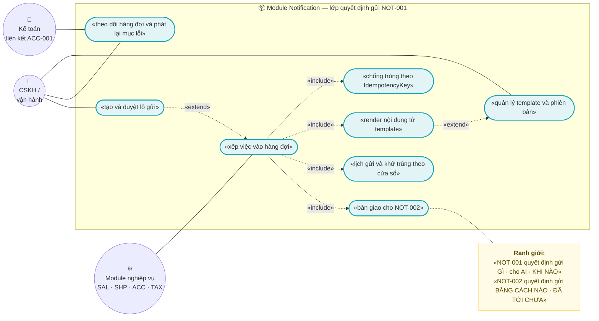
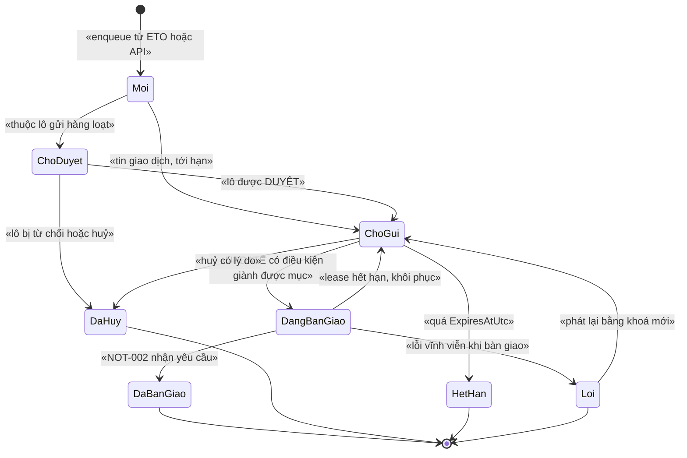
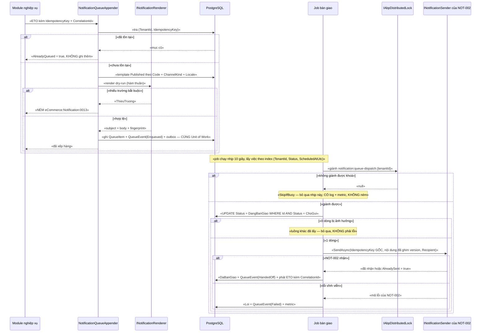

# `NOT-001` — Template và hàng đợi thông báo (chống gửi trùng)

| Thuộc tính | Nội dung |
|---|---|
| **Mã** | `NOT-001` |
| **Module** | **Notification** — *module mới, chưa tồn tại trong code* (kế hoạch GĐ3) |
| **Giai đoạn** | **GĐ3 — Điều hành** (theo `docs/implementation-plan.md:439`) |
| **Ưu tiên** | **Must have** — `NOT-002` **phụ thuộc cứng**: `NOT-002` **không** tự dựng nội dung, mọi yêu cầu vào `NOT-002` **phải** có nội dung + `IdempotencyKey` do `NOT-001` cấp (`docs/features/not-002-kenh-gui-email-sms-zalo-oa.md:82,108,488`) |
| **Trạng thái** | 🟡 `Draft` — chờ review |
| **Người viết / người review** | *(điền)* / **Kiến trúc trưởng + BA + Vận hành** (có state machine) |
| **Phiên bản / ngày** | `v0.1 — 13/10/2026` |
| **Tài liệu liên quan** | `NOT-002` (kênh gửi — **ranh giới sống còn**) · `XC-002` (outbox/inbox + idempotency) · `XC-003` (khoá phân tán) · `XC-004` (`[Authorize]`, permission, bất biến `NULLS NOT DISTINCT`) · `XC-005` (log/correlationId/metric) · `XC-001` (tiền tệ/làm tròn) · `XC-006` + `ACC-001` (thuế & xuất liệu kế toán) · `REP-001`/`REP-002` (read-model) · `docs/design-doc-guidelines.md` |

---

## 0. Tóm tắt & quyết định thiết kế

**Tóm tắt:** `NOT-001` chốt **"gửi GÌ · cho AI · KHI NÀO"** — gồm (a) **registry template có phiên bản bất biến**,
(b) **engine render là hàm thuần** (không I/O, tái lập được), (c) **hàng đợi ý định bền vững** trên PostgreSQL,
(d) **chống gửi trùng ở MỌI biên vào** bằng `IdempotencyKey` ổn định + **unique index**,
(e) **state machine ném lỗi** + **sổ sự kiện append-only**, và (f) **bàn giao** cho `NOT-002` qua một interface duy nhất.

**Ranh giới sống còn với `NOT-002`** (nguyên văn `docs/features/not-002-kenh-gui-email-sms-zalo-oa.md:23–26`):

> *"`NOT-001` quyết định gửi **GÌ**, cho **AI**, **KHI NÀO**; `NOT-002` quyết định gửi **BẰNG CÁCH NÀO** và **ĐÃ TỚI CHƯA**.
> Trộn hai việc này vào nhau là cách chắc chắn nhất để sinh ra "gửi trùng" và "không biết tin nào đã tới"."*

| Việc | `NOT-001` (tài liệu này) | `NOT-002` |
|---|---|---|
| Nội dung tin | ✅ template + render | ❌ (`NOT-002` lưu `BodyMasked` để đối soát — `not-002…:308`) |
| Quyết định người nhận | ✅ (segment/lô gửi, danh sách người nhận) | ❌ |
| Thời điểm **dự kiến** | ✅ `ScheduledAtUtc` | ❌ |
| Người nhận **đã từ chối** (`opt-out`) | ❌ | ✅ (`NotificationOptOuts` — `not-002…:411–428`) |
| Khung giờ được gửi (`quiet hours`) | ❌ **không** quyết định lần cuối | ✅ (`not-002…:400`, BR-012) |
| Vận chuyển, retry, DLQ vận chuyển, callback | ❌ | ✅ (`not-002…:173–220`) |
| Trạng thái "đã tới máy khách chưa" | ❌ | ✅ |
| Chi phí gửi | ❌ | ✅ (`NotificationCostLedger` — `not-002…:366–385`) |
| Trạng thái "đã xếp hàng / đã bàn giao" | ✅ | ❌ (`NOT-002` chỉ nhận yêu cầu đã đủ dữ liệu) |

### Hiện trạng thật (đã kiểm bằng `read`/`grep` — **không** viết theo trí nhớ)

| Hạng mục | Hiện trạng | Bằng chứng (đường dẫn thật) |
|---|---|---|
| Module `Notification` | ❌ **CHƯA CÓ** — `modules/` chỉ có `ChannelHub`, `PaymentHub`, `Tax` | liệt kê `modules/` |
| Code template / hàng đợi / render | ❌ **0 dòng** — `grep` cho `Notification|Template|MailKit|SmtpClient` trên `*.cs` (trừ `bin/`/`obj/`) chỉ khớp các dòng **nói về `AbpBackgroundJobs`** của ABP, **không** dòng nào thuộc miền thông báo | `src/eCommerce.Domain/eCommerceDomainModule.cs:40` · `src/eCommerce.EntityFrameworkCore/eCommerceDbContext.cs:89` |
| Gói NuGet gửi thư / template engine (Scriban, Razor, MailKit…) | ❌ **0 gói** trong danh sách package tập trung | `Directory.Packages.props` (không có mục nào) |
| Bảng `AbpBackgroundJobs` (job bền vững) | ✅ **CÓ** (đã migrate) ⇒ dùng được cho job bền vững của `NOT-001` | `src/eCommerce.EntityFrameworkCore/Migrations/20261009102627_Added_Phase0_AuthModules.cs:64,83` |
| `IAbpDistributedLock` + Redis thật | ✅ **CÓ thật**, dùng cho refresh token, có double-check trong khoá | `modules/ChannelHub/eCommerce.ChannelHub.Application/Sync/ChannelTokenManager.cs:29,67–91` |
| `KeyPrefix` của lock | ✅ `"ecommerce:"` (**có** dấu `:`) — đã vá lỗi dính tiền tố bằng `redis-cli MONITOR` | `src/eCommerce.HttpApi.Host/eCommerceHttpApiHostModule.cs:115–128` (dòng 127) |
| **Worker động** + supervisor (mẫu hàng đợi chạy thật) | ✅ **CÓ thật**, tên worker `channel-sync:{channelCode}:{externalShopId}`; **đã sửa lỗi starvation** (gọi `AddAsync` mỗi nhịp làm worker không bao giờ chạy) | `modules/ChannelHub/eCommerce.ChannelHub.Application/Sync/ChannelSyncSupervisorWorker.cs:30,68–106,123` |
| Metric | ⚠️ **12 metric đã ĐĂNG KÝ và đã có nơi phát (constructor)** nhưng **CHƯA được gọi ở luồng nghiệp vụ nào** — `eCommerceMetrics` chỉ được `new` trong **test** | `src/eCommerce.Domain.Shared/Observability/eCommerceMetrics.cs:13–53,98–166` · `test/eCommerce.Tests/Observability/MetricsTests.cs:33,83,99–101` |
| Registry metric | 🚨 **CHỐT CỨNG đúng 12 tên** bằng test ⇒ thêm metric mới mà quên cập nhật = **CI đỏ** | `test/eCommerce.Tests/Observability/MetricsTests.cs:62–66` · `src/eCommerce.Domain.Shared/Observability/eCommerceMetrics.cs:38–52` |
| Nhãn metric `email`/`phone` | 🚨 **BỊ CẤM** (cardinality cao) — ràng buộc **trực tiếp** lên `NOT-001` | `src/eCommerce.Domain.Shared/Observability/eCommerceMetrics.cs:81–84` |
| `DbSet` cho entity của module | ✅ **CÓ tiền lệ**: phải khai `DbSet` trên `eCommerceDbContext` hợp nhất, nếu không `IRepository<T>` **không** được đăng ký | `src/eCommerce.EntityFrameworkCore/eCommerceDbContext.cs:47–55,60–64` |
| Module tự cấu hình model | ✅ tiền lệ `builder.ConfigureChannelHub()` / `ConfigureTax()` | `src/eCommerce.EntityFrameworkCore/eCommerceDbContext.cs:76–78` · `modules/ChannelHub/eCommerce.ChannelHub.EntityFrameworkCore/ChannelHubDbContextModelCreatingExtensions.cs:14–16` |
| Unit of Work | ✅ `TransactionBehavior = Auto` cho toàn hệ thống | `src/eCommerce.HttpApi.Host/eCommerceHttpApiHostModule.cs:60–64` |
| `[Authorize]` cấp class | ✅ **ĐÃ CÓ tiền lệ đúng** (bài học `GetShopsAsync` từng là API công khai) | `src/eCommerce.Application/Channels/ChannelAppService.cs:21–28` |
| Permission phải **được định nghĩa** | ✅ tiền lệ provider (thiếu định nghĩa ⇒ ABP **luôn** từ chối ⇒ `403`) | `src/eCommerce.Application.Contracts/Permissions/eCommercePermissionDefinitionProvider.cs:8–11,21–60` |
| Bất biến unique index `NULLS NOT DISTINCT` | ✅ **ĐÃ CÓ thật** + test chốt **đúng 11** index — lỗi thật đã chứng minh: `TenantId = NULL` ⇒ index **mất tác dụng** | `src/eCommerce.EntityFrameworkCore/Migrations/20261013024226_Fix_NullableTenantId_UniqueIndexes.cs:8–25,39–86` · `test/eCommerce.IntegrationTests/PostgreSqlSchemaTests.cs:98–174` |
| Sổ cái append-only | ✅ tiền lệ rõ: `StockLedgerEntry` "APPEND-ONLY. Không bao giờ UPDATE/DELETE" | `src/eCommerce.Domain/Entities/Inventory/StockLedger.cs:80–83` |
| Check constraint ở tầng DB | ✅ tiền lệ `CHECK` (đã có trong migration + test) | `test/eCommerce.IntegrationTests/PostgreSqlSchemaTests.cs:92–96` |
| ETO hiện có mang `CorrelationId`? | ❌ **KHÔNG** — `ChannelOrderPulledEto`/`ChannelShopTokenRefreshedEto` **không** có trường này ⇒ `XC-005` BR-003 **đang bị vi phạm** ở code hiện tại | `modules/ChannelHub/eCommerce.ChannelHub.Application.Contracts/Events/ChannelEvents.cs:17–52` · `docs/features/XC-005-observability-log-metric.md:79` |
| `XC-002` (outbox/inbox) | ❌ **CHƯA triển khai**: liệt kê migration chỉ có `Initial`, `Added_Identity`, `Added_Phase0_AuthModules`, `Add_Tax_Module`, `Fix_NullableTenantId_UniqueIndexes` ⇒ **không** có bảng `AbpEventOutbox`/`AbpEventInbox` | `src/eCommerce.EntityFrameworkCore/Migrations/` |
| `eCommerce.Kernel` (`Money`, `LockKeyPrefix`, `ILockManager`) | ❌ **CHƯA TỒN TẠI** — `grep` cho `eCommerce.Kernel`, `class Money`, `struct Money`, `ToMinorUnits` trên `*.cs` = **0** kết quả | `grep` trên `src/`, `modules/`, `test/` |
| Tiền trong code | ✅ **100 % `decimal`**, đã có comment cấm `double` | `src/eCommerce.Domain/Entities/Orders/Order.cs:38` · `src/eCommerce.EntityFrameworkCore/eCommerceDbContext.cs:125–127,173–178` |

> 🚨 **Kết luận bắt buộc đọc trước khi review:** *toàn bộ `NOT-001` là thiết kế MỚI.*
> **Không có** dòng code nào của miền thông báo để đối chiếu. Mọi mục dưới đây ghi rõ
> **"chưa có trong code — kế hoạch GĐ3"** khi nói tới việc phải viết mới, và chỉ ra **tiền lệ thật** để bám theo.

**Phạm vi:**
- ✅ **Registry template**: `Code` + **phiên bản bất biến** + ngôn ngữ + kênh; vòng đời `Draft → Published → Archived`.
- ✅ **Engine render thuần** (`INotificationRenderer`): placeholder có kiểu, whitelist, tái lập được, không I/O.
- ✅ **Hàng đợi ý định** (`NotificationQueueItems`) + **lô gửi** (`NotificationBatches`) cho "cho AI".
- ✅ **Chống gửi trùng ở MỌI biên vào** (4 biên) — bảng + **unique index**, **không** dựa vào lock.
- ✅ **Lịch gửi** (`ScheduledAtUtc`) + **khử trùng nội dung theo cửa sổ** (soft dedupe, mặc định TẮT cho tin giao dịch).
- ✅ **Sổ sự kiện append-only** (`NotificationQueueEvents`) + **state machine ném lỗi**.
- ✅ **Bàn giao** cho `NOT-002` qua `INotificationSender.SendAsync` với `IdempotencyKey` **ổn định**; có **lease** chống treo `DangBanGiao`.
- ✅ **Metric** cho thông báo (cập nhật registry + `XC-005` §5.1 + test trong **cùng** PR).
- ✅ **Báo cáo qua read-model** của `REP-001`/`REP-002` — **cấm** query nặng trên DB giao dịch.
- ✅ **Liên kết `XC-006`/`ACC-001`**: các mẫu tin **cho kế toán** (SKU chưa phân loại, mốc 31/12/2026, kết quả xuất Mẫu 01).

**Không nằm trong phạm vi:**
- ❌ **Vận chuyển / kênh gửi / retry / DLQ vận chuyển / callback trạng thái / quota / quiet hours / opt-out / sổ chi phí** — thuộc **`NOT-002`** (`not-002…:68–75`).
- ❌ **Hạ tầng outbox/inbox của ABP** — thuộc **`XC-002`** (**chưa triển khai**, xem §15.2 F6). `NOT-001` **không** tự đặt tên khoá `AbpOutbox_*`/`AbpInbox_*` (`XC-003` BR-006).
- ❌ **Quyết định nghiệp vụ "ai được nhận tin gì"** — thuộc module nghiệp vụ (`SAL`, `SHP`, `ACC`, `TAX`) **phát ETO** tới `NOT-001`.
- ❌ **Báo cáo/tổng hợp** (tỉ lệ gửi, hiệu quả template) — thuộc **`REP-001`/`REP-002`** (read-model).
- ❌ **Xuất liệu kế toán** (Excel/CSV, Mẫu 01) — thuộc **`ACC-001`** liên kết `XC-006`.
- ❌ **Push notification (FCM/APNs)**, chat Facebook, tổng đài — chưa có nhu cầu GĐ3.
- ❌ **Trình soạn thảo WYSIWYG/HTML đầy đủ** — GĐ3 chỉ cần editor text + placeholder (xem §15.1 Q2).

### 0.1 Quyết định thiết kế (ADR ngắn)

| # | Quyết định | Phương án đã cân nhắc | Lý do chọn | Hệ quả |
|---|---|---|---|---|
| **ADR-01** | **Tách lớp: `NOT-001` = quyết định gửi · `NOT-002` = vận chuyển & theo dõi phát** | (a) gộp một module làm hết · (b) tách theo trách nhiệm | `docs/implementation-plan.md:439–440` **đã tách sẵn** hai tài liệu, và `NOT-002` ADR-02 đã chốt cùng ranh giới (`not-002…:82`). Gộp lại ⇒ "chống gửi trùng lúc xếp hàng" và "retry vận chuyển" **tranh nhau cùng một trạng thái** — đúng cái bẫy sinh ra gửi trùng | `NOT-001` **cấm** gọi SDK nhà cung cấp; `NOT-001` **cấm** sở hữu trạng thái "đã tới"; `NOT-002` **cấm** tự sinh nội dung |
| **ADR-02** | **Phiên bản template là BẤT BIẾN sau khi `Published`**; mục hàng đợi **ghim** `TemplateVersionId` | (a) con trỏ "template hiện tại" · (b) **ghim version** | Nếu chỉ có con trỏ "hiện tại" thì **sửa template làm đổi nội dung của tin đã xếp hàng** ⇒ tin đã bàn giao và tin trong hàng **khác nhau**, không giải trình được, và "gửi trùng" trở nên vô nghĩa vì **nội dung đã đổi** | Sửa nội dung = **tạo version mới**; tin cũ giữ nguyên nội dung đã ghim. Có test `TC-06` |
| **ADR-03** | **Idempotency ở MỌI biên vào** cài bằng **bảng + unique index** (không cài bằng lock) | (a) tin vào distributed lock · (b) chỉ kiểm ở code · (c) bảng + unique index | `XC-003` §7.3 + BR-008: **lock không thay thế idempotency** (lock hết TTL ⇒ mất tác dụng). Bằng chứng lock **có thể vô hiệu**: `AbortOnConnectFail = false` ⇒ Redis chết thì app **vẫn chạy** nhưng **khoá biến mất** (`src/eCommerce.HttpApi.Host/eCommerceHttpApiHostModule.cs:137–145`) | Bắt buộc `UNIQUE (TenantId, IdempotencyKey)` **`NULLS NOT DISTINCT`** (BR-XC-004-009) — nếu quên `NULLS NOT DISTINCT` thì index **mất tác dụng** khi `TenantId = NULL` (lỗi **đã chứng minh thật**: `Migrations/20261013024226_…cs:14–17`) |
| **ADR-04** | **State machine NÉM LỖI** khi chuyển sai, **cấm** no-op im lặng; trạng thái kết thúc là **hấp thụ** | (a) bỏ qua im lặng · (b) log rồi bỏ qua · (c) `BusinessException` có mã | Tiền lệ code thật: `TaxClassification.Approve()` ném `TaxErrorCodes.InvalidStatusTransition` (`modules/Tax/eCommerce.Tax.Domain/Classifications/TaxClassification.cs:122–134`) và `NOT-002` ADR-04 (`not-002…:84`) | Mỗi nhánh state machine cần **1 test**, kể cả nhánh **guard sai** (`TC-05`, `TC-06`) |
| **ADR-05** | **Hàng đợi sống trong DB giao dịch**, job chạy **bền vững**; **cấm** "hàng đợi trong bộ nhớ" | (a) `ConcurrentDictionary` + timer trong bộ nhớ · (b) DB + job bền vững | Bảng `AbpBackgroundJobs` **đã có** (`Migrations/20261009102627_Added_Phase0_AuthModules.cs:64`) ⇒ không thêm hạ tầng. Và **bài học F6/C10 thật**: supervisor từng gọi `AddAsync` **mỗi nhịp** ⇒ ABP **THAY THẾ** worker ⇒ timer reset ⇒ worker **không bao giờ chạy** (`ChannelSyncSupervisorWorker.cs:68–85`) | Tin đang chờ **sống qua restart** (NFR-011). **Cấm** thiết kế "queue trong RAM" — mất việc khi restart mà **không** có dấu vết |
| **ADR-06** | **Render là HÀM THUẦN** — không DB, không I/O, không `async`, không `DateTime.Now` | (a) render có truy vấn DB (tra tên sản phẩm…) · (b) **thuần** + dữ liệu đã đủ trong lệnh | Hàm thuần ⇒ test được **không cần DB**, và **tái lập** (cùng input ⇒ cùng output) — đây là điều kiện để ADR-02 có nghĩa. Muốn dữ liệu thêm ⇒ **tầng nghiệp vụ** đưa vào `Data` khi phát ETO | `NOT-001` **cấm** render gọi app service module khác (BR-019). Test `TC-04` chạy **không** cần DB |
| **ADR-07** | **Tiền trong template**: placeholder kiểu `Money` chỉ nhận **chuỗi đã định dạng qua MỘT hàm dùng chung**; **cấm** `double`/`float`; VND **0** chữ số thập phân | (a) nối `decimal` rồi format tại chỗ · (b) **một** hàm định dạng + kiểu placeholder | `XC-001` BR-003 (cấm `==` trên tiền), BR-008 (cấm `double`/`float`), BR-009 (`VND`, 0 chữ số), và §10 quy tắc hiển thị "*Format theo locale (`vi-VN`), VND **0** chữ số thập phân*" (`docs/features/XC-001-money-currency-lam-tron.md:64,327`) | Tiền vào template là **chuỗi** ⇒ không có phép toán tiền trong miền template ⇒ **không thể** so `==` sai. Test reflection `TC-22` |
| **ADR-08** | **Thêm metric ⇒ cập nhật `eCommerceMetricNames` + `XC-005` §5.1 + test, trong CÙNG PR** | (a) phát metric mới ngay · (b) cập nhật registry trước | Test hiện tại **chốt cứng đúng 12 tên** (`MetricsTests.cs:62–66`) ⇒ phát metric chưa đăng ký là **CI đỏ**; `NOT-002` ADR-07 đã chốt cùng nguyên tắc (`not-002…:87`) | Là **việc tường minh** trong PR đầu của module, **không** phải việc phụ. Nhãn **chỉ** từ `eCommerceMetricTags.Allowed` (`eCommerceMetrics.cs:75–78`) |
| **ADR-09** | 🚨 **CẤM** gọi app service của module khác — chỉ **tiêu thụ ETO**; ETO **phải đủ dữ liệu** để dựng tin | (a) gọi `IOrdersAppService.GetAsync()` để lấy số tiền · (b) ETO mang đủ trường | Quy ước bất biến **"module gọi app BỊ CẤM"**; tiền lệ thật: `ChannelOrderPulledEto` mang **đủ** dòng hàng để app tự tạo đơn (`modules/ChannelHub/eCommerce.ChannelHub.Application.Contracts/Events/ChannelEvents.cs:17–40`), `NOT-002` ADR-09 (`not-002…:89`) | Hệ quả **trực tiếp** lên `XC-002`/`REP-*`: ETO muốn thêm trường ⇒ **sửa module phát**, không được "hỏi ngược" |
| **ADR-10** | **Tên khoá phân tán do module sinh KHÔNG chứa `ecommerce:`** | (a) tên khoá có tiền tố · (b) không tiền tố | ABP ghép `KeyPrefix + name` **không dấu phân cách**, và `KeyPrefix` **đã là** `"ecommerce:"` (`src/eCommerce.HttpApi.Host/eCommerceHttpApiHostModule.cs:115–128`). `ChannelHubConsts` làm **đúng** (`channel:…` — `modules/ChannelHub/eCommerce.ChannelHub.Domain/ChannelHubConsts.cs:19–32`); `TaxLockKeys` làm **SAI** ⇒ khoá thật thành **`ecommerce:ecommerce:tax:…`** (`modules/Tax/eCommerce.Tax.Domain/TaxErrorCodes.cs:45–50`, xem §15.2 F5) | `NOT-001` dùng `NotificationLockKeys` trả `notification:…`; **cấm** literal khoá trong code nghiệp vụ (`XC-003` BR-001); grep kiểm bằng `TC-20` |
| **ADR-11** | **Bàn giao chống trùng bằng `UPDATE … WHERE Status = ChoGui`** + `IdempotencyKey` **nguyên vẹn** sang `NOT-002`; lock chỉ để **giảm tranh chấp** | (a) chỉ dựa vào lock · (b) chỉ dựa vào code `if` · (c) **cập nhật có điều kiện** ở DB | Trả lời đúng câu hỏi của `XC-003` BR-007: *"bỏ lock đi, DB có chặn không?"* ⇒ **CÓ**: `UPDATE … WHERE Status = ChoGui` chỉ cho **1** luồng đổi trạng thái. Và tầng `NOT-002` **cũng** có unique `(TenantId, IdempotencyKey)` (`not-002…:303,321`) ⇒ **hai** hàng rào độc lập | `NOT-001` + `NOT-002` **cùng** khoá gốc ⇒ gửi lại **cùng** khoá là **idempotent** ở cả hai tầng. Test `TC-09` |
| **ADR-12** | **Khử trùng nội dung theo cửa sổ** (soft dedupe) bằng `ContentFingerprint` + `bucket` thời gian, **partial unique index**; **mặc định TẮT** cho tin giao dịch | (a) không khử trùng · (b) khử trùng **mọi** tin · (c) khử trùng **có chọn lọc** bằng partial index | Khử trùng mọi tin ⇒ **chặn nhầm** tin hợp lệ (2 tin khác mục đích nhưng cùng nội dung). Không khử trùng ⇒ "spam" khi tầng trên retry sai. Chọn (c): chỉ tin có `CoalesceWindowSeconds > 0` (marketing) mới bị áp | `BucketStartUtc` **NULL** cho tin giao dịch ⇒ **không** bị chặn (thiết kế tường minh). Cấu hình ở template, ghi rõ ở §5.1 |
| **ADR-13** | **CẤM lưu & CẤM log dữ liệu nhạy cảm**; **OTP KHÔNG BAO GIỜ** vào template/hàng đợi; người nhận lưu **mã hoá** + **hash** để tra cứu | (a) lưu người nhận dạng plaintext · (b) mã hoá + hash | Tiền lệ thật: `IStringEncryptionService` dùng cho token shop (`modules/ChannelHub/eCommerce.ChannelHub.Domain/Entities/ChannelEntities.cs:52–59`) và `ChannelAppService.cs:97–101`; mask 2 lớp + che cả `otp` (`modules/PaymentHub/eCommerce.PaymentHub.Domain/Entities/PaymentTransaction.cs:147–171`); `NOT-002` ADR-12 + BR-009 (`not-002…:92,111`) | Không hiển thị người nhận đầy đủ trên UI (chỉ dạng che); không có cột nào để chứa OTP |
| **ADR-14** | **Dải mã lỗi**: `NOT-002` **đã chiếm** `eCommerce:Notification:0001–0009`; `NOT-001` dùng **`0010–0019`**, trong **MỘT** file `NotificationErrorCodes.cs` | (a) mỗi tài liệu tự đặt dải riêng, hai file · (b) **một** file, hai khoảng | Bài học **F1 của `XC-003`**: cùng một khái niệm định nghĩa ở **hai nơi** cho ra **hai chuỗi khác nhau** ⇒ **lỗi im lặng**, không lỗi biên dịch (`docs/features/XC-003-khoa-phan-tan-quy-uoc.md:534,538`) | Dải mã **được ghi trong bảng đăng ký** (§6.3); `NOT-002` §6.2 (`not-002…:543–553`) và tài liệu này **phải** cùng trỏ về một file |

---

## 1. Use Case Specification

| Thuộc tính | Nội dung |
|---|---|
| **Use Case ID** | `NOT-001` |
| **Use Case Name** | Dựng nội dung từ template có phiên bản và xếp vào hàng đợi gửi **không trùng** |
| **Description** | *"Là module nghiệp vụ, tôi muốn **một chỗ duy nhất** để định nghĩa mẫu tin và **xếp việc gửi** vào hàng đợi — để tin gửi ra **đúng nội dung đã duyệt**, **đúng người**, **đúng thời điểm**, và **không bao giờ gửi trùng** dù retry, dù chạy nhiều instance, dù khách bấm lại."* |
| **Actor(s)** | **Module nghiệp vụ** (`SAL`·`SHP`·`ACC`·`TAX` — phát ETO) · **Nhân viên CSKH/vận hành** (soạn/publish template, xem hàng đợi, tạo & duyệt lô gửi) · **Kế toán** (nhận tin nghiệp vụ thuế — liên kết `XC-006`/`ACC-001`) · **Hệ thống** (`NOT-001` job bàn giao · `NOT-002` là **bên nhận** duy nhất) |
| **Priority** | **Must have** |
| **Trigger** | (a) module nghiệp vụ phát ETO tới `NOT-001`; (b) nhân viên tạo lô gửi hàng loạt; (c) nhân viên gửi **một** tin thủ công; (d) đến `ScheduledAtUtc` ⇒ job bàn giao; (e) vận hành **phát lại** mục lỗi |
| **Pre-Condition(s)** | • **Tenant hiện tại** (`TenantId`) — mọi template/lô/mục hàng đợi đều theo tenant (`IMultiTenant`).<br>• **Template đã `Published`** và có **phiên bản** phù hợp kênh gửi + ngôn ngữ.<br>• **`IdempotencyKey` ỔN ĐỊNH** do tầng nghiệp vụ cấp — 🚨 **không** phải `Guid.NewGuid()` mỗi lần gọi.<br>• **`ChannelKind`** (`Email`·`Sms`·`ZaloOa`) — enum **dùng chung** với `NOT-002` (`not-002…:440`); `NOT-001` **không** tự định nghĩa enum thứ hai.<br>• **`ChannelCode`** (*kênh bán*) **chỉ** vào log/ngữ cảnh, **không** quyết định kênh gửi (kế thừa `not-002…:106`).<br>• **Dữ liệu render** đủ trường bắt buộc của template (kiểm bằng dry-run **trước** khi ghi — BR-004).<br>• **`XC-002` (outbox/inbox)**: nếu chưa có ⇒ chạy **chế độ suy giảm** (§15.3 giả định 1). |
| **Post-Condition(s)** | • Mỗi yêu cầu có **đúng một** `NotificationQueueItem` cho một cặp `(TenantId, IdempotencyKey)` (ràng buộc **UNIQUE**).<br>• Mục hàng đợi **ghim** `TemplateVersionId` ⇒ render lại **luôn** cho cùng nội dung.<br>• Mọi bước chuyển trạng thái có **một** `NotificationQueueEvent` **append-only** (kèm `CorrelationId`).<br>• Trạng thái cuối thuộc tập hấp thụ: `DaBanGiao` · `DaHuy` · `HetHan` · `Loi`.<br>• **Không** mục nào bị bàn giao **hai** lần (điều kiện `UPDATE … WHERE Status = ChoGui`).<br>• **Không** tồn tại bản ghi/cột nào chứa OTP; người nhận lưu **mã hoá** + **hash**. |
| **Basic Flow** | 1. Module nghiệp vụ phát ETO (kèm `CorrelationId`, `IdempotencyKey`).<br>2. `NotificationQueueAppender` **kiểm idempotency**: tra `NotificationQueueItems` theo `(TenantId, IdempotencyKey)` ⇒ **đã có** ⇒ trả kết quả cũ + `AlreadyQueued = true`, **không** ghi gì (BR-002).<br>3. Tra template `Published` theo `(Code, ChannelKind, Locale)`; **không có** ⇒ **NÉM** `eCommerce:Notification:0012`.<br>4. **Render dry-run** (hàm thuần) ⇒ thiếu trường bắt buộc ⇒ **NÉM** `0013`; placeholder ngoài whitelist ⇒ **NÉM** `0015`.<br>5. **Trong một Unit of Work**: ghi `NotificationQueueItem` (`Moi`) + `NotificationQueueEvent(Enqueued)` + **outbox** (theo `XC-002`) (BR-007).<br>6. Job nền lấy mục `Moi`/`ChoGui` có `ScheduledAtUtc <= now` ⇒ giành **khoá** `notification:queue-dispatch:{tenantId}` (không giành được ⇒ bỏ qua **có log + metric** — chế độ `SkipIfBusy` cho job định kỳ, `XC-003` D10).<br>7. **Cập nhật có điều kiện**: `UPDATE … SET Status = DangBanGiao, DispatchLeaseExpiresAtUtc = … WHERE Id = @id AND Status = ChoGui` ⇒ **0 dòng** bị ảnh hưởng ⇒ **bỏ qua** (đã có luồng khác lấy — **không** phải lỗi).<br>8. Gọi `INotificationSender.SendAsync` (**của `NOT-002`**) với `IdempotencyKey` **nguyên vẹn** + nội dung đã render + kênh + người nhận.<br>9. Thành công ⇒ `DaBanGiao` + `NotificationQueueEvent(HandedOff)`. Lỗi render/gate vĩnh viễn ⇒ `Loi` + `NotificationQueueEvent(Failed)` + metric.<br>10. Phát `NotificationHandedOffEto` (kèm `CorrelationId`) để `REP-*` tổng hợp vào **read-model**. |
| **Alternative Flow** | **A1: Lô gửi hàng loạt (marketing)** — tạo `NotificationBatch` (`ChoDuyet`) + sinh **N** mục hàng đợi chia sẻ `BatchId`; **chưa** bàn giao tới khi `DaDuyet` (người có quyền `eCommerce.Notification.Batches.Approve`).<br>**A2: Gửi một tin thủ công** — API yêu cầu **client truyền `IdempotencyKey`** (hoặc `RequestId` ổn định); **thiếu ⇒ NÉM** `0010` — 🚨 **cấm** sinh `Guid` mới (BR-009).<br>**A3: Đa ngôn ngữ** — chọn bản theo `Locale` của người nhận; thiếu bản dịch ⇒ **dùng `Locale` mặc định của tenant** và **ghi log `Warning` + metric** (không im lặng).<br>**A4: Bàn giao lại sau sự cố** — mục kẹt ở `DangBanGiao` quá `DispatchLeaseExpiresAtUtc` (app bị kill giữa chừng) ⇒ job khôi phục đưa **về `ChoGui`** + `NotificationQueueEvent(LeaseExpired)` + metric; lần bàn giao sau dùng **cùng** `IdempotencyKey` ⇒ `NOT-002` **khử trùng** ⇒ **không** gửi 2 lần.<br>**A5: Cảnh báo kỹ thuật** (`XC-005` Q3) — dùng **cùng** pipeline với template hệ thống `ops-alert`, `Priority = Critical`. ⚠️ Phần quiet-hours/opt-out thuộc `NOT-002` (`not-002…:109` A3) — `NOT-001` **không** quyết định lại. |
| **Exception Flow** | **E1:** trùng `IdempotencyKey` ⇒ **không** ghi thêm; trả kết quả cũ + `AlreadyQueued = true` (`200`).<br>**E2:** template chưa `Published` / không tồn tại ⇒ `eCommerce:Notification:0012` (`400`).<br>**E3:** thiếu trường bắt buộc của template ⇒ `0013` (`400`) — **cấm** render ra chuỗi rỗng im lặng.<br>**E4:** placeholder không khai báo (ngoài whitelist) ⇒ `0015` (`400`).<br>**E5:** chuyển trạng thái sai (kể cả **lùi** trạng thái) ⇒ `0011` (`409`).<br>**E6:** cố sửa version đã `Published` ⇒ `0016` (`409`) — phải tạo version mới.<br>**E7:** cố bàn giao mục **đã** `DaBanGiao` ⇒ `0014` (`409`).<br>**E8:** lô gửi chưa duyệt mà đã bàn giao ⇒ `0018` (`409`).<br>**E9:** bị **khử trùng cửa sổ** (ADR-12) ⇒ `0019` (`409`) + `NotificationQueueEvent(Suppressed)`; **không** tính là lỗi hệ thống.<br>**E10:** không giành được khoá phân tán ⇒ dùng **nguyên** `eCommerce:Lock:0001` của `XC-003` (`docs/features/XC-003-khoa-phan-tan-quy-uoc.md:314`) — **cấm** tự đặt mã mới (đồng bộ `not-002…:555`).<br>**E11:** `NOT-002` trả về yêu cầu **trùng** ⇒ ghi `DaBanGiao` + `ResponseReused = true` (**không** coi là lỗi). |
| **Business Rules** | • **BR-NOT-001-001**: Mọi nội dung gửi ra **phải** render từ một `NotificationTemplateVersion` **đã `Published`**; **cấm** nối chuỗi nội dung trong code nghiệp vụ.<br>• **BR-NOT-001-002**: Mọi yêu cầu vào hàng đợi **phải** có `IdempotencyKey` **ổn định**; cùng `(TenantId, IdempotencyKey)` ⇒ **tối đa một** mục hàng đợi (ràng buộc **UNIQUE** ở DB).<br>• **BR-NOT-001-003**: `TemplateVersionId` **phải** được ghim vào mục hàng đợi; render lại **phải** cho **cùng** nội dung.<br>• **BR-NOT-001-004**: Placeholder **phải** khai báo trong template (whitelist) **và** giá trị **phải** đủ; thiếu ⇒ **NÉM LỖI**, **cấm** render rỗng im lặng.<br>• **BR-NOT-001-005**: **Mọi** chuyển trạng thái sai **phải NÉM** `BusinessException` có mã; **cấm** no-op im lặng; **cấm** chuyển **lùi**; trạng thái kết thúc là **hấp thụ**.<br>• **BR-NOT-001-006**: `NotificationQueueEvents` là **APPEND-ONLY** — **cấm** `UPDATE`/`DELETE`; sửa sai **phải** ghi event mới.<br>• **BR-NOT-001-007**: Mọi thao tác ghi đi qua **Unit of Work**; `QueueItem` + `QueueEvent` + **outbox** **phải** trong **cùng** transaction.<br>• **BR-NOT-001-008**: Bàn giao **chỉ** qua `INotificationSender` **và** **chỉ** bằng `UPDATE … WHERE Status = ChoGui`; **cấm** gọi sender khi chưa giành được khoá bàn giao.<br>• **BR-NOT-001-009**: `IdempotencyKey` truyền cho `NOT-002` **phải** là khoá **đã lưu**; 🚨 **cấm** `Guid.NewGuid()` hay bất kỳ khoá sinh mới mỗi lần gọi.<br>• **BR-NOT-001-010**: **CẤM** template/hàng đợi chứa hoặc sinh **OTP**, số thẻ, mật khẩu, token; **cấm** log chúng ở mọi mức.<br>• **BR-NOT-001-011**: Giá trị **tiền** trong template **phải** đến từ `decimal` và đi qua **một** hàm định dạng dùng chung; 🚨 **cấm** `double`/`float`; **cấm** mọi phép **so sánh tiền bằng `==`** (`XC-001` BR-003/BR-008/BR-009).<br>• **BR-NOT-001-012**: Mọi khoá phân tán **phải** sinh từ `NotificationLockKeys` của module và **KHÔNG** chứa tiền tố `ecommerce:`; **cấm** literal khoá trong code nghiệp vụ; **cấm** trùng tên khoá của ABP (`AbpOutbox_*`/`AbpInbox_*`).<br>• **BR-NOT-001-013**: **Mọi** biên vào **phải** chống trùng: (1) consumer ETO; (2) API thủ công; (3) job bàn giao; (4) phát lại. **Thiếu một biên ⇒ vi phạm BR**.<br>• **BR-NOT-001-014**: **Phát lại** một mục **phải** dùng `IdempotencyKey` **mới có hậu tố** (`:replay-{n}`); **cấm** dùng lại khoá gốc (sẽ bị chặn bởi chính hàng rào của ta).<br>• **BR-NOT-001-015**: Metric mới **phải** nằm trong `eCommerceMetricNames` + `XC-005` §5.1 + test, trong **cùng** PR; nhãn **chỉ** từ `eCommerceMetricTags.Allowed`; 🚨 **cấm** `email`, `phone`, `messageId`, `recipientId`, `correlationId`.<br>• **BR-NOT-001-016**: Mọi app service **phải** có `[Authorize]` ở **CẤP CLASS**; mọi permission **phải** được **định nghĩa**; **cấm** magic string (`XC-004` BR-001/BR-002/BR-003).<br>• **BR-NOT-001-017**: Mọi entity **phải** có `DbSet` trên `eCommerceDbContext` hợp nhất **và** module **phải** cung cấp hàm `ConfigureNotification(...)` gọi trong `OnModelCreating`.<br>• **BR-NOT-001-018**: Mọi ETO **phải** mang `CorrelationId` (`XC-005` BR-003) — **không** lặp lại sai lệch F4 của `NOT-002`.<br>• **BR-NOT-001-019**: **CẤM** module gọi app service của module khác; chỉ **tiêu thụ ETO**; ETO **phải** mang đủ dữ liệu để dựng tin.<br>• **BR-NOT-001-020**: `REP-*` **cấm** query bảng giao dịch của `NOT-001`; báo cáo **phải** đọc **read-model** (`REP-001`/`REP-002`) — `docs/implementation-plan.md:436–437`.<br>• **BR-NOT-001-021**: Mọi mục hàng đợi/lô **phải** có `TenantId` (trừ tin hạ tầng **không** chứa dữ liệu khách); mọi unique index có `TenantId` **phải** `NULLS NOT DISTINCT` (`XC-004` BR-009).<br>• **BR-NOT-001-022**: `NOT-001` **cấm** sở hữu trạng thái "đã tới" / "đã phát" / chi phí gửi / `opt-out` / `quiet hours` — **thuộc `NOT-002`** (ADR-01). |
| **Non-Functional Requirement** | • **NFR-NOT-001-001**: Render thuần (template ≤ 50 placeholder) ⇒ p95 **< 5 ms**.<br>• **NFR-NOT-001-002**: Cùng `IdempotencyKey` enqueue **1.000** lần (có **chạy song song**) ⇒ **đúng 1** mục hàng đợi; 999 lần `AlreadyQueued`.<br>• **NFR-NOT-001-003**: **0** mục bị bàn giao **2** lần khi 2 job chạy song song **10.000** vòng.<br>• **NFR-NOT-001-004**: **0** lần sửa nội dung của một version đã `Published` (đo bằng `ContentHash`).<br>• **NFR-NOT-001-005**: **100 %** mục hàng đợi + ETO có `CorrelationId`.<br>• **NFR-NOT-001-006**: **0** dòng log/nội dung lưu chứa OTP/token/số điện thoại đầy đủ (quét mã nguồn ở CI).<br>• **NFR-NOT-001-007**: **0** nhãn metric cardinality cao; **< 100** series mỗi metric.<br>• **NFR-NOT-001-008**: Job bàn giao lấy việc **chỉ** theo index `(TenantId, Status, ScheduledAtUtc)`; **0** full-scan.<br>• **NFR-NOT-001-009**: **0** truy vấn của UI/`REP-*` tới `NotificationQueueEvents`.<br>• **NFR-NOT-001-010**: Cách ly tenant: **0** trường hợp tenant B đọc/ghi template/lô/mục của tenant A.<br>• **NFR-NOT-001-011**: **100 %** mục đang `ChoGui` **còn sống** sau khi restart app (tích hợp).<br>• **NFR-NOT-001-012**: Độ trễ "đến hạn → bàn giao" p95 **< 30 s** với nhịp job **10 s**.<br>• **NFR-NOT-001-013**: **0** gói ABP lệch phiên bản — mọi gói `Volo.Abp.*` mới **phải** là `10.7.0` trong `Directory.Packages.props`.<br>• **NFR-NOT-001-014**: **0** `double`/`float` trong biểu thức tiền của module (test reflection, kế thừa `XC-001` NFR-004).<br>• **NFR-NOT-001-015**: Log **một dòng JSON**/sự kiện, có `CorrelationId` (`XC-005` NFR-002/NFR-008).<br>• **NFR-NOT-001-016**: Thông lượng xếp hàng **≥ 200** mục/giây/instance (đo bằng fake sender của `NOT-002`).<br>• **NFR-NOT-001-017**: Metric phát ra **phải** nằm **trong** bảng đăng ký (`eCommerceMetricNames.All`) — **100 %** (test kiểu `MeterListener`, khuôn `MetricsTests.cs:38–47`). |

---

## 2. Sơ đồ Use Case



### Chú giải

| Ký hiệu | Ý nghĩa |
|---|---|
| ⭕ Xanh lá | Actor (kể cả hệ thống khác) |
| 🟦 Bầu dục xanh dương | Use Case |
| 🟨 Khung vàng | Note |
| `───` | Liên kết Actor ↔ Use Case |
| `-.«include».->` | Quan hệ bao hàm |

---

## 3. Vòng đời một mục hàng đợi (state machine)

> 📌 **Giới hạn sơ đồ:** tài liệu này dùng **đúng 3** sơ đồ Mermaid (đây là sơ đồ thứ 2). ERD ở §5 vì vậy được **mô tả bằng bảng** thay vì sơ đồ (cùng cách `NOT-002` đã làm — `not-002…:288–289`).



**Bảng chuyển trạng thái & guard (mọi chuyển sai **phải NÉM LỖI**, không im lặng):**

| # | Từ → Sang | Guard (điều kiện cho phép) | Ai được chuyển | Side effect | Nếu guard sai |
|---|---|---|---|---|---|
| 1 | `[*]` → `Moi` | `IdempotencyKey` **chưa** tồn tại cho `(TenantId, IdempotencyKey)` | `NotificationQueueAppender` | ghi `QueueItem` + `QueueEvent(Enqueued)` + outbox (**cùng UoW**) | **Trả kết quả cũ** + `AlreadyQueued = true` (**không** ném — đây là **thiết kế**, BR-002); nếu payload **khác** với bản ghi cũ ⇒ **NÉM** `0010` (xung đột khoá) |
| 2 | `Moi` → `ChoDuyet` | Mục thuộc một `NotificationBatch` | `NotificationQueueAppender` | gán `BatchId` | **NÉM** `0018` nếu cố gán lô **không** tồn tại |
| 3 | `Moi` → `ChoGui` | `ScheduledAtUtc <= now` **và** không thuộc lô **hoặc** lô đã `DaDuyet` | Job bàn giao | `QueueEvent(ReadyToDispatch)` | Ở lại `Moi` (**không** lỗi — đúng thiết kế) |
| 4 | `ChoDuyet` → `ChoGui` | Lô được duyệt bởi người có `…Batches.Approve` | Người duyệt | `QueueEvent(BatchApproved)`, `ApprovedByUserId` | **NÉM** `403` nếu thiếu quyền; **NÉM** `0011` nếu lô **không** ở `ChoDuyet` |
| 5 | `ChoGui` → `DangBanGiao` | `UPDATE … SET Status = DangBanGiao WHERE Id = @id AND Status = ChoGui` trả **1** dòng **và** đã giành khoá `notification:queue-dispatch:{tenantId}` | Job bàn giao | `DispatchLeaseExpiresAtUtc = now + lease`, `QueueEvent(Dispatching)` | `0` dòng ⇒ **bỏ qua im lặng có chủ ý** (luồng khác đã lấy) + **vẫn** ghi log `Debug`/metric; **không** giành được khoá ⇒ `SkipIfBusy` (**log + metric**, `XC-003` D10) |
| 6 | `DangBanGiao` → `DaBanGiao` | `INotificationSender.SendAsync` trả thành công **hoặc** `AlreadySent = true` (`NOT-002` khử trùng) | Job bàn giao | `QueueEvent(HandedOff)` + phát `NotificationHandedOffEto` | **NÉM** `0014` nếu bị gọi khi mục **đã** ở trạng thái hấp thụ |
| 7 | `DangBanGiao` → `ChoGui` | `now > DispatchLeaseExpiresAtUtc` (app bị kill giữa chừng) | Job khôi phục lease | `QueueEvent(LeaseExpired)` + **metric**; `AttemptCount` **không** tăng | **NÉM** `0011` nếu lease **chưa** hết hạn (cấm cướp mục của luồng đang chạy) |
| 8 | `DangBanGiao` → `Loi` | Lỗi **vĩnh viễn**: template version bị `Archived`, dữ liệu không còn hợp lệ, `NOT-002` trả lỗi vĩnh viễn | Job bàn giao | `QueueEvent(Failed)` + `LastErrorCode` + **metric** | **NÉM** `0002`/`0007` (**mã của `NOT-002`**, không tự đặt mã mới) |
| 9 | `ChoGui` → `HetHan` | `now > ExpiresAtUtc` (`ExpiresAtUtc` **không** null) | Job hết hạn | `QueueEvent(Expired)` + **metric** | Ở lại `ChoGui` nếu `ExpiresAtUtc` null (**không** lỗi — tin không có hạn) |
| 10 | `ChoGui`/`Moi` → `DaHuy` | Có lý do huỷ **và** `Status` **chưa** hấp thụ | Người có `…Queue.Cancel` | `QueueEvent(Cancelled, reason)` | **NÉM** `0011` nếu cố huỷ mục **đã** `DaBanGiao`/`HetHan`/`Loi` |
| 11 | `Loi` → `ChoGui` | Người phát lại có `…Queue.Retry` **và** sinh **khoá mới** `{khoá gốc}:replay-{n}` | Người vận hành | `QueueEvent(Replayed, by = userId)`; mục mới tham chiếu `RootItemId` | **NÉM** `403` nếu thiếu quyền; **NÉM** `0010` nếu cố dùng lại khoá gốc |
| 12 | `DaBanGiao`/`HetHan`/`DaHuy` → `*` (lùi) | 🚨 **KHÔNG BAO GIỜ** | — | — | **NÉM** `0011` (`InvalidStatusTransition`) — trạng thái kết thúc là **hấp thụ** |
| 13 | `Moi`/`ChoGui` → `DaHuy` | Trùng **cửa sổ khử trùng** (ADR-12) | `NotificationQueueAppender` | `QueueEvent(Suppressed, reason = window)` | **NÉM** `0019` nếu tầng gọi yêu cầu **bắt buộc** gửi (chế độ `Force`) |

> ⚠️ **Trạng thái nguy hiểm nhất là `DangBanGiao` kẹt.** Nếu app bị kill **giữa** lời gọi `NOT-002` và lúc commit,
> mục ở lại `DangBanGiao` **vĩnh viễn** nếu không có **lease**. Hệ quả: tin **không bao giờ** tới người nhận
> và **không ai biết** — đúng loại lỗi im lặng mà dự án đã gặp (bài học C10: worker không bao giờ chạy —
> `ChannelSyncSupervisorWorker.cs:68–85`). Vì vậy **lease + job khôi phục (hàng 7)** là **bắt buộc**,
> và vì lần bàn giao sau dùng **cùng `IdempotencyKey`**, `NOT-002` **khử trùng** ⇒ khôi phục **không** gây gửi trùng.
> Đây là lý do `DangBanGiao` **phải** có đường quay lại `ChoGui` (khác `NOT-002`, nơi `HetHanXacNhan`
> **không** có cạnh quay lại vì gửi lại ra người thật — `not-002…:216–220`).

---

## 4. Sequence Diagram & luồng dữ liệu

### 4.1 Luồng xếp hàng → bàn giao (có chống trùng ở cả 2 tầng)



### 4.2 DFD — từ nghiệp vụ tới người nhận (mô tả, không vẽ sơ đồ)

| Bước | Nguồn → Đích | Dữ liệu | Ghi chú |
|---|---|---|---|
| 1 | Module nghiệp vụ → `NOT-001` | ETO (**đủ** trường để dựng tin — ADR-09) + `IdempotencyKey` + `CorrelationId` | **Biên vào #1** ⇒ kiểm idempotency |
| 2 | Người dùng → `NOT-001` (API) | `SendManualRequest` (template + người nhận + `IdempotencyKey` do client cấp) | **Biên vào #2** ⇒ kiểm idempotency; thiếu khoá ⇒ `0010` |
| 3 | `NOT-001` ↔ PostgreSQL | `NotificationTemplates`, `NotificationTemplateVersions`, `NotificationBatches`, `NotificationQueueItems`, `NotificationQueueEvents` | 5 bảng, xem §5 |
| 4 | `NOT-001` → `NOT-002` (in-process) | `SendRequest` (`IdempotencyKey` **gốc** + nội dung đã ghim version + kênh + người nhận) | **Biên vào #3** (job bàn giao) ⇒ `UPDATE … WHERE Status = ChoGui`; `NOT-002` **cũng** có unique `(TenantId, IdempotencyKey)` (`not-002…:321`) |
| 5 | Vận hành → `NOT-001` | yêu cầu **phát lại** mục `Loi` | **Biên vào #4** ⇒ khoá mới `{gốc}:replay-{n}` (BR-014) |
| 6 | `NOT-002` → người nhận | email/SMS/Zalo OA | **Ngoài phạm vi** tài liệu này (ADR-01) |
| 7 | `NOT-001` → `REP-001`/`REP-002` | ETO (`NotificationEnqueuedEto`, `NotificationHandedOffEto`, `NotificationQueueFailedEto`) | Qua **outbox**; `REP-*` tổng hợp vào **read-model** — **cấm** query bảng giao dịch khi mở báo cáo (BR-020) |
| 8 | `NOT-001` → `ACC-001` (gián tiếp) | Các mẫu tin **cho kế toán** (`XC-006`: SKU chưa phân loại, mốc 31/12/2026, kết quả xuất Mẫu 01) | `NOT-001` **chỉ gửi**; nội dung số liệu do `ACC-001`/`XC-006` cung cấp |

---

## 5. Mô hình dữ liệu

> 📌 **Không vẽ ERD** để giữ đúng giới hạn **3 sơ đồ Mermaid** (2 sơ đồ đã dùng ở §2 và §3).
> Quan hệ giữa các bảng được ghi bằng cột **FK** trong Data Dictionary dưới đây.
>
> 🚨 **Trạng thái code:** module `Notification` **chưa có trong code** ⇒ toàn bộ §5 là **thiết kế mới, kế hoạch GĐ3**.
> Khi triển khai **bắt buộc**: (a) mọi entity **phải** có `DbSet` trên `eCommerceDbContext` hợp nhất, nếu không
> `IRepository<T, Guid>` **không** được đăng ký (bài học `src/eCommerce.EntityFrameworkCore/eCommerceDbContext.cs:47–52`);
> (b) module tự cung cấp hàm `ConfigureNotification(...)` gọi trong `OnModelCreating` (mẫu `ConfigureChannelHub()` —
> `eCommerceDbContext.cs:76–78`); (c) **mọi** unique index có `TenantId` **phải** `NULLS NOT DISTINCT` (BR-021).

**Quy ước tiền tố bảng:** module `Notification` dùng **`Not`** — theo khuôn module `ChannelHub` dùng `Chn`
(`modules/ChannelHub/eCommerce.ChannelHub.EntityFrameworkCore/ChannelHubDbContextModelCreatingExtensions.cs:20,32,56`).
⚠️ Đây là **đề xuất** (module `Tax` hiện dùng tên **không** tiền tố — `modules/Tax/eCommerce.Tax.EntityFrameworkCore/TaxDbContextModelCreatingExtensions.cs:20,47`),
cần chốt trước khi viết migration — xem §15.1 Q10.

### 5.1 Bảng `NotificationTemplates` — aggregate quản lý mẫu tin

| Cột | Kiểu | Null? | Ý nghĩa | Ghi chú |
|---|---|---|---|---|
| `Id` | `uuid` | ✗ | khoá chính | |
| `TenantId` | `uuid` | ✓ | tenant | `IMultiTenant`; `null` = **template hệ thống** (`ops-alert`) |
| `Code` | `varchar(64)` | ✗ | mã template, ví dụ `order-confirmation` | **UNIQUE** `(TenantId, Code)` |
| `Name` | `varchar(256)` | ✗ | tên hiển thị cho người soạn | |
| `ChannelKind` | `int` | ✗ | `Email=0`, `Sms=1`, `ZaloOa=2` | **enum dùng chung** với `NOT-002` (`not-002…:440`) |
| `Locale` | `varchar(8)` | ✗ | `vi` / `en` | mặc định `vi` |
| `Purpose` | `int` | ✗ | `Transactional=0`, `Marketing=1`, `OpsAlert=2` | 🚨 quyết định **khử trùng cửa sổ** + **quiet hours** (phía `NOT-002`) |
| `CoalesceWindowSeconds` | `int` | ✗ | cửa sổ khử trùng nội dung (**0 = TẮT**) | ADR-12 — **bắt buộc 0** cho `Transactional`/`OpsAlert` (CHECK ở DB) |
| `DefaultExpiresAfterSeconds` | `int` | ✓ | hạn sống của tin (`null` = không hạn) | OTP: ngắn; giao dịch: dài |
| `Status` | `int` | ✗ | `Draft=0` · `Published=1` · `Archived=2` | **KHÔNG** sửa trực tiếp — chỉ qua hàm của entity (BR-005) |
| `CurrentPublishedVersionId` | `uuid` | ✓ | version đang dùng để render | **FK** → `NotificationTemplateVersions.Id` (không đặt FK cứng để tránh vòng) |
| `IsSystem` | `bool` | ✗ | template hệ thống (không cho xoá) | |

**Index & ràng buộc**

| Loại | Cột | Mục đích |
|---|---|---|
| **UNIQUE** | `(TenantId, Code, ChannelKind, Locale)` `NULLS NOT DISTINCT` | một tenant không khai 2 template cùng định danh (BR-021) |
| INDEX | `(TenantId, Status, ChannelKind)` | danh sách cho UI |
| CHECK | `ChannelKind IN (0,1,2)` | |
| CHECK | `CoalesceWindowSeconds >= 0` | |
| CHECK | `Purpose IN (0,1,2)` | |
| CHECK | `Purpose = 1 OR CoalesceWindowSeconds = 0` | 🚨 **bất biến ADR-12 ở tầng DB**: chỉ tin marketing mới được bật khử trùng |

### 5.2 Bảng `NotificationTemplateVersions` — **phiên bản bất biến** (ADR-02)

| Cột | Kiểu | Null? | Ý nghĩa | Ghi chú |
|---|---|---|---|---|
| `Id` | `uuid` | ✗ | khoá chính | **chính là** `TemplateVersionId` được ghim vào mục hàng đợi |
| `TenantId` | `uuid` | ✓ | tenant | `IMultiTenant` |
| `TemplateId` | `uuid` | ✗ | **FK** → `NotificationTemplates.Id` | |
| `Version` | `int` | ✗ | số phiên bản, tăng đơn điệu từ 1 | **UNIQUE** `(TenantId, TemplateId, Version)` |
| `Subject` | `varchar(512)` | ✓ | tiêu đề (email) / tiêu đề ZNS | **đã** chứa placeholder dạng `{{Tenant.Total}}` |
| `BodyText` | `text` | ✗ | nội dung | **CẤM** chứa OTP (BR-010) |
| `BodyFormat` | `int` | ✗ | `Text=0` · `Html=1` | HTML **phải** sanitize (xem §15.1 Q2) |
| `Placeholders` | `jsonb` | ✗ | whitelist: `[{name, kind, required}]` | `kind ∈ Text·Money·DateTime·Number·Url` |
| `ContentHash` | `char(64)` | ✗ | **SHA-256**(canonical của Subject + Body + Placeholders) | phát hiện "publish trùng nội dung" + chứng minh bất biến (NFR-004) |
| `PublishedAtUtc` | `timestamptz` | ✗ | thời điểm publish | bản ghi **bất biến từ đây** |
| `PublishedByUserId` | `uuid` | ✓ | ai publish | audit |
| `RowVersion` | `xmin` (ánh xạ `uint`) | ✗ | optimistic concurrency | Npgsql `IsRowVersion()` ⇒ dùng cột hệ thống `xmin`, **không** thêm cột thật (tiền lệ `XC-002` §5.2.3 — `docs/features/XC-002-outbox-inbox-chong-trung-su-kien.md:505`) |

**Index & ràng buộc**

| Loại | Cột | Mục đích |
|---|---|---|
| **UNIQUE** | `(TenantId, TemplateId, Version)` `NULLS NOT DISTINCT` | không có 2 version cùng số |
| **UNIQUE** | `(TenantId, TemplateId, ContentHash)` `NULLS NOT DISTINCT` | **cấm** publish lại **đúng** nội dung cũ (bắt lỗi "sửa rồi lưu mà không đổi gì") |
| INDEX | `(TemplateId, Version DESC)` | lấy version mới nhất |
| CHECK | `Version >= 1` | |
| CHECK | `BodyFormat IN (0,1)` | |

> 🚨 **Bất biến của bảng này:** **KHÔNG** có đường `UPDATE` cho `Subject`/`BodyText`/`Placeholders`/`ContentHash`
> sau khi `PublishedAtUtc` có giá trị. Cài bằng: (a) entity **không** expose setter công khai; (b) **test**
> `TC-07` chứng minh sửa ⇒ **NÉM** `0016`. Đây là điều kiện để ADR-02 (tái lập) có nghĩa.

### 5.3 Bảng `NotificationBatches` — lô gửi hàng loạt ("cho AI")

| Cột | Kiểu | Null? | Ý nghĩa | Ghi chú |
|---|---|---|---|---|
| `Id` | `uuid` | ✗ | khoá chính | |
| `TenantId` | `uuid` | ✗ | tenant | `IMultiTenant` |
| `Code` | `varchar(64)` | ✗ | mã lô (do người tạo đặt) | **UNIQUE** `(TenantId, Code)` |
| `TemplateId` | `uuid` | ✗ | **FK** → `NotificationTemplates.Id` | |
| `TemplateVersionId` | `uuid` | ✗ | **FK** → `NotificationTemplateVersions.Id` | ghim version cho **cả** lô |
| `IdempotencyKey` | `varchar(256)` | ✗ | khoá ổn định của lô | **UNIQUE** `(TenantId, IdempotencyKey)` |
| `Status` | `int` | ✗ | `ChoDuyet=0` · `DaDuyet=1` · `DaHuy=2` · `DaBanGiao=3` | hấp thụ: `DaBanGiao`/`DaHuy` |
| `TotalItems` | `int` | ✗ | số người nhận | |
| `CreatedByUserId` / `ApprovedByUserId` | `uuid` | ✓ | ai tạo / ai duyệt | **cấm** tự duyệt (xem §9) |
| `ApprovedAtUtc` | `timestamptz` | ✓ | mốc duyệt | audit bắt buộc khi đổi |
| `CorrelationId` | `varchar(64)` | ✗ | truy vết | `XC-005` BR-002 |

**Index & ràng buộc**

| Loại | Cột | Mục đích |
|---|---|---|
| **UNIQUE** | `(TenantId, IdempotencyKey)` `NULLS NOT DISTINCT` | chống tạo 2 lô do retry (BR-002) |
| **UNIQUE** | `(TenantId, Code)` `NULLS NOT DISTINCT` | chống 2 lô cùng mã |
| INDEX | `(TenantId, Status, CreationTime)` | hàng đợi duyệt |
| CHECK | `TotalItems >= 0` | |
| CHECK | `ApprovedAtUtc IS NULL OR ApprovedByUserId IS NOT NULL` | duyệt **phải** có người duyệt (không duyệt "vô danh") |

### 5.4 Bảng `NotificationQueueItems` — **aggregate có trạng thái** (trái tim của chống gửi trùng)

| Cột | Kiểu | Null? | Ý nghĩa | Ghi chú |
|---|---|---|---|---|
| `Id` | `uuid` | ✗ | khoá chính | |
| `TenantId` | `uuid` | ✓ | tenant | `null` = tin hạ tầng (**không** chứa dữ liệu khách) |
| `IdempotencyKey` | `varchar(256)` | ✗ | 🚨 khoá **ổn định**, do tầng trên cấp | **UNIQUE** `(TenantId, IdempotencyKey)` — **hàng rào cuối** (ADR-03) |
| `RootItemId` | `uuid` | ✓ | mục gốc khi đây là bản **phát lại** | tự tham chiếu (BR-014) |
| `BatchId` | `uuid` | ✓ | **FK** → `NotificationBatches.Id` (nếu thuộc lô) | |
| `SourceEventType` | `varchar(256)` | ✓ | loại ETO / `Manual` | nằm trong khoá nghiệp vụ để tra cứu |
| `SourceAggregateId` | `varchar(128)` | ✓ | mã đối tượng nguồn (order id, invoice id…) | tra cứu & đối soát |
| `ChannelKind` | `int` | ✗ | kênh gửi | enum **dùng chung** với `NOT-002` |
| `TemplateId` / `TemplateVersionId` | `uuid` | ✗ | template **và** version **đã ghim** (ADR-02) | version bị `Archived` **không** làm hỏng render |
| `RecipientEncrypted` | `text` | ✗ | email / số điện thoại / Zalo user id — **đã mã hoá** | 🚨 dùng `IStringEncryptionService` (tiền lệ `modules/ChannelHub/eCommerce.ChannelHub.Domain/Entities/ChannelEntities.cs:52–59`) |
| `RecipientHash` | `char(64)` | ✗ | **SHA-256** của định danh đã chuẩn hoá (thường hoá hoa/thường) | dùng cho khử trùng cửa sổ + tra cứu **không** lộ PII; tiền lệ chọn **băm** ở `not-002…:418,428` |
| `RenderedSubject` | `varchar(512)` | ✓ | kết quả render — **đã mask** | |
| `RenderedBodyMasked` | `text` | ✓ | kết quả render — **đã mask** | 🚨 **CẤM** OTP (BR-010) |
| `ContentFingerprint` | `char(64)` | ✗ | **SHA-256**(TemplateVersionId + RecipientHash + RenderedSubject + RenderedBodyMasked) | khoá khử trùng cửa sổ; **bất biến** sau khi ghi |
| `CoalesceBucketStartUtc` | `timestamptz` | ✓ | đầu cửa sổ khử trùng; **NULL = không khử trùng** | ADR-12 — **bắt buộc NULL** với `Purpose != Marketing` |
| `Priority` | `int` | ✗ | `Low=0`·`Normal=1`·`High=2`·`Critical=3` | khớp `NOT-002` (`not-002…:315`) |
| `Status` | `int` | ✗ | theo §3 | **KHÔNG** sửa trực tiếp — chỉ qua hàm của entity |
| `AttemptCount` | `int` | ✗ | số lần đã cố bàn giao | dùng cho metric/cảnh báo; **không** thay cho retry của `NOT-002` |
| `ScheduledAtUtc` | `timestamptz` | ✗ | thời điểm **dự kiến** bàn giao | job lấy việc theo cột này |
| `ExpiresAtUtc` | `timestamptz` | ✓ | quá hạn ⇒ `HetHan` (không bàn giao nữa) | `null` = không hạn |
| `DispatchLeaseExpiresAtUtc` | `timestamptz` | ✓ | lease của `DangBanGiao` | 🚨 thiếu nó ⇒ mục kẹt vĩnh viễn (§3 cảnh báo) |
| `DispatchedAtUtc` | `timestamptz` | ✓ | mốc bàn giao thật | |
| `LastErrorCode` | `varchar(64)` | ✓ | mã lỗi nghiệp vụ gần nhất | |
| `LastReasonMasked` | `varchar(512)` | ✓ | lý do gần nhất — **đã mask** | |
| `CorrelationId` | `varchar(64)` | ✗ | truy vết end-to-end (BR-018) | |
| `RowVersion` | `xmin` (ánh xạ `uint`) | ✗ | optimistic concurrency | |

**Index & ràng buộc** *(đây là phần hay bị bỏ sót nhất)*

| Loại | Cột | Mục đích |
|---|---|---|
| **UNIQUE** | `(TenantId, IdempotencyKey)` `NULLS NOT DISTINCT` | 🚨 **idempotency biên vào #1/#2/#4** (BR-002, BR-013) |
| **UNIQUE có filter** | `(TenantId, RecipientHash, ChannelKind, ContentFingerprint, CoalesceBucketStartUtc) WHERE CoalesceBucketStartUtc IS NOT NULL` `NULLS NOT DISTINCT` | 🚨 **khử trùng cửa sổ** (ADR-12) — **hàng rào DB**, không chỉ code |
| INDEX | `(TenantId, Status, ScheduledAtUtc)` | job lấy việc (**partial** `WHERE Status IN (0,1,2)` nếu PostgreSQL cho phép — giảm kích thước index) |
| INDEX | `(TenantId, BatchId)` | theo dõi lô |
| INDEX | `(TenantId, SourceEventType, SourceAggregateId)` | tra cứu "đã gửi gì cho đơn này" |
| INDEX | `(TenantId, Status, DispatchLeaseExpiresAtUtc)` | job khôi phục lease (hàng 7 §3) |
| CHECK | `ChannelKind IN (0,1,2)` | |
| CHECK | `Priority IN (0,1,2,3)` | |
| CHECK | `AttemptCount >= 0` | |
| CHECK | `ExpiresAtUtc IS NULL OR ExpiresAtUtc > ScheduledAtUtc` | tin không thể hết hạn **trước** khi tới hạn gửi |

### 5.5 Bảng `NotificationQueueEvents` — **sổ append-only** (BR-006)

| Cột | Kiểu | Null? | Ý nghĩa | Ghi chú |
|---|---|---|---|---|
| `Id` | `uuid` | ✗ | khoá chính | |
| `TenantId` | `uuid` | ✓ | tenant | |
| `QueueItemId` | `uuid` | ✗ | **FK** → `NotificationQueueItems.Id` | |
| `EventType` | `int` | ✗ | `Enqueued · ReadyToDispatch · Dispatching · HandedOff · LeaseExpired · Failed · Expired · Cancelled · Suppressed · Replayed · BatchApproved` | |
| `FromStatus` / `ToStatus` | `int` | ✗ | mốc chuyển trạng thái (**bắt buộc** — để chứng minh guard đã chạy) | `FromStatus = ToStatus` **chỉ** cho event **không** đổi trạng thái (`Suppressed`) |
| `ReasonMasked` | `varchar(512)` | ✓ | lý do — **đã mask** | |
| `ErrorCode` | `varchar(64)` | ✓ | mã lỗi nghiệp vụ (BR-018 `XC-005`) | |
| `CorrelationId` | `varchar(64)` | ✗ | theo `XC-005` BR-002 | |
| `ActorUserId` | `uuid` | ✓ | người thao tác (duyệt lô, phát lại, huỷ) | |
| `OccurredAtUtc` | `timestamptz` | ✗ | | |

> 🚨 **`NotificationQueueEvents` là APPEND-ONLY** (BR-006) — kế thừa nguyên tắc `StockLedgerEntry`
> (*"APPEND-ONLY. Không bao giờ UPDATE/DELETE"* — `src/eCommerce.Domain/Entities/Inventory/StockLedger.cs:80–83`).
> **Cấm** `UPDATE`/`DELETE`; sửa sai **phải** ghi event mới.

**Index:** `INDEX (TenantId, QueueItemId, OccurredAtUtc)` (timeline một tin) · `INDEX (TenantId, EventType, OccurredAtUtc)` (điều tra/đối soát).
**Không** unique index (nhiều event cùng loại là hợp lệ, ví dụ `LeaseExpired` nhiều lần).

### 5.6 Bảng **không tạo** — và vì sao (tránh hai nguồn sự thật)

| Bảng "trông cần có" | Quyết định | Lý do |
|---|---|---|
| `NotificationInbox` (chống trùng callback) | ❌ **KHÔNG tạo ở `NOT-001`** | Biên vào callback **thuộc `NOT-002`** (`NotificationInbox` — `not-002…:346–364`). `NOT-001` dùng `IIdempotencyGuard` **dùng chung** của `XC-002` khi có (`docs/features/XC-002-outbox-inbox-chong-trung-su-kien.md:696–731`) |
| Sổ chi phí gửi | ❌ **KHÔNG tạo** | Thuộc `NOT-002` (`NotificationCostLedger` — `not-002…:366–385`) |
| `NotificationDeliveryEvents` | ❌ **KHÔNG tạo** | Thuộc `NOT-002` (`not-002…:328–344`). `NOT-001` có **sổ riêng** `NotificationQueueEvents` cho **vòng đời ý định** — **khác** khái niệm, **khác** tên |
| Bảng cấu hình kênh/credential | ❌ **KHÔNG tạo** | Thuộc `NOT-002` (`NotificationChannelAccounts` — `not-002…:387–410`) |

> 🎯 **Vì sao ghi rõ các bảng KHÔNG tạo:** đây chính là **bài học F1 của `XC-003`** — một khái niệm định nghĩa
> ở **hai nơi** là lỗi **im lặng** (hai bản ghi, hai trạng thái, không lỗi biên dịch —
> `docs/features/XC-003-khoa-phan-tan-quy-uoc.md:22–25,534`). Bảng "nghe hợp lý" nhất để nhân bản là
> `NotificationInbox` và `NotificationDeliveryEvents` ⇒ **hai bảng đó bị cấm tạo lại ở đây**.

---

## 6. Hợp đồng API

### 6.1 Application Service (thiết kế mới — chưa có trong code, kế hoạch GĐ3)

```csharp
namespace eCommerce.Notification;

/// <summary>Mục đích của template — quyết định khử trùng cửa sổ và (phía NOT-002) quiet hours.</summary>
public enum NotificationPurpose { Transactional = 0, Marketing = 1, OpsAlert = 2 }

/// <summary>Trạng thái mục hàng đợi — theo §3. Giá trị lưu dạng int trong DB.</summary>
public enum NotificationQueueStatus
{
    Moi = 0, ChoDuyet = 1, ChoGui = 2, DangBanGiao = 3,
    DaBanGiao = 4, DaHuy = 5, HetHan = 6, Loi = 7
}

/// <summary>Kiểu placeholder — «Money» BẮT BUỘC nhận chuỗi đã định dạng (ADR-07).</summary>
public enum NotificationPlaceholderKind { Text = 0, Money = 1, DateTime = 2, Number = 3, Url = 4 }

/// <summary>
/// ENGINE RENDER — HÀM THUẦN (ADR-06). KHÔNG DB, KHÔNG I/O, KHÔNG async, KHÔNG DateTime.Now.
/// Cùng input ⇒ cùng output (điều kiện để ADR-02 có nghĩa).
/// </summary>
public interface INotificationRenderer
{
    RenderResult Render(
        NotificationTemplateContent template,          // nội dung của MỘT version đã Published
        IReadOnlyDictionary<string, string> data,       // giá trị ĐÃ chuẩn hoá (Money ⇒ chuỗi, ADR-07)
        string locale,
        INotificationMoneyFormatter moneyFormatter);    // MỘT hàm định dạng tiền dùng chung (BR-011)
}

public sealed record RenderResult(
    string Subject,
    string Body,
    string ContentFingerprint,        // SHA-256 — dùng cho khử trùng cửa sổ (ADR-12)
    IReadOnlyList<string> MissingRequiredPlaceholders);

/// <summary>HỢP ĐỒNG XẾP HÀNG — biên vào #1 (ETO) và #2 (API).</summary>
public interface INotificationQueueAppender
{
    /// <summary>
    /// 🚨 IdempotencyKey PHẢI ổn định — CẤM sinh Guid mới mỗi lần gọi (BR-009).
    /// Trùng khoá + payload KHÁC ⇒ NÉM eCommerce:Notification:0010.
    /// </summary>
    Task<EnqueueResult> EnqueueAsync(EnqueueRequest request, CancellationToken ct = default);
}

public sealed record EnqueueRequest(
    Guid? TenantId,
    string IdempotencyKey,
    string TemplateCode,
    NotificationChannelKind ChannelKind,
    string Locale,
    string Recipient,                                  // email/số điện thoại/Zalo user id (CHƯA mã hoá ở đây)
    IReadOnlyDictionary<string, string> Data,
    int Priority,
    DateTime ScheduledAtUtc,
    DateTime? ExpiresAtUtc = null,
    Guid? BatchId = null,
    string? SourceEventType = null,
    string? SourceAggregateId = null,
    string CorrelationId = "");

public sealed record EnqueueResult(
    Guid QueueItemId,
    bool AlreadyQueued,
    string Status,
    string? ErrorCode);

public interface INotificationTemplateAppService : IApplicationService
{
    Task<PagedResultDto<NotificationTemplateDto>> GetTemplatesAsync(PagedAndSortedResultRequestDto input);
    Task<NotificationTemplateDto> CreateAsync(CreateTemplateDto input);
    Task<NotificationTemplateVersionDto> PublishVersionAsync(PublishTemplateVersionDto input);
    Task<PublishPreviewDto> PreviewAsync(PreviewTemplateDto input);   // render dry-run, KHÔNG ghi gì
}
```

> 🔐 **LƯU Ý BẮT BUỘC — bài học đã trả giá ở Phase 0:** ABP **KHÔNG** tự bảo vệ application service.
> Đã từng có `GetShopsAsync` trở thành API **công khai** vì chỉ đặt `[Authorize]` ở vài method
> (`src/eCommerce.Application/Channels/ChannelAppService.cs:21–28`). ⇒ `NotificationTemplateAppService`,
> `NotificationQueueAppService`, `NotificationBatchAppService` **BẮT BUỘC** `[Authorize]` **ở CẤP CLASS**;
> permission nào chưa định nghĩa thì **luôn** bị từ chối
> (`src/eCommerce.Application.Contracts/Permissions/eCommercePermissionDefinitionProvider.cs:8–11`).
>
> 📌 **`NOT-001` KHÔNG expose endpoint nào `[AllowAnonymous]`** — **khác** `NOT-002` (endpoint callback
> của nhà cung cấp **buộc** phải `[AllowAnonymous]` + tự xác thực chữ ký — `not-002…:530,691–695`).
> `NOT-001` **không** nhận webhook nhà cung cấp ⇒ **không** có ngoại lệ nào cho quy tắc `[Authorize]` cấp class.

### 6.2 REST endpoint

| Method | Route | Quyền | Mô tả |
|---|---|---|---|
| `GET` | `/api/notification/templates` | `eCommerce.Notification.Templates.View` | danh sách template + version đang dùng |
| `POST` | `/api/notification/templates` | `eCommerce.Notification.Templates.Manage` | tạo template (`Draft`) |
| `POST` | `/api/notification/templates/{id}/versions` | `eCommerce.Notification.Templates.Publish` | **publish** một version ⇒ **bất biến** |
| `POST` | `/api/notification/templates/{id}/preview` | `eCommerce.Notification.Templates.View` | render thử với dữ liệu mẫu (**không** ghi, **không** gửi) |
| `POST` | `/api/notification/templates/{id}/archive` | `eCommerce.Notification.Templates.Publish` | ngừng dùng (không xoá — tin cũ còn ghim version) |
| `POST` | `/api/notification/queue` | `eCommerce.Notification.Queue.Create` | xếp **một** tin thủ công (🚨 **bắt buộc** `IdempotencyKey`) |
| `GET` | `/api/notification/queue` | `eCommerce.Notification.Queue.View` | theo dõi hàng đợi (lọc trạng thái/kênh/thời gian) |
| `GET` | `/api/notification/queue/{id}/events` | `eCommerce.Notification.Queue.View` | **sổ append-only** của một mục |
| `POST` | `/api/notification/queue/{id}/retry` | `eCommerce.Notification.Queue.Retry` | **phát lại** mục `Loi` (sinh khoá mới `{gốc}:replay-{n}`) |
| `POST` | `/api/notification/queue/{id}/cancel` | `eCommerce.Notification.Queue.Cancel` | huỷ mục chưa bàn giao |
| `POST` | `/api/notification/batches` | `eCommerce.Notification.Batches.Create` | tạo lô gửi (`ChoDuyet`) |
| `POST` | `/api/notification/batches/{id}/approve` | `eCommerce.Notification.Batches.Approve` | **duyệt** lô ⇒ các mục chuyển `ChoGui` |
| `GET` | `/api/notification/reports/summary` | `eCommerce.Notification.Reports.View` | tổng hợp **từ read-model** (`REP-001`/`REP-002`) — **không** query DB giao dịch |

**Mã lỗi nghiệp vụ** (đặt trong `modules/Notification/.../NotificationErrorCodes.cs` — **chưa có**, kế hoạch GĐ3;
theo đúng khuôn `ChannelHubErrorCodes` `modules/ChannelHub/eCommerce.ChannelHub.Domain/ChannelHubConsts.cs:36–42`
và `TaxErrorCodes` `modules/Tax/eCommerce.Tax.Domain/TaxErrorCodes.cs:10–35`):

| Mã | HTTP | Dải | Khi nào | Thông điệp |
|---|---|---|---|---|
| `eCommerce:Notification:0001` | `409` | **`NOT-002`** | Trùng `IdempotencyKey` khi ở chế độ **cấm** trùng | `Yêu cầu gửi này đã tồn tại.` |
| … `0002`–`0009` | — | **`NOT-002`** | Người nhận sai · thiếu credential · vượt hạn mức · DLQ · thiếu `ProviderMessageId` · sai trạng thái · callback sai chữ ký · opt-out | xem `not-002…:543–553` |
| `eCommerce:Notification:0010` | `409` | **`NOT-001`** | Trùng `IdempotencyKey` **nhưng payload KHÁC** (xung đột khoá) · hoặc thiếu khoá ở API thủ công | `Khoá chống trùng đã tồn tại với nội dung khác; cần khoá mới.` |
| `eCommerce:Notification:0011` | `409` | **`NOT-001`** | Chuyển trạng thái mục hàng đợi không hợp lệ (kể cả **lùi** trạng thái) | `Không thể chuyển mục hàng đợi từ {từ} sang {sang}.` |
| `eCommerce:Notification:0012` | `400` | **`NOT-001`** | Template không tồn tại hoặc **chưa** `Published` cho `(Code, ChannelKind, Locale)` | `Mẫu tin {mã} chưa sẵn sàng để gửi.` |
| `eCommerce:Notification:0013` | `400` | **`NOT-001`** | Thiếu trường **bắt buộc** của template (render dry-run thất bại) | `Thiếu dữ liệu bắt buộc cho mẫu tin: {danh sách}.` |
| `eCommerce:Notification:0014` | `409` | **`NOT-001`** | Cố bàn giao mục **đã** ở trạng thái hấp thụ | `Mục hàng đợi đã được bàn giao.` |
| `eCommerce:Notification:0015` | `400` | **`NOT-001`** | Placeholder **không** khai báo trong whitelist của template | `Mẫu tin dùng trường không được khai báo: {tên}.` |
| `eCommerce:Notification:0016` | `409` | **`NOT-001`** | Cố sửa nội dung của version **đã** `Published` | `Phiên bản đã phát hành là bất biến; hãy tạo phiên bản mới.` |
| `eCommerce:Notification:0017` | `404` | **`NOT-001`** | Không tìm thấy template/mục/lô (**kể cả** của tenant khác — `XC-004` BR-008) | `Không tìm thấy {đối tượng}.` |
| `eCommerce:Notification:0018` | `409` | **`NOT-001`** | Bàn giao mục thuộc lô **chưa** được duyệt | `Lô gửi chưa được duyệt.` |
| `eCommerce:Notification:0019` | `409` | **`NOT-001`** | Bị **khử trùng cửa sổ** (ADR-12) | `Nội dung tương tự vừa được gửi tới người nhận này.` |
| `eCommerce:Lock:0001` | `409` | **`XC-003`** | Không giành được khoá phân tán | `Tài nguyên đang được xử lý bởi tiến trình khác, vui lòng thử lại.` (`docs/features/XC-003-khoa-phan-tan-quy-uoc.md:314`) |

> 📌 **Dải mã là HỢP ĐỒNG** (ADR-14). 🚨 **Cấm** đặt lại `0001–0009` cho mục đích khác của `NOT-001`:
> `NOT-002` đã dùng dải đó và **cả hai** tài liệu **phải** cùng trỏ về **một** `NotificationErrorCodes.cs`.
> Đây là **bài học F1 của `XC-003`** — cùng khái niệm ở hai nơi ⇒ hai chuỗi khác nhau ⇒ **lỗi im lặng**.

---

## 7. Sự kiện, tích hợp ngoài & idempotency — **BẮT BUỘC**

### 7.1 Sự kiện phát ra (ETO)

| ETO | Phát khi | Trường dữ liệu | Ai tiêu thụ | Idempotent? |
|---|---|---|---|---|
| `NotificationEnqueuedEto` | ghi mục hàng đợi (`Moi`) | `TenantId`, `QueueItemId`, `ChannelKind`, `TemplateCode`, `IdempotencyKey`, `ScheduledAtUtc`, `CorrelationId` | job bàn giao, `REP-*` | ✅ theo `QueueItemId` |
| `NotificationHandedOffEto` | `DaBanGiao` | + `DispatchedAtUtc`, `Priority` | `REP-001`/`REP-002` (**read-model**) | ✅ theo `(QueueItemId, EventType)` |
| `NotificationQueueFailedEto` | `Loi` | + `ErrorCode`, `LastReasonMasked` | Vận hành (**cảnh báo**), `REP-*` | ✅ |
| `NotificationBatchApprovedEto` | lô được duyệt | `BatchId`, `TotalItems`, `ApprovedByUserId`, `CorrelationId` | job bàn giao, `REP-*` | ✅ theo `BatchId` |

> 🚨 **CẢNH BÁO TRÙNG TÊN ETO — bắt buộc xử lý trong cùng PR:** `NOT-002` §7.1 **đã** đặt tên
> `NotificationQueuedEto` cho sự kiện "tạo tin `ChoGui`" (`not-002…:566`). `NOT-001` **KHÔNG** được dùng lại
> tên đó — nó phát **`NotificationEnqueuedEto`** (khác khái niệm: *xếp **ý định** vào hàng đợi* ≠ *tạo **bản ghi gửi***).
> Nếu hai ETO cùng tên nhưng khác nghĩa ⇒ **hai nguồn sự thật cho một định danh**, đúng loại lỗi của `XC-003` F1
> (`docs/features/XC-003-khoa-phan-tan-quy-uoc.md:534`). Ghi nhận ở §15.2 **F8**.

> 📌 **Mọi ETO PHẢI mang `CorrelationId`** (`XC-005` BR-003 — `docs/features/XC-005-observability-log-metric.md:79`).
> 🚨 ETO **đang tồn tại** trong repo **vi phạm** điều này: `ChannelOrderPulledEto` và `ChannelShopTokenRefreshedEto`
> **không** có trường `CorrelationId` (`modules/ChannelHub/eCommerce.ChannelHub.Application.Contracts/Events/ChannelEvents.cs:17–52`)
> ⇒ `NOT-001` **không** lặp lại (BR-018, §15.2 F3).
>
> 📌 **Cơ chế:** outbox của ABP + relay, theo `XC-002`. ⚠️ **`XC-002` CHƯA triển khai** trong repo
> (không có bảng `AbpEventOutbox`/`AbpEventInbox` trong `Migrations/`) ⇒ đây là **phụ thuộc mềm**:
> chạy **chế độ suy giảm** (§15.3 giả định 1) — ghi `QueueItem` + `QueueEvent` trong UoW **vẫn đủ** để không mất việc,
> chỉ **mất** việc phát ETO cho `REP-*`.

### 7.2 Sự kiện / webhook nhận vào

| Nguồn | Loại | Xác thực | Chống trùng bằng | Nếu xử lý lỗi? | Thứ tự đến |
|---|---|---|---|---|---|
| Module nghiệp vụ (`SAL`/`SHP`/`ACC`/`TAX`) | ETO nội bộ (in-process, `XC-002` Q1 đã chốt) | **Không** cần (nội bộ, cùng tiến trình); ⚠️ khi sang broker thật ⇒ `MessageId = OutgoingEventInfo.Id` (`XC-002` Q8) | **UNIQUE** `(TenantId, IdempotencyKey)` trên `NotificationQueueItems` | ABP `InboxProcessor` retry; **chính** `NOT-001` **không** nuốt lỗi ⇒ log ≥ `Warning` + `ErrorCode` (BR-018 `XC-005`) | ❌ có thể sai thứ tự ⇒ **không** dựa vào thứ tự; mỗi ETO mang đủ dữ liệu + `IdempotencyKey` riêng |
| Nhà cung cấp / sàn / cổng thanh toán | webhook / callback | — | ❌ **Không nhận** | — | — |

> 📌 **`NOT-001` KHÔNG có biên vào từ bên ngoài** (khác `NOT-002` và `SHP-002`): nó chỉ nhận **ETO nội bộ** +
> **API có xác thực**. Vì vậy "chống gửi trùng" ở đây là chống trùng **do retry/redelivery/replay**, **không**
> phải chống giả mạo webhook. Đây là lý do **biên vào #2 (API)** vẫn **bắt buộc** có `[Authorize]` cấp class +
> permission + `IdempotencyKey` do client cấp.

### 7.3 Gọi API ra ngoài

**Không áp dụng — lý do:** `NOT-001` **không** gọi nhà cung cấp ngoài (ADR-01). Mọi lời gọi ra ngoài thuộc
`NOT-002` (`not-002…:593–603`: SMTP/SMS/Zalo OA với timeout **10 s** + retry **3** lần backoff 1/5/25 s).
Lời gọi **duy nhất** mà `NOT-001` thực hiện là **in-process** tới `INotificationSender` — **cùng module
`Notification`**, **không** phải "gọi app service của module khác" ⇒ **không** vi phạm BR-019.

### 7.4 ⚠️ Chống gửi trùng — **5 lớp**, và lớp nào là hàng rào thật

| Lớp | Cơ chế | Ở đâu | Loại bỏ được gì | Nếu **bỏ** lớp này |
|---|---|---|---|---|
| **L1** | `IdempotencyKey` **ổn định** do tầng nghiệp vụ cấp | module phát ETO / client API | Trùng **do retry** cùng một việc | Không có gì để so ⇒ mọi lớp dưới **vô nghĩa** (đây là lớp **gốc**) |
| **L2** | **UNIQUE** `(TenantId, IdempotencyKey)` `NULLS NOT DISTINCT` | `NotificationQueueItems` (**DB**) | Trùng khi 2 luồng **đồng thời** xếp cùng việc | 2 mục trong hàng đợi ⇒ **chắc chắn** 2 tin ra người thật |
| **L3** | `UPDATE … WHERE Status = ChoGui` + khoá `notification:queue-dispatch:{tenantId}` | job bàn giao (**DB + Redis**) | **Bàn giao 2 lần** một mục | 2 job cùng gọi `NOT-002` cho **1** mục ⇒ gửi trùng (Redis chết ⇒ **chỉ** lớp DB `UPDATE` còn chặn) |
| **L4** | `IdempotencyKey` **nguyên vẹn** truyền sang `NOT-002` (unique **riêng** của `NOT-002`) | `NOT-002` (**DB**) | Trùng **giữa hai tầng** (ta nghĩ "chưa gửi", `NOT-002` đã gửi) | Mất tầng khử trùng **độc lập** — hỏng đúng khi `NOT-001` gặp sự cố (lease hết hạn, restart) |
| **L5** | **Khử trùng nội dung theo cửa sổ** — partial UNIQUE `(TenantId, RecipientHash, ChannelKind, ContentFingerprint, CoalesceBucketStartUtc)` (ADR-12) | `NotificationQueueItems` (**DB**) | Cùng **nội dung** tới **cùng người** trong **một cửa sổ** (spam) | Người nhận có thể nhận 2 tin **giống nhau** do tầng trên gọi sai khoá — vẫn **không** gửi trùng kỹ thuật, nhưng **trải nghiệm** và **chi phí** xấu |

> 🎯 **Trả lời câu hỏi bắt buộc của `XC-003` BR-007 — *"bỏ lock đi, DB có chặn không?"* ⇒ CÓ.**
> L2 + L3 (`UPDATE … WHERE`) + L5 đều nằm ở **PostgreSQL**. Khi **Redis chết** (mà app **vẫn chạy** —
> `AbortOnConnectFail = false`, `src/eCommerce.HttpApi.Host/eCommerceHttpApiHostModule.cs:137–145`), hệ thống
> **mất** tính tuần tự nhưng **không** mất tính đúng: vẫn **không** có tin nào gửi 2 lần. Nếu thiết kế chỉ dựa
> vào lock ⇒ **sai** (BR-013, `XC-003` D2).

**Idempotency key** *(⚠️ **phải ổn định qua retry** — BR-009)*

| Biên vào | Đối tượng | Cách sinh khoá | ⚠️ Lưu ý |
|---|---|---|---|
| **#1 ETO** | tin theo mốc nghiệp vụ | `{EventType}:{AggregateId}:{Milestone}:{ChannelKind}` — ví dụ `order:O-1:shipped:sms` | 🚨 **CẤM** `Guid.NewGuid()`. Nếu một mốc gửi **nhiều người nhận** ⇒ thêm `:{RecipientHash[..12]}` để mỗi người một khoá |
| **#2 API thủ công** | tin do nhân viên gửi | **client truyền** `IdempotencyKey` (hoặc `RequestId` ổn định); **thiếu ⇒ NÉM** `0010` | **Không** cho server tự sinh — tự sinh là **mời gọi** gửi trùng |
| **#3 Job bàn giao** | — | **không** sinh khoá mới: dùng **nguyên** khoá **đã lưu** của mục | Đây là điều kiện để L4 hoạt động |
| **#4 Phát lại** | mục `Loi` được vận hành phát lại | `{khoá gốc}:replay-{n}` (`n` tăng từ 1) | **Cấm** dùng lại khoá gốc (sẽ bị **chính** L2 chặn) — kế thừa `not-002…:611` |
| Lô gửi | `NotificationBatch` | `batch:{tenantId}:{code}` | Ổn định ⇒ retry tạo lô **không** sinh 2 lô |

---

## 8. Bất biến & xử lý đồng thời

### 8.1 Bất biến

| # | Bất biến | Cơ chế bảo vệ |
|---|---|---|
| 1 | Cùng `(TenantId, IdempotencyKey)` chỉ có **tối đa một** mục hàng đợi | **UNIQUE index** `NULLS NOT DISTINCT` (không chỉ kiểm ở code) |
| 2 | **Không** mục nào bị bàn giao **hai** lần | `UPDATE … WHERE Status = ChoGui` + `DangBanGiao`/`DaBanGiao` là **hấp thụ** với job bàn giao |
| 3 | Nội dung gửi ra **luôn** render từ version **đã ghim** | `TemplateVersionId` trên mục + version **bất biến** (ADR-02) |
| 4 | **Không** có chuyển trạng thái **lùi**; trạng thái kết thúc **hấp thụ** | Guard **NÉM** `0011`; test từng nhánh §3 |
| 5 | `NotificationQueueEvents` **append-only** | Không có API sửa/xoá + test chặn `UPDATE`/`DELETE` (`TC-12`) |
| 6 | **Không** tồn tại cột/bản ghi nào chứa **OTP** | Không có cột/nhánh ghi OTP + test quét `TC-13` |
| 7 | Nhãn metric **không** chứa `email`/`phone`/`messageId` | `eCommerceMetricTags.Forbidden` (`eCommerceMetrics.cs:81–84`) + test `TC-16` |
| 8 | **Không** tồn tại `double`/`float` trong biểu thức tiền của module | Test reflection (`TC-22`, `XC-001` NFR-004) |
| 9 | Tenant B **không** đọc/ghi template/lô/mục của tenant A | `IMultiTenant` + query filter của ABP + integration test 2 tenant (`TC-27`) |
| 10 | Mọi unique index có `TenantId` **có hiệu lực cả khi `TenantId` là `NULL`** | `NULLS NOT DISTINCT` (`XC-004` BR-009) + **cập nhật** test chốt 11 index (`PostgreSqlSchemaTests.cs:148–174`) — `TC-29` |
| 11 | Mục đang chờ **sống qua restart** | Hàng đợi nằm trong DB (ADR-05) — test tích hợp `TC-24` |
| 12 | **Không** mục nào kẹt `DangBanGiao` quá `lease` mà không được phát hiện | `DispatchLeaseExpiresAtUtc` + job khôi phục + **metric** `notification_dispatch_lease_expired_total` |

### 8.2 Khoá phân tán dùng trong feature

| Tên khoá (**chuỗi do module sinh**) | Khoá thật trong Redis | Phạm vi | Vì sao cần |
|---|---|---|---|
| `notification:queue-dispatch:{tenantId}` | `ecommerce:notification:queue-dispatch:{tenantId}` | theo tenant | chỉ **một** tiến trình bàn giao hàng đợi của một tenant tại một thời điểm (giảm tranh chấp; hàng rào thật là `UPDATE … WHERE`) |
| `notification:template:{templateId}` | `ecommerce:notification:template:{templateId}` | theo template | 2 người cùng publish ⇒ **hai** version cùng số/khác nội dung; khoá giữ tính tuần tự, DB vẫn chặn bằng UNIQUE `(TenantId, TemplateId, Version)` |
| `notification:batch:{batchId}` | `ecommerce:notification:batch:{batchId}` | theo lô | 2 người cùng duyệt/cùng huỷ một lô (thao tác **gửi ra người thật** ⇒ phải tuần tự) |
| `notification:queue-replay:{tenantId}` | `ecommerce:notification:queue-replay:{tenantId}` | theo tenant | chỉ **một** tiến trình phát lại mục `Loi` của một tenant (tránh phát lại chồng) |

> 🚨 **HAI BẪY BẮT BUỘC TRÁNH (đều đã có lỗi thật trong repo):**
> 1. **BẪY TIỀN TỐ ĐÔI** — ABP ghép khoá thật bằng `KeyPrefix + tên khoá` **KHÔNG có dấu phân cách**, và
>    `KeyPrefix` **đã là** `"ecommerce:"` (`src/eCommerce.HttpApi.Host/eCommerceHttpApiHostModule.cs:115–128`).
>    ⇒ **Tên khoá do module sinh TUYỆT ĐỐI KHÔNG chứa `ecommerce:`** (đúng như `ChannelHubConsts.LockKeys` trả
>    `channel:…` — `modules/ChannelHub/eCommerce.ChannelHub.Domain/ChannelHubConsts.cs:19–32`).
>    ⚠️ **Ngược lại, `TaxLockKeys` đang chứa tiền tố** (`modules/Tax/eCommerce.Tax.Domain/TaxErrorCodes.cs:45–50`
>    trả `ecommerce:tax:…`) ⇒ khoá thật thành **`ecommerce:ecommerce:tax:…`**. Đây là **sai lệch đang tồn tại** —
>    §15.2 **F5** và `NOT-002` §15.2 F2 (`not-002…:962`). `NOT-001` chọn theo **đúng** quy ước.
> 2. **BẪY TRÙNG TÊN KHOÁ** — `NOT-001` **cấm** dùng lại tên khoá của `NOT-002`
>    (`notification:zalo-oa:{oaId}:token-refresh`, `notification:provider:{providerCode}:quota:{tenantId}`,
>    `notification:channel-account:{accountId}`, `notification:dlq-replay:{tenantId}` — `not-002…:637–640`).
>    ⚠️ Đặc biệt **`notification:queue-replay:{tenantId}`** (của ta) vs **`notification:dlq-replay:{tenantId}`**
>    (của `NOT-002`) — **hai tài nguyên khác nhau** (mục **ý định** lỗi vs **DLQ vận chuyển**); tên **phải** khác
>    nhau và **phải** được ghi ở cả hai tài liệu để không ai "hợp nhất cho gọn" (hợp nhất ⇒ khoá chặn nhầm nhau).
> 3. **`NOT-001` cấm đặt tên khoá trùng ABP** (`AbpOutbox_*`, `AbpInbox_*` — `XC-003` BR-006): việc relay outbox
>    **không** thuộc `NOT-001`.

### 8.3 Xử lý đồng thời

| # | Tình huống | Cơ chế |
|---|---|---|
| 1 | 2 luồng consumer nhận **cùng** ETO | **UNIQUE** `(TenantId, IdempotencyKey)` ⇒ **1** thắng; luồng kia bắt `DbUpdateException` ⇒ trả `AlreadyQueued = true` (**không** để lộ `500`) |
| 2 | 2 job bàn giao cùng tenant | Khoá `notification:queue-dispatch:{tenantId}` + `UPDATE … WHERE Status = ChoGui` ⇒ **1** thắng, luồng kia **0 dòng** ⇒ bỏ qua **có chủ ý** |
| 3 | 2 người cùng publish version của một template | Khoá `notification:template:{templateId}` + UNIQUE `(TenantId, TemplateId, Version)` ⇒ 1 thắng; luồng kia ném lỗi unique ⇒ **NÉM** `0016`/`0011` |
| 4 | 2 người cùng duyệt một lô | Khoá `notification:batch:{batchId}` + `RowVersion` (`xmin`) + `UPDATE … WHERE Status = ChoDuyet` ⇒ 1 thắng; luồng kia **NÉM** `0011` |
| 5 | App bị kill **giữa** lời gọi `NOT-002` | Mục ở `DangBanGiao` + lease; job khôi phục đưa về `ChoGui`; lần sau dùng **cùng** khoá ⇒ `NOT-002` khử trùng ⇒ **không** gửi 2 lần |
| 6 | Job bàn giao chạy **chồng** (nhịp trước chưa xong) | Khoá `notification:queue-dispatch:{tenantId}` (**`SkipIfBusy`** + log + metric) — **không** dùng `ThrowOnTimeout` cho job định kỳ (`XC-003` D10) |
| 7 | **Redis chết** | Lock **vô hiệu** nhưng app **vẫn chạy**; bất biến **vẫn đúng** nhờ UNIQUE + `UPDATE … WHERE` (§7.4) |
| 8 | Sửa trạng thái mục đồng thời | `RowVersion` (`xmin` của PostgreSQL) + `ExecuteUpdateAsync` **có điều kiện** (tiền lệ `XC-002` §8.2 hàng 7 — `docs/features/XC-002-outbox-inbox-chong-trung-su-kien.md:841`) |

**Idempotency key:** xem §7.4.

---

## 9. Phân quyền

| Permission | Nhóm | Method được gán | Vai trò mặc định |
|---|---|---|---|
| `eCommerce.Notification.Templates.View` | `eCommerce` | `GetTemplatesAsync`, `PreviewAsync` | nhân viên CSKH |
| `eCommerce.Notification.Templates.Manage` | `eCommerce` | `CreateAsync` | CSKH trưởng |
| `eCommerce.Notification.Templates.Publish` | `eCommerce` | `PublishVersionAsync`, `ArchiveAsync` | **CSKH trưởng** — 🚨 thao tác **rủi ro cao**: nội dung phát ra người thật |
| `eCommerce.Notification.Queue.Create` | `eCommerce` | `EnqueueAsync` (API) | CSKH trưởng |
| `eCommerce.Notification.Queue.View` | `eCommerce` | `GetQueueAsync`, `GetEventsAsync` | CSKH |
| `eCommerce.Notification.Queue.Cancel` | `eCommerce` | `CancelAsync` | CSKH trưởng |
| `eCommerce.Notification.Queue.Retry` | `eCommerce` | `RetryAsync` | **admin** — 🚨 thao tác rủi ro: **gửi lại ra người thật** |
| `eCommerce.Notification.Batches.Create` | `eCommerce` | `CreateBatchAsync` | CSKH trưởng |
| `eCommerce.Notification.Batches.Approve` | `eCommerce` | `ApproveBatchAsync` | **admin** — 🚨 gửi **hàng loạt** ra người thật |
| `eCommerce.Notification.Reports.View` | `eCommerce` | `GetSummaryAsync` | CSKH trưởng / kế toán trưởng (liên kết `ACC-001`) |

> 📌 **Định nghĩa permission là ĐIỀU KIỆN BẮT BUỘC, không phải việc phụ:** nếu permission **không** được khai
> trong `PermissionDefinitionProvider` thì ABP **luôn** coi là bị từ chối ⇒ API trả `403` dù user là admin
> (`src/eCommerce.Application.Contracts/Permissions/eCommercePermissionDefinitionProvider.cs:8–11`).
> Danh sách permission phải được thêm vào `eCommerceConsts.Permissions` theo đúng khuôn hiện có
> (`src/eCommerce.Domain.Shared/eCommerceConsts.cs:54–73`) và khai trong provider (`…DefinitionProvider.cs:50–59`).
>
> 🚨 **BẤT BIẾN PHÂN TÁCH NHIỆM VỤ (bắt buộc, vì đây là gửi tin ra người thật):**
> - **Người tạo lô KHÔNG được tự duyệt lô** (`CreatedByUserId != ApprovedByUserId`) — kiểm trong domain **và** test `TC-25`.
> - **Người soạn template KHÔNG mặc nhiên được publish** — hai permission **tách biệt** (`Templates.Manage` ≠ `Templates.Publish`).
>
> ⚠️ **Ranh giới với `NOT-002` §9:** `NOT-002` đã có 8 permission `eCommerce.Notification.Messages.*` /
> `.Dlq.*` / `.Channels.*` / `.OptOut.*` / `.Cost.*` (`not-002…:674–683`). `NOT-001` **cấm** khai trùng các mã đó;
> nó dùng `.Templates.*`, `.Queue.*`, `.Batches.*`, `.Reports.View`. **Cả hai** danh sách **phải** nằm trong
> **cùng** `eCommerceConsts.Permissions` khi triển khai (một nguồn sự thật — ADR-14).

---

## 10. UI Mockup & mapping dữ liệu

| Vùng UI | Thành phần | Dữ liệu | Nguồn (DTO/trường) | Quy tắc |
|---|---|---|---|---|
| **Danh sách template** | bảng + lọc theo kênh/mục đích/trạng thái | mã, tên, kênh, ngôn ngữ, mục đích, version đang dùng | `NotificationTemplates` | `Archived` **vẫn** hiển thị (tin cũ còn ghim version) — **cấm** ẩn |
| **Soạn template** | editor text + bảng placeholder | `Subject`, `BodyText`, whitelist placeholder + kiểu | `NotificationTemplateVersions` | 🚨 placeholder **phải** được chèn từ danh sách whitelist, **không** gõ tay chuỗi `{{...}}` tự do (chống `0015`) |
| **Xem trước (preview)** | khối nội dung render thật | `PreviewAsync` | `INotificationRenderer` | **Không** ghi DB, **không** gửi. ⚠️ Hiện rõ **"đây là bản xem trước"** để tránh nhầm là đã gửi |
| **Publish version** | hộp thoại xác nhận | số version mới + cảnh báo **bất biến** | `PublishVersionAsync` | Phải nêu rõ: *"sau khi publish, nội dung này **không sửa được**; muốn đổi phải tạo version mới"* |
| **Hàng đợi** | bảng + lọc trạng thái/kênh/khoảng thời gian | mã mục, template, kênh, **người nhận đã che**, trạng thái, `ScheduledAtUtc` | `NotificationQueueItems` | 🚨 **che** email/số điện thoại (`k****@gmail.com`, `09xx***456`); **cấm** hiển thị đầy đủ |
| **Chi tiết mục** | timeline | các `QueueEvent` theo thứ tự thời gian | `NotificationQueueEvents` | chỉ đọc (append-only); hiện `ErrorCode` + `CorrelationId` (kế thừa `XC-005` §10: hiện mã này để hỗ trợ tra log) |
| **Nội dung đã dựng** | khối văn bản | `RenderedSubject` + `RenderedBodyMasked` | `NotificationQueueItems` | hiển thị **bản đã mask** |
| **Lô gửi** | form + nút duyệt | template, số người nhận, trạng thái, ai duyệt | `NotificationBatches` | nút duyệt yêu cầu `Batches.Approve` + hộp thoại nêu rõ **sẽ gửi ra người thật**; **cấm** nút duyệt cho người tạo lô |
| **Báo cáo tổng hợp** | bảng + tổng theo kỳ | số đã xếp hàng/đã bàn giao/lỗi theo kênh | **read-model** của `REP-001`/`REP-002` | 🚨 **không** query DB giao dịch khi tải trang (BR-020, NFR-009) |

> 📌 **Phân biệt "không có dữ liệu" vs "lỗi thật"** (quy tắc `docs/design-doc-guidelines.md` §2.1):
> hàng đợi **rỗng** ⇒ hiện hướng dẫn, **không** hiện lỗi và **không** trả `500`.
> Ngược lại, **template chưa có version `Published`** ⇒ hiện **hướng dẫn publish**, vì đây là **lỗi cấu hình**
> chứ không phải "chưa có dữ liệu" (đây là nguyên nhân thật của `0012`).

**Ghi rõ chênh lệch số liệu:** "số tin **đã xếp hàng** trong kỳ" **khác** "số tin **đã bàn giao** trong kỳ"
(khác `ScheduledAtUtc` vs `DispatchedAtUtc`) và **khác** "số tin **đã tới** người nhận" (thuộc `NOT-002`, có thể
**nhỏ hơn**). Khi có bộ lọc theo kênh, "tổng" trên thẻ số liệu là **tổng sau lọc** — UI **phải** ghi rõ đang hiển thị
tổng nào. Đây là loại sai sót rất khó phát hiện khi test (`docs/design-doc-guidelines.md` §5 quy tắc 9).

---

## 11. Migration & seed

| Mục | Nội dung |
|---|---|
| Migration mới | **CÓ** — `Added_Notification_Template_Queue`: tạo **5 bảng** `NotificationTemplates`, `NotificationTemplateVersions`, `NotificationBatches`, `NotificationQueueItems`, `NotificationQueueEvents` + index + CHECK |
| `DbSet` | 🚨 **BẮT BUỘC** khai báo **cả 5** `DbSet` trên `src/eCommerce.EntityFrameworkCore/eCommerceDbContext.cs`, nếu không `IRepository<T, Guid>` **không** được đăng ký (bài học đã trả giá — `eCommerceDbContext.cs:47–52`) |
| Module mapping | thêm `builder.ConfigureNotification();` vào `OnModelCreating` (`eCommerceDbContext.cs:76–78`), theo khuôn `ChannelHubDbContextModelCreatingExtensions.ConfigureChannelHub` (`modules/ChannelHub/eCommerce.ChannelHub.EntityFrameworkCore/ChannelHubDbContextModelCreatingExtensions.cs:14`) |
| 🚨 **SQL thô bắt buộc** | **Mọi** unique index có `TenantId` **phải** tạo lại bằng `NULLS NOT DISTINCT` — EF Core **không** mô hình hoá thuộc tính này (`Migrations/20261013024226_Fix_NullableTenantId_UniqueIndexes.cs:19–25`). Gồm **7** index (xem §5.1–§5.5: 1 ở `NotificationTemplates` · 2 ở `NotificationTemplateVersions` · 2 ở `NotificationBatches` · 2 ở `NotificationQueueItems`). ⚠️ **Rủi ro đã biết:** migration do EF sinh **sau này** tạo lại index sẽ **làm mất** thuộc tính ⇒ phải chạy lại SQL (`Migrations/20261013024226_….cs:23–25`) |
| 🚨 **Test phải cập nhật trong CÙNG PR** | `test/eCommerce.IntegrationTests/PostgreSqlSchemaTests.cs` **chốt cứng đúng 11** index `NULLS NOT DISTINCT` (dòng 148) **và** có **danh sách đích danh** (dòng 152–165) ⇒ thêm 7 index ⇒ **phải** đổi `11` → `18` **và** bổ sung tên index vào danh sách, nếu không **CI đỏ** (`TC-29`) |
| 🚨 **Metric phải cập nhật trong CÙNG PR** | `eCommerceMetricNames`/`eCommerceMetricTags` (`src/eCommerce.Domain.Shared/Observability/eCommerceMetrics.cs`) **và** `XC-005` §5.1 **và** test `MetricsTests` (`test/eCommerce.Tests/Observability/MetricsTests.cs:62–66` chốt **đúng 12** tên) — theo ADR-08/BR-015 |
| **Metric đề xuất cho `NOT-001`** | `notification_queued_total` (Counter, nhãn `channel`) · `notification_dispatched_total` (Counter, `channel`, `result`) · `notification_queue_failed_total` (Counter, `channel`, `reason`) · `notification_render_failed_total` (Counter, `reason`) · `notification_queue_backlog` (Gauge, không nhãn) · `notification_dispatch_lease_expired_total` (Counter, không nhãn) · `notification_window_suppressed_total` (Counter, `channel`). ⚠️ **Tất cả** nhãn nằm trong `eCommerceMetricTags.Allowed` (`eCommerceMetrics.cs:75–78`); **cấm** `email`/`phone`/`messageId`/`queueItemId`/`correlationId` |
| Seed | **CÓ, idempotent**: (a) **3 template hệ thống** `ops-alert` (Email, `OpsAlert`), `order-confirmation`, `order-shipped` với **version 1 `Published`** và **dữ liệu mẫu an toàn**; (b) **không** seed người nhận, **không** seed lô gửi, **không** seed mục hàng đợi |
| 🚨 **CẤM seed** | **CẤM** seed credential, token, số điện thoại/email thật, hay nội dung chứa OTP vào migration/seed/`appsettings.json` (kế thừa cảnh báo `XC-004` F4 về mật khẩu seed trong tài liệu — `docs/features/XC-005-observability-log-metric.md:463`) |
| Ảnh hưởng dữ liệu cũ | **Không backfill** — module mới, không có dữ liệu lịch sử |
| Rollback | `DROP` 5 bảng theo thứ tự **ngược** khoá ngoại (`QueueEvents` → `QueueItems` → `Batches` → `TemplateVersions` → `Templates`); an toàn vì **không** module nào tham chiếu **khoá ngoại** tới chúng (module khác chỉ phát ETO). ⚠️ **Rollback làm mất hàng đợi chưa bàn giao** — phải **dừng job** và **bàn giao hết** trước khi rollback |
| Việc phải làm **trước** khi thêm module | (1) thêm `typeof(NotificationApplicationModule)` vào `[DependsOn]` của `eCommerceHttpApiHostModule` (`src/eCommerce.HttpApi.Host/eCommerceHttpApiHostModule.cs:36–53`); (2) đăng ký permission vào `eCommercePermissionDefinitionProvider`; (3) thêm section `Notification` vào `appsettings.json`; (4) **0** gói ABP lệch phiên bản — mọi gói `Volo.Abp.*` mới **phải** `10.7.0` (`Directory.Packages.props`) |

---

## 12. Xử lý lỗi & trường hợp biên

| Tình huống | Nguyên nhân | Hành vi hệ thống | Phản hồi |
|---|---|---|---|
| **Không có mục nào cần bàn giao** | hàng đợi rỗng | job **không** log `Information` (tránh ngập log — `XC-005` BR-004/D9) | **không phải lỗi** |
| Trùng `IdempotencyKey`, payload **giống** | retry của tầng trên | **Không** ghi thêm; trả kết quả cũ + `AlreadyQueued = true` | `200` |
| Trùng `IdempotencyKey`, payload **KHÁC** | lập trình sai ở tầng phát | **NÉM** `0010` (xung đột khoá) + log `Warning` + metric | `409` `0010` |
| Template chưa `Published` | chưa cấu hình | **NÉM** `0012`; **không** xếp hàng (không để tin "chết" trong hàng đợi) | `400` `0012` |
| Thiếu trường bắt buộc của template | ETO thiếu dữ liệu | **NÉM** `0013` kèm danh sách trường thiếu; log `Warning` + `ErrorCode` | `400` `0013` |
| Placeholder ngoài whitelist | sửa template sai | **NÉM** `0015`; **phát hiện ở preview trước khi publish** | `400` `0015` |
| Sửa version đã `Published` | hiểu sai ADR-02 | **NÉM** `0016`; hướng dẫn tạo version mới | `409` `0016` |
| Chuyển trạng thái sai / **lùi** | lập trình sai / callback sai | **NÉM** `0011`; **không** lùi trạng thái | `409` `0011` |
| Cố bàn giao mục đã hấp thụ | job chồng chạy sai | **NÉM** `0014` + log `Error` (đây là **lỗi thật**, không phải trùng bình thường) | `409` `0014` |
| Bàn giao mục thuộc lô chưa duyệt | lập trình sai | **NÉM** `0018` | `409` `0018` |
| **Bị khử trùng cửa sổ** | tầng trên gọi lặp trong cửa sổ | `Suppressed` + `QueueEvent(Suppressed)` + metric; **không** gửi | `409` `0019` (**không** phải lỗi hệ thống) |
| **Mục kẹt `DangBanGiao`** | app bị kill giữa lời gọi | Job khôi phục lease ⇒ về `ChoGui`; lần sau **cùng** `IdempotencyKey` ⇒ `NOT-002` khử trùng | bình thường + metric |
| **Không giành được khoá bàn giao** | tiến trình khác đang chạy | **`SkipIfBusy`**: bỏ qua nhịp + log `Debug` + metric `lock_skipped_total` (job định kỳ — `XC-003` D10) | bình thường |
| **Redis chết** | sự cố hạ tầng | Lock **vô hiệu** nhưng app **vẫn chạy** (`AbortOnConnectFail = false` — `eCommerceHttpApiHostModule.cs:137–145`). ⇒ Bất biến **được DB bảo vệ**: UNIQUE idempotency + `UPDATE … WHERE` (§7.4) | bình thường |
| `NOT-002` trả về **đã gửi rồi** (`AlreadySent`) | hai tầng cùng khoá | Ghi `DaBanGiao` + `ResponseReused = true`; **không** coi là lỗi | bình thường |
| `NOT-002` trả **lỗi vĩnh viễn** | định danh sai / template bị từ chối | Mục `Loi` + lưu **mã lỗi của `NOT-002`** + metric; **không** tự thử lại vô hạn | `409`/`400` theo mã `NOT-002` |
| `NOT-002` trả **lỗi tạm thời** | NCC timeout, quota | Mục ở lại `ChoGui` (`AttemptCount++`, `LastErrorCode`); việc **thử lại** do `NOT-002` sở hữu (`not-002…:108`) | bình thường |
| Thiếu `Locale` bản dịch | chưa dịch | Dùng `Locale` mặc định của tenant + **log `Warning` + metric** — **không** im lặng | bình thường |
| Mục quá `ExpiresAtUtc` | hàng đợi tồn đọng | `HetHan` + `QueueEvent(Expired)` + metric; **không** bàn giao (OTP cũ gửi ra là **vô nghĩa và gây hoang mang**) | bình thường |
| `TenantId` rỗng trong lô/template | thiếu ngữ cảnh tenant | **NÉM** lỗi tham số — **cấm** khoá toàn cục cho tài nguyên tenant (`XC-003` BR-003) | `400`/`500` |
| Lỗi đã xử lý bị **nuốt** | lập trình sai | **Bắt buộc** log ≥ `Warning` + `ErrorCode` (BR-018; kế thừa `XC-005` BR-013) | — |

**Chiến lược transaction:** mọi thao tác ghi đi qua **Unit of Work** của ABP
(`TransactionBehavior.Auto` — `src/eCommerce.HttpApi.Host/eCommerceHttpApiHostModule.cs:60–64`).
`QueueItem` + `QueueEvent` + **outbox** ghi **cùng một transaction** (BR-007).
Phạm vi **khoá phân tán bao NGOÀI** Unit of Work (theo `XC-003` §12 — `docs/features/XC-003-khoa-phan-tan-quy-uoc.md:412`)
⇒ khoá được nhả **sau** khi transaction kết thúc. 🚨 **Lời gọi `NOT-002` nằm NGOÀI transaction của ta** — đây là
lý do **bắt buộc** có `UPDATE … WHERE Status = ChoGui` (ghi ý định **trước** khi gọi) + **lease**: nếu gọi trong
transaction thì một lời gọi mạng chậm sẽ **giữ transaction mở** và khoá DB lâu.

---

## 13. Phi chức năng

| Mã | Yêu cầu | Ngưỡng đo được | Cách kiểm chứng |
|---|---|---|---|
| NFR-NOT-001-001 | Độ trễ render (hàm thuần) | p95 **< 5 ms** (template ≤ 50 placeholder) | benchmark + `TC-04` |
| NFR-NOT-001-002 | Chống gửi trùng ở biên vào #1/#2/#4 | **1.000** lần cùng khoá (có **song song**) ⇒ **1** mục | integration test `TC-02` |
| NFR-NOT-001-003 | Không bàn giao 2 lần | **0** vi phạm / **10.000** vòng 2 job song song | integration test `TC-09` |
| NFR-NOT-001-004 | Bất biến của version `Published` | **0** lần sửa `ContentHash` sau publish | unit `TC-07` |
| NFR-NOT-001-005 | `CorrelationId` hiện diện | **100 %** `QueueItem` + **100 %** ETO | quét + test `TC-17` |
| NFR-NOT-001-006 | Không lộ OTP/token/PII | **0** mẫu khớp | quét mã nguồn `TC-13` |
| NFR-NOT-001-007 | Nhãn metric | **0** nhãn cardinality cao; **< 100** series/metric | test cấu hình `TC-16` (kế thừa `XC-005` TC-07) |
| NFR-NOT-001-008 | Job lấy việc dùng index | **0** full-scan; `EXPLAIN` dùng `(TenantId, Status, ScheduledAtUtc)` | `EXPLAIN` + review `TC-19` |
| NFR-NOT-001-009 | Báo cáo không query DB giao dịch | **0** truy vấn tới `NotificationQueueEvents` từ UI/`REP-*` | quét lớp reporting `TC-28` |
| NFR-NOT-001-010 | Cách ly tenant | **0** rò rỉ template/lô/mục | integration test 2 tenant `TC-27` |
| NFR-NOT-001-011 | Bền vững qua restart | **100 %** mục `ChoGui` còn sống sau restart | integration test `TC-24` |
| NFR-NOT-001-012 | Độ trễ đến hạn → bàn giao | p95 **< 30 s** (nhịp job 10 s) | đo trong integration test |
| NFR-NOT-001-013 | Phiên bản ABP không lệch | **0** gói `Volo.Abp.*` khác `10.7.0` | test/quét `Directory.Packages.props` |
| NFR-NOT-001-014 | Không `double`/`float` cho tiền | **0** xuất hiện trong module | test reflection `TC-22` |
| NFR-NOT-001-015 | Log JSON 1 dòng + `CorrelationId` | **100 %** dòng parse được | kế thừa `XC-005` NFR-008 |
| NFR-NOT-001-016 | Thông lượng xếp hàng | **≥ 200** mục/giây/instance | benchmark với fake `INotificationSender` |
| NFR-NOT-001-017 | Metric phát ra **nằm trong** bảng đăng ký | **100 %** | test `TC-15` (khuôn `MetricsTests.cs:38–47`) |

---

## 14. Test cases & Acceptance Criteria

### 14.1 Danh sách test case

| ID | Mục tiêu | Loại | Input | Expected | Phủ |
|---|---|---|---|---|---|
| TC-01 | Xếp hàng happy path từ ETO | Unit (fake sender) | ETO hợp lệ, template `Published` | `Moi` → `ChoGui` → `DaBanGiao`; 3 `QueueEvent`; **1** lần gọi sender | BR-001, NFR-001 |
| TC-02 | 🚨 **Cùng `IdempotencyKey` 1.000 lần (có song song)** | **Integration** | vòng lặp 1.000, một nửa chạy `Task.WhenAll` | **1** `QueueItem`; 999 lần `AlreadyQueued`; **1** lần bàn giao | **BR-002**, BR-013, NFR-002 |
| TC-03 | Trùng khoá nhưng **payload khác** | Unit | cùng khoá, `Data` khác | **NÉM** `eCommerce:Notification:0010` | **BR-002** |
| TC-04 | Render là **hàm thuần** | Unit (**không cần DB**) | cùng input gọi 100 lần | 100 kết quả **giống hệt**; 0 truy vấn DB | **ADR-06**, NFR-001 |
| TC-05 | **Từng nhánh state machine §3** | Unit (lý thuyết hoá) | 13 cặp chuyển trạng thái | hợp lệ ⇒ đổi trạng thái + event; **sai ⇒ NÉM** `0011` | **BR-005** |
| TC-06 | **Lùi trạng thái** `DaBanGiao` → `ChoGui` | Unit | gọi thẳng hàm | **NÉM** `0011` | **BR-005** |
| TC-07 | **Version đã `Published` là bất biến** | Unit | gọi hàm sửa `BodyText` | **NÉM** `0016`; `ContentHash` **không** đổi | **BR-003**, ADR-02, NFR-004 |
| TC-08 | Mục **ghim** version: publish version mới **không** đổi nội dung mục cũ | Unit | publish v2 sau khi có mục ghim v1 | nội dung mục **không** đổi | **BR-003**, **ADR-02** |
| TC-09 | 🚨 **2 job bàn giao song song** | **Integration** | 2 `Task` cùng tenant, 100 mục | mỗi mục **đúng 1** lần bàn giao; luồng thua `0` dòng update | **BR-008**, ADR-11, NFR-003 |
| TC-10 | `IdempotencyKey` truyền sang `NOT-002` **nguyên vẹn** | Unit | fake sender ghi lại khoá | khoá nhận được **bằng** khoá đã lưu | **BR-009** |
| TC-11 | Không giành được khoá bàn giao | Unit | giữ khoá trước | bỏ qua nhịp + **log + metric**; **không** ném | **BR-008**, `XC-003` D10 |
| TC-12 | Không sửa/xoá `QueueEvent` | Unit (reflection/quét) | quét API repository | **0** đường `Update`/`Delete` cho event | **BR-006** |
| TC-13 | 🚨 **Không log/lưu OTP** | Unit (quét mã nguồn) | tìm `otp` trong lời gọi log và trong cột ghi | **0** match | **BR-010**, NFR-006 |
| TC-14 | Nội dung lưu đã **mask** | Unit | nội dung chứa email/số điện thoại | `RenderedBodyMasked` **không** chứa giá trị gốc đầy đủ | **BR-010** |
| TC-15 | Metric phát ra **nằm trong** registry | Unit (`MeterListener`) | tên metric literal | **0** metric ngoài `eCommerceMetricNames.All` | **BR-015**, NFR-017 |
| TC-16 | **Cấm nhãn cardinality cao** | Unit (cấu hình) | danh sách nhãn dùng trong module | **0** nhãn nằm trong `eCommerceMetricTags.Forbidden` | **BR-015**, NFR-007 |
| TC-17 | ETO **có** `CorrelationId` | Unit (reflection) | quét mọi ETO của module | **100 %** có trường `CorrelationId` | **BR-018**, NFR-005 |
| TC-18 | Log có `CorrelationId` xuyên ETO | **Integration** | xếp hàng từ ETO có `CorrelationId` | mọi `QueueEvent` + log có **cùng** `CorrelationId` | NFR-005 |
| TC-19 | 🚨 **Unique index có hiệu lực khi `TenantId = NULL`** | **Integration** (PostgreSQL) | chèn 2 mục cùng `IdempotencyKey`, `TenantId = NULL` | lần 2 bị chặn (`23505`) | **BR-021**, `XC-004` BR-009 |
| TC-20 | Quy ước tên khoá | Unit (quét) | `NotificationLockKeys.*` | chuỗi **không** chứa `ecommerce:`; **0** literal khoá ngoài consts | **BR-012**, ADR-10 |
| TC-21 | Không đặt trùng khoá ABP | Unit (quét) | so với `AbpOutbox_`/`AbpInbox_` | **0** trùng | **BR-012** |
| TC-22 | 🚨 **Không `double`/`float`** trong biểu thức tiền | Unit (reflection) | quét type của module | **0** xuất hiện | **BR-011**, NFR-014 |
| TC-23 | Tiền trong template đi qua **một** hàm định dạng | Unit | `Money` `1.234.567 VND` | chuỗi `1.234.567` (**0** chữ số thập phân, `vi-VN`) | **BR-011**, ADR-07 |
| TC-24 | **Bền vững qua restart** | **Integration** | tạo 100 mục `ChoGui` → dựng lại host | **100** mục còn sống và được bàn giao | NFR-011 |
| TC-25 | **Người tạo lô không được tự duyệt** | Unit | cùng `UserId` tạo + duyệt | **NÉM** (thiếu quyền/tách nhiệm) | §9 bất biến |
| TC-26 | Lô chưa duyệt **không** bàn giao | Unit | job chạy khi lô `ChoDuyet` | **0** lần gọi sender; **NÉM** `0018` nếu gọi thẳng | **BR-008**, §3 hàng 4 |
| TC-27 | **Cách ly tenant** | **Integration** | tenant B đọc/ghi template/lô/mục của A | không thấy / không ghi được | NFR-010 |
| TC-28 | Báo cáo **không** query bảng giao dịch | Unit (quét) | quét lớp reporting/UI | **0** truy vấn tới `NotificationQueueEvents` | **BR-020**, NFR-009 |
| TC-29 | 🔒 **Mọi unique index mới có `NULLS NOT DISTINCT`** | **Integration** | đọc `pg_indexes` | **0** index thiếu thuộc tính; danh sách đích danh khớp | **BR-021**, `XC-004` BR-009, §11 |
| TC-30 | **Khử trùng cửa sổ** (marketing) | Unit | 2 tin marketing cùng nội dung trong cửa sổ | lần 2 `Suppressed`; `0019` | **BR-005**, ADR-12 |
| TC-31 | **Không** khử trùng tin giao dịch | Unit | 2 tin `Transactional` cùng nội dung | **cả hai** được xếp hàng (`CoalesceWindowSeconds = 0`) | ADR-12 |
| TC-32 | **Lease hết hạn ⇒ khôi phục** | **Integration** | mục kẹt `DangBanGiao`, lease quá hạn | về `ChoGui` + `QueueEvent(LeaseExpired)` + metric; lần bàn giao sau **cùng** khoá | §3 hàng 7, NFR-012 |
| TC-33 | Cấm gọi app service module khác | Unit (quét tham chiếu) | quét `using`/DI của module | **0** tham chiếu tới `I*AppService` của module khác | **BR-019**, ADR-09 |
| TC-34 | Lỗi đã xử lý có log + `ErrorCode` | Unit (quét) | tìm `catch` rỗng | **0** catch rỗng | BR-018 (`XC-005` BR-013) |

### 14.2 Fixture skeleton (xUnit)

```csharp
public class NotificationQueueDedupeTests
{
    /// <summary>TC-02 — chống gửi trùng là bất biến quan trọng nhất (tốn tiền thật và mất uy tín nếu sai).</summary>
    [Fact]
    public async Task TC02_cung_idempotency_key_chi_tao_mot_muc_hang_doi()
    {
        var dem = new DemSoLanBanGiaoSender();              // fake INotificationSender của NOT-002
        var sut = TaoQueueAppender(dem);
        var yeuCau = TaoYeuCau(idempotencyKey: "order:O-1:shipped:sms");

        var ketQua = await Task.WhenAll(
            Enumerable.Range(0, 1_000).Select(_ => sut.EnqueueAsync(yeuCau)));

        Assert.Single(ketQua.Where(x => !x.AlreadyQueued));  // dung 1 lan ghi that
        Assert.Equal(999, ketQua.Count(x => x.AlreadyQueued));

        await BanGiaoHetChoPhepAsync(sut);                   // chay job ban giao toi khi het viec

        Assert.Equal(1, dem.SoLanGui);                       // CHI MOT tin ra ngoai
    }

    /// <summary>TC-06/TC-07 — guard PHẢI ném lỗi, không im lặng (bài học eShop SetPaidStatus).</summary>
    [Fact]
    public void TC06_khong_duoc_lui_trang_thai_tu_DaBanGiao()
    {
        var muc = TaoMucDaBanGiao();

        var ex = Assert.Throws<BusinessException>(
            () => muc.ChuyenSang(NotificationQueueStatus.ChoGui));

        Assert.Equal("eCommerce:Notification:0011", ex.Code);
    }

    /// <summary>TC-07 — version đã Published là BẤT BIẾN (điều kiện để ADR-02 có nghĩa).</summary>
    [Fact]
    public void TC07_khong_sua_duoc_version_da_phat_hanh()
    {
        var version = TaoVersionDaPublish(body: "Xin chao «Ten»");

        var ex = Assert.Throws<BusinessException>(() => version.SuaNoiDung("Noi dung moi"));

        Assert.Equal("eCommerce:Notification:0016", ex.Code);
    }

    /// <summary>TC-04 — render là HÀM THUẦN: chạy được KHÔNG cần DB, cùng input ⇒ cùng output.</summary>
    [Fact]
    public void TC04_render_tai_lap_duoc()
    {
        var renderer = new NotificationRenderer();
        var template = TaoTemplateContent("Don «MaDon» tong «TongTien»");
        var duLieu = new Dictionary<string, string>
        {
            ["MaDon"] = "O-1",
            ["TongTien"] = DinhDangTien(1_234_567m)   // MOT ham dinh dang dung chung (ADR-07)
        };

        var lan1 = renderer.Render(template, duLieu, "vi", new MoneyFormatterVi());
        var lan2 = renderer.Render(template, duLieu, "vi", new MoneyFormatterVi());

        Assert.Equal(lan1.Body, lan2.Body);
        Assert.Equal(lan1.ContentFingerprint, lan2.ContentFingerprint);
    }

    /// <summary>TC-23 — tien trong template: VND 0 chu so thap phan, khong double/float (XC-001).</summary>
    [Fact]
    public void TC23_dinh_dang_tien_VND_khong_thap_phan()
    {
        Assert.Equal("1.234.567", DinhDangTien(1_234_567m));
    }
}

public class NotificationConventionTests
{
    /// <summary>TC-15/TC-16 — metric & nhãn phải nằm trong bảng đăng ký (khuôn MetricsTests).</summary>
    [Fact]
    public void TC15_TC16_metric_va_nhan_hop_le()
    {
        var nhanDung = QuetNhanMetricTrongModule();
        var viPham = nhanDung.Intersect(eCommerceMetricTags.Forbidden, StringComparer.OrdinalIgnoreCase);

        Assert.True(!viPham.Any(),
            "Nhãn BỊ CẤM trong module Notification:\n" + string.Join("\n", viPham));
    }

    /// <summary>TC-20 — tên khoá KHÔNG chứa tiền tố (bẫy tiền tố đôi đã có lỗi thật ở TaxLockKeys).</summary>
    [Fact]
    public void TC20_ten_khoa_khong_chua_tien_to_ecommerce()
    {
        var khoa = new[]
        {
            NotificationLockKeys.QueueDispatch(Guid.NewGuid()),
            NotificationLockKeys.Template(Guid.NewGuid()),
            NotificationLockKeys.Batch(Guid.NewGuid()),
            NotificationLockKeys.QueueReplay(Guid.NewGuid())
        };

        Assert.All(khoa, k => Assert.DoesNotContain("ecommerce:", k, StringComparison.OrdinalIgnoreCase));
        Assert.All(khoa, k => Assert.StartsWith("notification:", k, StringComparison.Ordinal));
    }

    /// <summary>TC-22 — cấm double/float trong biểu thức tiền (XC-001 BR-008).</summary>
    [Fact]
    public void TC22_khong_dung_double_float_cho_tien()
    {
        Assert.Empty(QuetKieuSoThucTrongModuleNotification());
    }

    /// <summary>TC-17 — MỌI ETO phải mang CorrelationId (XC-005 BR-003; ETO hiện có trong repo thì KHÔNG).</summary>
    [Fact]
    public void TC17_moi_eto_deu_co_correlation_id()
    {
        var thieu = QuetCacEtoCuaModuleNotification()
            .Where(t => t.GetProperty("CorrelationId") is null)
            .ToList();

        Assert.True(thieu.Count == 0,
            "ETO thieu CorrelationId:\n" + string.Join("\n", thieu.Select(t => t.Name)));
    }
}
```

### 14.3 Acceptance Criteria (Definition of Done)

- [ ] **34 test case** pass, phủ **hết 22 BR** và **17 NFR**
- [ ] **Idempotency ở MỌI biên vào** chứng minh bằng test: `TC-02` (xếp hàng, có chạy **song song**) · `TC-09` (bàn giao) · `TC-03` (xung đột khoá) — **unique index** là hàng rào, **không** chỉ code
- [ ] **Mọi nhánh state machine (§3) có test** — **kể cả nhánh guard sai** (`TC-05`, `TC-06`)
- [ ] 🚨 **`TC-19` + `TC-29` chứng minh unique index có hiệu lực khi `TenantId = NULL`** (`NULLS NOT DISTINCT`) — **và** `test/eCommerce.IntegrationTests/PostgreSqlSchemaTests.cs` đã cập nhật số **11 → 18** + danh sách đích danh
- [ ] **Redis chết ⇒ bất biến vẫn đúng** (nhờ UNIQUE + `UPDATE … WHERE`) — test tích hợp dừng Redis (kế thừa `XC-003` TC-11)
- [ ] 🚨 **`TC-13` chứng minh 0 OTP trong log và trong DB** — bắt buộc (rủi ro bảo mật thật, liên kết `SHP-003` qua `NOT-002`)
- [ ] **`TC-24` + `TC-32` chứng minh không mất việc**: hàng đợi sống qua restart và **mục kẹt `DangBanGiao` được khôi phục**
- [ ] **Bảng đăng ký metric (`XC-005` §5.1) đã cập nhật** và `TC-15` xanh (ADR-08/BR-015); registry `MetricsTests` **12 → 12+M**
- [ ] **5 bảng có `DbSet`** trên `eCommerceDbContext` + `ConfigureNotification()` trong `OnModelCreating`
- [ ] `[Authorize]` **cấp CLASS** trên **3** app service + **10 permission** đã định nghĩa trong `PermissionDefinitionProvider`; test `401`/`403`
- [ ] **Bất biến tách nhiệm vụ**: người tạo lô **không** tự duyệt (`TC-25`); `Templates.Manage` ≠ `Templates.Publish`
- [ ] **Cách ly tenant** đúng: `TC-27` xanh
- [ ] **`REP-*` không query DB giao dịch**: `TC-28` xanh; báo cáo đọc từ read-model
- [ ] **Migration chạy được từ DB trống**, rollback được; **seed idempotent** và **không** chứa credential/PII
- [ ] **0 gói ABP trùng phiên bản**: mọi gói `Volo.Abp.*` mới **phải** dùng `10.7.0` trong `Directory.Packages.props`
- [ ] 🚨 **Đồng bộ với `NOT-002` trong CÙNG PR**: (a) dải mã lỗi **một** file `NotificationErrorCodes.cs` (ADR-14); (b) tên ETO **không** trùng `NotificationQueuedEto` (F8); (c) tên khoá **không** trùng `notification:dlq-replay:*` (§8.2)
- [ ] **Tài liệu này cập nhật khớp code** (quy tắc vàng `docs/design-doc-guidelines.md` §4)

### 14.4 Definition of Ready

- [ ] Tài liệu đã **review và Approved** (Kiến trúc trưởng + BA + Vận hành — vì có state machine + gửi ra người thật)
- [x] ✅ **Ranh giới `NOT-001` / `NOT-002` đã rõ** (theo `docs/implementation-plan.md:439–440` + `not-002…:23–26` + `not-002…:82`)
- [x] ✅ **Đã xác nhận hiện trạng**: 0 dòng code miền thông báo, 0 gói NuGet, module chưa tồn tại
- [x] ✅ **Đã xác nhận ràng buộc cứng**: `email`/`phone` **bị cấm** làm nhãn metric; registry **chốt cứng 12** tên (`eCommerceMetrics.cs:81–84` · `MetricsTests.cs:62–66`)
- [x] ✅ **Đã xác nhận bất biến DB**: unique index có `TenantId` **phải** `NULLS NOT DISTINCT` + test chốt **11** index (`PostgreSqlSchemaTests.cs:148`)
- [ ] **Q1 đã chốt**: có cần **duyệt lô gửi** (campaign) ở GĐ3 không? (ảnh hưởng bảng `NotificationBatches`)
- [ ] **Q2 đã chốt**: template email lưu **HTML** hay chỉ **text**? (ảnh hưởng sanitize + XSS)
- [ ] **Q5/Q6 đã chốt**: cửa sổ khử trùng mặc định + hạn sống (`ExpiresAtUtc`) theo từng loại tin
- [ ] **Q10 đã chốt**: tiền tố bảng (`Not`) và module `Notification` **dùng chung** với `NOT-002` hay tách (phụ thuộc `not-002…:955` Q10)
- [ ] **`XC-002` sẵn sàng** hoặc có thoả thuận chạy chế độ suy giảm (§15.3 giả định 1)
- [ ] **`eCommerce.Kernel`** đã tồn tại **hoặc** xác nhận `NOT-001` tự đặt helper trong module (§15.3 giả định 4)

---

## 15. Câu hỏi mở, giả định & lịch sử thay đổi

### 15.1 Câu hỏi mở

| # | Câu hỏi | Cần ai | Trạng thái | Ảnh hưởng nếu chưa trả lời |
|---|---|---|---|---|
| **Q1** | Có cần **duyệt lô gửi** (campaign) ở GĐ3, hay mọi tin đều đi thẳng hàng đợi? | BA + Vận hành | `Open` | Nếu **không** cần ⇒ **bỏ** bảng `NotificationBatches` + trạng thái `ChoDuyet` (giảm ~1 pd); nếu cần ⇒ giữ tách nhiệm vụ tạo/duyệt (§9) |
| **Q2** | Template email lưu **HTML** hay chỉ **text**? Nếu HTML ⇒ cần **sanitize** thế nào (whitelist thẻ)? | Kiến trúc trưởng + Security | `Open` | HTML không sanitize = **XSS trong email** + rủi ro chèn nội dung ngoài ý muốn ⇒ chưa chốt được `BodyFormat` |
| **Q3** | Ai được **publish** template (CSKH trưởng hay chỉ admin)? | BA + Vận hành | `Open` (đề xuất CSKH trưởng + audit) | Ảnh hưởng `Templates.Publish`; publish sai ⇒ nội dung sai ra **hàng nghìn** người |
| **Q4** | GĐ3 hỗ trợ **mấy ngôn ngữ** (`vi` / `vi+en`)? | BA | `Open` (đề xuất chỉ `vi`, schema đã sẵn `Locale`) | Ảnh hưởng unique index `(TenantId, Code, ChannelKind, Locale)` + UI + khối lượng dịch |
| **Q5** | **Cửa sổ khử trùng nội dung** mặc định cho tin marketing (đề xuất **300 s**)? | Vận hành | `Open` | Quá dài ⇒ **chặn nhầm** tin hợp lệ; quá ngắn ⇒ không có tác dụng |
| **Q6** | **Hạn sống** (`ExpiresAtUtc`) theo loại tin? (đề xuất: OTP **5 phút** · giao dịch **24 h** · marketing **72 h**) | Vận hành + BA | `Open` | Quá ngắn ⇒ `HetHan` giả; quá dài ⇒ khách nhận tin cũ vô nghĩa |
| **Q7** | **Engine template**: tự viết (thay `{{...}}`) hay dùng thư viện (Scriban/Liquid) — cần thêm gói NuGet? | Kiến trúc trưởng | `Open` (đề xuất **tự viết** cho GĐ3) | Thêm gói ⇒ phải ghim version trong `Directory.Packages.props` + rà license (xem `THIRD-PARTY-NOTICES.md`) |
| **Q8** | **Số người nhận tối đa** một lô? (ảnh hưởng batch insert + nhịp job) | Vận hành + Kiến trúc trưởng | `Open` (đề xuất **50.000**) | Không chốt ⇒ không biết ngưỡng chuyển sang job chia lô |
| **Q9** | `PreviewAsync` có cho phép dùng **dữ liệu thật** của một đơn có thật không (rủi ro lộ dữ liệu khách cho người không có quyền)? | Security | `Open` (đề xuất **chỉ dữ liệu mẫu**) | Nếu cho dùng dữ liệu thật ⇒ cần thêm permission + audit mỗi lần preview |
| **Q10** | Tiền tố bảng (`Not`) và **module `Notification` dùng chung** với `NOT-002` hay tách riêng? | Kiến trúc trưởng | `Open` — **phụ thuộc** `not-002…:955` Q10 | Ảnh hưởng cấu trúc thư mục + `[DependsOn]`; nếu tách ⇒ hai module nhưng **phải** dùng **chung** `NotificationErrorCodes`/enum/mã permission (ADR-14) |
| **Q11** | Ở chế độ 1 tenant, `TenantId = NULL` cho template **hệ thống** — có cho phép **mọi** tenant đọc không? | Kiến trúc trưởng + Security | `Open` (đề xuất: template `IsSystem` **chỉ đọc**, không chứa dữ liệu khách) | Nếu cho phép ⇒ phải chứng minh template hệ thống **không** chứa PII, nếu không là rò rỉ chéo tenant |
| **Q12** | Có cần **API/CLI tra cứu theo `IdempotencyKey`** cho vận hành? | Vận hành | `Open` (kế thừa tinh thần `XC-002` Q7 — `docs/features/XC-002-outbox-inbox-chong-trung-su-kien.md:1143`) | Thiếu ⇒ gỡ sự cố "gửi trùng" chậm vì phải tra theo `Id` |
| **Q13** | Timeout **gọi `INotificationSender`** là bao nhiêu (đề xuất **10 s** nếu `NOT-002` giữ timeout NCC 10 s — `not-002…:597–599`)? | Kiến trúc trưởng | `Open` | Quá ngắn ⇒ lease hết hạn khi `NOT-002` còn đang gửi ⇒ khôi phục **sớm** (vẫn an toàn nhờ unique của `NOT-002`, nhưng tạo tải) |

### 15.2 🚨 Phát hiện & sai lệch đang tồn tại (liên quan trực tiếp tới `NOT-001`)

| # | Vấn đề | Bằng chứng (đường dẫn thật) | Mức độ | Xử lý |
|---|---|---|---|---|
| **F1** | **Miền thông báo hoàn toàn CHƯA CÓ trong code**: không có project, không có entity, **0 dòng** code template/hàng đợi, **0 gói NuGet** gửi thư/template | `modules/` chỉ có `ChannelHub`, `PaymentHub`, `Tax`; `grep Notification|Template|MailKit|SmtpClient` trên `*.cs` (trừ `bin/obj`) = **0** dòng thuộc miền thông báo; `Directory.Packages.props` không có gói nào | 🟠 **Trung bình** (*không* phải lỗi — đúng kế hoạch GĐ3) | ⬜ **Chưa có** — tài liệu này là bước chuẩn bị; code là **kế hoạch GĐ3** |
| **F2** | **Registry metric CHỐT CỨNG 12 tên** bằng test ⇒ mọi metric mới của `NOT-001` **phải** sửa 3 nơi trong **cùng** PR, nếu không **CI đỏ**. Đồng thời **12 metric hiện có CHƯA được gọi ở luồng nghiệp vụ nào** (chỉ test `new`) ⇒ metric trên production **luôn bằng 0** — hệ thống **mù** | `test/eCommerce.Tests/Observability/MetricsTests.cs:62–66` (chốt 12) · `:33,83,99–101` (chỉ test `new eCommerceMetrics`) · `src/eCommerce.Domain.Shared/Observability/eCommerceMetrics.cs:38–52` | 🟠 **Trung bình–Cao** (mù trên production dù tưởng đã xong) | ⬜ **Chưa sửa** — `NOT-001` **phải** gọi metric **thật** ở luồng xếp hàng/bàn giao, và việc wire 12 metric cũ **thuộc `XC-005`** (ghi nhận ở `not-002…:963` F3 — vẫn còn nguyên) |
| **F3** | **ETO hiện có KHÔNG mang `CorrelationId`** ⇒ vi phạm `XC-005` BR-003 (*"CorrelationId phải được truyền sang ETO"*). `ChannelOrderPulledEto` và `ChannelShopTokenRefreshedEto` đều **không** có trường này | `modules/ChannelHub/eCommerce.ChannelHub.Application.Contracts/Events/ChannelEvents.cs:17–52`; BR-003 ở `docs/features/XC-005-observability-log-metric.md:79` | 🟠 **Trung bình** (không sai dữ liệu, nhưng **không nối được chuỗi log** xuyên tiến trình — đúng mục đích `XC-005`) | ⬜ **Chưa sửa** — `NOT-001` **phải** có `CorrelationId` trong ETO của mình (`TC-17`) và **không** lặp lại lỗi này |
| **F4** | 🚨 **Unique index có `TenantId` mất tác dụng khi `TenantId = NULL`** — lỗi **đã chứng minh thật** trên PostgreSQL 17: chèn 2 dòng cùng `Code`, `TenantId = NULL` ⇒ **INSERT 0 2 THÀNH CÔNG**. Đây là loại lỗi **âm thầm** đúng vào hàng rào chống gửi trùng của `NOT-001` (chế độ 1 tenant ⇒ `TenantId = NULL`) | `src/eCommerce.EntityFrameworkCore/Migrations/20261013024226_Fix_NullableTenantId_UniqueIndexes.cs:8–25` (mô tả + bằng chứng) · `test/eCommerce.IntegrationTests/PostgreSqlSchemaTests.cs:98–112` | 🔴 **Cao** (mất toàn vẹn dữ liệu ⇒ **gửi trùng**) | ✅ **Đã sửa cho 11 index hiện có** bằng `NULLS NOT DISTINCT`; ⬜ **việc của `NOT-001`**: tạo **7** index mới **cũng** với `NULLS NOT DISTINCT` **và** nâng số trong test `PostgreSqlSchemaTests.cs:148` **11 → 18** (`TC-19`, `TC-29`) |
| **F5** | 🚨 **Khoá lock của `Tax` có TIỀN TỐ ĐÔI**: `TaxLockKeys` trả `ecommerce:tax:…` trong khi `KeyPrefix` **đã là** `"ecommerce:"` ⇒ khoá thật trong Redis thành **`ecommerce:ecommerce:tax:…`**. Quy ước `XC-003` §5.4 điểm 2 nói rõ *"tên khoá do module sinh KHÔNG chứa tiền tố"*, và `ChannelHubConsts` làm **đúng** (`channel:…`) | `modules/Tax/eCommerce.Tax.Domain/TaxErrorCodes.cs:45–50` **vs** `modules/ChannelHub/eCommerce.ChannelHub.Domain/ChannelHubConsts.cs:22–31` + `src/eCommerce.HttpApi.Host/eCommerceHttpApiHostModule.cs:115–128` | 🔴 **Cao** (lỗi im lặng: lock vẫn "chạy" nhưng khoá **sai quy ước**; vận hành gỡ khoá tay sẽ gõ sai) | ⬜ **Chưa sửa** (đã ghi ở `not-002…:962` F2) — cần chốt: bỏ `ecommerce:` khỏi `TaxLockKeys` **hoặc** sửa quy ước `XC-003`. 🔒 `NOT-001` **chọn theo đúng quy ước** (không có tiền tố) + test `TC-20` |
| **F6** | **`XC-002` (outbox/inbox) CHƯA triển khai**: liệt kê `Migrations/` chỉ có `Initial`, `Added_Identity`, `Added_Phase0_AuthModules`, `Add_Tax_Module`, `Fix_NullableTenantId_UniqueIndexes` ⇒ **không** có bảng `AbpEventOutbox`/`AbpEventInbox` | `src/eCommerce.EntityFrameworkCore/Migrations/` | 🟠 **Trung bình** | ⬜ **Chưa sửa** — `NOT-001` phụ thuộc **mềm**; nếu chưa xong thì chạy chế độ suy giảm (§15.3 giả định 1) |
| **F7** | **Không có `eCommerce.Kernel`** dù `XC-001`/`XC-003` nói helper dùng chung nằm ở đó (`Money`, `LockKeyPrefix`, `ILockManager`): `grep "eCommerce.Kernel"`, `"class Money"`, `"struct Money"`, `"ToMinorUnits"` trên `*.cs` = **0**; tiền trong code là `decimal` **thô** (không có kiểu `Money`) | `grep` trên `src/`, `modules/`, `test/` · `src/eCommerce.Domain/Entities/Orders/Order.cs:38` · `src/eCommerce.EntityFrameworkCore/eCommerceDbContext.cs:125–127` | 🟠 **Trung bình** | ⬜ **Chưa sửa** (đã ghi ở `not-002…:967` F7) — `NOT-001` **không** giả định có Kernel: tự đặt `INotificationMoneyFormatter` **trong module**, và **chuyển** sang `Money` khi Kernel ra đời (không đổi schema) |
| **F8** 🆕 | 🚨 **RỦI RO TRÙNG TÊN ETO GIỮA HAI TÀI LIỆU**: `NOT-002` §7.1 đã đặt `NotificationQueuedEto` cho sự kiện "tạo tin `ChoGui`", trong khi `NOT-001` cần một sự kiện "đã xếp **ý định** vào hàng đợi" — **cùng tên, khác nghĩa** ⇒ đúng loại lỗi của `XC-003` F1 (hai nguồn sự thật cho một định danh, **không** lỗi biên dịch) | `docs/features/not-002-kenh-gui-email-sms-zalo-oa.md:566` **vs** §7.1 tài liệu này | 🟠 **Trung bình** (lỗi **tài liệu** — sẽ thành lỗi code nếu cả hai module cùng được viết) | 🔒 **Đã xử lý trong tài liệu này**: `NOT-001` dùng **`NotificationEnqueuedEto`** (khác tên). ⬜ **Cần**: `NOT-002` ghi chú lại **cùng PR** để không ai "đổi tên cho gọn" |
| **F9** 🆕 | 🚨 **RỦI RO TRÙNG DẢI MÃ LỖI**: `NOT-002` §6.2 **đã chiếm** `eCommerce:Notification:0001–0009`; nếu `NOT-001` cũng bắt đầu từ `0001` (như thói quen các tài liệu `XC-*`) ⇒ **hai mã khác nghĩa cùng chuỗi** | `docs/features/not-002-kenh-gui-email-sms-zalo-oa.md:543–553` **vs** §6.3 tài liệu này | 🟠 **Trung bình** | 🔒 **Đã xử lý**: `NOT-001` dùng **`0010–0019`** + **một** `NotificationErrorCodes.cs` (ADR-14). ⬜ **Cần**: `NOT-002` trỏ về cùng file khi code |
| **F10** | **0 định nghĩa `SettingDefinition` trong code app** — chỉ có **bảng** `AbpSettings`/`AbpSettingDefinitions` do migration ABP tạo ⇒ cấu hình template/hàng đợi hiện **không có chỗ** | `grep "SettingDefinition"` (đã ghi nhận ở `not-002…:968` F8) | 🟡 **Thấp** | ✅ **Đã xử lý trong thiết kế**: cấu hình nằm ở **bảng** (`NotificationTemplates.CoalesceWindowSeconds`, `DefaultExpiresAfterSeconds`) + section `Notification` trong `appsettings.json` — **không** phụ thuộc SettingManagement |
| **F11** 🆕 | **Không có test nào cho tầng application/job** trong repo (chỉ có unit test thuần + 1 project integration schema): `test/eCommerce.Tests` gồm `ShopeeSigningTests`, `OrderAndInventoryTests`, `MetricsTests`, `VnPayWebhookTests`, `WebhookMaskingTests`, `Mau01Part2CalculatorTests`, `TaxRateResolverTests` — **không** có test chạy qua `INotificationSender`/DB | liệt kê `test/eCommerce.Tests/**` | 🟡 **Thấp** (đúng thực trạng: chưa có module nào có app service được test) | ⬜ **Chưa có gì để sửa** — nhưng `NOT-001` **phải** có test cho `TC-02`/`TC-09`/`TC-19`/`TC-24` (**cần** PostgreSQL) ⇒ phụ thuộc `test/eCommerce.IntegrationTests` hiện chỉ chạy ở môi trường có PostgreSQL |

### 15.3 Giả định

| # | Giả định | Nếu giả định SAI thì sao |
|---|---|---|
| 1 | **`XC-002` (outbox + relay + inbox) xong trước hoặc cùng `NOT-001`** | Nếu chưa: ghi `QueueItem` + `QueueEvent` trong UoW **vẫn đủ** để **không mất việc** (job quét **DB**, không phụ thuộc sự kiện). Chỉ **mất** việc phát ETO cho `REP-*` ⇒ báo cáo chậm. **Cấm** dual-write không outbox (bài học eShop — `docs/features/XC-002-outbox-inbox-chong-trung-su-kien.md:56,1193`) |
| 2 | **`NOT-002` sẵn sàng nhận** `INotificationSender.SendAsync` **và** khử trùng theo `IdempotencyKey` | Nếu `NOT-002` **chưa** sẵn sàng: `NOT-001` vẫn xếp hàng được nhưng **không** bàn giao ⇒ cần **cờ tắt bàn giao** (`Notification:EnableDispatch = false`) để môi trường dev không "gửi ma". Nếu `NOT-002` **không** khử trùng ⇒ mất lớp L4 ⇒ lease-hết-hạn có thể gây **gửi trùng** ⇒ **bắt buộc** kiểm `TC-10` |
| 3 | **Số tenant nhỏ** ⇒ `tenantId` an toàn khi làm **nhãn metric** (kế thừa `XC-005` §15.3 giả định 3 — `docs/features/XC-005-observability-log-metric.md:471`) | Nếu GĐ4 có **hàng nghìn** tenant ⇒ **phải bỏ** `tenantId` khỏi **mọi** nhãn metric (nhãn phải **hữu hạn**) ⇒ đổi `NOT-001` **và** bảng §5.1 của `XC-005` |
| 4 | Module **tự đặt** helper/hằng số/khoá của mình (**không** có `eCommerce.Kernel`) | Nếu Kernel ra đời: chuyển `NotificationLockKeys`/`NotificationErrorCodes`/`INotificationMoneyFormatter` theo quy ước **module sở hữu hằng số** (khuôn `ChannelHubConsts`/`TaxErrorCodes`) — ⚠️ **không** đổi **khoá Redis** (đổi khoá ⇒ mất tính tuần tự, và vận hành đang gỡ khoá tay theo tên cũ) |
| 5 | **Người nhận (email/số điện thoại) là PII** ⇒ phải **mã hoá at-rest** + **che khi hiển thị/log** | Nếu pháp lý cho phép hiển thị: giảm việc che **nhưng** `email`/`phone` **vẫn** bị cấm làm **nhãn metric** (ràng buộc ở `eCommerceMetrics.cs:81–84`, **không** thương lượng được ở tài liệu này) |
| 6 | **Khối lượng hàng đợi < 100.000** mục "chưa bàn giao" tại một thời điểm | Nếu vượt thường xuyên ⇒ phải **phân vùng** job theo tenant/batch và thêm index một phần; thiết kế hiện tại (1 khoá/tenant) **không** đáp ứng ⇒ cần thiết kế lại §8.2 |
| 7 | **`TimeProvider` khả dụng** để kiểm `ScheduledAtUtc`/lease/cửa sổ khử trùng (khuôn `XC-006` NFR-004) | Nếu không: test phụ thuộc đồng hồ hệ thống ⇒ **giòn**; các test `TC-24`/`TC-30`/`TC-32` trở nên khó viết |
| 8 | Template **không** phải chứng từ pháp lý (không cần chữ ký số / lưu trữ bất biến dài hạn) | Nếu cần (thông báo có giá trị pháp lý): phải thêm **lưu trữ bất biến + chữ ký** ⇒ **thay đổi lớn**, tách tài liệu riêng (kế thừa `not-002…:978` giả định 5) |

### 15.4 Lịch sử thay đổi

| Phiên bản | Ngày | Người | Thay đổi |
|---|---|---|---|
| `v0.1` | 13/10/2026 | *(điền)* | Bản nháp đầu — **hiện trạng lấy từ code thật** (0 dòng code miền thông báo · 0 gói NuGet · `AbpBackgroundJobs` đã có · lock/`KeyPrefix` `"ecommerce:"` đã vá · worker động đã sửa lỗi starvation · 12 metric **đã đăng ký nhưng chưa được gọi ở nghiệp vụ** · `email`/`phone` **bị cấm** làm nhãn metric · unique index **bắt buộc** `NULLS NOT DISTINCT` và test đang chốt **đúng 11** index · ETO hiện có **thiếu `CorrelationId`**). Chốt **14 ADR**, **22 BR**, **17 NFR**, **34 TC**. Ghi nhận **F8** (rủi ro trùng tên `NotificationQueuedEto` với `NOT-002`) và **F9** (rủi ro trùng dải mã lỗi `0001–0009`) là **việc phải đồng bộ trong cùng PR** |
