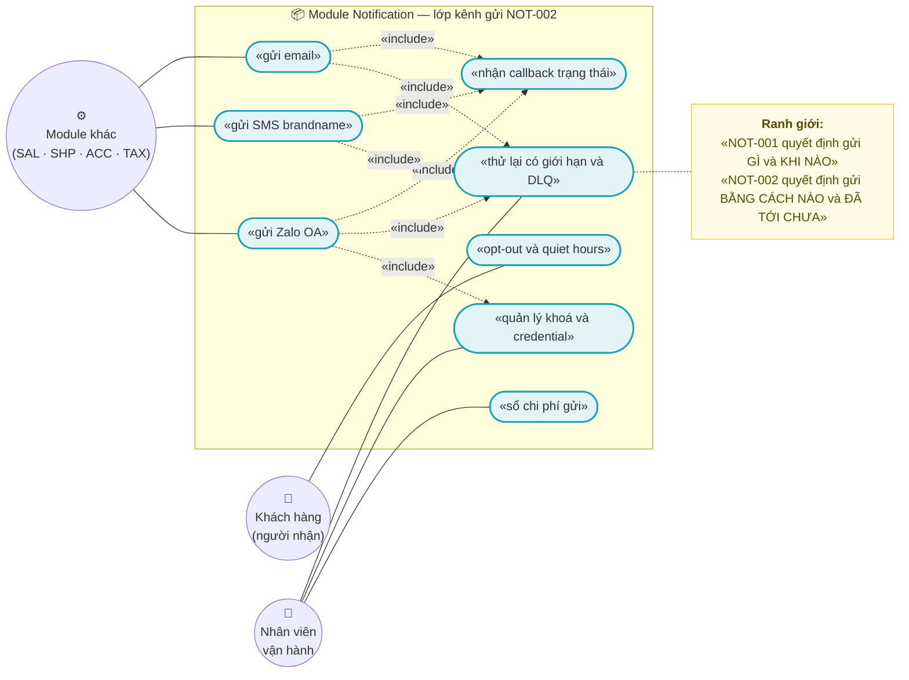
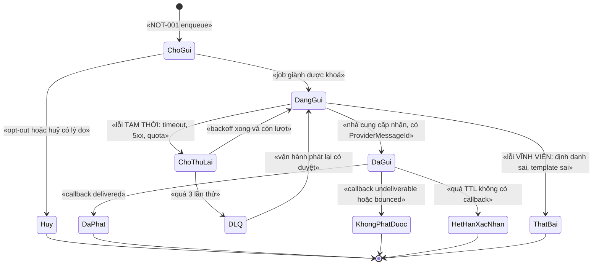
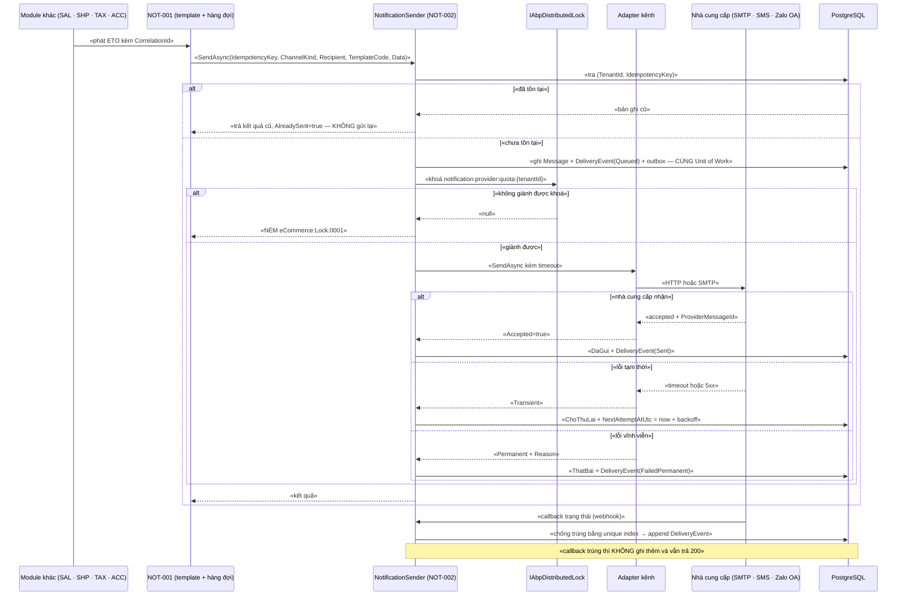

# `NOT-002` — Kênh gửi: email, SMS, Zalo OA

| Thuộc tính | Nội dung |
|---|---|
| **Mã** | `NOT-002` |
| **Module** | **Notification** — *module mới, chưa tồn tại trong code* (kế hoạch GĐ3) |
| **Giai đoạn** | **GĐ3 — Điều hành** (theo `docs/implementation-plan.md` Phụ lục A.3, dòng 440) |
| **Ưu tiên** | **Must have** (là điều kiện để `XC-005` Q3 và `XC-003` Q6 có nơi gửi cảnh báo email kỹ thuật) |
| **Trạng thái** | 🟡 `Draft` — chờ review |
| **Người viết / người review** | *(điền)* / **Kiến trúc trưởng + Vận hành + Security** |
| **Phiên bản / ngày** | `v0.1 — 13/10/2026` |
| **Tài liệu liên quan** | `NOT-001` (template & hàng đợi — *chưa có tài liệu*) · `XC-002` (outbox/inbox + DLQ) · `XC-003` (khoá phân tán) · `XC-005` (log/correlationId/metric — **Q3, Q4**) · `XC-001` (tiền tệ/làm tròn) · `XC-006` + `ACC-001` (thuế & xuất liệu kế toán) · `SHP-002`/`SHP-003`/`SHP-004` (`docs/implementation-plan.md:424–427`) · `REP-001` (read-model) · `docs/design-doc-guidelines.md` |

---

## 0. Tóm tắt & quyết định thiết kế

**Tóm tắt:** `NOT-002` chốt **lớp vận chuyển (transport) cho ba kênh gửi ra ngoài** — **email**, **SMS brandname**, **Zalo OA** —
sau một **abstraction duy nhất** (`INotificationChannelSender` + provider registry), kèm **vòng đời gửi có state machine ném lỗi**,
**nhật ký gửi append-only**, **chống trùng ở mọi biên vào** (callback/webhook nhà cung cấp), **retry có giới hạn + DLQ**,
**quota/rate-limit**, **quiet hours + opt-out**, và **sổ chi phí gửi** (append-only, dùng `decimal` theo `XC-001`).

**Ranh giới sống còn với `NOT-001`:** `NOT-001` là *"Template & hàng đợi thông báo (chống gửi trùng)"*
(`docs/implementation-plan.md:439`); `NOT-002` là *"Kênh gửi"* (`docs/implementation-plan.md:440`).
⇒ **`NOT-001` quyết định gửi *GÌ*, cho *AI*, *KHI NÀO*; `NOT-002` quyết định gửi *BẰNG CÁCH NÀO* và *ĐÃ TỚI CHƯA*.**
Trộn hai việc này vào nhau là cách chắc chắn nhất để sinh ra "gửi trùng" và "không biết tin nào đã tới".

### 0.1 Hiện trạng thật (đã kiểm bằng `read`/`grep` — không viết theo trí nhớ)

| Hạng mục | Hiện trạng | Bằng chứng (đường dẫn thật) |
|---|---|---|
| Module `Notification` | ❌ **CHƯA CÓ** — `modules/` chỉ có `ChannelHub`, `PaymentHub`, `Tax` | liệt kê thư mục `modules/` |
| Project Notification (Domain/EF/Application) | ❌ **CHƯA CÓ** — kế hoạch GĐ3 | `docs/implementation-plan.md:440` |
| Code gửi email / SMS / Zalo OA | ❌ **0 dòng** — `grep` cho `MailKit|SmtpClient|Zalo|Sms|SendGrid|Twilio|eSMS|Email` trong `*.cs` **không** có kết quả nào thuộc miền thông báo; các kết quả duy nhất là (a) cột `Email` của bảng ABP Identity trong `Migrations/`, (b) `AdminEmail` của seeder, (c) `"email"`/`"phone"` trong **danh sách nhãn BỊ CẤM** của metric | `src/eCommerce.Domain.Shared/Observability/eCommerceMetrics.cs:83` · `src/eCommerce.DbMigrator/IdentityDataSeedContributor.cs:35` |
| Gói NuGet gửi thư/SMS | ❌ **0 gói** — không có `MailKit`, `SendGrid`, `Twilio`, `Volo.Abp.Emailing` trong danh sách package tập trung | `Directory.Packages.props` (toàn bộ file, 108 dòng) |
| `eCommerce.Kernel` (nơi `XC-001`/`XC-003` nói helper dùng chung nằm) | ❌ **CHƯA TỒN TẠI** — `grep "eCommerce\.Kernel"` trên `*.cs` = **0** kết quả; `Money`/`ToMinorUnits`/`RoundingPolicy` = **0** kết quả | `grep` trên `src/` |
| Bảng `AbpBackgroundJobs` (job bền vững) | ✅ **CÓ** (đã migrate) ⇒ dùng được cho retry/backoff bền vững | `src/eCommerce.EntityFrameworkCore/Migrations/20261009102627_Added_Phase0_AuthModules.cs:64,83,457` |
| Bảng `AbpOutbox*`/`AbpInbox*` (`XC-002`) | ❌ **CHƯA CÓ** trong migration; **0** chỗ dùng `IOutbox` ⇒ outbox/inbox của `XC-002` **chưa triển khai** | `grep "AbpOutbox\|AbpInbox\|IOutbox"` trong `Migrations/` = 0 |
| Distributed lock (`IAbpDistributedLock`, Redis) | ✅ **CÓ thật**, đã dùng cho refresh token | `modules/ChannelHub/eCommerce.ChannelHub.Application/Sync/ChannelTokenManager.cs:29,67–91` |
| `KeyPrefix` của lock | ✅ `"ecommerce:"` (đã vá lỗi dính tiền tố) | `src/eCommerce.HttpApi.Host/eCommerceHttpApiHostModule.cs:115–128` |
| Metric | ⚠️ **12 metric đã ĐĂNG KÝ và đã có nơi phát (constructor)** nhưng **CHƯA được gọi ở luồng nghiệp vụ nào** — `eCommerceMetrics` chỉ được `new` trong **test** | `src/eCommerce.Domain.Shared/Observability/eCommerceMetrics.cs:13–53,98–166` · `test/eCommerce.Tests/Observability/MetricsTests.cs:33,83,99–101` |
| Metric cho thông báo | ❌ **KHÔNG CÓ** metric nào cho notification; registry bị **chốt cứng đúng 12 tên** bằng test | `test/eCommerce.Tests/Observability/MetricsTests.cs:62–66` |
| Nhãn metric `email`/`phone` | 🚨 **BỊ CẤM** (cardinality cao) — đây là ràng buộc **trực tiếp** lên `NOT-002` | `src/eCommerce.Domain.Shared/Observability/eCommerceMetrics.cs:81–84` |
| `[Authorize]` cấp class | ✅ **ĐÃ CÓ tiền lệ đúng** (bài học `GetShopsAsync` từng là API công khai) | `src/eCommerce.Application/Channels/ChannelAppService.cs:21–28` |
| `[Authorize]` cấp class cho miền thông báo | ❌ chưa có — module chưa tồn tại | — |
| `DbSet` cho entity của module | ✅ **CÓ tiền lệ**: phải khai `DbSet` trên `eCommerceDbContext` hợp nhất, nếu không `IRepository<T>` **không** được đăng ký | `src/eCommerce.EntityFrameworkCore/eCommerceDbContext.cs:47–64` |
| Unit of Work | ✅ `TransactionBehavior = Auto` cho toàn hệ thống | `src/eCommerce.HttpApi.Host/eCommerceHttpApiHostModule.cs:60–64` |
| Setting (`ISettingProvider`, `SettingDefinition`) | ❌ **0 định nghĩa setting trong code app** — chỉ có **bảng** `AbpSettings`/`AbpSettingDefinitions` do migration của ABP tạo | `grep "SettingDefinition"` chỉ khớp trong `Migrations/` |
| Sổ cái append-only | ✅ tiền lệ rõ: `StockLedgerEntry` "APPEND-ONLY. Không bao giờ UPDATE/DELETE" | `src/eCommerce.Domain/Entities/Inventory/StockLedger.cs:80–84` |
| Mask dữ liệu nhạy cảm (kể cả `otp`) | ✅ đã có thật, có test | `modules/PaymentHub/eCommerce.PaymentHub.Domain/Entities/PaymentTransaction.cs:147–171` (`otp` ở dòng 157) · `test/eCommerce.Tests/PaymentHub/WebhookMaskingTests.cs` |
| Health check | ✅ `/health-status` kiểm PostgreSQL thật | `src/eCommerce.HttpApi.Host/eCommerceHttpApiHostModule.cs:100–101,220–223` |
| Tài liệu `SHP-002/003/004`, `REP-*`, `ACC-001`, `NOT-001` | ❌ **CHƯA CÓ** — `docs/features/` chỉ có `XC-001`…`XC-006` | liệt kê `docs/features/` |

> 🚨 **Kết luận bắt buộc đọc trước khi review:** *toàn bộ `NOT-002` là thiết kế MỚI.*
> **Không có** dòng code nào của miền thông báo để đối chiếu. Mọi mục dưới đây ghi rõ **"chưa có trong code — kế hoạch GĐ3"**
> khi nói tới việc phải viết mới, và chỉ ra **tiền lệ thật** để bám theo khi viết.

**Phạm vi:**
- ✅ **Ba kênh gửi**: email · SMS brandname · Zalo OA (gồm ZNS nếu kênh hỗ trợ — *chưa kiểm chứng*, xem §15 Q3).
- ✅ **Hợp đồng adapter** dùng chung (`INotificationChannelSender`) + provider registry (thêm kênh = thêm class + 1 dòng DI).
- ✅ **Vòng đời một tin** (state machine) + **nhật ký gửi append-only** + **thử lại có giới hạn + DLQ**.
- ✅ **Biên vào**: callback/webhook trạng thái từ nhà cung cấp — **chống trùng bằng unique index** (lock **không** thay thế).
- ✅ **Quota / rate limit** theo kênh + **quiet hours** + **opt-out** (danh sách từ chối).
- ✅ **Sổ chi phí gửi** append-only, `decimal`, theo `XC-001`.
- ✅ **Credential** nhà cung cấp: mã hoá at-rest, không trả ra DTO, không log.
- ✅ **Khoá phân tán** cho tài nguyên chia sẻ (token OA, quota, phát lại DLQ) — theo `XC-003`.

**Không nằm trong phạm vi:**
- ❌ **Soạn nội dung / template / hàng đợi chống trùng** — thuộc **`NOT-001`** (xem ranh giới ở §0).
- ❌ **Quyết định nghiệp vụ "ai được nhận tin gì"** — thuộc module nghiệp vụ (`SAL`, `SHP`, `ACC`…) phát ETO.
- ❌ **Zalo OA / ZNS: thủ tục đăng ký, mẫu tin, cửa sổ gửi, giá** — *chưa kiểm chứng trong repo*, xem §15 Q3.
- ❌ **Báo cáo/tổng hợp hiệu quả gửi** — thuộc **`REP-*`** (đọc read-model, **không** query DB giao dịch — xem §8.3).
- ❌ **Xuất liệu kế toán** (file Excel/CSV cho kế toán) — thuộc **`ACC-001`** liên kết `XC-006`/`XC-001`; `NOT-002` chỉ **gửi** file/thông báo đó.
- ❌ **Push notification (FCM/APNs), chat Facebook, tổng đài** — chưa có nhu cầu trong GĐ3.
- ❌ **Hạ tầng outbox/inbox** — thuộc **`XC-002`** (**chưa triển khai**, xem §0.1). `NOT-002` **giả định** `XC-002` xong trước; nếu chưa, `NOT-002` chạy ở chế độ suy giảm (§15.3 giả định 1).

### 0.1 Quyết định thiết kế (ADR ngắn)

| # | Quyết định | Phương án đã cân nhắc | Lý do chọn | Hệ quả |
|---|---|---|---|---|
| **ADR-01** | **Mọi kênh gửi nằm sau MỘT abstraction** `INotificationChannelSender` + `INotificationChannelFactory` (registry) | (a) `if (kênh == "sms")` rải trong app service · (b) abstraction + registry · (c) dùng `Volo.Abp.Emailing` cho email rồi tự viết phần còn lại | Tiền lệ **đã chạy thật** trong repo: `IChannelConnectorFactory` (`modules/ChannelHub/eCommerce.ChannelHub.Application/Connectors/ChannelConnectorFactory.cs`) và `IPaymentProvider` (`modules/PaymentHub/eCommerce.PaymentHub.Domain/Payments/IPaymentProvider.cs`) — thêm nhà cung cấp = thêm class | Không được gọi SDK nhà cung cấp trực tiếp ở app service (BR-001); mọi kênh phải qua interface ⇒ test được bằng fake |
| **ADR-02** | **Tách lớp: `NOT-001` = quyết định gửi, `NOT-002` = vận chuyển & theo dõi phát** | (a) gộp chung một module làm hết · (b) tách theo trách nhiệm | `implementation-plan.md:439–440` đã tách sẵn hai tài liệu; gộp lại thì "chống gửi trùng" và "retry vận chuyển" tranh nhau một trạng thái | `NOT-002` **không** được tự sinh nội dung; mọi yêu cầu vào `NOT-002` phải có `IdempotencyKey` do tầng trên cấp (BR-002) |
| **ADR-03** | **Idempotency ở MỌI biên vào**, cài bằng **bảng + unique index** | (a) tin vào distributed lock · (b) chỉ kiểm ở code · (c) bảng idempotency + unique index | `XC-003` BR-008 + §7.3: lock **không** thay thế idempotency (lock hết TTL ⇒ mất tác dụng). Tiền lệ index thật: `eCommerceDbContext.cs:184–186` (đơn sàn) và `PaymentTransaction.IdempotencyKey` (`PaymentTransaction.cs:76`) | Phải có bảng `NotificationInbox` + `NotificationMessage` unique index; **thừa** index còn hơn thiếu |
| **ADR-04** | **State machine NÉM LỖI** khi chuyển trạng thái sai, **cấm** no-op im lặng | (a) bỏ qua im lặng · (b) log rồi bỏ qua · (c) `BusinessException` có mã | Bài học eShop (`SetPaidStatus()` no-op) đã được ghi thành nguyên tắc; tiền lệ code thật: `TaxClassification.Approve()` ném `TaxErrorCodes.InvalidStatusTransition` (`modules/Tax/eCommerce.Tax.Domain/Classifications/TaxClassification.cs:122–134`) | Mỗi nhánh state machine cần 1 test; callback đến **sai thứ tự** phải có đường xử lý tường minh (§3 bảng guard) |
| **ADR-05** | **Nhật ký gửi là APPEND-ONLY** (bảng `NotificationDeliveryEvent`), tách khỏi aggregate có trạng thái | (a) một bảng vừa giữ trạng thái vừa làm lịch sử · (b) tách: `NotificationMessage` (trạng thái) + `NotificationDeliveryEvent` (append-only) | Tiền lệ thật: `StockLedgerEntry` "APPEND-ONLY. Không bao giờ UPDATE/DELETE" (`src/eCommerce.Domain/Entities/Inventory/StockLedger.cs:80–84`) và `XC-006` BR-005 | Truy vết "tin này đã đi qua những bước nào" luôn đọc được; **cấm** sửa/xoá event |
| **ADR-06** | **Nhãn metric chỉ lấy từ `eCommerceMetricTags.Allowed`**; **cấm** `email`, `phone`, `messageId` | (a) gắn người nhận làm nhãn để dễ lọc · (b) nhãn hữu hạn + log | `email`/`phone` **đã nằm trong danh sách BỊ CẤM** của repo (`eCommerceMetrics.cs:81–84`), và `XC-005` BR-009 cấm cardinality cao. Mỗi số điện thoại là **một chuỗi thời gian riêng** ⇒ nổ hệ thống metric | Truy vết theo người nhận **chỉ** bằng **log** (đã có `CorrelationId`), không bằng metric |
| **ADR-07** | **Thêm metric mới ⇒ PHẢI sửa registry + `XC-005` §5.1 + test**, trong **cùng** PR | (a) phát metric mới ngay · (b) cập nhật registry trước | Test hiện tại **chốt cứng đúng 12 tên**: `Assert.Equal(12, eCommerceMetricNames.All.Count)` và so tập tên phát ra với registry (`MetricsTests.cs:38–47,62–66`) ⇒ phát metric chưa đăng ký là **CI đỏ** | `NOT-002` cần metric ⇒ đây là **việc phải làm tường minh** trong PR đầu của module, không phải việc phụ |
| **ADR-08** | **Token Zalo OA (có rotate) chỉ ghi trong phạm vi `IAbpDistributedLock` + double-check** | (a) refresh không khoá · (b) khoá nhưng không double-check | Tiền lệ **đã chạy thật**: `ChannelTokenManager` khoá `channel:{channelCode}:{shopId}:token-refresh`, rồi **đọc lại** entity trong khoá (`ChannelTokenManager.cs:67–91`). Shopee rotate refresh token ⇒ refresh song song làm **mất token** | Khoá mới `notification:zalo-oa:{oaId}:token-refresh`; timeout bắt buộc (`XC-003` BR-004); không giành được khoá ⇒ **NÉM** `eCommerce:Lock:0001`, **không** gửi tiếp |
| **ADR-09** | **`NOT-002` KHÔNG gọi app service của module khác** — chỉ **tiêu thụ ETO** | (a) gọi `IShippingAppService.GetWaybillAsync()` để lấy dữ liệu tin · (b) nhận ETO đã đủ dữ liệu | Quy ước bất biến: **module gọi app BỊ CẤM**. Tiền lệ: `ChannelOrderPulledEto` mang **đủ** dữ liệu để app tự tạo đơn, nhờ vậy ChannelHub không cần domain app (`modules/ChannelHub/eCommerce.ChannelHub.Application.Contracts/Events/ChannelEvents.cs:5–15`) | ETO cho `NOT-002` **phải** chứa đủ trường để dựng tin (tên, số tiền, mã đơn) — **không** để consumer phải gọi ngược lại |
| **ADR-10** | **Retry/backoff chạy trên job BỀN VỮNG** (`AbpBackgroundJobs`), **không** dùng timer trong bộ nhớ | (a) timer trong bộ nhớ như supervisor kênh · (b) hàng đợi job bền vững trong DB | Bảng `AbpBackgroundJobs` **đã có** (`20261009102627_Added_Phase0_AuthModules.cs:64`) ⇒ không thêm hạ tầng. Và **bài học F6 thật**: `ChannelSyncSupervisorWorker` từng gọi `AddAsync` mỗi nhịp ⇒ ABP **THAY THẾ** worker ⇒ timer reset ⇒ worker **không bao giờ chạy** (`modules/ChannelHub/eCommerce.ChannelHub.Application/Sync/ChannelSyncSupervisorWorker.cs:68–85`) | Tin đang chờ gửi **sống qua restart**; **cấm** thiết kế "giữ hàng đợi trong `ConcurrentDictionary`" |
| **ADR-11** | **Chi phí gửi & mọi số tiền dùng `decimal` + quy ước `XC-001`**; **cấm** `double`/`float`; **cấm** so tiền bằng `==` | (a) `double` cho "đơn giá nhỏ" · (b) `decimal` + so theo **minor units** | `XC-001` BR-003 (cấm `==` trên `decimal`), BR-008 (không `double`/`float` trong **bất kỳ** biểu thức tiền nào kể cả DTO/adapter). Tiền lệ code: `PaymentTransaction.Amount` là `decimal` (`PaymentTransaction.cs:52–53`), `ProductVariant.Price` `HasPrecision(18,4)` (`eCommerceDbContext.cs:126`) | Sổ chi phí gửi `numeric(18,4)`; test reflection chặn `double`/`float` |
| **ADR-12** | **CẤM lưu & CẤM log nội dung nhạy cảm**; nội dung lưu vào DB phải **mask**; **OTP KHÔNG BAO GIỜ được lưu** | (a) lưu nguyên nội dung để gỡ lỗi · (b) lưu bản đã mask + không lưu OTP | `XC-005` BR-005/BR-012; tiền lệ thật: `PaymentTransaction.MaskSensitiveData` che 2 lớp và **che cả `otp`** (`PaymentTransaction.cs:147–171`), đã có test `WebhookMaskingTests` | Tin chứa OTP (đổi COD — `SHP-003`) **không** có bản ghi nội dung; chỉ có bản ghi "đã gửi OTP tới đuôi số X" |

---

## 1. Use Case Specification

| Thuộc tính | Nội dung |
|---|---|
| **Use Case ID** | `NOT-002` |
| **Use Case Name** | Gửi thông báo ra ngoài qua email / SMS / Zalo OA và theo dõi tới đích |
| **Description** | *"Là hệ thống, tôi muốn gửi một thông báo qua email, SMS hoặc Zalo OA bằng **một cách duy nhất**, biết chắc **tin đã tới hay chưa**, **không gửi trùng** khi có retry/callback trùng, **không** để lộ OTP/dữ liệu khách, và **không** gửi vượt hạn mức hay ngoài khung giờ cho phép."* |
| **Actor(s)** | **Hệ thống** (module nghiệp vụ phát ETO) · **`NOT-001`** (hàng đợi + template) · **Nhà cung cấp** (SMTP/API SMS/Zalo OA — gọi vào & callback ra) · **Nhân viên vận hành** (xem DLQ, phát lại, bật/tắt kênh, xem chi phí) · **Khách hàng** (người nhận — chỉ tác động qua opt-out) |
| **Priority** | **Must have** |
| **Trigger** | (a) `NOT-001` chuyển một tin đã dựng nội dung sang bước gửi; (b) đến nhịp job thử lại; (c) nhà cung cấp gọi callback trạng thái; (d) vận hành phát lại DLQ; (e) cảnh báo kỹ thuật từ `XC-005` (`XC-005` §15.1 **Q3**: *"alert gửi email kỹ thuật … Thuộc `NOT-002`"*) hoặc từ `XC-003` **Q6** |
| **Pre-Condition(s)** | • **Tenant hiện tại** (`TenantId`) — mọi bản ghi và credential đều theo tenant (`IMultiTenant`).<br>• **Kênh đã được bật** cho tenant và **có credential hợp lệ** (email: SMTP/API key; SMS: brandname + API key; Zalo OA: `OA access token` còn hiệu lực **hoặc** có refresh token để làm mới).<br>• **Người nhận có định danh hợp lệ** cho kênh đó (email đã chuẩn hoá; số điện thoại **đã chuẩn hoá về E.164 hoặc đầu số VN**; Zalo `user_id`/`oa_id`).<br>• **`IdempotencyKey` ổn định** do tầng trên (`NOT-001`) cấp — **không** phải `Guid.NewGuid()` mỗi lần gọi.<br>• **`ChannelCode`** (*kênh bán*) **chỉ** đưa vào log/ngữ cảnh, **không** quyết định kênh gửi: cùng một đơn từ Shopee và từ website có thể gửi cùng một mẫu SMS.<br>• **`XC-002` (outbox/inbox) sẵn sàng** — nếu chưa, module chạy chế độ suy giảm (§15.3 giả định 1). |
| **Post-Condition(s)** | • Mỗi yêu cầu gửi có **đúng một** `NotificationMessage` (ràng buộc unique trên `IdempotencyKey`).<br>• Trạng thái cuối của tin thuộc tập **kết thúc**: `DaPhat` · `KhongPhatDuoc` · `HetHanXacNhan` · `ThatBai` · `Huy`.<br>• Mọi bước chuyển trạng thái có **một** `NotificationDeliveryEvent` **append-only** (kèm `CorrelationId`, `ProviderCode`, `Status`, `Reason`).<br>• Tin chưa gửi được **không** bị mất: nằm ở `ChoThuLai` (có `NextAttemptAtUtc`) hoặc `DLQ`.<br>• Chi phí phát sinh ghi vào `NotificationCostLedger` (append-only) với `decimal(18,4)`.<br>• **Không** tồn tại bản ghi chứa OTP; nội dung lưu đã **mask**. |
| **Basic Flow** | 1. `NOT-001` gọi `INotificationSender.SendAsync(request)` với `IdempotencyKey`, `ChannelKind` (Email·Sms·ZaloOa), `Recipient`, `TemplateCode`, `Data`, `TenantId`.<br>2. `NotificationSender` **kiểm idempotency**: tra `NotificationMessage` theo `(TenantId, IdempotencyKey)`. **Đã có** ⇒ trả kết quả cũ, **không** gửi lại (BR-002).<br>3. Kiểm **opt-out** (số/email đã từ chối) và **quiet hours**; vi phạm ⇒ `Huy` (opt-out) hoặc dời `NextAttemptAtUtc` sang khung cho phép (quiet hours) (BR-012).<br>4. Trong **một Unit of Work**: tạo `NotificationMessage` (`ChoGui`) + `NotificationDeliveryEvent(Queued)` + ghi **outbox** (theo `XC-002`) (BR-006).<br>5. Job nền lấy tin `ChoGui` có `NextAttemptAtUtc <= now` ⇒ giành **khoá phân tán** `notification:provider:{providerCode}:quota:{tenantId}` (ADR-08/BR-010; không giành được ⇒ **ném** `eCommerce:Lock:0001`).<br>6. Gọi adapter của kênh: `await sender.SendAsync(message, ct)` với **timeout** và **retry có giới hạn** (BR-011).<br>7. Thành công (nhà cung cấp **nhận**, có `ProviderMessageId`) ⇒ `DaGui` + `DeliveryEvent(Sent)`. Lỗi **tạm thời** ⇒ `ChoThuLai` + `NextAttemptAtUtc = now + backoff`. Lỗi **vĩnh viễn** ⇒ `ThatBai`.<br>8. Nhà cung cấp gọi **callback** trạng thái ⇒ **chống trùng** bằng unique index, ghi `DeliveryEvent` và cập nhật `DaPhat`/`KhongPhatDuoc` (BR-003).<br>9. Ghi **chi phí** vào `NotificationCostLedger` (append-only) với `decimal(18,4)` (BR-013). |
| **Alternative Flow** | **A1: Email tới nhiều người nhận (to/cc/bcc)** — vẫn **một** `NotificationMessage`, mỗi người nhận một `NotificationRecipient` con; trạng thái tổng = *kết quả xấu nhất*.<br>**A2: Kênh ưu tiên dự phòng** — Zalo OA thất bại **vĩnh viễn** ⇒ gửi SMS dự phòng **cùng** `IdempotencyKey` gốc với hậu tố `:fallback-sms` (**khoá khác** ⇒ không bị chặn nhầm, nhưng vẫn truy vết được về tin gốc qua `RootMessageId`).<br>**A3: Cảnh báo kỹ thuật** (`XC-005` Q3) — dùng **cùng** pipeline này nhưng `ChannelKind=Email`, `TemplateCode=ops-alert`, người nhận **không** phải khách hàng ⇒ **cấm** opt-out áp lên nhóm này, **cấm** quiet hours chặn cảnh báo mức `Critical` (BR-012 ngoại lệ có kiểm soát).<br>**A4: Vận hành phát lại DLQ** — giành khoá `notification:dlq-replay:{tenantId}` (chỉ **một** tiến trình), sau đó đưa tin về `ChoGui` với `AttemptCount = 0` và ghi `DeliveryEvent(ReplayedBy=userId)`.<br>**A5: Nhà cung cấp chậm** — quá `SentAckTtl` mà **không** có callback ⇒ `HetHanXacNhan` + metric; **không** tự gửi lại (tránh gửi trùng ra người thật) mà đưa vào báo cáo đối soát (§8.3). |
| **Exception Flow** | **E1:** trùng `IdempotencyKey` ⇒ **không** gửi lại, trả kết quả cũ + `AlreadySent=true`.<br>**E2:** người nhận **sai định dạng** (email không hợp lệ / số điện thoại sai) ⇒ `ThatBai` vĩnh viễn, `eCommerce:Notification:0002`, **không** thử lại.<br>**E3:** thiếu credential / credential hết hạn ⇒ `eCommerce:Notification:0003`, tin ở `ChoThuLai` với backoff dài; **có** metric + **cảnh báo vận hành** (nếu im lặng thì thông báo chết hàng loạt mà không ai biết).<br>**E4:** hết hạn mức nhà cung cấp (SMS/Zalo) ⇒ `ChoThuLai` + `Reason=quota`, **không** tính là lỗi vĩnh viễn.<br>**E5:** quá số lần thử ⇒ `DLQ` + `eCommerce:Notification:0005`; **cấm** thử vô hạn.<br>**E6:** callback có **chữ ký sai / không xác thực được** ⇒ **từ chối**, ghi `NotificationInbox` với `Status=Rejected`, tăng `payment_*`-kiểu counter tương ứng (metric mới, ADR-07), **không** đổi trạng thái tin.<br>**E7:** callback đến **sai thứ tự** (đã `DaPhat` rồi mới nhận `Sent`) ⇒ **không** lùi trạng thái; ghi event với `Status=IgnoredOutOfOrder` + log `Warning` (BR-004).<br>**E8:** không giành được khoá ⇒ `eCommerce:Lock:0001` (dùng **nguyên** mã lỗi của `XC-003`, không tự đặt mã mới). |
| **Business Rules** | • **BR-NOT-002-001**: Mọi lần gửi **phải** đi qua `INotificationChannelSender`; **cấm** gọi SDK/HTTP của nhà cung cấp trực tiếp từ app service hoặc job.<br>• **BR-NOT-002-002**: Mọi yêu cầu gửi **phải** có `IdempotencyKey` **ổn định**; gửi lại cùng khoá ⇒ **không** tạo tin thứ hai (ràng buộc unique ở DB, không chỉ kiểm ở code).<br>• **BR-NOT-002-003**: Mọi **callback/webhook** nhà cung cấp **phải** chống trùng bằng unique index trên `(TenantId, ProviderCode, ProviderMessageId, EventType)`; **cấm** dựa vào distributed lock để chống trùng.<br>• **BR-NOT-002-004**: **Mọi** chuyển trạng thái sai **phải NÉM** `BusinessException` có mã; **cấm** no-op im lặng. Chuyển trạng thái **lùi** (đã phát → chưa phát) **cấm** tuyệt đối.<br>• **BR-NOT-002-005**: `NotificationDeliveryEvent` là **APPEND-ONLY** — **cấm** `UPDATE`/`DELETE`; sửa sai phải ghi event mới.<br>• **BR-NOT-002-006**: Mọi thao tác ghi đi qua **Unit of Work**; `NotificationMessage` + `NotificationDeliveryEvent` + **outbox** ghi trong **cùng** transaction.<br>• **BR-NOT-002-007**: Nhãn metric **chỉ** lấy từ `eCommerceMetricTags.Allowed`; 🚨 **cấm** `email`, `phone`, `messageId`, `recipientId` (cardinality cao).<br>• **BR-NOT-002-008**: Thêm/đổi metric hoặc tag **phải** cập nhật `eCommerceMetricNames`/`eCommerceMetricTags` **và** `XC-005` §5.1 **và** test — trong **cùng** PR.<br>• **BR-NOT-002-009**: 🚨 **CẤM log & CẤM lưu OTP**; nội dung tin lưu vào DB **phải** đi qua hàm mask (kế thừa `PaymentTransaction.MaskSensitiveData`); **cấm** log token nhà cung cấp, số điện thoại đầy đủ, email đầy đủ ở mức `Information`.<br>• **BR-NOT-002-010**: Token Zalo OA **chỉ** được ghi trong phạm vi khoá `notification:zalo-oa:{oaId}:token-refresh` **và** phải **đọc lại (double-check)** trong khoá trước khi gọi API làm mới.<br>• **BR-NOT-002-011**: Mọi lần gọi nhà cung cấp **phải** có **timeout hữu hạn** và **retry có giới hạn** + backoff; quá giới hạn ⇒ `DLQ`. **Cấm** retry vô hạn và **cấm** gọi không timeout.<br>• **BR-NOT-002-012**: **Quiet hours** + **opt-out** **phải** được tôn trọng cho tin tới **khách hàng**; **ngoại lệ có kiểm soát**: cảnh báo kỹ thuật mức `Critical` **không** bị quiet hours chặn, và opt-out **không** áp cho người nhận nội bộ.<br>• **BR-NOT-002-013**: Mọi số tiền (chi phí gửi, số tiền in trong tin) **phải** là `decimal`; 🚨 **cấm** `double`/`float`; 🚨 **cấm** so sánh tiền bằng `==` (theo `XC-001` BR-003/BR-008).<br>• **BR-NOT-002-014**: 🚨 Trạng thái vận đơn đến từ webhook **KHÔNG xác thực được** (GHTK — `SHP-002`, `docs/implementation-plan.md:425` ghi rõ *"không có HMAC ở GHTK"*) **KHÔNG** được dùng làm **nguồn duy nhất** để gửi tin có **số tiền/COD**; trước khi gửi tin chứa số tiền **phải** có nguồn thứ hai đối chiếu, hoặc gửi tin **không** chứa số tiền.<br>• **BR-NOT-002-015**: 🚨 OTP đổi COD (`SHP-003`, `docs/implementation-plan.md:426` ghi rõ *"GHN cần OTP"*) **chỉ** gửi qua kênh **đã xác thực danh tính người nhận**; OTP **không** được lưu vào bất kỳ bảng nào, **không** được log; có **TTL** và **giới hạn số lần gửi lại** trong một cửa sổ thời gian.<br>• **BR-NOT-002-016**: **Cấm** `NOT-002` gọi app service của module khác; dữ liệu để dựng tin **phải** có sẵn trong ETO (ADR-09).<br>• **BR-NOT-002-017**: Credential nhà cung cấp **phải** mã hoá at-rest và **cấm** trả ra DTO (kể cả bản đã mã hoá) — kế thừa `ChannelShop.AccessTokenEncrypted` + `ChannelAppService.ToDto` (`src/eCommerce.Application/Channels/ChannelAppService.cs:189–209`).<br>• **BR-NOT-002-018**: Mọi lỗi **đã xử lý** (bị nuốt có chủ ý) **phải** log ở mức ≥ `Warning` + **có `ErrorCode`** — **cấm** nuốt im lặng (kế thừa `XC-005` BR-013). |
| **Non-Functional Requirement** | • **NFR-NOT-002-001**: Độ trễ `SendAsync` (đã có credential, kênh rảnh) ⇒ **p95 < 2 s** cho SMS/Zalo OA, **< 5 s** cho email.<br>• **NFR-NOT-002-002**: Cùng `IdempotencyKey` gửi **1.000** lần ⇒ **đúng 1** tin gửi ra ngoài, **1** `NotificationMessage`.<br>• **NFR-NOT-002-003**: **100 %** callback có `CorrelationId` **và** được chống trùng (integration test gửi cùng callback 2 lần).<br>• **NFR-NOT-002-004**: **0** dòng log chứa OTP / token / số điện thoại đầy đủ (quét mã nguồn ở CI).<br>• **NFR-NOT-002-005**: **0** nhãn metric cardinality cao; **< 100** series mỗi metric.<br>• **NFR-NOT-002-006**: Retry tối đa **3** lần với backoff **1 s → 5 s → 25 s**; lần thứ 4 ⇒ `DLQ`. Không có tin nào thử quá **3** lần.<br>• **NFR-NOT-002-007**: Thông lượng tối thiểu **50 tin/giây/instance** với `ChannelKind=Sms` (đo bằng fake sender).<br>• **NFR-NOT-002-008**: **100 %** tin marketing có `NextAttemptAtUtc` nằm **trong** khung giờ cho phép (test với `TimeProvider` giả).<br>• **NFR-NOT-002-009**: Cách ly tenant: **0** trường hợp tenant B đọc/ghi được credential hay nội dung của tenant A.<br>• **NFR-NOT-002-010**: **0** tin gửi tới người nhận đã opt-out (test 1.000 lần ngẫu nhiên).<br>• **NFR-NOT-002-011**: Chi phí gửi tính đúng tới **0,0001** đơn vị tiền và **khớp** file đối soát nhà cung cấp (lệch **0**); phép so dùng **minor units**.<br>• **NFR-NOT-002-012**: Log là **một dòng JSON**/sự kiện, có `CorrelationId` (kế thừa `XC-005` BR-010/BR-002). |

---

## 2. Sơ đồ Use Case



### Chú giải

| Ký hiệu | Ý nghĩa |
|---|---|
| ⭕ Xanh lá | Actor (kể cả hệ thống khác và nhà cung cấp) |
| 🟦 Bầu dục xanh dương | Use Case |
| 🟨 Khung vàng | Note |
| `───` | Liên kết Actor ↔ Use Case |
| `-.«include».->` | Quan hệ bao hàm |

---

## 3. Vòng đời một tin gửi (state machine)

> 📌 **Giới hạn sơ đồ:** tài liệu này dùng **đúng 3** sơ đồ Mermaid (đây là sơ đồ thứ 2). ERD ở §5 vì vậy được **mô tả bằng bảng** thay vì sơ đồ.



**Bảng chuyển trạng thái & guard (mọi chuyển sai **phải ném lỗi**, không im lặng):**

| # | Từ → Sang | Guard (điều kiện cho phép) | Ai được chuyển | Side effect | Nếu guard sai |
|---|---|---|---|---|---|
| 1 | `ChoTai` → `ChoGui` | `IdempotencyKey` **chưa** tồn tại cho `(TenantId, IdempotencyKey)` | `NotificationSender` | ghi `NotificationMessage` + `DeliveryEvent(Queued)` + outbox (cùng UoW) | **NÉM** `eCommerce:Notification:0001` (trùng khoá) — hoặc trả kết quả cũ nếu ở chế độ "đã gửi" (BR-002) |
| 2 | `ChoGui` → `DangGui` | Giành được khoá `notification:provider:{providerCode}:quota:{tenantId}` **và** `NextAttemptAtUtc <= now` | Job nền | ghi `DeliveryEvent(Sending)` | **NÉM** `eCommerce:Lock:0001` (**mã của `XC-003`**, không tự đặt mã mới) |
| 3 | `DangGui` → `DaGui` | Adapter trả `Accepted=true` **và** có `ProviderMessageId` | Adapter kênh | `DeliveryEvent(Sent)` + ghi `ProviderMessageId` | **NÉM** `eCommerce:Notification:0006` (nhà cung cấp nhận nhưng thiếu mã ⇒ không theo dõi được) |
| 4 | `DangGui` → `ChoThuLai` | `AttemptCount < 3` **và** lỗi phân loại là **tạm thời** | Adapter kênh | `AttemptCount++`, `NextAttemptAtUtc = now + backoff`, `DeliveryEvent(RetryScheduled)` | Nếu `AttemptCount >= 3` ⇒ sang `DLQ` + `eCommerce:Notification:0005` |
| 5 | `ChoThuLai` → `DangGui` | `NextAttemptAtUtc <= now` **và** còn lượt | Job nền | `DeliveryEvent(Retrying)` | Ở lại `ChoThuLai` (không lỗi — đúng thiết kế) |
| 6 | `ChoThuLai` → `DLQ` | `AttemptCount >= 3` **hoặc** lỗi vĩnh viễn sau khi đã thử | Job nền | `DeliveryEvent(MovedToDlq)` + **metric** | **NÉM** `eCommerce:Notification:0005` nếu bị gọi sai trạng thái |
| 7 | `DangGui` → `ThatBai` | Lỗi phân loại **vĩnh viễn** (`InvalidRecipient`, `TemplateRejected`) | Adapter kênh | `DeliveryEvent(FailedPermanent)` | **NÉM** `eCommerce:Notification:0002` kèm `Reason` |
| 8 | `DaGui` → `DaPhat` | Callback **hợp lệ** `EventType=Delivered` **và** chưa từng nhận event này | Webhook nhận callback | `DeliveryEvent(Delivered)` + `DeliveredAtUtc` | Trùng ⇒ **không** ghi thêm, trả `200` (idempotent, BR-003) |
| 9 | `DaGui` → `KhongPhatDuoc` | Callback **hợp lệ** `EventType=Bounced/Undeliverable` | Webhook nhận callback | `DeliveryEvent(Undeliverable)` | như trên |
| 10 | `DaGui` → `HetHanXacNhan` | `now > SentAtUtc + SentAckTtl` **và** không có callback | Job đối soát | `DeliveryEvent(AckExpired)` + **metric** | Ở lại `DaGui` (không lỗi) |
| 11 | `DaPhat` → `*` (lùi) | 🚨 **KHÔNG BAO GIỜ** | — | — | **NÉM** `eCommerce:Notification:0007` (`InvalidStatusTransition`) — trạng thái **kết thúc là hấp thụ** |
| 12 | `DLQ` → `DangGui` | Người phát lại có quyền `eCommerce.Notification.Dlq.Replay` **và** giành được khoá `notification:dlq-replay:{tenantId}` | Vận hành | `AttemptCount = 0`, `DeliveryEvent(Replayed, by=userId)` | **NÉM** `403` nếu thiếu quyền; **NÉM** `eCommerce:Lock:0001` nếu đang có người phát lại |
| 13 | `ChoTai`/`ChoGui` → `Huy` | Có `opt-out` **hoặc** người dùng huỷ yêu cầu | `NotificationSender` | `DeliveryEvent(Cancelled, reason)` | **NÉM** `eCommerce:Notification:0007` nếu cố huỷ tin **đã phát** (BR-004) |

> ⚠️ **Trạng thái nguy hiểm nhất là `HetHanXacNhan`.** Nhà cung cấp **có thể đã gửi** nhưng callback bị mất
> (đúng bài học `XC-006` §7.1 về eShop: *"consumer luôn ACK kể cả khi handler lỗi ⇒ mất sự kiện vĩnh viễn"*).
> Vì vậy khi rơi vào trạng thái này **tuyệt đối KHÔNG tự gửi lại** — gửi lại có thể làm khách nhận **2** tin
> (và với Zalo OA/SMS, gửi trùng còn **tốn tiền thật**). Hành vi đúng: đưa vào **báo cáo đối soát** (§8.3) và
> để người quyết định. Đây là lý do `HetHanXacNhan` **không** có cạnh quay lại `ChoThuLai`.

---

## 4. Sequence Diagram & luồng dữ liệu

### 4.1 Luồng gửi + callback trạng thái



### 4.2 DFD — từ nghiệp vụ tới người nhận (mô tả, không vẽ sơ đồ)

| Bước | Nguồn → Đích | Dữ liệu | Ghi chú |
|---|---|---|---|
| 1 | Module nghiệp vụ → `NOT-001` | ETO (đủ trường để dựng tin — ADR-09) | `NOT-002` **không** gọi ngược lại module nào |
| 2 | `NOT-001` → `NOT-002` | `SendRequest` (khoá idempotency + template + data) | Đây là **biên vào thứ nhất** ⇒ kiểm idempotency |
| 3 | `NOT-002` ↔ PostgreSQL | `NotificationMessage`, `NotificationDeliveryEvent`, `NotificationInbox`, `NotificationCostLedger`, `NotificationChannelAccount` | 5 bảng, xem §5 |
| 4 | `NOT-002` → Nhà cung cấp | HTTP/SMTP (timeout + retry) | Khoá quota bao ngoài |
| 5 | Nhà cung cấp → `NOT-002` | Callback trạng thái | **Biên vào thứ hai** ⇒ chống trùng bằng unique index |
| 6 | `NOT-002` → `REP-*` / `ACC-001` | `DeliveryEvent` + `NotificationCostLedger` | Qua **read-model**, **không** cho `REP-*` query trực tiếp DB giao dịch (§8.3) |

---

## 5. Mô hình dữ liệu

> 📌 **Không vẽ ERD** để giữ đúng giới hạn **3 sơ đồ Mermaid** của tài liệu này (2 sơ đồ đã dùng ở §2 và §3).
> Quan hệ giữa các bảng được ghi rõ bằng cột **FK** trong Data Dictionary dưới đây.
>
> 🚨 **Trạng thái code:** module `Notification` **chưa có trong code** ⇒ toàn bộ §5 là **thiết kế mới, kế hoạch GĐ3**.
> Khi triển khai **bắt buộc**: (a) mọi entity **phải** có `DbSet` trên `eCommerceDbContext` hợp nhất, nếu không
> `IRepository<T, Guid>` **không** được đăng ký (bài học `src/eCommerce.EntityFrameworkCore/eCommerceDbContext.cs:47–52`);
> (b) mỗi module tự cung cấp hàm `ConfigureNotification(...)` gọi trong `OnModelCreating` (mẫu `ConfigureChannelHub()` —
> `eCommerceDbContext.cs:76–78`).

### 5.1 Bảng `NotificationMessages` — aggregate có trạng thái

| Cột | Kiểu | Null? | Ý nghĩa | Ghi chú |
|---|---|---|---|---|
| `Id` | `uuid` | ✗ | khoá chính | |
| `TenantId` | `uuid` | ✓ | tenant | `IMultiTenant`; `null` = tin hạ tầng (**không** chứa dữ liệu khách) |
| `IdempotencyKey` | `varchar(256)` | ✗ | khoá chống trùng từ tầng trên | **UNIQUE** `(TenantId, IdempotencyKey)` — hàng rào cuối (ADR-03) |
| `RootMessageId` | `uuid` | ✓ | tin gốc khi đây là kênh dự phòng (A2) | tự tham chiếu |
| `ChannelKind` | `int` | ✗ | `Email=0`, `Sms=1`, `ZaloOa=2` | |
| `ProviderCode` | `varchar(32)` | ✗ | mã nhà cung cấp, ví dụ `smtp`, `esms`, `zalo-oa` | đối chiếu `INotificationChannelSender.ProviderCode` |
| `TemplateCode` | `varchar(64)` | ✗ | mã mẫu tin (**do `NOT-001` sở hữu**) | `NOT-002` **không** quản nội dung mẫu |
| `BodyMasked` | `text` | ✓ | nội dung **đã mask** để đối soát | 🚨 **CẤM** lưu OTP (BR-009); mask theo `PaymentTransaction.MaskSensitiveData` |
| `Status` | `int` | ✗ | theo §3 | **KHÔNG** sửa trực tiếp — chỉ qua hàm của entity |
| `AttemptCount` | `int` | ✗ | số lần đã thử | trần **3** (NFR-006) |
| `NextAttemptAtUtc` | `timestamptz` | ✓ | thời điểm được thử lại / khung giờ cho phép | quiet hours ghi vào đây (BR-012) |
| `ProviderMessageId` | `varchar(128)` | ✓ | mã tin do nhà cung cấp cấp | dùng cho callback; **UNIQUE** `(TenantId, ProviderCode, ProviderMessageId)` khi khác `null` |
| `SentAtUtc` / `DeliveredAtUtc` | `timestamptz` | ✓ | mốc thời gian | mốc của nhà cung cấp, không phải mốc ta nhận callback |
| `LastReason` | `varchar(512)` | ✓ | lý do lỗi/tạm hoãn gần nhất | **đã mask** |
| `Priority` | `int` | ✗ | `Low=0`, `Normal=1`, `High=2`, `Critical=3` | `Critical` **không** bị quiet hours chặn (BR-012) |

**Index & ràng buộc**

| Loại | Cột | Mục đích |
|---|---|---|
| **UNIQUE** | `(TenantId, IdempotencyKey)` | 🚨 **idempotency biên vào #1** (BR-002) |
| **UNIQUE có filter** | `(TenantId, ProviderCode, ProviderMessageId) WHERE ProviderMessageId IS NOT NULL` | chống 2 tin cùng trỏ về một mã nhà cung cấp |
| INDEX | `(TenantId, Status, NextAttemptAtUtc)` | job lấy việc (**partial** `WHERE Status IN (0,3)` nếu PostgreSQL cho phép — giảm kích thước index) |
| INDEX | `(TenantId, ChannelKind, CreationTime)` | tra cứu vận hành |
| CHECK | `AttemptCount >= 0 AND AttemptCount <= 3` | ngăn retry vô hạn ở **tầng DB**, không chỉ ở code (NFR-006) |
| CHECK | `ChannelKind IN (0,1,2)` | |

### 5.2 Bảng `NotificationDeliveryEvents` — **sổ append-only**

| Cột | Kiểu | Null? | Ý nghĩa |
|---|---|---|---|
| `Id` | `uuid` | ✗ | khoá chính |
| `TenantId` | `uuid` | ✓ | tenant |
| `MessageId` | `uuid` | ✗ | **FK** → `NotificationMessages.Id` |
| `EventType` | `int` | ✗ | `Queued · Sending · Sent · RetryScheduled · Retrying · Delivered · Undeliverable · AckExpired · FailedPermanent · MovedToDlq · Replayed · Cancelled · IgnoredOutOfOrder` |
| `FromStatus` / `ToStatus` | `int` | ✗ | mốc chuyển trạng thái (**bắt buộc** — để chứng minh guard đã chạy) |
| `Reason` | `varchar(512)` | ✓ | đã mask |
| `CorrelationId` | `varchar(64)` | ✗ | theo `XC-005` BR-002 |
| `ActorUserId` | `uuid` | ✓ | có khi do người thao tác (phát lại DLQ) |
| `OccurredAtUtc` | `timestamptz` | ✗ | |

> 🚨 **`NotificationDeliveryEvents` là APPEND-ONLY** (BR-005) — kế thừa nguyên tắc `StockLedgerEntry`
> (*"APPEND-ONLY. Không bao giờ UPDATE/DELETE"* — `src/eCommerce.Domain/Entities/Inventory/StockLedger.cs:80–84`).
> **Cấm** `UPDATE`/`DELETE`; sửa sai phải ghi event mới.

### 5.3 Bảng `NotificationInbox` — chống trùng callback (biên vào #2)

| Cột | Kiểu | Null? | Ý nghĩa |
|---|---|---|---|
| `Id` | `uuid` | ✗ | khoá chính |
| `TenantId` | `uuid` | ✓ | tenant |
| `ProviderCode` | `varchar(32)` | ✗ | nhà cung cấp gọi vào |
| `ProviderMessageId` | `varchar(128)` | ✗ | mã tin phía nhà cung cấp |
| `EventType` | `int` | ✗ | loại callback |
| `ProviderEventId` | `varchar(128)` | ✓ | id sự kiện do nhà cung cấp cấp (nếu có) |
| `SignatureValid` | `bool` | ✗ | kết quả xác thực — **lưu lại để điều tra** |
| `ProcessStatus` | `int` | ✗ | `Processed · IgnoredDuplicate · Rejected · IgnoredOutOfOrder` |
| `RawPayloadMasked` | `text` | ✓ | payload **đã mask**, cắt độ dài |
| `ReceivedAtUtc` | `timestamptz` | ✗ | |

| Loại ràng buộc | Cột | Mục đích |
|---|---|---|
| **UNIQUE** | `(TenantId, ProviderCode, ProviderMessageId, EventType, ProviderEventId)` — hoặc `(…, Hash(payload))` khi nhà cung cấp **không** cấp `ProviderEventId` | 🚨 **hàng rào chống trùng** (BR-003). ⚠️ **chưa kiểm chứng** nhà cung cấp nào cấp `ProviderEventId` ⇒ phải xác minh trước khi chốt cột unique (§15 Q4) |
| INDEX | `(TenantId, ReceivedAtUtc)` | điều tra & đối soát |

### 5.4 Bảng `NotificationCostLedger` — **sổ chi phí append-only**

| Cột | Kiểu | Null? | Ý nghĩa | Ghi chú |
|---|---|---|---|---|
| `Id` | `uuid` | ✗ | khoá chính | |
| `TenantId` | `uuid` | ✗ | tenant | |
| `MessageId` | `uuid` | ✗ | **FK** → `NotificationMessages.Id` | |
| `ChannelKind` / `ProviderCode` | `int` / `varchar(32)` | ✗ | kênh & nhà cung cấp | |
| `UnitCost` | `numeric(18,4)` | ✗ | đơn giá **một** tin | 🚨 `decimal` — **cấm** `double`/`float` (`XC-001` BR-008) |
| `Quantity` | `int` | ✗ | số tin (SMS có thể tách nhiều segment) | |
| `TotalCost` | `numeric(18,4)` | ✗ | `UnitCost × Quantity` | 🚨 so khớp **theo minor units**, **cấm** `==` trên `decimal` (`XC-001` BR-003) |
| `Currency` | `varchar(8)` | ✗ | `VND` | `XC-001` BR-009 |
| `OccurredAtUtc` | `timestamptz` | ✗ | | |

**Index:** `INDEX (TenantId, OccurredAtUtc)`; **append-only** (không có đường `UPDATE`/`DELETE`).

> 🔗 **Liên kết `ACC-001` + `XC-001` + `XC-006`:** sổ này là **nguồn dữ liệu** cho `ACC-001` xuất liệu kế toán
> (`docs/implementation-plan.md:441`). Mọi số tiền trong đó **phải** theo `XC-001` (decimal, làm tròn,
> so theo minor units). Việc **tổng hợp** cho kế toán **không** được query trực tiếp bảng này mỗi lần
> mở báo cáo — phải qua **read-model của `REP-001`** (§8.3).

### 5.5 Bảng `NotificationChannelAccounts` — credential & cấu hình kênh

| Cột | Kiểu | Null? | Ý nghĩa | Ghi chú |
|---|---|---|---|---|
| `Id` | `uuid` | ✗ | khoá chính | |
| `TenantId` | `uuid` | ✗ | tenant sở hữu credential | **cách ly tenant** (BR-017) |
| `ChannelKind` | `int` | ✗ | kênh | |
| `ProviderCode` | `varchar(32)` | ✗ | nhà cung cấp | |
| `SenderIdentity` | `varchar(256)` | ✗ | email gửi / brandname SMS / `oa_id` Zalo | **hiển thị được** |
| `CredentialEncrypted` | `text` | ✓ | API key / mật khẩu SMTP / OA token — **đã mã hoá** | 🚨 dùng `IStringEncryptionService` (tiền lệ `ChannelShop.AccessTokenEncrypted`, `modules/ChannelHub/eCommerce.ChannelHub.Domain/Entities/ChannelEntities.cs:52–59`) |
| `RefreshCredentialEncrypted` | `text` | ✓ | refresh token (Zalo OA có rotate) | **chỉ** ghi trong khoá (BR-010) |
| `CredentialExpiresAtUtc` | `timestamptz` | ✓ | hạn của credential | |
| `DailyQuota` / `UsedToday` | `int` | ✗ | hạn mức & đã dùng trong ngày | đặt lại theo ngày; `UsedToday` cập nhật trong khoá quota |
| `QuietHoursFrom` / `To` | `time` | ✓ | khung giờ **được** gửi (giờ VN) | |
| `IsEnabled` | `bool` | ✗ | bật/tắt kênh | |
| `Settings` | `jsonb` | ✓ | tham số riêng nhà cung cấp (endpoint, template id ZNS…) | **không** chứa secret |

**Index & ràng buộc**

| Loại | Cột | Mục đích |
|---|---|---|
| **UNIQUE** | `(TenantId, ChannelKind, ProviderCode, SenderIdentity)` | một tenant không khai trùng cùng một người gửi |
| CHECK | `DailyQuota >= 0 AND UsedToday >= 0 AND UsedToday <= DailyQuota` | ngăn vượt hạn mức ở tầng DB |

### 5.6 Bảng `NotificationOptOuts` — danh sách từ chối

| Cột | Kiểu | Null? | Ý nghĩa |
|---|---|---|---|
| `Id` | `uuid` | ✗ | khoá chính |
| `TenantId` | `uuid` | ✗ | tenant |
| `ChannelKind` | `int` | ✗ | opt-out theo **từng kênh** (khách có thể chặn SMS nhưng vẫn nhận email) |
| `RecipientHash` | `varchar(128)` | ✗ | **băm** của email/số điện thoại (không lưu plaintext nếu không cần) |
| `Reason` | `varchar(256)` | ✓ | lý do (khách yêu cầu / nhà cung cấp báo) |
| `OccurredAtUtc` | `timestamptz` | ✗ | |

| Loại | Cột | Mục đích |
|---|---|---|
| **UNIQUE** | `(TenantId, ChannelKind, RecipientHash)` | tra cứu **O(1)** trước mỗi lần gửi (NFR-010) |
| INDEX | `(TenantId, ChannelKind)` | danh sách cho vận hành |

> 🚨 **Quyết định cần chốt (§15 Q5):** lưu `RecipientHash` hay **bản mã hoá**? Băm ⇒ tra cứu nhanh nhưng **không** hiển thị lại được cho vận hành;
> mã hoá ⇒ hiển thị được nhưng phải giải mã mỗi lần so. Bản nháp này chọn **băm** để giảm rủi ro rò PII — **cần Security xác nhận**.

---

## 6. Hợp đồng API

### 6.1 Application Service (thiết kế mới — chưa có trong code, kế hoạch GĐ3)

```csharp
namespace eCommerce.Notification;

/// <summary>Loại kênh gửi. Giá trị lưu dạng int trong DB.</summary>
public enum NotificationChannelKind { Email = 0, Sms = 1, ZaloOa = 2 }

/// <summary>Phân loại lỗi — quyết định thử lại hay không. Đây là điểm dễ sai nhất khi tích hợp.</summary>
public enum NotificationFailureKind
{
    None = 0,             // thành công
    Transient = 1,        // timeout, 5xx, rate limit ⇒ THỬ LẠI
    Permanent = 2,        // định danh sai, template bị từ chối ⇒ KHÔNG thử lại
    QuotaExceeded = 3,    // hạn mức ⇒ thử lại ở cửa sổ sau
    Unauthenticated = 4   // credential sai/hết hạn ⇒ thử lại + CẢNH BÁO VẬN HÀNH
}

/// <summary>
/// HỢP ĐỒNG DUY NHẤT của lớp kênh gửi (ADR-01).
/// Mọi nhà cung cấp phải hiện thực interface này; app service/job KHÔNG được gọi SDK trực tiếp (BR-001).
/// </summary>
public interface INotificationChannelSender
{
    /// <summary>Mã nhà cung cấp — khớp <c>ProviderCode</c> trong DB. Ví dụ: smtp · esms · zalo-oa.</summary>
    string ProviderCode { get; }

    NotificationChannelKind ChannelKind { get; }

    Task<SendOutcome> SendAsync(SendCommand command, CancellationToken cancellationToken = default);

    /// <summary>Làm mới credential (Zalo OA có rotate). BẮT BUỘC gọi trong phạm vi distributed lock (BR-010).</summary>
    Task<RefreshOutcome> RefreshCredentialAsync(Guid channelAccountId, CancellationToken cancellationToken = default);
}

public sealed record SendCommand(
    Guid MessageId,
    Guid? TenantId,
    string Recipient,                 // email hoặc số điện thoại đã chuẩn hoá hoặc Zalo user_id
    string TemplateCode,
    IReadOnlyDictionary<string, string> Data,
    string Priority,                  // Low · Normal · High · Critical
    string CorrelationId);

public sealed record SendOutcome(
    bool Accepted,
    string? ProviderMessageId,
    NotificationFailureKind FailureKind,
    string? Reason);

public interface INotificationSender
{
    /// <summary>
    /// Gửi (hoặc trả kết quả cũ nếu đã gửi cùng <paramref name="request"/>).
    /// 🚨 IdempotencyKey PHẢI ổn định — CẤM sinh Guid mới mỗi lần gọi (BR-002).
    /// </summary>
    Task<SendResult> SendAsync(SendRequest request, CancellationToken cancellationToken = default);

    /// <summary>Xử lý callback/webhook của nhà cung cấp — chống trùng bằng unique index (BR-003).</summary>
    Task<CallbackResult> HandleCallbackAsync(
        string providerCode,
        string rawBody,
        IReadOnlyDictionary<string, string> headers,
        CancellationToken cancellationToken = default);
}

public sealed record SendRequest(
    Guid? TenantId,
    string IdempotencyKey,
    NotificationChannelKind ChannelKind,
    string Recipient,
    string TemplateCode,
    IReadOnlyDictionary<string, string> Data,
    string Priority,
    Guid? RootMessageId = null);

public sealed record SendResult(
    Guid MessageId,
    bool AlreadySent,
    string Status,
    string? ProviderMessageId);
```

### 6.2 REST endpoint

| Method | Route | Quyền | Mô tả |
|---|---|---|---|
| `GET` | `/api/notification/messages` | `eCommerce.Notification.Messages.View` | tra cứu tin (lọc theo kênh/trạng thái/thời gian) |
| `GET` | `/api/notification/messages/{id}/events` | `eCommerce.Notification.Messages.View` | **nhật ký append-only** của một tin |
| `POST` | `/api/notification/messages/{id}/resend` | `eCommerce.Notification.Messages.Resend` | gửi lại **thủ công** (sinh khoá mới có hậu tố `:resend-{n}` — **cấm** dùng lại khoá cũ) |
| `POST` | `/api/notification/dlq/{id}/replay` | `eCommerce.Notification.Dlq.Replay` | phát lại từ DLQ (khoá `notification:dlq-replay:{tenantId}`) |
| `GET` | `/api/notification/channels` | `eCommerce.Notification.Channels.View` | danh sách kênh + hạn mức (⚠️ **không** trả credential) |
| `PUT` | `/api/notification/channels/{id}` | `eCommerce.Notification.Channels.Manage` | bật/tắt, hạn mức, quiet hours, credential (ghi vào trường **mã hoá**) |
| `POST` | `/api/notification/channels/{id}/test-send` | `eCommerce.Notification.Channels.Manage` | gửi tin thử để kiểm tra credential |
| `GET` | `/api/notification/opt-outs` | `eCommerce.Notification.OptOut.View` | danh sách từ chối |
| `POST` | `/api/notification/opt-outs` | `eCommerce.Notification.OptOut.Manage` | ghi nhận từ chối |
| `POST` | `/api/notification/callbacks/{providerCode}` | **`[AllowAnonymous]` có chủ ý** + xác thực chữ ký/IP allowlist | **webhook nhận callback** — xem §7.2 |

> 🔐 **QUAN TRỌNG — bài học đã trả giá ở Phase 0:** ABP **KHÔNG** tự bảo vệ application service. Đã từng có
> `GetShopsAsync` trở thành API **công khai** vì chỉ đặt `[Authorize]` ở vài method
> (`src/eCommerce.Application/Channels/ChannelAppService.cs:21–28`). ⇒ `NotificationAppService` **BẮT BUỘC**
> `[Authorize]` **ở CẤP CLASS**; permission nào chưa định nghĩa thì **luôn** bị từ chối
> (`src/eCommerce.Application.Contracts/Permissions/eCommercePermissionDefinitionProvider.cs:8–11`).
> Ngoại lệ **duy nhất** là endpoint callback, và nó **phải** tự xác thực chữ ký (§7.2).

**Mã lỗi nghiệp vụ** (đặt trong `modules/Notification/.../NotificationErrorCodes.cs` — **chưa có**, kế hoạch GĐ3;
theo đúng khuôn `ChannelHubErrorCodes` `modules/ChannelHub/eCommerce.ChannelHub.Domain/ChannelHubConsts.cs:36–42`
và `TaxErrorCodes` `modules/Tax/eCommerce.Tax.Domain/TaxErrorCodes.cs:10–35`):

| Mã | HTTP | Khi nào | Thông điệp |
|---|---|---|---|
| `eCommerce:Notification:0001` | `409` | Trùng `IdempotencyKey` khi đang ở chế độ **cấm** trùng | `Yêu cầu gửi này đã tồn tại.` |
| `eCommerce:Notification:0002` | `400` | Người nhận sai định dạng / lỗi vĩnh viễn | `Người nhận không hợp lệ: {lý do}.` |
| `eCommerce:Notification:0003` | `503` | Thiếu credential hoặc credential hết hạn | `Kênh gửi {kênh} chưa sẵn sàng (credential).` |
| `eCommerce:Notification:0004` | `429` | Vượt hạn mức gửi của kênh | `Đã vượt hạn mức gửi của kênh {kênh}.` |
| `eCommerce:Notification:0005` | `409` | Tin đã vào DLQ / cố phát lại sai trạng thái | `Tin đang ở DLQ; cần phát lại có kiểm soát.` |
| `eCommerce:Notification:0006` | `502` | Nhà cung cấp nhận nhưng **không** trả `ProviderMessageId` | `Nhà cung cấp không trả mã tin; không theo dõi được.` |
| `eCommerce:Notification:0007` | `409` | Chuyển trạng thái không hợp lệ (kể cả lùi trạng thái) | `Không thể chuyển tin từ {từ} sang {sang}.` |
| `eCommerce:Notification:0008` | `403` | Callback không xác thực được chữ ký | `Callback không hợp lệ.` |
| `eCommerce:Notification:0009` | `409` | Người nhận đã opt-out | `Người nhận đã từ chối nhận tin qua kênh {kênh}.` |

> 📌 **Không** tự đặt mã cho "không giành được khoá" — dùng **nguyên** `eCommerce:Lock:0001` của `XC-003`
> (`docs/features/XC-003-khoa-phan-tan-quy-uoc.md` §6.2).

---

## 7. Sự kiện, tích hợp ngoài & idempotency

### 7.1 Sự kiện phát ra (ETO)

| ETO | Phát khi | Trường dữ liệu | Ai tiêu thụ | Idempotent? |
|---|---|---|---|---|
| `NotificationQueuedEto` | tạo tin `ChoGui` | `TenantId`, `MessageId`, `ChannelKind`, `IdempotencyKey`, `CorrelationId` | Job gửi | ✅ theo `MessageId` |
| `NotificationSentEto` | `DaGui` | + `ProviderCode`, `ProviderMessageId`, `SentAtUtc` | `NOT-001` (ghi vết), `REP-*` | ✅ |
| `NotificationDeliveredEto` | `DaPhat` | + `DeliveredAtUtc` | `NOT-001`, `REP-*` | ✅ theo `(MessageId, EventType)` |
| `NotificationFailedPermanentEto` | `ThatBai` / `KhongPhatDuoc` | + `Reason`, `ErrorCode` | Vận hành, `REP-*` | ✅ |
| `NotificationMovedToDlqEto` | vào `DLQ` | + `AttemptCount`, `LastReason` | Vận hành (**cảnh báo**) | ✅ |

> 📌 **Cơ chế:** outbox của ABP + relay, theo `XC-002`. ⚠️ **`XC-002` CHƯA triển khai** trong repo hiện tại
> (không có bảng `AbpOutbox*`; `grep "AbpOutbox"` = 0 kết quả) ⇒ đây là **phụ thuộc cứng**, xem §15.3 giả định 1.
> 📌 Mọi ETO **phải** mang `CorrelationId` — hiện **chưa có** trường này trong ETO đang tồn tại:
> `modules/ChannelHub/eCommerce.ChannelHub.Application.Contracts/Events/ChannelEvents.cs:17–52`
> **không** có `CorrelationId`, tức `XC-005` BR-003 **đang bị vi phạm** ở code hiện tại (xem §15.2 F4).

### 7.2 Sự kiện / webhook nhận vào

| Nguồn | Loại | Xác thực | Chống trùng bằng | Nếu xử lý lỗi? | Thứ tự đến |
|---|---|---|---|---|---|
| **Nhà cung cấp email** (bounce/complaint webhook) | webhook | chữ ký **nếu có**; nếu không ⇒ **IP allowlist** + secret trong URL | `NotificationInbox` UNIQUE `(TenantId, ProviderCode, ProviderMessageId, EventType, ProviderEventId)` | trả `5xx` để nhà cung cấp thử lại; `4xx` nếu payload sai | ❌ có thể sai thứ tự ⇒ xử lý bằng `IgnoredOutOfOrder` (E7) |
| **Nhà cung cấp SMS** (delivery report) | webhook / callback | ⚠️ **chưa kiểm chứng** — mỗi nhà cung cấp một kiểu (một số chỉ dùng IP allowlist) | như trên | như trên | ❌ có thể sai thứ tự |
| **Zalo OA** (sự kiện tin nhắn/trạng thái) | webhook | ⚠️ **chưa kiểm chứng** cơ chế xác thực (OA secret / chữ ký) — xem §15 Q3 | như trên | như trên | ❌ |

> 🚨 **Nguyên tắc bắt buộc khi nhà cung cấp KHÔNG có chữ ký HMAC** (kế thừa cảnh báo của `SHP-002` —
> `docs/implementation-plan.md:425` ghi rõ *"không có HMAC ở GHTK"*):
> 1. **Không** tin payload. Chỉ **đọc** `ProviderMessageId` + `EventType`, **không** nhận nội dung nghiệp vụ từ callback.
> 2. Bù bằng **IP allowlist** + **secret trong URL** + **đối soát chủ động** (§8.3).
> 3. Nếu callback chứa **số tiền/trạng thái đơn** ⇒ **cấm** dùng trực tiếp để gửi tin cho khách (BR-014).
> 4. Mọi callback **không** xác thực được ⇒ `ProcessStatus=Rejected` + metric + log `Warning` (BR-018) — **không** nuốt im lặng.

### 7.3 Gọi API ra ngoài

| Nhà cung cấp | Endpoint (base URL) | Auth | Timeout | Retry | Nếu thất bại |
|---|---|---|---|---|---|
| SMTP/API email (**chưa chọn NCC** — §15 Q1) | cấu hình trong `NotificationChannelAccounts.Settings` | mật khẩu SMTP / API key (mã hoá) | **10 s** | 3 lần, backoff 1/5/25 s | `ChoThuLai` → `DLQ` |
| SMS brandname (**chưa chọn NCC** — §15 Q1) | cấu hình | API key + brandname | **10 s** | 3 lần, backoff 1/5/25 s | `ChoThuLai` → `DLQ`; `QuotaExceeded` ⇒ thử lại cửa sổ sau |
| Zalo OA (**chưa kiểm chứng** API — §15 Q3) | cấu hình | OA access token (+ refresh token) | **10 s** | 3 lần, backoff 1/5/25 s | như trên; `Unauthenticated` ⇒ refresh **trong khoá** rồi thử lại **một** lần |

> ⚠️ **Cấm hard-code endpoint** vào code — endpoint đặt trong `NotificationChannelAccounts.Settings`
> (quy tắc 8 của `docs/design-doc-guidelines.md` §5; tiền lệ `ShopeeOptions.BaseUrl`
> `modules/ChannelHub/eCommerce.ChannelHub.Application/ChannelHubOptions.cs:39–44`).

**Idempotency key** (⚠️ **phải ổn định qua retry**):

| Đối tượng | Cách sinh | ⚠️ Lưu ý |
|---|---|---|
| Tin từ `NOT-001` | do `NOT-001` cấp, ví dụ `order:{orderId}:shipped:sms` | 🚨 **CẤM** `Guid.NewGuid()` mỗi lần gọi — sẽ **gửi trùng** mà không ai phát hiện |
| Kênh dự phòng (A2) | `{khoá gốc}:fallback-sms` | cố ý **khác** khoá để không bị chặn nhầm; liên kết qua `RootMessageId` |
| Gửi lại **thủ công** | `{khoá gốc}:resend-{n}` | **cấm** dùng lại khoá gốc (sẽ bị chặn) |
| Callback nhận vào | `(TenantId, ProviderCode, ProviderMessageId, EventType, ProviderEventId)` | nếu NCC không cấp `ProviderEventId` ⇒ dùng hash payload (§5.3, **chưa kiểm chứng** §15 Q4) |

---

## 8. Bất biến & xử lý đồng thời

### 8.1 Bất biến

| # | Bất biến | Cơ chế bảo vệ |
|---|---|---|
| 1 | Cùng `(TenantId, IdempotencyKey)` chỉ có **tối đa một** `NotificationMessage` | **UNIQUE index** ở DB (không chỉ kiểm ở code) |
| 2 | Cùng một callback **không** làm chuyển trạng thái **hai** lần | **UNIQUE index** `NotificationInbox` + xử lý trong 1 transaction |
| 3 | **Không** có chuyển trạng thái **lùi**; trạng thái kết thúc là **hấp thụ** | Guard **NÉM** `eCommerce:Notification:0007`; test từng nhánh §3 |
| 4 | `NotificationDeliveryEvents` **append-only** | Không có API sửa/xoá + test chặn `UPDATE`/`DELETE` |
| 5 | **Không** có bản ghi nào chứa OTP | Không có cột/nhánh ghi OTP + test quét |
| 6 | `AttemptCount` **không bao giờ** > 3 | CHECK ở DB + guard ở entity |
| 7 | Nhãn metric **không** chứa `email`/`phone` | `eCommerceMetricTags.Forbidden` (`eCommerceMetrics.cs:81–84`) + test `TC-07` (`MetricsTests.cs:68–77`) |
| 8 | **Không** tồn tại `double`/`float` trong biểu thức tiền của module | Test reflection (theo `XC-001` NFR-004) |
| 9 | Tenant B **không** đọc/ghi được credential/nội dung của tenant A | `IMultiTenant` + filter của ABP + integration test 2 tenant |
| 10 | Credential **không** xuất hiện trong bất kỳ DTO/response nào | Không map vào DTO (tiền lệ `ChannelAppService.ToDto` bỏ token — `ChannelAppService.cs:189–209`) + test |

### 8.2 Khoá phân tán dùng trong feature

| Tên khoá (**chuỗi do module sinh**) | Khoá thật trong Redis | Phạm vi | Vì sao cần |
|---|---|---|---|
| `notification:zalo-oa:{oaId}:token-refresh` | `ecommerce:notification:zalo-oa:{oaId}:token-refresh` | theo OA | refresh token **có rotate** ⇒ refresh song song làm **mất token** (tiền lệ `ChannelTokenManager.cs:67–91`) |
| `notification:provider:{providerCode}:quota:{tenantId}` | `ecommerce:notification:provider:{providerCode}:quota:{tenantId}` | theo tenant + NCC | cập nhật `UsedToday` và giữ hạn mức nhà cung cấp — tránh vượt quota |
| `notification:channel-account:{accountId}` | `ecommerce:notification:channel-account:{accountId}` | theo tài khoản kênh | 2 vận hành viên cùng sửa credential cùng lúc |
| `notification:dlq-replay:{tenantId}` | `ecommerce:notification:dlq-replay:{tenantId}` | theo tenant | chỉ **một** tiến trình phát lại DLQ (A4) |

> 🚨 **BẪY TIỀN TỐ ĐÔI — đã có lỗi thật trong repo, `NOT-002` KHÔNG được lặp lại:**
> ABP ghép khoá thật bằng `KeyPrefix + tên khoá` **KHÔNG có dấu phân cách**
> (`src/eCommerce.HttpApi.Host/eCommerceHttpApiHostModule.cs:115–128`), và `KeyPrefix` đã là `"ecommerce:"`.
> ⇒ **Tên khoá do module sinh TUYỆT ĐỐI KHÔNG chứa `ecommerce:`** (đúng như `ChannelHubConsts.LockKeys` trả
> `channel:…` — `modules/ChannelHub/eCommerce.ChannelHub.Domain/ChannelHubConsts.cs:19–32`).
> ⚠️ **Ngược lại, `TaxLockKeys` đang chứa tiền tố** (`modules/Tax/eCommerce.Tax.Domain/TaxErrorCodes.cs:46,50`
> trả `ecommerce:tax:…`) ⇒ khoá thật thành **`ecommerce:ecommerce:tax:…`**. Đây là **sai lệch đang tồn tại** —
> xem §15.2 **F2**, và `NOT-002` chọn theo **đúng** quy ước (không có tiền tố trong hàm sinh khoá).

### 8.3 ⚠️ `REP-*` **KHÔNG** được query DB giao dịch (ràng buộc bắt buộc)

`REP-001` là *"Read-model & job tổng hợp (**không query nặng trên DB giao dịch**)"* (`docs/implementation-plan.md:436`).
`NotificationDeliveryEvents` **tăng trưởng nhanh nhất** trong module (mỗi tin có 3–6 event) ⇒ **tuyệt đối không**
cho báo cáo quét bảng này mỗi lần mở màn hình. Bắt buộc:

| Việc | Đúng | Sai (cấm) |
|---|---|---|
| Báo cáo tỉ lệ phát thành công theo kênh | job tổng hợp của `REP-001` ghi vào bảng read-model riêng | `SELECT COUNT(*) … GROUP BY ChannelKind` trên `NotificationDeliveryEvents` khi người dùng mở trang |
| Đối chiếu chi phí với nhà cung cấp | import file đối soát + so **theo minor units**, lưu kết quả vào read-model | join trực tiếp `NotificationCostLedger` với bảng đơn hàng |
| Cảnh báo vận hành (DLQ, tỉ lệ lỗi) | **metric** (ADR-07) + job định kỳ quét **có index** `(TenantId, Status, NextAttemptAtUtc)` | quét toàn bảng mỗi nhịp |

> 🔗 **`ACC-001`:** số liệu chi phí gửi đưa vào xuất liệu kế toán **phải** lấy từ **read-model** đã tổng hợp,
> và **phải** theo `XC-001` (làm tròn, minor units) + liên kết chứng từ thuế theo `XC-006`
> (ví dụ: chi phí gửi là **chi phí mua vào** ⇒ **ngoài** phạm vi Mẫu 01 Phần II mà hệ thống xuất —
> xem `docs/features/XC-006-phan-loai-thue-gtgt.md` §6.3 điểm 3).

**Idempotency key:** xem §7.3.

---

## 9. Phân quyền

| Permission | Nhóm | Method được gán | Vai trò mặc định |
|---|---|---|---|
| `eCommerce.Notification.Messages.View` | `eCommerce` | `GetMessagesAsync`, `GetEventsAsync` | nhân viên CSKH |
| `eCommerce.Notification.Messages.Resend` | `eCommerce` | `ResendAsync` | CSKH trưởng |
| `eCommerce.Notification.Dlq.Replay` | `eCommerce` | `ReplayDlqAsync` | **admin** (thao tác rủi ro: gửi lại ra người thật) |
| `eCommerce.Notification.Channels.View` | `eCommerce` | `GetChannelsAsync` | nhân viên vận hành |
| `eCommerce.Notification.Channels.Manage` | `eCommerce` | `UpdateChannelAsync`, `TestSendAsync` | **admin** (đổi credential = đổi danh tính người gửi) |
| `eCommerce.Notification.OptOut.View` | `eCommerce` | `GetOptOutsAsync` | CSKH |
| `eCommerce.Notification.OptOut.Manage` | `eCommerce` | `CreateOptOutAsync` | CSKH trưởng |
| `eCommerce.Notification.Cost.View` | `eCommerce` | xem sổ chi phí gửi | **kế toán trưởng** (liên kết `ACC-001`) |

> 📌 **Định nghĩa permission là ĐIỀU KIỆN BẮT BUỘC, không phải việc phụ:** nếu permission **không** được khai
> trong `PermissionDefinitionProvider` thì ABP **luôn** coi là bị từ chối ⇒ API trả `403` dù user là admin
> (`src/eCommerce.Application.Contracts/Permissions/eCommercePermissionDefinitionProvider.cs:8–11`).
> Danh sách permission phải được thêm vào `eCommerceConsts.Permissions` theo đúng khuôn hiện có
> (`src/eCommerce.Domain.Shared/eCommerceConsts.cs:54–73`).

> ⚠️ **Endpoint callback** (`POST /api/notification/callbacks/{providerCode}`) là `[AllowAnonymous]` **có chủ ý**
> và **không** phải ngoại lệ của quy tắc `[Authorize]` cấp class: nó nằm ở một class/controller **riêng**
> (không thuộc `NotificationAppService`) và **bắt buộc** tự xác thực chữ ký/IP allowlist rồi **mới** ghi dữ liệu.
> Tiền lệ allowlist có kiểm soát: `/health-status` (`eCommerceHttpApiHostModule.cs:220–223`) và các endpoint
> OpenIddict (`docs/features/XC-004-xac-thuc-phan-quyen-tenant.md`).

---

## 10. UI Mockup & mapping dữ liệu

| Vùng UI | Thành phần | Dữ liệu | Nguồn (DTO/trường) | Quy tắc |
|---|---|---|---|---|
| **Danh sách tin** | bảng + lọc theo kênh/trạng thái/khoảng thời gian | mã tin, kênh, trạng thái, người nhận (**đã che một phần**), mốc gửi | `NotificationMessages` | 🚨 **che** email/số điện thoại (`k****@gmail.com`, `09xx***456`); **cấm** hiển thị đầy đủ |
| **Chi tiết tin** | timeline | các `DeliveryEvent` theo thứ tự thời gian | `NotificationDeliveryEvents` | chỉ đọc (append-only) |
| **Nội dung đã gửi** | khối văn bản | `BodyMasked` | `NotificationMessages` | hiển thị **bản đã mask**; nếu là tin OTP ⇒ hiện *"nội dung không lưu (chứa OTP)"* |
| **DLQ** | bảng + nút phát lại | tin `DLQ`, `AttemptCount`, `LastReason` | `NotificationMessages` | nút phát lại yêu cầu permission `Dlq.Replay` + hộp thoại xác nhận nêu rõ **sẽ gửi ra người thật** |
| **Kênh gửi** | form | kênh, người gửi, hạn mức, quiet hours, trạng thái credential | `NotificationChannelAccounts` | credential **chỉ ghi**, **không bao giờ** hiển thị lại; hiện `HasCredential = true/false` (khuôn `ChannelShopDto.HasRefreshToken` — `src/eCommerce.Application.Contracts/Channels/ChannelDtos.cs`) |
| **Sổ chi phí gửi** | bảng + tổng theo kỳ | đơn giá, số lượng, thành tiền | `NotificationCostLedger` (qua **read-model**) | hiển thị **tổng = tổng các dòng** (theo `XC-001` BR-005: **không** làm tròn tổng); ⚠️ nếu có bộ lọc ⇒ **phải ghi rõ** tổng đang là *tổng sau lọc* |
| **Cảnh báo vận hành** | banner | trạng thái kênh, tỉ lệ lỗi, kích thước DLQ | metric + read-model | không đọc DB giao dịch khi tải trang (§8.3) |

> 📌 **Phân biệt "không có dữ liệu" vs "lỗi thật"** (quy tắc của `docs/design-doc-guidelines.md` §2.1):
> danh sách tin **rỗng** ⇒ hiện hướng dẫn, **không** hiện lỗi và **không** trả `500`.
> Ngược lại, **kênh chưa cấu hình credential** ⇒ hiện **hướng dẫn thiết lập** + liên kết tới màn hình Kênh gửi,
> vì đây là **lỗi cấu hình** chứ không phải "chưa có dữ liệu".

**Ghi rõ chênh lệch số liệu:** "tổng chi phí trong kỳ" (theo `OccurredAtUtc`) **khác** "tổng chi phí của các tin
hiển thị" khi có bộ lọc theo kênh — UI **phải** ghi rõ đang hiển thị tổng nào. Đây là loại sai sót rất khó phát hiện
khi test (đã được ghi thành thói quen tốt trong `docs/design-doc-guidelines.md` §2.1).

---

## 11. Migration & seed

| Mục | Nội dung |
|---|---|
| Migration mới | **CÓ** — `Added_Notification_Module`: tạo 5 bảng `NotificationMessages`, `NotificationDeliveryEvents`, `NotificationInbox`, `NotificationCostLedger`, `NotificationChannelAccounts`, `NotificationOptOuts` (6 bảng) + index + CHECK |
| `DbSet` | 🚨 **BẮT BUỘC** khai báo **cả 6** `DbSet` trên `src/eCommerce.EntityFrameworkCore/eCommerceDbContext.cs`, nếu không `IRepository<T, Guid>` **không** được đăng ký (bài học đã trả giá — `eCommerceDbContext.cs:47–52`) |
| Module mapping | thêm `builder.ConfigureNotification();` vào `OnModelCreating` (`eCommerceDbContext.cs:76–78`) |
| Seed | **CÓ, idempotent**: KHÔNG seed credential thật. Chỉ seed (a) `NotificationChannelAccounts` ở trạng thái `IsEnabled=false` cho 3 kênh với `SenderIdentity` rỗng — để UI có chỗ điền; (b) **không** seed opt-out; (c) **không** seed mẫu tin (`NOT-001` sở hữu) |
| 🚨 **CẤM seed** | **CẤM** seed API key / mật khẩu SMTP / OA token vào migration hoặc `appsettings.json` (kế thừa cảnh báo `XC-004` F4 về mật khẩu seed trong tài liệu — `docs/features/XC-005-observability-log-metric.md:463`) |
| Ảnh hưởng dữ liệu cũ | **Không backfill** — module mới, không có dữ liệu lịch sử. Tin cũ (nếu có) nằm ngoài hệ thống |
| Rollback | `DROP` 6 bảng; an toàn vì không có module nào tham chiếu **khoá ngoại** tới chúng (module khác chỉ phát ETO) |
| Việc phải làm **trước** khi thêm metric | cập nhật `eCommerceMetricNames` + `eCommerceMetricTags` (`src/eCommerce.Domain.Shared/Observability/eCommerceMetrics.cs`) **và** `XC-005` §5.1 **và** test `MetricsTests` (`MetricsTests.cs:62–66` chốt **đúng 12** tên) — theo ADR-07/BR-008 |
| ⚠️ **Còn nợ phải xử lý trong PR đầu** | (1) Đăng ký `NotificationAppService` + permission vào `eCommercePermissionDefinitionProvider`; (2) thêm `typeof(NotificationApplicationModule)` vào `[DependsOn]` của `eCommerceHttpApiHostModule`; (3) thêm section `Notification` vào `appsettings.json` |

---

## 12. Xử lý lỗi & trường hợp biên

| Tình huống | Nguyên nhân | Hành vi hệ thống | Phản hồi |
|---|---|---|---|
| **Không có tin nào cần gửi** | hàng đợi rỗng | job **không** log `Information` (tránh ngập log — `XC-005` BR-004/D9) | **không phải lỗi** |
| Trùng `IdempotencyKey` | retry của tầng trên | **Không** gửi lại; trả kết quả cũ + `AlreadySent=true` | `200` (hoặc `409` `0001` ở chế độ cấm trùng) |
| Người nhận sai định dạng | dữ liệu khách sai | `ThatBai` vĩnh viễn, **không** thử lại, `DeliveryEvent(FailedPermanent)` | `400` `0002` |
| Thiếu / hết hạn credential | chưa cấu hình, token hết hạn | `ChoThuLai` + backoff dài + **metric + cảnh báo vận hành** | `503` `0003` |
| Vượt hạn mức nhà cung cấp | gửi nhiều / quota ngày | `ChoThuLai` với `Reason=quota`; **không** tính là lỗi vĩnh viễn | `429` `0004` |
| Nhà cung cấp timeout | sự cố NCC | `ChoThuLai`, thử lại theo backoff; quá 3 lần ⇒ `DLQ` | log `Error` + metric |
| Nhà cung cấp nhận nhưng **không** trả `ProviderMessageId` | NCC lỗi/hợp đồng khác | `ThatBai` (**không** đánh dấu thành công — nếu không sẽ không bao giờ theo dõi được phát) | `502` `0006` |
| **Callback trùng** | NCC gửi lại (at-least-once) | `IgnoredDuplicate`; **không** ghi event thứ hai; vẫn trả `200` (để NCC ngừng retry) | `200` |
| **Callback sai thứ tự** | mạng/NCC | `IgnoredOutOfOrder` + log `Warning`; **không** lùi trạng thái (E7) | `200` |
| **Callback không xác thực được** | giả mạo / cấu hình sai | `Rejected`; **không** đổi trạng thái tin; metric + log `Warning` | `403` `0008` |
| NCC **không** hỗ trợ callback | hợp đồng NCC | Tin **ở lại `DaGui`** ⇒ sau TTL thành `HetHanXacNhan`; đối soát §8.3 | log `Information` **một lần**/tin |
| Người nhận đã **opt-out** | khách yêu cầu | `Huy` + `DeliveryEvent(Cancelled)`; **không** gửi | `409` `0009` |
| Gửi ngoài **quiet hours** | chính sách | Dời `NextAttemptAtUtc` sang khung cho phép (**không** mất tin) | bình thường |
| **Không giành được khoá** | tiến trình khác đang gửi | **NÉM** `eCommerce:Lock:0001` (mã của `XC-003`) | `409` |
| **Redis chết** | sự cố hạ tầng | Lock **vô hiệu** nhưng app **vẫn chạy** (`AbortOnConnectFail=false` — `eCommerceHttpApiHostModule.cs:137–145`). ⇒ Bất biến **phải** được DB bảo vệ: unique index idempotency + CHECK `AttemptCount` (§8.1 #1/#6) | bình thường |
| Tin chứa **OTP** | đổi COD (`SHP-003`) | **Không** lưu nội dung; chỉ ghi "đã gửi OTP tới đuôi số X"; TTL + giới hạn gửi lại (BR-015) | bình thường |
| Trạng thái vận đơn đến từ webhook **không HMAC** (GHTK — `SHP-002`) | NCC không ký | **Không** dùng làm nguồn duy nhất cho tin có **số tiền** (BR-014) | log `Warning` |
| Lỗi đã xử lý bị nuốt | lập trình sai | **Bắt buộc** log ≥ `Warning` + `ErrorCode` (BR-018; kế thừa `XC-005` BR-013) | — |

**Chiến lược transaction:** mọi thao tác ghi đi qua **Unit of Work** của ABP
(`TransactionBehavior.Auto` — `src/eCommerce.HttpApi.Host/eCommerceHttpApiHostModule.cs:60–64`).
`NotificationMessage` + `NotificationDeliveryEvent` + **outbox** ghi **cùng một transaction** (BR-006).
Phạm vi **khoá phân tán bao NGOÀI** Unit of Work (theo `XC-003` §12) ⇒ khoá được nhả **sau** khi transaction kết thúc.

---

## 13. Phi chức năng

| Mã | Yêu cầu | Ngưỡng đo được | Cách kiểm chứng |
|---|---|---|---|
| NFR-NOT-002-001 | Độ trễ `SendAsync` | p95 **< 2 s** (SMS/Zalo) · **< 5 s** (email) | benchmark với fake sender + đo thật 1 NCC |
| NFR-NOT-002-002 | Chống gửi trùng | **1.000** lần cùng `IdempotencyKey` ⇒ **1** tin ra ngoài | integration test (đếm số lần fake sender được gọi) |
| NFR-NOT-002-003 | Callback có `CorrelationId` + chống trùng | **100 %** | integration test gửi cùng callback 2 lần |
| NFR-NOT-002-004 | Không lộ OTP/token/số điện thoại trong log | **0** mẫu khớp | quét mã nguồn ở CI (kế thừa `XC-005` TC-05) |
| NFR-NOT-002-005 | Nhãn metric | **0** nhãn cardinality cao; **< 100** series/metric | test cấu hình (kế thừa `XC-005` TC-07) |
| NFR-NOT-002-006 | Retry có giới hạn | tối đa **3** lần, backoff **1/5/25 s**; **0** tin thử quá 3 lần | unit + CHECK ở DB |
| NFR-NOT-002-007 | Thông lượng SMS | **≥ 50** tin/giây/instance | benchmark với fake sender |
| NFR-NOT-002-008 | Quiet hours | **100 %** tin marketing có `NextAttemptAtUtc` trong khung cho phép | unit với `TimeProvider` giả (khuôn `XC-006` NFR-004) |
| NFR-NOT-002-009 | Cách ly tenant | **0** rò rỉ credential/nội dung | integration test 2 tenant |
| NFR-NOT-002-010 | Opt-out | **0** tin gửi tới người nhận đã từ chối | integration test |
| NFR-NOT-002-011 | Chi phí gửi | đúng tới **0,0001**; lệch **0** với file đối soát NCC | đối chiếu theo **minor units** |
| NFR-NOT-002-012 | Log một dòng JSON + `CorrelationId` | **100 %** | kế thừa `XC-005` NFR-002/008 |
| NFR-NOT-002-013 | Không query nặng trên DB giao dịch khi mở báo cáo | **0** truy vấn không-index trên `NotificationDeliveryEvents` từ UI | review + `EXPLAIN` trên read-model |
| NFR-NOT-002-014 | Metric phát ra **nằm trong** bảng đăng ký | **100 %** | test `TC-06` hiện có (`MetricsTests.cs:38–47`) |

---

## 14. Test cases & Acceptance Criteria

### 14.1 Danh sách test case

| ID | Mục tiêu | Loại | Input | Expected | Phủ |
|---|---|---|---|---|---|
| TC-01 | Gửi email happy path | Unit (fake sender) | yêu cầu hợp lệ | `DaGui` + `ProviderMessageId` + 2 event `Queued`/`Sent` | **BR-001**, NFR-001 |
| TC-02 | Gửi SMS happy path | Unit | như trên, `ChannelKind=Sms` | `DaGui` | **BR-001** |
| TC-03 | Gửi Zalo OA happy path | Unit | như trên, `ChannelKind=ZaloOa` | `DaGui` | **BR-001** |
| TC-04 | **Cùng `IdempotencyKey` 1.000 lần** | **Integration** | vòng lặp 1.000, có cả chạy song song | **1** tin gửi ra, **1** `NotificationMessage`; 999 lần `AlreadySent` | **BR-002**, NFR-002 |
| TC-05 | **Callback gửi trùng** | **Integration** | cùng callback 2 lần | lần 2 `IgnoredDuplicate`, **không** thêm event, trả `200` | **BR-003**, NFR-003 |
| TC-06 | Callback **sai chữ ký** | Unit | chữ ký hỏng | `Rejected`, **không** đổi trạng thái, `403` `0008` | **BR-003**, BR-018 |
| TC-07 | **Mọi nhánh state machine §3** | Unit (lý thuyết hoá) | 13 cặp chuyển trạng thái | hợp lệ ⇒ đổi trạng thái + event; **sai ⇒ NÉM** `eCommerce:Notification:0007` | **BR-004** |
| TC-08 | **Lùi trạng thái** `DaPhat` → `ChoGui` | Unit | gọi thẳng hàm | **NÉM** `0007` | **BR-004** |
| TC-09 | Không sửa/xoá `DeliveryEvent` | Unit (reflection/quét) | quét API của repository | **0** đường `Update`/`Delete` cho event | **BR-005** |
| TC-10 | Ghi message + event + outbox **cùng transaction** | **Integration** | cho outbox ném lỗi | **không** có `NotificationMessage` nào được ghi | **BR-006** |
| TC-11 | **Cấm nhãn cardinality cao** | Unit (cấu hình) | danh sách nhãn dùng trong module | **0** nhãn nằm trong `eCommerceMetricTags.Forbidden` | **BR-007**, NFR-005 |
| TC-12 | Metric phát ra nằm trong registry | Unit (quét + `MeterListener`) | tên metric literal | **0** metric ngoài `eCommerceMetricNames.All` | **BR-008**, NFR-014 |
| TC-13 | 🚨 **Không log/lưu OTP** | Unit (quét mã nguồn) | tìm `otp` trong lời gọi log và trong cột ghi | **0** match | **BR-009**, NFR-004 |
| TC-14 | Nội dung lưu đã **mask** | Unit | nội dung chứa `otp`/số thẻ | `BodyMasked` **không** chứa giá trị gốc | **BR-009** |
| TC-15 | **Token Zalo OA: double-check trong khoá** | **Integration** | 2 luồng cùng refresh | chỉ **1** lần gọi API làm mới; luồng 2 dùng token **mới** | **BR-010** |
| TC-16 | Không giành được khoá ⇒ **NÉM** `eCommerce:Lock:0001` | **Integration** | giữ khoá trước | `BusinessException` code `eCommerce:Lock:0001` | **BR-010**, ADR-08 |
| TC-17 | **Retry có giới hạn** | Unit | sender luôn lỗi tạm thời | thử **3** lần rồi vào `DLQ`; `AttemptCount` không vượt 3 | **BR-011**, NFR-006 |
| TC-18 | Không có lần gọi NCC nào **thiếu timeout** | Unit (reflection) | quét API adapter | **0** overload thiếu `CancellationToken`/timeout | **BR-011** |
| TC-19 | **Quiet hours** (đồng hồ giả) | Unit | 22:00 gửi tin marketing | `NextAttemptAtUtc` = đầu khung cho phép | **BR-012**, NFR-008 |
| TC-20 | Quiet hours **KHÔNG** chặn `Priority=Critical` | Unit | 02:00, cảnh báo kỹ thuật | gửi **ngay** | **BR-012** (ngoại lệ A3) |
| TC-21 | **Opt-out** | **Integration** | người nhận đã từ chối | `Huy`, **0** lần gọi sender; `409` `0009` | **BR-012**, NFR-010 |
| TC-22 | 🚨 **Không `double`/`float`** trong biểu thức tiền | Unit (reflection) | quét type của module | **0** xuất hiện | **BR-013**, NFR-011 |
| TC-23 | So tiền **không** dùng `==`; dùng minor units | Unit | đối chiếu chi phí | khớp | **BR-013**, NFR-011 |
| TC-24 | 🚨 Webhook **không HMAC** (GHTK — `SHP-002`) | Unit | callback trạng thái vận đơn có `COD` | **không** gửi tin chứa số tiền; sinh cảnh báo cần đối chiếu | **BR-014** |
| TC-25 | 🚨 **OTP đổi COD** (GHN — `SHP-003`) | **Integration** | gửi OTP | gửi qua kênh đã xác thực; **0** bản ghi chứa OTP; giới hạn gửi lại theo cửa sổ | **BR-015** |
| TC-26 | **Không** gọi app service module khác | Unit (quét tham chiếu) | quét `using`/DI của module | **0** tham chiếu tới `I*AppService` của module khác | **BR-016**, ADR-09 |
| TC-27 | Credential **không** xuất hiện trong DTO | Unit (reflection) | quét DTO | **0** trường chứa credential | **BR-017** |
| TC-28 | Lỗi đã xử lý có log + `ErrorCode` | Unit (quét) | tìm `catch` rỗng | **0** catch rỗng | **BR-018** |
| TC-29 | **Cách ly tenant** | **Integration** | tenant B đọc/ghi dữ liệu tenant A | không thấy / không ghi được | NFR-009 |
| TC-30 | `/health-status` **không** gọi NCC (không làm chậm/chết health check) | **Integration** | NCC "chết" (fake) | health vẫn `200`; trạng thái NCC chỉ ở log/metric | NFR-001 |
| TC-31 | Báo cáo **không** query trực tiếp `NotificationDeliveryEvents` | Unit (quét) | quét lớp reporting | **0** truy vấn tới bảng event | **NFR-013**, §8.3 |
| TC-32 | Phát lại DLQ chỉ **một** tiến trình | **Integration** | 2 luồng cùng phát lại | chỉ 1 thành công; luồng 2 nhận `eCommerce:Lock:0001` | §3 hàng 12 |

### 14.2 Fixture skeleton (xUnit)

```csharp
public class NotificationChannelTests
{
    /// <summary>TC-04 — chống gửi trùng là bất biến quan trọng nhất (tốn tiền thật nếu sai).</summary>
    [Fact]
    public async Task TC04_cung_idempotency_key_chi_gui_mot_lan()
    {
        var dem = new DemSoLanGuiSender();          // fake INotificationChannelSender
        var sut = TaoSender(dem);
        var yeuCau = TaoYeuCau(idempotencyKey: "order:O-1:shipped:sms");

        for (var i = 0; i < 1_000; i++)
        {
            await sut.SendAsync(yeuCau);
        }

        Assert.Equal(1, dem.SoLanGui);
    }

    /// <summary>TC-07/TC-08 — guard trạng thái PHẢI ném lỗi, không im lặng.</summary>
    [Fact]
    public async Task TC08_khong_duoc_lui_trang_thai_tu_DaPhat()
    {
        var tin = TaoTinDaPhat();

        var ex = await Assert.ThrowsAsync<BusinessException>(
            () => Task.FromResult(tin.ChuyenSang(NotificationStatus.ChoGui)));

        Assert.Equal("eCommerce:Notification:0007", ex.Code);
    }

    /// <summary>TC-19 — dùng đồng hồ giả để kiểm quiet hours (khuôn XC-006 NFR-004).</summary>
    [Theory]
    [InlineData("2026-10-13T22:30:00", false)]  // ngoài khung ⇒ phải hoãn
    [InlineData("2026-10-13T09:00:00", true)]   // trong khung ⇒ gửi ngay
    public async Task TC19_quiet_hours(string thoiDiem, bool guiNgay)
    {
        var clock = new FakeTimeProvider(DateTimeOffset.Parse(thoiDiem));
        var (sut, sender) = TaoSenderVoiDongHo(clock);

        await sut.SendAsync(TaoYeuCauUuTien("Normal"));

        Assert.Equal(guiNgay, sender.CoGuiNgay);
    }

    /// <summary>TC-13 — OTP TUYỆT ĐỐI không được lưu (BR-015).</summary>
    [Fact]
    public async Task TC25_tin_otp_khong_luu_noi_dung()
    {
        var (sut, _) = TaoSenderVoiKhoLuu();
        var tin = await sut.SendAsync(TaoYeuCauOtpDoiCod());

        Assert.Null(tin.BodyMasked);
        Assert.Contains("OTP", tin.GhiChuKhongLuuNoiDung);
    }
}

public class NotificationConventionTests
{
    /// <summary>TC-11/TC-12 — nhãn & metric phải nằm trong bảng đăng ký (khuôn XC-005 TC-06/TC-07).</summary>
    [Fact]
    public void TC11_TC12_metric_va_nhan_hop_le()
    {
        var nhanDung = QuetNhanMetricTrongModule();
        var viPham = nhanDung.Intersect(eCommerceMetricTags.Forbidden, StringComparer.OrdinalIgnoreCase);

        Assert.True(!viPham.Any(),
            "Nhãn BỊ CẤM trong module Notification:\n" + string.Join("\n", viPham));
    }

    /// <summary>TC-22 — cấm double/float trong biểu thức tiền (XC-001 BR-008).</summary>
    [Fact]
    public void TC22_khong_dung_double_float_cho_tien()
    {
        Assert.Empty(QuetKieuSoThucTrongModuleNotification());
    }
}
```

### 14.3 Acceptance Criteria (Definition of Done)

- [ ] **32 test case** pass, phủ **hết 18 BR** và **14 NFR**
- [ ] **Idempotency ở CẢ HAI biên vào** chứng minh bằng test: `TC-04` (khoá gửi, có chạy **song song**) và `TC-05` (callback trùng) — **unique index** là hàng rào, **không** chỉ code
- [ ] **Mọi nhánh state machine (§3) có test** — **kể cả nhánh guard sai** (`TC-07`, `TC-08`)
- [ ] **Redis chết ⇒ bất biến vẫn đúng** (nhờ unique index + CHECK) — test tích hợp dừng Redis (kế thừa `XC-003` TC-11)
- [ ] 🚨 **`TC-13` chứng minh 0 OTP trong log và trong DB** — bắt buộc, vì đây là rủi ro bảo mật thật (`SHP-003`)
- [ ] 🚨 **`TC-24` chứng minh không dùng webhook không-HMAC (GHTK) làm nguồn duy nhất cho tin có số tiền** (`SHP-002`)
- [ ] **Bảng đăng ký metric (`XC-005` §5.1) đã cập nhật** và `TC-06`/`TC-12` xanh (ADR-07/BR-008)
- [ ] **6 bảng có `DbSet`** trên `eCommerceDbContext` + `ConfigureNotification()` trong `OnModelCreating`
- [ ] `[Authorize]` **cấp CLASS** trên `NotificationAppService` + **8 permission** đã định nghĩa trong `PermissionDefinitionProvider`; test `401`/`403`
- [ ] **Cách ly tenant** đúng: `TC-29` xanh
- [ ] **`REP-*` không query DB giao dịch**: `TC-31` xanh; báo cáo đọc từ read-model
- [ ] **Migration chạy được từ DB trống**, rollback được; **seed idempotent** và **không** chứa credential
- [ ] **0 gói ABP trùng phiên bản**: mọi gói `Volo.Abp.*` mới (nếu có) **phải** dùng `10.7.0` trong `Directory.Packages.props`
- [ ] **Tài liệu này cập nhật khớp code** (quy tắc vàng `docs/design-doc-guidelines.md` §4)

### 14.4 Definition of Ready

- [ ] Tài liệu đã **review và Approved** (Kiến trúc trưởng + Vận hành + **Security** — vì có OTP/credential/PII)
- [ ] **Q1 đã chốt**: chọn nhà cung cấp email + SMS (§15.1)
- [x] ✅ **Ranh giới `NOT-001` / `NOT-002` đã rõ** (theo `implementation-plan.md:439–440`)
- [x] ✅ **Đã xác nhận hiện trạng**: 0 dòng code miền thông báo, 0 gói NuGet, module chưa tồn tại
- [x] ✅ **Đã xác nhận ràng buộc cứng**: `email`/`phone` **bị cấm** làm nhãn metric; registry **chốt đúng 12** tên
- [ ] **Q2 đã chốt**: lưu vết nội dung hay chỉ lưu hash? (ảnh hưởng `BodyMasked`)
- [ ] **Q3 đã chốt**: cơ chế xác thực callback của từng nhà cung cấp (**chưa kiểm chứng**)
- [ ] **`XC-002` sẵn sàng** hoặc có thoả thuận chạy chế độ suy giảm (§15.3 giả định 1)
- [ ] **`eCommerce.Kernel`** đã tồn tại **hoặc** xác nhận `NOT-002` tự đặt helper trong module (§15.3 giả định 4)

---

## 15. Câu hỏi mở, giả định & lịch sử thay đổi

### 15.1 Câu hỏi mở

| # | Câu hỏi | Cần ai | Trạng thái | Ảnh hưởng nếu chưa trả lời |
|---|---|---|---|---|
| **Q1** | Chọn **nhà cung cấp** email (SMTP riêng / dịch vụ API) và SMS brandname (eSMS / VietGuys / Twilio / …)? | Vận hành + Kế toán | `Open` | Không viết được adapter thật; chỉ chạy được fake sender |
| **Q2** | Có **lưu nội dung** tin đã gửi (bản mask) hay chỉ lưu **hash** nội dung? | Security + Kiến trúc trưởng | `Open` | Ảnh hưởng cột `BodyMasked`, khả năng đối soát và rủi ro PII |
| **Q3** | **Zalo OA**: cơ chế xác thực webhook, loại tin (CSKH / ZNS), **cửa sổ gửi**, mẫu tin, giá — hiện **chưa kiểm chứng** trong repo | Vận hành + đối tác Zalo | `Open` | Không thể chốt `NotificationChannelAccounts.Settings`; rủi ro gửi sai loại tin |
| **Q4** | Nhà cung cấp có cấp **`ProviderEventId`** cho callback không? Nếu **không** ⇒ khoá chống trùng phải là **hash payload** | Dev (đọc tài liệu NCC) | `Open` | Cột UNIQUE của `NotificationInbox` **chưa** chốt được (§5.3) |
| **Q5** | `NotificationOptOuts.RecipientHash`: **băm** hay **mã hoá**? | Security | `Open` | Bản nháp chọn **băm**; nếu cần hiển thị lại cho vận hành ⇒ đổi sang mã hoá |
| **Q6** | **TTL xác nhận** (`SentAckTtl`) là bao lâu cho từng kênh? Đề xuất **24 h** (email) · **12 h** (SMS) · **12 h** (Zalo OA) | Vận hành + NCC | `Open` | Quá ngắn ⇒ nhiều `HetHanXacNhan` giả; quá dài ⇒ tin "treo" lâu |
| **Q7** | Cảnh báo kỹ thuật (`XC-005` Q3) gửi tới **danh sách email nào**, và có cần kênh **thứ hai** (SMS/Zalo) cho mức `Critical` không? | Vận hành | `Open` | Nếu chỉ email ⇒ mất cảnh báo khi hệ thống email hỏng — **đúng lúc cần nhất** |
| **Q8** | Có cần **hợp nhất** opt-out với nhà cung cấp (SMS: danh sách từ chối của NCC) không? | Vận hành + NCC | `Open` | Gửi tới số đã từ chối ⇒ vi phạm quy định về tin quảng cáo |
| **Q9** | Chi phí gửi có được hạch toán vào **giá vốn đơn hàng** không, hay chỉ là chi phí kỳ? | Kế toán trưởng | `Open` | Ảnh hưởng thiết kế `NotificationCostLedger` và liên kết `ACC-001` |
| **Q10** | `NOT-002` nằm ở **module mới `modules/Notification/`** hay gộp vào module `Messaging` của `XC-002`? | Kiến trúc trưởng | `Open` | Ảnh hưởng cấu trúc thư mục + `[DependsOn]`; nếu gộp ⇒ chia sẻ hạ tầng outbox/DLQ |

### 15.2 🚨 Phát hiện & sai lệch đang tồn tại (liên quan trực tiếp tới `NOT-002`)

| # | Vấn đề | Bằng chứng (đường dẫn thật) | Mức độ | Xử lý |
|---|---|---|---|---|
| **F1** | **Miền thông báo hoàn toàn CHƯA CÓ trong code**: không có project, không có entity, **0 gói NuGet** gửi thư/SMS/Zalo | `modules/` chỉ có `ChannelHub`, `PaymentHub`, `Tax`; `Directory.Packages.props` (0 gói email/SMS) | 🟠 **Trung bình** (*không* phải lỗi — đúng kế hoạch GĐ3) | ⬜ **Chưa có** — tài liệu này là bước chuẩn bị; code là **kế hoạch GĐ3** |
| **F2** | 🚨 **Khoá lock của Tax có TIỀN TỐ ĐÔI**: `TaxLockKeys` trả `ecommerce:tax:…` trong khi `KeyPrefix` **đã là** `"ecommerce:"` ⇒ khoá thật trong Redis thành **`ecommerce:ecommerce:tax:…`**. Quy ước `XC-003` §5.4 điểm 2 nói rõ *"tên khoá do module sinh KHÔNG chứa tiền tố"*, và `ChannelHubConsts` làm **đúng** (`channel:…`) | `modules/Tax/eCommerce.Tax.Domain/TaxErrorCodes.cs:46,50` **vs** `modules/ChannelHub/eCommerce.ChannelHub.Domain/ChannelHubConsts.cs:23,27,31` + `src/eCommerce.HttpApi.Host/eCommerceHttpApiHostModule.cs:127` | 🔴 **Cao** (lỗi im lặng: lock vẫn "chạy" nhưng khoá **sai quy ước**, vận hành gỡ khoá tay sẽ gõ sai) | ⬜ **Chưa sửa** — cần chốt: bỏ `ecommerce:` khỏi `TaxLockKeys` **hoặc** sửa quy ước `XC-003`. 🔒 `NOT-002` **chọn theo đúng quy ước** (không có tiền tố) |
| **F3** | **12 metric đã đăng ký & có "nơi phát" nhưng CHƯA được gọi ở luồng nghiệp vụ nào** — `eCommerceMetrics` chỉ được khởi tạo trong **test**; **0** chỗ trong `src/`/`modules/` gọi `.Add(...)`/`Set...(...)`. Nghĩa là `metric` hiện **luôn bằng 0** trên production | `grep "eCommerceMetrics\|SetTaxUnclassifiedSkus\|LockTimeout.Add"` ⇒ chỉ khớp `test/eCommerce.Tests/Observability/MetricsTests.cs:33,83,99–101` | 🟠 **Trung bình–Cao** (hệ thống **mù** trên production dù tưởng đã xong) | ⬜ **Chưa sửa** — `NOT-002` **phải** gọi metric **thật** ở luồng gửi, và `XC-005` nên bổ sung việc wire cho các metric cũ |
| **F4** | **ETO hiện tại KHÔNG mang `CorrelationId`** ⇒ vi phạm `XC-005` BR-003 (*"CorrelationId phải được truyền sang ETO"*). `ChannelOrderPulledEto` và `ChannelShopTokenRefreshedEto` đều **không** có trường này | `modules/ChannelHub/eCommerce.ChannelHub.Application.Contracts/Events/ChannelEvents.cs:17–52`; BR-003 ở `docs/features/XC-005-observability-log-metric.md:79` | 🟠 **Trung bình** (không sai dữ liệu, nhưng **không nối được chuỗi log** xuyên tiến trình — đúng mục đích `XC-005`) | ⬜ **Chưa sửa** — `NOT-002` **phải** có `CorrelationId` trong ETO của mình và **không** lặp lại lỗi này |
| **F5** | **`XC-002` (outbox/inbox) CHƯA triển khai**: không có bảng `AbpOutbox*`/`AbpInbox*` trong migration, **0** chỗ dùng `IOutbox` | `grep "AbpOutbox\|AbpInbox\|IOutbox"` trong `src/eCommerce.EntityFrameworkCore/Migrations/` = **0** | 🟠 **Trung bình** | ⬜ **Chưa sửa** — `NOT-002` phụ thuộc `XC-002`; nếu chưa xong thì chạy chế độ suy giảm (§15.3 giả định 1) |
| **F6** | **`XC-005` Q3 yêu cầu "alert gửi email kỹ thuật" nhưng chưa có nơi gửi** — tài liệu ghi rõ *"Thuộc `NOT-002`"* | `docs/features/XC-005-observability-log-metric.md:449` · `docs/features/XC-003-khoa-phan-tan-quy-uoc.md:528` | 🟡 **Thấp** ở GĐ3, **Cao** trước production | ✅ **Đã bao phủ** trong tài liệu này (A3 của §1, BR-012 ngoại lệ `Critical`, Q7) |
| **F7** | **Không có `eCommerce.Kernel`** dù `XC-001`/`XC-003` nói helper dùng chung nằm ở đó (`LockKeyPrefix`, `ILockManager`, `Money`) | `grep "eCommerce\.Kernel"` trên `*.cs` = **0**; `grep "class Money\|ToMinorUnits"` = **0** | 🟠 **Trung bình** | ⬜ **Chưa sửa** — `NOT-002` **không** giả định có Kernel; nếu cần helper thì tự đặt trong module (§15.3 giả định 4) |
| **F8** | **0 định nghĩa `SettingDefinition` trong code app** — chỉ có **bảng** `AbpSettings`/`AbpSettingDefinitions` do migration ABP tạo. Cấu hình kênh gửi hiện **không có chỗ** | `grep "SettingDefinition"` chỉ khớp trong `src/eCommerce.EntityFrameworkCore/Migrations/` | 🟡 **Thấp** | ✅ **Đã xử lý trong thiết kế**: cấu hình kênh nằm ở bảng riêng `NotificationChannelAccounts` (§5.5), **không** phụ thuộc SettingManagement |

### 15.3 Giả định

| # | Giả định | Nếu SAI thì sao |
|---|---|---|
| 1 | **`XC-002` (outbox + relay + DLQ) xong trước `NOT-002`** | Nếu chưa: ghi `NotificationMessage` + `NotificationDeliveryEvent` trong UoW **vẫn đủ** để không mất tin (vì job quét DB, không phụ thuộc sự kiện). Chỉ **mất** tính năng phát ETO cho module khác ⇒ `NOT-001`/`REP-*` chậm biết kết quả. **Không** dùng lại lỗi eShop: **cấm** dual-write không outbox |
| 2 | **Nhà cung cấp trả `ProviderMessageId`** khi nhận tin | Nếu **không**: không theo dõi được phát ⇒ `TC`/BR-003 vô nghĩa cho kênh đó; phải chuyển sang **đối soát chủ động** bằng file/DLQ và ghi rõ trong tài liệu NCC |
| 3 | **Nhà cung cấp có callback trạng thái** | Nếu **không** (một số SMS brandname chỉ báo qua file): tin ở `DaGui` → `HetHanXacNhan`; phải bổ sung **import file đối soát** (việc mới, cần tài liệu riêng) |
| 4 | Module tự đặt helper/khoá/hằng số của mình (**không** có `eCommerce.Kernel`) | Nếu Kernel ra đời: chuyển `NotificationLockKeys`/`NotificationErrorCodes` theo quy ước **module sở hữu hằng số** (khuôn `ChannelHubConsts`/`TaxErrorCodes`) — **không** đổi khoá Redis |
| 5 | Gửi tin **không** cần chữ ký số hay lưu trữ pháp lý | Nếu cần (ví dụ thông báo có giá trị pháp lý): phải thêm lưu trữ bất biến + chữ ký ⇒ **thay đổi lớn**, tách tài liệu riêng |
| 6 | **Số điện thoại/email là PII** ⇒ phải mask khi hiển thị/log | Nếu pháp lý cho phép hiển thị: giảm việc mask **nhưng** `email`/`phone` **vẫn** bị cấm làm nhãn metric (ràng buộc ở `eCommerceMetrics.cs:81–84`, **không** thương lượng được ở tài liệu này) |
| 7 | `TimeProvider` khả dụng để kiểm quiet hours/TTL | Nếu không: test phụ thuộc đồng hồ hệ thống ⇒ **giòn**; xem NFR-008 (khuôn `XC-006` NFR-004) |

### 15.4 Lịch sử thay đổi

| Phiên bản | Ngày | Người | Thay đổi |
|---|---|---|---|
| `v0.1` | 13/10/2026 | *(điền)* | Bản nháp đầu — **hiện trạng lấy từ code thật** (0 dòng code miền thông báo · 0 gói NuGet · `AbpBackgroundJobs` đã có · **`XC-002` chưa triển khai** · 12 metric đăng ký nhưng **chưa được gọi ở nghiệp vụ** · `email`/`phone` **bị cấm** làm nhãn metric). Chốt **12 ADR**, **18 BR**, **14 NFR**, **32 TC**. Ghi nhận **F2** (tiền tố đôi trong `TaxLockKeys`) và **F4** (ETO thiếu `CorrelationId`) là sai lệch **đang tồn tại** ngoài phạm vi tài liệu |
