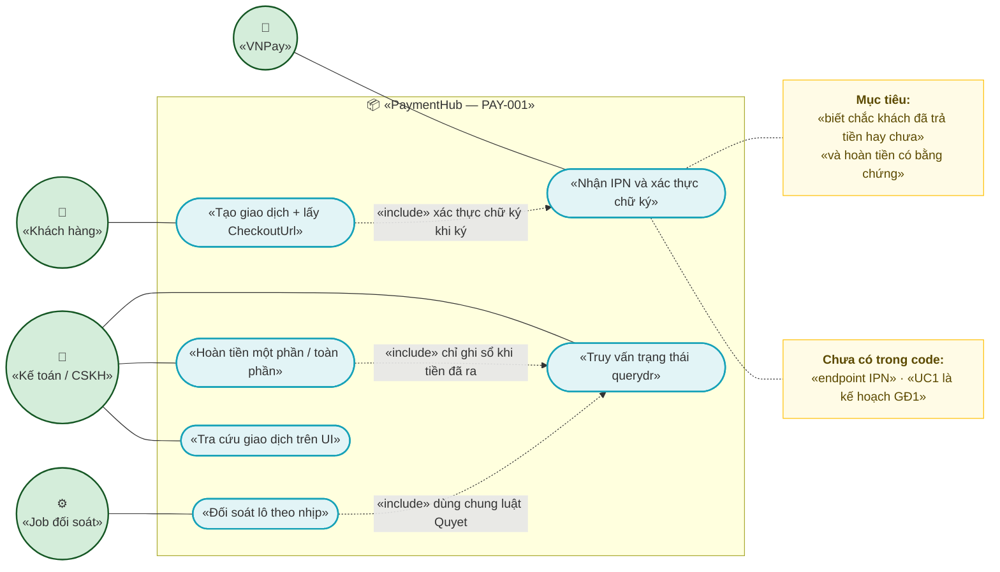
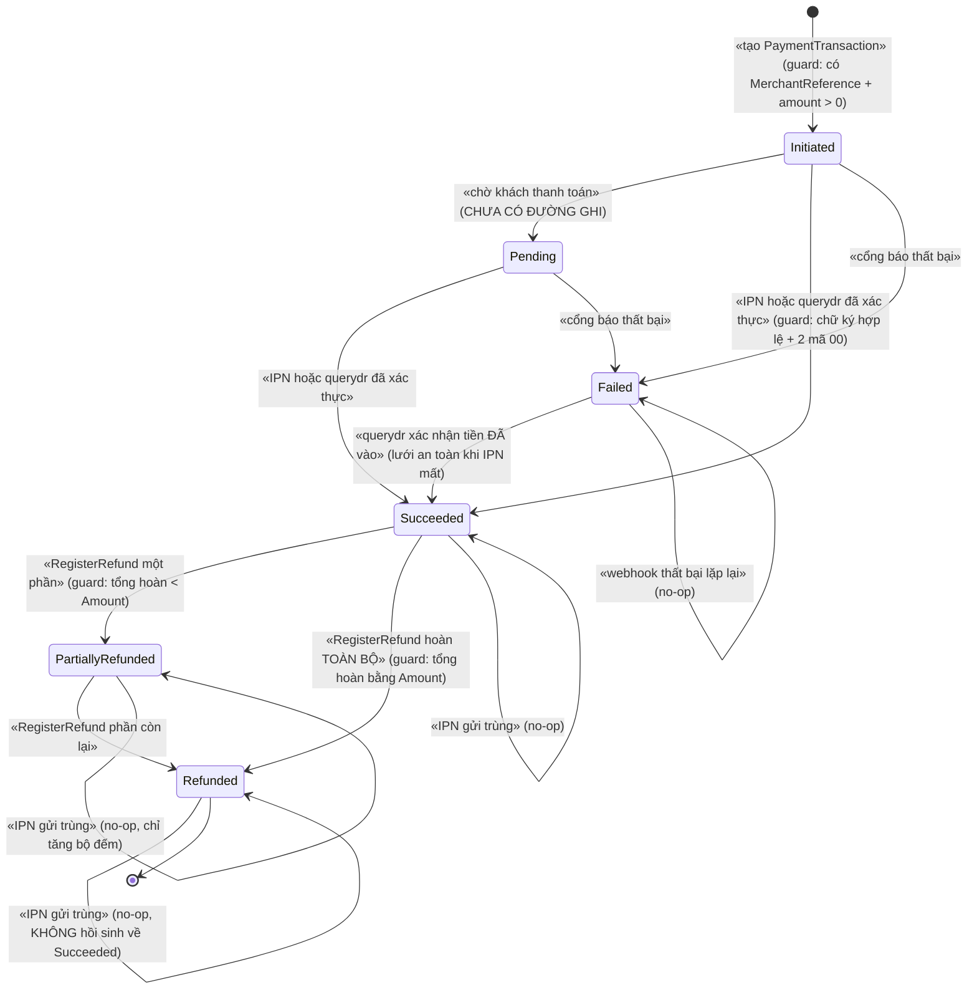
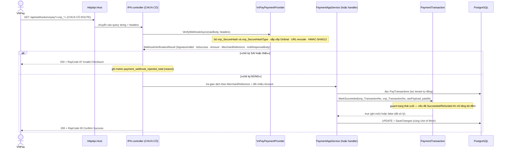
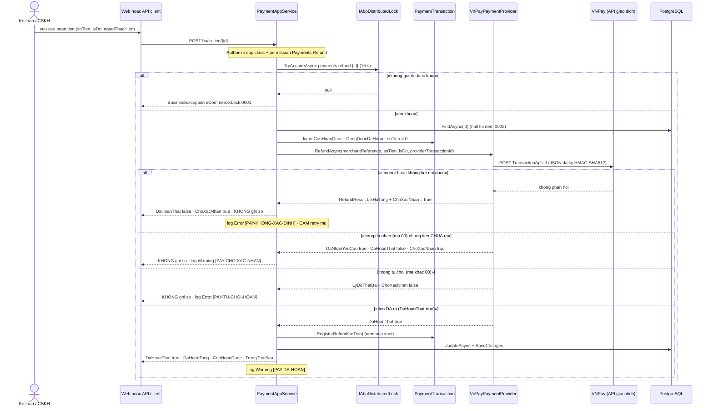
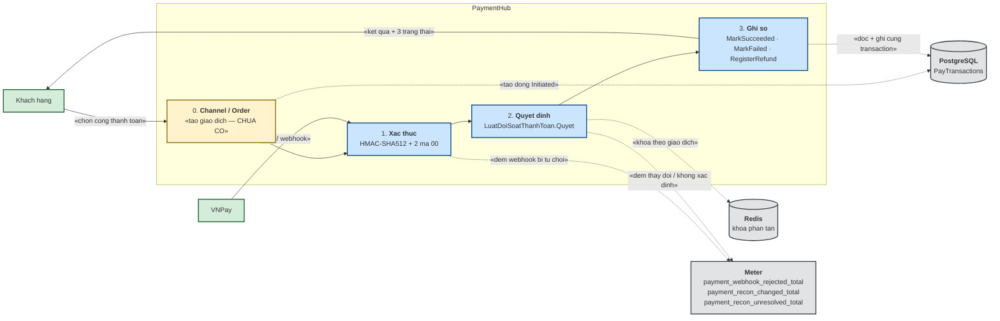
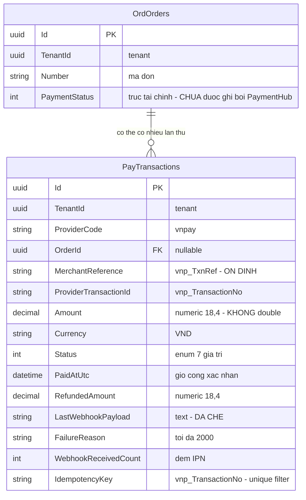

# `PAY-001` — Cổng thanh toán VNPay: tạo giao dịch, IPN/webhook, hoàn tiền & đối soát

> **Tài liệu này SỞ HỮU module `PaymentHub`.** Trước 17/10/2026, module này **đã có code thật** nhưng
> **không tài liệu nào nhận chủ quyền** — xem §0 để biết bằng chứng và hệ quả.

| Thuộc tính | Nội dung |
|---|---|
| **Mã** | `PAY-001` |
| **Module** | `PaymentHub` |
| **Giai đoạn** | **GĐ1** — *thanh toán là điều kiện "bán được"; code đã có từ trước* |
| **Ưu tiên** | `Must have` |
| **Trạng thái** | 🟡 `Draft` — chờ review |
| **Người viết / người review** | `agent (phiên 17/10/2026)` / `Kiến trúc trưởng + BA + Kế toán` |
| **Phiên bản / ngày** | `v0.1 — 17/10/2026` |
| **Tài liệu liên quan** | `SAL-002` · `SAL-003` (trục **tài chính**) · `SAL-006` (hoàn tiền) · `REC-001` (đối soát `querydr`) · `XC-001` · `XC-002` · `XC-003` · `XC-004` · `XC-005` · [`docs/implementation-plan.md`](../../implementation-plan.md) · [`docs/structure-and-techstack.md`](../../structure-and-techstack.md) |

---

## 0. Tóm tắt & quyết định thiết kế

**Tóm tắt 3–5 câu.** `PAY-001` là tài liệu thiết kế **sở hữu module `PaymentHub`**: một giao dịch thanh toán
(`PaymentTransaction`, bảng thật `PayTransactions`) được tạo cho một đơn, khách được chuyển sang cổng **VNPay**,
cổng gọi lại **IPN** (đã xác thực chữ ký HMAC-SHA512) để chuyển giao dịch sang `Succeeded`, tiền được **hoàn**
qua `vnp_Command=refund` (chỉ ghi sổ khi tiền **đã ra**), và trạng thái được **đối soát chủ động** bằng
`vnp_Command=querydr` (job 15 phút + thao tác tay). Giá trị mang lại: biến câu *"khách đã trả tiền chưa?"* từ
**suy đoán** thành **sự kiện có bằng chứng ký số**, và biến *"hoàn tiền"* từ thao tác tay thành **đường ghi có
bất biến** — hai thứ mà nếu sai thì **mất tiền thật**, không phải sai báo cáo.

### Vì sao tài liệu này **phải** tồn tại (bối cảnh — có bằng chứng, không suy đoán)

| # | Bằng chứng đo được | Hệ quả |
|---|---|---|
| 1 | `docs/features/sales/sal-002-checkout-va-dat-hang.md:49` ghi trong *"Không nằm trong phạm vi"*: **`❌ Thanh toán / IPN — thuộc PaymentHub + REC-001`** | `SAL-002` **từ chối** sở hữu thanh toán |
| 2 | `REC-001` **chỉ** làm đối soát (`querydr`) — xem `docs/features/reconciliation/rec-001-doi-soat-thanh-toan-querydr.md:546-600` | `REC-001` **không** sở hữu *tạo giao dịch*, *IPN*, *hoàn tiền* |
| 3 | Phụ lục A của [`docs/implementation-plan.md`](../../implementation-plan.md) (danh sách **52** tài liệu ban đầu) **không có mã `PAY-*`** | **Không** tài liệu nào sở hữu module |
| 4 | `implementation-plan.md:426` đã ghi nhận lỗ hổng này ngày **17/10/2026** và trỏ đúng tệp bạn đang đọc | Đây là **nợ tài liệu đã được thừa nhận**, không phải phát minh của phiên này |
| 5 | Code thật đã tồn tại: `PaymentTransaction`, `IPaymentProvider`, `VnPayPaymentProvider`, `VnPayRequestBuilder`, `PaymentAppService`, `LuatDoiSoatThanhToan`, `MetricDoiSoatThanhToan` — **14 tệp `.cs`** (bảng dưới) | Code **trước** tài liệu ⇒ tài liệu này phải **mô tả đúng code đang có** và **ghi rõ phần còn thiếu**, không được viết như thể mọi thứ đã xong |
| 6 | 🚨 `docs/handover/BAN-GIAO-GD1-2026-10-17.md:74` — **nợ chặn #2**: `"TmnCode": ""`, `"HashSecret": ""` **rỗng** | **Đường tiền thật CHƯA được kiểm chứng** — chi tiết §7.7 |

### Hiện trạng code — **đã đọc hết, không viết theo trí nhớ**

| Tệp (đường dẫn thật) | Dòng | Nội dung chính |
|---|---|---|
| `modules/PaymentHub/eCommerce.PaymentHub.Domain/Entities/PaymentTransaction.cs` | 270 | Aggregate root · enum `PaymentTransactionStatus` (9–24) · `MarkSucceeded` (100–118) · `MarkFailed` (120–139) · `RegisterRefund` (166–206) · `ConHoanDuoc` (213) · `DungDuocDeHoan` (222–224) · `MaskSensitiveData` (242–266) |
| `modules/PaymentHub/eCommerce.PaymentHub.Domain/Payments/IPaymentProvider.cs` | 159 | `CreatePaymentRequest`/`Result` (3–27) · `WebhookVerificationResult` (30–52) · interface (58–108) · `RefundResult` (129–159) |
| `modules/PaymentHub/eCommerce.PaymentHub.Domain/Payments/PaymentErrorCodes.cs` | 43 | Dải `eCommerce:Payment:0002…0005` |
| `modules/PaymentHub/eCommerce.PaymentHub.Domain/Payments/LuatDoiSoatThanhToan.cs` | 109 | `DaKetThuc` (62–65) · `Quyet` (85–108) — **hàm THUẦN** |
| `modules/PaymentHub/eCommerce.PaymentHub.Domain/Payments/MetricDoiSoatThanhToan.cs` | 70 | `Ghi` (43–69) — metric dùng chung app service + job |
| `modules/PaymentHub/eCommerce.PaymentHub.Domain/PaymentHubDomainModule.cs` | 19 | `DependsOn(AbpDddDomainModule)` — **rỗng**, không đăng ký gì |
| `modules/PaymentHub/eCommerce.PaymentHub.EntityFrameworkCore/PaymentHubDbContextModelCreatingExtensions.cs` | 42 | `ToTable("PayTransactions")` (16) · 3 index (32, 35–37, 39) |
| `modules/PaymentHub/eCommerce.PaymentHub.EntityFrameworkCore/PaymentHubEntityFrameworkCoreModule.cs` | 13 | `DependsOn(PaymentHubDomainModule, AbpEntityFrameworkCoreModule)` |
| `modules/PaymentHub/eCommerce.PaymentHub.Application.Contracts/PaymentDtos.cs` | 194 | `PaymentTransactionDto` (7–35) · `HoanTienInput` (48–53) · `HoanTienKetQuaDto` (66–100) · `IPaymentAppService` (110–158) · `KetQuaDoiSoatThanhToanDto` (174–194) |
| `modules/PaymentHub/eCommerce.PaymentHub.Application.Contracts/PaymentHubApplicationContractsModule.cs` | 18 | `AbpDddApplicationContractsModule` |
| `modules/PaymentHub/eCommerce.PaymentHub.Application/PaymentAppService.cs` | 442 | `[Authorize]` cấp class (33) · `GetTheoMaAsync` (61–72) · `GetDanhSachAsync` (74–98) · `HoanTienAsync` (102–249) · `PostTruyVanTrangThaiAsync` (255–324) · `PostDoiSoatLoatAsync` (327–418) · `ChuyenDto` (422–441) |
| `modules/PaymentHub/eCommerce.PaymentHub.Application/Providers/VnPayPaymentProvider.cs` | 408 | `VnPayOptions` (10–28) · `CreatePaymentAsync` (94–126) · `VerifyWebhookAsync` (131–197) · `RefundAsync` (214–256) · `QueryStatusAsync` (275–300) · `GoiApiGiaoDichAsync` (308–369) |
| `modules/PaymentHub/eCommerce.PaymentHub.Application/Providers/VnPayRequestBuilder.cs` | 398 | Lõi **THUẦN**: `DungChuoiKy` (38–39) · `Ky` (42–48) · `ThamSoHoanTien` (68–102) · `ThamSoTruyVan` (109–128) · `TinhSoTien` (135–136) · `DocPhanHoi` (152–228) · `KiemChuKy` (234–268) · `DocJsonPhang` (276–328) |
| `modules/PaymentHub/eCommerce.PaymentHub.Application/PaymentHubApplicationModule.cs` | 42 | Đăng ký `IPaymentProvider` → `VnPayPaymentProvider` (32–34); **KHÔNG** đăng ký `HttpClient` (chủ ý — §7.3) |

**Phạm vi (CÓ làm):**

- Sở hữu và mô tả **đúng** module `PaymentHub`: entity, enum trạng thái, 3 index thật, app service, provider VNPay.
- Định nghĩa **state machine** của `PaymentTransaction` + **ai được chuyển** + **guard sai thì làm gì** (§3).
- Định nghĩa **IPN/webhook**: xác thực `HMAC-SHA512`, `AckResponseBody`, chống trùng, sai thứ tự (§7).
- Định nghĩa **hoàn tiền** (một phần / toàn phần) và bất biến *tổng hoàn ≤ đã thu* (§8).
- Định nghĩa **đối soát** ở góc nhìn thanh toán (biên giới với `REC-001`: `REC-001` sở hữu *kỳ đối soát + lệch*,
  `PAY-001` sở hữu *hàm luật + đường ghi trạng thái*).
- Ghi rõ **mọi phần chưa có trong code** kèm kế hoạch, để không ai đọc tài liệu rồi tưởng đã xong.

**Không nằm trong phạm vi:**

- ❌ **Kỳ đối soát, bản ghi lệch (`ReconRuns`, `ReconRunMismatches`), quy trình xử lý lệch** — thuộc **`REC-001`**.
- ❌ **Tính tiền giỏ/đơn, giữ chỗ tồn kho, tạo đơn** — thuộc `PRC-002` / `SAL-002` / `SAL-001` / `INV-002`.
- ❌ **Phiếu RMA (trả hàng)** — thuộc **`SAL-006`**; `PAY-001` chỉ sở hữu **phần tiền** mà `SAL-006` gọi vào.
- ❌ **Cổng khác VNPay** (MoMo, payOS, SePay, Casso, ZaloPay) — `IPaymentProvider` đã được thiết kế để mở rộng
  (`PaymentHubApplicationModule.cs:36-40` có `TODO(thêm cổng)`), nhưng **chưa có code**; mỗi cổng mới cần một
  tài liệu riêng (`PAY-002`… chưa có mã).
- ❌ **Ví điện tử / trả sau / COD** — COD thuộc `SHP-003`.
- ❌ **Outbox/inbox & relay sự kiện** — `XC-002` (hiện **chưa** có trong code, §7.1).
- ❌ **Hạ tầng OTel → Prometheus** — metric **phát ra** nhưng **chưa có nơi thu** (`handover:243`).

### 0.1 Quyết định thiết kế (ADR ngắn)

| # | Quyết định | Phương án đã cân nhắc | Lý do chọn | Hệ quả |
|---|---|---|---|---|
| **D1** | **Tự viết abstraction `IPaymentProvider`**, không dùng `Volo.Payment` | (a) `Volo.Payment` (module PRO của ABP) · (b) tự viết interface + adapter | `Volo.Payment` cần **license ABP Team+**, chỉ có Stripe/PayPal/2Checkout/PayU/Iyzico/Alipay — **không có cổng Việt Nam**, và mô hình redirect/`StartAsync` **không khớp** SePay/Casso (webhook-first) — `PaymentHubDomainModule.cs:9-14` | Phải **tự** cài mọi thứ đặc thù VNPay (ký, mã lỗi, hoàn tiền bất đồng bộ); bù lại không phụ thuộc license |
| **D2** | **`ReturnUrl` KHÔNG phải bằng chứng thanh toán** | (a) coi redirect `vnp_ResponseCode=00` là đã trả · (b) **chỉ** IPN đã xác thực chữ ký | Người dùng **quay lại được** URL đó và **tự tạo được** URL đó — `PaymentTransaction.cs:26-33` | Cần **đường thứ hai** để xác nhận (IPN + `querydr`); nếu IPN mất thì **phải** có `querydr` |
| **D3** | Trạng thái `Succeeded` **chỉ** do IPN đã xác thực **hoặc** `querydr` đã xác thực | (a) cho app service nội bộ set tay · (b) chỉ 2 nguồn trên | Tách *"hệ thống nghĩ khách đã trả"* khỏi *"cổng nói đã thu"*; cũng khớp `SAL-003` **BR-013** (*trục tài chính chỉ `PaymentHub`/IPN ghi*, `sal-003-state-machine-4-truc.md:537`) | Không có đường "sửa tay cho xong" — đúng ý đồ, nhưng ca vận hành cần sửa tay **phải** đi qua `querydr` |
| **D4** | 🚨 **`RefundAsync` trả `RefundResult`, KHÔNG trả `bool`** | (a) `Task<bool>` · (b) 3 trạng thái tách biệt | Hoàn tiền VN **bất đồng bộ**: cổng **nhận** (`00`) rồi xử lý sau. `bool true` ⇒ người vận hành đọc *"đã hoàn xong"* ⇒ **sổ sách nói dối** — `IPaymentProvider.cs:110-159` | Người gọi **bắt buộc** phân biệt `DaNhanYeuCau` / `DaHoanThat` / `ChoXacNhan`; UI phải hiển thị 3 trạng thái |
| **D5** | 🚨 **Chỉ ghi sổ khi `DaHoanThat = true`** | (a) ghi theo `DaNhanYeuCau` · (b) chỉ ghi khi tiền **đã ra** | `PaymentAppService.cs:176-202` — nếu ghi theo (a): khách **chưa** nhận tiền mà hệ thống đã ghi `Refunded` ⇒ không ai theo dõi bước xác nhận | Yêu cầu hoàn tiền **không** làm đổi `RefundedAmount`; phải có `querydr` xác nhận ⇒ **nợ**: hiện **chưa** có job xác nhận riêng cho `ChoXacNhan` (§15) |
| **D6** | **Luật đối soát đặt ở tầng Domain, dạng hàm THUẦN** (`LuatDoiSoatThanhToan.Quyet`) | (a) để trong app service · (b) chép sang worker · (c) hàm thuần ở Domain | `PaymentAppService` có `[Authorize]` **cấp class** ⇒ interceptor ABP kiểm quyền **cả khi gọi trong tiến trình**, worker **không có principal** ⇒ `AbpAuthorizationException` (lỗi **đã xảy ra thật** ở `SAL-005`) — `LuatDoiSoatThanhToan.cs:7-29` | Luật có **một** định nghĩa, **hai** chỗ gọi (app service + worker) — `PaymentAppService.cs:263-270`, `PaymentReconciliationWorker.cs:171-177` |
| **D7** | **`MarkSucceeded` / `MarkFailed` idempotent, trạng thái CUỐI không bị ghi đè** | (a) cho ghi đè (lần cuối thắng) · (b) trạng thái cuối là **hấp thụ** | IPN là **at-least-once**; `Refunded` cũng là trạng thái cuối ⇒ webhook gửi lại sau khi hoàn tiền **không** được "hồi sinh" về `Succeeded` — `PaymentTransaction.cs:88-99` (sửa **16/10/2026**, `SAL-006`) | `MarkSucceeded` trả `false`, `MarkFailed` **return im lặng** ⇒ §3 ghi rõ đây là **ngoại lệ có chủ ý** của quy tắc #11 và **nợ** cần chỗ gọi đọc kết quả |
| **D8** | **`IdempotencyKey` = mã giao dịch **do cổng cấp** (`vnp_TransactionNo`)** + unique index có filter | (a) khoá do ta sinh · (b) mã cổng cấp | `vnp_TransactionNo` là thứ **duy nhất** định danh một lần thu tiền ở phía cổng — `PaymentTransaction.cs:73-77`, index `PaymentHubDbContextModelCreatingExtensions.cs:35-37` | Trước khi có IPN, `IdempotencyKey` là `NULL` ⇒ index **không** bảo vệ gì (đúng theo filter); chống trùng giai đoạn này dựa vào `MerchantReference` |
| **D9** | **`MerchantReference` (`vnp_TxnRef`) phải ỔN ĐỊNH** qua mọi lần retry | (a) sinh `Guid.NewGuid()` mỗi lần · (b) sinh **một lần** từ mã đơn, lưu DB | `XC-002` **BR-007**; VNPay yêu cầu `vnp_TxnRef` **không trùng trong ngày** (`VnPayPaymentProvider.cs:42`) ⇒ sinh mới mỗi lần **vừa** vi phạm idempotency **vừa** có nguy cơ trùng | Entity **bắt buộc** truyền `merchantReference` ở constructor (`PaymentTransaction.cs:81-86`); **chưa có** hàm sinh mã (§7.5 — nợ) |
| **D10** | **Khoá phân tán theo giao dịch** trước khi gọi cổng hoàn tiền | (a) chỉ dựa vào bất biến entity · (b) khoá + bất biến | Bất biến chỉ chặn ở tầng **ghi sổ**; khoá chặn ở tầng **gọi cổng** — side effect **không rollback được** (`PaymentAppService.cs:120-128`) | Hai request đồng thời ⇒ request 2 nhận lỗi `eCommerce:Lock:0001` (không phải 500) |
| **D11** | **Che dữ liệu nhạy cảm trước khi lưu payload thô** | (a) lưu nguyên văn · (b) che 2 lớp rồi cắt 8000 ký tự | Payload cổng có thể chứa số thẻ/token/OTP; rất dễ bị ghi tiếp ra log — `PaymentTransaction.cs:227-266`, `XC-005` **BR-005** | Che là **giảm thiểu**, không phải bảo đảm; **cấm** coi payload đã lưu là "an toàn để in log" |
| **D12** | **Không đăng ký `HttpClient` trong module nghiệp vụ** — đăng ký **typed client ở Host** | (a) `AddHttpClient` trong `PaymentHub.Application` · (b) ở Host | `Microsoft.Extensions.Http` **không** có trong `Volo.Abp.Ddd.Application`; thêm vào module là kéo hạ tầng web xuống tầng application (`XC-002` D12 cấm) — `PaymentHubApplicationModule.cs:23-31`, `eCommerceHttpApiHostModule.cs:171-192` | Host **quên** đăng ký ⇒ provider trả **lỗi cấu hình có mã** (`RefundAsync` dòng 238–245) thay vì `NullReferenceException` bị hiểu nhầm thành *"hoàn tiền thất bại"* |
| **D13** | **Tiền là `decimal` + `HasPrecision(18,4)`; VNPay nhân 100 làm tròn `AwayFromZero`** | (a) `double` · (b) `decimal` | `XC-001` **BR-003**; làm tròn ngân hàng (`.5 → chẵn`) cho **1 đồng khác** ⇒ cổng báo *"số tiền không khớp"* — `VnPayRequestBuilder.cs:130-136`, `PaymentHubDbContextModelCreatingExtensions.cs:27-28` | Cấm so tiền bằng `==`; so bằng `>`/`>=` hoặc `decimal.Compare` |
| **D14** | **Hai index unique trên `PayTransactions` viết lại bằng SQL thô có `NULLS NOT DISTINCT`** | (a) để EF sinh `unique: true` · (b) SQL thô | PostgreSQL mặc định **NULLS DISTINCT** ⇒ khi `TenantId IS NULL` index **không chặn trùng** (đã chứng minh bằng `INSERT 0 2`) — `20261013024226_Fix_NullableTenantId_UniqueIndexes.cs:7-33` | EF **không** mô hình hoá thuộc tính này ⇒ mọi migration sau tạo lại index **phải** chạy lại SQL này; test `PostgreSqlSchemaTests` khoá con số **48** |

> 📌 **Ghi lại cả phương án BỊ LOẠI** (D1, D4, D7, D8) — để 6 tháng sau không ai hỏi lại *"sao không dùng `Volo.Payment`"*
> hay *"sao không trả `bool` cho gọn"*. Cả hai câu đó đều đã được cân nhắc và **có lý do viết trong code**.

---

## 1. Use Case Specification

| Thuộc tính | Nội dung |
|---|---|
| **Use Case ID** | `PAY-001` |
| **Use Case Name** | Vòng đời một giao dịch thanh toán VNPay (tạo → IPN → hoàn tiền → đối soát) |
| **Description** | *"Là **khách mua hàng**, tôi muốn trả tiền qua VNPay để đơn được xử lý; là **kế toán/CSKH**, tôi muốn hoàn tiền và **chứng minh được** tiền đã ra; là **hệ thống**, tôi muốn biết chắc khách đã trả hay chưa kể cả khi IPN mất."* |
| **Actor(s)** | **Khách hàng** (redirect sang cổng) · **VNPay** (IPN + API giao dịch) · **Kế toán/CSKH** (hoàn tiền, truy vấn) · **Job `PaymentReconciliationWorker`** (đối soát định kỳ) · **Hệ thống bán hàng** (`SAL-001`/`SAL-002` tạo giao dịch — **chưa có trong code**) |
| **Priority** | `Must` |
| **Trigger** | (a) đơn được xác nhận cần thanh toán trước ⇒ tạo giao dịch + redirect; (b) VNPay gọi `IpnUrl`; (c) kế toán bấm **Hoàn tiền** / **Truy vấn trạng thái**; (d) nhịp job **15 phút** (`PaymentReconciliationWorker.cs:49,76-80`) |
| **Pre-Condition(s)** | • **Tenant hiện tại** (`PaymentTransaction.TenantId` từ `IMultiTenant`, `PaymentTransaction.cs:34-36`) — dữ liệu tenant A **không** được thấy từ tenant B.<br>• **Kênh bán** (`ChannelCode`) **gián tiếp**: giao dịch gắn `OrderId` (`PaymentTransaction.cs:41-42`), đơn mang `ChannelCode`.<br>• Đã có **`MerchantReference`** ổn định (`PaymentTransaction.cs:44-48`) — **chưa có** hàm sinh (§7.5).<br>• Có credential cổng: `PaymentHub:VnPay:TmnCode` + `HashSecret` (`appsettings.json:21-27`) — 🚨 **hiện rỗng** ⇒ đường tiền thật **chưa kiểm chứng**.<br>• Với hoàn tiền: giao dịch **đã thu tiền** (`Status ∈ {Succeeded, PartiallyRefunded, Refunded}`, `PaymentTransaction.cs:222-224`).<br>• Với IPN: `IpnUrl` **HTTPS** (`VnPayPaymentProvider.cs:43`) — **chưa có endpoint** nhận (§7.2 nợ #2). |
| **Post-Condition(s)** | • Giao dịch có **đúng một** trạng thái cuối; `RefundedAmount` **không âm** và **không vượt** `Amount`.<br>• IPN **luôn** được trả `AckResponseBody` (`VnPayPaymentProvider.cs:191-194`) để cổng ngừng retry.<br>• Mọi thay đổi trạng thái để lại **dấu vết**: `WebhookReceivedCount`, `LastWebhookPayload` (đã che), log có neo `[PAY-…]`.<br>• Số tiền **đã hoàn** đọc được từ `RefundedAmount` + `ConHoanDuoc`. |
| **Basic Flow** | 1. `SAL-002`/`SAL-001` tạo `PaymentTransaction(Id, "vnpay", merchantReference, amount)` — trạng thái `Initiated` (`PaymentTransaction.cs:81-86`).<br>2. App service gọi `IPaymentProvider.CreatePaymentAsync` ⇒ dựng tham số `vnp_*` đã sắp xếp, ký `HMAC-SHA512`, trả `CheckoutUrl` (`VnPayPaymentProvider.cs:94-126`).<br>3. Khách thanh toán ở cổng; VNPay gọi **IPN** ⇒ `VerifyWebhookAsync` kiểm chữ ký + 2 mã `00` (`VnPayPaymentProvider.cs:131-197`).<br>4. Hệ thống gọi `PaymentTransaction.MarkSucceeded(...)` ⇒ `Succeeded`, ghi `PaidAtUtc`, `ProviderTransactionId`, `IdempotencyKey` (`PaymentTransaction.cs:100-118`).<br>5. Khi cần trả hàng: `SAL-006` gọi `HoanTienAsync` ⇒ khoá → kiểm → gọi cổng `refund` → **chỉ ghi sổ nếu `DaHoanThat`** (`PaymentAppService.cs:102-249`).<br>6. Định kỳ: job/`querydr` xác nhận lại các giao dịch **chưa ở trạng thái cuối** (`PaymentReconciliationWorker.cs:122-240`). |
| **Alternative Flow** | **A1: Cổng đã nhận yêu cầu hoàn tiền nhưng chưa xác nhận tiền ra** — trả `ChoXacNhan = true`, **KHÔNG** tăng `RefundedAmount`, log `Warning` `[PAY-CHO-XAC-NHAN]` (`PaymentAppService.cs:203-213`).<br>**A2: IPN gửi trùng** — `MarkSucceeded` trả `false`, chỉ `WebhookReceivedCount++`, trạng thái **giữ nguyên** (`PaymentTransaction.cs:102-110`).<br>**A3: Cổng nói "chưa biết"** (`Pending`/`Initiated` từ `querydr`) — `KhongDoi`, **không hạ trạng thái**, ghi nhận *"KHÔNG KIỂM ĐƯỢC"* (`LuatDoiSoatThanhToan.cs:105-107`).<br>**A4: Giao dịch đã ở trạng thái cuối** — `DaKetThuc` ⇒ `KhongDoi`, **không** gọi ghi (`LuatDoiSoatThanhToan.cs:62-65,87-91`).<br>**A5: Hoàn tiền một phần** — `RefundedAmount < Amount` ⇒ `PartiallyRefunded` (`PaymentTransaction.cs:203-205`). |
| **Exception Flow** | **E1: Chữ ký IPN sai/thiếu** ⇒ `SignatureValid = false`, **không** đổi trạng thái, trả `{"RspCode":"97"}` + metric `payment_webhook_rejected_total` (`VnPayPaymentProvider.cs:141-169,192-194`).<br>**E2: Hoàn vượt số đã thu** ⇒ `BusinessException` `eCommerce:Payment:0002` (`PaymentTransaction.cs:189-199`).<br>**E3: Hoàn cho giao dịch chưa thu tiền** ⇒ `eCommerce:Payment:0003` (`PaymentTransaction.cs:175-185`).<br>**E4: Số tiền hoàn ≤ 0 hoặc thiếu lý do/người thực hiện** ⇒ `eCommerce:Payment:0004` (`PaymentTransaction.cs:168-173`, `PaymentAppService.cs:108-118`).<br>**E5: Không tìm thấy giao dịch** ⇒ `eCommerce:Payment:0005` (`PaymentAppService.cs:130-132`).<br>**E6: Không giành được khoá phân tán** ⇒ `eCommerce:Lock:0001` (`PaymentAppService.cs:125-128`).<br>**E7: Lỗi hạ tầng/timeout khi gọi cổng** ⇒ `LoiHaTang` khác rỗng + `ChoXacNhan = true`, **cấm retry mù** (`VnPayPaymentProvider.cs:341-368`, `PaymentAppService.cs:223-233`). |
| **Business Rules** | • **BR-PAY-001**: Chỉ IPN **hoặc** `querydr` **đã xác thực chữ ký** được chuyển giao dịch sang `Succeeded`; không có đường khác.<br>• **BR-PAY-002**: `MerchantReference` **ổn định** — sinh **một lần**, lưu DB; **cấm** sinh mới mỗi lần gọi.<br>• **BR-PAY-003**: Cùng một giao dịch của cổng **không** được ghi nhận hai lần (idempotent theo `IdempotencyKey` + `WebhookReceivedCount`).<br>• **BR-PAY-004**: Trạng thái **cuối** (`Succeeded`/`PartiallyRefunded`/`Refunded`) **không** bị ghi đè bởi bất kỳ webhook nào.<br>• **BR-PAY-005**: Chỉ hoàn được giao dịch **đã thu tiền** (`DungDuocDeHoan`).<br>• **BR-PAY-006**: `amount > 0` cho mọi lần hoàn.<br>• **BR-PAY-007**: `RefundedAmount + amount ≤ Amount`; vi phạm ⇒ **NÉM** (không kẹp, không làm tròn cho vừa).<br>• **BR-PAY-008**: Chỉ gọi `RegisterRefund` khi `RefundResult.DaHoanThat = true`.<br>• **BR-PAY-009**: Lỗi hạ tầng ⇒ `ChoXacNhan = true`; **cấm** retry không kiểm tra.<br>• **BR-PAY-010**: Hoàn tiền **bắt buộc** có `LyDo` và `NguoiThucHien`.<br>• **BR-PAY-011**: Mọi lần gọi cổng hoàn tiền nằm trong khoá `payments:refund:{paymentTransactionId}`.<br>• **BR-PAY-012**: Chữ ký HMAC-SHA512 trên chuỗi **sắp xếp `Ordinal`** + URL-encode, **bỏ** `vnp_SecureHash*`.<br>• **BR-PAY-013**: Chỉ 2 ca **thiếu chữ ký** / **chữ ký sai** mới tính là "từ chối" (metric); chữ ký đúng mà giao dịch thất bại **không** tính.<br>• **BR-PAY-014**: Đối soát **chỉ tiến, không lùi**; thứ tự 4 nhánh của `Quyet` là bắt buộc.<br>• **BR-PAY-015**: *"Không kiểm được"* **khác** *"không thành công"* — tách `SoKhongXacDinh` khỏi `SoDoiTrangThai`.<br>• **BR-PAY-016**: Mọi `PaymentAppService` có `[Authorize]` **cấp class**; hoàn tiền cần thêm permission `eCommerce.Payments.Refund`.<br>• **BR-PAY-017**: Dữ liệu **cách ly theo tenant**; mọi unique index trên `IMultiTenant` có `NULLS NOT DISTINCT`.<br>• **BR-PAY-018**: Payload thô lưu DB **phải** được che dữ liệu nhạy cảm và cắt ≤ 8000 ký tự.<br>• **BR-PAY-019**: **Cấm** so tiền bằng `==`; tiền là `decimal`.<br>• **BR-PAY-020**: Ba ca hoàn tiền lỗi phải có **ba mã riêng** (không gộp).<br>• **BR-PAY-021**: Background worker **không** được gọi app service có `[Authorize]` — dùng repository + hàm luật thuần. |
| **Non-Functional Requirement** | • **NFR-PAY-001**: `GET danh-sach` p95 **< 300 ms** với **10 000** giao dịch/tenant.<br>• **NFR-PAY-002**: **100 %** endpoint trả `401` khi không token và `403` khi thiếu permission.<br>• **NFR-PAY-003**: **100 %** lần đổi trạng thái có ≥ 1 dòng log **có cấu trúc** mang neo `[PAY-…]`.<br>• **NFR-PAY-004**: Mọi log trong phạm vi request/job mang `CorrelationId`.<br>• **NFR-PAY-005**: Dữ liệu tenant A **không** đọc/ghi được từ tenant B (test 2 tenant).<br>• **NFR-PAY-006**: IPN trả phản hồi **< 1 000 ms** p95 (đo trên Host) — ngưỡng chính thức của VNPay **chưa kiểm chứng**.<br>• **NFR-PAY-007**: **0** payload lưu DB chứa số thẻ đầy đủ (PAN 12–19 chữ số).<br>• **NFR-PAY-008**: Job đối soát nhịp **900 s**, trần **50** giao dịch/lượt.<br>• **NFR-PAY-009**: Job **không** log `Information` mỗi vòng (`XC-005` **BR-004**).<br>• **NFR-PAY-010**: Metric chỉ dùng nhãn **hữu hạn** (`provider`, `reason`, `result`); **< 100** series.<br>• **NFR-PAY-011**: Số tiền chính xác tới **4** chữ số thập phân (`numeric(18,4)`), VNPay nhận **×100** số nguyên.<br>• **NFR-PAY-012**: IPN mất ⇒ phát hiện trong **≤ 15 phút** (nhịp job) **hoặc** khi người vận hành bấm truy vấn. |

> ⚠️ **Nhắc lại yêu cầu của mẫu:** *mỗi BR/NFR phải kiểm chứng được* ⇒ tất cả 21 BR + 12 NFR ở trên đều có
> test tương ứng ở §14.1. Nếu một điều không viết được test thì nó **chưa phải** BR (mẫu §1 ghi chú).

---

## 2. Sơ đồ Use Case



### Chú giải

| Ký hiệu | Ý nghĩa |
|---|---|
| ⭕ Xanh lá | Actor (người hoặc hệ thống ngoài) |
| 🟦 Bầu dục xanh dương | Use Case |
| 🟨 Khung vàng | Note |
| `───` | Liên kết Actor ↔ Use Case |
| `-.«include».->` | Quan hệ bao hàm |

> 📌 **Đọc sơ đồ cho đúng:** `UC1` (tạo giao dịch) **chưa có trong code** — `CreatePaymentAsync` tồn tại và đã
> được kiểm ở **lõi thuần** (`test/eCommerce.Tests/PaymentHub/VnPayWebhookTests.cs:125`), nhưng **không có chỗ
> nào gọi nó** trong `src/` (grep `CreatePaymentAsync` chỉ ra provider + test). Tương tự `UC2`: **không có
> endpoint IPN** (§7.2). `UC3`, `UC4`, `UC5`, `UC6` **đã có code thật** và đã được đo bằng HTTP (§0, §6.2).

---

## 3. Sơ đồ trạng thái (state machine) — **BẮT BUỘC nếu feature có vòng đời**

> ⚠️ **Ba trạng thái trong đề bài KHÔNG có trong code — ghi rõ để không ai code theo tài liệu sai:**
> `Processing` **không tồn tại**; `Expired` **không tồn tại**. Enum thật có **đúng 7** giá trị
> (`PaymentTransaction.cs:9-24`): `Initiated = 0` · `Pending = 1` · `Succeeded = 2` · `Failed = 3` ·
> `Cancelled = 4` · `Refunded = 5` · `PartiallyRefunded = 6`. Mọi sơ đồ/bảng dưới đây vẽ theo **enum thật**.



### 3.1 Bảng chuyển trạng thái & guard

| # | Từ → Sang | Ai được chuyển | Guard (điều kiện cho phép) | Hành động kèm theo | Nếu guard sai thì? | Có code chưa? |
|---|---|---|---|---|---|---|
| 1 | *(không có)* → `Initiated` | Hệ thống bán hàng (`SAL-002`/`SAL-001`) | Constructor có `merchantReference` khác rỗng + `amount` | `Status` khởi tạo `Initiated` (`PaymentTransaction.cs:58,81-86`) | Constructor **không** kiểm ⇒ **nợ**: `amount ≤ 0` hoặc mã rỗng **lọt** (xem §12) | Entity **có**, **chỗ gọi chưa có** |
| 2 | `Initiated` → `Pending` | Hệ thống (sau khi đã redirect khách) | Đã có `CheckoutUrl` | — | **Không có method nào** ⇒ trạng thái `Pending` **không ghi được vào DB** | ❌ **chưa có trong code — kế hoạch GĐ1** |
| 3 | `Initiated`/`Pending` → `Succeeded` | **CHỈ** IPN đã xác thực **hoặc** `querydr` đã xác thực | Chữ ký hợp lệ **VÀ** `vnp_ResponseCode = 00` **VÀ** `vnp_TransactionStatus = 00` (`VnPayPaymentProvider.cs:181-189`) | `PaidAtUtc`, `ProviderTransactionId`, `IdempotencyKey`, `FailureReason = null` (`PaymentTransaction.cs:112-116`) | IPN sai chữ ký ⇒ **không đổi trạng thái**, trả `RspCode 97` (E1 §1) | ✅ `MarkSucceeded` có; **chỗ gọi IPN chưa có** |
| 4 | `Initiated`/`Pending` → `Failed` | IPN báo thất bại **hoặc** `querydr`/job kết luận không thành công | Cổng trả mã khác `00` (`QueryStatusAsync` ánh xạ `01/02/04/07` → `Failed`, `VnPayPaymentProvider.cs:293-299`) | `FailureReason` (cắt 2000 ký tự) (`PaymentTransaction.cs:137-138`) | Giao dịch **đã có tiền** ⇒ `MarkFailed` **return im lặng**, **không** ghi đè (§3.2) | ✅ có |
| 5 | `Failed` → `Succeeded` | `querydr` (app service **hoặc** job) | `Quyet` nhánh ②: cổng nói `Succeeded` (`LuatDoiSoatThanhToan.cs:93-97`) | Ghi `Succeeded` + log `Warning` `[PAY-QUERYDR-THU-DUOC]` / `[PAY-JOB-THU-DUOC]` | `DaKetThuc(Failed) = false` ⇒ `Failed` **vẫn được** đối soát lại (cố ý) | ✅ có |
| 6 | `Failed` → `Failed` | `querydr` | `Quyet` nhánh ③ (`LuatDoiSoatThanhToan.cs:99-103`) | `FailureReason` mới (nguồn `querydr`) | — | ✅ có |
| 7 | `Initiated`/`Pending` → `Cancelled` | — | **Không có đường nào** | — | ⚠️ `QueryStatusAsync` **trả** `Cancelled` khi mã `24` (`VnPayPaymentProvider.cs:296`) **nhưng** `MarkFailed` ghi `Failed` | 🟠 **`Cancelled` là trạng thái CHẾT trong code** — xem §3.4 |
| 8 | `Succeeded` → `PartiallyRefunded` | Kế toán/CSKH (**permission** `eCommerce.Payments.Refund`) | `0 < amount` **VÀ** `RefundedAmount + amount < Amount` **VÀ** `Status` đã thu tiền | `RefundedAmount` tăng; log `[PAY-DA-HOAN]` (`PaymentTransaction.cs:201-205`) | `amount ≤ 0` ⇒ **NÉM** `0004`; chưa thu tiền ⇒ **NÉM** `0003`; vượt ⇒ **NÉM** `0002` | ✅ có |
| 9 | `Succeeded` → `Refunded` | như #8 | `RefundedAmount + amount >= Amount` | như #8 | như #8 | ✅ có |
| 10 | `PartiallyRefunded` → `Refunded` | như #8 | `RefundedAmount + amount == Amount` theo **cùng đơn vị** | như #8 | như #8 | ✅ có |
| 11 | `Succeeded`/`PartiallyRefunded`/`Refunded` → *bất kỳ* | **KHÔNG AI** | **Hấp thụ (absorbing)** | — | `MarkSucceeded` trả `false`; `MarkFailed` return im lặng | ✅ có (nhưng **không ném** — §3.2) |
| 12 | `Refunded` → *bất kỳ* kể cả `Succeeded` | **KHÔNG AI** | Hấp thụ | — | Ghi đè **bị chặn** từ **16/10/2026** (`PaymentTransaction.cs:92-99`) | ✅ có |

> 🔒 **Trạng thái hấp thụ (absorbing):** `Succeeded` **chỉ** hấp thụ đối với **webhook** (vẫn đi ra được bằng
> `RegisterRefund`); `Refunded` và `PartiallyRefunded` **không** có đường ra. Sau `Refunded`, **mọi** chuyển dịch
> đều bị chặn — kể cả về `Succeeded`.

### 3.2 🚨 Ngoại lệ của quy tắc bất di bất dịch #11 — và vì sao nó **vẫn** là nợ

Quy tắc #11 (`docs/design-doc-guidelines.md:113-115`, `sal-003-state-machine-4-truc.md:285-287`): *guard sai **phải
NÉM LỖI** hoặc **log có cấu trúc**, không im lặng*. Code hiện tại **cố ý** đi theo hướng "log có cấu trúc" ở **một
nửa** và **im lặng** ở nửa còn lại:

| Hàm | Guard sai thì | Có phải lỗi? | Đánh giá |
|---|---|---|---|
| `MarkSucceeded` (`PaymentTransaction.cs:105-110`) | `return false` — **không** ném, **không** log | ❌ **không phải lỗi**: IPN là **at-least-once** ⇒ gửi trùng là **bình thường** | 🟡 **Chấp nhận được** vì có **giá trị trả về**; 🔒 nhưng **chỗ gọi BẮT BUỘC** đọc `false` để tăng metric/log. ⚠️ Hiện **chưa có chỗ gọi** ⇒ giá trị `false` **chưa ai đọc** ⇒ nếu sau này viết IPN controller mà bỏ qua giá trị này thì **vi phạm #11** |
| `MarkFailed` (`PaymentTransaction.cs:125-135`) | `return;` — **void**, hoàn toàn im lặng | ❌ không phải lỗi (cùng lý do) | 🔴 **Nợ thật**: không có giá trị trả về ⇒ chỗ gọi **không thể biết** đã ghi hay bị bỏ. 📌 Đề xuất: đổi thành `bool` như `MarkSucceeded` (breaking change nhỏ, 3 chỗ gọi trong `src/`) |
| `RegisterRefund` (`PaymentTransaction.cs:166-206`) | **NÉM** `BusinessException` có mã + `WithData` | ✅ **là lỗi thật** | ✅ **Đúng chuẩn #11** — đây là mẫu để các hàm khác theo |
| `LuatDoiSoatThanhToan.Quyet` | **Không** ném — hàm **thuần** trả quyết định | — | ✅ Đúng: quyết định *"không đổi"* **không phải** guard sai; chỗ gọi **phân biệt** hai ca bằng `DaKetThuc` (`PaymentAppService.cs:296-321`) |

> 📌 **Vì sao `MarkFailed` im lặng là NGUY HIỂM, không phải "cho gọn":** job đối soát **đếm** `soDoi++` sau khi
> gọi `MarkFailed` (`PaymentReconciliationWorker.cs:196-203`). Nếu giao dịch **đã** ở trạng thái cuối thì entity
> bỏ qua, **DB không đổi**, nhưng job **vẫn đếm là "đã đổi trạng thái"** ⇒ **báo cáo đối soát SAI**. Chính vì
> rủi ro này mà `LuatDoiSoatThanhToan.cs:50-60` đã ghi rõ: *hai hàm trạng thái phải **nhất quán** về "trạng thái
> nào là CUỐI"* — lệch nhau là mầm của sổ sách tự mâu thuẫn. Hiện **đã** nhất quán (`DaKetThuc` = 3 trạng thái =
> danh sách trong `MarkSucceeded`/`MarkFailed`), nhưng **cơ chế đếm** vẫn chưa đọc được kết quả ghi.

### 3.3 Ai được chuyển — tổng hợp một dòng cho mỗi actor

| Actor | Được chuyển sang | Không được | Căn cứ |
|---|---|---|---|
| **Người dùng cuối (khách)** | **KHÔNG GÌ** | mọi trạng thái | `ReturnUrl` không phải bằng chứng (D2) |
| **IPN/webhook VNPay** | `Succeeded`, `Failed` | `Refunded`/`PartiallyRefunded`, `Cancelled` | `MarkSucceeded`/`MarkFailed` là **mutator duy nhất** ngoài refund |
| **`querydr` (app service `PostTruyVanTrangThaiAsync`)** | `Succeeded`, `Failed` | hạ trạng thái | `LuatDoiSoatThanhToan.Quyet` |
| **Job `PaymentReconciliationWorker`** | `Succeeded`, `Failed` | hạ trạng thái; gọi app service | đọc repository trực tiếp (`PaymentReconciliationWorker.cs:124-125`) |
| **Kế toán/CSKH (`eCommerce.Payments.Refund`)** | `PartiallyRefunded`, `Refunded` | `Succeeded`, `Failed` | `RegisterRefund` sau khi cổng xác nhận |
| **Background job khác** | **KHÔNG GÌ** (cho tới khi có outbox) | — | `XC-002` chưa có trong code |

### 3.4 🚨 Ba phát hiện về state machine (đọc code, không suy đoán)

| # | Phát hiện | Bằng chứng | Ảnh hưởng |
|---|---|---|---|
| **F1** | **`Pending` không có đường ghi vào DB.** `Status` mặc định là `Initiated`; **không** có method `MarkPending`/`SetPending`; `PaymentAppService` không ghi `Pending` | `PaymentTransaction.cs:58` (khởi tạo), grep `Pending` trong `modules/PaymentHub` chỉ thấy **đọc** (so sánh, ánh xạ) | Job đối soát **vẫn** quét `Initiated` nên không mất giao dịch — nhưng UI *"đang chờ khách thanh toán"* **không phân biệt được** với *"mới tạo, chưa redirect"* |
| **F2** | **`Cancelled` là trạng thái CHẾT.** `QueryStatusAsync` trả `Cancelled` khi `vnp_ResponseCode = 24`; `PostTruyVanTrangThaiAsync` gọi `MarkFailed(...)` ⇒ DB ghi **`Failed`**, không bao giờ ghi `Cancelled` | `VnPayPaymentProvider.cs:296`; `PaymentAppService.cs:289-294`; `PaymentTransaction.cs:137` | *"Khách **cố ý** huỷ"* và *"giao dịch **lỗi**"* bị **gộp** trong DB ⇒ báo cáo *"tỉ lệ khách huỷ"* **không làm được**; `FailureReason` có phân biệt bằng **chuỗi** (không phải dữ liệu có cấu trúc) |
| **F3** | **`Initiated → Succeeded` không đi qua `Pending`** — nghĩa là mọi giao dịch thật sẽ nhảy thẳng từ `Initiated` sang `Succeeded` | sơ đồ §3, không có method `Pending` | Không sai nghiệp vụ, nhưng **thời gian chờ thanh toán** (thời gian khách ở trang cổng) **không đo được** từ dữ liệu |

> 🔑 **Cả 3 phát hiện đều thuộc loại "không có lỗi nào nổi lên"** — đúng họ lỗi mà dự án đang chống. Đề xuất
> xử lý ở §15.1 **Q4, Q5** (cần BA quyết: có cần phân biệt *khách huỷ* với *lỗi* không, và có cần đo thời gian chờ không).

### 3.5 Liên kết với **trục tài chính** của đơn (`SAL-003`)

`SAL-003` §3 định nghĩa **trục 2 (tài chính)** của đơn là `Order.PaymentStatus` và quy định **BR-013**: *trục tài
chính **chỉ** `PaymentHub`/IPN ghi* (`sal-003-state-machine-4-truc.md:537`).

⚠️ **Trước hết, sửa một chi tiết dễ sai:** enum **thật** trong code là
`PaymentStatus { Unpaid = 0, Pending = 1, Paid = 2, PartiallyRefunded = 3, Refunded = 4, Failed = 5 }`
(`src/eCommerce.Domain.Shared/Enums.cs:80-88`) — **không có** `PendingPayment`/`FailedPayment` (hai tên đó chỉ xuất
hiện trong **tài liệu** `SAL-003`). Đây đúng loại lệch *"tài liệu ≠ code"* mà tài liệu này phải chỉ ra.
Bảng ánh xạ **phải** là:

| `PaymentTransaction.Status` | `Order.PaymentStatus` (giá trị **THẬT** trong enum) | Ghi chú |
|---|---|---|
| `Initiated` | `Unpaid` (0) | chưa có tiền |
| `Pending` | `Pending` (1) | ⚠️ trạng thái này **chưa ghi được** (F1) |
| `Succeeded` | `Paid` (2) — guard: **số tiền khớp** + cùng `Currency` | `SAL-003` #12: lệch tiền ⇒ `0008` |
| `Failed`/`Cancelled` | `Failed` (5) | `Cancelled` bị gộp (F2) |
| `PartiallyRefunded` | `PartiallyRefunded` (3) | `SAL-003` #15 |
| `Refunded` | `Refunded` (4) — hấp thụ | `SAL-003` #16–#18 |

> 🚨 **Cầu nối này CHƯA CÓ TRONG CODE.** `Order.PaymentStatus` tồn tại, có setter công khai và **mặc định `Unpaid`**
> (`src/eCommerce.Domain/Entities/Orders/Order.cs:33`). Grep toàn repo: `PaymentStatus` chỉ xuất hiện ở (a) khai báo +
> enum, (b) **đọc để hiển thị** trong `CustomerAppService.cs:453,493,756` (DTO lịch sử đơn của khách), (c) migration.
> ⇒ **Không một dòng nào GÁN giá trị khác `Unpaid`**, trong `modules/PaymentHub` hay bất cứ đâu. Hệ quả: hôm nay
> **khách trả tiền xong thì đơn vẫn `Unpaid`** — và **không có lỗi nào**. Đây là **nợ #1** của tài liệu này (§15.1 **Q1**).

---

## 4. Sequence Diagram & luồng dữ liệu

### 4.1 Sequence — nhận IPN và chuyển `Succeeded` (**ĐÍCH — chưa có trong code**)

> ⚠️ **Đây là luồng THIẾT KẾ, không phải luồng đang chạy.** Bước ① ② ③ (endpoint) **chưa có**
> (`src/eCommerce.Web/Controllers` chỉ có `DoiSoatThanhToanController`; grep `Ipn|ipn|webhook` trong `src/`
> **không** có controller nào). Các bước ④→⑧ **đã có code** (`VerifyWebhookAsync`, `MarkSucceeded`,
> `AckResponseBody`). Kế hoạch: GĐ1, xem §15.1 **Q2**.



### 4.2 Sequence — hoàn tiền (**code THẬT đang chạy**)



### 4.3 DFD — đường đi của dữ liệu



> 📌 **Đọc DFD cho đúng:** `P0` là ô **duy nhất** tô vàng — **chưa có code**. Trong code hiện tại, dòng
> `PayTransactions` **chỉ** được tạo bởi **test** (`new PaymentTransaction(...)`) hoặc bởi SQL tay ⇒ đường vào
> dữ liệu thật **đang thiếu** (§0, §7.5). Đây là lý do tài liệu này **không** được đánh dấu `Implemented`.

---

## 5. Mô hình dữ liệu

### 5.1 ERD



> ⚠️ **Quan hệ là LOGIC, không phải FK vật lý.** Migration **không** tạo foreign key cho `OrderId` — chỉ có index
> `(OrderId)` (`20261009070214_Initial.cs:404-407`). Lý do: giao dịch có thể tồn tại **trước** khi đơn được ghi
> (ví dụ nạp ví — `PaymentTransaction.cs:41-42` ghi rõ *"có thể null nếu là giao dịch nạp ví riêng"*).

### 5.2 Bảng & cột (Data Dictionary) — **bảng THẬT `PayTransactions`**

**Bảng `PayTransactions`** — *một lần thử thu tiền với một cổng; là **nguồn sự thật** về việc khách đã trả hay chưa.*

| Cột | Kiểu (DB thật) | Null? | Nguồn / ý nghĩa | Ghi chú |
|---|---|---|---|---|
| `Id` | `uuid` | ✖ | khoá chính, `PaymentTransaction(Guid id, …)` | |
| `TenantId` | `uuid` | ✔ | tenant sở hữu (`IMultiTenant`, `PaymentTransaction.cs:34-36`) | ⚠️ **NULL được phép** ⇒ unique index **bắt buộc** `NULLS NOT DISTINCT` (§5.4) |
| `ProviderCode` | `character varying(32)` | ✖ | `"vnpay"` (`VnPayPaymentProvider.cs:90`) | mapping: `HasMaxLength(32)` |
| `OrderId` | `uuid` | ✔ | đơn liên quan — **không FK**, chỉ index | có thể `NULL` (nạp ví) |
| `MerchantReference` | `character varying(64)` | ✖ | `vnp_TxnRef` — mã **của ta**, **ổn định** qua retry | 🔒 unique theo `(TenantId, ProviderCode)`; VNPay yêu cầu **không trùng trong ngày** |
| `ProviderTransactionId` | `character varying(128)` | ✔ | `vnp_TransactionNo` — mã **cổng** cấp | 🚨 **BẮT BUỘC** để hoàn tiền tra **tất định** (`IPaymentProvider.cs:83-98`) |
| `Amount` | `numeric(18,4)` | ✖ | số tiền thu (VND) | ⚠️ **`decimal`, không bao giờ `double`**; VNPay nhận **×100** |
| `Currency` | `character varying(8)` | ✖ | mặc định `"VND"` (`PaymentTransaction.cs:56`) | |
| `Status` | `integer` | ✖ | enum 7 giá trị (0…6) | lưu **số**, không lưu chuỗi ⇒ đổi thứ tự enum là **đổi nghĩa dữ liệu cũ** |
| `PaidAtUtc` | `timestamp with time zone` | ✔ | thời điểm **cổng** xác nhận (không phải lúc ta nhận webhook) | `PaymentTransaction.cs:60-61` |
| `RefundedAmount` | `numeric(18,4)` | ✖ | **tổng** đã hoàn | 🚨 chỉ có **tổng**, không có **dòng** hoàn tiền (§5.6) |
| `LastWebhookPayload` | `text` | ✔ | payload IPN **cuối cùng**, đã **che** + cắt **8000** ký tự | `PaymentTransaction.cs:103,122`; `XC-005` **BR-005** |
| `FailureReason` | `character varying(2000)` | ✔ | lý do thất bại (cắt 2000) | `PaymentTransaction.cs:138` |
| `WebhookReceivedCount` | `integer` | ✖ | **số lần** đã nhận webhook (kể cả trùng) | 🔑 đây là **bằng chứng** IPN gửi trùng — không có nó thì *"trùng"* và *"mất"* **không phân biệt được** |
| `IdempotencyKey` | `character varying(256)` | ✔ | mã giao dịch cổng cấp (dùng cho Casso/SePay là id giao dịch ngân hàng) | unique **có filter** (§5.3) |
| `ExtraProperties` | `text` | ✖ | túi `ExtraProperties` của ABP | |
| `ConcurrencyStamp` | `character varying(40)` | ✖ | ABP dùng cho **optimistic concurrency** | 🔑 hai luồng cùng `UpdateAsync` ⇒ một luồng nhận `AbpDbConcurrencyException` |
| `CreationTime` / `CreatorId` | `timestamptz` / `uuid` | ✖ / ✔ | `FullAuditedAggregateRoot` | dùng để sắp xếp danh sách (`PaymentAppService.cs:95`) — ⚠️ **không có index** |
| `LastModificationTime` / `LastModifierId` | `timestamptz` / `uuid` | ✔ | audit | |
| `IsDeleted` / `DeleterId` / `DeletionTime` | `boolean` / `uuid` / `timestamptz` | ✖ / ✔ / ✔ | **xoá mềm** của ABP | 🔒 **cấm** xoá mềm giao dịch đã có tiền (§8, bất biến 6) |

*Nguồn cột: `src/eCommerce.EntityFrameworkCore/Migrations/20261009070214_Initial.cs:223-255`; mapping:
`modules/PaymentHub/eCommerce.PaymentHub.EntityFrameworkCore/PaymentHubDbContextModelCreatingExtensions.cs:19-28`.*

### 5.3 Index & ràng buộc — **3 index THẬT**

| # | Loại | Tên index (thật trong DB) | Cột | Mục đích | **Nếu THIẾU thì điều gì xảy ra** |
|---|---|---|---|---|---|
| 1 | **UNIQUE** (`NULLS NOT DISTINCT`) | `IX_PayTransactions_TenantId_ProviderCode_MerchantReference` | `(TenantId, ProviderCode, MerchantReference)` | Mã giao dịch phía ta **không trùng** trong cùng tenant + cổng (`PaymentHubDbContextModelCreatingExtensions.cs:30-32`) | Hai giao dịch cùng `vnp_TxnRef` ⇒ **VNPay không biết trả tiền cho lần nào**; IPN về chỉ khớp **một** dòng (dòng đầu) ⇒ giao dịch kia **vĩnh viễn `Initiated`** trong khi tiền **đã vào**. ⚠️ Nếu thiếu `NULLS NOT DISTINCT`: ở chế độ `TenantId = NULL` (hiện nay) trùng **lọt im lặng** — đúng lỗi đã chứng minh bằng `INSERT 0 2` (`20261013024226_…cs:14-17`) |
| 2 | **UNIQUE có filter** (`NULLS NOT DISTINCT`) | `IX_PayTransactions_TenantId_ProviderCode_IdempotencyKey` | `(TenantId, ProviderCode, IdempotencyKey) WHERE "IdempotencyKey" IS NOT NULL` | **Idempotency** của webhook: cùng một giao dịch của cổng **không** ghi hai lần (`…Extensions.cs:34-37`) | IPN gửi trùng / retry ⇒ **hai dòng** cho **một** lần thu tiền ⇒ `RefundedAmount` có thể bị trừ **hai lần** trên hai dòng, đối soát **không** khớp sổ cổng. 🔒 Filter `IS NOT NULL` là **bắt buộc**: trước khi có IPN, mọi dòng đều `NULL` — bỏ filter thì **toàn bộ** giao dịch mới sẽ **đụng nhau** ở giá trị `NULL` |
| 3 | **INDEX** (không unique) | `IX_PayTransactions_OrderId` | `(OrderId)` | Tra **tất cả** lần thử thanh toán của một đơn (đơn bị huỷ rồi đặt lại ⇒ nhiều dòng) | Truy vấn *"đơn này đã trả chưa"* thành **tuần tự toàn bảng**; ở 10 000 dòng/tenant vẫn chậm, và tệ hơn: `OrderId` **nullable** ⇒ cần index để không quét cả bảng khi `OrderId IS NULL` |

**Ràng buộc KHÔNG có (phải ghi rõ, không được giả định là có):**

| Thiếu gì | Hệ quả | Có phải nợ? |
|---|---|---|
| **Không** `CHECK (RefundedAmount >= 0)` | Ghi tay/nhánh lỗi có thể tạo số âm; entity đã chặn (`amount > 0` + cộng dồn) nhưng **DB không** chặn | 🟡 Nên thêm khi làm migration hoàn tiền (§11) |
| **Không** `CHECK (RefundedAmount <= Amount)` | Tầng domain **đã** chặn (`PaymentTransaction.cs:189-199`) nhưng **đường ghi tắt** (SQL/sửa nóng) không bị chặn | 🔴 **Nên thêm** — đây là bất biến **tiền**, xứng đáng hàng rào DB |
| **Không** FK `OrderId → OrdOrders` | Có thể trỏ tới đơn không tồn tại | 🟡 Cố ý (nạp ví); **phải** ghi trong tài liệu, đã ghi |
| **Không** index trên `(TenantId, Status, CreationTime)` | Truy vấn của job (`Status IN (…)`) và của UI (`ORDER BY CreationTime DESC LIMIT 50`) đều **quét bảng** | 🟠 **Nợ hiệu năng thật** — xem NFR-PAY-001 |
| **Không** bảng dòng hoàn tiền | Không trả lời được *"hoàn lúc nào, vì sao, ai duyệt"* bằng **dữ liệu** (chỉ có log) | 🔴 **Nợ** (`SAL-006` §17.8 #6) |

### 5.4 ⚠️ `NULLS NOT DISTINCT` — ràng buộc dự án, và **con số 48**

**Luật (bất di bất dịch):** *mọi unique index trên entity `IMultiTenant` **phải** có `NULLS NOT DISTINCT`, viết
bằng **SQL thô** trong migration* (`handover:120-124`; `XC-004` **F1**; `XC-003` §5.4).

| Mục | Giá trị **đo được** | Nguồn |
|---|---|---|
| Hiện trạng 2 index của `PayTransactions` | **Đã** có `NULLS NOT DISTINCT` cho **cả hai** index unique | `20261013024226_Fix_NullableTenantId_UniqueIndexes.cs:61-68` |
| Tổng số unique index có `NULLS NOT DISTINCT` | **48** | `PostgreSqlSchemaTests.cs:144-152` — `Assert.Equal(48L, …)` |
| Tài liệu này có làm **tăng** con số đó không? | **KHÔNG.** `PAY-001` **không** tạo index mới, **không** sửa index hiện có | — |
| Khi nào con số **sẽ** phải đổi | Nếu làm theo §5.6 (*bảng dòng hoàn tiền* với unique `(TenantId, PaymentTransactionId, RefundRequestId)`) ⇒ **49**, và **phải** sửa `PostgreSqlSchemaTests` **trong cùng PR** | `handover:123` (*"Thêm index mới ⇒ cập nhật cả test"*) |

> 🚨 **Vì sao phải nói rõ "48 không đổi":** test `F1_du_48_index_deu_dung_NULLS_NOT_DISTINCT` khẳng định **cả
> tổng số** lẫn **danh sách đích danh** (2 index của `PayTransactions` nằm trong danh sách — `PostgreSqlSchemaTests.cs:164-165`).
> Nếu ai đó thêm index mà quên `NULLS NOT DISTINCT` **đồng thời** vô tình làm mất thuộc tính của index khác thì
> **tổng số không đổi** ⇒ test **vẫn xanh** trong khi một index đã mất tác dụng. Đó là lý do danh sách đích danh tồn tại
> (`PostgreSqlSchemaTests.cs:172-175`).

**SQL thô thật (trích nguyên văn):**

```sql
DROP INDEX "IX_PayTransactions_TenantId_ProviderCode_MerchantReference";
CREATE UNIQUE INDEX "IX_PayTransactions_TenantId_ProviderCode_MerchantReference"
    ON "PayTransactions" ("TenantId", "ProviderCode", "MerchantReference") NULLS NOT DISTINCT;

DROP INDEX "IX_PayTransactions_TenantId_ProviderCode_IdempotencyKey";
CREATE UNIQUE INDEX "IX_PayTransactions_TenantId_ProviderCode_IdempotencyKey"
    ON "PayTransactions" ("TenantId", "ProviderCode", "IdempotencyKey") NULLS NOT DISTINCT
    WHERE ("IdempotencyKey" IS NOT NULL);
```

> ⚠️ **Rủi ro đã ghi nhận:** EF **không** mô hình hoá `NULLS NOT DISTINCT`. Nếu một migration **do EF sinh tự
> động** sau này tạo lại một trong hai index (ví dụ vì đổi `HasMaxLength`), thuộc tính **mất** ⇒ migration đó
> **phải** chạy lại SQL này (`20261013024226_…cs:23-25`).

### 5.5 Mapping EF Core → DB: các điểm **dễ lệch**

| Điểm | Code | DB | Cảnh báo |
|---|---|---|---|
| Tên bảng | `ToTable("PayTransactions")` | `PayTransactions` | ✅ khớp — **không** phải `PaymentTransactions` (dù `DbSet` tên là `PaymentTransactions`, `eCommerceDbContext.cs:154`) |
| `Amount` / `RefundedAmount` | `HasPrecision(18, 4)` | `numeric(18,4)` | 🔒 **cấm** đổi sang `double`; 4 chữ số lẻ để chừa cho làm tròn tỉ giá sau này |
| `Status` | enum → `integer` | `integer` | ⚠️ **thêm giá trị enum phải thêm ở CUỐI**; chèn giữa là **đổi nghĩa** dữ liệu cũ |
| `LastWebhookPayload` | `HasColumnType("text")` | `text` | cắt 8000 **trong code**, không phải ở DB |
| `MerchantReference` | `HasMaxLength(64)` | `varchar(64)` | ⚠️ `vnp_TxnRef` của VNPay cho phép **tới 100** ký tự theo tài liệu (chưa kiểm chứng) — nếu đúng thì 64 là **giới hạn của ta**, phải sinh mã **ngắn** |
| `Currency` | `HasMaxLength(8)` | `varchar(8)` | |
| Ngày giờ | `DateTime` (UTC) | `timestamptz` | 🚨 VNPay dùng **GMT+7** khi ký (`VnPayPaymentProvider.cs:96`); DB lưu **UTC** ⇒ chuyển đổi ở biên, **cấm** lưu giờ GMT+7 vào cột UTC (bài học `handover:175` — lệch 7 tiếng) |

### 5.6 Phần **chưa có trong mô hình dữ liệu** (kế hoạch GĐ1 — không được coi là đã xong)

| # | Thiếu gì | Vì sao cần | Ảnh hưởng nếu để nguyên |
|---|---|---|---|
| 1 | **Bảng dòng hoàn tiền** (`PayRefunds`: `Id`, `TenantId`, `PaymentTransactionId`, `SoTien`, `LyDo`, `NguoiThucHien`, `MaPhanHoi`, `MaGiaoDichHoan`, `TrangThai`, `CreationTime`) | `RefundedAmount` chỉ là **tổng** ⇒ câu hỏi *"hoàn lúc nào, bao nhiêu, vì sao, ai duyệt"* **không trả lời được bằng dữ liệu** | Khi khách khiếu nại, kế toán **chỉ** có log để tra; 🔒 và **không** có ràng buộc DB cho *"tổng ≤ đã thu"* |
| 2 | Cột `ProviderCreateDateGmt7` | `querydr`/`refund` bắt buộc `vnp_TransactionDate` = thời điểm giao dịch **tại cổng**, GMT+7 (`REC-001` **H2**) | Hiện dùng `DateTime.UtcNow.AddHours(7)` **tại lúc gọi** (`VnPayRequestBuilder.cs:78`) ⇒ gửi **sai ngày** cho giao dịch cũ ⇒ cổng trả *"không tìm thấy giao dịch"* |
| 3 | Liên kết giao dịch ↔ **đơn** ở phía đơn | `Order.PaymentStatus` **không** được ghi (§3.5) | Đơn đã trả tiền vẫn `Unpaid` ⇒ **giao hàng/không giao** sai |
| 4 | `PaymentTransaction` **không** lưu mã `vnp_BankCode`/`vnp_CardType` | Đối soát theo ngân hàng/phương thức, báo cáo phí | Không đối chiếu được sao kê theo kênh thanh toán |

---

## 6. Hợp đồng API

### 6.1 Application Service

| Mục | Giá trị |
|---|---|
| Interface | `IPaymentAppService` — `modules/PaymentHub/eCommerce.PaymentHub.Application.Contracts/PaymentDtos.cs:110-158` |
| Implementation | `PaymentAppService` — `modules/PaymentHub/eCommerce.PaymentHub.Application/PaymentAppService.cs:34` |
| `[Authorize]` | **cấp CLASS**: `[Authorize(eCommerceConsts.Permissions.Payments.Default)]` (`PaymentAppService.cs:33`) |
| Unit of Work | ABP tự mở (`ApplicationService`); mỗi method là **một** UoW; `UpdateAsync(gd, autoSave: true)` |
| Khoá phân tán | `IAbpDistributedLock` inject qua constructor (`PaymentAppService.cs:38,50`) |

| Method | Input (DTO) | Output (DTO) | Permission thêm | Ghi chú |
|---|---|---|---|---|
| `GetTheoMaAsync(string merchantReference)` | `merchantReference` (query) | `PaymentTransactionDto?` | — (kế thừa `Default`) | Trả **`null`** khi không thấy — **không phải lỗi** (§12) |
| `GetDanhSachAsync(string? merchantReference, string? trangThai, int toiDa = 50)` | 3 tham số query | `List<PaymentTransactionDto>` | — | `toiDa` bị `Clamp(1, 200)` (`PaymentAppService.cs:79`); **không** trả tổng số dòng |
| `HoanTienAsync(Guid paymentTransactionId, HoanTienInput input)` | `paymentTransactionId` (route) + `HoanTienInput` | `HoanTienKetQuaDto` | ✅ `eCommerce.Payments.Refund` (`PaymentAppService.cs:103`) | 4 bất biến cưỡng chế (§8) |
| `PostTruyVanTrangThaiAsync(Guid paymentTransactionId)` | `paymentTransactionId` (route) | `PaymentTransactionDto` | ✅ `eCommerce.Payments.Refund` (`PaymentAppService.cs:254`) | Gọi cổng `querydr`; 🔒 **không** hạ trạng thái |
| `PostDoiSoatLoatAsync(int toiDa = 50)` | `toiDa` (query) | `KetQuaDoiSoatThanhToanDto` | — ⚠️ **chỉ** kế thừa `Default` | `toiDa` bị `Clamp(1, 100)`; 🚨 **gọi cổng cho tối đa 100 giao dịch** mà chỉ cần quyền **đọc** ⇒ xem §9 **F-PAY-3** |

### 6.2 REST endpoint

> 🔒 **Quy ước:** ABP sinh controller từ `IPaymentAppService` (auto API controller). Các route dưới đây **đã được
> đo bằng swagger/`tools\route-check.ps1`** ở `SAL-006` §17.2 #10 và §20 (`sal-006-tra-hang-rma-hoan-tien.md:1140,1317`).

| Method | Route (đo được) | Permission | Ghi chú |
|---|---|---|---|
| `GET` | `/api/app/payment/theo-ma` | `eCommerce.Payments` | query `merchantReference` |
| `GET` | `/api/app/payment/danh-sach` | `eCommerce.Payments` | query `merchantReference`, `trangThai`, `toiDa` |
| `POST` | `/api/app/payment/hoan-tien/{paymentTransactionId}` | `eCommerce.Payments.Refund` | body `HoanTienInput` |
| `POST` | `/api/app/payment/truy-van-trang-thai/{paymentTransactionId}` | `eCommerce.Payments.Refund` | body rỗng |
| `POST` | `/api/app/payment/doi-soat-loat` | `eCommerce.Payments` | query `toiDa` |
| `GET` | `/api/webhooks/vnpay` | **không tồn tại** | 🚨 **chưa có trong code — kế hoạch GĐ1** (§7.2) |
| `POST` | `/api/app/payment` (tạo giao dịch) | **không tồn tại** | 🚨 **chưa có trong code — kế hoạch GĐ1** (§7.5) |

**Authentication:** `Bearer` (OpenIddict) cho `/api/app/*`; IPN **không** dùng Bearer (VNPay gọi trực tiếp) ⇒
🔒 phải là endpoint **allowlist công khai** theo `XC-004` **BR-004** + `AllowlistCongKhaiTests` (`CAT-003` đã làm mẫu).

**Request mẫu — hoàn tiền**

```json
{
  "soTien": 150000.00,
  "lyDo": "Khach tra hang theo RMA-2026-0042 - hang loi nha san xuat",
  "nguoiThucHien": "ketoan.01@congty.vn"
}
```

**Response mẫu — cổng đã nhận nhưng tiền CHƯA ra (ca **bình thường** của VNPay)**

```json
{
  "paymentTransactionId": "3f1a8c1e-6c2b-4b7f-9a6e-2c9d1f0b7a11",
  "merchantReference": "PAY2026101709301200421",
  "daNhanYeuCau": true,
  "daHoanThat": false,
  "choXacNhan": true,
  "conHoanDuoc": 199000.0000,
  "daHoanTong": 0.0000,
  "maPhanHoi": "00",
  "thongDiep": "Cong da nhan yeu cau hoan tien - CHUA xac nhan tien da ra (phai doi soat).",
  "maGiaoDichHoan": "14991234",
  "lyDoThatBai": null,
  "loiHaTang": null,
  "trangThaiSau": "Succeeded"
}
```

> 🚨 **Đọc response cho đúng:** `daNhanYeuCau = true` **KHÔNG** phải thành công. `daHoanThat = false` +
> `choXacNhan = true` nghĩa là **phải** gọi `/truy-van-trang-thai/{id}` để xác nhận **trước khi** báo khách
> *"đã hoàn"*. Đây là lý do DTO **không** có trường `success` trần (`PaymentDtos.cs:55-65`).

**Mã lỗi nghiệp vụ**

| Mã | HTTP (dự kiến) | Khi nào | Thông điệp / hành động |
|---|---|---|---|
| `eCommerce:Payment:0002` (`HoanVuotSoDaThu`) | `400`/`403` — **chưa kiểm chứng** | `RefundedAmount + amount > Amount` | *"Đối chiếu với cổng trước khi làm gì tiếp; **KHÔNG** thử lại"* (`PaymentErrorCodes.cs:22-25`) |
| `eCommerce:Payment:0003` (`ChuaThuDuocTienKhongHoanDuoc`) | `400`/`403` — chưa kiểm chứng | `Status ∈ {Initiated, Pending, Failed, Cancelled}` | *"Kiểm **TRẠNG THÁI** giao dịch, không phải số tiền"* (`…cs:27-30`) |
| `eCommerce:Payment:0004` (`SoTienHoanKhongHopLe`) | `400` | `amount ≤ 0`, thiếu `lyDo`, thiếu `NguoiThucHien` | *"Sửa tham số rồi gửi lại"* (`…cs:32-36`) |
| `eCommerce:Payment:0005` (`KhongTimThayGiaoDich`) | `404`-nghĩa | `FindAsync` trả `null` | *"Kiểm lại Id / giao dịch đã bị xoá"* (`…cs:38-42`) |
| `eCommerce:Lock:0001` | `409`-nghĩa — chưa kiểm chứng | Không giành được khoá trong **15 s** | *"Có thao tác khác đang chạy trên cùng giao dịch"* (`PaymentAppService.cs:125-128`, `eCommerceConsts.cs:316`) |
| `eCommerce:Db:0001` (mã **chung**) | `500`-nghĩa | Vi phạm `IX_PayTransactions_*` | ⚠️ **Chưa có ánh xạ riêng** cho 2 index của thanh toán trong `ViPhamRangBuocDb.cs` (grep `PayTransactions` = **0** kết quả) ⇒ rơi về mã chung — xem §12 **F-PAY-4** |

> ⚠️ **Cột HTTP là "dự kiến", không phải "đã đo".** Lý do: repo **không** cấu hình `AbpExceptionHttpStatusCodeOptions`
> (grep = 0 kết quả) ⇒ mã HTTP thật do mặc định của ABP quyết định; **trên MVC** đã đo được là **`500`**
> (`handover:146-147`; `DoiSoatThanhToanController.cs:61-65` **bắt** `BusinessException` để tránh `500`).
> 📌 Việc đo mã HTTP thật trên `/api/app/payment/*` là **nợ kiểm chứng** — ghi ở §15.3.

---

## 7. Sự kiện, tích hợp ngoài & idempotency — **BẮT BUỘC**

### 7.1 Sự kiện phát ra (ETO)

**Chưa có trong code — kế hoạch GĐ1.** 🚨 Bằng chứng: grep `IHasEventOutbox|IHasEventInbox|ConfigureEventOutbox|OutgoingEventRecord`
trong `src/` = **0 kết quả**; `eCommerceDbContext` khai báo **không** implement interface nào
(`src/eCommerce.EntityFrameworkCore/eCommerceDbContext.cs:33-34`). ⇒ `XC-002` **chưa** được cài ⇒ **không** có outbox,
**không** có ETO nào của `PaymentHub` được phát.

| ETO (đề xuất) | Khi nào phát | Trường dữ liệu | Ai tiêu thụ | Handler có idempotent? |
|---|---|---|---|---|
| `PaymentSucceededEto` | Trong **cùng UoW** với `MarkSucceeded` trả `true` | `PaymentTransactionId`, `OrderId?`, `TenantId`, `ProviderCode`, `MerchantReference`, `ProviderTransactionId`, `Amount` (**decimal**), `Currency`, `PaidAtUtc`, `CorrelationId` | `Sales` (ghi `Order.PaymentStatus = Paid`), `Notifications` | ✅ theo `(TenantId, ProviderTransactionId)` |
| `PaymentFailedEto` | Khi `MarkFailed` thực sự đổi trạng thái | như trên + `FailureReason`, `ProviderResponseCode` | `Sales` (`FailedPayment`), `Notifications` | ✅ theo `(TenantId, MerchantReference, OccurredOn)` |
| `PaymentRefundedEto` | Khi `RegisterRefund` thành công | như trên + `RefundedAmount`, `RefundReason`, `NguoiThucHien` | `Sales` (`PartiallyRefunded`/`Refunded`), `EInvoice` (điều chỉnh hoá đơn), `Reporting` | ✅ theo `(TenantId, PaymentTransactionId, RefundSequence)` |

> ⚠️ **Phụ thuộc chưa có:** ETO chỉ **không mất** nếu đi qua outbox của ABP (`XC-002` D1). Hiện transport là
> in-process (`LocalDistributedEventBus`, chưa có gói RabbitMQ trong `Directory.Packages.props`) ⇒ `MessageId` **đổi
> mỗi lần phát** ⇒ chống trùng ở tầng transport **vô hiệu**; phải dựa vào **khoá nghiệp vụ ổn định**
> (`XC-002` D3, ghi lại ở `REC-001` §7.1). ⇒ **Chưa có trong code — kế hoạch GĐ1.**

### 7.2 Sự kiện / webhook nhận vào — **IPN VNPay** (trọng tâm của tài liệu)

| Nguồn | Loại | Xác thực | Chống trùng bằng | Nếu xử lý lỗi? | Thứ tự đến |
|---|---|---|---|---|---|
| **VNPay** | `IPN` (GET, query string `vnp_*`) | **HMAC-SHA512** trên chuỗi tham số đã **sắp xếp `Ordinal`** + **URL-encode**, **bỏ** `vnp_SecureHash` + `vnp_SecureHashType` (`VnPayPaymentProvider.cs:151-164`) | ① UNIQUE `(TenantId, ProviderCode, IdempotencyKey)` ② `MarkSucceeded` trả `false` khi đã ở trạng thái cuối ③ `WebhookReceivedCount` | Trả **`RspCode 97`** khi sai chữ ký; trả **`RspCode 00`** khi hợp lệ ⇒ **VNPay dừng retry** (`VnPayPaymentProvider.cs:191-194`) | ⚠️ **CÓ THỂ SAI** — at-least-once, có thể đến **sau** IPN khác hoặc sau khi đã hoàn tiền ⇒ §7.2.3 |

**Nguồn thông số (bắt buộc trích dẫn, không được bịa):**

| Thông số | Giá trị code đang dùng | Nguồn |
|---|---|---|
| Thuật toán ký | `HMAC-SHA512`, hex **chữ thường** | `VnPayRequestBuilder.cs:41-48`; [`docs/architecture.md:124-126`](../../architecture.md) (*"Đặc tả ký/xác thực **đã xác minh** (được khoá bằng test)"*) |
| Chuỗi ký | sắp xếp **tăng dần theo tên khoá** bằng `StringComparer.Ordinal`, nối `&`, dạng `key=value` **đã URL-encode**, **bỏ** `vnp_SecureHash*` | `VnPayPaymentProvider.cs:151-162`, `VnPayRequestBuilder.cs:38-39` |
| Điều kiện thành công | `vnp_ResponseCode = 00` **VÀ** `vnp_TransactionStatus = 00` | `VnPayPaymentProvider.cs:181-184`; `architecture.md:125` |
| Nội dung phản hồi IPN | `{"RspCode":"00","Message":"Confirm Success"}` / sai chữ ký ⇒ `{"RspCode":"97","Message":"Invalid Checksum"}` | `VnPayPaymentProvider.cs:191-194`; `architecture.md:126` |
| `vnp_Amount` | số tiền **× 100** | `VnPayPaymentProvider.cs:175-179` (đọc: chia 100), `VnPayRequestBuilder.cs:135-136` (ghi: nhân 100) |
| `vnp_TxnRef` | **không trùng trong cùng một ngày** | `VnPayPaymentProvider.cs:42` (chú thích *"Đặc tả đã xác minh"*); **tài liệu chính thức chưa được đối chiếu trong phiên này** |
| Yêu cầu HTTPS cho `IpnUrl` | có | `VnPayPaymentProvider.cs:43`; `IPaymentProvider.cs:13` |
| Tài liệu VNPay tham chiếu | — | [VNPay — API truy vấn và hoàn tiền](https://sandbox.vnpayment.vn/apis/docs/truy-van-hoan-tien/querydr&refund.html) (dùng ở `REC-001` §7.3); tài liệu **IPN/thanh toán** tương ứng **chưa được mở/đối chiếu** trong phiên này ⇒ ghi **chưa kiểm chứng** |

> 🚨 **Ghi rõ mức độ tin cậy:** **4 dòng đầu** của bảng trên là **đặc tả đã được khoá bằng test** — xem
> `test/eCommerce.Tests/PaymentHub/VnPayWebhookTests.cs:66-123` (4 ca IPN) và `VnPayRefundTests.cs:107-190` (ký, sắp xếp,
> URL-encode, bỏ `vnp_SecureHash`). **Các dòng 5–8** (cách nhân 100, quy tắc `vnp_TxnRef` không trùng trong ngày,
> yêu cầu HTTPS, tài liệu tham chiếu) đến từ **chú thích trong code** hoặc từ tài liệu `REC-001` dẫn lại —
> 🚨 **chưa đối chiếu tài liệu chính thức của VNPay trong phiên này** ⇒ ghi **chưa kiểm chứng**.

#### 7.2.1 🚨 Ba phát hiện trong chính đoạn xác thực IPN (đọc dòng, không suy đoán)

| # | Phát hiện | Bằng chứng | Rủi ro |
|---|---|---|---|
| **F-PAY-1** | **`VerifyWebhookAsync` KHÔNG bỏ tham số rỗng**, còn `KiemChuKy` **CÓ bỏ** — hai quy tắc khác nhau trong **cùng một tệp** | `VnPayPaymentProvider.cs:151-162` (chỉ bỏ `vnp_SecureHash*`) **so với** `VnPayRequestBuilder.cs:254-259` (*"VNPay **bỏ** tham số rỗng khỏi chuỗi ký ⇒ phải bỏ ở đây cho khớp"*) | 🔴 **Từ chối IPN THẬT** khi cổng gửi tham số rỗng (ví dụ `vnp_BankCode=`): ta tính hash **khác** ⇒ `SignatureValid = false` ⇒ **không ghi nhận tiền đã vào** ⇒ **mất tiền im lặng** (job `querydr` là lưới an toàn **duy nhất**). 📌 Phải thống nhất **một** quy tắc và viết test đối chứng |
| **F-PAY-2** | **Không có bước đối chiếu số tiền với DB.** `WebhookVerificationResult.Amount` được **parse** nhưng **không** so với `PaymentTransaction.Amount` ở bất kỳ đâu trong code | `VnPayPaymentProvider.cs:175-179` (chỉ gán), grep `Amount` trong `modules/PaymentHub` không có phép so | 🟠 Về lý thuyết chữ ký đã bảo vệ (sửa `vnp_Amount` ⇒ sai chữ ký — test `VnPayWebhookTests.cs:82-96`), **nhưng**: (a) nếu `HashSecret` **lệch** giữa hai môi trường thì có thể nhận IPN của **đơn khác số tiền**; (b) `SAL-003` **#12** yêu cầu **khớp số tiền** mới được `Paid` ⇒ **bắt buộc** phải có phép so ở tầng gọi |
| **F-PAY-3** | `MerchantReference` có thể **rỗng** mà không phải lỗi | `VnPayPaymentProvider.cs:170` — `GetValueOrDefault("vnp_TxnRef") ?? string.Empty` | 🟠 Chỗ gọi **phải** coi chuỗi rỗng là **lỗi dữ liệu** (không được tra DB bằng `""` rồi ghi nhầm) |

#### 7.2.2 Chống trùng IPN — ba lớp và **thứ tự đúng**

| Lớp | Cơ chế | Chặn được gì | **Không** chặn được gì |
|---|---|---|---|
| **1. DB** | UNIQUE `(TenantId, ProviderCode, IdempotencyKey)` có filter `IS NOT NULL` | Hai **dòng** cho cùng một giao dịch cổng (`vnp_TransactionNo`) | Trùng khi `IdempotencyKey` còn `NULL` (trước IPN đầu tiên); **hai lần thu tiền thật** ở cổng (cổng cho phép) |
| **2. Domain** | `MarkSucceeded` trả `false` nếu `Status ∈ {Succeeded, PartiallyRefunded, Refunded}` | Đổi trạng thái lần hai; **hồi sinh** giao dịch đã hoàn | Tăng `WebhookReceivedCount` (vẫn tăng — **cố ý**, để đếm được) |
| **3. Quan sát** | `WebhookReceivedCount` + log | Phát hiện *"cổng gửi 7 lần"* ⇒ cấu hình `IpnUrl`/mạng có vấn đề | — |

> 🔑 **Vì sao phải có lớp 3:** nếu chỉ có lớp 1–2, hệ thống **im lặng** trước việc VNPay retry liên tục. Con số
> `WebhookReceivedCount` là **dữ liệu** (không phải log) ⇒ trả lời được *"IPN có bị lặp không"* bằng SQL.
> 📌 Nợ: chưa có metric/cảnh báo khi `WebhookReceivedCount > 3` trên một giao dịch (§15.1 **Q7**).

#### 7.2.3 Thứ tự đến **SAI** — 5 ca thật và cách xử lý

| # | Ca | Kết quả **đúng** | Code hiện tại làm gì |
|---|---|---|---|
| 1 | IPN `Succeeded` đến **2 lần** | Chỉ ghi **một** lần | `MarkSucceeded` trả `false` lần 2, `WebhookReceivedCount = 2` ✅ |
| 2 | IPN `Succeeded` đến **sau khi đã `Refunded`** | **Không** đổi trạng thái (giữ dấu vết dòng tiền) | ✅ **Đã sửa 16/10/2026** — `PaymentTransaction.cs:92-99` ghi rõ lỗi cũ: *"hồi sinh về `Succeeded` trong khi `RefundedAmount` vẫn giữ"* ⇒ sổ sách tự mâu thuẫn |
| 3 | IPN `Failed` đến **sau** IPN `Succeeded` | Giữ `Succeeded` | ✅ `MarkFailed` return sớm (`PaymentTransaction.cs:125-135`) |
| 4 | IPN `Succeeded` đến **sau khi `querydr` đã ghi `Failed`** | **Phải** chuyển sang `Succeeded` (tiền **đã** vào) | ✅ `MarkSucceeded` **cho phép** từ `Failed` (không nằm trong danh sách chặn) — đúng ý đồ |
| 5 | Hai IPN **khác giao dịch cổng** cho cùng `MerchantReference` | Dòng **đầu** thắng, dòng sau bị **chặn** bởi unique `IdempotencyKey` | 🟠 Sinh `23505` ⇒ **chưa có ánh xạ** trong `ViPhamRangBuocDb` ⇒ rơi về mã chung `eCommerce:Db:0001` (F-PAY-4) |

### 7.3 Gọi API ra ngoài

| NCC | Endpoint (base URL) | Auth | Timeout | Retry | Nếu thất bại |
|---|---|---|---|---|---|
| **VNPay** `pay` (tạo giao dịch) | `GET {PaymentHub:VnPay:PaymentUrl}` — mặc định `https://sandbox.vnpayment.vn/paymentv2/vpcpay.html` (`appsettings.json:25`, `VnPayPaymentProvider.cs:19`) | **Không gọi** — ta **dựng URL** rồi redirect khách | — | — | Dựng URL **không** gọi mạng ⇒ `CreatePaymentAsync` luôn trả `Success = true` (`VnPayPaymentProvider.cs:121-125`) ⚠️ **không có nghĩa** khách đã trả |
| **VNPay** `refund` + `querydr` | `POST {PaymentHub:VnPay:TransactionApiUrl}` — mặc định `https://sandbox.vnpayment.vn/merchant_webapi/api/transaction` (`appsettings.json:26`, `VnPayPaymentProvider.cs:22`) | **Checksum** trong **body JSON** (`vnp_SecureHash` là **một trường** của JSON — `VnPayPaymentProvider.cs:315-319`) | **30 s** (`eCommerceHttpApiHostModule.cs:189-192`) | ❌ **Không retry tự động** trong code | Trả `RefundResult` có `LoiHaTang` + `ChoXacNhan = true` — **cấm** retry mù (`VnPayPaymentProvider.cs:341-368`) |

> 🚨 **Hai điểm CHƯA kiểm chứng, ảnh hưởng trực tiếp tới tiền:**
> 1. **Kiểu chuỗi ký của API giao dịch.** Code ký bằng `DungChuoiKy` — **query-string** sắp xếp + URL-encode
>    (`VnPayRequestBuilder.cs:38-39`, `VnPayPaymentProvider.cs:312-313`). Trong khi `REC-001` §7.3 dẫn tài liệu
>    chính thức nói chuỗi ký của `querydr` dùng **dấu `|`** và **KHÔNG** URL-encode
>    (`rec-001-doi-soat-thanh-toan-querydr.md:588-590`: *"**Không** được tái dùng `BuildQueryString`/`HmacSha512`
>    máy móc cho `querydr`"*). ⇒ **Hoặc** tài liệu đó nói về phiên bản API khác, **hoặc** code đang ký sai ⇒
>    VNPay sẽ trả `Invalid Checksum`. **Không có credential ⇒ chưa kiểm chứng được.** 📌 Xem §15.1 **Q3**.
> 2. **`vnp_TransactionDate` phải là ngày giao dịch GỐC**, nhưng code dùng **now** (`VnPayRequestBuilder.cs:78,90`)
>    ⇒ với hoàn tiền sau vài ngày, cổng có thể trả *"không tìm thấy giao dịch"*. Đây chính là lý do `REC-001`
>    **H2** yêu cầu thêm cột `ProviderCreateDateGmt7`.

> 📌 **Không hard-code endpoint** (`docs/design-doc-guidelines.md:118`): cả 2 URL đọc từ `PaymentHubOptions`
> (`eCommerceHttpApiHostModule.cs:251`), đổi sandbox ↔ thật **không cần build lại**.
> 📌 **`HttpClient` là typed client ở Host**, không `new HttpClient()` trong provider — tránh **cạn socket** khi job
> chạy nhiều (`eCommerceHttpApiHostModule.cs:184-192`).

### 7.4 Idempotency key — **bảng quyết định**

| Đối tượng | Cách sinh khoá | ⚠️ Lưu ý |
|---|---|---|
| `MerchantReference` (`vnp_TxnRef`) | **Một lần**, từ **mã đơn** (`Order.Number`) + hậu tố thử lại, dạng `PAY{yyyyMMdd}{OrderNumber}{n}`; **lưu vào DB** | 🔒 **CẤM** `Guid.NewGuid()` mỗi lần (`XC-002` **BR-007**). VNPay yêu cầu **không trùng trong ngày** ⇒ tiền tố **ngày** là bắt buộc. Hiện **chưa có** hàm sinh (§7.5) |
| `IdempotencyKey` | = `vnp_TransactionNo` (mã **cổng** cấp), lấy từ **IPN đã xác thực** | Chỉ có sau IPN đầu tiên ⇒ trước đó `NULL` (index có filter nên **không** chặn) |
| `vnp_RequestId` (refund/querydr) | ⚠️ `Guid.NewGuid().ToString("N")` **mỗi lần gọi** — `VnPayRequestBuilder.cs:82,118` | 🟠 **Vi phạm tinh thần BR-007**: `REC-001` đã ghi *"`RequestId` phải sinh **một lần** cho `Line`, retry **đọc lại**"*; ở đây retry (nếu có) sẽ sinh **mới** ⇒ mất khả năng đối chiếu *"yêu cầu nào đã gửi"*, và có thể ăn mã `94` (*trùng RequestId*) |
| `CorrelationId` | Do `XC-005` **BR-001** sinh ở biên vào | **Chưa có trong code** cùng outbox (§7.1) |

### 7.5 🚨 `MerchantReference` — bài học **phải** ghi vào tài liệu, không chỉ vào code

**Quy tắc:** mã giao dịch phía ta **ỔN ĐỊNH qua mọi lần retry**. Sinh `Guid.NewGuid()` mỗi lần là **sai kép**:

1. **Sai idempotency**: cùng một ý định thu tiền sinh ra **N** mã khác nhau ⇒ hệ thống không nhận ra *"đây là lần
   thử lại của cùng một giao dịch"* ⇒ khách bị **thu hai lần** mà đối soát **không** phát hiện (`XC-002` **BR-007**;
   test tham chiếu: `XC-002` **TC-10** — *"3 lần retry ⇒ **cùng một** IdempotencyKey"*).
2. **Sai yêu cầu cổng**: VNPay yêu cầu `vnp_TxnRef` **không trùng trong ngày** (`VnPayPaymentProvider.cs:42`).

Trạng thái hiện tại trong code:

| Mảnh | Trạng thái |
|---|---|
| Entity **bắt buộc** có mã ở constructor (`PaymentTransaction.cs:81-86`) | ✅ tốt — không thể tạo giao dịch "không có mã" |
| Unique index `(TenantId, ProviderCode, MerchantReference)` | ✅ hàng rào cuối |
| Hàm sinh mã **ổn định** (từ `Order.Number`) | ❌ **chưa có trong code — kế hoạch GĐ1** |
| Chỗ gọi tạo giao dịch | ❌ **chưa có trong code — kế hoạch GĐ1** |
| Quy ước tiền tố ngày cho VNPay | ❌ chưa có (chỉ có **chú thích** `PaymentHubDbContextModelCreatingExtensions.cs:30-31`: *"nên sinh mã có ngày ở tiền tố"*) |

### 7.6 🔑 Tuyên bố về **credential** — đường tiền thật **CHƯA KIỂM CHỨNG**

| Mục | Giá trị thật | Nguồn |
|---|---|---|
| `PaymentHub:VnPay:TmnCode` | `""` (**rỗng**) | `src/eCommerce.HttpApi.Host/appsettings.json:23` |
| `PaymentHub:VnPay:HashSecret` | `""` (**rỗng**) | `src/eCommerce.HttpApi.Host/appsettings.json:24` |
| `PaymentUrl` / `TransactionApiUrl` | **sandbox** URL có | `appsettings.json:25-26` |
| Kết luận | 🚨 **Chưa từng có một giao dịch thật nào đi qua cổng.** Mọi phép kiểm hiện có là **lõi thuần** (ký, đọc phản hồi, ánh xạ mã) + **nhánh lỗi hạ tầng** | `handover:74` (*nợ chặn #2*), `sal-006` §17.8 #1 |

> 📌 **Đọc kết quả test cho đúng:** *"20 + 7 unit test PASS"* (`handover:59`) **KHÔNG** có nghĩa *"hoàn được tiền"*.
> Nó có nghĩa *"phần tính toán và phân nhánh đúng"*. Câu *"tiền đã ra chưa"* **chỉ** trả lời được bằng một giao dịch
> thật trên sandbox có credential — và đó là **điều kiện mở** của nợ chặn #2.
> 🔒 **Vận hành:** `HashSecret` **không** được commit; phải đọc từ **biến môi trường/secret store** khi triển khai
> (`REC-001` §9, `appsettings.json` chỉ giữ giá trị rỗng).

---

## 8. Bất biến & xử lý đồng thời

### 8.1 Bất biến

| # | Bất biến / tình huống | Cơ chế bảo vệ | Có test? |
|---|---|---|---|
| 1 | **Không ghi nhận hai lần** một giao dịch của cổng | UNIQUE `(TenantId, ProviderCode, IdempotencyKey)` + `MarkSucceeded` trả `false` + `WebhookReceivedCount` | ✅ `PaymentRefundTests.cs:146-160` |
| 2 | **Tổng hoàn KHÔNG vượt** số đã thu | `RegisterRefund` **tính trước → kiểm → mới gán** (`PaymentTransaction.cs:187-201`) | ✅ `PaymentRefundTests.cs:32-64` |
| 3 | **Không hoàn** cho giao dịch chưa thu tiền | `DungDuocDeHoan` kiểm ở **2 nơi** (app service **trước khi** gọi cổng + entity **trước khi** ghi) | ✅ `PaymentRefundTests.cs:94-117` |
| 4 | **Số tiền hoàn > 0** | `RegisterRefund` (ném `0004`) **và** app service (ném trước khi gọi cổng) | ✅ `PaymentRefundTests.cs:119-130` |
| 5 | **Trạng thái cuối không bị ghi đè** (kể cả webhook gửi lại sau hoàn tiền) | `MarkSucceeded`/`MarkFailed` cùng danh sách cuối; `LuatDoiSoatThanhToan.DaKetThuc` **cùng** danh sách | ✅ `PaymentRefundTests.cs:146-160` · `LuatDoiSoatThanhToanTests.cs` |
| 6 | **Không xoá** giao dịch đã có tiền | `FullAuditedAggregateRoot` có `IsDeleted` nhưng 🔒 **quy ước**: cấm gọi `DeleteAsync`; DB vẫn cho phép ⇒ **chưa có hàng rào** | ⚠️ **Chưa có test** — nợ |
| 7 | **Không so tiền bằng `==`** | Review + test quét mã nguồn (`XC-001` **BR-003**) | ⚠️ **Chưa có test quét** cho module này |
| 8 | **Payload lưu DB đã che** | `MaskSensitiveData` 2 lớp + cắt 8000 | ✅ `WebhookMaskingTests.cs:15-63` |
| 9 | **Che là giảm thiểu, không phải bảo đảm** | Không log payload thô (`XC-005` **BR-005**) | ✅ `WebhookMaskingTests.cs:41-48` |
| 10 | **`MerchantReference` duy nhất** trong `(tenant, provider)` | UNIQUE **có `NULLS NOT DISTINCT`** | ⚠️ Test DB nằm ở `PostgreSqlSchemaTests` (index **tồn tại**), **chưa** có test *chèn trùng bị chặn* cho bảng này |
| 11 | **Tổng hoàn ≤ đã thu ở tầng DB** | ❌ **KHÔNG CÓ** — không `CHECK` (§5.3). Chỉ tầng domain chặn | ❌ không |
| 12 | **Không có 2 luồng cùng gọi cổng hoàn tiền** | Khoá phân tán `payments:refund:{id}` (`PaymentAppService.cs:125-128`) | ⚠️ Chưa có **integration test 2 luồng** (§14 **TC-14**) |

> 🔒 **Vì sao #2 dùng "tính trước — kiểm — mới gán"** (bài học `InventoryItem.ApplyMovement`, 15/10/2026 — ghi nguyên
> văn ở `PaymentTransaction.cs:161-163`): nếu **gán trước rồi kiểm**, entity **ở lại trạng thái SAI trong bộ nhớ**;
> EF vẫn đang theo dõi nó ⇒ một `SaveChanges` **vì việc khác** sẽ **ghi số sai xuống DB**.
> 📌 *"Ném lỗi mà để lại rác là gieo bug."*

### 8.2 Xử lý đồng thời — các tình huống thật

| # | Tình huống | Cơ chế hiện có | Đánh giá |
|---|---|---|---|
| 1 | **Double-click "Hoàn tiền"** | Khoá `payments:refund:{paymentTransactionId}` TTL **15 s**; request 2 nhận `eCommerce:Lock:0001` | ✅ đúng — chặn ở tầng **gọi cổng** (side effect không rollback được) |
| 2 | **Hai instance cùng nhận IPN** (VNPay gửi 2 lần song song) | UNIQUE `IdempotencyKey` + `ConcurrencyStamp` (optimistic) | 🟠 Một luồng nhận `23505` hoặc `AbpDbConcurrencyException` ⇒ **chưa** có ánh xạ ⇒ mã chung (`ViPhamRangBuocDb` không có `PayTransactions`) |
| 3 | **Job đối soát và app service cùng ghi một giao dịch** | Cả hai dùng `IRepository` + `UpdateAsync`; `LuatDoiSoatThanhToan.Quyet` **chỉ tiến** nên kết quả hội tụ | 🟡 Chấp nhận được: hai đường cùng tiến về một trạng thái; va chạm `ConcurrencyStamp` sẽ **ném** — nhưng **không** có khoá chung ⇒ có thể **một** luồng phải thử lại (hiện **không** có retry ⇒ lượt sau) |
| 4 | **Hai instance cùng chạy job** | Khoá `payment:reconciliation-rec001` TTL **120 s**; instance sau **bỏ lượt** + `LogDebug` (`PaymentReconciliationWorker.cs:91-98`) | ✅ đúng (`Debug` là **cố ý** — instance khác đang chạy là **bình thường**) |
| 5 | **Redis chết** | `AbortOnConnectFail = false` (`eCommerceHttpApiHostModule.cs:239-247`) ⇒ app vẫn chạy, **khoá vô hiệu** | 🔴 Khi đó **chỉ còn** UNIQUE index + bất biến entity. Với hoàn tiền: **hai** request cùng gọi cổng **vẫn** có thể xảy ra ⇒ bất biến chỉ **phát hiện sau khi** tiền đã ra (`XC-003` D2) |
| 6 | **Tiến trình bị kill giữa lượt hoàn tiền** (sau khi cổng nhận, trước khi ghi sổ) | Không có gì bảo vệ — trạng thái cổng **đi trước** DB | 🚨 **Nợ thật**: phải có `querydr` xác nhận. Không có job riêng ⇒ xem §15.1 **Q6** |

### 8.3 Khoá phân tán dùng trong feature — **tên CHÍNH XÁC**

> 🔑 **Cơ chế tiền tố:** `khoá_thật = KeyPrefix + tên_khoá`, ghép **KHÔNG** dấu phân cách; `KeyPrefix` thật là
> `"ecommerce:"` (`eCommerceHttpApiHostModule.cs:217-230`, sửa sau sự cố đo bằng `redis-cli MONITOR`).
> ⇒ **Tên khoá do module sinh KHÔNG chứa `ecommerce:`** (nếu có sẽ thành **tiền tố đôi**) — `XC-003` §5.4.

| Tên khoá (như trong code) | Khoá **thật** trong Redis | Phạm vi | Vì sao cần | Nguồn |
|---|---|---|---|---|
| `payments:refund:{paymentTransactionId}` | `ecommerce:payments:refund:{guid}` | theo **giao dịch** | Chống 2 request cùng gọi cổng hoàn tiền (hoàn **gấp đôi**) | `PaymentAppService.cs:126` |
| `payment:reconciliation-rec001` | `ecommerce:payment:reconciliation-rec001` | theo **toàn hệ thống** (không có `{tenantId}`) | Chống 2 instance chạy chồng lượt đối soát | `PaymentReconciliationWorker.cs:59` |

> 🟠 **F-PAY-5 (phát hiện, không phải lỗi chặn):** hai khoá của **cùng một module** dùng **hai đoạn khác nhau** —
> `payments:` (app service) và `payment:` (worker). `XC-003` §5 ánh xạ module `PaymentHub` → đoạn **`payment`**
> (`XC-003-khoa-phan-tan-quy-uoc.md:225`). ⇒ khoá hoàn tiền **lệch quy ước**. Hệ quả thật: khi vận hành **gỡ khoá
> treo bằng tay** (`redis-cli DEL`), người trực phải nhớ **hai** kiểu tên; gõ sai kiểu `payment:refund:…` thì
> **không** gỡ được gì mà cũng **không** báo lỗi. 📌 Đề xuất: đổi thành `payment:refund:{id}` **và** thêm
> `{tenantId}` (`XC-003` §5 mẫu có tenant) — xem §15.1 **Q8**.
> 🟠 **F-PAY-6:** khoá job **không** có `{tenantId}` ⇒ với nhiều tenant, **một** tenant có tồn đọng lớn sẽ **chặn**
> lượt của tenant khác trong 15 phút đó (đói tạm thời). Hiện chưa thành sự cố vì **chưa chạy nhiều tenant**.

### 8.4 Idempotency key — tổng hợp

| Đối tượng | Cách sinh | ⚠️ Lưu ý |
|---|---|---|
| Giao dịch (ta) | `MerchantReference` từ **mã đơn** | Xem §7.5 — **chưa có trong code** |
| Giao dịch (cổng) | `IdempotencyKey = vnp_TransactionNo` | Chỉ có sau IPN đã xác thực |
| Yêu cầu `refund`/`querydr` | `vnp_RequestId = Guid.NewGuid("N")` | 🟠 **Không ổn định** qua retry (§7.4) |
| Khoá hoàn tiền (chống đồng thời) | `paymentTransactionId` | ✅ ổn định (là khoá chính) |

### 8.5 Chiến lược transaction

| Đường | UoW | Ghi chú |
|---|---|---|
| `HoanTienAsync` | ABP mở **một** UoW cho cả method; `UpdateAsync(autoSave: true)` ghi **ngay trong** UoW | ⚠️ Lời gọi cổng nằm **trong** UoW ⇒ nếu cổng chậm **30 s**, transaction DB **giữ lâu**; 📌 chấp nhận vì `RegisterRefund` phải cùng UoW với lần đọc `ConHoanDuoc` |
| `PostTruyVanTrangThaiAsync` | một UoW | Ghi **chỉ** khi `Quyet` nói ghi |
| `PostDoiSoatLoatAsync` | một UoW cho **cả lô** (gọi lại hàm một cho từng giao dịch — `PaymentAppService.cs:368-372`) | 🚨 **Rủi ro**: nếu một giao dịch ném ở cuối lô (ví dụ `23505`), **toàn bộ** 100 lần ghi có thể bị **rollback** ⇒ công đối soát **mất**, và **quota cổng đã tiêu**. 📌 Đây đúng là ca *"NCC timeout KHÔNG được rollback dữ liệu đã ghi"* — xem §12 **F-PAY-7** |
| `PaymentReconciliationWorker` | `uowManager.Begin(requiresNew: true, isTransactional: true)` (`PaymentReconciliationWorker.cs:106`) | Cùng rủi ro như trên, nhưng **đã** giảm vì `QueryStatusAsync` **không ném** (`VnPayPaymentProvider.cs:279-300`) |

---

## 9. Phân quyền

| Permission | Nhóm | Method được gán | Vai trò mặc định | Nguồn |
|---|---|---|---|---|
| `eCommerce.Payments` (`Permissions.Payments.Default`) | `eCommerce.Payments` | **cấp CLASS** trên `PaymentAppService` ⇒ áp cho **mọi** method; thêm nữa gán riêng cho `GetTheoMaAsync`, `GetDanhSachAsync`, `PostDoiSoatLoatAsync` | admin, kế toán, CSKH (đọc) | `eCommerceConsts.cs:86-90`; `eCommercePermissionDefinitionProvider.cs:75-76`; `PaymentAppService.cs:33` |
| `eCommerce.Payments.Refund` (`Permissions.Payments.Refund`) | `eCommerce.Payments` | `HoanTienAsync` (`:103`) · `PostTruyVanTrangThaiAsync` (`:254`) | **kế toán trưởng** (đề xuất — **chưa** seed) | như trên |

**Ba điểm phải nói rõ (và một điểm là nợ):**

| # | Điểm | Bằng chứng | Đánh giá |
|---|---|---|---|
| 1 | ✅ `[Authorize]` ở **cấp CLASS** | `PaymentAppService.cs:33` — `[Authorize(eCommerceConsts.Permissions.Payments.Default)]` | Đúng quy ước #4; thiếu nó thì mọi method **không** gắn attribute thành **API công khai** (đã xảy ra thật ở Phase 0 — `handover:143-145`) |
| 2 | ✅ Quyền **hoàn tiền tách khỏi** quyền **xem giao dịch** | 2 hằng số riêng (`eCommerceConsts.cs:88-89`); provider `AddChild` (`eCommercePermissionDefinitionProvider.cs:75-76`) | *"Người đọc để chăm sóc khách"* **không** đương nhiên được **chi tiền** |
| 3 | ✅ Controller Web có `[Authorize]` cấp class | `DoiSoatThanhToanController.cs:20` | Nhưng **lớp bảo vệ thật** là app service (nếu controller thiếu, app service vẫn chặn) |
| 4 | 🚨 **`PostDoiSoatLoatAsync` chỉ cần quyền ĐỌC** (`Payments.Default`) mà lại **gọi cổng tới 100 lần/lượt** | `PaymentAppService.cs:327` **không** có attribute riêng ⇒ kế thừa `Default` | 🟠 **F-PAY-8**: người chỉ cần *"xem giao dịch"* có thể **tiêu quota cổng** và **ghi trạng thái** (vì hàm lô gọi hàm một, hàm một **có thể** `MarkSucceeded`). 📌 Đề xuất: `PostDoiSoatLoatAsync` cần **`Payments.Refund`** (hoặc một quyền `Payments.Reconcile` mới) — xem §15.1 **Q9** |
| 5 | ✅ Background worker **không** gọi app service | `PaymentReconciliationWorker.cs:24-39` giải thích; dùng `IRepository` trực tiếp | 🔒 Nếu gọi ⇒ `AbpAuthorizationException` vì không có principal (`handover:144-145`; lỗi **đã xảy ra thật** ở `SAL-005`) |
| 6 | ⚠️ Permission `Payments.Refund` **chưa được seed** cho vai trò nào | Không thấy `PermissionGrant`/seed cho `Payments` | 🟠 Hệ quả: **mọi người** (kể cả admin) nhận **`403`** cho tới khi cấp quyền (`XC-004` D2/E3 — *đã xảy ra thật ở Phase 0*) |

---

## 10. UI Mockup & mapping dữ liệu

**UI hiện có:** đúng **một** màn hình — `/DoiSoatThanhToan` (`src/eCommerce.Web/Controllers/DoiSoatThanhToanController.cs`),
gồm **2 hành động**: `Index` (danh sách) và `TruyVanTrangThai` (POST, gọi `querydr`).
❌ **Không** có UI **tạo giao dịch**, ❌ **không** có UI **hoàn tiền** (đường gọi API đã có, **chưa** có nút).

| Vùng UI | Dữ liệu hiển thị | Nguồn (DTO / trường) | Hành động |
|---|---|---|---|
| **Header** | Tiêu đề *"Đối soát thanh toán"* + thông báo kết quả (`TempData["ThongBaoThanhToan"]` / `TempData["LoiThanhToan"]`) | `DoiSoatThanhToanController.cs:74,80-81` | — |
| **Bộ lọc** | *"Mã tham chiếu"* (`maThamChieu`), *"Trạng thái"* (`trangThai`) | `ViewBag.MaThamChieu`, `ViewBag.TrangThai` (`:47-48`) | Submit GET |
| **Bảng danh sách** | `MerchantReference`, `ProviderCode`, `Amount`, `RefundedAmount`, `ConHoanDuoc`, `Status`, `PaidAtUtc`, `WebhookReceivedCount`, `CreationTime` | `PaymentTransactionDto` (`PaymentDtos.cs:7-35`) | Nút **"Truy vấn trạng thái"** ⇒ `POST /DoiSoatThanhToan/TruyVanTrangThai` (kèm `__RequestVerificationToken`) |
| **Cột trạng thái** | **chuỗi** (`gd.Status.ToString()` — `PaymentAppService.cs:433`) | `PaymentTransactionDto.Status` | ⚠️ Khác biệt **kiểu** với entity: entity là **enum** — bài học `CS1503`/`CS0019` đã vấp **hai lần** (`PaymentAppService.cs:338-342,359-365`) |

> ⚠️ **Chênh lệch số liệu — phải ghi rõ (thói quen tốt của mẫu §10):** trang **không** hiển thị *"tổng số giao dịch"*.
> `GetDanhSachAsync` trả **tối đa** `toiDa` (mặc định **50**, trần **200** — `PaymentAppService.cs:79`) và **không**
> trả tổng. ⇒ Người vận hành **không phân biệt được** *"chỉ có 50 giao dịch"* với *"có 5 000, đang xem 50"*.
> 📌 **Nợ UI** (`handover:221` — *"`/KhachHang` phân trang"* là cùng họ): thêm `TotalCount` vào DTO danh sách.
> 🔒 Và **không** được tự đặt `trangThai = Pending` mặc định — sẽ **ẩn** đúng các giao dịch bất thường cần tìm
> (`DoiSoatThanhToanController.cs:33-37`).

> 🚨 **Màn hình hiện tại KHÔNG trả lời được câu hỏi quan trọng nhất** — *"khách đã trả chưa"* — nếu **không bấm**
> nút truy vấn: bảng chỉ phản ánh **trạng thái trong DB**, mà DB chỉ được cập nhật khi có **IPN** (chưa có endpoint)
> hoặc khi **ai đó bấm**. 📌 Đây chính là lý do Job `REC-001` được thêm (`SAL-006` §21.1).

---

## 11. Migration & seed

| Mục | Nội dung |
|---|---|
| **Migration tạo bảng** | `20261009070214_Initial` — `src/eCommerce.EntityFrameworkCore/Migrations/20261009070214_Initial.cs` |
| **Bảng tạo mới (phần liên quan)** | `PayTransactions` (`:223-255`) + **3 index** (`:404-420`): `IX_PayTransactions_OrderId`, `IX_PayTransactions_TenantId_ProviderCode_IdempotencyKey` (filter `IS NOT NULL`), `IX_PayTransactions_TenantId_ProviderCode_MerchantReference` |
| **Migration sửa index (quan trọng hơn cả migration tạo bảng)** | `20261013024226_Fix_NullableTenantId_UniqueIndexes` — `DROP` + `CREATE` lại **2** unique index với **`NULLS NOT DISTINCT`**, viết bằng **SQL thô** (`:61-68`). 📌 Vì EF **không** mô hình hoá thuộc tính này |
| **Seed** | **Không có.** `PaymentHub` không cần dữ liệu nền: không có danh mục, không có cấu hình trong DB (cấu hình cổng nằm ở `appsettings`/secret store) |
| **Ảnh hưởng dữ liệu cũ** | **Không cần backfill.** Tại thời điểm viết tài liệu, **chưa từng** có giao dịch thật nào đi qua cổng (credential rỗng — §7.6) ⇒ không có dữ liệu lịch sử phải chuyển đổi. ⚠️ **Nhưng nếu** đã có dòng dữ liệu thử: việc thêm `NULLS NOT DISTINCT` **có thể NỔ** nếu tồn tại bản ghi trùng `(TenantId, ProviderCode, MerchantReference)` với `TenantId = NULL` — migration `20261013024226` **không** có bước dọn trùng trước `CREATE UNIQUE INDEX` |
| **Rollback** | `Down` của `20261013024226` tạo lại index **KHÔNG** có `NULLS NOT DISTINCT` (`:114-121`) ⇒ 🚨 **rollback làm MẤT hàng rào chống trùng** ở chế độ 1 tenant. 🔒 Nếu buộc phải rollback: **phải** chạy lại SQL `Up` ngay sau, hoặc chấp nhận rủi ro **có ghi nhận bằng văn bản** |
| **Quy trình (đã trả giá, đừng tự nghĩ lại)** | `handover:259-268`: `dotnet ef migrations add` → **thêm tay** SQL thô `NULLS NOT DISTINCT` (kèm `DROP INDEX IF EXISTS`) nếu có unique index trên `IMultiTenant` → build `DbMigrator` → chạy → **regenerate** `test/eCommerce.IntegrationTests/Assets/schema.sql` → **cập nhật con số 48** trong `PostgreSqlSchemaTests` |

**Migration cần thêm cho các nợ của tài liệu này (kế hoạch GĐ1 — CHƯA có):**

| # | Thay đổi | Vì sao | Ảnh hưởng `NULLS NOT DISTINCT` |
|---|---|---|---|
| 1 | Bảng `PayRefunds` (dòng hoàn tiền) + UNIQUE `(TenantId, PaymentTransactionId, RefundRequestId)` | Trả lời *"hoàn lúc nào, vì sao, ai"* bằng dữ liệu (§5.6 #1) | 🚨 **TĂNG** số index NND **48 → 49** ⇒ **phải** sửa `PostgreSqlSchemaTests.cs:151` **và** thêm tên index vào danh sách đích danh (`:155-216`) **trong cùng PR** |
| 2 | `CHECK (RefundedAmount >= 0)` + `CHECK (RefundedAmount <= Amount)` | Bất biến **tiền** ở tầng DB (§5.3) | Không đổi (không phải index) — 🔒 nhưng **phải** thêm ánh xạ `23514` vào `ViPhamRangBuocDb` |
| 3 | Cột `ProviderCreateDateGmt7` | `querydr`/`refund` cần **ngày giao dịch gốc** (`REC-001` **H2**) | Không đổi |
| 4 | INDEX `(TenantId, Status, CreationTime)` | NFR-PAY-001 (job + UI đều quét bảng) | Không đổi (index **không** unique) |

---

## 12. Xử lý lỗi & trường hợp biên

> 🔑 **Nguyên tắc của mẫu:** phân biệt **(a) không có dữ liệu — KHÔNG phải lỗi** với **(b) lỗi thật**.

### 12.1 Bảng tình huống

| Tình huống | Nguyên nhân | Hành vi hệ thống | Phản hồi tới client | Loại |
|---|---|---|---|---|
| **Không tìm thấy giao dịch theo mã** | `merchantReference` không tồn tại | `GetTheoMaAsync` trả **`null`** (`PaymentAppService.cs:63-71`) | **`200` + body rỗng/`null`** | ✅ **(a) không phải lỗi** |
| **Danh sách rỗng** | chưa có giao dịch / bộ lọc không khớp | Trả **danh sách rỗng** | `200` + `[]` | ✅ **(a)** |
| **Lượt đối soát không có gì để xét** | mọi giao dịch đã ở trạng thái cuối | Job log `[PAY-JOB-RONG]` và **kết thúc bình thường** (`PaymentReconciliationWorker.cs:148-152`) | — | ✅ **(a)** |
| **`SoKhongXacDinh == SoDaXet`** | 🚨 cổng **chưa cấu hình** (credential rỗng) / cổng chết | **KHÔNG** phải *"hệ thống khoẻ"*: log `Warning` `[PAY-DOISOAT-KHONG-XAC-DINH]` + gauge `payment_recon_unresolved_total` (`PaymentAppService.cs:394-404`; `PaymentReconciliationWorker.cs:226-233`) | `200` + `soKhongXacDinh = soDaXet` | 🚨 **(b) lỗi cấu hình — nhưng KHÔNG ném**, đúng ý đồ: ném ở job sẽ **giết** job |
| **Thiếu/sai tham số hoàn tiền** | `soTien ≤ 0`, thiếu `lyDo`, thiếu `NguoiThucHien` | **NÉM** `0004` **trước khi** gọi cổng (`PaymentAppService.cs:108-140`) | `400`-nghĩa (`0004`) | 🚨 **(b)** |
| **Giao dịch chưa thu tiền** | `Status ∈ {Initiated, Pending, Failed, Cancelled}` | **NÉM** `0003` (`PaymentTransaction.cs:175-185`) | `0003` | 🚨 **(b)** |
| **Hoàn vượt số đã thu** | double-click / lỗi tính | **NÉM** `0002` **trước** khi gọi cổng **và** lại ném ở entity (`PaymentAppService.cs:142-149`; `PaymentTransaction.cs:189-199`) | `0002` | 🚨 **(b)** |
| **Không có quyền** | thiếu `Payments.Refund` | `AbpAuthorizationException` từ interceptor (cấp class + method) | `403` | 🚨 **(b)** |
| **Không giành được khoá** | thao tác khác đang chạy | **NÉM** `eCommerce:Lock:0001` với `khoa` + `choGiay` | `409`-nghĩa | 🚨 **(b)** — không phải "hệ thống hỏng", **đừng** retry ngay |
| **Cổng TỪ CHỐI** (đọc được JSON, mã khác `00`) | tham số sai / giao dịch gốc không thấy | **KHÔNG** ghi sổ, `ChoXacNhan = false`, log `[PAY-TU-CHOI-HOAN]` (`PaymentAppService.cs:234-240`) | `200` + `lyDoThatBai` | 🚨 **(b) lỗi nghiệp vụ** — sửa tham số rồi gửi lại **được** |
| **Cổng ĐÃ NHẬN nhưng tiền CHƯA ra** | hoàn tiền VN là **bất đồng bộ** | **KHÔNG** ghi sổ, `ChoXacNhan = true`, log `Warning` `[PAY-CHO-XAC-NHAN]` (`PaymentAppService.cs:203-213`) | `200` + `choXacNhan = true` | ⚠️ **(a) trạng thái bình thường** — **không** phải lỗi, **không** phải xong |
| **NCC timeout / không kết nối được** | mạng, cổng chết | `LoiHaTang` khác rỗng + `ChoXacNhan = true`; **KHÔNG rollback dữ liệu đã ghi** (không có gì được ghi); log `Error` `[PAY-KHONG-XAC-DINH]` (`VnPayPaymentProvider.cs:341-368`) | `200` + `loiHaTang` | 🚨 **(b) lỗi HẠ TẦNG — khác hẳn lỗi nghiệp vụ** |
| **Phản hồi cổng KHÔNG phải JSON** | HTML 502, trang lỗi gateway | `DocPhanHoi` **bắt** và đặt `ChoXacNhan = true` (`VnPayRequestBuilder.cs:165-185`) | như trên | 🚨 **(b)** — 🔑 ca này **đã đo được** trên sandbox không credential (`VnPayRequestBuilder.cs:177-178`) |
| **Vi phạm unique index** (`IX_PayTransactions_*`) | IPN trùng / hai luồng | PostgreSQL `23505` ⇒ exception filter tra `ViPhamRangBuocDb` | 🚨 **mã chung `eCommerce:Db:0001`** (chưa có ánh xạ riêng) | 🟠 **(b)** nhưng **thiếu mã riêng** — F-PAY-4 |
| **Vi phạm optimistic concurrency** | hai DbContext cùng sửa | ABP ném `AbpDbConcurrencyException` (do `ConcurrencyStamp`) | phụ thuộc filter | 🟠 **(b)** |
| **Lỗi runtime (deadlock, DB down)** | hạ tầng | Rollback UoW + log `Error` **có `CorrelationId`** (`XC-005` BR-002) | lỗi chung | 🚨 **(b)** |

### 12.2 🚨 Ca **NCC timeout KHÔNG được rollback dữ liệu đã ghi** — phân tích đúng theo code

| Đường | Dữ liệu ghi **trước** lời gọi cổng? | Nếu cổng timeout thì sao? | Có rollback oan không? |
|---|---|---|---|
| `HoanTienAsync` | **Không** — chỉ **đọc** trước, ghi **sau khi** `DaHoanThat = true` (`PaymentAppService.cs:189-192`) | Không ghi gì ⇒ **không** có gì để rollback ✅ | ✅ **Đúng** |
| `PostTruyVanTrangThaiAsync` | Không ghi trước; `QueryStatusAsync` **không ném** khi lỗi (trả `Pending`) ⇒ `KhongDoi` | Không đổi gì ✅ | ✅ **Đúng** |
| `PostDoiSoatLoatAsync` (lô, **một UoW**) | **Có** — ghi từng giao dịch trong lô (`:372`) | Giao dịch #37 ném ⇒ **toàn bộ** UoW rollback ⇒ **36** lần ghi đã xong **bị mất**, trong khi **quota cổng đã tiêu** | 🚨 **F-PAY-7: CÓ rollback oan** |
| `PaymentReconciliationWorker` (`isTransactional: true`) | **Có** — như trên, trần 50/lượt | Cùng rủi ro. 📌 Hiện **giảm** vì `QueryStatusAsync` nuốt lỗi hạ tầng; ⚠️ nhưng `23505`/`23514`/`DbUpdateException` **vẫn** ném ⇒ **mất cả lượt** | 🚨 **F-PAY-7** |

> 🔑 **Vì sao F-PAY-7 quan trọng:** kết quả đối soát là **bằng chứng về tiền**. Mất một lượt ghi nghĩa là 36 giao
> dịch **đã** được xác nhận với cổng nhưng **DB không biết** ⇒ lượt sau quét lại (đúng) — **nhưng** nếu `querydr`
> **không** trả lời được nữa (cổng chết hẳn) thì các giao dịch đó **mất dấu**. 📌 Đề xuất: **mỗi giao dịch một UoW**
> (hoặc `SaveChanges` sau từng bản ghi + bỏ `isTransactional` ở mức lô) ⇒ *"đã ghi thì còn"* — xem §15.1 **Q10**.

### 12.3 Mười hai dòng phát hiện về lỗi (11 phát hiện riêng + 1 dòng truy vết, đánh số để review)

| Mã | Phát hiện | Bằng chứng | Mức |
|---|---|---|---|
| **F-PAY-1** | Xác thực IPN **không bỏ tham số rỗng**, `KiemChuKy` **có bỏ** ⇒ có thể **từ chối IPN thật** | `VnPayPaymentProvider.cs:151-162` vs `VnPayRequestBuilder.cs:254-259` | 🔴 Cao (mất tiền im lặng) |
| **F-PAY-2** | **Không** đối chiếu `Amount` của IPN với DB (§7.2.1) | không có phép so trong module | 🟠 Trung bình |
| **F-PAY-3** | `MerchantReference` có thể rỗng mà **không** phải lỗi | `VnPayPaymentProvider.cs:170` | 🟠 Trung bình |
| **F-PAY-4** | 2 unique index của `PayTransactions` **không có ánh xạ** trong `ViPhamRangBuocDb` ⇒ `23505` rơi về mã chung | grep `PayTransactions` trong `shared/eCommerce.Kernel/Data/ViPhamRangBuocDb.cs` = **0** | 🟠 Trung bình (CSKH nhận chỉ dẫn sai) |
| **F-PAY-5** | Khoá phân tán **lệch quy ước** (`payments:` vs `payment:`) + **không** có `{tenantId}` | `PaymentAppService.cs:126` vs `PaymentReconciliationWorker.cs:59`; `XC-003` §5 | 🟠 Trung bình (vận hành) |
| **F-PAY-6** | Khoá job **không** theo tenant ⇒ một tenant tồn đọng chặn tenant khác | `PaymentReconciliationWorker.cs:59,91` | 🟡 Thấp (hiện 1 tenant) |
| **F-PAY-7** | Lô đối soát dùng **một** UoW transactional ⇒ lỗi một giao dịch **rollback cả lượt** | `PaymentAppService.cs:368-372`; `PaymentReconciliationWorker.cs:106` | 🔴 Cao (mất bằng chứng) |
| **F-PAY-8** | `PostDoiSoatLoatAsync` chỉ cần quyền **đọc** dù **gọi cổng 100 lần** và **có thể ghi** trạng thái | `PaymentAppService.cs:327` | 🟠 Trung bình (quyền) |
| **F-PAY-9** | `MarkFailed` **không** trả kết quả ⇒ job **đếm sai** *"đã đổi trạng thái"* | `PaymentTransaction.cs:120-139`; `PaymentReconciliationWorker.cs:196-203` | 🔴 Cao (báo cáo sai) |
| **F-PAY-10** | `vnp_RequestId` sinh **mới** mỗi lần (`Guid.NewGuid`) ⇒ vi phạm tinh thần **BR-007** | `VnPayRequestBuilder.cs:82,118` | 🟠 Trung bình |
| **F-PAY-11** | `Cancelled` **không ghi được** vào DB; `Pending` **không ghi được** (§3.4) | §3.4 F1/F2 | 🟠 Trung bình (mất khả năng phân tích) |
| **F-PAY-12** | `PaymentAppService` **không** đối chiếu `Amount` IPN với `PaymentTransaction.Amount` — *(trùng F-PAY-2, giữ để truy vết review)* | — | — |

> 📌 **Tất cả 11 phát hiện trên đều thuộc dạng "không có lỗi nào nổi lên"** — đúng họ lỗi dự án đang chống.
> 🔒 **Không phát hiện nào được tự sửa trong tài liệu này** (nhiệm vụ của phiên viết tài liệu là **mô tả**, không
> phải sửa code). Mỗi phát hiện đã có câu hỏi tương ứng ở §15.1.

---

## 13. Phi chức năng

| Mã | Yêu cầu | Ngưỡng đo được | Cách kiểm chứng |
|---|---|---|---|
| **NFR-PAY-001** | Hiệu năng đọc | `GET danh-sach` p95 **< 300 ms** với **10 000** giao dịch/tenant | Integration test nạp 10k dòng + đo; ⚠️ hiện **không** có index trên `CreationTime` ⇒ dự kiến **KHÔNG ĐẠT** |
| **NFR-PAY-002** | Bảo mật | **100 %** endpoint trả `401` (không token) / `403` (thiếu permission) | Test `HttpClient` thật cho **5** route (§6.2) |
| **NFR-PAY-003** | Audit | **100 %** lần đổi trạng thái có ≥ 1 log mang neo `[PAY-…]` + `WebhookReceivedCount` tăng đúng | Unit + đọc log; đã có 2 neo thật: `[PAY-DA-HOAN]`, `[PAY-CHO-XAC-NHAN]` (`PaymentAppService.cs:200,211`), `[PAY-QUERYDR-…]`, `[PAY-JOB-…]` |
| **NFR-PAY-004** | Observability | Mọi log có `CorrelationId`; **0** log nối chuỗi | `XC-005` **TC-03/TC-04**; ⚠️ `CorrelationId` **chưa** có trong code ⇒ **chưa đạt** |
| **NFR-PAY-005** | Đa tenant | Tenant A **không** đọc/ghi được dữ liệu tenant B | Integration test 2 tenant (repository của ABP tự lọc `TenantId`) |
| **NFR-PAY-006** | Độ trễ IPN | p95 **< 1 000 ms** | ⚠️ **chưa** có endpoint ⇒ **chưa đo được**; ngưỡng chính thức của VNPay **chưa kiểm chứng** |
| **NFR-PAY-007** | Che dữ liệu nhạy cảm | **0** bản ghi có PAN 12–19 chữ số trong `LastWebhookPayload` | ✅ đã có test `WebhookMaskingTests.cs:29-39`; cần thêm test **quét DB** |
| **NFR-PAY-008** | Job | nhịp **900 s**, trần **50**/lượt, `RunOnStart = true` | `PaymentReconciliationWorker.cs:49-56,76-80` — ✅ đã có; test `BackgroundWorkerCoCheTests` |
| **NFR-PAY-009** | Không ngập log | hệ thống rỗi 60 s ⇒ **< 10** dòng log từ job | `XC-005` **TC-09**; hiện job log **1** dòng `[PAY-JOB-RONG]`/lượt ⇒ ✅ |
| **NFR-PAY-010** | Metric | **< 100** series; nhãn chỉ `provider`/`reason`/`result` | `XC-005` **TC-07**; đọc `VnPayPaymentProvider.cs:83-88` + `MetricDoiSoatThanhToan.cs:56-62` |
| **NFR-PAY-011** | Chính xác tiền | Sai số **0** trên `numeric(18,4)`; `vnp_Amount` = `round(amount × 100, 0, AwayFromZero)` | ✅ test `VnPayRefundTests.cs:90-104` (gồm ca số lớn) |
| **NFR-PAY-012** | Phát hiện IPN mất | **≤ 15 phút** (nhịp job) hoặc khi người vận hành bấm | Test: chèn giao dịch `Initiated`, chờ 1 nhịp, đọc log `[PAY-JOB-THU-DUOC]` |

### 13.1 Metric đã có trong code (đăng ký thật)

| Tên metric | Kiểu | Nhãn | Nơi phát | Ý nghĩa **đọc cho đúng** |
|---|---|---|---|---|
| `payment_webhook_rejected_total` | Counter | `provider`, `reason` (`thieu-chu-ky`/`chu-ky-sai`) | `VnPayPaymentProvider.cs:83-88` | Chỉ 2 ca **không đáng tin**; chữ ký đúng mà giao dịch thất bại **KHÔNG** tính (BR-PAY-013 — nếu tính nhầm sẽ **báo động giả** mỗi lần khách huỷ) |
| `payment_recon_changed_total` | Counter | `result` (`succeeded`/`failed`) | `MetricDoiSoatThanhToan.cs:56-62` | Số ca **phát hiện và sửa**; không phát khi `KhongDoi` |
| `payment_recon_unresolved_total` | Gauge | — | `PaymentAppService.cs:312,415`; `PaymentReconciliationWorker.cs:224` | Số ca **chưa ngã ngũ**. 🚨 **Bằng số giao dịch đã xét ⇒ cấu hình sai/cổng chết**, **KHÔNG PHẢI** *"hệ thống khoẻ"* |

*(Nguồn tên metric: `shared/eCommerce.Kernel/Observability/eCommerceMetrics.cs:28,55,65`; `XC-005` `eCommerceMetricNames`.)*

> ⚠️ **Chưa có nơi THU metric:** chưa có lớp xuất OTel → Prometheus (`handover:243`) ⇒ 3 metric trên **phát ra nhưng
> không ai đọc**. 🔒 Đó là **nợ quan sát**, không phải tính năng đã có.

---

## 14. Test cases & Acceptance Criteria

### 14.1 Danh sách test case

| ID | Mục tiêu | Loại | Input chính | Expected | Phủ BR/NFR | Đã có? |
|---|---|---|---|---|---|---|
| **TC-01** | Happy path IPN hợp lệ + `00`/`00` | Unit | query string đã ký đúng | `SignatureValid = true`, `IsSuccess = true` | BR-PAY-001 | ✅ `VnPayWebhookTests.cs:67` |
| **TC-02** | Sửa `vnp_Amount` sau khi ký | Unit | amount bị sửa | `SignatureValid = false` | BR-PAY-001/012 | ✅ `VnPayWebhookTests.cs:83` |
| **TC-03** | Chữ ký đúng nhưng giao dịch thất bại | Unit | `vnp_ResponseCode = 24` | `SignatureValid = true`, `IsSuccess = false` | BR-PAY-001 | ✅ `VnPayWebhookTests.cs:99` |
| **TC-04** | Thiếu `vnp_SecureHash` | Unit | không có hash | `SignatureValid = false` + metric `thieu-chu-ky` | BR-PAY-013 | ✅ `VnPayWebhookTests.cs:114,197` |
| **TC-05** | Chữ ký sai | Unit | hash sai | `SignatureValid = false` + metric `chu-ky-sai` | BR-PAY-013 | ✅ `VnPayWebhookTests.cs:212` |
| **TC-06** | Chữ ký đúng + giao dịch thất bại ⇒ **KHÔNG** tính là từ chối | Unit | như TC-03 | **0** metric tăng | BR-PAY-013 | ✅ `VnPayWebhookTests.cs:243` |
| **TC-07** | 🚨 **IPN có tham số RỖNG** (`vnp_BankCode=`) | Unit | query string có `=` rỗng | Chữ ký **phải** hợp lệ (nếu VNPay bỏ tham số rỗng) | **F-PAY-1** | ❌ **CHƯA CÓ — phải viết** |
| **TC-08** | **IPN gửi TRÙNG** cùng payload 3 lần | **Integration** | cùng IPN × 3 | **1** lần ghi; `WebhookReceivedCount = 3`; `Status` không đổi | BR-PAY-003 | ❌ **CHƯA CÓ** (chỉ có test entity) |
| **TC-09** | IPN gửi lại **sau khi đã `Refunded`** | Unit | `RegisterRefund` 100 % rồi `MarkSucceeded` | **`false`**, `Status` vẫn `Refunded` | BR-PAY-004 | ✅ `PaymentRefundTests.cs:146` |
| **TC-10** | `MarkFailed` trên giao dịch đã `Succeeded` | Unit | — | **không** đổi trạng thái, `FailureReason` **không** ghi | BR-PAY-004 | ✅ `architecture.md:156-157` (đo được) + `PaymentTransaction.cs:129-135` |
| **TC-11** | Hoàn **vượt** số đã thu | Unit | `RefundedAmount=100`, hoàn `50`, `Amount=120` | **NÉM** `0002`, `RefundedAmount` **không** đổi | BR-PAY-007/020 | ✅ `PaymentRefundTests.cs:32` |
| **TC-12** | Hoàn **nhiều lần** cộng dồn vượt | Unit | 3 lần × 50 trên `Amount=120` | lần 3 **NÉM**; 2 lần đầu giữ nguyên | BR-PAY-007 | ✅ `PaymentRefundTests.cs:46` |
| **TC-13** | Hoàn **đúng bằng** số đã thu | Unit | `Amount=100`, hoàn `100` | `Refunded` + `ConHoanDuoc = 0` | BR-PAY-007 | ✅ `PaymentRefundTests.cs:66` |
| **TC-14** | Hai luồng **đồng thời** hoàn tiền cùng giao dịch | **Integration** | 2 request song song | **1** thành công; luồng kia `Lock:0001` **hoặc** `0002`; **1** lần gọi cổng | BR-PAY-011, NFR-PAY-002 | ❌ **CHƯA CÓ** |
| **TC-15** | Hoàn cho giao dịch **chưa thu tiền** | Unit | `Status ∈ {Initiated, Pending, Failed, Cancelled}` | **NÉM** `0003` | BR-PAY-005 | ✅ `PaymentRefundTests.cs:94` |
| **TC-16** | Số tiền hoàn `≤ 0` | Unit | `0`, `-1` | **NÉM** `0004` | BR-PAY-006 | ✅ `PaymentRefundTests.cs:119` |
| **TC-17** | Ba mã lỗi **khác nhau** | Unit | 3 ca | 3 mã **phân biệt** | BR-PAY-020 | ✅ `PaymentRefundTests.cs:132` |
| **TC-18** | Thiếu `lyDo` / `NguoiThucHien` | Unit | chuỗi rỗng | **NÉM** `0004` **trước khi** gọi cổng | BR-PAY-010 | ❌ **CHƯA CÓ ở tầng app service** |
| **TC-19** | Cổng trả mã `00` ⇒ **KHÔNG** ghi sổ | Unit | phản hồi `{"vnp_ResponseCode":"00"}` đã ký | `DaNhanYeuCau = true`, `DaHoanThat = false`, `ChoXacNhan = true` | BR-PAY-008 | ✅ `VnPayRefundTests.cs:223` |
| **TC-20** | Cổng timeout | Unit | `TaskCanceledException` | `LoiHaTang = "Timeout"`, `ChoXacNhan = true` | BR-PAY-009 | ✅ nhánh code `VnPayPaymentProvider.cs:341-354` (test ở lõi) |
| **TC-21** | Phản hồi **không** phải JSON | Unit | `"<html>502</html>"` | **không** ném, `ChoXacNhan = true`, `LoiHaTang` | BR-PAY-009 | ✅ `VnPayRefundTests.cs:295` |
| **TC-22** | Phản hồi **thiếu `HashSecret`** | Unit | `biMat = ""` | **fail-closed**: `DaHoanThat = false`, có lý do | BR-PAY-008 | ✅ `VnPayRefundTests.cs:259` |
| **TC-23** | Chữ ký **phản hồi** sai | Unit | JSON hợp lệ, hash sai | **không** tin, `DaHoanThat = false` | BR-PAY-008/012 | ✅ `VnPayRefundTests.cs:244` |
| **TC-24** | Luật đối soát: trạng thái **cuối** ⇒ `KhongDoi` kể cả cổng nói `Failed` | Unit | 3 trạng thái cuối × 4 trạng thái cổng | luôn `KhongDoi` | BR-PAY-014 | ✅ `LuatDoiSoatThanhToanTests.cs` |
| **TC-25** | Luật: `Failed` + cổng nói `Succeeded` ⇒ `GhiDaThuTien` | Unit | — | `GhiDaThuTien` | BR-PAY-014 | ✅ `LuatDoiSoatThanhToanTests.cs:85-96` |
| **TC-26** | Luật: cổng nói `Pending` ⇒ **KHÔNG LÙI** | Unit | `Pending`/`Initiated` | `KhongDoi` | BR-PAY-014/015 | ✅ `LuatDoiSoatThanhToanTests.cs:112-130` |
| **TC-27** | Lô: `SoKhongXacDinh` **tách** khỏi `SoDoiTrangThai` | **Integration** | cổng chưa cấu hình, 1 giao dịch `Initiated` | `soDaXet=1`, `soKhongXacDinh=1`, `soDoiTrangThai=0` | BR-PAY-015 | ✅ **đo thật** (`sal-006` §20.5 `C2`/`C3`) |
| **TC-28** | Job: **không** gọi app service (không `AbpAuthorizationException`) | **Integration** | chạy job thật | job **xong** (có neo `[PAY-JOB-XONG]`) | BR-PAY-021 | ✅ `BackgroundWorkerCoCheTests` + `sal-006` §21.5 |
| **TC-29** | Chống trùng DB: chèn 2 dòng cùng `(TenantId=NULL, vnpay, PAY-X)` | **Integration** | 2 `INSERT` | dòng 2 ⇒ `23505` | BR-PAY-017, NFR-PAY-005 | ❌ **CHƯA CÓ** cho `PayTransactions` (chỉ có cho `TaxRateSchedules` — `PostgreSqlSchemaTests.cs:101-112`) |
| **TC-30** | Cách ly tenant | **Integration** | tenant B đọc giao dịch tenant A | không thấy | NFR-PAY-005 | ❌ **CHƯA CÓ** |
| **TC-31** | Tuỳ chọn của IPN: `vnp_TxnRef` rỗng ⇒ coi là **lỗi dữ liệu** | Unit | IPN không có `vnp_TxnRef` | chỗ gọi **phải** từ chối | **F-PAY-3** | ❌ **CHƯA CÓ** |
| **TC-32** | Chính xác tiền: `Amount` lẻ 4 chữ số × 100 | Unit | `1234.5678` | `123457` (làm tròn `AwayFromZero`) | NFR-PAY-011 | ✅ `VnPayRefundTests.cs:90` |
| **TC-33** | Quét mã nguồn: **0** phép so tiền bằng `==` | Unit (quét) | regex trên `modules/PaymentHub/**` | **0** match | BR-PAY-019 | ❌ **CHƯA CÓ** |
| **TC-34** | Payload lưu DB **đã che** + cắt 8000 | Unit | payload có số thẻ 16 số | 4 số cuối, phần còn lại `***` | BR-PAY-018 | ✅ `WebhookMaskingTests.cs:15-39,58` |
| **TC-35** | Không có dữ liệu ⇒ **không** phải lỗi | Unit | `merchantReference` không tồn tại | `null`, **không** ném | BR-… (§12.1) | ❌ **CHƯA CÓ** |
| **TC-36** | Sai quyền | **Integration** | token thiếu `Payments.Refund` | `403` | BR-PAY-016, NFR-PAY-002 | ❌ **CHƯA CÓ** cho route thanh toán |

**Tổng kết coverage:** **26** ca đã có (chủ yếu **lõi thuần** + entity) · **10** ca **còn thiếu**, trong đó **5** ca
thuộc loại **bắt buộc** trước khi tuyên bố `Implemented`: **TC-07** (F-PAY-1), **TC-08** (IPN trùng — integration),
**TC-14** (hai luồng đồng thời), **TC-29/TC-30** (DB + tenant), **TC-36** (403).

### 14.2 Fixture skeleton (xUnit + ABP)

```csharp
public class Pay001Tests : eCommerceTestBase<eCommerceEntityFrameworkCoreTestModule>
{
    private readonly IPaymentAppService _sut;
    private readonly IRepository<PaymentTransaction, Guid> _giaoDich;

    public Pay001Tests()
    {
        _sut = GetRequiredService<IPaymentAppService>();
        _giaoDich = GetRequiredService<IRepository<PaymentTransaction, Guid>>();
    }

    // TC-08 · BR-PAY-003 — IPN gửi trùng: chỉ ghi MỘT lần, bộ đếm vẫn tăng
    [Fact]
    public async Task TC08_ipn_gui_trung_ba_lan_chi_ghi_mot_lan()
    {
        // Arrange: tạo giao dịch Initiated + payload IPN đã ký (dùng chính VnPayRequestBuilder.Ky)
        // Act: xử lý cùng payload 3 lần (qua handler IPN — CHƯA CÓ, xem §15.1 Q2)
        // Assert: Status == Succeeded · WebhookReceivedCount == 3 · chỉ 1 dòng trong PayTransactions
    }

    // TC-07 · F-PAY-1 — tham số RỖNG trong chuỗi ký
    [Fact]
    public async Task TC07_ipn_co_tham_so_rong_van_phai_hop_le()
    {
        // Arrange: query string có "vnp_BankCode=" (rỗng) + hash tính theo quy tắc VNPay
        // Act: VerifyWebhookAsync
        // Assert: SignatureValid == true  ← HIỆN NAY SẼ FAIL (F-PAY-1)
    }

    // TC-14 · BR-PAY-011 — hai luồng hoàn tiền song song
    [Fact]
    public async Task TC14_hai_luong_hoan_tien_chi_mot_lan_goi_cong()
    {
        // Integration: 2 Task song song trên PostgreSQL thật (Testcontainers)
        // Assert: 1 thành công · 1 nhận Lock:0001 hoặc 0002 · RefundedAmount tăng ĐÚNG một lần
    }

    // TC-29 · BR-PAY-017 — hàng rào DB: trùng MerchantReference khi TenantId NULL
    [Fact]
    public async Task TC29_chan_trung_MerchantReference_khi_TenantId_NULL()
    {
        // Arrange: 2 PaymentTransaction cùng (TenantId=null, "vnpay", "PAY-DUP-1")
        // Act + Assert: lần 2 ⇒ PostgresException với SqlState == 23505
    }
}
```

### 14.3 Acceptance Criteria (Definition of Done)

- [ ] Happy path (§1 Basic Flow) chạy được **qua HTTP thật** — ⚠️ cần credential sandbox (§15.1 **Q3**)
- [ ] **Mọi nhánh của state machine (§3.1, 12 dòng) đều có test** — kể cả nhánh guard sai
- [ ] Mọi **BR-PAY-001…021** ở §1 được test phủ (đối chiếu §14.1)
- [ ] Mọi **NFR-PAY-001…012** ở §13 được kiểm chứng **có số đo**
- [ ] Idempotency: IPN gửi trùng **3 lần** ⇒ 1 lần ghi; retry hoàn tiền **không** gọi cổng 2 lần
- [ ] Đồng thời: test 2 luồng song song pass; khoá `payments:refund:{id}` **chứng minh có tác dụng**
- [ ] Cách ly tenant: test 2 tenant pass
- [ ] `[Authorize]` + permission đúng; test `401`/`403` cho **cả 5** route
- [ ] Migration chạy được từ DB trống **và** trên DB đã có dữ liệu; **48** index NND **không đổi**
- [ ] `Payload` lưu DB **không** chứa PAN đầy đủ (test đọc lại từ DB)
- [ ] Toàn bộ test pass trong CI (`tools\kiem-tat-ca.ps1 -DayDu`)
- [ ] **Tài liệu này đã cập nhật khớp code** — đặc biệt 11 phát hiện ở §12.3 phải được đóng hoặc chuyển thành nợ có mã

### 14.4 Definition of Ready (trước khi bắt đầu code)

- [ ] Tài liệu đã **review và `Approved`** (hiện `Draft`)
- [ ] **11** phát hiện ở §12.3 đã được phân loại: **sửa ngay** / **nợ có mã** / **không sửa có lý do**
- [ ] **10** câu hỏi mở ở §15.1 đã trả lời (ít nhất **Q1–Q3** — chúng chặn *"bán được"*)
- [ ] 🚨 **Credential sandbox VNPay** đã có (`TmnCode` + `HashSecret`) — nếu chưa, **không** được tuyên bố `Implemented`
- [ ] `BR`/`NFR` đã có mã và kiểm chứng được (đã có: 21 BR + 12 NFR)

---

## 15. Câu hỏi mở, giả định & lịch sử thay đổi

### 15.1 Câu hỏi mở

| # | Câu hỏi | Cần ai trả lời | Trạng thái | Ảnh hưởng nếu chưa trả lời |
|---|---|---|---|---|
| **Q1** | 🚨 **Ai ghi `Order.PaymentStatus`?** `SAL-003` **BR-013** nói *"chỉ `PaymentHub`/IPN ghi"*, nhưng `PaymentHub` **không** tham chiếu `Order`, và `eCommerce.Application` **không được** tham chiếu `PaymentHub.Application` (`handover:134-135`). Cầu nối đặt ở đâu: outbox ETO (`XC-002`) hay một `IPaymentOutcomeSink` ở Domain? | **Kiến trúc trưởng + BA** | `Open` | 🔴 **Chặn**: đơn đã trả tiền vẫn `Unpaid` ⇒ giao hàng/không giao sai; **không có lỗi nào** |
| **Q2** | Đường nhận **IPN** đặt ở đâu: `src/eCommerce.Web/Controllers` (MVC, không cần token) hay `HttpApi.Host` (controller riêng)? Có phải thêm vào **allowlist công khai** theo `XC-004` **BR-004**? | Kiến trúc trưởng | `Open` | 🔴 **Chặn**: không có endpoint ⇒ `MarkSucceeded` **không bao giờ** chạy ở đường thật; `querydr` là lưới **duy nhất** |
| **Q3** | 🔑 **Có cung cấp `TmnCode` + `HashSecret` sandbox không?** (nợ chặn #2 — `handover:74`) | **VNPay** (qua người đã liên hệ) + chủ dự án | `Open` | 🔴 **Chặn**: **không** kiểm chứng được tiền thật ra; mọi tuyên bố *"hoàn tiền hoạt động"* là **chưa có cơ sở** |
| **Q4** | Có cần **phân biệt** *"khách cố ý huỷ"* (`Cancelled`) với *"giao dịch lỗi"* (`Failed`) trong DB không? (F-PAY-11) | **BA** | `Open` | 🟠 Báo cáo *"tỉ lệ khách huỷ"* **không làm được**; CSKH đọc `FailureReason` (chuỗi) để đoán |
| **Q5** | Có cần đo **thời gian chờ thanh toán** (từ lúc tạo tới lúc IPN) không? (F-PAY-11 — thiếu trạng thái `Pending`) | **BA** | `Open` | 🟡 Không có số liệu để tối ưu tỉ lệ chuyển đổi |
| **Q6** | Ai xác nhận các yêu cầu hoàn tiền đang `ChoXacNhan`? Cần **job riêng** hay dùng job `REC-001` hiện có? (D5 — hiện **không ai**) | **Kế toán + Kiến trúc trưởng** | `Open` | 🔴 Tiền **đã ra** ở cổng mà sổ **chưa** ghi ⇒ đối soát lệch vĩnh viễn; khách khiếu nại |
| **Q7** | Ngưỡng cảnh báo khi `WebhookReceivedCount > N`? Có cần metric riêng không? | **Dev + vận hành** | `Open` | 🟡 IPN lặp **im lặng** (chỉ thấy khi mở bảng) |
| **Q8** | Chốt tên khoá: đổi `payments:refund:` → `payment:refund:` và **thêm `{tenantId}`**? (F-PAY-5/6) | **Kiến trúc trưởng** (theo `XC-003`) | `Open` | 🟡 Vận hành gỡ khoá tay **dễ sai**; đa tenant bị chặn chéo |
| **Q9** | `PostDoiSoatLoatAsync` cần quyền gì? `Payments.Refund` hay **thêm** `Payments.Reconcile`? (F-PAY-8) | **BA + Kiến trúc trưởng** | `Open` | 🟠 Người chỉ *"xem"* có thể **tiêu quota cổng** và **ghi trạng thái** |
| **Q10** | Lô đối soát: **mỗi giao dịch một UoW** hay giữ **một** UoW cho cả lượt? (F-PAY-7) | **Kiến trúc trưởng** | `Open` | 🔴 Lỗi một giao dịch ⇒ **rollback cả lượt** ⇒ mất bằng chứng đã xác nhận với cổng |
| **Q11** | `vnp_TransactionDate` gửi **ngày giao dịch gốc** hay *"now"*? Có thêm cột `ProviderCreateDateGmt7` (H2 của `REC-001`) ngay trong `PAY-001` không? | **VNPay** (xác nhận) + Dev | `Open` | 🔴 Hoàn tiền giao dịch cũ có thể bị cổng từ chối *"không tìm thấy giao dịch"* |
| **Q12** | Chuỗi ký của API giao dịch (`refund`/`querydr`) dùng **`&` + URL-encode** (code) hay **`\|` không encode** (`REC-001` §7.3 dẫn tài liệu)? | **VNPay** + Dev | `Open` | 🔴 Nếu code sai ⇒ **mọi** lệnh hoàn tiền/truy vấn bị `Invalid Checksum`; **chưa kiểm chứng được** vì thiếu credential |

### 15.2 Giả định

| # | Giả định | Nếu giả định **SAI** thì sao |
|---|---|---|
| **G1** | VNPay **bỏ tham số rỗng** khỏi chuỗi ký (như `VnPayRequestBuilder.cs:254-255` nói) | Nếu VNPay **giữ** tham số rỗng: `KiemChuKy` sẽ **từ chối phản hồi thật** ⇒ hoàn tiền **luôn** thất bại; ngược lại nếu VNPay **bỏ** mà `VerifyWebhookAsync` **giữ** ⇒ IPN thật bị **từ chối** (F-PAY-1) |
| **G2** | Mỗi lần thu tiền ở VNPay có **`vnp_TransactionNo` duy nhất** ⇒ dùng làm `IdempotencyKey` | Nếu cổng cấp trùng: unique index **chặn** dòng thứ hai ⇒ giao dịch **không** được ghi ⇒ **tiền vào mà sổ không biết** |
| **G3** | `Amount` trong IPN là **số tiền thật đã thu**, đơn vị VND ×100 | Nếu cổng trả đơn vị khác: ta chia 100 sai ⇒ đối chiếu lệch (F-PAY-2 chưa có phép so ⇒ **không phát hiện**) |
| **G4** | Thời điểm giao dịch phải là **GMT+7** khi ký (`VnPayPaymentProvider.cs:96`) | Nếu cổng dùng UTC: `vnp_CreateDate`/`vnp_TransactionDate` lệch **7 tiếng** ⇒ tra giao dịch **có thể** sai ngày |
| **G5** | Truy cập DB qua `IRepository` của ABP ⇒ **luôn** lọc `TenantId` | Nếu ai đó dùng `DbContext` trực tiếp hoặc bỏ `IMultiTenant`: **rò dữ liệu chéo tenant**; hàng rào cuối là `NFR-PAY-005` + test TC-30 |
| **G6** | "Không có credential" là **tạm thời**, không phải thiết kế | Nếu chủ dự án **không** cấp credential trong GĐ1: phải **hạ** trạng thái tài liệu và **ghi rõ** trên bàn giao là *"chưa kiểm chứng tiền thật"* — như hiện nay |

### 15.3 Nợ / việc chưa kiểm chứng (tổng hợp — **không** phải tính năng đã có)

| # | Nợ | Ảnh hưởng |
|---|---|---|
| 1 | **Không có đường TẠO `PaymentTransaction`** (`new PaymentTransaction` chỉ có trong test: `OrderAndInventoryTests.cs:107,122,133`, `PaymentRefundTests.cs:24,96`, `WebhookMaskingTests.cs:60`) | Luồng *đặt hàng → thanh toán → hoàn* **chưa khép kín** |
| 2 | **Không có endpoint IPN** | `MarkSucceeded` **chưa** được gọi ở đường thật |
| 3 | **Không có cầu nối `PaymentTransaction` → `Order.PaymentStatus`** | Đơn đã trả vẫn `Unpaid` |
| 4 | **Không có bảng dòng hoàn tiền** | Không truy vấn *"hoàn lúc nào, vì sao, ai duyệt"* |
| 5 | **Không có ETO/outbox** | Sales/Notifications **không** biết tiền đã vào |
| 6 | **Chưa kiểm chứng tiền thật ra** (credential rỗng) | Mọi tuyên bố "hoàn tiền hoạt động" **chưa có cơ sở** |
| 7 | **Chưa đo mã HTTP thật** của `/api/app/payment/*` | Cột HTTP ở §6.2 là **dự kiến** |
| 8 | **Chưa có test** cho `TC-07, TC-08, TC-14, TC-18, TC-29, TC-30, TC-31, TC-33, TC-35, TC-36` | 10 khoảng trống kiểm chứng |
| 9 | **Chưa có metric cảnh báo** khi `WebhookReceivedCount` cao | IPN lặp im lặng |
| 10 | **Chưa có nơi thu metric** (OTel → Prometheus) | 3 metric phát ra **không ai đọc** |

### 15.4 Lịch sử thay đổi

| Phiên bản | Ngày | Người | Thay đổi |
|---|---|---|---|
| v0.1 | 17/10/2026 | *agent (phiên 17/10/2026)* | **Bản nháp đầu — tài liệu ĐẦU TIÊN sở hữu module `PaymentHub`**. Nội dung: đọc **14 tệp** code thật của module + `eCommerceDbContext`, migration, test, `appsettings`, Host module, permission provider ⇒ **mô tả đúng code**; **state machine 12 dòng** với **`Cancelled`/`Pending` là trạng thái CHẾT** (§3.4); Data Dictionary **bảng thật `PayTransactions`** (24 cột, **3 index thật**, cả 2 unique index có **`NULLS NOT DISTINCT`** — khẳng định **con số 48 KHÔNG đổi**); **§7** IPN: HMAC-SHA512 + **11 phát hiện** (F-PAY-1…12, nổi bật **F-PAY-1** *từ chối IPN thật khi có tham số rỗng* và **F-PAY-7** *rollback cả lô đối soát*); **§8** *tổng hoàn ≤ đã thu* + **2 khoá phân tán** nêu **tên thật** (`ecommerce:payments:refund:{guid}`, `ecommerce:payment:reconciliation-rec001`) kèm phát hiện **lệch quy ước `XC-003`**; **§12** phân biệt **(a) không có dữ liệu** với **(b) lỗi thật** + phân tích *NCC timeout **không** rollback dữ liệu đã ghi*; **§14** **36 test case** (26 đã có, 10 còn thiếu); **§15** **12 câu hỏi mở** (Q1–Q3 **chặn**). 🚨 **Ghi rõ: đường tiền thật CHƯA kiểm chứng** (`TmnCode`/`HashSecret` **rỗng**). **Không sửa một dòng code nào** — phiên này chỉ tạo tài liệu |

---

> 🔑 **Một câu để nhớ:** *"`querydr` không phải tính năng phụ — nó là **lưới an toàn duy nhất** khi IPN mất."*
> 📌 Và: **`00` của VNPay nghĩa là "cổng đã NHẬN", không phải "tiền đã RA"** — mọi chỗ đọc mã `00` thành *"xong"*
> đều là **sổ sách nói dối**.


