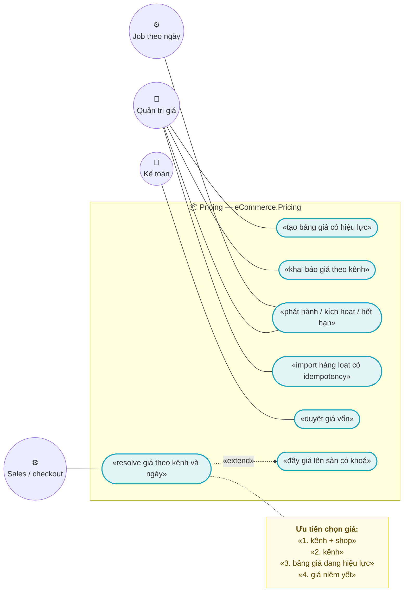
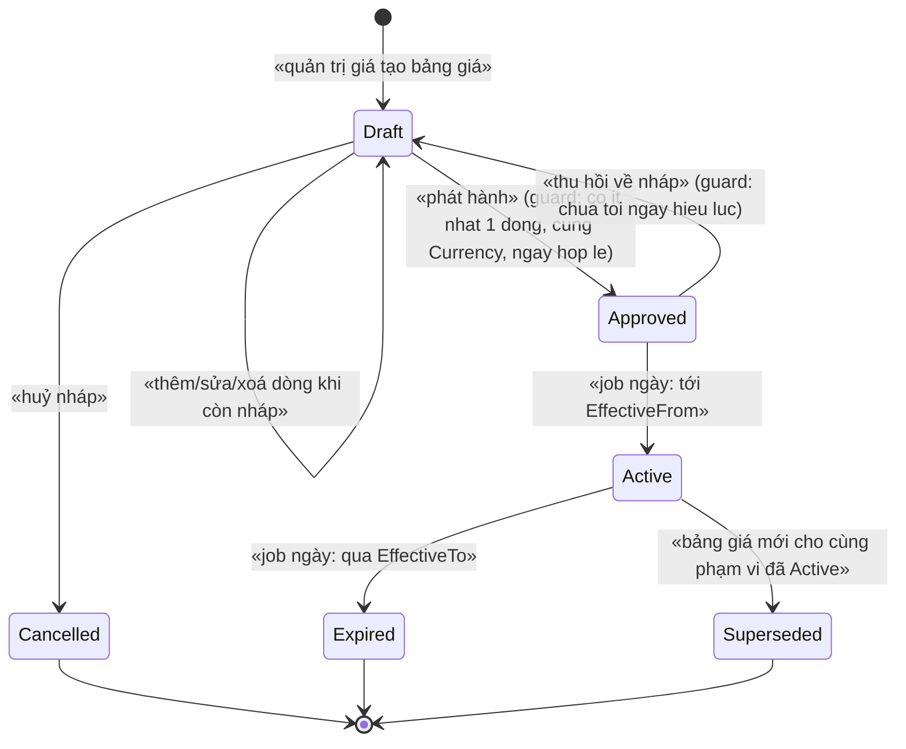
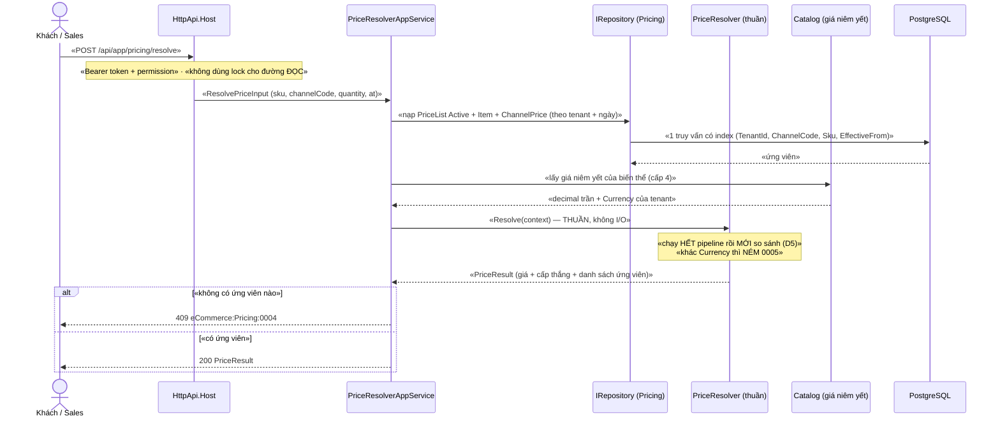
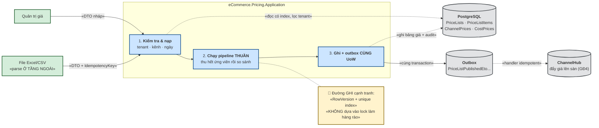
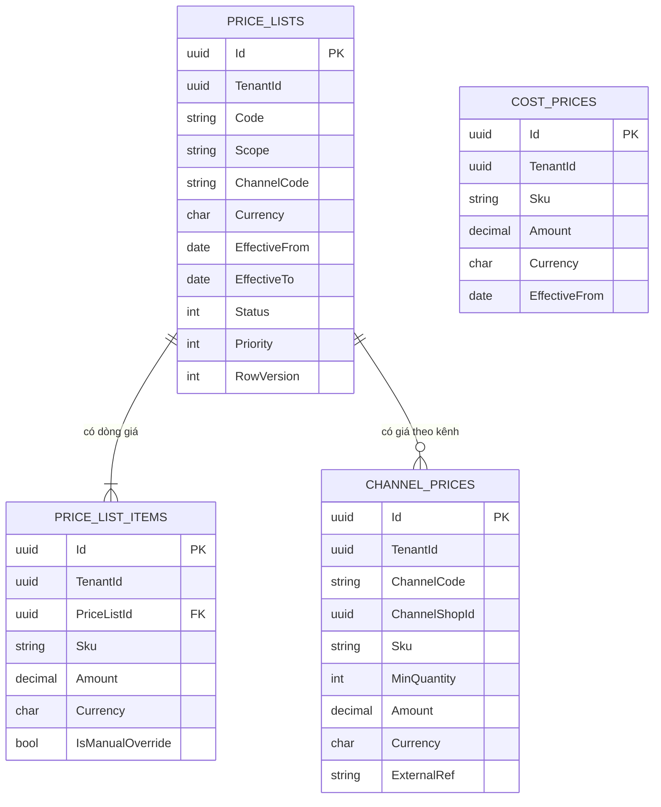

# `PRC-001` — Bảng giá và giá theo kênh

| Thuộc tính | Nội dung |
|---|---|
| **Mã** | `PRC-001` |
| **Module** | **Pricing** — `modules/Pricing/eCommerce.Pricing.Domain` + `eCommerce.Pricing.EntityFrameworkCore` (+ `.Application.Contracts` khi Sales cần gọi) |
| **Giai đoạn** | **GĐ1 — Bán được** (mục "Pricing" của `implementation-plan.md` §7.1) |
| **Ưu tiên** | **Must have** |
| **Trạng thái** | 🟡 `Draft` — chờ review |
| **Người viết / người review** | *(điền)* / **Kiến trúc trưởng + BA** |
| **Phiên bản / ngày** | `v0.1 — 13/10/2026` |
| **Tài liệu liên quan** | `XC-001` (Money/tiền tệ) · `XC-003` (khoá phân tán) · `XC-004` (permission/tenant) · `XC-002` (idempotency) · `XC-005` (observability) · **`PRC-002`** (tier price + pipeline đầy đủ) · `CAT-001` · `SAL-002` · `CHN-002` · `implementation-plan.md` **Phụ lục A.3** |

---

## 0. Tóm tắt & quyết định thiết kế

**Tóm tắt:** `PRC-001` chốt **nguồn sự thật của giá bán**: giá không còn nằm rải rác trong
`ProductVariant.Price` (giá niêm yết) và `ChannelListing.ChannelPrice` (giá riêng cho kênh) — mà được
quản lý bằng **bảng giá có hiệu lực theo thời gian** (`PriceList` + `PriceListItem`) và **bảng giá theo
kênh/bậc số lượng** (`ChannelPrice`), có **thứ tự ưu tiên tường minh** và **bất biến kiểm thử được**.
Module mới là `Pricing` — hiện **chưa có trong code**: `modules/` chỉ có `ChannelHub`, `PaymentHub`, `Tax`.

**Vì sao phải có tài liệu này trước khi code (đã kiểm trong repo):**

| Quan sát thật | Đường dẫn | Hệ quả nếu không chốt trước |
|---|---|---|
| Giá niêm yết là `decimal` **trần, không có tiền tệ** | `src/eCommerce.Domain/Entities/Catalog/Product.cs:71` | Không có `Currency` đi kèm ⇒ không thể dùng `Money` của `XC-001`; khi bật đa tiền tệ phải migrate |
| Giá riêng cho kênh đã **có chỗ** nhưng là "một con số" duy nhất, không có hiệu lực/không có bậc | `modules/ChannelHub/eCommerce.ChannelHub.Domain/Entities/ChannelEntities.cs:136` | Giá theo kênh phình tuỳ tiện vào `ChannelListing` (đúng anti-pattern nopCommerce đã ghi ở `business-modules-proposal.md` §"Anti-pattern") |
| Chưa có `Money` trong code | `grep -r "record struct Money\|class Money"` → **0 match** | `XC-001` là **kế hoạch GĐ1**, chưa triển khai ⇒ mọi khẳng định về `Money` dưới đây là **thiết kế**, không phải code đã có |
| `ChannelListing.ChannelPrice` đã map `numeric(18,4)` | `modules/ChannelHub/eCommerce.ChannelHub.EntityFrameworkCore/ChannelHubDbContextModelCreatingExtensions.cs:66` | Giữ được tính tương thích số học (`numeric(18,4)` — `XC-001` §5.2) |
| Đã có tiền lệ **index unique có `NULLS NOT DISTINCT`** cho idempotency | `src/eCommerce.EntityFrameworkCore/Migrations/20261013024226_Fix_NullableTenantId_UniqueIndexes.cs:65` | `PRC-001` **phải** làm y hệt cho mọi unique index của mình (`XC-004` BR-009) |
| `AbpDistributedLockOptions.KeyPrefix = "ecommerce:"` đã đúng quy ước | `src/eCommerce.HttpApi.Host/eCommerceHttpApiHostModule.cs:127` | Tên khoá của Pricing **không** được chứa tiền tố `ecommerce:` (§8.2) |

**Phạm vi:**
- ✅ Entity `PriceList`, `PriceListItem` (dòng **cơ sở** của bảng giá), `ChannelPrice` (giá theo kênh + bậc số lượng), `CostPrice` (giá vốn để tính lãi gộp).
- ✅ **Thứ tự ưu tiên** chọn giá (kênh > bảng giá đang hiệu lực > giá niêm yết của biến thể), **ghi đè** và **chiến lược chọn** (`UseByPriority` / `LowestPrice`) theo mô hình đã khảo sát ở `business-modules-proposal.md:244`.
- ✅ **Hiệu lực theo thời gian** (`EffectiveFrom` / `EffectiveTo`) + vòng đời bảng giá (state machine) + **append-only** sau khi phát hành.
- ✅ Hợp đồng `IPriceResolver` **thuần** (nạp dữ liệu → tính → trả kết quả), đủ để `SAL-002` tính lại giá lúc checkout.
- ✅ Mã lỗi, permission, migration/seed, test case.

**Không nằm trong phạm vi:**
- ❌ **Giá bậc thang (tier) tổng quát + pipeline đầy đủ (khuyến mãi, phí) + chính sách làm tròn** — thuộc **`PRC-002`**. `PRC-001` chỉ có bậc số lượng **trong phạm vi một kênh** (`ChannelPrice.MinQuantity`) và **chỉ làm tròn** bằng `XC-001`.
- ❌ **Đa tiền tệ hoạt động thật + tỷ giá** — `XC-001` D2/BR-009: chỉ `VND` chạy thật; `PRC-001` chỉ **bắt buộc có `Currency`** để không phải migrate sau.
- ❌ **Đồng bộ giá lên sàn** (gọi API Shopee/Lazada) — thuộc `CHN-002`/`CHN-004`. Tại đây chỉ chốt **khoá phân tán** và **ETO** mà việc push sẽ dùng.
- ❌ **Khuyến mãi/voucher/flash sale** — thuộc `PRO-001`/`PRO-002`.
- ❌ **Lịch sử giá dạng báo cáo** — thuộc `REP-002`.
- ❌ **Sửa `ProductVariant.Price`** — entity này **thuộc Catalog** (module khác). `PRC-001` chỉ **đọc** và ghi nhận nợ kỹ thuật (§15.2 **F1**).

### 0.1 Quyết định thiết kế (ADR ngắn)

| # | Quyết định | Phương án đã cân nhắc | Lý do chọn | Hệ quả |
|---|---|---|---|---|
| **D1** | **Tạo module `Pricing` riêng** (`modules/Pricing/…`), **không** nhét bảng giá vào Catalog hay ChannelHub | (a) thêm `Price`/`ChannelPrice` vào `ProductVariant` · (b) nhét giá theo kênh vào `ChannelListing` · (c) **module Pricing** | (b) **đang là hiện trạng** (`ChannelEntities.cs:136`) và sẽ phình: cần bậc số lượng + hiệu lực + ưu tiên + giá vốn. `business-modules-proposal.md:132` đã kết luận: *"Pricing tách khỏi Catalog ngay từ đầu, vì giá theo kênh/thời gian/giá sỉ sẽ phình nếu nhét vào Product"* | Thêm 2–3 project mới; `eCommerceDbContext` **phải** thêm `DbSet` (§5.3) |
| **D2** | Mọi tiền trong bảng của Pricing lưu **`Amount numeric(18,4)` + `Currency char(3)`**, thao tác qua `Money`; **cấm** `==` trên `decimal` | (a) `decimal` trần như `ProductVariant.Price` · (b) `Money` (theo `XC-001`) | `XC-001` BR-002/003/008 và nguyên tắc #1–2 của `implementation-plan.md:44-45`. Giá là **đầu vào** của mọi phép tính tiền ⇒ sai ở đây sai ở mọi nơi | Mọi chỗ đọc `ProductVariant.Price` (không có currency) là **cầu nối tạm** — ghi nợ **F1** (§15.2) |
| **D3** | `Currency` của giá **phải khớp** `Currency` của kênh/tenant; **không tự quy đổi** | (a) tự quy đổi theo tỷ giá · (b) ném lỗi | `XC-001` BR-002: *"Cấm cộng/trừ/so sánh hai `Money` khác `Currency` ⇒ ném lỗi (không tự quy đổi)"*; đa tiền tệ chưa hoạt động | Cần mã lỗi riêng `eCommerce:Pricing:0005`; kênh ngoại tệ bị **chặn có chủ ý** cho tới khi có tỷ giá |
| **D4** | Bảng giá có **hiệu lực theo khoảng ngày** và **append-only sau khi phát hành** | (a) một dòng giá, sửa tại chỗ · (b) hiệu lực + version như `TaxClassification` | Mô hình **đã kiểm chứng trong repo**: `TaxClassification` (`modules/Tax/…/TaxClassification.cs:39-41,98-119`) dùng `EffectiveFrom/EffectiveTo` + `Status` + append-only. Cần trả lời được *"đơn ngày 20/10 tính giá nào?"* và *"vì sao giá này?"* | Phải có job chuyển trạng thái theo ngày (§3.2); truy vấn luôn phải kèm điều kiện ngày |
| **D5** | **Pipeline có thứ tự tường minh**: thu thập **tất cả** ứng viên → **rồi mới** so sánh/chọn | (a) áp mù theo thứ tự gặp · (b) chạy hết rồi so sánh | Bài học Smartstore ở `business-modules-proposal.md:192`: *"chạy hết pipeline (kể cả discount) rồi mới so sánh giá tier tối thiểu với giá cuối — **không áp mù**"*. Với (a), thứ tự duyệt quyết định kết quả ⇒ không test được | `IPriceResolver` trả **toàn bộ ứng viên** + ứng viên thắng ⇒ test khẳng định được cả hai |
| **D6** | `IPriceResolver` **thuần**: nhận dữ liệu đã nạp (`PriceResolutionContext`), **không chạm DB** | (a) resolver tự truy vấn · (b) resolver thuần + app service nạp dữ liệu | (a) ⇒ không test được nếu thiếu PostgreSQL, và trộn I/O với luật nghiệp vụ. Cùng triết lý với `TaxRateResolver` (`modules/Tax/…/TaxRateResolver.cs`) | App service phải nạp đủ dữ liệu 1 lần (N+1 phải chặn — NFR-001) |
| **D7** | **Thứ tự ưu tiên cố định**: (1) `ChannelPrice` khớp `ChannelCode`+`ChannelShopId`; (2) `ChannelPrice` khớp chỉ `ChannelCode`; (3) `PriceListItem` của bảng giá đang hiệu lực; (4) giá niêm yết truyền vào | (a) "cái nào mới nhất thắng" · (b) ưu tiên tường minh theo cấp | (a) không xác định được khi hai bản ghi cùng ngày; (b) khớp mô hình `PriceList.Priority` + ghi đè của nopCommerce (`business-modules-proposal.md:244`) | Thêm `Priority` trong cùng cấp ⇒ hai tiêu chí, phải ghi rõ **cấp trước, priority sau** |
| **D8** | **Không** thêm `EXCLUDE USING gist` cho `PriceList`. Chống chồng khung ở **tầng ứng dụng** + **unique index** `(TenantId, Code, EffectiveFrom)` | (a) `EXCLUDE` như `TaxClassification` · (b) validate ở domain | (a) PostgreSQL **có** hỗ trợ và repo **đã dùng** (`modules/Tax/…/TaxDbContextModelCreatingExtensions.cs:64-68` đã ghi rõ `EXCLUDE USING gist` + `btree_gist`) — nhưng nó chỉ chặn được chồng khung **theo cùng `Code`**; giữa **hai `Code` khác nhau** cùng scope vẫn chồng. Ta chọn (b) + **ràng buộc phạm vi**: *"tại một thời điểm, mỗi (tenant, scope, kênh) chỉ có **một** bảng giá Active"* — kiểm trong domain, có test | Không có hàng rào DB cho luật "một bảng giá active" ⇒ **F2** ghi ở §15.2; cần `RowVersion` + transaction để giảm cửa sổ race |
| **D9** | Cạnh tranh ghi bằng **optimistic concurrency** (`RowVersion`), **không** dùng lock bi quan trên DB | (a) `SELECT … FOR UPDATE` · (b) `RowVersion` | Bảng giá **không** phải đường nóng (ghi thưa); (b) rẻ hơn, và **không** tạo deadlock. `XC-002` BR-008 cũng yêu cầu guard ở tầng DB cho chuyển trạng thái | Client phải xử lý `409` khi `RowVersion` lệch |
| **D10** | **Khoá phân tán** chỉ dùng cho tài nguyên **chia sẻ giữa các instance**; tên khoá lấy từ **hàm của module sở hữu** | (a) tự ghép chuỗi `pricing:…` · (b) gọi `ChannelHubConsts.LockKeys.*` | `XC-003` **D3/BR-001**: cấm viết literal khoá; **F1** của `XC-003` là đúng lỗi "hai nơi hai chuỗi". Khoá push giá thuộc **ChannelHub** ⇒ gọi hàm của ChannelHub | Pricing **không** được khai báo lại khoá `channel:*`; nếu cần khoá riêng của Pricing ⇒ tự sở hữu + ghi vào bảng §8.2 |
| **D11** | **Import hàng loạt giá là một biên vào ⇒ bắt buộc idempotency** (`IIdempotencyGuard` + `InboxRecords`) | (a) chỉ validate trong bộ nhớ · (b) khoá nghiệp vụ ổn định + inbox | `XC-002` BR-004: *"**Mọi** biên vào — HTTP webhook, consumer sự kiện, job định kỳ — **phải** idempotent"*. Import chạy lại sau lỗi mạng là ca điển hình | Import **cấm** chạy nếu thiếu khoá ⇒ `eCommerce:Pricing:0006` (**F3**, §15.2 — hiện `IIdempotencyGuard` **chưa có** trong code) |
| **D12** | Guard trạng thái sai ⇒ **NÉM** `BusinessException` có mã; **cấm** no-op im lặng | (a) bỏ qua im lặng · (b) ném lỗi | `implementation-plan.md` nguyên tắc #11 + `XC-002` BR-009 (bài học `SetPaidStatus()` của eShop). Tiền lệ đúng đã có trong repo: `TaxClassification.Approve()` (`TaxClassification.cs:122-134`) | Không có API nào "thử rồi thôi" cho chuyển trạng thái |
| **D13** | Import/export bằng **JSON DTO qua app service**; **parse file (Excel/CSV) ở tầng ngoài**, không ở domain | (a) app service nhận `IFormFile` + parse · (b) DTO JSON | (a) trộn I/O file với UoW, khó test, và mỗi định dạng file lại sửa app service. Cùng cách `XC-006` xử lý Mẫu 01 (dữ liệu là **dữ liệu**, không nhúng vào code) | Cần một bước "đọc file → DTO" (thuộc `WEB-001`/tooling); tài liệu phải giữ §6.2 đủ chi tiết để bước đó map đúng |
| **D14** | Chính sách **không tìm thấy giá** cấu hình được theo tenant, **mặc định là NÉM LỖI** | (a) mặc định dùng giá niêm yết · (b) mặc định ném lỗi | `XC-001` D3 và `implementation-plan.md` §5 "không mất tiền": bán với giá đoán mò là lỗi **không sửa được về sau**. Tiền lệ `XC-001` Q6: *"từ chối rõ ràng tốt hơn hỗ trợ nửa vời"* | Cần Setting `eCommerce.Pricing.MissingPricePolicy`; UI phải hiển thị rõ SKU/kênh thiếu giá để vận hành bổ sung |

---

## 1. Use Case Specification

| Thuộc tính | Nội dung |
|---|---|
| **Use Case ID** | `PRC-001` |
| **Use Case Name** | Quản lý bảng giá có hiệu lực và xác định giá bán đúng theo kênh |
| **Description** | *"Là quản trị giá, tôi muốn khai báo giá theo kênh và theo khoảng thời gian hiệu lực, để mọi kênh bán đúng giá đã duyệt — và để hệ thống luôn trả lời được **vì sao** một SKU có giá đó."* |
| **Actor(s)** | **Quản trị giá** (tạo/duyệt bảng giá) · **Kế toán** (duyệt giá vốn) · **Sales/`SAL-002`** (gọi `IPriceResolver`) · **ChannelHub** (đẩy giá lên sàn — GĐ4) · **Job** (kích hoạt/hết hạn bảng giá theo ngày) |
| **Priority** | **Must have** |
| **Trigger** | (a) người dùng tạo/sửa/duyệt bảng giá; (b) checkout cần giá (`SAL-002`); (c) job theo ngày chuyển `Approved → Active` / `Active → Expired`; (d) import hàng loạt từ file |
| **Pre-Condition(s)** | • **Tenant hiện tại** (`TenantId` từ `ICurrentTenant`) — `PriceList`/`PriceListItem`/`ChannelPrice`/`CostPrice` là `IMultiTenant`.<br>• **Kênh bán** (`ChannelCode`) — **bắt buộc** cho mọi truy vấn giá; giá trị phải tồn tại trong `ChnChannels` (`ChannelHubDbContextModelCreatingExtensions.cs:26-27`: `Channel.Code` unique toàn hệ thống).<br>• **SKU** phải tồn tại trong Catalog — `ProductVariant.Sku` unique theo tenant (`eCommerceDbContext.cs:129`). ⚠️ Pricing **không** tham chiếu trực tiếp `eCommerce.Catalog.*` (§15.1 **Q1**).<br>• **`Money` + `Currency` của `XC-001` đã có trong `eCommerce.Kernel`** — ⚠️ **chưa có trong code** (`grep` 0 match) ⇒ đây là **phụ thuộc chặn** (§14.4).<br>• `ChannelShopId` chỉ có mặt khi giá áp cho **một shop cụ thể**; không áp dụng cho kênh website. |
| **Post-Condition(s)** | • Mọi giá trả về là `Money` **đã chuẩn hoá** theo `Currency.Decimals` (`XC-001` BR-001) và **kèm được lý do chọn** (cấp nào thắng).<br>• Không tồn tại hai bảng giá `Active` cùng `(tenant, scope, channel)` tại một thời điểm (bất biến §8.1 #2).<br>• Bảng giá `Active` **không** bị sửa (`append-only`) — muốn đổi phải tạo bảng giá mới.<br>• Mọi chuyển trạng thái và mọi đổi giá có **bản ghi audit** (`XC-004` BR-011 áp cho thay đổi giá). |
| **Basic Flow** | 1. Quản trị giá tạo `PriceList` (`Code`, `Name`, `Scope`, `ChannelCode?`, `Currency`, `EffectiveFrom/To`) ⇒ trạng thái `Draft`.<br>2. Thêm `PriceListItem` (SKU/biến thể + `Amount` + `Currency`); hệ thống **chuẩn hoá** qua `Money.Of`.<br>3. Thêm tùy chọn `ChannelPrice` (theo `ChannelCode` **hoặc** theo `ChannelShopId`, có `MinQuantity` cho bậc số lượng).<br>4. Quản trị giá **Phát hành** ⇒ `Draft → Approved` (guard: có ≥ 1 dòng, tiền tệ nhất quán, khung ngày hợp lệ) ⇒ **NÉM LỖI** nếu vi phạm.<br>5. Job hằng ngày: tới `EffectiveFrom` ⇒ `Approved → Active`; quá `EffectiveTo` ⇒ `Active → Expired`.<br>6. `SAL-002` gọi `IPriceResolver.ResolveAsync(context)`: nạp ứng viên → chạy pipeline theo **D5** → chọn theo **D7** → trả `PriceResult` (giá + cấp thắng + danh sách ứng viên). |
| **Alternative Flow** | **A1: Giá theo kênh không có** ⇒ rơi xuống cấp 3 (bảng giá đang hiệu lực), rồi cấp 4 (giá niêm yết) — tuỳ `MissingPricePolicy` (D14).<br>**A2: Nhiều ứng viên cùng cấp** ⇒ so `Priority`; bằng nhau ⇒ **NÉM LỖI** dữ liệu (`eCommerce:Pricing:0001`) — **cấm** chọn tuỳ tiện.<br>**A3: Bậc số lượng** — `quantity` khớp nhiều bậc ⇒ chọn `MinQuantity` **lớn nhất** không vượt `quantity`.<br>**A4: Import hàng loạt** — nhận JSON DTO + `IdempotencyKey` ổn định; chạy lại **cùng khoá** ⇒ trả kết quả cũ, **không** tạo bản ghi thứ hai (D11).<br>**A5: Kế toán duyệt giá vốn** — `CostPrice` có luồng duyệt riêng; giá vốn **không bao giờ** được trả cho storefront. |
| **Exception Flow** | **E1:** phát hành bảng giá thiếu dòng ⇒ `eCommerce:Pricing:0002` (`400`).<br>**E2:** sửa/xoá bảng giá đang `Active` ⇒ `eCommerce:Pricing:0003` (`409`) — append-only (D4).<br>**E3:** không tìm thấy giá mà policy = `Throw` ⇒ `eCommerce:Pricing:0004` (`409`) — **kèm `Sku` + `ChannelCode` + ngày** để vận hành bổ sung ngay.<br>**E4:** `Currency` của giá khác `Currency` của kênh/tenant ⇒ `eCommerce:Pricing:0005` (`409`) — **không** tự quy đổi (D3).<br>**E5:** import thiếu khoá idempotency ⇒ `eCommerce:Pricing:0006` (`400`).<br>**E6:** `RowVersion` lệch khi hai người sửa cùng bảng giá ⇒ `eCommerce:Pricing:0007` (`409`) + yêu cầu tải lại.<br>**E7:** khoá phân tán bận khi đẩy giá lên sàn ⇒ `eCommerce:Lock:0001` (`409`) theo `XC-003` (§8.2). |
| **Business Rules** | • **BR-PRC-001-001**: Mọi khoản tiền trong Pricing **phải** là `Money` (có `Currency`); **cấm** lưu `decimal` tiền mà **không** có cột tiền tệ đi kèm.<br>• **BR-PRC-001-002**: **Cấm** so sánh tiền bằng `==` trên `decimal`; so bằng `ToMinorUnits()` (`XC-001` BR-003).<br>• **BR-PRC-001-003**: Giá **phải** có hiệu lực theo khoảng `[EffectiveFrom, EffectiveTo]`; truy vấn giá **bắt buộc** kèm tham số ngày; **cấm** truy vấn giá "mới nhất" không ngày.<br>• **BR-PRC-001-004**: Bảng giá ở trạng thái `Active` là **append-only** — **cấm** sửa/xoá; thay đổi ⇒ tạo bảng giá mới.<br>• **BR-PRC-001-005**: Mọi chuyển trạng thái sai guard **phải NÉM** `BusinessException` có mã (`eCommerce:Pricing:0002/0003`); **cấm** no-op im lặng.<br>• **BR-PRC-001-006**: Thứ tự ưu tiên chọn giá **cố định** theo D7 (kênh+shop > kênh > bảng giá > giá niêm yết); **cấm** "cái nào mới nhất thắng".<br>• **BR-PRC-001-007**: Chỉ **một** `PriceList` được `Active` cho mỗi `(TenantId, Scope, ChannelCode)` tại một thời điểm.<br>• **BR-PRC-001-008**: `PriceListItem` là **duy nhất** theo `(TenantId, PriceListId, Sku)`; `ChannelPrice` duy nhất theo `(TenantId, ChannelCode, ChannelShopId, Sku, MinQuantity)`.<br>• **BR-PRC-001-009**: Pipeline tính giá **phải chạy hết** các bước rồi **mới** so sánh/chọn (D5); kết quả **phải** kèm `SelectedTier` + danh sách ứng viên để kiểm chứng.<br>• **BR-PRC-001-010**: **Cấm** tự quy đổi tiền tệ; khác `Currency` ⇒ ném `eCommerce:Pricing:0005` (D3).<br>• **BR-PRC-001-011**: Mọi truy vấn/ghi giá **phải** lọc theo `TenantId`; **cấm** truy vấn giá toàn cục (`XC-004` BR-009 + `NULLS NOT DISTINCT`).<br>• **BR-PRC-001-012**: Mọi biên vào ghi dữ liệu giá (app service, consumer sự kiện, import hàng loạt) **phải** idempotent qua `IIdempotencyGuard` + `InboxRecords`; `IdempotencyKey` **ổn định** qua các lần thử (D11).<br>• **BR-PRC-001-013**: Giá **trả cho người mua** chỉ được lấy từ `ChannelPrice`/`PriceListItem`; `CostPrice` **cấm** lộ ra API công khai/storefront.<br>• **BR-PRC-001-014**: Mọi thay đổi giá **phải** ghi audit (ai, lúc nào, giá trị cũ → mới, lý do); **cấm** đổi giá không dấu vết. |
| **Non-Functional Requirement** | • **NFR-PRC-001-001**: `ResolveAsync` p95 **< 50 ms** khi bảng giá có **500 dòng**, đo trên PostgreSQL 17 thật.<br>• **NFR-PRC-001-002**: Số truy vấn DB cho **một** lần resolve **≤ 4** (không N+1) — kiểm bằng đếm lệnh.<br>• **NFR-PRC-001-003**: **100 %** nhánh state machine (§3) có test, kể cả nhánh guard sai.<br>• **NFR-PRC-001-004**: **0** literal so sánh tiền bằng `==` trong `modules/Pricing` (test quét mã nguồn).<br>• **NFR-PRC-001-005**: Import **10.000** dòng hoàn tất **< 60 s**; chạy lại cùng khoá ⇒ **0** bản ghi mới.<br>• **NFR-PRC-001-006**: **100 %** app service của Pricing có `[Authorize]` **cấp class** (`XC-004` TC-01).<br>• **NFR-PRC-001-007**: Đổi giá **không** làm thay đổi đơn đã đặt — **0** bản ghi `OrdOrderLines` bị ảnh hưởng (test hồi quy).<br>• **NFR-PRC-001-008**: Mọi chuyển trạng thái/đổi giá có audit trong **< 1 s**.<br>• **NFR-PRC-001-009**: Log/trace của resolve có `CorrelationId` và **không** chứa giá vốn (`CostPrice`) ở mức `Information` trở xuống. |

---

## 2. Sơ đồ Use Case



> 📌 **Chú giải:** ⭕ xanh lá = actor · 🟦 bầu dục = use case · 🟨 vàng = nguyên tắc bắt buộc ·
> `-.«include».->` = quan hệ bao hàm (theo mẫu `templates/feature-design-template.md` §2).

---

## 3. Sơ đồ trạng thái (state machine)

### 3.1 Vòng đời `PriceList` (bảng giá)



**Bảng chuyển trạng thái & guard (mọi chuyển sai **phải ném lỗi có mã**, không im lặng — D12):**

| # | Từ → Sang | Guard (điều kiện cho phép) | Hành động kèm theo | Nếu guard sai |
|---|---|---|---|---|
| 1 | `[*]` → `Draft` | `Code` chưa tồn tại trong `(TenantId, Scope, ChannelCode)`; `Currency` hợp lệ | ghi audit `Created` | `eCommerce:Pricing:0005` (tiền tệ sai) / `400` validate |
| 2 | `Draft` → `Draft` | Trạng thái là `Draft` | `UpdateDraft(...)` + `RowVersion++` | `eCommerce:Pricing:0003` — **NÉM** (append-only, D4) |
| 3 | `Draft` → `Approved` | **≥ 1** `PriceListItem`; mọi dòng **cùng `Currency`**; `EffectiveTo >= EffectiveFrom`; không có bảng giá `Active` khác cùng `(Scope, ChannelCode)` **chồng khung** | ghi `ApprovedBy`/`ApprovedAtUtc`; phát `PriceListPublishedEto` (outbox) | `eCommerce:Pricing:0002` (**NÉM**) hoặc `0001` (chồng/ưu tiên) |
| 4 | `Draft` → `Cancelled` | Trạng thái là `Draft` | ghi audit `Cancelled` + lý do | `eCommerce:Pricing:0003` — **NÉM** |
| 5 | `Approved` → `Active` | `today >= EffectiveFrom` **và** không còn `Active` khác cùng phạm vi | ghi `ActivatedAtUtc`; phát `PriceListActivatedEto` | 🚫 **Không phải lỗi** — job bỏ qua và giữ nguyên `Approved` (xem ghi chú dưới) |
| 6 | `Approved` → `Draft` | `today < EffectiveFrom` | xoá `ApprovedBy`; ghi audit | `eCommerce:Pricing:0003` — **NÉM** |
| 7 | `Active` → `Expired` | `today > EffectiveTo` (`EffectiveTo` khác null) | phát `PriceListExpiredEto` | 🚫 **Không phải lỗi** — giữ nguyên `Active` |
| 8 | `Active` → `Superseded` | Bảng giá thay thế **đã** `Active`/`Approved` (đúng `XC-006` BR-005) | ghi `EffectiveTo` = ngày trước ngày thay thế; phát `PriceListSupersededEto` | `eCommerce:Pricing:0002` — **NÉM** |
| 9 | `Expired`/`Superseded`/`Cancelled` → bất kỳ | — | — | `eCommerce:Pricing:0003` — **NÉM** (trạng thái hấp thụ) |

> ⚠️ **Ghi rõ ngoại lệ duy nhất của quy tắc "guard sai phải ném lỗi":** hai nhánh **#5** và **#7** do
> **job theo ngày** thực hiện, và "chưa tới ngày" / "chưa quá ngày" **không phải** là vi phạm guard —
> đó là **trạng thái bình thường**. Chúng **trả `false`** (mô hình có sẵn trong repo:
> `TaxClassification.ActivateIfDue` / `ExpireIfDue` — `modules/Tax/…/TaxClassification.cs:137-146,172-181`)
> và job **ghi log + metric**. Ranh giới rõ: **chuyển trạng thái do người/API ⇒ ném lỗi; do thời gian ⇒ trả `false`.**

**Ai được phép chuyển:** `Draft → Approved` = người có `eCommerce.Pricing.PriceList.Approve`;
`Draft → Cancelled` = người có `…Manage`; `Approved → Active` và `Active → Expired/Superseded` = **job**
(nhưng `Superseded` cũng có thể do người phát hành bảng giá mới ⇒ app service gọi với quyền `…Approve`).

### 3.2 Vòng đời `PriceListItem` / `ChannelPrice` (dòng giá)

Dòng giá **không có state machine riêng** — nó **kế thừa** trạng thái bảng giá cha:

| Trạng thái cha | Cho phép sửa dòng? | Cho phép resolve giá? |
|---|---|---|
| `Draft` | ✅ thêm/sửa/xoá tự do | ❌ **Không** — dòng nháp **không** ảnh hưởng giá bán |
| `Approved` | ❌ (chỉ sửa khung ngày của cha) | ❌ **Không** — chưa tới ngày hiệu lực |
| `Active` | ❌ **cấm** (append-only) | ✅ **Có** |
| `Expired` / `Superseded` / `Cancelled` | ❌ | ❌ — chỉ dùng để tra cứu lịch sử |

> 🚨 **Bất biến gốc:** *"Chỉ dòng thuộc bảng giá `Active` mới được dùng để tính giá bán."* Đây là bản sao
> đúng bài học của `TaxClassification.IsUsableAt()` (`modules/Tax/…/TaxClassification.cs:93-96`:
> *"CHỈ `Approved` và `Active` mới ảnh hưởng — `Draft` thì KHÔNG"*).

---

## 4. Sequence Diagram & luồng dữ liệu

### 4.1 Sequence — resolve giá cho checkout (đường nóng, **không** lock)



### 4.2 DFD — đường đi của một bảng giá



---

## 5. Mô hình dữ liệu

### 5.1 ERD



> 📌 **Quan hệ `ChannelPrice` ↔ `PriceList` là tuỳ chọn** (`o{`): giá theo kênh **có thể** đứng độc lập
> (khai báo trực tiếp cho một shop) — đó chính là ca "ghi đè" ở cấp 1 của D7.

### 5.2 Bảng & cột (Data Dictionary)

**Bảng `PriceLists`** — *bảng giá có hiệu lực; đơn vị phát hành/duyệt*

| Cột | Kiểu | Null? | Nguồn / ý nghĩa | Ghi chú |
|---|---|---|---|---|
| `Id` | `uuid` | ✖ | khoá chính | |
| `TenantId` | `uuid` | ✔ | tenant sở hữu | `IMultiTenant`; **`NULLS NOT DISTINCT`** cho mọi unique index (`XC-004` BR-009) |
| `Code` | `varchar(64)` | ✖ | mã bảng giá do người dùng đặt | ví dụ `BANG-GIA-TET-2027` |
| `Name` | `varchar(256)` | ✖ | tên hiển thị | |
| `Scope` | `int` | ✖ | `0` = toàn hệ thống · `1` = theo kênh · `2` = theo shop | enum `PriceScope` |
| `ChannelCode` | `varchar(32)` | ✔ | kênh áp dụng | ✖ khi `Scope = 0`; khớp `Channel.Code` (`ChannelHubDbContextModelCreatingExtensions.cs:23`) |
| `Currency` | `char(3)` | ✖ | ISO-4217, **HOA** | ✖ `numeric(18,4)` + `char(3)` là quy ước `XC-001` §5.2 |
| `EffectiveFrom` | `date` | ✖ | ngày bắt đầu hiệu lực | `date`, **không** `timestamp` — giá đổi theo **ngày** |
| `EffectiveTo` | `date` | ✔ | ngày kết thúc | `NULL` = vô thời hạn |
| `Status` | `int` | ✖ | `Draft=0` · `Approved=1` · `Active=2` · `Expired=3` · `Superseded=4` · `Cancelled=5` | enum `PriceListStatus` |
| `Priority` | `int` | ✖ | ưu tiên **trong cùng cấp** (D7) | số lớn hơn thắng; **bằng nhau ⇒ ném lỗi** |
| `SelectionStrategy` | `int` | ✖ | `0` = `UseByPriority` · `1` = `LowestPrice` | mô hình `PriceListStrategy` của nopCommerce (`business-modules-proposal.md:244`) |
| `RowVersion` | `int` | ✖ | optimistic concurrency (D9) | tăng mỗi lần ghi |
| `ApprovedBy` / `ApprovedAtUtc` | `uuid` / `timestamptz` | ✔ | ai duyệt, khi nào | audit (BR-014) |
| `ActivatedAtUtc` | `timestamptz` | ✔ | job kích hoạt lúc nào | |
| `Note` | `varchar(1024)` | ✔ | lý do đổi giá | **bắt buộc** khi sửa khung ngày (BR-014) |

**Bảng `PriceListItems`** — *dòng giá theo SKU trong một bảng giá*

| Cột | Kiểu | Null? | Nguồn / ý nghĩa | Ghi chú |
|---|---|---|---|---|
| `Id` | `uuid` | ✖ | khoá chính | |
| `TenantId` | `uuid` | ✔ | tenant | |
| `PriceListId` | `uuid` | ✖ | FK → `PriceLists.Id` | `ON DELETE CASCADE` (chỉ xoá được khi cha `Draft`) |
| `Sku` | `varchar(64)` | ✖ | SKU nội bộ | ⚠️ **chuỗi**, **không** FK sang Catalog (§15.1 **Q1**) |
| `Amount` | `numeric(18,4)` | ✖ | số tiền | ⚠️ **decimal, không bao giờ `double`** (`XC-001` BR-008) |
| `Currency` | `char(3)` | ✖ | tiền tệ của dòng | **phải bằng** `PriceLists.Currency` (D3) |
| `IsManualOverride` | `bool` | ✖ | dòng ghi đè thủ công | true ⇒ thắng cả `ChannelPrice`? **KHÔNG** — vẫn theo D7; cờ này chỉ để giải trình |
| `CompareAtAmount` | `numeric(18,4)` | ✔ | giá so sánh (gạch ngang) | hiển thị, **không** dùng để bán |

**Bảng `ChannelPrices`** — *giá theo kênh và bậc số lượng*

| Cột | Kiểu | Null? | Nguồn / ý nghĩa | Ghi chú |
|---|---|---|---|---|
| `Id` | `uuid` | ✖ | khoá chính | |
| `TenantId` | `uuid` | ✔ | tenant | |
| `ChannelCode` | `varchar(32)` | ✖ | kênh | cấp 1 nếu có `ChannelShopId`, cấp 2 nếu không |
| `ChannelShopId` | `uuid` | ✔ | shop cụ thể | `NULL` = mọi shop của kênh |
| `Sku` | `varchar(64)` | ✖ | SKU nội bộ | |
| `MinQuantity` | `int` | ✖ | bậc số lượng (mặc định `1`) | chọn bậc có `MinQuantity` **lớn nhất** ≤ `quantity` (A3) |
| `Amount` | `numeric(18,4)` | ✖ | số tiền | |
| `Currency` | `char(3)` | ✖ | tiền tệ | |
| `PriceListId` | `uuid` | ✔ | bảng giá sinh ra dòng này (nếu có) | để giải trình nguồn gốc |
| `ExternalRef` | `varchar(128)` | ✔ | mã tham chiếu **của kênh/ERP** | dùng cho **idempotency import** (BR-012) |
| `EffectiveFrom` / `EffectiveTo` | `date` | ✖ / ✔ | hiệu lực **riêng** của giá kênh | cho phép đổi giá kênh không cần bảng giá mới |
| `RowVersion` | `int` | ✖ | optimistic concurrency | |

**Bảng `CostPrices`** — *giá vốn (để tính lãi gộp) — **cấm** trả cho người mua*

| Cột | Kiểu | Null? | Nguồn / ý nghĩa | Ghi chú |
|---|---|---|---|---|
| `Id` | `uuid` | ✖ | khoá chính | |
| `TenantId` | `uuid` | ✔ | tenant | |
| `Sku` | `varchar(64)` | ✖ | SKU | |
| `Amount` | `numeric(18,4)` | ✖ | giá vốn | BR-013: **không** lộ ra API công khai |
| `Currency` | `char(3)` | ✖ | tiền tệ | |
| `EffectiveFrom` / `EffectiveTo` | `date` | ✖ / ✔ | hiệu lực theo thời gian | cùng mô hình `D4` |
| `ApprovedBy` / `ApprovedAtUtc` | `uuid` / `timestamptz` | ✔ | kế toán duyệt | |

**Index & ràng buộc** *(phần hay bị bỏ sót nhất — liệt kê hết)*

| Bảng | Loại | Cột | Mục đích |
|---|---|---|---|
| `PriceLists` | UNIQUE **`NULLS NOT DISTINCT`** | `(TenantId, Code, EffectiveFrom)` | chống trùng mã trong cùng kỳ |
| `PriceLists` | INDEX | `(TenantId, Status, ChannelCode, EffectiveFrom, EffectiveTo)` | truy vấn nóng nhất: "bảng giá đang hiệu lực của kênh" |
| `PriceListItems` | UNIQUE **`NULLS NOT DISTINCT`** | `(TenantId, PriceListId, Sku)` | một SKU một dòng trong một bảng giá (BR-008) |
| `ChannelPrices` | UNIQUE **`NULLS NOT DISTINCT`** | `(TenantId, ChannelCode, ChannelShopId, Sku, MinQuantity)` | một bậc giá cho một SKU/kênh (BR-008) |
| `ChannelPrices` | UNIQUE **có filter** + `NULLS NOT DISTINCT` | `(TenantId, ChannelCode, ExternalRef) WHERE "ExternalRef" IS NOT NULL` | **idempotency import** (BR-012) — hàng rào cuối cùng khi tầng ứng dụng sai |
| `ChannelPrices` | INDEX | `(TenantId, ChannelCode, Sku, MinQuantity)` | resolve giá kênh |
| `CostPrices` | UNIQUE **`NULLS NOT DISTINCT`** | `(TenantId, Sku, EffectiveFrom)` | một giá vốn cho một kỳ |
| `PriceLists` | CHECK | `"EffectiveTo" IS NULL OR "EffectiveTo" >= "EffectiveFrom"` | khung ngày hợp lệ (mô hình có sẵn: `modules/Tax/…/TaxDbContextModelCreatingExtensions.cs:23-25`) |
| `PriceLists` / `PriceListItems` / `ChannelPrices` / `CostPrices` | CHECK | `"Currency" ~ '^[A-Z]{3}$'` | chặn mã tiền tệ sai (`XC-001` §5.2 khuyến nghị) |
| `PriceListItems` / `ChannelPrices` / `CostPrices` | CHECK | `"Amount" >= 0` | giá bán/vốn **không âm**; điều chỉnh giảm dùng `PRO-001` (khuyến mãi), **không** dùng giá âm |

> 📌 **Không** đặt `CHECK (Amount > 0)`: giá `0` là **hợp lệ** (hàng tặng, khuyến mãi 100 % qua bảng giá) —
> bài học từ `XC-001` §5.2 (*"không đặt `CHECK (Amount > 0)` vì có số tiền hợp lệ âm"*).

### 5.3 Yêu cầu với `eCommerceDbContext` (bắt buộc — lỗi Phase 0)

Module **chưa có** trong code; khi tạo, **phải** làm đúng 3 việc đã ghi rõ trong repo:

| # | Việc | Vì sao (bằng chứng) |
|---|---|---|
| 1 | Khai báo `DbSet<PriceList>`, `DbSet<PriceListItem>`, `DbSet<ChannelPrice>`, `DbSet<CostPrice>` trên `eCommerceDbContext` | `src/eCommerce.EntityFrameworkCore/eCommerceDbContext.cs:48-52`: *"`AddDefaultRepositories(includeAllEntities: true)` chỉ tạo `IRepository<T>` cho entity **CÓ DbSet**… nếu không: `The requested service 'IRepository<ChannelShop, Guid>' has not been registered.`"* |
| 2 | Gọi `builder.ConfigurePricing();` trong `OnModelCreating` | Cùng khuôn với `builder.ConfigureChannelHub()` / `ConfigurePaymentHub()` / `ConfigureTax()` — `eCommerceDbContext.cs:76-78` |
| 3 | Module `.EntityFrameworkCore` **không** tham chiếu `eCommerce.EntityFrameworkCore`; mapping nằm ở `PricingDbContextModelCreatingExtensions.ConfigurePricing()` | `eCommerceDbContext.cs:22-31` (*"module **KHÔNG** tham chiếu DbContext của app"*) + nguyên tắc #3/#4 của `implementation-plan.md:46-47` |

---

## 6. Hợp đồng API

### 6.1 Application Service

| Mục | Giá trị |
|---|---|
| Interface | `IPriceListAppService`, `IPriceResolverAppService`, `ICostPriceAppService`, `IPriceImportAppService` (đặt tại `eCommerce.Pricing.Application.Contracts`) |
| Implementation | `…AppService` (đặt tại `eCommerce.Pricing.Application`) |
| `[Authorize]` | **cấp CLASS** + permission cụ thể ở từng method (`XC-004` BR-001/D3) |

| Method | Input (DTO) | Output (DTO) | Permission | Ghi chú |
|---|---|---|---|---|
| `GetListAsync` | `GetPriceListsInput` | `PagedResultDto<PriceListDto>` | `eCommerce.Pricing.PriceList.View` | lọc tenant + `Status` + `ChannelCode` |
| `GetAsync` | `Guid id` | `PriceListDto` | `…PriceList.View` | |
| `CreateAsync` | `CreatePriceListDto` | `PriceListDto` | `…PriceList.Manage` | tạo `Draft` |
| `AddItemAsync` | `AddPriceListItemDto` | `PriceListItemDto` | `…PriceList.Manage` | chỉ khi cha `Draft` |
| `UpdateDraftAsync` | `UpdatePriceListDto` | `PriceListDto` | `…PriceList.Manage` | `RowVersion` **bắt buộc** trong DTO |
| `ApproveAsync` | `ApprovePriceListDto` | `PriceListDto` | `…PriceList.Approve` | `Draft → Approved` |
| `CancelAsync` | `CancelPriceListDto` | `PriceListDto` | `…PriceList.Manage` | `Draft → Cancelled` |
| `SetChannelPriceAsync` | `SetChannelPriceDto` | `ChannelPriceDto` | `…ChannelPrice.Manage` | thêm/sửa giá theo kênh |
| `ResolveAsync` | `ResolvePriceInput` | `PriceResultDto` | `…Price.Resolve` | **đường nóng** của `SAL-002` |
| `ResolveManyAsync` | `ResolveManyInput` | `List<PriceResultDto>` | `…Price.Resolve` | lô cho giỏ hàng; **≤ 200** dòng/lần |
| `ImportAsync` | `ImportChannelPricesDto` (**JSON, không file** — D13) | `ImportResultDto` | `…ChannelPrice.Import` | **bắt buộc** `IdempotencyKey` (BR-012) |
| `GetCostAsync` | `GetCostPriceInput` | `CostPriceDto` | `eCommerce.Pricing.CostPrice.View` | **cấm** gọi từ endpoint công khai (BR-013) |
| `ApproveCostAsync` | `ApproveCostPriceDto` | `CostPriceDto` | `…CostPrice.Approve` | kế toán duyệt |

**Hợp đồng lõi dùng bởi `SAL-002` (thuần — D6):**

```csharp
namespace eCommerce.Pricing;

/// Ứng viên giá đã được nạp sẵn — KHÔNG truy vấn DB bên trong resolver (D6).
public class PriceResolutionContext
{
    public Guid? TenantId { get; set; }
    public string ChannelCode { get; set; } = default!;
    public Guid? ChannelShopId { get; set; }
    public string Sku { get; set; } = default!;
    public int Quantity { get; set; } = 1;

    /// Ngày dùng để xét hiệu lực — BẮT BUỘC (BR-003).
    public DateOnly At { get; set; }

    /// Giá niêm yết (cấp 4) — do tầng gọi nạp từ Catalog (xem Q1 §15.1).
    public Money? BasePrice { get; set; }
    public List<Money> ListPriceCandidates { get; set; } = new();
    public List<Money> ChannelPriceCandidates { get; set; } = new();
    public int Priority { get; set; }
    public PriceSelectionStrategy Strategy { get; set; } = PriceSelectionStrategy.UseByPriority;
}

public readonly record struct PriceResult(
    Money Price,
    PriceSelectionTier SelectedTier,   // ChannelShop | Channel | PriceList | BasePrice
    IReadOnlyList<Money> AllCandidates // BR-009: kết quả phải kèm ứng viên để kiểm chứng
);

public interface IPriceResolver
{
    /// THUẦN: chạy HẾT các bước rồi MỚI so sánh/chọn (D5, BR-009).
    /// Khác Currency ⇒ ném eCommerce:Pricing:0005 (D3). Không có ứng viên ⇒ ném 0004.
    PriceResult Resolve(PriceResolutionContext context);
}
```

### 6.2 REST endpoint

| Method / Route | Authentication | Permission | Content-Type |
|---|---|---|---|
| `GET /api/app/pricing/price-lists` | `Bearer (OpenIddict)` | `eCommerce.Pricing.PriceList.View` | `application/json` |
| `POST /api/app/pricing/price-lists` | `Bearer` | `eCommerce.Pricing.PriceList.Manage` | `application/json` |
| `POST /api/app/pricing/price-lists/{id}/approve` | `Bearer` | `eCommerce.Pricing.PriceList.Approve` | `application/json` |
| `POST /api/app/pricing/price-lists/{id}/cancel` | `Bearer` | `eCommerce.Pricing.PriceList.Manage` | `application/json` |
| `POST /api/app/pricing/channel-prices` | `Bearer` | `eCommerce.Pricing.ChannelPrice.Manage` | `application/json` |
| `POST /api/app/pricing/resolve` | `Bearer` | `eCommerce.Pricing.Price.Resolve` | `application/json` |
| `POST /api/app/pricing/channel-prices/import` | `Bearer` | `eCommerce.Pricing.ChannelPrice.Import` | `application/json` |
| `GET /api/app/pricing/cost-prices` | `Bearer` | `eCommerce.Pricing.CostPrice.View` | `application/json` |

> ⚠️ Route là **do ABP auto API controller sinh** từ app service — tên thật phụ thuộc quy ước đặt tên của ABP
> và **chưa kiểm chứng** (module chưa tồn tại). Ghi ở đây để review hợp đồng, **không** phải cam kết URL cuối cùng.

**Request mẫu — resolve giá**

```json
{
  "sku": "AO-THUN-NAM-M",
  "channelCode": "shopee",
  "channelShopId": "3f2504e0-4f89-11d3-9a0c-0305e82c3301",
  "quantity": 12,
  "at": "2026-11-20"
}
```

**Response mẫu — resolve giá**

```json
{
  "price": { "amount": 189000.0, "currency": "VND" },
  "selectedTier": "ChannelShop",
  "allCandidates": [
    { "amount": 189000.0, "currency": "VND" },
    { "amount": 195000.0, "currency": "VND" },
    { "amount": 210000.0, "currency": "VND" }
  ]
}
```

**Mã lỗi nghiệp vụ**

| Mã | HTTP | Khi nào | Thông điệp |
|---|---|---|---|
| `eCommerce:Pricing:0001` | `409` | Nhiều ứng viên **cùng cấp cùng `Priority`** ⇒ không xác định được giá | `Cấu hình giá bị trùng ưu tiên cho SKU '{Sku}' trên kênh '{ChannelCode}' tại ngày {At}. Vui lòng gỡ một cấu hình.` |
| `eCommerce:Pricing:0002` | `400` | Phát hành/thay thế bảng giá mà guard sai (thiếu dòng, khác tiền tệ, chồng khung) | `Không thể phát hành bảng giá '{Code}': {LýDo}.` |
| `eCommerce:Pricing:0003` | `409` | Sửa/xoá/chuyển trạng thái bảng giá đang `Active` hoặc trạng thái hấp thụ | `Bảng giá '{Code}' đang ở trạng thái {Status} nên không thể {HànhĐộng} — hãy tạo bảng giá mới.` |
| `eCommerce:Pricing:0004` | `409` | Không có ứng viên giá nào và `MissingPricePolicy = Throw` | `Chưa có giá cho SKU '{Sku}' trên kênh '{ChannelCode}' tại ngày {At}.` |
| `eCommerce:Pricing:0005` | `409` | Khác `Currency` (giá vs kênh/tenant) | `Không thể dùng giá {A} cho giao dịch bằng {B} — hệ thống chưa hỗ trợ quy đổi tiền tệ.` |
| `eCommerce:Pricing:0006` | `400` | Import thiếu `IdempotencyKey` | `Thiếu khoá chống trùng cho lần nhập giá này.` |
| `eCommerce:Pricing:0007` | `409` | `RowVersion` lệch (hai người sửa cùng lúc — D9) | `Bảng giá đã bị thay đổi bởi người khác. Vui lòng tải lại và thử lại.` |
| `eCommerce:Lock:0001` *(của `XC-003`)* | `409` | Không giành được khoá khi đẩy giá lên sàn (§8.2) | `Tài nguyên đang được xử lý bởi tiến trình khác, vui lòng thử lại.` |

---

## 7. Sự kiện, tích hợp ngoài & idempotency

### 7.1 Sự kiện phát ra (ETO)

| ETO | Khi nào phát | Trường dữ liệu (đề xuất) | Ai tiêu thụ | Handler có idempotent? |
|---|---|---|---|---|
| `PriceListPublishedEto` | `Draft → Approved` | `AggregateId`, **`AggregateVersion`**, `TenantId`, `Code`, `Scope`, `ChannelCode?`, `Currency`, `EffectiveFrom`, `EffectiveTo` | `CHN-002` (chuẩn bị push), `REP-002` | ✅ **Bắt buộc** — consumer dùng `AggregateVersion` (D6 của `XC-002`) |
| `PriceListActivatedEto` | job: `Approved → Active` | như trên + `ActivatedAtUtc` | `CHN-002`, `NOT-*` | ✅ |
| `PriceListSupersededEto` | `Active → Superseded` | + `ReplacedByPriceListId` | `CHN-002`, `REP-002` | ✅ |
| `PriceListExpiredEto` | job: `Active → Expired` | + `ExpiredAtUtc` | `CHN-002` | ✅ |
| `ChannelPriceChangedEto` | thêm/sửa `ChannelPrice` | `AggregateId`, `AggregateVersion`, `TenantId`, `ChannelCode`, `ChannelShopId?`, `Sku`, `MinQuantity`, `Amount`, `Currency` | **`CHN-002`** (đẩy giá lên sàn) | ✅ |

> 🚨 **Bắt buộc theo `XC-002`:** mọi ETO **phải** phát qua `IDistributedEventBus` với **outbox**
> (`useOutbox: true`) **trong cùng Unit of Work** với dữ liệu — `XC-002` BR-001.
> ⚠️ **Chưa có trong code:** `IHasEventOutbox`/`IHasEventInbox` **chưa** được implement trên
> `eCommerceDbContext` (`grep` → **0 match** trong `src/`) ⇒ đây là **phụ thuộc chặn** (§14.4, **F3** §15.2).

### 7.2 Sự kiện / webhook nhận vào

| Nguồn | Loại | Xác thực | Chống trùng bằng | Nếu xử lý lỗi? | Thứ tự đến |
|---|---|---|---|---|---|
| `Catalog` — biến thể ngừng bán / đổi SKU (**đề xuất** `ProductVariantArchivedEto`) | `distributed event` | không (nội bộ, đã qua outbox) | `IIdempotencyGuard` với `Key = {EventType}:{VariantId}:{AggregateVersion}` + `InboxRecords` unique `(TenantId, EventType, IdempotencyKey)` | DLQ `FailureKind = HandlerError` + retry nhịp sau; **không** rollback dữ liệu đã ghi | ✅ có thể sai — từ chối `AggregateVersion <= AppliedVersion` (bỏ qua **có log + metric**) |
| Người dùng nhập file giá (Excel/CSV) | `HTTP` (**JSON DTO** — D13) | Bearer + permission `…ChannelPrice.Import` | `IIdempotencyGuard` với `Key = pricing:import:{tenantId}:{ChannelCode}:{fileHash}`; **hàng rào DB**: unique `(TenantId, ChannelCode, ExternalRef)` | trả `ImportResultDto` có **số dòng lỗi + số dòng**; **không** nuốt lỗi | ❌ không áp dụng (một lần gọi) |
| **Không** có webhook của sàn cho giá | — | — | — | — | Sàn **không** gửi giá về; giá đi **một chiều** (ta → sàn, `CHN-002`). **Không áp dụng** webhook vào cho giá |

> ⚠️ **`IIdempotencyGuard` + bảng `InboxRecords` CHƯA có trong code** (`grep` → 0 match; chúng là
> **kế hoạch GĐ1** theo `XC-002` §5.2.3). `PRC-001` **phụ thuộc** chúng ⇒ ghi ở §14.4 và **F3** §15.2.

### 7.3 Gọi API ra ngoài

| NCC | Endpoint (base URL) | Auth | Timeout | Retry | Nếu thất bại |
|---|---|---|---|---|---|
| **Không áp dụng trong `PRC-001`** — *lý do:* Pricing **không** tự gọi sàn. Việc đẩy giá lên Shopee/Lazada thuộc **`CHN-002`/`CHN-004`** (adapter `IChannelConnector` đã có khung: `modules/ChannelHub/eCommerce.ChannelHub.Application.Contracts/Connectors/IChannelConnector.cs:59` có trường `Price`). `PRC-001` chỉ **phát ETO** và **cung cấp khoá phân tán** cho việc push |

**Idempotency key** *(áp cho biên vào — BR-012)*

| Đối tượng | Cách sinh khoá | ⚠️ Lưu ý |
|---|---|---|
| Import giá hàng loạt | `pricing:import:{tenantId}:{channelCode}:{fileHash}` (`fileHash` = SHA-256 nội dung tệp **chuẩn hoá**) | Khoá **ổn định** qua các lần thử lại; **cấm** `Guid.NewGuid()` mỗi lần (`XC-002` BR-007) |
| Cùng khoá + **khác** payload | — | **NÉM** `eCommerce:Messaging:0002` của `XC-002` — **cấm** coi là bản ghi trùng và **cấm** ghi đè (`XC-002` BR-006) |
| Consumer `Catalog` event | `{EventType}:{VariantId}:{AggregateVersion}` | Dùng `AggregateVersion` để từ chối bản cũ — **không** im lặng nuốt |

---

## 8. Bất biến & xử lý đồng thời

### 8.1 Bất biến

| # | Bất biến | Cơ chế bảo vệ |
|---|---|---|
| 1 | Mọi giá là `Money` có `Currency` hợp lệ (`^[A-Z]{3}$`) | CHECK ở DB + `Money.Of` chuẩn hoá; test `TC-14` |
| 2 | Tại một thời điểm, mỗi `(TenantId, Scope, ChannelCode)` chỉ có **một** `PriceList` `Active` | Guard trong domain khi `Approve`/`Activate` + test `TC-15`. ⚠️ **Không** có hàng rào DB ⇒ **F2** §15.2 |
| 3 | Bảng giá `Active` **không** bị sửa/xoá (`append-only`) | `UpdateDraft` kiểm trạng thái ⇒ **NÉM** `0003` (`TaxClassification.EnsureDraft` làm mẫu — `TaxClassification.cs:192-199`) |
| 4 | Một SKU chỉ có **một** dòng trong một bảng giá | UNIQUE `(TenantId, PriceListId, Sku)` + `NULLS NOT DISTINCT` |
| 5 | Một `(kênh, shop, SKU, bậc)` chỉ có **một** giá kênh | UNIQUE `(TenantId, ChannelCode, ChannelShopId, Sku, MinQuantity)` + `NULLS NOT DISTINCT` |
| 6 | Nhập lại **cùng** `ExternalRef` **không** tạo bản ghi thứ hai | UNIQUE có filter `(TenantId, ChannelCode, ExternalRef)` + `IIdempotencyGuard` (2 tầng) |
| 7 | Chuyển trạng thái sai **luôn** ném lỗi có mã | Guard trong entity (BR-005) + test `TC-02`/`TC-03` |
| 8 | Đổi giá **không** đổi đơn đã đặt | `OrdOrderLines.UnitPrice` là **bản chụp** tại thời điểm đặt (`eCommerceDbContext.cs:201`); test hồi quy `TC-11` |
| 9 | Không có N+1 khi resolve | Nạp ứng viên bằng **1** truy vấn có index; NFR-002 + test đếm lệnh `TC-16` |
| 10 | Giá vốn **không** lộ ra API công khai | Permission riêng `…CostPrice.View` + test quét DTO công khai `TC-12` |

### 8.2 Xử lý đồng thời

| # | Tình huống | Cơ chế |
|---|---|---|
| 1 | Hai quản trị cùng sửa một bảng giá | **Optimistic concurrency** `RowVersion` (D9) ⇒ người sau nhận `eCommerce:Pricing:0007`; audit ghi **cả hai** |
| 2 | Job kích hoạt **và** người dùng thu hồi cùng lúc | Job dùng UoW riêng + `RowVersion`; hàng rào cuối là guard trạng thái ⇒ **NÉM**, không im lặng |
| 3 | Hai instance cùng chạy job kích hoạt | **Khoá phân tán** `ecommerce:pricing:job:activate:{tenantId}` + `InboxRecords` khoá `{JobName}:{kỳ}` (`{kỳ}` = `yyyy-MM-dd`) |
| 4 | Hai instance cùng **đẩy giá** lên sàn cho một shop | **Khoá của module sở hữu — `ChannelHub`**: `ChannelHubConsts.LockKeys.ChannelStockPush(channelCode, shopId)` (`modules/ChannelHub/eCommerce.ChannelHub.Domain/ChannelHubConsts.cs:26`) — **gọi hàm**, **cấm** viết lại chuỗi (D10, `XC-003` BR-001) |
| 5 | Refresh token để push giá | Khoá `ChannelHubConsts.LockKeys.ChannelTokenRefresh(...)` — **đã có** và **đang dùng**: `modules/ChannelHub/eCommerce.ChannelHub.Application/Sync/ChannelTokenManager.cs:67-72` |
| 6 | Redis chết | Fail-open (app vẫn chạy): `AbortOnConnectFail = false` **đã cấu hình** ở `src/eCommerce.HttpApi.Host/eCommerceHttpApiHostModule.cs:141` ⇒ **hàng rào cuối là ràng buộc DB** (`XC-003` D2/BR-007) |
| 7 | Import chạy lại sau lỗi mạng | `IIdempotencyGuard` (khoá ổn định) + UNIQUE `ExternalRef` ⇒ lần hai **không** tạo bản ghi (§8.1 #6) |

**Khoá phân tán dùng trong feature** *(tên chính xác — quy ước `XC-003`)*

| Tên khoá | Phạm vi | Nguồn tên khoá | Vì sao cần |
|---|---|---|---|
| `channel:{channelCode}:{shopId}:stock-push` | theo **shop** | **`ChannelHubConsts.LockKeys.ChannelStockPush`** (`ChannelHubConsts.cs:26`) | chống 2 instance cùng đẩy giá/tồn lên một shop ⇒ tránh vượt rate limit của sàn và tránh ghi đè |
| `channel:{channelCode}:{shopId}:token-refresh` | theo **shop** | **`ChannelHubConsts.LockKeys.ChannelTokenRefresh`** (`ChannelHubConsts.cs:22`) | Shopee **rotate** refresh token ⇒ bắt buộc tuần tự (`ChannelTokenManager.cs:18-22`) |
| `ecommerce:pricing:job:activate:{tenantId}` | theo **tenant** | **`PricingLockKeys.JobActivate`** *(mới — do **Pricing** sở hữu)* | chống job kích hoạt bảng giá chạy chồng giữa các instance |

> 🔎 **Kiểm chứng quan trọng về hình dạng khoá thật:** ABP ghép `KeyPrefix` **không có dấu phân cách**, và
> `KeyPrefix` hiện là `"ecommerce:"` ⇒ khoá thật của ChannelHub là **`ecommerce:channel:shopee:SHOP-1:stock-push`**
> (`src/eCommerce.HttpApi.Host/eCommerceHttpApiHostModule.cs:117-127`, đã bắt bằng `redis-cli MONITOR`).
> ⇒ **Hàm sinh khoá của module KHÔNG được chứa tiền tố `ecommerce:`** (`XC-003` §5.4 hệ quả #2) — nhưng
> **khoá do Pricing tự sở hữu thì PHẢI chứa** tiền tố, vì nó không đi qua một tầng sinh khoá nào khác.
> ⚠️ Đây là điểm **dễ sai nhất** của tài liệu này ⇒ cần review kỹ + test `TC-17`.

**Idempotency key:** xem §7.3 (bảng riêng).

---

## 9. Phân quyền

| Permission | Nhóm (đề xuất) | Method được gán | Vai trò mặc định | Ghi chú |
|---|---|---|---|---|
| `eCommerce.Pricing.PriceList` | `Pricing.PriceList` | — (nhóm cha) | admin | |
| `eCommerce.Pricing.PriceList.View` | `Pricing.PriceList` | `GetListAsync`, `GetAsync` | admin · nhân viên | |
| `eCommerce.Pricing.PriceList.Manage` | `Pricing.PriceList` | `CreateAsync`, `AddItemAsync`, `UpdateDraftAsync`, `CancelAsync` | admin | |
| `eCommerce.Pricing.PriceList.Approve` | `Pricing.PriceList` | `ApproveAsync`, `SupersedeAsync` | **quản trị giá** (không phải mọi admin) | tách biệt người nhập và người duyệt |
| `eCommerce.Pricing.ChannelPrice` | `Pricing.ChannelPrice` | — (nhóm cha) | admin | |
| `eCommerce.Pricing.ChannelPrice.Manage` | `Pricing.ChannelPrice` | `SetChannelPriceAsync` | admin | |
| `eCommerce.Pricing.ChannelPrice.Import` | `Pricing.ChannelPrice` | `ImportAsync` | admin | **biên vào** ⇒ kèm idempotency |
| `eCommerce.Pricing.Price.Resolve` | `Pricing.Price` | `ResolveAsync`, `ResolveManyAsync` | admin · nhân viên · **client `SAL-002`** | ⚠️ `SAL-002` chạy cùng tiến trình ⇒ dùng quyền nội bộ, **không** cấp cho storefront |
| `eCommerce.Pricing.CostPrice` | `Pricing.CostPrice` | — (nhóm cha) | admin | |
| `eCommerce.Pricing.CostPrice.View` | `Pricing.CostPrice` | `GetCostAsync` | **kế toán** | BR-013: **cấm** lộ ra công khai |
| `eCommerce.Pricing.CostPrice.Approve` | `Pricing.CostPrice` | `ApproveCostAsync` | **kế toán trưởng** | |

> ⚠️ **Bắt buộc khi code (đã có tiền lệ lỗi thật):**
> 1. `[Authorize]` **cấp CLASS** cho **mọi** app service — `xc-004` D3; đã từng xảy ra thật:
>    `src/eCommerce.Application/Channels/ChannelAppService.cs:21-28` ghi lại đúng lỗi này.
> 2. **Mọi** permission trên **phải** được `AddPermission`/`AddChild` trong
>    `src/eCommerce.Application.Contracts/Permissions/eCommercePermissionDefinitionProvider.cs` —
>    thiếu định nghĩa ⇒ **`403` cho mọi người kể cả admin** (`XC-004` E3/D2, TC-02).
> 3. Hằng số permission **phải** khai trong `eCommerceConsts.Permissions` (mẫu có sẵn:
>    `src/eCommerce.Domain.Shared/eCommerceConsts.cs:58-73` cho nhóm `TaxClassification`/`TaxRateSchedule`)
>    và **cấm** magic string (`XC-004` BR-003).

---

## 10. UI Mockup & mapping dữ liệu

**Có UI** (thuộc `WEB-001` thực hiện; `PRC-001` chốt **mapping dữ liệu + quy tắc hiển thị**).

| Vùng UI | Dữ liệu hiển thị | Nguồn (DTO / trường) | Hành động |
|---|---|---|---|
| **Danh sách bảng giá** | mã · tên · phạm vi · kênh · khung hiệu lực · trạng thái · số dòng | `PriceListDto` (`Code`, `Scope`, `ChannelCode`, `EffectiveFrom`, `EffectiveTo`, `Status`, `ItemCount`) | lọc theo `Status`/`ChannelCode`/khoảng ngày; nút **Tạo**, **Phát hành**, **Huỷ** |
| **Chi tiết bảng giá** | bảng dòng giá: SKU · giá · tiền tệ · giá so sánh | `PriceListItemDto[]` | thêm/sửa/xoá dòng **chỉ khi `Draft`**; khi `Active` các nút bị **ẩn** *và* API vẫn **chặn** |
| **Tab "Giá theo kênh"** | kênh · shop · SKU · bậc số lượng · giá · hiệu lực | `ChannelPriceDto[]` | thêm/sửa; hiển thị cảnh báo nếu giá kênh **thấp hơn** giá vốn |
| **Nút "Vì sao giá này?"** | giá đã chọn + **cấp thắng** + danh sách ứng viên | `PriceResultDto` (`Price`, `SelectedTier`, `AllCandidates`) | chỉ đọc; đây là công cụ **gỡ tranh cãi "sao kênh kia rẻ hơn"** |
| **Màn hình nhập giá hàng loạt** | chọn kênh + tải tệp + xem trước + kết quả | `ImportResultDto` (`TotalRows`, `ImportedRows`, `FailedRows[]`) | **bắt buộc** hiển thị `IdempotencyKey` đã sinh; nút **Chạy lại** phải dùng **cùng** khoá |
| **Màn hình giá vốn** | SKU · giá vốn · hiệu lực · người duyệt | `CostPriceDto` | **chỉ** vai trò kế toán; **không** xuất hiện ở bất kỳ màn hình storefront |

**Quy tắc hiển thị (kế thừa `XC-001` §10):**

| Quy tắc | Chi tiết |
|---|---|
| **Định dạng tiền** | `vi-VN`, VND **0 chữ số thập phân**; dùng `CultureInfo`; **không** tự làm tròn ở UI |
| **Không** hiển thị "tổng" tự tính | UI hiển thị **đúng** số tiền API trả về; nếu UI tính lại từ tổng gốc ⇒ **lệch 1–2 đồng** (`XC-001` §10 đã ghi rõ loại lỗi này) |
| **Chênh lệch có chủ ý** | Cột "số dòng" ở danh sách là **số dòng giá của bảng giá**, **không** phải số SKU đang bán. Nếu bộ lọc theo kênh, tổng số dòng hiển thị **nhỏ hơn** `ItemCount` — UI **phải** ghi chú, không để người dùng tưởng mất dữ liệu |
| **Trạng thái `Expired`/`Superseded`** | hiển thị **mờ** + nhãn "hết hiệu lực" màu xám; **không** cho sửa |
| **`409 Pricing:0004`** | hiển thị **danh sách SKU thiếu giá** + kênh + ngày, kèm nút "tạo bảng giá cho các SKU này" — **không** hiển thị như lỗi hệ thống |
| **`409 Pricing:0007`** | hiển thị "dữ liệu đã thay đổi, tải lại" + nút tải lại (giữ nguyên thao tác đang nhập nếu có thể) |

---

## 11. Migration & seed

| Mục | Nội dung |
|---|---|
| Migration | `Added_Pricing_PriceList_ChannelPrice` (đặt trong `src/eCommerce.EntityFrameworkCore/Migrations`) |
| Bảng tạo mới | `PriceLists`, `PriceListItems`, `ChannelPrices`, `CostPrices` |
| SQL thô **bắt buộc** | Mọi unique index của 4 bảng **phải** dùng `NULLS NOT DISTINCT` — EF Core **không** khai báo được ⇒ viết tay trong `Up()`. **Mẫu thật đã có**: `src/eCommerce.EntityFrameworkCore/Migrations/20261013024226_Fix_NullableTenantId_UniqueIndexes.cs:65-68` |
| Seed | `PricingDataSeedContributor` (**đề xuất**): tạo 1 `PriceList` `Draft` mẫu `BANG-GIA-MAC-DINH` (rỗng) để UI có dữ liệu khởi đầu. **Idempotent**: kiểm `Code` trước khi tạo (mẫu đã có: `IdentityDataSeedContributor` — `XC-004` §11). ⚠️ Seed **không** tạo giá thật — giá là **dữ liệu nghiệp vụ**, không được bịa |
| Ảnh hưởng dữ liệu cũ | 🔴 **Không backfill tự động.** Dữ liệu giá hiện có nằm ở `CatProductVariants.Price` (2.660 dòng trong migration `20261009070214_Initial.cs:266`) và `ChnChannelListings.ChannelPrice` (`…:53`). **Quyết định:** coi hai cột đó là **giá niêm yết / ghi đè kênh tạm thời** và đọc như **cấp 4** trong pipeline. Backfill thật là **việc riêng** cần BA + kế toán xác nhận (xem **Q3** §15.1) |
| Bảng **không** tạo | ❌ Không bảng `Currency` (`XC-001` Q4 đã chốt: registry tiền tệ là **hằng số trong code**) |
| Rollback | `Down()` xoá 4 bảng. ⚠️ **Chỉ an toàn khi chưa có giá thật** — nếu đã có, **phải** xuất dữ liệu ra file trước khi rollback; **cấm** rollback làm mất lịch sử giá (BR-014) |
| Điều kiện tiên quyết | `eCommerceDbContext` **phải** có `DbSet` cho 4 entity + gọi `builder.ConfigurePricing()`; **và** đã bật outbox/inbox (`XC-002`) trước khi migration chạy trên môi trường có nghiệp vụ |

---

## 12. Xử lý lỗi & trường hợp biên

| Tình huống | Nguyên nhân | Hành vi hệ thống | Phản hồi tới client |
|---|---|---|---|
| **Không có bảng giá nào cho kênh** | chưa cấu hình | Rơi xuống cấp 3 rồi cấp 4 (nếu policy = `FallbackToBase`) — **không phải lỗi** | `200` + `SelectedTier = BasePrice` |
| **Không có giá ở mọi cấp** và policy = `Throw` (mặc định) | thiếu cấu hình giá | **NÉM** `eCommerce:Pricing:0004` kèm `Sku`/`ChannelCode`/`At` | `409` + danh sách SKU thiếu giá |
| **Hai ứng viên cùng cấp cùng `Priority`** | cấu hình trùng | **NÉM** `eCommerce:Pricing:0001` — **cấm** chọn ngẫu nhiên | `409` |
| **Khác `Currency`** | kênh ngoại tệ, chưa có tỷ giá | **NÉM** `eCommerce:Pricing:0005` — **cấm** tự quy đổi (D3) | `409` |
| **Sửa bảng giá `Active`** | người dùng | **NÉM** `eCommerce:Pricing:0003`; UI vẫn cho **tạo bảng giá mới** | `409` |
| **Phát hành bảng giá rỗng** | quên thêm dòng | **NÉM** `eCommerce:Pricing:0002` | `400` |
| **`quantity` = 0 hoặc âm** | dữ liệu vào sai | **Từ chối** ở validation DTO (`ArgumentException`/`400`) — **không** rơi vào bậc nào | `400` |
| **`quantity` lớn hơn mọi bậc** | mua sỉ số lượng lớn | Chọn bậc có `MinQuantity` **lớn nhất** ≤ `quantity`; nếu **không** bậc nào ≤ (`MinQuantity` nhỏ nhất > quantity) ⇒ `0004` | `200` / `409` |
| **`ExternalRef` trùng nhưng `Amount` khác** | import lại tệp đã sửa | **NÉM** `eCommerce:Messaging:0002` (`XC-002` BR-006) — **cấm** ghi đè im lặng | `409` |
| **Import thiếu `IdempotencyKey`** | client quên | **NÉM** `eCommerce:Pricing:0006` **trước khi** ghi bất cứ dòng nào | `400` |
| **`RowVersion` lệch** (D9) | 2 người sửa cùng lúc | **NÉM** `eCommerce:Pricing:0007` + yêu cầu tải lại | `409` |
| **Job kích hoạt chưa tới ngày** | chạy sớm | **Trả `false`** + log `Debug` — **không phải lỗi** (xem §3.1 ghi chú) | — (job nội bộ) |
| **Redis chết khi push giá** | sự cố hạ tầng | Lock **vô hiệu** nhưng app **vẫn chạy** (`AbortOnConnectFail=false`); ràng buộc DB vẫn bảo vệ | `409`/bình thường |
| **Khoá `channel:…:stock-push` bận** | instance khác đang push | **NÉM** `eCommerce:Lock:0001` (`XC-003`), **không** bỏ qua im lặng | `409` |
| **`Sku` không tồn tại trong Catalog** | gõ sai / SKU đã xoá | Ghi **cảnh báo** khi import (không FK — §15.1 Q1) + **đánh dấu** dòng là "SKU lạ"; **không** tự xoá dòng | dòng nằm trong `FailedRows` |
| **Timing: job kích hoạt và resolve đồng thời** | hiếm | Resolve chỉ thấy trạng thái **đã commit**; nếu job chưa commit ⇒ resolve dùng bảng giá **cũ** — **chấp nhận** và ghi log `Warning` khi `EffectiveFrom` đã qua mà chưa `Active` | `200` |
| **Lỗi runtime (DB timeout, deadlock)** | hạ tầng | **Rollback** + log có `CorrelationId` | lỗi chung (`500`) |

**Chiến lược transaction:** mọi thao tác **ghi** chạy trong **Unit of Work** của ABP; **outbox ghi cùng
transaction** với dữ liệu (nguyên tắc #13 của `implementation-plan.md:56` + `XC-002` BR-001).
Đường **resolve là chỉ-đọc** ⇒ **không** mở transaction, **không** dùng lock (hiệu năng — NFR-001/002).
Phạm vi `RowVersion` kiểm **trong cùng UoW** với lệnh ghi để cửa sổ race là nhỏ nhất.

---

## 13. Phi chức năng

| Mã | Yêu cầu | Ngưỡng đo được | Cách kiểm chứng |
|---|---|---|---|
| NFR-PRC-001-001 | Độ trễ resolve giá | p95 **< 50 ms** với bảng giá **500 dòng** (PostgreSQL 17 thật) | integration test + benchmark |
| NFR-PRC-001-002 | Số truy vấn DB cho một lần resolve | **≤ 4** — không N+1 | đếm lệnh qua log EF / interceptor (`TC-16`) |
| NFR-PRC-001-003 | Độ phủ state machine | **100 %** nhánh §3.1 (kể cả nhánh guard sai) có test | `TC-02`, `TC-03`, `TC-15` |
| NFR-PRC-001-004 | Không so tiền bằng `==` | **0** xuất hiện trong `modules/Pricing` | test quét mã nguồn (`TC-10`) + review checklist |
| NFR-PRC-001-005 | Import hàng loạt | **10.000** dòng **< 60 s**; chạy lại cùng khoá ⇒ **0** bản ghi mới | integration test (Testcontainers PostgreSQL) |
| NFR-PRC-001-006 | `[Authorize]` cấp class | **100 %** app service của Pricing | test reflection (`XC-004` TC-01 mở rộng phạm vi) |
| NFR-PRC-001-007 | Đổi giá không ảnh hưởng đơn đã đặt | **0** `OrdOrderLines` bị đổi | integration test hồi quy (`TC-11`) |
| NFR-PRC-001-008 | Audit khi đổi giá/chuyển trạng thái | **100 %** có bản ghi (ai, cũ → mới, khi nào, lý do) trong **< 1 s** | integration test đọc audit log (`TC-09`) |
| NFR-PRC-001-009 | Observability | log resolve có `CorrelationId`; **0** giá vốn ở mức `≤ Information` | kiểm log + test quét template log (`TC-13`) |
| NFR-PRC-001-010 | Cách ly tenant | tenant A **không** đọc/ghi được giá của tenant B | integration test 2 tenant (`TC-08`) |

---

## 14. Test cases & Acceptance Criteria

### 14.1 Danh sách test case

| ID | Mục tiêu | Loại | Input chính | Expected | Phủ |
|---|---|---|---|---|---|
| **TC-01** | Happy path: kênh có giá riêng thì thắng | Unit | `ChannelPrice(shopee, SKU-N, 12)` + bảng giá + giá niêm yết | giá = giá kênh, `SelectedTier = ChannelShop` | BR-006, BR-009 |
| **TC-02** | Chuyển trạng thái **sai** ⇒ **NÉM** | Unit | `UpdateDraft` trên `PriceList` `Active` | `BusinessException` `eCommerce:Pricing:0003` | **BR-004**, BR-005 |
| **TC-03** | Phát hành bảng giá **rỗng** | Unit | `Approve()` khi 0 dòng | `BusinessException` `eCommerce:Pricing:0002` | **BR-005** |
| **TC-04** | Ưu tiên đúng thứ tự 4 cấp | Unit | Đủ 4 cấp cùng có giá | `SelectedTier` lần lượt `ChannelShop` → `Channel` → `PriceList` → `BasePrice` khi gỡ từng cấp | **BR-006** |
| **TC-05** | Không có giá ⇒ policy `Throw` | Unit | policy mặc định, không ứng viên | `BusinessException` `eCommerce:Pricing:0004` kèm `Sku`/`ChannelCode` | **BR-003**, D14 |
| **TC-06** | Không có giá + `FallbackToBase` | Unit | policy `FallbackToBase` | trả giá niêm yết, **không** ném | D14 |
| **TC-07** | Hiệu lực **biên**: `EffectiveFrom` và `EffectiveTo` | Unit | `at` = đúng ngày bắt đầu / ngày kết thúc / ngoài khoảng | trong khoảng ⇒ dùng; ngoài ⇒ bỏ qua | **BR-003** |
| **TC-08** | Cách ly tenant | **Integration** | tenant B đọc giá của tenant A | không thấy | **BR-011**, NFR-010 |
| **TC-09** | Audit khi đổi giá/phát hành | **Integration** | `Approve` + sửa khung ngày | có bản ghi audit đủ trường | **BR-014**, NFR-008 |
| **TC-10** | Không so tiền bằng `==` | Unit (quét mã nguồn) | quét `modules/Pricing/**/*.cs` | **0** match so sánh `decimal` bằng `==` | **BR-002**, NFR-004 |
| **TC-11** | Đổi giá **không** đổi đơn đã đặt | **Integration** | tạo đơn với giá X → đổi giá → đọc lại đơn | `OrdOrderLines.UnitPrice` **vẫn X** | NFR-007 |
| **TC-12** | Giá vốn **không** lộ ra DTO công khai | Unit (reflection) | duyệt DTO của endpoint storefront | **0** trường giá vốn | **BR-013** |
| **TC-13** | Log không chứa giá vốn ở mức thấp | Unit (quét template log) | quét `_logger.Log*` trong Pricing | **0** tham số là giá vốn ở `≤ Information` | NFR-009 |
| **TC-14** | Tiền tệ sai định dạng / khác nhau | Unit | `Currency = "vnd"`, `"XXX"`; giá VND vs kênh USD | `0005` (khác tiền tệ); CHECK DB từ chối `"vnd"` | **BR-001**, **BR-010** |
| **TC-15** | Hai bảng giá `Active` cùng phạm vi | **Integration** | phát hành bảng giá thứ hai cùng `(Scope, ChannelCode)` chồng khung | **NÉM** `eCommerce:Pricing:0001`/`0002`; **DB vẫn giữ 1** bản ghi hợp lệ | **BR-007**, §8.1 #2 (**F2**) |
| **TC-16** | Không N+1 | **Integration** | resolve trên bảng giá 500 dòng | **≤ 4** lệnh DB | NFR-002 |
| **TC-17** | Tên khoá phân tán đúng quy ước | Unit (quét) | so hàm sinh khoá với `XC-003` §8.2 | khoá Pricing **có** tiền tố `ecommerce:`; khoá ChannelHub gọi **qua hàm của ChannelHub**, **0** literal `channel:` trong Pricing | **BR-012**, D10 |
| **TC-18** | Import **idempotent** | **Integration** | chạy `ImportAsync` 2 lần cùng `IdempotencyKey` + cùng payload | lần 2: **0** bản ghi mới, trả kết quả cũ | **BR-012**, NFR-005 |
| **TC-19** | Import **cùng khoá khác payload** | **Integration** | cùng `IdempotencyKey`, `Amount` khác | **NÉM** `eCommerce:Messaging:0002` — **không** ghi đè | **BR-012** |
| **TC-20** | Import thiếu `IdempotencyKey` | Unit | DTO không có khoá | `BusinessException` `eCommerce:Pricing:0006`; **0** dòng nào được ghi | **BR-012** |
| **TC-21** | Chọn bậc số lượng đúng | Unit | bậc `1,10,50`; `quantity = 12` | chọn bậc `10` | A3 |
| **TC-22** | `RowVersion` lệch | **Integration** | 2 luồng cùng `UpdateDraftAsync` | 1 thành công, 1 nhận `eCommerce:Pricing:0007` | D9, NFR-003 |

### 14.2 Fixture skeleton (xUnit)

```csharp
public class PriceResolverTests
{
    /// TC-04 — thứ tự ưu tiên 4 cấp (D7), KHÔNG phụ thuộc thứ tự duyệt (D5).
    [Fact]
    public void TC04_uu_tien_dung_thu_tu_bon_cap()
    {
        var ctx = new PriceResolutionContext
        {
            ChannelCode = "shopee",
            ChannelShopId = Guid.NewGuid(),
            Sku = "AO-THUN-NAM-M",
            Quantity = 12,
            At = new DateOnly(2026, 11, 20),
            BasePrice = Money.Of(210_000m, Currency.Vnd),
            ListPriceCandidates = { Money.Of(195_000m, Currency.Vnd) },
            ChannelPriceCandidates = { Money.Of(189_000m, Currency.Vnd) },
            Priority = 10
        };

        var result = new PriceResolver().Resolve(ctx);

        Assert.Equal(PriceSelectionTier.ChannelShop, result.SelectedTier);
        Assert.Equal(189_000L, result.Price.ToMinorUnits());
        Assert.Equal(3, result.AllCandidates.Count); // BR-009: phai kem ung vien
    }

    /// TC-14 — khac Currency thi NEM 0005, KHONG tu quy doi (D3, BR-010).
    [Fact]
    public void TC14_khac_tien_te_thi_nem_0005()
    {
        var ctx = new PriceResolutionContext
        {
            ChannelCode = "shopee",
            Sku = "SKU-1",
            At = new DateOnly(2026, 11, 20),
            BasePrice = Money.Of(100m, Currency.Usd),          // nen tang USD
            ChannelPriceCandidates = { Money.Of(2_500_000m, Currency.Vnd) }
        };

        var ex = Assert.Throws<BusinessException>(() => new PriceResolver().Resolve(ctx));
        Assert.Equal("eCommerce:Pricing:0005", ex.Code);
    }
}
```

```csharp
public class PriceListStateMachineTests
{
    /// TC-02 — append-only: bang gia dang Active KHONG duoc sua (BR-004/BR-005).
    [Fact]
    public void TC02_sua_bang_gia_dang_active_thi_nem_0003()
    {
        var list = TaoBangGia(PriceListStatus.Active);

        var ex = Assert.Throws<BusinessException>(() => list.UpdateDraft("TEN MOI", null));

        Assert.Equal("eCommerce:Pricing:0003", ex.Code);
    }

    /// TC-03 — phat hanh bang gia rong (BR-005).
    [Fact]
    public void TC03_phat_hanh_bang_gia_rong_thi_nem_0002()
    {
        var list = TaoBangGia(PriceListStatus.Draft, soDong: 0);

        var ex = Assert.Throws<BusinessException>(() => list.Approve(Guid.NewGuid(), DateTime.UtcNow));

        Assert.Equal("eCommerce:Pricing:0002", ex.Code);
    }
}
```

### 14.3 Acceptance Criteria (Definition of Done)

- [ ] **22 test case** ở §14.1 pass, phủ **hết 14 BR** và **10 NFR**
- [ ] **100 %** nhánh state machine §3.1 có test, **kể cả** nhánh guard sai (NFR-003)
- [ ] **0** so sánh tiền bằng `==`; **0** `double`/`float` trong `modules/Pricing` (BR-002, NFR-004)
- [ ] **`DbSet` + `ConfigurePricing()`** đã khai trên `eCommerceDbContext` — test khởi động chứng minh `IRepository<PriceList, Guid>` resolve được (§5.3)
- [ ] Mọi unique index của 4 bảng dùng **`NULLS NOT DISTINCT`**; test chèn trùng khi `TenantId = NULL` **bị DB chặn** (`XC-004` TC-08)
- [ ] **`TC-15`/`TC-18`/`TC-19` pass** trên PostgreSQL 17 thật (Testcontainers) — ⚠️ **cần PostgreSQL + Redis**
- [ ] Import chạy lại **cùng** khoá ⇒ **0** bản ghi mới; cùng khoá **khác** payload ⇒ **NÉM** (BR-012)
- [ ] **100 %** app service có `[Authorize]` cấp class; **mọi** permission của Pricing đã định nghĩa trong `PermissionDefinitionProvider` (`XC-004` TC-01/TC-02)
- [ ] `TC-17` pass: **0** literal `channel:`/`ecommerce:` trong code Pricing; khoá lấy qua hàm sở hữu
- [ ] Migration chạy được **từ DB trống** và **trên DB đã có dữ liệu**; seed **idempotent**
- [ ] **`TC-11` pass**: đổi giá **không** làm thay đổi đơn đã đặt (NFR-007)
- [ ] Tài liệu này **cập nhật khớp code** (nếu có lệch khi code ⇒ **sửa tài liệu trước**, cùng pull request)

### 14.4 Definition of Ready

- [x] ✅ Đã kiểm trong repo: **module `Pricing` CHƯA có** (`modules/` chỉ có `ChannelHub`, `PaymentHub`, `Tax`) — không có nhầm lẫn với code đã tồn tại
- [x] ✅ Đã kiểm trong repo: **`Money`/`Currency` CHƯA có trong code** (`grep "record struct Money|class Money"` → 0 match) ⇒ phụ thuộc `XC-001`
- [x] ✅ Đã kiểm trong repo: `ChannelListing.ChannelPrice` **đã có** và **đã map** `numeric(18,4)` (`ChannelHubDbContextModelCreatingExtensions.cs:66`)
- [x] ✅ Đã kiểm trong repo: `AbpDistributedLockOptions.KeyPrefix = "ecommerce:"` (`eCommerceHttpApiHostModule.cs:127`)
- [x] ✅ Đã kiểm trong repo: tiền lệ `NULLS NOT DISTINCT` cho index idempotency (`20261013024226_Fix_NullableTenantId_UniqueIndexes.cs:65-68`)
- [ ] 🔴 **`XC-001` phải xong trước** (`Money`/`Currency`/`IRoundingPolicy` trong `eCommerce.Kernel`) — **phụ thuộc chặn**
- [ ] 🔴 **`XC-002` phải xong trước** (`IIdempotencyGuard` + `InboxRecords` + outbox/inbox trên `DbContext`) — **phụ thuộc chặn** cho BR-012 và §7.1
- [ ] **Chốt Q1** (§15.1): Pricing tham chiếu SKU/catalog **thế nào** (`eCommerce.Catalog.Contracts` hay giữ `Sku` dạng chuỗi + giá niêm yết truyền vào)?
- [ ] **Chốt Q2** (§15.1): `MissingPricePolicy` mặc định `Throw` — BA xác nhận?
- [ ] **Chốt Q3** (§15.1): có backfill `CatProductVariants.Price` + `ChnChannelListings.ChannelPrice` vào bảng giá **ngay GĐ1** hay giữ làm cấp 4?
- [ ] **Chốt Q4** (§15.1): `CostPrice` có cần luồng duyệt 2 bước (nhập → duyệt) như thuế không?
- [ ] **Chốt Q5** (§15.1): giá **bán buôn/đại lý** (theo nhóm khách) có nằm trong `PRC-001` hay sang `PRC-002`?
- [ ] Tài liệu đã được **review & Approved** (Kiến trúc trưởng + BA)

---

## 15. Câu hỏi mở, giả định & lịch sử thay đổi

### 15.1 Câu hỏi mở

| # | Câu hỏi | Cần ai | Trạng thái | Ảnh hưởng |
|---|---|---|---|---|
| **Q1** | Pricing tham chiếu Catalog **thế nào**: tạo `eCommerce.Catalog.Contracts` (module Contracts, nguyên tắc #3 cho phép) hay giữ `Sku` dạng **chuỗi** và để tầng gọi truyền **giá niêm yết** vào? | Kiến trúc trưởng | ⬜ `Open` | Nếu tạo Contracts ⇒ Pricing gọi `ICatalogVariantLookup` (có kiểm tra tồn tại SKU, **có FK logic**); nếu giữ chuỗi ⇒ **không** có ràng buộc SKU (đề xuất hiện tại, xem §5.2 + rủi ro "SKU lạ" ở §12). ⚠️ **Chưa kiểm chứng** cách nào rẻ hơn khi Catalog còn ở `src/` |
| **Q2** | `MissingPricePolicy` mặc định = `Throw` (`eCommerce:Pricing:0004`) — đúng chưa? Hay mặc định nên là `FallbackToBase` để không chặn bán? | BA + Kiến trúc trưởng | ⬜ `Open` | `Throw` an toàn cho tiền nhưng **chặn bán**; `FallbackToBase` bán được nhưng có thể bán sai giá |
| **Q3** | Có **backfill** `CatProductVariants.Price` (giá niêm yết) + `ChnChannelListings.ChannelPrice` vào `PriceLists`/`ChannelPrices` **ngay GĐ1** không? | BA + Kế toán | ⬜ `Open` | Backfill ⇒ một nguồn sự thật duy nhất nhưng cần đối chiếu với giá đang bán thật; **không** backfill ⇒ tồn tại **2 nguồn giá** trong thời gian chuyển tiếp (**F1** §15.2) |
| **Q4** | `CostPrice` có cần **luồng duyệt 2 bước** (nhập → kế toán trưởng duyệt) như `TaxClassification` không? | Kế toán trưởng | ⬜ `Open` | Có duyệt ⇒ cần thêm trạng thái + permission `…CostPrice.Approve` (đã đề xuất ở §9); không ⇒ rủi ro giá vốn bị sửa tuỳ tiện |
| **Q5** | **Giá bán buôn / theo nhóm khách** (đại lý, VIP) nằm trong `PRC-001` hay `PRC-002`? | BA | ⬜ `Open` | Nếu ở `PRC-001` ⇒ bảng `ChannelPrices` phải thêm trục `CustomerGroupId` ⇒ phình; nếu ở `PRC-002` ⇒ `PRC-002` phải cam kết làm |
| **Q6** | Bậc số lượng (`MinQuantity`) nên ở **`PRC-001`** (giá kênh) hay **`PRC-002`** (tier giá tổng quát)? | Kiến trúc trưởng + BA | ⬜ `Open` | Hiện `PRC-001` **có** `ChannelPrice.MinQuantity` (bậc **trong một kênh**); nếu `PRC-002` cũng làm tier tổng quát ⇒ **nguy cơ hai cơ chế bậc** chồng nhau ⇒ phải chốt ranh giới trước khi code |
| **Q7** | `LowestPrice` (`SelectionStrategy`) có cần ở GĐ1 không? | BA | ⬜ `Open` | Nếu không cần ⇒ bỏ strategy khỏi GĐ1 (giảm bề mặt test); enum để dành |

### 15.2 🚨 Sai lệch / nợ kỹ thuật phát hiện được

| # | Vấn đề | Bằng chứng | Mức độ | Xử lý |
|---|---|---|---|---|
| **F1** | **Hai nguồn sự thật cho giá**: `ProductVariant.Price` + `ChannelListing.ChannelPrice` **đã có**, trong khi `PriceList`/`ChannelPrice` của `PRC-001` **chưa có** | `src/eCommerce.Domain/Entities/Catalog/Product.cs:71` · `modules/ChannelHub/eCommerce.ChannelHub.Domain/Entities/ChannelEntities.cs:136` | 🟠 **Trung bình** (không sai dữ liệu, nhưng dễ lệch giá giữa 2 nơi) | ⬜ **Chưa xử lý** — ghi ở §11 (không backfill tự động) + **Q3**; trong thời gian chuyển tiếp, cấp 4 đọc `ProductVariant.Price` |
| **F2** | **Không có hàng rào DB** cho bất biến *"mỗi `(tenant, scope, kênh)` chỉ có một bảng giá `Active`"*. `EXCLUDE USING gist` của `TaxClassification` **không** áp được (nó chỉ chặn theo cùng `Code`) | `modules/Tax/eCommerce.Tax.EntityFrameworkCore/TaxDbContextModelCreatingExtensions.cs:64-68` (mô tả `EXCLUDE` đã dùng cho Tax) | 🟠 **Trung bình** — race hai người phát hành cùng lúc có thể lọt qua guard ứng dụng | ⬜ **Đã ghi nhận** (D8) + `RowVersion` + `TC-15`; **cần quyết định**: thêm `EXCLUDE` cho `PriceLists` ở migration (SQL thô) hay chấp nhận rủi ro đã ghi |
| **F3** | **`IIdempotencyGuard` + `InboxRecords` CHƯA có trong code** ⇒ BR-012 **không thực thi được** ở GĐ1 nếu `XC-002` chưa xong | `grep "IIdempotencyGuard\|InboxRecord"` → **0 match** trong `src/` và `modules/` | 🔴 **Cao** (phụ thuộc chặn) | ⬜ **Đã ghi ở §14.4**; thứ tự bắt buộc: `XC-002` → `PRC-001` |
| **F4** | **`Money`/`Currency` CHƯA có trong code** và `ProductVariant.Price` **không có cột tiền tệ** | `grep` 0 match cho `Money`; `eCommerceDbContext.cs:126-127` chỉ có 2 cột `numeric(18,4)` | 🔴 **Cao** (phụ thuộc chặn + nợ dữ liệu) | ⬜ **Đã ghi ở §14.4**; khi `XC-001` xong, quyết định **cầu nối** cho giá niêm yết (dùng `Currency` của tenant — `XC-001` BR-009) |
| **F5** | **`KeyPrefix` ghép không dấu phân cách** — khoá thật là `ecommerce:channel:…`; hàm sinh khoá của module **không** được chứa tiền tố | `src/eCommerce.HttpApi.Host/eCommerceHttpApiHostModule.cs:117-127` | 🟡 **Thấp** (đã sửa) nhưng **dễ tái phạm** khi Pricing tự thêm khoá riêng | ⬜ **Đã ghi ở §8.2 + TC-17**; đây là điểm dễ sai nhất của tài liệu |

### 15.3 Giả định

| # | Giả định | Nếu SAI |
|---|---|---|
| 1 | Hệ thống chỉ bán bằng **VND** ở GĐ1 | Nếu có kênh ngoại tệ ⇒ cần **tỷ giá** (chưa có) ⇒ `eCommerce:Pricing:0005` sẽ chặn bán; phải làm trước tính năng tỷ giá |
| 2 | Số dòng giá mỗi bảng giá **< 500** ở GĐ1 | Nếu lớn hơn ⇒ NFR-001 không đạt; phải phân trang/lọc theo SKU khi resolve (thay đổi hợp đồng `ResolveManyAsync`) |
| 3 | Giá đổi **theo ngày**, không theo giờ | Nếu cần hiệu lực theo **giờ** (flash sale) ⇒ đổi `date` → `timestamptz` ⇒ migration + đổi mọi so sánh; **flash sale thuộc `PRO-002`** nên giả định này quan trọng |
| 4 | `EXCLUDE USING gist` của Tax **đã** dùng được trên PostgreSQL 17 (đã có `btree_gist`) | Nếu chưa bật extension trong môi trường ⇒ `F2` càng nặng hơn; kiểm bằng migration thật của Tax (**chưa kiểm chứng** trên DB thật — `XC-006` ghi *"chưa chạy trên PostgreSQL thật"*) |
| 5 | Chỉ **một** `ChannelShop` là nguồn đẩy giá cho một `(kênh, SKU)` | Nếu nhiều shop trên cùng kênh có giá **khác nhau** ⇒ đã có `ChannelShopId` ở cấp 1 (đúng thiết kế); nếu cần **kế thừa** giá giữa các shop ⇒ phải thêm luật kế thừa (chưa có) |
| 6 | `Sku` là **bất biến** trong vòng đời một dòng giá | Nếu SKU bị đổi ở Catalog ⇒ dòng giá trỏ sai SKU; **không** có FK để DB chặn (§15.1 Q1) ⇒ cần job đối chiếu |

### 15.4 Lịch sử thay đổi

| Phiên bản | Ngày | Người | Thay đổi |
|---|---|---|---|
| v0.1 | 13/10/2026 | *(điền)* | Bản nháp đầu — 14 ADR · 14 BR · 10 NFR · 22 test case · 3 sơ đồ Mermaid · **mọi khẳng định về code đều có đường dẫn file đã kiểm**; ghi rõ **module `Pricing` chưa có trong code** và **`Money`/`IIdempotencyGuard`/outbox-inbox chưa có** (phụ thuộc chặn `XC-001`/`XC-002`); ghi nhận **F1–F5** |
