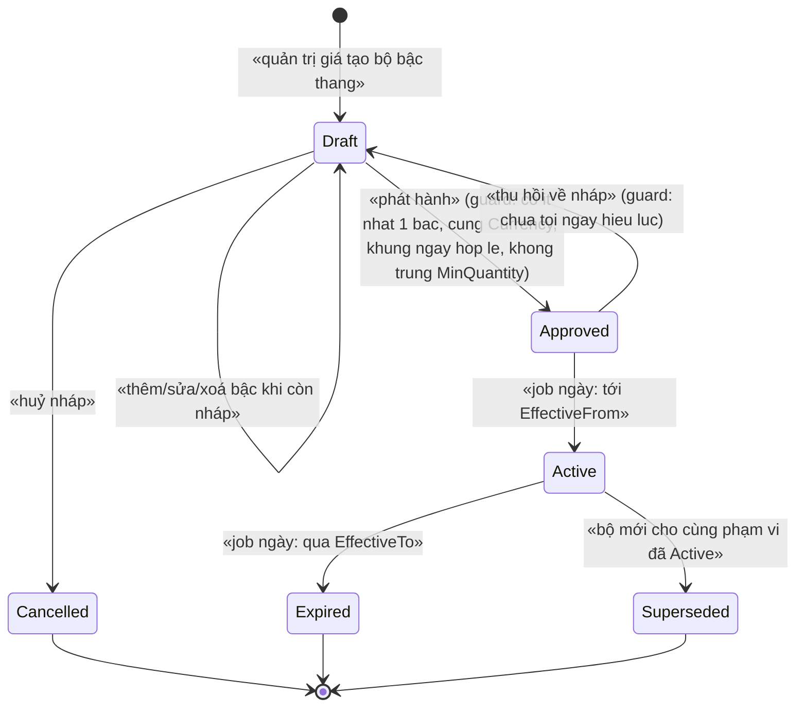
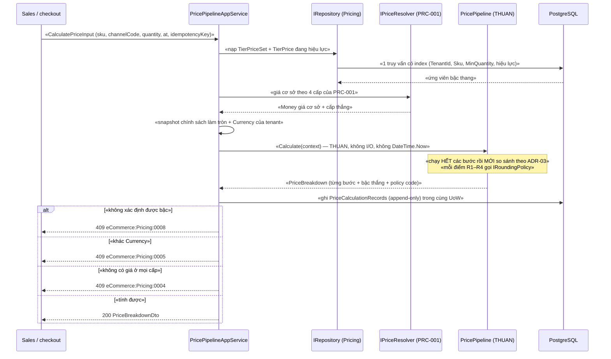
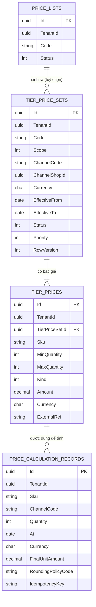

# `PRC-002` — Giá bậc thang (tier) và pipeline tính giá + làm tròn

| Thuộc tính | Nội dung |
|---|---|
| **Mã** | `PRC-002` |
| **Module** | **Pricing** — `modules/Pricing/eCommerce.Pricing.Domain` + `eCommerce.Pricing.EntityFrameworkCore` (+ `.Application` / `.Application.Contracts`) |
| **Giai đoạn** | **GĐ1 — Bán được** (mục "Pricing" của `implementation-plan.md` §7.1, dòng 178; danh mục tài liệu Phụ lục A.3 dòng 403) |
| **Ưu tiên** | **Must have** |
| **Trạng thái** | 🟡 `Draft` — chờ review |
| **Người viết / người review** | *(điền)* / **Kiến trúc trưởng + Kế toán** |
| **Phiên bản / ngày** | `v0.1 — 14/10/2026` |
| **Tài liệu liên quan** | **`PRC-001`** (bảng giá & giá theo kênh — cấp 4 của pipeline) · **`XC-001`** (Money/Currency/làm tròn — nền bắt buộc) · **`XC-003`** (khoá phân tán) · **`XC-004`** (permission/tenant) · **`XC-002`** (outbox/inbox & idempotency) · **`XC-005`** (observability/metric) · **`XC-006`** (thuế theo SKU — điểm làm tròn R4) · `SAL-002` (checkout tính lại giá) · `PRO-001`/`PRO-002` (khuyến mãi — cắm vào pipeline) · `CAT-001` · `implementation-plan.md` |

> 📌 **Quy ước mã trong tài liệu này** (theo yêu cầu mã hoá): ADR đánh số **`ADR-nn`** (§0.1);
> Business Rule đánh số **`BR-PRC-002-nnn`**, phi chức năng **`NFR-PRC-002-nnn`**, test case **`TC-nn`** —
> kế thừa đúng quy ước của `PRC-001` và `XC-003` (mã BR gắn module để không đụng giữa 52 tài liệu).

---

## 0. Tóm tắt & quyết định thiết kế

**Tóm tắt:** `PRC-002` chốt ba thứ mà `PRC-001` **cố ý** để lại (xem `PRC-001` §0 "Không nằm trong phạm vi"):
(1) **giá bậc thang** — mua số lượng lớn thì đơn giá khác, và bậc là **dữ liệu** chứ không phải `if` trong code;
(2) **pipeline tính giá có thứ tự tường minh** — *chạy hết mọi bước rồi MỚI so sánh/chọn*, trả về **breakdown
giải trình được** (vì sao SKU này ra con số này); (3) **chính sách làm tròn** dùng chung — mọi điểm làm tròn
phải đi qua **một** `IRoundingPolicy` của `XC-001`, và làm tròn **theo từng dòng**.

**Vì sao phải có tài liệu này — đã kiểm trong repo (không viết theo trí nhớ):**

| # | Quan sát thật | Đường dẫn (đã kiểm bằng read/grep) | Hệ quả nếu không chốt trước |
|---|---|---|---|
| 1 | **Module `Pricing` CHƯA có.** `modules/` chỉ có `ChannelHub`, `PaymentHub`, `Tax` | liệt kê thư mục `modules/` (3 thư mục con) | Toàn bộ §5/§6/§11 dưới đây là **kế hoạch GĐ1**, không phải mô tả code đã có |
| 2 | **Chưa có `TierPrice`/`MinQuantity`/`QuantityBreak`/`VolumePrice` ở bất kỳ đâu** | `grep -r "Tier\|MinQuantity\|QuantityBreak\|VolumePrice"` trên toàn bộ `*.cs` (trừ `obj`/`bin`) → **0 match** | Giá bậc thang là **hoàn toàn mới**; không có gì để tái dùng |
| 3 | **Chưa có `Money`/`Currency`/`IRoundingPolicy`** — thư mục `shared/` **không tồn tại** | `grep -r "record struct Money\|class Money\|struct Currency\|RoundingPolicy"` → **0 match**; `Test-Path shared` → `False` | `XC-001` là **phụ thuộc chặn**: pipeline không thể viết trước khi có `Money` |
| 4 | Làm tròn hiện **rải rác, mỗi nơi một kiểu** (đúng 2 chỗ) | `modules/PaymentHub/eCommerce.PaymentHub.Application/Providers/VnPayPaymentProvider.cs:72` (`decimal.Round(..., MidpointRounding.AwayFromZero)`) · `modules/Tax/eCommerce.Tax.Domain/Mau01/Mau01Part2Calculator.cs:65,106-107` (`SoChuSoThapPhanTien = 0` + hàm `LamTron` riêng) | Nếu `PRC-002` không chốt **một** chính sách thì chỗ thứ ba, thứ tư sẽ mọc ra ⇒ lệch 1–2 đồng giữa màn hình và hoá đơn |
| 5 | **Giá niêm yết là `decimal` trần, KHÔNG có cột tiền tệ** | `src/eCommerce.Domain/Entities/Catalog/Product.cs:71` (`public decimal Price`), map `numeric(18,4)` tại `src/eCommerce.EntityFrameworkCore/eCommerceDbContext.cs:126-127` | Bậc thang **phải** có `Currency` ngay từ đầu, nếu không sẽ lặp lại nợ kỹ thuật của `PRC-001` **F4** |
| 6 | **Giá theo kênh chỉ là "một con số"**, không có bậc, không có hiệu lực | `modules/ChannelHub/eCommerce.ChannelHub.Domain/Entities/ChannelEntities.cs:136` (`decimal? ChannelPrice`), map tại `modules/ChannelHub/eCommerce.ChannelHub.EntityFrameworkCore/ChannelHubDbContextModelCreatingExtensions.cs:66` | Bậc số lượng không thể nhét vào `ChannelListing` (sẽ phình + không giải trình được) |
| 7 | Đơn hàng **đã** có chỗ chụp giá tại thời điểm mua + cộng tổng theo dòng | `src/eCommerce.Domain/Entities/Orders/Order.cs:92-96` (`Recalculate`), `:98-102` (`SetDiscount`), `:139` (`LineTotal = UnitPrice*Quantity - DiscountAmount + TaxAmount`) | Pipeline **phải** trả kết quả theo **từng dòng** để `SAL-002` chụp vào `OrderLine` — không trả một con số tổng |
| 8 | **Mô hình vòng đời + hiệu lực theo ngày ĐÃ kiểm chứng trong repo** (Tax) | `modules/Tax/eCommerce.Tax.Domain/Classifications/TaxClassification.cs:39-46` (hiệu lực + status), `:93-96` (`IsUsableAt`), `:137-146` (`ActivateIfDue`), `:172-181` (`ExpireIfDue`), `:192-199` (`EnsureDraft` → **ném lỗi**) | `PRC-002` **tái dùng** mô hình này thay vì tự phát minh |
| 9 | **Resolver thuần + service nạp dữ liệu** đã có tiền lệ | `modules/Tax/eCommerce.Tax.Domain/Classifications/TaxRateResolver.cs:21-27` + `TaxRateResolverService.cs:33-63` | Pipeline giá làm **y hệt**: thuần, không I/O ⇒ test được mọi bậc không cần DB |
| 10 | **Metric cho giá: KHÔNG có.** Danh sách metric đã đăng ký không có mục nào về giá, và **nhãn `sku` bị CẤM** | `src/eCommerce.Domain.Shared/Observability/eCommerceMetrics.cs:38-52` (12 tên), `:75-78` (allowlist nhãn), `:83` (forbidden: `sku`, `orderId`, …) | Metric mới **phải** đăng ký ở **2 nơi** (`eCommerceMetrics.cs` + `XC-005` §5.1) và **không** được gắn `sku` |
| 11 | **Mọi unique index có `TenantId` PHẢI `NULLS NOT DISTINCT`** (nếu không thì index mất tác dụng khi `TenantId = NULL`) | tiền lệ thật: `src/eCommerce.EntityFrameworkCore/Migrations/20261013024226_Fix_NullableTenantId_UniqueIndexes.cs:39-86` | Bảng mới của `PRC-002` **phải** làm y hệt, EF Core **không** khai báo được |
| 12 | **`IIdempotencyGuard` + `InboxRecords` CHƯA có**; outbox/inbox trên DbContext **chưa** bật | `grep -r "IIdempotency\|InboxRecord\|IHasEventOutbox\|useOutbox"` → **0 match** | Mọi BR về idempotency ở đây **không thực thi được** cho tới khi `XC-002` xong ⇒ `XC-002` là **phụ thuộc chặn** |
| 13 | **Không có permission nào của Pricing**; bảng permission hiện có **21** định nghĩa | `src/eCommerce.Domain.Shared/eCommerceConsts.cs:15-74` (không có nhóm Pricing) + `src/eCommerce.Application.Contracts/Permissions/eCommercePermissionDefinitionProvider.cs:23-60` | Thiếu định nghĩa ⇒ **`403` cho MỌI người kể cả admin** (`XC-004` E3/TC-02) |
| 14 | **Entity của module phải có `DbSet` trên DbContext hợp nhất**, nếu không `IRepository<T>` **không được đăng ký** | `src/eCommerce.EntityFrameworkCore/eCommerceDbContext.cs:48-52` (ghi chú lỗi Phase 0) + `:63-64` (DbSet của Tax) + `:76-78` (gọi `ConfigureXxx()`) | 3 entity mới ⇒ **3 `DbSet`** + `builder.ConfigurePricing()` |
| 15 | **Hai quy ước khoá phân tán đang MÂU THUẪN trong repo** (xem §15.2 **F1–F3**) | `ChannelHubConsts.cs:22-31` (không tiền tố, **đang dùng thật** ở `ChannelTokenManager.cs:67-72`) vs `TaxErrorCodes.cs:45-50` (có tiền tố `ecommerce:`) vs `eCommerceConsts.cs:103-104` (có tiền tố) — trong khi `AbpDistributedLockOptions.KeyPrefix = "ecommerce:"` tại `src/eCommerce.HttpApi.Host/eCommerceHttpApiHostModule.cs:127` | Nếu `PRC-002` chép sai quy ước ⇒ khoá thật thành `ecommerce:ecommerce:…` ⇒ **khoá không bảo vệ gì, không có lỗi biên dịch** |

**Phạm vi:**
- ✅ Entity **`TierPriceSet`** (bộ bậc thang — aggregate root có vòng đời/hiệu lực/duyệt) + **`TierPrice`** (từng bậc: `MinQuantity` → đơn giá hoặc mức giảm).
- ✅ **Pipeline tính giá** có thứ tự tường minh (8 bước, §4.2), **thuần** (không I/O), trả **`PriceBreakdown`** từng bước + bậc thắng + mã chính sách làm tròn.
- ✅ **Chính sách làm tròn**: điểm làm tròn cố định **R1–R4**, làm tròn **theo từng dòng**, mặc định `AwayFromZero`, snapshot 1 lần cho mỗi lần tính.
- ✅ **Sổ giải trình giá** `PriceCalculationRecords` (**append-only**) + `IdempotencyKey` để tái lập và chống ghi trùng.
- ✅ Hợp đồng `IPricePipeline` cho `SAL-002`, điểm cắm `IPriceAdjustment` cho `PRO-*`, mã lỗi, permission, migration/seed, test case.

**Không nằm trong phạm vi:**
- ❌ **Bảng giá & giá theo kênh** (`PriceList`, `PriceListItem`, `ChannelPrice`, `CostPrice`, `IPriceResolver`) — thuộc **`PRC-001`**; `PRC-002` **gọi** nó như **bước 2** của pipeline, **không** định nghĩa lại.
- ❌ **Engine khuyến mãi** (voucher/coupon/flash sale, cây điều kiện AND/OR) — thuộc **`PRO-001`/`PRO-002`**. `PRC-002` chỉ chốt **vị trí** của nó trong pipeline (bước 4) và interface cắm vào.
- ❌ **Thuế GTGT theo SKU / mức thuế theo thời gian** — thuộc **`XC-006`** (module `Tax`); `PRC-002` chỉ chốt **thứ tự** (thuế tính **sau** giảm giá, trên **từng dòng**) và điểm làm tròn **R4**.
- ❌ **Phí vận chuyển** — thuộc `SHP-*`; `PRC-002` chỉ chốt vị trí và yêu cầu bảo toàn tổng khi phân bổ.
- ❌ **Đa tiền tệ hoạt động thật + tỷ giá** — `XC-001` BR-009: chỉ `VND` chạy thật.
- ❌ **Bậc thang theo nhóm khách** (`CustomerGroupId`) — **chưa chốt**, xem §15.1 **Q2** (đề xuất: **không** làm ở GĐ1).
- ❌ **Sửa `ProductVariant.Price` / `ChannelListing.ChannelPrice`** — hai entity này thuộc **Catalog** và **ChannelHub** (module khác). `PRC-002` chỉ **đọc** (qua cấp 4 của `PRC-001`) và ghi nhận nợ ở §15.2 **F6**.
- ❌ **Ký số / hoá đơn điện tử** — không liên quan.

### 0.1 Quyết định thiết kế (ADR ngắn)

| # | Quyết định | Phương án đã cân nhắc | Lý do chọn | Hệ quả |
|---|---|---|---|---|
| **ADR-01** | Bậc thang là **entity riêng của Pricing**: `TierPriceSet` (cha) + `TierPrice` (con) | (a) thêm cột bậc vào `PriceListItem` của `PRC-001` · (b) nhét mảng bậc vào `ChannelListing` · (c) **bảng riêng** | (a) **không chứa nổi**: `PRC-001` BR-008 chốt `PriceListItem` unique theo `(TenantId, PriceListId, Sku)` ⇒ **một SKU chỉ một dòng** ⇒ không có chỗ cho nhiều bậc. (b) **đang là hiện trạng** đúng anti-pattern: `ChannelEntities.cs:136` chỉ có **một** `ChannelPrice`. (c) khớp kết luận khảo sát: *"`TierPrice` tách thành entity riêng … không nhét vào Product"* (`business-modules-proposal.md:243`) | Thêm 2 bảng + 2 `DbSet`; `implementation-plan.md` §7.1 (dòng 178) **chỉ liệt kê `TierPrice`** ⇒ **phải bổ sung `TierPriceSet`** vào kế hoạch khi tài liệu này Approved |
| **ADR-02** | Chọn bậc = bậc có `MinQuantity` **lớn nhất** ≤ `quantity`; **hai bậc cùng `MinQuantity` ⇒ NÉM LỖI** | (a) lấy bậc **đầu tiên** khớp theo thứ tự duyệt · (b) lấy giá **thấp nhất** · (c) **ném lỗi** dữ liệu trùng | (a) ⇒ kết quả phụ thuộc thứ tự duyệt ⇒ **không test được**, đúng loại lỗi `XC-003` F1 (im lặng, không lỗi biên dịch). Tinh thần `XC-001` Q6: *"từ chối rõ ràng tốt hơn hỗ trợ nửa vời"* | Cần mã lỗi riêng `eCommerce:Pricing:0008`; unique index `(TenantId, TierPriceSetId, Sku, MinQuantity)` là hàng rào DB (§5.2) |
| **ADR-03** | Pipeline **chạy HẾT các bước rồi MỚI so sánh/chọn** — **cấm áp mù** | (a) áp theo thứ tự gặp · (b) chạy hết rồi so | Bài học đã khảo sát: Smartstore chạy hết pipeline (kể cả discount) **rồi mới** so giá tier tối thiểu với giá cuối — *"không áp mù"* (`business-modules-proposal.md:192`); `PRC-001` D5/BR-009 chốt y hệt cho tầng resolve | Kết quả **phải** kèm `AllCandidates` + thứ tự bước để kiểm chứng; test `TC-07` khẳng định kết quả **độc lập** với thứ tự duyệt |
| **ADR-04** | `IPricePipeline` là **hàm THUẦN** (nhận dữ liệu đã nạp), service mới nạp DB | (a) pipeline tự truy vấn · (b) pipeline thuần + service nạp | (a) ⇒ không test được nếu thiếu PostgreSQL và trộn I/O với luật tiền. Tiền lệ **đã có trong repo**: `TaxRateResolver` thuần (`TaxRateResolver.cs:21-27`) + `TaxRateResolverService` nạp rồi giao lại (`TaxRateResolverService.cs:33-63`) | App service **phải** nạp đủ 1 lần (NFR-002); pipeline **cấm** `DateTime.Now` — ngày `at` truyền vào (test được mốc thời gian) |
| **ADR-05** | Mọi làm tròn **chỉ** qua `IRoundingPolicy` của `XC-001`; **cấm** `decimal.Round`/`Math.Round` trong `modules/Pricing` | (a) gọi `decimal.Round` tại chỗ · (b) một policy dùng chung | (a) là **hiện trạng** (2 chỗ: `VnPayPaymentProvider.cs:72`, `Mau01Part2Calculator.cs:106-107`) và chính là nguồn lệch tiền. `XC-001` D4 đã chốt policy cấu hình được + audit | Test quét mã nguồn `TC-12` (NFR-005). ⚠️ **Hai chỗ hiện có KHÔNG bị coi là sai**: chúng ở module khác và có ngữ cảnh riêng (VNPay ×100; thuế) — xem §15.2 **F5** |
| **ADR-06** | Làm tròn **theo TỪNG DÒNG**; tổng đơn = **Σ dòng đã làm tròn**; **cấm** làm tròn trên tổng | (a) làm tròn tổng · (b) làm tròn từng dòng rồi cộng | `XC-001` BR-005 đã chốt: *"Thuế/VAT làm tròn theo TỪNG DÒNG; tổng đơn = tổng các dòng đã làm tròn (không làm tròn tổng)"*. Với VND, hai cách **lệch 1–2 đồng** | UI **phải** hiển thị tổng = tổng các dòng (`XC-001` §10) — đây là loại lệch rất dễ bị báo nhầm là bug |
| **ADR-07** | **Điểm làm tròn cố định R1–R4** (§4.2); **cấm** làm tròn ở bước khác | (a) làm tròn tuỳ chỗ · (b) danh sách điểm cố định | Làm tròn "ở đâu cũng được" ⇒ không suy luận được kết quả, không tái lập được, và lệch giữa 2 đường tính (giỏ hàng vs checkout) | Bảng R1–R4 trở thành **hợp đồng**; test `TC-08`, `TC-09` |
| **ADR-08** | Chính sách làm tròn là **Setting đọc 1 lần** cho mỗi lần tính; mã policy **lưu vào** sổ giải trình | (a) đọc lại mỗi bước · (b) snapshot đầu pipeline | `XC-001` §8.2 #1: *"Chính sách đọc một lần vào đầu request (snapshot) ⇒ request đang chạy dùng chính sách cố định"* | `PriceBreakdown` **phải** chứa `RoundingPolicyCode` ⇒ giải trình được "vì sao hôm đó ra số này" |
| **ADR-09** | Bậc thang là **DỮ LIỆU** (nhập/duyệt qua API), **cấm** hard-code ngưỡng/tỷ lệ | (a) `if (quantity >= 10) price *= 0.9m` trong code · (b) bảng dữ liệu | Đúng bài học `XC-006`: *"danh mục là DỮ LIỆU: … nếu nhúng vào code thì MỖI LẦN LUẬT ĐỔI phải release lại phần mềm"* (`TaxClassification.cs:11-14`) | Cần UI nhập + import; seed **không** tạo giá thật (§11) |
| **ADR-10** | Vòng đời `TierPriceSet` **tái dùng mô hình đã kiểm chứng** của `TaxClassification`: `Draft → Approved → Active → Expired/Superseded/Cancelled`, **append-only khi `Active`** | (a) sửa tại chỗ, một bảng "sống" · (b) hiệu lực + version + duyệt | Mô hình (b) **đã kiểm chứng trong repo**: `TaxClassification.cs:39-46,93-96,122-134,192-199`; và `PRC-001` D4/§3.1 chốt cùng mô hình cho `PriceList` ⇒ **một cách làm duy nhất** trong hệ thống | Cần job theo ngày; mọi truy vấn **bắt buộc** kèm điều kiện ngày |
| **ADR-11** | Guard do **thời gian** ⇒ **trả `false`**; guard do **người/API** ⇒ **NÉM** `BusinessException` có mã | (a) ném ở mọi nhánh · (b) tách 2 loại | Tiền lệ **đã có**: `ActivateIfDue`/`ExpireIfDue` trả `false` (`TaxClassification.cs:137-146,172-181`) còn `Approve`/`Supersede`/`EnsureDraft` **ném** (`:122-134,:149-169,:192-199`). "Chưa tới ngày" **không phải** vi phạm guard | Ranh giới phải ghi rõ trong §3 để không ai "sửa" thành im lặng |
| **ADR-12** | Hàm sinh khoá phân tán của Pricing **KHÔNG chứa tiền tố `ecommerce:`** | (a) chứa tiền tố (như `TaxLockKeys` — `TaxErrorCodes.cs:45-50`) · (b) **không** chứa (như `ChannelHubConsts.LockKeys` — `ChannelHubConsts.cs:22-31`) | ABP ghép **`KeyPrefix + tên khoá` KHÔNG có dấu phân cách**, và `KeyPrefix` **đã là** `"ecommerce:"` (`src/eCommerce.HttpApi.Host/eCommerceHttpApiHostModule.cs:115-128`). `XC-003` §5.4 **hệ quả #2** phát biểu chính xác điều này. Chọn (a) ⇒ khoá thật `ecommerce:ecommerce:pricing:…` ⇒ **sai quy ước BR-002 của `XC-003`** | `PRC-001` §8.2 (dòng 618 & 623-624) đang nói **ngược lại** ⇒ xem **F3** §15.2. Test `TC-22` chặn tiền tố đôi |
| **ADR-13** | Có **sổ giải trình giá** `PriceCalculationRecords` (**append-only**) + `IdempotencyKey` bắt buộc | (a) chỉ log ra file · (b) bảng append-only | (a) không truy vấn/đối soát được, log bị rotate; câu hỏi *"vì sao đơn này giá này?"* sẽ quay lại nhiều lần (khách khiếu nại, kế toán đối soát, kiểm toán). Cùng triết lý **sổ cái append-only** (nguyên tắc #8 `implementation-plan.md:51`) | Thêm 1 bảng + dung lượng tăng theo số lần tính (xem **Q8**); `TC-15`, `TC-16` |
| **ADR-14** | Chiến lược chọn đơn giá cuối: **mặc định `UseByPriority`**, có thể cấu hình `LowestPrice`; mọi so sánh tiền bằng **`ToMinorUnits()`** | (a) chỉ `UseByPriority` · (b) cấu hình được | (b) khớp mô hình `PriceListStrategy` của nopCommerce đã khảo sát (`business-modules-proposal.md:244`) và `PRC-001` D7 (đã có `SelectionStrategy`). So tiền bằng `ToMinorUnits()` là **bắt buộc** theo `XC-001` BR-003/D3 | Bề mặt test tăng (2 chiến lược × 4 cấp); nếu BA không cần `LowestPrice` ở GĐ1 ⇒ **Q4** cho phép bỏ (giảm test) |

---

## 1. Use Case Specification

| Thuộc tính | Nội dung |
|---|---|
| **Use Case ID** | `PRC-002` |
| **Use Case Name** | Khai báo giá bậc thang và tính giá theo pipeline có thứ tự, làm tròn theo chính sách |
| **Description** | *"Là quản trị giá, tôi muốn khai báo giá theo bậc số lượng (mua nhiều rẻ hơn) và để mọi đường tính giá trong hệ thống chạy **cùng một pipeline** — để giỏ hàng, checkout và hoá đơn luôn ra **cùng một con số**, và luôn trả lời được **vì sao** ra con số đó."* |
| **Actor(s)** | **Quản trị giá** (khai báo/duyệt bậc thang) · **Kế toán trưởng** (duyệt bậc thang + duyệt chính sách làm tròn) · **`SAL-002`/Sales** (gọi `IPricePipeline` — đường nóng) · **`PRO-001`/`PRO-002`** (cắm `IPriceAdjustment` vào bước 4) · **Job** (chuyển trạng thái theo ngày) · **Hệ thống** (`IPriceResolver` của `PRC-001`, `IRoundingPolicy` của `XC-001`, module `Tax`) |
| **Priority** | **Must have** |
| **Trigger** | (a) checkout/giỏ hàng cần tính giá (`SAL-002`); (b) người dùng tạo/sửa/duyệt bộ bậc thang; (c) job theo ngày `Approved → Active` / `Active → Expired`; (d) import hàng loạt bậc thang; (e) quản trị đổi chính sách làm tròn |
| **Pre-Condition(s)** | • **Tenant hiện tại** (`TenantId` từ `ICurrentTenant`) — `TierPriceSet`/`TierPrice`/`PriceCalculationRecords` là `IMultiTenant`.<br>• **Kênh bán** (`ChannelCode`) — **bắt buộc** cho mọi lần tính giá (kể cả kênh website: mã `web`); giá trị phải tồn tại trong `ChnChannels` (`modules/ChannelHub/eCommerce.ChannelHub.EntityFrameworkCore/ChannelHubDbContextModelCreatingExtensions.cs:23,27` — `Channel.Code` unique toàn hệ thống).<br>• **SKU** đã tồn tại trong Catalog — `ProductVariant.Sku` unique theo tenant (`src/eCommerce.EntityFrameworkCore/eCommerceDbContext.cs:129`). ⚠️ Pricing **không** tham chiếu trực tiếp `eCommerce.Catalog.*` (rành buộc kế thừa từ `PRC-001` §15.1 **Q1** — **chưa chốt**).<br>• 🔴 **`Money`/`Currency`/`IRoundingPolicy` của `XC-001` đã có trong `eCommerce.Kernel`** — **chưa có trong code** (`grep` → 0 match; `shared/` không tồn tại) ⇒ **phụ thuộc chặn** (§14.4).<br>• 🔴 **`PRC-001` đã có `IPriceResolver`** (cấp 1–4) — module `Pricing` **chưa tồn tại** ⇒ **phụ thuộc chặn** thứ hai.<br>• Ngày tính giá `at` **bắt buộc** truyền vào (BR-012) — **cấm** dùng `DateTime.Now` bên trong pipeline.<br>• `ChannelShopId` **chỉ** có mặt khi bộ bậc thang áp cho **một shop cụ thể**; không áp dụng cho kênh website. |
| **Post-Condition(s)** | • Mọi số tiền trả về là `Money` **đã chuẩn hoá** về `Currency.Decimals` (`XC-001` BR-001) và **kèm breakdown từng bước** + bậc thắng + `RoundingPolicyCode` (BR-006/BR-010/BR-019).<br>• Tổng đơn = **Σ các dòng đã làm tròn** — **không** làm tròn trên tổng (BR-008).<br>• Mọi lần tính giá **có** một bản ghi append-only trong `PriceCalculationRecords` **trong cùng Unit of Work** (BR-020).<br>• Bộ bậc thang `Active` **không** bị sửa (append-only) — muốn đổi phải tạo bộ mới (BR-015).<br>• Mọi chuyển trạng thái + mọi đổi chính sách làm tròn **có audit** (`XC-001` BR-004, `XC-004` BR-011). |
| **Basic Flow** | 1. Quản trị giá tạo `TierPriceSet` (`Code`, `Name`, `Scope`, `ChannelCode?`, `Currency`, `EffectiveFrom/To`) ⇒ `Draft`.<br>2. Thêm các `TierPrice` (`Sku`, `MinQuantity`, `Kind`, `Amount`, `Currency`) ⇒ hệ thống **chuẩn hoá** `Amount` qua `Money.Of` + làm tròn theo `IRoundingPolicy`.<br>3. Quản trị giá **Phát hành** ⇒ `Draft → Approved` (guard: ≥ 1 bậc, cùng `Currency`, khung ngày hợp lệ, **không** trùng `MinQuantity`, **không** chồng khung cùng phạm vi) ⇒ **NÉM LỖI** nếu vi phạm.<br>4. Job hằng ngày: tới `EffectiveFrom` ⇒ `Approved → Active`; quá `EffectiveTo` ⇒ `Active → Expired`.<br>5. `SAL-002` gọi `IPricePipeline.Calculate(context)`: nạp dữ liệu (1 lần) → **snapshot chính sách** → chạy **8 bước** (§4.2) → trả `PriceBreakdown`.<br>6. App service ghi `PriceCalculationRecords` (**append-only**) + phát `PriceCalculatedEto` **trong cùng UoW**.<br>7. `SAL-002` chụp `UnitPrice`/`DiscountAmount`/`TaxAmount` đã làm tròn vào `OrderLine` (`src/eCommerce.Domain/Entities/Orders/Order.cs:139`). |
| **Alternative Flow** | **A1: Không có bậc nào khớp số lượng** ⇒ dùng giá cơ sở (cấp 1–4 của `PRC-001`) và **ghi rõ** `SelectedTier = BasePrice` trong breakdown; nếu **không có cả** giá cơ sở ⇒ theo `MissingPricePolicy` (`PRC-001` D14: mặc định **ném** `eCommerce:Pricing:0004`).<br>**A2: Nhiều bậc cùng `MinQuantity`** ⇒ **NÉM** `eCommerce:Pricing:0008` — **cấm** chọn tuỳ tiện (ADR-02).<br>**A3: Nhiều ứng viên cùng cấp cùng `Priority`** ⇒ **NÉM** `eCommerce:Pricing:0001` (`PRC-001` D7) — `PRC-002` **không** nới lỏng luật này.<br>**A4: Chiến lược `LowestPrice`** ⇒ chạy hết pipeline rồi chọn **giá thấp nhất trong các ứng viên hợp lệ**; bằng nhau ⇒ so `Priority`, vẫn bằng ⇒ **NÉM** `0001`.<br>**A5: Import hàng loạt bậc thang** ⇒ nhận **JSON DTO** + `IdempotencyKey` ổn định; chạy lại **cùng khoá** ⇒ trả kết quả cũ, **0** bản ghi mới (BR-016).<br>**A6: Chưa đăng ký `IPriceAdjustment` nào** (chưa có `PRO-*`) ⇒ bước 4 là **no-op có ghi nhận** trong breakdown (`Skipped: NoProvider`) — **không** phải lỗi.<br>**A7: Kế toán duyệt chính sách làm tròn** ⇒ đổi Setting `eCommerce.Money.RoundingPolicy` (`XC-001` §9) ⇒ **chỉ áp cho lần tính MỚI**, không hồi tố (BR-011). |
| **Exception Flow** | **E1:** phát hành bộ bậc thang vi phạm guard (0 bậc / khác `Currency` / khung ngày sai / trùng `MinQuantity`) ⇒ `eCommerce:Pricing:0002` hoặc `0008` (`400`/`409`).<br>**E2:** sửa/xoá bộ bậc thang đang `Active` ⇒ `eCommerce:Pricing:0003` (`409`) — append-only (ADR-10).<br>**E3:** không có giá ở mọi cấp và policy = `Throw` ⇒ `eCommerce:Pricing:0004` (`409`) kèm `Sku`/`ChannelCode`/`At`.<br>**E4:** `Currency` của bậc khác `Currency` của kênh/tenant ⇒ `eCommerce:Pricing:0005` (`409`) — **không** tự quy đổi (BR-018).<br>**E5:** bậc `PercentOff` có `Amount` ngoài `[0,100]` ⇒ `eCommerce:Pricing:0009` (`400`).<br>**E6:** chồng khung hiệu lực cùng `(Scope, ChannelCode, ChannelShopId)` ⇒ `eCommerce:Pricing:0010` (`409`).<br>**E7:** chính sách làm tròn không hợp lệ/không hỗ trợ ⇒ `eCommerce:Pricing:0011` (`400`).<br>**E8:** `Σ dòng đã làm tròn ≠ tổng` (lỗi thuật toán/`MoneyAllocator`) ⇒ **`InvalidOperationException`** ⇒ `eCommerce:Pricing:0012` (`500`) + log `Error` — **phải lộ ra CI**, không nuốt (`XC-001` §12 cùng nguyên tắc).<br>**E9:** import thiếu `IdempotencyKey` ⇒ `eCommerce:Pricing:0006` (`400`) — **trước khi** ghi bất cứ dòng nào.<br>**E10:** `RowVersion` lệch khi hai người sửa cùng bộ ⇒ `eCommerce:Pricing:0007` (`409`).<br>**E11:** khoá phân tán bận khi job kích hoạt / import ⇒ `eCommerce:Lock:0001` (`409`) theo `XC-003` (§8.2). |
| **Business Rules** | • **BR-PRC-002-001**: Mọi giá/tiền trong Pricing **phải** là `Money` (có `Currency`); **cấm** lưu `decimal` tiền mà **không** có cột tiền tệ đi kèm.<br>• **BR-PRC-002-002**: **Cấm** `double`/`float` trong bất kỳ biểu thức tiền nào (entity, DTO, adapter).<br>• **BR-PRC-002-003**: **Cấm** so sánh tiền bằng `==` trên `decimal`; so bằng `ToMinorUnits()` (`XC-001` BR-003).<br>• **BR-PRC-002-004**: Bậc được chọn = bậc có `MinQuantity` **lớn nhất** ≤ `quantity`; **không** bậc nào thoả ⇒ dùng giá cơ sở và ghi rõ trong breakdown.<br>• **BR-PRC-002-005**: Hai bậc cùng `(Sku, MinQuantity)` trong cùng bộ ⇒ **NÉM** `eCommerce:Pricing:0008`; **cấm** chọn theo thứ tự duyệt.<br>• **BR-PRC-002-006**: Pipeline **chạy HẾT** mọi bước **rồi mới** so sánh/chọn; kết quả **phải** kèm `PriceBreakdown` từng bước + danh sách ứng viên.<br>• **BR-PRC-002-007**: Làm tròn **chỉ** qua `IRoundingPolicy`; **cấm** `decimal.Round`/`Math.Round` trong `modules/Pricing`.<br>• **BR-PRC-002-008**: Làm tròn **theo TỪNG DÒNG**; tổng = **Σ các dòng đã làm tròn**; **cấm** làm tròn trên tổng (`XC-001` BR-005).<br>• **BR-PRC-002-009**: Làm tròn **chỉ** tại 4 điểm cố định R1–R4 (§4.2); **cấm** làm tròn ở bước khác.<br>• **BR-PRC-002-010**: Chính sách làm tròn đọc **đúng 1 lần** cho mỗi lần tính; mã policy **phải** được lưu vào bản ghi giải trình.<br>• **BR-PRC-002-011**: Làm tròn mặc định `AwayFromZero`; đổi chính sách **phải** có audit và **không** hồi tố dữ liệu đã ghi (`XC-001` BR-004/§9).<br>• **BR-PRC-002-012**: Bậc thang có hiệu lực theo khoảng `[EffectiveFrom, EffectiveTo]`; truy vấn giá **bắt buộc** kèm tham số ngày; **cấm** truy vấn "mới nhất" không ngày.<br>• **BR-PRC-002-013**: `Amount ≥ 0`; với `Kind = PercentOff` thì `0 ≤ Amount ≤ 100`; **cấm** tạo giá âm (giảm giá dùng `PRO-*`).<br>• **BR-PRC-002-014**: Bậc thang là **DỮ LIỆU**: **cấm** hard-code ngưỡng/tỷ lệ trong code và **cấm** seed dữ liệu giá thật.<br>• **BR-PRC-002-015**: Bộ bậc thang `Active` là **append-only**; mọi chuyển trạng thái sai guard **phải NÉM** `BusinessException` có mã — **cấm** no-op im lặng.<br>• **BR-PRC-002-016**: Mọi biên vào ghi bậc thang / ghi bản ghi giải trình **phải** idempotent (`IdempotencyKey` **ổn định** + inbox + unique index); **cùng khoá khác payload** ⇒ **NÉM** `eCommerce:Messaging:0002` (`XC-002` BR-006).<br>• **BR-PRC-002-017**: Phân bổ giảm giá/phí theo dòng **phải bảo toàn tổng** (`Σ == total`) — dùng `MoneyAllocator` (`XC-001` BR-006).<br>• **BR-PRC-002-018**: Khác `Currency` ⇒ **NÉM** `eCommerce:Pricing:0005`; **cấm** tự quy đổi tiền tệ.<br>• **BR-PRC-002-019**: Kết quả tính giá **phải TÁI LẬP được**: cùng input + cùng phiên bản rule/policy ⇒ cùng kết quả (so bằng `ToMinorUnits()`).<br>• **BR-PRC-002-020**: `PriceCalculationRecords` là **sổ append-only** — **cấm** UPDATE/DELETE.<br>• **BR-PRC-002-021**: Giá vốn (`CostPrice` của `PRC-001`) **cấm** lộ ra storefront/DTO công khai, và **cấm** xuất hiện trong `PriceBreakdown` trả cho người mua (`PRC-001` BR-013). |
| **Non-Functional Requirement** | • **NFR-PRC-002-001**: `CalculatePrice` p95 **< 30 ms** cho 1 dòng với **500** bậc thang hiệu lực (PostgreSQL 17 thật).<br>• **NFR-PRC-002-002**: Số truy vấn DB cho **một** lần tính **≤ 4** (không N+1).<br>• **NFR-PRC-002-003**: **0** `double`/`float` trong `modules/Pricing` (test reflection).<br>• **NFR-PRC-002-004**: **0** so sánh tiền bằng `==` trong `modules/Pricing` (quét mã nguồn).<br>• **NFR-PRC-002-005**: **0** `decimal.Round`/`Math.Round` trong `modules/Pricing` (quét mã nguồn).<br>• **NFR-PRC-002-006**: Property-based **10.000** bộ: `Σ dòng đã làm tròn == tổng`, lệch **0** đồng.<br>• **NFR-PRC-002-007**: Tái lập: **1.000/1.000** lần chạy cùng input ⇒ cùng kết quả.<br>• **NFR-PRC-002-008**: **100 %** nhánh state machine §3 có test, **kể cả** nhánh guard sai.<br>• **NFR-PRC-002-009**: **100 %** app service của Pricing có `[Authorize]` **cấp class**; **0** permission "mồ côi" (`XC-004` TC-01/TC-02).<br>• **NFR-PRC-002-010**: Metric mới **phải** có tên trong `eCommerceMetricNames` (`eCommerceMetrics.cs:38-52`) **và** `XC-005` §5.1; **0** nhãn ngoài allowlist; **0** nhãn `sku`. |
| | • **NFR-PRC-002-011**: Cách ly tenant — tenant A **không** đọc/ghi được bậc thang của tenant B (integration 2 tenant). |

> ⚠️ **Ghi chú về ô "Basic Flow" ở trên:** các bước được phân tách bằng `<br>` để giữ **một dòng** trong bảng
> Markdown — đúng khuôn `XC-003` §1 và `PRC-001` §1. Đây là **bảng Markdown**, **không** phải sơ đồ Mermaid,
> nên `<br>` **được phép**; quy tắc «dùng `«…»` thay cho `<…>`» chỉ áp cho **text node/note của Mermaid**.

---

## 2. Sơ đồ Use Case

**Không dùng sơ đồ Mermaid — lý do:** tài liệu này tự giới hạn **tối đa 3 sơ đồ** (yêu cầu của feature),
và 3 suất đó được dành cho **state machine** (§3), **sequence pipeline** (§4.1) và **ERD** (§5.1).
Thay thế bằng bảng actor ↔ use case dưới đây (giữ đủ thông tin của mục §2).

| Actor | Use case chính | Use case phụ (quan hệ) | Ghi chú |
|---|---|---|---|
| **Quản trị giá** | «tạo bộ bậc thang» · «khai báo bậc» | «phát hành» · «import hàng loạt» | `Draft` mới được sửa (ADR-10) |
| **Kế toán trưởng** | «duyệt bộ bậc thang» | «duyệt chính sách làm tròn» | Tách người nhập ↔ người duyệt (`XC-006` cùng nguyên tắc) |
| **`SAL-002` / Sales** | «tính giá theo pipeline» | «xem breakdown để giải trình» | Đường **nóng**; **không** dùng lock cho đường đọc |
| **`PRO-001`/`PRO-002`** | «cắm `IPriceAdjustment` vào bước 4» | — | `PRC-002` **không** biết luật khuyến mãi |
| **Job nền** | «kích hoạt / hết hạn theo ngày» | «báo cáo bộ bậc thang sắp hết hiệu lực» | Guard do thời gian ⇒ trả `false` (ADR-11) |
| **Hệ thống** | «`IPriceResolver` cấp 1–4» · «`IRoundingPolicy`» · «phân bổ `MoneyAllocator`» · «thuế theo dòng» | — | Phụ thuộc **`PRC-001` + `XC-001` + `Tax`** |

| Ký hiệu (chú giải) | Ý nghĩa |
|---|---|
| «…» | Tên use case (dùng guillemets vì đây là chỗ Mermaid cấm `<...>`) |
| `code font` | Tên type/hàm **có thật** trong repo hoặc **đề xuất** ghi rõ |

---

## 3. Vòng đời `TierPriceSet` (state machine)

> 🚨 **Quy tắc bất di bất dịch #11** (`implementation-plan.md:54`): guard sai **phải NÉM LỖI**, không im lặng.
> Tài liệu này áp dụng **đúng tiền lệ đã kiểm chứng** của `TaxClassification` (xem ADR-11).



**Bảng chuyển trạng thái & guard (mọi chuyển sai **phải ném lỗi có mã**, không im lặng):**

| # | Từ → Sang | Guard (điều kiện cho phép) | Hành động kèm theo | Nếu guard sai |
|---|---|---|---|---|
| 1 | `[*]` → `Draft` | `Code` chưa tồn tại trong `(TenantId, Code, EffectiveFrom)`; `Currency` hợp lệ | ghi audit `Created` | `eCommerce:Pricing:0005` (tiền tệ) / `400` validate |
| 2 | `Draft` → `Draft` | Trạng thái **là** `Draft` | `UpdateDraft(...)` + `RowVersion++` | `eCommerce:Pricing:0003` — **NÉM** (append-only, ADR-10) |
| 3 | `Draft` → `Approved` | **≥ 1** `TierPrice`; mọi bậc **cùng `Currency`**; `EffectiveTo >= EffectiveFrom`; **không** trùng `(Sku, MinQuantity)`; **không** chồng khung với bộ `Active` cùng `(Scope, ChannelCode, ChannelShopId)` | ghi `ApprovedBy`/`ApprovedAtUtc`; phát `TierPriceSetPublishedEto` (outbox) | `eCommerce:Pricing:0002` / `0008` / `0010` — **NÉM** |
| 4 | `Draft` → `Cancelled` | Trạng thái **là** `Draft` | ghi audit `Cancelled` + lý do | `eCommerce:Pricing:0003` — **NÉM** |
| 5 | `Approved` → `Active` | `today >= EffectiveFrom` **và** không còn bộ `Active` khác cùng phạm vi | ghi `ActivatedAtUtc`; phát `TierPriceSetActivatedEto` | 🚫 **Không phải lỗi** — job **trả `false`**, giữ nguyên `Approved` (ADR-11) |
| 6 | `Approved` → `Draft` | `today < EffectiveFrom` | xoá `ApprovedBy`; ghi audit | `eCommerce:Pricing:0003` — **NÉM** |
| 7 | `Active` → `Expired` | `today > EffectiveTo` (`EffectiveTo` khác `null`) | phát `TierPriceSetExpiredEto` | 🚫 **Không phải lỗi** — **trả `false`**, giữ nguyên `Active` |
| 8 | `Active` → `Superseded` | Bộ thay thế **đã** `Approved`/`Active` (đúng `XC-006` BR-005) | đặt `EffectiveTo` = ngày trước ngày thay thế; phát `TierPriceSetSupersededEto` | `eCommerce:Pricing:0002` — **NÉM** |
| 9 | `Expired`/`Superseded`/`Cancelled` → bất kỳ | — | — | `eCommerce:Pricing:0003` — **NÉM** (trạng thái **hấp thụ**) |

> ⚠️ **Ngoại lệ duy nhất của luật "guard sai phải ném":** hai nhánh **#5** và **#7** do **job theo ngày** thực hiện,
> và *"chưa tới ngày"* / *"chưa quá ngày"* **không phải** vi phạm guard — đó là **trạng thái bình thường**.
> Chúng **trả `false`** (mô hình **có thật** trong repo: `TaxClassification.ActivateIfDue` / `ExpireIfDue` —
> `modules/Tax/eCommerce.Tax.Domain/Classifications/TaxClassification.cs:137-146,172-181`) và job **ghi log + metric**.
> **Ranh giới:** chuyển trạng thái do **người/API** ⇒ **ném**; do **thời gian** ⇒ **trả `false`**.

**Ai được phép chuyển:** `Draft → Approved` = người có `eCommerce.Pricing.TierPrice.Approve`;
`Draft → Cancelled` = người có `…TierPrice.Manage`; `Approved → Active` và `Active → Expired` = **job**;
`Active → Superseded` = app service phát hành bộ mới (quyền `…TierPrice.Approve`).

**`TierPrice` (dòng bậc) KHÔNG có state machine riêng** — nó **kế thừa** trạng thái bộ cha:

| Trạng thái cha | Cho phép sửa bậc? | Cho phép dùng để tính giá? |
|---|---|---|
| `Draft` | ✅ thêm/sửa/xoá tự do | ❌ **Không** |
| `Approved` | ❌ (chỉ sửa khung ngày của cha) | ❌ **Không** — chưa tới ngày hiệu lực |
| `Active` | ❌ **cấm** (append-only) | ✅ **Có** |
| `Expired` / `Superseded` / `Cancelled` | ❌ | ❌ — chỉ tra cứu lịch sử |

> 🚨 **Bất biến gốc:** *"Chỉ bậc thuộc bộ `Active` mới được dùng để tính giá bán."* Đây là bản sao đúng bài học
> của `TaxClassification.IsUsableAt()` (`modules/Tax/eCommerce.Tax.Domain/Classifications/TaxClassification.cs:93-96`:
> *"CHỈ `Approved` và `Active` mới ảnh hưởng — `Draft` thì KHÔNG"*).

> 📌 **Không phải state machine:** **8 bước của pipeline** (§4.2) là **chuỗi cố định**, không phải trạng thái —
> không có đường quay lui, không có nhánh rẽ tuỳ dữ liệu (nhánh rẽ nằm ở **chiến lược chọn**, ADR-14).

---

## 4. Sequence Diagram & luồng dữ liệu

### 4.1 Sequence — tính giá cho checkout (đường nóng, **không** lock)



### 4.2 Luồng dữ liệu: 8 bước pipeline + 4 điểm làm tròn

**Không dùng sơ đồ Mermaid** (đã dùng 3 suất ở §3, §4.1, §5.1) — thay bằng bảng bước, đủ để code và test:

| Bước | Tên | Đầu vào | Đầu ra | Làm tròn | Nguồn luật |
|---|---|---|---|---|---|
| **B1** | **Snapshot chính sách** | `TenantId`, `Currency`, `RoundingPolicyCode`, `MissingPricePolicy`, `TierSelectionStrategy`, `at` | `PolicySnapshot` (bất biến trong suốt lần tính) | ❌ | ADR-08 · `XC-001` §8.2 #1 |
| **B2** | **Giá cơ sở (4 cấp)** | `Sku`, `ChannelCode`, `ChannelShopId?`, `at` | `Money` giá cơ sở + cấp thắng | ❌ | `PRC-001` D7/BR-006 |
| **B3** | **Thu thập ứng viên bậc thang** | các `TierPrice` **hiệu lực** khớp `(Sku, kênh, quantity, at)` | danh sách `TierCandidate` (**KHÔNG** áp mù) | ❌ | BR-004 · ADR-03 |
| **B4** | **Điều chỉnh (khuyến mãi)** | `IPriceAdjustment[]` đã đăng ký | thêm ứng viên/điều chỉnh | ❌ | `PRO-001`/`PRO-002` (cắm vào) |
| **B5** | **Chọn đơn giá cuối** | tất cả ứng viên từ B2–B4 | đơn giá thắng + lý do | ❌ | ADR-03/ADR-14 · `PRC-001` BR-009 |
| **B6** | **Làm tròn R1 — đơn giá** | đơn giá thắng | `Money` đơn giá đã làm tròn | ✅ **R1** | BR-009 · `XC-001` BR-001 |
| **B7** | **Giảm giá/phí cấp đơn + phân bổ theo dòng** | `Money` tổng giảm/phí, trọng số dòng | `Money[]` phần mỗi dòng | ✅ **R2/R3** | BR-017 · `XC-001` BR-006 |
| **B8** | **Thuế theo dòng + tổng** | dòng sau giảm giá, mức thuế (từ `Tax`) | `Money` thuế mỗi dòng; **tổng = Σ dòng đã làm tròn** | ✅ **R4** | BR-008 · `XC-001` BR-005 · `XC-006` |

**Bảng điểm làm tròn (hợp đồng — BR-009):**

| # | Điểm làm tròn | Làm tròn **cái gì** | Vì sao **đúng ở đây** | Nếu làm tròn sai chỗ |
|---|---|---|---|---|
| **R1** | sau **B5** (chọn đơn giá) | **đơn giá** về `Currency.Decimals` (VND = 0) | giá bán phải là số đồng nguyên; `OrderLine.UnitPrice` là `numeric(18,4)` (`eCommerceDbContext.cs:201`) | làm tròn **trước** khi so sánh ⇒ chọn sai bậc/ứng viên |
| **R2** | sau phân bổ **giảm giá** | **từng phần** của `MoneyAllocator` | thuật toán phần dư lớn nhất đã bảo toàn tổng (`XC-001` BR-006) | làm tròn tổng rồi chia ⇒ **mất/thừa 1–2 đồng** |
| **R3** | sau phân bổ **phí** | **từng phần** phí theo dòng | cùng lý do R2 | như trên |
| **R4** | sau **tính thuế từng dòng** | **thuế của từng dòng** | `XC-001` BR-005 + `XC-006` (nhiều mức thuế suất trên cùng hoá đơn) | làm tròn tổng thuế ⇒ hoá đơn không khớp `Σ` theo mức thuế suất (`XC-001` BR-010) |
| — | **tổng đơn** | 🚫 **KHÔNG** làm tròn | tổng = **Σ dòng đã làm tròn** (BR-008) | lệch 1–2 đồng ⇒ khách khiếu nại, kế toán không khớp |

> 📌 **Ghi rõ chênh lệch có chủ ý** (thói quen tốt kế thừa `XC-001` §10): với VND, **tổng các dòng đã làm tròn**
> có thể **khác** `Round(tổng chưa làm tròn)` **1–2 đồng**. UI **phải** hiển thị tổng = **tổng các dòng**
> (BR-008) và **không** được tính lại từ tổng gốc.

---

## 5. Mô hình dữ liệu

### 5.1 ERD



> 📌 `PRICE_LISTS` là bảng của **`PRC-001`** (chưa có trong code) — quan hệ sang `TIER_PRICE_SETS` là
> **tuỳ chọn** (`TierPriceSet.PriceListId` nullable) để giải trình "bộ bậc thang này sinh ra từ bảng giá nào".
> `PriceCalculationRecords` **không** có FK bắt buộc ⇒ vẫn ghi được khi giá đến từ cấp 4 (giá niêm yết).

### 5.2 Bảng & cột (Data Dictionary)

**Bảng `TierPriceSets`** — *bộ bậc thang có hiệu lực; đơn vị phát hành/duyệt* — **CHƯA có trong code — kế hoạch GĐ1**

| Cột | Kiểu | Null? | Nguồn / ý nghĩa | Ghi chú |
|---|---|---|---|---|
| `Id` | `uuid` | ✖ | khoá chính | |
| `TenantId` | `uuid` | ✔ | tenant sở hữu | `IMultiTenant`; mọi unique index **phải** `NULLS NOT DISTINCT` (tiền lệ: `Migrations/20261013024226_Fix_NullableTenantId_UniqueIndexes.cs:39-86`) |
| `Code` | `varchar(64)` | ✖ | mã bộ do người dùng đặt | ví dụ `BAC-THANG-SI-2027` |
| `Name` | `varchar(256)` | ✖ | tên hiển thị | |
| `Scope` | `int` | ✖ | `0` = toàn hệ thống · `1` = theo kênh · `2` = theo shop | enum `PriceScope` (đối xứng `PRC-001` §5.2) |
| `ChannelCode` | `varchar(32)` | ✔ | kênh áp dụng | ✖ khi `Scope = 0`; khớp `ChnChannels.Code` |
| `ChannelShopId` | `uuid` | ✔ | shop cụ thể | `NULL` = mọi shop của kênh |
| `Currency` | `char(3)` | ✖ | ISO-4217, **HOA** | ✖ `numeric(18,4)` + `char(3)` là quy ước `XC-001` §5.2 |
| `EffectiveFrom` | `date` | ✖ | ngày bắt đầu hiệu lực | **`date`, không `timestamp`** — giá đổi theo **ngày** |
| `EffectiveTo` | `date` | ✔ | ngày kết thúc | `NULL` = vô thời hạn |
| `Status` | `int` | ✖ | `Draft=0` · `Approved=1` · `Active=2` · `Expired=3` · `Superseded=4` · `Cancelled=5` | enum `TierPriceSetStatus` |
| `Priority` | `int` | ✖ | ưu tiên **trong cùng cấp** | số lớn hơn thắng; **bằng nhau ⇒ ném `0001`** (`PRC-001` D7) |
| `SelectionStrategy` | `int` | ✖ | `0` = `UseByPriority` (mặc định) · `1` = `LowestPrice` | ADR-14 |
| `PriceListId` | `uuid` | ✔ | bảng giá nguồn (nếu sinh từ `PRC-001`) | giải trình; **không** FK cứng |
| `RowVersion` | `int` | ✖ | optimistic concurrency | tăng mỗi lần ghi (`PRC-001` D9) |
| `ApprovedBy` / `ApprovedAtUtc` | `uuid` / `timestamptz` | ✔ | ai duyệt, khi nào | audit |
| `ActivatedAtUtc` | `timestamptz` | ✔ | job kích hoạt lúc nào | |
| `Note` | `varchar(1024)` | ✔ | lý do đổi/ngưng | **bắt buộc** khi sửa khung ngày |

**Bảng `TierPrices`** — *từng bậc giá của một SKU trong một bộ* — **CHƯA có trong code — kế hoạch GĐ1**

| Cột | Kiểu | Null? | Nguồn / ý nghĩa | Ghi chú |
|---|---|---|---|---|
| `Id` | `uuid` | ✖ | khoá chính | |
| `TenantId` | `uuid` | ✔ | tenant | |
| `TierPriceSetId` | `uuid` | ✖ | FK → `TierPriceSets.Id` | `ON DELETE CASCADE` (chỉ xoá được khi cha `Draft`) |
| `Sku` | `varchar(64)` | ✖ | SKU nội bộ | ⚠️ **chuỗi**, **không** FK sang Catalog (`PRC-001` §15.1 Q1) |
| `MinQuantity` | `int` | ✖ | bậc bắt đầu áp dụng | `>= 1`; chọn bậc có giá trị **lớn nhất** ≤ `quantity` (BR-004) |
| `MaxQuantity` | `int` | ✔ | bậc kết thúc (đóng khung) | `NULL` = không giới hạn; **chưa chốt** có cần ở GĐ1 (**Q1** §15.1) |
| `Kind` | `int` | ✖ | `0` = `FixedUnitPrice` · `1` = `PercentOff` · `2` = `AmountOff` | enum `TierPriceKind` |
| `Amount` | `numeric(18,4)` | ✖ | đơn giá **hoặc** mức giảm | ⚠️ **decimal, không bao giờ `double`**; `PercentOff` ⇒ `0..100` |
| `Currency` | `char(3)` | ✖ | tiền tệ của bậc | **phải bằng** `TierPriceSets.Currency` (BR-018) |
| `ExternalRef` | `varchar(128)` | ✔ | mã tham chiếu **của ERP/kênh** | dùng cho **idempotency import** (BR-016) |
| `RowVersion` | `int` | ✖ | optimistic concurrency | |

**Bảng `PriceCalculationRecords`** — *sổ giải trình giá, **APPEND-ONLY*** — **CHƯA có trong code — kế hoạch GĐ1**

| Cột | Kiểu | Null? | Nguồn / ý nghĩa | Ghi chú |
|---|---|---|---|---|
| `Id` | `uuid` | ✖ | khoá chính | |
| `TenantId` | `uuid` | ✔ | tenant | |
| `Sku` | `varchar(64)` | ✖ | SKU đã tính | ⚠️ **cột bảng thì được** — chỉ **nhãn metric** mới bị cấm `sku` (`eCommerceMetrics.cs:83`) |
| `ChannelCode` | `varchar(32)` | ✖ | kênh | |
| `ChannelShopId` | `uuid` | ✔ | shop | |
| `Quantity` | `int` | ✖ | số lượng dùng để chọn bậc | |
| `At` | `date` | ✖ | ngày dùng để xét hiệu lực | `PRC-001` BR-003 |
| `Currency` | `char(3)` | ✖ | tiền tệ | |
| `BaseAmount` | `numeric(18,4)` | ✖ | giá cơ sở (B2) | |
| `TierAmount` | `numeric(18,4)` | ✔ | đơn giá theo bậc (nếu có) | `NULL` = không bậc nào khớp |
| `FinalUnitAmount` | `numeric(18,4)` | ✖ | đơn giá cuối sau **R1** | **bản chụp** để đối chiếu với `OrdOrderLines.UnitPrice` |
| `DiscountAmount` / `TaxAmount` | `numeric(18,4)` | ✔ | giảm giá / thuế của dòng | `TaxAmount` đến từ `Tax` |
| `RoundingPolicyCode` | `varchar(32)` | ✖ | mã chính sách làm tròn **đã dùng** | BR-010 — chìa khoá để **tái lập** |
| `TierPriceSetId` / `TierPriceId` | `uuid` | ✔ | bậc nào đã thắng | giải trình |
| `AllCandidatesJson` | `text` | ✔ | danh sách ứng viên + breakdown từng bước | để giải trình; **không** truy vấn theo nội dung (**Q5**) |
| `InputHash` | `varchar(64)` | ✖ | SHA-256 của payload đã chuẩn hoá | dùng để so **cùng khoá khác payload** (BR-016) |
| `IdempotencyKey` | `varchar(128)` | ✖ | khoá chống ghi trùng | **ổn định** qua các lần thử (`XC-002` BR-007) |
| `CreatedAtUtc` | `timestamptz` | ✖ | thời điểm ghi | **cấm** UPDATE/DELETE (BR-020) |

**Index & ràng buộc** *(phần hay bị bỏ sót nhất — liệt kê hết)*

| Bảng | Loại | Cột | Mục đích |
|---|---|---|---|
| `TierPriceSets` | UNIQUE **`NULLS NOT DISTINCT`** | `(TenantId, Code, EffectiveFrom)` | chống trùng mã trong cùng kỳ (học `XC-006`/`PRC-001`) |
| `TierPriceSets` | UNIQUE **`NULLS NOT DISTINCT`** | `(TenantId, Scope, ChannelCode, ChannelShopId, EffectiveFrom)` | chống 2 bộ cùng phạm vi cùng ngày bắt đầu |
| `TierPriceSets` | INDEX | `(TenantId, Status, Scope, ChannelCode, EffectiveFrom, EffectiveTo)` | truy vấn nóng: *"bộ bậc thang đang hiệu lực của kênh"* |
| `TierPrices` | UNIQUE **`NULLS NOT DISTINCT`** | `(TenantId, TierPriceSetId, Sku, MinQuantity)` | **hàng rào DB** cho BR-005 (trùng `MinQuantity`) |
| `TierPrices` | INDEX | `(TenantId, Sku, MinQuantity)` | nạp ứng viên bậc thang (B3) |
| `TierPrices` | UNIQUE **có filter** + `NULLS NOT DISTINCT` | `(TenantId, ExternalRef) WHERE "ExternalRef" IS NOT NULL` | **idempotency import** (BR-016) — hàng rào cuối khi tầng ứng dụng sai |
| `PriceCalculationRecords` | UNIQUE **`NULLS NOT DISTINCT`** | `(TenantId, IdempotencyKey)` | chống ghi trùng khi tầng gọi retry (BR-016) |
| `PriceCalculationRecords` | INDEX | `(TenantId, Sku, ChannelCode, At)` | tra cứu giải trình |
| `TierPriceSets` | CHECK | `"EffectiveTo" IS NULL OR "EffectiveTo" >= "EffectiveFrom"` | mô hình **có thật**: `modules/Tax/eCommerce.Tax.EntityFrameworkCore/TaxDbContextModelCreatingExtensions.cs:23-25` |
| `TierPrices` | CHECK | `"MinQuantity" >= 1 AND ("MaxQuantity" IS NULL OR "MaxQuantity" >= "MinQuantity")` | bậc hợp lệ (BR-004/BR-013) |
| `TierPrices` | CHECK | `"Kind" <> 1 OR ("Amount" >= 0 AND "Amount" <= 100)` | `PercentOff` trong `0..100` (BR-013, mã lỗi `0009`) |
| `TierPrices` | CHECK | `"Amount" >= 0` | **cấm** giá âm; điều chỉnh giảm dùng `PRO-*` (BR-013) |
| `TierPriceSets`/`TierPrices`/`PriceCalculationRecords` | CHECK | `"Currency" ~ '^[A-Z]{3}$'` | chặn mã tiền tệ sai (`XC-001` §5.2 khuyến nghị) |

> 📌 **Không** đặt `CHECK (Amount > 0)`: giá `0` là **hợp lệ** (hàng tặng / khuyến mãi 100 % qua bậc thang) —
> đúng bài học `XC-001` §5.2 (*"không đặt `CHECK (Amount > 0)` vì có số tiền hợp lệ âm"*).

### 5.3 Yêu cầu với `eCommerceDbContext` (bắt buộc — lỗi Phase 0)

Module **chưa có** trong code; khi tạo, **phải** làm đúng 3 việc (giống hệt `PRC-001` §5.3):

| # | Việc | Vì sao (bằng chứng thật) |
|---|---|---|
| 1 | Khai báo `DbSet<TierPriceSet>`, `DbSet<TierPrice>`, `DbSet<PriceCalculationRecord>` trên `eCommerceDbContext` | `src/eCommerce.EntityFrameworkCore/eCommerceDbContext.cs:48-52`: *"`AddDefaultRepositories(includeAllEntities: true)` chỉ tạo `IRepository<T>` cho entity **CÓ DbSet**… nếu không: `The requested service 'IRepository<ChannelShop, Guid>' has not been registered.`"* — Tax cũng đã phải làm vậy (`:61-64`) |
| 2 | Gọi `builder.ConfigurePricing();` trong `OnModelCreating` | cùng khuôn `builder.ConfigureChannelHub()` / `ConfigurePaymentHub()` / `ConfigureTax()` — `eCommerceDbContext.cs:76-78` |
| 3 | Module `.EntityFrameworkCore` **KHÔNG** tham chiếu `eCommerce.EntityFrameworkCore`; mapping nằm ở `PricingDbContextModelCreatingExtensions.ConfigurePricing()` | `eCommerceDbContext.cs:22-31` (*"module **KHÔNG** tham chiếu DbContext của app"*) + nguyên tắc #3/#4 `implementation-plan.md:46-47` |

> ⚠️ **`ConfigureByConvention()`** phải được gọi cho cả 3 entity (mẫu thật: mọi entity trong
> `ChannelHubDbContextModelCreatingExtensions.cs:21,33,57` và `TaxDbContextModelCreatingExtensions.cs:27,53`), nếu không
> các cột audit (`CreationTime`, `CreatorId`, `IsDeleted`, `ConcurrencyStamp`…) sẽ **không** được map.

---

## 6. Hợp đồng API

### 6.1 Application Service

| Mục | Giá trị |
|---|---|
| Interface | `ITierPriceSetAppService`, `ITierPriceImportAppService`, `IPricePipelineAppService`, `IRoundingPolicySettingAppService` (đặt tại `eCommerce.Pricing.Application.Contracts`) |
| Implementation | `…AppService` (đặt tại `eCommerce.Pricing.Application`) |
| `[Authorize]` | **cấp CLASS** + permission cụ thể ở từng method (`XC-004` BR-001/D3; bài học thật ghi tại `src/eCommerce.Application/Channels/ChannelAppService.cs:22-28`) |

| Method | Input (DTO) | Output (DTO) | Permission | Ghi chú |
|---|---|---|---|---|
| `GetListAsync` | `GetTierPriceSetsInput` | `PagedResultDto<TierPriceSetDto>` | `eCommerce.Pricing.TierPrice.View` | lọc tenant + `Status` + `ChannelCode` |
| `GetAsync` | `Guid id` | `TierPriceSetDto` | `…TierPrice.View` | |
| `CreateAsync` | `CreateTierPriceSetDto` | `TierPriceSetDto` | `…TierPrice.Manage` | tạo `Draft` |
| `AddTierAsync` | `AddTierPriceDto` | `TierPriceDto` | `…TierPrice.Manage` | chỉ khi cha `Draft` |
| `UpdateDraftAsync` | `UpdateTierPriceSetDto` | `TierPriceSetDto` | `…TierPrice.Manage` | `RowVersion` **bắt buộc** trong DTO |
| `ApproveAsync` | `ApproveTierPriceSetDto` | `TierPriceSetDto` | `…TierPrice.Approve` | `Draft → Approved` (guard ở §3) |
| `CancelAsync` | `CancelTierPriceSetDto` | `TierPriceSetDto` | `…TierPrice.Manage` | `Draft → Cancelled` |
| `ImportAsync` | `ImportTiersDto` (**JSON, không file**) | `ImportResultDto` | `…TierPrice.Import` | **bắt buộc** `IdempotencyKey` (BR-016) |
| **`CalculateAsync`** | `CalculatePriceInput` | `PriceBreakdownDto` | `eCommerce.Pricing.Price.Resolve` **(tái dùng của `PRC-001`)** | **đường nóng** của `SAL-002` |
| `CalculateManyAsync` | `CalculateManyInput` | `List<PriceBreakdownDto>` | `…Price.Resolve` | lô cho giỏ hàng; **≤ 200** dòng/lần (`PRC-001` cùng giới hạn) |
| `GetRoundingPolicyAsync` | — | `RoundingPolicyDto` | `…TierPrice.View` | chỉ đọc |
| `SetRoundingPolicyAsync` | `SetRoundingPolicyDto` | `RoundingPolicyDto` | **`eCommerce.Pricing.RoundingPolicy.Manage`** | đổi Setting + **audit** (BR-011) |

**Hợp đồng lõi dùng bởi `SAL-002` (thuần — ADR-04):**

```csharp
namespace eCommerce.Pricing;

/// Ngữ cảnh đã được NẠP SẴN — pipeline KHÔNG truy vấn DB (ADR-04).
/// Mọi số tiền là Money của XC-001 (chưa có trong code — xem §14.4).
public class PriceCalculationContext
{
    public Guid? TenantId { get; set; }
    public string ChannelCode { get; set; } = default!;
    public Guid? ChannelShopId { get; set; }
    public string Sku { get; set; } = default!;
    public int Quantity { get; set; } = 1;

    /// Ngày xét hiệu lực — BẮT BUỘC (BR-012). Cấm DateTime.Now trong pipeline.
    public DateOnly At { get; set; }

    /// B1 — snapshot đọc MỘT lần (ADR-08, BR-010).
    public RoundingPolicySnapshot Policy { get; set; } = default!;

    /// B2 — giá cơ sở 4 cấp do IPriceResolver của PRC-001 trả về.
    public Money? BasePrice { get; set; }
    public PriceSelectionTier BaseTier { get; set; }

    /// B3 — TẤT CẢ bậc thang đang hiệu lực (KHÔNG lọc trước theo số lượng — ADR-03).
    public List<TierPriceCandidate> TierCandidates { get; set; } = new();

    /// B4 — điểm cắm của PRO-001/PRO-002 (rỗng ⇒ bước 4 no-op có ghi nhận).
    public List<IPriceAdjustment> Adjustments { get; set; } = new();

    /// B7/B8 — phân bổ giảm giá/phí + thuế theo dòng.
    public Money OrderDiscountTotal { get; set; }
    public IReadOnlyList<int> LineWeights { get; set; } = Array.Empty<int>();
    public Func<string, Money>? TaxResolver { get; set; }
}

/// Kết quả CÓ THỂ GIẢI TRÌNH: từng bước + ứng viên + mã chính sách làm tròn (BR-006/BR-010/BR-019).
public readonly record struct PriceBreakdown(
    Money FinalUnitPrice,                  // sau R1
    Money LineTotal,                       // sau R2/R3/R4
    TierPriceCandidate? WinningTier,       // null = không bậc nào khớp (dùng giá cơ sở)
    string RoundingPolicyCode,             // chìa khoá tái lập
    IReadOnlyList<PricePipelineStep> Steps // B1..B8, kể cả bước bị bỏ qua và lý do
);

public interface IPricePipeline
{
    /// THUẦN: chạy HẾT B1–B8 rồi MỚI so sánh/chọn (ADR-03, BR-006).
    /// Trùng MinQuantity ⇒ ném eCommerce:Pricing:0008. Khác Currency ⇒ ném 0005.
    /// Σ dòng ≠ tổng ⇒ ném InvalidOperationException (BR-008, E8).
    PriceBreakdown Calculate(PriceCalculationContext context);
}
```

```csharp
namespace eCommerce.Pricing;

/// Hàm chọn bậc — THUẦN, tách riêng để test được mọi ca biên không cần DB (ADR-04).
public static class TierPriceSelector
{
    /// BR-004: bậc có MinQuantity LỚN NHẤT ≤ quantity.
    /// BR-005: hai bậc cùng MinQuantity ⇒ ném eCommerce:Pricing:0008 (KHÔNG chọn tuỳ tiện).
    public static TierPriceCandidate? Select(IReadOnlyList<TierPriceCandidate> candidates, int quantity);
}

/// Hàm sinh khoá phân tán do PRICING tự sở hữu (ADR-12).
/// ⚠️ KHÔNG chứa tiền tố 'ecommerce:' — AbpDistributedLockOptions.KeyPrefix ĐÃ là 'ecommerce:'.
public static class TierPriceLockKeys
{
    public static string Import(Guid tenantId) => $"pricing:tier-import:{tenantId}";
    public static string JobActivate(Guid tenantId) => $"pricing:tier-set:activate:{tenantId}";
}
```

### 6.2 REST endpoint

| Method / Route *(đề xuất)* | Authentication | Permission | Content-Type |
|---|---|---|---|
| `GET /api/app/pricing/tier-price-sets` | `Bearer (OpenIddict)` | `eCommerce.Pricing.TierPrice.View` | `application/json` |
| `POST /api/app/pricing/tier-price-sets` | `Bearer` | `eCommerce.Pricing.TierPrice.Manage` | `application/json` |
| `POST /api/app/pricing/tier-price-sets/{id}/approve` | `Bearer` | `eCommerce.Pricing.TierPrice.Approve` | `application/json` |
| `POST /api/app/pricing/tier-prices/import` | `Bearer` | `eCommerce.Pricing.TierPrice.Import` | `application/json` |
| `POST /api/app/pricing/calculate` | `Bearer` | `eCommerce.Pricing.Price.Resolve` | `application/json` |
| `GET /api/app/pricing/rounding-policy` | `Bearer` | `eCommerce.Pricing.TierPrice.View` | `application/json` |
| `PUT /api/app/pricing/rounding-policy` | `Bearer` | `eCommerce.Pricing.RoundingPolicy.Manage` | `application/json` |

> ⚠️ Route do **ABP auto API controller** sinh từ app service — tên thật phụ thuộc quy ước đặt tên của ABP và
> **chưa kiểm chứng** (module chưa tồn tại). Ghi ở đây để review hợp đồng, **không** phải cam kết URL cuối cùng.

**Request mẫu — tính giá**

```json
{
  "sku": "AO-THUN-NAM-M",
  "channelCode": "web",
  "quantity": 12,
  "at": "2026-11-20",
  "idempotencyKey": "checkout:8f1c…:line:3"
}
```

**Response mẫu — breakdown giải trình**

```json
{
  "finalUnitPrice": { "amount": 171000.0, "currency": "VND" },
  "lineTotal": { "amount": 2052000.0, "currency": "VND" },
  "winningTier": { "minQuantity": 10, "kind": "PercentOff", "amount": 10.0 },
  "roundingPolicyCode": "AwayFromZero@VND0",
  "steps": [
    { "step": "B1", "name": "SnapshotPolicy", "result": "ok" },
    { "step": "B2", "name": "BasePrice", "tier": "ChannelShop", "amount": 190000 },
    { "step": "B3", "name": "TierCandidates", "count": 3 },
    { "step": "B4", "name": "Adjustments", "skipped": "NoProvider" },
    { "step": "B5", "name": "SelectFinalUnitPrice", "strategy": "UseByPriority" },
    { "step": "B6", "name": "RoundR1", "before": 171000, "after": 171000 },
    { "step": "B7", "name": "AllocateR2R3", "checked": "sumEqualsTotal" },
    { "step": "B8", "name": "TaxR4AndTotal", "taxRateCode": "VAT8" }
  ]
}
```

**Mã lỗi nghiệp vụ** *(module Pricing sở hữu **một** chỗ khai báo — mẫu thật: `modules/Tax/eCommerce.Tax.Domain/TaxErrorCodes.cs:10-35`)*

| Mã | HTTP | Khi nào | Thông điệp |
|---|---|---|---|
| `eCommerce:Pricing:0001` *(của `PRC-001`)* | `409` | Nhiều ứng viên **cùng cấp cùng `Priority`** | `Cấu hình giá bị trùng ưu tiên cho SKU '{Sku}' trên kênh '{ChannelCode}' tại ngày {At}.` |
| `eCommerce:Pricing:0002` *(PRC-001)* | `400` | Phát hành bộ/bảng giá sai guard | `Không thể phát hành '{Code}': {LýDo}.` |
| `eCommerce:Pricing:0003` *(PRC-001)* | `409` | Sửa/xoá/chuyển trạng thái bản đang `Active` hoặc trạng thái hấp thụ | `'{Code}' đang ở trạng thái {Status} nên không thể {HànhĐộng} — hãy tạo bản mới.` |
| `eCommerce:Pricing:0004` *(PRC-001)* | `409` | Không có giá ở mọi cấp, `MissingPricePolicy = Throw` | `Chưa có giá cho SKU '{Sku}' trên kênh '{ChannelCode}' tại ngày {At}.` |
| `eCommerce:Pricing:0005` *(PRC-001)* | `409` | Khác `Currency` | `Không thể dùng giá {A} cho giao dịch bằng {B} — hệ thống chưa hỗ trợ quy đổi tiền tệ.` |
| `eCommerce:Pricing:0006` *(PRC-001)* | `400` | Thiếu `IdempotencyKey` | `Thiếu khoá chống trùng cho lần nhập này.` |
| `eCommerce:Pricing:0007` *(PRC-001)* | `409` | `RowVersion` lệch | `Dữ liệu đã bị thay đổi bởi người khác. Vui lòng tải lại và thử lại.` |
| **`eCommerce:Pricing:0008`** | `409` | **Hai bậc cùng `MinQuantity`** ⇒ không xác định được bậc | `Bậc giá bị trùng số lượng tối thiểu ({MinQuantity}) cho SKU '{Sku}'. Vui lòng gỡ một bậc.` |
| **`eCommerce:Pricing:0009`** | `400` | `PercentOff` có `Amount` ngoài `[0,100]` | `Mức giảm phần trăm phải trong khoảng 0..100 (nhận được {Amount}).` |
| **`eCommerce:Pricing:0010`** | `409` | Chồng khung hiệu lực cùng `(Scope, ChannelCode, ChannelShopId)` | `Khung hiệu lực của '{Code}' chồng với '{OtherCode}'.` |
| **`eCommerce:Pricing:0011`** | `400` | Chính sách làm tròn không hợp lệ / không hỗ trợ | `Chính sách làm tròn '{Policy}' không được hỗ trợ.` |
| **`eCommerce:Pricing:0012`** | `500` | `Σ dòng ≠ tổng` sau phân bổ/làm tròn (lỗi thuật toán) | `Tổng tiền không khớp sau khi làm tròn — lỗi hệ thống, đã ghi log.` |
| `eCommerce:Money:0001…0005` *(của `XC-001`)* | `400`/`500` | Khác tiền tệ / mã tiền tệ lạ / tổng trọng số 0 / tràn / trọng số âm | theo `XC-001` §6.2 — **không** khai lại |
| `eCommerce:Messaging:0002` *(của `XC-002`)* | `409` | Cùng `IdempotencyKey` nhưng **payload khác** | theo `XC-002` BR-006 — **không** khai lại |
| `eCommerce:Lock:0001` *(của `XC-003`)* | `409` | Không giành được khoá (job/import) | `Tài nguyên đang được xử lý bởi tiến trình khác, vui lòng thử lại.` |

> 📌 **Quy ước mã lỗi — nhất quán với `XC-001`/`XC-006`:** mã lỗi **của module** nằm ở module
> (`PricingErrorCodes` — **chưa có trong code**, kế hoạch GĐ1); mã lỗi **nguyên thuỷ dùng chung** (`Money`, `Lock`,
> `Messaging`) **không** được khai lại (bài học **F1/F2 của `XC-003`**: cùng một mã ở hai nơi với hai định dạng).

---

## 7. Sự kiện, tích hợp ngoài & idempotency

### 7.1 Sự kiện phát ra (ETO)

| ETO | Khi nào phát | Trường dữ liệu (đề xuất) | Ai tiêu thụ | Handler có idempotent? |
|---|---|---|---|---|
| `TierPriceSetPublishedEto` | `Draft → Approved` | `AggregateId`, **`AggregateVersion`**, `TenantId`, `Code`, `Scope`, `ChannelCode?`, `ChannelShopId?`, `Currency`, `EffectiveFrom`, `EffectiveTo`, `TierCount` | `CHN-002` (chuẩn bị đẩy giá), `REP-002` | ✅ **Bắt buộc** — consumer dùng `AggregateVersion` |
| `TierPriceSetActivatedEto` | job: `Approved → Active` | như trên + `ActivatedAtUtc` | `CHN-002`, `NOT-*` | ✅ |
| `TierPriceSetSupersededEto` | `Active → Superseded` | + `ReplacedByTierPriceSetId` | `CHN-002`, `REP-002` | ✅ |
| `TierPriceSetExpiredEto` | job: `Active → Expired` | + `ExpiredAtUtc` | `CHN-002` | ✅ |
| **`PriceCalculatedEto`** | mỗi lần `CalculateAsync` **khi kết quả được ghi vào đơn/giỏ** (`SAL-002` báo) | `TenantId`, `Sku`, `ChannelCode`, `Quantity`, `At`, `FinalUnitAmount`, `Currency`, `WinningTierPriceId?`, `RoundingPolicyCode`, `CalculationRecordId` | `REP-002` (thống kê giá bán), `REC-*` (đối soát) | ✅ **khoá `CalculationRecordId`** — cùng bản ghi không xử lý hai lần |

> 🚨 **Bắt buộc theo `XC-002`:** mọi ETO **phải** phát qua `IDistributedEventBus` với **outbox**
> (`useOutbox: true`) **trong cùng Unit of Work** với dữ liệu — `XC-002` BR-001.
> ⚠️ **Chưa có trong code:** `IHasEventOutbox`/`IHasEventInbox` **chưa** được implement trên `eCommerceDbContext`
> (`grep` → **0 match** trong `src/` và `modules/`) ⇒ **phụ thuộc chặn** (§14.4, **F7** §15.2).

> ⚠️ **Quyết định về `PriceCalculatedEto` (xem **Q9**):** phát event cho **mọi** lần tính giá (kể cả hiển thị
> storefront) sẽ **bùng nổ** số event. Đề xuất: **chỉ** phát khi kết quả được **chốt** (thêm vào giỏ/đơn) —
> và `SAL-002` là bên báo hiệu điều đó.

### 7.2 Sự kiện / webhook nhận vào

| Nguồn | Loại | Xác thực | Chống trùng bằng | Nếu xử lý lỗi? | Thứ tự đến |
|---|---|---|---|---|---|
| `PRC-001` — `PriceListActivatedEto` / `ChannelPriceChangedEto` (**đề xuất**) | `distributed event` | không (nội bộ, đã qua outbox) | `Key = {EventType}:{AggregateId}:{AggregateVersion}` + `InboxRecords` unique `(TenantId, EventType, IdempotencyKey)` | DLQ `FailureKind = HandlerError` + retry nhịp sau; **không** rollback dữ liệu đã ghi | ✅ có thể sai thứ tự — từ chối `AggregateVersion <= AppliedVersion` (**bỏ qua có log + metric**) |
| Người dùng nhập **bậc thang** (JSON DTO) | `HTTP` | Bearer + permission `eCommerce.Pricing.TierPrice.Import` | `IdempotencyKey = pricing:tier-import:{tenantId}:{channelCode}:{fileHash}`; **hàng rào DB**: unique `(TenantId, ExternalRef)` | trả `ImportResultDto` có **số dòng lỗi + số dòng lỗi**; **không** nuốt lỗi | ❌ không áp dụng (một lần gọi) |
| **Không** có webhook của sàn cho **giá** | — | — | — | — | Sàn **không** gửi giá về; giá đi **một chiều** (ta → sàn qua `CHN-002`). **Không áp dụng** |

> ⚠️ **`IIdempotencyGuard` + bảng `InboxRecords` CHƯA có trong code** (`grep` → **0 match**;
> chúng là **kế hoạch GĐ1** theo `XC-002`). `PRC-002` **phụ thuộc** chúng ⇒ xem §14.4 và **F7** §15.2.

### 7.3 Gọi API ra ngoài

| NCC | Endpoint (base URL) | Auth | Timeout | Retry | Nếu thất bại |
|---|---|---|---|---|---|
| **Không áp dụng trong `PRC-002`** — *lý do:* pipeline tính giá **thuần trong bộ nhớ**, không gọi mạng. Việc **đẩy giá lên sàn** thuộc **`CHN-002`/`CHN-004`** (khung adapter đã có: `modules/ChannelHub/eCommerce.ChannelHub.Application.Contracts/Connectors/IChannelConnector.cs`) — `PRC-002` chỉ **phát ETO** và **cấp khoá phân tán** cho việc push | | | | | |

**Idempotency key** *(áp cho **mọi** biên vào — BR-016)*

| Đối tượng | Cách sinh khoá | ⚠️ Lưu ý |
|---|---|---|
| Import bậc thang hàng loạt | `pricing:tier-import:{tenantId}:{channelCode}:{fileHash}` (`fileHash` = SHA-256 nội dung tệp **đã chuẩn hoá**) | Khoá **ổn định** qua các lần thử lại; **cấm** `Guid.NewGuid()` mỗi lần (`XC-002` BR-007) |
| Consumer event nội bộ | `{EventType}:{AggregateId}:{AggregateVersion}` | Dùng `AggregateVersion` để từ chối bản cũ — **không im lặng nuốt** |
| Job chuyển trạng thái theo ngày | `{JobName}:{tenantId}:{yyyy-MM-dd}` | Đúng 1 lần cho mỗi tenant mỗi ngày ⇒ chạy lại trong ngày **không** sinh tác dụng phụ |
| Ghi sổ giải trình giá | `IdempotencyKey` do **tầng gọi** truyền (`SAL-002` truyền khoá của checkout, ví dụ `checkout:{sessionId}:line:{lineId}`) | **Cấm** sinh mới mỗi lần retry; **cấm** dùng `Guid` mới |
| Cùng khoá + **khác** payload | — | **NÉM** `eCommerce:Messaging:0002` của `XC-002` — **cấm** coi là bản ghi trùng và **cấm** ghi đè (`XC-002` BR-006). Hàng rào phụ: `InputHash` trong `PriceCalculationRecords` |

---

## 8. Bất biến & xử lý đồng thời

### 8.1 Bất biến

| # | Bất biến | Cơ chế bảo vệ |
|---|---|---|
| 1 | Mọi số tiền là `Money` có `Currency` hợp lệ (`^[A-Z]{3}$`) | CHECK ở DB + `Money.Of` chuẩn hoá; test `TC-14` |
| 2 | **Không** tồn tại hai bậc cùng `(Sku, MinQuantity)` trong một bộ | **UNIQUE `(TenantId, TierPriceSetId, Sku, MinQuantity)` `NULLS NOT DISTINCT`** (hàng rào DB) + guard khi `Approve` ⇒ **NÉM** `0008` (BR-005) |
| 3 | Tại một thời điểm, mỗi `(TenantId, Scope, ChannelCode, ChannelShopId)` chỉ có **một** bộ `Active` | Guard trong domain khi `Approve`/`Activate` + test `TC-19`. ⚠️ **Không** có hàng rào DB cho luật này ⇒ **F8** §15.2 |
| 4 | Bộ `Active` **không** bị sửa/xoá (`append-only`) | `UpdateDraft` kiểm trạng thái ⇒ **NÉM** `0003` (mẫu: `TaxClassification.EnsureDraft` — `TaxClassification.cs:192-199`) |
| 5 | `Σ dòng đã làm tròn == tổng` | Thuật toán phần dư lớn nhất (`MoneyAllocator` — `XC-001` D7) + **kiểm tra lại trước khi trả về** ⇒ **NÉM** nếu lệch (E8) |
| 6 | **Không** làm tròn ngoài R1–R4 | Thiết kế pipeline + test quét mã nguồn `TC-12`, `TC-13` |
| 7 | Kết quả tính giá **tái lập được** | `RoundingPolicyCode` + `AllCandidatesJson` **lưu trong sổ**; test `TC-16` (1.000 lần) |
| 8 | Bậc thang hiệu lực **đúng theo ngày** | `EffectiveFrom/To` + mọi truy vấn **bắt buộc** có `at`; test biên `TC-06` |
| 9 | Nhập lại **cùng** `ExternalRef` **không** tạo bậc thứ hai | UNIQUE có filter `(TenantId, ExternalRef)` + `IIdempotencyGuard` (**2 tầng**) |
| 10 | Chuyển trạng thái sai **luôn** ném lỗi có mã | Guard trong entity (BR-015) + test `TC-17`, `TC-18` |
| 11 | Đổi giá/bậc **không** đổi đơn đã đặt | `OrdOrderLines.UnitPrice` là **bản chụp** tại thời điểm đặt (`src/eCommerce.EntityFrameworkCore/eCommerceDbContext.cs:201`; `Order.cs:139`); test hồi quy `TC-20` |
| 12 | Giá vốn **không** lộ ra DTO công khai | `CostPrice` thuộc `PRC-001` + test quét DTO công khai `TC-21` |
| 13 | Sổ giải trình giá **append-only** | Không có API sửa/xoá; review + test `TC-15` |
| 14 | Không có N+1 khi tính giá | Nạp ứng viên bằng **1** truy vấn có index; NFR-002 + test đếm lệnh `TC-24` |

### 8.2 Xử lý đồng thời

| # | Tình huống | Cơ chế |
|---|---|---|
| 1 | Hai quản trị cùng sửa một bộ bậc thang | **Optimistic concurrency** `RowVersion` ⇒ người sau nhận `eCommerce:Pricing:0007`; audit ghi **cả hai** |
| 2 | Job kích hoạt **và** người dùng thu hồi cùng lúc | Job dùng UoW riêng + `RowVersion`; hàng rào cuối là **guard trạng thái** ⇒ **NÉM**, không im lặng |
| 3 | Hai instance cùng chạy job kích hoạt | **Khoá phân tán** `TierPriceLockKeys.JobActivate(tenantId)` + `InboxRecords` khoá `{JobName}:{tenantId}:{yyyy-MM-dd}` |
| 4 | Hai instance cùng **import** bậc thang cho một tenant | **Khoá phân tán** `TierPriceLockKeys.Import(tenantId)` + UNIQUE `(TenantId, ExternalRef)` |
| 5 | Hai instance cùng **đẩy giá** lên sàn cho một shop | **Khoá của module sở hữu — `ChannelHub`**: `ChannelHubConsts.LockKeys.ChannelStockPush(channelCode, shopId)` (`modules/ChannelHub/eCommerce.ChannelHub.Domain/ChannelHubConsts.cs:26-27`) — **gọi hàm**, **cấm** viết lại chuỗi (`XC-003` BR-001) |
| 6 | Refresh token để push giá | `ChannelHubConsts.LockKeys.ChannelTokenRefresh(...)` — **đã có** và **đang dùng thật**: `modules/ChannelHub/eCommerce.ChannelHub.Application/Sync/ChannelTokenManager.cs:67-72` |
| 7 | Redis chết | **Fail-open** (app vẫn chạy): `redisOptions.AbortOnConnectFail = false` **đã cấu hình** ở `src/eCommerce.HttpApi.Host/eCommerceHttpApiHostModule.cs:141` ⇒ **hàng rào cuối là ràng buộc DB** (`XC-003` D2/BR-007) |
| 8 | Đổi chính sách làm tròn **trong khi** đang tính | Snapshot **một lần** ở B1 (ADR-08) ⇒ lần tính đang chạy dùng chính sách cố định; lần sau thấy chính sách mới |
| 9 | Retry của `SAL-002` sau timeout | `IdempotencyKey` **ổn định** + UNIQUE `(TenantId, IdempotencyKey)` ⇒ lần hai **không** ghi bản ghi giải trình thứ hai |

**Khoá phân tán dùng trong feature** *(tên chính xác — quy ước `XC-003`, đã áp **ADR-12**)*

| Tên khoá (**do module sinh, KHÔNG có tiền tố**) | Khoá thật trong Redis | Phạm vi | Nguồn tên khoá | Vì sao cần |
|---|---|---|---|---|
| `pricing:tier-import:{tenantId}` | `ecommerce:pricing:tier-import:{tenantId}` | theo **tenant** | **`TierPriceLockKeys.Import`** *(mới — do **Pricing** sở hữu)* | chống 2 instance cùng import ⇒ tránh 2 bộ bậc thang chồng khung |
| `pricing:tier-set:activate:{tenantId}` | `ecommerce:pricing:tier-set:activate:{tenantId}` | theo **tenant** | **`TierPriceLockKeys.JobActivate`** *(mới)* | chống job kích hoạt chạy chồng giữa các instance |
| `channel:{channelCode}:{shopId}:stock-push` | `ecommerce:channel:{channelCode}:{shopId}:stock-push` | theo **shop** | **`ChannelHubConsts.LockKeys.ChannelStockPush`** (`ChannelHubConsts.cs:26-27`) | chống 2 instance cùng đẩy giá/tồn lên một shop |
| `channel:{channelCode}:{shopId}:token-refresh` | `ecommerce:channel:{channelCode}:{shopId}:token-refresh` | theo **shop** | **`ChannelHubConsts.LockKeys.ChannelTokenRefresh`** (`ChannelHubConsts.cs:22-23`) | Shopee **rotate** refresh token ⇒ bắt buộc tuần tự |

> 🔎 **Kiểm chứng quan trọng về hình dạng khoá thật:** `AbpDistributedLockOptions.KeyPrefix` **đã là** `"ecommerce:"`
> (`src/eCommerce.HttpApi.Host/eCommerceHttpApiHostModule.cs:115-128`, dòng 127) và ABP ghép theo công thức
> **`KeyPrefix + tên khoá` KHÔNG có dấu phân cách** (ghi chú ngay trong code, dòng 119-121; đã bắt bằng
> `redis-cli MONITOR`). ⇒ **Hàm sinh khoá của module KHÔNG được chứa tiền tố `ecommerce:`** (`XC-003` §5.4 hệ quả #2).
> 🚨 **`PRC-001` §8.2 (dòng 618 & 623-624) đang nói NGƯỢC LẠI** với `PRC-002` — xem **F3** §15.2.

**Idempotency key:** xem §7.3 (bảng riêng).

---

## 9. Phân quyền

| Permission | Nhóm | Method được gán | Vai trò mặc định | Ghi chú |
|---|---|---|---|---|
| `eCommerce.Pricing.TierPrice` | `Pricing.TierPrice` | — (nhóm cha) | admin | |
| `eCommerce.Pricing.TierPrice.View` | `Pricing.TierPrice` | `GetListAsync`, `GetAsync`, `GetRoundingPolicyAsync` | admin · nhân viên | |
| `eCommerce.Pricing.TierPrice.Manage` | `Pricing.TierPrice` | `CreateAsync`, `AddTierAsync`, `UpdateDraftAsync`, `CancelAsync` | admin | |
| `eCommerce.Pricing.TierPrice.Approve` | `Pricing.TierPrice` | `ApproveAsync` | **quản trị giá** (không phải mọi admin) | tách người nhập ↔ người duyệt (`XC-006` cùng nguyên tắc) |
| `eCommerce.Pricing.TierPrice.Import` | `Pricing.TierPrice` | `ImportAsync` | admin | **biên vào** ⇒ kèm idempotency (BR-016) |
| `eCommerce.Pricing.RoundingPolicy.Manage` | `Pricing.RoundingPolicy` | `SetRoundingPolicyAsync` | **kế toán trưởng** | `XC-001` BR-004: đổi policy **phải có audit** |
| `eCommerce.Pricing.Price.Resolve` **(tái dùng của `PRC-001`)** | `Pricing.Price` | `CalculateAsync`, `CalculateManyAsync` | admin · nhân viên · **client `SAL-002`** | ⚠️ `SAL-002` chạy **cùng tiến trình** ⇒ dùng quyền nội bộ, **không** cấp cho storefront |
| *(của `PRC-001`, **không** khai lại ở đây)* | — | `PriceList.*`, `ChannelPrice.*`, `CostPrice.*` | — | Nếu cả `PRC-001` và `PRC-002` cùng triển khai ⇒ bảng permission là **hợp** của hai tài liệu |

**Setting liên quan** *(đọc bởi pipeline — **không** định nghĩa lại ở đây)*

| Setting | Kiểu | Mặc định | Ai được đổi | Nguồn |
|---|---|---|---|---|
| `eCommerce.Money.RoundingPolicy` | `AwayFromZero` \| `ToEven` | `AwayFromZero` | **Admin tenant**, **có audit**, **không hồi tố** | `XC-001` §9/BR-004 |
| `eCommerce.Money.DefaultCurrency` | mã ISO | `VND` | Chỉ host admin | `XC-001` §9 |
| `eCommerce.Pricing.MissingPricePolicy` | `Throw` \| `FallbackToBase` | `Throw` | Admin tenant | `PRC-001` D14 |
| `eCommerce.Pricing.TierSelectionStrategy` | `UseByPriority` \| `LowestPrice` | `UseByPriority` | Admin tenant | **mới** — ADR-14 (**Q4** §15.1) |

> ⚠️ **Bắt buộc khi code (đã có tiền lệ lỗi thật):**
> 1. `[Authorize]` **cấp CLASS** cho **mọi** app service — `XC-004` D3; lỗi đã xảy ra thật và được ghi lại tại
>    `src/eCommerce.Application/Channels/ChannelAppService.cs:22-28`.
> 2. **Mọi** permission ở bảng trên **phải** được `AddPermission`/`AddChild` trong
>    `src/eCommerce.Application.Contracts/Permissions/eCommercePermissionDefinitionProvider.cs` — **hiện có 21 định nghĩa
>    và KHÔNG có mục nào của Pricing** (đã kiểm dòng 23-60) — thiếu định nghĩa ⇒ **`403` cho MỌI người kể cả admin**
>    (`XC-004` E3/D2, `TC-02`).
> 3. Hằng số permission **phải** khai trong `eCommerceConsts.Permissions` (mẫu có sẵn cho nhóm Tax:
>    `src/eCommerce.Domain.Shared/eCommerceConsts.cs:58-73`) và **cấm** magic string (`XC-004` BR-003).

---

## 10. UI Mockup & mapping dữ liệu

**Có UI** (thuộc `WEB-001` thực hiện; `PRC-002` chốt **mapping dữ liệu + quy tắc hiển thị**).

| Vùng UI | Dữ liệu hiển thị | Nguồn (DTO / trường) | Hành động |
|---|---|---|---|
| **Danh sách bộ bậc thang** | mã · tên · phạm vi · kênh/shop · khung hiệu lực · trạng thái · số bậc | `TierPriceSetDto` (`Code`, `Scope`, `ChannelCode`, `EffectiveFrom`, `EffectiveTo`, `Status`, `TierCount`) | lọc theo `Status`/`ChannelCode`/khoảng ngày; nút **Tạo**, **Phát hành**, **Huỷ** |
| **Chi tiết bộ (bảng bậc)** | SKU · từ số lượng · đến số lượng · loại (`Fixed`/`%`/`Amount`) · mức · tiền tệ | `TierPriceDto[]` | thêm/sửa/xoá bậc **chỉ khi `Draft`**; khi `Active` nút bị **ẩn** *và* API vẫn **chặn** |
| **Bảng "bậc theo SKU" (dạng bậc thang)** | trực quan hoá 3–5 bậc của một SKU + cảnh báo **gián đoạn** (khoảng trống giữa các bậc) | `TierPriceDto[]` (sắp theo `MinQuantity`) | chỉ đọc; cảnh báo giúp phát hiện cấu hình thiếu bậc |
| **Nút "Vì sao giá này?"** | đơn giá cuối + **bậc thắng** + danh sách ứng viên + **8 bước pipeline** + mã chính sách làm tròn | `PriceBreakdownDto` (`FinalUnitPrice`, `WinningTier`, `RoundingPolicyCode`, `Steps`) | chỉ đọc; đây là công cụ **gỡ tranh cãi** "sao khách này rẻ hơn" |
| **Màn hình nhập bậc thang hàng loạt** | chọn kênh + tải tệp + xem trước + kết quả | `ImportResultDto` (`TotalRows`, `ImportedRows`, `FailedRows[]`) | **bắt buộc** hiển thị `IdempotencyKey` đã sinh; nút **Chạy lại** phải dùng **cùng** khoá |
| **Màn hình chính sách làm tròn** | policy hiện tại · ai đổi gần nhất · khi nào | `RoundingPolicyDto` | **chỉ** vai trò kế toán trưởng; có ghi chú cảnh báo **"không hồi tố"** |

**Quy tắc hiển thị (kế thừa `XC-001` §10 — bắt buộc):**

| Quy tắc | Chi tiết |
|---|---|
| **Định dạng tiền** | `vi-VN`, VND **0 chữ số thập phân**; dùng `CultureInfo`; **không** tự làm tròn ở UI |
| **Không** hiển thị "tổng" tự tính | UI hiển thị **đúng** số tiền API trả về; nếu UI tính lại từ tổng gốc ⇒ **lệch 1–2 đồng** (BR-008, `XC-001` §10) |
| **Chênh lệch có chủ ý** | `TierCount` ở danh sách là **tổng số bậc của bộ**, **không** phải số bậc của SKU đang xem. Nếu lọc theo SKU, số dòng hiển thị **nhỏ hơn** `TierCount` — UI **phải** ghi chú, không để người dùng tưởng mất dữ liệu |
| **Bậc bị hết hiệu lực** | hiển thị **mờ** + nhãn "hết hiệu lực" màu xám; **không** cho sửa |
| **`409 Pricing:0008`** (trùng `MinQuantity`) | hiển thị **đúng dòng bị trùng** + `MinQuantity`, kèm nút "gỡ một bậc" — **không** hiển thị như lỗi hệ thống |
| **`409 Pricing:0004`** (thiếu giá) | hiển thị **danh sách SKU thiếu giá** + kênh + ngày, kèm nút "tạo bộ bậc thang cho các SKU này" |
| **`409 Pricing:0007`** (`RowVersion` lệch) | hiển thị "dữ liệu đã thay đổi, tải lại" + nút tải lại (giữ nguyên thao tác đang nhập nếu có thể) |
| **`500 Pricing:0012`** (lệch tổng) | hiển thị lỗi **hệ thống** + `CorrelationId` để tra log; **không** cho khách thanh toán với số tiền chưa kiểm chứng |

---

## 11. Migration & seed

| Mục | Nội dung |
|---|---|
| Migration | `Added_Pricing_TierPrice` (đặt trong `src/eCommerce.EntityFrameworkCore/Migrations`). ⚠️ Nếu `PRC-001` được code cùng đợt, tên migration của hai tài liệu **phải khác nhau** để tránh trùng (`Added_Pricing_PriceList_ChannelPrice` vs `Added_Pricing_TierPrice`) |
| Bảng tạo mới | `TierPriceSets`, `TierPrices`, `PriceCalculationRecords` |
| SQL thô **bắt buộc** | Mọi unique index của 3 bảng **phải** dùng **`NULLS NOT DISTINCT`** — EF Core **không** khai báo được ⇒ viết tay trong `Up()`. **Mẫu thật đã có**: `src/eCommerce.EntityFrameworkCore/Migrations/20261013024226_Fix_NullableTenantId_UniqueIndexes.cs:39-86` (kèm ghi chú *"nếu một migration do EF sinh tự động sau này tạo lại index, thuộc tính sẽ MẤT ⇒ migration đó phải chạy lại SQL này"*, dòng 23-25) |
| **CHECK constraint** | Khai được bằng `ToTable(t => t.HasCheckConstraint(...))` — **mẫu thật**: `modules/Tax/eCommerce.Tax.EntityFrameworkCore/TaxDbContextModelCreatingExtensions.cs:20-26,47-52` |
| Seed | `PricingTierSeedContributor` (**đề xuất**): **KHÔNG** tạo giá thật. Chỉ có thể tạo **1 bộ rỗng** `Draft` `BAC-THANG-MAC-DINH` để UI có dữ liệu khởi đầu — **idempotent** theo mẫu **có thật**: `src/eCommerce.DbMigrator/TaxRateScheduleDataSeedContributor.cs:52-55` (`GetCountAsync() > 0 ⇒ return`). 🚨 **Cấm** seed ngưỡng/tỷ lệ bậc — đó là **dữ liệu nghiệp vụ** (BR-014) |
| Ảnh hưởng dữ liệu cũ | 🔴 **Không backfill.** Dữ liệu giá hiện có nằm ở `CatProductVariants.Price` + `ChnChannelListings.ChannelPrice` và **không** có bậc ⇒ **không** suy ra được bậc nào. Backfill (nếu cần) là **việc riêng** phải có BA + kế toán xác nhận (thừa hưởng **Q3** của `PRC-001`) |
| Bảng **không** tạo | ❌ Không bảng `Currency` (`XC-001` Q4 đã chốt: registry tiền tệ là **hằng số trong code**); ❌ không bảng cấu hình làm tròn (là **Setting**, không phải bảng) |
| Rollback | `Down()` xoá 3 bảng. ⚠️ **Chỉ an toàn khi chưa có dữ liệu thật**; `PriceCalculationRecords` là **sổ append-only** ⇒ nếu đã có dữ liệu, **phải** export trước khi rollback |
| Điều kiện tiên quyết | `eCommerceDbContext` **phải** có 3 `DbSet` + gọi `builder.ConfigurePricing()` (§5.3); `XC-001` (`Money`) và `PRC-001` (`IPriceResolver`) **phải xong trước**; **và** outbox/inbox (`XC-002`) phải bật trước khi migration chạy trên môi trường có nghiệp vụ |

---

## 12. Xử lý lỗi & trường hợp biên

> Giữ tinh thần tài liệu gốc: phân biệt **(a) không có dữ liệu — KHÔNG phải lỗi** với **(b) lỗi thật**.

| Tình huống | Nguyên nhân | Hành vi hệ thống | Phản hồi tới client |
|---|---|---|---|
| **Không có bậc nào khớp số lượng** (mua 1 cái, bậc nhỏ nhất là 10) | cấu hình bậc | Dùng **giá cơ sở** (cấp 1–4 của `PRC-001`), `WinningTier = null`, ghi rõ trong `Steps` | **Không phải lỗi** → `200` |
| **Không có giá ở mọi cấp** và policy = `Throw` | thiếu cấu hình giá | **NÉM** `eCommerce:Pricing:0004` kèm `Sku`/`ChannelCode`/`At` | `409` + danh sách SKU thiếu giá |
| **Hai bậc cùng `MinQuantity`** | cấu hình trùng | **NÉM** `eCommerce:Pricing:0008` — **cấm** chọn ngẫu nhiên (BR-005) | `409` |
| **`PercentOff` > 100 hoặc < 0** | nhập sai | **NÉM** `eCommerce:Pricing:0009` (và **CHECK DB** chặn) | `400` |
| **Chồng khung hiệu lực cùng phạm vi** | hai người tạo hai bộ cùng kỳ | **NÉM** `eCommerce:Pricing:0010` khi `Approve`; ⚠️ **không** có hàng rào DB cho luật "một bộ Active" ⇒ **F8** | `409` |
| **Khác `Currency`** (bậc VND, kênh USD) | chưa có tỷ giá | **NÉM** `eCommerce:Pricing:0005` — **cấm** tự quy đổi (BR-018) | `409` |
| **Làm tròn ra 0 đồng** (ví dụ 0,4 đồng với VND) | chia nhỏ quá mức | Trả `Money.Zero` — **không phải lỗi** (`XC-001` §12) | `200` |
| **`quantity` = 0 hoặc âm** | dữ liệu vào sai | **Từ chối** ở validation DTO (`400`) — **không** rơi vào bậc nào | `400` |
| **`quantity` lớn hơn mọi bậc** | mua sỉ số lượng lớn | Chọn bậc có `MinQuantity` **lớn nhất** ≤ `quantity`; nếu **không** bậc nào ≤ ⇒ dùng giá cơ sở (A1) | `200` |
| **`Σ dòng đã làm tròn ≠ tổng`** | lỗi thuật toán/`MoneyAllocator` | **NÉM `InvalidOperationException`** ⇒ `0012` (`500`) + log `Error` + `CorrelationId`; **không** trả tiền chưa kiểm chứng | `500` |
| **`Σ trọng số phân bổ = 0`** | dữ liệu giảm giá sai | **NÉM** `eCommerce:Money:0003` (`XC-001` E3) | `400` |
| **Trọng số phân bổ âm** | dữ liệu sai | **NÉM** `eCommerce:Money:0005` — không hỗ trợ (`XC-001` Q6) | `400` |
| **`ExternalRef` trùng nhưng `Amount` khác** | import lại tệp đã sửa | **NÉM** `eCommerce:Messaging:0002` (`XC-002` BR-006) — **cấm** ghi đè im lặng | `409` |
| **Import thiếu `IdempotencyKey`** | client quên | **NÉM** `eCommerce:Pricing:0006` **trước khi** ghi bất cứ dòng nào | `400` |
| **`RowVersion` lệch** | 2 người sửa cùng lúc | **NÉM** `eCommerce:Pricing:0007` + yêu cầu tải lại | `409` |
| **Job kích hoạt chưa tới ngày** | chạy sớm | **Trả `false`** + log `Debug` — **không phải lỗi** (ADR-11) | — (job nội bộ) |
| **Chính sách làm tròn bị đổi giữa hai lần tính** | quản trị | Lần tính đang chạy giữ **snapshot**; lần sau dùng policy mới; **không** hồi tố bản ghi cũ (BR-011) | `200` |
| **Redis chết khi job/import** | sự cố hạ tầng | Lock **vô hiệu** nhưng app **vẫn chạy** (`AbortOnConnectFail=false` — `eCommerceHttpApiHostModule.cs:141`); ràng buộc DB vẫn bảo vệ | `409`/bình thường |
| **Khoá `channel:…:stock-push` bận** | instance khác đang push | **NÉM** `eCommerce:Lock:0001` (`XC-003`), **không** bỏ qua im lặng | `409` |
| **`Sku` không tồn tại trong Catalog** | gõ sai / SKU đã xoá | Ghi **cảnh báo** khi import (không FK — `PRC-001` §15.1 Q1) + đánh dấu dòng là "SKU lạ"; **không** tự xoá dòng | dòng nằm trong `FailedRows` |
| **`IPriceAdjustment` (PRO-*) ném lỗi** | engine khuyến mãi lỗi | **Không** nuốt: log `Error` + **không** trả giá đã tính dở (fail-closed) | `500` |
| **Lỗi runtime (DB timeout, deadlock)** | hạ tầng | **Rollback** + log có `CorrelationId` | lỗi chung (`500`) |

**Chiến lược transaction:** mọi thao tác **ghi** chạy trong **Unit of Work** của ABP; **outbox ghi cùng
transaction** với dữ liệu (nguyên tắc #13 `implementation-plan.md:56` + `XC-002` BR-001).
Đường **tính giá chỉ-đọc** (B1–B8) ⇒ **không** mở transaction riêng, **không** dùng lock (NFR-001/002).
Bản ghi `PriceCalculationRecords` ghi **trong cùng UoW** với nghiệp vụ gọi nó (ví dụ `SAL-002` tạo đơn) ⇒
nếu đơn rollback thì **không** còn bản ghi giải trình mồ côi.

---

## 13. Phi chức năng

| Mã | Yêu cầu | Ngưỡng đo được | Cách kiểm chứng |
|---|---|---|---|
| NFR-PRC-002-001 | Độ trễ tính giá | p95 **< 30 ms** cho 1 dòng với **500** bậc thang hiệu lực (PostgreSQL 17 thật) | integration test + benchmark |
| NFR-PRC-002-002 | Số truy vấn DB cho một lần tính | **≤ 4** — không N+1 | đếm lệnh qua log EF/interceptor (`TC-24`) |
| NFR-PRC-002-003 | Không `double`/`float` | **0** xuất hiện trong `modules/Pricing` | test reflection (`TC-10`, mẫu: `XC-001` §14 `TC-11`) |
| NFR-PRC-002-004 | Không so tiền bằng `==` | **0** xuất hiện trong `modules/Pricing` | test quét mã nguồn (`TC-11`) |
| NFR-PRC-002-005 | Không làm tròn ngoài policy | **0** `decimal.Round`/`Math.Round` trong `modules/Pricing` | test quét mã nguồn (`TC-12`) |
| NFR-PRC-002-006 | Bảo toàn tổng | **10.000** bộ ngẫu nhiên ⇒ lệch **0** đồng | property-based test (`TC-09`) |
| NFR-PRC-002-007 | Tái lập kết quả | **1.000/1.000** lần cùng input ⇒ cùng `ToMinorUnits()` | unit test (`TC-16`) |
| NFR-PRC-002-008 | Độ phủ state machine | **100 %** nhánh §3 (kể cả nhánh guard sai) | `TC-17`, `TC-18`, `TC-19` |
| NFR-PRC-002-009 | Phân quyền | **100 %** app service có `[Authorize]` cấp class; **0** permission "mồ côi" | test reflection (`XC-004` TC-01/TC-02 — mở rộng phạm vi sang Pricing) |
| NFR-PRC-002-010 | Observability | metric mới **phải** có trong `eCommerceMetricNames` (`eCommerceMetrics.cs:38-52`) **và** `XC-005` §5.1; **0** nhãn ngoài allowlist; **0** nhãn `sku` (bị cấm tại `:83`) | test `MeterListener` (mẫu **đã có**: `test/eCommerce.Tests/Observability/MetricsTests.cs`, “6 test chốt đúng 12 tên”) |
| NFR-PRC-002-011 | Cách ly tenant | tenant A **không** đọc/ghi được bậc thang của tenant B | integration 2 tenant (`TC-23`) |
| NFR-PRC-002-012 | Ghi sổ giải trình | **100 %** lần tính “chốt” (ghi vào giỏ/đơn) có bản ghi trong `PriceCalculationRecords` **trong < 1 s** | integration test đếm bản ghi (`TC-15`) |

**Metric đề xuất cho `PRC-002`** *(phải đăng ký ở **2 nơi** — xem NFR-010; **chưa có trong code**)*

| Tên metric | Loại | Nhãn (từ allowlist `eCommerceMetrics.cs:64-73`) | Ý nghĩa |
|---|---|---|---|
| `pricing_calculation_failed_total` | Counter | `channel`, `reason` | số lần tính giá thất bại theo lý do (thiếu giá, trùng bậc, khác tiền tệ) |
| `pricing_rounding_correction_total` | Counter | `channel`, `kind` | số lần làm tròn **thay đổi** giá trị ⇒ đo mức độ “lệch do làm tròn”. 🚫 **Cấm** nhãn `sku`/`orderId` (cardinality cao — `eCommerceMetrics.cs:83`) |

---

## 14. Test cases & Acceptance Criteria

### 14.1 Danh sách test case

| ID | Mục tiêu | Loại | Input chính | Expected | Phủ |
|---|---|---|---|---|---|
| **TC-01** | Happy path: bậc thang thắng giá cơ sở | Unit | `quantity = 12`, bậc `PercentOff 10%`, giá cơ sở 190.000 | đơn giá `171.000`; `WinningTier.MinQuantity = 10` | BR-004, BR-006 |
| **TC-02** | Chọn bậc đúng | Unit | các bậc `1, 10, 50`; `quantity` lần lượt `1, 9, 10, 12, 50, 999` | chọn `1, 1, 10, 10, 50, 50` | **BR-004** |
| **TC-03** | `quantity` nhỏ hơn mọi bậc | Unit | bậc nhỏ nhất `10`; `quantity = 1` | dùng giá cơ sở; **không** ném; `WinningTier = null` | A1 |
| **TC-04** | `quantity = 0` / âm | Unit | `0`, `-1` | `400` (validation) — **không** rơi vào bậc nào | §12 |
| **TC-05** | **Hai bậc cùng `MinQuantity`** ⇒ **NÉM** | Unit | 2 bậc cùng `MinQuantity = 10` | `BusinessException` `eCommerce:Pricing:0008` | **BR-005** |
| **TC-06** | Hiệu lực **biên**: `EffectiveFrom` / `EffectiveTo` | Unit | `at` = đúng ngày bắt đầu / ngày kết thúc / ngoài khoảng | trong khoảng ⇒ dùng; ngoài ⇒ **bỏ qua** | **BR-012** |
| **TC-07** | Pipeline chạy hết rồi mới so sánh — **độc lập thứ tự duyệt** | Unit | đảo thứ tự `TierCandidates`/`Adjustments` | **cùng** kết quả (`ToMinorUnits()` bằng nhau) | **BR-006**, ADR-03 |
| **TC-08** | Làm tròn **theo từng dòng** — tổng **khác** `Round(tổng)` | Unit | 3 dòng lẻ với VND (0 chữ số) | tổng = `Σ` dòng đã làm tròn; **khác** làm tròn tổng (đúng 1–2 đồng) | **BR-008** |
| **TC-09** | Bảo toàn tổng (property-based) | Unit | **10.000** bộ ngẫu nhiên (seed cố định) | `Σ Allocate == total` **100 %** | **BR-017**, NFR-006 |
| **TC-10** | Không có `double`/`float` | Unit (reflection) | duyệt assembly `eCommerce.Pricing.Domain` | **0** xuất hiện | **BR-002**, NFR-003 |
| **TC-11** | Không so tiền bằng `==` | Unit (quét mã nguồn) | `modules/Pricing/**/*.cs` | **0** match | **BR-003**, NFR-004 |
| **TC-12** | Không làm tròn ngoài policy | Unit (quét mã nguồn) | `decimal.Round` / `Math.Round` trong `modules/Pricing` | **0** match | **BR-007**, NFR-005 |
| **TC-13** | Chỉ làm tròn tại R1–R4 | Unit (quét + test hành vi) | mọi lời gọi `IRoundingPolicy` trong 1 lần tính | **đúng 4** lời gọi ở **đúng** 4 điểm | **BR-009** |
| **TC-14** | Tiền tệ: sai định dạng / khác nhau | Unit | `"vnd"`, `"XXX"`, bậc VND vs kênh USD | `0011`/`0005`; CHECK DB từ chối `"vnd"` | **BR-001**, **BR-018** |
| **TC-15** | Sổ giải trình **append-only** + có bản ghi | **Integration** | gọi `CalculateAsync` rồi thử sửa/xoá bản ghi | có bản ghi; **cấm** API sửa/xoá | **BR-020**, NFR-012 |
| **TC-16** | Tái lập kết quả | Unit | chạy 1.000 lần cùng input | **1 kết quả** (so `ToMinorUnits()`) | **BR-019**, NFR-007 |
| **TC-17** | Chuyển trạng thái **sai** ⇒ **NÉM** | Unit | `UpdateDraft` trên bộ `Active` | `BusinessException` `eCommerce:Pricing:0003` | **BR-015** |
| **TC-18** | Phát hành bộ **rỗng** | Unit | `Approve()` khi 0 bậc | `BusinessException` `eCommerce:Pricing:0002` | **BR-015** |
| **TC-19** | Hai bộ `Active` cùng phạm vi | **Integration** | phát hành bộ thứ hai cùng `(Scope, ChannelCode)` chồng khung | **NÉM** `0010`/`0001`; **DB vẫn giữ 1** bản ghi hợp lệ | **F8** §15.2 |
| **TC-20** | Đổi bậc **không** đổi đơn đã đặt | **Integration** | tạo đơn với giá X → đổi/tạo bộ mới → đọc lại đơn | `OrdOrderLines.UnitPrice` **vẫn X** | §8.1 #11 |
| **TC-21** | Giá vốn **không** lộ ra DTO công khai | Unit (reflection) | duyệt DTO của endpoint storefront | **0** trường giá vốn; **0** trong `PriceBreakdownDto` | **BR-021** |
| **TC-22** | Tên khoá phân tán **đúng** quy ước | Unit (quét) | so `TierPriceLockKeys.*` + literal trong Pricing | khoá **không** chứa tiền tố `ecommerce:`; **0** literal `channel:` trong Pricing | **ADR-12**, `XC-003` BR-002 |
| **TC-23** | Cách ly tenant | **Integration** | tenant B đọc bậc thang của tenant A | không thấy | NFR-011 |
| **TC-24** | Không N+1 | **Integration** | tính giá trên bộ có 500 bậc | **≤ 4** lệnh DB | NFR-002 |
| **TC-25** | Import **idempotent** | **Integration** | `ImportAsync` 2 lần cùng `IdempotencyKey` + cùng payload | lần 2: **0** bậc mới, trả kết quả cũ | **BR-016** |
| **TC-26** | Import **cùng khoá khác payload** | **Integration** | cùng `IdempotencyKey`, `Amount` khác | **NÉM** `eCommerce:Messaging:0002` — **không** ghi đè | **BR-016** |
| **TC-27** | Import thiếu `IdempotencyKey` | Unit | DTO không có khoá | `BusinessException` `eCommerce:Pricing:0006`; **0** dòng nào được ghi | **BR-016** |
| **TC-28** | `RowVersion` lệch | **Integration** | 2 luồng cùng `UpdateDraftAsync` | 1 thành công, 1 nhận `eCommerce:Pricing:0007` | §8.2 #1 |
| **TC-29** | **100 %** app service có `[Authorize]` cấp class + permission đã định nghĩa | Unit (reflection) | quét mọi `*AppService` của Pricing + so với `PermissionDefinitionProvider` | **0** thiếu; **0** permission "mồ côi" | **NFR-009**, `XC-004` TC-01/TC-02 |
| **TC-30** | Metric phát **đúng tên đã đăng ký** và **không** nhãn `sku` | Unit (`MeterListener`) | bắn 2 metric mới | tên khớp `eCommerceMetricNames`; nhãn ⊆ allowlist; **0** nhãn `sku` | **NFR-010** |

*(30 test case — nhiều hơn `PRC-001` vì tài liệu này phủ thêm 4 BR về làm tròn và 2 BR về sổ giải trình.)*

### 14.2 Fixture skeleton (xUnit)

```csharp
public class TierPriceSelectorTests
{
    /// TC-02 + TC-05 — chọn bậc theo BR-004 và NÉM khi trùng MinQuantity theo BR-005.
    [Theory]
    [InlineData(1, 1)]
    [InlineData(9, 1)]
    [InlineData(10, 10)]
    [InlineData(12, 10)]
    [InlineData(999, 50)]
    public void TC02_chon_bac_co_MinQuantity_lon_nhat_khong_vuot_quantity(int quantity, int mongDoi)
    {
        var ungVien = new[] { Bac(1, 0m), Bac(10, 10m), Bac(50, 15m) };

        var thang = TierPriceSelector.Select(ungVien, quantity);

        Assert.NotNull(thang);
        Assert.Equal(mongDoi, thang!.MinQuantity);
    }

    /// TC-05 — CẤM chọn tuỳ tiện khi dữ liệu trùng (ADR-02).
    [Fact]
    public void TC05_hai_bac_cung_MinQuantity_thi_nem_0008()
    {
        var ungVien = new[] { Bac(10, 5m), Bac(10, 7m) };

        var ex = Assert.Throws<BusinessException>(() => TierPriceSelector.Select(ungVien, 12));

        Assert.Equal("eCommerce:Pricing:0008", ex.Code);
    }

    private static TierPriceCandidate Bac(int minQuantity, decimal phanTram)
        => new(Guid.NewGuid(), minQuantity, null, TierPriceKind.PercentOff, phanTram, Currency.Vnd);
}
```

```csharp
public class PricePipelineRoundingTests
{
    /// TC-08 + TC-13 — làm tròn CHỈ ở R1–R4, theo TỪNG DÒNG (BR-008/BR-009).
    /// ⚠️ Money/Currency là API của XC-001 — CHƯA CÓ trong code (xem §14.4).
    [Fact]
    public void TC08_lam_tron_theo_tung_dong_tong_bang_tong_cac_dong()
    {
        // 3 dòng, mỗi dòng đơn giá lẻ 0,4 đồng với VND (0 chữ số thập phân)
        var ctx = TaoNguCanhVnd(donGia: 100.4m, soDong: 3, soLuongMoiDong: 1);

        var kq = new PricePipeline(new RoundingPolicyAwayFromZero()).Calculate(ctx);

        Assert.Equal(3, kq.Steps.Count(s => s.Name.StartsWith("Round")));   // đúng R1..R4, không hơn
        Assert.Equal(
            ctx.Lines.Sum(l => l.LineTotal.ToMinorUnits()),
            kq.OrderTotal.ToMinorUnits());                                   // BR-008: tổng = Σ dòng
    }

    /// TC-16 — kết quả TÁI LẬP được với cùng input (BR-019).
    [Fact]
    public void TC16_cung_input_thi_cung_ket_qua()
    {
        var ctx = TaoNguCanhVnd(donGia: 189_999.6m, soDong: 3, soLuongMoiDong: 2);
        var pipeline = new PricePipeline(new RoundingPolicyAwayFromZero());

        var truoc = pipeline.Calculate(ctx).FinalUnitPrice.ToMinorUnits();

        for (var i = 0; i < 1_000; i++)
        {
            Assert.Equal(truoc, pipeline.Calculate(ctx).FinalUnitPrice.ToMinorUnits());
        }
    }
}
```

```csharp
public class TierPriceSetStateMachineTests
{
    /// TC-17 — append-only: bộ đang Active KHÔNG được sửa (BR-015).
    [Fact]
    public void TC17_sua_bo_dang_active_thi_nem_0003()
    {
        var bo = TaoBo(TierPriceSetStatus.Active);

        var ex = Assert.Throws<BusinessException>(() => bo.UpdateDraft("TEN MOI", null));

        Assert.Equal("eCommerce:Pricing:0003", ex.Code);
    }

    /// TC-17 (nhánh thời gian) — job chưa tới ngày ⇒ TRẢ FALSE, KHÔNG ném (ADR-11).
    [Fact]
    public void TC17b_job_chua_toi_ngay_thi_tra_false_khong_nem()
    {
        var bo = TaoBo(TierPriceSetStatus.Approved, effectiveFrom: new DateOnly(2027, 1, 1));

        Assert.False(bo.ActivateIfDue(new DateOnly(2026, 12, 31)));
    }
}
```

### 14.3 Acceptance Criteria (Definition of Done)

- [ ] **30 test case** ở §14.1 pass, phủ **hết 21 BR** và **12 NFR**
- [ ] **100 %** nhánh state machine §3 có test, **kể cả** nhánh guard sai (NFR-008)
- [ ] **0** `double`/`float`; **0** so tiền bằng `==`; **0** `decimal.Round`/`Math.Round` trong `modules/Pricing` (BR-002/003/007)
- [ ] `TC-08`/`TC-09`/`TC-16` pass: làm tròn **theo từng dòng**, bảo toàn tổng, **tái lập được**
- [ ] **`DbSet` + `ConfigurePricing()`** đã khai trên `eCommerceDbContext` — test khởi động chứng minh `IRepository<TierPriceSet, Guid>` resolve được (§5.3)
- [ ] Mọi unique index của 3 bảng dùng **`NULLS NOT DISTINCT`**; test chèn trùng khi `TenantId = NULL` **bị DB chặn** (`XC-004` TC-08)
- [ ] **`TC-19`/`TC-23`/`TC-25`/`TC-26`/`TC-28` pass** trên PostgreSQL 17 thật (Testcontainers) — ⚠️ **cần PostgreSQL + Redis**
- [ ] Import chạy lại **cùng** khoá ⇒ **0** bậc mới; cùng khoá **khác** payload ⇒ **NÉM** (BR-016)
- [ ] **100 %** app service có `[Authorize]` cấp class; **mọi** permission của Pricing (gồm của `PRC-001`) đã định nghĩa trong `PermissionDefinitionProvider` (`TC-29`)
- [ ] `TC-22` pass: **0** literal `channel:`/`ecommerce:` trong code Pricing; khoá lấy qua hàm sở hữu
- [ ] `TC-30` pass: 2 metric mới đã có tên trong `eCommerceMetricNames` **và** `XC-005` §5.1; **0** nhãn `sku`
- [ ] Migration chạy được **từ DB trống** và **trên DB đã có dữ liệu**; seed **idempotent** và **không** chứa giá thật
- [ ] **`TC-20` pass**: đổi bậc **không** làm thay đổi đơn đã đặt
- [ ] `implementation-plan.md` §7.1 **đã bổ sung `TierPriceSet`** vào danh sách entity của Pricing (ADR-01)
- [ ] Tài liệu này **cập nhật khớp code** (nếu có lệch khi code ⇒ **sửa tài liệu trước**, cùng pull request)

### 14.4 Definition of Ready

- [x] ✅ Đã kiểm trong repo: **module `Pricing` CHƯA có** (`modules/` chỉ có `ChannelHub`, `PaymentHub`, `Tax`)
- [x] ✅ Đã kiểm trong repo: **`TierPrice`/`MinQuantity` CHƯA có** (`grep` → **0 match**) ⇒ toàn bộ §5/§6 là **kế hoạch**
- [x] ✅ Đã kiểm trong repo: **`Money`/`Currency`/`IRoundingPolicy` CHƯA có** (`grep` → 0 match; `shared/` không tồn tại)
- [x] ✅ Đã kiểm trong repo: mô hình vòng đời + hiệu lực **đã có tiền lệ thật** (`TaxClassification.cs`)
- [x] ✅ Đã kiểm trong repo: **không** có metric nào cho giá; nhãn `sku` **bị cấm** (`eCommerceMetrics.cs:38-52,83`)
- [x] ✅ Đã kiểm trong repo: **`NULLS NOT DISTINCT`** có mẫu migration thật (`20261013024226_…cs:39-86`)
- [x] ✅ Đã kiểm trong repo: **2 quy ước khoá phân tán mâu thuẫn** (`ChannelHubConsts.cs:22-31` vs `TaxErrorCodes.cs:45-50`) — chốt theo ADR-12
- [ ] 🔴 **`XC-001` phải xong trước** (`Money`/`Currency`/`IRoundingPolicy` trong `eCommerce.Kernel`) — **phụ thuộc chặn #1**
- [ ] 🔴 **`PRC-001` phải xong trước** (`PriceList`/`ChannelPrice`/`IPriceResolver` + `PricingErrorCodes` 0001–0007) — **phụ thuộc chặn #2**
- [ ] 🔴 **`XC-002` phải xong trước** (`IIdempotencyGuard` + `InboxRecords` + outbox/inbox trên DbContext) — **phụ thuộc chặn #3** cho BR-016 và §7.1
- [ ] **Chốt Q1** (§15.1): có cần `MaxQuantity` (đóng khung bậc) ở GĐ1 không?
- [ ] **Chốt Q2** (§15.1): bậc thang theo **nhóm khách** — GĐ1 hay để `CUS-001`/`PRO-*`?
- [ ] **Chốt Q3** (§15.1): **kế toán trưởng phê duyệt bằng văn bản** quy tắc làm tròn (`AwayFromZero` + theo từng dòng) — `XC-001` §15.1.1 đã chứng minh **không có quy định pháp luật trực tiếp**
- [ ] **Chốt Q4** (§15.1): có cần chiến lược `LowestPrice` ở GĐ1 không? (không cần ⇒ giảm bề mặt test)
- [ ] **Chốt Q5** (§15.1): breakdown lưu dạng JSON (`text`) hay chuẩn hoá thành bảng bước?
- [ ] **Chốt Q9** (§15.1): `PriceCalculatedEto` phát cho **mọi** lần tính hay chỉ khi **chốt** vào giỏ/đơn?
- [ ] Tài liệu đã được **review & Approved** (Kiến trúc trưởng + BA + Kế toán)

---

## 15. Câu hỏi mở, giả định & lịch sử thay đổi

### 15.1 Câu hỏi mở

| # | Câu hỏi | Cần ai | Trạng thái | Ảnh hưởng |
|---|---|---|---|---|
| **Q1** | Bậc thang chỉ cần `MinQuantity` (mở) hay cần **`MaxQuantity`** (đóng khung) để phát hiện **khoảng trống** giữa các bậc? | BA + Kiến trúc trưởng | ⬜ `Open` | Có `MaxQuantity` ⇒ validate được "không hở bậc" + UI cảnh báo; không có ⇒ đơn giản hơn nhưng **không** phát hiện được cấu hình thiếu (đã có cột trong §5.2, **đang là đề xuất**) |
| **Q2** | Bậc thang theo **nhóm khách** (đại lý/VIP) nằm trong `PRC-002` hay `CUS-001`/`PRO-*`? | BA | ⬜ `Open` | Nếu ở `PRC-002` ⇒ `TierPrice` phải thêm trục `CustomerGroupId` ⇒ phình + tăng bề mặt test. (Thừa hưởng **Q5** của `PRC-001` — **chưa chốt** ở đó) |
| **Q3** | Quy tắc làm tròn (`AwayFromZero`, **theo từng dòng**) có **văn bản phê duyệt của kế toán trưởng** không? | Kế toán trưởng | ⬜ `Open` | `XC-001` §15.1.1 đã tra luật: **KHÔNG có quy định pháp luật trực tiếp** về làm tròn ⇒ đây là **quyết định quản trị**, **không** được trình bày như "yêu cầu pháp lý" |
| **Q4** | Có cần chiến lược chọn **`LowestPrice`** ở GĐ1 không? | BA | ⬜ `Open` | Không cần ⇒ bỏ khỏi GĐ1 (giảm test: 2 chiến lược × 4 cấp); enum để dành. (Thừa hưởng **Q7** của `PRC-001`) |
| **Q5** | Breakdown lưu dạng **JSON (`text`)** hay chuẩn hoá thành **bảng `PriceCalculationSteps`**? | Kiến trúc trưởng | ⬜ `Open` | JSON ⇒ đơn giản, linh hoạt, **không** truy vấn được theo bước; bảng ⇒ truy vấn/thống kê được nhưng tăng số dòng **gấp ~8 lần** mỗi lần tính |
| **Q6** | Bậc thang có áp cho **một shop cụ thể** (`ChannelShopId`) không? | BA | 🟡 `Đề xuất Closed — CÓ` | Có ⇒ đối xứng cấp 1 của `PRC-001` D7 và cần thêm index `(TenantId, Scope, ChannelCode, ChannelShopId, EffectiveFrom)`; nếu **không** ⇒ bỏ cột, giảm phức tạp |
| **Q7** | Khi `Approve` bộ bậc thang, có **chặn** nếu đơn giá thấp hơn **giá vốn** (`CostPrice` của `PRC-001`) không? | Kế toán trưởng | ⬜ `Open` | Chặn ⇒ tránh bán lỗ do cấu hình sai, nhưng có thể **chặn oan** (xả hàng tồn, khuyến mãi có chủ đích). Hiện chỉ **cảnh báo** trên UI (§10) |
| **Q8** | `PriceCalculationRecords` giữ **bao lâu** (retention) và có phải **partition theo tháng** không? | Vận hành + Kiến trúc trưởng | ⬜ `Open` | Bảng này tăng theo **mỗi lần tính giá chốt** ⇒ nếu không có retention/partition sẽ là bảng lớn nhất hệ thống. **Chưa kiểm chứng** khối lượng thật |
| **Q9** | `PriceCalculatedEto` phát cho **mọi** lần tính (kể cả hiển thị storefront) hay chỉ khi **chốt** vào giỏ/đơn? | Kiến trúc trưởng | 🟡 `Đề xuất Closed — chỉ khi CHỐT` | Phát mọi lần ⇒ **bùng nổ event** + outbox phình; chỉ khi chốt ⇒ `REP-002` vẫn đủ dữ liệu (mọi lần chốt đều có) |
| **Q10** | Có cần **API mô phỏng** ("tính thử giá với số lượng X") cho vận hành/CSKH không? | BA + Vận hành | ⬜ `Open` | Có ⇒ thêm endpoint **chỉ đọc, không ghi sổ** (khác `CalculateAsync`); nếu không ⇒ CSKH phải tạo giỏ nháp ⇒ sinh bản ghi rác |

### 15.2 🚨 Sai lệch / nợ kỹ thuật & mâu thuẫn phát hiện được

| # | Vấn đề | Bằng chứng (đường dẫn thật) | Mức độ | Xử lý |
|---|---|---|---|---|
| **F1** | **`TaxLockKeys` chứa tiền tố `ecommerce:`** trong khi `AbpDistributedLockOptions.KeyPrefix` **đã là** `"ecommerce:"` ⇒ khoá thật sẽ thành **`ecommerce:ecommerce:tax:classification:…`** (tiền tố đôi), **sai** `XC-003` BR-002 | `modules/Tax/eCommerce.Tax.Domain/TaxErrorCodes.cs:45-50` (`$"ecommerce:tax:classification:{tenantId}:{targetId}"`) vs `src/eCommerce.HttpApi.Host/eCommerceHttpApiHostModule.cs:127` | 🟠 **Trung bình** | ⬜ **Chưa sửa.** ✅ **Giảm nhẹ đã kiểm chứng:** **0 call site** — `grep` cho `TaxLockKeys` chỉ thấy **định nghĩa** (không nơi nào gọi) ⇒ **chưa** gây lỗi thật, nhưng sẽ gây ngay khi dùng. Đề xuất: xoá tiền tố khỏi 2 hàm này (đổi thành `tax:classification:…`, `tax:rate-schedule:…`) — việc này **thuộc module Tax**, không thuộc `PRC-002` |
| **F2** | **`eCommerceConsts.LockKeys.InventorySku` cũng chứa tiền tố** `ecommerce:` ⇒ cùng loại tiền tố đôi như **F1** | `src/eCommerce.Domain.Shared/eCommerceConsts.cs:103-104`; chỉ được **nhắc trong XML doc**, **không** nơi nào gọi: `src/eCommerce.Domain/Entities/Inventory/StockLedger.cs:38` | 🟠 **Trung bình** | ⬜ **Chưa sửa.** `XC-003` §15.2 **F4** đã ghi nhận việc **chuyển khoá này về module Inventory** khi tách module (GĐ1) — **bổ sung yêu cầu**: khi chuyển thì **bỏ** tiền tố `ecommerce:` |
| **F3** | **`PRC-001` khẳng định NGƯỢC với `XC-003` về tiền tố khoá**: *"khoá do Pricing tự sở hữu thì **PHẢI** chứa tiền tố `ecommerce:`"*, và bảng §8.2 của `PRC-001` ghi khoá `ecommerce:pricing:job:activate:{tenantId}` | `docs/features/prc-001-bang-gia-va-gia-theo-kenh.md:618` (bảng khoá) & `:623-624` (câu khẳng định) vs `docs/features/XC-003-khoa-phan-tan-quy-uoc.md` §5.4 **hệ quả #2** (*"Tên khoá do module sinh **KHÔNG** chứa tiền tố"*) vs code thật `eCommerceHttpApiHostModule.cs:127` | 🔴 **Cao** (lỗi im lặng: khoá tồn tại nhưng **không ai giữ đúng khoá** — đúng loại lỗi `XC-003` F1/F5) | ⬜ **Chưa sửa.** `PRC-002` chốt **ngược lại** `PRC-001` (ADR-12) và có test `TC-22` chặn. **Việc cần làm:** sửa `PRC-001` §8.2 → `pricing:job:activate:{tenantId}` (bỏ tiền tố) **trước** khi code `PRC-001` |
| **F4** | **Chưa có metric nào cho giá** — danh sách metric đã đăng ký có **12** tên và **0** tên liên quan tới giá; đồng thời **nhãn `sku` bị cấm** | `src/eCommerce.Domain.Shared/Observability/eCommerceMetrics.cs:38-52` (danh sách), `:83` (`Forbidden` gồm `sku`, `orderId`) | 🟡 **Thấp** | ⬜ **Đã ghi ở §13**: 2 metric mới **phải** đăng ký ở **2 nơi** (`eCommerceMetrics.cs` + `XC-005` §5.1) và **không** gắn `sku` |
| **F5** | **Làm tròn đang rải rác 2 nơi**, chưa có `IRoundingPolicy` dùng chung | `modules/PaymentHub/eCommerce.PaymentHub.Application/Providers/VnPayPaymentProvider.cs:72` · `modules/Tax/eCommerce.Tax.Domain/Mau01/Mau01Part2Calculator.cs:65` (`SoChuSoThapPhanTien = 0`) + `:106-107` (`LamTron`) | 🟡 **Thấp** | ✅ **Ghi nhận, KHÔNG coi là sai:** mỗi chỗ có ngữ cảnh riêng (VNPay **bắt buộc** ×100; Mẫu 01 là mẫu kê khai thuế). `PRC-002` chỉ chốt rằng **module Pricing** không được thêm chỗ thứ ba (BR-007 + `TC-12`) |
| **F6** | **Ba nguồn giá trong hệ thống cùng tồn tại**: `ProductVariant.Price` (Catalog), `ChannelListing.ChannelPrice` (ChannelHub), và `PriceList`/`ChannelPrice`/`TierPrice` (Pricing — **chưa có**) | `src/eCommerce.Domain/Entities/Catalog/Product.cs:71` · `modules/ChannelHub/eCommerce.ChannelHub.Domain/Entities/ChannelEntities.cs:136` · (`modules/Pricing` **không tồn tại**) | 🟠 **Trung bình** (dễ lệch giá giữa 3 nơi) | ⬜ **Chưa xử lý** — kế thừa **F1** của `PRC-001`. `PRC-002` **không** backfill (§11) và **không** đọc trực tiếp 2 cột kia (chỉ đọc qua cấp 4 của `PRC-001`) |
| **F7** | **`IIdempotencyGuard` + `InboxRecords` + outbox/inbox CHƯA có trong code** ⇒ mọi BR về idempotency ở tài liệu này **chưa thực thi được** | `grep -r "IIdempotency\|InboxRecord\|IHasEventOutbox\|useOutbox"` trên toàn repo → **0 match** | 🔴 **Cao** (phụ thuộc chặn) | ⬜ **Đã ghi ở §14.4**; thứ tự bắt buộc: `XC-001` → `XC-002` → `PRC-001` → `PRC-002` |
| **F8** | **Không có hàng rào DB** cho bất biến *"mỗi `(tenant, scope, kênh, shop)` chỉ có **một** bộ bậc thang `Active`"*. `EXCLUDE USING gist` của `TaxClassification` **không** áp trực tiếp được (nó chỉ chặn theo cùng `Code`; giữa **hai `Code` khác nhau** cùng scope vẫn chồng) | ghi chú **có thật** về `EXCLUDE` cho Tax: `modules/Tax/eCommerce.Tax.EntityFrameworkCore/TaxDbContextModelCreatingExtensions.cs:64-68` | 🟠 **Trung bình** — race hai người phát hành cùng lúc có thể lọt qua guard ứng dụng | ⬜ **Đã ghi nhận** (kế thừa **F2** của `PRC-001`): guard domain + `RowVersion` + `TC-19`; **cần quyết định** có thêm `EXCLUDE` cho `TierPriceSets` (SQL thô) hay chấp nhận rủi ro đã ghi |
| **F9** | **`TimeProvider`/`DateOnly` chưa được dùng thống nhất cho "ngày nghiệp vụ"**: pipeline **bắt buộc** nhận `at`, nhưng chưa có quy ước chọn `at` theo **múi giờ VN** (UTC+7) hay UTC | `VnPayPaymentProvider.cs:61` dùng `DateTime.UtcNow.AddHours(7)` (**GMT+7**) — một quy ước **cục bộ**, không dùng chung | 🟡 **Thấp–Trung bình** | ⚠️ **Chưa kiểm chứng** cách nào đúng cho `at`. Đề xuất: `at` là **ngày nghiệp vụ VN** và bên gọi (`SAL-002`) chịu trách nhiệm xác định; ghi vào `coding-conventions.md` |

### 15.3 Giả định

| # | Giả định | Nếu giả định SAI thì sao |
|---|---|---|
| 1 | Hệ thống chỉ bán bằng **VND** ở GĐ1 (`VND = 0` chữ số thập phân là **quy ước của ta**, `XC-001` BR-009) | Nếu có kênh ngoại tệ ⇒ cần **tỷ giá** (chưa có) ⇒ `eCommerce:Pricing:0005` sẽ **chặn bán**; phải làm tính năng tỷ giá **trước** |
| 2 | Số bậc thang mỗi SKU **< 20**, số bậc nạp mỗi lần tính **< 500** | Nếu lớn hơn ⇒ NFR-001 không đạt; phải lọc theo SKU khi nạp (đổi hợp đồng `CalculateManyAsync`) |
| 3 | Giá đổi **theo NGÀY**, không theo **giờ** | Nếu cần hiệu lực theo **giờ** (flash sale) ⇒ đổi `date` → `timestamptz` ⇒ migration + đổi **mọi** so sánh; **flash sale thuộc `PRO-002`** ⇒ giả định này quan trọng |
| 4 | `Money`/`Currency` của `XC-001` sẽ có `ToMinorUnits()` để so sánh và `Currency.Decimals` để làm tròn | Nếu API khác ⇒ **mọi** so sánh/BR-003 phải viết lại; đây là **phụ thuộc chặn** nên phải review hợp đồng `XC-001` **trước** |
| 5 | `IRoundingPolicy` của `XC-001` là **stateless** (nhận `value` + `Currency`, trả `decimal`) | Nếu policy cần trạng thái/DB ⇒ snapshot ở B1 phải nạp policy object ⇒ đổi hợp đồng pipeline |
| 6 | `Sku` là **bất biến** trong vòng đời một bậc giá | Nếu SKU bị đổi ở Catalog ⇒ bậc trỏ sai SKU; **không** có FK để DB chặn (`PRC-001` §15.1 Q1) ⇒ cần job đối chiếu |
| 7 | **Không** provider `IPriceAdjustment` nào được đăng ký ở GĐ1 (vì `PRO-*` ở GĐ2) ⇒ bước 4 là no-op | Nếu `PRO-*` làm sớm ⇒ phải chốt **thứ tự áp** giữa bậc thang và khuyến mãi (ảnh hưởng kết quả khi `LowestPrice`) — **chưa chốt** |
| 8 | `PriceCalculationRecords` **không** phải đường nóng (ghi 1 dòng mỗi lần chốt giá) | Nếu ghi **mọi** lần hiển thị ⇒ bảng phình nhanh ⇒ phải bật retention/partition (**Q8**) hoặc bỏ ghi khi chỉ hiển thị (**Q9**) |

### 15.4 Lịch sử thay đổi

| Phiên bản | Ngày | Người | Thay đổi |
|---|---|---|---|
| v0.1 | 14/10/2026 | *(điền)* | Bản nháp đầu — **14 ADR** · **21 BR** · **12 NFR** · **30 test case** · 3 sơ đồ Mermaid (state machine §3 · sequence §4.1 · ERD §5.1) · §4.2 chốt **8 bước pipeline + 4 điểm làm tròn R1–R4**. **Mọi khẳng định về code đều có đường dẫn file đã kiểm**: module `Pricing`/`TierPrice`/`Money` **chưa có** (`grep` 0 match) ⇒ §5/§6/§11 là **kế hoạch GĐ1**; ghi nhận **F1–F9**, trong đó **F3** là **mâu thuẫn thật giữa `PRC-001` và `XC-003`** về tiền tố khoá phân tán (đã chốt theo `XC-003` + code thật tại `eCommerceHttpApiHostModule.cs:127`) |

---

## 16. TRẠNG THÁI TRIỂN KHAI — **LÁT CẮT 1: BẬC THANG GIÁ (dữ liệu + chọn bậc)** (15/10/2026)

### 16.1 Đã làm

| # | Thành phần | Nội dung |
|---|---|---|
| 1 | `TierPriceSet` (`PrcTierPriceSets`) | **Aggregate root riêng** (ADR-01): `Code`/`Name`/`Scope`/`ChannelCode`/`Currency`/`EffectiveFrom-To`/`Priority`; **vòng đời đúng mô hình `TaxClassification`** (`Draft → Approved → Active → Expired/Superseded/Cancelled`, ADR-10) + **append-only** khi đã/đang hiệu lực |
| 2 | `TierPrice` (`PrcTierPrices`) | `Sku` · `MinQuantity` · tiền lưu **2 cột** (`AmountValue` + `CurrencyCode` — BR-001); validate `MinQuantity ≥ 1`, không âm, **cùng loại tiền** với bộ |
| 3 | `ChonBacThang` — **hàm THUẦN** (ADR-02) | bậc thắng = `MinQuantity` **lớn nhất ≤ quantity**; **hai bậc cùng `MinQuantity` ⇒ NÉM `Pricing:0008`**; không bậc nào đủ ⇒ **`null`** (rơi về giá cơ sở — **không phải lỗi**); thêm `KiemTraBoBac(...)` để tầng nhập liệu gộp lỗi thành **một** thông báo |
| 4 | Ràng buộc DB | **unique `(TenantId, TierPriceSetId, Sku, MinQuantity)`** = **hàng rào cho ADR-02** · **unique `(TenantId, Code, EffectiveFrom)`** · FK `Restrict` — **cả hai đều sửa tay `NULLS NOT DISTINCT`** trong migration |
| 5 | `TierPriceSet.PhatHanh(int soBacThucTe)` | 🚨 Số bậc **truyền từ DB** — áp dụng **bài học `PRC-001` §17.2 L1**: guard đọc trạng thái **không được lưu** thì **đảo chiều im lặng** sau một lần nạp lại |

### 16.2 ✅ BẰNG CHỨNG

| Phép đo | Kết quả |
|---|---|
| Build `--no-incremental` | **0 lỗi / 0 cảnh báo** |
| Unit test | **558** (thêm **15**: 8 cho `ChonBacThang` + 7 cho `TierPriceSet`/`TierPrice`) |
| Integration test | **34** (thêm **2**: **chặn hai bậc cùng `MinQuantity` khi `TenantId NULL`** + **đối chứng** cùng `MinQuantity` nhưng **khác SKU** vẫn được phép) |
| **DB thật (PostgreSQL 17)** | 2 bảng `PrcTierPriceSets`/`PrcTierPrices`; **`IX_PrcTierPrices_TenantId_SetId_Sku_MinQty` UNIQUE … NULLS NOT DISTINCT** + **`IX_PrcTierPriceSets_TenantId_Code_EffectiveFrom` UNIQUE … NULLS NOT DISTINCT** (đo bằng `pg_indexes`); tổng **33** index `NULLS NOT DISTINCT` |
| Migration | `20261015104259_Prc002_TierPrices` đã áp; `Assets/schema.sql` đã sinh lại |

🚨 **Bước SỬA TAY trong migration (bắt buộc):** EF sinh `CREATE UNIQUE INDEX` **không** kèm `NULLS NOT DISTINCT`
⇒ khi `TenantId = NULL` (hệ thống **1 tenant**) thì **hai bậc cùng `MinQuantity` LỌT** ⇒ `ChonBacThang` **NÉM `0008`**
⇒ **checkout chết cho SKU đó**. Đã `DROP` + `CREATE … NULLS NOT DISTINCT` cho **cả hai** index.

📌 **Đối chứng có chủ ý:** integration test thứ hai khẳng định **cùng `MinQuantity` nhưng khác `Sku` vẫn được phép** —
nếu ai bỏ `Sku` khỏi index thì **một bộ bậc chỉ chứa được MỘT SKU** ⇒ mọi SKU khác **mất bậc thang** mà **không có lỗi nào**.

### 16.3 ⚠️ **ĐIỀU CHƯA LÀM — và vì sao đây là điều quan trọng nhất cần biết ngay bây giờ**

**Bậc thang CHƯA được nối vào bộ tra giá.** `PriceResolverAppService` hiện **KHÔNG** xét `TierPrice` —
nó chỉ chạy **4 cấp giá cơ sở** (`PRC-001`). Lý do **có chủ ý**: `PRC-002` §4.2 định nghĩa **pipeline 8 bước**
(B1–B8) với **thứ tự tường minh** và **4 điểm làm tròn** (R1–R4), trong đó bậc thang là **B3** và chọn đơn giá là **B5**
(**ADR-03**: chạy **hết** các bước rồi **mới** so sánh — **cấm áp mù**). Nối bậc thang vào trước khi có B4/B5 sẽ là
**pipeline nửa vời**, và tệ hơn: nếu coi bậc thang là "cùng cấp" với giá cơ sở thì hai ứng viên cùng cấp + cùng
`Priority` ⇒ **NÉM `0001` ⇒ checkout chết**.

⇒ **Trạng thái thật:** có **dữ liệu** bậc thang + **luật chọn bậc** đã test, **chưa** có tác dụng lên giá bán.
Người dùng **đừng** kỳ vọng giảm giá theo số lượng cho tới khi lát cắt pipeline xong.

### 16.4 Còn lại của `PRC-002`

| # | Việc | Ghi chú |
|---|---|---|
| 1 | **Pipeline 8 bước B1–B8 + 4 điểm làm tròn R1–R4** (`IPricePipeline` **hàm thuần** + service nạp) | phần lớn nhất — **chặn** việc bậc thang có tác dụng |
| 2 | **App service/API bậc thang** (tạo bộ · thêm bậc · phát hành · kích hoạt) | hiện chỉ có entity + migration |
| 3 | **`AttributeHash`-style**: `PriceCalculationRecords` (sổ giải trình **append-only**) + `IdempotencyKey` bắt buộc (ADR-13) | cần cho "vì sao đơn này giá này" |
| 4 | `MaxVariantCombinations`-tương đương cho bậc? — **không có**; nhưng cần **chặn số bậc** mỗi bộ (chưa có ngưỡng) | đề xuất khi làm API |
| 5 | Rounding policy đọc **1 lần** cho mỗi lần tính (ADR-08) + `RoundingPolicyCode` vào sổ giải trình | phụ thuộc #1 |

### 16.5 Lịch sử thay đổi (bổ sung)

| Phiên bản | Ngày | Người | Thay đổi |
|---|---|---|---|
| v0.2 | 15/10/2026 | *(agent, session GĐ1)* | **Lát cắt 1**: `TierPriceSet` (vòng đời ADR-10 + append-only) + `TierPrice` + **`ChonBacThang` hàm thuần** (ADR-02: `MinQuantity` lớn nhất ≤ quantity; **trùng ⇒ NÉM `0008`**; không bậc nào ⇒ `null`) + **2 unique index `NULLS NOT DISTINCT`** (sửa tay — **hàng rào DB cho ADR-02**). **+15 unit · +2 integration** (có **đối chứng** khác SKU). Ghi rõ **§16.3: bậc thang CHƯA nối vào bộ tra giá** ⇒ chưa có tác dụng lên giá bán cho tới khi có pipeline B1–B8 |

---

## 17. TRẠNG THÁI TRIỂN KHAI — **LÁT CẮT 2: TÍNH TIỀN ĐƠN (B6/B7/B8 + 4 ĐIỂM LÀM TRÒN)** (15/10/2026)

### 17.1 Đã làm

`TinhTienDon` — **hàm THUẦN** trong `modules/Pricing/…Domain`, cài **đúng 4 điểm làm tròn** của §4.2 và
**ADR-06/ADR-07**:

| Điểm | Việc | Luật bất di bất dịch |
|---|---|---|
| **R1** | làm tròn **đơn giá** qua `IRoundingPolicy` **sau** khi đã chọn (B5) | tròn **trước** khi so sánh ⇒ **chọn sai bậc/ứng viên** |
| **R2/R3** | phân bổ **giảm giá** / **phí** cấp đơn theo trọng số thành tiền bằng **`MoneyAllocator`** (phần dư lớn nhất — **bảo toàn tổng**), rồi làm tròn **từng phần** | tròn **tổng** rồi chia ⇒ **mất/thừa 1–2 đồng** |
| **R4** | thuế tính **theo TỪNG DÒNG** và làm tròn **từng dòng** | tròn **tổng thuế** ⇒ hoá đơn **không khớp** `Σ` theo mức thuế suất (`XC-001` BR-010) |
| — | **Tổng đơn = Σ các dòng ĐÃ làm tròn** — 🚫 **không** làm tròn tổng | lệch 1–2 đồng ⇒ khách khiếu nại, kế toán không khớp |

Thêm: **ADR-08** — `KetQuaTinhTien.MaChinhSachLamTron` ghi lại mã chính sách đã dùng ⇒ giải trình được
*"vì sao hôm đó ra số này"*. Đầu vào `quantity < 1` ⇒ **NÉM** (im lặng coi là 1 sẽ tạo dòng tiền **sai** mà
không ai biết); trộn loại tiền ⇒ **NÉM** (`PRC-001` BR-010).

### 17.2 ✅ BẰNG CHỨNG (test đơn vị — **đây là kiểm chứng THẬT của một hàm thuần**)

| # | Phép đo | Kết quả |
|---|---|---|
| 1 | **R1** đơn giá `12.345,6` ⇒ **`12.346`** (VND = 0 chữ số) | ✅ |
| 2 | **R1 tròn TRƯỚC rồi mới nhân**: `10.000,5 × 3` ⇒ **`10.001 × 3 = 30.003`** (không phải `30.002`) | ✅ |
| 3 | **R2 bảo toàn tổng**: chia `10.000` cho 3 dòng lẻ ⇒ **`Σ phần = 10.000`** | ✅ |
| 4 | **R3** phí phân bổ bảo toàn tổng, mọi dòng có trọng số đều nhận > 0 | ✅ |
| 5 | **R4 thuế theo từng dòng**: 2 mức thuế suất ⇒ `10.000` + `4.000` = **`14.000`** | ✅ |
| 6 | 🚨 **R4 — đối chứng SỐ HỌC chứng minh luật KHÔNG vô nghĩa**: 3 dòng thuế `50,5` ⇒ **Σ dòng đã tròn = `153`**, còn **tròn tổng = `152`** ⇒ **hai cách cho hai kết quả khác nhau** (lệch 1 đồng thật) | ✅ |
| 7 | **Tổng thanh toán = Σ dòng đã làm tròn** (đối chiếu lại bằng phép cộng độc lập trong test) | ✅ |
| 8 | Đơn **0 đồng** + có phí ⇒ trả **0**, **không** ném lỗi khó hiểu | ✅ |
| 9 | Chính sách **không làm tròn** ⇒ giữ nguyên `12.345,6789` | ✅ |
| 10 | Đơn **rỗng** / `quantity < 1` / **trộn loại tiền** (cả ở khoản cấp đơn) ⇒ **NÉM** | ✅ |

- build `--no-incremental`: **0 lỗi / 0 cảnh báo** · unit **574/574** (+16) · integration **34/34** · mermaid 197/0
- Không đổi schema (hàm thuần, không migration)

📌 **Vì sao KHÔNG có kiểm chứng HTTP ở lát cắt này:** `TinhTienDon` là **hàm thuần** — nó **không** có route,
**không** đọc DB, **không** đọc đồng hồ. Với hàm thuần, **test đơn vị chính là kiểm chứng trạng thái thật**
(đầu vào xác định ⇒ đầu ra xác định). Việc **nối** nó vào đường HTTP thuộc lát cắt **lắp pipeline** (§17.3).

### 17.3 ⚠️ Điều **CHƯA** làm (trạng thái thật, không tô hồng)

| # | Việc | Hệ quả hiện tại |
|---|---|---|
| 1 | **Lắp pipeline B1–B5** (snapshot chính sách · giá cơ sở 4 cấp · **thu thập ứng viên bậc thang** · điều chỉnh · chọn đơn giá) rồi **gọi** `TinhTienDon` cho B6–B8 | **Bậc thang VẪN chưa có tác dụng** (§16.3 vẫn đúng) và **giảm giá/phí/thuế chưa** xuất hiện ở API tra giá |
| 2 | **API tính tiền** (nhận giỏ ⇒ trả `KetQuaTinhTien`) | chưa có route ⇒ chưa kiểm chứng được bằng HTTP |
| 3 | **Thuế**: `ThueSuat` hiện do **bên gọi truyền vào** (Pricing **không** đọc module `Tax`) | đúng tinh thần `Q1` (không phụ thuộc chéo) — `Tax` cấp mức thuế, Pricing chỉ **áp** |
| 4 | **Sổ giải trình** `PriceCalculationRecords` (ADR-13) + `IdempotencyKey` | chưa có ⇒ chưa trả lời được *"vì sao đơn này giá này"* bằng dữ liệu |

### 17.4 Lịch sử thay đổi (bổ sung)

| Phiên bản | Ngày | Người | Thay đổi |
|---|---|---|---|
| v0.3 | 15/10/2026 | *(agent, session GĐ1)* | **Lát cắt 2 — tính tiền đơn**: `TinhTienDon` (hàm **thuần**) cài **R1** (tròn đơn giá **trước** khi nhân), **R2/R3** (phân bổ bằng `MoneyAllocator` — **bảo toàn tổng**, rồi tròn từng phần), **R4** (thuế **theo từng dòng**), **tổng = Σ dòng đã tròn** (🚫 không tròn tổng) + `MaChinhSachLamTron` (ADR-08). **+16 unit**, gồm **đối chứng số học** chứng minh R4 không vô nghĩa (`153` vs `152` khi tròn tổng). Ghi rõ **§17.3**: pipeline B1–B5 + API tính tiền **chưa** làm ⇒ bậc thang **vẫn** chưa có tác dụng |

---

## 18. TRẠNG THÁI TRIỂN KHAI — **LÁT CẮT 3: LẮP PIPELINE B1→B8 (BẬC THANG CÓ TÁC DỤNG)** (15/10/2026)

### 18.1 Đã làm

| Bước | Thành phần | Ghi chú |
|---|---|---|
| **B1** | `ChinhSachSnapshot` (mã + `IRoundingPolicy` + chính sách thiếu giá + `At`) | đọc **MỘT LẦN** ở đầu request (ADR-08) — đọc lại giữa pipeline ⇒ hai dòng **cùng một** hoá đơn dùng **hai chính sách** ⇒ tổng không khớp Σ dòng |
| **B2** | giá cơ sở **4 cấp** (`GiaCoSoResolver` — `PRC-001` D7) | **không đổi** luật đã kiểm chứng |
| **B3** | ứng viên **BẬC THANG** (`ChonBacThang` — ADR-02) | theo phạm vi: khớp **kênh** → **mọi kênh**; nhiều bộ cùng phạm vi ⇒ `Priority` lớn nhất, bằng nhau ⇒ theo `Id` (**ổn định**, không phụ thuộc thứ tự DB) |
| **B4** | điều chỉnh/khuyến mãi | **CHƯA có** (chờ `PRO-*`) — ghi ở §18.3 |
| **B5** | `ChonDonGiaCuoi` — **hàm THUẦN** | **bậc thang thắng giá cơ sở** khi hiệu lực; ngược lại dùng giá cơ sở |
| **B6–B8** | `TinhTienDon` (`PRC-002` lát cắt 2) | R1 tròn đơn giá → R2/R3 phân bổ → R4 thuế từng dòng → **tổng = Σ dòng** |
| API | `POST /api/app/price-calculation/tinh-gio` | trả **chi tiết từng dòng** (`BaseLevel` · `WinningLevel` · `TierApplied` · `UnitPriceBeforeRounding` · phân bổ · thuế) ⇒ **giải trình được** (ADR-03) |

📌 **Vì sao B3/B5 TÁCH khỏi `GiaCoSoResolver`** (quyết định thiết kế, ghi rõ): `GiaCoSoResolver` **NÉM** khi hai ứng
viên **cùng cấp + cùng `Priority`**. Nếu nhét bậc thang vào cùng cấp với giá bảng giá mà `Priority` bằng nhau thì
hệ thống **NÉM `Pricing:0001` ⇒ checkout CHẾT** — biến một tính năng (giảm giá theo số lượng) thành **sự cố**.

### 18.2 ✅ BẰNG CHỨNG HTTP THẬT (Host + PostgreSQL 17)

Giỏ: `S1 × 10` (thuế 10%) + `S2 × 2` (thuế 8%) · giảm giá cấp đơn `10.000` · phí `5.000`, bảng giá `S1=100.000`, `S2=50.000`, bộ bậc thang `S1: từ 10 ⇒ 90.000`.

| # | Phép đo | Kết quả |
|---|---|---|
| 1 | **Bậc thang THẮNG** cho `S1` (SL 10) | `capCoSo = BangGia` (100.000) · **`capThang = BacThang`** · **đơn giá `90.000`** ✅ — 🚨 **đây là lần đầu bậc thang có tác dụng lên giá bán** |
| 2 | `S2` (SL 2, dưới bậc) | `BacThang = false` · đơn giá `50.000` ✅ (không áp bậc oan) |
| 3 | **R2/R3 phân bổ bảo toàn tổng** | giảm `9.000 + 1.000 = 10.000` ✅ · phí `4.500 + 500 = 5.000` ✅ |
| 4 | **R4 thuế theo từng dòng** | `89.550` (dòng 1) + `7.960` (dòng 2) = **`97.510`** ✅ — kiểm tay: `(900.000−9.000+4.500)×10% = 89.550`; `(100.000−1.000+500)×8% = 7.960` |
| 5 | **Tổng = Σ dòng đã làm tròn** | `1.092.510` = `985.050 + 107.460` ✅ (`khop = True`, kiểm bằng phép cộng độc lập trong probe) |
| 6 | Chính sách làm tròn **được ghi lại** | `half-away-from-zero` ✅ (ADR-08) |
| 7 | Dòng **không có giá nào** | **`eCommerce:Pricing:0004`** ✅ (không trả giá 0 thay cho *"không biết giá"*) |
| 8 | 🔍 **Số lệnh EF cho CẢ giỏ = `5`** (đếm `Executed DbCommand` giữa hai marker) | ✅ **đạt NFR-002** — 5 lần nạp theo lô, **không** truy vấn trong vòng lặp |
| 9 | Log Host | **0 dòng `fail:`** ✅ · dòng tổng kết có đủ trước/giảm/phí/thuế/tổng |

- build `--no-incremental`: **0 lỗi / 0 cảnh báo** · unit **578/578** (+4 cho B5) · integration **34/34** · mermaid 197/0
- Không đổi schema (không migration mới)

### 18.3 ⚠️ Quyết định & lỗ hổng **đã biết** (ghi rõ, không che)

| # | Vấn đề | Trạng thái / hệ quả |
|---|---|---|
| 1 | **Bậc thang LUÔN thắng giá cơ sở** khi hiệu lực — kể cả giá cơ sở đến từ **cấp shop** | Hệ quả của việc tách B3/B5 (§18.1). Nếu nghiệp vụ cần *"giá shop thắng bậc thang"* thì **phải** bổ sung luật ưu tiên giữa hai nguồn ⇒ **CẦN NGƯỜI QUYẾT** |
| 2 | 🚨 `TierPriceSet` **CHƯA có cột `ChannelShopId`** | Bộ bậc thang ở phạm vi `ChannelShop` **chưa phân biệt được theo SHOP** (khớp theo **kênh**) ⇒ muốn theo từng shop phải **thêm cột + migration**. 📌 **Không tự đoán shop**: đoán sai ⇒ áp bậc thang shop A cho shop B ⇒ **bán sai giá** |
| 3 | **B4 (điều chỉnh/khuyến mãi)** | **chưa có** — cần module `PRO-*`. Giảm giá hiện chỉ vào ở **cấp đơn** (`OrderDiscount`) |
| 4 | Hệ thống **không** tự "chọn giá rẻ hơn" | Chọn theo **luật đã công bố** (có test riêng cho trường hợp bậc thang **đắt hơn** giá cơ sở ⇒ vẫn thắng). Tự chọn giá rẻ hơn ⇒ **doanh thu không dự đoán được** và người cấu hình **không hiểu vì sao** giá ra như vậy |
| 5 | **Chính sách làm tròn / thiếu giá** vẫn **cứng trong code** | cấu hình theo tenant là việc của D14 — chưa làm |
| 6 | **Sổ giải trình** `PriceCalculationRecords` + `IdempotencyKey` (ADR-13) | **chưa có** ⇒ *"vì sao đơn này giá này"* hiện trả lời được bằng **log**, chưa bằng **dữ liệu** |
| 7 | **API bậc thang** (tạo bộ/thêm bậc/phát hành/kích hoạt) | **chưa có** — E2E phải chèn `TierPriceSet`/`TierPrice` bằng SQL |

### 18.4 Lịch sử thay đổi (bổ sung)

| Phiên bản | Ngày | Người | Thay đổi |
|---|---|---|---|
| v0.4 | 15/10/2026 | *(agent, session GĐ1)* | **Lát cắt 3 — lắp pipeline B1→B8**: `ChinhSachSnapshot` (ADR-08) + `ChonDonGiaCuoi` (B5, hàm thuần) + `PriceCalculationAppService` (**nạp 5 truy vấn cho cả giỏ**) + API `POST /api/v1/…/price-calculation/tinh-gio` trả **chi tiết từng dòng** (giải trình). 🚨 **Bậc thang CHÍNH THỨC có tác dụng lên giá bán** (đo được: `S1 × 10` ⇒ `90.000` thay vì `100.000`). **Kiểm chứng HTTP 9 phép đo**: phân bổ bảo toàn tổng · thuế từng dòng khớp **kiểm tay** · **tổng = Σ dòng** · `0004` khi không có giá · **5 lệnh EF** · **0 `fail:`**. Ghi rõ **7 quyết định/lỗ hổng** (§18.3), trong đó **2 việc cần người quyết** |

---

## 19. TRẠNG THÁI TRIỂN KHAI — **LÁT CẮT 4: API BẬC THANG + ĐÓNG LỖ HỔNG `ChannelShopId`** (15/10/2026)

### 19.1 Đã làm

| # | Thành phần | Nội dung |
|---|---|---|
| 1 | **API bộ bậc thang** `TierPriceSetAppService` | `GetList` · `Get` · `GetTiers` · `Create` · **`AddTier`** · `Publish` · `Activate` (route `/api/app/tier-price-set/…`) — trước đây E2E phải chèn SQL (§18.3 #7 **đã đóng**) |
| 2 | 🚨 **Chặn trùng `MinQuantity` bằng MÃ NGHIỆP VỤ** | `AddTier` kiểm **trước** khi ghi ⇒ **`Pricing:0008`** (`ADR-02`). Unique index ở DB vẫn là **hàng rào cuối**, nhưng client **không** phải nhận lỗi `23505` khó hiểu |
| 3 | 🚨 **`ChannelShopId` cho `TierPriceSet`** (+ migration) | Cột mới + invariant **`Scope = ChannelShop` mà THIẾU `ChannelShopId` ⇒ NÉM`**; `Scope ≠ ChannelShop` ⇒ **bỏ qua** `channelShopId` (không lưu shop "lạc" gây khớp sai về sau) |
| 4 | **B3 dùng `ChannelShopId`** | Thứ tự ưu tiên phạm vi: **shop → kênh → mọi kênh** (trước đây bộ bậc thang `ChannelShop` **không** phân biệt được shop — §18.3 #2 **đã đóng**) |
| 5 | Migration `20261015105644_Prc002_TierPriceSet_ChannelShopId` | `AddColumn<Guid>("ChannelShopId")` — đã áp; `Assets/schema.sql` sinh lại; tổng **33** index `NULLS NOT DISTINCT` **không đổi** (không thêm index mới) |

### 19.2 ✅ BẰNG CHỨNG HTTP THẬT (Host + PostgreSQL 17)

Nền: bảng giá `Active` `S1 = 100.000` (kênh `tak-…`). Bộ bậc thang **kênh**: `1 ⇒ 100.000`, `10 ⇒ 90.000`. Bộ bậc thang **shop**: `1 ⇒ 70.000`.

| # | Phép đo | Kết quả |
|---|---|---|
| 1 | Tạo bộ bậc thang **qua API** + thêm 2 bậc | `200` ×3 ✅ (không còn phải chèn SQL) |
| 2 | 🚨 **Thêm bậc TRÙNG `MinQuantity`** (`10` lần nữa) | **`eCommerce:Pricing:0008`** ✅ — **mã nghiệp vụ**, không phải lỗi `23505` lộ ra client |
| 3 | 🚨 **`Scope = ChannelShop` mà THIẾU `ChannelShopId`** | **NÉM** (`Pricing:0004`) ✅ — nếu im lặng thì bộ bậc thang **áp cho MỌI shop** của kênh ⇒ **bán sai giá** |
| 4 | Tạo bộ bậc thang **theo shop** | `channelShopId` **được lưu đúng** (`2ad3a84b-…`) ✅ |
| 5 | Phát hành + kích hoạt **cả hai** bộ | `Active` · `tierCount` = **2** và **1** (đếm **từ DB**) ✅ |
| 6 | **Tính giỏ CÓ `channelShopId`** | đơn giá **`70.000`** · cấp `BacThang` · nguồn **`TierPriceSet:TABTS-…`** ✅ (bộ **shop** thắng bộ **kênh**) |
| 7 | **Tính giỏ KHÔNG có `channelShopId`** | đơn giá **`90.000`** · nguồn **`TABTK-…`** ✅ — 🚨 **bộ bậc thang của SHOP KHÔNG áp** ⇒ **phân biệt shop đúng** (đây chính là lỗ hổng đã đóng) |
| 8 | Số lượng `2` (dưới bậc `10`) | `100.000` từ bậc `1` ✅ (không áp bậc oan) |
| 9 | Dọn dẹp · cờ bảo mật · log | 0/0/0 · `ShouldChangePasswordOnNextLogin = true` · **0 dòng `fail:`** ✅ |

- build `--no-incremental`: **0 lỗi / 0 cảnh báo** · unit **580/580** (+2 invariant mới) · integration **34/34** · mermaid 197/0
- ⚠️ **Bài học vận hành (đã gặp thật lượt này):** sau khi `dotnet ef migrations add`, **PHẢI build lại** rồi mới chạy `DbMigrator` — DLL cũ **không chứa** migration mới ⇒ chạy xong **exit 0** mà **cột KHÔNG được tạo** (kiểm bằng `information_schema.columns` mới phát hiện).

### 19.3 Còn lại của `PRC-002`

| # | Việc | Ghi chú |
|---|---|---|
| 1 | **B4 — điều chỉnh/khuyến mãi** | cần module `PRO-*`; hiện giảm giá chỉ vào ở **cấp đơn** |
| 2 | **Sổ giải trình** `PriceCalculationRecords` (**append-only**) + `IdempotencyKey` bắt buộc (ADR-13) | *"vì sao đơn này giá này"* hiện trả lời bằng **log**, chưa bằng **dữ liệu** |
| 3 | **Ngưỡng số bậc mỗi bộ** (chưa có) + **`MaxVariantCombinations`-tương đương** | đề xuất khi làm API hàng loạt |
| 4 | Cấu hình **chính sách làm tròn / thiếu giá** theo tenant (D14) | hiện **cứng trong code** |
| 5 | 🚨 **CẦN NGƯỜI QUYẾT:** *giá shop* vs *bậc thang* — hiện **bậc thang luôn thắng** (§18.3 #1) | và **`BR-007` có thêm `ChannelShopId`?** (cùng loại câu hỏi, ở `PRC-001`) |

### 19.4 Lịch sử thay đổi (bổ sung)

| Phiên bản | Ngày | Người | Thay đổi |
|---|---|---|---|
| v0.5 | 15/10/2026 | *(agent, session GĐ1)* | **Lát cắt 4 — API bậc thang + đóng lỗ hổng `ChannelShopId`**: `TierPriceSetAppService` (7 route) chặn trùng `MinQuantity` bằng **mã nghiệp vụ `0008`**; thêm cột `ChannelShopId` + invariant **`ChannelShop` thiếu shop ⇒ NÉM** + migration; **B3 dùng shop** (thứ tự **shop → kênh → mọi kênh**). **Kiểm chứng HTTP 9 phép đo**, trong đó phép đo quan trọng nhất: **có `channelShopId` ⇒ bộ shop thắng (`70.000`)** và **không có ⇒ bộ shop KHÔNG áp (`90.000`)** ⇒ **phân biệt shop đúng**. Ghi **bài học vận hành**: `ef migrations add` xong **phải build lại** rồi mới chạy `DbMigrator` (nếu không: exit 0 mà cột không được tạo) |
