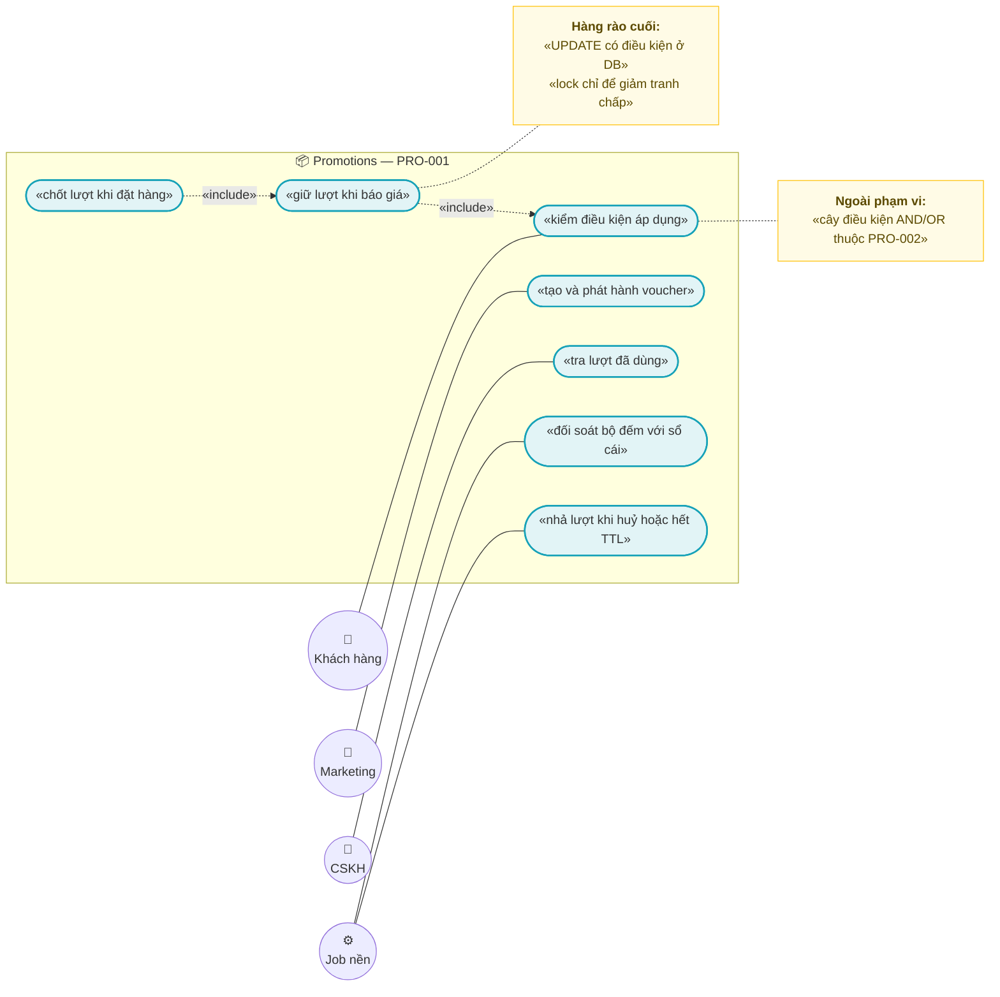
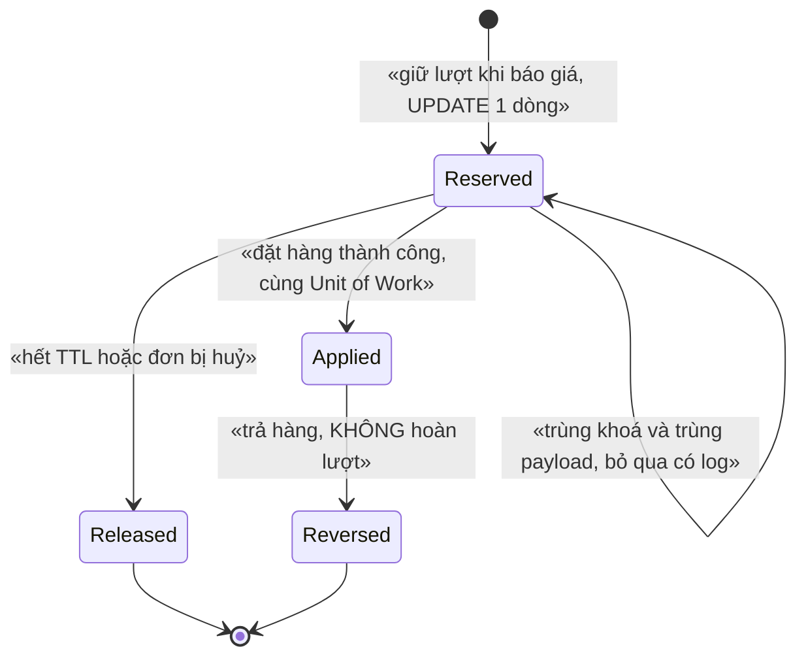
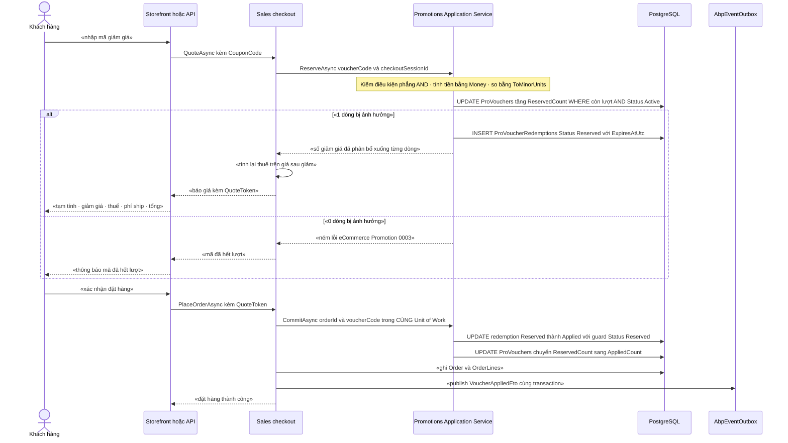

# `PRO-001` — Voucher / Coupon: giới hạn lượt & điều kiện áp dụng

| Thuộc tính | Nội dung |
|---|---|
| **Mã** | `PRO-001` |
| **Module** | **Promotions** — module mới đề xuất `modules/Promotions/` (`eCommerce.Promotions.Domain` · `.Application` · `.Application.Contracts` · `.EntityFrameworkCore`) |
| **Giai đoạn** | **GĐ2** — Vận hành & tuân thủ VN (`docs/implementation-plan.md:198` giao `Promotions` cho GĐ2, `:422` giao `PRO-001`) |
| **Ưu tiên** | **Must have trong GĐ2** — `docs/implementation-plan.md:203-205` là **cổng kiểm soát GĐ2**: *"một khuyến mãi phức tạp (nhiều điều kiện AND/OR) tính đúng tiền"* |
| **Trạng thái** | 🟡 `Draft` — chờ review |
| **Người viết / người review** | *(điền)* / **Kiến trúc trưởng + BA + Kế toán** (voucher làm đổi `DiscountTotal`, `TaxTotal` ⇒ ảnh hưởng hoá đơn GTGT ⇒ bắt buộc có kế toán theo `docs/design-doc-guidelines.md` §6) |
| **Phiên bản / ngày** | `v0.1 — 14/10/2026` |
| **Tài liệu liên quan** | `PRO-002` (cây điều kiện AND/OR + engine + guard bùng nổ tổ hợp — `docs/implementation-plan.md:423`) · `XC-001` (Money/làm tròn/phân bổ) · `XC-002` (outbox/inbox, idempotency, DLQ) · `XC-003` (khoá phân tán) · `XC-004` (`[Authorize]` cấp class, permission, `NULLS NOT DISTINCT`) · `XC-005` (log/correlationId/metric) · `SAL-002` (checkout/đặt hàng) · `SAL-003` (state machine 4 trục) · `SAL-006` (RMA/hoàn tiền) · `PRC-001`/`PRC-002` (giá & pipeline giá) · `EINV-001` (hoá đơn) · `REP-001` (read-model) · `SHP-003` (COD — ⚠️ GHN đổi COD cần OTP) · `SHP-004` (GHTK — ⚠️ xác minh địa chỉ 2 cấp) · `LOY-001` (điểm thưởng) · `docs/structure-and-techstack.md:70` · `docs/business-modules-proposal.md:78,249` · `docs/templates/feature-design-template.md` |

---

## 0. Tóm tắt & quyết định thiết kế

**Tóm tắt:** `PRO-001` định nghĩa **mã giảm giá (Voucher/Coupon)** dùng được **đúng số lần đã cấu hình**, **đúng điều kiện đã cấu hình**, và — quan trọng nhất — **không bao giờ tiêu quá lượt** trong bất kỳ tình huống nào: nhiều instance, khách bấm liên tục, webhook/ETO gửi trùng, **hoặc Redis chết**.

**Vì sao phải viết tài liệu này trước khi code:** hai loại lỗi im lặng đã được chứng minh trong chính dự án này đều hội tụ ở đây:

| Bài học đã có bằng chứng trong repo | Hệ quả bắt buộc cho `PRO-001` |
|---|---|
| **Lock không phải hàng rào** — `XC-003` **D2**: *"nếu bỏ lock đi, DB có chặn không?"*. `AbortOnConnectFail = false` (`src/eCommerce.HttpApi.Host/eCommerceHttpApiHostModule.cs:141`) ⇒ Redis chết thì app **vẫn chạy** nhưng lock **vô hiệu** | Giới hạn lượt **phải** được cưỡng chế bằng **`UPDATE … WHERE` có điều kiện ở tầng DB** + đếm số dòng ảnh hưởng (`XC-002` **D8**/**BR-008**: 0 dòng ⇒ **NÉM LỖI**). Lock chỉ là tối ưu (**BR-PRO-001-001**) |
| **Guard im lặng làm mất dấu vết** — `XC-002` BR-009 (bài học `SetPaidStatus()` của eShop) | Mọi chuyển trạng thái của lượt dùng **phải NÉM** `eCommerce:Promotion:0004`; **cấm** no-op im lặng (**BR-PRO-001-010**) |
| **Unique index mất tác dụng khi `TenantId = NULL`** — `XC-004` **F1**, đã chứng minh bằng PostgreSQL thật (`INSERT 0 2` → `duplicate key`), sửa cho **11 index** ở `src/eCommerce.EntityFrameworkCore/Migrations/20261013024226_Fix_NullableTenantId_UniqueIndexes.cs` | Mọi unique index của `PRO-001` **phải** dùng **`NULLS NOT DISTINCT`**, viết bằng **SQL thô ngay trong migration tạo bảng**, **không** để nợ (**BR-PRO-001-014**) |
| **Sai tiền là lỗi không sửa được về sau** — `XC-001` §0 | Giảm giá **phải** phân bổ xuống dòng bằng `MoneyAllocator` để `Σ` khớp tuyệt đối; **cấm** so tiền bằng `==` trên `decimal` (**ADR-05**, **BR-PRO-001-008**) |

**Điểm xuất phát thật (đã kiểm bằng `read`/`grep` ngày 14/10/2026 — không viết theo trí nhớ):**

| Hạng mục | Hiện trạng |
|---|---|
| Module `Promotions` | ❌ **Chưa có trong code — kế hoạch GĐ2.** `modules/` chỉ có `ChannelHub`, `PaymentHub`, `Tax` |
| Entity `Voucher` / `Coupon` / `Promotion` | ❌ **Chưa có trong code — kế hoạch GĐ2.** `grep -i "voucher\|coupon\|promotion"` trên `**/*.cs` ⇒ **0** type; chỉ có `DiscountTotal`/`DiscountAmount` của `Order` |
| Cột tiền giảm giá trên đơn | ✅ **Đã có**: `Order.DiscountTotal` (`src/eCommerce.Domain/Entities/Orders/Order.cs:41`), `OrderLine.DiscountAmount` (`:135`), precision `numeric(18,4)` (`src/eCommerce.EntityFrameworkCore/eCommerceDbContext.cs:174,202`) |
| Guard `DiscountTotal <= Subtotal` | ❌ **Chưa có trong code** — `Order.Recalculate()` (`Order.cs:92-96`) **không** kiểm. Đã ghi là khoảng trống **G3** ở `sal-002` §15.4 nhưng **chưa sửa** (xem **F1** §15.2) |
| Giảm **phí vận chuyển** (FreeShipping) | ❌ **Chưa có cột** — `Order.cs:39-50` chỉ có `Subtotal`/`DiscountTotal`/`TaxTotal`/`ShippingTotal`/`GrandTotal` (xem **F6** §15.2) |
| `Money` / `MoneyAllocator` (`XC-001`) | ❌ **Chưa có trong code — kế hoạch "Nền trước GĐ1"**, nhưng `grep "struct Money\|class Money\|MoneyAllocator"` ⇒ **0** match. Đây là **điều kiện DoR chặn** của `PRO-001` (xem **F2** §15.2) |
| Permission `Promotions` | ❌ **Chưa có**: không có trong `eCommerceConsts.Permissions` (`src/eCommerce.Domain.Shared/eCommerceConsts.cs:15-74`) và chưa `AddPermission` ở `src/eCommerce.Application.Contracts/Permissions/eCommercePermissionDefinitionProvider.cs:23-60` |
| Metric khuyến mãi | ❌ **0 metric**; registry hiện có **đúng 12** tên (`src/eCommerce.Domain.Shared/Observability/eCommerceMetrics.cs:38-52`) và có test chốt **cứng số 12** (`test/eCommerce.Tests/Observability/MetricsTests.cs:64`) ⇒ metric mới **sẽ** làm đỏ CI nếu quên cập nhật (xem **F3** §15.2) |
| Hạ tầng test PostgreSQL thật | ✅ **Đã có**: `test/eCommerce.IntegrationTests/` (Testcontainers `postgres:17-alpine`, shim `Assets/schema.sql`) + test chốt `NULLS NOT DISTINCT` (`PostgreSqlSchemaTests.cs:144-174`) |
| Số giảm giá **của sàn** (khác voucher của ta) | ✅ **Đã có**: `ChannelOrderDto.DiscountAmount` (`modules/ChannelHub/eCommerce.ChannelHub.Application.Contracts/Connectors/IChannelConnector.cs:26`) và `ChannelDiscount` (`:37`) |
| `ICurrentTenant` / `IUnitOfWorkManager` | ❌ **Chưa dùng ở đâu** trong code (`grep` ⇒ 0 match) ⇒ tiền đề "tenant hiện tại" của mọi tài liệu **chưa được kiểm chứng runtime** |
| Tiền lệ `HasCheckConstraint` | ✅ **Đã có** ở module Tax: `modules/Tax/eCommerce.Tax.EntityFrameworkCore/TaxDbContextModelCreatingExtensions.cs:22-25,49` (xem **F7** §15.2) |
| Tiền lệ `[Authorize]` cấp class | ✅ **Đã có**: `src/eCommerce.Application/Channels/ChannelAppService.cs:27` |

**Phạm vi:**

- ✅ **Vòng đời mã giảm giá**: tạo/sửa/phát hành/tạm dừng/huỷ; mã chuẩn hoá, duy nhất theo tenant.
- ✅ **Giới hạn lượt** ở 2 chiều: **tổng** (`TotalUsageLimit`) và **theo khách** (`PerCustomerUsageLimit`).
- ✅ **Giữ lượt (reservation) có TTL** từ bước báo giá/checkout + **chốt lượt** khi đặt hàng + **nhả lượt** khi huỷ/hết TTL.
- ✅ **Điều kiện phẳng, kết hợp AND** (số tiền tối thiểu, phạm vi kênh, SKU/danh mục loại trừ, nhóm khách, đơn đầu tiên) qua một **hợp đồng đánh giá có điểm cắm**.
- ✅ **Tính tiền giảm giá**: 3 loại (`Percentage`, `FixedAmount`, `FreeShipping`), phân bổ xuống dòng, **tính lại thuế** trên giá sau giảm.
- ✅ **Sổ cái lượt dùng append-only** (nguồn sự thật) + **bộ đếm** (để chặn nhanh) + **job đối soát** hai thứ này.
- ✅ **Idempotency ở mọi biên vào** (HTTP, consumer ETO, job định kỳ).
- ✅ App service + endpoint quản trị + endpoint áp mã ở storefront.

**Không nằm trong phạm vi:**

- ❌ **Cây điều kiện AND/OR, engine khuyến mãi tổng quát, guard bùng nổ tổ hợp** — thuộc **`PRO-002`** (`docs/implementation-plan.md:423`). Ở đây chỉ định **điểm cắm** để `PRO-002` mở rộng mà **không** phải viết lại sổ cái lượt (**ADR-07**).
- ❌ **Cộng dồn nhiều voucher / nhiều chương trình trên một đơn (stacking)** — để `PRO-002` (**ADR-03**). `PRO-001` chốt **tối đa 1 voucher/đơn**.
- ❌ **FlashSale / Campaign theo khung giờ** — thuộc entity `FlashSale` của module (cùng tài liệu `PRO-002`).
- ❌ **Đổi điểm thưởng lấy voucher** — thuộc `LOY-001`; `loy-001` §0 ghi rõ *"quà tặng, voucher đổi bằng điểm — giai đoạn sau"*.
- ❌ **Quy trình đổi số tiền COD sau khi đã tạo vận đơn** — thuộc `SHP-003` (⚠️ GHN **bắt buộc OTP** ⇒ có bước thủ công). `PRO-001` chỉ **cấm** tự ý sửa tiền sau vận đơn (**ADR-12**).
- ❌ **Tính giá bán / giá theo kênh** — thuộc `PRC-001`/`PRC-002`. `PRO-001` chỉ nhận **giá đã tính** rồi trừ giảm giá.
- ❌ **Hoàn tiền một phần khi trả hàng** — thuộc `SAL-006`; `PRO-001` chỉ ghi nhận `Reversed` và **không** hoàn lượt.
- ❌ **Đa tiền tệ hoạt động thật** — `XC-001` D6/#6: GĐ này chỉ `VND`; cột `Currency` vẫn **bắt buộc** có.

### 0.1 Quyết định thiết kế (ADR ngắn)

| # | Quyết định | Phương án đã cân nhắc | Lý do chọn | Hệ quả |
|---|---|---|---|---|
| **ADR-01** | Giữ lượt bằng **`UPDATE … WHERE` có điều kiện ở DB** + **đếm số dòng**; **KHÔNG** dùng distributed lock làm hàng rào | (a) lock Redis làm hàng rào · (b) lock **+** ràng buộc DB · (c) **chỉ ràng buộc DB** | `XC-003` **D2**/**BR-007** yêu cầu trả lời *"bỏ lock đi, DB có chặn không?"* — ở đây DB **chặn được** (điều kiện nằm trong chính câu `UPDATE`). Redis chết **vẫn đúng** ⇒ không được để tính đúng phụ thuộc Redis (`XC-003` D2, `sal-002` §15.3 giả định 3) | Cần `ExecuteUpdateAsync` + **NÉM** khi 0 dòng (`XC-002` D8). Redis chỉ còn dùng cho **job** |
| **ADR-02** | `ProVoucherRedemptions` là **sổ cái append-only = nguồn sự thật**; `ReservedCount`/`AppliedCount` trên `ProVouchers` chỉ là **bộ đếm chặn nhanh**, **phải** đối soát được | (a) chỉ dùng cột đếm · (b) chỉ `COUNT(*)` trên sổ cái · (c) **cả hai + job đối soát** | `COUNT(*)` mỗi lần báo giá là truy vấn nóng và dễ tranh chấp; nhưng chỉ tin cột đếm thì **không truy vết được** ai tiêu lượt nào (và không giải trình được với kế toán) | Có job `promotion:voucher-counter-audit` + metric đếm số lần lệch; lệch ⇒ **cảnh báo**, **không** tự sửa im lặng |
| **ADR-03** | **Tối đa 1 voucher / đơn** ở GĐ2 | (a) cho stacking ngay · (b) 1 voucher | Stacking kéo theo bài toán *"cái nào lợi hơn"* **không xác định** và **bùng nổ tổ hợp** — đúng thứ `docs/implementation-plan.md:198,423` giao cho `PRO-002`. `PRO-001` chọn bài toán **nhỏ, chứng minh được** | **Không** có cột `Stackable` ở GĐ2; unique `(TenantId, OrderId)` cưỡng chế được bằng DB (BR-005) |
| **ADR-04** | **Giữ lượt ngay từ bước báo giá/checkout**, có **TTL**, không đợi tới lúc tạo đơn | (a) chỉ trừ lượt lúc đặt hàng · (b) giữ chỗ có TTL | Nếu chỉ trừ lúc đặt hàng thì **100 khách cùng thấy "còn lượt"** rồi 99 người thất bại ở bước cuối; và mã **1 lượt** có thể bị 2 đơn dùng nếu chỉ kiểm tra một lần | **Bắt buộc** có job nhả theo TTL — thiếu job ⇒ lượt **treo vĩnh viễn** (đây là rủi ro vận hành lớn nhất của ADR này) |
| **ADR-05** | Giảm giá **trên tiền hàng TRƯỚC thuế**, **phân bổ xuống dòng**; **thuế tính lại** trên giá sau giảm | (a) giảm sau thuế · (b) giảm trước thuế + phân bổ | Giá tính thuế GTGT là **giá khách thực trả**; giảm sau thuế ⇒ hoá đơn GTGT **sai** (`EINV-001` BR-004/BR-005 kế thừa `XC-001` BR-010/BR-011). Phân bổ để giữ `Σ DiscountAmount(dòng) == DiscountTotal` (`XC-001` **BR-006**/**D7** largest remainder) | **Mọi** voucher làm đổi `TaxTotal` ⇒ UI **phải** hiển thị đúng thứ tự dòng tiền (§10); `SAL-002`/`EINV-001` phải tính lại thuế **sau** khi áp voucher |
| **ADR-06** | `FreeShipping` giảm **`ShippingTotal`**, **KHÔNG** ghi vào `DiscountTotal` | (a) trộn chung vào `DiscountTotal` · (b) tách riêng | `REP-001` giữ `DiscountAmount` **riêng** *"để báo cáo khuyến mãi (`PRO-*`)"* (`rep-001` §5.2); trộn "giảm tiền hàng" với "miễn phí ship" ⇒ mất khả năng đối soát phí vận chuyển và COD | `Order` **chưa có** cột riêng ⇒ cần `ShippingDiscountTotal` (**F6**), và cột đó do **chủ sở hữu `Order`** thêm — **không** phải `PRO-001` |
| **ADR-07** | Điều kiện GĐ2 lưu **phẳng, AND**; cây AND/OR là **điểm cắm** cho `PRO-002` | (a) làm cây ngay trong `PRO-001` · (b) phẳng + hợp đồng đánh giá | `docs/implementation-plan.md:422-423` **tách** `PRO-001`/`PRO-002`. Làm cây ngay ⇒ hai tài liệu cùng sở hữu một cơ chế (nguy cơ **hai nguồn sự thật**) | `ProVoucherConditions` **phải** thiết kế để `PRO-002` thêm `ParentId`/`NodeType`/`Operator` bằng migration **mà không** đụng `ProVoucherRedemptions` |
| **ADR-08** | **Cấm** ánh xạ "giảm giá của sàn" thành voucher nội bộ | (a) coi `ChannelDiscount` như voucher · (b) tách tuyệt đối | Đơn sàn mang số **của sàn** (`IChannelConnector.cs:26,37`). Nếu tiêu quota nội bộ theo số của bên thứ ba thì **quota bị tiêu bởi quyết định của người khác** và **không đối soát được** | `ProVoucherRedemptions` **chỉ** sinh từ luồng nội bộ (kênh `web`); đơn sàn giữ `DiscountTotal` là snapshot số của sàn (**BR-PRO-001-012**, **BR-PRO-001-016**) |
| **ADR-09** | `Exhausted` / `Expired` là **trạng thái SUY RA** — **cấm** ghi vào cột `Status` | (a) job ghi `Exhausted` · (b) suy ra khi đọc | Ghi trạng thái suy ra ⇒ **hai nguồn sự thật** và lệch ngay khi lượt được nhả — đúng loại lỗi mà `SAL-003` **BR-008** đã cấm cho `DerivedStatus` | Vị từ "còn dùng được" và vị từ trong `UPDATE` giành lượt **phải là CÙNG một** định nghĩa; có test chứng minh (TC-06/TC-07) |
| **ADR-10** | `Money`/`MoneyAllocator` là **điều kiện chặn (DoR)**; chưa có ⇒ **không** code `PRO-001` | (a) dùng `decimal` trần cho tới khi có `Money` · (b) chờ `XC-001` | `XC-001` §0: *"sai ở đây thì sai ở mọi nơi… sai tiền là loại lỗi không sửa được về sau"*. Phân bổ giảm giá xuống dòng là **đúng** bài toán `MoneyAllocator` (`XC-001` BR-006) | PR của `PRO-001` **không** được merge trước `XC-001`; DTO trung gian **bắt buộc** kèm `Currency` và mọi so sánh qua `ToMinorUnits()` |
| **ADR-11** | Hàm sinh khoá lock của module **KHÔNG** chứa tiền tố `ecommerce:` | (a) nhúng tiền tố (như `TaxLockKeys`) · (b) để `KeyPrefix` lo (như `ChannelHubConsts.LockKeys`) | `eCommerceHttpApiHostModule.cs:127` đặt `KeyPrefix = "ecommerce:"` và ABP ghép **không có dấu phân cách** (`XC-003` §5.4 hệ quả #2). Phương án (a) tạo **tiền tố ĐÔI** `ecommerce:ecommerce:promotion:…` — đã ghi là **F1 của `sal-002`** §15.2 (⚠️ **chưa kiểm chứng bằng `MONITOR`**) | `PromotionLockKeys` theo (b). Việc thống nhất `TaxLockKeys` **không** thuộc phạm vi tài liệu này — nhưng **phải** được xử lý (**F5** §15.2) |
| **ADR-12** | **Cấm** áp/đổi voucher **sau khi đã tạo vận đơn** | (a) cho sửa rồi đồng bộ COD · (b) chặn ở ranh giới vận đơn | Đổi số tiền ⇒ đổi **số COD** ⇒ **GHN bắt buộc OTP** (`docs/implementation-plan.md:199,426`; `rep-003` §7.4; `not-002` BR-012) ⇒ **có bước thủ công**, không tự động hoá 100 % | Mọi sửa tiền sau vận đơn đi qua quy trình `SHP-003`/`SAL-006`; `PRO-001` **cấm** sinh redemption ở giai đoạn đó |
| **ADR-13** | Lượt được **chốt trong CÙNG Unit of Work** với việc tạo đơn: `Sales` gọi **hợp đồng** `IVoucherRedemptionService` của `Promotions`, **không** chốt bằng ETO sau khi đơn đã commit | (a) phát `OrderPlacedEto` rồi consumer chốt lượt · (b) gọi đồng bộ trong cùng UoW | Phương án (a) tạo **cửa sổ** đơn đã tồn tại nhưng lượt chưa chốt ⇒ hoặc **tiêu quá lượt**, hoặc **đơn không có giảm giá**. `XC-002` **BR-001** yêu cầu *"hoặc cả hai cùng có, hoặc cả hai cùng không"* | `Promotions` **không** tham chiếu `src/` (quy ước #3) ⇒ `Sales`(app)→`Promotions.Application.Contracts` là hướng **hợp lệ**; ETO chỉ dùng cho **read-model/thông báo**, **không** để chốt lượt |
| **ADR-14** | **Cấm** điều kiện voucher phụ thuộc **địa chỉ/khu vực giao hàng** ở GĐ2 | (a) cho điều kiện theo tỉnh/quận · (b) cấm | Điều kiện theo địa chỉ ⇒ quyết định **tiền** phụ thuộc kết quả **chuẩn hoá địa chỉ của hãng vận chuyển**, mà `docs/implementation-plan.md:199,427` và `shp-002` §15 Q1 ghi rõ **GHTK xác minh địa chỉ 2 cấp CHƯA được xác minh** | Điều kiện `MinOrderAmount` đo trên **tiền hàng chưa thuế, chưa phí ship** — để quyết định voucher **không** phụ thuộc giá trị chưa kiểm chứng từ bên thứ ba |

> 📌 Ghi lại cả phương án **BỊ LOẠI** và lý do — để 6 tháng sau không ai hỏi lại *"sao không làm cách kia"*.

---

## 1. Use Case Specification

| Thuộc tính | Nội dung |
|---|---|
| **Use Case ID** | `PRO-001` |
| **Use Case Name** | Phát hành và sử dụng mã giảm giá **đúng lượt, đúng điều kiện** |
| **Description** | *"Là quản trị Marketing, tôi muốn phát hành mã giảm giá có giới hạn lượt và điều kiện rõ ràng; là khách hàng, tôi muốn biết ngay mã có dùng được không; và là kế toán, tôi muốn chắc chắn **không bao giờ** có nhiều hơn số lượt đã cấu hình bị tiêu — kể cả khi Redis chết hay khách bấm liên tục."* |
| **Actor(s)** | **Quản trị Marketing** (tạo/phát hành voucher) · **Khách hàng** (nhập mã ở storefront) · **CSKH** (tra lượt đã dùng) · **Hệ thống** (`Sales` gọi hợp đồng `Promotions`, consumer ETO, job định kỳ) · **Kế toán** (đối soát số giảm giá) |
| **Priority** | **Must have trong GĐ2** |
| **Trigger** | (a) khách nhập mã ở bước báo giá/checkout; (b) khách xác nhận đặt hàng; (c) đơn bị huỷ hoặc hết TTL giữ lượt; (d) đơn bị trả hàng; (e) job đối soát bộ đếm theo nhịp |
| **Pre-Condition(s)** | • **Tenant hiện tại** (`TenantId` từ `ICurrentTenant`): mọi entity của module là `IMultiTenant`; ⚠️ hệ thống hiện chạy **1 tenant** nên `TenantId` **có thể là `NULL`** (`XC-004` §15.2 F1) ⇒ **mọi** unique index **phải** dùng `NULLS NOT DISTINCT`. ⚠️ `ICurrentTenant` **chưa được dùng ở đâu** trong code ⇒ tiền đề này **chưa kiểm chứng runtime**.<br>• **Kênh bán** (`ChannelCode`): `PRO-001` ở GĐ2 **chỉ** phục vụ kênh nội bộ `web`. Đơn từ sàn **không** tiêu lượt voucher nội bộ (**ADR-08**, **BR-016**).<br>• **Voucher tồn tại và ở trạng thái cấu hình cho phép** (`Active`) **và** thời điểm hiện tại nằm trong `[StartsAtUtc, EndsAtUtc]`.<br>• **Tồn tại `checkoutSessionId`** (do `SAL-002` sở hữu) — dùng làm phần ổn định của `IdempotencyKey`.<br>• **`Money`/`MoneyAllocator` của `XC-001` đã có** ⇒ ⚠️ **hiện CHƯA có trong code** (**F2**) ⇒ **điều kiện DoR chặn**.<br>• **Redis 7 sẵn sàng** cho khoá của **job** — nếu không, kết quả **vẫn phải đúng** nhờ ràng buộc DB (**ADR-01**, `XC-003` D2). |
| **Post-Condition(s)** | • Tại **mọi** thời điểm: `ReservedCount + AppliedCount <= TotalUsageLimit` (khi `TotalUsageLimit` khác `NULL`) — cưỡng chế ở **tầng DB**.<br>• Số lượt của một khách `<= PerCustomerUsageLimit` — cưỡng chế bằng **unique index**.<br>• Một đơn có **tối đa một** lượt ở `Applied` ⇒ `Σ DiscountAmount(redemption) == Order.DiscountTotal` (đối soát được).<br>• `Order.DiscountTotal <= Order.Subtotal` (**BR-007**).<br>• Mọi lượt đã giữ **hoặc** được chốt, **hoặc** được nhả, **hoặc** nằm trong DLQ **có dấu vết** — **không** có lượt treo vô thời hạn (nhờ TTL + job).<br>• Mọi lần không giành được lượt đều có **log + metric** có mã lỗi. |
| **Basic Flow** | 1. Khách nhập mã ⇒ `Sales` gọi `IVoucherRedemptionService.ReserveAsync(voucherCode, checkoutSessionId, các dòng hàng)` **trong UoW của bước báo giá** (**ADR-13**).<br>2. `Promotions` kiểm **điều kiện phẳng AND** (§5.2.2) — không đạt ⇒ **NÉM** `eCommerce:Promotion:0005` kèm **điều kiện nào** không đạt.<br>3. Nếu chưa có bản ghi cho `IdempotencyKey` ⇒ chạy `UPDATE "ProVouchers" SET "ReservedCount" = "ReservedCount" + 1 WHERE …còn lượt… AND "Status" = Active`.<br>4. **0 dòng** bị ảnh hưởng ⇒ **NÉM** `eCommerce:Promotion:0003` (hết lượt) — **cấm** kẹp/đoán.<br>5. **1 dòng** ⇒ `INSERT ProVoucherRedemptions (Status = Reserved, ExpiresAtUtc = now + TTL)`; unique index `(TenantId, VoucherId, CustomerId, UsageSequence)` là hàng rào **giới hạn theo khách**.<br>6. `Promotions` tính số giảm giá bằng `Money` và **phân bổ xuống dòng** bằng `MoneyAllocator.Allocate` (**ADR-05**) ⇒ trả về `Sales`.<br>7. `Sales` tính lại **thuế trên giá sau giảm**, trả báo giá (kèm `QuoteToken`, `ExpiresAt`).<br>8. Khách xác nhận ⇒ `Sales` gọi `IVoucherRedemptionService.CommitAsync(orderId, voucherCode)` **trong cùng UoW với việc ghi `Order`**.<br>9. `Promotions` chuyển `Reserved → Applied` bằng `UPDATE … WHERE "Status" = Reserved` (0 dòng ⇒ **NÉM** `0004`) và chuyển `ReservedCount → AppliedCount` nguyên tử.<br>10. Sau commit: phát `VoucherAppliedEto` **qua outbox cùng transaction**; ghi metric. |
| **Alternative Flow** | **A1: Điều kiện không đạt (chưa đủ tiền hàng, sai kênh, SKU bị loại, khách không đúng nhóm)** — trả **báo giá KHÔNG giảm giá** + `ReasonCode` cụ thể; **không** ném lỗi hệ thống (`0005` dùng cho luồng API tường minh).<br>**A2: Trùng lượt gửi (idempotent hợp lệ)** — cùng `IdempotencyKey` **và** cùng `PayloadHash` ⇒ **bỏ qua**, trả lại kết quả cũ, ghi metric `promotion_voucher_rejected_total{reason=duplicate}`; **không** phải lỗi.<br>**A3: Khách vãng lai (chưa đăng nhập)** — giới hạn theo khách **không** áp được (không có `CustomerId`) ⇒ chỉ áp `TotalUsageLimit`; ⚠️ phụ thuộc `SAL-002` **Q2** (`Open`) về cho phép khách vãng lai ⇒ xem **Q4** §15.1.<br>**A4: Job nhả lượt hết TTL** — chỉ nhặt `Status = Reserved AND ExpiresAtUtc <= now`; giành khoá `promotion:voucher-expiry:{tenantId}` với chế độ **`SkipIfBusy`**; **bỏ qua nhịp** ⇒ **bắt buộc** log + metric (`XC-003` **D10**/**BR-010**). |
| **Exception Flow** | **E1:** hết lượt (0 dòng `UPDATE`) ⇒ `eCommerce:Promotion:0003` — `409`.<br>**E2:** cùng `IdempotencyKey` nhưng **khác** `PayloadHash` ⇒ `eCommerce:Promotion:0002` (**kế thừa** `XC-002` **BR-006**) — `409`. **Cấm** coi là bản ghi trùng.<br>**E3:** chuyển trạng thái lượt không hợp lệ (ví dụ `Applied → Reserved`) ⇒ `eCommerce:Promotion:0004` — **cấm** no-op im lặng (`XC-002` **BR-009**).<br>**E4:** vượt `PerCustomerUsageLimit` ⇒ vi phạm unique index ⇒ `eCommerce:Promotion:0008` — `409`.<br>**E5:** giảm giá vượt tiền hàng ⇒ `eCommerce:Promotion:0006` — **cấm** kẹp về `Subtotal` (**BR-007**).<br>**E6:** `Σ redemption` lệch `Order.DiscountTotal` ⇒ `eCommerce:Promotion:0007` (lỗi lập trình ⇒ lộ ra CI, `500` + log).<br>**E7:** sửa giá trị giảm của voucher **đã có** lượt dùng ⇒ `eCommerce:Promotion:0009` (**BR-017**).<br>**E8:** áp voucher nội bộ cho đơn **không** thuộc kênh `web` ⇒ `eCommerce:Promotion:0010` (**BR-016**).<br>**E9:** `TenantId` rỗng trong khoá/dữ liệu có tenant ⇒ **NÉM** tham số ⇒ `eCommerce:Promotion:0011` (**cấm** khoá/dữ liệu toàn cục — `XC-003` **BR-003**). |
| **Business Rules** | • **BR-PRO-001-001**: Lượt dùng **phải** được cưỡng chế ở **tầng DB** bằng `UPDATE … WHERE` có điều kiện; số dòng ảnh hưởng **0 ⇒ NÉM** `eCommerce:Promotion:0003`. **Cấm** tin vào kiểm tra trong bộ nhớ hoặc vào distributed lock.<br>• **BR-PRO-001-002**: **Mọi** biên vào ghi lượt (**HTTP**, **consumer ETO**, **job định kỳ**) **phải** idempotent qua khoá **ổn định** **trước** mọi side effect (`XC-002` **BR-004**). Cùng khoá + **cùng** `PayloadHash` ⇒ bỏ qua **có log + metric**. Cùng khoá + **khác** `PayloadHash` ⇒ **NÉM** `0002`.<br>• **BR-PRO-001-003**: `IdempotencyKey` **ổn định**: giữ lượt = `{checkoutSessionId}:{voucherCode}` · chốt lượt = `{orderId}:{voucherCode}` · nhả/đảo = `{orderId}:{voucherCode}:{action}`. **Cấm** `Guid.NewGuid()` mỗi lần thử (`XC-002` **BR-007**).<br>• **BR-PRO-001-004**: Một khách **không** vượt `PerCustomerUsageLimit`; cưỡng chế bằng unique `(TenantId, VoucherId, CustomerId, UsageSequence)` **`NULLS NOT DISTINCT`** — **cấm** chỉ kiểm bằng `COUNT(*)`.<br>• **BR-PRO-001-005**: Một đơn có **tối đa một** lượt chốt; cưỡng chế bằng unique **có filter** `(TenantId, OrderId) WHERE "OrderId" IS NOT NULL` **`NULLS NOT DISTINCT`**.<br>• **BR-PRO-001-006**: `Σ DiscountAmount` của các lượt gắn một đơn **phải bằng** `Order.DiscountTotal`; lệch ⇒ **NÉM** `0007`. **Cấm** tự sửa một trong hai bên.<br>• **BR-PRO-001-007**: `DiscountTotal <= Subtotal`; vượt ⇒ **NÉM** `eCommerce:Promotion:0006`. **Cấm kẹp về trần im lặng** (kế thừa nguyên tắc `chn-004` BR-003: *"âm ⇒ NÉM lỗi, không kẹp về 0 im lặng"*). BR này **đóng** khoảng trống **G3** của `sal-002` §15.4.<br>• **BR-PRO-001-008**: Mọi khoản tiền là `decimal` **kèm `Currency`**; **cấm** `double`/`float` trong entity/DTO; **cấm** so sánh tiền bằng `==` — so bằng `ToMinorUnits()` (`XC-001` **BR-003**/**BR-008**).<br>• **BR-PRO-001-009**: `Exhausted`/`Expired` là **suy ra**; **cấm** ghi vào cột `Status`. Vị từ "còn dùng được" và vị từ trong `UPDATE` giành lượt **phải là cùng một** định nghĩa.<br>• **BR-PRO-001-010**: **Mọi** chuyển trạng thái lượt **phải** qua guard §3; chuyển sai ⇒ **NÉM** `eCommerce:Promotion:0004`. **Cấm** no-op im lặng; **cấm** bỏ qua khi đã ở trạng thái đích **trừ** ca A2 (trùng hợp lệ).<br>• **BR-PRO-001-011**: `ProVoucherRedemptions` là **append-only**: **cấm** `UPDATE`/`DELETE` ở tầng ứng dụng; ghi sai ⇒ ghi **bản ghi/ trạng thái mới** + `ReasonCode`. *(`ProVoucherRedemptions` được cập nhật **chỉ** ở cột `Status`/`AppliedAtUtc`/`ReleasedAtUtc`/`ReversedAtUtc` — **cấm** sửa `DiscountAmount`, `IdempotencyKey`, `PayloadHash`, `UsageSequence`, `VoucherId`.)*<br>• **BR-PRO-001-012**: Sổ cái lượt **chỉ** sinh từ luồng **nội bộ**; số giảm giá của sàn (`ChannelDiscount`/`DiscountAmount` từ `IChannelConnector.cs:26,37`) **không** tiêu lượt voucher nội bộ (**ADR-08**).<br>• **BR-PRO-001-013**: Mọi thao tác ghi qua **Unit of Work**; **cấm** `autoSave: true` (tiền lệ sai đã có: `src/eCommerce.Application/Channels/ChannelAppService.cs:103,119,132,183`; `sal-002` **BR-016**/`F3`).<br>• **BR-PRO-001-014**: **Mọi** unique index có `TenantId` **phải** dùng **`NULLS NOT DISTINCT`**, viết bằng **SQL thô trong migration tạo bảng** — EF Core **không** mô hình hoá thuộc tính này (`XC-004` **BR-009**; tiền lệ `20261013024226_Fix_NullableTenantId_UniqueIndexes.cs`). **Không** để nợ.<br>• **BR-PRO-001-015**: Mọi app service **phải** có `[Authorize]` ở **cấp class** (`XC-004` **BR-001**); permission **chỉ** dùng hằng số `eCommerceConsts.Permissions.*` (`XC-004` **BR-003**); permission **mới** **phải** được `AddPermission` ở `eCommercePermissionDefinitionProvider.cs` — nếu không, ABP **luôn** từ chối ⇒ `403` dù user là admin (`eCommercePermissionDefinitionProvider.cs:8-11`).<br>• **BR-PRO-001-016**: Ở GĐ2, `PRO-001` **chỉ** phục vụ kênh `web`; áp voucher nội bộ cho đơn kênh khác ⇒ **NÉM** `eCommerce:Promotion:0010`.<br>• **BR-PRO-001-017**: Sau khi voucher có **≥ 1** lượt dùng, **cấm** sửa `Kind`/`DiscountValue`/`MaxDiscountAmount`/`MinOrderAmount`/`PerCustomerUsageLimit` ⇒ **NÉM** `0009`. Muốn đổi ⇒ tạo voucher mới + huỷ mã cũ (kế thừa tư tưởng *"bảng giá `Active` là append-only"* của `prc-001` **BR-004** và *"cấm sửa bản ghi đã có hiệu lực"* của `TaxErrorCodes.cs:28`).<br>• **BR-PRO-001-018**: Seed **idempotent**; **cấm** seed voucher nghiệp vụ thật (chỉ môi trường dev).<br>• **BR-PRO-001-019**: **Cấm** log PII/mã voucher gắn khách; **cấm** dùng `voucherCode`/`orderId`/`customerId` làm **nhãn metric** (cardinality cao — `XC-005` **BR-009**). Nhãn **chỉ** lấy từ `eCommerceMetricTags.Allowed` (`src/eCommerce.Domain.Shared/Observability/eCommerceMetrics.cs:75-78`).<br>• **BR-PRO-001-020**: Thêm/đổi metric **phải** cập nhật `eCommerceMetricNames` (`eCommerceMetrics.cs:13-53`) **và** `XC-005` §5.1 **và** test chốt số lượng (`MetricsTests.cs:64`) trong **cùng PR** (kế thừa `not-002` **BR-008**). |
| **Non-Functional Requirement** | • **NFR-PRO-001-001**: `ReserveAsync` khi hệ thống rảnh ⇒ **p95 < 150 ms** (không tính độ trễ mạng).<br>• **NFR-PRO-001-002**: **0** trường hợp vượt `TotalUsageLimit` khi **200** request đồng thời tranh **1** lượt (PostgreSQL thật).<br>• **NFR-PRO-001-003**: **0** trường hợp vượt `PerCustomerUsageLimit` khi **50** request song song của **cùng** khách.<br>• **NFR-PRO-001-004**: Job nhả lượt hết hạn xử lý **≥ 1.000** bản ghi/phút; **0** lượt treo quá **2 × TTL**.<br>• **NFR-PRO-001-005**: Lệch giữa **bộ đếm** và **sổ cái** sau job đối soát **= 0**.<br>• **NFR-PRO-001-006**: Cùng một luồng gửi trùng **100 lần** ⇒ **đúng 1** lượt tiêu và **1** bản ghi sổ cái.<br>• **NFR-PRO-001-007**: Cách ly tenant: tenant A thấy **0** bản ghi của tenant B (test 2 tenant).<br>• **NFR-PRO-001-008**: **0** `double`/`float` trong entity/DTO module; **0** so sánh `==` trên tiền.<br>• **NFR-PRO-001-009**: **0** `autoSave: true` trong `Promotions.Application` (test quét mã nguồn).<br>• **NFR-PRO-001-010**: **100 %** unique index có `TenantId` dùng `NULLS NOT DISTINCT` (kiểm trên PostgreSQL thật).<br>• **NFR-PRO-001-011**: `DiscountTotal <= Subtotal` trên **100 %** đơn tạo qua `PRO-001`.<br>• **NFR-PRO-001-012**: **100 %** log nghiệp vụ có `CorrelationId` (`XC-005` **BR-002**); **0** mã voucher trong nhãn metric. |

---

## 2. Sơ đồ Use Case



### Chú giải

| Ký hiệu | Ý nghĩa |
|---|---|
| ⭕ Xanh lá | Actor (người dùng + hệ thống nền) |
| 🟦 Bầu dục xanh dương | Use Case |
| 🟨 Khung vàng | Note |
| `───` | Liên kết Actor ↔ Use Case |
| `-.«include».->` | Quan hệ bao hàm |

---

## 3. Sơ đồ trạng thái (state machine) — **BẮT BUỘC ném lỗi khi chuyển sai**

> Feature có **hai** vòng đời cần tách bạch: **cấu hình voucher** và **một lượt dùng**. Mục này dùng **1 sơ đồ**
> cho vòng đời lượt dùng (nơi phát sinh tiền); vòng đời cấu hình mô tả bằng **bảng** để giữ giới hạn 3 sơ đồ.

### 3.1 Vòng đời **một lượt dùng** (`ProVoucherRedemptions`)



**Bảng chuyển trạng thái & guard — mọi chuyển sai **phải ném lỗi**, không im lặng:**

| # | Từ → Sang | Ai được phép chuyển | Guard (điều kiện cho phép) | Hành động kèm theo | Nếu guard sai thì? |
|---|---|---|---|---|---|
| 1 | `[*]` → `Reserved` | `Promotions` (gọi từ `Sales` trong UoW báo giá) | **Chưa** có bản ghi cho `IdempotencyKey`; **mọi** điều kiện ở §5.2.2 đạt; `UPDATE` giành lượt ảnh hưởng **≥ 1** dòng | `INSERT` redemption (`ExpiresAtUtc = now + TTL`), `ReservedCount + 1` | 0 dòng ⇒ **NÉM** `eCommerce:Promotion:0003` (không đủ lượt) · điều kiện sai ⇒ `0005` · trùng index khách ⇒ `0008` |
| 2 | `Reserved` → `Reserved` | Hệ thống (retry) | `IdempotencyKey` **đã tồn tại** **và** `PayloadHash` **khớp** | **Không** side effect; trả kết quả cũ; metric `promotion_voucher_rejected_total{reason=duplicate}` | `PayloadHash` **khác** ⇒ **NÉM** `eCommerce:Promotion:0002` (**BR-002**) |
| 3 | `Reserved` → `Applied` | `Promotions` (gọi từ `Sales` trong **cùng** UoW tạo đơn) | `UPDATE … WHERE "Status" = Reserved` ảnh hưởng **≥ 1** dòng | `ReservedCount − 1`, `AppliedCount + 1`, `AppliedAtUtc`, `OrderId` | 0 dòng (bị luồng khác đổi / hết TTL) ⇒ **NÉM** `0004` — **CẤM** coi là thành công (`XC-002` **E7**) |
| 4 | `Reserved` → `Released` | Job nhả TTL **hoặc** consumer `OrderCancelledEto` | `UPDATE … WHERE "Status" = Reserved AND ("ExpiresAtUtc" <= now OR "OrderId" = @orderId)` ảnh hưởng **≥ 1** dòng | `ReservedCount − 1`, `ReleasedAtUtc`, `ReasonCode` (`TTL_EXPIRED` / `ORDER_CANCELLED`) | 0 dòng ⇒ **bỏ qua có log `Debug` + metric** (đã được nhả bởi luồng khác — **không** phải lỗi, xem §12) |
| 5 | `Applied` → `Reversed` | Consumer `OrderReturnedEto` (`SAL-006`) | `UPDATE … WHERE "Status" = Applied` ảnh hưởng **≥ 1** dòng | `ReversedAtUtc`, `ReasonCode`; **KHÔNG** hoàn `AppliedCount` (lượt **đã** dùng) | 0 dòng ⇒ **NÉM** `0004` |
| 6 | `Released` / `Reversed` → bất kỳ | — | **Không** có guard nào cho phép | — | **Trạng thái hấp thụ (absorbing)**: mọi chuyển dịch khác ⇒ **NÉM** `0004` |
| 7 | `Applied` → `Reserved` / `Released` / `[*]` | — | **Không** có guard nào cho phép (huỷ đơn **sau** khi đã chốt lượt ⇒ quy trình riêng của `SAL-004`, **không** hoàn lượt) | — | **NÉM** `0004` |
| 8 | `[*]` → `Applied` (bỏ qua `Reserved`) | — | **Không** cho phép | — | **NÉM** `0004` — chốt lượt **luôn** phải qua giữ lượt (ADR-04) |

> ⚠️ **Quy tắc bất di bất dịch #11: guard sai phải NÉM LỖI, không im lặng.**
> 📌 **Hai ca "0 dòng" khác nhau về ngữ nghĩa và PHẢI xử lý khác nhau:**
> (a) **giành lượt lúc giữ chỗ** ⇒ 0 dòng **là lỗi nghiệp vụ** (`0003` — hết lượt);
> (b) **nhả lượt** ⇒ 0 dòng **là bình thường** (luồng khác đã nhả) ⇒ log `Debug` + metric.
> Trộn hai ca này là cách chắc chắn nhất để sinh ra lỗi im lặng — ghi rõ ở đây để review chặn.

### 3.2 Vòng đời **cấu hình voucher** (`ProVouchers.Status`) — *mô tả bằng bảng, không dùng sơ đồ*

| # | Từ → Sang | Guard | Nếu guard sai thì? |
|---|---|---|---|
| 1 | `[*]` → `Draft` | Có `Code` hợp lệ (chuẩn hoá, duy nhất theo tenant) + `Kind` + `DiscountValue` ≥ 0 + `StartsAtUtc < EndsAtUtc` | **NÉM** lỗi validation (`400`) |
| 2 | `Draft` → `Scheduled` | Có `StartsAtUtc` ở **tương lai**; có ≥ 1 điều kiện **hoặc** xác nhận tường minh "không điều kiện" | **NÉM** `eCommerce:Promotion:0004` |
| 3 | `Draft`/`Scheduled` → `Active` | `StartsAtUtc <= now`; permission `…Vouchers.Publish`; **có audit** | **NÉM** `403` / `0004` |
| 4 | `Active` → `Paused` | permission `…Vouchers.Edit` | **NÉM** `403` |
| 5 | `Paused` → `Active` | Còn trong cửa sổ `[StartsAtUtc, EndsAtUtc]` **và** chưa chạm trần lượt | **NÉM** `0003` nếu đã chạm trần (không "hồi sinh" mã đã hết lượt) |
| 6 | `Active`/`Paused`/`Scheduled` → `Cancelled` | permission `…Vouchers.Cancel`; **giữ nguyên** các lượt `Applied` (**cấm** xoá sổ cái) | **NÉM** `403` |
| 7 | `Cancelled` → bất kỳ | **Không** cho phép | **Trạng thái hấp thụ** ⇒ **NÉM** `0004` |
| 8 | **Bất kỳ** → sửa `Kind`/`DiscountValue`/`MaxDiscountAmount`/`MinOrderAmount`/`PerCustomerUsageLimit` khi đã có ≥ 1 lượt dùng | **Không** cho phép | **NÉM** `eCommerce:Promotion:0009` (**BR-017**) |

> 📌 **`Exhausted` và `Expired` KHÔNG phải trạng thái của cột `Status`** (**ADR-09**, **BR-009**):
> chúng là **suy ra** — `Expired` = `now > EndsAtUtc`; `Exhausted` = `TotalUsageLimit` khác `NULL` **và**
> `ReservedCount + AppliedCount >= TotalUsageLimit`. `Status` **chỉ** giữ `Draft | Scheduled | Active | Paused | Cancelled`.

---

## 4. Sequence Diagram & luồng dữ liệu

### 4.1 Sequence — giữ lượt khi báo giá, chốt lượt khi đặt hàng



### 4.2 Hai luồng nền — *mô tả bằng bảng để giữ giới hạn 3 sơ đồ*

**Luồng A — job nhả lượt hết TTL**

| Bước | Việc | Ghi chú |
|---|---|---|
| A1 | Job thức theo nhịp (đề xuất **1 phút**) | `AbpAsyncTimer` |
| A2 | Giành khoá `promotion:voucher-expiry:{tenantId}`, chế độ **`SkipIfBusy`** | `XC-003` **D10**/**BR-010**; không giành được ⇒ **log + metric**, **không** ném lỗi |
| A3 | Nhặt **theo lô** các `Reserved` có `ExpiresAtUtc <= now` | lô 500; **cấm** nhặt theo `CreationTime` để tránh quét lại bản ghi cũ |
| A4 | Mỗi bản ghi: `UPDATE … WHERE "Status" = Reserved` ⇒ `Released` + `ReservedCount − 1` | 0 dòng ⇒ **bỏ qua** (đã nhả bởi luồng khác) |
| A5 | Ghi metric `promotion_voucher_released_total{reason=TTL_EXPIRED}` | **cấm** log `Information` mỗi vòng (`XC-005` **BR-004**) |

**Luồng B — job đối soát bộ đếm với sổ cái**

| Bước | Việc | Ghi chú |
|---|---|---|
| B1 | Nhịp **15 phút**; khoá `promotion:voucher-counter-audit:{tenantId}` (`SkipIfBusy`) | chỉ đọc ⇒ nhẹ |
| B2 | Với mỗi voucher: `Σ` sổ cái theo `Status` **so với** `ReservedCount`/`AppliedCount` | so bằng **số nguyên**, không `==` trên `decimal` |
| B3 | Lệch ⇒ **cảnh báo** + metric `promotion_voucher_counter_mismatch_total`; **không** tự sửa | **Cấm** tự sửa: tự sửa là che lỗi (đúng bài học "guard im lặng") |
| B4 | Ghi rõ trong báo cáo: số lệch **có thể** tồn tại tạm thời trong lúc job nhả đang chạy | ⚠️ **chênh lệch số liệu phải ghi rõ** (`docs/design-doc-guidelines.md` §5 quy tắc 9) |

---

## 5. Mô hình dữ liệu

### 5.1 ERD — *dùng bảng thay sơ đồ để giữ giới hạn 3 sơ đồ*

**3 bảng MỚI do module `Promotions` sở hữu** (tiền tố `Pro`, theo khuôn `ChannelHubConsts.DbTablePrefix = "Chn"` — `modules/ChannelHub/eCommerce.ChannelHub.Domain/ChannelHubConsts.cs:14`):

| Bảng | Quan hệ | Ghi chú |
|---|---|---|
| `ProVouchers` | 1 → n `ProVoucherConditions` · 1 → n `ProVoucherRedemptions` | **aggregate root**; giữ **bộ đếm** (`ReservedCount`, `AppliedCount`) |
| `ProVoucherConditions` | n → 1 `ProVouchers` | điều kiện **phẳng**, kết hợp **AND** (ADR-07); `PRO-002` sẽ thêm `ParentId`/`NodeType`/`Operator` |
| `ProVoucherRedemptions` | n → 1 `ProVouchers` | **sổ cái append-only** = **nguồn sự thật** của lượt (ADR-02) |

**Bảng app ĐÃ CÓ nhưng cần bổ sung — ⚠️ CHỦ SỞ HỮU KHÔNG PHẢI `PRO-001`:**

| Bảng | Cần gì | Chủ sở hữu | Trạng thái |
|---|---|---|---|
| `OrdOrders` | cột `ShippingDiscountTotal numeric(18,4)` (cho `FreeShipping`, ADR-06) | `Sales` (`src/eCommerce.Domain/Entities/Orders/Order.cs`) | ❌ **chưa có trong code — kế hoạch GĐ2** (**F6**) |
| `OrdOrders` | guard `DiscountTotal <= Subtotal` trong `Recalculate()` | `Sales` | ❌ **chưa có trong code** (**F1**; đã ghi **G3** ở `sal-002` §15.4) |

> 🚨 **Quy ước bất di bất dịch #3/#4 — module sở hữu entity của mình; module gọi app BỊ CẤM.**
> `Promotions` **không** được tham chiếu `src/`, nên **không** được tự sửa `Order`/`OrdOrders`.
> `PRO-001` **ghi yêu cầu** và chuyển cho chủ sở hữu — đúng cách module `Tax` **không** tham chiếu `src/`
> (`modules/Tax/eCommerce.Tax.Domain/TaxErrorCodes.cs:6-8`).

### 5.2 Bảng & cột (Data Dictionary)

#### 5.2.1 Bảng `ProVouchers` — **MỚI** (chưa có trong code — kế hoạch GĐ2)

| Cột | Kiểu | Null? | Nguồn / ý nghĩa | Ghi chú |
|---|---|---|---|---|
| `Id` | `uuid` | ✖ | khoá chính | `FullAuditedAggregateRoot<Guid>` |
| `TenantId` | `uuid` | ✔ | tenant sở hữu | `IMultiTenant`; **`NULLS NOT DISTINCT`** cho mọi unique index |
| `Code` | `varchar(32)` | ✖ | mã khách nhập | **chuẩn hoá**: trim, **HOA**, chỉ `[A-Z0-9-]`, 3–32 ký tự (kế thừa khuôn `CAT-001` **BR-002** cho `SKU`) |
| `Name` | `varchar(128)` | ✖ | tên hiển thị nội bộ | |
| `Description` | `varchar(1024)` | ✔ | mô tả | **không** chứa PII |
| `Kind` | `int` | ✖ | `Percentage = 0` · `FixedAmount = 1` · `FreeShipping = 2` | ⚠️ **ghim giá trị ordinal** và **có test** — tiền lệ: `PostgreSqlSchemaTests.cs:45` chèn `Kind` bằng số `1` cho `TaxRateSchedules` |
| `DiscountValue` | `numeric(18,4)` | ✖ | `%` (khi `Percentage`) hoặc số tiền (khi `FixedAmount`) | **decimal, KHÔNG BAO GIỜ `double`**; `CHECK >= 0`; `Percentage` ⇒ `CHECK <= 100` |
| `MaxDiscountAmount` | `numeric(18,4)` | ✔ | trần giảm cho loại `Percentage` | `NULL` = không trần |
| `MinOrderAmount` | `numeric(18,4)` | ✔ | điều kiện tiền hàng tối thiểu | **đo trên `Subtotal` chưa thuế, chưa phí ship** (**ADR-14**) |
| `Currency` | `char(3)` | ✖ | mã ISO-4217 | **HOA** (`XC-001` §5.2); ⚠️ `OrdOrders.Currency` hiện là `varchar(8)` — lệch đã ghi là **F2** của `sal-002` |
| `StartsAtUtc` | `timestamptz` | ✖ | bắt đầu hiệu lực | |
| `EndsAtUtc` | `timestamptz` | ✖ | kết thúc hiệu lực | `CHECK "EndsAtUtc" > "StartsAtUtc"` |
| `TotalUsageLimit` | `int` | ✔ | **tổng** số lượt | `NULL` = không giới hạn; `CHECK > 0`; **cấm** `0` (dùng `Cancelled`) |
| `PerCustomerUsageLimit` | `int` | ✔ | số lượt / khách | `NULL` = không giới hạn theo khách; `CHECK > 0` |
| `ReservedCount` | `int` | ✖ | **bộ đếm** lượt đang giữ | mặc định `0`; `CHECK >= 0`; **không** phải nguồn sự thật (ADR-02) |
| `AppliedCount` | `int` | ✖ | **bộ đếm** lượt đã chốt | mặc định `0`; `CHECK >= 0` |
| `ReservationTtlSeconds` | `int` | ✖ | TTL giữ lượt | mặc định **900** (15 phút); `CHECK >= 60` |
| `Status` | `int` | ✖ | `Draft = 0` · `Scheduled = 1` · `Active = 2` · `Paused = 3` · `Cancelled = 4` | ⚠️ **KHÔNG** chứa `Exhausted`/`Expired` (**ADR-09**) |
| `RowVersion` | `xmin` / `bytea` | ✖ | optimistic concurrency | bắt buộc cho bảng trạng thái (`XC-002` **D8**) |

**Index & ràng buộc `ProVouchers`**

| Loại | Cột | Mục đích |
|---|---|---|
| UNIQUE (**`NULLS NOT DISTINCT`**) | `(TenantId, Code)` | ⭐ **hàng rào** chống trùng mã trong tenant — **kể cả khi `TenantId = NULL`** (`XC-004` **F1**) |
| INDEX | `(TenantId, Status, StartsAtUtc, EndsAtUtc)` | truy vấn danh sách + "mã đang hiệu lực" |
| CHECK | `"DiscountValue" >= 0` | tiền/`%` không âm |
| CHECK | `"Kind" <> 0 OR ("DiscountValue" >= 0 AND "DiscountValue" <= 100)` | `Percentage` không vượt 100 % |
| CHECK | `"EndsAtUtc" > "StartsAtUtc"` | cửa sổ hiệu lực hợp lệ |
| CHECK | `"ReservedCount" >= 0 AND "AppliedCount" >= 0` | bộ đếm không âm |
| CHECK | `"TotalUsageLimit" IS NULL OR "TotalUsageLimit" > 0` | trần lượt hợp lệ |

#### 5.2.2 Bảng `ProVoucherConditions` — **MỚI** (chưa có trong code — kế hoạch GĐ2)

| Cột | Kiểu | Null? | Nguồn / ý nghĩa | Ghi chú |
|---|---|---|---|---|
| `Id` | `uuid` | ✖ | khoá chính | |
| `TenantId` | `uuid` | ✔ | tenant | `IMultiTenant` |
| `VoucherId` | `uuid` | ✖ | FK → `ProVouchers` | `ON DELETE CASCADE` (điều kiện **thuộc** voucher) |
| `Type` | `int` | ✖ | `MinOrderAmount = 0` · `ChannelScope = 1` · `SkuInclude = 2` · `SkuExclude = 3` · `CategoryInclude = 4` · `CustomerGroup = 5` · `FirstOrderOnly = 6` | ⚠️ **ghim ordinal** + test |
| `RefId` | `varchar(64)` | ✔ | `Sku` / `CategoryId` / `CustomerGroupId` / `ChannelCode` | `NULL` cho `MinOrderAmount`/`FirstOrderOnly` |
| `Amount` | `numeric(18,4)` | ✔ | ngưỡng tiền (chỉ `MinOrderAmount`) | **decimal**; `CHECK >= 0` |
| `Currency` | `char(3)` | ✔ | tiền tệ của `Amount` | bắt buộc khi `Amount` khác `NULL` (**`XC-001`**: tiền **luôn** kèm tiền tệ) |
| `Note` | `varchar(512)` | ✔ | diễn giải cho người cấu hình | |

**Index & ràng buộc `ProVoucherConditions`**

| Loại | Cột | Mục đích |
|---|---|---|
| UNIQUE (**`NULLS NOT DISTINCT`**) | `(TenantId, VoucherId, Type, RefId)` | chặn khai **trùng** cùng một điều kiện (⚠️ `RefId` `NULL` vẫn phải chặn ⇒ đây **chính là** lý do cần `NULLS NOT DISTINCT`) |
| INDEX | `(TenantId, VoucherId)` | nạp toàn bộ điều kiện của một voucher khi đánh giá |
| CHECK | `"Amount" IS NULL OR "Amount" >= 0` | ngưỡng không âm |
| CHECK | `("Amount" IS NULL) = ("Currency" IS NULL)` | tiền **phải** đi kèm tiền tệ (`XC-001` **BR-002**) |
| — | — | 📌 **Điểm cắm `PRO-002`**: thêm `ParentId uuid NULL` + `NodeType int` + `Operator int` bằng migration **mới**; **không** đụng `ProVoucherRedemptions` |

#### 5.2.3 Bảng `ProVoucherRedemptions` — **MỚI** (sổ cái lượt — **nguồn sự thật**)

| Cột | Kiểu | Null? | Nguồn / ý nghĩa | Ghi chú |
|---|---|---|---|---|
| `Id` | `uuid` | ✖ | khoá chính | |
| `TenantId` | `uuid` | ✔ | tenant | `IMultiTenant` |
| `VoucherId` | `uuid` | ✖ | FK → `ProVouchers` | |
| `VoucherCode` | `varchar(32)` | ✖ | **snapshot** mã tại thời điểm dùng | để tra cứu/đối soát kể cả khi mã bị huỷ (kế thừa tinh thần **snapshot** của `SAL-002` BR-002) |
| `CustomerId` | `uuid` | ✔ | khách | `NULL` = khách vãng lai (A3) ⇒ giới hạn theo khách **không** áp |
| `OrderId` | `uuid` | ✔ | đơn đã chốt lượt | `NULL` khi còn `Reserved` |
| `IdempotencyKey` | `varchar(256)` | ✖ | khoá **ổn định** (BR-003) | |
| `PayloadHash` | `varchar(64)` | ✖ | SHA-256 của payload **chuẩn hoá** | để phân biệt "trùng hợp lệ" với "xung đột khoá" (`XC-002` **BR-005**/**BR-006**) |
| `UsageSequence` | `int` | ✖ | lượt thứ mấy của `(voucher, khách)` | `CHECK >= 1`; **hàng rào** giới hạn theo khách (BR-004) |
| `Status` | `int` | ✖ | `Reserved = 0` · `Applied = 1` · `Released = 2` · `Reversed = 3` | ⚠️ **ghim ordinal** + test |
| `DiscountAmount` | `numeric(18,4)` | ✖ | số giảm giá của lượt này | **decimal**; `CHECK >= 0`; **cấm sửa** sau khi ghi (BR-011) |
| `Currency` | `char(3)` | ✖ | tiền tệ | **`XC-001`**: mọi tiền kèm tiền tệ |
| `ReasonCode` | `varchar(32)` | ✔ | `TTL_EXPIRED` · `ORDER_CANCELLED` · `ORDER_RETURNED` · `MANUAL` | bắt buộc khi `Released`/`Reversed` |
| `ReservedAtUtc` | `timestamptz` | ✖ | thời điểm giữ lượt | |
| `ExpiresAtUtc` | `timestamptz` | ✖ | **TTL** của lượt giữ | **cấm** `NULL` (ADR-04) |
| `AppliedAtUtc` | `timestamptz` | ✔ | thời điểm chốt | |
| `ReleasedAtUtc` | `timestamptz` | ✔ | thời điểm nhả | |
| `ReversedAtUtc` | `timestamptz` | ✔ | thời điểm đảo (trả hàng) | |
| `RowVersion` | `xmin` / `bytea` | ✖ | optimistic concurrency | |

**Index & ràng buộc `ProVoucherRedemptions`** — *đây là phần quan trọng nhất, là hàng rào cuối*

| Loại | Cột | Mục đích |
|---|---|---|
| UNIQUE (**`NULLS NOT DISTINCT`**) | `(TenantId, VoucherId, CustomerId, UsageSequence)` | ⭐ **hàng rào giới hạn theo khách** (BR-004) — **`NULLS NOT DISTINCT`** là **bắt buộc** vì `CustomerId` **có thể `NULL`** (khách vãng lai) |
| UNIQUE (**`NULLS NOT DISTINCT`**) | `(TenantId, IdempotencyKey)` | ⭐ **hàng rào idempotency** cho biên vào (BR-002) |
| UNIQUE **có filter** (**`NULLS NOT DISTINCT`**) | `(TenantId, OrderId) WHERE "OrderId" IS NOT NULL` | ⭐ **một đơn tối đa một lượt** (BR-005); tiền lệ filter: `eCommerceDbContext.cs:184-186` |
| INDEX | `(TenantId, Status, ExpiresAtUtc)` | job nhả lượt hết hạn (Luồng A) |
| INDEX | `(TenantId, VoucherId, Status)` | job đối soát bộ đếm (Luồng B) + báo cáo |
| CHECK | `"DiscountAmount" >= 0` | giảm giá không âm |
| CHECK | `"UsageSequence" >= 1` | lượt thứ mấy bắt đầu từ 1 |
| CHECK | `"ExpiresAtUtc" > "ReservedAtUtc"` | TTL dương |

> 🚨 **BẮT BUỘC — `NULLS NOT DISTINCT` (BR-014).** EF Core **không** mô hình hoá thuộc tính này ⇒ **phải**
> viết **SQL thô** trong `Up()` của migration, **ngay khi tạo bảng**, theo đúng khuôn đã có:
> `src/eCommerce.EntityFrameworkCore/Migrations/20261013024226_Fix_NullableTenantId_UniqueIndexes.cs:39-86`.
> ⚠️ Rủi ro đã ghi trong chính migration đó (dòng `23-25`): **migration do EF sinh lại sau này có thể ghi đè
> và làm mất `NULLS NOT DISTINCT`** ⇒ phải giữ test kiểm trên PostgreSQL thật (`PostgreSqlSchemaTests.cs:144-174`).

---

## 6. Hợp đồng API

### 6.1 Application Service

| Mục | Giá trị |
|---|---|
| Vị trí interface | `modules/Promotions/eCommerce.Promotions.Application.Contracts/` (theo khuôn `eCommerce.ChannelHub.Application.Contracts` — module duy nhất hiện có tầng Application) |
| Vị trí implementation | `modules/Promotions/eCommerce.Promotions.Application/` |
| `[Authorize]` | **cấp CLASS** + permission cụ thể ở từng method (**BR-015**) |
| ⚠️ Ghi chú | `XC-002` **D12** đề xuất project `.Contracts` **mỏng** riêng. `PRO-001` theo **`ChannelHub`** (tiền lệ thật) để không tự sinh quy ước thứ ba ⇒ xem **Q7** §15.1 |

| Service | Method | Input (DTO) | Output (DTO) | Ghi chú |
|---|---|---|---|---|
| `IVoucherAdminAppService` | `GetListAsync` | `VoucherFilterDto` | `PagedResultDto<VoucherDto>` | permission `…Vouchers.View` |
| | `GetAsync` | `Guid id` | `VoucherDetailDto` | kèm **suy ra** `IsExhausted`/`IsExpired`/`RemainingUses` |
| | `CreateAsync` | `CreateVoucherDto` | `VoucherDetailDto` | **không** nhận trường tiền nào đã tính sẵn từ client |
| | `UpdateAsync` | `UpdateVoucherDto` | `VoucherDetailDto` | guard **BR-017** ⇒ `0009` |
| | `PublishAsync` | `Guid id` | `VoucherDetailDto` | `Draft/Scheduled → Active`; **có audit** |
| | `PauseAsync` | `Guid id` | `VoucherDetailDto` | |
| | `CancelAsync` | `Guid id` | `VoucherDetailDto` | **không** xoá sổ cái |
| | `GetRedemptionsAsync` | `RedemptionFilterDto` | `PagedResultDto<RedemptionDto>` | permission `…Redemptions.View` |
| `IVoucherRedemptionService` *(hợp đồng cho `Sales`)* | `ReserveAsync` | `ReserveVoucherDto` (`VoucherCode`, `CheckoutSessionId`, `CustomerId?`, `ChannelCode`, `Lines[]`, `Currency`) | `VoucherQuoteResultDto` (`DiscountTotal`, `ShippingDiscountTotal`, `PerLineDiscount[]`, `ReasonCode?`) | **không** trả/nhận `Total` của đơn — `Sales` tự tính |
| | `CommitAsync` | `CommitVoucherDto` (`OrderId`, `VoucherCode`) | `VoucherAppliedDto` | **trong cùng UoW** với việc ghi `Order` (ADR-13) |
| | `ReleaseAsync` | `ReleaseVoucherDto` (`OrderId?`, `VoucherCode`, `ReasonCode`) | `void` | idempotent (0 dòng = bình thường) |
| | `ReverseAsync` | `ReverseVoucherDto` (`OrderId`, `ReasonCode`) | `void` | **KHÔNG** hoàn lượt |

**Ràng buộc DTO (bắt buộc):**

- **Cấm** `double`/`float` ở **mọi** trường DTO (**BR-008**).
- Mọi trường tiền **phải** đi kèm `Currency` (hoặc dùng `Money` khi `XC-001` có trong code — **hiện chưa có**, **F2**).
- DTO đầu vào **cấm** có trường "tổng đã giảm"/"số tiền phải trả" — mọi số tiền **tính ở server** (kế thừa `SAL-002` **BR-001**).

### 6.2 REST endpoint

| Method / Route | Authentication | Permission | Content-Type |
|---|---|---|---|
| `GET /api/app/voucher` | Bearer (OpenIddict) | `eCommerce.Promotions.Vouchers.View` | `application/json` |
| `POST /api/app/voucher` | Bearer | `eCommerce.Promotions.Vouchers.Create` | `application/json` |
| `PUT /api/app/voucher/{id}` | Bearer | `eCommerce.Promotions.Vouchers.Edit` | `application/json` |
| `POST /api/app/voucher/{id}/publish` | Bearer | `eCommerce.Promotions.Vouchers.Publish` | `application/json` |
| `POST /api/app/voucher/{id}/cancel` | Bearer | `eCommerce.Promotions.Vouchers.Cancel` | `application/json` |
| `GET /api/app/voucher/redemptions` | Bearer | `eCommerce.Promotions.Redemptions.View` | `application/json` |
| `POST /api/app/voucher/reserve` | Bearer **hoặc** allowlist khách vãng lai | — (xem **Q4** §15.1) | `application/json` |

**Request mẫu — áp mã khi báo giá**

```json
{
  "voucherCode": "TET2027-GIAM50K",
  "checkoutSessionId": "3f1c8a52-0f6e-4a3b-9c1d-8a2b7e5f4d10",
  "channelCode": "web",
  "currency": "VND",
  "lines": [
    { "sku": "SKU-001", "quantity": 2, "unitPrice": 250000 }
  ]
}
```

**Response mẫu — báo giá có giảm giá**

```json
{
  "reasonCode": null,
  "currency": "VND",
  "discountTotal": 50000,
  "shippingDiscountTotal": 0,
  "perLineDiscount": [ { "sku": "SKU-001", "discountAmount": 50000 } ],
  "idempotencyKey": "3f1c8a52-0f6e-4a3b-9c1d-8a2b7e5f4d10:TET2027-GIAM50K",
  "expiresAtUtc": "2026-10-14T10:15:00Z"
}
```

> 📌 `discountTotal` trong response **chỉ là số giảm giá**, **không** phải "số phải trả". `Sales` **tự** tính
> `Subtotal`, `TaxTotal`, `ShippingTotal`, `GrandTotal` và **phải** kiểm lại `Σ perLineDiscount == discountTotal`
> trước khi commit (`XC-001` **BR-006**).

**Mã lỗi nghiệp vụ**

| Mã | HTTP | Khi nào | Thông điệp |
|---|---|---|---|
| `eCommerce:Promotion:0001` | `404` | Không tìm thấy voucher / không thuộc tenant hiện tại | `Mã giảm giá không tồn tại.` |
| `eCommerce:Promotion:0002` | `409` | Cùng `IdempotencyKey` nhưng **khác** `PayloadHash` | `Yêu cầu trùng khoá nhưng nội dung khác — cần điều tra.` |
| `eCommerce:Promotion:0003` | `409` | Hết lượt (0 dòng `UPDATE`) | `Mã giảm giá đã hết lượt sử dụng.` |
| `eCommerce:Promotion:0004` | `409` | Chuyển trạng thái không hợp lệ | `Không thể chuyển trạng thái này.` |
| `eCommerce:Promotion:0005` | `400` | Điều kiện áp dụng không đạt (kèm `ReasonCode` điều kiện sai) | `Đơn hàng chưa đủ điều kiện áp dụng mã này.` |
| `eCommerce:Promotion:0006` | `400` | Giảm giá vượt tiền hàng | `Số tiền giảm vượt giá trị đơn hàng.` |
| `eCommerce:Promotion:0007` | `500` | `Σ` sổ cái lệch `Order.DiscountTotal` (lỗi lập trình) | `Dữ liệu giảm giá không nhất quán.` |
| `eCommerce:Promotion:0008` | `409` | Vượt `PerCustomerUsageLimit` | `Bạn đã dùng mã này đủ số lần cho phép.` |
| `eCommerce:Promotion:0009` | `409` | Sửa giá trị voucher đã có lượt dùng | `Mã đã phát sinh sử dụng — không thể sửa giá trị.` |
| `eCommerce:Promotion:0010` | `400` | Áp voucher nội bộ cho đơn không thuộc kênh `web` | `Mã này chỉ áp dụng cho đơn trên website.` |
| `eCommerce:Promotion:0011` | `400` | `TenantId` rỗng trong khoá/dữ liệu có tenant | `Thiếu ngữ cảnh tenant.` |

> 📌 Tiền tố `eCommerce:Promotion:*` theo khuôn `eCommerce:<Module>:<số 4 chữ số>` — **nhất quán** với
> `eCommerce:Inventory:0001` (`eCommerceConsts.cs:79`), `eCommerce:Tax:0001..0008` (`TaxErrorCodes.cs:13-34`) và
> `eCommerce:Channel:0001..0004` (`ChannelHubConsts.cs:38-41`).

---

## 7. Sự kiện, tích hợp ngoài & idempotency

### 7.1 Sự kiện phát ra (ETO)

> 🔒 Khuôn bắt buộc theo `XC-002` **D11**/**BR-014**: mọi ETO **phải** có `EventId`, `OccurredOn`, `AggregateId`,
> **`AggregateVersion`**, `TenantId?`, `ChannelCode`, `CorrelationId`. ⚠️ `sal-002` **F7** đã ghi nhận
> `modules/ChannelHub/.../Events/ChannelEvents.cs` **thiếu** `AggregateVersion` — `PRO-001` **không** lặp lại lỗi đó.

| ETO | Khi nào phát | Trường dữ liệu | Ai tiêu thụ | Handler có idempotent? |
|---|---|---|---|---|
| `VoucherReservedEto` | Sau khi `ReserveAsync` thành công | `RedemptionId`, `VoucherId`, `VoucherCode`, `CheckoutSessionId`, `DiscountAmount`, `Currency`, `ExpiresAtUtc` + khuôn bắt buộc | `REP-001` (đếm lượt đang giữ) | ✅ khoá `(TenantId, IdempotencyKey)` |
| `VoucherAppliedEto` | Sau khi `CommitAsync` thành công, **cùng transaction** với `Order` | `RedemptionId`, `VoucherId`, `VoucherCode`, `OrderId`, `CustomerId?`, `DiscountAmount`, `Currency`, `AppliedAtUtc` + khuôn bắt buộc | `REP-001` (báo cáo khuyến mãi — `rep-001` §5.2 giữ `DiscountAmount` riêng cho `PRO-*`), `LOY-001` (nếu sau này tính điểm theo tiền sau giảm) | ✅ unique `(TenantId, OrderId)` là hàng rào |
| `VoucherReleasedEto` | Sau khi nhả lượt (TTL/huỷ đơn) | `RedemptionId`, `VoucherId`, `OrderId?`, `ReasonCode` + khuôn bắt buộc | `REP-001` | ✅ chuyển trạng thái có guard (0 dòng = bỏ qua) |
| `VoucherReversedEto` | Sau khi trả hàng | `RedemptionId`, `VoucherId`, `OrderId`, `ReasonCode` + khuôn bắt buộc | `REP-001`, `ACC-001` | ✅ guard `Status = Applied` |

### 7.2 Sự kiện / webhook nhận vào — **4 biên vào**

| # | Nguồn | Loại | Xác thực | Chống trùng bằng | Nếu xử lý lỗi? | Thứ tự đến |
|---|---|---|---|---|---|---|
| 1 | Storefront (`SAL-002`) | gọi **đồng bộ** trong UoW (ADR-13) | Bearer / phiên checkout | unique `(TenantId, IdempotencyKey)` | **NÉM** lỗi nghiệp vụ ⇒ rollback **cả** báo giá/đơn | không áp dụng (đồng bộ) |
| 2 | `OrderCancelledEto` (`SAL-004`) | consumer ETO | chữ ký nội bộ (event bus + outbox) | khoá `{orderId}:{voucherCode}:release` + guard `Status = Reserved` | vào **DLQ** + **cảnh báo** (`XC-002` **BR-010/011**); **không** nuốt | **có thể sai thứ tự** ⇒ nếu `VoucherAppliedEto`/huỷ đến trước lượt ⇒ ghi DLQ `FailureKind = OutOfOrder` |
| 3 | `OrderReturnedEto` (`SAL-006`) | consumer ETO | như trên | khoá `{orderId}:{voucherCode}:reverse` + guard `Status = Applied` | DLQ + cảnh báo | idem |
| 4 | Webhook đơn từ sàn (`SAL-005`/`CHN-002`) | webhook | chữ ký của sàn (thuộc `CHN-*`/`SAL-005`) | **Không áp dụng** — vì **không ghi gì**: `ChannelDiscount`/`DiscountAmount` của sàn **KHÔNG** tiêu lượt voucher nội bộ (**ADR-08**, **BR-012**) | không áp dụng | idem |
| 5 | IPN cổng thanh toán (`PaymentHub`) | IPN | chữ ký (`PaymentSignatureInvalid` — `eCommerceConsts.cs:85`) | **Không áp dụng** — lượt tiêu ở bước **đặt hàng**, **không** ở bước thanh toán | không áp dụng | idem |

> ⚠️ **Ghi rõ ràng buộc ngoài:** `PRO-001` **không** nhận webhook trực tiếp. Nhưng nó **phụ thuộc** vào
> `SAL-005`/`CHN-*` ở chỗ: **nếu** sau này cho phép đơn sàn dùng voucher nội bộ ⇒ **phải** có
> `IdempotencyKey` từ mã đơn sàn + `NULLS NOT DISTINCT`, và **phải** sửa tài liệu này **trước** (`SAL-005` là bên sở hữu biên vào đó).

### 7.3 Gọi API ra ngoài

**Không áp dụng — lý do:** `PRO-001` **không** gọi API của bất kỳ NCC nào (không gọi sàn, không gọi cổng thanh toán,
không gọi hãng vận chuyển). Toàn bộ là tính toán nội bộ + ghi DB.

> ⚠️ **NHƯNG có ràng buộc GIÁN TIẾP bắt buộc ghi rõ (ADR-12):** voucher làm đổi **số tiền phải thu** ⇒
> đổi **số tiền COD** ⇒ **GHN bắt buộc OTP** để đổi COD (`docs/implementation-plan.md:199,426`;
> `rep-003` §7.4 mục 2; `not-002` **BR-012**/**TC-25**). Vì vậy:
> **(a)** `PRO-001` **cấm** phát sinh/đổi lượt sau khi đã tạo vận đơn;
> **(b)** nếu nghiệp vụ buộc phải đổi ⇒ đó là **quy trình thủ công** thuộc `SHP-003`, **không** tự động hoá;
> **(c)** ⚠️ `SHP-003`/`SHP-004` **chưa có tài liệu riêng** (chỉ có dòng trong `docs/implementation-plan.md:426-427`)
> ⇒ **chưa kiểm chứng** được chi tiết API/OTP của GHN và mức xác minh địa chỉ của GHTK. Ghi nhận ở **Q5** §15.1.

### 7.4 Idempotency — 3 tầng

| Tầng | Cơ chế | Chống được gì | **Không** chống được gì |
|---|---|---|---|
| **1. Transport** (`AbpEventInbox` của `XC-002`) | `MessageId` + `RetryCount` | giao lại ở tầng vận chuyển | ⚠️ `XC-002` **D3** đã chứng minh: với transport **in-process**, `MessageId` là `Guid.NewGuid()` **MỚI** mỗi lần phát ⇒ tầng này **vô hiệu** để chống trùng |
| **2. Nghiệp vụ** (unique index + `IdempotencyKey` ổn định) | unique `(TenantId, IdempotencyKey)` **`NULLS NOT DISTINCT`** | retry HTTP, redelivery ETO, job chạy lại | payload **khác** trên cùng khoá (ca này **phải NÉM**, không được coi là trùng) |
| **3. Trạng thái** (guard `UPDATE … WHERE "Status" = …`) | đếm **số dòng ảnh hưởng** | 2 luồng cùng chốt/nhả một lượt | ⚠️ Redis chết ⇒ **không** ảnh hưởng tầng này (đây là **lý do** ADR-01 chọn DB làm hàng rào) |

| Đối tượng | Cách sinh khoá | ⚠️ Lưu ý |
|---|---|---|
| Giữ lượt (báo giá) | `{checkoutSessionId}:{voucherCode}` | `checkoutSessionId` do `SAL-002` cấp; **ổn định** qua các lần retry của **cùng** phiên |
| Chốt lượt (đặt hàng) | `{orderId}:{voucherCode}` | `orderId` sinh **một lần** ở lần thử đầu và **lưu DB**; **cấm** sinh `Guid` mới mỗi lần thử (`XC-002` **BR-007**; tiền lệ sai cần tránh: `Guid` mới mỗi lần ⇒ trừ tiền 2 lần) |
| Nhả lượt | `{orderId}:{voucherCode}:release` | **ổn định** qua mọi lần redelivery của `OrderCancelledEto` |
| Đảo lượt | `{orderId}:{voucherCode}:reverse` | như trên |
| Job nhả TTL | **Không áp dụng** | job **quét theo trạng thái** (`Status = Reserved AND ExpiresAtUtc <= now`) nên chạy lại **vô hại**; đã có guard `UPDATE … WHERE Status` + khoá `SkipIfBusy` |
| Job đối soát | **Không áp dụng** | job **chỉ đọc** |

---

## 8. Bất biến & xử lý đồng thời

### 8.1 Bất biến

| # | Bất biến | Cơ chế bảo vệ | Trả lời câu hỏi `XC-003` **BR-007**: *"bỏ lock đi, DB có chặn không?"* |
|---|---|---|---|
| 1 | `ReservedCount + AppliedCount <= TotalUsageLimit` | `UPDATE … WHERE` có điều kiện + **NÉM** khi 0 dòng | ✅ **CÓ** — điều kiện nằm **trong** câu `UPDATE` |
| 2 | Một khách `<= PerCustomerUsageLimit` lượt | UNIQUE `(TenantId, VoucherId, CustomerId, UsageSequence)` **`NULLS NOT DISTINCT`** | ✅ **CÓ** |
| 3 | Một đơn `<= 1` lượt chốt | UNIQUE **filter** `(TenantId, OrderId) WHERE OrderId IS NOT NULL` | ✅ **CÓ** |
| 4 | Mọi biên vào chống trùng | UNIQUE `(TenantId, IdempotencyKey)` | ✅ **CÓ** |
| 5 | Mã voucher **duy nhất** trong tenant, kể cả `TenantId = NULL` | UNIQUE `(TenantId, Code)` `NULLS NOT DISTINCT` | ✅ **CÓ** |
| 6 | `Σ DiscountAmount(redemption) == Order.DiscountTotal` | Guard trong `CommitAsync` + đối soát; lệch ⇒ **NÉM** `0007` | ⚠️ **một phần** — cần **thêm** guard ở phía `Order` (`Sales`), chưa có (**F1**) |
| 7 | `DiscountTotal <= Subtotal` | Guard **NÉM** `0006` (**BR-007**) | ⚠️ **CHƯA CÓ** — `Order.Recalculate()` (`Order.cs:92-96`) hiện **không** kiểm ⇒ **F1**/**G1** |
| 8 | Sổ cái lượt là append-only | Quy ước + review; ⚠️ **chưa có** cơ chế DB cưỡng chế (không trigger/rule) | ❌ **CHƯA** — cùng loại khoảng trống đã ghi ở `sal-002` **G1** (`InvStockLedger`) |
| 9 | Lượt **luôn** thoát khỏi `Reserved` | TTL + job nhả (Luồng A) + guard `Status = Reserved` | ✅ **CÓ** về mặt logic; ⚠️ phụ thuộc **job có chạy** (rủi ro vận hành — NFR-004) |
| 10 | Bất biến **vẫn đúng khi Redis chết** | Toàn bộ hàng rào ở PostgreSQL (ADR-01) | ✅ **CÓ** — `XC-003` **D2** |

### 8.2 Xử lý đồng thời

| # | Tình huống | Cơ chế | Vì sao **không** cần lock |
|---|---|---|---|
| 1 | **200** request cùng tranh **1** lượt cuối | `UPDATE … WHERE còn lượt` ⇒ **đúng 1** câu ảnh hưởng 1 dòng | PostgreSQL **tuần tự hoá** trên dòng đó; lock Redis chỉ **giảm** tranh chấp, **không** thêm bảo đảm (`XC-003` **D2**) |
| 2 | Cùng khách bấm "Áp dụng" 2 lần liên tiếp | UNIQUE `(TenantId, VoucherId, CustomerId, UsageSequence)` | DB chặn; request thứ hai nhận `0008` hoặc đi đường **A2** (idempotent) nếu cùng khoá |
| 3 | `Reserved → Applied` **và** job nhả TTL chạy **cùng lúc** | Guard `UPDATE … WHERE "Status" = Reserved` ở **cả hai** phía; **đúng một** bên thắng | Bên thua nhận **0 dòng** ⇒ `Commit` **NÉM** `0004`; job nhả **bỏ qua** (§3.1 dòng 4) |
| 4 | Job nhả chạy trên **2 instance** | `IAbpDistributedLock` + `SkipIfBusy` (`promotion:voucher-expiry:{tenantId}`) **+** guard `Status` | Lock chỉ để **đỡ** công; guard vẫn bảo đảm **không nhả hai lần** nếu lock hỏng |
| 5 | Webhook/ETO gửi trùng **100 lần** | UNIQUE `(TenantId, IdempotencyKey)` + guard `Status` | DB chặn |
| 6 | EF sinh lại index và **làm mất** `NULLS NOT DISTINCT` | Test trên PostgreSQL thật (`PostgreSqlSchemaTests.cs:144-174`) | ⚠️ Rủi ro **đã ghi** trong `20261013024226_Fix_NullableTenantId_UniqueIndexes.cs:23-25`; test là lưới an toàn ⇒ **phải cập nhật** khi thêm bảng (**F4**) |

**Khoá phân tán dùng trong feature** *(tên khoá **không** chứa tiền tố `ecommerce:` — xem ADR-11; `KeyPrefix` của ABP đã thêm)*

| Tên khoá | Phạm vi | Chế độ khi bận | Vì sao cần |
|---|---|---|---|
| `promotion:voucher-expiry:{tenantId}` | theo tenant | **`SkipIfBusy`** + log + metric | chống 2 instance cùng chạy job nhả TTL (giảm tranh chấp DB) |
| `promotion:voucher-counter-audit:{tenantId}` | theo tenant | **`SkipIfBusy`** + log + metric | chống 2 instance cùng quét đối soát bộ đếm |

> 🚨 **KHÔNG** dùng distributed lock cho việc **giữ/chốt/nhả lượt** — đó là **quyết định có chủ ý** (**ADR-01**),
> không phải thiếu sót. `XC-003` **BR-007** yêu cầu mọi bất biến phải trả lời được *"bỏ lock đi, DB có chặn không?"* —
> cả 5 bất biến ở §8.1 dòng 1–5 trả lời **CÓ**.
> ⚠️ **Cấm** đặt tên khoá trùng `AbpOutbox_{DatabaseName}` / `AbpInbox_{DatabaseName}` của ABP (`XC-003` **BR-006**).
> ⚠️ Tiền lệ **ĐÚNG** để noi theo: `ChannelHubConsts.LockKeys` (`ChannelHubConsts.cs:23,27,31` — **không** tiền tố).
> Tiền lệ **SAI** cần tránh: `TaxLockKeys` (`TaxErrorCodes.cs:46,50` — **có** `ecommerce:` ⇒ **tiền tố đôi**) — **F5**.

**Idempotency key:** xem §7.4 (bảng).

---

## 9. Phân quyền

### 9.1 Bảng permission

| Permission | Nhóm | Method được gán | Vai trò mặc định |
|---|---|---|---|
| `eCommerce.Promotions.Vouchers` | `eCommerce` | (nhóm cha) | Admin tenant |
| `eCommerce.Promotions.Vouchers.View` | `eCommerce` | `GetListAsync`, `GetAsync` | Admin · Marketing |
| `eCommerce.Promotions.Vouchers.Create` | `eCommerce` | `CreateAsync` | Marketing |
| `eCommerce.Promotions.Vouchers.Edit` | `eCommerce` | `UpdateAsync`, `PauseAsync` | Marketing |
| `eCommerce.Promotions.Vouchers.Publish` | `eCommerce` | `PublishAsync` | **Chỉ Admin tenant** (phát hành mã = hành động **rủi ro tiền**) |
| `eCommerce.Promotions.Vouchers.Cancel` | `eCommerce` | `CancelAsync` | **Chỉ Admin tenant** |
| `eCommerce.Promotions.Vouchers.OverrideLimit` | `eCommerce` | (tăng `TotalUsageLimit`) | **Chỉ Admin tenant** + **bắt buộc audit** |
| `eCommerce.Promotions.Redemptions.View` | `eCommerce` | `GetRedemptionsAsync` | Admin · CSKH · Kế toán |

> 🚨 **BẮT BUỘC:** 8 permission trên **phải** được `AddPermission`/`AddChild` ở
> `src/eCommerce.Application.Contracts/Permissions/eCommercePermissionDefinitionProvider.cs` (hiện có 6 nhóm:
> `Products`, `Inventory`, `Channels`, `Orders`, `Payments`, `TaxClassification`+`TaxRateSchedule` — dòng `28-59`).
> **Nếu không định nghĩa ⇒ ABP luôn từ chối ⇒ `403` dù user là admin** — đúng cảnh báo ở chính file đó (dòng `8-11`).
> Hằng số **phải** khai trong `eCommerceConsts.Permissions` (mẫu: `eCommerceConsts.cs:54-73`) — **cấm** magic string (`XC-004` **BR-003**).

| Mục | Giá trị |
|---|---|
| `[Authorize]` | **cấp CLASS** trên **mọi** app service của module (**BR-015**, `XC-004` **BR-001**); tiền lệ: `ChannelAppService.cs:27` |
| `[AllowAnonymous]` | **Chỉ** cho `POST /api/app/voucher/reserve` **nếu** `SAL-002` **Q2** chốt cho phép khách vãng lai ⇒ **phải** nằm trong **allowlist tường minh kèm lý do** (`XC-004` **BR-004**) + rate limit + **không** lộ dữ liệu đơn của người khác. ⚠️ `SAL-002` **Q2** đang `Open` ⇒ **Q4** §15.1 |
| Phân biệt mã lỗi | `401` (chưa xác thực) **khác** `403` (thiếu quyền) (`XC-004` **BR-007**); tài nguyên tenant khác ⇒ **`404`** (`XC-004` **BR-008**) |

### 9.2 Tenant & cách ly

| Mục | Cách làm |
|---|---|
| `IMultiTenant` | Cả 3 entity mới đều có `TenantId` (**BR-014**) |
| Lọc truy vấn | Query filter của ABP + **luôn** lọc theo `TenantId` ở repository |
| `NULLS NOT DISTINCT` | **Mọi** unique index có `TenantId` (**BR-014**) |
| `TenantId` rỗng | **NÉM** `eCommerce:Promotion:0011` — **cấm** dữ liệu/khoá toàn cục cho tài nguyên của tenant (`XC-003` **BR-003**) |
| ⚠️ Chưa kiểm chứng | `ICurrentTenant` **chưa được dùng ở đâu** trong code (`grep` ⇒ 0 match) ⇒ **cách ly tenant chưa được chứng minh runtime**; `XC-004` §15.3 giả định 1 nói `TenantId` **có thể `NULL`** |

---

## 10. UI Mockup & mapping dữ liệu

**Không có UI riêng trong tài liệu này** — màn hình admin do `WEB-001`, storefront do `WEB-003` thực hiện.
Dưới đây là **hợp đồng dữ liệu** cho UI.

| Vùng UI | Dữ liệu hiển thị | Nguồn (DTO / trường) | Quy tắc |
|---|---|---|---|
| Danh sách voucher | mã, loại, giá trị, lượt còn lại, cửa sổ hiệu lực, trạng thái | `VoucherDto` | *"lượt còn lại"* **phải** hiển thị `TotalUsageLimit − ReservedCount − AppliedCount` (số **suy ra** — ADR-09); **cấm** hiển thị riêng `AppliedCount` như thể đó là "đã dùng hết" |
| Form tạo/sửa voucher | `Kind`, `DiscountValue`, `MaxDiscountAmount`, `MinOrderAmount`, `TotalUsageLimit`, `PerCustomerUsageLimit`, `TTL`, điều kiện | `CreateVoucherDto`/`UpdateVoucherDto` | sau khi có ≥ 1 lượt dùng, các trường giá trị **phải ở chế độ chỉ đọc** + tooltip lý do (**BR-017**) |
| Storefront — ô nhập mã | mã đã nhập, kết quả áp | `VoucherQuoteResultDto` | khi không đạt điều kiện ⇒ hiển thị **`ReasonCode`** ("đơn chưa đủ 200.000đ") — **không** hiển thị "lỗi hệ thống" |
| Storefront — tóm tắt tiền | 5 dòng **theo đúng thứ tự** | `Sales` (`CheckoutQuoteDto`) | **bắt buộc** thứ tự: **tạm tính → giảm giá → thuế → phí ship → tổng**. ⚠️ Vì voucher làm **thuế đổi** (ADR-05), đảo thứ tự ⇒ khách thấy tổng "nhảy" |
| Storefront — dòng giảm phí ship | `ShippingDiscountTotal` | `Sales` | **Tách** khỏi dòng "giảm giá" (**ADR-06**); ⚠️ cột này **chưa có trong code** (**F6**) |
| Màn tra cứu lượt đã dùng | mã, đơn, khách, số tiền giảm, trạng thái, `ReasonCode` | `RedemptionDto` | **chỉ đọc**; `IdempotencyKey` **không** hiển thị cho CSKH không có quyền |
| Báo cáo khuyến mãi (thuộc `REP-002`) | `Σ DiscountAmount`, `Σ ShippingDiscountTotal`, số lượt | `REP-001` read-model | ⚠️ **ghi rõ chênh lệch:** số lượt ở **bộ đếm** và số **dòng sổ cái** **có thể** lệch tạm thời trong lúc job nhả đang chạy (Luồng B bước B4) — UI **phải** hiển thị **cả hai** cột khi lệch, **không** im lặng chọn một |

> 📌 **Quy tắc kế thừa `XC-001` §10:** tổng tiền **phải** hiển thị bằng **Σ các dòng đã làm tròn**, **không** tính
> lại từ tổng chưa làm tròn. Với VND (0 chữ số thập phân) hai cách này **có thể lệch 1–2 đồng** — và đó **không phải** bug.

---

## 11. Migration & seed

| Mục | Nội dung |
|---|---|
| **Migration (1 file, bắt buộc gồm cả SQL thô)** | `Added_Promotions_Voucher` — tạo `ProVouchers`, `ProVoucherConditions`, `ProVoucherRedemptions` + index + CHECK; **sau** `CreateTable`/`CreateIndex` **phải** có `migrationBuilder.Sql(...)` `DROP INDEX` + `CREATE UNIQUE INDEX … NULLS NOT DISTINCT` cho **5** index (xem bảng dưới) |
| **Vì sao SQL thô** | EF Core **không** mô hình hoá `NULLS NOT DISTINCT` (`XC-004` §5.2 cảnh báo; tiền lệ `20261013024226_Fix_NullableTenantId_UniqueIndexes.cs:39-86`). ⚠️ Viết **ngay trong migration tạo bảng**, **KHÔNG** để nợ như `XC-004` **F1** đã phải sửa lại |
| **5 unique index cần `NULLS NOT DISTINCT`** | ① `ProVouchers (TenantId, Code)` ② `ProVoucherConditions (TenantId, VoucherId, Type, RefId)` ③ `ProVoucherRedemptions (TenantId, IdempotencyKey)` ④ `ProVoucherRedemptions (TenantId, VoucherId, CustomerId, UsageSequence)` ⑤ `ProVoucherRedemptions (TenantId, OrderId) WHERE "OrderId" IS NOT NULL` |
| **Bắt buộc khai `DbSet`** | `eCommerceDbContext` **phải** có `DbSet<Voucher>`, `DbSet<VoucherCondition>`, `DbSet<VoucherRedemption>` + gọi `builder.ConfigurePromotions()` — **nếu thiếu**: `"The requested service 'IRepository<Voucher, Guid>' has not been registered."` (đúng lỗi đã ghi ở `eCommerceDbContext.cs:48-52`) |
| **Thay đổi NGOÀI module (`OrdOrders`) — chủ sở hữu là `Sales`** | (a) thêm `ShippingDiscountTotal numeric(18,4)` (**F6**); (b) guard `DiscountTotal <= Subtotal` trong `Order.Recalculate()` (**F1**). ⚠️ `PRO-001` **không** sở hữu `Order` ⇒ **phải** tạo yêu cầu cho `SAL-002`/`SAL-003`, **không** tự sửa (quy ước #3/#4) |
| **Bắt buộc cập nhật test schema** | ⚠️ `test/eCommerce.IntegrationTests/Assets/schema.sql` **phải sinh lại** từ migration mới (fixture đọc file này — `PostgreSqlSchemaFixture.cs:33-37`) và `PostgreSqlSchemaTests.cs:148` **phải** đổi `11` → **16** + thêm **5** tên index mới vào danh sách `phaiCo` (`:152-165`). **Nếu quên ⇒ CI đỏ** (xem **F4**) |
| **Seed** | **Không** seed voucher nghiệp vụ thật (**BR-018**). Môi trường **dev** có thể seed 1 voucher (`Code = DEV-10PT`, `TotalUsageLimit = 100`) qua `eCommerceDataSeedContributor` — **phải idempotent** (mẫu `autoSave: true` đã dùng ở `eCommerceDataSeedContributor.cs:48` là seed **ngoài** UoW; `PRO-001` **cấm** `autoSave` trong **app service**, seed **được phép**) |
| Ảnh hưởng dữ liệu cũ | **Không backfill.** `OrdOrders.DiscountTotal`/`OrdOrderLines.DiscountAmount` hiện có (nếu có) **không** thuộc voucher nào ⇒ **cấm** sinh `ProVoucherRedemptions` giả cho dữ liệu cũ |
| Rollback | `DropTable` 3 bảng + `DropColumn ShippingDiscountTotal`. **An toàn**: `OrdOrders.DiscountTotal` là **snapshot số tiền**, **không** có FK tới voucher ⇒ xoá bảng voucher **không** làm hỏng đơn cũ. ⚠️ **Không** rollback `NULLS NOT DISTINCT` (mất toàn vẹn — tiền lệ `chn-002` §11) |

---

## 12. Xử lý lỗi & trường hợp biên

| Tình huống | Nguyên nhân | Hành vi hệ thống | Phản hồi tới client |
|---|---|---|---|
| Mã **không tồn tại** | khách gõ sai | `404` + `0001` | **là lỗi người dùng**, không phải lỗi hệ thống |
| Mã tồn tại nhưng **hết hiệu lực theo thời gian** | `now` ngoài `[StartsAtUtc, EndsAtUtc]` | `400` + `0005` với `ReasonCode = OUT_OF_WINDOW` | thông điệp nêu rõ **khoảng** hiệu lực |
| **Điều kiện không đạt** | chưa đủ tiền hàng / sai kênh / SKU bị loại / sai nhóm khách | `400` + `0005` + `ReasonCode` cụ thể | nêu **điều kiện nào** — **không** nói chung chung |
| **Hết lượt** (0 dòng `UPDATE`) | mã đã dùng hết | **NÉM** `0003` | `409` + thông điệp thân thiện |
| **Vượt lượt theo khách** | vi phạm unique index | **NÉM** `0008` | `409` |
| **Trùng khoá, cùng payload** | retry | **Bỏ qua**, trả kết quả **cũ** | `200` (idempotent) + metric |
| **Trùng khoá, khác payload** | lỗi lập trình / tấn công | **NÉM** `0002` | `409` + log `Warning` + **điều tra** |
| **Chốt lượt khi lượt không còn `Reserved`** | TTL đã hết / luồng khác đã nhả | **NÉM** `0004` ⇒ `Sales` **dừng** đặt hàng, trả **báo giá mới** | `409` + báo giá mới (`SAL-002` **BR-004**: **cấm** đổi giá im lặng) |
| **Nhả lượt khi đã nhả** | 2 luồng cùng nhả | **Bỏ qua** + log `Debug` + metric | bình thường — **đây KHÔNG phải lỗi** (§3.1 dòng 4) |
| **Giảm giá vượt tiền hàng** | cấu hình `FixedAmount` > `Subtotal` | **NÉM** `0006`; **cấm** kẹp về `Subtotal` | `400` |
| **`Σ` sổ cái lệch `DiscountTotal`** | lỗi lập trình | **NÉM** `0007` + log `Error` + `CorrelationId` | `500` |
| **Sửa voucher đã có lượt dùng** | thao tác admin | **NÉM** `0009` | `409` + hướng dẫn "tạo mã mới" |
| **Áp voucher cho đơn sàn** | lỗi tích hợp | **NÉM** `0010`; đơn sàn vẫn giữ `DiscountTotal` = **số của sàn** | `400` |
| **Redis chết** | sự cố hạ tầng | Lượt **vẫn đúng** (ADR-01); **chỉ** job nhả TTL phải chờ | bình thường |
| **Job nhả TTL chết / trễ** | sự cố vận hành | Lượt **treo** tới khi job chạy lại; metric + **cảnh báo** khi lượt treo quá **2 × TTL** | bình thường (nhưng **phải** cảnh báo — **cấm** im lặng) |
| **Handler ETO ném lỗi** | DB timeout, NCC timeout | Ghi **DLQ** ở UoW **riêng** rồi **ném lại** (`XC-002` **BR-010**) | không áp dụng |
| **Event đến sai thứ tự** | huỷ/trả hàng đến **trước** khi lượt được chốt | DLQ `FailureKind = OutOfOrder` + cảnh báo (`XC-002` A4) | không áp dụng |
| **Không có kết quả tra cứu** | chưa ai dùng mã | trả **danh sách rỗng** | **không phải lỗi** (`200`) |
| **`TenantId` rỗng** | thiếu ngữ cảnh | **NÉM** `0011` | `400` |

**Chiến lược transaction:**

- **Báo giá (`ReserveAsync`)**: UoW của **`SAL-002`** (báo giá **không** ghi `Order`) — nhưng **có** ghi `ProVoucherRedemptions` + `ReservedCount` ⇒ `PRO-001` **phải** ghi qua UoW (**BR-013**), **cấm** `autoSave: true`.
- **Đặt hàng (`CommitAsync`)**: **cùng một** UoW với việc ghi `Order` + `OrderLines` (**ADR-13**) ⇒ hoặc **cả hai** cùng thành công, hoặc **cả hai** cùng rollback. ETO đi **outbox cùng transaction** (`XC-002` **D1**/**BR-001**).
- **Job nhả TTL**: mỗi bản ghi (hoặc mỗi lô nhỏ) **một** UoW ⇒ lỗi một bản ghi **không** rollback cả lô.
- **DLQ**: ghi ở UoW **riêng** để **không** bị rollback theo transaction của handler (`XC-002` **D5**).

---

## 13. Phi chức năng

| Mã | Yêu cầu | Ngưỡng đo được | Cách kiểm chứng |
|---|---|---|---|
| NFR-PRO-001-001 | Độ trễ giữ lượt | `ReserveAsync` **p95 < 150 ms** (không tính mạng) | integration test có đo thời gian |
| NFR-PRO-001-002 | **Không** vượt trần lượt | **200** request đồng thời tranh **1** lượt ⇒ **đúng 1** thành công, **0** vi phạm | integration (PostgreSQL thật + Testcontainers) |
| NFR-PRO-001-003 | **Không** vượt trần theo khách | **50** request song song cùng khách ⇒ **0** vi phạm | integration |
| NFR-PRO-001-004 | Job nhả TTL | **≥ 1.000** bản ghi/phút; **0** lượt treo quá **2 × TTL** | integration + đo |
| NFR-PRO-001-005 | Lệch bộ đếm ↔ sổ cái | **= 0** sau job đối soát | integration |
| NFR-PRO-001-006 | Chống trùng | gửi trùng **100 lần** ⇒ **1** lượt + **1** bản ghi | integration |
| NFR-PRO-001-007 | Cách ly tenant | tenant A thấy **0** bản ghi của tenant B | integration 2 tenant (⚠️ `ICurrentTenant` **chưa dùng ở đâu** — chưa kiểm chứng runtime) |
| NFR-PRO-001-008 | Không `double`/`float`, không `==` trên tiền | **0** xuất hiện trong entity/DTO module | reflection + quét mã nguồn |
| NFR-PRO-001-009 | Không `autoSave: true` | **0** trong `Promotions.Application` | quét mã nguồn |
| NFR-PRO-001-010 | `NULLS NOT DISTINCT` | **100 %** unique index có `TenantId` của module | `pg_indexes` trên PostgreSQL thật |
| NFR-PRO-001-011 | Bất biến tiền của đơn | `DiscountTotal <= Subtotal` trên **100 %** đơn qua `PRO-001` | unit + integration (**phụ thuộc F1 được sửa**) |
| NFR-PRO-001-012 | Observability | **100 %** log nghiệp vụ có `CorrelationId`; **0** mã voucher trong nhãn metric | integration + review `eCommerceMetricTags.Forbidden` (`eCommerceMetrics.cs:81-85`) |

---

## 14. Test cases & Acceptance Criteria

### 14.1 Danh sách test case

| ID | Mục tiêu | Loại | Input chính | Expected | Phủ |
|---|---|---|---|---|---|
| **TC-01** | Tạo voucher hợp lệ | Unit | `CreateVoucherDto` đủ trường | `Draft`, `Code` đã chuẩn hoá HOA | BR-015 |
| **TC-02** | `Code` chuẩn hoá + **duy nhất theo tenant** | Unit + Integration | tạo 2 voucher cùng `Code` (khác hoa/thường) | bản thứ hai bị chặn (`0001`/`db`) | BR-014 |
| **TC-03** | **Cấm** sửa giá trị voucher **đã có** lượt dùng | Unit | `UpdateAsync` đổi `DiscountValue` sau khi có redemption | **NÉM** `eCommerce:Promotion:0009` | **BR-017** |
| **TC-04** | Guard trạng thái cấu hình: **mọi** chuyển sai ⇒ NÉM | Unit (theory) | 8 chuyển dịch ở §3.2 | **NÉM** `0004` (hoặc `403`) | **BR-010** |
| **TC-05** | Giữ lượt khi còn lượt | Unit | mã còn 10/10 lượt | `ReservedCount = 1`, 1 redemption `Reserved` | BR-001 |
| **TC-06** | **Hết lượt ⇒ 0 dòng ⇒ NÉM** | **Integration** (PostgreSQL) | mã `TotalUsageLimit = 1`, đã dùng 1 | **NÉM** `0003`; **không** tăng bộ đếm | **BR-001** |
| **TC-07** | **200 request đồng thời** tranh **1** lượt | **Integration** | 200 task song song, 1 lượt | **đúng 1** thành công; **199** nhận `0003`; `AppliedCount = 1` | **BR-001**, **NFR-002** |
| **TC-08** | **50 request song song** cùng khách, trần khách = 2 | **Integration** | 50 task, `PerCustomerUsageLimit = 2` | **đúng 2** thành công; **0** vi phạm unique | **BR-004**, **NFR-003** |
| **TC-09** | Trùng `IdempotencyKey` **+ cùng payload** | Unit | gọi `ReserveAsync` 2 lần cùng input | **1** redemption; lần 2 **không** side effect; có metric | **BR-002** |
| **TC-10** | Trùng `IdempotencyKey` **+ khác payload** | Unit | đổi `lines` nhưng giữ khoá | **NÉM** `eCommerce:Promotion:0002` | **BR-002** |
| **TC-11** | `Reserved → Applied` **cùng transaction** với Order | **Integration** | `CommitAsync` + ghi Order; sau đó **rollback** DB | hoặc **cả hai** cùng có, hoặc **cả hai** cùng không | **ADR-13** |
| **TC-12** | `CommitAsync` khi lượt **không** còn `Reserved` | Unit | lượt đã `Released` | **NÉM** `0004` | **BR-010** |
| **TC-13** | Một đơn **không thể** có 2 lượt chốt | **Integration** | 2 `CommitAsync` khác voucher cho cùng `OrderId` | DB **chặn** (unique filter `(TenantId, OrderId)`) | **BR-005** |
| **TC-14** | `OrderCancelledEto` gửi **trùng 100 lần** | **Integration** | cùng ETO ×100 | **đúng 1** lần nhả; `ReservedCount` giảm 1 | **BR-002**, **NFR-006** |
| **TC-15** | Trả hàng ⇒ `Reversed` và **KHÔNG** hoàn lượt | Unit | `OrderReturnedEto` | `Status = Reversed`; `AppliedCount` **không** đổi | **BR-010** |
| **TC-16** | Job nhả TTL: lượt treo được nhả; chạy lại **vô hại** | **Integration** | 100 lượt `ExpiresAtUtc` quá khứ; chạy job 2 lần | 100 lượt `Released`; lần 2 **0** thay đổi | **NFR-004** |
| **TC-17** | Job nhả chạy **2 instance** | **Integration** | 2 job song song cùng tenant | **0** lượt bị nhả 2 lần; khoá `SkipIfBusy` có log | §8.2 #4 |
| **TC-18** | `DiscountTotal > Subtotal` ⇒ **NÉM**, **không kẹp** | Unit | `FixedAmount = 10.000.000`, `Subtotal = 1.000.000` | **NÉM** `eCommerce:Promotion:0006` | **BR-007** |
| **TC-19** | Phân bổ giữ tổng **tuyệt đối** | Unit (property-based) | **10.000** bộ ngẫu nhiên (tổng + trọng số dòng) | `Σ perLineDiscount == discountTotal` **100 %** | **ADR-05**, `XC-001` BR-006 |
| **TC-20** | Thuế **tính lại** trên giá sau giảm | Unit | 3 dòng, VAT 8 %, voucher 10 % | `TaxTotal` **khác** trường hợp không voucher; `Σ thuế theo mức == tổng thuế` | **ADR-05**, `XC-001` BR-010 |
| **TC-21** | `FreeShipping` giảm `ShippingTotal`, **KHÔNG** vào `DiscountTotal` | Unit | voucher `FreeShipping` | `ShippingDiscountTotal > 0`; `DiscountTotal == 0` | **ADR-06** |
| **TC-22** | `FreeShipping` khi `Order` **chưa có** cột `ShippingDiscountTotal` | Unit | chạy khi **F6** chưa sửa | **bị chặn** với thông báo rõ (**không** ghi vào `DiscountTotal`) | **F6** |
| **TC-23** | Đơn sàn có `ChannelDiscount` ⇒ **0** redemption nội bộ | **Integration** | webhook đơn sàn kèm giảm giá của sàn | `ProVoucherRedemptions` **rỗng**; `Order.DiscountTotal` = số của sàn | **BR-012**, **ADR-08** |
| **TC-24** | Không `double`/`float`; không `==` trên tiền | Unit (reflection + quét) | duyệt type module + quét mã nguồn | **0** vi phạm | **BR-008**, **NFR-008** |
| **TC-25** | Không `autoSave: true` | Unit (quét mã nguồn) | quét `Promotions.Application` | **0** match | **BR-013**, **NFR-009** |
| **TC-26** | **100 %** unique index có `TenantId` dùng `NULLS NOT DISTINCT` | **Integration** | `pg_indexes` của module | **0** index thiếu | **BR-014**, **NFR-010** |
| **TC-27** | Chèn trùng khi `TenantId = NULL` ⇒ DB **chặn** | **Integration** | 2 `ProVouchers` cùng `Code`, `TenantId = NULL` | `duplicate key` (`NULLS NOT DISTINCT`) | **BR-014** |
| **TC-28** | Cách ly tenant | **Integration** | tenant B đọc dữ liệu tenant A | **0** thấy | **NFR-007** |
| **TC-29** | Sai quyền / thiếu token | **Integration** | thiếu `…Vouchers.Publish`; không Bearer | `403`; `401` | **BR-015** |
| **TC-30** | Metric khuyến mãi nằm **trong** registry; **0** nhãn cardinality cao | Unit (`MeterListener`) | tạo `eCommerceMetrics` trên `Meter` test | đúng số metric đã đăng ký; nhãn ∉ `Forbidden` | **BR-019/020** |
| **TC-31** | `TenantId` rỗng ⇒ **NÉM** (cấm khoá/dữ liệu toàn cục) | Unit | `tenantId = Guid.Empty` | **NÉM** `eCommerce:Promotion:0011` | `XC-003` BR-003 |
| **TC-32** | `Σ` sổ cái lệch `DiscountTotal` ⇒ **NÉM** | Unit | sửa tay sổ cái rồi commit | **NÉM** `eCommerce:Promotion:0007` | **BR-006** |

### 14.2 Fixture skeleton (xUnit + ABP)

```csharp
using eCommerce.Promotions;
using Shouldly;
using Volo.Abp;
using Xunit;

namespace eCommerce.Tests.Promotions;

/// <summary>
/// Test của PRO-001. Đặt cạnh các test hiện có trong test/eCommerce.Tests/ (Tax, PaymentHub, Observability).
/// ⚠️ Test cần PostgreSQL thật phải dùng hạ tầng ĐÃ CÓ: test/eCommerce.IntegrationTests/PostgreSqlSchemaFixture.cs.
/// </summary>
public class VoucherRedemptionTests
{
    /// TC-06 — hết lượt thì UPDATE 0 dòng và PHẢI ném 0003 (không kẹp, không im lặng).
    [Fact]
    public async Task TC06_het_luot_thi_nem_0003()
    {
        var sut = TaoVoucherVoiMotLuot();

        var ex = await Should.ThrowAsync<BusinessException>(() =>
            sut.ReserveAsync(new ReserveVoucherDto
            {
                VoucherCode = sut.Code,
                CheckoutSessionId = Guid.NewGuid().ToString("N"),
                ChannelCode = "web",
                Currency = "VND",
                Lines = [new ReserveLineDto { Sku = "SKU-001", Quantity = 1, UnitPrice = 100_000m }]
            }));

        ex.Code.ShouldBe("eCommerce:Promotion:0003");
    }

    /// TC-07 — 200 request đồng thời chỉ được ĐÚNG 1 thắng. Đây là test chứng minh ADR-01.
    [Fact]
    public async Task TC07_hai_tram_request_dong_thoi_chi_mot_thang()
    {
        // Integration: 200 Task.WhenAll trên PostgreSQL thật.
        // Kỳ vọng: 1 thành công, 199 ném 0003, AppliedCount == 1.
    }

    /// TC-19 — phân bổ giảm giá BẢO TOÀN TỔNG (kế thừa XC-001 BR-006).
    [Theory]
    [InlineData(1000, new[] { 1, 1, 1 }, new[] { 334, 333, 333 })]
    public void TC19_phan_bo_giam_gia_bao_toan_tong(decimal total, int[] w, int[] expected)
    {
        // Dùng MoneyAllocator của XC-001 khi có (⚠️ hiện CHƯA có trong code — F2).
    }

    /// TC-24 — cấm double/float trong module (kế thừa cách làm của MoneyTests).
    [Fact]
    public void TC24_khong_co_double_float_trong_module_promotions()
    {
        var bad = typeof(eCommerce.Promotions.Voucher).Assembly.GetTypes()
            .SelectMany(t => t.GetProperties().Select(p => (t, p.PropertyType)))
            .Where(x => x.PropertyType == typeof(double) || x.PropertyType == typeof(float))
            .ToList();

        bad.ShouldBeEmpty();
    }
}
```

### 14.3 Acceptance Criteria (Definition of Done)

- [ ] **32** test case ở §14.1 pass, phủ **hết 20 BR** và **12 NFR**
- [ ] `TC-07`/`TC-08`/`TC-26`/`TC-27` pass trên **PostgreSQL thật** (Testcontainers — hạ tầng đã có)
- [ ] **0** trường hợp vượt trần lượt (NFR-002) và **0** vượt trần theo khách (NFR-003) — có test chứng minh
- [ ] **5** unique index mới có `NULLS NOT DISTINCT` **trong chính migration tạo bảng** (BR-014) — **không** để nợ
- [ ] `schema.sql` của integration test **đã sinh lại**; `PostgreSqlSchemaTests.cs` đã cập nhật (11 → 16 + 5 tên index)
- [ ] `DbSet` + `ConfigurePromotions()` đã khai trên `eCommerceDbContext` (nếu thiếu ⇒ `IRepository<T>` không đăng ký)
- [ ] **8** permission mới đã `AddPermission` ở `eCommercePermissionDefinitionProvider.cs` + hằng số ở `eCommerceConsts.Permissions` (BR-015)
- [ ] **0** `autoSave: true` trong module (BR-013)
- [ ] Metric mới đã thêm vào `eCommerceMetricNames` **và** `XC-005` §5.1 **và** `MetricsTests.cs` (số lượng + hậu tố) trong **cùng PR** (BR-020)
- [ ] `DiscountTotal <= Subtotal` được cưỡng chế (**F1**/**G1** đã đóng) — **cần phối hợp chủ sở hữu `Order`**
- [ ] ⚠️ **Phụ thuộc `XC-001`**: `Money`/`MoneyAllocator` **đã có trong code** trước khi merge (**F2**/**G2**)
- [ ] Tài liệu này cập nhật khớp code (quy tắc vàng: *"nếu code phải lệch tài liệu, sửa tài liệu trước — trong cùng PR"*)

### 14.4 Definition of Ready

- [x] ✅ Đã kiểm hiện trạng bằng `read`/`grep`: module `Promotions` **chưa có**; `DiscountTotal`/`DiscountAmount` **đã có**; guard `DiscountTotal <= Subtotal` **chưa có**; `Money` **chưa có**; 0 permission/metric khuyến mãi
- [x] ✅ Đã xác định **5** unique index cần `NULLS NOT DISTINCT` + tác động lên `PostgreSqlSchemaTests`
- [ ] Chốt **`TotalUsageLimit` có cho phép `NULL`** (không giới hạn) hay **bắt buộc** có trần (Q1)
- [ ] Chốt **TTL giữ lượt mặc định** (đề xuất **900 s**) và **có cho gia hạn** không (Q2)
- [ ] Chốt **`FreeShipping` hạch toán vào cột nào** — cần `Sales` đồng ý thêm `ShippingDiscountTotal` (Q3)
- [ ] Chốt **khách vãng lai**: có được áp voucher không, và giới hạn theo khách xử lý thế nào (Q4 — phụ thuộc `SAL-002` **Q2** đang `Open`)
- [ ] Chốt **thuế GTGT sau giảm giá**: Kế toán xác nhận giá tính thuế = **giá sau giảm** (ADR-05) — cần **văn bản phê duyệt của kế toán trưởng** (kế thừa tinh thần `XC-001` §15.1.2)
- [ ] Chốt **tên project `.Contracts`** — theo `ChannelHub` (`.Application.Contracts`) hay theo `XC-002` D12 (`.Contracts` mỏng) (Q7)
- [ ] ⚠️ **`XC-001` đã xong** (`Money`/`MoneyAllocator` có trong code) — **điều kiện chặn** (F2)

### 14.5 Trạng thái triển khai — **kiểm bằng `read`/`grep` ngày 14/10/2026**

| Hạng mục | Trạng thái | Bằng chứng |
|---|---|---|
| Module `Promotions` | ❌ **Chưa có** | `modules/` chỉ có `ChannelHub`, `PaymentHub`, `Tax` |
| Entity `Voucher`/`VoucherCondition`/`VoucherRedemption` | ❌ **Chưa có** | `grep -i "voucher\|coupon\|promotion"` trên `**/*.cs` ⇒ 0 type |
| App service / endpoint | ❌ **Chưa có** | `src/eCommerce.Application/` chỉ có `ChannelAppService.cs` + `eCommerceApplicationModule.cs` |
| Permission | ❌ **Chưa có** | không có trong `eCommerceConsts.cs:15-74`, không có ở `eCommercePermissionDefinitionProvider.cs:23-60` |
| Metric | ❌ **Chưa có** | `eCommerceMetrics.cs` chỉ có **12** tên, **không** có tên nào của khuyến mãi |
| Migration | ❌ **Chưa có** | `src/eCommerce.EntityFrameworkCore/Migrations/` chỉ có 5 migration (mới nhất `20261013024226_Fix_NullableTenantId_UniqueIndexes`) |
| Test | ❌ **Chưa có** | `test/eCommerce.Tests/` chỉ có `ChannelHub/`, `PaymentHub/`, `Tax/`, `Observability/`, `Domain/` |

➡️ **Kết luận: `PRO-001` chưa có dòng code nào — kế hoạch GĐ2.** Mọi mục ở §5/§6/§11 là **thiết kế đề xuất**, không phải mô tả code hiện có.

---

## 15. Câu hỏi mở, giả định & lịch sử thay đổi

### 15.1 Câu hỏi mở

| # | Câu hỏi | Cần ai | Trạng thái | Ảnh hưởng |
|---|---|---|---|---|
| **Q1** | `TotalUsageLimit` có cho phép **`NULL`** (không giới hạn) không, hay **bắt buộc** có trần? | BA + Marketing | ⬜ `Open` | Cho `NULL` ⇒ linh hoạt nhưng **mất** bất biến số 1 ở §8.1; bắt buộc trần ⇒ an toàn hơn nhưng phải nhập số mỗi lần |
| **Q2** | **TTL giữ lượt** mặc định bao lâu (đề xuất **900 s**)? Có cho **gia hạn** không? | BA | ⬜ `Open` | TTL quá dài ⇒ lượt **treo** lâu, mã "hết lượt" oan; quá ngắn ⇒ khách đang điền địa chỉ thì mất mã. ⚠️ So sánh `INV-002`/`SAL-002` **Q4** (gia hạn giữ chỗ) để **nhất quán** |
| **Q3** | `FreeShipping` hạch toán vào **cột nào** — cần `Sales` thêm `ShippingDiscountTotal` (`OrdOrders`) hay chấp nhận gộp vào `DiscountTotal`? | Kiến trúc trưởng + Kế toán + `SAL-*` | ⬜ `Open` | Gộp ⇒ **mất** khả năng đối soát phí vận chuyển/COD (`REP-001` giữ `DiscountAmount` **riêng** cho `PRO-*`); tách ⇒ **phải** sửa `Order` (chủ sở hữu **không** phải `PRO-001`) — **F6** |
| **Q4** | **Khách vãng lai** có được áp voucher không? Nếu có thì giới hạn **theo khách** xử lý thế nào? | Kiến trúc trưởng + BA | ⬜ `Open` — ⚠️ **phụ thuộc `SAL-002` Q2** (đang `Open`) | Cho phép ⇒ endpoint phải vào **allowlist `[AllowAnonymous]`** + rate limit (`XC-004` **BR-004**) và `CustomerId = NULL` ⇒ **không** cưỡng chế được trần theo khách (chỉ còn trần tổng) |
| **Q5** | Chi tiết **GHN đổi COD cần OTP** và **GHTK xác minh địa chỉ 2 cấp** — đã xác minh chưa? | Người đã liên hệ NCC + Kiến trúc trưởng | ⬜ `Open` — ⚠️ **chưa kiểm chứng**: `SHP-003`/`SHP-004` **chưa có tài liệu riêng**, chỉ có dòng trong `docs/implementation-plan.md:426-427`; `shp-002` §15 **Q1** ghi *"Hiện chưa có nguồn nào để xác minh"* | Nếu GHTK **không** xác minh được địa chỉ 2 cấp ⇒ **củng cố** ADR-14 (cấm điều kiện voucher theo khu vực); nếu GHN có API đổi COD không cần OTP ⇒ có thể nới ADR-12 |
| **Q6** | Voucher có được **hoàn lượt** khi đơn bị huỷ **sau** khi đã chốt (`Applied`) không? | BA + Kế toán | ⬜ `Open` | Hiện **KHÔNG** hoàn (§3.1 dòng 7): lượt đã "tiêu". Hoàn lượt ⇒ cần `Applied → Released` + tăng `ReservedCount`/giảm `AppliedCount` ⇒ **phá** tính append-only đơn giản và mở đường cho lạm dụng |
| **Q7** | Tên project hợp đồng: theo **`ChannelHub`** (`eCommerce.Promotions.Application.Contracts`) hay theo **`XC-002` D12** (`.Contracts` mỏng riêng)? | Kiến trúc trưởng | ⬜ `Open` | `XC-002` D12 **đề xuất** `.Contracts` mỏng; nhưng module **duy nhất** hiện có tầng Application (`ChannelHub`) dùng `.Application.Contracts` ⇒ chọn khác đi là **tự sinh quy ước thứ ba** |
| **Q8** | Có cần **API/CLI liệt kê lượt đang giữ** để CSKH gỡ lượt treo bằng tay không? | Vận hành | ⬜ `Open` (`XC-003` **Q5** đã `Closed` cho khoá — ở đây là **lượt**, khác đối tượng) | Có TTL nên **hiếm** khi cần; nhưng khi job chết thì cần đường thoát ⇒ đề xuất **có**, có permission riêng + audit |
| **Q9** | `MaxDiscountAmount` mặc định cho loại `Percentage` là bao nhiêu (nếu người tạo **quên** nhập)? | BA + Kế toán | ⬜ `Open` | **Đề xuất: KHÔNG có mặc định — bắt buộc nhập** khi `Kind = Percentage`; mặc định ngầm (ví dụ 0 = không trần) là **rủi ro tiền** rất lớn (mã "giảm 50 %" không trần) |
| **Q10** | Job đối soát bộ đếm phát hiện lệch thì **làm gì** — chỉ cảnh báo, hay có đường **sửa có kiểm soát**? | Vận hành + Kế toán | ✅ `Closed` — **CHỈ cảnh báo**, **cấm** tự sửa (Luồng B bước B3) *(chốt 14/10/2026)*. 🎯 Lý do: tự sửa là **che lỗi** — đúng loại lỗi im lặng mà `XC-002` **BR-009** đã cấm | Lệch tồn tại tới khi có người xử lý ⇒ **phải** có nơi hiển thị (UI §10) + cảnh báo tới **email kỹ thuật** (theo `XC-005` Q3) |

### 15.2 🚨 Phát hiện khi viết tài liệu

| # | Vấn đề | Bằng chứng (đã kiểm bằng `read`/`grep`) | Mức độ | Xử lý |
|---|---|---|---|---|
| **F1** | `Order.Recalculate()` **không** kiểm `DiscountTotal <= Subtotal` ⇒ `GrandTotal` có thể **âm**. Đã ghi là khoảng trống **G3** ở `sal-002` §15.4 nhưng **chưa sửa**. `PRO-001` là **bên đầu tiên** có thể tạo ra ca này (mã giảm giá) | `src/eCommerce.Domain/Entities/Orders/Order.cs:92-96` (`GrandTotal = Subtotal - DiscountTotal + TaxTotal + ShippingTotal`, không guard); `sal-002` §15.4 `G3` | 🔴 **Cao** (sai tiền = lỗi không sửa được về sau — `XC-001` §0) | **Đã biến thành BR-PRO-001-007 + TC-18.** ⚠️ Nhưng `Order` **thuộc `Sales`** — `PRO-001` **không** sở hữu ⇒ **phải phối hợp `SAL-002`/`SAL-003`**; ghi ở **G1** |
| **F2** | `Money`/`MoneyAllocator` của `XC-001` (**"Nền — phải xong TRƯỚC GĐ1"**) **chưa có trong code**, trong khi `PRO-001` **bắt buộc** phân bổ giảm giá xuống dòng để giữ `Σ == total` | `grep "struct Money\|class Money\|MoneyAllocator"` ⇒ **0** match; `XC-001` §6.1 là **đề xuất**; `rep-003` **F8** cũng đã ghi nhận điều này | 🔴 **Cao** (chặn DoR) | **ADR-10** + **G2**: PR của `PRO-001` **không** merge trước `XC-001`. Trong lúc chờ: DTO **bắt buộc** kèm `Currency` + so bằng `ToMinorUnits()` |
| **F3** | `MetricsTests` chốt **cứng** số **12** metric **và** chốt hậu tố tên metric ∈ {`_total`, `_seconds`, `_size`, `_pending`, `_skus`} ⇒ metric mới của `PRO-001` **sẽ** làm đỏ CI, và tên metric khuyến mãi **buộc** phải kết thúc bằng `_total` | `test/eCommerce.Tests/Observability/MetricsTests.cs:64` (`Assert.Equal(12, …)`) và `:112-127` (`Tenant_metric_theo_dung_quy_uoc_snake_case_va_hau_to_don_vi`) | 🟠 **Trung bình** (chặn CI, không sai dữ liệu) | **BR-PRO-001-020**: cập nhật `eCommerceMetrics.cs` + `XC-005` §5.1 + `MetricsTests.cs` trong **cùng PR**. Tên đề xuất: `promotion_voucher_redeemed_total`, `promotion_voucher_rejected_total`, `promotion_voucher_released_total` (12 → **15**) |
| **F4** | `PostgreSqlSchemaTests` chốt **cứng** số **11** index `NULLS NOT DISTINCT` (**đếm toàn cục** trên `public`) ⇒ mọi bảng mới **sẽ** làm đỏ test này. Đồng thời đây là **lưới an toàn tốt** chống hồi quy mất `NULLS NOT DISTINCT` | `test/eCommerce.IntegrationTests/PostgreSqlSchemaTests.cs:148` (`Assert.Equal(11L, …)`) + danh sách 11 tên ở `:152-165`; rủi ro hồi quy đã ghi ở `20261013024226_Fix_NullableTenantId_UniqueIndexes.cs:23-25` | 🟠 **Trung bình** | Cập nhật `11` → **16** + thêm **5** tên index mới (§11). 💡 **Đề xuất cải tiến**: bỏ **con số magic** toàn cục, chuyển sang kiểm **theo danh sách index thuộc module** (bền hơn, không phải sửa mỗi lần thêm bảng) — ghi ở **Q-note §15.4** |
| **F5** | **Hai quy ước tiền tố khoá phân tán đang cùng tồn tại**: `ChannelHubConsts.LockKeys.*` trả `channel:…` (**không** tiền tố — **ĐÚNG**, vì `KeyPrefix` lo), nhưng `TaxLockKeys.*` trả `ecommerce:tax:…` (**có** tiền tố) ⇒ khoá thật sẽ là `ecommerce:ecommerce:tax:…` (**tiền tố ĐÔI**). Đã ghi là **F1** của `sal-002` §15.2 nhưng ⚠️ **CHƯA KIỂM CHỨNG bằng `MONITOR`** | `ChannelHubConsts.cs:23,27,31` vs `TaxErrorCodes.cs:46,50`; `eCommerceHttpApiHostModule.cs:127` (`KeyPrefix = "ecommerce:"`); `XC-003` §5.4 hệ quả #2; `sal-002` §15.2 **F1** | 🔴 **Cao** (lỗi im lặng: lock vẫn "chạy" nhưng **không ai giữ đúng khoá** — đúng loại lỗi đã tìm ra ở **C12**) | `PRO-001` theo **phương án đúng** (**ADR-11**) và **không** sửa `Tax` (ngoài phạm vi). ⚠️ Việc thống nhất **phải** được xử lý ở `XC-003`/`coding-conventions`; **việc đầu tiên khi có Redis**: chạy `redis-cli MONITOR` khi import phân loại thuế, đọc khoá thật, rồi sửa bên sai |
| **F6** | `Order` **chưa có** cột riêng cho **giảm phí vận chuyển** ⇒ loại voucher `FreeShipping` **không** biểu diễn được nếu không trộn vào `DiscountTotal` | `Order.cs:39-50` (chỉ `Subtotal`/`DiscountTotal`/`TaxTotal`/`ShippingTotal`/`GrandTotal`); `eCommerceDbContext.cs:173-178` | 🟠 **Trung bình** | **ADR-06** + **BR**: đề xuất `ShippingDiscountTotal numeric(18,4)` — ❌ **chưa có trong code, kế hoạch GĐ2**, và **phải** do **chủ sở hữu `Order`** (`Sales`) thêm, **không** phải `PRO-001` (`G3`) |
| **F7** | `loy-001` §0 ghi *"`CHECK` constraint ở EF Core — ❌ **chưa dùng ở đâu trong repo** — chưa có `HasCheckConstraint`"*, nhưng **thực tế repo ĐÃ dùng**: module `Tax` có **3** `HasCheckConstraint` | `modules/Tax/eCommerce.Tax.EntityFrameworkCore/TaxDbContextModelCreatingExtensions.cs:22-25,49`; `PostgreSqlSchemaTests.cs:181-205` có test kiểm `EXCLUDE`/CHECK thật | 🟡 **Thấp** (chỉ là ghi chú lỗi thời) — **nhưng quan trọng**: nó gỡ một **trở ngại thiết kế** cho `PRO-001` | `PRO-001` **dùng** `HasCheckConstraint` cho 6 ràng buộc ở §5.2.1/§5.2.3. **Đề xuất**: cập nhật `loy-001` §0 (ghi nhận, không thuộc phạm vi tài liệu này) |

### 15.3 Giả định

| # | Giả định | Nếu SAI thì sao |
|---|---|---|
| 1 | Hệ thống chạy **1 tenant** và `TenantId` **có thể `NULL`** (`XC-004` §15.3, `sal-002` §15.3 giả định 6) | Nếu **luôn** có tenant ⇒ nhánh `NULL` vẫn **phải** giữ để an toàn GĐ4; **không** được bỏ `NULLS NOT DISTINCT` |
| 2 | GĐ2 **chỉ** dùng `VND` (`XC-001` **BR-009**) | Nếu bật đa tiền tệ ⇒ `Currency` đã có trên cả 3 bảng, nhưng ⚠️ `OrdOrders.Currency` là `varchar(8)` (**F2** của `sal-002`) ⇒ cần migration |
| 3 | TTL giữ lượt **<** thời gian khách hoàn tất checkout trong **99 %** trường hợp | Nếu thường xuyên vượt ⇒ khách mất mã ở bước cuối ⇒ **phải** có gia hạn (Q2) hoặc tăng TTL |
| 4 | **Tối đa 1 voucher / đơn** là đủ cho GĐ2 (**ADR-03**) | Nếu BA yêu cầu stacking ⇒ **phải** mở `PRO-002` **trước**, và unique `(TenantId, OrderId)` ở §5.2.3 **phải** bỏ ⇒ đổi cả tài liệu |
| 5 | `ChannelCode = "web"` cho **mọi** đơn nội bộ, và đơn sàn **không** dùng voucher nội bộ (**BR-016**) | Nếu phải cho đơn sàn dùng voucher ⇒ cần `IdempotencyKey` từ mã đơn sàn + sửa **`SAL-005`/`CHN-*`** trước; và **phải** sửa tài liệu này trước khi code |
| 6 | Job nền **luôn** chạy (không bị tắt ở production) | Nếu job chết ⇒ lượt **treo vĩnh viễn** ⇒ mã "hết lượt" oan. Đây là **rủi ro vận hành lớn nhất** của ADR-04 ⇒ **bắt buộc** metric + cảnh báo lượt treo quá **2 × TTL** |
| 7 | `MoneyAllocator` dùng phương pháp **phần dư lớn nhất** và **bảo toàn tổng tuyệt đối** (`XC-001` **D7**) | Nếu thuật toán khác ⇒ `Σ perLineDiscount` có thể **lệch 1–2 đồng** ⇒ `TC-19` **đỏ** và hoá đơn **lệch** (`XC-001` **BR-010/011**) |
| 8 | **Redis 7** có thể chết mà **không** làm sai lượt (ADR-01) | Nếu ai đó làm cho tính đúng **phụ thuộc** Redis ⇒ **vi phạm** `XC-003` **D2** — phải sửa thiết kế, không sửa tài liệu |

### 15.4 Khoảng trống đã ghi nhận (chưa sửa)

| # | Khoảng trống | Ảnh hưởng | Kế hoạch |
|---|---|---|---|
| **G1** | Guard `DiscountTotal <= Subtotal` **chưa có** trong `Order.Recalculate()` (**F1**) — và **`Order` không thuộc `PRO-001`** | Đơn có tổng **âm** lọt qua ⇒ sai tiền, hoá đơn sai | Yêu cầu **`SAL-002`/`SAL-003`** thêm guard **NÉM LỖI**; `PRO-001` **đã** có BR-007/TC-18 phía mình. **Ưu tiên cao trước khi bật voucher ở production** |
| **G2** | `Money`/`MoneyAllocator` **chưa có trong code** (**F2**) — `XC-001` là tài liệu **Nền** nhưng chưa triển khai | **Không** thể bảo đảm `Σ perLineDiscount == discountTotal`; mọi tính toán tiền còn dùng `decimal` trần **không** kèm tiền tệ | **Chặn DoR**: hoàn thành `XC-001` trước. `TC-19`/`TC-20`/`TC-21` **chưa viết được** cho tới khi có |
| **G3** | `ShippingDiscountTotal` trên `OrdOrders` **chưa có** (**F6**) ⇒ `FreeShipping` chưa biểu diễn được | Không tách được "giảm tiền hàng" với "miễn phí ship" ⇒ **mất khả năng đối soát** phí vận chuyển/COD (`REP-001`, `REC-003`) | Chờ **Q3** (cần `Sales` + Kế toán đồng ý), rồi thêm cột ở migration của **`Sales`** |
| **G4** | Hạ tầng dùng chung mà `XC-003`/`XC-002` **đề xuất** nhưng **chưa có trong code**: `ILockManager`/`LockKeyPrefix` (`XC-003` §6.1), `IIdempotencyGuard` (`XC-002` §6), `eCommerce.Messaging.*` (`XC-002` **D12**) | `PRO-001` phải dùng **trực tiếp** `IAbpDistributedLock` + tự cài idempotency ⇒ **nguy cơ** mỗi nơi một kiểu (đúng loại lỗi `XC-003` sinh ra để chống) | Dùng **tạm** theo tiền lệ `ChannelTokenManager` (như `sal-002` **G6** quyết định) cho tới khi `XC-003`/`XC-002` triển khai. ⚠️ `grep` xác nhận **0** match cho `ILockManager`/`IIdempotencyGuard` |
| **G5** | `ICurrentTenant`/`IUnitOfWorkManager` **chưa dùng ở đâu** trong code (`grep` ⇒ 0 match) | Mọi tài liệu (kể cả tài liệu này) **giả định** có "tenant hiện tại" và UoW bao ngoài — **chưa kiểm chứng runtime** | Kiểm chứng khi có môi trường: 2 tenant + 1 test cách ly. **Chưa kiểm chứng** — ghi rõ thay vì tuyên bố đã xong |
| **G6** | 💡 **Đề xuất cải tiến (`F4`)**: `PostgreSqlSchemaTests.cs:148` dùng **con số magic toàn cục** (`11`) ⇒ mỗi bảng mới **phải** sửa số, dễ quên ⇒ CI đỏ **vì lý do không liên quan** tới thay đổi | Ma sát khi thêm bảng; và nguy cơ **ai đó "sửa cho xanh"** bằng cách xoá test — mất **lưới an toàn** chống hồi quy `NULLS NOT DISTINCT` | Đổi sang kiểm **theo danh sách index thuộc module** (hoặc so `pg_indexes` với danh sách sinh từ model). Thuộc **`XC-004`**, ghi nhận ở đây |

### 15.5 Lịch sử thay đổi

| Phiên bản | Ngày | Người | Thay đổi |
|---|---|---|---|
| `v0.1` | 14/10/2026 | *(điền)* | Bản nháp đầu. **14 ADR · 20 BR · 12 NFR · 32 TC**. Mọi khẳng định về code đều kèm **đường dẫn file thật** đã kiểm bằng `read`/`grep`; ghi rõ **`PRO-001` chưa có trong code — kế hoạch GĐ2** (§14.5). Chốt **hàng rào lượt ở tầng DB** (ADR-01, không dùng lock), **sổ cái lượt append-only** (ADR-02), **1 voucher/đơn** (ADR-03), **giữ lượt có TTL** (ADR-04), **giảm trước thuế + phân bổ** (ADR-05), **tách FreeShipping** (ADR-06), **điểm cắm cho `PRO-002`** (ADR-07), **cấm tiêu quota theo số của sàn** (ADR-08), **trạng thái suy ra không ghi vào cột** (ADR-09). Phát hiện **F1** (guard `DiscountTotal <= Subtotal` chưa có), **F2** (`Money`/`MoneyAllocator` chưa có — chặn DoR), **F3** (`MetricsTests` chốt cứng 12 metric), **F4** (`PostgreSqlSchemaTests` chốt cứng 11 index), **F5** (hai quy ước tiền tố khoá — ⚠️ **chưa kiểm chứng bằng `MONITOR`**), **F6** (thiếu cột giảm phí ship), **F7** (`loy-001` ghi sai rằng repo chưa dùng `HasCheckConstraint`). Ghi **6 khoảng trống G1–G6** và **10 câu hỏi mở** |
