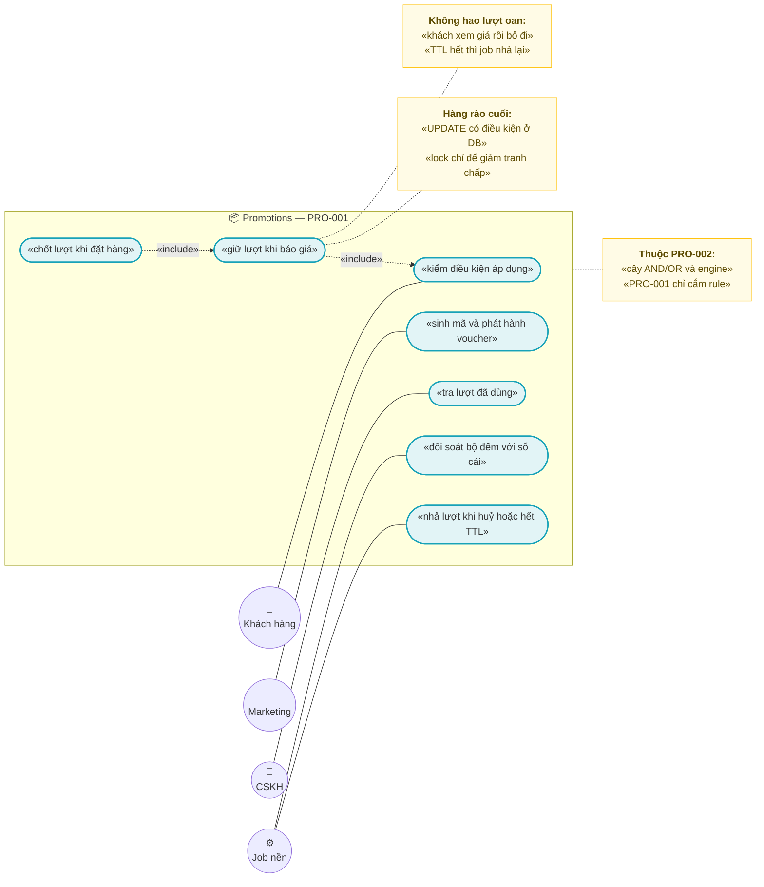
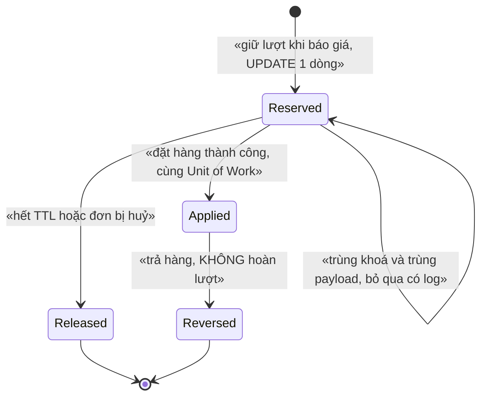
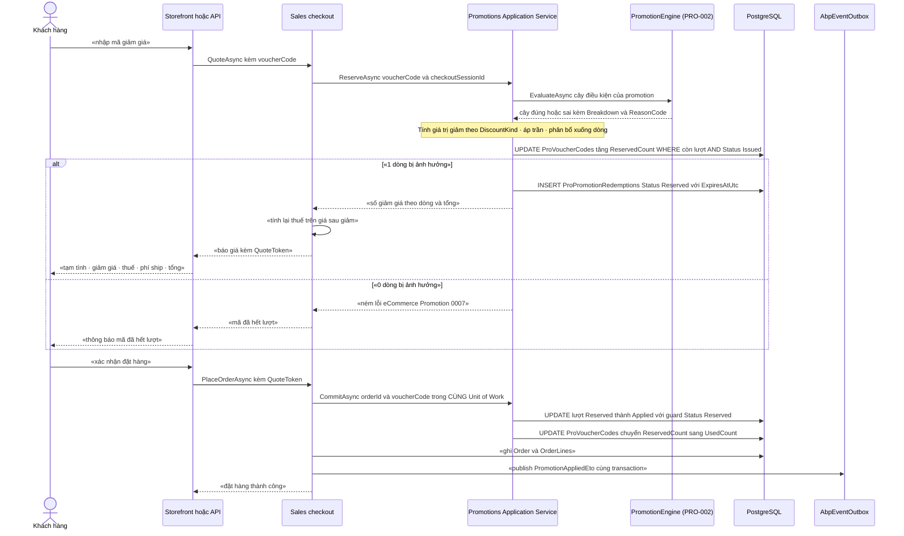

# `PRO-001` — Voucher / Coupon: phát hành, giới hạn lượt & điều kiện áp dụng

> ⚠️ **ĐỌC TRƯỚC:** tài liệu này viết **từ code thật** đã kiểm bằng `read`/`grep` và **từ `PRO-002` đã có trong repo**.
> Mọi khẳng định về code đều kèm `đường/dẫn/file:dòng`. Chỗ **chưa có trong code** ghi rõ *"chưa có trong code — kế hoạch GĐx"*;
> chỗ **không kiểm chứng được** ghi rõ *"chưa kiểm chứng"*.

| Thuộc tính | Nội dung |
|---|---|
| **Mã** | `PRO-001` |
| **Module** | **Promotions** — `modules/Promotions/eCommerce.Promotions.{Domain,Application,Application.Contracts,EntityFrameworkCore}` (⚠️ **chưa có trong code** — `modules/` chỉ có `ChannelHub`, `PaymentHub`, `Tax`) |
| **Giai đoạn** | **GĐ2 — Vận hành & tuân thủ VN** (`docs/implementation-plan.md:198` giao module `Promotions` cho GĐ2; `:422` giao `PRO-001`) |
| **Ưu tiên** | **Must have trong GĐ2** — `docs/implementation-plan.md:203-205` là **cổng kiểm soát GĐ2**: *"một khuyến mãi phức tạp (nhiều điều kiện AND/OR) tính đúng tiền"* |
| **Trạng thái** | 🟡 `Draft` — chờ review |
| **Người viết / người review** | *(điền)* / **Kiến trúc trưởng + BA + Kế toán** (voucher làm đổi `DiscountTotal`/`TaxTotal` ⇒ ảnh hưởng hoá đơn GTGT ⇒ bắt buộc có kế toán, theo `docs/design-doc-guidelines.md:135`) |
| **Phiên bản / ngày** | `v0.1 — 16/10/2026` |
| **Tài liệu liên quan** | ⭐ **`PRO-002`** (`docs/features/promotions/pro-002-cay-dieu-kien-engine-khuyen-mai.md` — **chủ sở hữu** `ProPromotions`/`ProVoucherCodes`/`ProPromotionConditions`/`ProPromotionRedemptions`, engine, mã lỗi `0001`–`0010`, `PromotionLockKeys`) · `XC-001` (Money/làm tròn/phân bổ) · `XC-002` (outbox/inbox, `IIdempotencyGuard`) · `XC-003` (khoá phân tán) · `XC-004` (`[Authorize]` cấp class, permission, `NULLS NOT DISTINCT`) · `XC-005` (log/metric) · `SAL-002` (checkout/đặt hàng) · `SAL-003` (state machine 4 trục) · `SAL-006` (RMA/hoàn tiền) · `PRC-001`/`PRC-002` (giá & pipeline giá) · `EINV-001` (hoá đơn) · `REP-001` (read-model) · ⭐ `SHP-003` (`shp-003-cod-thu-ho-doi-cod.md` — ⚠️ **GHN đổi COD bắt buộc OTP**, có trần **5.000.000**) · ⭐ `SHP-004` (`shp-004-adapter-ghtk.md` — ⚠️ **xác minh địa chỉ 2 cấp CHƯA có câu trả lời từ GHTK**, fail-closed) · `LOY-001` (điểm thưởng) · `docs/implementation-plan.md:198,203-205,422` · `docs/business-modules-proposal.md:78,249` · `docs/templates/feature-design-template.md` |

---

## 0. Tóm tắt & quyết định thiết kế

**Tóm tắt:** `PRO-001` định nghĩa **mã giảm giá (Voucher/Coupon)** dùng được **đúng số lần đã cấu hình**, **đúng điều kiện đã cấu hình**,
và — quan trọng nhất — **không bao giờ tiêu quá lượt** trong bất kỳ tình huống nào: nhiều instance, khách bấm liên tục,
webhook/ETO gửi trùng, **hoặc Redis chết**.

### 0.0 ⭐ Ranh giới với `PRO-002` — **quyết định quan trọng nhất của tài liệu này**

**`PRO-002` ĐÃ CÓ trong repo và ĐÃ sở hữu mô hình dữ liệu dùng chung.** Đọc `pro-002-...md` cho thấy:

| `PRO-002` đã sở hữu | Bằng chứng trong `pro-002` |
|---|---|
| 7 bảng: `ProPromotions`, `ProPromotionConditions`, `ProPromotionRuleCosts`, `ProVoucherCodes`, `ProPromotionMappings`, `ProFlashSaleSlots`, `ProPromotionRedemptions` | §5.2 (`pro-002:344-415`), §11 (`:739`) |
| Engine `IPromotionEngine` + contract `eCommerce.Promotions.Application.Contracts` + `namespace eCommerce.Promotions.Contracts` | §6.1 (`:445-494`) |
| Giới hạn lượt bằng `UPDATE ProVoucherCodes … WHERE UsedCount < MaxUsage` + `CHECK (UsedCount <= MaxUsage)` | **ADR-09** (`:73`), §8.2 dòng 1 (`:640`) |
| Mã lỗi `eCommerce:Promotion:0001`–`0010` (đã đặt tên từng mã) | §6.4 (`:539-550`) |
| Khoá phân tán `PromotionLockKeys.*` (`promotion:tree:…`, `promotion:voucher:…`, `promotion:job:…`, `promotion:import:…`) | §8.2 (`:649-656`) |
| Permission `eCommerce.Promotions.{View,Manage,Approve,Import,Export}` | §9 (`:678-685`) |
| 6 metric mới | §13 (`:811-816`) |
| `PRO-001` **được `PRO-002` chỉ định** làm chủ *"`Voucher`/`Coupon` CRUD chi tiết & phát hành mã"* | `pro-002:55` |

⇒ **`PRO-001` KHÔNG tạo bảng mới và KHÔNG tạo mã lỗi trùng.** Nó **mở rộng** mô hình của `PRO-002` bằng các **yêu cầu thay đổi tường minh**
(§5.3) và **chỉ** sở hữu phần `PRO-002` **không** định nghĩa:

> 🎯 **Phân chia chốt:** **`PRO-002` = *KHI NÀO* áp dụng** (cây điều kiện AND/OR, engine, guard bùng nổ tổ hợp, snapshot "vì sao").
> **`PRO-001` = *MÃ NÀO* và *GIẢM BAO NHIÊU*, *BAO NHIÊU LƯỢT*, và *GIỮ/CHỐT/NHẢ LƯỢT thế nào*** (phát hành mã, giá trị giảm, trần lượt, điều kiện phẳng,
> vòng đời một lượt dùng).

**Hai lỗ hổng thật của `PRO-002` mà `PRO-001` **phải** lấp** (đã kiểm bằng `read` — không suy đoán):

| # | Lỗ hổng (bằng chứng) | Vì sao nghiêm trọng | `PRO-001` xử lý bằng |
|---|---|---|---|
| **L1** | **`ProPromotions` KHÔNG có cột nào mô tả GIÁ TRỊ GIẢM.** Cột của nó chỉ gồm `Code`, `Name`, `Kind` (`Voucher`\|`Discount`\|`FlashSale`), `Status`, `IsCumulative`, `Priority`, `ChannelScope`, `StartsAtUtc`, `EndsAtUtc`, `TreeVersion`, `MaxUsageTotal`, `MaxUsagePerCustomer`, `RowVersion` (`pro-002:355-369`) | Engine `PRO-002` "biết" cây điều kiện đúng/sai nhưng **không có nguồn nào** nói *giảm 10 %* hay *giảm 50.000đ* hay *miễn phí ship* ⇒ **không thể tính ra tiền** | **§5.3 CR-1**: thêm `DiscountKind`, `DiscountValue`, `MaxDiscountAmount`, `MinOrderAmount`, `Currency` (**CR** = change request gửi chủ sở hữu `PRO-002`) |
| **L2** | **`PRO-002` tiêu lượt NGAY khi đánh giá** (`Basic Flow` bước 6 — `pro-002:98`; §4.1 dòng `UPDATE ProVoucherCodes tang UsedCount voi dieu kien con luot` — `:222`) | Khách **báo giá rồi bỏ ngang** (hoặc chỉ mở trang) là **mất lượt thật**. Với mã "100 lượt" thì **100 người xem là hết mã** mà **0 đơn** được tạo — lỗi nghiệp vụ nặng và **im lặng** | **§5.3 CR-2/CR-3**: tách **`Reserved` (giữ chỗ, có TTL)** khỏi **`Applied` (chốt khi đặt hàng)** + job nhả TTL (ADR-02, ADR-03) |

**Điểm xuất phát thật khác (đã kiểm bằng `read`/`grep` ngày 16/10/2026):**

| Hạng mục | Hiện trạng |
|---|---|
| Module `Promotions` | ❌ **Chưa có trong code — kế hoạch GĐ2.** `modules/` chỉ có `ChannelHub`, `PaymentHub`, `Tax` |
| Entity `Voucher`/`Coupon`/`Promotion` | ❌ **Chưa có trong code — kế hoạch GĐ2.** `grep -i "voucher\|coupon\|promotion"` trên `**/*.cs` ⇒ **0** type; chỉ có `Order.DiscountTotal` (`src/eCommerce.Domain/Entities/Orders/Order.cs:41`) và `OrderLine.DiscountAmount` (`:135`) |
| Cột tiền giảm giá trên đơn | ✅ **Đã có**: precision `numeric(18,4)` (`src/eCommerce.EntityFrameworkCore/eCommerceDbContext.cs:174,202`) |
| Guard `DiscountTotal <= Subtotal` | ❌ **Chưa có trong code** — `Order.Recalculate()` (`Order.cs:92-96`) **không** kiểm; `SetDiscount` cũng **không** guard và **không** nhận `Currency` (`Order.cs:98-102`, đã ghi là **F3** của `PRO-002`). Đã ghi là khoảng trống **G3** ở `sal-002` §15.4 nhưng **chưa sửa** (**F1** §15.2) |
| Cột **giảm phí vận chuyển** (FreeShipping) | ❌ **Chưa có** — `Order.cs:39-50` chỉ có `Subtotal`/`DiscountTotal`/`TaxTotal`/`ShippingTotal`/`GrandTotal` (**F6**) |
| `Money`/`MoneyAllocator` (`XC-001`) | ❌ **Chưa có trong code** (`grep "struct Money\|class Money\|MoneyAllocator\|ToMinorUnits"` ⇒ **0** match) ⇒ **điều kiện DoR chặn** (**F2**); `PRO-002` **F4** và `rep-003` **F8** đã ghi nhận |
| `IIdempotencyGuard` / `ILockManager` | ❌ **Chưa có trong code** (`grep` ⇒ 0 match); `PRO-002` **F7** ghi nhận `XC-002` mới ở mức **đặc tả** |
| Permission `Promotions` | ❌ **Chưa có** — `eCommerceConsts.Permissions` (`src/eCommerce.Domain.Shared/eCommerceConsts.cs:15-74`) chưa có nhóm `Promotions`; provider cũng chưa đăng ký (`src/eCommerce.Application.Contracts/Permissions/eCommercePermissionDefinitionProvider.cs:23-60`) |
| Metric khuyến mãi | ❌ **0 metric**; registry hiện có **đúng 12** tên (`shared/eCommerce.Kernel/Observability/eCommerceMetrics.cs:38-52`) + test chốt **cứng số 12** (`test/eCommerce.Tests/Observability/MetricsTests.cs:64`) (**F3**) |
| Hạ tầng test PostgreSQL thật | ✅ **Đã có**: `test/eCommerce.IntegrationTests/` (Testcontainers `postgres:17-alpine` + `Assets/schema.sql`) + test chốt `NULLS NOT DISTINCT` (`PostgreSqlSchemaTests.cs:144-174`) (**F4**) |
| Số giảm giá **của sàn** (khác voucher của ta) | ✅ **Đã có**: `ChannelOrderDto.DiscountAmount` (`modules/ChannelHub/eCommerce.ChannelHub.Application.Contracts/Connectors/IChannelConnector.cs:26`), `ChannelDiscount` (`:37`) |
| `ICurrentTenant` / `IUnitOfWorkManager` | ❌ **Chưa dùng ở đâu** trong code (`grep` ⇒ 0 match) ⇒ tiền đề "tenant hiện tại" **chưa kiểm chứng runtime** |
| ⚠️ **`SHP-003` và `SHP-004` NAY ĐÃ CÓ TÀI LIỆU** | ✅ `docs/features/shipping/shp-003-cod-thu-ho-doi-cod.md` (⚠️ GHN đổi `cod_amount` **bắt buộc `otp`**, trần **5.000.000** — `:682-685`) và `docs/features/shipping/shp-004-adapter-ghtk.md` (xác minh địa chỉ 2 cấp **fail-closed**, GHTK **chưa xác nhận** — `:68-69`, `:939`). ⚠️ **`PRO-002` §15.2 F6 (`pro-002:1007`) ghi *"hai tài liệu này KHÔNG tồn tại"* — điều đó nay KHÔNG còn đúng** (**F5** §15.2) |
| `CHECK` constraint ở EF Core | ✅ **Đã có tiền lệ**: `modules/Tax/eCommerce.Tax.EntityFrameworkCore/TaxDbContextModelCreatingExtensions.cs:22-25,49` (**F7**) |
| `[Authorize]` cấp class | ✅ **Đã có**: `src/eCommerce.Application/Channels/ChannelAppService.cs:27` |

**Phạm vi:**

- ✅ **Vòng đời MÃ**: sinh mã đơn lẻ + **sinh lô**, chuẩn hoá/duy nhất mã, phát hành/tạm dừng **thu hồi**, **cấm sửa giá trị sau khi phát hành**.
- ✅ **Giá trị giảm**: 3 loại `Percentage` · `FixedAmount` · `FreeShipping`; trần giảm; **tiền hàng tối thiểu**; `Currency`.
- ✅ **Giới hạn lượt** 2 chiều: **tổng** (gộp `ProVoucherCodes.MaxUsage` + `ProPromotions.MaxUsageTotal`) và **theo khách** (giải **Q6** của `PRO-002`).
- ✅ **Vòng đời một LƯỢT dùng**: `Reserved` (TTL) → `Applied` → `Released`/`Reversed`, **guard NÉM LỖI**, **job nhả TTL**.
- ✅ **Điều kiện phẳng AND** cho voucher: tiền hàng tối thiểu · kênh · SKU/danh mục **include/exclude** · nhóm khách · **đơn đầu tiên** — hiện thực bằng **rule trong registry của `PRO-002`** (`IPromotionConditionRule` + `RuleSystemName`), do `PRO-001` **cung cấp ngữ nghĩa + bộ rule**.
- ✅ **Sổ cái lượt** = `ProPromotionRedemptions` (append-only, của `PRO-002`) + **bộ đếm** + **job đối soát**.
- ✅ **Idempotency ở mọi biên vào**; **metric mới**; **endpoint áp mã ở storefront**.

**Không nằm trong phạm vi:**

- ❌ **Cây điều kiện AND/OR, engine đánh giá, guard bùng nổ tổ hợp, short-circuit, ngân sách đánh giá** — thuộc **`PRO-002`** (`pro-002:47-52`). `PRO-001` chỉ **cắm rule** vào registry của nó.
- ❌ **Bảng/mã lỗi/khoá phân tán/permission nền của module** — **đã** do `PRO-002` sở hữu (`pro-002:344-694`). `PRO-001` **tái dùng**, không tạo bản thứ hai.
- ❌ **FlashSale** (`ProFlashSaleSlots` — `pro-002:400`) và **khuyến mãi tự động `AutoApply` không có mã** — thuộc `PRO-002`.
- ❌ **Cộng dồn nhiều khuyến mãi (`IsCumulative`)** — thuộc `PRO-002` **ADR-15**/A2 (`pro-002:99`). `PRO-001` chốt **tối đa 1 mã/đơn** (ADR-04).
- ❌ **Pipeline tính giá & thứ tự áp giá/phí** — thuộc `PRC-002` (`prc-001:43`).
- ❌ **Đổi điểm thưởng lấy voucher** — thuộc `LOY-001`; `loy-001` §0 ghi *"quà tặng, voucher đổi bằng điểm — giai đoạn sau"*.
- ❌ **Quy trình đổi số tiền COD sau khi đã tạo vận đơn** — thuộc `SHP-003` (⚠️ GHN **bắt buộc OTP** ⇒ **có bước thủ công**; `shp-003:1-7,682-685`). `PRO-001` chỉ **cấm** tự ý sửa tiền sau vận đơn (**ADR-12**).
- ❌ **Hoàn tiền một phần khi trả hàng** — thuộc `SAL-006`; `PRO-001` chỉ ghi `Reversed` và **không** hoàn lượt.
- ❌ **Đa tiền tệ hoạt động thật** — `XC-001` **BR-009**: GĐ này chỉ `VND`; cột `Currency` vẫn **bắt buộc** có.

### 0.1 Quyết định thiết kế (ADR ngắn)

| # | Quyết định | Phương án đã cân nhắc | Lý do chọn | Hệ quả |
|---|---|---|---|---|
| **ADR-01** | **Tái dùng mô hình `PRO-002`, KHÔNG tạo bảng mới**; nhu cầu mới gửi bằng **change request** (§5.3) | (a) `PRO-001` tự tạo `ProVouchers`/`ProVoucherRedemptions` riêng · (b) **mở rộng bảng của `PRO-002`** | `PRO-002` **đã** định nghĩa `ProVoucherCodes`/`ProPromotionRedemptions` (`pro-002:398,402-415`) và **đã chỉ định** `PRO-001` lo *"Voucher/Coupon CRUD"* (`pro-002:55`). Tạo bảng thứ hai ⇒ **hai nguồn sự thật** cho cùng khái niệm "lượt dùng" — **đúng loại lỗi `XC-003` F1** đã phải sửa (khoá kênh định nghĩa 2 nơi, 2 chuỗi khác nhau) | `PRO-001` **bị chặn** cho tới khi chủ sở hữu `PRO-002` chấp nhận §5.3; **cấm** tự thêm cột vào bảng của module khác |
| **ADR-02** | **Giữ lượt (`Reserved`) có TTL ngay từ bước báo giá**, chốt lượt khi đặt hàng | (a) trừ lượt ngay khi đánh giá (**đúng như `PRO-002` hiện mô tả**) · (b) giữ chỗ có TTL | `PRO-002` tiêu lượt ở bước 6 của Basic Flow (`pro-002:98`) ⇒ **khách bỏ ngang vẫn mất lượt** (**L2**). Đây là **lỗi nghiệp vụ im lặng** — và `XC-003` §0 gọi đúng loại lỗi này là *"lỗi im lặng, chỉ lộ ra khi có tranh chấp thật"* | **Bắt buộc** có **job nhả TTL**; thiếu job ⇒ **lượt treo vĩnh viễn** (rủi ro vận hành lớn nhất). Cần `ExpiresAtUtc` **NOT NULL** trên lượt giữ |
| **ADR-03** | **Hàng rào lượt ở tầng DB**: `UPDATE … WHERE còn lượt` + **đếm số dòng**; **KHÔNG** dùng lock làm hàng rào | (a) lock Redis làm hàng rào · (b) lock + DB · (c) **chỉ DB** | Kế thừa `PRO-002` **ADR-09** (`pro-002:73`) và `XC-003` **D2**/**BR-007** (*"bỏ lock đi, DB có chặn không?"* ⇒ **CÓ**). `AbortOnConnectFail = false` (`src/eCommerce.HttpApi.Host/eCommerceHttpApiHostModule.cs:141`) ⇒ Redis chết thì app **vẫn chạy** ⇒ nếu tin lock thì **mất bất biến** | `ExecuteUpdateAsync` + **NÉM** khi 0 dòng (`XC-002` **D8**/**BR-008**). Lock (`PromotionLockKeys.VoucherUsage` — `pro-002:654`) chỉ để **giảm tranh chấp** |
| **ADR-04** | **Tối đa 1 mã / đơn** ở GĐ2 | (a) cho cộng dồn ngay · (b) 1 mã | Cộng dồn thuộc `PRO-002` (`IsCumulative` — `pro-002:361`, A2 — `:99`) và kéo theo bài toán *"cái nào lợi hơn"* **không xác định**. `PRO-001` chọn bài toán **nhỏ, chứng minh được** | **Không** thêm cột `Stackable`; unique filter `(TenantId, OrderId) WHERE OrderId IS NOT NULL` cưỡng chế được bằng DB (**BR-005**) |
| **ADR-05** | Giá trị giảm **trên tiền hàng TRƯỚC thuế**, **phân bổ xuống dòng**; **thuế tính lại** trên giá sau giảm | (a) giảm sau thuế · (b) giảm trước thuế + phân bổ | Giá tính thuế GTGT là **giá khách thực trả**; giảm sau thuế ⇒ hoá đơn **sai** (`EINV-001` BR-004/BR-005 kế thừa `XC-001` **BR-010/BR-011**). Phân bổ để giữ `Σ DiscountPerLine == DiscountTotal` (`XC-001` **BR-006**/**D7**; `PRO-002` **BR-11** — `pro-002:101`) | **Mọi** voucher làm đổi `TaxTotal` ⇒ UI **phải** hiển thị đúng thứ tự dòng tiền (§10); `SAL-002`/`EINV-001` tính lại thuế **sau** khi áp voucher |
| **ADR-06** | `FreeShipping` giảm **`ShippingTotal`**, **KHÔNG** vào `DiscountTotal` | (a) trộn chung · (b) tách riêng | `REP-001` giữ `DiscountAmount` **riêng** *"để báo cáo khuyến mãi (`PRO-*`)"* (`rep-001:442`); trộn "giảm tiền hàng" với "miễn phí ship" ⇒ **mất khả năng đối soát** phí vận chuyển và COD (`REC-003`) | `Order` **chưa có** cột riêng (**F6**) ⇒ cần `ShippingDiscountTotal`; cột đó do **chủ sở hữu `Order`** (`Sales`) thêm, **không** phải `PRO-001` |
| **ADR-07** | Điều kiện voucher ở GĐ2 là **rule phẳng trong registry của `PRO-002`** (kết hợp **AND**), mỗi điều kiện = **một node lá** | (a) tự viết bộ đánh giá riêng trong `PRO-001` · (b) **cắm rule vào registry `PRO-002`** | `PRO-002` **đã** có `IPromotionConditionRule` + `RuleSystemName` + `ProPromotionRuleCosts` (`pro-002:380,385-392,489-493`). Viết bộ thứ hai ⇒ hai engine, hai ngữ nghĩa AND/OR, và **mất** guard bùng nổ tổ hợp (`PRO-002` ADR-02/03) | `PRO-001` **phải** khai `DeclaredCostFactor` cho **mỗi** rule mới trong `ProPromotionRuleCosts` (nếu không, guard tĩnh **BR-06** của `PRO-002` sẽ sai) |
| **ADR-08** | **Cấm** ánh xạ "giảm giá của sàn" thành voucher nội bộ | (a) coi `ChannelDiscount` như voucher · (b) tách tuyệt đối | Đơn sàn mang số **của sàn** (`IChannelConnector.cs:26,37`). Nếu tiêu quota nội bộ theo số của bên thứ ba thì **quota bị tiêu bởi quyết định của người khác** và **không đối soát được**. `PRO-002` cũng xác nhận: *"Khuyến mãi **của sàn** không đi qua engine này"* (giả định 6 — `pro-002:1019`) | Lượt **chỉ** sinh từ luồng nội bộ kênh `web` (**BR-012**, **BR-017**) |
| **ADR-09** | **Trạng thái "hết lượt"/"hết hạn" là SUY RA** — **cấm** ghi vào cột `Status` | (a) job ghi `Exhausted` · (b) suy ra khi đọc | Ghi trạng thái suy ra ⇒ **hai nguồn sự thật**, lệch ngay khi lượt được **nhả** (và ADR-02 vừa làm việc nhả thành bình thường). `SAL-003` **BR-008** đã cấm đúng lỗi này cho `DerivedStatus` | Vị từ "còn dùng được" và vị từ trong `UPDATE` giành lượt **phải là CÙNG một** định nghĩa; test `TC-07`/`TC-08` chứng minh |
| **ADR-10** | `Money`/`MoneyAllocator` là **điều kiện chặn (DoR)**; chưa có ⇒ **không** code `PRO-001` | (a) dùng `decimal` trần cho tới khi có `Money` · (b) chờ `XC-001` | `XC-001` §0: *"sai tiền là loại lỗi không sửa được về sau"*; phân bổ giảm giá xuống dòng **đúng** bài toán `MoneyAllocator` (`XC-001` **BR-006**). `PRO-002` **ADR-11**/**F4** (`pro-002:75,1005`) đã ghi cùng kết luận | PR của `PRO-001` **không** merge trước `XC-001`; DTO trung gian **bắt buộc** kèm `Currency`, so bằng `ToMinorUnits()` |
| **ADR-11** | Hàm sinh khoá lock **KHÔNG** chứa tiền tố `ecommerce:` — **kế thừa `PRO-002`** | (a) nhúng tiền tố · (b) để `KeyPrefix` lo | `eCommerceHttpApiHostModule.cs:127` đặt `KeyPrefix = "ecommerce:"` và ABP ghép **không có dấu phân cách** (`XC-003` §5.4 hệ quả #2). Phương án (a) tạo **tiền tố ĐÔI** `ecommerce:ecommerce:…` | `PRO-001` **tái dùng** `PromotionLockKeys` của `PRO-002` (`pro-002:653-656`) — **không** khai hàm sinh khoá mới ⇒ không có cơ hội thứ hai để sai. ⚠️ Xung đột tiền tố toàn hệ thống vẫn **phải** xử lý (**F8**) |
| **ADR-12** | **Cấm** áp/đổi voucher **sau khi đã tạo vận đơn** | (a) cho sửa rồi đồng bộ COD · (b) chặn ở ranh giới vận đơn | Đổi số tiền ⇒ đổi **số COD** ⇒ **GHN bắt buộc OTP** (`shp-003:1-7,682-685`: *"`otp` … required only when changing `cod_amount`"*; trần **5.000.000**) ⇒ **có bước thủ công**, không tự động hoá 100 % | Mọi sửa tiền sau vận đơn đi qua quy trình `SHP-003`/`SAL-006`; `PRO-001` **cấm** sinh lượt ở giai đoạn đó |
| **ADR-13** | Lượt được **CHỐT trong CÙNG Unit of Work** với việc tạo đơn: `Sales` gọi **contract** của `Promotions`, **không** chốt bằng ETO sau khi đơn đã commit | (a) phát `PromotionAppliedEto` rồi consumer chốt lượt · (b) gọi đồng bộ trong cùng UoW | (a) tạo **cửa sổ** đơn đã tồn tại nhưng lượt chưa chốt ⇒ **tiêu quá lượt** hoặc **đơn không có giảm giá**. `XC-002` **BR-001** yêu cầu *"hoặc cả hai cùng có, hoặc cả hai cùng không"*; `PRO-002` **BR-10** cũng yêu cầu UoW | `Promotions` **cấm** tham chiếu `src/` ⇒ `Sales`(app)→`eCommerce.Promotions.Application.Contracts` là hướng **hợp lệ** (đúng cách app tham chiếu module ở `eCommerceDbContext.cs:1-7`). ETO chỉ cho **read-model/thông báo** |
| **ADR-14** | **Cấm** điều kiện voucher phụ thuộc **địa chỉ/khu vực giao hàng** ở GĐ2 | (a) cho điều kiện theo tỉnh/quận · (b) cấm | ⚠️ **GHTK xác minh địa chỉ 2 cấp CHƯA có câu trả lời** (`shp-004:68-69` fail-closed, `:939` *"chưa có"* là **điều kiện DoD chặn**; `docs/implementation-plan.md:427`). Nếu điều kiện tiền phụ thuộc dữ liệu địa chỉ **chưa ổn định** ⇒ **tính sai vùng im lặng** | `MinOrderAmount` đo trên **tiền hàng chưa thuế, chưa phí ship** ⇒ quyết định voucher **không** phụ thuộc giá trị chưa kiểm chứng của bên thứ ba. Trùng kết luận **Q8**/**BR-19** của `PRO-002` (`pro-002:604,994`) |
| **ADR-15** | **Metric mới phải cập nhật registry + `XC-005` §5.1 + test trong CÙNG PR** | (a) phát tự do · (b) registry + test | Kế thừa `XC-005` **BR-008** và `PRO-002` **ADR-14** (`pro-002:78`). Test hiện chốt **cứng số 12** (`MetricsTests.cs:64`) | 3 metric của `PRO-001` ⇒ registry **12 → 21** (12 + 6 của `PRO-002` + 3 của `PRO-001`) ⇒ **phải** sửa `MetricsTests.cs` **và** `TC-22` của `PRO-002`, nếu không **CI đỏ** (**F3**) |

---

## 1. Use Case Specification

> 📌 **Quy ước mã:** trong tài liệu này dùng `BR-01`, `NFR-01`, `TC-01`, `ADR-01`. Khi trích **ra ngoài**, dùng dạng đầy đủ
> `BR-PRO-001-01`, `NFR-PRO-001-01`, `TC-PRO-001-01` (nhất quán cách `PRO-002` ghi ở `pro-002:85-86`).

| Thuộc tính | Nội dung |
|---|---|
| **Use Case ID** | `PRO-001` |
| **Use Case Name** | Phát hành và sử dụng mã giảm giá **đúng lượt, đúng điều kiện, không hao lượt oan** |
| **Description** | *"Là quản trị Marketing, tôi muốn phát hành mã giảm giá có giá trị và giới hạn lượt rõ ràng; là khách hàng, tôi muốn biết ngay mã có dùng được không; là kế toán, tôi muốn chắc chắn **không bao giờ** có nhiều hơn số lượt đã cấu hình bị tiêu — và **khách xem giá rồi bỏ đi thì không mất lượt**."* |
| **Actor(s)** | **Quản trị Marketing** (phát hành/thu hồi mã) · **Khách hàng** (nhập mã) · **CSKH** (tra lượt đã dùng) · **Hệ thống** (`Sales` gọi contract; consumer ETO; job nhả TTL; job đối soát) · **Kế toán** (đối soát số giảm giá) |
| **Priority** | **Must have trong GĐ2** |
| **Trigger** | (a) khách nhập mã ở bước báo giá/checkout; (b) khách xác nhận đặt hàng; (c) lượt giữ **hết TTL** hoặc đơn **bị huỷ**; (d) đơn bị **trả hàng**; (e) job đối soát bộ đếm theo nhịp |
| **Pre-Condition(s)** | • **Tenant hiện tại** (`TenantId` từ `ICurrentTenant`): mọi entity là `IMultiTenant`; ⚠️ hệ thống chạy **1 tenant** nên `TenantId` **có thể là `NULL`** (`XC-004` §15.2 F1) ⇒ **mọi** unique index **phải** `NULLS NOT DISTINCT`. ⚠️ `ICurrentTenant` **chưa dùng ở đâu trong code** (`grep` = 0) ⇒ tiền đề **chưa kiểm chứng runtime**.<br>• **Kênh bán** (`ChannelCode`): GĐ2 `PRO-001` **chỉ** phục vụ kênh nội bộ `web`. Đơn sàn **không** tiêu lượt voucher nội bộ (**ADR-08**, **BR-12**).<br>• **`ProPromotions` tồn tại** với `Status = Active`, `Now` ∈ `[StartsAtUtc, EndsAtUtc]`, và **cây điều kiện đã qua guard ghi** của `PRO-002` (`pro-002:512`).<br>• **`ProVoucherCodes` tồn tại**, `Code` đã chuẩn hoá, chưa `Revoked`.<br>• **Hợp đồng `PRO-002` đã có** (`IPromotionEngine`, `PromotionLockKeys`, `PromotionErrorCodes` — `pro-002:451,653,539-550`). ⚠️ **hiện CHƯA có trong code**.<br>• **`Money`/`MoneyAllocator` của `XC-001` đã có** — ⚠️ **hiện CHƯA có trong code** (**F2**) ⇒ **điều kiện DoR chặn**.<br>• **Redis 7 sẵn sàng** cho khoá của **job** — nếu không, kết quả **vẫn phải đúng** nhờ ràng buộc DB (**ADR-03**). |
| **Post-Condition(s)** | • Tại **mọi** thời điểm: `UsedCount + ReservedCount <= MaxUsage` (và `<= MaxUsageTotal` khi có) — cưỡng chế ở **tầng DB**.<br>• Số lượt **đã chốt** của một khách `<= MaxUsagePerCustomer` — cưỡng chế bằng **unique index** (giải **Q6** của `PRO-002`).<br>• Một đơn có **tối đa một** lượt `Applied`; `Σ DiscountAmount` của lượt **bằng** `Order.DiscountTotal`.<br>• `Σ DiscountPerLine == DiscountTotal` (`XC-001` **BR-006**; `PRO-002` **BR-11**).<br>• Mọi lượt đã giữ **hoặc** được chốt, **hoặc** được nhả, **hoặc** có dấu vết (DLQ/cảnh báo) — **không** có lượt treo vô thời hạn.<br>• Mọi lần **không** giành được lượt đều có **log + metric** kèm mã lỗi. |
| **Basic Flow** | 1. Khách nhập mã ⇒ `Sales` gọi `ReserveAsync(voucherCode, checkoutSessionId, lines, channelCode, currency)` trên contract của `Promotions` (**ADR-13**), trong UoW của **bước báo giá**.<br>2. `Promotions` nạp `ProPromotions` + `ProVoucherCodes`, rồi gọi **engine `PRO-002`** để đánh giá **cây điều kiện** (điều kiện voucher là các node lá — **ADR-07**).<br>3. Cây `false` ⇒ trả **báo giá KHÔNG giảm giá** + `PromotionRejectionReason` cụ thể (`pro-002:482-486`); **không** ném lỗi hệ thống.<br>4. Cây `true` ⇒ tính **giá trị giảm** theo `DiscountKind`/`DiscountValue`, **áp trần** `MaxDiscountAmount`, và **phân bổ xuống dòng** bằng `MoneyAllocator.Allocate` (**ADR-05**).<br>5. Chạy `UPDATE "ProVoucherCodes" SET "ReservedCount" = "ReservedCount" + 1 WHERE "Id" = @id AND "Status" = 'Active' AND ("UsedCount" + "ReservedCount") < "MaxUsage"`.<br>6. **0 dòng** ⇒ **NÉM** `eCommerce:Promotion:0007` (`UsageLimitExceeded` — **mã của `PRO-002`**, `pro-002:547`) — **cấm** kẹp/đoán.<br>7. **1 dòng** ⇒ `INSERT ProPromotionRedemptions (Status = Reserved, ExpiresAtUtc = now + TTL, UsageSequence)`; unique `(TenantId, PromotionId, CustomerId, UsageSequence)` là hàng rào **trần theo khách**.<br>8. `Promotions` trả `VoucherQuoteResult` (giảm theo dòng + tổng + `ShippingDiscountTotal`); `Sales` **tính lại thuế trên giá sau giảm** và trả báo giá (kèm `QuoteToken`, `ExpiresAt`).<br>9. Khách xác nhận ⇒ `Sales` gọi `CommitAsync(orderId, voucherCode)` **trong cùng UoW với việc ghi `Order`**.<br>10. `Promotions` chuyển `Reserved → Applied` bằng `UPDATE … WHERE "Status" = Reserved` (0 dòng ⇒ **NÉM** `eCommerce:Promotion:0015`) và chuyển `ReservedCount → UsedCount` **nguyên tử**.<br>11. Sau commit: phát `PromotionAppliedEto` **qua outbox cùng transaction** (`PRO-002` §7.1 — `pro-002:570`); ghi metric. |
| **Alternative Flow** | **A1: Điều kiện không đạt** (chưa đủ tiền hàng · sai kênh · SKU bị loại · sai nhóm khách · không phải đơn đầu) — trả báo giá **không giảm giá** + `ReasonCode` **cụ thể** *(trừ `MinOrderAmount` thì nêu số còn thiếu)*; **không** ném lỗi hệ thống.<br>**A2: Trùng lượt gửi (idempotent hợp lệ)** — cùng `IdempotencyKey` **và** cùng `PayloadHash` ⇒ **bỏ qua**, trả kết quả cũ, metric `promotion_voucher_reserved_total{result=duplicate}`; **không** phải lỗi.<br>**A3: Khách vãng lai** (không `CustomerId`) — **không** áp được trần theo khách ⇒ chỉ còn trần tổng; ⚠️ phụ thuộc `SAL-002` **Q2** (`Open`) và **Q7** của `PRO-002` (`pro-002:993`) ⇒ xem **Q5** §15.1.<br>**A4: Job nhả TTL** — chỉ nhặt `Status = Reserved AND ExpiresAtUtc <= now`; giành `PromotionLockKeys.Job("voucher-expiry", tenantId)` (`pro-002:655`) ở chế độ **`SkipIfBusy`**; bỏ qua nhịp ⇒ **bắt buộc** log + metric (`XC-003` **D10**/**BR-010**).<br>**A5: Sinh lô mã** — theo `Prefix` + `Length` + `Quantity`; vượt `MaxBatchSize` ⇒ **NÉM** `0018` **trước khi** ghi dòng nào (kế thừa tinh thần `CAT-002` **BR-009** *"vượt trần ⇒ NÉM trước khi ghi"*). |
| **Exception Flow** | **E1:** hết lượt (0 dòng `UPDATE`) ⇒ `eCommerce:Promotion:0007` — `409` (**mã của `PRO-002`**).<br>**E2:** cùng `IdempotencyKey` nhưng **khác** `PayloadHash` ⇒ `eCommerce:Messaging:0002` (**mã của `XC-002`**, `pro-002:552`) — `409`; **cấm** coi là bản ghi trùng.<br>**E3:** chuyển trạng thái **mã**/**lượt** không hợp lệ (ví dụ `Applied → Reserved`) ⇒ `eCommerce:Promotion:0006` (`InvalidStatusTransition`, `pro-002:546`) hoặc `0015` cho lượt — **cấm** no-op im lặng (`XC-002` **BR-009**).<br>**E4:** vượt trần theo khách ⇒ vi phạm unique index ⇒ `eCommerce:Promotion:0014` — `409`.<br>**E5:** tổng giảm vượt giá trị đơn ⇒ `eCommerce:Promotion:0009` (`DiscountExceedsOrder`, `pro-002:549`) — **cấm** kẹp về trần.<br>**E6:** `Σ Breakdown` lệch `Order.DiscountTotal` ⇒ `eCommerce:Promotion:0021` (lỗi lập trình ⇒ lộ ra CI, `500` + log).<br>**E7:** sửa **giá trị giảm** của mã đã phát hành/có lượt ⇒ `eCommerce:Promotion:0016` (**BR-18**).<br>**E8:** áp voucher nội bộ cho đơn **không** thuộc kênh `web` ⇒ `eCommerce:Promotion:0020` (**BR-17**).<br>**E9:** `TenantId` rỗng trong khoá/dữ liệu có tenant ⇒ **NÉM** tham số (`eCommerce:Promotion:0022`) — **cấm** khoá/dữ liệu toàn cục (`XC-003` **BR-003**).<br>**E10:** `DiscountKind = Percentage` mà `DiscountValue` ngoài `(0, 100]` hoặc **thiếu** `MaxDiscountAmount` ⇒ `eCommerce:Promotion:0019` (**BR-19**).<br>**E11:** `FreeShipping` khi `ShippingDiscountTotal > ShippingTotal` ⇒ `eCommerce:Promotion:0020`? — **Không**: dùng **`0009`** của `PRO-002` cho bao ngoài, và **`0019`**… ⛔ *Xem **Q1** §15.1 — dải mã cụ thể của miền FreeShipping cần chốt với chủ sở hữu `PRO-002`; tài liệu này **không** tự chiếm thêm mã.*<br>**E12:** `Code` sai định dạng sau chuẩn hoá ⇒ `eCommerce:Promotion:0017` — `400`. |
| **Business Rules** | • **BR-01**: Lượt dùng **phải** cưỡng chế ở **tầng DB** bằng `UPDATE … WHERE` có điều kiện; số dòng **0 ⇒ NÉM** `0007`. **Cấm** tin vào kiểm tra trong bộ nhớ hoặc vào distributed lock (`XC-003` **BR-007**; `PRO-002` **ADR-09**).<br>• **BR-02**: **Mọi** biên vào ghi lượt (HTTP, consumer ETO, job) **phải** idempotent qua khoá **ổn định** **trước** mọi side effect (`XC-002` **BR-004**). Cùng khoá + **cùng** `PayloadHash` ⇒ bỏ qua **có log + metric**; cùng khoá + **khác** `PayloadHash` ⇒ **NÉM** `eCommerce:Messaging:0002`.<br>• **BR-03**: `IdempotencyKey` **ổn định**: giữ lượt = `Checkout:{tenantId}:{checkoutSessionId}:{code}` *(noi khuôn `PRO-002` §7.2 dòng 1 — `pro-002:581`)* · chốt lượt = `PromotionCommit:{tenantId}:{orderId}:{code}` · nhả = `PromotionRefund:{tenantId}:{orderId}:{promotionId}` *(**tái dùng** khoá đã có của `PRO-002` — `pro-002:671`)*. **Cấm** `Guid.NewGuid()` mỗi lần thử (`XC-002` **BR-007**).<br>• **BR-04**: Một khách **không** vượt `MaxUsagePerCustomer`; cưỡng chế bằng unique `(TenantId, PromotionId, CustomerId, UsageSequence)` **`NULLS NOT DISTINCT`** — **cấm** chỉ kiểm bằng `COUNT(*)`. *(Giải **Q6** của `PRO-002` — `pro-002:992`.)*<br>• **BR-05**: Một đơn có **tối đa một** lượt `Applied`; cưỡng chế bằng unique **có filter** `(TenantId, OrderId) WHERE "OrderId" IS NOT NULL` **`NULLS NOT DISTINCT`**.<br>• **BR-06**: `Σ DiscountAmount` của các lượt gắn một đơn **phải bằng** `Order.DiscountTotal`; lệch ⇒ **NÉM** `0021`. **Cấm** tự sửa một trong hai bên.<br>• **BR-07**: `Σ DiscountPerLine == DiscountTotal` **chính xác** (phân bổ phần dư lớn nhất — `XC-001` **D7**; `PRO-002` **BR-11**) và `DiscountTotal ≤ Subtotal` cho `Percentage`/`FixedAmount`; vượt ⇒ **NÉM** `0009`. **Cấm kẹp về trần im lặng** (kế thừa `chn-004` **BR-003**: *"âm ⇒ NÉM lỗi, không kẹp về 0 im lặng"*).<br>• **BR-08**: Mọi khoản tiền là `decimal` **kèm `Currency`**; **cấm** `double`/`float`; **cấm** so sánh tiền bằng `==` — so bằng `ToMinorUnits()` (`XC-001` **BR-003**/**BR-008**; `PRO-002` **BR-12**).<br>• **BR-09**: `Exhausted`/`Expired` là **suy ra**; **cấm** ghi vào cột `Status`. Vị từ "còn dùng được" và vị từ trong `UPDATE` giành lượt **phải là cùng một** định nghĩa.<br>• **BR-10**: **Mọi** chuyển trạng thái **mã** và **lượt** **phải** qua guard §3; chuyển sai ⇒ **NÉM** `0006`/`0015`. **Cấm** no-op im lặng; **cấm** bỏ qua khi đã ở trạng thái đích **trừ** ca A2 (trùng hợp lệ).<br>• **BR-11**: `ProPromotionRedemptions` là **append-only**: **cấm** `UPDATE`/`DELETE` ở tầng ứng dụng. *(`ProVoucherCodes` được cập nhật **chỉ** ở `ReservedCount`/`UsedCount`; lượt được cập nhật **chỉ** ở `Status`/`AppliedAtUtc`/`ReleasedAtUtc`/`ReversedAtUtc`/`ReasonCode` — **cấm** sửa `DiscountAmount`, `IdempotencyKey`, `VoucherCodeId`, `UsageSequence` sau khi ghi.)*<br>• **BR-12**: Lượt **chỉ** sinh từ luồng **nội bộ**; số giảm giá của sàn (`ChannelDiscount`/`DiscountAmount` — `IChannelConnector.cs:26,37`) **không** tiêu lượt voucher nội bộ (**ADR-08**).<br>• **BR-13**: Mọi thao tác ghi qua **Unit of Work**; **cấm** `autoSave: true` (tiền lệ sai: `src/eCommerce.Application/Channels/ChannelAppService.cs:103,119,132,183`; `PRO-002` **BR-10**).<br>• **BR-14**: **Mọi** unique index có `TenantId` **phải** `NULLS NOT DISTINCT`, viết bằng **SQL thô trong migration** — EF Core **không** mô hình hoá (`XC-004` **BR-009**; `PRO-002` **BR-17**; tiền lệ `20261013024226_Fix_NullableTenantId_UniqueIndexes.cs`). **Không** để nợ.<br>• **BR-15**: Mọi app service **phải** có `[Authorize]` ở **cấp class** (`XC-004` **BR-001**; tiền lệ `ChannelAppService.cs:21-28`); permission **chỉ** dùng hằng số; permission **mới** **phải** được `AddPermission` ở `eCommercePermissionDefinitionProvider.cs` — nếu không, ABP **luôn** từ chối ⇒ `403` dù user là admin (`eCommercePermissionDefinitionProvider.cs:8-11`).<br>• **BR-16**: Rule điều kiện mới của `PRO-001` **phải** được khai `DeclaredCostFactor` trong `ProPromotionRuleCosts` (`pro-002:385-392`) và **phải THUẦN** (không I/O — `PRO-002` **BR-08**, `pro-002:101`). Thiếu khai báo ⇒ guard tĩnh **BR-06** của `PRO-002` **tính sai** ⇒ cây lớn lọt qua.<br>• **BR-17**: Ở GĐ2, `PRO-001` **chỉ** phục vụ kênh `web`; áp voucher nội bộ cho đơn kênh khác ⇒ **NÉM** `0020`.<br>• **BR-18**: Sau khi mã **đã phát hành** (hoặc đã có ≥ 1 lượt), **cấm** sửa `DiscountKind`/`DiscountValue`/`MaxDiscountAmount`/`MinOrderAmount`/`MaxUsage`/`MaxUsagePerCustomer` ⇒ **NÉM** `0016`. Muốn đổi ⇒ **thu hồi mã cũ** + phát hành mã mới (kế thừa *"bảng giá `Active` là append-only"* — `prc-001` **BR-004**; *"cấm sửa bản ghi đã có hiệu lực"* — `TaxErrorCodes.cs:28`).<br>• **BR-19**: `DiscountKind = Percentage` ⇒ `0 < DiscountValue ≤ 100` **và `MaxDiscountAmount` BẮT BUỘC** (không có mặc định ngầm) — mã *"giảm 50 %"* **không trần** là **rủi ro tiền**; vi phạm ⇒ **NÉM** `0019`.<br>• **BR-20**: `MinOrderAmount` đo trên **tiền hàng chưa thuế, chưa phí ship** (**ADR-14**); **cấm** đo trên `GrandTotal` (sẽ làm quyết định voucher phụ thuộc phí vận chuyển — dữ liệu phụ thuộc **địa chỉ chưa xác minh** của GHTK, `shp-004:939`).<br>• **BR-21**: Mọi metric mới **phải** thêm vào `eCommerceMetricNames` (`eCommerceMetrics.cs:13-53`) **và** `XC-005` §5.1 **và** test chốt số lượng (`MetricsTests.cs:64`) trong **cùng PR**; tên **phải** kết thúc `_total`/`_seconds`/`_size`/`_pending`/`_skus` (ràng buộc thật ở `MetricsTests.cs:112-127`) và **cấm** nhãn cardinality cao (`XC-005` **BR-009**; `eCommerceMetrics.cs:81-85`).<br>• **BR-22**: Seed **idempotent**; **cấm** seed voucher nghiệp vụ thật (chỉ môi trường dev). **Cấm** log mã voucher gắn khách/PII (`XC-005` **BR-005**). |
| **Non-Functional Requirement** | • **NFR-01**: `ReserveAsync` khi rảnh ⇒ **p95 < 150 ms** (không tính độ trễ mạng).<br>• **NFR-02**: **0** trường hợp vượt `MaxUsage` khi **200** request đồng thời tranh **1** lượt (PostgreSQL thật).<br>• **NFR-03**: **0** trường hợp vượt `MaxUsagePerCustomer` khi **50** request song song **cùng** khách.<br>• **NFR-04**: Job nhả TTL xử lý **≥ 1.000** lượt/phút; **0** lượt treo quá **2 × TTL**.<br>• **NFR-05**: Lệch giữa **bộ đếm** (`ReservedCount`/`UsedCount`) và **sổ cái** (`ProPromotionRedemptions`) sau job đối soát **= 0**.<br>• **NFR-06**: Cùng một luồng gửi trùng **100 lần** ⇒ **đúng 1** lượt tiêu và **1** bản ghi sổ cái (`PRO-002` **NFR-07** — `pro-002:102`).<br>• **NFR-07**: Cách ly tenant: tenant A thấy **0** bản ghi của tenant B (test 2 tenant).<br>• **NFR-08**: **0** `double`/`float` trong entity/DTO module; **0** so sánh `==` trên tiền.<br>• **NFR-09**: **0** `autoSave: true` trong `Promotions.Application` (test quét mã nguồn).<br>• **NFR-10**: **100 %** unique index có `TenantId` dùng `NULLS NOT DISTINCT` (kiểm trên PostgreSQL thật).<br>• **NFR-11**: **0** lượt bị tiêu khi khách **chỉ xem giá rồi bỏ đi** — đây là **chỉ số nghiệp vụ cốt lõi** của ADR-02; đo bằng test `TC-05`.<br>• **NFR-12**: **100 %** log nghiệp vụ có `CorrelationId` (`XC-005` **BR-002**); **0** mã voucher trong nhãn metric. |

---

## 2. Sơ đồ Use Case



### Chú giải

| Ký hiệu | Ý nghĩa |
|---|---|
| ⭕ Xanh lá | Actor (người dùng + hệ thống nền) |
| 🟦 Bầu dục xanh dương | Use Case |
| 🟨 Khung vàng | Note |
| `───` | Liên kết Actor ↔ Use Case |
| `-.«include».->` | Quan hệ bao hàm |

---

## 3. Sơ đồ trạng thái (state machine) — **BẮT BUỘC ném lỗi khi chuyển sai**

> Feature có **ba** vòng đời: **cấu hình promotion** (thuộc `PRO-002` §3.1 — **không** nhắc lại), **mã** (`ProVoucherCodes`),
> và **một lượt dùng** (`ProPromotionRedemptions`). Mục này dùng **1 sơ đồ** cho vòng đời **lượt dùng** (nơi phát sinh tiền
> và là **lỗ hổng L2**), hai vòng đời còn lại mô tả bằng **bảng** để giữ giới hạn 3 sơ đồ.

### 3.1 Vòng đời **một lượt dùng** (`ProPromotionRedemptions`)



**Bảng chuyển trạng thái & guard — mọi chuyển sai **phải ném lỗi**, không im lặng:**

| # | Từ → Sang | Ai được phép chuyển | Guard (điều kiện cho phép) | Hành động kèm theo | Nếu guard sai thì? |
|---|---|---|---|---|---|
| 1 | `[*]` → `Reserved` | `Promotions` (gọi từ `Sales` trong UoW báo giá) | **Chưa** có bản ghi cho `IdempotencyKey`; cây điều kiện `true`; `UPDATE` giành lượt ảnh hưởng **≥ 1** dòng | `INSERT` lượt (`ExpiresAtUtc = now + TTL`, `UsageSequence`), `ReservedCount + 1` | 0 dòng ⇒ **NÉM** `0007` · điều kiện sai ⇒ báo giá **không giảm giá** + `ReasonCode` · trùng index khách ⇒ `0014` |
| 2 | `Reserved` → `Reserved` | Hệ thống (retry) | `IdempotencyKey` **đã tồn tại** **và** `PayloadHash` **khớp** | **Không** side effect; trả kết quả cũ; metric `{result=duplicate}` | `PayloadHash` **khác** ⇒ **NÉM** `eCommerce:Messaging:0002` (**BR-02**) |
| 3 | `Reserved` → `Applied` | `Promotions` (gọi từ `Sales` trong **cùng** UoW tạo đơn) | `UPDATE … WHERE "Status" = Reserved AND "ExpiresAtUtc" > now` ảnh hưởng **≥ 1** dòng | `ReservedCount − 1`, `UsedCount + 1`, `AppliedAtUtc`, `OrderId` | 0 dòng (hết TTL / luồng khác đã nhả) ⇒ **NÉM** `0015` — **CẤM** coi là thành công (`XC-002` **E7**; `PRO-002` §8.2 dòng 1) |
| 4 | `Reserved` → `Released` | Job nhả TTL **hoặc** consumer `OrderCancelledEto` | `UPDATE … WHERE "Status" = Reserved AND ("ExpiresAtUtc" <= now OR "OrderId" = @orderId)` ảnh hưởng **≥ 1** dòng | `ReservedCount − 1`, `ReleasedAtUtc`, `ReasonCode` (`TTL_EXPIRED` / `ORDER_CANCELLED`) | 0 dòng ⇒ **bỏ qua có log `Debug` + metric** (luồng khác đã nhả — **không** phải lỗi, §12) |
| 5 | `Applied` → `Reversed` | Consumer `OrderReturnedEto` (`SAL-006`) | `UPDATE … WHERE "Status" = Applied` ảnh hưởng **≥ 1** dòng | `ReversedAtUtc`, `ReasonCode`; **KHÔNG** hoàn `UsedCount` (lượt **đã** dùng) | 0 dòng ⇒ **NÉM** `0015` |
| 6 | `Released` / `Reversed` → bất kỳ | — | **Không** có guard nào cho phép | — | **Trạng thái hấp thụ (absorbing)**: mọi chuyển dịch khác ⇒ **NÉM** `0015` |
| 7 | `Applied` → `Reserved`/`Released`/`[*]` | — | **Không** cho phép (huỷ đơn **sau** khi đã chốt lượt ⇒ thuộc `SAL-004`, **không** hoàn lượt) | — | **NÉM** `0015` |
| 8 | `[*]` → `Applied` (bỏ qua `Reserved`) | — | **Không** cho phép | — | **NÉM** `0015` — chốt lượt **luôn** phải qua giữ lượt (**ADR-02**) |

> ⚠️ **Quy tắc bất di bất dịch #11: guard sai phải NÉM LỖI, không im lặng.**
> 📌 **Hai ca "0 dòng" khác nhau về ngữ nghĩa và PHẢI xử lý khác nhau:**
> (a) **giành lượt lúc giữ chỗ** ⇒ 0 dòng **là lỗi nghiệp vụ** (`0007` — hết lượt);
> (b) **nhả lượt** ⇒ 0 dòng **là bình thường** (luồng khác đã nhả) ⇒ log `Debug` + metric.
> Trộn hai ca này là cách chắc chắn nhất để sinh ra lỗi im lặng — ghi rõ ở đây để review chặn.

### 3.2 Vòng đời **mã** (`ProVoucherCodes.Status`) — *bảng, không dùng sơ đồ*

| # | Từ → Sang | Guard | Nếu guard sai thì? |
|---|---|---|---|
| 1 | `[*]` → `Generated` | Có `Code` hợp lệ (chuẩn hoá, duy nhất theo tenant — `pro-002:428`) và thuộc một `ProPromotions` `Status = Approved`+ | **NÉM** `0017` (định dạng) / `0018` (lô quá lớn) / `0016` (promotion chưa duyệt) |
| 2 | `Generated` → `Issued` | `Now ∈ [StartsAtUtc, EndsAtUtc]` của promotion; permission `.Voucher.Publish`; **có audit** | **NÉM** `0012` / `403` |
| 3 | `Issued` → `Revoked` | permission `.Voucher.Publish`; **giữ nguyên** các lượt `Applied` (**cấm** xoá sổ cái) | **NÉM** `403` |
| 4 | `Revoked` → bất kỳ | **Không** cho phép | **Trạng thái hấp thụ** ⇒ **NÉM** `0006` |
| 5 | **Bất kỳ** → sửa `DiscountKind`/`DiscountValue`/`MaxDiscountAmount`/`MinOrderAmount`/`MaxUsage`/`MaxUsagePerCustomer` khi có ≥ 1 lượt | **Không** cho phép | **NÉM** `0016` (**BR-18**) |

> 📌 **Suy ra, KHÔNG ghi vào cột** (**ADR-09**, **BR-09**): `Expired` = `now > EndsAtUtc` (của promotion);
> `Exhausted` = `UsedCount + ReservedCount >= MaxUsage` (hoặc `>= MaxUsageTotal`). `ProVoucherCodes.Status`
> **chỉ** giữ `Generated | Issued | Revoked`.
> ⚠️ **Trạng thái cấu hình của promotion** (`Draft…Cancelled`) **thuộc `PRO-002` §3.1** (`pro-002:131-160`) — **không** định nghĩa lại ở đây.

---

## 4. Sequence Diagram & luồng dữ liệu

### 4.1 Sequence — giữ lượt khi báo giá, chốt lượt khi đặt hàng



### 4.2 Hai luồng nền — *mô tả bằng bảng để giữ giới hạn 3 sơ đồ*

**Luồng A — job nhả lượt hết TTL**

| Bước | Việc | Ghi chú |
|---|---|---|
| A1 | Job thức theo nhịp (đề xuất **1 phút**) | `AbpAsyncTimer` |
| A2 | Giành `PromotionLockKeys.Job("voucher-expiry", tenantId)` (`pro-002:655`) ở chế độ **`SkipIfBusy`** | `XC-003` **D10**/**BR-010**; không giành được ⇒ **log + metric**, **không** ném lỗi |
| A3 | Nhặt **theo lô** các `Reserved` có `ExpiresAtUtc <= now` | lô 500; **cấm** nhặt theo `CreationTime` để tránh quét lại bản ghi cũ |
| A4 | Mỗi bản ghi: `UPDATE … WHERE "Status" = Reserved` ⇒ `Released` + `ReservedCount − 1` | 0 dòng ⇒ **bỏ qua** (đã nhả bởi luồng khác) |
| A5 | Ghi metric `promotion_voucher_released_total{reason=TTL_EXPIRED}` | **cấm** log `Information` mỗi vòng (`XC-005` **BR-004**) |

**Luồng B — job đối soát bộ đếm với sổ cái**

| Bước | Việc | Ghi chú |
|---|---|---|
| B1 | Nhịp **15 phút**; `PromotionLockKeys.Job("voucher-counter-audit", tenantId)` (`SkipIfBusy`) | chỉ **đọc** ⇒ nhẹ |
| B2 | Với mỗi mã: `Σ` sổ cái theo `Status` **so với** `ReservedCount`/`UsedCount` | so **số nguyên**, **cấm** `==` trên `decimal` |
| B3 | Lệch ⇒ **cảnh báo** + metric `promotion_voucher_counter_mismatch_total`; **không** tự sửa | **Cấm** tự sửa: tự sửa là **che lỗi** (đúng bài học guard im lặng) |
| B4 | Báo cáo ghi rõ: lệch **có thể** tồn tại **tạm thời** trong lúc job nhả đang chạy | ⚠️ **chênh lệch số liệu phải ghi rõ** (`docs/design-doc-guidelines.md:119` quy tắc 9) |

---

## 5. Mô hình dữ liệu

### 5.1 ERD — *dùng bảng thay sơ đồ để giữ giới hạn 3 sơ đồ*

> 🚨 **Toàn bộ bảng của `PRO-001` là bảng của `PRO-002`** (**ADR-01**). `PRO-001` **không** tạo ERD riêng.
> ERD thật nằm ở `pro-002:256-342`; dưới đây chỉ chỉ ra **phần `PRO-001` dùng** và **phần cần bổ sung**.

| Bảng (đã có thiết kế ở `PRO-002`) | `PRO-001` dùng để làm gì | Cần bổ sung? |
|---|---|---|
| `ProPromotions` (`pro-002:351-369`) | khung hiệu lực, `ChannelScope`, `MaxUsageTotal`, `MaxUsagePerCustomer`, `Status`, `Priority` | ✅ **CR-1**: **5 cột giá trị giảm** (đang **thiếu hoàn toàn** — **L1**) |
| `ProVoucherCodes` (`pro-002:398`) | mã khách nhập, `MaxUsage`, `UsedCount` | ✅ **CR-2/CR-3**: `ReservedCount`, `Status`, (tuỳ chọn) cửa sổ riêng |
| `ProPromotionConditions` (`pro-002:371-383`) | **không** sửa — điều kiện voucher là **node lá** với `RuleSystemName` do `PRO-001` cung cấp (**ADR-07**) | ❌ |
| `ProPromotionMappings` (`pro-002:399`) | include/exclude theo `Sku`/`Category` | ❌ (đã đủ: `TargetType`, `TargetId`, `Mode`) |
| `ProPromotionRuleCosts` (`pro-002:385-392`) | khai `DeclaredCostFactor` cho **rule mới** của `PRO-001` (**BR-16**) | ➕ thêm **dòng seed** cho rule mới (không đổi cấu trúc) |
| `ProPromotionRedemptions` (`pro-002:402-415`) | **sổ cái lượt** | ✅ **CR-4/CR-5/CR-6/CR-7**: `OrderId` **nullable**, `Status`, `ExpiresAtUtc`, `UsageSequence`, `ReasonCode` + 3 index |

**Bảng app ĐÃ CÓ nhưng cần bổ sung — ⚠️ CHỦ SỞ HỮU KHÔNG PHẢI `PRO-001`:**

| Bảng | Cần gì | Chủ sở hữu | Trạng thái |
|---|---|---|---|
| `OrdOrders` | cột `ShippingDiscountTotal numeric(18,4)` (cho `FreeShipping` — **ADR-06**) | `Sales` (`src/eCommerce.Domain/Entities/Orders/Order.cs`) | ❌ **chưa có trong code — kế hoạch GĐ2** (**F6**) |
| `OrdOrders` | guard `DiscountTotal <= Subtotal` + `SetDiscount` nhận `Currency` | `Sales` | ❌ **chưa có trong code** (**F1**; đã ghi **G3** ở `sal-002` §15.4 và **F3** ở `pro-002:1004`) |

> 🚨 **Quy ước bất di bất dịch #3: module sở hữu entity của mình; module gọi app BỊ CẤM.**
> `Promotions` **cấm** tham chiếu `src/` ⇒ **cấm** tự sửa `Order`/`OrdOrders`, và **cấm** tự thêm cột vào bảng của `PRO-002`.
> `PRO-001` **ghi yêu cầu** (bảng §5.3) và chuyển cho **chủ sở hữu** — đúng cách module `Tax` **không** tham chiếu `src/`
> (`modules/Tax/eCommerce.Tax.Domain/TaxErrorCodes.cs:6-8`) và đúng cách `PRO-002` **ADR-07** đã chốt (`pro-002:71`).

### 5.2 Bảng & cột — **phần `PRO-001` bổ sung** (chi tiết đầy đủ ở §5.3 dạng change request)

**`ProPromotions` — 5 cột MỚI (giá trị giảm) — lấp lỗ hổng `L1`**

| Cột | Kiểu | Null? | Ý nghĩa | Ghi chú |
|---|---|---|---|---|
| `DiscountKind` | `varchar(16)` | ✖ | `Percentage` \| `FixedAmount` \| `FreeShipping` | **chỉ** khi `Kind = 'Voucher'`/`'Discount'`; `FlashSale` dùng `ProFlashSaleSlots.SalePrice` (`pro-002:400`) |
| `DiscountValue` | `numeric(18,4)` | ✖ | `%` (khi `Percentage`) hoặc **số tiền** (khi `FixedAmount`); `0` với `FreeShipping` | **decimal, KHÔNG BAO GIỜ `double`**; `CHECK >= 0`; `Percentage` ⇒ `CHECK <= 100` |
| `MaxDiscountAmount` | `numeric(18,4)` | ✔ | trần giảm cho `Percentage` | **`BR-19`: BẮT BUỘC khi `Percentage`** ⇒ `CHECK ("DiscountKind" <> 'Percentage' OR "MaxDiscountAmount" IS NOT NULL)` |
| `MinOrderAmount` | `numeric(18,4)` | ✔ | **tiền hàng tối thiểu** | **đo trên `Subtotal` chưa thuế, chưa phí ship** (**ADR-14**/**BR-20**) |
| `Currency` | `char(3)` | ✖ | mã ISO-4217 của `DiscountValue`/`MaxDiscountAmount`/`MinOrderAmount` | **HOA** (`XC-001` §5.2); ⚠️ `OrdOrders.Currency` hiện là `varchar(8)` — lệch đã ghi là **F2** của `sal-002` |

**`ProVoucherCodes` — 2 cột MỚI — lấp lỗ hổng `L2`**

| Cột | Kiểu | Null? | Ý nghĩa | Ghi chú |
|---|---|---|---|---|
| `ReservedCount` | `int` | ✖ | **bộ đếm lượt đang GIỮ** | mặc định `0`; `CHECK >= 0`; **không** phải nguồn sự thật (sổ cái mới là) |
| `Status` | `varchar(16)` | ✖ | `Generated` \| `Issued` \| `Revoked` | §3.2. ⚠️ **CẤM** chứa `Expired`/`Exhausted` (**ADR-09**) |

**`ProPromotionRedemptions` — 5 cột + 3 index MỚI**

| Cột | Kiểu | Null? | Ý nghĩa | Ghi chú |
|---|---|---|---|---|
| `OrderId` | `uuid` | **✔ (ĐỔI từ ✖)** | đơn đã chốt lượt | ⚠️ **`PRO-002` khai `NOT NULL`** (`pro-002:409`) ⇒ **không** biểu diễn được lượt `Reserved` (chưa có đơn). **Đây là CR bắt buộc**, không phải tuỳ chọn |
| `Status` | `int` | ✖ | `Reserved = 0` · `Applied = 1` · `Released = 2` · `Reversed = 3` | ⚠️ **ghim ordinal** + test — tiền lệ: `PostgreSqlSchemaTests.cs:45` chèn `Kind` bằng số `1` cho `TaxRateSchedules` |
| `ExpiresAtUtc` | `timestamptz` | ✔ | **TTL** của lượt giữ | **bắt buộc khi `Status = Reserved`**: `CHECK ("Status" <> 0 OR "ExpiresAtUtc" IS NOT NULL)` |
| `UsageSequence` | `int` | ✖ | lượt thứ mấy của `(promotion, khách)` | `CHECK >= 1`; **hàng rào** trần theo khách (**BR-04**) |
| `ReasonCode` | `varchar(32)` | ✔ | `TTL_EXPIRED` · `ORDER_CANCELLED` · `ORDER_RETURNED` · `MANUAL` | bắt buộc khi `Released`/`Reversed` |
| *(đã có)* `DiscountAmount`, `Currency`, `IdempotencyKey`, `BreakdownJson`, `TreeVersion`, `EvaluatedAtUtc`, `VoucherCodeId` | — | — | **giữ nguyên** theo `pro-002:402-415` | `IdempotencyKey` **đã** có unique `(TenantId, IdempotencyKey)` (`pro-002:430`) ⇒ **tái dùng**, không tạo index thứ hai |

**Index MỚI (3) — tất cả **`NULLS NOT DISTINCT`** (BR-14)**

| Loại | Cột / biểu thức | Mục đích |
|---|---|---|
| UNIQUE **`NULLS NOT DISTINCT`** | `(TenantId, PromotionId, CustomerId, UsageSequence)` | ⭐ **hàng rào trần theo khách** (**BR-04**) — **`NULLS NOT DISTINCT` là bắt buộc** vì `CustomerId` **có thể `NULL`** (khách vãng lai, A3) |
| UNIQUE **`NULLS NOT DISTINCT`** + filter | `(TenantId, OrderId) WHERE "OrderId" IS NOT NULL` | ⭐ **một đơn tối đa một lượt** (**BR-05**); tiền lệ filter: `eCommerceDbContext.cs:184-186` |
| INDEX | `(TenantId, Status, ExpiresAtUtc)` | job nhả lượt hết hạn (Luồng A) |

### 5.3 ⭐ Yêu cầu thay đổi gửi **chủ sở hữu `PRO-002`** (change request — **điều kiện để `PRO-001` code được**)

| # | CR | Đối tượng | Vì sao **bắt buộc** (không phải "cho đẹp") | Nếu **không** làm thì sao |
|---|---|---|---|---|
| **CR-1** | Thêm 5 cột giá trị giảm vào `ProPromotions` (§5.2) | `PRO-002` §5.2 (`pro-002:351-369`) | **`PRO-002` KHÔNG có nguồn nào mô tả giá trị giảm** ⇒ engine biết cây đúng/sai nhưng **không thể tính ra tiền** (**L1**) | `PRO-001` **không thể** triển khai — không có chỗ lưu "giảm bao nhiêu" |
| **CR-2** | Thêm `ProVoucherCodes.ReservedCount` + `Status` | `PRO-002` §5.2 (`pro-002:398`) | Tách **giữ lượt** khỏi **tiêu lượt** (**L2**, **ADR-02**) | Phải tiêu lượt ngay lúc đánh giá ⇒ khách **xem giá rồi bỏ đi vẫn mất lượt** (NFR-11 **vi phạm**) |
| **CR-3** | Đổi `CHECK (UsedCount <= MaxUsage)` ⇒ `CHECK (UsedCount + ReservedCount <= MaxUsage)` | `PRO-002` §5.3 (`pro-002:429`) | Nếu **giữ nguyên** `CHECK`, lượt đang **giữ** không được tính ⇒ `UsedCount` có thể chạm `MaxUsage` **trong khi** vẫn còn nhiều lượt `Reserved` chưa chốt ⇒ **tiêu quá trần** khi các lượt đó chốt | 🔴 **Vỡ bất biến số 1** của chính `PRO-002` (§8.1 dòng 9 — `pro-002:628`) |
| **CR-4** | **`ProPromotionRedemptions.OrderId` → nullable** | `PRO-002` §5.2 (`pro-002:409`) | Lượt `Reserved` **chưa có** đơn ⇒ `NOT NULL` **chặn** hoàn toàn ADR-02 | `PRO-001` **không thể** ghi lượt giữ ⇒ **không thể** triển khai |
| **CR-5** | Thêm `Status`, `ExpiresAtUtc`, `UsageSequence`, `ReasonCode` vào `ProPromotionRedemptions` | `PRO-002` §5.2 (`pro-002:402-415`) | Không có `Status` thì **không** biểu diễn được vòng đời §3.1; không có `UsageSequence` thì **không** cưỡng chế được trần theo khách **bằng DB** | Guard chỉ còn ở code ⇒ **vi phạm** `XC-003` **BR-007** (*"bỏ lock đi, DB có chặn không?"* ⇒ **KHÔNG**) |
| **CR-6** | Thêm 3 index ở §5.2 (tất cả `NULLS NOT DISTINCT`) | `PRO-002` §5.3 (`pro-002:430-431`) | **Hàng rào cuối** cho trần theo khách + "1 đơn 1 lượt" | Đây **chính là** câu trả lời cho `XC-003` **BR-007** |
| **CR-7** | Sửa `PRO-002` §7.2 dòng 1 + §4.1: khoá idempotency `Checkout:…` **phải** dùng `checkoutSessionId` (không phải `orderOrCartId` **khi chưa có đơn**) và **không** được trừ `UsedCount` ở bước đánh giá | `PRO-002` §7.2 (`pro-002:581`), §4.1 (`:222`) | `orderOrCartId` ở bước báo giá là **id giỏ**, nhưng `PRO-002` Basic Flow bước 6 (`pro-002:98`) **đã trừ lượt** ⇒ khoá + hành vi **không khớp** với ADR-02 | Khoá idempotency **không ổn định** giữa báo giá và đặt hàng ⇒ **2 lượt** cho 1 đơn, hoặc **mất lượt** khi retry |
| **CR-8** | Thêm **3 metric** của `PRO-001` vào §13/§5.4 và dòng `TC-22` | `PRO-002` §13 (`pro-002:811-816`), §14.1 (`:934-940`) | Registry phải **một nguồn sự thật** (`XC-005` **BR-008**; `PRO-002` **ADR-14**) | **CI đỏ** hoặc metric phát ra **ngoài** registry (**F3**) |
| **CR-9** | Thêm dòng seed cho **rule mới** của `PRO-001` vào `ProPromotionRuleCosts` | `PRO-002` §5.2 (`pro-002:385-392`) | Guard tĩnh **BR-06** của `PRO-002` tính `Σ DeclaredCostFactor` ⇒ thiếu dòng ⇒ **tính sai** ⇒ cây lớn **lọt qua** | Guard bùng nổ tổ hợp **mất tác dụng** — đúng thứ `PRO-002` sinh ra để chống |
| **CR-10** | Bổ sung permission `.Voucher.Publish` / `.Voucher.Generate` / `.Voucher.OverrideLimit` | `PRO-002` §9 (`pro-002:678-685`) | Phát hành mã = hành động **rủi ro tiền** ⇒ phải **tách** khỏi `.Manage` (kế thừa tinh thần tách nhiệm vụ **Q5** của `PRO-002` — `pro-002:991`) | Mọi `Manage` **đều** phát hành được mã ⇒ không có kiểm soát nội bộ |

> 🔴 **`PRO-001` KHÔNG được code trước khi `CR-1`, `CR-2`, `CR-4` được chấp nhận** — thiếu chúng thì **không có chỗ lưu**
> giá trị giảm, lượt giữ, và lượt chưa có đơn. Ghi ở **§14.4 Definition of Ready**.

---

## 6. Hợp đồng API

### 6.1 Application Service

| Mục | Giá trị |
|---|---|
| Vị trí | **`eCommerce.Promotions.Application.Contracts`** / **`eCommerce.Promotions.Application`** — **kế thừa quyết định của `PRO-002`** §6.1 (`pro-002:445`) và `namespace eCommerce.Promotions.Contracts` (`pro-002:448`) |
| `[Authorize]` | **cấp CLASS** + permission cụ thể ở từng method (**BR-15**; tiền lệ `ChannelAppService.cs:21-28`) |
| ⚠️ Đã chốt | `PRO-002` **đã** chốt tên project ⇒ **Q7 cũ của bản nháp trước đã `Closed`** — **không** còn là câu hỏi mở |

| Service | Method | Input (DTO) | Output (DTO) | Permission | Ghi chú |
|---|---|---|---|---|---|
| `IVoucherAdminAppService` | `GetListAsync` | `VoucherFilterDto` | `PagedResultDto<VoucherDto>` | `.View` | kèm **suy ra** `IsExhausted`/`IsExpired`/`RemainingUses` |
| | `GetAsync` | `Guid id` | `VoucherDetailDto` | `.View` | |
| | `GenerateAsync` | `GenerateVouchersDto` (`PromotionId`, `Prefix`, `Length`, `Quantity`, `MaxUsage`) | `GeneratedVouchersDto` (danh sách mã) | `.Voucher.Generate` | **không** side effect ngoài việc tạo mã; guard `0018` **trước khi** ghi |
| | `IssueAsync` | `Guid id` | `VoucherDto` | `.Voucher.Publish` | `Generated → Issued`; **có audit** |
| | `RevokeAsync` | `Guid id`, `string reason` | `VoucherDto` | `.Voucher.Publish` | `Reason` **bắt buộc** ≥ 10 ký tự (noi `SHP-003` **BR-08** — `shp-003:91`) |
| | `OverrideLimitAsync` | `Guid id`, `int newMaxUsage`, `string reason` | `VoucherDto` | `.Voucher.OverrideLimit` | **bắt buộc audit**; **không** cho **giảm** dưới `UsedCount + ReservedCount` |
| | `GetRedemptionsAsync` | `RedemptionFilterDto` | `PagedResultDto<RedemptionDto>` | `.View` | đọc sổ cái |
| `IVoucherRedemptionService` *(hợp đồng cho `Sales`)* | `ReserveAsync` | `ReserveVoucherDto` (`VoucherCode`, `CheckoutSessionId`, `CustomerId?`, `ChannelCode`, `Lines[]`, `Currency`) | `VoucherQuoteResultDto` (`DiscountTotal`, `ShippingDiscountTotal`, `PerLineDiscount[]`, `ReasonCode?`) | `.View` | **không** trả/nhận `Total` của đơn — `Sales` tự tính |
| | `CommitAsync` | `CommitVoucherDto` (`OrderId`, `VoucherCode`) | `VoucherAppliedDto` | `.View` | **trong cùng UoW** với việc ghi `Order` (**ADR-13**) |
| | `ReleaseAsync` | `ReleaseVoucherDto` (`OrderId?`, `VoucherCode`, `ReasonCode`) | `void` | hệ thống | idempotent (0 dòng = **bình thường**) |
| | `ReverseAsync` | `ReverseVoucherDto` (`OrderId`, `ReasonCode`) | `void` | hệ thống | **KHÔNG** hoàn lượt |

> 📌 **Rule điều kiện do `PRO-001` cung cấp** (cắm vào registry `PRO-002` — **ADR-07**): `MinOrderAmount`,
> `ChannelScope`, `SkuInclude`/`SkuExclude`, `CategoryInclude`, `CustomerGroup`, `FirstOrderOnly`.
> Mỗi rule **phải** khai `DeclaredCostFactor` trong `ProPromotionRuleCosts` (**BR-16**) và **phải THUẦN** (không I/O — `PRO-002` **BR-08**, `pro-002:101`).
> ⚠️ **`SkuInclude`/`SkuExclude`** dùng `ConfigJson` của node (`pro-002:381`) **hoặc** `ProPromotionMappings` (`pro-002:399`) — chốt ở **Q3** §15.1.

**Ràng buộc DTO (bắt buộc):**

- **Cấm** `double`/`float` ở **mọi** trường DTO (**BR-08**).
- Mọi trường tiền **phải** đi kèm `Currency` (hoặc dùng `Money` khi `XC-001` có trong code — **hiện chưa có**, **F2**).
- DTO đầu vào **cấm** có trường "tổng đã giảm"/"số tiền phải trả" — mọi số tiền **tính ở server** (kế thừa `SAL-002` **BR-001**).
- `ReserveVoucherDto` **cấm** nhận `TenantId` — lấy từ `ICurrentTenant` (`PRO-002` §6.1 quy tắc 1 — `pro-002:500`).

### 6.2 REST endpoint

| Method / Route | Authentication | Permission | Mã lỗi có thể |
|---|---|---|---|
| `GET /api/app/voucher` | Bearer (OpenIddict) | `.View` | — |
| `POST /api/app/voucher/generate` | Bearer | `.Voucher.Generate` | `0016` `0017` `0018` `0019` |
| `POST /api/app/voucher/{id}/issue` | Bearer | `.Voucher.Publish` | `0006` `0012` `0016` |
| `POST /api/app/voucher/{id}/revoke` | Bearer | `.Voucher.Publish` | `0006` |
| `POST /api/app/voucher/{id}/override-limit` | Bearer | `.Voucher.OverrideLimit` | `0016` |
| `GET /api/app/voucher/redemptions` | Bearer | `.View` | — |
| `POST /api/app/voucher/reserve` | Bearer **hoặc** allowlist khách vãng lai (**Q5**) | `.View` *(hoặc allowlist)* | `0007` `0014` `0017` `0019` `0020` |
| `POST /api/app/voucher/commit` | Bearer | `.View` | `0015` `0021` |

> 📌 Route do ABP tự sinh theo `<verb>/api/app/<resource>` (`docs/design-doc-guidelines.md:46`).
> 📌 `PRO-002` **đã** có `POST /api/app/promotion/voucher/validate` (`pro-002:530`) **không** side effect ⇒ **giữ nguyên**;
> endpoint `…/voucher/reserve` ở đây là bản **có** side effect (giữ lượt) và **phải** tách route để **không** phá ngữ nghĩa "validate không trừ lượt" của `PRO-002` (`pro-002:515`).

**Request mẫu — áp mã khi báo giá**

```json
{
  "voucherCode": "TET2027-GIAM50K",
  "checkoutSessionId": "3f1c8a52-0f6e-4a3b-9c1d-8a2b7e5f4d10",
  "channelCode": "web",
  "currency": "VND",
  "lines": [
    { "sku": "SKU-001", "quantity": 2, "unitPrice": 250000 }
  ]
}
```

**Response mẫu — báo giá có giảm giá**

```json
{
  "reasonCode": null,
  "currency": "VND",
  "discountTotal": 50000,
  "shippingDiscountTotal": 0,
  "perLineDiscount": [ { "sku": "SKU-001", "discountAmount": 50000 } ],
  "idempotencyKey": "Checkout:tenant-1:3f1c8a52-0f6e-4a3b-9c1d-8a2b7e5f4d10:TET2027-GIAM50K",
  "expiresAtUtc": "2026-10-16T10:15:00Z"
}
```

> 📌 `discountTotal` trong response **chỉ là số giảm giá**, **không** phải "số phải trả". `Sales` **tự** tính
> `Subtotal`, `TaxTotal`, `ShippingTotal`, `GrandTotal` và **phải** kiểm lại `Σ perLineDiscount == discountTotal`
> trước khi commit (`XC-001` **BR-006**; `PRO-002` **BR-11**).

**Mã lỗi nghiệp vụ — ⭐ dải `0011`–`0022` của `PRO-001` (KHÔNG trùng `0001`–`0010` của `PRO-002`)**

| Mã | HTTP | Khi nào | Thông điệp | Nguồn |
|---|---|---|---|---|
| `eCommerce:Promotion:0006` | `409` | Chuyển trạng thái **mã** sai | `Không thể chuyển mã giảm giá sang trạng thái này.` | **tái dùng** `PRO-002` (`pro-002:546`) |
| `eCommerce:Promotion:0007` | `409` | **Hết lượt** (0 dòng `UPDATE`) | `Mã giảm giá đã hết lượt sử dụng.` | **tái dùng** `PRO-002` (`pro-002:547`) |
| `eCommerce:Promotion:0008` | `422` | Rule cần COD **đã đối soát** nhưng chưa có | `Điều kiện dựa trên COD chưa được đối soát — tạm thời không áp dụng.` | **tái dùng** `PRO-002` (`pro-002:548`) |
| `eCommerce:Promotion:0009` | `400` | Tổng giảm > `Subtotal` (+`ShippingTotal`) | `Số tiền giảm vượt giá trị đơn hàng.` | **tái dùng** `PRO-002` (`pro-002:549`) |
| 🆕 `eCommerce:Promotion:0011` | `404` | Không tìm thấy mã / không thuộc tenant hiện tại | `Mã giảm giá không tồn tại.` | `PRO-001` |
| 🆕 `eCommerce:Promotion:0012` | `400` | Mã ngoài cửa sổ hiệu lực của promotion | `Mã giảm giá chưa đến kỳ hoặc đã hết hiệu lực.` | `PRO-001` |
| 🆕 `eCommerce:Promotion:0013` | `409` | Mã đã bị **thu hồi** | `Mã giảm giá đã bị thu hồi.` | `PRO-001` |
| 🆕 `eCommerce:Promotion:0014` | `409` | Vượt `MaxUsagePerCustomer` | `Bạn đã dùng mã này đủ số lần cho phép.` | `PRO-001` (**BR-04**) |
| 🆕 `eCommerce:Promotion:0015` | `409` | Lượt **không** còn ở `Reserved` khi chốt/nhả/đảo | `Lượt giữ mã giảm giá đã hết hiệu lực.` | `PRO-001` (§3.1) |
| 🆕 `eCommerce:Promotion:0016` | `409` | Sửa giá trị mã đã phát hành / đã có lượt | `Mã đã phát hành — không thể sửa giá trị hoặc giới hạn.` | `PRO-001` (**BR-18**) |
| 🆕 `eCommerce:Promotion:0017` | `400` | `Code` sai định dạng sau chuẩn hoá | `Mã giảm giá không đúng định dạng.` | `PRO-001` |
| 🆕 `eCommerce:Promotion:0018` | `400` | Sinh lô vượt trần `MaxBatchSize` | `Số lượng mã cần sinh vượt giới hạn cho phép.` | `PRO-001` (A5) |
| 🆕 `eCommerce:Promotion:0019` | `400` | `Percentage` ngoài `(0,100]` hoặc **thiếu** `MaxDiscountAmount` | `Giá trị giảm không hợp lệ — mã giảm theo phần trăm phải có mức giảm tối đa.` | `PRO-001` (**BR-19**) |
| 🆕 `eCommerce:Promotion:0020` | `400` | Áp voucher nội bộ cho đơn **không** thuộc kênh `web` | `Mã này chỉ áp dụng cho đơn trên website.` | `PRO-001` (**BR-17**) |
| 🆕 `eCommerce:Promotion:0021` | `500` | `Σ` sổ cái lệch `Order.DiscountTotal` (lỗi lập trình) | `Dữ liệu giảm giá không nhất quán.` | `PRO-001` (**BR-06**) |
| 🆕 `eCommerce:Promotion:0022` | `400` | `TenantId` rỗng trong khoá/dữ liệu có tenant | `Thiếu ngữ cảnh tenant.` | `PRO-001` (`XC-003` **BR-003**) |
| `eCommerce:Messaging:0002` | `409` | Cùng `IdempotencyKey` **khác** payload | `Xung đột khoá chống trùng: cùng khoá nhưng nội dung khác.` | **tái dùng** `XC-002` (`pro-002:552`) |
| `eCommerce:Money:0001` | `400` | Khác `Currency` | `Không thể tính toán hai loại tiền tệ khác nhau ({a} và {b}).` | **tái dùng** `XC-001` (`pro-002:551`) |
| `eCommerce:Lock:0001` | `409` | Không giành được khoá (job) | `Tài nguyên đang được xử lý bởi tiến trình khác, vui lòng thử lại.` | **tái dùng** `XC-003` §6.2 |

> 📌 **Tiền tố `eCommerce:Promotion:*`** theo khuôn `TaxErrorCodes` (`TaxErrorCodes.cs:13-34`) và
> `ChannelHubErrorCodes` (`ChannelHubConsts.cs:36-42`): **module sở hữu hằng số của mình**.
> ⚠️ `eCommerceConsts.ErrorCodes` **chỉ còn 2 mã** (`Inventory`, `Payment` — `eCommerceConsts.cs:79-86`) sau khi `XC-003` **F2**
> dọn mã trùng ⇒ **cấm** thêm mã Promotion vào app (đúng kết luận **F2** của `PRO-002` — `pro-002:1003`).

---

## 7. Sự kiện, tích hợp ngoài & idempotency

### 7.1 Sự kiện phát ra (ETO)

> 🔒 Khuôn bắt buộc theo `XC-002` **D11**/**BR-014** (`EventId`, `OccurredOn`, `AggregateId`, **`AggregateVersion`**, `TenantId?`,
> `ChannelCode`, `CorrelationId`) — `PRO-002` §7.1 đã chốt (`pro-002:565-566`). ⚠️ `sal-002` **F7** đã ghi nhận
> `modules/ChannelHub/.../Events/ChannelEvents.cs` **thiếu** `AggregateVersion` — `PRO-001` **không** lặp lại lỗi đó.

| ETO | Khi nào | Trường nghiệp vụ chính | Ai tiêu thụ | Ordering? | Idempotent ở consumer? |
|---|---|---|---|---|---|
| 🆕 `VoucherReservedEto` | Sau `ReserveAsync` thành công | `RedemptionId`, `PromotionId`, `VoucherCodeId`, `CheckoutSessionId`, `DiscountTotal` (+`Currency`), `ExpiresAtUtc` + khuôn bắt buộc | `REP-001` (đếm lượt **đang giữ**), `Notifications` (nhắc hoàn tất) | ❌ | ✅ khoá `(TenantId, IdempotencyKey)` |
| 🆕 `VoucherReleasedEto` | Sau khi nhả lượt (TTL/huỷ) | `RedemptionId`, `PromotionId`, `OrderId?`, `ReasonCode` + khuôn bắt buộc | `REP-001` | ❌ | ✅ guard `Status = Reserved` ⇒ 0 dòng là **bỏ qua** |
| 🆕 `VoucherReversedEto` | Sau khi trả hàng | `RedemptionId`, `PromotionId`, `OrderId`, `ReasonCode` + khuôn bắt buộc | `REP-001`, `ACC-001` | ❌ | ✅ guard `Status = Applied` |
| `PromotionAppliedEto` *(đã có ở `PRO-002` — `pro-002:570`)* | Sau khi đơn tạo & áp thành công | `OrderId`, `PromotionId`, `VoucherCode`, `DiscountTotal` (+`Currency`), `TreeVersion` | `Reporting` (`rep-001:442`), `AccountingHub` | ✅ theo `OrderId` | ✅ |
| `PromotionUsageLimitReachedEto` *(đã có — `pro-002:571`)* | Khi `UsedCount + ReservedCount` chạm trần | `PromotionId`, `VoucherCodeId`, `UsedCount` | `Notifications`, `Reporting` | ❌ | ✅ tự nhiên (chỉ thông báo) |

> 🚫 **Cấm** phát ETO cho lượt **bị từ chối** (điều kiện sai/hết lượt) — chỉ log + metric (`PRO-002` **BR-16**, `pro-002:574`).
> **Bổ sung của `PRO-001`:** trạng thái **`Reserved` KHÔNG được** phát `PromotionAppliedEto` (nó **chưa** được áp) ⇒ **cấm** dùng
> `PromotionAppliedEto` cho bước giữ lượt, nếu không báo cáo sẽ **đếm doanh thu khuyến mãi của đơn chưa tồn tại**.

### 7.2 Sự kiện / webhook nhận vào — **5 biên vào**

| # | Biên vào | Loại | Xác thực | Idempotency key (ổn định) | Nếu trùng | Nếu lỗi |
|---|---|---|---|---|---|---|
| 1 | `POST /voucher/reserve` (báo giá) | `api` | JWT + tenant (`XC-004`) | `Checkout:{tenantId}:{checkoutSessionId}:{code}` (**BR-03**) | trả **kết quả cũ**, **không** giữ lượt lần 2 | `4xx` + mã lỗi nghiệp vụ |
| 2 | `POST /voucher/commit` (đặt hàng) | `api` **trong UoW của `Sales`** | JWT + tenant | `PromotionCommit:{tenantId}:{orderId}:{code}` | trả kết quả cũ + cờ `AlreadyApplied` | `0015` ⇒ `Sales` **dừng**, trả **báo giá mới** (`SAL-002` **BR-004**: **cấm** đổi giá im lặng) |
| 3 | Consumer `OrderCancelledEto` (`SAL-004`) | `distributed event` | nội bộ (đã qua outbox) | `PromotionRefund:{tenantId}:{orderId}:{promotionId}` — ⭐ **tái dùng** khoá `PRO-002` đã có (`pro-002:671`) | bỏ qua + log `Debug` + metric | DLQ + retry (**cấm** nuốt lỗi — `XC-002` **BR-010**) |
| 4 | Consumer `OrderReturnedEto` (`SAL-006`) | `distributed event` | như trên | `PromotionReverse:{tenantId}:{orderId}:{promotionId}` | bỏ qua + log + metric | DLQ + cảnh báo |
| 5 | Job `voucher-expiry` (nhả TTL) | `schedule` | nội bộ | **Không áp dụng** — job **quét theo trạng thái** (`Status = Reserved AND ExpiresAtUtc <= now`) nên chạy lại **vô hại**; đã có guard `UPDATE … WHERE Status` + khoá `SkipIfBusy` | — | DLQ + retry |
| 6 | **Webhook đơn từ sàn** (`SAL-005`/`CHN-*`) | webhook | chữ ký của sàn (thuộc `SAL-005`/`CHN-*`) | **Không áp dụng** — **không ghi gì**: `ChannelDiscount`/`DiscountAmount` của sàn **KHÔNG** tiêu lượt voucher nội bộ (**ADR-08**, **BR-12**) | — | — |
| 7 | **IPN cổng thanh toán** (`PaymentHub`) | IPN | chữ ký (`PaymentSignatureInvalid` — `eCommerceConsts.cs:85`) | **Không áp dụng** — lượt tiêu ở bước **đặt hàng**, **không** ở bước thanh toán | — | — |

> ⚠️ **Ghi rõ ràng buộc ngoài:** `PRO-001` **không** nhận webhook trực tiếp. Nhưng nó **phụ thuộc** `SAL-005`/`CHN-*`:
> **nếu** sau này cho phép đơn sàn dùng voucher nội bộ ⇒ **phải** có `IdempotencyKey` từ mã đơn sàn + `NULLS NOT DISTINCT`,
> và **phải** sửa tài liệu này **trước** (`SAL-005` là bên sở hữu biên vào đó). `PRO-002` giả định 6 (`pro-002:1019`) **đã** chốt cùng hướng.

### 7.3 Gọi API ra ngoài

**Không áp dụng — lý do:** `PRO-001` **không** gọi API của bất kỳ NCC nào. Toàn bộ là tính toán nội bộ + ghi DB.
`PRO-002` §7.3 (`pro-002:588-592`) đã chốt cùng kết luận, **và** điều này **củng cố** `PRO-002` **BR-08** (*rule lá cấm I/O*).

> ⚠️ **NHƯNG có ràng buộc GIÁN TIẾP bắt buộc ghi rõ (ADR-12)** — và lần này **có nguồn chính thức**, không còn là cảnh báo suông:
>
> | Sự thật (có nguồn) | Hệ quả cho `PRO-001` |
> |---|---|
> | 🔴 **GHN: đổi `cod_amount` BẮT BUỘC `otp`** — trích tài liệu GHN: *"One-time code, **required only when changing `cod_amount`**. GHN sends it to your account's registered phone"*, lỗi `OTP_NOT_VALID`; **trần `5.000.000`** (`shp-003-cod-thu-ho-doi-cod.md:682-685`) | **Cấm** phát sinh/đổi lượt **sau khi đã tạo vận đơn**: đổi tiền ⇒ đổi COD ⇒ **có bước OTP thủ công**. Nếu nghiệp vụ buộc đổi ⇒ quy trình riêng thuộc `SHP-003`, **không** tự động hoá |
> | ⚠️ **GHN có 2 endpoint và tài liệu MÂU THUẪN về OTP** (`update` bắt buộc `otp`; `updateCOD` không nêu `otp`) — `shp-003:683,695`, **Q2 đang `Open`** | ⇒ **chưa kiểm chứng** endpoint nào thật sự bắt OTP ⇒ **củng cố** ADR-12: **không** thiết kế luồng nào phụ thuộc việc đổi COD |
> | 🔴 **GHTK: xác minh địa chỉ 2 cấp CHƯA có câu trả lời**; thiết kế chọn **fail-closed** — *"không xác minh được thì KHÔNG gửi"* (`shp-004:68-69`); **DoD chặn**: *"Q1 … đã có câu trả lời bằng văn bản từ GHTK — **chưa có** ⇒ `SHP-004` **không** được coi là xong"* (`shp-004:939`) | ⇒ **củng cố ADR-14**: **cấm** điều kiện voucher phụ thuộc **địa chỉ/khu vực giao**; và `MinOrderAmount` **cấm** đo trên `GrandTotal` (vì `GrandTotal` gồm phí ship — phí ship phụ thuộc địa chỉ **chưa xác minh**) |
> | 🟠 **Webhook GHTK KHÔNG có HMAC** ⇒ có thể bị giả mạo (`shp-002:3-4`; `pro-002:603`) | **Cấm** dùng dữ liệu webhook hãng làm **điều kiện** voucher có **số tiền**. Nếu cần ⇒ chỉ đọc **dữ liệu đã đối soát** (`REC-003`) và **NÉM** `0008` khi chưa đối soát (**tái dùng** mã `PRO-002`) |

### 7.4 Idempotency — 3 tầng

| Tầng | Cơ chế | Chống được gì | **Không** chống được gì |
|---|---|---|---|
| **1. Transport** (`AbpEventInbox`) | `MessageId` + `RetryCount` | giao lại ở tầng vận chuyển | ⚠️ `XC-002` **D3** đã chứng minh: transport **in-process** sinh `MessageId` là `Guid.NewGuid()` **MỚI** mỗi lần phát ⇒ tầng này **vô hiệu** để chống trùng |
| **2. Nghiệp vụ** (unique index + khoá ổn định) | unique `(TenantId, IdempotencyKey)` **`NULLS NOT DISTINCT`** (đã có ở `pro-002:430`) | retry HTTP, redelivery ETO, job chạy lại | payload **khác** trên cùng khoá (ca này **phải NÉM**, không được coi là trùng) |
| **3. Trạng thái** (guard `UPDATE … WHERE Status = …`) | đếm **số dòng ảnh hưởng** | 2 luồng cùng chốt/nhả một lượt | ⚠️ Redis chết ⇒ **không** ảnh hưởng tầng này (đây **chính là** lý do **ADR-03** chọn DB làm hàng rào) |

| Đối tượng | Cách sinh khoá | ⚠️ Lưu ý |
|---|---|---|
| Giữ lượt (báo giá) | `Checkout:{tenantId}:{checkoutSessionId}:{code}` | `checkoutSessionId` do `SAL-002` cấp; **ổn định** qua retry của **cùng** phiên. ⚠️ **`PRO-002` §7.2 hiện dùng `orderOrCartId`** — **CR-7** yêu cầu sửa vì ở bước báo giá **chưa có** `OrderId` |
| Chốt lượt (đặt hàng) | `PromotionCommit:{tenantId}:{orderId}:{code}` | `orderId` sinh **một lần** ở lần thử đầu và **lưu DB**; **cấm** `Guid.NewGuid()` mỗi lần thử (`XC-002` **BR-007**) |
| Nhả lượt khi huỷ đơn | `PromotionRefund:{tenantId}:{orderId}:{promotionId}` | ⭐ **tái dùng nguyên khoá của `PRO-002`** (`pro-002:671`) ⇒ **2 tài liệu dùng một khoá**, không lệch |
| Đảo lượt khi trả hàng | `PromotionReverse:{tenantId}:{orderId}:{promotionId}` | 🆕 của `PRO-001` — **phải** thêm vào bảng khoá của `PRO-002` để không thành nguồn thứ hai |
| Job nhả TTL | **Không áp dụng** | job **quét theo trạng thái** ⇒ chạy lại **vô hại**; có guard + `SkipIfBusy` |
| Job đối soát | **Không áp dụng** | job **chỉ đọc** |

---

## 8. Bất biến & xử lý đồng thời

### 8.1 Bất biến

| # | Bất biến | Cơ chế bảo vệ | Trả lời `XC-003` **BR-007**: *"bỏ lock đi, DB có chặn không?"* |
|---|---|---|---|
| 1 | `UsedCount + ReservedCount <= MaxUsage` **luôn đúng** | `UPDATE … WHERE` có điều kiện + **NÉM** khi 0 dòng + **`CHECK` đã sửa** (**CR-3**) | ✅ **CÓ** — điều kiện nằm **trong** chính câu `UPDATE` **và** trong `CHECK` |
| 2 | `UsedCount <= MaxUsageTotal` (trần cấp promotion) | `UPDATE … WHERE` trên `ProPromotions` + `CHECK` | ✅ **CÓ** |
| 3 | Một khách `<= MaxUsagePerCustomer` lượt | UNIQUE `(TenantId, PromotionId, CustomerId, UsageSequence)` **`NULLS NOT DISTINCT`** (**CR-6**) | ✅ **CÓ** |
| 4 | Một đơn `<= 1` lượt `Applied` | UNIQUE filter `(TenantId, OrderId) WHERE OrderId IS NOT NULL` (**CR-6**) | ✅ **CÓ** |
| 5 | Mọi biên vào chống trùng | UNIQUE `(TenantId, IdempotencyKey)` (đã có — `pro-002:430`) | ✅ **CÓ** |
| 6 | Mã **duy nhất** trong tenant, kể cả `TenantId = NULL` | UNIQUE `(TenantId, Code)` `NULLS NOT DISTINCT` (đã có — `pro-002:428`) | ✅ **CÓ** |
| 7 | `Σ DiscountAmount` của một đơn `== Order.DiscountTotal` | Guard trong `CommitAsync` + đối soát; lệch ⇒ **NÉM** `0021` | ⚠️ **một phần** — cần **thêm** guard phía `Order` (`Sales`), **chưa có** (**F1**) |
| 8 | `Σ DiscountPerLine == DiscountTotal` | Largest-remainder (`XC-001` **D7**) + kiểm lại trước khi trả (`PRO-002` **BR-11**) | ✅ **CÓ** (khi `MoneyAllocator` tồn tại — **F2**) |
| 9 | `DiscountTotal <= Subtotal` (cho `Percentage`/`FixedAmount`) | Guard **NÉM** `0009` (**BR-07**) | ⚠️ **CHƯA CÓ** — `Order.Recalculate()` (`Order.cs:92-96`) **không** kiểm ⇒ **F1**/**G1** |
| 10 | **0** lượt bị tiêu khi khách **chưa đặt hàng** | `Reserved` ≠ `UsedCount` (**ADR-02**/**CR-2**) + job nhả TTL | ✅ **CÓ** về mặt logic; ⚠️ phụ thuộc **job có chạy** (NFR-04) |
| 11 | Sổ cái lượt là **append-only** | Convention + review (**BR-11**); ⚠️ **chưa có** cơ chế DB cưỡng chế (không trigger/rule) | ❌ **CHƯA** — cùng loại khoảng trống đã ghi ở `sal-002` **G1** (`InvStockLedger`) và `PRO-002` bất biến 11 (`pro-002:630`) |
| 12 | Cách ly tenant | `IMultiTenant` + `ICurrentTenant` + unique `NULLS NOT DISTINCT` (**BR-14**) | ✅ **CÓ** (⚠️ `ICurrentTenant` **chưa dùng ở đâu** ⇒ chưa kiểm chứng runtime) |

### 8.2 Xử lý đồng thời

| # | Tình huống | Cơ chế | Vì sao **không** cần lock |
|---|---|---|---|
| 1 | **200** request cùng tranh **1** lượt cuối | `UPDATE … WHERE còn lượt` ⇒ **đúng 1** câu ảnh hưởng 1 dòng | PostgreSQL **tuần tự hoá** trên dòng đó; lock chỉ **giảm** tranh chấp (`XC-003` **D2**; `PRO-002` §8.2 dòng 1 — `pro-002:640`) |
| 2 | Cùng khách bấm "Áp dụng" 2 lần | UNIQUE `(TenantId, PromotionId, CustomerId, UsageSequence)` | DB chặn; request 2 nhận `0014` hoặc đi đường **A2** (idempotent) nếu cùng khoá |
| 3 | `Reserved → Applied` **và** job nhả TTL chạy **cùng lúc** | Guard `UPDATE … WHERE Status = Reserved` ở **cả hai** phía; **đúng một** bên thắng | Bên thua: `Commit` **NÉM** `0015`; job nhả **bỏ qua** (§3.1 dòng 4) |
| 4 | Job nhả TTL chạy trên **2 instance** | `PromotionLockKeys.Job("voucher-expiry", tenantId)` (`pro-002:655`) + `SkipIfBusy` **+** guard `Status` | Lock chỉ để **đỡ** công; guard vẫn bảo đảm **không nhả hai lần** nếu lock hỏng |
| 5 | Nhiều người dùng mã "hot" | `PromotionLockKeys.VoucherUsage(tenantId, code)` = `promotion:voucher:{tenantId}:{code}` (`pro-002:654`, TTL 10 s) — **tối ưu**, không phải hàng rào | Bất biến #1 vẫn đúng nhờ DB (bất biến §8.1 dòng 1) |
| 6 | Webhook/ETO gửi trùng **100 lần** | UNIQUE `(TenantId, IdempotencyKey)` + guard `Status` | DB chặn (**NFR-06**) |
| 7 | EF sinh lại index và **làm mất** `NULLS NOT DISTINCT` | Test trên PostgreSQL thật (`PostgreSqlSchemaTests.cs:144-174`) | ⚠️ Rủi ro **đã ghi** trong `20261013024226_Fix_NullableTenantId_UniqueIndexes.cs:23-25`; test là lưới an toàn ⇒ **phải cập nhật** khi thêm index (**F4**) |
| 8 | **Redis chết** | Lock vô hiệu (**fail-open** — `XC-003` **E2**) nhưng bất biến **vẫn đúng** nhờ UNIQUE/`CHECK`/`UPDATE … WHERE` | Đây **chính là** câu trả lời của ADR-03 |

**Khoá phân tán dùng trong feature** — ⭐ **KHÔNG khai hàm sinh khoá mới**: **tái dùng `PromotionLockKeys` của `PRO-002`** (`pro-002:653-656`) và đi qua `PromotionLockKeys.Job(jobName, tenantId)`. Tên khoá **không** chứa tiền tố `ecommerce:` (**ADR-11**).

| Tên khoá (đã có ở `PRO-002`) | Giá trị trả về | `PRO-001` dùng cho | Chế độ khi bận |
|---|---|---|---|
| `PromotionLockKeys.Job("voucher-expiry", tenantId)` | `promotion:job:voucher-expiry:{tenantId}` | job nhả lượt TTL (Luồng A) | **`SkipIfBusy`** + log + metric |
| `PromotionLockKeys.Job("voucher-counter-audit", tenantId)` | `promotion:job:voucher-counter-audit:{tenantId}` | job đối soát bộ đếm (Luồng B) | **`SkipIfBusy`** + log + metric |
| `PromotionLockKeys.VoucherUsage(tenantId, code)` | `promotion:voucher:{tenantId}:{code}` | giảm tranh chấp khi mã "hot" | **tối ưu**, không phải hàng rào |

> 🚨 **KHÔNG** dùng distributed lock cho việc **giữ/chốt/nhả lượt** — **quyết định có chủ ý** (**ADR-03**), không phải thiếu sót.
> ⚠️ **Cấm** đặt tên khoá trùng `AbpOutbox_{DatabaseName}` / `AbpInbox_{DatabaseName}` của ABP (`XC-003` **BR-006**).
> ⚠️ Xung đột **tiền tố** toàn hệ thống vẫn tồn tại: `ChannelHubConsts.LockKeys` → `channel:…` (**không** tiền tố — **đúng**),
> `TaxLockKeys` → `ecommerce:tax:…` (**có** tiền tố — **sai**), `ShippingHubLockKeys.CodAdjustment` → `ecommerce:shipping:cod-adjust:…`
> (**có** tiền tố — `shp-003:754`), `PRO-002`/`PRO-001` → `promotion:…` (**không** tiền tố — **đúng**) ⇒ **F8** §15.2.

**Idempotency key:** xem §7.4 (bảng).

---

## 9. Phân quyền

### 9.1 Bảng permission

> 📌 **`PRO-002` §9 ĐÃ định nghĩa permission nền** (`pro-002:678-685`) ⇒ `PRO-001` **tái dùng**, chỉ **thêm** phần phát hành mã (**CR-10**).

| Permission | Nguồn | Nhóm | Method gán | Vai trò mặc định |
|---|---|---|---|---|
| `eCommerce.Promotions` | `PRO-002` §9 | `eCommerce` | — | quyền gốc (nhóm) |
| `eCommerce.Promotions.View` | `PRO-002` §9 | `eCommerce` | `GetListAsync`, `GetAsync`, `GetRedemptionsAsync`, `ReserveAsync`, `CommitAsync` | Sale, CSKH, Kế toán (đọc) |
| `eCommerce.Promotions.Manage` | `PRO-002` §9 | `eCommerce` | (quản trị promotion/cây) | Marketing Admin |
| `eCommerce.Promotions.Approve` | `PRO-002` §9 | `eCommerce` | (duyệt promotion) | Kiểm soát viên |
| `eCommerce.Promotions.Import` | `PRO-002` §9 | `eCommerce` | (import bảng chi phí rule) | Kỹ thuật |
| `eCommerce.Promotions.Export` | `PRO-002` §9 | `eCommerce` | (GĐ3 — báo cáo) | Kế toán — ❌ **chưa có trong code — kế hoạch GĐ3** |
| 🆕 `eCommerce.Promotions.Voucher.Generate` | **`PRO-001`** (**CR-10**) | `eCommerce` | `GenerateAsync` | Marketing Admin |
| 🆕 `eCommerce.Promotions.Voucher.Publish` | **`PRO-001`** (**CR-10**) | `eCommerce` | `IssueAsync`, `RevokeAsync` | **Chỉ Admin tenant** (phát hành/thu hồi mã = **rủi ro tiền**) |
| 🆕 `eCommerce.Promotions.Voucher.OverrideLimit` | **`PRO-001`** (**CR-10**) | `eCommerce` | `OverrideLimitAsync` | **Chỉ Admin tenant** + **bắt buộc audit** |

> 🚨 **BẮT BUỘC:** **9** permission trên (6 của `PRO-002` + 3 của `PRO-001`) **phải** được `AddPermission`/`AddChild` ở
> `src/eCommerce.Application.Contracts/Permissions/eCommercePermissionDefinitionProvider.cs` (hiện có **7** nhóm:
> `Products`, `Inventory`, `Channels`, `Orders`, `Payments`, `TaxClassification`, `TaxRateSchedule` — dòng `28-59`).
> **Nếu không định nghĩa ⇒ ABP luôn từ chối ⇒ `403` dù user là admin** — đúng cảnh báo ở chính file đó (dòng `8-11`).
> Hằng số **phải** khai trong `eCommerceConsts.Permissions` (mẫu: `eCommerceConsts.cs:54-73`) — **cấm** magic string (`XC-004` **BR-003**).

| Mục | Giá trị |
|---|---|
| `[Authorize]` | **cấp CLASS** trên **mọi** app service của module (**BR-15**); tiền lệ `ChannelAppService.cs:21-28` |
| `[AllowAnonymous]` | **Chỉ** cho **validate**/`reserve` **nếu** cho phép khách vãng lai ⇒ **phải** nằm trong **allowlist tường minh kèm lý do** (`XC-004` **BR-004**) + rate limit + **không** lộ thông tin nội bộ. ⚠️ **`PRO-002` Q7** (`pro-002:993`) và `SAL-002` **Q2** đều `Open`, **mặc định tài liệu này: KHÔNG** ⇒ **Q5** §15.1 |
| Phân biệt mã lỗi | `401` (chưa xác thực) **khác** `403` (thiếu quyền) (`XC-004` **BR-007**); tài nguyên tenant khác ⇒ **`404`** (`XC-004` **BR-008**) |

### 9.2 Tenant & cách ly

| Mục | Cách làm |
|---|---|
| `IMultiTenant` | Mọi entity của module (`PRO-002` **BR-17**) |
| Lọc truy vấn | Query filter của ABP + **luôn** lọc theo `TenantId` |
| `NULLS NOT DISTINCT` | **Mọi** unique index có `TenantId` (**BR-14**) |
| `TenantId` rỗng | **NÉM** `0022` — **cấm** dữ liệu/khoá toàn cục cho tài nguyên của tenant (`XC-003` **BR-003**) |
| ⚠️ Chưa kiểm chứng | `ICurrentTenant` **chưa dùng ở đâu** trong code (`grep` ⇒ 0 match) ⇒ **cách ly tenant chưa được chứng minh runtime**; `XC-004` §15.3 nói `TenantId` **có thể `NULL`** (`PRO-002` giả định 4 — `pro-002:1017`) |

---

## 10. UI Mockup & mapping dữ liệu

**Không có UI riêng trong tài liệu này** — màn hình admin do `WEB-001`, storefront do `WEB-003`. `PRO-002` §10 đã có
màn hình **dựng cây** (`pro-002:706-714`) và **checkout/chi tiết đơn** (`:716-726`); dưới đây là **phần `PRO-001` bổ sung**.

| Vùng UI | Dữ liệu | Nguồn (DTO / trường) | Quy tắc |
|---|---|---|---|
| Danh sách mã | mã, loại giảm, giá trị, **lượt còn lại**, cửa sổ, trạng thái | `VoucherDto` | *"lượt còn lại"* **phải** = `MaxUsage − UsedCount − ReservedCount` (số **suy ra** — **ADR-09**). ⚠️ **Phải hiện 3 số cạnh nhau**: `UsedCount` · `ReservedCount` · `MaxUsage` — **cấm** chỉ hiện `UsedCount` (người dùng sẽ tưởng "còn nhiều lượt" khi thực tế đang bị **giữ chỗ**) |
| Form sinh lô mã | `Prefix`, `Length`, `Quantity`, `MaxUsage` | `GenerateVouchersDto` | Hiện **trước** số mã sẽ sinh và trần `MaxBatchSize`; vượt ⇒ **khoá nút** + lý do (`0018`), **cấm** hiện "lỗi hệ thống" |
| Form sửa mã | `DiscountKind`, `DiscountValue`, `MaxDiscountAmount`, `MinOrderAmount` | `UpdateVoucherDto` *(→ **cấm** sau khi phát hành)* | Sau khi `Issued`/có lượt: các trường giá trị **phải ở chế độ chỉ đọc** + tooltip lý do (**BR-18**); nút **"Thu hồi mã"** thay cho sửa |
| Storefront — ô nhập mã | mã đã nhập, kết quả áp | `VoucherQuoteResultDto` | Không đạt điều kiện ⇒ hiện **`ReasonCode`** ("đơn còn thiếu 50.000đ để dùng mã") — **không** hiện lỗi hệ thống. ⚠️ `Reserved` **đang giữ lượt** của chính khách ⇒ hiện **đồng hồ đếm ngược** tới `expiresAtUtc` (để khách hiểu vì sao cần hoàn tất sớm) |
| Storefront — tóm tắt tiền | **5 dòng theo đúng thứ tự** | `Sales` | **bắt buộc** thứ tự: **tạm tính → giảm giá → thuế → phí ship → tổng**. ⚠️ Vì voucher làm **thuế đổi** (**ADR-05**), đảo thứ tự ⇒ khách thấy tổng "nhảy" |
| Storefront — dòng giảm phí ship | `ShippingDiscountTotal` | `Sales` | **Tách** khỏi dòng "giảm giá" (**ADR-06**); ⚠️ cột này **chưa có trong code** (**F6**) |
| Màn tra cứu lượt | mã, đơn, khách, số tiền giảm, **trạng thái lượt**, `ReasonCode` | `RedemptionDto` | **chỉ đọc**; hiện **`Reserved` khác màu** với `Applied` để CSKH thấy *"khách đang giữ lượt"*; `IdempotencyKey` **không** hiển thị cho người không có quyền |
| Màn vận hành job nhả TTL | số lượt treo, tuổi lượt treo | metric + `RedemptionDto` | ⚠️ Treo quá **2 × TTL** ⇒ **cảnh báo đỏ** (job chết = lượt treo vĩnh viễn — rủi ro lớn nhất của ADR-02) |
| Báo cáo khuyến mãi (thuộc `REP-002`) | `Σ DiscountAmount`, `Σ ShippingDiscountTotal`, số lượt | `REP-001` read-model | ⚠️ **ghi rõ chênh lệch:** số lượt ở **bộ đếm** và số **dòng sổ cái** **có thể** lệch **tạm thời** trong lúc job nhả đang chạy (Luồng B bước B4) — UI **phải** hiện **cả hai** cột khi lệch, **không** im lặng chọn một |

> 📌 **Quy tắc kế thừa `XC-001` §10:** tổng tiền **phải** hiển thị bằng **Σ các dòng đã làm tròn**, **không** tính lại từ
> tổng chưa làm tròn. Với VND (0 chữ số thập phân) hai cách này **có thể lệch 1–2 đồng** — và đó **không phải** bug.
> 📌 **Quy tắc kế thừa `PRO-002` §10:** tổng giảm **lấy từ `Redemption`**, các dòng **lấy từ `BreakdownJson`**; nếu lệch ⇒
> **log `Error`** (đây là **bug**, không phải ca bình thường — `pro-002:728-730`).

---

## 11. Migration & seed

| Mục | Nội dung |
|---|---|
| **Tên migration** | ✅ **KHÔNG tạo migration mới cho bảng mới** — bảng do `PRO-002` tạo (`Add_Promotion_Module` — `pro-002:738`). `PRO-001` cần **một** migration cho **cột + index bổ sung**: `Add_Promotion_Voucher_Limits` |
| **Hai đường đi (chốt theo thứ tự thực tế)** | (a) **Nếu `Add_Promotion_Module` CHƯA áp** ở mọi môi trường ⇒ **gộp CR-1..CR-7 vào chính migration đó** (đơn giản nhất, **không** để nợ — đúng bài học `loy-001` **Q8**); (b) **Nếu đã áp** ⇒ migration **riêng** `Add_Promotion_Voucher_Limits` (an toàn hơn cho dữ liệu đã có) |
| **Cột thêm** | `ProPromotions`: 5 cột (§5.2) — ⚠️ **`Currency` NOT NULL** trên bảng **có dữ liệu** ⇒ phải **backfill** bằng `'VND'` **trước** khi đặt `NOT NULL`, hoặc thêm nullable rồi backfill rồi siết (**3 bước**) |
| **Cột đổi** | `ProPromotionRedemptions.OrderId` → **nullable** (**CR-4**) — đổi **nới** ⇒ **an toàn**, không mất dữ liệu |
| **`CHECK` phải SỬA (không phải thêm)** | ⚠️ `CK` của `ProVoucherCodes` **phải** thay: `UsedCount <= MaxUsage` ⇒ **`UsedCount + ReservedCount <= MaxUsage`** (**CR-3**). Nếu chỉ **thêm** `CHECK` mới mà **quên xoá** cái cũ ⇒ **không** biểu diễn được lượt giữ ⇒ **vỡ** bất biến §8.1 dòng 1 |
| **3 index mới** | Tất cả **`NULLS NOT DISTINCT`** (§5.2). EF Core **không** mô hình hoá ⇒ **SQL thô** trong `Up()`, **ngay trong migration tạo/đổi bảng**, theo khuôn `20261013024226_Fix_NullableTenantId_UniqueIndexes.cs:39-86`. **KHÔNG** để nợ |
| **`DbSet`** | ✅ **đã** thuộc `PRO-002` (`pro-002:740` — 7 `DbSet`) ⇒ `PRO-001` **không** thêm `DbSet` nào. **Nhắc lại lý do** (bài học thật ở `eCommerceDbContext.cs:48-52`): thiếu `DbSet` ⇒ `"The requested service 'IRepository<T, Guid>' has not been registered."` |
| **Thay đổi NGOÀI module (`OrdOrders`) — chủ sở hữu là `Sales`** | (a) thêm `ShippingDiscountTotal numeric(18,4)` (**F6**); (b) guard `DiscountTotal <= Subtotal` + `SetDiscount` nhận `Currency` (**F1**). ⚠️ `PRO-001` **không** sở hữu `Order` ⇒ **phải** tạo yêu cầu cho `SAL-002`/`SAL-003` — **không** tự sửa (quy ước #3) |
| **Bắt buộc cập nhật test schema** | ⚠️ `test/eCommerce.IntegrationTests/Assets/schema.sql` **phải sinh lại** (fixture đọc file này — `PostgreSqlSchemaFixture.cs:33-37`) và `PostgreSqlSchemaTests.cs:148` **phải** đổi số đếm + thêm **3** tên index mới vào danh sách `phaiCo` (`:152-165`). **Nếu quên ⇒ CI đỏ** (**F4**) |
| **Seed** | **Không** seed voucher nghiệp vụ thật (**BR-22**). Seed **bắt buộc**: ➕ dòng `ProPromotionRuleCosts` cho **rule mới** của `PRO-001` (**CR-9**/**BR-16**) — **phải idempotent** theo `Import:{tenantId}:{sha256(fileContent)}` (`pro-002:517`). Môi trường **dev** có thể seed 1 mã (`Code = DEV-10PT`, `MaxUsage = 100`) |
| Ảnh hưởng dữ liệu cũ | **Không backfill** lượt. `OrdOrders.DiscountTotal`/`OrdOrderLines.DiscountAmount` hiện có (nếu có) **không** thuộc voucher nào ⇒ **cấm** sinh `ProPromotionRedemptions` giả |
| Rollback | `DropColumn` 6 cột + `DropIndex` 3 index + **khôi phục** `CHECK` cũ. ⚠️ **Nếu** đã có lượt `Reserved` ⇒ rollback **cột** làm **mất** lượt giữ ⇒ **phải** chạy hết job nhả **trước** khi rollback. **Cấm** rollback bằng cách bỏ `NULLS NOT DISTINCT` (mất toàn vẹn — `chn-002` §11) |
| ⚠️ Giới hạn môi trường | Máy dev có hạ tầng test PostgreSQL thật (Testcontainers) ⇒ migration **kiểm được**; nhưng ⚠️ **chưa** xác nhận `dotnet ef database update` đã chạy trên môi trường **production** ⇒ ghi rõ **chưa kiểm chứng** |

---

## 12. Xử lý lỗi & trường hợp biên

| Tình huống | Nguyên nhân | Hành vi hệ thống | Phản hồi tới client |
|---|---|---|---|
| Mã **không tồn tại** | khách gõ sai | `404` + `0011` | **là lỗi người dùng**, không phải lỗi hệ thống |
| Mã **ngoài cửa sổ** hiệu lực | `now` ngoài `[StartsAtUtc, EndsAtUtc]` | `400` + `0012` | nêu rõ **khoảng** hiệu lực |
| Mã đã **bị thu hồi** | admin `RevokeAsync` | `409` + `0013` | thân thiện, **không** lộ lý do nội bộ |
| **Điều kiện không đạt** | chưa đủ tiền hàng · sai kênh · SKU bị loại · sai nhóm khách · không phải đơn đầu | Báo giá **không giảm giá** + `ReasonCode` cụ thể (`PRO-002` `PromotionRejectionReason` — `pro-002:482-486`) | nêu **điều kiện nào** — **cấm** nói chung chung |
| **Hết lượt** (0 dòng `UPDATE`) | mã đã dùng hết | **NÉM** `0007` | `409` + thông điệp thân thiện |
| **Vượt lượt theo khách** | vi phạm unique index | **NÉM** `0014` | `409` |
| **Trùng khoá, cùng payload** | retry | **Bỏ qua**, trả kết quả **cũ** | `200` (idempotent) + metric |
| **Trùng khoá, khác payload** | lỗi lập trình / tấn công | **NÉM** `eCommerce:Messaging:0002` | `409` + log `Warning` + **điều tra** |
| **Chốt lượt khi lượt không còn `Reserved`** | hết TTL / luồng khác đã nhả | **NÉM** `0015` ⇒ `Sales` **dừng** đặt hàng, trả **báo giá mới** | `409` + báo giá mới (`SAL-002` **BR-004**: **cấm** đổi giá im lặng) |
| **Nhả lượt khi đã nhả** | 2 luồng cùng nhả | **Bỏ qua** + log `Debug` + metric | bình thường — **đây KHÔNG phải lỗi** (§3.1 dòng 4) |
| **Khách bỏ ngang sau khi giữ lượt** | hành vi bình thường của người dùng | Lượt ở `Reserved` tới `ExpiresAtUtc`, **rồi** job nhả (Luồng A) | **không** hiện gì cho khách; **`UsedCount` KHÔNG đổi** (**NFR-11**) |
| **Job nhả TTL chết / trễ** | sự cố vận hành | Lượt **treo** tới khi job chạy lại; metric + **cảnh báo** khi treo quá **2 × TTL** | bình thường (nhưng **phải** cảnh báo — **cấm** im lặng) |
| **Giảm giá vượt tiền hàng** | `FixedAmount` > `Subtotal`, hoặc `Percentage` không trần | **NÉM** `0009`; **cấm** kẹp về `Subtotal` | `400` |
| **`Percentage` thiếu `MaxDiscountAmount`** | cấu hình thiếu | **NÉM** `0019` **ngay khi tạo/sửa** (không để tới lúc khách dùng) | `400` |
| **`Σ` sổ cái lệch `DiscountTotal`** | lỗi lập trình | **NÉM** `0021` + log `Error` + `CorrelationId` | `500` |
| **Sửa mã đã phát hành** | thao tác admin | **NÉM** `0016` | `409` + hướng dẫn "thu hồi và tạo mã mới" |
| **Áp voucher cho đơn sàn** | lỗi tích hợp | **NÉM** `0020`; đơn sàn giữ `DiscountTotal` = **số của sàn** (**BR-12**) | `400` |
| **Đổi tiền sau khi đã tạo vận đơn** | nghiệp vụ muốn đổi | **CHẶN** (**ADR-12**): đổi COD cần **OTP của GHN** (`shp-003:682-685`) ⇒ chuyển sang quy trình `SHP-003` | `409` + hướng dẫn quy trình |
| **Redis chết** | sự cố hạ tầng | Lượt **vẫn đúng** (**ADR-03**); **chỉ** job nhả TTL phải chờ | bình thường |
| **Handler ETO ném lỗi** | DB timeout, lỗi tạm thời | Ghi **DLQ** ở UoW **riêng** rồi **ném lại** (`XC-002` **BR-010**) | không áp dụng |
| **Event đến sai thứ tự** | huỷ/trả hàng đến **trước** khi lượt được chốt | DLQ `FailureKind = OutOfOrder` + cảnh báo (`XC-002` A4) | không áp dụng |
| **Không có kết quả tra cứu** | chưa ai dùng mã | trả **danh sách rỗng** | **không phải lỗi** (`200`) |
| **`TenantId` rỗng** | thiếu ngữ cảnh | **NÉM** `0022` | `400` |

**Chiến lược transaction:**

- **Báo giá (`ReserveAsync`)**: UoW của **`SAL-002`** (báo giá **không** ghi `Order`) — nhưng **có** ghi `ProPromotionRedemptions` +
  `ReservedCount` ⇒ `PRO-001` **phải** ghi qua UoW (**BR-13**), **cấm** `autoSave: true`.
- **Đặt hàng (`CommitAsync`)**: **cùng một** UoW với việc ghi `Order` + `OrderLines` (**ADR-13**) ⇒ hoặc **cả hai** cùng thành công,
  hoặc **cả hai** cùng rollback. ETO đi **outbox cùng transaction** (`XC-002` **D1**/**BR-001**; `PRO-002` **BR-10**).
- **Job nhả TTL**: mỗi **lô nhỏ** một UoW ⇒ lỗi một bản ghi **không** rollback cả lô.
- **DLQ**: ghi ở UoW **riêng** để **không** bị rollback theo transaction của handler (`XC-002` **D5**).

---

## 13. Phi chức năng

| Mã | Yêu cầu | Ngưỡng đo được | Cách kiểm chứng |
|---|---|---|---|
| NFR-01 | Độ trễ giữ lượt | `ReserveAsync` **p95 < 150 ms** (không tính mạng) | integration test có đo thời gian |
| NFR-02 | **Không** vượt trần lượt | **200** request đồng thời tranh **1** lượt ⇒ **đúng 1** thành công, **0** vi phạm | integration (PostgreSQL thật + Testcontainers) |
| NFR-03 | **Không** vượt trần theo khách | **50** request song song cùng khách ⇒ **0** vi phạm | integration |
| NFR-04 | Job nhả TTL | **≥ 1.000** lượt/phút; **0** lượt treo quá **2 × TTL** | integration + đo |
| NFR-05 | Lệch bộ đếm ↔ sổ cái | **= 0** sau job đối soát | integration |
| NFR-06 | Chống trùng | gửi trùng **100 lần** ⇒ **1** lượt + **1** bản ghi | integration |
| NFR-07 | Cách ly tenant | tenant A thấy **0** bản ghi của tenant B | integration 2 tenant (⚠️ `ICurrentTenant` **chưa dùng ở đâu** ⇒ chưa kiểm chứng runtime) |
| NFR-08 | Không `double`/`float`, không `==` trên tiền | **0** xuất hiện trong entity/DTO module | reflection + quét mã nguồn |
| NFR-09 | Không `autoSave: true` | **0** trong `Promotions.Application` | quét mã nguồn |
| NFR-10 | `NULLS NOT DISTINCT` | **100 %** unique index có `TenantId` của module | `pg_indexes` trên PostgreSQL thật |
| NFR-11 | ⭐ **Không hao lượt oan** | **0** lượt `UsedCount` tăng khi khách **chỉ xem giá rồi bỏ đi** (chỉ `ReservedCount` tạm tăng rồi job nhả) | integration `TC-05` — **chỉ số nghiệp vụ cốt lõi của ADR-02** |
| NFR-12 | Observability | **100 %** log nghiệp vụ có `CorrelationId`; **0** mã voucher trong nhãn metric | integration + review `eCommerceMetricTags.Forbidden` (`eCommerceMetrics.cs:81-85`) |
| NFR-13 | Trần sinh lô mã | `Quantity ≤ MaxBatchSize` (**đề xuất 10.000**) ⇒ **100 %** lô vượt bị **chặn** (metric = 0) | unit test (`0018`) |
| NFR-14 | Báo cáo lượt chính xác | `ReservedCount` + `UsedCount` khớp sổ cái trong **≤ 1 nhịp** job đối soát (15 phút) | integration |

**Bảng đăng ký metric `PRO-001` bổ sung** — ⚠️ **phải** thêm vào `eCommerceMetricNames` (`eCommerceMetrics.cs:13-53`) **và**
`XC-005` §5.1 **và** `TC-22` của `PRO-002` (`pro-002:934-940`) **và** `MetricsTests.cs:64` trong **cùng PR** (**BR-21**/**CR-8**)

| Tên metric | Loại | Nhãn (từ `Allowed` — `eCommerceMetrics.cs:75-78`) | Nguồn | Ý nghĩa / ngưỡng |
|---|---|---|---|---|
| 🆕 `promotion_voucher_reserved_total` | Counter | `kind`, `result` (`ok`/`duplicate`/`rejected`) | `PRO-001` | số lượt **đã giữ**; `result=rejected` tăng ⇒ mã đang bị dùng nhiều mà không chốt được |
| 🆕 `promotion_voucher_released_total` | Counter | `reason` (`TTL_EXPIRED`/`ORDER_CANCELLED`) | `PRO-001` | số lượt **đã nhả**; ⚠️ `reason=TTL_EXPIRED` **cao** ⇒ TTL quá ngắn hoặc luồng checkout có vấn đề |
| 🆕 `promotion_voucher_reservation_expired_total` | Counter | `kind` | `PRO-001` | lượt treo bị nhả **do hết TTL** — đây là **hao lượt oan đã ngăn được**; theo dõi xu hướng |
| `promotion_usage_limit_hit_total` | Counter | `kind` | `PRO-002` (`pro-002:815`) | số lần chạm trần lượt |
| `promotion_applied_total` | Counter | `kind`, `channel` | `PRO-002` (`pro-002:814`) | số lần áp thành công |
| `promotion_condition_rejected_total` | Counter | `kind`, `reason` | `PRO-002` (`pro-002:813`) | lý do không áp được |
| `promotion_eval_budget_exceeded_total` | Counter | `kind` | `PRO-002` (`pro-002:812`) | 🚨 vượt ngân sách — kỳ vọng **0** |
| `promotion_candidates_truncated_total` | Counter | `kind` | `PRO-002` (`pro-002:816`) | ⚠️ **có** khuyến mãi bị bỏ qua ⇒ cảnh báo |
| `promotion_eval_duration_seconds` | Histogram | `kind` | `PRO-002` (`pro-002:811`) | p95 ≤ 20 ms |

> 🚨 **Registry sau khi hợp nhất = `12 + 6 (PRO-002) + 3 (PRO-001)` = 21 tên.** ⚠️ Nếu `PRO-001` và `PRO-002` được code **song song** mà
> **không** cùng sửa `MetricsTests.cs`, CI **sẽ đỏ** hoặc (tệ hơn) ai đó "sửa cho xanh" bằng cách nới test ⇒ **mất** guard (**F3**).
> 🚨 **Nhãn cấm:** `voucherCode`, `code`, `orderId`, `customerId`, `checkoutSessionId` — **cardinality cao** (`XC-005` **BR-009**;
> danh sách cấm thật ở `eCommerceMetrics.cs:81-85` đã gồm `orderId`, `orderNumber`, `sku`, `userId`, `correlationId`, `email`, `phone`, `lockKey`).

---

## 14. Test cases & Acceptance Criteria

### 14.1 Danh sách test case

| ID | Mục tiêu | Loại | Input chính | Expected | Phủ |
|---|---|---|---|---|---|
| **TC-01** | Sinh lô mã: đúng số lượng, mã chuẩn hoá, duy nhất | Unit | `Quantity = 1000`, `Prefix = TET` | 1000 mã; `Code` khớp `^[A-Z0-9-]{3,32}$`; **0** trùng | BR-18 |
| **TC-02** | Lô vượt trần ⇒ **NÉM trước khi ghi** | Unit | `Quantity = MaxBatchSize + 1` | **NÉM** `0018`; **0** dòng được ghi | **A5**, NFR-13 |
| **TC-03** | `Code` duy nhất theo tenant, kể cả `TenantId = NULL` | **Integration** | 2 mã cùng `Code`, `TenantId = NULL` | DB **chặn** (`NULLS NOT DISTINCT`) | BR-14 |
| **TC-04** | Sinh mã khi promotion **chưa** `Approved` ⇒ chặn | Unit | promotion `Draft` | **NÉM** `0016` | §3.2 |
| **TC-05** | ⭐ **Khách bỏ ngang KHÔNG mất lượt** | **Integration** | `ReserveAsync` rồi **không** commit; chạy job nhả TTL | `ReservedCount` về `0`; **`UsedCount` = 0** | **ADR-02**, **NFR-11** |
| **TC-06** | Giữ lượt khi còn lượt | Unit | mã `MaxUsage = 10` | `ReservedCount = 1`; 1 lượt `Reserved`; có `ExpiresAtUtc` | BR-01, ADR-02 |
| **TC-07** | **Hết lượt ⇒ 0 dòng ⇒ NÉM `0007`** | **Integration** | `MaxUsage = 1` + 1 lượt `Reserved` | **NÉM** `0007`; **không** tăng bộ đếm | **BR-01** |
| **TC-08** | ⭐ **200 request đồng thời** tranh **1** lượt | **Integration** | 200 task song song | **đúng 1** thành công; **199** nhận `0007`; `UsedCount + ReservedCount = 1` | **BR-01**, NFR-02 |
| **TC-09** | **50 request song song** cùng khách, trần khách = 2 | **Integration** | 50 task, `MaxUsagePerCustomer = 2` | **đúng 2** thành công; **0** vi phạm unique | **BR-04**, NFR-03 |
| **TC-10** | Trùng `IdempotencyKey` **+ cùng payload** | Unit | gọi `ReserveAsync` 2 lần cùng input | **1** lượt; lần 2 **không** side effect; metric `{result=duplicate}` | **BR-02** |
| **TC-11** | Trùng `IdempotencyKey` **+ khác payload** | Unit | đổi `lines`, giữ khoá | **NÉM** `eCommerce:Messaging:0002` | **BR-02** |
| **TC-12** | `Reserved → Applied` **cùng transaction** với Order | **Integration** | `CommitAsync` + ghi Order; sau đó **rollback** DB | hoặc **cả hai** cùng có, hoặc **cả hai** cùng không | **ADR-13** |
| **TC-13** | `CommitAsync` khi lượt **hết TTL** | Unit (đồng hồ giả) | `now > ExpiresAtUtc` | **NÉM** `0015`; `UsedCount` **không** tăng | **§3.1 dòng 3** |
| **TC-14** | `CommitAsync` khi lượt đã `Released` | Unit | lượt đã bị job nhả | **NÉM** `0015` | BR-10 |
| **TC-15** | Một đơn **không thể** có 2 lượt `Applied` | **Integration** | 2 `CommitAsync` khác mã cho cùng `OrderId` | DB **chặn** (unique filter `(TenantId, OrderId)`) | **BR-05** |
| **TC-16** | `OrderCancelledEto` gửi **trùng 100 lần** | **Integration** | cùng ETO ×100 | **đúng 1** lần nhả; `ReservedCount` giảm 1 | **BR-02**, NFR-06 |
| **TC-17** | Trả hàng ⇒ `Reversed` và **KHÔNG** hoàn lượt | Unit | `OrderReturnedEto` | `Status = Reversed`; **`UsedCount` không đổi** | **§3.1 dòng 5** |
| **TC-18** | Job nhả TTL: nhả đúng; chạy lại **vô hại** | **Integration** | 100 lượt quá hạn; chạy job 2 lần | 100 lượt `Released`; lần 2 **0** thay đổi | NFR-04 |
| **TC-19** | Job nhả chạy **2 instance** | **Integration** | 2 job song song cùng tenant | **0** lượt bị nhả 2 lần; `SkipIfBusy` có log | §8.2 #4 |
| **TC-20** | `Percentage` thiếu `MaxDiscountAmount` | Unit | `DiscountKind = Percentage`, `MaxDiscountAmount = null` | **NÉM** `0019` **ngay khi tạo/sửa** | **BR-19** |
| **TC-21** | `Percentage` ngoài `(0,100]` | Unit (theory) | `0`, `-1`, `100.01` | **NÉM** `0019` | **BR-19** |
| **TC-22** | Giảm giá vượt tiền hàng ⇒ **NÉM**, **không kẹp** | Unit | `FixedAmount = 10.000.000`, `Subtotal = 1.000.000` | **NÉM** `0009` | **BR-07** |
| **TC-23** | Phân bổ giữ tổng **tuyệt đối** | Unit (property) | **10.000** bộ ngẫu nhiên (tổng + trọng số dòng) | `Σ perLineDiscount == DiscountTotal` **100 %** | **BR-07**, `XC-001` BR-006 |
| **TC-24** | Thuế **tính lại** trên giá sau giảm | Unit | 3 dòng, VAT 8 %, voucher 10 % | `TaxTotal` **khác** trường hợp không voucher; `Σ thuế theo mức == tổng thuế` | **ADR-05**, `XC-001` BR-010 |
| **TC-25** | `FreeShipping` giảm `ShippingTotal`, **KHÔNG** vào `DiscountTotal` | Unit | voucher `FreeShipping` | `ShippingDiscountTotal > 0`; `DiscountTotal == 0` | **ADR-06** |
| **TC-26** | `FreeShipping` khi `Order` **chưa có** `ShippingDiscountTotal` | Unit | chạy khi **F6** chưa sửa | **bị chặn** có thông báo rõ (**không** ghi vào `DiscountTotal`) | **F6** |
| **TC-27** | `MinOrderAmount` đo trên **tiền hàng chưa thuế/chưa ship** | Unit | `Subtotal = 190.000`, ship = 50.000, `MinOrderAmount = 200.000` | **KHÔNG** đạt; `ReasonCode` nêu **số còn thiếu** | **BR-20**, ADR-14 |
| **TC-28** | Đơn sàn có `ChannelDiscount` ⇒ **0** lượt nội bộ | **Integration** | webhook đơn sàn kèm giảm giá của sàn | `ProPromotionRedemptions` **rỗng**; `Order.DiscountTotal` = số của sàn | **BR-12**, ADR-08 |
| **TC-29** | ⭐ **1 mã / đơn** (không cộng dồn) | Unit | gửi 2 mã khác nhau cho 1 đơn | mã thứ hai bị chặn (`0009`/`0016`) | **ADR-04** |
| **TC-30** | Không `double`/`float`; không `==` trên tiền | Unit (reflection + quét) | duyệt type module + quét mã nguồn | **0** vi phạm | **BR-08**, NFR-08 |
| **TC-31** | Không `autoSave: true` | Unit (quét mã nguồn) | quét `Promotions.Application` | **0** match | **BR-13**, NFR-09 |
| **TC-32** | **100 %** unique index có `TenantId` dùng `NULLS NOT DISTINCT` | **Integration** | `pg_indexes` của module | **0** index thiếu | **BR-14**, NFR-10 |
| **TC-33** | Cách ly tenant | **Integration** | tenant B đọc dữ liệu tenant A | **0** thấy | NFR-07 |
| **TC-34** | Sai quyền / thiếu token | **Integration** | thiếu `.Voucher.Publish`; không Bearer | `403`; `401` | **BR-15** |
| **TC-35** | ⭐ **Rule mới đã khai `DeclaredCostFactor`** | Unit | đối chiếu `PromotionRuleRegistry` ↔ `ProPromotionRuleCosts` | **0** rule thiếu khai báo | **BR-16**, **CR-9** |
| **TC-36** | Rule mới **THUẦN** (không I/O) | Unit (reflection) | duyệt `IPromotionConditionRule` của `PRO-001` | **0** tham số `IRepository`/`HttpClient`/`async` | **BR-16** (`PRO-002` BR-08) |
| **TC-37** | Metric mới nằm **trong** registry; **0** nhãn cardinality cao | Unit (`MeterListener`) | tạo `eCommerceMetrics` trên `Meter` test | đúng số metric đã đăng ký; nhãn ∉ `Forbidden` | **BR-21** |
| **TC-38** | `TenantId` rỗng ⇒ **NÉM** | Unit | `tenantId = Guid.Empty` | **NÉM** `0022` | `XC-003` BR-003 |
| **TC-39** | `Σ` sổ cái lệch `DiscountTotal` ⇒ **NÉM** | Unit | sửa tay sổ cái rồi commit | **NÉM** `0021` | **BR-06** |
| **TC-40** | Sửa giá trị mã đã phát hành ⇒ **NÉM** | Unit | `UpdateAsync` đổi `DiscountValue` sau `IssueAsync` | **NÉM** `0016` | **BR-18** |
| **TC-41** | Đổi tiền **sau** khi có vận đơn ⇒ **CHẶN** | Unit | có `Shipment` cho đơn | **NÉM** (chặn theo **ADR-12**) | **ADR-12** |
| **TC-42** | `PromotionAppliedEto` **KHÔNG** phát ở bước giữ lượt | Unit (spy) | `ReserveAsync` thành công | **0** ETO `Applied`; **có** `VoucherReservedEto` | **§7.1** |

### 14.2 Fixture skeleton (xUnit + ABP)

```csharp
using eCommerce.Promotions;
using Shouldly;
using Volo.Abp;
using Xunit;

namespace eCommerce.Tests.Promotions;

/// <summary>
/// Test của PRO-001. Đặt cạnh test hiện có trong test/eCommerce.Tests/ (Tax, PaymentHub, Observability).
/// ⚠️ Test cần PostgreSQL thật PHẢI dùng hạ tầng ĐÃ CÓ:
///    test/eCommerce.IntegrationTests/PostgreSqlSchemaFixture.cs + Assets/schema.sql.
/// </summary>
public class VoucherRedemptionTests
{
    /// TC-07 — hết lượt thì UPDATE 0 dòng và PHẢI ném 0007 (mã của PRO-002, KHÔNG kẹp, KHÔNG im lặng).
    [Fact]
    public async Task TC07_het_luot_thi_nem_0007()
    {
        var sut = TaoMaVoiMotLuot();

        var ex = await Should.ThrowAsync<BusinessException>(() =>
            sut.ReserveAsync(new ReserveVoucherDto
            {
                VoucherCode = sut.Code,
                CheckoutSessionId = Guid.NewGuid().ToString("N"),
                ChannelCode = "web",
                Currency = "VND",
                Lines = [new ReserveLineDto { Sku = "SKU-001", Quantity = 1, UnitPrice = 100_000m }]
            }));

        ex.Code.ShouldBe("eCommerce:Promotion:0007");
    }

    /// TC-05 — ⭐ khách bỏ ngang KHÔNG được mất lượt. Đây là chỉ số nghiệp vụ cốt lõi của ADR-02 / NFR-11.
    [Fact]
    public async Task TC05_bo_ngang_thi_khong_mat_luot()
    {
        var sut = TaoMaVoiMuoiLuot();

        await sut.ReserveAsync(TaoRequest(sut.Code));

        sut.ReservedCount.ShouldBe(1);
        sut.UsedCount.ShouldBe(0);          // CHUA tieu luot

        await sut.NhaLuotHetTtlAsync();     // job nha TTL

        sut.ReservedCount.ShouldBe(0);
        sut.UsedCount.ShouldBe(0);          // van chua tieu luot
    }

    /// TC-08 — 200 request đồng thời chỉ được ĐÚNG 1 thắng. Chứng minh ADR-03 (hàng rào DB, không lock).
    [Fact]
    public async Task TC08_hai_tram_request_dong_thoi_chi_mot_thang()
    {
        // Integration: 200 Task.WhenAll trên PostgreSQL thật.
        // Kỳ vọng: 1 thành công, 199 ném 0007, UsedCount + ReservedCount == 1.
    }

    /// TC-23 — phân bổ giảm giá BẢO TOÀN TỔNG (kế thừa XC-001 BR-006 / PRO-002 BR-11).
    [Theory]
    [InlineData(1000, new[] { 1, 1, 1 }, new[] { 334, 333, 333 })]
    public void TC23_phan_bo_giam_gia_bao_toan_tong(decimal total, int[] w, int[] expected)
    {
        // Dùng MoneyAllocator của XC-001 khi có (⚠️ hiện CHƯA có trong code — F2).
    }

    /// TC-35 — rule MỚI của PRO-001 PHẢI khai DeclaredCostFactor, nếu không guard BR-06 của PRO-002 tính SAI.
    [Fact]
    public void TC35_moi_rule_moi_deu_da_khai_DeclaredCostFactor()
    {
        var ruleCuaProP001 = PromotionRuleRegistry.TenCua<MinOrderAmountRule>()
            .Concat(PromotionRuleRegistry.TenCua<ChannelScopeRule>())
            .Concat(PromotionRuleRegistry.TenCua<FirstOrderOnlyRule>());

        var daKhai = ProPromotionRuleCostsSeed.TatCa.Select(x => x.RuleSystemName);

        ruleCuaProP001.Except(daKhai).ShouldBeEmpty();
    }

    /// TC-30 — cấm double/float trong module.
    [Fact]
    public void TC30_khong_co_double_float_trong_module_promotions()
    {
        var bad = typeof(eCommerce.Promotions.Promotion).Assembly.GetTypes()
            .SelectMany(t => t.GetProperties().Select(p => (t, p.PropertyType)))
            .Where(x => x.PropertyType == typeof(double) || x.PropertyType == typeof(float))
            .ToList();

        bad.ShouldBeEmpty();
    }
}
```

### 14.3 Acceptance Criteria (Definition of Done)

- [ ] **42** test case ở §14.1 pass, phủ **hết 22 BR** và **14 NFR**
- [ ] `TC-08`/`TC-09`/`TC-32`/`TC-33` pass trên **PostgreSQL thật** (Testcontainers — hạ tầng đã có)
- [ ] ⭐ `TC-05` + `TC-13` + `TC-18` pass ⇒ **chứng minh ADR-02** (khách bỏ ngang **không** mất lượt; lượt hết TTL bị chặn khi chốt; job nhả đúng)
- [ ] **0** trường hợp vượt `MaxUsage`/`MaxUsagePerCustomer` — có test chứng minh (NFR-02/03)
- [ ] **10 CR ở §5.3** đã được **chủ sở hữu `PRO-002` chấp nhận** (tối thiểu **CR-1, CR-2, CR-3, CR-4** là **bắt buộc**)
- [ ] `CHECK (UsedCount + ReservedCount <= MaxUsage)` đã **thay** `CHECK (UsedCount <= MaxUsage)` (không phải thêm song song — **CR-3**)
- [ ] **3** index mới có `NULLS NOT DISTINCT` **trong chính migration** (BR-14) — **không** để nợ
- [ ] `schema.sql` của integration test **đã sinh lại**; `PostgreSqlSchemaTests.cs` đã cập nhật (số đếm + 3 tên index)
- [ ] **3** permission mới đã `AddPermission` ở `eCommercePermissionDefinitionProvider.cs` + hằng số ở `eCommerceConsts.Permissions` (BR-15)
- [ ] **0** `autoSave: true` trong module (BR-13)
- [ ] **3** metric mới đã thêm vào `eCommerceMetricNames` **và** `XC-005` §5.1 **và** `TC-22` của `PRO-002` **và** `MetricsTests.cs` (BR-21/**CR-8**)
- [ ] **Rule mới đã khai `DeclaredCostFactor`** (TC-35) và **THUẦN** (TC-36) — **CR-9**
- [ ] `DiscountTotal <= Subtotal` được cưỡng chế (**F1**/**G1** đã đóng) — **cần phối hợp chủ sở hữu `Order`**
- [ ] ⚠️ **Phụ thuộc `XC-001`**: `Money`/`MoneyAllocator` **đã có trong code** trước khi merge (**F2**/**G2**)
- [ ] Tài liệu này cập nhật khớp code (quy tắc vàng: *"nếu code phải lệch tài liệu, sửa tài liệu trước — trong cùng PR"* — `docs/design-doc-guidelines.md:102`)

### 14.4 Definition of Ready

- [x] ✅ Đã kiểm hiện trạng bằng `read`/`grep`: module `Promotions` **chưa có**; `DiscountTotal`/`DiscountAmount` **đã có**; guard `DiscountTotal <= Subtotal` **chưa có**; `Money` **chưa có**; 0 permission/metric khuyến mãi
- [x] ✅ Đã **đọc `PRO-002`** và xác định **ranh giới** + **10 change request** (§5.3) — **không** tạo bảng trùng
- [ ] 🔴 **CR-1, CR-2, CR-3, CR-4 (tối thiểu) đã được chủ sở hữu `PRO-002` chấp nhận** — **ĐIỀU KIỆN CHẶN**
- [ ] ⚠️ **`XC-001` đã xong** (`Money`/`MoneyAllocator` có trong code) — **ĐIỀU KIỆN CHẶN** (**F2**)
- [ ] Chốt **TTL giữ lượt mặc định** (đề xuất **900 s**) và **có cho gia hạn** không (**Q2**)
- [ ] Chốt **`MaxBatchSize`** khi sinh lô mã (đề xuất **10.000**) (**Q6**)
- [ ] Chốt **`FreeShipping` hạch toán vào cột nào** — cần `Sales` đồng ý thêm `ShippingDiscountTotal` (**Q4**)
- [ ] Chốt **khách vãng lai** có được áp voucher không (**Q5** — phụ thuộc `SAL-002` **Q2** và `PRO-002` **Q7**, cả hai đang `Open`)
- [ ] Chốt **`SkuInclude`/`SkuExclude`** dùng `ConfigJson` hay `ProPromotionMappings` (**Q3**)
- [ ] Chốt **dải mã lỗi miền `FreeShipping`** với chủ sở hữu `PRO-002` (**Q1** — `PRO-001` **không** tự chiếm thêm mã)
- [ ] Chốt **thuế GTGT sau giảm giá** với Kế toán (ADR-05) — cần **văn bản phê duyệt của kế toán trưởng** (kế thừa `XC-001` §15.1.2)

### 14.5 Trạng thái triển khai — **kiểm bằng `read`/`grep` ngày 16/10/2026**

| Hạng mục | Trạng thái | Bằng chứng |
|---|---|---|
| Module `Promotions` | ❌ **Chưa có** | `modules/` chỉ có `ChannelHub`, `PaymentHub`, `Tax` |
| Entity `Promotion`/`VoucherCode`/`PromotionRedemption` | ❌ **Chưa có** | `grep -i "voucher\|coupon\|promotion"` trên `**/*.cs` ⇒ 0 type |
| Contract `IPromotionEngine` / `PromotionLockKeys` / `PromotionErrorCodes` | ❌ **Chưa có** (mới ở mức **đặc tả** của `PRO-002`) | `pro-002:451,653,539-550` |
| App service / endpoint | ❌ **Chưa có** | `src/eCommerce.Application/` chỉ có `ChannelAppService.cs` + `eCommerceApplicationModule.cs` |
| Permission | ❌ **Chưa có** | không có trong `eCommerceConsts.cs:15-74`; không có ở `eCommercePermissionDefinitionProvider.cs:23-60` |
| Metric | ❌ **Chưa có** | `eCommerceMetrics.cs` chỉ có **12** tên, **không** có tên nào của khuyến mãi |
| Migration | ❌ **Chưa có** | `src/eCommerce.EntityFrameworkCore/Migrations/` chỉ có 5 migration (mới nhất `20261013024226_Fix_NullableTenantId_UniqueIndexes`) |
| Test | ❌ **Chưa có** | `test/eCommerce.Tests/` chỉ có `ChannelHub/`, `PaymentHub/`, `Tax/`, `Observability/`, `Domain/` |

➡️ **Kết luận: `PRO-001` chưa có dòng code nào — kế hoạch GĐ2.** Mọi mục ở §5/§6/§11 là **thiết kế đề xuất**
(và **một phần phụ thuộc `PRO-002`**), không phải mô tả code hiện có.

---

## 15. Câu hỏi mở, giả định & lịch sử thay đổi

### 15.1 Câu hỏi mở

| # | Câu hỏi | Cần ai | Trạng thái | Ảnh hưởng |
|---|---|---|---|---|
| **Q1** | Dải mã lỗi nào cho miền **`FreeShipping`** (`ShippingDiscountTotal > ShippingTotal`)? `PRO-002` đã dùng `0001`–`0010`; `PRO-001` đã chiếm `0011`–`0022` | Kiến trúc trưởng + chủ sở hữu `PRO-002` | ⬜ `Open` | Nếu tự chiếm thêm mã ⇒ **nguy cơ trùng** với mã `PRO-002` thêm sau này; cần **chốt dải** như `SHP-002` đã làm (`0001`–`0011`) và `SHP-003`/`SHP-004` tiếp (`0012`–`0021`) |
| **Q2** | **TTL giữ lượt** mặc định bao lâu (đề xuất **900 s**)? Có cho **gia hạn** không? | BA | ⬜ `Open` | TTL quá dài ⇒ lượt **treo** lâu, mã "hết lượt" oan; quá ngắn ⇒ khách đang điền địa chỉ thì mất mã. ⚠️ So sánh `INV-002`/`SAL-002` **Q4** (gia hạn giữ chỗ) để **nhất quán** |
| **Q3** | `SkuInclude`/`SkuExclude`/`CategoryInclude` dùng **`ConfigJson`** của node (`pro-002:381`) hay **`ProPromotionMappings`** (`pro-002:399`)? | Kiến trúc trưởng | ⬜ `Open` | `ProPromotionMappings` đã có `TargetType`/`Mode` ⇒ tái dùng thì **không** thêm cột; nhưng khi đó điều kiện **không** nằm trong cây ⇒ 2 nguồn cho "điều kiện" (**nguy cơ lệch**) |
| **Q4** | `FreeShipping` hạch toán vào **cột nào** — `Sales` thêm `ShippingDiscountTotal` hay chấp nhận gộp vào `DiscountTotal`? | Kiến trúc trưởng + Kế toán + `SAL-*` | ⬜ `Open` | Gộp ⇒ **mất** khả năng đối soát phí vận chuyển/COD (`REP-001` giữ `DiscountAmount` **riêng** cho `PRO-*`); tách ⇒ **phải** sửa `Order` (chủ sở hữu **không** phải `PRO-001`) — **F6** |
| **Q5** | **Khách vãng lai** có được áp voucher không? Nếu có, trần **theo khách** xử lý thế nào? | Kiến trúc trưởng + BA + Security | ⬜ `Open` — ⚠️ **phụ thuộc `PRO-002` Q7** (`pro-002:993`) **và** `SAL-002` **Q2**, **cả hai `Open`** | Cho phép ⇒ endpoint phải vào **allowlist `[AllowAnonymous]`** + rate limit (`XC-004` **BR-004**) và `CustomerId = NULL` ⇒ **không** cưỡng chế được trần theo khách (chỉ còn trần tổng). Đây cũng **chính là** `PRO-002` **Q6** (`pro-002:992`) — **nên gộp 2 câu hỏi làm một** |
| **Q6** | Trần **sinh lô mã** `MaxBatchSize` là bao nhiêu (đề xuất **10.000**)? Có cần **rate limit** cho endpoint sinh lô không? | Kiến trúc trưởng + Vận hành | ⬜ `Open` | Lô quá lớn ⇒ 1 request sinh hàng trăm nghìn dòng ⇒ **treo DB**; quá nhỏ ⇒ marketing không làm được campaign thật |
| **Q7** | Có cần **API/CLI liệt kê lượt đang GIỮ** để CSKH gỡ lượt treo bằng tay không? | Vận hành | ⬜ `Open` (`XC-003` **Q5** đã `Closed` cho **khoá** — ở đây là **lượt**, khác đối tượng) | Có TTL nên **hiếm** khi cần; nhưng khi job chết thì cần đường thoát ⇒ đề xuất **có**, có permission riêng + audit |
| **Q8** | `MaxUsageTotal` (cấp promotion) và `MaxUsage` (cấp mã) — khi promotion có **nhiều mã**, trần nào **thắng**? | BA | ⬜ `Open` | Nếu không chốt, `UPDATE` phải kiểm **cả hai** và **0 dòng** không nói được **cái nào** hết ⇒ thông điệp lỗi **mơ hồ** cho khách |
| **Q9** | Có cần **mô phỏng (dry-run)** mã trên giỏ mẫu **trước khi phát hành** không? | BA | ⬜ `Open` (kế thừa tinh thần `PRO-002` **Q10** — `pro-002:996`) | Rất nên có (khớp tinh thần "review trước khi chạy"), nhưng thêm 1 endpoint + 1 màn hình |
| **Q10** | Job đối soát bộ đếm phát hiện lệch thì **làm gì** — chỉ cảnh báo, hay có đường **sửa có kiểm soát**? | Vận hành + Kế toán | ✅ `Closed` — **CHỈ cảnh báo**, **cấm** tự sửa (Luồng B bước B3) *(chốt 16/10/2026)*. 🎯 Lý do: tự sửa là **che lỗi** — đúng loại lỗi im lặng mà `XC-002` **BR-009** đã cấm | Lệch tồn tại tới khi có người xử lý ⇒ **phải** có nơi hiển thị (UI §10) + cảnh báo tới **email kỹ thuật** (theo `XC-005` **Q3**) |
| **Q11** | Việc **thống nhất tiền tố khoá phân tán** toàn hệ thống (`Tax`, `SHP-003` có tiền tố; `ChannelHub`, `PRO-002`) xử lý ở đâu và khi nào? | Kiến trúc trưởng | ⬜ `Open` — **F8**; đã nêu ở `PRO-002` **F1** (`pro-002:1002`) và `sal-002` **F1** | Nếu để lâu ⇒ **lỗi im lặng** tích luỹ thêm mỗi module mới; ⚠️ **chưa kiểm chứng** bằng `redis-cli MONITOR` |

### 15.2 🚨 Phát hiện khi viết tài liệu

| # | Vấn đề | Bằng chứng (đã kiểm bằng `read`/`grep`) | Mức độ | Xử lý |
|---|---|---|---|---|
| **F1** | `Order.Recalculate()` **không** kiểm `DiscountTotal <= Subtotal`; `Order.SetDiscount(decimal)` **không** guard và **không** nhận `Currency` ⇒ `GrandTotal` có thể **âm** | `src/eCommerce.Domain/Entities/Orders/Order.cs:92-96` (`GrandTotal = Subtotal - DiscountTotal + TaxTotal + ShippingTotal`), `:98-102` (`SetDiscount`), `:111` (`SetStatus`); đã ghi **G3** ở `sal-002` §15.4 và **F3** ở `pro-002:1004` | 🔴 **Cao** (sai tiền = lỗi không sửa được về sau — `XC-001` §0) | **BR-07** + **TC-22**. ⚠️ `Order` **thuộc `Sales`** ⇒ **phải phối hợp `SAL-002`/`SAL-003`**; ghi ở **G1** |
| **F2** | `Money`/`MoneyAllocator` của `XC-001` (**"Nền — phải xong TRƯỚC GĐ1"**) **chưa có trong code**, trong khi `PRO-001` **bắt buộc** phân bổ giảm giá xuống dòng để giữ `Σ == total` | `grep "struct Money\|class Money\|MoneyAllocator\|ToMinorUnits\|IRoundingPolicy"` ⇒ **0** match; `XC-001` §6.1 là **đề xuất**; `PRO-002` **F4** (`pro-002:1005`), `rep-003` **F8** | 🔴 **Cao** (chặn DoR) | **ADR-10** + **G2**: PR của `PRO-001` **không** merge trước `XC-001` |
| **F3** | `MetricsTests` chốt **cứng** số **12** metric **và** hậu tố tên metric ∈ {`_total`,`_seconds`,`_size`,`_pending`,`_skus`} ⇒ metric mới của `PRO-001`/`PRO-002` **sẽ** làm đỏ CI, và tên phải kết thúc `_total` | `test/eCommerce.Tests/Observability/MetricsTests.cs:64`, `:112-127`; `PRO-002` **ADR-14**/**TC-22** (`pro-002:78,934-940`) | 🟠 **Trung bình** (chặn CI, không sai dữ liệu) | **BR-21**/**CR-8**: cập nhật registry + `XC-005` §5.1 + `TC-22` + `MetricsTests.cs` trong **cùng PR** ⇒ **21** tên |
| **F4** | `PostgreSqlSchemaTests` chốt **cứng** số **11** index `NULLS NOT DISTINCT` (**đếm toàn cục**) ⇒ mọi bảng/index mới **sẽ** làm đỏ test này. Đồng thời đây là **lưới an toàn tốt** chống hồi quy mất `NULLS NOT DISTINCT` | `test/eCommerce.IntegrationTests/PostgreSqlSchemaTests.cs:148` (`Assert.Equal(11L, …)`) + danh sách 11 tên ở `:152-165`; rủi ro hồi quy đã ghi ở `20261013024226_Fix_NullableTenantId_UniqueIndexes.cs:23-25` | 🟠 **Trung bình** | Cập nhật số đếm + thêm tên index mới (§11). 💡 **Đề xuất cải tiến**: bỏ **con số magic** toàn cục, chuyển sang kiểm **theo danh sách index thuộc module** — ghi ở **G6** |
| **F5** | ⚠️ **`PRO-002` §15.2 F6 ghi *"hai tài liệu `SHP-003`/`SHP-004` KHÔNG tồn tại trong repo"* — điều đó NAY KHÔNG còn đúng.** Cả hai **đã có**: `shp-003-cod-thu-ho-doi-cod.md` (13/10/2026, **có trích dẫn tài liệu chính thức của GHN**) và `shp-004-adapter-ghtk.md` (15/10/2026). Tương tự, `shp-004` **F2** ghi *"`SHP-003` không tồn tại"* — cũng đã lỗi thời | `docs/features/shipping/shp-003-cod-thu-ho-doi-cod.md` (tồn tại; OTP + trần 5.000.000 ở `:682-685`); `docs/features/shipping/shp-004-adapter-ghtk.md` (tồn tại; fail-closed ở `:68-69`); đối chiếu `pro-002:596-598,1007` và `shp-004` **F2** | 🟠 **Trung bình** — *"tài liệu bị tham chiếu nhưng tưởng chưa viết"* ⇒ dễ **nghĩ sai** rằng cảnh báo chưa có văn bản | `PRO-001` **kế thừa cảnh báo qua nguồn THẬT** (§7.3) và **đề xuất cập nhật `PRO-002` F6** + `shp-004` **F2** ⇒ khi đó `PRO-002` **Q8**/**§7.4** có thể **nâng cấp** từ *"chưa kiểm chứng"* lên *"có bằng chứng chính thức"* cho riêng phần GHN |
| **F6** | `Order` **chưa có** cột riêng cho **giảm phí vận chuyển** ⇒ loại voucher `FreeShipping` **không** biểu diễn được nếu không trộn vào `DiscountTotal` | `Order.cs:39-50` (chỉ `Subtotal`/`DiscountTotal`/`TaxTotal`/`ShippingTotal`/`GrandTotal`); `eCommerceDbContext.cs:173-178` | 🟠 **Trung bình** | **ADR-06**: đề xuất `ShippingDiscountTotal numeric(18,4)` — ❌ **chưa có trong code, kế hoạch GĐ2**; **phải** do **chủ sở hữu `Order`** thêm (**G3**) |
| **F7** | `loy-001` §0 ghi *"`CHECK` constraint ở EF Core — ❌ **chưa dùng ở đâu trong repo** — chưa có `HasCheckConstraint`"*, nhưng **thực tế repo ĐÃ dùng**: module `Tax` có **3** `HasCheckConstraint` | `modules/Tax/eCommerce.Tax.EntityFrameworkCore/TaxDbContextModelCreatingExtensions.cs:22-25,49`; `PostgreSqlSchemaTests.cs:181-205` có test kiểm `EXCLUDE`/`CHECK` thật | 🟡 **Thấp** (chỉ là ghi chú lỗi thời) — **nhưng quan trọng**: nó gỡ một **trở ngại thiết kế** | `PRO-001` **dùng** `HasCheckConstraint` cho các ràng buộc §5.2 (**kế thừa** `PRO-002` §11 — `pro-002:742`). **Đề xuất**: cập nhật `loy-001` §0 (ghi nhận, không thuộc phạm vi tài liệu này) |
| **F8** | **Tiền tố khoá phân tán KHÔNG nhất quán toàn hệ thống** — nay đã **4** nơi: `ChannelHubConsts.LockKeys` → `channel:…` (**không** tiền tố — **ĐÚNG**), `TaxLockKeys` → `ecommerce:tax:…` (**có** — **SAI**), `ShippingHubLockKeys.CodAdjustment` → `ecommerce:shipping:cod-adjust:…` (**có** — **SAI**), `PromotionLockKeys` → `promotion:…` (**không** — **ĐÚNG**) ⇒ với `KeyPrefix = "ecommerce:"`, 2 module cho ra **tiền tố ĐÔI** `ecommerce:ecommerce:…` | `modules/ChannelHub/eCommerce.ChannelHub.Domain/ChannelHubConsts.cs:23,27,31` · `modules/Tax/eCommerce.Tax.Domain/TaxErrorCodes.cs:46,50` · `docs/features/shipping/shp-003-cod-thu-ho-doi-cod.md:754` · `pro-002:653-656` · `src/eCommerce.HttpApi.Host/eCommerceHttpApiHostModule.cs:127`; quy ước `XC-003` §5.4 hệ quả #2 | 🔴 **Cao** (lỗi im lặng: lock vẫn "chạy" nhưng **không ai giữ đúng khoá**) | `PRO-001` theo **phương án đúng** (**ADR-11**) và **không** sửa `Tax`/`ShippingHub` (ngoài phạm vi). ⚠️ **CHƯA KIỂM CHỨNG** bằng `MONITOR` (`PRO-002` **F1** và `sal-002` **F1** cũng đã ghi *"chưa kiểm chứng"*). **Việc đầu tiên khi có Redis**: chạy `redis-cli MONITOR`, đọc khoá thật, rồi thống nhất một quy ước ⇒ **Q11** |
| **F9** | **Hai tài liệu `PRO-001`/`PRO-002` cùng mô tả một khái niệm "lượt dùng"** và bản nháp đầu của `PRO-001` **đã** tạo bảng riêng (`ProVouchers`/`ProVoucherRedemptions`) — tức **nguy cơ hai nguồn sự thật** đã **suýt** xảy ra, đúng loại lỗi `XC-003` **F1** | Bản nháp `PRO-001` v0.0 (đã sửa ở tài liệu này) vs `pro-002:398,402-415`; `XC-003` §15.2 **F1** | 🔴 **Cao nếu không sửa** | ✅ **ĐÃ SỬA trong tài liệu này**: **ADR-01** (tái dùng bảng `PRO-002`) + **§5.3 10 change request** + **§6.2 tái dùng mã lỗi** + **§13 tái dùng metric của `PRO-002`** |

### 15.3 Giả định

| # | Giả định | Nếu SAI thì sao |
|---|---|---|
| 1 | Hệ thống chạy **1 tenant** và `TenantId` **có thể `NULL`** (`XC-004` §15.3; `PRO-002` giả định 4 — `pro-002:1017`) | Nếu **luôn** có tenant ⇒ nhánh `NULL` vẫn **phải** giữ để an toàn GĐ4; **không** được bỏ `NULLS NOT DISTINCT` |
| 2 | GĐ2 **chỉ** dùng `VND` (`XC-001` **BR-009**) | Nếu bật đa tiền tệ ⇒ cột `Currency` đã có, nhưng ⚠️ `OrdOrders.Currency` là `varchar(8)` (**F2** của `sal-002`) ⇒ cần migration |
| 3 | TTL giữ lượt **<** thời gian khách hoàn tất checkout trong **99 %** trường hợp | Nếu thường xuyên vượt ⇒ khách mất mã ở bước cuối ⇒ **phải** có gia hạn (Q2) hoặc tăng TTL |
| 4 | **Tối đa 1 mã / đơn** là đủ cho GĐ2 (**ADR-04**) | Nếu BA yêu cầu cộng dồn ⇒ **phải** mở `PRO-002` **trước**, và unique filter `(TenantId, OrderId)` ở §5.2 **phải** bỏ ⇒ đổi cả tài liệu |
| 5 | `ChannelCode = "web"` cho **mọi** đơn nội bộ, và đơn sàn **không** dùng voucher nội bộ (**BR-12**, **BR-17**) | Nếu phải cho đơn sàn dùng voucher ⇒ cần `IdempotencyKey` từ mã đơn sàn + sửa **`SAL-005`/`CHN-*`** trước; và **phải** sửa tài liệu này trước khi code. `PRO-002` giả định 6 (`pro-002:1019`) **đã** chốt cùng hướng |
| 6 | Job nền **luôn** chạy (không bị tắt ở production) | Nếu job chết ⇒ lượt **treo vĩnh viễn** ⇒ mã "hết lượt" oan. Đây là **rủi ro vận hành lớn nhất** của ADR-02 ⇒ **bắt buộc** metric + cảnh báo lượt treo quá **2 × TTL** |
| 7 | `MoneyAllocator` dùng **phần dư lớn nhất** và **bảo toàn tổng tuyệt đối** (`XC-001` **D7**) | Nếu thuật toán khác ⇒ `Σ perLineDiscount` có thể **lệch 1–2 đồng** ⇒ `TC-23` **đỏ** và hoá đơn **lệch** (`XC-001` **BR-010/011**) |
| 8 | **Redis chết** không làm sai lượt (**ADR-03**) | Nếu ai đó làm cho tính đúng **phụ thuộc** Redis ⇒ **vi phạm** `XC-003` **D2** — phải sửa thiết kế, không sửa tài liệu |
| 9 | Chủ sở hữu `PRO-002` **chấp nhận** 10 change request (§5.3) | Nếu **từ chối** CR-1/CR-2/CR-4 ⇒ `PRO-001` **phải** tách module/bảng riêng ⇒ **quay lại** nguy cơ **hai nguồn sự thật** (**F9**) và cần **quyết định kiến trúc** ở cấp cao hơn |
| 10 | `Disk/vị trí` `Promotions` vẫn là **một** module (không tách `Voucher` thành module riêng) | Nếu tách ⇒ `ProPromotionRedemptions` phải có **2 chủ** hoặc chuyển hẳn ⇒ đổi §5 hoàn toàn |

### 15.4 Khoảng trống đã ghi nhận (chưa sửa)

| # | Khoảng trống | Ảnh hưởng | Kế hoạch |
|---|---|---|---|
| **G1** | Guard `DiscountTotal <= Subtotal` **chưa có** trong `Order.Recalculate()`; `SetDiscount` **không** nhận `Currency` (**F1**) — và **`Order` không thuộc `PRO-001`** | Đơn có tổng **âm** lọt qua ⇒ sai tiền, hoá đơn sai | Yêu cầu **`SAL-002`/`SAL-003`** thêm guard **NÉM LỖI** + `Currency`; `PRO-001` **đã** có BR-07/TC-22 phía mình. **Ưu tiên cao trước khi bật voucher ở production** |
| **G2** | `Money`/`MoneyAllocator` **chưa có trong code** (**F2**) — `XC-001` là tài liệu **Nền** nhưng chưa triển khai | **Không** thể bảo đảm `Σ perLineDiscount == DiscountTotal`; mọi tính toán tiền còn dùng `decimal` trần **không** kèm tiền tệ | **Chặn DoR**: hoàn thành `XC-001` trước. `TC-23`/`TC-24`/`TC-25` **chưa viết được** cho tới khi có |
| **G3** | `ShippingDiscountTotal` trên `OrdOrders` **chưa có** (**F6**) ⇒ `FreeShipping` chưa biểu diễn được | Không tách được "giảm tiền hàng" với "miễn phí ship" ⇒ **mất khả năng đối soát** phí vận chuyển/COD (`REP-001`, `REC-003`) | Chờ **Q4** (cần `Sales` + Kế toán), rồi thêm cột ở migration của **`Sales`** |
| **G4** | Hạ tầng dùng chung mà `XC-003`/`XC-002` **đề xuất** nhưng **chưa có trong code**: `ILockManager`/`LockKeyPrefix` (`XC-003` §6.1), `IIdempotencyGuard` (`XC-002` §6), `eCommerce.Messaging.*` (`XC-002` **D12**), `IPromotionEngine` (`PRO-002` §6.1) | `PRO-001` phải dùng **trực tiếp** `IAbpDistributedLock` + tự cài idempotency ⇒ **nguy cơ** mỗi nơi một kiểu (đúng loại lỗi `XC-003` sinh ra để chống) | Dùng **tạm** theo tiền lệ `ChannelTokenManager` (như `sal-002` **G6** quyết định) cho tới khi các tài liệu nền triển khai. ⚠️ `grep` xác nhận **0** match |
| **G5** | `ICurrentTenant`/`IUnitOfWorkManager` **chưa dùng ở đâu** trong code (`grep` ⇒ 0 match) | Mọi tài liệu (kể cả tài liệu này) **giả định** có "tenant hiện tại" và UoW bao ngoài — **chưa kiểm chứng runtime** | Kiểm chứng khi có môi trường: 2 tenant + 1 test cách ly. **Chưa kiểm chứng** — ghi rõ thay vì tuyên bố đã xong |
| **G6** | 💡 **Đề xuất cải tiến (`F4`)**: `PostgreSqlSchemaTests.cs:148` dùng **con số magic toàn cục** (`11`) ⇒ mỗi bảng mới **phải** sửa số, dễ quên ⇒ CI đỏ **vì lý do không liên quan** tới thay đổi | Ma sát khi thêm bảng; và nguy cơ **ai đó "sửa cho xanh"** bằng cách xoá test — mất **lưới an toàn** chống hồi quy `NULLS NOT DISTINCT` | Đổi sang kiểm **theo danh sách index thuộc module** (hoặc so `pg_indexes` với danh sách sinh từ model). Thuộc **`XC-004`**, ghi nhận ở đây |
| **G7** | **Chưa có `IIdempotencyGuard`** ⇒ `PRO-001` chỉ còn **unique index** làm hàng rào chống trùng; mà unique index **mất tác dụng khi `TenantId = NULL`** nếu thiếu `NULLS NOT DISTINCT` | Ở chế độ 1 tenant, **trùng lượt** có thể lọt nếu quên `NULLS NOT DISTINCT` | **BR-14** + `TC-32`; và ⚠️ điều kiện tiên quyết: **`XC-002`** (giống `SHP-003` **F4** — `shp-003:1108`) |

### 15.5 Lịch sử thay đổi

| Phiên bản | Ngày | Người | Thay đổi |
|---|---|---|---|
| `v0.0` | 14/10/2026 | *(điền)* | Bản nháp đầu **CHƯA đối chiếu `PRO-002`** — tự đề xuất 3 bảng mới (`ProVouchers`, `ProVoucherConditions`, `ProVoucherRedemptions`) và dải mã lỗi riêng. ⚠️ **Bản này tạo nguy cơ hai nguồn sự thật** với `PRO-002` (xem **F9**). |
| `v0.1` | 16/10/2026 | *(điền)* | **VIẾT LẠI sau khi đọc `docs/features/promotions/pro-002-cay-dieu-kien-engine-khuyen-mai.md`** (đã có trong repo, 15/10/2026). **Chốt lại ranh giới `PRO-001`/`PRO-002`** (§0.0): `PRO-002` = *khi nào* áp dụng; `PRO-001` = *mã nào · giảm bao nhiêu · bao nhiêu lượt · giữ/chốt/nhả thế nào*. **Bỏ toàn bộ bảng tự đề xuất** (**ADR-01**) và thay bằng **10 change request** gửi chủ sở hữu `PRO-002` (§5.3), trong đó **CR-1** (thiếu **hoàn toàn** cột giá trị giảm trên `ProPromotions`) và **CR-2/CR-3/CR-4** (không có `ReservedCount`, `CHECK` sai, `OrderId` `NOT NULL`) là **điều kiện chặn**: nếu không sửa thì **khách xem giá rồi bỏ đi vẫn mất lượt** và **không** biểu diễn được lượt giữ. **Tái dùng** mã lỗi nền `0001`–`0010`, `PromotionLockKeys`, permission nền và 6 metric của `PRO-002`; mã mới của `PRO-001` là dải **`0011`–`0022`**. **16 ADR · 22 BR · 14 NFR · 42 TC · 3 sơ đồ Mermaid** (giới hạn 3 — §5.1 ghi rõ lý do không có ERD). Phát hiện **F1** (guard `DiscountTotal <= Subtotal` chưa có), **F2** (`Money` chưa có — chặn DoR), **F3** (`MetricsTests` chốt cứng 12 metric ⇒ sau hợp nhất là **21**), **F4** (`PostgreSqlSchemaTests` chốt cứng 11 index), ⭐ **F5** (`PRO-002` **F6** và `shp-004` **F2** nay **lỗi thời**: `SHP-003`/`SHP-004` **đã có** tài liệu, và `SHP-003` **có trích dẫn chính thức** của GHN về OTP + trần COD 5.000.000), **F6** (thiếu cột giảm phí ship), **F7** (`loy-001` ghi sai rằng repo chưa dùng `HasCheckConstraint`), **F8** (tiền tố khoá không nhất quán — nay **4** nơi, ⚠️ **chưa kiểm chứng** bằng `MONITOR`), **F9** (suýt có hai nguồn sự thật giữa 2 tài liệu `PRO-*` — **đã sửa**). Ghi **7 khoảng trống G1–G7** và **11 câu hỏi mở**. |
