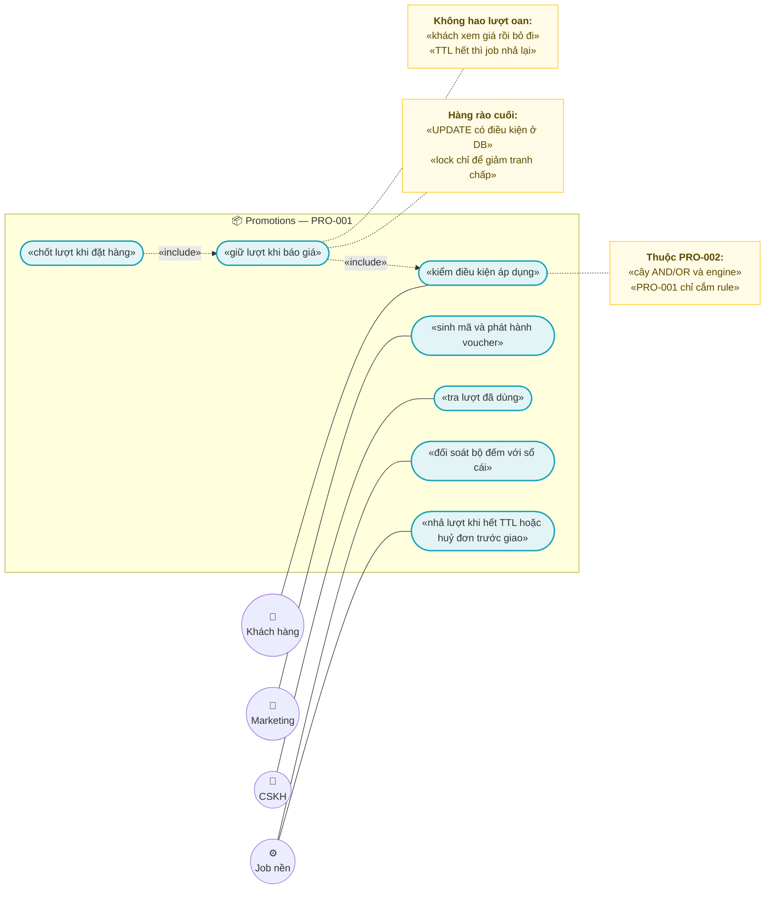
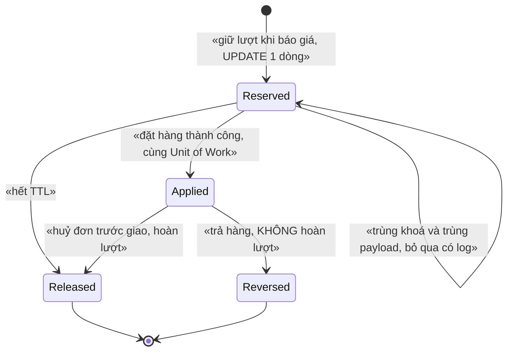
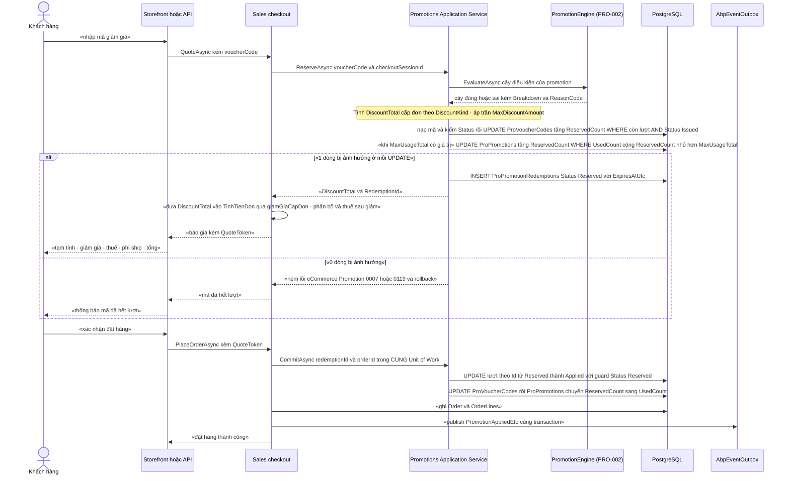

# `PRO-001` — Voucher / Coupon: phát hành, giới hạn lượt & điều kiện áp dụng

> ⚠️ **ĐỌC TRƯỚC:** tài liệu này viết **từ code thật** đã kiểm bằng `read`/`grep` và **từ `PRO-002` đã có trong repo**.
> Mọi khẳng định về code đều kèm `đường/dẫn/file:dòng`. Chỗ **chưa có trong code** ghi rõ *"chưa có trong code — kế hoạch GĐx"*;
> chỗ **không kiểm chứng được** ghi rõ *"chưa kiểm chứng"*.

| Thuộc tính | Nội dung |
|---|---|
| **Mã** | `PRO-001` |
| **Module** | **Promotions** — `modules/Promotions/eCommerce.Promotions.{Domain,Application,Application.Contracts,EntityFrameworkCore}` (⚠️ **chưa có trong code — kế hoạch** — 23/11/2026 `modules/` có `Address`, `Catalog`, `ChannelHub`, `Customers`, `EInvoice`, `Inventory`, `Messaging`, `PaymentHub`, `Pos`, `Pricing`, `Reconciliation`, `Reporting`, `Sales`, `Signing`, `Tax` — **không** có `Promotions`) |
| **Giai đoạn** | **GĐ3 — Đa kênh, khách hàng, khuyến mại, báo cáo** theo lộ trình chính `docs/nhanh/05-lo-trinh-rui-ro.md` §2 (mục GĐ3) + `docs/nhanh/07-ke-hoach-trien-khai.md` §WP-14 (đợt B), `D-69`. ⚠️ Chữ "GĐ2" còn trong thân tài liệu là nhãn cũ của `docs/implementation-plan.md` §8 (phần lộ trình của tệp đó là lịch sử) — đọc là GĐ3 |
| **Ưu tiên** | **Must have** — cổng kiểm soát cũ ở `docs/implementation-plan.md` §8 (dòng *"Cổng kiểm soát GĐ2"*): *"một khuyến mãi phức tạp (nhiều điều kiện AND/OR) tính đúng tiền"* |
| **Trạng thái** | 🟡 `Draft` — chờ review |
| **Người viết / người review** | *(điền)* / **Kiến trúc trưởng + BA + Kế toán** (voucher làm đổi `DiscountTotal`/`TaxTotal` ⇒ ảnh hưởng hoá đơn GTGT ⇒ bắt buộc có kế toán, theo `docs/design-doc-guidelines.md` §6) |
| **Phiên bản / ngày** | `v0.7 — 23/11/2026` (delta `D-158`/`D-159`: `FreeShipping` chặn ở v1, trần `Subtotal`, `evaluate` không khoá) |
| **Tài liệu liên quan** | ⭐ **`PRO-002`** (`docs/features/promotions/pro-002-cay-dieu-kien-engine-khuyen-mai.md` — **chủ sở hữu** `ProPromotions`/`ProVoucherCodes`/`ProPromotionConditions`/`ProPromotionRedemptions`, engine, mã lỗi `0001`–`0010`, `PromotionLockKeys`) · `XC-001` (Money/làm tròn/phân bổ) · `XC-002` (outbox/inbox, `IIdempotencyGuard`) · `XC-003` (khoá phân tán) · `XC-004` (`[Authorize]` cấp class, permission, `NULLS NOT DISTINCT`) · `XC-005` (log/metric) · `SAL-002` (checkout/đặt hàng) · `SAL-003` (state machine 4 trục) · `SAL-006` (RMA/hoàn tiền) · `PRC-001`/`PRC-002` (giá & pipeline giá) · `EINV-001` (hoá đơn) · `REP-001` (read-model) · ⭐ `SHP-003` (`shp-003-cod-thu-ho-doi-cod.md` — ⚠️ **GHN đổi COD bắt buộc OTP**, có trần **5.000.000**) · ⭐ `SHP-004` (`shp-004-adapter-ghtk.md` — ⚠️ **xác minh địa chỉ 2 cấp CHƯA có câu trả lời từ GHTK**, fail-closed) · `LOY-001` (điểm thưởng) · `docs/implementation-plan.md` §8, §A.3.1 (lịch sử) · `docs/business-modules-proposal.md` · `docs/templates/feature-design-template.md` |

---

## 0. Tóm tắt & quyết định thiết kế

**Tóm tắt:** `PRO-001` định nghĩa **mã giảm giá (Voucher/Coupon)** dùng được **đúng số lần đã cấu hình**, **đúng điều kiện đã cấu hình**,
và — quan trọng nhất — **không bao giờ tiêu quá lượt** trong bất kỳ tình huống nào: nhiều instance, khách bấm liên tục,
webhook/ETO gửi trùng, **hoặc Redis chết**.

### 0.0 ⭐ Ranh giới với `PRO-002` — **quyết định quan trọng nhất của tài liệu này**

**`PRO-002` ĐÃ CÓ trong repo và ĐÃ sở hữu mô hình dữ liệu dùng chung.** Đọc `pro-002-...md` cho thấy:

| `PRO-002` đã sở hữu | Bằng chứng trong `pro-002` |
|---|---|
| 7 bảng: `ProPromotions`, `ProPromotionConditions`, `ProPromotionRuleCosts`, `ProVoucherCodes`, `ProPromotionMappings`, `ProFlashSaleSlots`, `ProPromotionRedemptions` | §5.2 (`pro-002:344-415`), §11 (`:739`) |
| Engine `IPromotionEngine` + contract `eCommerce.Promotions.Application.Contracts` + `namespace eCommerce.Promotions.Contracts` | §6.1 (`:445-494`) |
| Giới hạn lượt bằng `UPDATE ProVoucherCodes … WHERE UsedCount < MaxUsage` + `CHECK (UsedCount <= MaxUsage)` | **ADR-09** (`:73`), §8.2 dòng 1 (`:640`) |
| Mã lỗi `eCommerce:Promotion:0001`–`0010` (đã đặt tên từng mã) | §6.4 (`:539-550`) |
| Khoá phân tán `PromotionLockKeys.*` (`promotion:tree:…`, `promotion:voucher:…`, `promotion:job:…`, `promotion:import:…`) | §8.2 (`:649-656`) |
| Permission `eCommerce.Promotions.{View,Manage,Approve,Import,Export}` | §9 (`:678-685`) |
| 6 metric mới | §13 (`:811-816`) |
| `PRO-001` **được `PRO-002` chỉ định** làm chủ *"`Voucher`/`Coupon` CRUD chi tiết & phát hành mã"* | `pro-002:55` |

⇒ **`PRO-001` KHÔNG tạo bảng mới và KHÔNG tạo mã lỗi trùng.** Nó **mở rộng** mô hình của `PRO-002` bằng các **yêu cầu thay đổi tường minh**
(§5.3) và **chỉ** sở hữu phần `PRO-002` **không** định nghĩa:

> 🎯 **Phân chia chốt:** **`PRO-002` = *KHI NÀO* áp dụng** (cây điều kiện AND/OR, engine, guard bùng nổ tổ hợp, snapshot "vì sao").
> **`PRO-001` = *MÃ NÀO* và *GIẢM BAO NHIÊU*, *BAO NHIÊU LƯỢT*, và *GIỮ/CHỐT/NHẢ LƯỢT thế nào*** (phát hành mã, giá trị giảm, trần lượt, điều kiện phẳng,
> vòng đời một lượt dùng).

**Hai lỗ hổng thật của `PRO-002` mà `PRO-001` **phải** lấp** (đã kiểm bằng `read` — không suy đoán):

| # | Lỗ hổng (bằng chứng) | Vì sao nghiêm trọng | `PRO-001` xử lý bằng |
|---|---|---|---|
| **L1** | **`ProPromotions` KHÔNG có cột nào mô tả GIÁ TRỊ GIẢM.** Cột của nó chỉ gồm `Code`, `Name`, `Kind` (`Voucher`\|`Discount`\|`FlashSale`), `Status`, `IsCumulative`, `Priority`, `ChannelScope`, `StartsAtUtc`, `EndsAtUtc`, `TreeVersion`, `MaxUsageTotal`, `MaxUsagePerCustomer`, `RowVersion` (`pro-002:355-369`) | Engine `PRO-002` "biết" cây điều kiện đúng/sai nhưng **không có nguồn nào** nói *giảm 10 %* hay *giảm 50.000đ* hay *miễn phí ship* ⇒ **không thể tính ra tiền** | **§5.3 CR-1**: thêm `DiscountKind`, `DiscountValue`, `MaxDiscountAmount`, `MinOrderAmount`, `Currency` (**CR** = change request gửi chủ sở hữu `PRO-002`) |
| **L2** | **`PRO-002` tiêu lượt NGAY khi đánh giá** (`Basic Flow` bước 6 — `pro-002:98`; §4.1 dòng `UPDATE ProVoucherCodes tang UsedCount voi dieu kien con luot` — `:222`) | Khách **báo giá rồi bỏ ngang** (hoặc chỉ mở trang) là **mất lượt thật**. Với mã "100 lượt" thì **100 người xem là hết mã** mà **0 đơn** được tạo — lỗi nghiệp vụ nặng và **im lặng** | **§5.3 CR-2/CR-3**: tách **`Reserved` (giữ chỗ, có TTL)** khỏi **`Applied` (chốt khi đặt hàng)** + job nhả TTL (ADR-02, ADR-03) |

**Điểm xuất phát thật khác (đã kiểm bằng `read`/`grep` ngày 16/10/2026):**

| Hạng mục | Hiện trạng |
|---|---|
| Module `Promotions` | ❌ **Chưa có trong code — kế hoạch** (kiểm lại 23/11/2026: `ls modules/` không có `Promotions`; `Sales`, `Pricing`, `Pos`, `Customers` **đã** có — xem `Đối chiếu mô hình Nhanh`) |
| Entity `Voucher`/`Coupon`/`Promotion` | ❌ **Chưa có trong code — kế hoạch.** Chỉ có `Order.DiscountTotal` (`modules/Sales/eCommerce.Sales.Domain/Order.cs:158`); `Order` nay thuộc module `Sales` (không còn ở `src/`) |
| Cột tiền giảm giá trên đơn | ✅ **Đã có**: precision `numeric(18,4)` (`modules/Sales/eCommerce.Sales.EntityFrameworkCore/SalesDbContextModelCreatingExtensions.cs:34`) |
| Guard `DiscountTotal <= Subtotal` | ❌ **Chưa có trong code** — `Order.Recalculate()` (`Order.cs:240-244`) **không** kiểm; `SetDiscount(decimal)` (`Order.cs:246-250`) cũng **không** guard và **không** nhận `Currency`. `DonHangAppService.cs:105-107` gọi `SetDiscount(tien.TotalDiscount)` rồi `Recalculate()` (`Order.cs:240-249` **không** tính lại thuế) với số từ hàm thuần `TinhTienDon` (`modules/Pricing/eCommerce.Pricing.Domain/TinhTienDon.cs`) — ⚠️ **đó KHÔNG phải điểm cắm voucher** (thuế đã tính xong ở Pricing, cắm ở đây trái **ADR-05**). **Điểm cắm đúng** = đầu vào giảm giá của Pricing ở bước ② `CheckoutAppService.cs:102-120` (`TinhGioInput.OrderDiscount`; `TinhTienDon.Tinh` nhận **một** `giamGiaCapDon`, `TinhTienDon.cs:73-77`) — voucher `PRO-001` **chỉ giảm cấp đơn** (**Q15** `Closed` — `D-149`; **F1** §15.2) |
| Cột **giảm phí vận chuyển** (FreeShipping) | ❌ **Chưa có** — `Order.cs:156-164` chỉ có `Subtotal`/`DiscountTotal`/`TaxTotal`/`ShippingTotal`/`GrandTotal` (**F6**) |
| `Money`/`MoneyAllocator` (`XC-001`) | ✅ **Đã có** (23/11/2026): `shared/eCommerce.Kernel/Money/Money.cs:23` (kèm `Currency`, ném `CurrencyMismatch` khi khác loại tiền — `:49-56`; `==` so cả tiền tệ + `Amount` — `:123-135`) và `MoneyAllocator.PhanBo` (`MoneyAllocator.cs:31`, bảo toàn `Σ == tổng`). ⚠️ **Không** có hàm `ToMinorUnits()` như tài liệu cũ giả định ⇒ `DoR` về `Money` **đã đạt**, còn việc so sánh tiền dùng toán tử `Money` (**F2** đã đóng một phần) |
| `IIdempotencyGuard` / `ILockManager` | ✅ `IIdempotencyGuard.ThucThiAsync` **đã có** (`modules/Messaging/eCommerce.Messaging.Domain/Idempotency/IdempotencyGuard.cs:27,82`; trả `TraVeKetQuaCu`/`XungDotPayload`/`DangXuLy`). ❌ `ILockManager` **chưa có**: code thật dùng `IAbpDistributedLock` trực tiếp (`src/eCommerce.Application/Marketplace/MarketplaceReconciliationWorker.cs:105`) |
| Permission `Promotions` | ❌ **Chưa có** — `eCommerceConsts.Permissions` (`src/eCommerce.Domain.Shared/eCommerceConsts.cs:15-74`) chưa có nhóm `Promotions`; provider cũng chưa đăng ký (`src/eCommerce.Application.Contracts/Permissions/eCommercePermissionDefinitionProvider.cs:23-60`) |
| Metric khuyến mãi | ❌ **0 metric khuyến mãi**; registry `eCommerceMetricNames.All` hiện có **16** tên (`shared/eCommerce.Kernel/Observability/eCommerceMetrics.cs:81-107`). `MetricsTests` **đã bỏ** chốt cứng số lượng (test `Bang_dang_ky_KHONG_trung_ten_va_KHONG_rong` trong `test/eCommerce.Tests/Observability/MetricsTests.cs`: chỉ còn "không trùng + không rỗng") nhưng **vẫn** ép hậu tố tên (`:157-161`) và nhãn cấm (`:111`) (**F3**) |
| Hạ tầng test PostgreSQL thật | ✅ **Đã có**: `test/eCommerce.IntegrationTests/` (Testcontainers `postgres:17-alpine` + `Assets/schema.sql`) + test chốt **cứng** số index `NULLS NOT DISTINCT` = **93** (`PostgreSqlSchemaTests.cs:144,208`) (**F4**) |
| Số giảm giá **của sàn** (khác voucher của ta) | ✅ **Đã có**: `ChannelOrderDto.DiscountAmount` (`modules/ChannelHub/eCommerce.ChannelHub.Application.Contracts/Connectors/IChannelConnector.cs:26`), `ChannelDiscount` (`:37`) |
| `ICurrentTenant` / `IUnitOfWorkManager` | 🔶 `ICurrentTenant` **đã được inject** ở module (`modules/Address/eCommerce.Address.Application/AddressDirectory.cs:28`, `modules/Catalog/eCommerce.Catalog.Domain/CategoryTreeService.cs:35`); hành vi runtime với `TenantId = NULL` **vẫn chưa kiểm chứng** ở tài liệu này |
| ⚠️ **`SHP-003` và `SHP-004` NAY ĐÃ CÓ TÀI LIỆU** | ✅ `docs/features/shipping/shp-003-cod-thu-ho-doi-cod.md` (⚠️ GHN đổi `cod_amount` **bắt buộc `otp`**, trần **5.000.000** — `shp-003` §0 D3/D10, Q2) và `docs/features/shipping/shp-004-adapter-ghtk.md` (xác minh địa chỉ 2 cấp **fail-closed**, GHTK **chưa xác nhận** — `shp-004` §0, §14.3 DoD). ⚠️ **`PRO-002` §15.2 F6 (`pro-002:1007`) ghi *"hai tài liệu này KHÔNG tồn tại"* — điều đó nay KHÔNG còn đúng** (**F5** §15.2) |
| `CHECK` constraint ở EF Core | ✅ **Đã có tiền lệ**: `modules/Tax/eCommerce.Tax.EntityFrameworkCore/TaxDbContextModelCreatingExtensions.cs:22-25,49` (**F7**) |
| `[Authorize]` cấp class | ✅ **Đã có**: `src/eCommerce.Application/Channels/ChannelAppService.cs:27` |

**Phạm vi:**

- ✅ **Vòng đời MÃ**: sinh mã đơn lẻ + **sinh lô**, chuẩn hoá/duy nhất mã, phát hành/tạm dừng **thu hồi**, **cấm sửa giá trị sau khi phát hành**.
- ✅ **Giá trị giảm**: **2 loại ở v1** `Percentage` · `FixedAmount`; trần giảm; **tiền hàng tối thiểu**; `Currency`. `FreeShipping` ⏸ **chặn ở v1** (`D-158`, nợ `CR-S2` — xem "Không nằm trong phạm vi").
- ✅ **Giới hạn lượt** 2 chiều: **tổng** — theo mã `ProVoucherCodes.MaxUsage` (có cơ chế); ✅ `ProPromotions.MaxUsageTotal` (bộ đếm `UsedCount`/`ReservedCount` + `CHECK` trên `ProPromotions` — **CR-11**, **Q8** `Closed` — `D-147`; hai trần cùng đúng, **AND**) — và **theo khách** (giải **Q6** của `PRO-002`; chỉ khách có `CustomerId` — vãng lai ⇒ NÉM `0118`, `D-146`).
- ✅ **Vòng đời một LƯỢT dùng**: `Reserved` (TTL) → `Applied` → `Released`/`Reversed`, **guard NÉM LỖI**, **job nhả TTL**.
- ✅ **Điều kiện phẳng AND** cho voucher: tiền hàng tối thiểu · kênh · nhóm khách · **đơn đầu tiên** (registry **đúng 4** rule — `D-149`; SKU/danh mục include/exclude ra ngoài phạm vi v1) — hiện thực bằng **rule trong registry của `PRO-002`** (`IPromotionConditionRule` + `RuleSystemName`), do `PRO-001` **cung cấp ngữ nghĩa + bộ rule**.
- ✅ **Sổ cái lượt** = `ProPromotionRedemptions` (append-only, của `PRO-002`) + **bộ đếm** + **job đối soát**.
- ✅ **Idempotency ở mọi biên vào**; **metric mới**; **endpoint áp mã ở storefront**.

**Không nằm trong phạm vi:**

- ❌ **Voucher `FreeShipping` (giảm phí vận chuyển)** — `D-158` (Q19/Q18): v1 **chặn** (`PRO-002` `CHECK ("DiscountKind" <> 'FreeShipping')` + validation `CreateAsync` `400`); `DiscountTotal` **không bao giờ** chứa giảm ship. Nợ có chủ **`CR-S2`** (BA `SAL-002`/`SAL-003` + arch `Sales`/`Promotions` + kế toán duyệt hạch toán): `Sales` thêm `OrdOrders.ShippingDiscountTotal`, `VoucherQuoteResultDto`/`PromotionEvaluationResult` thêm `ShippingDiscountTotal` (additive), gỡ `CHECK` bằng migration mới, bật `0113`/E11/`TC-25`. Hoãn, không bỏ.
- ❌ **Voucher giảm theo SKU/danh mục** (rule `SkuInclude`/`SkuExclude`/`CategoryInclude`) — `D-149`: voucher `PRO-001` **chỉ giảm cấp đơn** (một `DiscountTotal` vào `giamGiaCapDon` của `TinhTienDon`, phân bổ mọi dòng); làm sau qua **nợ có chủ `CR-P1`** (§5.3), không bỏ.
- ❌ **Cây điều kiện AND/OR, engine đánh giá, guard bùng nổ tổ hợp, short-circuit, ngân sách đánh giá** — thuộc **`PRO-002`** (`pro-002:47-52`). `PRO-001` chỉ **cắm rule** vào registry của nó.
- ❌ **Bảng/mã lỗi/khoá phân tán/permission nền của module** — **đã** do `PRO-002` sở hữu (`pro-002:344-694`). `PRO-001` **tái dùng**, không tạo bản thứ hai.
- ❌ **FlashSale** (`ProFlashSaleSlots` — `pro-002:400`) và **khuyến mãi tự động `AutoApply` không có mã** — thuộc `PRO-002`.
- ❌ **Cộng dồn nhiều khuyến mãi (`IsCumulative`)** — thuộc `PRO-002` **ADR-15**/A2 (`pro-002:99`). `PRO-001` chốt **tối đa 1 mã/đơn** (ADR-04).
- ❌ **Pipeline tính giá & thứ tự áp giá/phí** — thuộc `PRC-002` (`prc-001:43`).
- ❌ **Đổi điểm thưởng lấy voucher** — thuộc `LOY-001`; `loy-001` §0 ghi *"quà tặng, voucher đổi bằng điểm — giai đoạn sau"*. Voucher **không** tự cộng/trừ điểm hay công nợ khách: `D-45` chỉ cho `Customer.GhiNhanMuaHang` qua `ICustomerLedger` (cùng UoW) ghi các số đó.
- ❌ **Bán quầy (POS)** — `D-18`/`D-42`: `RetailBill` là aggregate riêng, tiền do hàm thuần `TinhTienHoaDon`, idempotent theo `ClientBillId`; voucher **không** áp cho `RetailBill` ở tài liệu này — **kênh quầy ngoài phạm vi** (**BR-17**, `D-142`, **Q12** `Closed`). Nợ có chủ: voucher tại quầy làm bằng tài liệu/CR riêng (BA `POS` + arch `Pos`/`Promotions`) khi lộ trình `D-69` có ca này.
- ℹ️ **Báo cáo** (`D-47`/`D-48`): voucher `Percentage`/`FixedAmount` ghi vào `Order.DiscountTotal` ⇒ read-model tính doanh thu `Σ thành tiền dòng − chiết khấu chứng từ`; `FreeShipping` (khi có `CR-S2`) sẽ đi vào `ShippingDiscountTotal` (**ADR-06**) nên **không** làm giảm doanh thu hàng; v1 chặn (`D-158`). Báo cáo khuyến mãi đọc read-model, **không** query `ProPromotionRedemptions` trực tiếp.
- ❌ **Quy trình đổi số tiền COD sau khi đã tạo vận đơn** — thuộc `SHP-003` (⚠️ GHN **bắt buộc OTP** ⇒ **có bước thủ công**; `shp-003` §0 D3/D10). `PRO-001` chỉ **cấm** tự ý sửa tiền sau vận đơn (**ADR-12**).
- ❌ **Hoàn tiền một phần khi trả hàng** — thuộc `SAL-006`; `PRO-001` chỉ ghi `Reversed` và **không** hoàn lượt.
- ❌ **Đa tiền tệ hoạt động thật** — `BR-XC-001-009`: GĐ này chỉ `VND`; cột `Currency` vẫn **bắt buộc** có.

### 0.1 Quyết định thiết kế (ADR ngắn)

| # | Quyết định | Phương án đã cân nhắc | Lý do chọn | Hệ quả |
|---|---|---|---|---|
| **ADR-01** | **Tái dùng mô hình `PRO-002`, KHÔNG tạo bảng mới**; nhu cầu mới gửi bằng **change request** (§5.3) | (a) `PRO-001` tự tạo `ProVouchers`/`ProVoucherRedemptions` riêng · (b) **mở rộng bảng của `PRO-002`** | `PRO-002` **đã** định nghĩa `ProVoucherCodes`/`ProPromotionRedemptions` (`pro-002:398,402-415`) và **đã chỉ định** `PRO-001` lo *"Voucher/Coupon CRUD"* (`pro-002:55`). Tạo bảng thứ hai ⇒ **hai nguồn sự thật** cho cùng khái niệm "lượt dùng" — **đúng loại lỗi `XC-003` F1** đã phải sửa (khoá kênh định nghĩa 2 nơi, 2 chuỗi khác nhau) | `PRO-001` **bị chặn** cho tới khi chủ sở hữu `PRO-002` chấp nhận §5.3; **cấm** tự thêm cột vào bảng của module khác |
| **ADR-02** | **Giữ lượt (`Reserved`) có TTL ngay từ bước báo giá**, chốt lượt khi đặt hàng | (a) trừ lượt ngay khi đánh giá (**đúng như `PRO-002` hiện mô tả**) · (b) giữ chỗ có TTL | `PRO-002` tiêu lượt ở bước 6 của Basic Flow (`pro-002:98`) ⇒ **khách bỏ ngang vẫn mất lượt** (**L2**). Đây là **lỗi nghiệp vụ im lặng** — và `XC-003` §0 gọi đúng loại lỗi này là *"lỗi im lặng, chỉ lộ ra khi có tranh chấp thật"* | **Bắt buộc** có **job nhả TTL**; thiếu job ⇒ **lượt treo vĩnh viễn** (rủi ro vận hành lớn nhất). Cần `ExpiresAtUtc` **NOT NULL** trên lượt giữ |
| **ADR-03** | **Hàng rào lượt ở tầng DB**: `UPDATE … WHERE còn lượt` + **đếm số dòng**; **KHÔNG** dùng lock làm hàng rào | (a) lock Redis làm hàng rào · (b) lock + DB · (c) **chỉ DB** | Kế thừa `PRO-002` **ADR-09** (`pro-002:73`) và `XC-003` **D2**/**BR-007** (*"bỏ lock đi, DB có chặn không?"* ⇒ **CÓ**). `AbortOnConnectFail = false` (`src/eCommerce.HttpApi.Host/eCommerceHttpApiHostModule.cs:251`) ⇒ Redis chết thì app **vẫn chạy** ⇒ nếu tin lock thì **mất bất biến** | `ExecuteUpdateAsync` + **NÉM** khi 0 dòng (`XC-002` **D8**/**BR-008**). Lock (`PromotionLockKeys.VoucherUsage` — `pro-002:654`) chỉ để **giảm tranh chấp** |
| **ADR-04** | **Tối đa 1 mã / đơn** ở GĐ2 | (a) cho cộng dồn ngay · (b) 1 mã | Cộng dồn thuộc `PRO-002` (`IsCumulative` — `pro-002:361`, A2 — `:99`) và kéo theo bài toán *"cái nào lợi hơn"* **không xác định**. `PRO-001` chọn bài toán **nhỏ, chứng minh được** | **Không** thêm cột `Stackable`; unique filter `(TenantId, OrderId) WHERE OrderId IS NOT NULL` cưỡng chế được bằng DB (**BR-005**) |
| **ADR-05** | Giá trị giảm **trên tiền hàng TRƯỚC thuế**, **phân bổ xuống dòng**; **thuế tính lại** trên giá sau giảm | (a) giảm sau thuế · (b) giảm trước thuế + phân bổ | Giá tính thuế GTGT là **giá khách thực trả**; giảm sau thuế ⇒ hoá đơn **sai** (`EINV-001` BR-004/BR-005 kế thừa `XC-001` **BR-010/BR-011**). Phân bổ để giữ `Σ DiscountPerLine == DiscountTotal` (`XC-001` **BR-006**/**D7**; `PRO-002` **BR-11** — `pro-002:101`) | **Mọi** voucher làm đổi `TaxTotal` ⇒ UI **phải** hiển thị đúng thứ tự dòng tiền (§10); thuế do **Pricing** tính trên giá sau giảm (`TinhTienDon.cs:125-127`). ⚠️ `TinhTienDon.Tinh` chỉ nhận **một** `giamGiaCapDon` rồi phân bổ theo trọng số **mọi** dòng (`:115-117`) ⇒ giảm **theo dòng** (SKU/danh mục) chưa biểu diễn được ⇒ ngoài phạm vi v1 (**Q15** `Closed` — `D-149`, nợ `CR-P1`) |
| **ADR-06** | `FreeShipping` giảm **`ShippingTotal`**, **KHÔNG** vào `DiscountTotal` | (a) trộn chung · (b) tách riêng | `REP-001` giữ `DiscountAmount` **riêng** *"để báo cáo khuyến mãi (`PRO-*`)"* (`rep-001:442`); trộn "giảm tiền hàng" với "miễn phí ship" ⇒ **mất khả năng đối soát** phí vận chuyển và COD (`REC-003`) | `Order` **chưa có** cột riêng (**F6**) ⇒ cần `ShippingDiscountTotal`; cột đó do **chủ sở hữu `Order`** (`Sales`) thêm, **không** phải `PRO-001`. **Thiết kế đích giữ nguyên; v1 chặn `FreeShipping` — `D-158`, nợ `CR-S2`** (`DiscountTotal` không bao giờ chứa giảm ship) |
| **ADR-07** | Điều kiện voucher ở GĐ2 là **rule phẳng trong registry của `PRO-002`** (kết hợp **AND**), mỗi điều kiện = **một node lá** | (a) tự viết bộ đánh giá riêng trong `PRO-001` · (b) **cắm rule vào registry `PRO-002`** | `PRO-002` **đã** có `IPromotionConditionRule` + `RuleSystemName` + `ProPromotionRuleCosts` (`pro-002:380,385-392,489-493`). Viết bộ thứ hai ⇒ hai engine, hai ngữ nghĩa AND/OR, và **mất** guard bùng nổ tổ hợp (`PRO-002` ADR-02/03) | `PRO-001` **phải** khai `DeclaredCostFactor` cho **mỗi** rule mới trong `ProPromotionRuleCosts` (nếu không, guard tĩnh **BR-06** của `PRO-002` sẽ sai) |
| **ADR-08** | **Cấm** ánh xạ "giảm giá của sàn" thành voucher nội bộ | (a) coi `ChannelDiscount` như voucher · (b) tách tuyệt đối | Đơn sàn mang số **của sàn** (`IChannelConnector.cs:26,37`). Nếu tiêu quota nội bộ theo số của bên thứ ba thì **quota bị tiêu bởi quyết định của người khác** và **không đối soát được**. `PRO-002` cũng xác nhận: *"Khuyến mãi **của sàn** không đi qua engine này"* (giả định 6 — `pro-002:1019`) | Lượt **chỉ** sinh từ luồng nội bộ kênh `web` (**BR-012**, **BR-017**) |
| **ADR-09** | **Trạng thái "hết lượt"/"hết hạn" là SUY RA** — **cấm** ghi vào cột `Status` | (a) job ghi `Exhausted` · (b) suy ra khi đọc | Ghi trạng thái suy ra ⇒ **hai nguồn sự thật**, lệch ngay khi lượt được **nhả** (và ADR-02 vừa làm việc nhả thành bình thường). `SAL-003` **BR-008** đã cấm đúng lỗi này cho `DerivedStatus` | Vị từ "còn dùng được" và vị từ trong `UPDATE` giành lượt **phải là CÙNG một** định nghĩa; test `TC-07`/`TC-08` chứng minh |
| **ADR-10** | Mọi tiền của `PRO-001` đi qua `Money`/`MoneyAllocator.PhanBo` (**đã có** — `shared/eCommerce.Kernel/Money/Money.cs:23`, `MoneyAllocator.cs:31`); **không** dùng `decimal` trần ở DTO trung gian | (a) `decimal` trần · (b) `Money` | `XC-001` §0: *"sai tiền là loại lỗi không sửa được về sau"*; phân bổ giảm giá xuống dòng **đúng** bài toán `MoneyAllocator` (`XC-001` **BR-006**). `PRO-002` **ADR-11** (`pro-002:75`) cùng kết luận. `DoR` về `Money` **đã đạt** (23/11/2026) | DTO trung gian **bắt buộc** kèm `Currency`; so tiền bằng toán tử `Money` (`Money.cs:132`), **không** có `ToMinorUnits()` trong code |
| **ADR-11** | Hàm sinh khoá lock **KHÔNG** chứa tiền tố `ecommerce:` — **kế thừa `PRO-002`** | (a) nhúng tiền tố · (b) để `KeyPrefix` lo | `eCommerceHttpApiHostModule.cs:222,237` đặt `KeyPrefix = "ecommerce:"` và ABP ghép **không có dấu phân cách** (`XC-003` §5.4 hệ quả #2). Phương án (a) tạo **tiền tố ĐÔI** `ecommerce:ecommerce:…` | `PRO-001` **tái dùng** `PromotionLockKeys` của `PRO-002` (`pro-002:653-656`) — **không** khai hàm sinh khoá mới ⇒ không có cơ hội thứ hai để sai. ⚠️ Còn kiểm chứng runtime tiền tố khoá (**F8**, **Q11**) |
| **ADR-12** | **Cấm** áp/đổi voucher **sau khi đã tạo vận đơn** | (a) cho sửa rồi đồng bộ COD · (b) chặn ở ranh giới vận đơn | Đổi số tiền ⇒ đổi **số COD** ⇒ **GHN bắt buộc OTP** (`shp-003` §0 D3/D10, §7: *"`otp` … required only when changing `cod_amount`"*; trần **5.000.000**) ⇒ **có bước thủ công**, không tự động hoá 100 % | Mọi sửa tiền sau vận đơn đi qua quy trình `SHP-003`/`SAL-006`; `PRO-001` **cấm** sinh lượt ở giai đoạn đó |
| **ADR-13** | Lượt được **CHỐT trong CÙNG Unit of Work** với việc tạo đơn: `Sales` gọi **contract** của `Promotions`, **không** chốt bằng ETO sau khi đơn đã commit | (a) phát `PromotionAppliedEto` rồi consumer chốt lượt · (b) gọi đồng bộ trong cùng UoW | (a) tạo **cửa sổ** đơn đã tồn tại nhưng lượt chưa chốt ⇒ **tiêu quá lượt** hoặc **đơn không có giảm giá**. `XC-002` **BR-001** yêu cầu *"hoặc cả hai cùng có, hoặc cả hai cùng không"*; `PRO-002` **BR-10** cũng yêu cầu UoW | `Promotions` **cấm** tham chiếu `src/` ⇒ `eCommerce.Sales.Application` (`CheckoutAppService.cs:102-120`, bước ② tính tiền)→`eCommerce.Promotions.Application.Contracts` là hướng **hợp lệ** (module→Contracts của module khác; `Sales` nay là module — không còn ở `src/`). ETO chỉ cho **read-model/thông báo** |
| **ADR-14** | **Cấm** điều kiện voucher phụ thuộc **địa chỉ/khu vực giao hàng** ở GĐ2 | (a) cho điều kiện theo tỉnh/quận · (b) cấm | ⚠️ **GHTK xác minh địa chỉ 2 cấp CHƯA có câu trả lời** (`shp-004` ADR-08/ADR-09 fail-closed; §14.3 DoD *"chưa có"* là **điều kiện chặn**; `docs/implementation-plan.md` §A.3.1 dòng `SHP-004`). Nếu điều kiện tiền phụ thuộc dữ liệu địa chỉ **chưa ổn định** ⇒ **tính sai vùng im lặng** | `MinOrderAmount` đo trên **tiền hàng chưa thuế, chưa phí ship** ⇒ quyết định voucher **không** phụ thuộc giá trị chưa kiểm chứng của bên thứ ba. Trùng kết luận **Q8**/**BR-19** của `PRO-002` (`pro-002:604,994`) |
| **ADR-15** | **Metric mới phải cập nhật registry + `XC-005` §5.1 + test trong CÙNG PR** | (a) phát tự do · (b) registry + test | Kế thừa `XC-005` **BR-008** và `PRO-002` **ADR-14** (`pro-002:78`). `MetricsTests` ép hậu tố tên + nhãn cấm (`MetricsTests.cs:111,157-161`), **không** còn chốt cứng số lượng (test `Bang_dang_ky_KHONG_trung_ten_va_KHONG_rong`) | 3 metric của `PRO-001` ⇒ registry **16 → 25** (16 hiện có + 6 của `PRO-002` + 3 của `PRO-001`) ⇒ **phải** cập nhật `XC-005` §5.1 **và** `TC-22` của `PRO-002`; `MetricsTests` không còn chốt cứng số nhưng **vẫn** ép hậu tố/nhãn (`:111,157-161`) ⇒ tên sai ⇒ **CI đỏ** (**F3**) |

---

## 1. Use Case Specification

> 📌 **Quy ước mã:** trong tài liệu này dùng `BR-01`, `NFR-01`, `TC-01`, `ADR-01`. Khi trích **ra ngoài**, dùng dạng đầy đủ
> `BR-PRO-001-01`, `NFR-PRO-001-01`, `TC-PRO-001-01` (nhất quán cách `PRO-002` ghi ở `pro-002:85-86`).

| Thuộc tính | Nội dung |
|---|---|
| **Use Case ID** | `PRO-001` |
| **Use Case Name** | Phát hành và sử dụng mã giảm giá **đúng lượt, đúng điều kiện, không hao lượt oan** |
| **Description** | *"Là quản trị Marketing, tôi muốn phát hành mã giảm giá có giá trị và giới hạn lượt rõ ràng; là khách hàng, tôi muốn biết ngay mã có dùng được không; là kế toán, tôi muốn chắc chắn **không bao giờ** có nhiều hơn số lượt đã cấu hình bị tiêu — và **khách xem giá rồi bỏ đi thì không mất lượt**."* |
| **Actor(s)** | **Quản trị Marketing** (phát hành/thu hồi mã) · **Khách hàng** (nhập mã) · **CSKH** (tra lượt đã dùng) · **Hệ thống** (`Sales` gọi contract; consumer ETO; job nhả TTL; job đối soát) · **Kế toán** (đối soát số giảm giá) |
| **Priority** | **Must have trong GĐ2** |
| **Trigger** | (a) khách nhập mã ở bước báo giá/checkout; (b) khách xác nhận đặt hàng; (c) lượt giữ **hết TTL**; hoặc đơn **bị huỷ trước giao** ⇒ nhả + hoàn lượt (`OrderCancelledEto` — `D-148`); (d) đơn bị **trả hàng**; (e) job đối soát bộ đếm theo nhịp |
| **Pre-Condition(s)** | • **Tenant hiện tại** (`TenantId` từ `ICurrentTenant`): mọi entity là `IMultiTenant`; ⚠️ hệ thống chạy **1 tenant** nên `TenantId` **có thể là `NULL`** (`XC-004` §15.2 F1) ⇒ **mọi** unique index **phải** `NULLS NOT DISTINCT`. 🔶 `ICurrentTenant` đã được inject ở module khác (`AddressDirectory.cs:28`) nhưng hành vi với `TenantId = NULL` **chưa kiểm chứng runtime**.<br>• **Kênh bán** (`ChannelCode`): GĐ2 `PRO-001` **chỉ** phục vụ kênh nội bộ `web`. Đơn sàn **không** tiêu lượt voucher nội bộ (**ADR-08**, **BR-12**).<br>• **`ProPromotions` tồn tại** với `Status = Active`, `Now` ∈ `[StartsAtUtc, EndsAtUtc]`, và **cây điều kiện đã qua guard ghi** của `PRO-002` (`pro-002:512`).<br>• **`ProVoucherCodes` tồn tại**, `Code` đã chuẩn hoá, chưa `Revoked`.<br>• **Hợp đồng `PRO-002` đã có** (`IPromotionEngine`, `PromotionLockKeys`, `PromotionErrorCodes` — `pro-002:451,653,539-550`). ⚠️ **hiện CHƯA có trong code** (kế hoạch).<br>• **`Money`/`MoneyAllocator` của `XC-001` đã có** — ✅ **đã có trong code** (`shared/eCommerce.Kernel/Money/Money.cs:23`, `MoneyAllocator.cs:31`; **F2** đã đóng).<br>• **Redis 7 sẵn sàng** cho khoá của **job** — nếu không, kết quả **vẫn phải đúng** nhờ ràng buộc DB (**ADR-03**). |
| **Post-Condition(s)** | • Tại **mọi** thời điểm: `UsedCount + ReservedCount <= MaxUsage` (mã) **và**, khi `MaxUsageTotal IS NOT NULL`, `UsedCount + ReservedCount <= MaxUsageTotal` (promotion — bộ đếm `ProPromotions`, `CHECK` CR-11, `D-147`) — cả hai cưỡng chế ở **tầng DB**; bộ đếm khớp sổ lượt (job B2).<br>• Số lượt **còn hiệu lực** (`Reserved`/`Applied`/`Reversed`, không tính `Released`) của một khách có `CustomerId` `<= MaxUsagePerCustomer` — `UsageSequence` ∈ `[1, MaxUsagePerCustomer]` do **ứng dụng** cấp, **unique index** (§5.2) chặn trùng số (giải **Q6** của `PRO-002`). Trần theo khách **chỉ** đếm theo `CustomerId`; khách vãng lai (`CustomerId = NULL`) **không** áp được voucher ⇒ NÉM `0118`, 0 lượt (A3, `D-146`).<br>• Một đơn có **tối đa một** lượt `Applied`; `Σ DiscountAmount` của lượt **bằng** `Order.DiscountTotal`.<br>• `Σ DiscountPerLine == DiscountTotal` (`XC-001` **BR-006**; `PRO-002` **BR-11**).<br>• Mọi lượt đã giữ **hoặc** được chốt, **hoặc** được nhả, **hoặc** có dấu vết (DLQ/cảnh báo) — **không** có lượt treo vô thời hạn.<br>• Mọi lần **không** giành được lượt đều có **log + metric** kèm mã lỗi. |
| **Basic Flow** | 1. Khách nhập mã ⇒ `Sales` gọi `ReserveAsync(voucherCode, checkoutSessionId, customerId, lines, channelCode, currency)` trên contract của `Promotions` (**ADR-13**), trong UoW của **bước báo giá**. Ba kiểm đầu, **trước khi gọi engine** và trước mọi ghi: `TenantId` (`0112`) → replay idempotent (A2) → **`CustomerId = NULL` ⇒ NÉM `0118`** (A3, `D-146`).<br>2. `Promotions` nạp `ProPromotions` + `ProVoucherCodes`, rồi gọi **engine `PRO-002`** để đánh giá **cây điều kiện** (điều kiện voucher là các node lá — **ADR-07**).<br>3. Cây `false` ⇒ trả **báo giá KHÔNG giảm giá** + `PromotionRejectionReason` cụ thể (`pro-002:482-486`); **không** ném lỗi hệ thống.<br>4. Cây `true` ⇒ tính **giá trị giảm** theo `DiscountKind`/`DiscountValue`, **áp trần** `MaxDiscountAmount` ⇒ ra **một** `DiscountTotal` cấp đơn (**không** trả giảm theo dòng — `D-149`). Phân bổ xuống dòng theo trọng số thành tiền do **`TinhTienDon.Tinh`** làm khi `Sales` đưa `DiscountTotal` vào `giamGiaCapDon` (`TinhTienDon.cs:73-77,115-117`; thuế từng dòng sau giảm `:125-127` — **ADR-05**); `BreakdownJson`/hiển thị lấy từ `KetQuaTinhTien`, **không** có nguồn giảm theo dòng thứ hai.<br>5. (`0112`, replay A2 và `0118` đã kiểm ở bước 1.) **Nạp mã** rồi kiểm `Status`: `Revoked` ⇒ **NÉM** `0103`; `Generated` (chưa phát hành) ⇒ **NÉM** `0101` (không lộ mã tồn tại); ngoài cửa sổ hiệu lực ⇒ `0102` — **trước mọi ghi**. Sau đó chạy `UPDATE "ProVoucherCodes" SET "ReservedCount" = "ReservedCount" + 1 WHERE "Id" = @id AND "Status" = 'Issued' AND ("UsedCount" + "ReservedCount") < "MaxUsage"`; rồi **chỉ khi** `MaxUsageTotal IS NOT NULL`: `UPDATE "ProPromotions" SET "ReservedCount" = "ReservedCount" + 1 WHERE "Id" = @promotionId AND "UsedCount" + "ReservedCount" < "MaxUsageTotal"` (cùng transaction — `D-147`). **Thứ tự khoá cố định: dòng mã trước, dòng promotion sau** ở mọi đường ghi (bước 5/10, A4, huỷ đơn).<br>6. **0 dòng** ở `UPDATE` mã ⇒ **NÉM** `eCommerce:Promotion:0007` (`UsageLimitExceeded` — **mã của `PRO-002`**, `pro-002:547`); **0 dòng** ở `UPDATE` promotion ⇒ **NÉM** `eCommerce:Promotion:0119` ⇒ UoW rollback cả lượt mã — **cấm** kẹp/đoán. Hai trần cùng phải đúng (**AND**); mã lỗi nói đúng trần nào hết (`0007` mã / `0119` promotion). `MaxUsageTotal = NULL` ⇒ **không** chạm dòng promotion.<br>7. **1 dòng** ⇒ cấp `UsageSequence` (số nhỏ nhất trong `[1, MaxUsagePerCustomer]` chưa bị lượt còn hiệu lực của khách chiếm; hết số ⇒ **NÉM** `0104`) rồi `INSERT ProPromotionRedemptions (Status = Reserved, ExpiresAtUtc = now + TTL, CustomerId, UsageSequence)`; unique §5.2 là hàng rào **trần theo khách** (trùng số do chạy song song ⇒ `23505` ⇒ `0104`).<br>8. `Promotions` trả `VoucherQuoteResult` (`RedemptionId` + giảm cấp đơn; **không** có `ShippingDiscountTotal` ở v1 — `D-158`); `Sales` đưa số giảm vào Pricing để **tính thuế trên giá sau giảm** và trả báo giá (kèm `QuoteToken`, `ExpiresAt`); `Sales` **lưu `RedemptionId`** cùng phiên checkout.<br>9. Khách xác nhận ⇒ `Sales` gọi `CommitAsync(redemptionId, orderId, voucherCode)` **trong cùng UoW với việc ghi `Order`** (hợp đồng nội bộ, **không** qua HTTP — §6.2).<br>10. `Promotions` chuyển `Reserved → Applied` bằng `UPDATE … WHERE "Id" = @redemptionId AND "Status" = Reserved AND "ExpiresAtUtc" > now` (0 dòng ⇒ **NÉM** `eCommerce:Promotion:0105`) và chuyển `ReservedCount → UsedCount` **nguyên tử** trên dòng mã **và** (khi `MaxUsageTotal IS NOT NULL`) dòng promotion — mã trước, promotion sau.<br>11. Sau commit: phát `PromotionAppliedEto` **qua outbox cùng transaction** (`PRO-002` §7.1 — `pro-002:570`); ghi metric. |
| **Alternative Flow** | **A1: Điều kiện không đạt** (chưa đủ tiền hàng · sai kênh · sai nhóm khách · không phải đơn đầu) — trả báo giá **không giảm giá** + `ReasonCode` **cụ thể** *(trừ `MinOrderAmount` thì nêu số còn thiếu)*; **không** ném lỗi hệ thống.<br>**A2: Trùng lượt gửi (idempotent hợp lệ)** — cùng `IdempotencyKey` **và** cùng `PayloadHash` ⇒ **bỏ qua**, trả kết quả cũ, metric `promotion_voucher_reserved_total{result=duplicate}`; **không** phải lỗi. Nếu lượt cũ của khoá đó đã `Applied` ⇒ cũng trả kết quả cũ; nếu đã `Released` (hết TTL) ⇒ **NÉM** `0117` (lượt đã nhả, sổ cái append-only không cho dùng lại khoá) và `Sales` phải mở **`checkoutSessionId` mới** — **cấm** trả kết quả cũ (sẽ chốt ném `0105` rồi lặp vô hạn).<br>**A3: Khách vãng lai** (`CustomerId = NULL`) — **không** được áp voucher: `ReserveAsync` **NÉM** `eCommerce:Promotion:0118` (400) **sau** kiểm `TenantId` (`0112`) và replay idempotent A2, **trước** khi gọi engine và trước `UPDATE` giành lượt (cây điều kiện sai cũng **không** che được `0118`) ⇒ 0 dòng sổ lượt, bộ đếm không đổi, không giữ chỗ; áp cho **mọi** voucher (điều kiện "nhóm khách"/"đơn đầu" cũng cần khách). Không mở endpoint ẩn danh (`D-114` P10); checkout hiện `[Authorize]` (`DatHangController.cs:30`, `CustomerId = form.KhachId` rỗng = vãng lai — `:323`) nên ca này có thật mà không cần mở. Trần theo khách **chỉ** đếm theo `CustomerId` (đếm theo SĐT/email = nợ có chủ, `D-146`). `SAL-002` **Q2** vẫn của người (**Q5** `Closed` — `D-146`).<br>**A4: Job nhả TTL** — chỉ nhặt `Status = Reserved AND ExpiresAtUtc <= now`; giành `PromotionLockKeys.Job("voucher-expiry", tenantId)` (`pro-002:655`) ở chế độ **`SkipIfBusy`**; bỏ qua nhịp ⇒ **bắt buộc** log + metric (`XC-003` **D10**/**BR-010**).<br>**A5b: Huỷ đơn trước giao** (`OrderCancelledEto` của `SAL-004`; `SAL-004` chỉ cho huỷ khi `FulfillmentStatus ∈ {Pending, Confirmed}` nên `PRO-001` **không** tự kiểm trạng thái giao) — lượt `Applied` của đơn chuyển `Released` (`ORDER_CANCELLED`) và **hoàn** `UsedCount` ở dòng mã (+ dòng promotion khi `MaxUsageTotal IS NOT NULL`), cùng UoW; xử lý 0 dòng theo §7.2 #3 (`D-148`). Đơn đã giao rồi trả ⇒ vẫn `Applied → Reversed`, **không** hoàn lượt.<br>**A5: Sinh lô mã** — theo `Prefix` + `Length` + `Quantity`; vượt `MaxBatchSize` ⇒ **NÉM** `0108` **trước khi** ghi dòng nào (kế thừa tinh thần `CAT-002` **BR-009** *"vượt trần ⇒ NÉM trước khi ghi"*). |
| **Exception Flow** | **E1:** hết lượt **mức mã** (0 dòng `UPDATE` `ProVoucherCodes`) ⇒ `eCommerce:Promotion:0007` — `409` (**mã của `PRO-002`**). **E13:** hết lượt **mức promotion** (0 dòng `UPDATE` `ProPromotions`, `MaxUsageTotal` đã hết) ⇒ `eCommerce:Promotion:0119` — `409` (`D-147`). **E14:** `CustomerId = NULL` ⇒ `eCommerce:Promotion:0118` — `400` (A3, `D-146`).<br>**E2:** cùng `IdempotencyKey` nhưng **khác** `PayloadHash` ⇒ `eCommerce:Messaging:0001` (`PayloadConflict`, `MessagingErrorCodes.cs:14`; `IdempotencyGuard.cs:115-116`) — `409`; **cấm** coi là bản ghi trùng. Khoá đang xử lý ở nơi khác ⇒ `eCommerce:Messaging:0002` (`DangXuLy`, `MessagingErrorCodes.cs:17`; `IdempotencyGuard.cs:119-121`) — `409`, **thử lại được**.<br>**E3:** chuyển trạng thái **mã**/**lượt** không hợp lệ (ví dụ `Applied → Reserved`) ⇒ `eCommerce:Promotion:0006` (`InvalidStatusTransition`, `pro-002:546`) hoặc `0105` cho lượt — **cấm** no-op im lặng (`XC-002` **BR-009**).<br>**E4:** vượt trần theo khách (không còn `UsageSequence` trống trong `[1, MaxUsagePerCustomer]`, hoặc trùng số do chạy song song ⇒ unique `23505`) ⇒ `eCommerce:Promotion:0104` — `409`.<br>**E5:** tổng giảm vượt giá trị đơn ⇒ `eCommerce:Promotion:0009` (`DiscountExceedsOrder`, `pro-002:549`) — **cấm** kẹp về trần.<br>**E6:** `Σ Breakdown` lệch `Order.DiscountTotal` ⇒ `eCommerce:Promotion:0111` (lỗi lập trình ⇒ lộ ra CI, `500` + log).<br>**E7:** v1 **không có thao tác sửa** giá trị/giới hạn của mã đã phát hành hay promotion đã có lượt (`D-150`, **BR-18**) nên **chưa có đường ném** `eCommerce:Promotion:0106`; mã này dành cho đường sửa thêm sau (phải qua CR cho `PRO-002`). Hạ `MaxUsage` dưới `UsedCount + ReservedCount` qua `OverrideLimitAsync` ⇒ `0116`.<br>**E8:** áp voucher nội bộ cho đơn **không** thuộc kênh `web` ⇒ `eCommerce:Promotion:0110` (**BR-17**).<br>**E9:** `TenantId` rỗng trong khoá/dữ liệu có tenant ⇒ **NÉM** tham số (`eCommerce:Promotion:0112`) — **cấm** khoá/dữ liệu toàn cục (`XC-003` **BR-003**).<br>**E10:** `DiscountKind = Percentage` mà `DiscountValue` ngoài `(0, 100]` hoặc **thiếu** `MaxDiscountAmount` ⇒ `eCommerce:Promotion:0109` (**BR-19**).<br>**E11:** ⏸ `CR-S2` (`D-158`) — `FreeShipping` khi `ShippingDiscountTotal > ShippingTotal` ⇒ `eCommerce:Promotion:0113` (`D-144`, **Q1** `Closed`; **không** dùng `0009` của `PRO-002` — đó là bất biến khác: tổng giảm > `Subtotal`, không cộng `ShippingTotal`). **Chưa phát sinh ở v1:** `FreeShipping` bị chặn từ `CreateAsync` (`400`) và `CHECK` DB (`23514`), nên không có đường tới `0113`; mã `0113` **giữ số** (mã đã cấp không tái dùng — `D-144`).<br>**E12:** `Code` sai định dạng sau chuẩn hoá ⇒ `eCommerce:Promotion:0107` — `400`. |
| **Business Rules** | • **BR-01**: Lượt dùng **phải** cưỡng chế ở **tầng DB** bằng `UPDATE … WHERE` có điều kiện; số dòng **0 ⇒ NÉM** `0007` (mức mã) hoặc `0119` (mức promotion, khi `MaxUsageTotal` có giá trị — `D-147`); `CHECK` CR-11 là chốt cuối. **Cấm** tin vào kiểm tra trong bộ nhớ hoặc vào distributed lock (`XC-003` **BR-007**; `PRO-002` **ADR-09**).<br>• **BR-02**: **Mọi** biên vào ghi lượt (HTTP, consumer ETO, job) **phải** idempotent qua khoá **ổn định** **trước** mọi side effect (`XC-002` **BR-004**). Cùng khoá + **cùng** `PayloadHash` ⇒ bỏ qua **có log + metric**; cùng khoá + **khác** `PayloadHash` ⇒ **NÉM** `eCommerce:Messaging:0001` (`MessagingErrorCodes.cs:14`); đỏ ở `TC-11`.<br>• **BR-03**: `IdempotencyKey` **ổn định**: giữ lượt = `Checkout:{tenantId}:{checkoutSessionId}:{code}` *(noi khuôn `PRO-002` §7.2 dòng 1 — `pro-002:581`)* · chốt lượt = `PromotionCommit:{tenantId}:{orderId}:{code}` · nhả = `PromotionRefund:{tenantId}:{orderId}:{promotionId}` *(**tái dùng** khoá đã có của `PRO-002` — `pro-002:671`)*. **Cấm** `Guid.NewGuid()` mỗi lần thử (`XC-002` **BR-007**).<br>• **BR-04**: Một khách (có `CustomerId`) **không** vượt `MaxUsagePerCustomer` lượt **còn hiệu lực** (`Reserved`/`Applied`/`Reversed`; `Released` **không** tính — khách bỏ ngang rồi giữ lại vẫn được). `UsageSequence` là số do **ứng dụng** cấp trong `[1, MaxUsagePerCustomer]` (số nhỏ nhất chưa bị lượt còn hiệu lực chiếm; hết số ⇒ `0104`); DB chặn trùng số bằng unique `(TenantId, PromotionId, CustomerId, UsageSequence) WHERE "CustomerId" IS NOT NULL AND "Status" <> 2` **`NULLS NOT DISTINCT`** — **cấm** chỉ kiểm bằng `COUNT(*)`. ⚠️ Cận trên `≤ MaxUsagePerCustomer` **chỉ** do ứng dụng giữ (DB không biết `MaxUsagePerCustomer`) ⇒ đỏ ở `TC-09` và `TC-49`. *(Giải **Q6** của `PRO-002` — `pro-002:992`.)*<br>• **BR-05**: Một đơn có **tối đa một** lượt `Applied`; cưỡng chế bằng unique **có filter** `(TenantId, OrderId) WHERE "OrderId" IS NOT NULL` **`NULLS NOT DISTINCT`**; vi phạm `23505` lúc chốt ⇒ `0115` (mã thứ hai trên cùng đơn).<br>• **BR-06**: `Σ DiscountAmount` của các lượt gắn một đơn **phải bằng** `Order.DiscountTotal`; lệch ⇒ **NÉM** `0111`. **Cấm** tự sửa một trong hai bên.<br>• **BR-07**: `Σ DiscountPerLine == DiscountTotal` **chính xác** (phân bổ phần dư lớn nhất — `XC-001` **D7**; `PRO-002` **BR-11**) và `DiscountTotal ≤ Subtotal` cho `Percentage`/`FixedAmount`; vượt ⇒ **NÉM** `0009`. **Cấm kẹp về trần im lặng** (kế thừa `chn-004` **BR-003**: *"âm ⇒ NÉM lỗi, không kẹp về 0 im lặng"*).<br>• **BR-08**: Mọi khoản tiền là `decimal` **kèm `Currency`**; **cấm** `double`/`float`; **cấm** so sánh `decimal` tiền trần bằng `==` — so bằng toán tử của `Money` (`Money.cs:123-135`: so cả `Currency` lẫn `Amount`; khác loại tiền ⇒ `CurrencyMismatch`); vi phạm ⇒ **đỏ** ở `TC-30` (`XC-001` **BR-003**/**BR-008**; `PRO-002` **BR-12**).<br>• **BR-09**: `Exhausted`/`Expired` là **suy ra**; **cấm** ghi vào cột `Status`. Vị từ "còn dùng được" và vị từ trong `UPDATE` giành lượt **phải là cùng một** định nghĩa.<br>• **BR-10**: **Mọi** chuyển trạng thái **mã** và **lượt** **phải** qua guard §3; chuyển sai ⇒ **NÉM** `0006`/`0105`. **Cấm** no-op im lặng; **cấm** bỏ qua khi đã ở trạng thái đích **trừ** ca A2 (trùng hợp lệ), ca consumer huỷ đơn nhận lại `OrderCancelledEto` cho lượt đã `Released`/`ORDER_CANCELLED` (§7.2 #3, `D-148`) và ca consumer trả hàng nhận lại `OrderReturnedEto` cho lượt đã `Reversed` (§7.2 #4).<br>• **BR-11**: `ProPromotionRedemptions` là sổ cái **chỉ thêm dòng**: **cấm** `DELETE`; dòng đã ghi **chỉ** được `UPDATE` các cột chuyển trạng thái: `Status`, `OrderId` (đúng một lần, `NULL` → giá trị, lúc chốt `Reserved → Applied` — CR-4, §3.1 dòng 3), `AppliedAtUtc`/`ReleasedAtUtc`/`ReversedAtUtc`, `ReasonCode`. **Cấm** sửa `DiscountAmount`, `IdempotencyKey`, `VoucherCodeId`, `PromotionId`, `CustomerId`, `UsageSequence` sau khi ghi. *(`ProVoucherCodes` được cập nhật **chỉ** ở `ReservedCount`/`UsedCount`.)* Vi phạm ⇒ **đỏ** ở `TC-52` (so dòng lượt trước/sau khi chốt: chỉ `Status`/`OrderId`/`AppliedAtUtc` đổi; chốt lần hai trên lượt đã có `OrderId` ⇒ `0105`).<br>• **BR-12**: Lượt **chỉ** sinh từ luồng **nội bộ**; số giảm giá của sàn (`ChannelDiscount`/`DiscountAmount` — `IChannelConnector.cs:26,37`) **không** tiêu lượt voucher nội bộ (**ADR-08**).<br>• **BR-13**: Mọi thao tác ghi qua **Unit of Work**; **cấm** `autoSave: true` (tiền lệ sai: `src/eCommerce.Application/Channels/ChannelAppService.cs:112,128,141`; `PRO-002` **BR-10**).<br>• **BR-14**: **Mọi** unique index có `TenantId` **phải** `NULLS NOT DISTINCT`, viết bằng **SQL thô trong migration** — EF Core **không** mô hình hoá (`XC-004` **BR-009**; `PRO-002` **BR-17**; tiền lệ `20261013024226_Fix_NullableTenantId_UniqueIndexes.cs`). **Không** để nợ.<br>• **BR-15**: Mọi app service **phải** có `[Authorize]` ở **cấp class** (`XC-004` **BR-001**; tiền lệ `ChannelAppService.cs:21-28`); permission **chỉ** dùng hằng số; permission **mới** **phải** được `AddPermission` ở `eCommercePermissionDefinitionProvider.cs` — nếu không, ABP **luôn** từ chối ⇒ `403` dù user là admin (`eCommercePermissionDefinitionProvider.cs:8-11`).<br>• **BR-16**: Rule điều kiện mới của `PRO-001` **phải** được khai `DeclaredCostFactor` trong `ProPromotionRuleCosts` (`pro-002:385-392`) và **phải THUẦN** (không I/O — `PRO-002` **BR-08**, `pro-002:101`). Thiếu khai báo ⇒ guard tĩnh **BR-06** của `PRO-002` **tính sai** ⇒ cây lớn lọt qua.<br>• **BR-17**: Ở GĐ2, `PRO-001` **chỉ** phục vụ kênh `web`; áp voucher nội bộ cho đơn kênh khác ⇒ **NÉM** `0110`. **Kênh quầy (`RetailBill`) ngoài phạm vi — `D-142`**: `CreateRetailBillDto` **không** có trường mã voucher/coupon, `TinhTienHoaDon` **không** có số hạng voucher, module `Pos` **không** tham chiếu kiểu voucher của `Promotions`, `ProPromotionRedemptions` **không** có `RetailBillId`; vi phạm ⇒ **đỏ** ở `TC-44` (đường `web`/kênh khác) **và** `TC-47` (test kiến trúc đường quầy).<br>• **BR-18** (`D-150`): v1 **không có đường sửa** giá trị/giới hạn sau khi tạo. Các cột CR-1 (`DiscountKind`/`DiscountValue`/`MaxDiscountAmount`/`MinOrderAmount`/`MaxUsagePerCustomer`) và `MaxUsageTotal` của `ProPromotions` **chỉ** đặt ở `CreateAsync` (`pro-002:511`); `MaxUsage` của mã **chỉ** đặt ở `GenerateAsync`. **Ngoại lệ duy nhất:** `OverrideLimitAsync` (§6.1) — permission `.Voucher.OverrideLimit`, **bắt buộc audit** (kèm `reason`), chỉ đổi `MaxUsage` của **một mã**, và `newMaxUsage ≥ UsedCount + ReservedCount` (thấp hơn ⇒ **NÉM** `0116`). Muốn đổi giá trị khác ⇒ **thu hồi mã cũ** + phát hành mã mới (kế thừa *"bảng giá `Active` là append-only"* — `prc-001` **BR-004**). Mọi đường sửa **thêm sau** phải qua CR cho `PRO-002` và **NÉM** `0106` khi mã đã phát hành hoặc promotion đã có ≥ 1 lượt (v1 chưa có đường ném `0106`). Vi phạm ⇒ **đỏ** ở `TC-40` (phản chiếu: tập method/DTO/setter công khai bằng đúng allowlist) và `TC-66` (ngoại lệ override).<br>• **BR-19**: `DiscountKind = Percentage` ⇒ `0 < DiscountValue ≤ 100` **và `MaxDiscountAmount` BẮT BUỘC** (không có mặc định ngầm) — mã *"giảm 50 %"* **không trần** là **rủi ro tiền**; vi phạm ⇒ **NÉM** `0109`.<br>• **BR-20**: `MinOrderAmount` đo trên **tiền hàng chưa thuế, chưa phí ship** (**ADR-14**); **cấm** đo trên `GrandTotal` (sẽ làm quyết định voucher phụ thuộc phí vận chuyển — dữ liệu phụ thuộc **địa chỉ chưa xác minh** của GHTK, `shp-004` §14.3).<br>• **BR-21**: Mọi metric mới **phải** thêm vào `eCommerceMetricNames` (hằng số + danh sách `All`, `eCommerceMetrics.cs:81-107`) **và** `KyHieuMetric` (`:135`) kèm **điểm phát thật** (hoặc `ChuaCoNoiPhat` kèm lý do) **và** `XC-005` §5.1 **và** `TC-22` của `PRO-002` trong **cùng PR** (`MetricEmitterTests` quét hai chiều: tên trong `All` mà không có lời gọi phát và không nằm trong `ChuaCoNoiPhat` ⇒ **CI đỏ**; test `MOI_hang_so_metric_PHAI_co_trong_All__chieu_NGUOC` (`MetricsTests.cs`) kiểm "mọi hằng số phải có trong `All`"; `Bang_dang_ky_KHONG_trung_ten_va_KHONG_rong` chỉ kiểm không trùng + không rỗng, **không** chốt cứng số lượng); tên **phải** kết thúc `_total`/`_seconds`/`_size`/`_pending`/`_skus` (`MetricsTests.cs:157-161`) và **cấm** nhãn cardinality cao (`XC-005` **BR-009**; `eCommerceMetricTags.Forbidden`, `eCommerceMetrics.cs:219-222`). Đỏ ở `TC-37`.<br>• **BR-22**: Seed **idempotent**; **cấm** seed voucher nghiệp vụ thật (chỉ môi trường dev). **Cấm** log mã voucher gắn khách/PII (`XC-005` **BR-005**).<br>• **BR-23** (`D-143`): `CheckoutInput.OrderDiscount` (client gửi) **không** còn là nguồn tiền giảm: **giữ** trường trong DTO nhưng `CheckoutAppService.TinhVaGiuChoAsync` **NÉM** khi `OrderDiscount ≠ 0` (mã `eCommerce:Sales:*` mới cuối dải — xem §6.2), đặt **sau** bước replay idempotent và **trước** bước tính tiền; **cấm** bỏ qua im lặng. `Order.DiscountTotal` của kênh `web` chỉ đến từ `Promotions` (hoặc `0`). Vi phạm ⇒ **đỏ** ở `TC-46` (và `TC-39` là chốt chặn thứ hai của **BR-06**).<br>• **BR-24** (`D-146`): voucher **không** áp cho đơn không có khách: `ReserveAsync` với `CustomerId = NULL` **NÉM** `0118` **sau** `0112` + replay A2, **trước** khi gọi engine (bước 1) và trước `UPDATE` giành lượt; **cấm** `[AllowAnonymous]` cho đường voucher/checkout; trần theo khách chỉ đếm theo `CustomerId`. Vi phạm ⇒ **đỏ** ở `TC-55` (`TC-50` ⏸ hoãn tới khi có `D-xx` mở vãng lai) và `AllowlistCongKhaiTests` (`test/eCommerce.Tests/Authorization/AllowlistCongKhaiTests.cs`).<br>• **BR-25** (`D-148`): huỷ đơn trước giao ⇒ lượt `Applied` → `Released` (`ORDER_CANCELLED`) **chỉ** qua consumer `OrderCancelledEto`, guard `WHERE "OrderId" = @orderId AND "Status" = Applied`, hoàn `UsedCount` mã (+ promotion khi `MaxUsageTotal` có giá trị); **không** có lượt ⇒ bỏ qua + log `Debug` + metric; lượt `Reversed` ⇒ **NÉM** `0105` ⇒ DLQ + retry. **Cấm** nhả `Applied` từ đường khác. Vi phạm ⇒ **đỏ** ở `TC-16`/`TC-62`/`TC-63`.<br>• **BR-26** (`D-149`): voucher `PRO-001` **chỉ giảm cấp đơn**; registry rule của `PRO-001` đăng ký **đúng 4** `SystemName` (`MinOrderAmount`, `ChannelScope`, `CustomerGroup`, `FirstOrderOnly`); lá có `SkuInclude`/`SkuExclude`/`CategoryInclude` là `SystemName` lạ theo `PRO-002` ⇒ **NÉM** `0004` (`InvalidConditionNode`) ở guard `Draft → Approved` (`pro-002:164`) **và** khi đánh giá (`pro-002:186`) — `D-150`; **cấm** bỏ qua im lặng; **cấm** nguồn giảm theo dòng thứ hai ngoài `KetQuaTinhTien`. Vi phạm ⇒ **đỏ** ở `TC-64`/`TC-65`. |
| **Non-Functional Requirement** | • **NFR-01**: `ReserveAsync` khi rảnh ⇒ **p95 < 150 ms** (không tính độ trễ mạng), kể cả khi `MaxUsageTotal` có giá trị (khoá dòng promotion — đo ở `TC-59`; vượt ⇒ `D-xx` mới, không nới NFR).<br>• **NFR-02**: **0** trường hợp vượt `MaxUsage` khi **200** request đồng thời tranh **1** lượt (PostgreSQL thật).<br>• **NFR-03**: **0** trường hợp vượt `MaxUsagePerCustomer` khi **50** request song song **cùng** khách.<br>• **NFR-04**: Job nhả TTL xử lý **≥ 1.000** lượt/phút; **0** lượt treo quá **2 × TTL**.<br>• **NFR-05**: Lệch giữa **bộ đếm** (`ReservedCount`/`UsedCount`) và **sổ cái** (`ProPromotionRedemptions`) sau job đối soát **= 0**.<br>• **NFR-06**: Cùng một luồng gửi trùng **100 lần** ⇒ **đúng 1** lượt tiêu và **1** bản ghi sổ cái (`PRO-002` **NFR-07** — `pro-002:102`).<br>• **NFR-07**: Cách ly tenant: tenant A thấy **0** bản ghi của tenant B (test 2 tenant).<br>• **NFR-08**: **0** `double`/`float` trong entity/DTO module; **0** so sánh `==` trên tiền.<br>• **NFR-09**: **0** `autoSave: true` trong `Promotions.Application` (test quét mã nguồn).<br>• **NFR-10**: **100 %** unique index có `TenantId` dùng `NULLS NOT DISTINCT` (kiểm trên PostgreSQL thật).<br>• **NFR-11**: **0** lượt bị tiêu khi khách **chỉ xem giá rồi bỏ đi** — đây là **chỉ số nghiệp vụ cốt lõi** của ADR-02; đo bằng test `TC-05`.<br>• **NFR-12**: **100 %** log nghiệp vụ có `CorrelationId` (`XC-005` **BR-002**); **0** mã voucher trong nhãn metric. |

---

## 2. Sơ đồ Use Case



### Chú giải

| Ký hiệu | Ý nghĩa |
|---|---|
| ⭕ Xanh lá | Actor (người dùng + hệ thống nền) |
| 🟦 Bầu dục xanh dương | Use Case |
| 🟨 Khung vàng | Note |
| `───` | Liên kết Actor ↔ Use Case |
| `-.«include».->` | Quan hệ bao hàm |

---

## 3. Sơ đồ trạng thái (state machine) — **BẮT BUỘC ném lỗi khi chuyển sai**

> Feature có **ba** vòng đời: **cấu hình promotion** (thuộc `PRO-002` §3.1 — **không** nhắc lại), **mã** (`ProVoucherCodes`),
> và **một lượt dùng** (`ProPromotionRedemptions`). Mục này dùng **1 sơ đồ** cho vòng đời **lượt dùng** (nơi phát sinh tiền
> và là **lỗ hổng L2**), hai vòng đời còn lại mô tả bằng **bảng** để giữ giới hạn 3 sơ đồ.

### 3.1 Vòng đời **một lượt dùng** (`ProPromotionRedemptions`)



**Bảng chuyển trạng thái & guard — mọi chuyển sai **phải ném lỗi**, không im lặng:**

| # | Từ → Sang | Ai được phép chuyển | Guard (điều kiện cho phép) | Hành động kèm theo | Nếu guard sai thì? |
|---|---|---|---|---|---|
| 1 | `[*]` → `Reserved` | `Promotions` (gọi từ `Sales` trong UoW báo giá) | **Chưa** có bản ghi cho `IdempotencyKey`; cây điều kiện `true`; `UPDATE` giành lượt ảnh hưởng **≥ 1** dòng | `INSERT` lượt (`ExpiresAtUtc = now + TTL`, `CustomerId`, `UsageSequence`), `ReservedCount + 1` ở dòng mã **rồi** (khi `MaxUsageTotal` có giá trị) ở dòng promotion | 0 dòng mã ⇒ **NÉM** `0007` · 0 dòng promotion ⇒ **NÉM** `0119` (rollback cả lượt mã) · `CustomerId = NULL` ⇒ **NÉM** `0118` (trước mọi ghi) · điều kiện sai ⇒ báo giá **không giảm giá** + `ReasonCode` · hết `UsageSequence`/trùng số ⇒ `0104` |
| 2 | `Reserved` → `Reserved` | Hệ thống (retry) | `IdempotencyKey` **đã tồn tại**, lượt còn `Reserved` (hoặc đã `Applied`) **và** `PayloadHash` **khớp** | **Không** side effect; trả kết quả cũ; metric `{result=duplicate}` | `PayloadHash` **khác** ⇒ **NÉM** `eCommerce:Messaging:0001` (**BR-02**) · lượt cũ đã `Released` ⇒ **NÉM** `0117` (A2) |
| 3 | `Reserved` → `Applied` | `Promotions` (gọi từ `Sales` trong **cùng** UoW tạo đơn) | `UPDATE … WHERE "Id" = @redemptionId AND "Status" = Reserved AND "ExpiresAtUtc" > now` ảnh hưởng **≥ 1** dòng | `ReservedCount − 1`, `UsedCount + 1` (dòng mã, rồi dòng promotion khi `MaxUsageTotal` có giá trị), `AppliedAtUtc`, `OrderId` | 0 dòng (hết TTL / luồng khác đã nhả) ⇒ **NÉM** `0105` — **CẤM** coi là thành công (`XC-002` **E7**; `PRO-002` §8.2 dòng 1) |
| 4 | `Reserved` → `Released` | Job nhả TTL (**chỉ** hết TTL — huỷ đơn là dòng 9) | `UPDATE … WHERE "Status" = Reserved AND "ExpiresAtUtc" <= now` ảnh hưởng **≥ 1** dòng | `ReservedCount − 1` (dòng mã, rồi dòng promotion khi `MaxUsageTotal` có giá trị), `ReleasedAtUtc`, `ReasonCode = TTL_EXPIRED` | 0 dòng ⇒ **bỏ qua có log `Debug` + metric** (luồng khác đã nhả — **không** phải lỗi, §12) |
| 5 | `Applied` → `Reversed` | Consumer `OrderReturnedEto` (`SAL-006`) — đơn **đã giao** rồi trả | `UPDATE "ProPromotionRedemptions" … WHERE "TenantId" = @t AND "OrderId" = @orderId AND "Status" = Applied` ảnh hưởng **≥ 1** dòng (consumer đọc lượt theo `OrderId` trước) | `ReversedAtUtc`, `ReasonCode = ORDER_RETURNED`; **KHÔNG** hoàn `UsedCount` ở **cả hai** mức (lượt **đã** dùng — `D-147` (2)); phát `VoucherReversedEto` | 0 dòng: **không** có lượt của đơn ⇒ bỏ qua + log `Debug` + metric (đơn không dùng voucher — đa số đơn trả hàng); lượt đã `Reversed` (trả hàng một phần lần hai) ⇒ phát lại, bỏ qua + log + metric; lượt `Reserved`/`Released` ⇒ **NÉM** `0105` ⇒ DLQ + retry (§7.2 #4) |
| 6 | `Released` / `Reversed` → bất kỳ | — | **Không** có guard nào cho phép | — | **Trạng thái hấp thụ (absorbing)**: mọi chuyển dịch khác ⇒ **NÉM** `0105` |
| 7 | `Applied` → `Reserved`/`[*]`; và `Applied` → `Released` từ **mọi** nguồn khác consumer huỷ đơn (dòng 9) | — | **Không** cho phép | — | **NÉM** `0105` |
| 8 | `[*]` → `Applied` (bỏ qua `Reserved`) | — | **Không** cho phép | — | **NÉM** `0105` — chốt lượt **luôn** phải qua giữ lượt (**ADR-02**) |
| 9 | `Applied` → `Released` (huỷ đơn **trước giao**, `D-148`) | **Chỉ** consumer `OrderCancelledEto` (`SAL-004`). `SAL-004` chỉ cho huỷ khi `FulfillmentStatus ∈ {Pending, Confirmed}` ⇒ mọi sự kiện là đơn **chưa giao**; `PRO-001` không tự kiểm trạng thái giao. Huỷ một phần dòng ngoài phạm vi (`SAL-004` huỷ cả đơn) | `UPDATE "ProPromotionRedemptions" … WHERE "TenantId" = @t AND "OrderId" = @orderId AND "PromotionId" = @p AND "Status" = Applied` ảnh hưởng **≥ 1** dòng | `ReleasedAtUtc`, `ReasonCode = ORDER_CANCELLED`; `ProVoucherCodes.UsedCount − 1`; **chỉ khi** `MaxUsageTotal IS NOT NULL` thì `ProPromotions.UsedCount − 1` (ổn định vì `MaxUsageTotal` không đổi được khi đã có lượt); mã trước, promotion sau, cùng UoW; phát `VoucherReleasedEto` (`OrderId` có giá trị). Trả lại `UsageSequence` (unique lọc `Status <> 2`); **không** gia hạn cửa sổ hiệu lực, **không** mở lại promotion `Ended`/`Cancelled` — dùng lại vẫn qua đủ guard `ReserveAsync` | 0 dòng: **không** có lượt của đơn ⇒ bỏ qua + log `Debug` + metric (đơn không voucher); lượt đã `Released`/`ORDER_CANCELLED` ⇒ phát lại, bỏ qua; lượt `Reversed` ⇒ **NÉM** `0105` ⇒ DLQ + retry (§7.2 #3) |

> ⚠️ **Quy tắc bất di bất dịch #11: guard sai phải NÉM LỖI, không im lặng.**
> 📌 **Hai ca "0 dòng" khác nhau về ngữ nghĩa và PHẢI xử lý khác nhau:**
> (a) **giành lượt lúc giữ chỗ** ⇒ 0 dòng **là lỗi nghiệp vụ** (`0007` — hết lượt);
> (b) **nhả lượt** ⇒ 0 dòng **là bình thường** (luồng khác đã nhả) ⇒ log `Debug` + metric.
> (c) **nhả theo huỷ đơn** (dòng 9) và **đảo theo trả hàng** (dòng 5) ⇒ 0 dòng **không** luôn bình thường: phân loại theo cột "Nếu guard sai" của dòng 9/5 (không lượt / đã nhả hoặc đã đảo ⇒ bỏ qua; trạng thái khác ⇒ NÉM) — **cấm** nuốt im lặng làm mất lượt.
> Trộn các ca này là cách chắc chắn nhất để sinh ra lỗi im lặng — ghi rõ ở đây để review chặn.

### 3.2 Vòng đời **mã** (`ProVoucherCodes.Status`) — *bảng, không dùng sơ đồ*

| # | Từ → Sang | Guard | Nếu guard sai thì? |
|---|---|---|---|
| 1 | `[*]` → `Generated` | Có `Code` hợp lệ (chuẩn hoá, duy nhất theo tenant — `pro-002:428`) và thuộc một `ProPromotions` `Status = Approved`+ | **NÉM** `0107` (định dạng) / `0108` (lô quá lớn) / `0114` (promotion chưa duyệt) |
| 2 | `Generated` → `Issued` | `Now ∈ [StartsAtUtc, EndsAtUtc]` của promotion; permission `.Voucher.Publish`; **có audit** | **NÉM** `0102` / `403` |
| 3 | `Issued` → `Revoked` | permission `.Voucher.Publish`; **giữ nguyên** các lượt `Applied` (**cấm** xoá sổ cái) | **NÉM** `403` |
| 4 | `Revoked` → bất kỳ | **Không** cho phép | **Trạng thái hấp thụ** ⇒ **NÉM** `0006` |
| 5 | Sửa `DiscountKind`/`DiscountValue`/`MaxDiscountAmount`/`MinOrderAmount`/`MaxUsage`/`MaxUsagePerCustomer`/`MaxUsageTotal` sau khi tạo | **Không có đường sửa ở v1** (`D-150`, **BR-18**); ngoại lệ duy nhất `OverrideLimitAsync` (`.Voucher.OverrideLimit`, audit, `newMaxUsage ≥ UsedCount + ReservedCount`) | Không có method để gọi (`TC-40` phản chiếu allowlist). Đường sửa thêm sau ⇒ **NÉM** `0106` khi mã đã phát hành hoặc có ≥ 1 lượt; `OverrideLimitAsync` thấp hơn tổng ⇒ `0116` |

> 📌 **Suy ra, KHÔNG ghi vào cột** (**ADR-09**, **BR-09**): `Expired` = `now > EndsAtUtc` (của promotion);
> `Exhausted` = `UsedCount + ReservedCount >= MaxUsage` (mã) hoặc `>= MaxUsageTotal` (bộ đếm `ProPromotions`, CR-11); tự hết khi `UsedCount` giảm do huỷ đơn. `ProVoucherCodes.Status`
> **chỉ** giữ `Generated | Issued | Revoked`.
> ⚠️ **Trạng thái cấu hình của promotion** (`Draft…Cancelled`) **thuộc `PRO-002` §3.1** (`pro-002:131-160`) — **không** định nghĩa lại ở đây.

---

## 4. Sequence Diagram & luồng dữ liệu

### 4.1 Sequence — giữ lượt khi báo giá, chốt lượt khi đặt hàng



### 4.2 Hai luồng nền — *mô tả bằng bảng để giữ giới hạn 3 sơ đồ*

**Luồng A — job nhả lượt hết TTL**

| Bước | Việc | Ghi chú |
|---|---|---|
| A1 | Job thức theo nhịp (đề xuất **1 phút**) | `AbpAsyncTimer` |
| A2 | Giành `PromotionLockKeys.Job("voucher-expiry", tenantId)` (`pro-002:655`) ở chế độ **`SkipIfBusy`** | `XC-003` **D10**/**BR-010**; không giành được ⇒ **log + metric**, **không** ném lỗi |
| A3 | Nhặt **theo lô** các `Reserved` có `ExpiresAtUtc <= now` | lô 500; **cấm** nhặt theo `CreationTime` để tránh quét lại bản ghi cũ |
| A4 | Mỗi bản ghi: `UPDATE … WHERE "Status" = Reserved` ⇒ `Released` + `ReservedCount − 1` ở dòng mã **rồi** dòng promotion (khi `MaxUsageTotal` có giá trị) | 0 dòng ⇒ **bỏ qua** (đã nhả bởi luồng khác) |
| A5 | Ghi metric `promotion_voucher_released_total{reason=TTL_EXPIRED}` | **cấm** log `Information` mỗi vòng (`XC-005` **BR-004**) |

**Luồng B — job đối soát bộ đếm với sổ cái**

| Bước | Việc | Ghi chú |
|---|---|---|
| B1 | Nhịp **15 phút**; `PromotionLockKeys.Job("voucher-counter-audit", tenantId)` (`SkipIfBusy`) | chỉ **đọc** ⇒ nhẹ |
| B2 | Với mỗi mã **và** mỗi promotion có `MaxUsageTotal`: `UsedCount` = số lượt `Applied` + `Reversed`, `ReservedCount` = số lượt `Reserved` (`Σ` sổ cái theo `Status`) — **so với** bộ đếm ở **cả hai** mức | so **số nguyên**, **cấm** `==` trên `decimal` |
| B3 | Lệch ⇒ **cảnh báo** + metric `promotion_voucher_counter_mismatch_total`; **không** tự sửa | **Cấm** tự sửa: tự sửa là **che lỗi** (đúng bài học guard im lặng) |
| B4 | Báo cáo ghi rõ: lệch **có thể** tồn tại **tạm thời** trong lúc job nhả đang chạy | ⚠️ **chênh lệch số liệu phải ghi rõ** (`docs/design-doc-guidelines.md` §5 quy tắc 9) |

---

## 5. Mô hình dữ liệu

### 5.1 ERD — *dùng bảng thay sơ đồ để giữ giới hạn 3 sơ đồ*

> 🚨 **Toàn bộ bảng của `PRO-001` là bảng của `PRO-002`** (**ADR-01**). `PRO-001` **không** tạo ERD riêng.
> ERD thật nằm ở `pro-002:256-342`; dưới đây chỉ chỉ ra **phần `PRO-001` dùng** và **phần cần bổ sung**.

| Bảng (đã có thiết kế ở `PRO-002`) | `PRO-001` dùng để làm gì | Cần bổ sung? |
|---|---|---|
| `ProPromotions` (`pro-002:351-369`) | khung hiệu lực, `ChannelScope`, `MaxUsageTotal`, `MaxUsagePerCustomer`, `Status`, `Priority` | ✅ **CR-1**: **5 cột giá trị giảm** (đang **thiếu hoàn toàn** — **L1**) · ✅ **CR-11**: **2 cột bộ đếm** `UsedCount`/`ReservedCount` + 2 `CHECK` cho trần `MaxUsageTotal` (`D-147`) |
| `ProVoucherCodes` (`pro-002:398`) | mã khách nhập, `MaxUsage`, `UsedCount` | ✅ **CR-2/CR-3**: `ReservedCount`, `Status`, (tuỳ chọn) cửa sổ riêng |
| `ProPromotionConditions` (`pro-002:371-383`) | **không** sửa — điều kiện voucher là **node lá** với `RuleSystemName` do `PRO-001` cung cấp (**ADR-07**) | ❌ |
| `ProPromotionMappings` (`pro-002:399`) | **không dùng ở v1** — voucher chỉ giảm cấp đơn (`D-149`); điều kiện theo `Sku`/`Category` là nợ `CR-P1` | ❌ |
| `ProPromotionRuleCosts` (`pro-002:385-392`) | khai `DeclaredCostFactor` cho **rule mới** của `PRO-001` (**BR-16**) | ➕ thêm **dòng seed** cho rule mới (không đổi cấu trúc) |
| `ProPromotionRedemptions` (`pro-002:402-415`) | **sổ cái lượt** | ✅ **CR-4/CR-5/CR-6/CR-7**: `OrderId` **nullable**, 8 cột mới (`Status`, `ExpiresAtUtc`, `UsageSequence`, `ReasonCode`, `CustomerId`, `AppliedAtUtc`, `ReleasedAtUtc`, `ReversedAtUtc`) + 3 index mới + **sửa** index `pro-002:431` |

**Bảng app ĐÃ CÓ nhưng cần bổ sung — ⚠️ CHỦ SỞ HỮU KHÔNG PHẢI `PRO-001`:**

| Bảng | Cần gì | Chủ sở hữu | Trạng thái |
|---|---|---|---|
| `OrdOrders` | cột `ShippingDiscountTotal numeric(18,4)` (cho `FreeShipping` — **ADR-06**) | `Sales` (`modules/Sales/eCommerce.Sales.Domain/Order.cs:156-164`) | ⏸ **hoãn — nợ có chủ `CR-S2`** (`D-158`): ❌ chưa có trong code (**F6**); không chặn v1 (`FreeShipping` bị chặn) |
| `OrdOrders` | guard `DiscountTotal <= Subtotal` + `SetDiscount` nhận `Currency` | `Sales` | ❌ **chưa có trong code** (**F1**; đã ghi **G3** ở `sal-002` §15.4 và **F3** ở `pro-002:1004`) |

> 🚨 **Quy ước bất di bất dịch #3: module sở hữu entity của mình; module gọi app BỊ CẤM.**
> `Promotions` **cấm** tham chiếu `src/` ⇒ **cấm** tự sửa `Order`/`OrdOrders`, và **cấm** tự thêm cột vào bảng của `PRO-002`.
> `PRO-001` **ghi yêu cầu** (bảng §5.3) và chuyển cho **chủ sở hữu** — đúng cách module `Tax` **không** tham chiếu `src/`
> (`modules/Tax/eCommerce.Tax.Domain/TaxErrorCodes.cs:6-8`) và đúng cách `PRO-002` **ADR-07** đã chốt (`pro-002:71`).

### 5.2 Bảng & cột — **phần `PRO-001` bổ sung** (chi tiết đầy đủ ở §5.3 dạng change request)

**`ProPromotions` — 5 cột MỚI (giá trị giảm) — lấp lỗ hổng `L1`**

| Cột | Kiểu | Null? | Ý nghĩa | Ghi chú |
|---|---|---|---|---|
| `DiscountKind` | `varchar(16)` | ✖ | `Percentage` \| `FixedAmount` \| `FreeShipping` (⏸ **v1 chặn** `FreeShipping`: `CHECK ("DiscountKind" <> 'FreeShipping')` + validation — **chủ `pro-002`** §5.3, `D-158`, nợ `CR-S2`) | **chỉ** khi `Kind = 'Voucher'`/`'Discount'`; `FlashSale` dùng `ProFlashSaleSlots.SalePrice` (`pro-002:400`) |
| `DiscountValue` | `numeric(18,4)` | ✖ | `%` (khi `Percentage`) hoặc **số tiền** (khi `FixedAmount`); `0` với `FreeShipping` (chặn ở v1) | **decimal, KHÔNG BAO GIỜ `double`**; `CHECK >= 0`; `Percentage` ⇒ `CHECK <= 100` |
| `MaxDiscountAmount` | `numeric(18,4)` | ✔ | trần giảm cho `Percentage` | **`BR-19`: BẮT BUỘC khi `Percentage`** ⇒ `CHECK ("DiscountKind" <> 'Percentage' OR "MaxDiscountAmount" IS NOT NULL)` |
| `MinOrderAmount` | `numeric(18,4)` | ✔ | **tiền hàng tối thiểu** | **đo trên `Subtotal` chưa thuế, chưa phí ship** (**ADR-14**/**BR-20**) |
| `Currency` | `char(3)` | ✖ | mã ISO-4217 của `DiscountValue`/`MaxDiscountAmount`/`MinOrderAmount` | **HOA** (`XC-001` §5.2); ⚠️ `OrdOrders.Currency` hiện là `varchar(8)` — lệch đã ghi là **F2** của `sal-002` |

**`ProPromotions` — 2 cột MỚI (bộ đếm trần cấp promotion — `CR-11`, `D-147`)**

| Cột | Kiểu | Null? | Ý nghĩa | Ghi chú |
|---|---|---|---|---|
| `UsedCount` | `int` | ✖ | bộ đếm lượt **đã chốt** (`Applied` + `Reversed`) của cả promotion | mặc định `0`; **chỉ** được cộng/trừ khi `MaxUsageTotal IS NOT NULL` (NULL ⇒ để `0`, không chạm dòng — tránh dòng nóng) |
| `ReservedCount` | `int` | ✖ | bộ đếm lượt đang **giữ** (`Reserved`) của cả promotion | mặc định `0` |
| *(ràng buộc)* | `CHECK` | — | `CHECK ("UsedCount" >= 0 AND "ReservedCount" >= 0)` · `CHECK ("MaxUsageTotal" IS NULL OR "UsedCount" + "ReservedCount" <= "MaxUsageTotal")` | **bộ đếm**, không phải nguồn sự thật — sổ `ProPromotionRedemptions` mới là (như `ProVoucherCodes.ReservedCount`); giữ cột `MaxUsageTotal` nullable có sẵn (`pro-002:279-280,366`) |

**`ProVoucherCodes` — 2 cột MỚI — lấp lỗ hổng `L2`**

| Cột | Kiểu | Null? | Ý nghĩa | Ghi chú |
|---|---|---|---|---|
| `ReservedCount` | `int` | ✖ | **bộ đếm lượt đang GIỮ** | mặc định `0`; `CHECK >= 0`; **không** phải nguồn sự thật (sổ cái mới là) |
| `Status` | `varchar(16)` | ✖ | `Generated` \| `Issued` \| `Revoked` | §3.2. ⚠️ **CẤM** chứa `Expired`/`Exhausted` (**ADR-09**) |

**`ProPromotionRedemptions` — 8 cột MỚI + 1 cột đổi + 3 index MỚI + 1 index SỬA**

| Cột | Kiểu | Null? | Ý nghĩa | Ghi chú |
|---|---|---|---|---|
| `OrderId` | `uuid` | **✔ (ĐỔI từ ✖)** | đơn đã chốt lượt | ⚠️ **`PRO-002` khai `NOT NULL`** (`pro-002:409`) ⇒ **không** biểu diễn được lượt `Reserved` (chưa có đơn). **Đây là CR bắt buộc**, không phải tuỳ chọn |
| `Status` | `int` | ✖ | `Reserved = 0` · `Applied = 1` · `Released = 2` · `Reversed = 3` | ⚠️ **ghim ordinal** + test — tiền lệ: `PostgreSqlSchemaTests.cs:45` chèn `Kind` bằng số `1` cho `TaxRateSchedules` |
| `ExpiresAtUtc` | `timestamptz` | ✔ | **TTL** của lượt giữ | **bắt buộc khi `Status = Reserved`**: `CHECK ("Status" <> 0 OR "ExpiresAtUtc" IS NOT NULL)` |
| `UsageSequence` | `int` | ✖ | số thứ tự lượt **còn hiệu lực** của `(promotion, khách)` ∈ `[1, MaxUsagePerCustomer]`; dòng vãng lai (`CustomerId` NULL) = `1` và **không** vào unique — **chưa phát sinh** ở v1 (`D-146`) | `CHECK >= 1`; **hàng rào** trần theo khách (**BR-04**); cách cấp: Basic Flow bước 7 |
| `ReasonCode` | `varchar(32)` | ✔ | `TTL_EXPIRED` · `ORDER_CANCELLED` (`D-148`) · `ORDER_RETURNED` · `MANUAL` | bắt buộc khi `Released`/`Reversed` |
| `CustomerId` | `uuid` | ✔ | khách giữ/dùng lượt | **bắt buộc** cho index trần theo khách; do `Sales` truyền vào `ReserveAsync`. Ở `PRO-001` luôn có giá trị (`CustomerId = NULL` ⇒ NÉM `0118`, `D-146`); cột vẫn **nullable** để mở vãng lai sau bằng `D-xx` mới (0 migration) |
| `AppliedAtUtc` · `ReleasedAtUtc` · `ReversedAtUtc` | `timestamptz` | ✔ | thời điểm chuyển `Applied` · `Released` · `Reversed` | `CHECK`: `Status = 1 ⇒ AppliedAtUtc NOT NULL`; `Status = 2 ⇒ ReleasedAtUtc NOT NULL`; `Status = 3 ⇒ ReversedAtUtc NOT NULL` (BR-11) |
| *(đã có)* `DiscountAmount`, `Currency`, `IdempotencyKey`, `BreakdownJson`, `TreeVersion`, `EvaluatedAtUtc`, `VoucherCodeId` | — | — | **giữ nguyên** theo `pro-002:402-415` | `IdempotencyKey` **đã** có unique `(TenantId, IdempotencyKey)` (`pro-002:430`) ⇒ **tái dùng**, không tạo index thứ hai |

**Index MỚI (3) + 1 index SỬA — tất cả unique có `TenantId` dùng **`NULLS NOT DISTINCT`** (BR-14)**

| Loại | Cột / biểu thức | Mục đích |
|---|---|---|
| UNIQUE **`NULLS NOT DISTINCT`** + filter | `(TenantId, PromotionId, CustomerId, UsageSequence) WHERE "CustomerId" IS NOT NULL AND "Status" <> 2` | ⭐ **hàng rào trần theo khách** (**BR-04**). Filter `CustomerId IS NOT NULL` **giữ** (rẻ, sẵn cho lúc mở vãng lai — `D-146` (4)): dòng `CustomerId` NULL, nếu sau này có, không dùng chung một trần. Filter `Status <> 2`: lượt `Released` nhả số cho lượt sau. `NULLS NOT DISTINCT` vẫn cần cho `TenantId` NULL |
| UNIQUE **`NULLS NOT DISTINCT`** + filter | `(TenantId, OrderId) WHERE "OrderId" IS NOT NULL` | ⭐ **một đơn tối đa một lượt** (**BR-05**); tiền lệ filter: `modules/Sales/eCommerce.Sales.EntityFrameworkCore/SalesDbContextModelCreatingExtensions.cs:30,46` |
| INDEX | `(TenantId, Status, ExpiresAtUtc)` | job nhả lượt hết hạn (Luồng A) |
| **SỬA** UNIQUE (có sẵn ở `pro-002:431`) | `(TenantId, PromotionId, OrderId, VoucherCodeId) WHERE "VoucherCodeId" IS NOT NULL` ⇒ thêm `AND "OrderId" IS NOT NULL` | ⚠️ Khi `OrderId` nullable (CR-4) và unique `NULLS NOT DISTINCT` (BR-14), mọi lượt `Reserved` (`OrderId` NULL) của **cùng một mã** bị coi là trùng ⇒ khách B nhập mã đang được khách A giữ ⇒ `23505` ⇒ mỗi mã chỉ một người giữ tại một thời điểm. Chưa chạy trên PostgreSQL (`TC-53` sẽ chạy) |

### 5.3 ⭐ Yêu cầu thay đổi gửi **chủ sở hữu `PRO-002`** (change request — **điều kiện để `PRO-001` code được**)

| # | CR | Đối tượng | Vì sao **bắt buộc** (không phải "cho đẹp") | Nếu **không** làm thì sao |
|---|---|---|---|---|
| **CR-1** ✅ đã áp `pro-002` (`D-151`) | Thêm 5 cột giá trị giảm vào `ProPromotions` (§5.2) | `PRO-002` §5.2 (`pro-002:351-369`) | **`PRO-002` KHÔNG có nguồn nào mô tả giá trị giảm** ⇒ engine biết cây đúng/sai nhưng **không thể tính ra tiền** (**L1**) | `PRO-001` **không thể** triển khai — không có chỗ lưu "giảm bao nhiêu" |
| **CR-2** ✅ đã áp `pro-002` (`D-151`) | Thêm `ProVoucherCodes.ReservedCount` + `Status` | `PRO-002` §5.2 (`pro-002:398`) | Tách **giữ lượt** khỏi **tiêu lượt** (**L2**, **ADR-02**) | Phải tiêu lượt ngay lúc đánh giá ⇒ khách **xem giá rồi bỏ đi vẫn mất lượt** (NFR-11 **vi phạm**) |
| **CR-3** ✅ đã áp `pro-002` (`D-151`) | Đổi `CHECK (UsedCount <= MaxUsage)` ⇒ `CHECK (UsedCount + ReservedCount <= MaxUsage)` | `PRO-002` §5.3 (`pro-002:429`) | Nếu **giữ nguyên** `CHECK`, lượt đang **giữ** không được tính ⇒ `UsedCount` có thể chạm `MaxUsage` **trong khi** vẫn còn nhiều lượt `Reserved` chưa chốt ⇒ **tiêu quá trần** khi các lượt đó chốt | 🔴 **Vỡ bất biến số 1** của chính `PRO-002` (§8.1 dòng 9 — `pro-002:628`) |
| **CR-4** ✅ đã áp `pro-002` (`D-151`) | **`ProPromotionRedemptions.OrderId` → nullable** | `PRO-002` §5.2 (`pro-002:409`) | Lượt `Reserved` **chưa có** đơn ⇒ `NOT NULL` **chặn** hoàn toàn ADR-02 | `PRO-001` **không thể** ghi lượt giữ ⇒ **không thể** triển khai |
| **CR-5** ✅ đã áp `pro-002` (`D-151`) | Thêm `Status`, `ExpiresAtUtc`, `UsageSequence`, `ReasonCode`, **`CustomerId`**, **`AppliedAtUtc`**, **`ReleasedAtUtc`**, **`ReversedAtUtc`** vào `ProPromotionRedemptions` (`pro-002:404-415` **không** có `CustomerId` và 3 cột mốc thời gian) | `PRO-002` §5.2 (`pro-002:402-415`) | Không có `Status` thì **không** biểu diễn được vòng đời §3.1; không có `UsageSequence` + `CustomerId` thì **không** cưỡng chế được trần theo khách **bằng DB** (index §5.2 tham chiếu cột không tồn tại ⇒ migration đỏ); không có 3 cột mốc thì BR-11 ghi vào cột không có | Guard chỉ còn ở code ⇒ **vi phạm** `XC-003` **BR-007** (*"bỏ lock đi, DB có chặn không?"* ⇒ **KHÔNG**) |
| **CR-6** ✅ đã áp `pro-002` (`D-151`) | Thêm 3 index ở §5.2 (unique đều `NULLS NOT DISTINCT`) **và sửa** unique `pro-002:431`: thêm `AND "OrderId" IS NOT NULL` vào filter | `PRO-002` §5.3 (`pro-002:430-431`) | **Hàng rào cuối** cho trần theo khách + "1 đơn 1 lượt"; không sửa `pro-002:431` thì lượt `Reserved` (`OrderId` NULL) của cùng một mã đụng nhau | Đây **chính là** câu trả lời cho `XC-003` **BR-007**; thiếu phần sửa ⇒ mỗi mã chỉ một người giữ lượt cùng lúc (`TC-53`) |
| **CR-7** ✅ đã áp `pro-002` (`D-151`) | Sửa `PRO-002` §7.2 dòng 1 + §4.1: khoá idempotency `Checkout:…` **phải** dùng `checkoutSessionId` (không phải `orderOrCartId` **khi chưa có đơn**) và **không** được trừ `UsedCount` ở bước đánh giá | `PRO-002` §7.2 (`pro-002:581`), §4.1 (`:222`) | `orderOrCartId` ở bước báo giá là **id giỏ**, nhưng `PRO-002` Basic Flow bước 6 (`pro-002:98`) **đã trừ lượt** ⇒ khoá + hành vi **không khớp** với ADR-02 | Khoá idempotency **không ổn định** giữa báo giá và đặt hàng ⇒ **2 lượt** cho 1 đơn, hoặc **mất lượt** khi retry |
| **CR-8** ✅ đã áp `pro-002` (`D-151`) | Thêm **3 metric** của `PRO-001` vào §13/§5.4 và dòng `TC-22` | `PRO-002` §13 (`pro-002:811-816`), §14.1 (`:934-940`) | Registry phải **một nguồn sự thật** (`XC-005` **BR-008**; `PRO-002` **ADR-14**) | **CI đỏ** hoặc metric phát ra **ngoài** registry (**F3**) |
| **CR-9** ✅ đã áp `pro-002` (`D-151`) | Thêm dòng seed cho **rule mới** của `PRO-001` vào `ProPromotionRuleCosts` | `PRO-002` §5.2 (`pro-002:385-392`) | Guard tĩnh **BR-06** của `PRO-002` tính `Σ DeclaredCostFactor` ⇒ thiếu dòng ⇒ **tính sai** ⇒ cây lớn **lọt qua** | Guard bùng nổ tổ hợp **mất tác dụng** — đúng thứ `PRO-002` sinh ra để chống |
| **CR-10** ✅ đã áp `pro-002` (`D-151`) | Bổ sung permission `.Voucher.Publish` / `.Voucher.Generate` / `.Voucher.OverrideLimit` | `PRO-002` §9 (`pro-002:678-685`) | Phát hành mã = hành động **rủi ro tiền** ⇒ phải **tách** khỏi `.Manage` (kế thừa tinh thần tách nhiệm vụ **Q5** của `PRO-002` — `pro-002:991`) | Mọi `Manage` **đều** phát hành được mã ⇒ không có kiểm soát nội bộ |
| **CR-11** (`D-147`) | `ProPromotions` thêm `UsedCount int NOT NULL DEFAULT 0`, `ReservedCount int NOT NULL DEFAULT 0` + `CHECK (UsedCount >= 0 AND ReservedCount >= 0)` + `CHECK (MaxUsageTotal IS NULL OR UsedCount + ReservedCount <= MaxUsageTotal)` (§5.2); giữ `MaxUsageTotal` nullable. **Và** sửa nghĩa `0007` ở `PRO-002` §6.4 (`pro-002:547`) thành "hết lượt **mức mã**" — hết trần promotion = `0119` của `PRO-001`; bước "còn lượt" của engine (`pro-002:183`) không ném `0007` cho trần promotion. Chưa có code `Promotions` ⇒ gộp vào `Add_Promotion_Module` (§11 đường a — bảng trống) | `PRO-002` §5.2 (`pro-002:279-280,366`), §5.3 (`:429`) | Cột `MaxUsageTotal` đã có nhưng **không ai cưỡng chế**: promotion `MaxUsageTotal = 100` + 1000 mã `MaxUsage = 1` ⇒ 1000 lượt giảm **im lặng** (§8.1 #2) | Trần cấp promotion là lời hứa suông; `0119`/`TC-59` không thực thi được. **Chủ `PRO-002` áp CR-11 vào §5.2/§5.3/§6.4 của `pro-002`** (`PRO-001` không sửa `pro-002`) |

> ✅ **CR-1…CR-10 đã áp vào `pro-002` v0.3 (`D-151`, 23/11/2026)** — `pro-002` là nguồn sự thật duy nhất của schema `Pro*`; §5.2 ở đây chỉ **trích**, nếu lệch thì `pro-002` thắng.
>
> 🔴 *(đã đạt — giữ để truy vết)* **`PRO-001` KHÔNG được code trước khi `CR-1`, `CR-2`, `CR-4` được chấp nhận** — thiếu chúng thì **không có chỗ lưu**
> giá trị giảm, lượt giữ, và lượt chưa có đơn. Ghi ở **§14.4 Definition of Ready**.

> ⏸ **CR-P1 (nợ có chủ, **chưa gửi** — `D-149`)** — chủ `PRC-002`/`Pricing` (BA `PRC-002` + arch `Pricing`/`Promotions`): `TinhTienDon.Tinh` (`TinhTienDon.cs:73-77`) chỉ nhận một `giamGiaCapDon` và phân bổ theo trọng số **mọi** dòng (`:115-117`), rồi tính thuế từng dòng (`:125-127`). Voucher giảm theo SKU/danh mục (A chịu VAT 10 %, B chịu 8 %) ⇒ giảm chia sang cả B ⇒ `TaxTotal` sai ⇒ hoá đơn GTGT sai. **v1 chọn giới hạn voucher cấp đơn** (§6.1: registry 4 rule). `CR-P1` = **overload additive** của `TinhTienDon.Tinh` nhận phần giảm **theo dòng** (đường `giamGiaCapDon` cũ giữ nguyên) kèm TC VAT trộn mức (10 %/8 %, giảm chỉ vào dòng 10 % ⇒ thuế dòng 8 % không đổi); xong mới đăng ký 3 rule + chốt **Q3** + thêm lại `PerLineDiscount[]` (additive). Kích hoạt khi lộ trình `D-69` tới voucher theo sản phẩm (Nhanh có `CouponProduct` — `01-khao-sat-nhanh-vn.md` §5.5). ⚠️ `PRO-002` có `ProPromotionMappings` `TargetType ∈ {Sku, Category}` (`pro-002:399`) + `PerLine` (`:473`) cùng giới hạn — `D-149` **không** trả lời cho `PRO-002` (BA `PRO-002` đối chiếu).

**Change request gửi chủ sở hữu `SAL-004`** (chỉ tài liệu, additive — `D-148`):

| # | CR | Đối tượng | Vì sao | Nếu **không** làm thì sao |
|---|---|---|---|---|
| **CR-12** | Thêm bước **`NhaVoucher`** vào cuối danh mục §4.2 của `SAL-004` (#9, chủ `PRO-001`, nội bộ DB, **không** `BatBuoc`; guard "đơn có lượt `Applied`", không có ⇒ `NotRequired`), cùng khuôn `DaoDiem`. Nhả lượt hỏng **không** chặn huỷ đơn — lỗi đi DLQ phía `Promotions` | `SAL-004` §4.2 (`sal-004-huy-don-va-compensation.md:240-251`) | Danh mục compensation của huỷ đơn phải liệt kê mọi việc đảo ngược, kể cả hoàn lượt voucher | Chủ `SAL-004` từ chối ⇒ consumer `PRO-001` (§7.2 #3) **vẫn chạy độc lập**; chỉ thiếu dòng trong danh mục |

**Change request gửi chủ sở hữu `SAL-002`** (`CheckoutInput` thuộc `SAL-002` — `D-143`):

| # | CR | Đối tượng | Vì sao **bắt buộc** | Nếu **không** làm thì sao |
|---|---|---|---|---|
| **CR-S1** | Thêm guard vào `CheckoutAppService.TinhVaGiuChoAsync`: `OrderDiscount ≠ 0` ⇒ **NÉM** `BusinessException` mã **mới cuối dải** `eCommerce:Sales:*` (đặt **sau** bước ① replay idempotent, **trước** bước ② tính tiền ⇒ 0 `PriceCalculationRecords`, 0 lượt giữ chỗ). **Giữ** trường `OrderDiscount` trong `CheckoutInput` (`CheckoutDtos.cs:52-53`, không đổi `openapi.v1.json`/`schema.d.ts`), **không** gắn `[Obsolete]` (sinh warning ở `CheckoutAppService.cs:109`, `DatHangController.cs:324`); thêm XML doc "không dùng — phải = 0, xem `D-143`". Bổ sung vào `sal-002` §6 (mã lỗi) + §14 (TC) | `SAL-002` (`CheckoutInput`; `BR-SAL-002-001` — cấm dùng trường tiền do client gửi làm nguồn sự thật) | Khi voucher có hiệu lực, `Order.DiscountTotal` có **hai nguồn** (client và `Promotions`) ⇒ **F10**; client cũ gửi số tiền mà server lặng lẽ bỏ qua = sai tiền **im lặng** | `BR-06` lệch hợp lệ ⇒ client **tự giảm giá** không kiểm; đỏ ở `TC-46` (chưa có code ⇒ test chưa tồn tại) |

> 📌 Nợ có chủ (BA `SAL-002` + arch `Sales`/`Promotions`, `D-143`): "giảm tay cho đơn do nhân viên tạo" làm bằng **CR riêng** khi lộ trình `D-69` có ca này — permission riêng mặc định chỉ admin tenant, lý do bắt buộc + audit, phần giảm tay **tách** khỏi phần voucher (cột nullable riêng để `BR-06` vẫn so đúng phần voucher), luật cộng dồn với voucher.
>
> 📌 Nợ có chủ **`CR-S2`** (`D-158`, BA `SAL-002`/`SAL-003` + arch `Sales`/`Promotions` + **kế toán duyệt hạch toán giảm phí ship/VAT**): `Sales` thêm `OrdOrders.ShippingDiscountTotal numeric(18,4)` (additive); `PromotionEvaluationResult` (`PRO-002`) và `VoucherQuoteResultDto` thêm `ShippingDiscountTotal` (additive); gỡ `CHECK` `FreeShipping` bằng migration mới; bật `0113`/E11/`TC-25`/phần `0113` của `TC-48`. Kích hoạt khi lộ trình `D-69` tới miễn phí vận chuyển — hoãn, không bỏ (khuôn `CR-P1`/`CR-P2`).

---

## 6. Hợp đồng API

### 6.1 Application Service

| Mục | Giá trị |
|---|---|
| Vị trí | **`eCommerce.Promotions.Application.Contracts`** / **`eCommerce.Promotions.Application`** — **kế thừa quyết định của `PRO-002`** §6.1 (`pro-002:445`) và `namespace eCommerce.Promotions.Contracts` (`pro-002:448`) |
| `[Authorize]` | **cấp CLASS** + permission cụ thể ở từng method (**BR-15**; tiền lệ `ChannelAppService.cs:21-28`) |
| ⚠️ Đã chốt | `PRO-002` **đã** chốt tên project ⇒ **Q7 cũ của bản nháp trước đã `Closed`** — **không** còn là câu hỏi mở |

| Service | Method | Input (DTO) | Output (DTO) | Permission | Ghi chú |
|---|---|---|---|---|---|
| `IVoucherAdminAppService` | `GetListAsync` | `VoucherFilterDto` | `PagedResultDto<VoucherDto>` | `.View` | kèm **suy ra** `IsExhausted`/`IsExpired`/`RemainingUses` |
| | `GetAsync` | `Guid id` | `VoucherDetailDto` | `.View` | |
| | `GenerateAsync` | `GenerateVouchersDto` (`PromotionId`, `Prefix`, `Length`, `Quantity`, `MaxUsage`) | `GeneratedVouchersDto` (danh sách mã) | `.Voucher.Generate` | **không** side effect ngoài việc tạo mã; guard `0108` **trước khi** ghi |
| | `IssueAsync` | `Guid id` | `VoucherDto` | `.Voucher.Publish` | `Generated → Issued`; **có audit** |
| | `RevokeAsync` | `Guid id`, `string reason` | `VoucherDto` | `.Voucher.Publish` | `Reason` **bắt buộc** ≥ 10 ký tự (noi `SHP-003` **BR-08**, cột `Reason` §5.2) |
| | `OverrideLimitAsync` | `Guid id`, `int newMaxUsage`, `string reason` | `VoucherDto` | `.Voucher.OverrideLimit` | **bắt buộc audit**; **không** cho **giảm** dưới `UsedCount + ReservedCount` (⇒ `0116`). Đây là **ngoại lệ duy nhất** của **BR-18**: `IVoucherAdminAppService` **không** có `UpdateAsync` (v1 không có đường sửa — `D-150`; `TC-40`, `TC-66`) |
| | `GetRedemptionsAsync` | `RedemptionFilterDto` | `PagedResultDto<RedemptionDto>` | `.View` | đọc sổ cái |
| `IVoucherRedemptionService` *(hợp đồng **nội bộ** cho `Sales`, gọi trong tiến trình — **không** sinh controller/route: đánh dấu không phải remote service, ADR-13)* | `ReserveAsync` | `ReserveVoucherDto` (`VoucherCode`, `CheckoutSessionId`, `CustomerId?`, `ChannelCode`, `Lines[]`, `Currency`) | `VoucherQuoteResultDto` (`RedemptionId`, `DiscountTotal`, `ReasonCode?`) — **không** có `ShippingDiscountTotal` ở v1 (`D-158`; thêm lại additive cùng `CR-S2`) | không áp dụng — quyền do endpoint checkout của `Sales` kiểm | **không** trả/nhận `Total` của đơn — `Sales` tự tính. `CustomerId` rỗng ⇒ **NÉM** `0118` (A3). **Không** có `PerLineDiscount[]`: phần giảm theo dòng lấy từ `KetQuaTinhTien` của `TinhTienDon` (một nguồn — `D-149`; thêm lại là additive cùng `CR-P1`) |
| | `CommitAsync` | `CommitVoucherDto` (`RedemptionId`, `OrderId`, `VoucherCode`) | `VoucherAppliedDto` | không áp dụng (nội bộ) | **trong cùng UoW** với việc ghi `Order` (**ADR-13**); chọn **đúng lượt** theo `RedemptionId` (không theo mã — hai khách giữ cùng mã sẽ lẫn lượt) |
| | `ReleaseAsync` | `ReleaseVoucherDto` (`RedemptionId`, `ReasonCode`) | `void` | hệ thống | idempotent (0 dòng = **bình thường**); **chỉ** `Reserved → Released` (hết TTL/`MANUAL`). `Applied → Released` (huỷ đơn) **không** qua method này — chỉ consumer `OrderCancelledEto` (§3.1 dòng 9, §7.2 #3) |
| | `ReverseAsync` | `ReverseVoucherDto` (`OrderId`, `ReasonCode`) | `void` | hệ thống | **KHÔNG** hoàn lượt |

> 📌 **Rule điều kiện do `PRO-001` cung cấp** (cắm vào registry `PRO-002` — **ADR-07**): **đúng 4** `SystemName` — `MinOrderAmount`,
> `ChannelScope`, `CustomerGroup`, `FirstOrderOnly` (`D-149`, **BR-26**). `SkuInclude`/`SkuExclude`/`CategoryInclude` **không đăng ký** ở v1 (ngoài phạm vi — nợ `CR-P1`): lá có `SystemName` đó là `SystemName` lạ theo `PRO-002` ⇒ **NÉM** `eCommerce:Promotion:0004` (`InvalidConditionNode`) ở guard `Draft → Approved` (`pro-002:164`, `ApproveAsync` `:513`) **và** khi đánh giá (`pro-002:186`), không bỏ qua im lặng; `0010` giữ nghĩa của `PRO-002` (rule bị gỡ/đổi tên sau deploy, `pro-002:550`) — `D-150`; 0 mã lỗi mới.
> Mỗi rule **phải** khai `DeclaredCostFactor` trong `ProPromotionRuleCosts` (**BR-16**) và **phải THUẦN** (không I/O — `PRO-002` **BR-08**, `pro-002:101`).
> ℹ️ Chọn `ConfigJson` hay `ProPromotionMappings` cho 3 rule hoãn (**Q3**) = `Deferred`, gắn `CR-P1`: không rule nào của v1 cần `ConfigJson`/`ProPromotionMappings`.

**Ràng buộc DTO (bắt buộc):**

- **Cấm** `double`/`float` ở **mọi** trường DTO (**BR-08**).
- Mọi trường tiền **phải** đi kèm `Currency` (hoặc dùng `Money` — **đã có** `Money.cs:23`, `MoneyAllocator.cs:31`; **F2** đã đóng).
- DTO đầu vào **cấm** có trường "tổng đã giảm"/"số tiền phải trả" — mọi số tiền **tính ở server** (kế thừa `SAL-002` **BR-001**).
- `ReserveVoucherDto` **cấm** nhận `TenantId` — lấy từ `ICurrentTenant` (`PRO-002` §6.1 quy tắc 1 — `pro-002:500`).

### 6.2 REST endpoint

| Method / Route | Authentication | Permission | Mã lỗi có thể |
|---|---|---|---|
| `GET /api/app/voucher` | Bearer (OpenIddict) | `.View` | — |
| `POST /api/app/voucher/generate` | Bearer | `.Voucher.Generate` | `0107` `0108` `0109` `0114` |
| `POST /api/app/voucher/{id}/issue` | Bearer | `.Voucher.Publish` | `0006` `0102` `0114` |
| `POST /api/app/voucher/{id}/revoke` | Bearer | `.Voucher.Publish` | `0006` |
| `POST /api/app/voucher/{id}/override-limit` | Bearer | `.Voucher.OverrideLimit` | `0116` |
| `GET /api/app/voucher/redemptions` | Bearer | `.View` | — |

> 🚫 **KHÔNG có route `reserve`/`commit`** (docrev vòng 1 #7): `ReserveAsync`/`CommitAsync` phải chạy **trong** UoW đặt hàng (**ADR-13**) — một HTTP request riêng không chung UoW với việc ghi `Order`, và quyền `.View` (Sale, CSKH, Kế toán) không được phép tạo/chốt lượt. Storefront chỉ đi qua **checkout của `Sales`** (vãng lai ⇒ `0118` — **Q5** `Closed`, `D-146`). Đỏ ở `TC-34` (quét controller: 0 route `reserve`/`commit`).
> 📌 Route do ABP tự sinh theo `<verb>/api/app/<resource>` (`docs/design-doc-guidelines.md` §2.2).
> 📌 `PRO-002` **đã** có `POST /api/app/promotion/voucher/validate` (`pro-002:530`) **không** side effect ⇒ **giữ nguyên**, **không** giữ lượt (`pro-002:515`).

**Input mẫu của `ReserveAsync` — áp mã khi báo giá** (gọi nội bộ từ `Sales`, không qua HTTP)

```json
{
  "voucherCode": "TET2027-GIAM50K",
  "checkoutSessionId": "3f1c8a52-0f6e-4a3b-9c1d-8a2b7e5f4d10",
  "customerId": "5c2e7a10-9b4d-4f61-8a3e-0d7b2c1e9f44",
  "channelCode": "web",
  "currency": "VND",
  "lines": [
    { "sku": "SKU-001", "quantity": 2, "unitPrice": 250000 }
  ]
}
```

**Output mẫu — báo giá có giảm giá**

```json
{
  "redemptionId": "b7d0c9a4-2e1f-4c58-8f3a-1d6e5a9c0b21",
  "reasonCode": null,
  "currency": "VND",
  "discountTotal": 50000,
  "shippingDiscountTotal": 0,
  "idempotencyKey": "Checkout:tenant-1:3f1c8a52-0f6e-4a3b-9c1d-8a2b7e5f4d10:TET2027-GIAM50K",
  "expiresAtUtc": "2026-10-16T10:15:00Z"
}
```

> 📌 `discountTotal` trong response **chỉ là số giảm giá**, **không** phải "số phải trả". `Sales` **tự** tính
> `Subtotal`, `TaxTotal`, `ShippingTotal`, `GrandTotal` (qua `TinhTienDon`, `discountTotal` vào `giamGiaCapDon`) và **phải** kiểm lại `Σ giảm từng dòng` của `KetQuaTinhTien` `== discountTotal`
> trước khi commit (`XC-001` **BR-006**; `PRO-002` **BR-11**; `TC-65`).

**Mã lỗi nghiệp vụ — ⭐ dải `01xx` của `PRO-001` (`0101`–`0113` theo `D-144`, `0114`–`0117` thêm sau docrev vòng 1, `0118` theo `D-146`, `0119` theo `D-147` — chỉ thêm cuối dải; `D-144`: dải trăm theo feature, KHÔNG trùng `00xx` của `PRO-002`; mã `PRO-001` thêm sau ⇒ `0114`, `0115`… chỉ thêm cuối dải, một class `PromotionErrorCodes`, một tiền tố `eCommerce:Promotion:`)**

| Mã | HTTP | Khi nào | Thông điệp | Nguồn |
|---|---|---|---|---|
| `eCommerce:Promotion:0004` | `400` | Cây có lá `SystemName` lạ — gồm `SkuInclude`/`SkuExclude`/`CategoryInclude` (không đăng ký ở v1 — **BR-26**) | `Điều kiện không hợp lệ (nhóm/điều kiện lẫn lộn hoặc rule chưa được đăng ký).` | **tái dùng** `PRO-002` (`pro-002:544`) |
| `eCommerce:Promotion:0006` | `409` | Chuyển trạng thái **mã** sai | `Không thể chuyển mã giảm giá sang trạng thái này.` | **tái dùng** `PRO-002` (`pro-002:546`) |
| `eCommerce:Promotion:0007` | `409` | **Hết lượt mức mã** (0 dòng `UPDATE` `ProVoucherCodes`) | `Mã giảm giá đã hết lượt sử dụng.` | **tái dùng** `PRO-002` (`pro-002:547`) |
| `eCommerce:Promotion:0008` | `422` | Rule cần COD **đã đối soát** nhưng chưa có | `Điều kiện dựa trên COD chưa được đối soát — tạm thời không áp dụng.` | **tái dùng** `PRO-002` (`pro-002:548`) |
| `eCommerce:Promotion:0009` | `400` | Tổng giảm > `Subtotal` (Σ thành tiền dòng hàng, **không** cộng `ShippingTotal` — `D-158`) | `Số tiền giảm vượt giá trị đơn hàng.` | **tái dùng** `PRO-002` (`pro-002:549`) |
| 🆕 `eCommerce:Promotion:0101` | `404` | Không tìm thấy mã / không thuộc tenant hiện tại | `Mã giảm giá không tồn tại.` | `PRO-001` |
| 🆕 `eCommerce:Promotion:0102` | `400` | Mã ngoài cửa sổ hiệu lực của promotion | `Mã giảm giá chưa đến kỳ hoặc đã hết hiệu lực.` | `PRO-001` |
| 🆕 `eCommerce:Promotion:0103` | `409` | Mã đã bị **thu hồi** | `Mã giảm giá đã bị thu hồi.` | `PRO-001` |
| 🆕 `eCommerce:Promotion:0104` | `409` | Vượt `MaxUsagePerCustomer` | `Bạn đã dùng mã này đủ số lần cho phép.` | `PRO-001` (**BR-04**) |
| 🆕 `eCommerce:Promotion:0105` | `409` | Lượt **không** còn ở `Reserved` khi chốt/nhả/đảo; chuyển trạng thái lượt ngoài bảng §3.1 (kể cả nhả `Applied` từ đường không phải consumer huỷ đơn; lượt `Reversed` nhận `OrderCancelledEto`) | `Lượt giữ mã giảm giá đã hết hiệu lực.` | `PRO-001` (§3.1) |
| 🆕 `eCommerce:Promotion:0106` | `409` | *(v1 chưa có đường ném — dành cho đường sửa thêm sau, `D-150`)* sửa giá trị/giới hạn của mã đã phát hành / đã có lượt | `Mã đã phát hành — không thể sửa giá trị hoặc giới hạn.` | `PRO-001` (**BR-18**) |
| 🆕 `eCommerce:Promotion:0107` | `400` | `Code` sai định dạng sau chuẩn hoá | `Mã giảm giá không đúng định dạng.` | `PRO-001` |
| 🆕 `eCommerce:Promotion:0108` | `400` | Sinh lô vượt trần `MaxBatchSize` | `Số lượng mã cần sinh vượt giới hạn cho phép.` | `PRO-001` (A5) |
| 🆕 `eCommerce:Promotion:0109` | `400` | `Percentage` ngoài `(0,100]` hoặc **thiếu** `MaxDiscountAmount` | `Giá trị giảm không hợp lệ — mã giảm theo phần trăm phải có mức giảm tối đa.` | `PRO-001` (**BR-19**) |
| 🆕 `eCommerce:Promotion:0110` | `400` | Áp voucher nội bộ cho đơn **không** thuộc kênh `web` | `Mã này chỉ áp dụng cho đơn trên website.` | `PRO-001` (**BR-17**) |
| 🆕 `eCommerce:Promotion:0111` | `500` | `Σ` sổ cái lệch `Order.DiscountTotal` (lỗi lập trình) | `Dữ liệu giảm giá không nhất quán.` | `PRO-001` (**BR-06**) |
| 🆕 `eCommerce:Promotion:0112` | `400` | `TenantId` rỗng trong khoá/dữ liệu có tenant | `Thiếu ngữ cảnh tenant.` | `PRO-001` (`XC-003` **BR-003**) |
| 🆕 `eCommerce:Promotion:0113` | `500` | `FreeShipping`: `ShippingDiscountTotal > ShippingTotal` (bất biến sau tính tiền — khuôn `0111`; `D-144`) | `Dữ liệu giảm phí vận chuyển không nhất quán.` | `PRO-001` (E11, **ADR-06**) — **giữ số, chưa phát sinh ở v1** (`FreeShipping` bị chặn — `D-158`, nợ `CR-S2`) |
| 🆕 `eCommerce:Promotion:0114` | `409` | Tạo/phát hành mã cho promotion **chưa** `Approved` | `Khuyến mãi chưa được duyệt — chưa thể phát hành mã.` | `PRO-001` (§3.2 #1, `TC-04`) |
| 🆕 `eCommerce:Promotion:0115` | `409` | Chốt mã thứ hai cho **cùng một đơn** (vi phạm unique `(TenantId, OrderId)`) | `Mỗi đơn hàng chỉ được áp dụng một mã giảm giá.` | `PRO-001` (**ADR-04**, **BR-05**, `TC-29`) |
| 🆕 `eCommerce:Promotion:0116` | `409` | `OverrideLimitAsync` đặt `newMaxUsage` < `UsedCount + ReservedCount` | `Giới hạn mới thấp hơn số lượt đã dùng hoặc đang giữ.` | `PRO-001` (§6.1) |
| 🆕 `eCommerce:Promotion:0117` | `409` | Khoá idempotency của phiên báo giá trùng với lượt đã `Released` | `Lượt giữ mã của phiên này đã hết hạn — vui lòng báo giá lại.` | `PRO-001` (A2, `TC-51`) |
| 🆕 `eCommerce:Promotion:0118` | `400` | `ReserveAsync` với `CustomerId = NULL` (khách vãng lai) — sau `0112` + replay A2, trước `UPDATE` giành lượt | `Mã giảm giá chỉ áp dụng cho đơn hàng có khách hàng.` | `PRO-001` (A3, **BR-24**, `D-146`, `TC-55`) |
| 🆕 `eCommerce:Promotion:0119` | `409` | Hết lượt **mức promotion** (0 dòng `UPDATE` `ProPromotions`, `MaxUsageTotal`) | `Chương trình khuyến mại đã hết lượt sử dụng.` | `PRO-001` (**BR-01**, **CR-11**, `D-147`, `TC-59`) |
| 🆕 `eCommerce:Sales:«số kế tiếp cuối dải»` | `400` | `CheckoutInput.OrderDiscount ≠ 0` (client gửi tiền giảm) — số do BE lấy khi viết code (khuôn `D-17`/`D-79`), không đoán ở đây | `Không được gửi số tiền giảm giá từ máy khách — dùng mã giảm giá.` | **`SAL-002`** (**CR-S1** §5.3; **BR-23**, `D-143`) |
| `eCommerce:Messaging:0001` | `409` | Cùng `IdempotencyKey` **khác** payload (`PayloadConflict`) | `Xung đột khoá chống trùng: cùng khoá nhưng nội dung khác.` | **tái dùng** `XC-002` (`MessagingErrorCodes.cs:14`) |
| `eCommerce:Messaging:0002` | `409` | Cùng khoá **đang xử lý** ở nơi khác (`DangXuLy`) — thử lại được | `Yêu cầu đang được xử lý, vui lòng thử lại sau.` | **tái dùng** `XC-002` (`MessagingErrorCodes.cs:17`; `IdempotencyGuard.cs:119-121`) |
| `eCommerce:Money:0001` | `400` | Khác `Currency` | `Không thể tính toán hai loại tiền tệ khác nhau ({a} và {b}).` | **tái dùng** `XC-001` (`pro-002:551`) |
| `eCommerce:Lock:0001` | `409` | Không giành được khoá (job) | `Tài nguyên đang được xử lý bởi tiến trình khác, vui lòng thử lại.` | **tái dùng** `XC-003` §6.2 |

> 📌 **Tiền tố `eCommerce:Promotion:*`** theo khuôn `TaxErrorCodes` (`TaxErrorCodes.cs:13-34`) và
> `ChannelHubErrorCodes` (`ChannelHubConsts.cs:36-42`): **module sở hữu hằng số của mình**.
> ⚠️ `eCommerceConsts.ErrorCodes` **chỉ còn 2 mã** (`Inventory`, `Payment` — `eCommerceConsts.cs:485-499`) sau khi `XC-003` **F2**
> dọn mã trùng ⇒ **cấm** thêm mã Promotion vào app (đúng kết luận **F2** của `PRO-002` — `pro-002:1003`).

---

## 7. Sự kiện, tích hợp ngoài & idempotency

### 7.1 Sự kiện phát ra (ETO)

> 🔒 Khuôn bắt buộc theo `XC-002` **D11**/**BR-014** (`EventId`, `OccurredOn`, `AggregateId`, **`AggregateVersion`**, `TenantId?`,
> `ChannelCode`, `CorrelationId`) — `PRO-002` §7.1 đã chốt (`pro-002:565-566`). ⚠️ `sal-002` **F7** đã ghi nhận
> `modules/ChannelHub/.../Events/ChannelEvents.cs` **thiếu** `AggregateVersion` — `PRO-001` **không** lặp lại lỗi đó.

| ETO | Khi nào | Trường nghiệp vụ chính | Ai tiêu thụ | Ordering? | Idempotent ở consumer? |
|---|---|---|---|---|---|
| 🆕 `VoucherReservedEto` | Sau `ReserveAsync` thành công | `RedemptionId`, `PromotionId`, `VoucherCodeId`, `CheckoutSessionId`, `DiscountTotal` (+`Currency`), `ExpiresAtUtc` + khuôn bắt buộc | `REP-001` (đếm lượt **đang giữ**), `Notifications` (nhắc hoàn tất) | ❌ | ✅ khoá `(TenantId, IdempotencyKey)` |
| 🆕 `VoucherReleasedEto` | Sau khi nhả lượt (hết TTL; huỷ đơn trước giao — `D-148`) | `RedemptionId`, `PromotionId`, `OrderId?` (có giá trị khi huỷ đơn), `ReasonCode` + khuôn bắt buộc | `REP-001` | ❌ | ✅ guard `Status = Reserved` (TTL) hoặc `Status = Applied` theo `OrderId` (huỷ đơn) ⇒ 0 dòng xử lý theo §3.1 dòng 4/9 |
| 🆕 `VoucherReversedEto` | Sau khi trả hàng | `RedemptionId`, `PromotionId`, `OrderId`, `ReasonCode` + khuôn bắt buộc | `REP-001`, `ACC-001` | ❌ | ✅ guard `Status = Applied` |
| `PromotionAppliedEto` *(đã có ở `PRO-002` — `pro-002:570`)* | Sau khi đơn tạo & áp thành công | `OrderId`, `PromotionId`, `VoucherCode`, `DiscountTotal` (+`Currency`), `TreeVersion` | `Reporting` (`rep-001:442`), `AccountingHub` | ✅ theo `OrderId` | ✅ |
| `PromotionUsageLimitReachedEto` *(đã có — `pro-002:571`)* | Khi `UsedCount + ReservedCount` chạm trần | `PromotionId`, `VoucherCodeId`, `UsedCount` | `Notifications`, `Reporting` | ❌ | ✅ tự nhiên (chỉ thông báo) |

> 🚫 **Cấm** phát ETO cho lượt **bị từ chối** (điều kiện sai/hết lượt) — chỉ log + metric (`PRO-002` **BR-16**, `pro-002:574`).
> **Bổ sung của `PRO-001`:** trạng thái **`Reserved` KHÔNG được** phát `PromotionAppliedEto` (nó **chưa** được áp) ⇒ **cấm** dùng
> `PromotionAppliedEto` cho bước giữ lượt, nếu không báo cáo sẽ **đếm doanh thu khuyến mãi của đơn chưa tồn tại**.

### 7.2 Sự kiện / webhook nhận vào — **biên vào** (2 hợp đồng nội bộ, 2 consumer, 1 job, 2 biên "không ghi")

| # | Biên vào | Loại | Xác thực | Idempotency key (ổn định) | Nếu trùng | Nếu lỗi |
|---|---|---|---|---|---|---|
| 1 | `IVoucherRedemptionService.ReserveAsync` (báo giá) | **gọi nội bộ** từ checkout `Sales` (không có route HTTP — §6.2) | quyền + tenant do endpoint checkout của `Sales` kiểm (`XC-004`) | `Checkout:{tenantId}:{checkoutSessionId}:{code}` (**BR-03**) | trả **kết quả cũ**, **không** giữ lượt lần 2 (lượt cũ `Released` ⇒ `0117`) | `4xx` + mã lỗi nghiệp vụ |
| 2 | `IVoucherRedemptionService.CommitAsync` (đặt hàng) | **gọi nội bộ trong UoW của `Sales`** | như trên | `PromotionCommit:{tenantId}:{orderId}:{code}` | trả kết quả cũ + cờ `AlreadyApplied` | `0105` ⇒ `Sales` **dừng**, trả **báo giá mới** (`SAL-002` **BR-004**: **cấm** đổi giá im lặng) |
| 3 | Consumer `OrderCancelledEto` (`SAL-004` — huỷ trước giao: `Pending`/`Confirmed`; `Applied → Released`, §3.1 dòng 9, `D-148`). Consumer đọc lượt theo `OrderId` trước khi nhả | `distributed event` | nội bộ (đã qua outbox) | `PromotionRefund:{tenantId}:{orderId}:{promotionId}` — ⭐ khoá `PRO-002` đã có (`pro-002:671`, nghĩa "Hoàn lượt khi huỷ đơn") — **giữ nguyên** nghĩa ⇒ không cần CR sửa `PRO-002` | **không có lượt** của đơn (đơn không voucher) ⇒ bỏ qua + log `Debug` + metric; lượt đã `Released`/`ORDER_CANCELLED` ⇒ phát lại, bỏ qua + log + metric | lượt `Reversed` (đã trả mà lại huỷ — trái guard `SAL-004`) ⇒ **NÉM** `0105` ⇒ DLQ + retry (**cấm** nuốt lỗi — `XC-002` **BR-010**) |
| 4 | Consumer `OrderReturnedEto` (`SAL-006`) — nhận **mọi** đơn trả hàng; `Applied → Reversed` (§3.1 dòng 5). Consumer đọc lượt theo `OrderId` trước | `distributed event` | như trên | `PromotionReverse:{tenantId}:{orderId}:{promotionId}` (`promotionId` lấy từ lượt đã đọc) | **không có lượt** của đơn (đơn không voucher) ⇒ bỏ qua + log `Debug` + metric, **không** DLQ; lượt đã `Reversed` (trả hàng một phần lần hai) ⇒ phát lại, bỏ qua + log + metric | lượt `Reserved`/`Released` ⇒ **NÉM** `0105` ⇒ DLQ + retry + cảnh báo (`XC-002` **BR-010**) |
| 5 | Job `voucher-expiry` (nhả TTL) | `schedule` | nội bộ | **Không áp dụng** — job **quét theo trạng thái** (`Status = Reserved AND ExpiresAtUtc <= now`) nên chạy lại **vô hại**; đã có guard `UPDATE … WHERE Status` + khoá `SkipIfBusy` | — | DLQ + retry |
| 6 | **Webhook đơn từ sàn** (`SAL-005`/`CHN-*`) | webhook | chữ ký của sàn (thuộc `SAL-005`/`CHN-*`) | **Không áp dụng** — **không ghi gì**: `ChannelDiscount`/`DiscountAmount` của sàn **KHÔNG** tiêu lượt voucher nội bộ (**ADR-08**, **BR-12**) | — | — |
| 7 | **IPN cổng thanh toán** (`PaymentHub`) | IPN | chữ ký (`PaymentSignatureInvalid` — `eCommerceConsts.cs:85`) | **Không áp dụng** — lượt tiêu ở bước **đặt hàng**, **không** ở bước thanh toán | — | — |

> ⚠️ **Ghi rõ ràng buộc ngoài:** `PRO-001` **không** nhận webhook trực tiếp. Nhưng nó **phụ thuộc** `SAL-005`/`CHN-*`:
> **nếu** sau này cho phép đơn sàn dùng voucher nội bộ ⇒ **phải** có `IdempotencyKey` từ mã đơn sàn + `NULLS NOT DISTINCT`,
> và **phải** sửa tài liệu này **trước** (`SAL-005` là bên sở hữu biên vào đó). `PRO-002` giả định 6 (`pro-002:1019`) **đã** chốt cùng hướng.

### 7.3 Gọi API ra ngoài

**Không áp dụng — lý do:** `PRO-001` **không** gọi API của bất kỳ NCC nào. Toàn bộ là tính toán nội bộ + ghi DB.
`PRO-002` §7.3 (`pro-002:588-592`) đã chốt cùng kết luận, **và** điều này **củng cố** `PRO-002` **BR-08** (*rule lá cấm I/O*).

> ⚠️ **NHƯNG có ràng buộc GIÁN TIẾP bắt buộc ghi rõ (ADR-12)** — và lần này **có nguồn chính thức**, không còn là cảnh báo suông:
>
> | Sự thật (có nguồn) | Hệ quả cho `PRO-001` |
> |---|---|
> | 🔴 **GHN: đổi `cod_amount` BẮT BUỘC `otp`** — trích tài liệu GHN: *"One-time code, **required only when changing `cod_amount`**. GHN sends it to your account's registered phone"*, lỗi `OTP_NOT_VALID`; **trần `5.000.000`** (`shp-003-cod-thu-ho-doi-cod.md` §0 D3/D10, §7 bảng nguồn GHN) | **Cấm** phát sinh/đổi lượt **sau khi đã tạo vận đơn**: đổi tiền ⇒ đổi COD ⇒ **có bước OTP thủ công**. Nếu nghiệp vụ buộc đổi ⇒ quy trình riêng thuộc `SHP-003`, **không** tự động hoá |
> | ⚠️ **GHN có 2 endpoint và tài liệu MÂU THUẪN về OTP** (`update` bắt buộc `otp`; `updateCOD` không nêu `otp`) — `shp-003` §7 (nguồn GHN), §15.1 Q2, **Q2 đang `Open`** | ⇒ **chưa kiểm chứng** endpoint nào thật sự bắt OTP ⇒ **củng cố** ADR-12: **không** thiết kế luồng nào phụ thuộc việc đổi COD |
> | 🔴 **GHTK: xác minh địa chỉ 2 cấp CHƯA có câu trả lời**; thiết kế chọn **fail-closed** — *"không xác minh được thì KHÔNG gửi"* (`shp-004` ADR-08/ADR-09); **DoD chặn**: *"Q1 … đã có câu trả lời bằng văn bản từ GHTK — **chưa có** ⇒ `SHP-004` **không** được coi là xong"* (`shp-004` §14.3) | ⇒ **củng cố ADR-14**: **cấm** điều kiện voucher phụ thuộc **địa chỉ/khu vực giao**; và `MinOrderAmount` **cấm** đo trên `GrandTotal` (vì `GrandTotal` gồm phí ship — phí ship phụ thuộc địa chỉ **chưa xác minh**) |
> | 🟠 **Webhook GHTK KHÔNG có HMAC** ⇒ có thể bị giả mạo (`shp-002:3-4`; `pro-002:603`) | **Cấm** dùng dữ liệu webhook hãng làm **điều kiện** voucher có **số tiền**. Nếu cần ⇒ chỉ đọc **dữ liệu đã đối soát** (`REC-003`) và **NÉM** `0008` khi chưa đối soát (**tái dùng** mã `PRO-002`) |

### 7.4 Idempotency — 3 tầng

| Tầng | Cơ chế | Chống được gì | **Không** chống được gì |
|---|---|---|---|
| **1. Transport** (`AbpEventInbox`) | `MessageId` + `RetryCount` | giao lại ở tầng vận chuyển | ⚠️ `XC-002` **D3** đã chứng minh: transport **in-process** sinh `MessageId` là `Guid.NewGuid()` **MỚI** mỗi lần phát ⇒ tầng này **vô hiệu** để chống trùng |
| **2. Nghiệp vụ** (unique index + khoá ổn định) | unique `(TenantId, IdempotencyKey)` **`NULLS NOT DISTINCT`** (đã có ở `pro-002:430`) — mỗi lượt chỉ có **một** khoá (`Checkout:…`) nên unique này chặn trùng ở **bước giữ**; khoá chốt/nhả/đảo (`PromotionCommit`/`PromotionRefund`/`PromotionReverse`) đi qua `IIdempotencyGuard` (bảng của `Messaging`, `IdempotencyGuard.cs:27`) + guard `Status` ở tầng 3 | retry HTTP, redelivery ETO, job chạy lại | payload **khác** trên cùng khoá (ca này **phải NÉM**, không được coi là trùng) |
| **3. Trạng thái** (guard `UPDATE … WHERE Status = …`) | đếm **số dòng ảnh hưởng** | 2 luồng cùng chốt/nhả một lượt | ⚠️ Redis chết ⇒ **không** ảnh hưởng tầng này (đây **chính là** lý do **ADR-03** chọn DB làm hàng rào) |

| Đối tượng | Cách sinh khoá | ⚠️ Lưu ý |
|---|---|---|
| Giữ lượt (báo giá) | `Checkout:{tenantId}:{checkoutSessionId}:{code}` | `checkoutSessionId` do `SAL-002` cấp; **ổn định** qua retry của **cùng** phiên. Khoá này **chỉ** của `ReserveAsync` (CR-7 đã áp). `PRO-002` `POST /promotion/evaluate` **không khoá** (chỉ đọc, không bọc `IIdempotencyGuard`; `orderOrCartId` bỏ hẳn) — `D-159` |
| Chốt lượt (đặt hàng) | `PromotionCommit:{tenantId}:{orderId}:{code}` | `orderId` sinh **một lần** ở lần thử đầu và **lưu DB**; **cấm** `Guid.NewGuid()` mỗi lần thử (`XC-002` **BR-007**) |
| Nhả lượt khi huỷ đơn (`Applied → Released`) | `PromotionRefund:{tenantId}:{orderId}:{promotionId}` | ⭐ **tái dùng nguyên khoá của `PRO-002`** (`pro-002:671`) ⇒ **2 tài liệu dùng một khoá**, không lệch |
| Đảo lượt khi trả hàng | `PromotionReverse:{tenantId}:{orderId}:{promotionId}` | 🆕 của `PRO-001` — **phải** thêm vào bảng khoá của `PRO-002` để không thành nguồn thứ hai |
| Job nhả TTL | **Không áp dụng** | job **quét theo trạng thái** ⇒ chạy lại **vô hại**; có guard + `SkipIfBusy` |
| Job đối soát | **Không áp dụng** | job **chỉ đọc** |

---

## 8. Bất biến & xử lý đồng thời

### 8.1 Bất biến

| # | Bất biến | Cơ chế bảo vệ | Trả lời `XC-003` **BR-007**: *"bỏ lock đi, DB có chặn không?"* |
|---|---|---|---|
| 1 | `UsedCount + ReservedCount <= MaxUsage` **luôn đúng** | `UPDATE … WHERE` có điều kiện + **NÉM** khi 0 dòng + **`CHECK` đã sửa** (**CR-3**) | ✅ **CÓ** — điều kiện nằm **trong** chính câu `UPDATE` **và** trong `CHECK` |
| 2 | Tổng lượt của promotion `<= MaxUsageTotal` (trần cấp promotion), cùng đúng với bất biến #1 (**AND**) | `UPDATE "ProPromotions" … WHERE "UsedCount" + "ReservedCount" < "MaxUsageTotal"` thứ hai cùng transaction (bước 5/10, A4, huỷ đơn) + **NÉM** `0119` khi 0 dòng + `CHECK` của **CR-11**; khoá **mã trước, promotion sau**. `MaxUsageTotal = NULL` ⇒ không chạm dòng promotion. (`Q8` `Closed` — `D-147`) | ✅ **CÓ** — điều kiện nằm trong chính câu `UPDATE` **và** `CHECK` (🔶 chưa đo — `TC-59` là kế hoạch, chặn release theo `D-147` ⑤) |
| 3 | Một khách (có `CustomerId`) `<= MaxUsagePerCustomer` lượt còn hiệu lực | `UsageSequence` ∈ `[1, Max]` do ứng dụng cấp + UNIQUE `(TenantId, PromotionId, CustomerId, UsageSequence) WHERE "CustomerId" IS NOT NULL AND "Status" <> 2` **`NULLS NOT DISTINCT`** (**CR-6**) | 🔶 **MỘT PHẦN** — DB chỉ chặn **trùng số**; cận `≤ Max` do ứng dụng giữ (đỏ ở `TC-09`/`TC-49`) |
| 4 | Một đơn `<= 1` lượt `Applied` | UNIQUE filter `(TenantId, OrderId) WHERE OrderId IS NOT NULL` (**CR-6**) | ✅ **CÓ** |
| 5 | Mọi biên vào chống trùng | UNIQUE `(TenantId, IdempotencyKey)` (đã có — `pro-002:430`) cho bước giữ; `IIdempotencyGuard` (`Messaging`) + guard `Status` cho chốt/nhả/đảo (§7.4) | ✅ **CÓ** |
| 6 | Mã **duy nhất** trong tenant, kể cả `TenantId = NULL` | UNIQUE `(TenantId, Code)` `NULLS NOT DISTINCT` (đã có — `pro-002:428`) | ✅ **CÓ** |
| 7 | `Σ DiscountAmount` của một đơn `== Order.DiscountTotal` | Guard trong `CommitAsync` + đối soát; lệch ⇒ **NÉM** `0111` | ⚠️ **một phần** — cần **thêm** guard phía `Order` (`Sales`), **chưa có** (**F1**) |
| 8 | `Σ DiscountPerLine == DiscountTotal` | Largest-remainder (`XC-001` **D7**) + kiểm lại trước khi trả (`PRO-002` **BR-11**) | ✅ **CÓ** (`MoneyAllocator.cs:31` đã có — **F2** đã đóng) |
| 9 | `DiscountTotal <= Subtotal` (cho `Percentage`/`FixedAmount`) | Guard **NÉM** `0009` (**BR-07**) | ⚠️ **CHƯA CÓ** — `Order.Recalculate()` (`Order.cs:240-244`) **không** kiểm ⇒ **F1**/**G1** |
| 10 | **0** lượt bị tiêu khi khách **chưa đặt hàng** | `Reserved` ≠ `UsedCount` (**ADR-02**/**CR-2**) + job nhả TTL | ✅ **CÓ** về mặt logic; ⚠️ phụ thuộc **job có chạy** (NFR-04) |
| 11 | Sổ cái lượt là **append-only** | Convention + review (**BR-11**); ⚠️ **chưa có** cơ chế DB cưỡng chế (không trigger/rule) | ❌ **CHƯA** — cùng loại khoảng trống đã ghi ở `sal-002` **G1** (`InvStockLedger`) và `PRO-002` bất biến 11 (`pro-002:630`) |
| 12 | Cách ly tenant | `IMultiTenant` + `ICurrentTenant` + unique `NULLS NOT DISTINCT` (**BR-14**) | 🔶 **MỘT PHẦN** (`ICurrentTenant` đã inject ở module khác — `AddressDirectory.cs:28`, `CategoryTreeService.cs:35`; hành vi với `TenantId = NULL` **chưa kiểm chứng runtime**) |

### 8.2 Xử lý đồng thời

| # | Tình huống | Cơ chế | Vì sao **không** cần lock |
|---|---|---|---|
| 1 | **200** request cùng tranh **1** lượt cuối | `UPDATE … WHERE còn lượt` ⇒ **đúng 1** câu ảnh hưởng 1 dòng | PostgreSQL **tuần tự hoá** trên dòng đó; lock chỉ **giảm** tranh chấp (`XC-003` **D2**; `PRO-002` §8.2 dòng 1 — `pro-002:640`) |
| 2 | Cùng khách bấm "Áp dụng" 2 lần | UNIQUE `(TenantId, PromotionId, CustomerId, UsageSequence) WHERE … Status <> 2` (§5.2) | DB chặn trùng số; request 2 nhận `0104` hoặc đi đường **A2** (idempotent) nếu cùng khoá |
| 3 | `Reserved → Applied` **và** job nhả TTL chạy **cùng lúc** | Guard `UPDATE … WHERE Status = Reserved` ở **cả hai** phía; **đúng một** bên thắng | Bên thua: `Commit` **NÉM** `0105`; job nhả **bỏ qua** (§3.1 dòng 4) |
| 4 | Job nhả TTL chạy trên **2 instance** | `PromotionLockKeys.Job("voucher-expiry", tenantId)` (`pro-002:655`) + `SkipIfBusy` **+** guard `Status` | Lock chỉ để **đỡ** công; guard vẫn bảo đảm **không nhả hai lần** nếu lock hỏng |
| 5 | Nhiều người dùng mã "hot" | `PromotionLockKeys.VoucherUsage(tenantId, code)` = `promotion:voucher:{tenantId}:{code}` (`pro-002:654`, TTL 10 s) — **tối ưu**, không phải hàng rào | Bất biến #1 vẫn đúng nhờ DB (bất biến §8.1 dòng 1) |
| 6 | Webhook/ETO gửi trùng **100 lần** | UNIQUE `(TenantId, IdempotencyKey)` + guard `Status` | DB chặn (**NFR-06**) |
| 7 | EF sinh lại index và **làm mất** `NULLS NOT DISTINCT` | Test trên PostgreSQL thật (`PostgreSqlSchemaTests.cs:144-174`) | ⚠️ Rủi ro **đã ghi** trong `20261013024226_Fix_NullableTenantId_UniqueIndexes.cs:23-25`; test là lưới an toàn ⇒ **phải cập nhật** khi thêm index (**F4**) |
| 8 | **Redis chết** | Lock vô hiệu (**fail-open** — `XC-003` **E2**) nhưng bất biến **vẫn đúng** nhờ UNIQUE/`CHECK`/`UPDATE … WHERE` | Đây **chính là** câu trả lời của ADR-03 |
| 9 | Hai dòng khoá (mã, promotion) ghi cùng transaction ở nhiều đường (giữ, chốt, nhả TTL, huỷ đơn) | **Thứ tự cố định: dòng mã trước, dòng promotion sau** ở **mọi** đường ghi (`D-147` (2)) | Cùng thứ tự ⇒ không có chu trình chờ (deadlock) **giữa các lượt**; dòng promotion là dòng nóng nên chỉ chạm khi `MaxUsageTotal` có giá trị (đo p95 ở `TC-59`). Một UoW nhả **cả lô** (A4) cũng theo thứ tự này: cập nhật mọi dòng mã (sắp theo `Id`) **trước**, rồi mới tới các dòng promotion (sắp theo `Id`) — nếu không, thứ tự C1 → P → C2 trong lô gặp một `ReserveAsync` đang giữ C2 và chờ P ⇒ chu trình. Gặp `40P01` ⇒ thử lại có giới hạn, log + metric. ⚠️ Chưa đo |

**Khoá phân tán dùng trong feature** — ⭐ **KHÔNG khai hàm sinh khoá mới**: **tái dùng `PromotionLockKeys` của `PRO-002`** (`pro-002:653-656`) và đi qua `PromotionLockKeys.Job(jobName, tenantId)`. Tên khoá **không** chứa tiền tố `ecommerce:` (**ADR-11**).

| Tên khoá (đã có ở `PRO-002`) | Giá trị trả về | `PRO-001` dùng cho | Chế độ khi bận |
|---|---|---|---|
| `PromotionLockKeys.Job("voucher-expiry", tenantId)` | `promotion:job:voucher-expiry:{tenantId}` | job nhả lượt TTL (Luồng A) | **`SkipIfBusy`** + log + metric |
| `PromotionLockKeys.Job("voucher-counter-audit", tenantId)` | `promotion:job:voucher-counter-audit:{tenantId}` | job đối soát bộ đếm (Luồng B) | **`SkipIfBusy`** + log + metric |
| `PromotionLockKeys.VoucherUsage(tenantId, code)` | `promotion:voucher:{tenantId}:{code}` | giảm tranh chấp khi mã "hot" | **tối ưu**, không phải hàng rào |

> 🚨 **KHÔNG** dùng distributed lock cho việc **giữ/chốt/nhả lượt** — **quyết định có chủ ý** (**ADR-03**), không phải thiếu sót.
> ⚠️ **Cấm** đặt tên khoá trùng `AbpOutbox_{DatabaseName}` / `AbpInbox_{DatabaseName}` của ABP (`XC-003` **BR-006**).
> ⚠️ Tiền tố khoá toàn hệ thống (đo 23/11/2026, đều **không** tiền tố): `ChannelHubConsts.LockKeys` → `channel:…` (**không** tiền tố — **đúng**),
> `TaxLockKeys` → `tax:classification:…`/`tax:rate-schedule:…` (**không** tiền tố — **đúng**, `TaxErrorCodes.cs:45-50`), `ShippingHubLockKeys.CodAdjustment` → `shipping:cod-adjust:…`
> (**không** tiền tố — **đúng**, `shp-003` §8.2 bảng khoá, đo lại 23/11/2026; bản cũ của tài liệu này ghi sai là có tiền tố), `PRO-002`/`PRO-001` → `promotion:…` (**không** tiền tố — **đúng**) ⇒ **F8** §15.2.

**Idempotency key:** xem §7.4 (bảng).

---

## 9. Phân quyền

### 9.1 Bảng permission

> 📌 **`PRO-002` §9 ĐÃ định nghĩa permission nền** (`pro-002:678-685`) ⇒ `PRO-001` **tái dùng**, chỉ **thêm** phần phát hành mã (**CR-10**).

| Permission | Nguồn | Nhóm | Method gán | Vai trò mặc định |
|---|---|---|---|---|
| `eCommerce.Promotions` | `PRO-002` §9 | `eCommerce` | — | quyền gốc (nhóm) |
| `eCommerce.Promotions.View` | `PRO-002` §9 | `eCommerce` | `GetListAsync`, `GetAsync`, `GetRedemptionsAsync` *(không gán `ReserveAsync`/`CommitAsync` — hợp đồng nội bộ, §6.2)* | Sale, CSKH, Kế toán (đọc) |
| `eCommerce.Promotions.Manage` | `PRO-002` §9 | `eCommerce` | (quản trị promotion/cây) | Marketing Admin |
| `eCommerce.Promotions.Approve` | `PRO-002` §9 | `eCommerce` | (duyệt promotion) | Kiểm soát viên |
| `eCommerce.Promotions.Import` | `PRO-002` §9 | `eCommerce` | (import bảng chi phí rule) | Kỹ thuật |
| `eCommerce.Promotions.Export` | `PRO-002` §9 | `eCommerce` | (GĐ3 — báo cáo) | Kế toán — ❌ **chưa có trong code — kế hoạch GĐ3** |
| 🆕 `eCommerce.Promotions.Voucher.Generate` | **`PRO-001`** (**CR-10**) | `eCommerce` | `GenerateAsync` | Marketing Admin |
| 🆕 `eCommerce.Promotions.Voucher.Publish` | **`PRO-001`** (**CR-10**) | `eCommerce` | `IssueAsync`, `RevokeAsync` | **Chỉ Admin tenant** (phát hành/thu hồi mã = **rủi ro tiền**) |
| 🆕 `eCommerce.Promotions.Voucher.OverrideLimit` | **`PRO-001`** (**CR-10**) | `eCommerce` | `OverrideLimitAsync` | **Chỉ Admin tenant** + **bắt buộc audit** |

> 🚨 **BẮT BUỘC:** **9** permission trên (6 của `PRO-002` + 3 của `PRO-001`) **phải** được `AddPermission`/`AddChild` ở
> `src/eCommerce.Application.Contracts/Permissions/eCommercePermissionDefinitionProvider.cs` (hiện có **hơn 20** nhóm
> permission, dòng `28-186`; **chưa** có nhóm `Promotions`).
> **Nếu không định nghĩa ⇒ ABP luôn từ chối ⇒ `403` dù user là admin** — đúng cảnh báo ở chính file đó (dòng `8-11`).
> Hằng số **phải** khai trong `eCommerceConsts.Permissions` (mẫu: `eCommerceConsts.cs:54-73`) — **cấm** magic string (`XC-004` **BR-003**).

| Mục | Giá trị |
|---|---|
| `[Authorize]` | **cấp CLASS** trên **mọi** app service của module (**BR-15**); tiền lệ `ChannelAppService.cs:21-28` |
| `[AllowAnonymous]` | **KHÔNG dùng** ở `PRO-001` (`D-114` P10 + `D-146`): không có route `reserve`/`commit` (§6.2), không thêm vào allowlist `XC-004` **BR-004**. Checkout hiện `[Authorize]` (`DatHangController.cs:30`); khách vãng lai (`CustomerId` rỗng) ⇒ `ReserveAsync` **NÉM** `0118` (**BR-24**). `PRO-002` **Q7** (`ValidateVoucherAsync` ẩn danh) trả lời **KHÔNG** theo P10; `SAL-002` **Q2** (đặt hàng khi chưa đăng nhập) **vẫn của người**. Đỏ nếu ai thêm `[AllowAnonymous]` cho checkout/voucher: `AllowlistCongKhaiTests` |
| Phân biệt mã lỗi | `401` (chưa xác thực) **khác** `403` (thiếu quyền) (`XC-004` **BR-007**); tài nguyên tenant khác ⇒ **`404`** (`XC-004` **BR-008**) |

### 9.2 Tenant & cách ly

| Mục | Cách làm |
|---|---|
| `IMultiTenant` | Mọi entity của module (`PRO-002` **BR-17**) |
| Lọc truy vấn | Query filter của ABP + **luôn** lọc theo `TenantId` |
| `NULLS NOT DISTINCT` | **Mọi** unique index có `TenantId` (**BR-14**) |
| `TenantId` rỗng | **NÉM** `0112` — **cấm** dữ liệu/khoá toàn cục cho tài nguyên của tenant (`XC-003` **BR-003**) |
| ⚠️ Chưa kiểm chứng | `ICurrentTenant` đã inject ở module khác (`AddressDirectory.cs:28`, `CategoryTreeService.cs:35`, `StockPostingService.cs:37`) nhưng hành vi với `TenantId = NULL` **chưa kiểm chứng runtime** ⇒ **cách ly tenant chưa được chứng minh**; `XC-004` §15.3 nói `TenantId` **có thể `NULL`** (`PRO-002` giả định 4 — `pro-002:1017`) |

---

## 10. UI Mockup & mapping dữ liệu

**Không có UI riêng trong tài liệu này** — màn hình admin do `WEB-001`, storefront do `WEB-003`. `PRO-002` §10 đã có
màn hình **dựng cây** (`pro-002:706-714`) và **checkout/chi tiết đơn** (`:716-726`); dưới đây là **phần `PRO-001` bổ sung**.

| Vùng UI | Dữ liệu | Nguồn (DTO / trường) | Quy tắc |
|---|---|---|---|
| Danh sách mã | mã, loại giảm, giá trị, **lượt còn lại**, cửa sổ, trạng thái | `VoucherDto` | *"lượt còn lại"* **phải** = `MaxUsage − UsedCount − ReservedCount` (số **suy ra** — **ADR-09**). ⚠️ **Phải hiện 3 số cạnh nhau**: `UsedCount` · `ReservedCount` · `MaxUsage` — **cấm** chỉ hiện `UsedCount` (người dùng sẽ tưởng "còn nhiều lượt" khi thực tế đang bị **giữ chỗ**) |
| Form sinh lô mã | `Prefix`, `Length`, `Quantity`, `MaxUsage` | `GenerateVouchersDto` | Hiện **trước** số mã sẽ sinh và trần `MaxBatchSize`; vượt ⇒ **khoá nút** + lý do (`0108`), **cấm** hiện "lỗi hệ thống" |
| Chi tiết mã (**chỉ đọc**) | `DiscountKind`, `DiscountValue`, `MaxDiscountAmount`, `MinOrderAmount`, `MaxUsage`, `MaxUsagePerCustomer`, `MaxUsageTotal`, cửa sổ hiệu lực | `VoucherDetailDto` | **Không có form sửa** (`D-150`, **BR-18**): mọi trường giá trị/giới hạn chỉ đọc + tooltip "muốn đổi ⇒ thu hồi và tạo mã mới"; nút **"Thu hồi mã"** (`RevokeAsync`, lý do ≥ 10 ký tự). `OverrideLimitAsync` là hành động riêng (quyền `.Voucher.OverrideLimit`, audit), không phải form sửa |
| Storefront — ô nhập mã | mã đã nhập, kết quả áp | `VoucherQuoteResultDto` | Không đạt điều kiện ⇒ hiện **`ReasonCode`** ("đơn còn thiếu 50.000đ để dùng mã") — **không** hiện lỗi hệ thống. ⚠️ `Reserved` **đang giữ lượt** của chính khách ⇒ hiện **đồng hồ đếm ngược** tới `expiresAtUtc` (để khách hiểu vì sao cần hoàn tất sớm) |
| Storefront — tóm tắt tiền | **5 dòng theo đúng thứ tự** | `Sales` | **bắt buộc** thứ tự: **tạm tính → giảm giá → thuế → phí ship → tổng**. ⚠️ Vì voucher làm **thuế đổi** (**ADR-05**), đảo thứ tự ⇒ khách thấy tổng "nhảy" |
| Storefront — dòng giảm phí ship | `ShippingDiscountTotal` | `Sales` | ⏸ **`CR-S2` — không hiện ở v1** (`D-158`: `FreeShipping` bị chặn). Khi có: **tách** khỏi dòng "giảm giá" (**ADR-06**); cột chưa có trong code (**F6**) |
| Màn tra cứu lượt | mã, đơn, khách, số tiền giảm, **trạng thái lượt**, `ReasonCode` | `RedemptionDto` | **chỉ đọc**; hiện **`Reserved` khác màu** với `Applied` để CSKH thấy *"khách đang giữ lượt"*; `IdempotencyKey` **không** hiển thị cho người không có quyền |
| Màn vận hành job nhả TTL | số lượt treo, tuổi lượt treo | metric + `RedemptionDto` | ⚠️ Treo quá **2 × TTL** ⇒ **cảnh báo đỏ** (job chết = lượt treo vĩnh viễn — rủi ro lớn nhất của ADR-02) |
| Báo cáo khuyến mãi (thuộc `REP-002`) | `Σ DiscountAmount`, số lượt (⏸ `Σ ShippingDiscountTotal` — `CR-S2`, `D-158`) | `REP-001` read-model | ⚠️ **ghi rõ chênh lệch:** số lượt ở **bộ đếm** và số **dòng sổ cái** **có thể** lệch **tạm thời** trong lúc job nhả đang chạy (Luồng B bước B4) — UI **phải** hiện **cả hai** cột khi lệch, **không** im lặng chọn một |

> 📌 **Quy tắc kế thừa `XC-001` §10:** tổng tiền **phải** hiển thị bằng **Σ các dòng đã làm tròn**, **không** tính lại từ
> tổng chưa làm tròn. Với VND (0 chữ số thập phân) hai cách này **có thể lệch 1–2 đồng** — và đó **không phải** bug.
> 📌 **Quy tắc kế thừa `PRO-002` §10:** tổng giảm **lấy từ `Redemption`**, các dòng **lấy từ `BreakdownJson`**; nếu lệch ⇒
> **log `Error`** (đây là **bug**, không phải ca bình thường — `pro-002:728-730`).

---

## 11. Migration & seed

| Mục | Nội dung |
|---|---|
| **Tên migration** | ✅ **KHÔNG tạo migration mới cho bảng mới** — bảng do `PRO-002` tạo (`Add_Promotion_Module` — `pro-002:738`). `PRO-001` cần **một** migration cho **cột + index bổ sung**: `Add_Promotion_Voucher_Limits` |
| **Hai đường đi (chốt theo thứ tự thực tế)** | (a) **Nếu `Add_Promotion_Module` CHƯA áp** ở mọi môi trường ⇒ **gộp CR-1..CR-7 và CR-11 vào chính migration đó** (đơn giản nhất, **không** để nợ — đúng bài học `loy-001` **Q8**); (b) **Nếu đã áp** ⇒ migration **riêng** `Add_Promotion_Voucher_Limits` (an toàn hơn cho dữ liệu đã có) |
| **Cột thêm** | `ProPromotions`: **7** cột (5 giá trị giảm + 2 bộ đếm `UsedCount`/`ReservedCount` — CR-11, `D-147`; bảng trống nên `NOT NULL DEFAULT 0` không cần backfill) · `ProVoucherCodes`: 2 cột · `ProPromotionRedemptions`: 8 cột (§5.2) — ⚠️ **`Currency` NOT NULL** trên bảng **có dữ liệu** ⇒ phải **backfill** bằng `'VND'` **trước** khi đặt `NOT NULL`, hoặc thêm nullable rồi backfill rồi siết (**3 bước**) |
| **Cột đổi** | `ProPromotionRedemptions.OrderId` → **nullable** (**CR-4**) — đổi **nới** ⇒ **an toàn**, không mất dữ liệu |
| **`CHECK` phải SỬA (không phải thêm)** | ⚠️ `CK` của `ProVoucherCodes` **phải** thay: `UsedCount <= MaxUsage` ⇒ **`UsedCount + ReservedCount <= MaxUsage`** (**CR-3**). Nếu chỉ **thêm** `CHECK` mới mà **quên xoá** cái cũ ⇒ **không** biểu diễn được lượt giữ ⇒ **vỡ** bất biến §8.1 dòng 1. **Thêm** (không phải sửa) 2 `CHECK` của `ProPromotions` (CR-11): `UsedCount >= 0 AND ReservedCount >= 0` · `MaxUsageTotal IS NULL OR UsedCount + ReservedCount <= MaxUsageTotal` |
| **3 index mới + 1 index sửa** | Unique đều **`NULLS NOT DISTINCT`** (§5.2); index `pro-002:431` **drop + tạo lại** với filter thêm `AND "OrderId" IS NOT NULL` (CR-6). EF Core **không** mô hình hoá ⇒ **SQL thô** trong `Up()`, **ngay trong migration tạo/đổi bảng**, theo khuôn `20261013024226_Fix_NullableTenantId_UniqueIndexes.cs:39-86`. **KHÔNG** để nợ |
| **`DbSet`** | ✅ **đã** thuộc `PRO-002` (`pro-002:740` — 7 `DbSet`) ⇒ `PRO-001` **không** thêm `DbSet` nào. **Nhắc lại lý do** (bài học thật ở `eCommerceDbContext.cs:40-50`): thiếu `DbSet` ⇒ `"The requested service 'IRepository<T, Guid>' has not been registered."` |
| **Thay đổi NGOÀI module (`OrdOrders`) — chủ sở hữu là `Sales`** | (a) ⏸ thêm `ShippingDiscountTotal numeric(18,4)` (**F6**) — **nợ `CR-S2`** (`D-158`), không làm ở v1; (b) guard `DiscountTotal <= Subtotal` + `SetDiscount` nhận `Currency` (**F1**). ⚠️ `PRO-001` **không** sở hữu `Order` ⇒ **phải** tạo yêu cầu cho `SAL-002`/`SAL-003` — **không** tự sửa (quy ước #3) |
| **Bắt buộc cập nhật test schema** | ⚠️ `test/eCommerce.IntegrationTests/Assets/schema.sql` **phải sinh lại** (fixture đọc file này — `PostgreSqlSchemaFixture.cs:33-37`) và `PostgreSqlSchemaTests.cs:208` **phải** đổi số đếm + thêm **3** tên index mới vào danh sách `phaiCo` (`:212`). **Nếu quên ⇒ CI đỏ** (**F4**) |
| **Seed** | **Không** seed voucher nghiệp vụ thật (**BR-22**). Seed **bắt buộc**: ➕ dòng `ProPromotionRuleCosts` cho **rule mới** của `PRO-001` (**CR-9**/**BR-16**) — **phải idempotent** theo `Import:{tenantId}:{sha256(fileContent)}` (`pro-002:517`). Môi trường **dev** có thể seed 1 mã (`Code = DEV-10PT`, `MaxUsage = 100`) |
| Ảnh hưởng dữ liệu cũ | **Không backfill** lượt. `OrdOrders.DiscountTotal`/`OrdOrderLines.DiscountAmount` hiện có (nếu có) **không** thuộc voucher nào ⇒ **cấm** sinh `ProPromotionRedemptions` giả |
| Rollback | `DropColumn` **17** cột (7 + 2 + 8) + `DropCheckConstraint` 2 `CHECK` CR-11 + `DropIndex` 3 index + **khôi phục** `CHECK` cũ, index `pro-002:431` cũ và `OrderId` `NOT NULL` (chỉ khi **không** còn lượt `Reserved`). ⚠️ **Nếu** đã có lượt `Reserved` ⇒ rollback **cột** làm **mất** lượt giữ ⇒ **phải** chạy hết job nhả **trước** khi rollback. **Cấm** rollback bằng cách bỏ `NULLS NOT DISTINCT` (mất toàn vẹn — `chn-002` §11) |
| ⚠️ Giới hạn môi trường | Máy dev có hạ tầng test PostgreSQL thật (Testcontainers) ⇒ migration **kiểm được**; nhưng ⚠️ **chưa** xác nhận `dotnet ef database update` đã chạy trên môi trường **production** ⇒ ghi rõ **chưa kiểm chứng** |

---

## 12. Xử lý lỗi & trường hợp biên

| Tình huống | Nguyên nhân | Hành vi hệ thống | Phản hồi tới client |
|---|---|---|---|
| Mã **không tồn tại** | khách gõ sai | `404` + `0101` | **là lỗi người dùng**, không phải lỗi hệ thống |
| Mã **ngoài cửa sổ** hiệu lực | `now` ngoài `[StartsAtUtc, EndsAtUtc]` | `400` + `0102` | nêu rõ **khoảng** hiệu lực |
| Mã đã **bị thu hồi** | admin `RevokeAsync` | `409` + `0103` | thân thiện, **không** lộ lý do nội bộ |
| **Điều kiện không đạt** | chưa đủ tiền hàng · sai kênh · sai nhóm khách · không phải đơn đầu | Báo giá **không giảm giá** + `ReasonCode` cụ thể (`PRO-002` `PromotionRejectionReason` — `pro-002:482-486`) | nêu **điều kiện nào** — **cấm** nói chung chung |
| **Hết lượt mức mã** (0 dòng `UPDATE` `ProVoucherCodes`) | mã đã dùng hết | **NÉM** `0007` | `409` + thông điệp thân thiện |
| **Hết lượt mức promotion** (0 dòng `UPDATE` `ProPromotions`) | `MaxUsageTotal` đã hết dù mã còn lượt | **NÉM** `0119`; UoW rollback cả lượt mã (`D-147`) | `409` + "chương trình đã hết lượt" |
| **Khách vãng lai áp mã** | `CustomerId = NULL` | **NÉM** `0118` trước mọi ghi: 0 dòng sổ lượt, bộ đếm không đổi (`D-146`) | `400` + "mã chỉ áp cho đơn có khách" |
| **Huỷ đơn có voucher** | `OrderCancelledEto` | lượt `Applied` ⇒ `Released` + hoàn `UsedCount` (mã, + promotion khi có `MaxUsageTotal`); không có lượt ⇒ bỏ qua + log `Debug` + metric; lượt `Reversed` ⇒ **NÉM** `0105` ⇒ DLQ + retry (§3.1 dòng 9, `D-148`) | không áp dụng (consumer) |
| **Voucher có lá `SkuInclude`/`SkuExclude`/`CategoryInclude`** | cấu hình cây điều kiện | **NÉM** `0004` (`InvalidConditionNode`) lúc duyệt (`Draft → Approved`) và lúc đánh giá, 0 ghi (`D-149`, `D-150`) | `400` |
| **Vượt lượt theo khách** | vi phạm unique index | **NÉM** `0104` | `409` |
| **Trùng khoá, cùng payload** | retry | **Bỏ qua**, trả kết quả **cũ** | `200` (idempotent) + metric |
| **Trùng khoá, khác payload** | lỗi lập trình / tấn công | **NÉM** `eCommerce:Messaging:0001` | `409` + log `Warning` + **điều tra** |
| **Trùng khoá, lượt cũ đã `Released`** | khách nhập lại mã sau khi lượt hết TTL, cùng `checkoutSessionId` | **NÉM** `0117`; `Sales` mở `checkoutSessionId` mới | `409` + yêu cầu báo giá lại |
| **Chốt lượt khi lượt không còn `Reserved`** | hết TTL / luồng khác đã nhả | **NÉM** `0105` ⇒ `Sales` **dừng** đặt hàng, trả **báo giá mới** | `409` + báo giá mới (`SAL-002` **BR-004**: **cấm** đổi giá im lặng) |
| **Nhả lượt khi đã nhả** | 2 luồng cùng nhả | **Bỏ qua** + log `Debug` + metric | bình thường — **đây KHÔNG phải lỗi** (§3.1 dòng 4) |
| **Khách bỏ ngang sau khi giữ lượt** | hành vi bình thường của người dùng | Lượt ở `Reserved` tới `ExpiresAtUtc`, **rồi** job nhả (Luồng A) | **không** hiện gì cho khách; **`UsedCount` KHÔNG đổi** (**NFR-11**) |
| **Job nhả TTL chết / trễ** | sự cố vận hành | Lượt **treo** tới khi job chạy lại; metric + **cảnh báo** khi treo quá **2 × TTL** | bình thường (nhưng **phải** cảnh báo — **cấm** im lặng) |
| **Giảm giá vượt tiền hàng** | `FixedAmount` > `Subtotal`, hoặc `Percentage` không trần | **NÉM** `0009`; **cấm** kẹp về `Subtotal` | `400` |
| **`Percentage` thiếu `MaxDiscountAmount`** | cấu hình thiếu | **NÉM** `0109` **ngay khi tạo (`CreateAsync` — v1 không có đường sửa, `D-150`)** (không để tới lúc khách dùng) | `400` |
| **`Σ` sổ cái lệch `DiscountTotal`** | lỗi lập trình | **NÉM** `0111` + log `Error` + `CorrelationId` | `500` |
| **Muốn đổi giá trị/giới hạn mã đã phát hành** | nhu cầu nghiệp vụ | **Không có thao tác sửa** (`D-150`, **BR-18**): UI chỉ đọc + "Thu hồi mã", rồi tạo mã mới. Ngoại lệ `OverrideLimitAsync`: `newMaxUsage < UsedCount + ReservedCount` ⇒ **NÉM** `0116`. `0106` chưa có đường ném ở v1 | không áp dụng (không có endpoint sửa) / `409` + `0116` |
| **Áp voucher cho đơn sàn** | lỗi tích hợp | **NÉM** `0110`; đơn sàn giữ `DiscountTotal` = **số của sàn** (**BR-12**) | `400` |
| **Đổi tiền sau khi đã tạo vận đơn** | nghiệp vụ muốn đổi | **CHẶN** (**ADR-12**): đổi COD cần **OTP của GHN** (`shp-003` §0 D3/D10, §7) ⇒ chuyển sang quy trình `SHP-003` | `409` + hướng dẫn quy trình |
| **Redis chết** | sự cố hạ tầng | Lượt **vẫn đúng** (**ADR-03**); **chỉ** job nhả TTL phải chờ | bình thường |
| **Handler ETO ném lỗi** | DB timeout, lỗi tạm thời | Ghi **DLQ** ở UoW **riêng** rồi **ném lại** (`XC-002` **BR-010**) | không áp dụng |
| **Event đến sai thứ tự** | không áp dụng cho huỷ/trả hàng: lượt chốt **cùng UoW** tạo đơn (**ADR-13**) nên event huỷ/trả không thể đến trước lượt; 0 lượt theo `OrderId` ⇒ đơn không voucher, xử lý theo §3.1 dòng 9/5 | Bỏ qua + log `Debug` + metric (không DLQ); `OutOfOrder` (`XC-002` A4) chỉ dành cho consumer khác | không áp dụng |
| **Trả hàng đơn không dùng voucher / trả lần hai** | `OrderReturnedEto` của đơn không có lượt, hoặc lượt đã `Reversed` (RMA một phần) | 0 lượt ⇒ bỏ qua + log `Debug` + metric; đã `Reversed` ⇒ phát lại, bỏ qua; **không** NÉM, **không** DLQ (§3.1 dòng 5, §7.2 #4, `TC-67`) | không áp dụng (consumer) |
| **Không có kết quả tra cứu** | chưa ai dùng mã | trả **danh sách rỗng** | **không phải lỗi** (`200`) |
| **`TenantId` rỗng** | thiếu ngữ cảnh | **NÉM** `0112` | `400` |
| ⏸ **`FreeShipping` giảm vượt phí ship** (`CR-S2` — `D-158`) | `ShippingDiscountTotal > ShippingTotal` | **NÉM** `0113` + log `Error` + `CorrelationId`; **cấm** kẹp về `ShippingTotal` (`D-144`). **Chưa phát sinh ở v1** (`FreeShipping` bị chặn: `CreateAsync` `400`, `CHECK` `23514`) | `500` |
| **Checkout gửi `OrderDiscount ≠ 0`** | client cũ/độc hại gửi tiền giảm | **NÉM** mã `eCommerce:Sales:*` mới (**BR-23**, `D-143`) sau replay idempotent, trước tính tiền; **cấm** bỏ qua im lặng; 0 sổ giải trình, 0 lượt giữ chỗ; khoá idempotency cũ vẫn trả kết quả cũ | `400` |
| **Voucher cho `RetailBill` (quầy)** | ai đó thêm trường/gọi dịch vụ voucher ở `Pos` | Ngoài phạm vi (**BR-17**, `D-142`); chặn bằng test kiến trúc `TC-47` | không áp dụng (không có đường vào) |

**Chiến lược transaction:**

- **Báo giá (`ReserveAsync`)**: UoW của **`SAL-002`** (báo giá **không** ghi `Order`) — nhưng **có** ghi `ProPromotionRedemptions` +
  `ReservedCount` ⇒ `PRO-001` **phải** ghi qua UoW (**BR-13**), **cấm** `autoSave: true`.
- **Đặt hàng (`CommitAsync`)**: **cùng một** UoW với việc ghi `Order` + `OrderLines` (**ADR-13**) ⇒ hoặc **cả hai** cùng thành công,
  hoặc **cả hai** cùng rollback. ETO đi **outbox cùng transaction** (`XC-002` **D1**/**BR-001**; `PRO-002` **BR-10**).
- **Job nhả TTL**: mỗi **lô nhỏ** một UoW ⇒ lỗi một bản ghi **không** rollback cả lô. Trong một UoW lô: dòng mã trước (sắp theo `Id`), dòng promotion sau (sắp theo `Id`) — §8.2 #9; `40P01` ⇒ thử lại có giới hạn.
- **DLQ**: ghi ở UoW **riêng** để **không** bị rollback theo transaction của handler (`XC-002` **D5**).

---

## 13. Phi chức năng

| Mã | Yêu cầu | Ngưỡng đo được | Cách kiểm chứng |
|---|---|---|---|
| NFR-01 | Độ trễ giữ lượt | `ReserveAsync` **p95 < 150 ms** (không tính mạng), kể cả khi `MaxUsageTotal` có giá trị (dòng promotion nóng) | integration test có đo thời gian (`TC-59` ghi p95) |
| NFR-02 | **Không** vượt trần lượt | **200** request đồng thời tranh **1** lượt ⇒ **đúng 1** thành công, **0** vi phạm | integration (PostgreSQL thật + Testcontainers) |
| NFR-03 | **Không** vượt trần theo khách | **50** request song song cùng khách ⇒ **0** vi phạm | integration |
| NFR-04 | Job nhả TTL | **≥ 1.000** lượt/phút; **0** lượt treo quá **2 × TTL** | integration + đo |
| NFR-05 | Lệch bộ đếm ↔ sổ cái | **= 0** sau job đối soát | integration |
| NFR-06 | Chống trùng | gửi trùng **100 lần** ⇒ **1** lượt + **1** bản ghi | integration |
| NFR-07 | Cách ly tenant | tenant A thấy **0** bản ghi của tenant B | integration 2 tenant (⚠️ `ICurrentTenant` đã inject ở module khác nhưng hành vi `TenantId = NULL` chưa kiểm chứng runtime) |
| NFR-08 | Không `double`/`float`, không `==` trên tiền | **0** xuất hiện trong entity/DTO module | reflection + quét mã nguồn |
| NFR-09 | Không `autoSave: true` | **0** trong `Promotions.Application` | quét mã nguồn |
| NFR-10 | `NULLS NOT DISTINCT` | **100 %** unique index có `TenantId` của module | `pg_indexes` trên PostgreSQL thật |
| NFR-11 | ⭐ **Không hao lượt oan** | **0** lượt `UsedCount` tăng khi khách **chỉ xem giá rồi bỏ đi** (chỉ `ReservedCount` tạm tăng rồi job nhả) | integration `TC-05` — **chỉ số nghiệp vụ cốt lõi của ADR-02** |
| NFR-12 | Observability | **100 %** log nghiệp vụ có `CorrelationId`; **0** mã voucher trong nhãn metric | integration + review `eCommerceMetricTags.Forbidden` (`eCommerceMetrics.cs:219-222`) |
| NFR-13 | Trần sinh lô mã | `Quantity ≤ MaxBatchSize` (**đề xuất 10.000**) ⇒ **100 %** lô vượt bị **chặn** (metric = 0) | unit test (`0108`) |
| NFR-14 | Báo cáo lượt chính xác | `ReservedCount` + `UsedCount` khớp sổ cái trong **≤ 1 nhịp** job đối soát (15 phút) | integration |

**Bảng đăng ký metric `PRO-001` bổ sung** — ⚠️ **phải** thêm vào `eCommerceMetricNames` (`eCommerceMetrics.cs:81-107`) **và**
`KyHieuMetric` + điểm phát (`eCommerceMetrics.cs:135`; `MetricEmitterTests`) **và** `XC-005` §5.1 **và** `TC-22` của `PRO-002` (`pro-002:934-940`) trong **cùng PR** (**BR-21**/**CR-8**)

| Tên metric | Loại | Nhãn (từ `Allowed` — `eCommerceMetrics.cs:212-216`) | Nguồn | Ý nghĩa / ngưỡng |
|---|---|---|---|---|
| 🆕 `promotion_voucher_reserved_total` | Counter | `kind`, `result` (`ok`/`duplicate`/`rejected`) | `PRO-001` | số lượt **đã giữ**; `result=rejected` tăng ⇒ mã đang bị dùng nhiều mà không chốt được |
| 🆕 `promotion_voucher_released_total` | Counter | `reason` (`TTL_EXPIRED`; `ORDER_CANCELLED` — `D-148`) | `PRO-001` | số lượt **đã nhả**; ⚠️ `reason=TTL_EXPIRED` **cao** ⇒ TTL quá ngắn hoặc luồng checkout có vấn đề |
| 🆕 `promotion_voucher_reservation_expired_total` | Counter | `kind` | `PRO-001` | lượt treo bị nhả **do hết TTL** — đây là **hao lượt oan đã ngăn được**; theo dõi xu hướng |
| `promotion_usage_limit_hit_total` | Counter | `kind` | `PRO-002` (`pro-002:815`) | số lần chạm trần lượt |
| `promotion_applied_total` | Counter | `kind`, `channel` | `PRO-002` (`pro-002:814`) | số lần áp thành công |
| `promotion_condition_rejected_total` | Counter | `kind`, `reason` | `PRO-002` (`pro-002:813`) | lý do không áp được |
| `promotion_eval_budget_exceeded_total` | Counter | `kind` | `PRO-002` (`pro-002:812`) | 🚨 vượt ngân sách — kỳ vọng **0** |
| `promotion_candidates_truncated_total` | Counter | `kind` | `PRO-002` (`pro-002:816`) | ⚠️ **có** khuyến mãi bị bỏ qua ⇒ cảnh báo |
| `promotion_eval_duration_seconds` | Histogram | `kind` | `PRO-002` (`pro-002:811`) | p95 ≤ 20 ms |

> 🚨 **Registry sau khi hợp nhất = `16 (hiện có) + 6 (PRO-002) + 3 (PRO-001)` = 25 tên** (khớp ADR-15/F3; `All` hiện **16** tên — `eCommerceMetrics.cs:81-107`). ⚠️ Mỗi tên mới phải có `KyHieuMetric` + điểm phát (hoặc `ChuaCoNoiPhat`) — nếu không `MetricEmitterTests` **đỏ**; ai đó "sửa cho xanh" bằng cách nới test ⇒ **mất** guard (**F3**).
> 🚨 **Nhãn cấm:** `voucherCode`, `code`, `orderId`, `customerId`, `checkoutSessionId` — **cardinality cao** (`XC-005` **BR-009**;
> danh sách cấm thật ở `eCommerceMetrics.cs:219-222` đã gồm `orderId`, `orderNumber`, `sku`, `userId`, `correlationId`, `email`, `phone`, `lockKey`).

---

## 14. Test cases & Acceptance Criteria

### 14.1 Danh sách test case

| ID | Mục tiêu | Loại | Input chính | Expected | Phủ |
|---|---|---|---|---|---|
| **TC-01** | Sinh lô mã: đúng số lượng, mã chuẩn hoá, duy nhất | Unit | `Quantity = 1000`, `Prefix = TET` | 1000 mã; `Code` khớp `^[A-Z0-9-]{3,32}$`; **0** trùng | NFR-13, **A5** |
| **TC-02** | Lô vượt trần ⇒ **NÉM trước khi ghi** | Unit | `Quantity = MaxBatchSize + 1` | **NÉM** `0108`; **0** dòng được ghi | **A5**, NFR-13 |
| **TC-03** | `Code` duy nhất theo tenant, kể cả `TenantId = NULL` | **Integration** | 2 mã cùng `Code`, `TenantId = NULL` | DB **chặn** (`NULLS NOT DISTINCT`) | BR-14 |
| **TC-04** | Sinh mã khi promotion **chưa** `Approved` ⇒ chặn | Unit | promotion `Draft` | **NÉM** `0114` | §3.2 |
| **TC-05** | ⭐ **Khách bỏ ngang KHÔNG mất lượt** | **Integration** | `ReserveAsync` rồi **không** commit; chạy job nhả TTL | `ReservedCount` về `0`; **`UsedCount` = 0** | **ADR-02**, **NFR-11** |
| **TC-06** | Giữ lượt khi còn lượt | Unit | mã `MaxUsage = 10` | `ReservedCount = 1`; 1 lượt `Reserved`; có `ExpiresAtUtc` | BR-01, ADR-02 |
| **TC-07** | **Hết lượt ⇒ 0 dòng ⇒ NÉM `0007`** | **Integration** | `MaxUsage = 1` + 1 lượt `Reserved`; request mang `CustomerId` hợp lệ (khác `NULL` — nếu không sẽ nhận `0118`) | **NÉM** `0007`; **không** tăng bộ đếm | **BR-01** |
| **TC-08** | ⭐ **200 request đồng thời** tranh **1** lượt | **Integration** | 200 task song song, **mỗi request một `CustomerId` riêng** (`Guid.NewGuid()`), `MaxUsagePerCustomer = NULL` (để `0118`/`0104` không quyết kết quả) | **đúng 1** thành công; **199** nhận `0007`; `UsedCount + ReservedCount = 1` | **BR-01**, NFR-02 |
| **TC-09** | **50 request song song** cùng khách, trần khách = 2 | **Integration** | 50 task **cùng một** `CustomerId`, `MaxUsagePerCustomer = 2`, `MaxUsage ≥ 50` (để trần mã không quyết kết quả) | **đúng 2** thành công; 48 còn lại nhận `0104`; **0** vi phạm unique | **BR-04**, NFR-03 |
| **TC-10** | Trùng `IdempotencyKey` **+ cùng payload** | Unit | gọi `ReserveAsync` 2 lần cùng input | **1** lượt; lần 2 **không** side effect; metric `{result=duplicate}` | **BR-02** |
| **TC-11** | Trùng `IdempotencyKey` **+ khác payload** | Unit | đổi `lines`, giữ khoá | **NÉM** `eCommerce:Messaging:0001` (không phải `0002` = `DangXuLy`) | **BR-02** |
| **TC-12** | `Reserved → Applied` **cùng transaction** với Order | **Integration** | `CommitAsync` + ghi Order; sau đó **rollback** DB | hoặc **cả hai** cùng có, hoặc **cả hai** cùng không | **ADR-13** |
| **TC-13** | `CommitAsync` khi lượt **hết TTL** | Unit (đồng hồ giả) | `now > ExpiresAtUtc` | **NÉM** `0105`; `UsedCount` **không** tăng | **§3.1 dòng 3** |
| **TC-14** | `CommitAsync` khi lượt đã `Released` | Unit | lượt đã bị job nhả | **NÉM** `0105` | BR-10 |
| **TC-15** | Một đơn **không thể** có 2 lượt `Applied` | **Integration** | 2 `CommitAsync` khác mã cho cùng `OrderId` | DB **chặn** (unique filter `(TenantId, OrderId)`) | **BR-05** |
| **TC-16** | (`D-148`) Huỷ đơn có voucher ⇒ nhả + hoàn lượt; `OrderCancelledEto` **trùng 100 lần** chỉ tác động **1** lần; khách đặt lại được | **Integration** (PostgreSQL thật) | mã `MaxUsage = 1`, `MaxUsagePerCustomer = 1`, promotion `MaxUsageTotal = 1`; đặt đơn (lượt `Applied`) → huỷ (`OrderCancelledEto`) gửi trùng ×100; rồi cùng khách đặt lại đơn với mã đó | đúng **1** lượt `Released` `ORDER_CANCELLED`; `UsedCount` mã = 0 **và** promotion = 0 (không âm — `CHECK` CR-11); đúng **1** `VoucherReleasedEto`; đặt lại **thành công** | **BR-02**, **BR-25**, NFR-06 |
| **TC-17** | Trả hàng ⇒ `Reversed` và **KHÔNG** hoàn lượt | Unit | `OrderReturnedEto` | `Status = Reversed`; **`UsedCount` không đổi** (các nhánh 0 dòng: `TC-67`) | **§3.1 dòng 5** |
| **TC-18** | Job nhả TTL: nhả đúng; chạy lại **vô hại** | **Integration** | 100 lượt quá hạn; chạy job 2 lần | 100 lượt `Released`; lần 2 **0** thay đổi | NFR-04 |
| **TC-19** | Job nhả chạy **2 instance** | **Integration** | 2 job song song cùng tenant | **0** lượt bị nhả 2 lần; `SkipIfBusy` có log | §8.2 #4 |
| **TC-20** | `Percentage` thiếu `MaxDiscountAmount` | Unit | `DiscountKind = Percentage`, `MaxDiscountAmount = null` | **NÉM** `0109` **ngay khi tạo (`CreateAsync` — v1 không có đường sửa, `D-150`)** | **BR-19** |
| **TC-21** | `Percentage` ngoài `(0,100]` | Unit (theory) | `0`, `-1`, `100.01` | **NÉM** `0109` | **BR-19** |
| **TC-22** | Giảm giá vượt tiền hàng ⇒ **NÉM**, **không kẹp** | Unit | `FixedAmount = 10.000.000`, `Subtotal = 1.000.000` | **NÉM** `0009` | **BR-07** |
| **TC-23** | Phân bổ giữ tổng **tuyệt đối** | Unit (property) | **10.000** bộ ngẫu nhiên (tổng + trọng số dòng) | `Σ giảm từng dòng == DiscountTotal` **100 %** | **BR-07**, `XC-001` BR-006 |
| **TC-24** | Thuế **tính lại** trên giá sau giảm | Unit | 3 dòng, VAT 8 %, voucher 10 % | `TaxTotal` **khác** trường hợp không voucher; `Σ thuế theo mức == tổng thuế` | **ADR-05**, `XC-001` BR-010 |
| **TC-25** | ⏸ **hoãn — chạy khi `CR-S2`** (`D-158`): `FreeShipping` giảm `ShippingTotal`, **KHÔNG** vào `DiscountTotal` | Unit | voucher `FreeShipping` (sau khi `Sales` có `ShippingDiscountTotal` và `CHECK` đã gỡ) | `ShippingDiscountTotal > 0`; `DiscountTotal == 0`. Giữ số, **không xoá ca** (khuôn `TC-50`/`D-146`) | **ADR-06** |
| **TC-26** | **Chạy ở v1** (`D-158`): `FreeShipping` bị chặn, `DiscountTotal` không chứa giảm ship | Unit + **Integration** (PostgreSQL thật) | `CreateAsync` `DiscountKind = FreeShipping`; `INSERT` thẳng `'FreeShipping'` — trích `pro-002` `TC-44` | `400` validation, 0 dòng ghi; `23514` (`CHECK` `pro-002` §5.3); **0** đường ghi giảm ship vào `DiscountTotal` | **F6**, ADR-06 |
| **TC-27** | `MinOrderAmount` đo trên **tiền hàng chưa thuế/chưa ship** | Unit | `Subtotal = 190.000`, ship = 50.000, `MinOrderAmount = 200.000` | **KHÔNG** đạt; `ReasonCode` nêu **số còn thiếu** | **BR-20**, ADR-14 |
| **TC-28** | Đơn sàn có `ChannelDiscount` ⇒ **0** lượt nội bộ | **Integration** | webhook đơn sàn kèm giảm giá của sàn | `ProPromotionRedemptions` **rỗng**; `Order.DiscountTotal` = số của sàn | **BR-12**, ADR-08 |
| **TC-29** | ⭐ **1 mã / đơn** (không cộng dồn) | Unit | gửi 2 mã khác nhau cho 1 đơn | mã thứ hai bị chặn lúc chốt bằng unique `(TenantId, OrderId)` ⇒ **NÉM** `0115` | **ADR-04**, **BR-05** |
| **TC-30** | Không `double`/`float`; không `==` trên tiền | Unit (reflection + quét) | duyệt type module + quét mã nguồn | **0** vi phạm | **BR-08**, NFR-08 |
| **TC-31** | Không `autoSave: true` | Unit (quét mã nguồn) | quét `Promotions.Application` | **0** match | **BR-13**, NFR-09 |
| **TC-32** | **100 %** unique index có `TenantId` dùng `NULLS NOT DISTINCT` | **Integration** | `pg_indexes` của module | **0** index thiếu | **BR-14**, NFR-10 |
| **TC-33** | Cách ly tenant | **Integration** | tenant B đọc dữ liệu tenant A | **0** thấy | NFR-07 |
| **TC-34** | Sai quyền / thiếu token | **Integration** | thiếu `.Voucher.Publish`; không Bearer; quét controller/route của module | `403`; `401`; **0** route `reserve`/`commit` (`IVoucherRedemptionService` không remote — §6.2) | **BR-15** |
| **TC-35** | ⭐ **Rule mới đã khai `DeclaredCostFactor`** | Unit | đối chiếu `PromotionRuleRegistry` ↔ `ProPromotionRuleCosts` | **0** rule thiếu khai báo | **BR-16**, **CR-9** |
| **TC-36** | Rule mới **THUẦN** (không I/O) | Unit (reflection) | duyệt `IPromotionConditionRule` của `PRO-001` | **0** tham số `IRepository`/`HttpClient`/`async` | **BR-16** (`PRO-002` BR-08) |
| **TC-37** | Metric mới nằm **trong** registry; **0** nhãn cardinality cao | Unit (`MeterListener`) | tạo `eCommerceMetrics` trên `Meter` test; chạy `MetricEmitterTests` với 3 tên mới | đúng số metric đã đăng ký; nhãn ∉ `Forbidden`; mỗi tên có `KyHieuMetric` + điểm phát (hoặc `ChuaCoNoiPhat`) | **BR-21** |
| **TC-38** | `TenantId` rỗng ⇒ **NÉM** | Unit | `tenantId = Guid.Empty` | **NÉM** `0112` | `XC-003` BR-003 |
| **TC-39** | `Σ` sổ cái lệch `DiscountTotal` ⇒ **NÉM** | Unit | sửa tay sổ cái rồi commit | **NÉM** `0111` | **BR-06** |
| **TC-40** | (`D-150`) v1 **không có đường sửa** giá trị/giới hạn: test phản chiếu allowlist | Unit (phản chiếu) | tập method công khai của `IVoucherAdminAppService` và `IPromotionAppService` (`PRO-002`); mọi DTO input; setter các thuộc tính `DiscountKind`/`DiscountValue`/`MaxDiscountAmount`/`MinOrderAmount`/`MaxUsagePerCustomer`/`MaxUsageTotal`/`MaxUsage` trên aggregate | Tập method **bằng đúng** allowlist (`IVoucherAdminAppService`: `GetListAsync`, `GetAsync`, `GenerateAsync`, `IssueAsync`, `RevokeAsync`, `OverrideLimitAsync`, `GetRedemptionsAsync`; `IPromotionAppService`: theo `pro-002:510-517`) — thêm method (kể cả `UpdateAsync`) ⇒ **đỏ**; **không** DTO input nào ngoài `CreatePromotionDto`/`GenerateVouchersDto` mang các trường trên (trừ `OverrideLimitAsync.newMaxUsage`); các setter đó không `public` | **BR-18** |
| **TC-41** | Đổi tiền **sau** khi có vận đơn ⇒ **CHẶN** | Unit | có `Shipment` cho đơn | **NÉM** (chặn theo **ADR-12**) | **ADR-12** |
| **TC-42** | `PromotionAppliedEto` **KHÔNG** phát ở bước giữ lượt | Unit (spy) | `ReserveAsync` thành công | **0** ETO `Applied`; **có** `VoucherReservedEto` | **§7.1** |
| **TC-43** | 🆕 `Exhausted`/`Expired` là **suy ra**, **không** ghi vào `Status` | Unit + **Integration** | mã dùng hết lượt; promotion qua `EndsAtUtc` | cột `Status` vẫn `Issued`; vị từ "còn dùng được" khớp vị từ trong `UPDATE` giành lượt; ghi `Expired`/`Exhausted` vào `Status` ⇒ **NÉM** `0006` | **BR-09**, ADR-09 |
| **TC-44** | 🆕 Áp voucher nội bộ cho đơn **không** thuộc kênh `web` | Unit | `channelCode = "shopee"` | **NÉM** `0110`; **0** lượt `Reserved` | **BR-17**, E8 |
| **TC-45** | 🆕 Seed idempotent; không seed voucher thật; log **không** chứa mã voucher gắn khách | Integration + Unit (quét log) | chạy seed 2 lần; môi trường `Production`; log một lượt giữ | lần 2 **0** dòng mới; `Production` **0** voucher seed; log **không** có `Code` cạnh `CustomerId` | **BR-22** |
| **TC-46** | 🆕 (`D-143`) Checkout gửi `OrderDiscount ≠ 0` ⇒ **NÉM**, không bỏ qua; replay khoá cũ vẫn trả kết quả cũ | Unit + **Integration** | (a) `CheckoutInput.OrderDiscount = 1`, khoá idempotency mới; (b) replay khoá đã xử lý trước đó (kể cả khi lần này gửi `OrderDiscount = 1`) | (a) **NÉM** mã `eCommerce:Sales:*` mới (BE điền số khi code); **0** `PriceCalculationRecords`, **0** lượt giữ chỗ, `Reserved` không đổi; (b) trả **kết quả cũ**, không ném | **BR-23**, **F10**, **CR-S1** |
| **TC-47** | 🆕 (`D-142`) Đường quầy không có voucher: test kiến trúc | Unit (phản chiếu) | `CreateRetailBillDto`; assembly `eCommerce.Pos.*` | **0** thuộc tính tên chứa `Voucher`/`Coupon`; assembly `eCommerce.Pos.*` **không** tham chiếu kiểu voucher của `Promotions` | **BR-17** |
| **TC-48** | 🆕 (`D-144`) Mã không trùng, đúng dải (**chạy ở v1**); ⏸ phần `0113` hoãn tới `CR-S2` (`D-158`) | Unit (phản chiếu `PromotionErrorCodes`; theory cho phần `0113`) | (a) quét hằng số (**chạy**); (b) ⏸ `ShippingDiscountTotal = ShippingTotal + 1` | (a) mọi hằng bắt đầu `eCommerce:Promotion:`, giá trị **không trùng**, mã `PRO-001` ∈ `0101`–`0199`, mã `PRO-002` ∈ `0001`–`0099`, **0** literal `eCommerce:Promotion:` ngoài class; hằng `0113` **vẫn có** (giữ số); (b) ⏸ **NÉM** `0113`, không kẹp — chạy khi `CR-S2` | E11, **ADR-06**, `D-144` |
| **TC-49** | 🆕 Khách giữ → hết TTL → giữ lại **không** mất trần theo khách | **Integration** | `MaxUsagePerCustomer = 1`; `ReserveAsync` → job nhả TTL → `ReserveAsync` lại (khoá phiên mới); rồi lần thứ hai khi lượt đang `Reserved` | lần giữ lại **thành công** (`UsageSequence = 1` được dùng lại, dòng cũ `Released` nằm ngoài unique); lần thứ hai khi còn giữ ⇒ **NÉM** `0104` | **BR-04**, ADR-02 |
| **TC-50** | 🆕 Khách vãng lai **không** dùng chung một trần theo khách | **Integration** | 2 `ReserveAsync` `CustomerId = NULL`, `MaxUsagePerCustomer = 1`, `MaxUsage` đủ | cả hai **thành công**, **không** `0104`; chỉ trần tổng chặn. ⏸ **hoãn** (`D-146`) — **không chạy** ở v1 (vãng lai ⇒ `0118`, xem `TC-55`); giữ số, **không xoá ca**; chạy khi có `D-xx` mở vãng lai | **BR-04**, A3 |
| **TC-51** | 🆕 Nhập lại mã cùng phiên sau khi lượt đã `Released` | Unit + **Integration** | `ReserveAsync` → hết TTL, job nhả → `ReserveAsync` cùng `checkoutSessionId` + `code` | **NÉM** `0117`, **không** trả kết quả cũ; `Sales` mở phiên mới ⇒ thành công | **BR-02**, **BR-03**, A2 |
| **TC-52** | 🆕 Chốt đúng lượt của đơn khi hai khách giữ **cùng mã** | **Integration** | A và B cùng `ReserveAsync` mã X (`MaxUsage = 2`); `CommitAsync(redemptionId_A, orderA)` | **chỉ** lượt A thành `Applied`; lượt B vẫn `Reserved`; `CommitAsync` với `redemptionId` đã `Released` ⇒ `0105`; so dòng lượt A trước/sau chốt: chỉ `Status`/`OrderId`/`AppliedAtUtc` đổi (**BR-11**); chốt lần hai lượt A ⇒ `0105` | **BR-10**, **BR-01**, **BR-11** |
| **TC-53** | 🆕 Hai khách giữ **cùng mã** song song không đụng unique `OrderId` NULL | **Integration** (PostgreSQL thật) | 2 `ReserveAsync` mã X song song, `MaxUsage = 100` | cả hai `Reserved`, **0** `23505`; (chạy thật để đo ngữ nghĩa `NULLS NOT DISTINCT` với `OrderId = NULL` sau khi sửa index `pro-002:431`) | **BR-14**, **BR-05**, CR-6 |
| **TC-54** | 🆕 Mã `Revoked`/`Generated` ⇒ đúng mã lỗi, không `0007` | Unit | mã `Revoked`; mã `Generated` | `0103`; `0101` (không phải `0007`) | **BR-10**, §12 |
| **TC-55** | 🆕 (`D-146`) Vãng lai không áp được voucher | **Integration** | `ReserveAsync` với `CustomerId = NULL`: (a) mã `Issued` hợp lệ, có/không `MaxUsagePerCustomer`; (b) cây điều kiện **sai** (vd `MinOrderAmount` chưa đủ) | (a) và (b) đều **NÉM** `eCommerce:Promotion:0118` (kiểm trước engine — không nhận báo giá không giảm + `ReasonCode`); **0** dòng `ProPromotionRedemptions`; `ReservedCount`/`UsedCount` không đổi; không có giữ chỗ kho; `AllowlistCongKhaiTests` vẫn đỏ nếu ai thêm `[AllowAnonymous]` | **BR-24**, A3 |
| **TC-59** | 🆕 (`D-147`) Trần promotion cưỡng chế ở DB, 200 request song song | **Integration** (PostgreSQL thật) | promotion `MaxUsageTotal = 5`, 50 mã `MaxUsage = 1`, 200 request song song chia vòng tròn 4 request/mã, **mỗi request một `CustomerId` riêng** (`Guid.NewGuid()`), `MaxUsagePerCustomer = NULL` (để `0118`/trần theo khách không quyết kết quả) | **đúng 5** thành công; **mọi** request còn lại nhận `0007` (mã đã hết lượt) **hoặc** `0119` (promotion hết lượt) — **không** mã nào khác (không `0118`, không `40P01`/timeout); Σ thành công = 5; `ProPromotions.UsedCount + ReservedCount = 5` = Σ bộ đếm mã; **0** vi phạm `CHECK` CR-11; ghi p95. Thứ tự khoá "dòng mã trước, dòng promotion sau" giữ — cấm đảo khoá để được toàn `0119` (`D-150`) | **BR-01**, NFR-01 |
| **TC-60** | 🆕 (`D-147`) Bộ đếm hai mức khớp sổ lượt sau nhả TTL và sau chốt | **Integration** | giữ → hết TTL → job A4; giữ → `CommitAsync` | bộ đếm promotion và Σ bộ đếm mã khớp sổ lượt ở cả hai nhánh; job B2 báo **0** lệch | **BR-01**, NFR-05 |
| **TC-61** | 🆕 (`D-147`, `D-150`) `MaxUsageTotal = NULL` ⇒ không chạm dòng promotion (nửa "đổi `MaxUsageTotal` ⇒ `0106`" nay là `TC-40`: không có đường đổi) | Unit | `MaxUsageTotal = NULL` + `ReserveAsync` | **0** `UPDATE` `ProPromotions`; mã vẫn giữ lượt bình thường | **BR-01**, **BR-18** (qua `TC-40`) |
| **TC-62** | 🆕 (`D-148`) Cạnh `Applied → Released` chỉ qua consumer huỷ đơn; phân loại 0 dòng | Unit | (a) lượt `Reversed` nhận `OrderCancelledEto`; (b) nhả `Applied` từ đường không phải consumer huỷ; (c) đơn không voucher | (a) **NÉM** `0105`, 0 đổi bộ đếm; (b) **NÉM** `0105`; (c) 0 ghi + metric bỏ qua | **BR-10**, **BR-25** |
| **TC-63** | 🆕 (`D-148`) Job B2 sau huỷ đơn khớp hai mức | **Integration** | đặt đơn → huỷ đơn → chạy job B2 | **0** lệch giữa sổ lượt và bộ đếm ở **cả hai** mức | **BR-25**, NFR-05 |
| **TC-64** | 🆕 (`D-149`) Registry `PRO-001` đúng 4 rule; 3 rule theo dòng bị từ chối | Unit (+ Integration cho nhánh chèn thẳng DB) | liệt kê `SystemName` đã đăng ký; tạo cây voucher có lá `SkuInclude`/`SkuExclude`/`CategoryInclude` | registry đúng 4 `SystemName` (`MinOrderAmount`, `ChannelScope`, `CustomerGroup`, `FirstOrderOnly`); `ApproveAsync` cây có lá đó ⇒ **NÉM** `eCommerce:Promotion:0004`; cây có lá đó chèn thẳng DB rồi đánh giá ⇒ **NÉM** `0004`, 0 ghi lượt (`D-150`; khớp `pro-002` `TC-10`) | **BR-26**, **BR-16** |
| **TC-65** | 🆕 (`D-149`) Giảm cấp đơn phân bổ mọi dòng, VAT trộn mức | Unit (`TinhTienDon` + `Sales`) | 2 dòng VAT 10 % và 8 %, voucher cấp đơn | giảm phân bổ **cả hai** dòng theo trọng số; `Σ giảm dòng = DiscountTotal`; `Σ thuế dòng = TaxTotal`; `BreakdownJson` từng dòng = `KetQuaTinhTien` (không có nguồn per-line thứ hai) | **BR-26**, **BR-07**, ADR-05 |
| **TC-66** | 🆕 (`D-150`) Ngoại lệ duy nhất của `BR-18`: `OverrideLimitAsync` thành công đúng điều kiện, bị chặn ngoài điều kiện | Unit + **Integration** (PostgreSQL thật cho `CHECK`) | mã `Issued`, `MaxUsage = 10`, 3 lượt (`UsedCount + ReservedCount = 3`): (a) `newMaxUsage = 3` có quyền `.Voucher.OverrideLimit` + `reason`; (b) `newMaxUsage = 2`; (c) thiếu quyền; (d) sau (a) `ReserveAsync` thêm tới trần mới | (a) thành công, `MaxUsage = 3`, có bản ghi audit kèm `reason`, `CHECK` không đỏ; (b) **NÉM** `0116`, `MaxUsage` giữ `10`; (c) `403`, 0 đổi; (d) lượt thứ 4 nhận `0007`. Đường nào khác đổi `MaxUsage` đều không tồn tại — `TC-40` đỏ nếu có | **BR-18**, E7, §6.1 |
| **TC-67** | 🆕 Trả hàng: ba nhánh "0 dòng" của consumer `OrderReturnedEto` phân loại đúng, không đẩy đơn không voucher vào DLQ | Unit + **Integration** | `OrderReturnedEto` cho: (a) đơn **không** có lượt; (b) lượt đã `Reversed` (sự kiện gửi lần hai — RMA một phần); (c) lượt còn `Reserved` hoặc đã `Released` | (a) 0 ghi, **0** DLQ, log `Debug` + metric bỏ qua; (b) bộ đếm và `Status` không đổi, bỏ qua + log + metric, **0** DLQ; (c) **NÉM** `0105` ⇒ DLQ + retry | **BR-10**, §3.1 dòng 5, §7.2 #4 |

> 📌 `TC-56`–`TC-58` chưa cấp (số trống, không dùng lại).

### 14.2 Fixture skeleton (xUnit + ABP)

```csharp
using eCommerce.Promotions;
using Shouldly;
using Volo.Abp;
using Xunit;

namespace eCommerce.Tests.Promotions;

/// <summary>
/// Test của PRO-001. Đặt cạnh test hiện có trong test/eCommerce.Tests/ (Tax, PaymentHub, Observability).
/// ⚠️ Test cần PostgreSQL thật PHẢI dùng hạ tầng ĐÃ CÓ:
///    test/eCommerce.IntegrationTests/PostgreSqlSchemaFixture.cs + Assets/schema.sql.
/// </summary>
public class VoucherRedemptionTests
{
    /// TC-07 — hết lượt thì UPDATE 0 dòng và PHẢI ném 0007 (mã của PRO-002, KHÔNG kẹp, KHÔNG im lặng).
    [Fact]
    public async Task TC07_het_luot_thi_nem_0007()
    {
        var sut = TaoMaVoiMotLuot();

        var ex = await Should.ThrowAsync<BusinessException>(() =>
            sut.ReserveAsync(new ReserveVoucherDto
            {
                VoucherCode = sut.Code,
                CheckoutSessionId = Guid.NewGuid().ToString("N"),
                CustomerId = Guid.NewGuid(),   // bắt buộc: CustomerId = NULL ⇒ 0118 trước UPDATE (BR-24, D-146), test sẽ không tới được 0007
                ChannelCode = "web",
                Currency = "VND",
                Lines = [new ReserveLineDto { Sku = "SKU-001", Quantity = 1, UnitPrice = 100_000m }]
            }));

        ex.Code.ShouldBe("eCommerce:Promotion:0007");
    }

    /// TC-05 — ⭐ khách bỏ ngang KHÔNG được mất lượt. Đây là chỉ số nghiệp vụ cốt lõi của ADR-02 / NFR-11.
    [Fact]
    public async Task TC05_bo_ngang_thi_khong_mat_luot()
    {
        var sut = TaoMaVoiMuoiLuot();

        await sut.ReserveAsync(TaoRequest(sut.Code));

        sut.ReservedCount.ShouldBe(1);
        sut.UsedCount.ShouldBe(0);          // CHUA tieu luot

        await sut.NhaLuotHetTtlAsync();     // job nha TTL

        sut.ReservedCount.ShouldBe(0);
        sut.UsedCount.ShouldBe(0);          // van chua tieu luot
    }

    /// TC-08 — 200 request đồng thời chỉ được ĐÚNG 1 thắng. Chứng minh ADR-03 (hàng rào DB, không lock).
    [Fact]
    public async Task TC08_hai_tram_request_dong_thoi_chi_mot_thang()
    {
        // Integration: 200 Task.WhenAll trên PostgreSQL thật; mỗi request một CustomerId = Guid.NewGuid()
        // (khác NULL ⇒ không dính 0118), MaxUsagePerCustomer = NULL ⇒ chỉ trần mã quyết định kết quả.
        // Kỳ vọng: 1 thành công, 199 ném 0007, UsedCount + ReservedCount == 1.
    }

    /// TC-23 — phân bổ giảm giá BẢO TOÀN TỔNG (kế thừa XC-001 BR-006 / PRO-002 BR-11).
    [Theory]
    [InlineData(1000, new[] { 1, 1, 1 }, new[] { 334, 333, 333 })]
    public void TC23_phan_bo_giam_gia_bao_toan_tong(decimal total, int[] w, int[] expected)
    {
        // Dùng MoneyAllocator.PhanBo (đã có — shared/eCommerce.Kernel/Money/MoneyAllocator.cs:31; F2 đã đóng).
    }

    /// TC-35 — rule MỚI của PRO-001 PHẢI khai DeclaredCostFactor, nếu không guard BR-06 của PRO-002 tính SAI.
    [Fact]
    public void TC35_moi_rule_moi_deu_da_khai_DeclaredCostFactor()
    {
        var ruleCuaProP001 = PromotionRuleRegistry.TenCua<MinOrderAmountRule>()
            .Concat(PromotionRuleRegistry.TenCua<ChannelScopeRule>())
            .Concat(PromotionRuleRegistry.TenCua<FirstOrderOnlyRule>());

        var daKhai = ProPromotionRuleCostsSeed.TatCa.Select(x => x.RuleSystemName);

        ruleCuaProP001.Except(daKhai).ShouldBeEmpty();
    }

    /// TC-30 — cấm double/float trong module.
    [Fact]
    public void TC30_khong_co_double_float_trong_module_promotions()
    {
        var bad = typeof(eCommerce.Promotions.Promotion).Assembly.GetTypes()
            .SelectMany(t => t.GetProperties().Select(p => (t, p.PropertyType)))
            .Where(x => x.PropertyType == typeof(double) || x.PropertyType == typeof(float))
            .ToList();

        bad.ShouldBeEmpty();
    }
}
```

### 14.3 Acceptance Criteria (Definition of Done)

- [ ] **64** test case ở §14.1 pass (trừ `TC-50` ⏸ hoãn — `D-146`; `TC-56`–`TC-58` chưa cấp), phủ **hết 26 BR** và **14 NFR**
- [ ] `TC-08`/`TC-09`/`TC-32`/`TC-33` pass trên **PostgreSQL thật** (Testcontainers — hạ tầng đã có)
- [ ] ⭐ `TC-05` + `TC-13` + `TC-18` pass ⇒ **chứng minh ADR-02** (khách bỏ ngang **không** mất lượt; lượt hết TTL bị chặn khi chốt; job nhả đúng)
- [ ] **0** trường hợp vượt `MaxUsage`/`MaxUsagePerCustomer` — có test chứng minh (NFR-02/03)
- [x] ✅ **11 CR ở §5.3** (CR-1…CR-11) đã được **chủ sở hữu `PRO-002` chấp nhận** — CR-1…CR-10 đã áp vào `pro-002` v0.3 (`D-151`), CR-11 áp ở `pro-002` v0.2 (`D-147`); **CR-11** + `TC-59` xanh vẫn là điều kiện **release** (`D-147`)
- [ ] **CR-S1** đã được chủ sở hữu `SAL-002` chấp nhận (guard `OrderDiscount ≠ 0`, `TC-46`); **CR-12** gửi chủ `SAL-004` (không chặn — `D-148`); `CR-P1` là nợ có chủ, chưa gửi (`D-149`)
- [ ] `TC-59` (trần promotion, p95) + `TC-16` (huỷ đơn hoàn lượt) xanh trên PostgreSQL thật — chặn release lô `D-146`–`D-149` tới khi chủ dự án duyệt (tiền/thuế)
- [ ] `CHECK (UsedCount + ReservedCount <= MaxUsage)` đã **thay** `CHECK (UsedCount <= MaxUsage)` (không phải thêm song song — **CR-3**)
- [ ] **3** index mới + index `pro-002:431` đã sửa filter, có `NULLS NOT DISTINCT` **trong chính migration** (BR-14) — **không** để nợ
- [ ] `schema.sql` của integration test **đã sinh lại**; `PostgreSqlSchemaTests.cs:208-212` đã cập nhật (số đếm + 3 tên index)
- [ ] **3** permission mới đã `AddPermission` ở `eCommercePermissionDefinitionProvider.cs` + hằng số ở `eCommerceConsts.Permissions` (BR-15)
- [ ] **0** `autoSave: true` trong module (BR-13)
- [ ] **3** metric mới đã thêm vào `eCommerceMetricNames` **và** `KyHieuMetric` + điểm phát (`MetricEmitterTests` xanh) **và** `XC-005` §5.1 **và** `TC-22` của `PRO-002` (BR-21/**CR-8**)
- [ ] **Rule mới đã khai `DeclaredCostFactor`** (TC-35) và **THUẦN** (TC-36) — **CR-9**
- [ ] `DiscountTotal <= Subtotal` được cưỡng chế (**F1**/**G1** đã đóng) — **cần phối hợp chủ sở hữu `Order`**
- [x] ✅ **Phụ thuộc `XC-001`**: `Money`/`MoneyAllocator` **đã có trong code** (`Money.cs:23`, `MoneyAllocator.cs:31`; **F2**/**G2** đã đóng)
- [ ] Tài liệu này cập nhật khớp code (quy tắc vàng: *"nếu code phải lệch tài liệu, sửa tài liệu trước — trong cùng PR"* — `docs/design-doc-guidelines.md` §4)

### 14.4 Definition of Ready

- [x] ✅ Đã kiểm hiện trạng bằng `read`/`grep`: module `Promotions` **chưa có**; `DiscountTotal`/`DiscountAmount` **đã có**; guard `DiscountTotal <= Subtotal` **chưa có**; `Money`/`MoneyAllocator` **đã có** (`Money.cs:23`); 0 permission/metric khuyến mãi
- [x] ✅ Đã **đọc `PRO-002`** và xác định **ranh giới** + **11 change request gửi chủ `PRO-002`** (§5.3; thêm CR-12 cho `SAL-004`) — **không** tạo bảng trùng
- [x] ✅ **CR-1, CR-2, CR-3, CR-4 (tối thiểu) đã được chủ sở hữu `PRO-002` chấp nhận** — điều kiện chặn **đã đạt** (`D-151`; `pro-002` v0.3 §5.2/§5.3)
- [x] ✅ **`XC-001` đã xong** (`Money`/`MoneyAllocator` có trong code, `Money.cs:23`, `MoneyAllocator.cs:31`) — điều kiện chặn **đã đạt** (**F2**)
- [x] ✅ Đã chốt **Q8** (`D-147`), **Q14** (`D-148`), **Q15** (`D-149`) — không còn phần ⬜ chờ ba câu này
- [ ] Chốt **TTL giữ lượt mặc định** (đề xuất **900 s**) và **có cho gia hạn** không (**Q2**)
- [ ] Chốt **`MaxBatchSize`** khi sinh lô mã (đề xuất **10.000**) (**Q6**)
- [x] ⏸ **`FreeShipping` hạch toán vào cột nào** (**Q4**) — chốt **hoãn**, không chặn v1: v1 chặn `FreeShipping`, nợ `CR-S2` (`D-158`)
- [x] ✅ Đã chốt **khách vãng lai** không áp voucher ở v1 — NÉM `0118` (**Q5**, `D-146`; `SAL-002` **Q2** vẫn của người)
- [x] ⏸ **Q3** (`SkuInclude`/`SkuExclude` dùng `ConfigJson` hay `ProPromotionMappings`) `Deferred` theo `D-149`, gắn `CR-P1` — không chặn v1
- [x] ✅ Chốt **dải mã lỗi `PRO-001` = `01xx`** (`0101`–`0112`, `FreeShipping` = `0113`; **Q1** `Closed` — `D-144`)
- [ ] Chốt **thuế GTGT sau giảm giá** với Kế toán (ADR-05) — cần **văn bản phê duyệt của kế toán trưởng** (kế thừa `XC-001` §15.1.2)

### 14.5 Trạng thái triển khai — **kiểm lại bằng `ls`/`grep` ngày 23/11/2026** (bản gốc 16/10/2026)

| Hạng mục | Trạng thái | Bằng chứng |
|---|---|---|
| Module `Promotions` | ❌ **Chưa có** | `modules/` không có `Promotions` (có `Address`, `Catalog`, `ChannelHub`, `Customers`, `EInvoice`, `Inventory`, `Messaging`, `PaymentHub`, `Pos`, `Pricing`, `Reconciliation`, `Reporting`, `Sales`, `Signing`, `Tax`) |
| Entity `Promotion`/`VoucherCode`/`PromotionRedemption` | ❌ **Chưa có** | `grep -i "voucher\|coupon\|promotion"` trên `**/*.cs` ⇒ 0 type khuyến mãi. ⚠️ **Không** nhầm với `ProductType.Voucher = 2` (loại hàng "phiếu quà tặng", `D-07`; `src/eCommerce.Domain.Shared/Enums.cs:589`) — khái niệm khác, bán như hàng, không phải voucher giảm giá |
| Contract `IPromotionEngine` / `PromotionLockKeys` / `PromotionErrorCodes` | ❌ **Chưa có** (mới ở mức **đặc tả** của `PRO-002`) | `pro-002:451,653,539-550` |
| App service / endpoint | ❌ **Chưa có** | không có `Promotion*AppService` trong `src/` hay `modules/`; `CheckoutInput` (`modules/Sales/eCommerce.Sales.Application.Contracts/CheckoutDtos.cs:26-56`) **chưa** có trường mã giảm giá; **có** `OrderDiscount` do client gửi (`:52-53`) — xem **F10** |
| Permission | ❌ **Chưa có** | không có nhóm `Promotions` trong `src/eCommerce.Domain.Shared/eCommerceConsts.cs` |
| Metric | ❌ **Chưa có** | `eCommerceMetrics.cs:81-107` có **16** tên, **không** có tên nào của khuyến mãi |
| Migration | ❌ **Chưa có** | `src/eCommerce.EntityFrameworkCore/Migrations/` mới nhất `20261104033300_Wp08_BaoCao_Reporting`; không có migration `Pro*` |
| Test | ❌ **Chưa có** | `test/eCommerce.Tests/` có nhiều thư mục (vd `Money/`, `Messaging/`, `Pos/`) nhưng **không** có `Promotions/` |

➡️ **Kết luận: `PRO-001` chưa có dòng code nào — kế hoạch GĐ2.** Mọi mục ở §5/§6/§11 là **thiết kế đề xuất**
(và **một phần phụ thuộc `PRO-002`**), không phải mô tả code hiện có.

---

## 15. Câu hỏi mở, giả định & lịch sử thay đổi

### 15.1 Câu hỏi mở

| # | Câu hỏi | Cần ai | Trạng thái | Ảnh hưởng |
|---|---|---|---|---|
| **Q1** | Dải mã lỗi nào cho miền **`FreeShipping`** (`ShippingDiscountTotal > ShippingTotal`)? `PRO-002` giữ `00xx` (`0001`–`0010`); `PRO-001` = `01xx` (`0101`–`0112`) | Kiến trúc trưởng + chủ sở hữu `PRO-002` | ✅ `Closed` — `D-144` (23/11/2026) | `FreeShipping` (`ShippingDiscountTotal > ShippingTotal`) = **`0113`**; mã `PRO-001` thêm sau ⇒ `0114`… (chỉ thêm cuối dải); mã `PRO-002` tái dùng (`0006`–`0009`, `Messaging:0002`) giữ số. Khuôn `D-122`/`D-120` (dải trăm theo feature). Đã đánh số lại `0011`–`0022` ⇒ `0101`–`0112` trong cả tài liệu (đo trước khi sửa: 0 tham chiếu trong `src/`, `modules/`, `apps/admin-web/src`, `packages/`) |
| **Q2** | **TTL giữ lượt** mặc định bao lâu (đề xuất **900 s**)? Có cho **gia hạn** không? | BA | ⬜ `Open` | TTL quá dài ⇒ lượt **treo** lâu, mã "hết lượt" oan; quá ngắn ⇒ khách đang điền địa chỉ thì mất mã. ⚠️ So sánh `INV-002`/`SAL-002` **Q4** (gia hạn giữ chỗ) để **nhất quán** |
| **Q3** | `SkuInclude`/`SkuExclude`/`CategoryInclude` dùng **`ConfigJson`** của node (`pro-002:381`) hay **`ProPromotionMappings`** (`pro-002:399`)? | Kiến trúc trưởng | ⏸ `Deferred` — `D-149` (23/11/2026), gắn nợ `CR-P1` | Không còn rule nào của `PRO-001` v1 cần `ConfigJson`/`ProPromotionMappings` (3 rule theo SKU/danh mục không đăng ký). Mở lại cùng `CR-P1`; lưu ý khi đó: dùng `ProPromotionMappings` ⇒ điều kiện không nằm trong cây ⇒ 2 nguồn cho "điều kiện" (**nguy cơ lệch**) |
| **Q4** | `FreeShipping` hạch toán vào **cột nào** — `Sales` thêm `ShippingDiscountTotal` hay chấp nhận gộp vào `DiscountTotal`? | Kiến trúc trưởng + Kế toán + `SAL-*` | ⏸ `Deferred (D-158, CR-S2)` — v1 **chặn** `FreeShipping` (`CHECK` + validation, `pro-002` §5.3); không gộp vào `DiscountTotal`; hạch toán do kế toán duyệt khi `CR-S2` | Gộp ⇒ **mất** khả năng đối soát phí vận chuyển/COD (`REP-001` giữ `DiscountAmount` **riêng** cho `PRO-*`); tách ⇒ **phải** sửa `Order` (chủ sở hữu **không** phải `PRO-001`) — **F6** |
| **Q5** | **Khách vãng lai** có được áp voucher không? Nếu có, trần **theo khách** xử lý thế nào? | Kiến trúc trưởng + BA + Security | ✅ `Closed` — `D-146` (23/11/2026): vãng lai **không** áp voucher ở `PRO-001`, `ReserveAsync` **NÉM** `0118` | Không mở ẩn danh (`D-114` P10; `PRO-002` **Q7** = KHÔNG); `PRO-002` **Q6**: trần theo khách chỉ đếm theo `CustomerId` (đếm theo SĐT/email = nợ có chủ, BA `PRO-002` + arch `Promotions`). `SAL-002` **Q2** vẫn của người. `TC-50` ⏸ hoãn, thêm `TC-55`. Giữ index §5.2 `WHERE CustomerId IS NOT NULL`. Xem lại trước WP code đầu tiên và trước khi người trả lời `SAL-002` **Q2** = mở checkout vãng lai |
| **Q6** | Trần **sinh lô mã** `MaxBatchSize` là bao nhiêu (đề xuất **10.000**)? Có cần **rate limit** cho endpoint sinh lô không? | Kiến trúc trưởng + Vận hành | ⬜ `Open` | Lô quá lớn ⇒ 1 request sinh hàng trăm nghìn dòng ⇒ **treo DB**; quá nhỏ ⇒ marketing không làm được campaign thật |
| **Q7** | Có cần **API/CLI liệt kê lượt đang GIỮ** để CSKH gỡ lượt treo bằng tay không? | Vận hành | ⬜ `Open` (`XC-003` **Q5** đã `Closed` cho **khoá** — ở đây là **lượt**, khác đối tượng) | Có TTL nên **hiếm** khi cần; nhưng khi job chết thì cần đường thoát ⇒ đề xuất **có**, có permission riêng + audit |
| **Q8** | `MaxUsageTotal` (cấp promotion): (a) thêm bộ đếm `UsedCount`/`ReservedCount` + `CHECK` lên `ProPromotions` (CR mới cho `PRO-002`) và `UPDATE` điều kiện thứ hai trong cùng transaction ở bước 5/10 + TC đồng thời; hay (b) bỏ `MaxUsageTotal` khỏi phạm vi `PRO-001` (chỉ còn `MaxUsage` theo mã)? Nếu (a): trần nào **thắng** khi hai trần cùng có? | BA + chủ `PRO-002` | ✅ `Closed` — `D-147` (23/11/2026): chọn (a) | **CR-11** (§5.3): `ProPromotions` thêm `UsedCount`/`ReservedCount` + `CHECK`; `UPDATE` điều kiện thứ hai cùng transaction (bước 5/10); hai trần cùng đúng (**AND**), `0007` mã / `0119` promotion; §8.1 #2 ✅; `TC-59`–`TC-61`. Nợ có chủ: nới trần cấp promotion có audit (kiểu `OverrideLimitAsync` — BA `PRO-001`, P11). Chủ `PRO-002` áp CR-11 vào `pro-002` |
| **Q9** | Có cần **mô phỏng (dry-run)** mã trên giỏ mẫu **trước khi phát hành** không? | BA | ⬜ `Open` (kế thừa tinh thần `PRO-002` **Q10** — `pro-002:996`) | Rất nên có (khớp tinh thần "review trước khi chạy"), nhưng thêm 1 endpoint + 1 màn hình |
| **Q10** | Job đối soát bộ đếm phát hiện lệch thì **làm gì** — chỉ cảnh báo, hay có đường **sửa có kiểm soát**? | Vận hành + Kế toán | ✅ `Closed` — **CHỈ cảnh báo**, **cấm** tự sửa (Luồng B bước B3) *(chốt 16/10/2026)*. 🎯 Lý do: tự sửa là **che lỗi** — đúng loại lỗi im lặng mà `XC-002` **BR-009** đã cấm | Lệch tồn tại tới khi có người xử lý ⇒ **phải** có nơi hiển thị (UI §10) + cảnh báo tới **email kỹ thuật** (theo `XC-005` **Q3**) |
| **Q11** | Việc **thống nhất tiền tố khoá phân tán** toàn hệ thống (đo 23/11/2026: `Tax`, `ChannelHub`, `PRO-002`, `SHP-003` đều **không** tiền tố — không còn nơi lệch trong các tài liệu `PRO-001` đã đọc) xử lý ở đâu và khi nào? | Kiến trúc trưởng | ⬜ `Open` (hạ mức) — **F8**; đã nêu ở `PRO-002` **F1** (`pro-002:1002`) và `sal-002` **F1** | Quy ước đã có (`docs/coding-conventions.md:79,83-84`; `D-82` áp cho khoá `Address`): **không** tự thêm `ecommerce:`. Còn lại chỉ là kiểm chứng runtime: ⚠️ **chưa kiểm chứng** bằng `redis-cli MONITOR` ⇒ có thể đóng khi đã chạy |
| **Q12** | 🆕 Voucher có áp cho **bán quầy (`RetailBill`, `D-18`)** không? | Kiến trúc trưởng + BA | ✅ `Closed` — `D-142` (23/11/2026): voucher **không** áp cho `RetailBill`; giữ **BR-17** chỉ kênh `web` | CR-4/CR-6 §5.3 giữ nguyên (không thêm `RetailBillId`). **Nợ có chủ** (BA `POS` + arch `Pos`/`Promotions`): voucher tại quầy = tài liệu/CR riêng khi lộ trình `D-69` có ca này (hướng additive: cột nullable `RetailBillId` + unique filter `NULLS NOT DISTINCT`, idempotency theo `ClientBillId`, khoản giảm vào `TinhTienHoaDon` như **một** tầng chiết khấu tổng — phải quyết cùng luật một tầng `D-42`, chạm dòng `ĐÃ CHỐT` ⇒ người). Chưa xác minh UI quầy Nhanh |
| **Q13** | 🆕 `CheckoutInput.OrderDiscount` (client gửi — `CheckoutDtos.cs:52-53`) giữ hay bỏ khi có `Promotions`? *(đã chốt — `D-143`)* | Kiến trúc trưởng + `Sales` | ✅ `Closed` — `D-143` (23/11/2026): **giữ** trường trong DTO, server **NÉM** khi `OrderDiscount ≠ 0` (**BR-23**) — không bỏ qua im lặng | Đóng **F10**: `Order.DiscountTotal` kênh `web` chỉ từ `Promotions`; CR gửi chủ `SAL-002` = **CR-S1** §5.3; mã lỗi §6.2/§12; `TC-46`. **Nợ có chủ**: giảm tay có kiểm quyền (BA `SAL-002` + arch) làm bằng CR riêng |
| **Q14** | 🆕 Huỷ đơn có voucher: (a) thêm cạnh `Applied → Released` (guard theo `OrderId`) + hoàn `UsedCount`, sửa §3.1 dòng 7; hay (b) **không** hoàn lượt — xoá nhánh huỷ ở trigger (c), UC5, §7.2 #3, `TC-16`, nhãn `ORDER_CANCELLED`, và báo chủ `PRO-002` sửa nghĩa khoá `PromotionRefund` (`pro-002:671`)? | Kiến trúc trưởng + BA `SAL-004`/`PRO-002` | ✅ `Closed` — `D-148` (23/11/2026): chọn (a) | Cạnh `Applied → Released` (§3.1 dòng 9; chỉ consumer `OrderCancelledEto`, guard `OrderId` + `Status = Applied`), hoàn `UsedCount` mã (+ promotion); khoá `PromotionRefund` giữ nghĩa `pro-002:671` ⇒ không CR cho `PRO-002`; **CR-12** gửi chủ `SAL-004` (§5.3); `TC-16` viết lại, `TC-62`/`TC-63`. Loại: (b) không hoàn lượt; Setting theo tenant. Xem lại trước WP code đầu tiên; chạm trần chương trình (tiền) ⇒ chặn release tới khi chủ dự án duyệt lô |
| **Q15** | 🆕 Voucher giảm **theo dòng** (`SkuInclude`/`SkuExclude`/`CategoryInclude`): (a) CR cho `PRC-002` để `TinhTienDon` nhận giảm theo dòng (kèm TC VAT trộn mức), hay (b) giới hạn voucher **cấp đơn**, đưa 3 rule đó ra ngoài phạm vi? | Kiến trúc trưởng + chủ `PRC-002` + Kế toán | ✅ `Closed` — `D-149` (23/11/2026): chọn (b) có nợ có chủ | Voucher v1 **chỉ giảm cấp đơn**; registry đúng 4 rule, 3 rule theo SKU/danh mục không đăng ký ⇒ `SystemName` lạ ⇒ `0004` (đính chính `D-150`); 0 dòng đổi ở `Pricing`; bỏ `PerLineDiscount[]` khỏi `VoucherQuoteResultDto`. `CR-P1` (overload additive `TinhTienDon.Tinh` + TC VAT trộn mức) = nợ có chủ, chưa gửi; **Q3** `Deferred`. `TC-64`/`TC-65`. Chạm thuế GTGT sau giảm ⇒ chặn release tới khi chủ dự án/kế toán duyệt lô |

### 15.2 🚨 Phát hiện khi viết tài liệu

| # | Vấn đề | Bằng chứng (đã kiểm bằng `read`/`grep`) | Mức độ | Xử lý |
|---|---|---|---|---|
| **F1** | `Order.Recalculate()` **không** kiểm `DiscountTotal <= Subtotal`; `Order.SetDiscount(decimal)` **không** guard và **không** nhận `Currency` ⇒ `GrandTotal` có thể **âm** | `modules/Sales/eCommerce.Sales.Domain/Order.cs:240-244` (`GrandTotal = Subtotal - DiscountTotal + TaxTotal + ShippingTotal`), `:246-250` (`SetDiscount`); `modules/Sales/eCommerce.Sales.Application/DonHangAppService.cs:105-107`; đã ghi **G3** ở `sal-002` §15.4 và **F3** ở `pro-002:1004` | 🔴 **Cao** (sai tiền = lỗi không sửa được về sau — `XC-001` §0) | **BR-07** + **TC-22**. ⚠️ `Order` **thuộc `Sales`** ⇒ **phải phối hợp `SAL-002`/`SAL-003`**; ghi ở **G1** |
| **F2** | `Money`/`MoneyAllocator` của `XC-001` (**"Nền — phải xong TRƯỚC GĐ1"**) **chưa có trong code**, trong khi `PRO-001` **bắt buộc** phân bổ giảm giá xuống dòng để giữ `Σ == total` | ✅ **ĐÃ ĐÓNG** 23/11/2026: `Money` (`shared/eCommerce.Kernel/Money/Money.cs:23`) + `MoneyAllocator.PhanBo` (`MoneyAllocator.cs:31`) đã có; chỉ còn thiếu `ToMinorUnits()` (không cần) | 🟢 Đã đóng | **ADR-10** (viết lại) + **G2**: `TC-23` viết được ngay |
| **F3** | `MetricsTests` **không còn** chốt cứng số metric (nay `All` = **16** tên) nhưng vẫn ép hậu tố tên ∈ {`_total`,`_seconds`,`_size`,`_pending`,`_skus`} ⇒ metric mới đặt sai hậu tố **sẽ** làm đỏ CI | `test/eCommerce.Tests/Observability/MetricsTests.cs` (test `Bang_dang_ky_KHONG_trung_ten_va_KHONG_rong`; hậu tố tên `:157-161`); `PRO-002` **ADR-14**/**TC-22** (`pro-002:78,934-940`) | 🟠 **Trung bình** (chặn CI, không sai dữ liệu) | **BR-21**/**CR-8**: cập nhật registry + `XC-005` §5.1 + `TC-22` trong **cùng PR** ⇒ **25** tên (16 + 6 + 3) |
| **F4** | `PostgreSqlSchemaTests` chốt **cứng** số index `NULLS NOT DISTINCT` (**đếm toàn cục**, nay **93**) ⇒ mọi bảng/index mới **sẽ** làm đỏ test này. Đồng thời đây là **lưới an toàn tốt** chống hồi quy mất `NULLS NOT DISTINCT` | `test/eCommerce.IntegrationTests/PostgreSqlSchemaTests.cs:144` (tên test `F1_du_73_index…` đã lệch số) và `:208` (`Assert.Equal(93L, …)`); rủi ro hồi quy đã ghi ở `20261013024226_Fix_NullableTenantId_UniqueIndexes.cs:23-25` | 🟠 **Trung bình** | Cập nhật số đếm + thêm tên index mới (§11). 💡 **Đề xuất cải tiến**: bỏ **con số magic** toàn cục, chuyển sang kiểm **theo danh sách index thuộc module** — ghi ở **G6** |
| **F5** | ⚠️ **`PRO-002` §15.2 F6 ghi *"hai tài liệu `SHP-003`/`SHP-004` KHÔNG tồn tại trong repo"* — điều đó NAY KHÔNG còn đúng.** Cả hai **đã có**: `shp-003-cod-thu-ho-doi-cod.md` (13/10/2026, **có trích dẫn tài liệu chính thức của GHN**) và `shp-004-adapter-ghtk.md` (15/10/2026). Tương tự, `shp-004` **F2** ghi *"`SHP-003` không tồn tại"* — cũng đã lỗi thời | `docs/features/shipping/shp-003-cod-thu-ho-doi-cod.md` (tồn tại; OTP + trần 5.000.000 ở §0 D3/D10 và §7 bảng nguồn GHN); `docs/features/shipping/shp-004-adapter-ghtk.md` (tồn tại; fail-closed ở ADR-08/ADR-09); đối chiếu `pro-002:596-598,1007` và `shp-004` **F2** | 🟠 **Trung bình** — *"tài liệu bị tham chiếu nhưng tưởng chưa viết"* ⇒ dễ **nghĩ sai** rằng cảnh báo chưa có văn bản | `PRO-001` **kế thừa cảnh báo qua nguồn THẬT** (§7.3) và **đề xuất cập nhật `PRO-002` F6** + `shp-004` **F2** ⇒ khi đó `PRO-002` **Q8**/**§7.4** có thể **nâng cấp** từ *"chưa kiểm chứng"* lên *"có bằng chứng chính thức"* cho riêng phần GHN |
| **F6** | ⏸ (`D-158`, nợ `CR-S2`) `Order` **chưa có** cột riêng cho **giảm phí vận chuyển** ⇒ loại voucher `FreeShipping` **không** biểu diễn được nếu không trộn vào `DiscountTotal` — v1 **chặn** `FreeShipping` thay vì trộn | `modules/Sales/eCommerce.Sales.Domain/Order.cs:156-164` (chỉ `Subtotal`/`DiscountTotal`/`TaxTotal`/`ShippingTotal`/`GrandTotal`); `SalesDbContextModelCreatingExtensions.cs:34` | 🟠 **Trung bình** | **ADR-06**: đề xuất `ShippingDiscountTotal numeric(18,4)` — ❌ **chưa có trong code, kế hoạch GĐ2**; **phải** do **chủ sở hữu `Order`** thêm (**G3**) |
| **F7** | `loy-001` §0 ghi *"`CHECK` constraint ở EF Core — ❌ **chưa dùng ở đâu trong repo** — chưa có `HasCheckConstraint`"*, nhưng **thực tế repo ĐÃ dùng**: module `Tax` có **3** `HasCheckConstraint` | `modules/Tax/eCommerce.Tax.EntityFrameworkCore/TaxDbContextModelCreatingExtensions.cs:22-25,49`; `PostgreSqlSchemaTests.cs:668,736,801,824` có test kiểm `EXCLUDE`/`CHECK` thật | 🟡 **Thấp** (chỉ là ghi chú lỗi thời) — **nhưng quan trọng**: nó gỡ một **trở ngại thiết kế** | `PRO-001` **dùng** `HasCheckConstraint` cho các ràng buộc §5.2 (**kế thừa** `PRO-002` §11 — `pro-002:742`). **Đề xuất**: cập nhật `loy-001` §0 (ghi nhận, không thuộc phạm vi tài liệu này) |
| **F8** | **Tiền tố khoá phân tán** — đo lại 23/11/2026: **không còn** nơi nào có tiền tố `ecommerce:` trong các tài liệu/code đã đọc. Không tiền tố (đúng): `ChannelHubConsts.LockKeys` → `channel:…`; `TaxLockKeys` → `tax:classification:…`/`tax:rate-schedule:…` (bản cũ của tài liệu này ghi sai là có tiền tố); `ShippingHubLockKeys.CodAdjustment` → `shipping:cod-adjust:…` (`shp-003` §8.2, đã được sửa so với bản cũ); `PromotionLockKeys` → `promotion:…`. Rủi ro còn lại: thêm `ecommerce:` ⇒ với `KeyPrefix = "ecommerce:"` ra **tiền tố ĐÔI** `ecommerce:ecommerce:…` | `modules/ChannelHub/eCommerce.ChannelHub.Domain/ChannelHubConsts.cs:23,27,31` · `modules/Tax/eCommerce.Tax.Domain/TaxErrorCodes.cs:45-50` · `docs/features/shipping/shp-003-cod-thu-ho-doi-cod.md` §8.2 · `pro-002:653-656` · `src/eCommerce.HttpApi.Host/eCommerceHttpApiHostModule.cs:222,237`; quy ước `XC-003` §5.4 hệ quả #2 | 🟡 **Thấp** (không còn lệch ở mức tài liệu; chỉ còn việc kiểm chứng runtime) | `PRO-001` theo **phương án đúng** (**ADR-11**). ⚠️ **CHƯA KIỂM CHỨNG** bằng `MONITOR`. **Việc đầu tiên khi có Redis**: chạy `redis-cli MONITOR`, đọc khoá thật ⇒ **Q11** |
| **F9** | **Hai tài liệu `PRO-001`/`PRO-002` cùng mô tả một khái niệm "lượt dùng"** và bản nháp đầu của `PRO-001` **đã** tạo bảng riêng (`ProVouchers`/`ProVoucherRedemptions`) — tức **nguy cơ hai nguồn sự thật** đã **suýt** xảy ra, đúng loại lỗi `XC-003` **F1** | Bản nháp `PRO-001` v0.0 (đã sửa ở tài liệu này) vs `pro-002:398,402-415`; `XC-003` §15.2 **F1** | 🔴 **Cao nếu không sửa** | ✅ **ĐÃ SỬA trong tài liệu này**: **ADR-01** (tái dùng bảng `PRO-002`) + **§5.3 11 change request (CR-1…CR-11, + CR-12/CR-S1 cho `SAL-004`/`SAL-002`)** + **§6.2 tái dùng mã lỗi** + **§13 tái dùng metric của `PRO-002`** |
| **F10** | 🆕 (23/11/2026) `CheckoutInput.OrderDiscount` là số tiền giảm **do client gửi**, không kiểm theo mã nào ⇒ khi voucher có hiệu lực, hai nguồn cho `Order.DiscountTotal` (client và `Promotions`) | `modules/Sales/eCommerce.Sales.Application.Contracts/CheckoutDtos.cs:52-53`; `DonHangAppService.cs:105` (`SetDiscount(tien.TotalDiscount)`) | 🟠 **Trung bình** (client tự giảm giá) | ✅ **Đóng theo `D-143`** (**Q13**): `CheckoutAppService.TinhVaGiuChoAsync` NÉM khi `OrderDiscount ≠ 0` (**BR-23**, **CR-S1**, `TC-46`) ⇒ một nguồn duy nhất cho `Order.DiscountTotal`; **chưa có code** (kế hoạch). **BR-06** vẫn là chốt chặn thứ hai: `Σ DiscountAmount` của lượt phải bằng `DiscountTotal` ⇒ lệch ⇒ NÉM `0111` (`TC-39`) |

### 15.3 Giả định

| # | Giả định | Nếu SAI thì sao |
|---|---|---|
| 1 | Hệ thống chạy **1 tenant** và `TenantId` **có thể `NULL`** (`XC-004` §15.3; `PRO-002` giả định 4 — `pro-002:1017`) | Nếu **luôn** có tenant ⇒ nhánh `NULL` vẫn **phải** giữ để an toàn GĐ4; **không** được bỏ `NULLS NOT DISTINCT` |
| 2 | GĐ2 **chỉ** dùng `VND` (`XC-001` **BR-009**) | Nếu bật đa tiền tệ ⇒ cột `Currency` đã có, nhưng ⚠️ `OrdOrders.Currency` là `varchar(8)` (**F2** của `sal-002`) ⇒ cần migration |
| 3 | TTL giữ lượt **<** thời gian khách hoàn tất checkout trong **99 %** trường hợp | Nếu thường xuyên vượt ⇒ khách mất mã ở bước cuối ⇒ **phải** có gia hạn (Q2) hoặc tăng TTL |
| 4 | **Tối đa 1 mã / đơn** là đủ cho GĐ2 (**ADR-04**) | Nếu BA yêu cầu cộng dồn ⇒ **phải** mở `PRO-002` **trước**, và unique filter `(TenantId, OrderId)` ở §5.2 **phải** bỏ ⇒ đổi cả tài liệu |
| 5 | `ChannelCode = "web"` cho **mọi** đơn nội bộ, và đơn sàn **không** dùng voucher nội bộ (**BR-12**, **BR-17**) | Nếu phải cho đơn sàn dùng voucher ⇒ cần `IdempotencyKey` từ mã đơn sàn + sửa **`SAL-005`/`CHN-*`** trước; và **phải** sửa tài liệu này trước khi code. `PRO-002` giả định 6 (`pro-002:1019`) **đã** chốt cùng hướng |
| 6 | Job nền **luôn** chạy (không bị tắt ở production) | Nếu job chết ⇒ lượt **treo vĩnh viễn** ⇒ mã "hết lượt" oan. Đây là **rủi ro vận hành lớn nhất** của ADR-02 ⇒ **bắt buộc** metric + cảnh báo lượt treo quá **2 × TTL** |
| 7 | `MoneyAllocator` dùng **phần dư lớn nhất** và **bảo toàn tổng tuyệt đối** (`XC-001` **D7**) | Nếu thuật toán khác ⇒ `Σ giảm từng dòng` có thể **lệch 1–2 đồng** ⇒ `TC-23` **đỏ** và hoá đơn **lệch** (`XC-001` **BR-010/011**) |
| 8 | **Redis chết** không làm sai lượt (**ADR-03**) | Nếu ai đó làm cho tính đúng **phụ thuộc** Redis ⇒ **vi phạm** `XC-003` **D2** — phải sửa thiết kế, không sửa tài liệu |
| 9 | ✅ **ĐÃ ĐÓNG (`D-151`, 23/11/2026):** chủ sở hữu `PRO-002` **đã chấp nhận** 11 change request (§5.3, CR-1…CR-11; CR-1…CR-10 áp vào `pro-002` v0.3) | Đã đạt; `pro-002` là nguồn sự thật **duy nhất** của schema `Pro*`, `PRO-001` §5.2 chỉ trích. Nếu sau này gỡ CR ⇒ quay lại nguy cơ **hai nguồn sự thật** (**F9**) |
| 10 | `Disk/vị trí` `Promotions` vẫn là **một** module (không tách `Voucher` thành module riêng) | Nếu tách ⇒ `ProPromotionRedemptions` phải có **2 chủ** hoặc chuyển hẳn ⇒ đổi §5 hoàn toàn |

### 15.4 Khoảng trống đã ghi nhận (chưa sửa)

| # | Khoảng trống | Ảnh hưởng | Kế hoạch |
|---|---|---|---|
| **G1** | Guard `DiscountTotal <= Subtotal` **chưa có** trong `Order.Recalculate()`; `SetDiscount` **không** nhận `Currency` (**F1**) — và **`Order` không thuộc `PRO-001`** | Đơn có tổng **âm** lọt qua ⇒ sai tiền, hoá đơn sai | Yêu cầu **`SAL-002`/`SAL-003`** thêm guard **NÉM LỖI** + `Currency`; `PRO-001` **đã** có BR-07/TC-22 phía mình. **Ưu tiên cao trước khi bật voucher ở production** |
| **G2** | ✅ **Đã đóng 23/11/2026** — `Money`/`MoneyAllocator.PhanBo` đã có (`shared/eCommerce.Kernel/Money/`); `Order` vẫn giữ `decimal` trần (`Order.cs:156-164`) | `Order` chưa kèm `Currency` trên từng trường tiền | `TC-23`/`TC-24`/`TC-25` viết được; chuyển `Order` sang `Money` thuộc `Sales` |
| **G3** | `ShippingDiscountTotal` trên `OrdOrders` **chưa có** (**F6**) ⇒ `FreeShipping` chưa biểu diễn được | Không tách được "giảm tiền hàng" với "miễn phí ship" ⇒ **mất khả năng đối soát** phí vận chuyển/COD (`REP-001`, `REC-003`) | ⏸ Nợ có chủ **`CR-S2`** (`D-158`; cần `Sales` + Kế toán): thêm cột ở migration của **`Sales`** khi lộ trình `D-69` tới miễn phí vận chuyển; v1 không chặn vì `FreeShipping` bị chặn |
| **G4** | Hạ tầng nền: ✅ `IIdempotencyGuard` + `eCommerce.Messaging.*` **đã có** (`modules/Messaging/eCommerce.Messaging.Domain/Idempotency/IdempotencyGuard.cs:27`). ❌ **chưa có**: `ILockManager`/`LockKeyPrefix` (`XC-003` §6.1), `IPromotionEngine` (`PRO-002` §6.1) | `PRO-001` dùng `IAbpDistributedLock` trực tiếp (`MarketplaceReconciliationWorker.cs:105`) ⇒ **nguy cơ** mỗi nơi một kiểu khoá | Dùng `IIdempotencyGuard` cho biên vào (**BR-02**); khoá theo tiền lệ `MarketplaceReconciliationWorker` cho tới khi `XC-003` triển khai |
| **G5** | `IUnitOfWorkManager` **chưa dùng ở đâu** trong code; `ICurrentTenant` đã inject ở `AddressDirectory.cs:28`, `CategoryTreeService.cs:35` | "tenant hiện tại" với `TenantId = NULL` và UoW bao ngoài — **chưa kiểm chứng runtime** ở tài liệu này | Kiểm chứng khi có môi trường: 2 tenant + 1 test cách ly (`TC-33`). **Chưa kiểm chứng** — ghi rõ thay vì tuyên bố đã xong |
| **G6** | 💡 **Đề xuất cải tiến (`F4`)**: `PostgreSqlSchemaTests.cs:208` dùng **con số magic toàn cục** (nay `93`) ⇒ mỗi bảng mới **phải** sửa số, dễ quên ⇒ CI đỏ **vì lý do không liên quan** tới thay đổi | Ma sát khi thêm bảng; và nguy cơ **ai đó "sửa cho xanh"** bằng cách xoá test — mất **lưới an toàn** chống hồi quy `NULLS NOT DISTINCT` | Đổi sang kiểm **theo danh sách index thuộc module** (hoặc so `pg_indexes` với danh sách sinh từ model). Thuộc **`XC-004`**, ghi nhận ở đây |
| **G7** | ✅ `IIdempotencyGuard` **đã có** (`IdempotencyGuard.cs:27`) ⇒ `PRO-001` dùng nó ở biên vào **và** giữ unique index làm hàng rào DB; unique index **mất tác dụng khi `TenantId = NULL`** nếu thiếu `NULLS NOT DISTINCT` | Ở chế độ 1 tenant, **trùng lượt** có thể lọt nếu quên `NULLS NOT DISTINCT` | **BR-14** + `TC-32` |

### 15.5 Lịch sử thay đổi

| Phiên bản | Ngày | Người | Thay đổi |
|---|---|---|---|
| `v0.0` | 14/10/2026 | *(điền)* | Bản nháp đầu **CHƯA đối chiếu `PRO-002`** — tự đề xuất 3 bảng mới (`ProVouchers`, `ProVoucherConditions`, `ProVoucherRedemptions`) và dải mã lỗi riêng. ⚠️ **Bản này tạo nguy cơ hai nguồn sự thật** với `PRO-002` (xem **F9**). |
| `v0.1` | 16/10/2026 | *(điền)* | **VIẾT LẠI sau khi đọc `docs/features/promotions/pro-002-cay-dieu-kien-engine-khuyen-mai.md`** (đã có trong repo, 15/10/2026). **Chốt lại ranh giới `PRO-001`/`PRO-002`** (§0.0): `PRO-002` = *khi nào* áp dụng; `PRO-001` = *mã nào · giảm bao nhiêu · bao nhiêu lượt · giữ/chốt/nhả thế nào*. **Bỏ toàn bộ bảng tự đề xuất** (**ADR-01**) và thay bằng **10 change request** gửi chủ sở hữu `PRO-002` (§5.3), trong đó **CR-1** (thiếu **hoàn toàn** cột giá trị giảm trên `ProPromotions`) và **CR-2/CR-3/CR-4** (không có `ReservedCount`, `CHECK` sai, `OrderId` `NOT NULL`) là **điều kiện chặn**: nếu không sửa thì **khách xem giá rồi bỏ đi vẫn mất lượt** và **không** biểu diễn được lượt giữ. **Tái dùng** mã lỗi nền `0001`–`0010`, `PromotionLockKeys`, permission nền và 6 metric của `PRO-002`; mã mới của `PRO-001` là dải **`0011`–`0022`** *(nay `0101`–`0112` — `D-144`)*. **15 ADR · 22 BR · 14 NFR · 42 TC · 3 sơ đồ Mermaid** (giới hạn 3 — §5.1 ghi rõ lý do không có ERD). Phát hiện **F1** (guard `DiscountTotal <= Subtotal` chưa có), **F2** (`Money` chưa có — chặn DoR), **F3** (`MetricsTests` chốt cứng 12 metric ⇒ sau hợp nhất là **21**), **F4** (`PostgreSqlSchemaTests` chốt cứng 11 index), ⭐ **F5** (`PRO-002` **F6** và `shp-004` **F2** nay **lỗi thời**: `SHP-003`/`SHP-004` **đã có** tài liệu, và `SHP-003` **có trích dẫn chính thức** của GHN về OTP + trần COD 5.000.000), **F6** (thiếu cột giảm phí ship), **F7** (`loy-001` ghi sai rằng repo chưa dùng `HasCheckConstraint`), **F8** (tiền tố khoá không nhất quán — nay **4** nơi, ⚠️ **chưa kiểm chứng** bằng `MONITOR`), **F9** (suýt có hai nguồn sự thật giữa 2 tài liệu `PRO-*` — **đã sửa**). Ghi **7 khoảng trống G1–G7** và **11 câu hỏi mở**. |
| `v0.2` | 23/11/2026 | BA (WP-14 `doi-chieu`) | Sửa tại chỗ phần "hiện trạng code" theo code 23/11/2026 (`Money`/`IIdempotencyGuard` đã có; `Order` nay ở `Sales`; registry 16 metric; test không còn chốt cứng số metric); thêm `TC-43`–`TC-45` phủ `BR-09`/`BR-17`/`BR-22`; thêm `F10`, `Q12`, `Q13`; thêm mục "Đối chiếu mô hình Nhanh". |
| `v0.3` | 23/11/2026 | BA (WP-14 áp quyết định DEC) | Áp `D-142` (Q12: quầy ngoài phạm vi, BR-17, `TC-47`), `D-143` (Q13: `OrderDiscount ≠ 0` ⇒ NÉM, BR-23, CR-S1, `TC-46`, đóng F10), `D-144` (Q1: dải `01xx`, `0011`–`0022` ⇒ `0101`–`0112`, `FreeShipping` = `0113`, `TC-48`). |
| `v0.4` | 23/11/2026 | BA (WP-14 sửa theo `docs/reviews/PRO-001-docreview.md` vòng 1) | Sửa 7 P1 + 12 P2: cột/index `ProPromotionRedemptions` (CR-5/CR-6, `CustomerId` + 3 cột mốc, sửa index `pro-002:431`); `RedemptionId` chọn đúng lượt khi chốt; bỏ route `reserve`/`commit`; cách cấp `UsageSequence`; mã `0114`–`0117`; `Messaging:0001`/`0002`; điểm cắm Pricing; mốc dòng/nguồn (rà lại tham chiếu `shp-003`: tiền tố khoá `shipping:cod-adjust` không còn sai — F8/Q11 hạ mức); `TC-49`–`TC-54`. Giữ `Open`: **Q5**, **Q8**, **Q14** (huỷ đơn), **Q15** (giảm theo dòng) — chưa có `D-xx`. |
| `v0.5` | 23/11/2026 | BA (WP-14 áp quyết định DEC) | Áp `D-146` (Q5: vãng lai ⇒ NÉM `0118`, BR-24, `TC-50` ⏸ hoãn, `TC-55`), `D-147` (Q8: CR-11 bộ đếm `ProPromotions`, `0119`, §8.1 #2 ✅, `TC-59`–`TC-61`), `D-148` (Q14: cạnh `Applied → Released`, BR-25, CR-12 gửi `SAL-004`, `TC-16` viết lại, `TC-62`/`TC-63`), `D-149` (Q15: chỉ giảm cấp đơn, registry 4 rule, bỏ `PerLineDiscount[]`, BR-26, `CR-P1` thành nợ, `TC-64`/`TC-65`; Q3 `Deferred`). Đóng Q5, Q8, Q14, Q15. Đính chính `D-144` (3): `Messaging:0001` **và** `0002` đã đúng ở E2/§6.2 (không đổi). 26 BR · 62 TC. |
| `v0.6` | 23/11/2026 | BA (WP-14 sửa theo `docs/reviews/PRO-001-docreview.md` vòng 2 + `D-150`) | Đóng 9 P2 (#1–#6, #8–#10): `TC-07`/`TC-08`/`TC-59` có `CustomerId` riêng, `TC-59` còn lại `0007` hoặc `0119`; §8.1 #2 nhãn 🔶 chưa đo; sơ đồ §4.1 bỏ giảm theo dòng; `BR-18` + ngoại lệ `OverrideLimitAsync` + `TC-66`; v1 không có đường sửa (E7, §3.2 #5, §10, §12, `TC-40` phản chiếu, `TC-61`); nhánh 0 dòng của consumer trả hàng + `TC-67`; `BR-11` thêm `OrderId`; lá rule không đăng ký ⇒ `0004` (BR-26, §6.1, §12, `TC-64`, Q15). 26 BR · 64 TC. |
| `v0.7` | 23/11/2026 | BA (WP-14, delta `D-158`/`D-159` — DOCREV soát delta) | `FreeShipping` chặn ở v1, nợ `CR-S2` (`D-158`): §0, ADR-06 (thiết kế đích giữ), E11, §5.1/§5.2, §6.1 (bỏ `ShippingDiscountTotal` khỏi `VoucherQuoteResultDto`), §6.2 (`0009` bỏ `+ShippingTotal`, `0113` giữ số), §10, §11, §12, `TC-25` ⏸, `TC-26` chạy, `TC-48` tách, Q4 `Deferred`, DoR, F6, G3. §7.2: khoá `Checkout:…` chỉ của `ReserveAsync` (`D-159`). 26 BR · 64 TC. |

## Đối chiếu mô hình Nhanh (23/11/2026)

| D-xx | Tài liệu cũ nói (§mục) | Đã sửa thành (§mục) | Code thật (file:dòng) / kế hoạch |
|---|---|---|---|
| D-18 · D-42 | §0, BR-17: chỉ nói "kênh `web`", không nhắc POS | §0 (Không nằm trong phạm vi) + Q12: voucher không áp cho `RetailBill` ở tài liệu này | `modules/Pos/` (có); Q12 đã chốt "không" — `D-142` (dòng dưới) |
| D-45 | §0: không nói ai ghi điểm/công nợ | §0: voucher không tự ghi điểm/công nợ, chỉ `ICustomerLedger` | ⬜ kế hoạch (không có code `PRO-001`) |
| D-47 · D-48 | §0: không nói báo cáo đọc gì | §0: giảm vào `DiscountTotal` khớp công thức doanh thu; `FreeShipping` tách; báo cáo qua read-model | `modules/Sales/eCommerce.Sales.Domain/Order.cs:156-164` |
| D-31 | §5/§6: số lượng | Không lệch: `ReservedCount`/`UsedCount`/`UsageSequence` là **bộ đếm lượt** (`int`), không phải số lượng hàng; `Quantity` ở `GenerateVouchersDto` là số mã | `ReserveLineDto.Quantity` (§14.2) — kiểu `decimal(18,3)` theo `D-31`: ⬜ kế hoạch |
| D-144 (kèm D-122) | §6.2, §15.1 Q1, DoR: dải `0011`–`0022` chưa chốt, `FreeShipping` chưa có mã | §6.2 + toàn tài liệu: `PRO-001` = `01xx` (`0011`–`0022` ⇒ `0101`–`0112`), `FreeShipping` = `0113`; mã mượn `PRO-002` giữ số; Q1 `Closed`; `TC-48` | ⬜ kế hoạch (0 code `Promotion*`) |
| D-142 | §0, BR-17, Q12: quầy chưa chốt | §0 + BR-17: kênh quầy ngoài phạm vi; Q12 `Closed`; `TC-47` | `modules/Pos/eCommerce.Pos.Application.Contracts/PosDtos.cs` `CreateRetailBillDto` (0 trường voucher) |
| D-143 | §15.1 Q13, F10: `OrderDiscount` hai nguồn, chưa chốt | BR-23, CR-S1 (§5.3), §6.2/§12 (mã lỗi `Sales` mới), `TC-46`; Q13 `Closed`, F10 đóng | `CheckoutDtos.cs:52-53`, `CheckoutAppService.cs:109`; guard ⬜ kế hoạch |
| — (code mới hơn tài liệu) | §0, §1, §5, §6.1, §8.1, §9.2, §13, §14, §15: `Money`/`IIdempotencyGuard`/`ICurrentTenant` "chưa có"; `Order` ở `src/`; registry 12 metric; `ToMinorUnits()` | Sửa theo code 23/11/2026 toàn tài liệu (kể cả §6.1, §8.1, §9.2, §13, §14.2–§14.4 còn sót ở lượt trước); thêm F10 | `shared/eCommerce.Kernel/Money/Money.cs:23`; `Order.cs:240-250`; `eCommerceMetrics.cs:81-107` |
| D-146 | §1 A3, §9.1, Q5: vãng lai "còn Open", chỉ còn trần tổng | A3/BR-24/E14: `CustomerId = NULL` ⇒ NÉM `0118` trước mọi ghi; §9.1 không `[AllowAnonymous]`; Q5 `Closed`; `TC-50` ⏸, `TC-55` | `DatHangController.cs:30,323` (`[Authorize]`, `CustomerId = form.KhachId`); NÉM ⬜ kế hoạch |
| D-147 | §8.1 #2, Basic Flow 5/10, Q8: `MaxUsageTotal` không có cơ chế | CR-11 (§5.2/§5.3), bước 5/6/10, §3.1 dòng 1/3/4, A4/B2, `0119`, §8.1 #2 ✅, `TC-59`–`TC-61`; Q8 `Closed` | ⬜ kế hoạch (0 code `Promotions`); `pro-002:279-280,366` |
| D-148 | §3.1 dòng 7, §7.2 #3, `TC-16`, Q14: huỷ đơn "chờ Q14", lượt mất im lặng | §3.1 dòng 9 + sơ đồ (`Applied → Released`), A5b, §7.2 #3, CR-12 (`SAL-004`), `TC-16` viết lại, `TC-62`/`TC-63`; Q14 `Closed` | ⬜ kế hoạch; `sal-004` §3 dòng 1, §4.2 (huỷ chỉ trước giao) |
| D-149 | §6.1, ADR-05, Q15/Q3: giảm theo dòng "chờ Q15", `PerLineDiscount[]` | §6.1 registry 4 rule, bỏ `PerLineDiscount[]`, BR-26, `CR-P1` ⏸ nợ có chủ, `TC-64`/`TC-65`; Q15 `Closed`, Q3 `Deferred` | `modules/Pricing/eCommerce.Pricing.Domain/TinhTienDon.cs:73-77,115-127` |
| D-150 (đính chính D-147 ⑥, D-149 (1), thay D-147 (4)) | `TC-59` "còn lại `0119`"; BR-26/§6.1/§12/`TC-64`/Q15 dùng `0010` cho lá không đăng ký; BR-18/E7/§10/`TC-40` giả định đường sửa ném `0106` | `TC-59`: còn lại `0007` hoặc `0119`, mỗi request một `CustomerId`; lá không đăng ký ⇒ `0004` (khớp `pro-002:164,186,839`); v1 không có đường sửa (BR-18, E7, §3.2 #5, §10, §12, `TC-40` phản chiếu); 0 CR mới, 0 mã lỗi mới | ⬜ kế hoạch (0 code `Promotions`); `pro-002:510-517` chỉ có `CreateAsync`/`SaveTreeAsync`/`SetStatusAsync` |
| D-158 (Q18/Q19) | §0/ADR-06/E11/§5.2/§6.1/§6.2/§10/§11/§12/`TC-25`/`TC-26`/`TC-48`/Q4/F6/G3: `FreeShipping` là loại giảm hợp lệ, `ShippingDiscountTotal` trong DTO, `0009` cộng `ShippingTotal` | `FreeShipping` chặn ở v1 (`CHECK` + validation `pro-002`), ADR-06 giữ làm thiết kế đích; DTO bỏ `ShippingDiscountTotal`; `0009` trên `Subtotal`; `0113` giữ số chưa phát sinh; `TC-25` ⏸, `TC-26` chạy, `TC-48` tách; Q4 `Deferred`; nợ `CR-S2` | `modules/Pricing/eCommerce.Pricing.Domain/TinhTienDon.cs:112-127`; ⬜ kế hoạch (0 code `Promotions`) |
| D-159 | §7.2 :624: cảnh báo "`PRO-002` §7.2 hiện dùng `orderOrCartId`" | Khoá `Checkout:…` chỉ của `ReserveAsync`; `PRO-002` `evaluate` không khoá (đính chính `D-151` CR-7) | `modules/Messaging/eCommerce.Messaging.Domain/Idempotency/IdempotencyGuard.cs:43-45` |
| D-69 | Header: giai đoạn "GĐ2" theo `implementation-plan.md` (lộ trình lịch sử) | Header: GĐ3 theo `05` §2 + `07` §WP-14 đợt B | `docs/nhanh/05-lo-trinh-rui-ro.md` mục GĐ3 |
| — (docrev vòng 1, 23/11/2026) | §5.2/§5.3: index tham chiếu cột không có; §3.1/§6.2/§7.2: route `reserve`/`commit`, lượt không chọn được theo đơn; Messaging `0002`; mốc dòng | §5.2, §5.3 (CR-5/CR-6), §3.1, §6.1–§6.2, §7.2, §9.1, §11, §14.1 (`TC-49`–`TC-54`), §15 (thêm `Q14`, `Q15`; `Q5`, `Q8`, `Q14`, `Q15` đóng ở bốn dòng `D-146`…`D-149` dưới) | `MessagingErrorCodes.cs:14,17`; `TinhTienDon.cs:73-77,115-127`; `CheckoutAppService.cs:102-120` |

Không lệch với D-03, D-06, D-07, D-08, D-17, D-27, D-70 (tài liệu không dùng `ProductVariant`/trạng thái đơn một trục/tồn một số; huỷ/trả hàng dùng ETO của `SAL-004`/`SAL-006`, chưa có trong code — kế hoạch).
