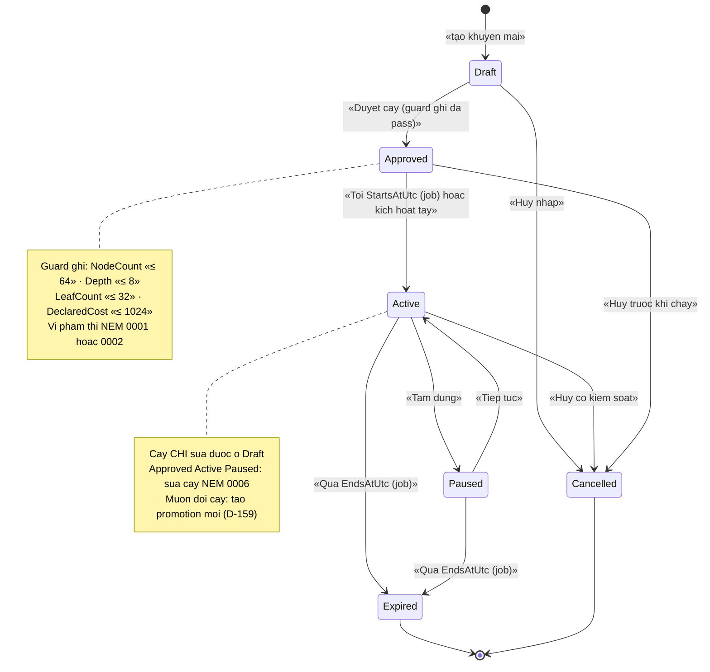
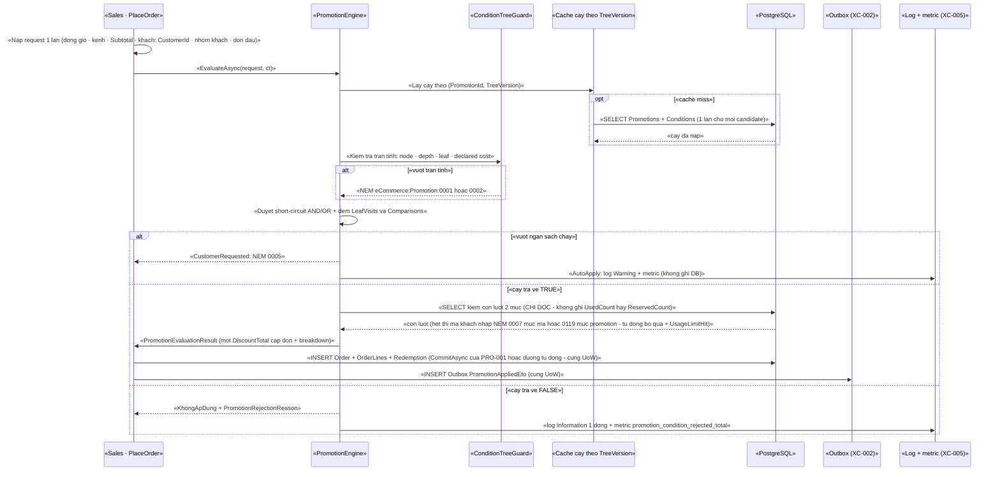
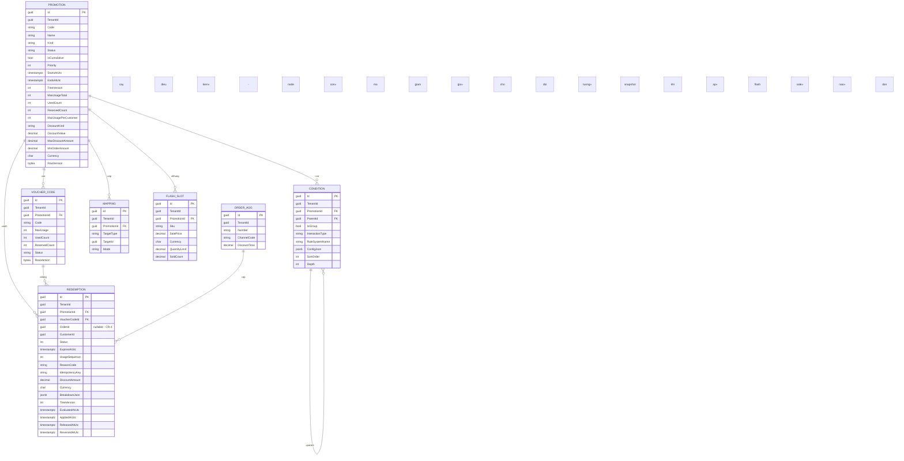

# `PRO-002` — Cây điều kiện AND/OR & engine khuyến mãi (guard bùng nổ tổ hợp)

> ⚠️ **ĐỌC TRƯỚC:** tài liệu này được viết **từ code thật đã kiểm bằng `read`/`grep`** (đối chiếu lại **23/11/2026**, WP-14 — D-71).
> Mọi khẳng định về code đều kèm đường dẫn file: dòng. Chỗ **chưa có trong code** được ghi rõ *"chưa có trong code — kế hoạch GĐ2"*;
> chỗ **không kiểm chứng được** ghi rõ *"chưa kiểm chứng"*. Module `Promotions` **vẫn chưa có** (`ls modules`, 23/11/2026).

| Thuộc tính | Nội dung |
|---|---|
| **Mã** | `PRO-002` |
| **Module** | **Promotions** — đề xuất `modules/Promotions/eCommerce.Promotions.{Domain,Application,Application.Contracts,EntityFrameworkCore}` (⚠️ **chưa có trong code** — §15.2 **F5**) |
| **Giai đoạn** | **GĐ2 — Vận hành & tuân thủ VN** (`docs/implementation-plan.md:113`, `:198`) |
| **Ưu tiên** | **Must have (trong GĐ2)** — `docs/implementation-plan.md:205` đặt *"một khuyến mãi phức tạp (nhiều điều kiện AND/OR) tính đúng tiền"* làm **cổng kiểm soát GĐ2** |
| **Trạng thái** | 🟡 `Draft` — chờ review |
| **Người viết / người review** | *(điền)* / **Kiến trúc trưởng + BA** |
| **Phiên bản / ngày** | `v0.10 — 27/11/2026` — F1 N94 (`W24-2`): ghi 5 `docDeviation` D1–D5 theo `PRO-002-arch.md` §12.1, cờ tắt vận hành `Promotions:Enabled`, đóng các P3 của DOCREV vòng 4–5; lịch sử đầy đủ ở §15.4 |
| **Tài liệu liên quan** | `XC-001` (Money/làm tròn) · `XC-002` (outbox/inbox + `IIdempotencyGuard`) · `XC-003` (khoá phân tán + quy ước tiền tố) · `XC-004` (`[Authorize]` cấp class, tenant) · `XC-005` (log/`CorrelationId`/metric + `eCommerceMetricNames`) · `PRC-001` (giá theo kênh) · `PRC-002` (pipeline tính giá) · `SAL-002` (đặt hàng) · `SAL-003` (state machine 4 trục) · `REP-001` (`Σ OrderLine.DiscountAmount`) · `SHP-002` (webhook vận đơn — **GHTK không HMAC**) · [`SHP-003`](../shipping/shp-003-cod-thu-ho-doi-cod.md)/[`SHP-004`](../shipping/shp-004-adapter-ghtk.md) (đã có file, 🟡 `Draft` — §15.2 **F6**) · `PRO-001` ([voucher/coupon](pro-001-voucher-coupon.md) — dải mã `01xx`, CR vào tài liệu này) · `docs/business-modules-proposal.md` §6.4 · `docs/implementation-plan.md:198` |

---

## 0. Tóm tắt & quyết định thiết kế

**Tóm tắt:** `PRO-002` chốt **một** cách biểu diễn khuyến mãi bằng **cây điều kiện AND/OR** (học mô hình
`DiscountRequirement` của nopCommerce: `{ DiscountId, RuleSystemName, ParentId, InteractionTypeId, IsGroup }`,
`RequirementGroupInteractionType { And=0, Or=2 }` — `docs/business-modules-proposal.md:248`), và — phần **quan trọng
nhất** — **ba tầng guard chống bùng nổ tổ hợp**: chặn khi **GHI**, chặn khi **CHẠY**, và **hàng rào DB**.
Lý do không thể bỏ qua guard: `docs/business-modules-proposal.md:580` ghi rõ EShop dùng `OrderDiscountResolver` kiểu
**BFS** với cảnh báo *"⚠️ coi chừng bùng nổ tổ hợp"*, còn `docs/implementation-plan.md:198` yêu cầu Promotions
*"⚠️ **có guard chống bùng nổ tổ hợp** khi duyệt cây điều kiện"*.

**Điểm xuất phát thật (đã kiểm trong repo — không viết theo trí nhớ):**

| Hạng mục | Hiện trạng đã kiểm |
|---|---|
| Module **Promotions** | ❌ **chưa có trong code** — `modules/` có `Address, Catalog, ChannelHub, Customers, EInvoice, Inventory, Messaging, PaymentHub, Pos, Pricing, Reconciliation, Reporting, Sales, Signing, Tax`; **không** có `Promotions` (**F5**) |
| Entity `Voucher`/`Coupon`/`Promotion`/`DiscountRequirement`/`FlashSale` | ❌ **chưa có** — chỉ có `Order.DiscountTotal` (`modules/Sales/eCommerce.Sales.Domain/Order.cs:158`), `OrderLine.DiscountAmount` (`:836`) và tham số `giamGiaCapDon` của hàm tiền `TinhTienDon` (`modules/Pricing/eCommerce.Pricing.Domain/TinhTienDon.cs:75`) |
| Cột tiền giảm giá | ✅ **có** — `numeric(18,4)`: `modules/Sales/eCommerce.Sales.EntityFrameworkCore/SalesDbContextModelCreatingExtensions.cs:34,182`; migration `src/eCommerce.EntityFrameworkCore/Migrations/20261009070214_Initial.cs:202,301` |
| `Money`/`MoneyAllocator` (`XC-001`) | ✅ **có trong code** — `shared/eCommerce.Kernel/Money/Money.cs`, `MoneyAllocator.PhanBo` (`shared/eCommerce.Kernel/Money/MoneyAllocator.cs:31`), `RoundingPolicy.cs`, `MoneyErrorCodes.cs`; `TinhTienDon` đã dùng `Money` (`TinhTienDon.cs:75`). **F4** đã gỡ; **Q3** `Closed` — `D-155` (mọi phép tiền của `Promotions` qua `Money`/`MoneyAllocator.PhanBo`, cấm bộ phân bổ thứ hai) |
| Metric miền khuyến mãi | ❌ **chưa có** — `eCommerceMetricNames.All` (`shared/eCommerce.Kernel/Observability/eCommerceMetrics.cs:81-107`) **không** tên nào thuộc promotion |
| Permission miền khuyến mãi | ❌ **chưa có** — `eCommerceConsts.Permissions` (`src/eCommerce.Domain.Shared/eCommerceConsts.cs:15`) chưa có nhóm `Promotions` (grep 23/11/2026 = 0) |
| Khoá phân tán cho promotion | ❌ **chưa có** (mẫu để noi theo: `TaxLockKeys` trong `modules/Tax/eCommerce.Tax.Domain/TaxErrorCodes.cs:45-50`, dạng **không** tiền tố `ecommerce:`) |
| `IIdempotencyGuard` | ✅ **có trong code** — `modules/Messaging/eCommerce.Messaging.Domain/Idempotency/IdempotencyGuard.cs:27` (đặc tả: `XC-002` §6.4) |
| Hạ tầng khoá phân tán | ✅ **có gói**: `Volo.Abp.DistributedLocking` 10.7.0 (`Directory.Packages.props:80`), `DistributedLock.Redis` 1.0.1 (`:116`) |
| `[Authorize]` cấp CLASS | ✅ **có tiền lệ trong code**: `src/eCommerce.Application/Channels/ChannelAppService.cs:28` (kèm giải thích ở `:21-25`) |
| `DbSet` bắt buộc cho `IRepository<T>` | ✅ **bài học đã ghi trong code**: `src/eCommerce.EntityFrameworkCore/eCommerceDbContext.cs:62-64`, `:93-96` (lưới an toàn `test/eCommerce.Tests/EfCoreRegistration/DbSetRegistrationTests.cs`) |
| CSDL | PostgreSQL **17** — test tích hợp chạy trên PostgreSQL 17 thật (commit `d48b9f0`) |

**Phạm vi:**
- ✅ **Cây điều kiện AND/OR** (nhóm `And`/`Or` + lá là rule) — mô hình dữ liệu, ràng buộc, ví dụ.
- ✅ **Engine đánh giá** tách khỏi `Sales`: hợp đồng, tính **xác định** (deterministic), short-circuit, snapshot.
- ✅ **Guard bùng nổ tổ hợp 3 tầng** (ghi · chạy · DB) + **ngân sách đánh giá** và hành vi khi vượt.
- ✅ **Giới hạn lượt dùng** chống vượt bằng ràng buộc DB (không dựa vào lock). Bước **đánh giá** của engine **chỉ đọc** (không ghi lượt); lượt voucher ghi qua `ReserveAsync`/`CommitAsync` của `PRO-001` (`D-151`).
- ✅ Idempotency ở **mọi biên vào có ghi** (biên chỉ đọc `evaluate` không có khoá — `D-159`), phân quyền, migration, test, metric.

**Không nằm trong phạm vi:**
- ❌ **`Voucher`/`Coupon` CRUD chi tiết & phát hành mã** (sinh mã hàng loạt, gửi mã) — thuộc **`PRO-001`** (`docs/implementation-plan.md:422`).
- ❌ **Pipeline tính giá & thứ tự áp giá/phí** — thuộc **`PRC-002`** (`docs/features/pricing/prc-001-bang-gia-va-gia-theo-kenh.md:43`).
- ❌ **Chính sách làm tròn & phân bổ tiền** — thuộc **`XC-001`** (BR-11 ở đây chỉ **gọi** nó).
- ❌ **State machine 4 trục của đơn** — thuộc `SAL-003`; `PRO-002` chỉ **đọc** trạng thái để quyết định điều kiện.
- ❌ **Tích hợp hãng vận chuyển / COD thật** — thuộc `SHP-003`/`SHP-004`/`REC-003`; §7.4 chỉ ghi **ràng buộc** mà engine phải tuân.
- ❌ **Giảm theo SKU/danh mục/thương hiệu** (`ProPromotionMappings` `TargetType` ∈ `Sku`/`Category`/`Brand`; `PerLine`) — ngoài phạm vi v1, **nợ có chủ `CR-P1`** (`D-152`, `D-149`): engine v1 chỉ ra **một** `DiscountTotal` cấp đơn.
- ❌ **Tại quầy `RetailBill` (`Pos`): khuyến mãi tự động (`AutoApply`) và voucher** — ngoài phạm vi v1 (`D-142`, `D-153`): `Pos` không gọi `IPromotionEngine`, `TinhTienHoaDon` không đổi. (Khuyến mãi tự động cho **đơn kênh `web`/`Sales`** thì **trong** phạm vi — A2, Basic Flow 7, `TC-39`/`TC-43`.)
- ❌ **Flash sale** (`Kind = FlashSale`, `ProFlashSaleSlots`) — giá flash là **ứng viên đơn giá** ở bước `B4` của `PRC-002` (`IPriceAdjustment`), **không** đi qua engine; ngoài phạm vi v1, **nợ có chủ `CR-P2`** (`D-156`); tới đó `Kind = 'FlashSale'` bị chặn (`CHECK` + validation — §5.3).
- ❌ **`FreeShipping`** (`DiscountKind = 'FreeShipping'`) — engine v1 chỉ ra một `DiscountTotal` tiền hàng; giảm phí ship cần cột `ShippingDiscountTotal` của `Sales` (`PRO-001` ADR-06/Q4) ⇒ **chặn ở v1** (`CHECK` + validation — §5.3, `D-158`, **Q19** `Closed`); nợ có chủ **`CR-S2`** (BA `SAL-002`/`SAL-003` + arch `Sales`/`Promotions` + kế toán duyệt hạch toán): `Sales` thêm `OrdOrders.ShippingDiscountTotal`, `PromotionEvaluationResult` thêm `ShippingDiscountTotal` (additive), gỡ `CHECK` bằng migration mới — hoãn, không bỏ.

### 0.1 Quyết định thiết kế (ADR ngắn)

| # | Quyết định | Phương án đã cân nhắc | Lý do chọn | Hệ quả |
|---|---|---|---|---|
| **ADR-01** | Cây điều kiện lưu bằng **bảng tự tham chiếu** (`ProPromotionConditions`) với `ParentId` + `IsGroup` + `InteractionType` | (a) **bảng tự tham chiếu** · (b) lưu cả cây trong **1 cột `jsonb`** · (c) lưu chuỗi XML (kiểu nopCommerce `Order.TaxRates`) | (a) cho **ràng buộc DB kiểm được** (`CHECK` node lá/nhóm, `Depth`, `ParentId <> Id`) và **đếm được** node/độ sâu bằng SQL; (b) `jsonb` **không** có FK/CHECK nên guard chỉ nằm ở code; (c) là anti-pattern đã ghi trong `docs/business-modules-proposal.md:258` | Nhiều dòng hơn; mọi thao tác sửa cây là **transaction trên nhiều dòng**; cần unique/`RowVersion` ở cấp promotion (**§5.3**) |
| **ADR-02** | **Guard 3 tầng**: (1) **GHI** (validator + `CHECK`), (2) **CHẠY** (ngân sách đếm thật), (3) **DB** (ràng buộc) | (a) chỉ guard ở code khi lưu · (b) chỉ guard khi chạy · (c) **cả ba** | Kế thừa `XC-003` **D2**: *lock/guard ở app **không** phải hàng rào cuối* — Redis chết, deploy song song, hoặc SQL tay đều có thể lọt dữ liệu nếu DB không chặn (`docs/features/cross-cutting/XC-003-khoa-phan-tan-quy-uoc.md:44-45`) | Phải viết ràng buộc DB bằng SQL thô nếu EF không hỗ trợ (tiền lệ: `EXCLUDE USING gist` ở `modules/Tax/eCommerce.Tax.EntityFrameworkCore/TaxDbContextModelCreatingExtensions.cs:64-69`) |
| **ADR-03** | **Trần tường minh, cấu hình được**: `MaxNodes = 64` · `MaxDepth = 8` · `MaxLeaves = 32` · `MaxCandidatesPerCart = 50` · `LeafVisitBudget = 512` · `ComparisonBudget = 5.000` | (a) không trần ("đủ nhanh") · (b) trần cứng trong code · (c) **trần có giá trị mặc định + cấu hình theo tenant** | NFR **phải có ngưỡng số** (`docs/design-doc-guidelines.md:112`); trần cứng trong code **cấm hard-code** theo tinh thần `XC-001` BR-012 | Vượt trần ⇒ **NÉM LỖI** (không cắt im lặng) — xem **BR-04/05/06**. `MaxDepth` **chỉ được đặt trong `[1, 8]`**: `8` là trần cứng của `CHECK ("Depth" BETWEEN 1 AND 8)` (§5.3), validator ghi setting từ chối giá trị > 8 (`TC-45`); nâng trần > 8 ⇒ migration + **Q1** |
| **ADR-04** | **Short-circuit** AND/OR thật | (a) duyệt hết mọi lá rồi tổng hợp · (b) **dừng sớm** | Chi phí worst-case giảm từ "Σ mọi lá" xuống "lá quyết định"; rẻ nhất và dễ chứng minh bằng test đếm số lá đã thăm | Kết quả **phụ thuộc thứ tự** ⇒ phải duyệt **tất định**: `ORDER BY SortOrder, Id` (**BR-09**) |
| **ADR-05** | **Ngân sách đếm ĐỒNG HỒ THẬT**, không tin ước lượng tĩnh: đếm `LeafVisits` + `Comparisons` khi chạy | (a) chỉ ước lượng tĩnh khi lưu · (b) chỉ đếm khi chạy · (c) **cả hai** | Ước lượng tĩnh **không biết** kích thước giỏ; đếm khi chạy **không chặn được** cấu hình xấu từ đầu ⇒ cần cả hai | Cần thêm tham số ngân sách vào `PromotionEvaluationContext`; đo được bằng test |
| **ADR-06** | **Rule lá là hàm THUẦN, không I/O** (`IPromotionConditionRule.IsSatisfied(ctx)`, `ctx` đã nạp sẵn dữ liệu) | (a) rule tự inject `IRepository`/`HttpClient` · (b) **context nạp trước, rule thuần** | Nếu rule gọi DB/HTTP thì "cây 64 node" có thể thành **64 truy vấn** ⇒ bùng nổ **I/O**, và kết quả **không tất định** | Rule **không** thể tự lấy dữ liệu mới ⇒ mọi "sự thật" phải có trong `PromotionEvaluationContext`; thiếu ⇒ **NÉM** (không trả `false` im lặng) |
| **ADR-07** | **Engine KHÔNG nằm trong `Sales`**; `Sales` chỉ gọi qua contract | (a) engine trong `Sales` · (b) **module Promotions + contract** | `docs/implementation-plan.md:198` yêu cầu rõ: *"Engine không nằm trong `Sales`"*; quy ước dự án: **module gọi app bị cấm** (`modules/ChannelHub/eCommerce.ChannelHub.Domain/ChannelHubConsts.cs:8-10`) | `Sales` phải chịu thêm 1 dependency **contract**; `Promotions` **cấm** đọc bảng `Orders` — nhận dữ liệu qua DTO |
| **ADR-08** | Kết quả áp khuyến mãi ghi thành **snapshot bất biến** (`ProPromotionRedemptions`), **append-only** | (a) chỉ ghi `Order.DiscountTotal` · (b) **snapshot + tổng trên đơn** | `Order.DiscountTotal` (`modules/Sales/eCommerce.Sales.Domain/Order.cs:158`) là **một số tổng** — không trả lời được *"vì sao đơn này được giảm 50k"* khi cây đã đổi. Tiền lệ append-only: `XC-006` `TaxClassification` (`modules/Tax/eCommerce.Tax.Domain/Classifications/TaxClassification.cs:16-17`) | Thêm 1 bảng ghi mỗi lần áp thành công; **cấm** ghi 1 dòng cho mỗi lần **bị từ chối** (chống bùng nổ dữ liệu — **BR-16**) |
| **ADR-09** | **Giới hạn lượt dùng** chống vượt bằng `UPDATE … WHERE` **còn lượt** (`UsedCount + ReservedCount`) + `CHECK (UsedCount + ReservedCount <= MaxUsage)` + `RowVersion`; **ghi lượt chỉ qua `ReserveAsync`/`CommitAsync` của `PRO-001`**, bước `EvaluateAsync` **chỉ đọc** (`D-151`, CR-3/CR-7) | (a) khoá phân tán · (b) đọc-rồi-ghi trong code · (c) **cập nhật có điều kiện + CHECK DB** | Kế thừa `XC-002` §8.2 dòng 3 và `XC-003` D2: lock **không** thay được ràng buộc DB; tiêu lượt lúc đánh giá ⇒ khách báo giá rồi bỏ đi vẫn mất lượt im lặng (`D-151`) | Cần `CHECK` + `RowVersion`; mất Redis vẫn **không** vượt lượt |
| **ADR-10** | **Idempotency ở MỌI biên vào có ghi** (side effect) bằng `IIdempotencyGuard` (`XC-002` §6.4), khoá **ổn định**; biên chỉ đọc (`evaluate`) **không** bọc guard (`D-159`) | (a) chỉ chống trùng ở tầng HTTP · (b) **guard ở mọi biên ghi + unique index** | `docs/design-doc-guidelines.md:114`: *"Mọi cửa vào từ bên ngoài phải có chống trùng"* | Mỗi biên vào phải khai khoá ổn định (**§7.2**); **cấm** `Guid.NewGuid()` làm khoá |
| **ADR-11** | Tiền: **`decimal` + `numeric(18,4)`**, **cấm** `==`; phân bổ giảm giá **bảo toàn tổng** | (a) `double` · (b) `decimal` + so `==` · (c) **`Money` + phân bổ largest-remainder qua `MoneyAllocator.PhanBo`** | `XC-001` **BR-003/D3/D7**; trong code đã có quy ước `numeric(18,4)` (`modules/Sales/eCommerce.Sales.EntityFrameworkCore/SalesDbContextModelCreatingExtensions.cs:34,182`) và comment **cấm `double`** ở `modules/Sales/eCommerce.Sales.Domain/Order.cs:155` | ✅ `Money`/`MoneyAllocator` **đã có trong code** (`shared/eCommerce.Kernel/Money/`) — `Q3` `Closed` (`D-155`): mọi phép tiền của `Promotions` qua `Money`; phân bổ (nếu còn) **chỉ** `MoneyAllocator.PhanBo`, **cấm** bộ phân bổ/làm tròn thứ hai; khác `Currency` ⇒ `eCommerce:Money:0001` |
| **ADR-12** | **Vượt ngân sách khi chạy** xử lý **theo 2 chế độ tường minh**, noi theo `XC-003` **D10** | (a) luôn ném · (b) luôn bỏ qua im lặng · (c) **2 chế độ** | `XC-003` D10 (`docs/features/cross-cutting/XC-003-khoa-phan-tan-quy-uoc.md:53`) đã chốt nguyên tắc: **khách đã yêu cầu tường minh** ⇒ ném lỗi; **hệ thống tự chọn** ⇒ bỏ qua **có log + metric** (không im lặng) | Hai đường code; `Skip` **bắt buộc** có log `Warning` + metric, nếu thiếu ⇒ **vi phạm BR-07** |
| **ADR-13** | **Hiệu lực khuyến mãi theo GIỜ** (`timestamptz`, áp cho **mọi** `Kind`), không theo ngày | (a) `date` · (b) **`timestamptz`** | `docs/features/pricing/prc-001-bang-gia-va-gia-theo-kenh.md:913` nêu rõ rủi ro `date` nếu cần hiệu lực theo giờ và ghi *"flash sale thuộc `PRO-002`"* — flash sale nay đi đường giá `PRC-002` `B4`, nợ `CR-P2` (`D-156`) | Mọi so sánh thời gian dùng UTC (`StartsAtUtc`/`EndsAtUtc`); hiển thị theo locale ở tầng UI |
| **ADR-14** | **Metric mới phải cập nhật bảng đăng ký + test trong CÙNG PR** | (a) phát metric tự do · (b) **registry + test** | Kế thừa `XC-005` **BR-008** và bài học "bảng đăng ký lệch code" của `XC-003` §5.4 | **9** metric mới (6 của `PRO-002` + 3 của `PRO-001` — CR-8, `D-151`) ở **§13** phải thêm vào `eCommerceMetricNames` + `XC-005` §5.1 + test `TC-22` |
| **ADR-15** | **Cắt số candidate theo `Priority`** khi vượt `MaxCandidatesPerCart` | (a) đánh giá hết · (b) **cắt tất định + log + metric** | Không thể để số candidate do dữ liệu quyết định thời gian phản hồi; cắt **tất định** (ORDER BY `Priority`, `Id`) ⇒ kết quả vẫn tái lập được | Có thể bỏ sót khuyến mãi tốt hơn ⇒ **bắt buộc** log + metric `promotion_candidates_truncated_total` + màn hình cảnh báo (§10) |

---

## 1. Use Case Specification

> 📌 **Quy ước mã:** trong tài liệu này dùng dạng ngắn `BR-01`, `NFR-01`, `TC-01`, `ADR-01`. Khi trích dẫn **ra ngoài**
> tài liệu, dùng dạng đầy đủ `BR-PRO-002-01`, `NFR-PRO-002-01`, `TC-PRO-002-01`.

| Thuộc tính | Nội dung |
|---|---|
| **Use Case ID** | `PRO-002` |
| **Use Case Name** | Đánh giá **cây điều kiện AND/OR** và tính giảm giá **đúng tiền**, **không bùng nổ tổ hợp** |
| **Description** | *"Là quản trị khuyến mãi, tôi muốn dựng một khuyến mãi bằng cây điều kiện AND/OR (kèm điều kiện theo kênh), để hệ thống áp đúng cho đơn — và tôi muốn **bị chặn ngay khi lưu** nếu cây quá lớn, thay vì làm chậm/treo checkout."* · *"Là lập trình viên `Sales`, tôi muốn gọi **một** hợp đồng để biết đơn được giảm bao nhiêu (**một** khoản giảm cấp đơn — `D-152`) và vì sao."* |
| **Actor(s)** | **Quản trị khuyến mãi** (dựng/duyệt cây) · **Khách hàng** (nhập mã) · **Hệ thống** (engine, job hết hạn) · **`Sales`** (người gọi contract) · **Vận hành** (xem metric/cảnh báo cắt candidate) |
| **Priority** | **Must have** (GĐ2) — cổng kiểm soát GĐ2 (`docs/implementation-plan.md:205`) |
| **Trigger** | (a) `Sales` gọi engine khi **dựng giỏ/tính tiền checkout** (`SAL-002`); (b) khách **nhập mã**; (c) quản trị **lưu cây** (guard ghi); (d) job `promotion-expiry` — **hết hạn** `Active`/`Paused → Expired` **và kích hoạt** `Approved → Active` khi tới `StartsAtUtc` (mở flash sale thuộc `CR-P2` — `D-156`) |
| **Pre-Condition(s)** | • **`TenantId`** hiện tại (`ICurrentTenant`) — mọi entity `IMultiTenant` (**BR-17**).<br>• **`ChannelCode`** của đơn/giỏ (`web`/`shopee`/… — `modules/Sales/eCommerce.Sales.Domain/Order.cs:19`) — điều kiện theo kênh **bắt buộc** (`docs/business-modules-proposal.md:249`).<br>• **`Currency`** của giỏ; mọi phép tiền **cùng một** currency (**BR-12**).<br>• `Money` (`XC-001`) **đã có trong code** — `shared/eCommerce.Kernel/Money/` (`MoneyAllocator.PhanBo` `:31`); mọi phép tiền đi qua `Money`, **cấm** so `==`, **cấm** bộ phân bổ thứ hai (`D-155`, **Q3** `Closed`).<br>• Cây đã qua **guard ghi** (ADR-02) và `Status = Active`. |
| **Post-Condition(s)** | • Kết quả gồm **một** `DiscountTotal` cấp đơn (`Money`) — engine **không** phân bổ theo dòng ở v1; `Sales` đưa nó vào `giamGiaCapDon` của `TinhTienDon.Tinh`, nơi `Σ giảm dòng == DiscountTotal` được cưỡng chế (**BR-11**, `D-152`).<br>• Nếu áp thành công: mỗi promotion được áp có **đúng một** `ProPromotionRedemptions` (snapshot) ghi **cùng UoW** với đơn + outbox (**BR-10**); bước đánh giá **không** ghi lượt (`D-151`).<br>• Nếu **không** áp được: **có** lý do (`PromotionRejectionReason`) ở log — **không** ghi DB (**BR-16**).<br>• Mọi lần vượt ngân sách đều **có dấu vết**: exception có mã **hoặc** log `Warning` + metric (**BR-07**).<br>• **0** truy vấn DB phát sinh trong vòng duyệt lá (**NFR-04**). |
| **Basic Flow** | 1. `Sales` nạp **một lần** dữ liệu giỏ thành `PromotionEvaluationRequest` (dòng, kênh, `Subtotal`, khách: `CustomerId` + `CustomerGroupId` + `IsFirstOrder` — nguồn ở §6.1 quy tắc 11); engine dựng `PromotionEvaluationContext` bất biến từ request + `IClock` lấy **một lần** khi vào (§6.1 quy tắc 2).<br>2. `Sales` gọi `IPromotionEngine.EvaluateAsync(request, ct)`.<br>3. Engine nạp **cây** của các candidate (`PromotionId` + `TreeVersion`) — ngoài vòng lặp lá.<br>4. Engine kiểm **trần tĩnh** lần nữa — phòng dữ liệu lọt qua guard ghi — theo **thứ tự cố định**: tổng node (`MaxNodes`) → độ sâu → số lá (`MaxLeaves`) → tổ hợp khai báo (`MaxDeclaredCombinations`); vi phạm đầu tiên quyết định mã (`0001`/`0002`).<br>5. Engine duyệt cây **short-circuit** (`And` dừng ở lá `false` đầu tiên; `Or` dừng ở lá `true` đầu tiên), **đếm** `LeafVisits` + `Comparisons`.<br>6. Cây `true` ⇒ kiểm "**còn lượt**" **chỉ đọc**, **hai mức AND** (mức mã `ProVoucherCodes`: `UsedCount + ReservedCount < MaxUsage`; mức promotion chỉ khi `MaxUsageTotal IS NOT NULL`) — **không ghi** `UsedCount`/`ReservedCount`/redemption (CR-7, `D-151`). Hết lượt **theo nguồn candidate** (§6.1 quy tắc 8, ADR-12): **mã khách nhập** ⇒ NÉM `0007` (mức mã) / `0119` của `PRO-001` (mức promotion, `D-147`); **candidate tự động** (chỉ có mức promotion, cộng trần theo khách `MaxUsagePerCustomer` ở bước 7) ⇒ **bỏ qua** candidate đó + `UsageLimitHit` + log `Information` + metric `promotion_usage_limit_hit_total`, **không ném** — đơn không bị chặn vì khuyến mãi tự động đã hết lượt. **Khách vãng lai** (`D-161`): candidate **tự động** có cây `true`, `MaxUsagePerCustomer IS NOT NULL` mà `CustomerId = NULL` (không đếm được theo khách — `D-146`) ⇒ **bỏ qua** candidate (fail-closed, **không** ném) với lý do **riêng** `CustomerRequired` — **không** dùng `UsageLimitHit` (vãng lai không chạm trần nào) — + log `Information` + counter `promotion_condition_rejected_total{reason="CustomerRequired"}`; **không** tăng `promotion_usage_limit_hit_total`; 0 redemption, `UsedCount`/`ReservedCount` không đổi. Kiểm khách là một vế của "còn lượt" ở bước này (**sau** cây, **trước** ghép); cây `false` mang `ConditionFalse`, không bao giờ mang `CustomerRequired`. Ghi lượt **voucher** chỉ qua `ReserveAsync`/`CommitAsync` của `PRO-001`; thứ tự khoá `D-147` (2) (dòng **mã** trước, dòng **promotion** sau) giữ nguyên, chuyển sang cửa đó.<br>7. Engine trả `PromotionEvaluationResult` (**một** `DiscountTotal` cấp đơn, `Breakdown` các lá đã quyết định); `Sales` đưa `DiscountTotal` vào `giamGiaCapDon` của `TinhTienDon.Tinh`, ghi đơn + redemption + outbox trong **cùng UoW**. **Đường tiêu lượt mức promotion cho khuyến mãi TỰ ĐỘNG** (không mã, có `MaxUsageTotal`; `D-151` (4)): trong UoW tạo đơn, ghi **thẳng `Applied`** (`OrderId` có giá trị, `VoucherCodeId` NULL) kèm `UPDATE ProPromotions SET UsedCount = UsedCount + 1 WHERE Id = @id AND UsedCount + ReservedCount < MaxUsageTotal`; **0 dòng ⇒ `0119` + rollback đơn** (khuôn `D-147`; ca **tranh chấp lúc ghi** — còn lượt lúc đọc ở bước 6, hết lượt lúc ghi). Không có `Reserved` cho khuyến mãi tự động; lệch khuôn này ⇒ câu mới gửi DEC. **`UsageSequence` của dòng tự động** (cột `NOT NULL`, nằm trong unique §5.3): `CustomerId` có giá trị ⇒ số nhỏ nhất trong `[1, MaxUsagePerCustomer]` chưa bị lượt còn hiệu lực (`Status <> Released`) của `(promotion, khách)` chiếm — cùng cách cấp với voucher (`pro-001` §5.2 `UsageSequence`), `MaxUsagePerCustomer IS NULL` ⇒ không có cận trên; hết số ⇒ **bỏ qua** candidate (kiểm cùng lúc bước 6) + `UsageLimitHit`, **không** ném (voucher mới ném `0104`). Cùng khách đặt đơn thứ hai khi khuyến mãi còn chạy ⇒ `UsageSequence` kế tiếp, **không** `23505`. Trùng số do hai đơn của cùng khách chạy song song ⇒ `23505` ⇒ rollback **cả đơn** (fail-closed, §5.3, `TC-43`); client thử lại và được cấp số mới. `CustomerId IS NULL` (vãng lai) và `MaxUsagePerCustomer IS NULL` ⇒ áp bình thường, `UsageSequence = 1`, ngoài unique (đúng `pro-001` §5.2), vẫn chịu `MaxUsageTotal` (`0119` khi tranh chấp lúc ghi) và unique một lượt/khuyến mãi tự động/đơn; `CustomerId IS NULL` và `MaxUsagePerCustomer IS NOT NULL` ⇒ bỏ qua candidate ở bước 6 (`CustomerRequired`, `D-161`). **Lá điều kiện phụ thuộc khách** (`CustomerGroup`, `FirstOrderOnly`) khi `CustomerId = NULL` (`D-162`, **BR-08**): lá trả `false` (không ném, không đọc trường khách); cây `And`/`Or` tính bình thường — chỉ có hai loại nhóm, **không** có node phủ định (`CHECK` §5.3), nên lá `false` không bao giờ biến candidate từ không khớp thành khớp; `Or(CustomerGroup, MinOrderAmount)` + vãng lai đủ tiền ⇒ vẫn `true`. Cây `false` ⇒ candidate mang `ConditionFalse` (thứ tự bước 6 giữ nguyên: cây **trước** khách ⇒ **không** `CustomerRequired`). `PromotionRuleContext` mang `CustomerId`/`CustomerGroupId` **nullable** (§6.1 quy tắc 10). Đường voucher không xảy ra ca này: `ReserveAsync` ném `0118` **trước** engine (`pro-001` BR-24, `D-146`) — chỉ candidate tự động và `POST /promotion/evaluate` (chỉ đọc) chịu. |
| **Alternative Flow** | **A1: Khách nhập mã** — chế độ `CustomerRequested`: không thỏa điều kiện ⇒ **NÉM** `0001`…`0010` (không im lặng).<br>**A2: Nhiều khuyến mãi — mã khách nhập, cộng dồn, trần** (`D-157`, `D-158`). (1) **Thứ tự và nguồn candidate:** mã khách nhập (`CustomerRequested`) **trước**; các candidate tự động (`AutoApply`) sau, theo `Priority` **giảm dần**, `Id` tăng dần (tất định). **Candidate tự động chỉ gồm promotion `Kind = 'Discount'`** (§4.2 bước 2); promotion `Kind = 'Voucher'` **chỉ** vào qua `VoucherCode` (tra `ProVoucherCodes` ⇒ `PromotionId`), **không bao giờ** là candidate tự động — request không mã không được giảm theo `Voucher`. Một `PromotionId` đã nhận qua mã **không** được xét lần hai ở tập tự động (khử trùng theo `PromotionId`): mỗi promotion xuất hiện **tối đa một** `PromotionBreakdownItem` nhận (đỏ ở `TC-67`). (2) **Mã khách nhập hợp lệ luôn được tính** (cây `true`, còn lượt — §4.2 bước 5–6): promotion của mã luôn có mặt trong kết quả và là phần tử đầu của tập đã nhận `A` (không có mã ⇒ `A` rỗng). Mã **không** hợp lệ ⇒ A1. **(2a) Cơ sở tính tiền một candidate** (`D-160` (1)–(3)): `Percentage` = `min(Round(Subtotal × DiscountValue / 100), MaxDiscountAmount)`; `FixedAmount` = `DiscountValue`. Mọi candidate (mã và tự động) dùng **cùng một** `Subtotal` (Σ thành tiền dòng hàng **trước** mọi giảm cấp đơn, **không** cộng `ShippingTotal`) và **không** trừ phần promotion đứng trước đã giảm ⇒ tiền một candidate **không** phụ thuộc `Priority`. `Round` theo `IRoundingPolicy` của `Currency` — cùng chính sách `TinhTienDon` dùng (`TinhTienDon.cs:105`) —, làm tròn **một lần mỗi candidate**, **trước** khi cộng luỹ kế và so trần (3); không tự viết hàm tròn/bộ phân bổ trong `Promotions` (BR-12). `min` với `MaxDiscountAmount` là trần riêng của promotion (`CHECK` §5.3), **không** phải kẹp về `Subtotal`. `Subtotal` đọc từ `PromotionEvaluationRequest.Subtotal` (§6.1 quy tắc 9), bằng `tongTruocGiam` (`TinhTienDon.cs:112`); engine không tự tính lại đơn giá. Giảm % trên **tập dòng** thoả điều kiện **không** thuộc v1 (không có `PerLine` — `D-152`). (3) **Trần `DiscountTotal ≤ Subtotal`** (`Subtotal` = Σ thành tiền dòng hàng trước giảm — `TinhTienDon.cs:112` — **không** cộng `ShippingTotal`), **không kẹp**: mã khách nhập đã > `Subtotal` ⇒ **NÉM** `0009`; candidate tự động nào làm luỹ kế > `Subtotal` ⇒ **bỏ qua candidate đó**, log `Warning` + `reason="DiscountCapExceeded"`, đi tiếp candidate kế (khuôn A4) — đơn **không** bị chặn chỉ vì cấu hình khuyến mãi tự động. (4) **Cộng dồn do engine quyết, DB không chặn** (`D-157`): một đơn có thể có 1 dòng voucher + N dòng tự động **khác** `PromotionId`; DB chỉ chặn 1 lượt voucher/đơn và 1 lượt/khuyến mãi tự động/đơn (§5.3). (5) **Luật ghép — một luật cho mọi tổ hợp** (`D-160` (5)–(7), gộp luật mã của `D-158`): duyệt candidate tự động theo (1); với mỗi candidate `c` có cây `true`, kiểm theo thứ tự **cây → khách → ghép → tiền → trần** (**khách** = Basic Flow 6, `D-161`). **Ghép:** nếu `A` khác rỗng và (`c.IsCumulative = false` hoặc có `a ∈ A` với `a.IsCumulative = false`) thì `c` **bị loại** — lý do `SupersededByVoucher` nếu `A` chứa mã khách nhập, ngược lại `ExcludedByNonCumulative`. Hệ quả khi không có mã: candidate nhận đầu tiên `IsCumulative = false` ⇒ mọi candidate sau bị loại; nhận đầu tiên `true` ⇒ các `true` sau được cộng, các `false` sau bị loại (giữ `Priority` cao nhất, hai tự động với nhau ⇒ giữ cái đứng trước). Không có luật "chọn mức giảm lớn hơn cho khách"; `Priority` là nút quản trị viên dùng để quyết cái nào thắng. **Chỉ candidate đã nhận mới loại được candidate khác**: candidate bị bỏ vì `ConditionFalse`/`BudgetExceeded` (A4)/`UsageLimitHit`/`CustomerRequired` (Basic Flow 6, `D-161`)/`DiscountCapExceeded` (3)/`CandidatesTruncated` (A3) **không** vào `A`, nên không chặn candidate sau; ghép kiểm **sau** cây, nên candidate có cây `false` không bao giờ mang lý do ghép. Candidate bị loại **không im lặng**: một `PromotionBreakdownItem` (`PromotionId` + lý do), log `Information` một dòng có `CorrelationId`, counter có sẵn `promotion_condition_rejected_total{reason="SupersededByVoucher"|"ExcludedByNonCumulative"}`; **0** dòng `ProPromotionRedemptions`, `UsedCount` không đổi (bước ghi lượt chỉ chạy cho candidate được nhận).<br>**A3: Vượt `MaxCandidatesPerCart`** — cắt theo `Priority` + log `Warning` + metric `promotion_candidates_truncated_total` (ADR-15).<br>**A4: Vượt ngân sách ở chế độ tự động** — **bỏ qua candidate đó**, log `Warning` + metric `promotion_eval_budget_exceeded_total`, **tiếp tục** candidate kế tiếp (ADR-12). |
| **Exception Flow** | **E1:** cây vượt trần **node/độ sâu/lá** ⇒ `BusinessException` **`eCommerce:Promotion:0001`** (`400`).<br>**E2:** cây vượt trần **tổ hợp khai báo** ⇒ **`0002`** (`400`).<br>**E3:** `ParentId` tạo **chu trình** ⇒ **`0003`** (`400`).<br>**E4:** node **lai** (vừa nhóm vừa rule) hoặc `SystemName` **chưa từng đăng ký** trong registry ⇒ **`0004`** (`400`); rule **đã đăng ký rồi bị gỡ/đổi tên** sau deploy ⇒ **`0010`** (`400`, `D-150`; phân biệt bằng **sự có mặt của dòng** trong `ProPromotionRuleCosts` — `D-154`, §6.4).<br>**E5:** vượt **ngân sách chạy** ở chế độ `CustomerRequested` ⇒ **`0005`** (`422`).<br>**E6:** chuyển trạng thái sai (ví dụ `Expired → Active`) ⇒ **`0006`** (`409`).<br>**E7:** hết lượt dùng ⇒ **`0007`** (`409`).<br>**E8:** điều kiện dựa trên **COD chưa đối soát** ⇒ **`0008`** (`422`) — xem §7.4.<br>**E9:** tổng giảm **vượt** `Subtotal` (Σ thành tiền các **dòng hàng**, chưa thuế, chưa phí ship) ⇒ **`0009`** (`400`) khi do **mã khách nhập** (`CustomerRequested`); với candidate **tự động** ⇒ **không ném**, bỏ qua candidate + `DiscountCapExceeded` (A2 (3), `D-158`).<br>**E10:** khác `Currency` ⇒ dùng `eCommerce:Money:0001` của `XC-001` (§6.4). |
| **Business Rules** | • **BR-01**: Cây điều kiện **chỉ** gồm 2 loại node: **nhóm** (`IsGroup = true`, có `InteractionType` ∈ {`And`, `Or`}, **không** có `SystemName`) **hoặc** **lá** (`IsGroup = false`, có `SystemName`, **không** có `InteractionType`). **Cấm** node lai ⇒ `0004`.<br>• **BR-02**: Mọi node **phải** thuộc **đúng một** promotion; `ParentId` (nếu có) **phải** cùng `PromotionId`; **cấm** `ParentId = Id`; **cấm** chu trình ⇒ `0003`.<br>• **BR-03**: Cây **phải** có **đúng một** node gốc (`ParentId IS NULL`) cho mỗi promotion ⇒ sai ⇒ `0004`; hàng rào DB: unique một gốc `(TenantId, PromotionId) WHERE "ParentId" IS NULL` (§5.3, `D-159`) — `23505` ⇒ `0004`. Đỏ khi vi phạm: `TC-28`.<br>• **BR-04**: `NodeCount ≤ MaxNodes` (**mặc định 64**) — vượt ⇒ **NÉM** `0001` khi lưu **và** khi chạy.<br>• **BR-05**: `Depth ≤ MaxDepth` (**mặc định 8**) và `LeafCount ≤ MaxLeaves` (**mặc định 32**) — vượt ⇒ **NÉM** `0001`.<br>• **BR-06**: `Σ DeclaredCostFactor(leaf)` (bảng khai báo chi phí rule, §5.2 `ProPromotionRuleCosts`) `≤ MaxDeclaredCombinations` (**mặc định 1.024**) — vượt ⇒ **NÉM** `0002`. Đây là **chặn bùng nổ tổ hợp ở tầng thiết kế**.<br>• **BR-07**: Khi chạy, nếu `LeafVisits > LeafVisitBudget` (**512**) hoặc `Comparisons > ComparisonBudget` (**5.000**) ⇒ chế độ xác định theo **nguồn candidate** (§6.1 quy tắc 8), không theo `Mode` của request: candidate của **mã khách nhập** (`CustomerRequested`): **NÉM** `0005`; candidate **tự động** (`AutoApply`, kể cả khi request có mã): **bỏ qua candidate** + log `Warning` + metric — một khuyến mãi do hệ thống tự chọn **không** làm khách mất mã hợp lệ. **Cấm** trả `false` im lặng ở **cả hai** chế độ. Đỏ khi vi phạm: `TC-07` (a)(b)(c).<br>• **BR-08**: Rule lá (`IPromotionConditionRule`) **phải THUẦN** — **cấm** I/O (DB/HTTP/file/`DateTime.Now`/random). Dữ liệu chỉ đến từ `PromotionEvaluationContext`. **Cấm** rule trả về `null`. **Lá phụ thuộc khách** (`CustomerGroup`, `FirstOrderOnly` — `D-162`): kiểm `CustomerId` **trước tiên**; `NULL` ⇒ `return false` ngay — **không** đọc `CustomerGroupId`/sự thật đơn đầu, **không** ném, **không** trả `null`; riêng `FirstOrderOnly` + vãng lai = `false`, **không** coi là "đơn đầu" (khớp `D-146`, `D-161`). Đỏ khi vi phạm: `TC-66`.<br>• **BR-09**: Kết quả **phải xác định**: cùng (`TreeVersion`, context) ⇒ **cùng** kết quả. Duyệt theo `ORDER BY SortOrder, Id`; thời gian lấy **một lần** từ `IClock`; **cấm** `DateTime.Now`, `Guid.NewGuid()`, `Dictionary` không sắp xếp trong đường quyết định.<br>• **BR-10**: Thao tác áp khuyến mãi **phải** đi qua **Unit of Work**; `Redemption` + thay đổi đơn + **outbox** ghi **cùng** transaction (`XC-002` D1).<br>• **BR-11**: `Σ giảm từng dòng == DiscountTotal` **chính xác** — engine v1 chỉ ra **một** `DiscountTotal` cấp đơn, **không** có `PerLine`; việc phân bổ theo dòng (phần dư lớn nhất, `XC-001` D7) do `TinhTienDon.Tinh` ở `Sales` làm và **cưỡng chế** bất biến này trên `KetQuaTinhTien` (`D-152`); tiền một candidate `Percentage` = `min(Round(Subtotal × DiscountValue / 100), MaxDiscountAmount)` trên **cùng một** `Subtotal` gốc, làm tròn **một lần mỗi candidate** trước khi cộng luỹ kế, không phụ thuộc `Priority` (A2 (2a), `D-160`; đỏ ở `TC-48`); `DiscountTotal ≤ Subtotal` (Σ thành tiền các dòng hàng) ⇒ vượt ⇒ **không kẹp**: mã khách nhập ⇒ `0009`, candidate tự động ⇒ bỏ qua candidate đó + `DiscountCapExceeded` (A2 (3), `D-158`) — **engine phải tự chặn**, vì `TinhTienDon.Tinh` phân bổ `giamGiaCapDon` chỉ trên thành tiền dòng hàng và **không** có guard `giamGiaCapDon > Σ thành tiền` (`TinhTienDon.cs:112-127`: `sauGiam = thanhTien[i] - giamGiaTungDong[i] + phiTungDong[i]` ⇒ dòng âm, thuế âm nếu lọt); trần `Subtotal` đúng `PRO-001` (BR-07, §6.4 `0009`), **không** cộng `ShippingTotal` (`D-158`, **Q18** `Closed`). Đỏ khi vi phạm: `TC-14` (property 10.000 bộ trên `TinhTienDon.Tinh`), `TC-13` (ca biên `DiscountTotal = Subtotal + 1` ⇒ `0009`/bỏ qua theo nguồn; mã `FixedAmount` vượt kể cả khi cộng phí ship).<br>• **BR-12**: Mọi giá trị tiền là `Money` (`decimal` + `numeric(18,4)` + `Currency`); **CẤM** `double`/`float`; **CẤM** so sánh tiền bằng `==`; phân bổ/làm tròn **chỉ** qua `MoneyAllocator.PhanBo`/`RoundingPolicy` — **cấm** bộ phân bổ thứ hai trong `Promotions` (`D-155`); khác `Currency` ⇒ `eCommerce:Money:0001` — `XC-001` BR-003/BR-008. Đỏ khi vi phạm: `TC-15`, `MoneyTests.PhanBo_*`.<br>• **BR-13**: Mọi app service **phải** có `[Authorize]` ở **CẤP CLASS**; permission **chỉ** dùng hằng số (tiền lệ: `src/eCommerce.Application/Channels/ChannelAppService.cs:28`, `src/eCommerce.Domain.Shared/eCommerceConsts.cs:15`).<br>• **BR-14**: **Mọi biên vào có ghi** (side effect) phải idempotent qua `IIdempotencyGuard` + **unique index**; khoá **ổn định** — **cấm** `Guid.NewGuid()`. Đúng phạm vi `XC-002` BR-004 ("trước mọi side effect") và `PRO-001` BR-02; biên **chỉ đọc** (`POST /promotion/evaluate`) **không** bọc guard và **không** có khoá (`D-159`, §7.2 #1) — làm rõ phạm vi, không nới kiểm: không biên ghi nào được bỏ guard. Đỏ khi vi phạm: `TC-16` (biên ghi thiếu khoá/trùng lượt), `TC-47` (`evaluate` sinh bản ghi idempotency hoặc trả giá cũ cho giỏ mới).<br>• **BR-15**: **Mọi** chuyển trạng thái không có trong bảng (§3.2) **PHẢI NÉM** `0006` — **cấm** no-op im lặng; **cấm** `Promotion.SetStatus(...)`.<br>• **BR-16**: `ProPromotionRedemptions` là sổ cái **CHỈ THÊM DÒNG**: **cấm** `DELETE`; dòng đã ghi **chỉ** được `UPDATE` các cột chuyển trạng thái (`Status`, `OrderId` đúng một lần `NULL → giá trị`, `AppliedAtUtc`/`ReleasedAtUtc`/`ReversedAtUtc`, `ReasonCode`) và **cấm** sửa `DiscountAmount`, `IdempotencyKey`, `VoucherCodeId`, `PromotionId`, `CustomerId`, `UsageSequence`, `BreakdownJson`, `TreeVersion` — đúng `PRO-001` BR-11 (hệ quả CR-5, `D-151`); **cấm** ghi 1 dòng DB cho mỗi lần đánh giá **bị từ chối** (chỉ log + metric) — chống bùng nổ dữ liệu.<br>• **BR-17**: Mọi entity **phải** `IMultiTenant` + `TenantId`; mọi unique index có `TenantId` **phải** `NULLS NOT DISTINCT` (migration thật đã áp cho 11 index: `src/eCommerce.EntityFrameworkCore/Migrations/20261013024226_Fix_NullableTenantId_UniqueIndexes.cs`).<br>• **BR-18**: Mọi entity cần `IRepository<T>` **phải** có `DbSet` trên `eCommerceDbContext` (`src/eCommerce.EntityFrameworkCore/eCommerceDbContext.cs:62-64`, `:93-96`) — thiếu ⇒ runtime ném *"The requested service 'IRepository<…>' has not been registered."* Đỏ khi vi phạm: `TC-40` (`DbSetRegistrationTests`).<br>• **BR-19**: Điều kiện **dựa trên COD/trạng thái giao hàng** **chỉ** được đọc dữ liệu **đã đối soát**; **cấm** dùng webhook hãng vận chuyển làm nguồn sự thật (⚠️ GHTK **không** HMAC; GHN đổi COD **cần OTP**) ⇒ vi phạm ⇒ **`0008`** (§7.4).<br>• **BR-20**: Thêm/đổi metric **phải** cập nhật `eCommerceMetricNames` (`shared/eCommerce.Kernel/Observability/eCommerceMetrics.cs:81-107`) **và** `XC-005` §5.1 **và** test — **trong cùng PR**; nhãn metric **chỉ** lấy từ `eCommerceMetricTags.Allowed` (`:212-224`). |
| **Non-Functional Requirement** | • **NFR-01**: `EvaluateAsync` với cây **sát trần hợp lệ** (64 node, 32 lá, độ sâu 3) ⇒ p95 **≤ 20 ms** (không I/O trong vòng lá) — đo bằng `TC-41`.<br>• **NFR-02**: **100 %** cây vượt trần bị **chặn khi ghi** — **0** cây > trần tồn tại trong DB.<br>• **NFR-03**: **0** lần vượt ngân sách chạy trên bộ dữ liệu hợp lệ; vượt ⇒ metric tăng + cảnh báo.<br>• **NFR-04**: **0** truy vấn DB phát sinh trong vòng duyệt lá (đo bằng đếm command EF).<br>• **NFR-05**: **1.000** lần chạy cùng (`TreeVersion`, context) ⇒ **1** kết quả (tất định).<br>• **NFR-06**: **10.000** bộ ngẫu nhiên chạy qua `TinhTienDon.Tinh` ⇒ `Σ giảm dòng == DiscountTotal` **100 %** (`D-152`).<br>• **NFR-07**: Cùng `IdempotencyKey` của **bước ghi lượt** (voucher: `CommitAsync` của `PRO-001`; tự động: `PromotionAuto:…` — §7.2 #1b) gửi **1.000** lần ⇒ **đúng 1** `Redemption`, **1** lần trừ lượt.<br>• **NFR-08**: Cách ly tenant: **0** trường hợp tenant B đọc/áp được khuyến mãi của tenant A.<br>• **NFR-09**: **< 100** chuỗi (series) mỗi metric mới; **0** nhãn cardinality cao.<br>• **NFR-10**: **0** `double`/`float` trong biểu thức tiền (test reflection/quét mã).<br>• **NFR-11**: Migration **rollback được** (`Down()` tạo lại đúng trạng thái trước).<br>• **NFR-12**: **100 %** log trong phạm vi engine là **một dòng JSON** có `CorrelationId` (`XC-005` BR-010/BR-002). |

---

## 2. Sơ đồ Use Case

> 📌 **Không vẽ sơ đồ Mermaid ở mục này.** Yêu cầu đặt **trần 3 sơ đồ** cho cả tài liệu; ngân sách đó được dành cho
> **§3** (state machine — nơi guard phải ném lỗi), **§4** (sequence — nơi chứng minh ngân sách) và **§5** (ERD — nơi
> ràng buộc DB sống). Thay thế: **bảng actor ↔ use case** dưới đây (đầy đủ hơn sơ đồ ở khía cạnh truy vết).

| # | Use case | Actor chính | Actor phụ | BR/NFR liên quan | Ghi chú |
|---|---|---|---|---|---|
| UC-01 | Dựng/sửa **cây điều kiện AND/OR** cho một promotion | Quản trị khuyến mãi | — | **BR-01…06**, BR-15 | Guard ghi chạy **trước** khi commit |
| UC-02 | **Duyệt** cây (Draft → Approved) | Kiểm soát viên | — | BR-15, `XC-004` | Tách quyền: người dựng ≠ người duyệt (tùy chọn, **Q5**) |
| UC-03 | **Đánh giá** giỏ/đơn để tính giảm giá | Hệ thống (`Sales`) | — | BR-07…12, NFR-01/04/05 | Qua `IPromotionEngine` |
| UC-04 | Khách **nhập mã** và áp | Khách hàng | Hệ thống | BR-07, BR-14 | Chế độ `CustomerRequested` ⇒ ném lỗi rõ |
| UC-05 | **Cộng dồn** nhiều khuyến mãi | Hệ thống | Quản trị (cấu hình `IsCumulative`) | BR-11, ADR-15 | Tất định theo `Priority`; **DB không chặn cộng dồn** — chỉ chặn 1 lượt voucher/đơn + 1 lượt/khuyến mãi tự động/đơn (`D-157`, §5.3); mã khách nhập hợp lệ luôn được tính, tự động không ghép được bị loại (`SupersededByVoucher` khi có mã, `ExcludedByNonCumulative` giữa hai tự động — một luật ghép, A2 (5), `D-160`); cơ sở `Percentage` = `Subtotal` gốc (A2 (2a), `D-160`); trần `DiscountTotal ≤ Subtotal` theo nguồn, không kẹp (A2, `D-158`) |
| UC-06 | **Kích hoạt** (`Approved → Active` tới `StartsAtUtc`) và **hết hạn** (`→ Expired` quá `EndsAtUtc`) khuyến mãi theo **giờ** (v1) bởi một job `promotion-expiry`; *mở flash sale* = `CR-P2` (`D-156`, chưa làm) | Hệ thống (job) | Quản trị (kích hoạt tay, §6.2 `SetStatusAsync`) | ADR-13, BR-15 | `timestamptz` UTC; mọi `Kind`; đỏ ở `TC-50` |
| UC-07 | **Giới hạn lượt dùng** | Hệ thống | Vận hành (xem đếm) | ADR-09, `0007` | Ràng buộc DB là chốt cuối |
| UC-08 | **Xem vì sao** một đơn được/không được giảm | CSKH · Kế toán | Hệ thống | ADR-08, BR-16 | Đọc `Redemption` snapshot |
| UC-09 | **Cảnh báo** cắt candidate / vượt ngân sách | Vận hành | — | BR-07, ADR-15, NFR-03 | Metric + màn hình §10 |

**Quan hệ giữa các use case:** UC-03 `«include»` UC-07 (mọi lần áp đều phải kiểm lượt) · UC-03 `«extend»` UC-09
(khi vượt ngân sách hoặc cắt candidate) · UC-04 `«specialize»` UC-03 (chế độ ném lỗi thay vì bỏ qua).

---

## 3. Sơ đồ trạng thái (state machine)

### 3.1 Vòng đời một `Promotion` (sơ đồ)



### 3.2 Bảng chuyển trạng thái & guard (mọi chuyển sai **phải ném lỗi** — **BR-15**)

| Từ | Sang | Guard | Nếu vi phạm |
|---|---|---|---|
| `Draft` | `Approved` | **Chỉ qua `ApproveAsync`** (`.Approve`) — `SetStatusAsync` đích `Approved` ⇒ `0006` (§6.2) · Có **đúng 1** gốc (BR-03) · `NodeCount ≤ MaxNodes` · `Depth ≤ MaxDepth` · `LeafCount ≤ MaxLeaves` · `DeclaredCost ≤ MaxDeclaredCombinations` · mọi `SystemName` có trong `PromotionRuleRegistry` | **NÉM** `0001` (trần node/độ sâu/lá) · `0002` (tổ hợp) · `0004` (node lai · gốc ≠ 1 · rule chưa từng đăng ký) · `0010` (rule đã đăng ký rồi bị gỡ — `D-154`) |
| `Draft` | `Cancelled` | Không có `Redemption` nào | **NÉM** `0006` |
| `Approved` | `Active` | `Approved` **và** `Now ≥ StartsAtUtc` **và** (`EndsAtUtc` null hoặc `> Now`). Hai đường: job `promotion-expiry` (§7.2 #5, kích hoạt tự động) hoặc `SetStatusAsync` đích `Active` (kích hoạt tay) | Tay ⇒ **NÉM** `0006` — **cấm** bỏ qua im lặng. Job ⇒ chưa tới `StartsAtUtc` hoặc đã quá `EndsAtUtc` thì **giữ nguyên** `Approved`, không phải lỗi (cùng khuôn dòng `Active`/`Paused → Expired`) |
| `Approved` | `Cancelled` | Chưa `Active` | **NÉM** `0006` |
| `Active` | `Paused` | `Active` | **NÉM** `0006` |
| `Paused` | `Active` | `Paused` **và** chưa quá `EndsAtUtc` | **NÉM** `0006` |
| `Active`/`Paused` | `Expired` | `Now > EndsAtUtc` | Không chuyển nếu chưa tới hạn (job giữ nguyên — **không** phải lỗi) |
| `Expired` | `Active` | — | **NÉM** `0006` — **cấm** hồi sinh; muốn chạy lại ⇒ tạo promotion mới |
| `Cancelled` | *(bất kỳ)* | — | **NÉM** `0006` — trạng thái **hấp thụ** |
| `Approved`/`Active`/`Paused` + `SaveTreeAsync` | *(giữ nguyên)* | **Chỉ** `Draft` được sửa cây — cây đã duyệt **bất biến**, dù chưa có `Redemption` (nếu không, cây đổi sau duyệt mà không ai duyệt lại) | **NÉM** `0006` ⇒ muốn đổi cây: **tạo promotion mới** ở `Draft` và `ApproveAsync` lại (giữ tách `.Manage` ≠ `.Approve`) (`D-159`, **Q20** `Closed`). Không có method "version mới"; `Paused` **không** mở lại quyền sửa; nút "nhân bản promotion" **không** thuộc v1 (thêm sau là additive). `TreeVersion` tăng mỗi lần lưu thành công ở `Draft`, đóng băng từ `Approved` (§5.2). Đỏ khi vi phạm: `TC-25` (b)(e) |

> ⚠️ **`Expired → Active` là chuyển bị cấm tuyệt đối**, vì `ProPromotionRedemptions` là snapshot: hồi sinh một
> promotion đã hết hạn sẽ làm **số tiền đã giảm** trong quá khứ trở nên không giải thích được bằng cấu hình hiện tại.

### 3.3 Vòng đời **một lần chạy engine** (bảng — không vẽ để giữ trần 3 sơ đồ)

| Từ | Sang | Guard | Nếu vi phạm |
|---|---|---|---|
| `ChuaDanhGia` | `DangDanhGia` | Context hợp lệ (có `Currency`, `ChannelCode`, `NowUtc`) | **NÉM** `ArgumentException` (thiếu ngữ cảnh — **không** mặc định ngầm) |
| `DangDanhGia` | `DaDat` | Cây trả `true` **và** `LeafVisits ≤ LeafVisitBudget` **và** `Comparisons ≤ ComparisonBudget` **và** còn lượt (kiểm **chỉ đọc**, không ghi — CR-7/`D-151`) | Vượt ngân sách ⇒ `VuotNganSach` (**BR-07**); hết lượt ⇒ mã khách nhập: NÉM `0007`/`0119`; candidate tự động: chuyển `KhongDat` + `UsageLimitHit` (log + metric, không ném); candidate tự động có `MaxUsagePerCustomer IS NOT NULL` mà `CustomerId = NULL` ⇒ `KhongDat` + `CustomerRequired` (log + metric, không ném — `D-161`) |
| `DangDanhGia` | `KhongDat` | Cây trả `false` **và** trong ngân sách | — |
| `DangDanhGia` | `VuotNganSach` | `LeafVisits`/`Comparisons` vượt ngân sách | Theo **nguồn candidate** (§6.1 quy tắc 8): mã khách nhập ⇒ **NÉM** `0005` · tự động ⇒ log + metric **(không được im lặng)** |
| `DangDanhGia` | `LoiCauHinh` | `SystemName` không có trong registry · `ParentId` trỏ ra ngoài promotion | **NÉM** `0004` (chưa từng đăng ký — không có dòng ở `ProPromotionRuleCosts`) hoặc `0010` (có dòng nhưng không còn trong registry — `D-154`); 0 ghi lượt. **NÉM ở mọi nguồn candidate** (kể cả tự động) theo `D-154` (5); việc tách theo nguồn chờ `Q28` (§6.1 quy tắc 8) |
| `DaDat` | `DaGhiSnapshot` | `Sales` ghi `Redemption` + outbox **trong cùng UoW** với đơn (voucher: `CommitAsync` của `PRO-001`; tự động: đường tiêu lượt mức promotion, Basic Flow bước 7) — **không** do engine ghi | Sai ⇒ **NÉM** (transaction rollback) |
| `KhongDat` / `VuotNganSach` (AutoApply) | `[*]` | — | **Cấm** ghi `Redemption` (**BR-16**) |
| `DaGhiSnapshot` | *(gọi lại cùng khoá ghi lượt)* | `IdempotencyKey` của bước ghi lượt đã có (§7.2 #1b) | **Không** NÉM `0006`: trả **kết quả cũ** (`AlreadyProcessed`, `200`) qua `IIdempotencyGuard` — **không** ghi lại, **không** trừ lượt lần 2 (§7.2, §12) |

---

## 4. Sequence Diagram & luồng dữ liệu

### 4.1 Sequence — `Sales` gọi engine, guard ngân sách, chốt lượt, ghi snapshot



### 4.2 Luồng dữ liệu (bảng — thay cho DFD để giữ trần 3 sơ đồ)

| Bước | Dữ liệu vào | Xử lý | Dữ liệu ra | Chạm DB? |
|---|---|---|---|---|
| 1 | `PromotionEvaluationRequest` (`Lines`, `ChannelCode`, `Currency`, `Subtotal`, `CustomerId`, `CustomerGroupId`, `IsFirstOrder`) + `IClock` | Dựng `PromotionEvaluationContext` (**một lần**, §6.1) | Context bất biến | ❌ |
| 2 | `TenantId`, `ChannelCode`, `Now`, `VoucherCode?` | Lọc **candidate**: (a) **tự động** = `Status = Active` ∧ **`Kind = 'Discount'`** (**không** lấy `Voucher` — promotion `Voucher` chỉ vào qua mã, không bao giờ tự động; **không** lấy `FlashSale` — `D-156`) ∧ trong khung giờ ∧ mapping `Channel`/`Shipping` khớp (**không** đọc mapping `Sku`/`Category`/`Brand` — `D-152`); (b) **mã khách nhập** (chỉ khi request có `VoucherCode`) = tra `ProVoucherCodes` ⇒ `PromotionId`, rồi kiểm `Status`/khung giờ/kênh như (a) trừ điều kiện `Kind`. Một `PromotionId` đã vào (b) bị loại khỏi (a) | Danh sách candidate (mã trước, rồi tự động theo `Priority` giảm dần, `Id` tăng dần) | ✅ 1 truy vấn (+1 tra mã khi có `VoucherCode`) |
| 3 | `PromotionId` | Nạp **cây** (`Conditions`) — **1 truy vấn cho mỗi candidate**, **không** nạp trong vòng lá | Cây trên RAM + `TreeVersion` | ✅ |
| 4 | Cây | **Guard tĩnh** theo thứ tự: node → độ sâu → lá → `DeclaredCost` | `Ok` hoặc **NÉM** `0001`/`0002` | ❌ |
| 5 | Cây + context | Duyệt **short-circuit**, đếm `LeafVisits`/`Comparisons` | `true`/`false` + breakdown | ❌ (**NFR-04**) |
| 6 | `true` + `VoucherCodeId` | **Kiểm còn lượt** hai mức AND — **chỉ đọc**, không ghi (CR-7, `D-151`) | còn lượt; hết ⇒ mã khách nhập **NÉM** `0007` (mức mã) / `0119` (mức promotion), candidate tự động **bỏ qua** + `UsageLimitHit` (log + metric, không ném); candidate tự động có `MaxUsagePerCustomer IS NOT NULL` mà `CustomerId = NULL` ⇒ **bỏ qua** + `CustomerRequired` (log + metric, không ném, không tăng `promotion_usage_limit_hit_total` — `D-161`) | ✅ đọc |
| 7 | Kết quả các candidate | Tổng hợp **một** `DiscountTotal` cấp đơn theo A2 (`D-158`, `D-160`). Tập đã nhận `A` bắt đầu bằng mã khách nhập hợp lệ (nếu có); duyệt candidate tự động `Priority DESC, Id` **sau** mã; với mỗi candidate có cây `true`, kiểm **theo thứ tự cố định: cây → khách → ghép → tiền → trần** (**khách** = vế "còn lượt" của bước 6: tự động có trần theo khách mà `CustomerId = NULL` ⇒ bỏ qua + `CustomerRequired`, không vào `A` — `D-161`): (i) **ghép** — candidate (hoặc một candidate đã nhận) `IsCumulative = false` mà `A` khác rỗng ⇒ loại, `SupersededByVoucher` (khi `A` chứa mã) hoặc `ExcludedByNonCumulative` (breakdown + log + metric, 0 redemption); (ii) **tiền** — `Percentage` = `min(Round(Subtotal × %), MaxDiscountAmount)` trên `Subtotal` gốc, một lần `Round` mỗi candidate (A2 (2a)); (iii) **trần** — mã đã > `Subtotal` ⇒ `0009`; candidate tự động làm luỹ kế > `Subtotal` ⇒ bỏ qua + `DiscountCapExceeded`, đi tiếp (không ném). Chỉ candidate đã nhận mới vào `A` và loại được candidate sau. Phân bổ theo dòng **do `TinhTienDon.Tinh` ở `Sales`** làm (`D-152`) | `DiscountTotal` | ❌ |
| 8 | Kết quả + đơn | `Sales` ghi `Order` + `Redemption` + **outbox** (**cùng UoW**): voucher qua `CommitAsync` (`PRO-001`); khuyến mãi tự động có `MaxUsageTotal` ⇒ `Applied` thẳng + `UPDATE ProPromotions … WHERE còn lượt`, 0 dòng ⇒ `0119` + rollback đơn (Basic Flow bước 7) | `PromotionAppliedEto` | ✅ 1 transaction |
| 9 | Mọi bước | Phát metric + log 1 dòng JSON có `CorrelationId` | Metric/log | ❌ |

---

## 5. Mô hình dữ liệu

### 5.1 ERD

> 📌 `ORDER_AGG` là **bảng của module `Sales`** — `Promotions` **chỉ** tham chiếu `OrderId` (quy ước **BR-01**/ADR-07:
> module không đọc bảng của module khác; đối chiếu tiền lệ `eCommerceDbContext.cs:1-7` nơi app tham chiếu module, không ngược lại).



### 5.2 Bảng & cột (Data Dictionary)

> ⚠️ **Toàn bộ các bảng dưới đây CHƯA CÓ TRONG CODE — kế hoạch GĐ2** (**F5**). Chúng phải được thêm `DbSet` vào
> `eCommerceDbContext` (**BR-18**, bài học ở `src/eCommerce.EntityFrameworkCore/eCommerceDbContext.cs:62-64`, `:93-96`) và mapping
> qua hàm mở rộng `ConfigurePromotions()` theo đúng khuôn module Tax
> (`modules/Tax/eCommerce.Tax.EntityFrameworkCore/TaxDbContextModelCreatingExtensions.cs:14-70`).

**`ProPromotions`** — aggregate root, vòng đời ở §3.1

| Cột | Kiểu | Null? | Ý nghĩa | Ghi chú |
|---|---|---|---|---|
| `Id` | `uuid` | ✖ | PK | |
| `TenantId` | `uuid` | ✖ | tenant | `IMultiTenant` (**BR-17**) |
| `Code` | `varchar(64)` | ✖ | mã khuyến mãi | **unique** `(TenantId, Code)` `NULLS NOT DISTINCT` |
| `Name` | `varchar(256)` | ✖ | tên hiển thị | **cấm** HTML/script ⇒ escape ở UI |
| `Kind` | `varchar(32)` | ✖ | `Voucher` (**chỉ** vào engine qua `VoucherCode`, không bao giờ là candidate tự động — A2 (1)) \| `Discount` (candidate tự động) \| ~~`FlashSale`~~ — **v1 chặn `FlashSale`**: `CHECK ("Kind" <> 'FlashSale')` + `CreateAsync` từ chối bằng validation (`400`, 0 mã lỗi mới) tới khi `CR-P2` (`D-156`) | enum lưu **chuỗi** (nhất quán `Channel.Code`, `src/eCommerce.Domain.Shared/Enums.cs:4-6`); giá trị `'FlashSale'` và bảng `ProFlashSaleSlots` **giữ** trong tài liệu |
| `Status` | `varchar(32)` | ✖ | `Draft`…`Cancelled` | §3.1 |
| `IsCumulative` | `bool` | ✖ | có cộng dồn với promotion khác | mặc định `false` |
| `Priority` | `int` | ✖ | thứ tự đánh giá **tất định** | `ORDER BY Priority DESC, Id` (**BR-09**) |
| `ChannelScope` | `varchar(64)` | ✔ | `null` = mọi `ChannelCode` của **`Order` (`Sales`)**; bán quầy `RetailBill` **không** được đánh giá ở v1 (`D-153`) | điều kiện theo **kênh** (`docs/business-modules-proposal.md:249`); **không** thêm validator theo mã kênh quầy (chưa có mã kênh quầy trong `Order.ChannelCode` — không đoán) |
| `StartsAtUtc`, `EndsAtUtc` | `timestamptz` | ✖ / ✔ | khung hiệu lực **theo giờ** | **ADR-13**; `CHECK (EndsAtUtc IS NULL OR EndsAtUtc > StartsAtUtc)` |
| `TreeVersion` | `int` | ✖ | version cây | tăng mỗi lần `SaveTreeAsync` thành công ở `Draft`; **bất biến** từ `Approved` (§3.2, `D-159`); ghi vào snapshot và khoá cache (**BR-09/16**) |
| `MaxUsageTotal` | `int` | ✔ | trần lượt **cấp promotion** (AND với trần của từng mã — `D-147`) | `CHECK (MaxUsageTotal IS NULL OR MaxUsageTotal >= 0)`; **chỉ đặt ở `CreateAsync`**, không có đường sửa (`D-150`) |
| `UsedCount` | `int` | ✖ | bộ đếm lượt đã chốt ở mức promotion — **CR-11** (`D-147`) | mặc định `0`; **chỉ** tăng khi `MaxUsageTotal IS NOT NULL`; là **bộ đếm**, sổ `ProPromotionRedemptions` mới là nguồn sự thật |
| `ReservedCount` | `int` | ✖ | bộ đếm lượt đang giữ chỗ ở mức promotion — **CR-11** (`D-147`) | mặc định `0`; `CHECK (UsedCount >= 0 AND ReservedCount >= 0)` và `CHECK (MaxUsageTotal IS NULL OR UsedCount + ReservedCount <= MaxUsageTotal)` |
| `MaxUsagePerCustomer` | `int` | ✔ | trần lượt/khách | kiểm bằng truy vấn trên `Redemption` + unique `(TenantId, PromotionId, CustomerId, …)`; đếm **chỉ theo `CustomerId`** (**Q6** `Đã chốt` — `D-146`; khách vãng lai không áp mã ở `PRO-001`) |
| `DiscountKind` | `varchar(16)` | ✖ | `Percentage` \| `FixedAmount` \| `FreeShipping` — **CR-1** (`D-151`; trích `PRO-001` §5.2) | **chỉ** khi `Kind = 'Voucher'`/`'Discount'`. **v1 chặn `FreeShipping`**: `CHECK ("DiscountKind" <> 'FreeShipping')` + `CreateAsync` từ chối (`400`) — giảm phí ship không được tính vào `DiscountTotal` (`PRO-001` ADR-06), cần `ShippingDiscountTotal` của `Sales` (`D-158`, nợ `CR-S2`). **Chỉ đặt ở `CreateAsync`** (không có đường sửa — `D-150`) |
| `DiscountValue` | `numeric(18,4)` | ✖ | `%` (khi `Percentage`) hoặc **số tiền** (khi `FixedAmount`); `0` với `FreeShipping` (chặn ở v1 — `D-158`) — **CR-1** | **cấm `double`**; `CHECK ("DiscountValue" >= 0)`; `Percentage` ⇒ `CHECK <= 100` |
| `MaxDiscountAmount` | `numeric(18,4)` | ✔ | trần giảm cho `Percentage` — **CR-1** | **bắt buộc khi `Percentage`**: `CHECK ("DiscountKind" <> 'Percentage' OR "MaxDiscountAmount" IS NOT NULL)` |
| `MinOrderAmount` | `numeric(18,4)` | ✔ | tiền hàng tối thiểu — **CR-1** | đo trên `Subtotal` chưa thuế, chưa phí ship (theo `PRO-001` ADR-14/BR-20) |
| `Currency` | `char(3)` | ✖ | ISO-4217 của `DiscountValue`/`MaxDiscountAmount`/`MinOrderAmount` — **CR-1** | **HOA** (`XC-001` §5.2); `CHECK ("Currency" ~ '^[A-Z]{3}$')` (mẫu `modules/Pricing/eCommerce.Pricing.EntityFrameworkCore/PricingDbContextModelCreatingExtensions.cs:113`); **giữ `char(3)`** dù as-built `Sales`/`Pricing` dùng `varchar(8)` (`modules/Sales/eCommerce.Sales.EntityFrameworkCore/SalesDbContextModelCreatingExtensions.cs:21`) — không FK chéo module (`D2`); khác `Currency` giỏ ⇒ `eCommerce:Money:0001` |
| `RowVersion` | `bytea`/`xmin` | ✖ | khoá lạc quan | tiền lệ `XC-002` §8.2 dòng 4 |
| audit | | | `CreationTime`…`IsDeleted` | `FullAuditedAggregateRoot<Guid>` (tiền lệ `modules/Tax/.../TaxClassification.cs:19`) |

> 📌 **As-built (`D1`, `PRO-002-arch.md` §12.1):** các module mới (`Notification`, `Pricing`) lưu enum bằng `HasConversion<int>()`
> (`modules/Notification/eCommerce.Notification.EntityFrameworkCore/NotificationDbContextModelCreatingExtensions.cs:41-43`,
> `modules/Pricing/eCommerce.Pricing.EntityFrameworkCore/PricingDbContextModelCreatingExtensions.cs:33-34`), nhưng `PRO-002` **giữ chuỗi**
> (`Kind`/`Status`/`DiscountKind`) vì `CHECK` đọc được giá trị (`"Kind" <> 'FlashSale'`, `"InteractionType" IN ('And','Or')`, …). Đây là khác biệt
> **kiểu cột** có chủ đích, **không** đổi hợp đồng.

**`ProPromotionConditions`** — **cây AND/OR** (trái tim của `PRO-002`)

| Cột | Kiểu | Null? | Ý nghĩa | Ghi chú |
|---|---|---|---|---|
| `Id` | `uuid` | ✖ | PK | |
| `TenantId` | `uuid` | ✖ | tenant | `IMultiTenant` (**BR-17**); có trong mọi unique/index §5.3 |
| `PromotionId` | `uuid` | ✖ | FK → `ProPromotions` | `ON DELETE CASCADE` |
| `ParentId` | `uuid` | ✔ | node cha | `null` = **gốc**; FK tự thân cùng `PromotionId` |
| `IsGroup` | `bool` | ✖ | nhóm hay lá | **BR-01** |
| `InteractionType` | `varchar(8)` | ✔ | `And` \| `Or` | **chỉ** khi `IsGroup = true` |
| `RuleSystemName` | `varchar(128)` | ✔ | tên rule | **chỉ** khi `IsGroup = false`; phải có trong `PromotionRuleRegistry` ⇒ sai ⇒ `0004` (chưa từng đăng ký) hoặc `0010` (đã đăng ký rồi bị gỡ) theo `D-154` |
| `ConfigJson` | `jsonb` | ✔ | tham số rule (ví dụ danh sách SKU) | **không** dùng để chứa cây con (**ADR-01**) |
| `SortOrder` | `int` | ✖ | thứ tự duyệt **tất định** | `ORDER BY SortOrder, Id` (**BR-09**) |
| `Depth` | `int` | ✖ | độ sâu (1 = gốc) | **lưu sẵn** để `CHECK` được ⇒ `CHECK (Depth BETWEEN 1 AND 8)` (**BR-05**); `8` là **trần cứng hệ thống**, setting `MaxDepth` chỉ được **≤ 8** (ADR-03, `TC-45`) |

**`ProPromotionRuleCosts`** *(bảng tra tĩnh **toàn cục** — không `TenantId` —, seed theo migration; nguồn sự thật = code)* — dùng cho **guard tĩnh BR-06** và **phân loại `0004`/`0010`** (`D-154`)

| Cột | Kiểu | Null? | Ý nghĩa |
|---|---|---|---|
| `RuleSystemName` | `varchar(128)` | ✖ | PK |
| `CostKind` | `varchar(16)` | ✖ | `O1` \| `PerCartLine` \| `PerSkuSet` |
| `DeclaredCostFactor` | `int` | ✖ | hệ số chi phí **khai báo** (dùng để tính `Σ DeclaredCost` — **BR-06**) |
| `RequiresVerifiedCod` | `bool` | ✖ | `true` ⇒ rule **chỉ** chạy khi có dữ liệu COD **đã đối soát** (**BR-19** / §7.4) |
| `RetiredAtUtc` | `timestamptz` | ✔ | `NULL` = rule đang có trong `PromotionRuleRegistry`; khác `NULL` = thời điểm seeder phát hiện rule bị gỡ/đổi tên — **D-154** |

> 📌 **Seeder (`D-154`):** **upsert** theo registry — rule có trong registry ⇒ thêm/cập nhật `CostKind`/`DeclaredCostFactor`/`RequiresVerifiedCod` và đặt `RetiredAtUtc = NULL`; dòng trong DB **không** có trong registry ⇒ đặt `RetiredAtUtc = now()` nếu đang `NULL`, giữ nguyên các cột khác; **0 `DELETE`** (khuôn append của `D-144`); idempotent (chạy 2 lần = 0 thay đổi). Đổi tên rule = tên cũ bị đánh dấu gỡ + tên mới thêm dòng; tên đã gỡ **không** được tái dùng cho rule khác nghĩa (rev kiểm khi review PR thêm rule).
> **Hàm phân loại duy nhất** (dùng chung cho lưu cây `POST /promotion/{id}/save-tree`, `ApproveAsync` và lúc đánh giá `LoiCauHinh`): node lai / gốc ≠ 1 ⇒ `0004`; `SystemName` ∈ registry ⇒ hợp lệ; ∉ registry **và có dòng** trong `ProPromotionRuleCosts` (bất kể `RetiredAtUtc`) ⇒ **`0010`**; ∉ registry **và không có dòng** ⇒ **`0004`**. Quyết theo **sự có mặt của dòng**, không theo giá trị `RetiredAtUtc` ⇒ ca "deploy code đã gỡ rule nhưng seeder chưa chạy" vẫn ra `0010`. Cả hai mã đều **NÉM** (không coi là `false`, 0 ghi lượt).
> **Seed 4 rule của `PRO-001` v1** (CR-9, `D-151`/`D-149` (1)): `MinOrderAmount`, `ChannelScope`, `CustomerGroup`, `FirstOrderOnly` — mỗi rule một dòng, idempotent; `CostKind = O1`, `DeclaredCostFactor = 1`, `RequiresVerifiedCod = false` *(giá trị đề xuất theo bản chất rule — đo trên tổng giỏ/kênh/khách, không duyệt từng dòng giỏ; chưa kiểm bằng code vì chưa có `Promotions`, chốt cùng **Q1**)*. `SkuInclude`/`SkuExclude`/`CategoryInclude` **không** seed (`D-149`/`D-152`). Hành vi hai lá phụ thuộc khách khi `CustomerId = NULL` (`D-162`, **BR-08**): `CustomerGroup` và `FirstOrderOnly` ⇒ `false` (không đọc trường khách, không ném); `FirstOrderOnly` + vãng lai = `false`, không phải `true`.

**`ProVoucherCodes`** · **`ProPromotionMappings`** · **`ProFlashSaleSlots`**

| Bảng | Cột chính | Ghi chú |
|---|---|---|
| `ProVoucherCodes` | `Id`, `TenantId`, `PromotionId`, `Code varchar(64)`, `MaxUsage int`, `UsedCount int`, **`ReservedCount int NOT NULL DEFAULT 0`** (bộ đếm lượt đang **giữ**; `CHECK >= 0`; **không** phải nguồn sự thật — sổ cái mới là) · **`Status varchar(16)`** (`Generated` \| `Issued` \| `Revoked`; **cấm** chứa `Expired`/`Exhausted`) — **CR-2** (`D-151`; trích `PRO-001` §5.2), `RowVersion` | **unique** `(TenantId, Code)`; `CHECK ("UsedCount" >= 0 AND "ReservedCount" >= 0 AND "UsedCount" + "ReservedCount" <= "MaxUsage")` — **thay** (không thêm song song) `CHECK (UsedCount <= MaxUsage)` cũ (**ADR-09**, CR-3) |
| `ProPromotionMappings` | `Id`, `TenantId`, `PromotionId`, `TargetType`, `TargetId`, `Mode` | `TargetType` ∈ `Sku`\|`Category`\|`Brand`\|`Channel`\|`Shipping` (`docs/business-modules-proposal.md:248`); `Mode` ∈ `Include`\|`Exclude`. **v1 chỉ cho `Channel`/`Shipping`**: `CHECK ("TargetType" NOT IN ('Sku','Category','Brand'))` (`D-152`) — giảm theo SKU/danh mục/thương hiệu ngoài phạm vi v1, nợ `CR-P1`; gỡ `CHECK` + thêm lại `PerLine` là additive sau khi `Pricing` có overload `TinhTienDon.Tinh` nhận giảm theo dòng. Bước 2 §4.2 **không** đọc mapping theo đối tượng hàng; `CreatePromotionDto`/§6.2 **không** có trường/method ghi mapping `Sku`/`Category`/`Brand` |
| `ProFlashSaleSlots` | `Id`, `TenantId`, `PromotionId`, `Sku`, `SalePrice numeric(18,4)`, `Currency char(3)`, `QuantityLimit decimal(18,3)`, `SoldCount decimal(18,3)` (số lượng — `D-31`) | `CHECK (SalePrice >= 0 AND SoldCount >= 0 AND SoldCount <= QuantityLimit)`. ⚠️ `SalePrice` là **giá bán** (đi vào đơn giá dòng — `DongCanTinh.DonGiaChuaLamTron`, `TinhTienDon.cs:41`), **không** phải khoản giảm theo dòng. **Ngoài phạm vi engine v1** (`D-156`): giá flash vào `Sales` **chỉ** qua `IPriceCalculationAppService.TinhGioAsync` — `Promotions` hiện thực `IPriceAdjustment` (`B4` của `PRC-002`, `prc-002` §6) trả ứng viên đơn giá, `B5` chọn; `PromotionEvaluationResult` **không** có trường giá. `B4` chưa có trong code (`PriceCalculationAppService.cs:19`) ⇒ bật = nợ `CR-P2`; tới đó không có dòng `FlashSale` nào được tạo (`CHECK` §5.3). Tiêu `SoldCount` khi chốt đơn cũng thuộc `CR-P2` |

**`ProPromotionRedemptions`** — **sổ cái lượt + snapshot, CHỈ THÊM DÒNG** (**BR-16**; sau CR-5 chỉ các cột chuyển trạng thái được `UPDATE` — theo `PRO-001` BR-11, xem BR-16)

| Cột | Kiểu | Null? | Ý nghĩa | Ghi chú |
|---|---|---|---|---|
| `Id` | `uuid` | ✖ | PK | |
| `TenantId` | `uuid` | ✖ | tenant | `IMultiTenant` (**BR-17**); có trong mọi unique/index §5.3 |
| `PromotionId` | `uuid` | ✖ | FK | **cấm** xoá promotion đã có redemption (soft-delete only) |
| `VoucherCodeId` | `uuid` | ✔ | mã đã dùng | `null` = khuyến mãi **tự động** |
| `OrderId` | `uuid` | **✔** *(đổi từ ✖ — CR-4, `D-151`)* | đơn được áp; `NULL` = lượt `Reserved` (chưa có đơn) | **không** FK sang bảng `Sales` (ranh giới module — ADR-07). Đổi **nới** ⇒ an toàn |
| `Status` | `int` | ✖ | `Reserved = 0` · `Applied = 1` · `Released = 2` · `Reversed = 3` — **CR-5** | **ghim ordinal** + test (`D-17`: chỉ thêm ở cuối) |
| `ExpiresAtUtc` | `timestamptz` | ✔ | **TTL** của lượt giữ — **CR-5** | `CHECK ("Status" <> 0 OR "ExpiresAtUtc" IS NOT NULL)` |
| `UsageSequence` | `int` | ✖ | số thứ tự lượt **còn hiệu lực** của `(promotion, khách)` ∈ `[1, MaxUsagePerCustomer]` — **CR-5** | `CHECK >= 1`; hàng rào trần theo khách (index §5.3) |
| `ReasonCode` | `varchar(32)` | ✔ | `TTL_EXPIRED` · `ORDER_CANCELLED` · `ORDER_RETURNED` · `MANUAL` — **CR-5** | bắt buộc khi `Released`/`Reversed` |
| `CustomerId` | `uuid` | ✔ | khách giữ/dùng lượt — **CR-5** | bắt buộc cho index trần theo khách; `Sales` truyền vào (khách vãng lai không áp voucher — `D-146`) |
| `AppliedAtUtc` · `ReleasedAtUtc` · `ReversedAtUtc` | `timestamptz` | ✔ | thời điểm chuyển `Applied` · `Released` · `Reversed` — **CR-5** | `CHECK`: `Status = 1 ⇒ AppliedAtUtc NOT NULL`; `Status = 2 ⇒ ReleasedAtUtc NOT NULL`; `Status = 3 ⇒ ReversedAtUtc NOT NULL` |
| `IdempotencyKey` | `varchar(256)` | ✖ | khoá ổn định của **bước ghi lượt**: voucher = khoá của `ReserveAsync`/`CommitAsync` (`PRO-001` §7.2); khuyến mãi tự động = `PromotionAuto:{tenantId}:{orderId}:{promotionId}` (§7.2 #1b). **Không** lấy từ `EvaluateAsync` (chỉ đọc, không ghi lượt — `D-151`) | **unique** `(TenantId, IdempotencyKey)` (**BR-14**) |
| `DiscountAmount` | `numeric(18,4)` | ✖ | số giảm | `CHECK (DiscountAmount >= 0)`; **cấm** `double` (**BR-12**) |
| `Currency` | `char(3)` | ✖ | ISO-4217 (quy ước `numeric(18,4)` + currency: `modules/Sales/eCommerce.Sales.EntityFrameworkCore/SalesDbContextModelCreatingExtensions.cs:34,182`) | `CHECK ("Currency" ~ '^[A-Z]{3}$')` — cùng quy ước `ProPromotions.Currency` (`D2`) |
| `BreakdownJson` | `jsonb` | ✖ | đường đi quyết định (node/lá nào `true`/`false`) | để trả lời "vì sao" (UC-08) |
| `TreeVersion` | `int` | ✖ | version cây tại thời điểm áp | cùng `PromotionId` ⇒ **giải thích được** số tiền |
| `EvaluatedAtUtc` | `timestamptz` | ✖ | thời điểm đánh giá | lấy từ `IClock` (**BR-09**) |

### 5.3 Index & ràng buộc DB (hàng rào cuối — ADR-02)

| Bảng | Loại | Cột / biểu thức | Mục đích |
|---|---|---|---|
| `ProPromotions` | UNIQUE (`NULLS NOT DISTINCT`) | `(TenantId, Code)` | không hai promotion cùng mã trong tenant (**BR-17**) |
| `ProPromotions` | INDEX | `(TenantId, Status, StartsAtUtc, EndsAtUtc)` | truy vấn nóng: candidate đang hiệu lực |
| `ProPromotions` | CHECK | `"UsedCount" >= 0 AND "ReservedCount" >= 0` **và** `"MaxUsageTotal" IS NULL OR "UsedCount" + "ReservedCount" <= "MaxUsageTotal"` | **chặn vượt trần cấp promotion** kể cả khi code sai (**CR-11**, `D-147`; thứ tự khoá cố định: dòng **mã** trước, dòng **promotion** sau) |
| `ProPromotions` | CHECK | `"DiscountValue" >= 0` · `"DiscountKind" <> 'Percentage' OR ("DiscountValue" <= 100 AND "MaxDiscountAmount" IS NOT NULL)` | **chặn giảm âm / quá 100 % / `%` không có trần** ở DB (**CR-1**, `D-151`) |
| `ProPromotions` | CHECK | `"Kind" <> 'FlashSale'` | **fail-closed** tới khi `CR-P2`: không tạo được khuyến mãi mà giá không đổi (sai tiền im lặng) — `D-156`; `TC-42`. Gỡ bằng migration mới khi `CR-P2` xong |
| `ProPromotions` | CHECK | `"DiscountKind" <> 'FreeShipping'` | **fail-closed** tới khi `Sales` có `ShippingDiscountTotal` (`D-158`, nợ `CR-S2`): `FreeShipping` mà đi vào `DiscountTotal` sẽ giảm doanh thu hàng + cơ sở VAT (`PRO-001` ADR-06); `TC-44`. Gỡ bằng migration mới (nới, không đổi dữ liệu) cùng `CR-S2` |
| `ProPromotionConditions` | CHECK | `("IsGroup" AND "InteractionType" IS NOT NULL AND "RuleSystemName" IS NULL) OR (NOT "IsGroup" AND "InteractionType" IS NULL AND "RuleSystemName" IS NOT NULL)` | **chặn node lai** ở tầng DB (**BR-01**) — guard code có thể sai, DB thì không |
| `ProPromotionConditions` | CHECK | `"InteractionType" IN ('And','Or')` (khi `IsGroup`) | chặn giá trị lạ |
| `ProPromotionConditions` | CHECK | `"ParentId" IS NULL OR "ParentId" <> "Id"` | chặn tự làm cha (**BR-02**) |
| `ProPromotionConditions` | CHECK | `"Depth" BETWEEN 1 AND 8` | **chặn độ sâu** ở DB (**BR-05**); `8` = trần cứng hệ thống, setting `MaxDepth` chỉ `≤ 8` (ADR-03, `TC-45`) ⇒ cấu hình không bao giờ cho qua validator rồi nổ `23514` |
| `ProPromotionConditions` | UNIQUE (`NULLS NOT DISTINCT`) | `(TenantId, PromotionId, ParentId, SortOrder)` — theo **BR-17** (mọi unique có `TenantId` phải `NND`; `D-159`, **Q4** `Closed`) | chặn trùng thứ tự ⇒ duyệt tất định. ⚠️ **Không** chặn hai gốc có `SortOrder` khác nhau — việc đó là của index ngay dưới |
| `ProPromotionConditions` | UNIQUE (`NULLS NOT DISTINCT`) + filter — **chính thức** (`D-159`), tạo trong chính `Add_Promotion_Module` | `(TenantId, PromotionId) WHERE "ParentId" IS NULL` | hàng rào DB cho **BR-03** (đúng một gốc). `NND` vô hại ở đây (hai cột `NOT NULL`), giữ cho đồng dạng BR-17. Validator lưu cây/`ApproveAsync` vẫn ném `0004` **trước** khi ghi; `23505` của index này (SQL thẳng, hai `SaveTreeAsync` đồng thời ghép cây) ⇒ ánh xạ `0004` **theo tên constraint**. Điều kiện để index không cắn nhầm: `ProPromotionConditions` **xoá cứng** (không `ISoftDelete`, đúng §5.2 — không có cột audit); nếu sau này thêm soft-delete thì filter **phải** thêm `AND NOT "IsDeleted"`, nếu không dòng xoá mềm chặn gốc mới. `SaveTreeAsync` thay cây phải **xoá cũ trước, thêm mới sau** trong cùng transaction. Đỏ ở `TC-28`, `TC-33` |
| `ProVoucherCodes` | UNIQUE | `(TenantId, Code)` | |
| `ProVoucherCodes` | CHECK | `"UsedCount" >= 0 AND "ReservedCount" >= 0 AND "UsedCount" + "ReservedCount" <= "MaxUsage"` | **chặn vượt lượt** kể cả khi code sai (**ADR-09**). **THAY** `CHECK (UsedCount <= MaxUsage)` cũ — **không** thêm song song (nếu quên xoá bản cũ thì lượt giữ không biểu diễn được, vỡ bất biến §8.1 #9); **CR-3**, `D-151`; đỏ ở `TC-33` |
| `ProPromotionRedemptions` | UNIQUE | `(TenantId, IdempotencyKey)` | idempotency (**BR-14**) |
| `ProPromotionRedemptions` | UNIQUE *(filter)* | `(TenantId, PromotionId, OrderId, VoucherCodeId)` `WHERE "VoucherCodeId" IS NOT NULL AND "OrderId" IS NOT NULL` — **SỬA** (**CR-6**, `D-151`) | chặn dùng **cùng mã** hai lần cho **cùng đơn** (tiền lệ filter: `eCommerceDbContext.cs:434`). Thiếu `AND "OrderId" IS NOT NULL`: khi `OrderId` nullable (CR-4) và `NULLS NOT DISTINCT`, mọi lượt `Reserved` của **cùng một mã** bị coi là trùng ⇒ `23505` ⇒ mỗi mã chỉ một người giữ cùng lúc |
| `ProPromotionRedemptions` | UNIQUE `NULLS NOT DISTINCT` + filter — **MỚI** (**CR-6**) | `(TenantId, PromotionId, CustomerId, UsageSequence) WHERE "CustomerId" IS NOT NULL AND "Status" <> 2` | ⭐ **hàng rào trần theo khách** (`MaxUsagePerCustomer`): lượt `Released` nhả số cho lượt sau; trả lời `XC-003` BR-007 |
| `ProPromotionRedemptions` | UNIQUE `NULLS NOT DISTINCT` + filter — **MỚI** (**CR-6**, thu hẹp filter theo `D-157`) | `(TenantId, OrderId) WHERE "OrderId" IS NOT NULL AND "VoucherCodeId" IS NOT NULL` | ⭐ **một đơn tối đa một lượt VOUCHER** (`PRO-001` ADR-04/BR-05): vi phạm ⇒ `0115` (`PRO-001`). Dòng `Reserved` (`OrderId` NULL) và dòng tự động nằm **ngoài** filter |
| `ProPromotionRedemptions` | UNIQUE `NULLS NOT DISTINCT` + filter — **MỚI** (**CR-6**, `D-157`) | `(TenantId, PromotionId, OrderId) WHERE "OrderId" IS NOT NULL AND "VoucherCodeId" IS NULL` | ⭐ **một khuyến mãi tự động tối đa một lượt/đơn**: retry lọt khoá idempotency hoặc engine trả trùng candidate **không** nhân đôi `UsedCount`/`DiscountTotal` im lặng. Vi phạm = lỗi bất biến, **không** mã nghiệp vụ mới: `23505` lan ra, UoW tạo đơn rollback cả đơn (fail-closed, `TC-43`). Hai filter **bù nhau**; cộng dồn (1 voucher + N tự động khác `PromotionId`) **không** bị DB chặn |
| `ProPromotionRedemptions` | INDEX — **MỚI** (**CR-6**) | `(TenantId, Status, ExpiresAtUtc)` | job nhả lượt hết hạn (`PRO-001`) |
| `ProPromotionMappings` | CHECK | `"TargetType" NOT IN ('Sku','Category','Brand')` | v1 chỉ `Channel`/`Shipping` — `D-152`, nợ `CR-P1`; test `TC-34` |
| `ProFlashSaleSlots` | CHECK | `"SalePrice" >= 0 AND "SoldCount" >= 0 AND "SoldCount" <= "QuantityLimit"` | chặn bán vượt slot |
| **Cấm** | — | `CHECK` trên số **node/độ sâu** ở cấp promotion | ⚠️ **Không** diễn đạt được bằng `CHECK` (cần aggregate trên bảng con) ⇒ **phải** là guard ứng dụng **+** test; **hoặc** trigger (cân nhắc **Q2**) |

> 🚨 **Giới hạn phải ghi rõ (không tô hồng):** trần `NodeCount ≤ 64` và `LeafCount ≤ 32` là **điều kiện trên nhiều dòng**
> (`COUNT(*)` theo `PromotionId`) ⇒ PostgreSQL **không** biểu diễn được bằng `CHECK` thường. Vì vậy **BR-04/05** có
> **2 hàng rào**: (1) validator trong app service **trước khi commit**; (2) **guard tĩnh lúc chạy** (§4.2 bước 4) —
> nếu dữ liệu lọt vào qua SQL tay, engine **vẫn** ném `0001` thay vì chạy chậm. Nếu muốn hàng rào thứ 3 ở DB ⇒
> **trigger** `BEFORE INSERT/UPDATE` (ghi vào **Q2**, chưa chốt).

---

## 6. Hợp đồng API

### 6.1 Contract dùng chung cho `Sales` (`eCommerce.Promotions.Application.Contracts`)

```csharp
namespace eCommerce.Promotions.Contracts;

/// Hợp đồng DUY NHẤT mà Sales được dùng (ADR-07). Promotions cấm đọc bảng Orders.
/// EvaluateAsync CHỈ ĐỌC: không ghi UsedCount/ReservedCount/Redemption (CR-7, D-151).
public interface IPromotionEngine
{
    Task<PromotionEvaluationResult> EvaluateAsync(
        PromotionEvaluationRequest request,
        CancellationToken cancellationToken = default);
}

public sealed record PromotionEvaluationRequest(
    Guid CheckoutSessionId,                   // do SAL-002 cap, on dinh qua retry; KHONG dung OrderId/CartId (CR-7)
    IReadOnlyList<PromotionCartLine> Lines,   // SKU · so luong decimal(18,3) (D-31) · don gia · nhom/danh muc
    string ChannelCode,                       // web | shopee | lazada ...
    string Currency,                          // ISO-4217 (VND)
    decimal Subtotal,                         // = tongTruocGiam (TinhTienDon.cs:112): SUM thanh tien dong hang truoc moi giam cap don, KHONG cong ShippingTotal, cung Currency (D-160). Engine KHONG tu tinh lai don gia
    Guid? CustomerId,                         // null = khach vang lai (D-146)
    Guid? CustomerGroupId,                    // Sales nap tu ICustomerDirectory (CUS-001, CustomerDtos.cs:109/:27). null = khach le mac dinh (cus-001 ADR-09) hoac CustomerId null. Quy tac 11
    bool? IsFirstOrder,                       // Sales dem don cua CustomerId trong Orders cua Sales (Promotions cam doc Orders - ADR-07). null khi CustomerId null. Dinh nghia "don dau": D-163 (dem ca don da huy/tra; don dang xet khong tinh). Quy tac 11
    string? VoucherCode,                      // null = che do AutoApply
    PromotionApplyMode Mode);                 // CustomerRequested <=> VoucherCode khac null: rang buoc HAI CHIEU kiem o quy tac 4 (quy tac 8: che do xu ly loi theo NGUON candidate, khong theo Mode nay)

public enum PromotionApplyMode { CustomerRequested = 0, AutoApply = 1 }

/// Mot dong giai thich: node/la quyet dinh (Satisfied) hoac ly do candidate bi bo (RejectionReason). Dung o Breakdown, A2, §7.4 #5.
public sealed record PromotionBreakdownItem(
    Guid PromotionId,
    Guid? NodeId,                             // null khi ly do o cap promotion (ghep, tran, luot, cat candidate)
    bool Satisfied,
    PromotionRejectionReason? RejectionReason,// null khi Satisfied = true
    string Source);                           // Internal | External (§7.4 #5, Q9 Open - v1 chi Internal)

public sealed record PromotionEvaluationResult(
    bool Applied,
    decimal DiscountTotal,                    // MOT khoan giam cap don, numeric(18,4), CUNG Currency voi request (D-152), <= Subtotal cac dong hang, KHONG cong ShippingTotal (BR-11, D-158); KHONG gom giam phi ship (FreeShipping chan o v1, no CR-S2)
    string Currency,
    IReadOnlyList<PromotionBreakdownItem> Breakdown,   // vi sao: node/lá nào quyết định
    PromotionRejectionReason? RejectionReason,
    int LeafVisits,
    int Comparisons);

/// ⚠️ Toàn bộ dùng decimal + Currency; CẤM double/float; CẤM so sanh bang == (BR-12).
/// KHONG co PromotionLineDiscount/PerLine o v1: phan bo theo dong do TinhTienDon.Tinh (Sales) lam (D-152).

public enum PromotionRejectionReason
{
    NoCandidate = 0, ConditionFalse = 1, OutOfWindow = 2, ChannelMismatch = 3,
    UsageLimitHit = 4, BudgetExceeded = 5, CandidatesTruncated = 6, UnverifiedCod = 7,
    SupersededByVoucher = 8,    // D-158 (Q17): ma khach nhap thay candidate tu dong khong ghep duoc (IsCumulative)
    DiscountCapExceeded = 9,    // D-158 (Q18): candidate tu dong lam luy ke > Subtotal bi bo qua (khong nem)
    ExcludedByNonCumulative = 10, // D-160 (Q23): hai tu dong khong ghep duoc (khong co ma): giu candidate dung truoc (Priority DESC, Id), cai sau bi loai
    CustomerRequired = 11       // D-161 (Q24): tu dong co MaxUsagePerCustomer != null + khach vang lai (CustomerId null): bo qua candidate, khong nem; KHONG dung UsageLimitHit
}
/// Enum luu/ghim ordinal + test; CHI THEM O CUOI (D-17). Bon gia tri moi (8, 9, 10, 11): 0 ma loi moi, 0 metric moi (xem §13 reason).

/// Rule la: THUAN, khong I/O, khong doc DB/HTTP (BR-08).
/// PromotionRuleContext: hinh chieu CHI-DOC cua PromotionEvaluationContext (xem "Dinh nghia context" duoi).
///   Truong la doc duoc: CustomerId, CustomerGroupId, IsFirstOrder (Guid?/bool? - quy tac 10, D-162) + du lieu gio/kenh; KHONG co bo dem ngan sach.
public interface IPromotionConditionRule
{
    string SystemName { get; }
    bool IsSatisfied(PromotionRuleContext context);
}
```

> 📌 **Namespace `.Contracts` là có chủ đích (`D4`, `PRO-002-arch.md` §12.1):** as-built module mới dùng namespace **gốc**
> (`eCommerce.Notification` — `modules/Notification/eCommerce.Notification.Application.Contracts/NotificationDtos.cs:4`); **không**
> "sửa cho giống" vì sẽ phá chữ ký `IPromotionEngine` đã duyệt.

**Định nghĩa context (quan hệ rõ, không để hai tên lửng lơ):** `PromotionEvaluationContext` = context **engine** dựng **một lần** từ `PromotionEvaluationRequest` + `IClock` khi vào (`BR-09`, §4.2 bước 1) — chứa `Lines`, `ChannelCode`, `Currency`, `Subtotal`, `CustomerId`, `CustomerGroupId`, `IsFirstOrder`, `NowUtc` **và** các đồng hồ/bộ đếm ngân sách (`LeafVisits`/`Comparisons` — ADR-05). `PromotionRuleContext` = **hình chiếu chỉ-đọc** của nó truyền cho `IPromotionConditionRule.IsSatisfied` — chỉ gồm dữ liệu lá **được** đọc (`CustomerId`, `CustomerGroupId`, `IsFirstOrder`, dòng giỏ/tổng, kênh, `NowUtc`), **không** có bộ đếm ngân sách (thuộc engine, không thuộc lá). Rule **chỉ** thấy `PromotionRuleContext`; gộp hai tên thành một là câu `Q29` (mở, không chặn).

**Quy tắc hợp đồng:**

| # | Quy tắc | Lý do |
|---|---|---|
| 1 | `PromotionEvaluationRequest` **không** chứa `TenantId` | lấy từ `ICurrentTenant` (`XC-004`) |
| 2 | Engine **không** nhận `DateTime` từ caller; lấy `IClock` **một lần** khi vào | tất định (**BR-09**) |
| 3 | Engine **không** phân bổ theo dòng ở v1 (`PromotionEvaluationResult` **không** có `PerLine`); phần giảm từng dòng **chỉ** lấy từ `KetQuaTinhTien` của `TinhTienDon.Tinh`; `BreakdownJson`/snapshot/`PromotionAppliedEto` (nếu có mảng theo dòng) lấy từ `KetQuaTinhTien`, **không** tính lần hai. `Σ giảm dòng == DiscountTotal` cưỡng chế ở `TinhTienDon` | **BR-11**; một bộ phân bổ duy nhất (`D-152`, khuôn `D-149`) |
| 4 | `VoucherCode ≠ null` **⇔** `Mode = CustomerRequested` (**hai chiều**): có mã mà `Mode ≠ CustomerRequested`, **hoặc** `Mode = CustomerRequested` mà `VoucherCode = null` ⇒ **NÉM** (không bỏ qua) | `Mode` suy được từ `VoucherCode`; để hai vế lệch = cấu hình sai, không cho lọt im lặng |
| 5 | `IPromotionConditionRule.IsSatisfied` **không** `async`, **không** nhận `IServiceProvider` | nếu cho `async`/DI ⇒ rule gọi DB ⇒ mất guard I/O (**ADR-06**) |
| 6 | Phía `Sales` (đơn kênh `web`): `DiscountTotal` của đơn **chỉ** đến từ kết quả engine (hoặc `0`); `Sales` đưa nó vào `giamGiaCapDon` của `TinhTienDon.Tinh` (`TinhTienDon.cs:75`) — **một** `DiscountTotal` cấp đơn, phân bổ theo trọng số mọi dòng. `CheckoutInput.OrderDiscount` do client gửi **≠ 0 ⇒ server NÉM** (`D-143` (2); guard đặt ở `CheckoutAppService`, trường ở `modules/Sales/eCommerce.Sales.Application.Contracts/CheckoutDtos.cs:53`). ⚠️ **Không** nhầm với `TinhGioInput.OrderDiscount` của `Pricing` (`modules/Pricing/eCommerce.Pricing.Application.Contracts/PriceCalculationDtos.cs:21`) — đường nội bộ mà `D-143` (3) **giữ** để đưa giảm giá của engine vào; guard theo dòng này sẽ chặn chính đường hợp lệ. Giảm theo SKU/danh mục/thương hiệu **ngoài phạm vi v1** ⇒ nợ `CR-P1` (`D-149`, `D-152`) | một nguồn tiền giảm; tránh giảm chia sang dòng khác mức VAT ⇒ `TaxTotal` sai |
| 7 | `RetailBill` (bán quầy, `Pos`) **không** nhận voucher từ `PRO-001` (`D-142`: không thêm trường mã vào `CreateRetailBillDto`, `Pos` không tham chiếu dịch vụ voucher của `Promotions`); khuyến mãi tự động (`AutoApply`) tại quầy cũng **ngoài phạm vi v1** (`D-153`): `Pos` không gọi `IPromotionEngine`, không tham chiếu project `Promotions`; `CreateRetailBillDto`/`TinhTienHoaDon.Tinh` (`modules/Pos/eCommerce.Pos.Domain/TinhTienHoaDon.cs:111`) không thêm tham số khuyến mãi; `ProPromotionRedemptions` không thêm `RetailBillId`. Nợ có chủ gộp cùng voucher tại quầy (`D-142`); câu "tự động có cùng tồn tại với CK dòng/CK tổng tay" chạm `D-42` ③ ⇒ người quyết khi mở CR | `D-18`/`D-42`: POS là aggregate riêng `RetailBill`, tiền do hàm thuần; `Promotions` không đọc bảng `Orders`/`RetailBills` (ADR-07) |
| 8 | **Chế độ xử lý lỗi theo NGUỒN candidate**, không theo `Mode` của request: candidate đến từ `VoucherCode` ⇒ `CustomerRequested` (vượt ngân sách `0005`, COD chưa đối soát `0008`, hết lượt `0007`/`0119`, vượt trần `0009` ⇒ **NÉM**); candidate tự động ⇒ `AutoApply` (cùng các tình huống ⇒ **bỏ qua** + lý do + log + metric), kể cả khi request có mã. **Định nghĩa "candidate tự động"** = promotion `Kind = 'Discount'` (§4.2 bước 2); promotion `Kind = 'Voucher'` **chỉ** vào qua `VoucherCode`, không bao giờ tự động (§4.2 bước 2, `TC-67`). **Lỗi cấu hình** (`0001`/`0002` của guard tĩnh, `0004`/`0010` của `LoiCauHinh`) **không** theo nguồn: **NÉM ở mọi nguồn** (`D-154` (5), §3.3) — cây không đánh giá được nên không thể "bỏ qua" như một từ chối nghiệp vụ; câu tách-theo-nguồn cho nhóm này là `Q28` (mở, không chặn). `Mode` của request chỉ nói request có mã hay không | Một request có mã chạy **cả** mã lẫn tự động (A2); nếu theo `Mode` request, một khuyến mãi tự động vượt ngân sách sẽ NÉM `0005` và khách mất mã hợp lệ (ADR-12, BR-07). Đỏ ở `TC-07` (c) |
| 9 | `Subtotal` do `Sales` truyền, bằng `tongTruocGiam` (`TinhTienDon.cs:112`; đơn giá sau `B4`, đã gồm giá flash sale — `D-156`); engine **không** tự tính lại đơn giá, mọi candidate dùng cùng một `Subtotal` (A2 (2a), `D-160`) | Cơ sở `Percentage` và trần `DiscountTotal ≤ Subtotal` cùng một con số; đỏ ở `TC-48` |
| 10 | `PromotionRuleContext` mang `CustomerId` và `CustomerGroupId` **nullable** (`Guid?`). Lá `CustomerGroup`/`FirstOrderOnly` kiểm `CustomerId` trước: `NULL` ⇒ `false`, không đọc `CustomerGroupId`/lịch sử đơn, không ném; khách có `CustomerId` mà `CustomerGroupId = NULL` (khách lẻ mặc định, `cus-001` ADR-09) ⇒ `CustomerGroup` `false` (v1 lá không có giá trị "khách lẻ"). Lỗi `Sales` không nạp được nhóm/lịch sử đơn của khách **có** `CustomerId` **chưa có nguồn** (`D-162` (6) không quyết) ⇒ Q26 | **BR-08**, `D-162`; đỏ ở `TC-66` |
| 11 | `CustomerGroupId` và `IsFirstOrder` do **`Sales`** nạp — **không** phải `Promotions` (cấm đọc bảng `Orders`/`Customers`, ADR-07): `CustomerGroupId` từ `ICustomerDirectory` (`CUS-001`); `IsFirstOrder` = **`true` ⇔** khách **có** `CustomerId` và **chưa có** đơn nào lập **trước** đơn đang xét trong `Orders` của `Sales`, **cùng tenant**, **đếm cả đơn đã huỷ/đã trả** (mọi `OrderStatus`, kể cả `IsCancelled` — `D-163`); đơn đang xét **không** tính (chưa tồn tại lúc đánh giá — `CheckoutAppService.cs:32`); **không** có "đơn nháp" (`OrderStatus` 7 giá trị — `Enums.cs:121-130`); **một** định nghĩa dùng chung cho lá `FirstOrderOnly` của **cả** `PRO-001`/`PRO-002` (`D-163`). `CustomerId = NULL` ⇒ cả hai `null` (lá coi như `false`, `BR-08`) | Nhóm/lịch sử đơn là dữ liệu của `Sales`/`Customers`; đỏ ở `TC-66`/`TC-69`; nhánh lỗi nạp ⇒ `Q26` |

### 6.2 Application Service (quản trị cây)

| Method | Vào | Ra | Permission | Ghi chú |
|---|---|---|---|---|
| `GetAsync(id)` | `Guid` | `PromotionDetailDto` (kèm **cây**) | `Promotions.View` | chỉ đọc |
| `GetListAsync(input)` | `GetPromotionListInput` (lọc `Status`/`Kind`, phân trang) | `PagedResultDto<PromotionListItemDto>` | `Promotions.View` | chỉ đọc; màn danh sách §10.1 (cột "Đã dùng" cạnh "Trần lượt") |
| `CreateAsync(dto)` | `CreatePromotionDto` | `PromotionDto` | `Promotions.Manage` | chạy **guard ghi**; **từ chối bằng validation** (`400`, 0 mã lỗi mới) `Kind = FlashSale` (`D-156`) và `DiscountKind = FreeShipping` (`D-158`, nợ `CR-S2`) — khớp `CHECK` §5.3 |
| `EvaluateAsync(input)` | `PromotionEvaluateInput` (giỏ + `voucherCode?`) | `PromotionEvaluationResultDto` | `Promotions.View` | **chỉ đọc** (`D-151`), gọi lại vô hại; **không** bọc `IIdempotencyGuard`, **không** có khoá (§7.2 #1, `D-159`); vẫn `[Authorize]` + `Promotions.View` (không ẩn danh — `D-114` P10). `Sales` **không** đi đường này — gọi in-process `IPromotionEngine` (ADR-07) |
| `SaveTreeAsync(id, treeDto)` | cây | `PromotionTreeValidationResultDto` | `Promotions.Manage` | **chỉ khi `Draft`** — trạng thái khác ⇒ `0006` (§3.2, `D-159`); trả **cả** vi phạm **và** số đo (`NodeCount`, `Depth`, `LeafCount`, `DeclaredCost`, `MaxDeclaredCombinations`) để UI hiển thị "còn bao nhiêu" (§10) |
| `ApproveAsync(id)` | `Guid` | `PromotionDto` | `Promotions.Approve` | `Draft → Approved`; **NÉM** `0001`/`0002`/`0004`/`0010` nếu cây không hợp lệ (`D-154`) |
| `SetStatusAsync(id, status)` | enum | `PromotionDto` | `Promotions.Manage` | **chỉ nhận đích** `Paused`, `Active` (tiếp tục từ `Paused`, hoặc kích hoạt tay từ `Approved`) và `Cancelled`; đích `Approved` ⇒ `0006` (**chỉ** `ApproveAsync`/`.Approve` — không để `.Manage` tự duyệt, §9); đích `Expired` ⇒ `0006` (chỉ job `promotion-expiry`); mọi chuyển sai khác ⇒ **NÉM** `0006` (**BR-15**) |
| `ValidateVoucherAsync(code, cartDto)` | mã + giỏ | `VoucherValidationDto` | `Promotions.View` — **không** `[AllowAnonymous]` (`D-146`, tiền lệ `D-114` P10; **Q7** `Đã chốt`) | **không** side effect (không trừ lượt) |
| `GetRedemptionsAsync(orderId)` | `Guid` | `PagedResultDto<RedemptionDto>` | `Promotions.View` | đọc snapshot (UC-08) |
| `ImportRuleCostsAsync(file)` | file seed chi phí | `ImportResultDto` | `Promotions.Import` | ⚠️ idempotent theo `Import:{tenantId}:{sha256(fileContent)}` (`XC-002` §7.3). **Đối chiếu `D-154`** (nguồn sự thật là code): import **chỉ cập nhật** `CostKind`/`DeclaredCostFactor`/`RequiresVerifiedCod` của dòng **đã có**; **không** được tạo dòng cho tên ∉ registry, **không** xoá dòng, **không** xoá `RetiredAtUtc`; cần nhiều hơn ⇒ câu mới |

> 🚫 **Không có đường sửa (v1 — `D-150`):** các trường giá trị/giới hạn của `ProPromotions` (`DiscountKind`/`DiscountValue`/`MaxDiscountAmount`/`MinOrderAmount` — CR-1, `D-151` —, `MaxUsagePerCustomer` và `MaxUsageTotal`) chỉ đặt ở `CreateAsync`; `IPromotionAppService` **không** có `UpdateAsync`. Muốn đổi ⇒ thu hồi + tạo mới. Thêm đường sửa sau **phải** qua CR vào tài liệu này và **NÉM** `0006` khi promotion đã có ≥ 1 lượt. Phát hiện bằng test phản chiếu allowlist method (`TC-31`: đúng **10** method của bảng trên).
>
> 📌 **`CreatePromotionDto`/app service (`D-152`):** **không** có trường/method ghi mapping `Sku`/`Category`/`Brand` (đối chiếu `CHECK` §5.3, `TC-35`). Các method phát hành/sinh/ghi đè mã (`GenerateAsync`, `IssueAsync`, `RevokeAsync`, `OverrideLimitAsync`) và hợp đồng nội bộ `IVoucherRedemptionService` thuộc **`PRO-001`** §6 — **không** nhân đôi ở đây (`D-151`).
>
> 🔐 **BẮT BUỘC:** `[Authorize]` ở **CẤP CLASS** cho **mọi** app service (tiền lệ + giải thích:
> `src/eCommerce.Application/Channels/ChannelAppService.cs:21-28`). Permission **chỉ** dùng hằng số
> (`src/eCommerce.Domain.Shared/eCommerceConsts.cs:15`) — **chưa có** nhóm `Promotions` ⇒ **thêm ở GĐ2** (§9).

### 6.3 REST endpoint

| Method | Route | Body/Query | Trả về | Mã lỗi có thể |
|---|---|---|---|---|
| `GET` | `/api/app/promotion/{id}` | — | `PromotionDetailDto` | — |
| `GET` | `/api/app/promotion` | `status?`, `kind?`, phân trang | `PagedResultDto<PromotionListItemDto>` | — |
| `POST` | `/api/app/promotion` | `CreatePromotionDto` | `PromotionDto` | validation `400` (0 mã mới — gồm `FlashSale`/`FreeShipping`, `Currency` sai) |
| `POST` | `/api/app/promotion/{id}/save-tree` | cây điều kiện | `PromotionTreeValidationResultDto` | `0001` `0002` `0003` `0004` `0006` `0010` |
| `POST` | `/api/app/promotion/{id}/approve` | — | `PromotionDto` | `0001` `0002` `0004` `0006` `0010` |
| `POST` | `/api/app/promotion/{id}/set-status` | `{ status }` | `PromotionDto` | `0006` |
| `POST` | `/api/app/promotion/import-rule-costs` | file seed chi phí | `ImportResultDto` | `0004` (file có tên ∉ registry — `D-154`) |
| `POST` | `/api/app/promotion/validate-voucher` | `{ code, cart }` | `VoucherValidationDto` | `0007` `0008` |
| `POST` | `/api/app/promotion/evaluate` | `{ cart, voucherCode? }` | `PromotionEvaluationResultDto` (**chỉ đọc** — `D-151`) | `0005` `0007` `0008` `0009` `0010` `0119` |
| `GET` | `/api/app/promotion/redemptions?orderId=` | query | danh sách snapshot | — |

> 📌 Route theo **quy ước auto API controller của ABP** (bỏ tiền tố động từ `Get`/`Create`, kebab-case tên method, `id` đứng trước tên hành động — `docs/design-doc-guidelines.md:46`). 🔶 **Chưa đo**: chưa có code `Promotions` nên chưa chạy swagger; khi có code, `TC-31` (a) so route thực với bảng này, lệch ⇒ khai `[HttpPost("…")]`/`[Route]` tường minh rồi sửa bảng (không đoán). `Sales` **không** gọi
> các endpoint này — nó gọi **in-process** qua `IPromotionEngine` (ADR-07).

### 6.4 Mã lỗi

| Mã | Hằng số (module `Promotions`) | HTTP | Khi nào | Thông điệp |
|---|---|---|---|---|
| `eCommerce:Promotion:0001` | `TreeTooLarge` | `400` | Vượt trần **node/độ sâu/lá** | `Cây điều kiện vượt giới hạn cho phép (tối đa {MaxNodes} điều kiện, độ sâu {MaxDepth}).` |
| `eCommerce:Promotion:0002` | `CombinationExplosion` | `400` | Vượt `MaxDeclaredCombinations` | `Cây điều kiện có quá nhiều tổ hợp cần đánh giá (vượt {Max}). Hãy tách thành nhiều khuyến mãi nhỏ hơn.` |
| `eCommerce:Promotion:0003` | `ConditionCycleDetected` | `400` | `ParentId` tạo chu trình | `Cây điều kiện có vòng lặp — không thể lưu.` |
| `eCommerce:Promotion:0004` | `InvalidConditionNode` | `400` | Node lai · gốc ≠ 1 · `SystemName` **chưa từng đăng ký** (không có dòng trong `ProPromotionRuleCosts` — `D-154`) | `Điều kiện không hợp lệ (nhóm/điều kiện lẫn lộn hoặc rule chưa được đăng ký).` |
| `eCommerce:Promotion:0005` | `EvaluationBudgetExceeded` | `422` | Vượt ngân sách chạy ở candidate của **mã khách nhập** (`CustomerRequested` — §6.1 quy tắc 8) | `Khuyến mãi này quá phức tạp để đánh giá cho giỏ hiện tại. Vui lòng bỏ mã và thử lại.` |
| `eCommerce:Promotion:0006` | `InvalidStatusTransition` | `409` | Chuyển trạng thái sai (**BR-15**) | `Không thể chuyển khuyến mãi từ {from} sang {to}.` |
| `eCommerce:Promotion:0007` | `UsageLimitExceeded` | `409` | Hết lượt **mức mã** (`ProVoucherCodes`); hết trần mức promotion = `0119` của `PRO-001` (`D-147`) | `Mã giảm giá đã hết lượt sử dụng.` |
| `eCommerce:Promotion:0008` | `UnverifiedCodCondition` | `422` | Rule cần COD **đã đối soát** nhưng chưa có | `Điều kiện dựa trên COD chưa được đối soát — tạm thời không áp dụng.` |
| `eCommerce:Promotion:0009` | `DiscountExceedsOrder` | `400` | Mã khách nhập làm `DiscountTotal` > `Subtotal` (Σ thành tiền dòng hàng, không cộng phí ship; `D-158`). Candidate **tự động** vượt trần ⇒ **không** ném: bỏ qua + `DiscountCapExceeded` | `Số tiền giảm vượt giá trị đơn hàng.` |
| `eCommerce:Promotion:0010` | `RuleNotRegistered` | `400` | `SystemName` **có dòng** trong `ProPromotionRuleCosts` nhưng không còn trong registry (rule bị gỡ/đổi tên sau deploy — `D-150`, `D-154`); không có dòng ⇒ `0004` | `Điều kiện '{SystemName}' không tồn tại trong phiên bản hiện tại.` |
| `eCommerce:Money:0001` | *(của `XC-001`)* | `400` | Khác `Currency` | `Không thể tính toán hai loại tiền tệ khác nhau ({a} và {b}).` |
| `eCommerce:Messaging:0001` | `PayloadConflict` *(của `XC-002`; `modules/Messaging/eCommerce.Messaging.Domain/Idempotency/MessagingErrorCodes.cs:14`)* | `409` | Cùng `IdempotencyKey` **khác** payload (`D-148` đính chính `D-144` (3)) | `Xung đột khoá chống trùng: cùng khoá nhưng nội dung khác.` |
| `eCommerce:Messaging:0002` | `DangXuLy` *(của `XC-002`; `MessagingErrorCodes.cs:17`)* | `409` | Cùng `IdempotencyKey` **đang được xử lý** | `Yêu cầu đang được xử lý, vui lòng thử lại sau.` |

> 📌 Tiền tố `eCommerce:Promotion:*` noi theo `TaxErrorCodes` (`modules/Tax/eCommerce.Tax.Domain/TaxErrorCodes.cs:13-34`)
> và `ChannelHubErrorCodes` (`modules/ChannelHub/eCommerce.ChannelHub.Domain/ChannelHubConsts.cs:36-42`): **module sở hữu
> hằng số của mình**. ⚠️ `eCommerceConsts.ErrorCodes` (`src/eCommerce.Domain.Shared/eCommerceConsts.cs:485`) là nơi **dọn dần** mã trùng
> (`XC-003` **F2**) ⇒ **không** thêm mã Promotion vào app.
>
> **Dải mã (`D-144`):** một tiền tố `eCommerce:Promotion:`, **một** class `PromotionErrorCodes` của module `Promotions`. `PRO-002` sở hữu dải **`0001`–`0099`**
> (`0001`–`0010` đã đặt; mã `PRO-002` thêm sau nối tiếp `0011`…); `PRO-001` sở hữu dải **`0101`–`0199`**. Mã `PRO-002` mà `PRO-001` tái dùng
> (`0006`, `0007`, `0008`, `0009`) **giữ nguyên số**. **`0007`** ở bảng trên = hết lượt **mức mã** (`ProVoucherCodes`); hết trần **mức promotion** = `eCommerce:Promotion:0119`
> của `PRO-001` (`D-147`, CR-11) — engine **không** ném `0007` cho trần `MaxUsageTotal`. **`0004`** áp cho `SystemName` **chưa từng đăng ký** — không có dòng trong `ProPromotionRuleCosts` (kể cả lá
> `SkuInclude`/`SkuExclude`/`CategoryInclude` của `PRO-001` v1 — `D-150`); **`0010`** chỉ dành cho rule **có dòng nhưng không còn trong registry** (đã đăng ký rồi bị gỡ/đổi tên — `D-154`).

---

## 7. Sự kiện, tích hợp ngoài & idempotency

### 7.1 Sự kiện phát ra (ETO)

> Payload **phải có đủ** các trường `EventId`, `OccurredOn`, `AggregateId`, `AggregateVersion`, `TenantId`, `ChannelCode`,
> `CorrelationId` (`XC-002` §7.1, BR-020). **As-built không có** base class `IntegrationEventBase`; ETO **tự khai** trường
> (mẫu `modules/Address/eCommerce.Address.Application.Contracts/Events/AddressEvents.cs:13-35`; `XC-002` BR-020) — `D3`,
> `PRO-002-arch.md` §12.1. **Không** tạo base class trong WP-24. Việc phát **phải** qua **outbox cùng transaction**.
>
> 📌 **Marker thông báo (`INotificationEvent` — `shared/eCommerce.Kernel/Events/INotificationEvent.cs`):** `PromotionAppliedEto`
> **mang dữ liệu** ⇒ **KHÔNG** gắn marker + phát **fail-closed** qua `IEventCoverageProbe`
> (`modules/Messaging/eCommerce.Messaging.Domain/EventCoverage/IEventCoverageProbe.cs:17`; chưa có người nhận ⇒ **NÉM**);
> `PromotionUsageLimitReachedEto`/`PromotionExpiredEto` là **thông báo** ⇒ gắn marker, thiếu handler chỉ log **Warning**.

| ETO | Khi nào | Trường nghiệp vụ chính | Ai tiêu thụ | Ordering? | Idempotent ở consumer? |
|---|---|---|---|---|---|
| `PromotionAppliedEto` | Sau khi đơn được tạo & áp khuyến mãi thành công | `OrderId`, `PromotionId`, `VoucherCode`, `DiscountTotal` (+`Currency`), `TreeVersion` | `Reporting` (REP-001 §5.2.1 `LineDiscount`), `AccountingHub` | ✅ **có** (theo `OrderId`) | ✅ qua `IdempotencyKey = Promotion:{tenantId}:{orderId}:{promotionId}` |
| `PromotionUsageLimitReachedEto` | Khi `UsedCount` chạm `MaxUsage` | `PromotionId`, `VoucherCodeId`, `UsedCount` | `Notifications` (báo quản trị), `Reporting` | ❌ không | ✅ tự nhiên (chỉ là thông báo) |
| `PromotionExpiredEto` | Job chuyển `Active → Expired` | `PromotionId`, `EndedAtUtc` | `Reporting` | ❌ không | ✅ làm lại được nhiều lần |

> 🚫 **Cấm** phát ETO trong vòng lặp duyệt candidate **bị từ chối** — chỉ log + metric (**BR-16**). Nếu phát, một giỏ
> 50 candidate sẽ sinh **50 sự kiện** cho **0** kết quả ⇒ bùng nổ chính là điều tài liệu này chống.

### 7.2 Biên vào & chống trùng (**BR-14** — mọi biên vào **có ghi**; biên chỉ đọc = dòng #1)

| # | Biên vào | Loại | Xác thực | Idempotency key (ổn định) | Nếu trùng | Nếu lỗi |
|---|---|---|---|---|---|---|
| 1 | `POST /promotion/evaluate` (báo giá) — **chỉ đọc** | `api` | JWT + tenant (`XC-004`); `[Authorize]` + `Promotions.View` | **Không bọc `IIdempotencyGuard`, không có khoá** (`D-159`, **Q21** `Closed`): endpoint không ghi gì (`D-151`) nên gọi lại vô hại; bọc guard còn gây hại — guard **ghi** bản ghi và **so payload**, cùng khoá khác giỏ ⇒ `XungDotPayload` (`modules/Messaging/eCommerce.Messaging.Domain/Idempotency/IdempotencyGuard.cs:43-45`), khách sửa giỏ rồi báo giá lại sẽ nhận lỗi xung đột (hoặc giá cũ). ⚠️ **Đính chính chữ `D-151` CR-7:** khoá `Checkout:{tenantId}:{checkoutSessionId}:{code}` thuộc **`ReserveAsync`** của `PRO-001` (§7.2 #1b, BR-03), **không** thuộc `evaluate`; `orderOrCartId` bị bỏ hẳn khỏi `evaluate` | Gọi lại ⇒ tính lại, trả giá **mới** (trạng thái lượt/cây có thể đã đổi) | `4xx` + mã lỗi nghiệp vụ |
| 1b | Ghi lượt khi checkout (**không** thuộc `EvaluateAsync`) | nội bộ (`Sales` → `PRO-001`/đường tự động) | nội bộ | **Voucher:** `Checkout:{tenantId}:{checkoutSessionId}:{code}` của `ReserveAsync` (`PRO-001` §7.2 #1; `checkoutSessionId` do `SAL-002` cấp, ổn định qua retry — **không** dùng `orderOrCartId`, CR-7, `D-151`) và khoá của `CommitAsync`. **Khuyến mãi tự động (`Applied` thẳng, Basic Flow bước 7):** `PromotionAuto:{tenantId}:{orderId}:{promotionId}` — ghi vào `ProPromotionRedemptions.IdempotencyKey` (unique §5.3) | `AlreadyProcessed` ⇒ **trả lại kết quả cũ**, **không** ghi lại, **không** trừ lượt lần 2 (tự động: hàng rào cuối = unique `(TenantId, PromotionId, OrderId) WHERE VoucherCodeId IS NULL`, `D-157`) | `4xx` + mã lỗi nghiệp vụ; trùng khoá khác payload ⇒ `Messaging:0001` |
| 2 | `POST /promotion/{id}/save-tree` (lưu cây) | `api` | JWT + `Promotions.Manage` | `PromotionTree:{tenantId}:{promotionId}:{TreeVersion}:{sha256(treeJson)}` — `TreeVersion` = giá trị **hiện tại** đọc dưới khoá `PromotionLockKeys.Tree` (§8.2 #3) trước khi gọi guard; tăng mỗi lần lưu thành công (§5.2) nên lưu A → B → A cho ba khoá **khác nhau** | `AlreadyProcessed` ⇒ trả `PromotionTreeValidationResultDto` cũ + cờ `AlreadySaved` (chỉ khi cùng `TreeVersion` **và** cùng cây). Retry sau khi lưu thành công đọc `TreeVersion` mới ⇒ lưu lại **cùng nội dung**, `TreeVersion` tăng thêm 1 — chấp nhận ở `Draft` (chỉ từ `Approved` `TreeVersion` mới được ghi vào snapshot, §5.2) | `0001`…`0004`, `0006` (không phải `Draft`), `0010` |
| 3 | `POST /promotion/import-rule-costs` | `import` | JWT + `Promotions.Import` | `Import:{tenantId}:{sha256(fileContent)}` (`XC-002` §7.3) | Trả kết quả cũ + `AlreadyImported` | `0004` (file sai) |
| 4 | Consumer **`OrderCancelledEto`** — **duy nhất** nguồn hoàn lượt (`D-148`). ⬜ **ETO chưa tồn tại** (`SAL-004`); khi thêm **phải** đặt ở `Sales.Application.Contracts`. WP-24 **hoãn** consumer, **không** giả lập ETO trong `Promotions` — ghi **"chưa kiểm được"** (`D5`, `PRO-002-arch.md` §12.1) | `distributed event` | nội bộ (đã qua outbox) | `PromotionRefund:{tenantId}:{orderId}:{promotionId}` | Bỏ qua + log `Information` + metric (lượt đã `Released` với `ORDER_CANCELLED`) | DLQ + retry (**cấm** nuốt lỗi): lượt `Reversed` ⇒ `0105` (`PRO-001`) |
| 5 | Job `promotion-expiry` — **một job làm cả hai chiều theo giờ**: `Active`/`Paused → Expired` khi `Now > EndsAtUtc` **và** `Approved → Active` khi `Now ≥ StartsAtUtc` (và `EndsAtUtc` null hoặc `> Now`); mở flash sale = `CR-P2`, `D-156` | `schedule` | nội bộ | **Không** dùng khoá idempotency **theo kỳ giờ** (khoá-theo-kỳ làm trễ kích hoạt tới 1 kỳ — job nay kiêm **kích hoạt** lẫn hết hạn): mỗi chuyển trạng thái **tự idempotent** nhờ **guard trạng thái** (`Approved`/`Active`/`Paused`/`Expired`) + `RowVersion`; chống chạy chồng bằng khoá phân tán `promotion:job:expiry:{tenantId}` + `SkipIfBusy` (§8.2 #5). **Cấm** `DateTime.Now` làm khoá | Chạy lại ⇒ guard trạng thái bỏ qua (không đổi 2 lần); lần chạy **sau** trong cùng khoảng thời gian **vẫn** kích hoạt được promotion có `StartsAtUtc` rơi giữa hai lần chạy | DLQ + retry. Đỏ ở `TC-50` |
| 6 | **Webhook hãng vận chuyển** | ❌ **Không áp dụng cho `PRO-002`** | — | — | — | Xem §7.4 (**cấm** dùng làm điều kiện) |

> 📌 **Hoàn lượt (`D-148`):** chỉ `Applied → Released` khi **huỷ đơn trước giao** (`SAL-004`: `FulfillmentStatus ∈ {Pending, Confirmed}`), từ **một** consumer `OrderCancelledEto`; đơn đã giao rồi trả (`OrderStatusChangedEto`, RMA `SAL-006`) ⇒ `Applied → Reversed`, **không** hoàn lượt; mọi nguồn khác thử `Applied → Released` ⇒ `0105`. Chi tiết (hoàn `UsedCount` mã trước, promotion sau, `VoucherReleasedEto`) ở `PRO-001` §3.1 — không nhân đôi ở đây.

### 7.3 Gọi API ra ngoài

**Không áp dụng — lý do:** engine khuyến mãi **không gọi NCC nào** (không thanh toán, không vận chuyển, không hoá đơn).
Hệ quả **bắt buộc**: rule lá **cấm** I/O (**BR-08**) ⇒ nếu một điều kiện *"đơn đã giao COD thành công"* được yêu cầu,
nó **phải** đọc từ **dữ liệu nội bộ đã đối soát** (không tự gọi API hãng) — §7.4.

### 7.4 ⚠️ Ràng buộc cứng với `SHP-003` / `SHP-004` — điều kiện dựa trên COD

> ✅ **Trạng thái tài liệu (kiểm 23/11/2026):** hai tài liệu nay **đã có** (🟡 `Draft`): [`SHP-003`](../shipping/shp-003-cod-thu-ho-doi-cod.md) (COD, GHN đổi COD bắt buộc OTP — dòng 1 của tài liệu đó) và
> [`SHP-004`](../shipping/shp-004-adapter-ghtk.md) (GHTK, xác minh địa chỉ 2 cấp trước). Chi tiết hãng vẫn **chưa xác minh** ở phía `PRO-002`: bảng dưới giữ nguồn gốc
> `docs/implementation-plan.md:199`, `:426`, `:427` và `docs/business-modules-proposal.md:546-548` (**F6** đã gỡ).

| # | Sự thật (có nguồn) | Hệ quả **bắt buộc** cho `PRO-002` |
|---|---|---|
| 1 | 🔴 **`GHN` đổi COD cần OTP** ⇒ có **bước thủ công**, không tự động hoá 100 % (`docs/implementation-plan.md:199`, `:426`; `docs/business-modules-proposal.md:548`; `docs/features/reporting/rep-003-bao-cao-ton-kho-hieu-suat-kenh.md:539`) | Số COD sau khi đổi là **kết quả thao tác người** ⇒ **cấm** dùng nó làm **điều kiện** khuyến mãi có **số tiền**. Nếu muốn, chỉ được dùng **trạng thái đã đối soát** và phải ghi rõ nguồn trong `BreakdownJson` |
| 2 | 🔴 **Webhook GHTK KHÔNG có HMAC** ⇒ **có thể bị giả mạo** (`docs/features/shipping/shp-002-webhook-trang-thai-van-don.md:3-4`, `:648-649`, `:654-661`; `docs/business-modules-proposal.md:547`) | **CẤM** rule lá đọc thẳng trạng thái giao hàng từ webhook hãng. Chỉ đọc dữ liệu **đã đối soát** (`REC-003`) — **BR-19**; vi phạm ⇒ **NÉM** `0008` |
| 3 | 🟠 **`GHTK` xác minh địa chỉ 2 cấp/3 cấp chưa xác minh** (`docs/implementation-plan.md:427`; `docs/business-modules-proposal.md:546`) | **CẤM** điều kiện khuyến mãi theo **địa chỉ/vùng giao** ở GĐ2 (dữ liệu địa chỉ chưa ổn định) ⇒ ghi vào **Q8** |
| 4 | 🟠 COD **chưa đối soát** phải mang cờ `CodUnreconciled = true` và **không** được coi là số cuối (`docs/features/reporting/rep-003-bao-cao-ton-kho-hieu-suat-kenh.md:308`, `:538-539`) | Rule có `RequiresVerifiedCod = true` (`ProPromotionRuleCosts`) **không** được chạy khi cờ này còn `true` ⇒ theo **nguồn candidate** (§6.1 quy tắc 8): candidate tự động **bỏ qua + metric**, candidate của mã khách nhập **NÉM** `0008` |
| 5 | 🟠 **Phí sàn/khuyến mãi sàn đến theo settlement**, không theo đơn (`docs/features/reporting/rep-003-bao-cao-ton-kho-hieu-suat-kenh.md:541`) | Khuyến mãi **của kênh** (Shopee) **cấm** được cộng dồn như khuyến mãi **của ta** ⇒ phải phân biệt `Source = Internal` vs `External` trong `Breakdown` (**Q9**) |

> ✅ **Nguyên tắc chốt:** *"Engine khuyến mãi **chỉ** tin dữ liệu **do ta** kiểm soát hoặc **đã đối soát**. Webhook
> hãng vận chuyển là **gợi ý**, không phải sự thật"* — kế thừa `SHP-002` **D1**
> (`docs/features/shipping/shp-002-webhook-trang-thai-van-don.md:66`).

---

## 8. Bất biến & xử lý đồng thời

### 8.1 Bất biến

| # | Bất biến | Cơ chế bảo vệ |
|---|---|---|
| 1 | Mỗi promotion có **đúng một** node gốc; cây **không** có chu trình | `CHECK (ParentId <> Id)` + validator (**BR-02/03**) + `0003` |
| 2 | Mỗi node **hoặc** là nhóm **hoặc** là lá, **không** lai | `CHECK` node lai ở DB (§5.3) + `0004` — **hàng rào DB**, không chỉ code |
| 3 | **Không** cây nào vượt trần node/độ sâu/lá | validator trước commit + `CHECK (Depth BETWEEN 1 AND 8)` + **guard tĩnh lúc chạy** (ADR-02) |
| 4 | Tổng chi phí khai báo ≤ `MaxDeclaredCombinations` | **BR-06** + `ProPromotionRuleCosts` |
| 5 | Số lá **thăm thật** ≤ `LeafVisitBudget` | Đồng hồ đếm trong engine + `0005`/metric (**BR-07**) |
| 6 | **0** truy vấn DB trong vòng duyệt lá | Bất biến kiến trúc `ADR-06` (rule thuần) + test `TC-10`/`TC-21` (**NFR-04**) |
| 7 | `Σ giảm dòng == DiscountTotal` | Cưỡng chế ở `TinhTienDon.Tinh` trên `KetQuaTinhTien` (`MoneyAllocator.PhanBo`, `XC-001` D7) — engine **không** phân bổ (**BR-11**, `D-152`, `D-155`) |
| 8 | `DiscountTotal ≤ Subtotal` (Σ thành tiền các dòng hàng) | Kiểm trong engine, **không kẹp**: mã khách nhập ⇒ `0009`; candidate tự động ⇒ bỏ qua candidate + `DiscountCapExceeded`; `TinhTienDon.Tinh` **không** tự chặn (`TinhTienDon.cs:112-127`) nên đây là hàng rào duy nhất — `TC-13` có ca biên `Subtotal + 1` (**BR-11**, `D-158`) |
| 9 | `UsedCount + ReservedCount ≤ MaxUsage` **luôn đúng** (mức mã; mức promotion khi `MaxUsageTotal IS NOT NULL`) | `UPDATE … WHERE` (ở `ReserveAsync`/`CommitAsync` của `PRO-001`) + `CHECK` DB đã **thay** bản cũ (**ADR-09**, CR-3) — đúng **kể cả khi Redis chết** |
| 10 | Một `IdempotencyKey` ⇒ **tối đa một** `Redemption` | UNIQUE `(TenantId, IdempotencyKey)` (**BR-14**) |
| 11 | `Redemption` **chỉ thêm dòng**: không xoá; chỉ cột chuyển trạng thái được sửa (`PRO-001` BR-11, CR-5) | Không có `Delete` + setter chỉ cho cột chuyển trạng thái + review; tiền lệ append-only `XC-006` (`TaxClassification.cs:16-17`); `TC-17`, `TC-52` của `PRO-001` |
| 12 | Kết quả **tất định** theo (`TreeVersion`, context) | `IClock` một lần + `ORDER BY SortOrder, Id` + cấm random (**BR-09**) |
| 13 | Mọi thao tác ghi đi qua **Unit of Work**; redemption + đơn + outbox **cùng** transaction | `XC-002` **D1** (**BR-10**) |
| 14 | Cách ly tenant | `IMultiTenant` + `ICurrentTenant` + unique index `NULLS NOT DISTINCT` (**BR-17**) |
| 15 | **0** `double`/`float` trong biểu thức tiền | Test quét mã nguồn/reflection (**NFR-10**) |

### 8.2 Xử lý đồng thời

| # | Tình huống | Cơ chế (đủ để đúng kể cả khi mất Redis) |
|---|---|---|
| 1 | **2 khách cùng dùng lượt cuối** của một `VoucherCode` | Ở `ReserveAsync` (`PRO-001`): `UPDATE ProVoucherCodes SET ReservedCount = ReservedCount + 1 WHERE Id = @id AND UsedCount + ReservedCount < MaxUsage` ⇒ 0 dòng ⇒ **NÉM** `0007`; **+** `CHECK (UsedCount + ReservedCount <= MaxUsage)`. `EvaluateAsync` **chỉ đọc**, không tranh chấp. **Không** dựa vào lock |
| 2 | 2 request cùng áp **một mã** cho **cùng một đơn** (double-submit) | UNIQUE `(TenantId, IdempotencyKey)` ⇒ 1 thắng, luồng kia nhận `AlreadyProcessed` trả **kết quả cũ** |
| 3 | 2 quản trị cùng **sửa cây** của một promotion | Khoá phân tán `PromotionLockKeys.Tree` = `promotion:tree:{tenantId}:{promotionId}` + `RowVersion`; **cấm** acquire lồng cùng tên khoá (`XC-003` D6) |
| 4 | **Sửa cây** trong khi checkout đang đánh giá | Không xảy ra với cây đang chạy: cây **chỉ sửa được ở `Draft`** (§3.2, `0006` ở trạng thái khác) và `Draft` không phải candidate (§4.2 bước 2: `Status = Active`). Engine vẫn đọc cây **một lần** theo `TreeVersion` đã nạp; `Redemption` ghi `TreeVersion` đó ⇒ **giải thích được** |
| 5 | Job `promotion-expiry` (kích hoạt + hết hạn) chạy trên **nhiều instance** | Khoá `PromotionLockKeys.Job("expiry", tenantId)` = `promotion:job:expiry:{tenantId}` + `SkipIfBusy` + **bắt buộc** log + metric (`XC-003` D10); mỗi chuyển trạng thái idempotent nhờ guard trạng thái + `RowVersion` (không có khoá idempotency theo kỳ — §7.2 #5) |
| 6 | 2 luồng cùng **hoàn lượt** khi đơn bị huỷ | `IdempotencyKey = PromotionRefund:{tenantId}:{orderId}:{promotionId}` + unique; **không** trừ 2 lần |
| 7 | Nhiều candidate cùng khớp (`IsCumulative = true`) | Đánh giá **tuần tự** theo `Priority DESC, Id` ⇒ tất định; **cấm** song song hoá (làm mất tính tất định khi cộng dồn) |
| 8 | **Redis chết** | Lock vô hiệu (**fail-open** theo `XC-003` E2) nhưng **bất biến vẫn đúng** nhờ UNIQUE/`CHECK`/`UPDATE … WHERE` (bất biến #9/#10) |

**Khoá phân tán dùng trong feature** *(quy ước `XC-003`: tên khoá do **module** sở hữu; tiền tố do `KeyPrefix` — §5.4)*

| Tên khoá (hàm sinh) | Giá trị trả về | Phạm vi | Vì sao cần | TTL đề xuất |
|---|---|---|---|---|
| `PromotionLockKeys.Tree(tenantId, promotionId)` | `promotion:tree:{tenantId}:{promotionId}` | theo promotion | 2 quản trị cùng sửa cây ⇒ cây hỏng/chu trình | **30 s** |
| `PromotionLockKeys.VoucherUsage(tenantId, code)` | `promotion:voucher:{tenantId}:{code}` | theo mã | giảm tranh chấp khi nhiều người dùng mã "hot" (DB vẫn là chốt cuối) | **10 s** |
| `PromotionLockKeys.Job(jobName, tenantId)` | `promotion:job:{jobName}:{tenantId}` | theo job | job hết hạn chạy chồng trên nhiều instance | **300 s** |
| `PromotionLockKeys.Import(tenantId)` | `promotion:import:{tenantId}` | theo tenant | 2 người cùng import bảng chi phí rule | **120 s** |

> ✅ **F1 đã gỡ (§15.2, kiểm 23/11/2026):** `ChannelHubConsts.LockKeys` (`modules/ChannelHub/eCommerce.ChannelHub.Domain/ChannelHubConsts.cs:19-30`) và `TaxLockKeys`
> (`modules/Tax/eCommerce.Tax.Domain/TaxErrorCodes.cs:45-50`: `tax:classification:…`, `tax:rate-schedule:…`) đều trả khoá **không** tiền tố; tiền tố do `KeyPrefix` (`XC-003` §5.4 điểm 2).
> `PRO-002` dùng dạng **không tiền tố** (`promotion:…`).

**Idempotency key**

| Đối tượng | Cách sinh | ⚠️ Lưu ý |
|---|---|---|
| Báo giá (`EvaluateAsync`, chỉ đọc) | **Không có khoá** — không bọc `IIdempotencyGuard` (§7.2 #1, `D-159`) | gọi lại vô hại; **cấm** thêm guard (so payload ⇒ xung đột khi giỏ đổi); đỏ ở `TC-47` |
| Giữ lượt voucher khi checkout | `Checkout:{tenantId}:{checkoutSessionId}:{code}` (`PRO-001` §7.2 #1; CR-7, `D-151`) | **cấm** `Guid.NewGuid()`; **cấm** `DateTime.Now`; **cấm** `orderOrCartId` (chưa có `OrderId` lúc báo giá) |
| Ghi lượt khuyến mãi tự động | `PromotionAuto:{tenantId}:{orderId}:{promotionId}` (§7.2 #1b) | `OrderId` đã có trong UoW tạo đơn; hàng rào cuối: unique `(TenantId, PromotionId, OrderId) WHERE VoucherCodeId IS NULL` (`D-157`) |
| Lưu cây | `PromotionTree:{tenantId}:{promotionId}:{TreeVersion}:{sha256(treeJson)}` | hash **canonical** (thứ tự khoá xác định) — `IPayloadCanonicalizer` (`XC-002` §6.4); `TreeVersion` hiện tại trong khoá để lưu A → B → A không trả kết quả cũ của A khi DB đang là B (§7.2 #2, `TC-28` (f)) |
| Import bảng chi phí | `Import:{tenantId}:{sha256(fileContent)}` | cùng file ⇒ kết quả cũ |
| Hoàn lượt khi huỷ đơn | `PromotionRefund:{tenantId}:{orderId}:{promotionId}` | chạy lại nhiều lần vẫn **1** lần hoàn |
| Job kích hoạt + hết hạn | **Không có** khoá idempotency — idempotent nhờ guard trạng thái + `RowVersion`; chỉ khoá phân tán `promotion:job:expiry:{tenantId}` (§7.2 #5, §8.2 #5) | chạy lại vô hại; lần chạy sau vẫn kích hoạt được promotion tới `StartsAtUtc` giữa hai lần chạy (không trễ theo kỳ) |

---

## 9. Phân quyền

| Permission | Nhóm | Method gán | Vai trò mặc định | Ghi chú |
|---|---|---|---|---|
| `eCommerce.Promotions` | `eCommerce` | — | — | quyền gốc (nhóm) |
| `eCommerce.Promotions.View` | `eCommerce` | `GetAsync`, `GetListAsync`, `EvaluateAsync`, `ValidateVoucherAsync`, `GetRedemptionsAsync` | Sale, CSKH, Kế toán (đọc) | **không** side effect |
| `eCommerce.Promotions.Manage` | `eCommerce` | `CreateAsync`, `SaveTreeAsync`, `SetStatusAsync` | Marketing Admin | ⚠️ **không** được tự duyệt: `SetStatusAsync` đích `Approved` ⇒ `0006`, chỉ `ApproveAsync` (`.Approve`) chuyển `Draft → Approved` (`TC-25`); tách người dựng ≠ người duyệt = **Q5** |
| `eCommerce.Promotions.Approve` | `eCommerce` | `ApproveAsync` | Kiểm soát viên / Quản lý | người duyệt **nên** ≠ người dựng (**Q5**) |
| `eCommerce.Promotions.Import` | `eCommerce` | `ImportRuleCostsAsync` | Kỹ thuật/Marketing | file ⇒ kiểm `sha256` + idempotent |
| `eCommerce.Promotions.Voucher.Generate` | `eCommerce` | `GenerateAsync` (`PRO-001`) | Marketing Admin | **CR-10** (`D-151`): tách khỏi `.Manage` — sinh mã hàng loạt |
| `eCommerce.Promotions.Voucher.Publish` | `eCommerce` | `IssueAsync`, `RevokeAsync` (`PRO-001`) | **Chỉ admin tenant** | **CR-10**: phát hành/thu hồi mã = rủi ro tiền; **thu hẹp** quyền so với `.Manage` (`D-114` P12) |
| `eCommerce.Promotions.Voucher.OverrideLimit` | `eCommerce` | `OverrideLimitAsync` (`PRO-001`) | **Chỉ admin tenant** + bắt buộc audit | **CR-10**; test `TC-37` |
| `eCommerce.Promotions.Export` | `eCommerce` | (GĐ3, báo cáo hiệu quả khuyến mãi) | Kế toán | **chưa có trong code — kế hoạch GĐ3** |

> 📌 **Hiện trạng code:** nhóm permission `Promotions` **chưa có** — `eCommerceConsts.Permissions`
> (`src/eCommerce.Domain.Shared/eCommerceConsts.cs:15`) **chưa có** nhóm `Promotions` (grep 23/11/2026 = 0; các nhóm hiện có nằm ở `:49-363`); provider cũng chưa đăng ký
> (`src/eCommerce.Application.Contracts/Permissions/eCommercePermissionDefinitionProvider.cs:21`).
> ⇒ **Kế hoạch GĐ2:** thêm const `eCommerceConsts.Permissions.Promotions.*` + đăng ký trong provider, **giống hệt**
> khuôn Tax đang có.
>
> 🚨 **Bắt buộc:** `[Authorize]` ở **CẤP CLASS** cho **mọi** app service — bài học thật: *"Nếu chỉ đặt `[Authorize]` ở
> một vài method thì các method còn lại trở thành API CÔNG KHAI — đã quan sát được đúng như vậy khi chạy thử"*
> (`src/eCommerce.Application/Channels/ChannelAppService.cs:21-27`).
>
> 🔒 **Không có ngoại lệ ẩn danh (Q7 `Đã chốt` — `D-146`, tiền lệ `D-114` P10):** `ValidateVoucherAsync` **không** `[AllowAnonymous]`, **không** vào allowlist `XC-004` BR-004; trả lời cho khách chưa đăng nhập vẫn là việc của `SAL-002` Q2 (thuộc người, `D-146` (1)). Test kiến trúc `AllowlistCongKhaiTests` đỏ nếu ai thêm.

---

## 10. UI Mockup & mapping dữ liệu

### 10.1 Màn hình dựng cây điều kiện (admin)

| Vùng UI | Dữ liệu | Nguồn | Quy tắc hiển thị |
|---|---|---|---|
| Khung cây (kéo-thả nhóm AND/OR, thêm lá) | `ProPromotionConditions` | `GetAsync` | Nhóm hiển thị **AND**/**OR** rõ; lá hiển thị **tên rule tiếng Việt** (không hiển thị `SystemName` thô) |
| **Đồng hồ giới hạn** (bắt buộc) | `NodeCount/MaxNodes`, `Depth/MaxDepth`, `LeafCount/MaxLeaves`, `DeclaredCost/MaxDeclaredCombinations` | `SaveTreeAsync` trả về | Hiện **số đã dùng / trần**; vượt ⇒ **nút Lưu bị khoá** + lý do (§12). **Cấm** hiển thị "lỗi hệ thống" — đây là **giới hạn đã biết** |
| Cảnh báo tổ hợp | `DeclaredCost` so với trần | như trên | ≥ **80 %** trần ⇒ vàng *"cây sắp chạm trần — nên tách"*; = 100 % ⇒ đỏ |
| Cảnh báo điều kiện COD | `RequiresVerifiedCod` của rule | `ProPromotionRuleCosts` | Rule cần COD ⇒ hiện nhãn *"⚠️ chỉ áp dụng cho đơn COD **đã đối soát** (Điều kiện theo COD chưa xác thực — SHP-003/SHP-004)"* |
| Danh sách promotion | `ProPromotions` | `GetListAsync` | Cột "**Đã dùng**" (`Σ Redemption`) cạnh "**Trần lượt**" — **luôn hiện cạnh nhau** (thói quen ghi rõ chênh lệch, `docs/design-doc-guidelines.md:33`) |

### 10.2 Màn hình checkout & chi tiết đơn

| Vùng UI | Dữ liệu | Nguồn | Quy tắc |
|---|---|---|---|
| Ô nhập mã giảm giá | `VoucherValidationDto` | `ValidateVoucherAsync` | Hợp lệ ⇒ hiện số giảm; **không** hợp lệ ⇒ hiện **lý do cụ thể** (`PromotionRejectionReason` ⇒ câu tiếng Việt), **không** hiện mã lỗi thô. Có candidate tự động bị loại `SupersededByVoucher` ⇒ hiện *"Mã X thay cho khuyến mãi Y"* để khách tự bỏ mã nếu muốn; kèm số tiền của Y là tiện ích (`D-158`). Dòng thông điệp này lấy từ **`EvaluateAsync`** (`PromotionEvaluationResultDto.Breakdown`) — `ValidateVoucherAsync` chỉ xét mã nên **không** có `SupersededByVoucher`. Candidate bị loại `ExcludedByNonCumulative` ⇒ *"Khuyến mãi Y không áp vì đã áp Z (không cộng dồn)"* — tiện ích, cắt trước nếu trễ (`D-160`) |
| Dòng "Giảm giá" trên đơn | `Order.DiscountTotal` | `Orders` | Hiển thị **0 chữ số thập phân** cho VND (quy ước `XC-001` §10) |
| **Vì sao giảm** (chi tiết đơn) | `BreakdownJson` | `Redemption` | Hiện **từng điều kiện đã thoả**; nếu có lá bị **bỏ qua do ngân sách** ⇒ hiện *"một số điều kiện không được kiểm tra (khuyến mãi quá phức tạp)"* — **cấm** im lặng |
| Lỗi `0005` (vượt ngân sách) | exception | response | Thông điệp thân thiện + **nút bỏ mã**; **không** hiện "lỗi hệ thống" |
| Lỗi `0007` (hết lượt) | exception | response | *"Mã đã hết lượt"* + gợi ý mã khác |
| Lỗi `0008` (COD chưa đối soát) | exception | response | *"Điều kiện COD đang chờ đối soát"* (⚠️ nhắc `SHP-003`/`SHP-004`) |
| Màn hình vận hành | `promotion_eval_budget_exceeded_total`, `promotion_candidates_truncated_total` | metric | Chỉ đọc; có phân quyền; ⚠️ `candidates_truncated > 0` ⇒ cảnh báo vì **có khuyến mãi bị bỏ qua** |

> 📌 **Ghi rõ chênh lệch (thói quen của tài liệu gốc):** `Σ` số giảm **theo dòng** và **tổng** giảm là **hai số khác
> nguồn** — tổng lấy từ `Redemption.DiscountAmount`, các dòng lấy từ phần `KetQuaTinhTien` đã lưu trong `BreakdownJson` (`D-152`: engine không tính lần hai); UI **phải** hiển thị tổng từ
> `Redemption` (không tự cộng lại ở client) và nếu lệch ⇒ **log `Error`** (đây là bug, không phải ca bình thường).

---

## 11. Migration & seed

| Mục | Nội dung |
|---|---|
| Tên migration đề xuất | `Add_Promotion_Module` *(đặt tay, **cấm** dùng `DateTime.Now` làm khoá — **BR-09**)* |
| Bảng tạo mới | `ProPromotions`, `ProPromotionConditions`, `ProPromotionRuleCosts`, `ProVoucherCodes`, `ProPromotionMappings`, `ProFlashSaleSlots`, `ProPromotionRedemptions` (**7 bảng — chưa có trong code, kế hoạch GĐ2**) |
| `DbSet` bắt buộc | **7 `DbSet`** thêm vào `src/eCommerce.EntityFrameworkCore/eCommerceDbContext.cs` — thiếu ⇒ `IRepository<T>` **không** được đăng ký (**BR-18**, ghi chú thật ở `:62-64`, `:93-96`; lưới an toàn `DbSetRegistrationTests` — `TC-40`) |
| Mapping | Thêm `ConfigurePromotions()` vào `OnModelCreating` (`eCommerceDbContext.cs:342`; các lời gọi `Configure*` ở `:347-349`) theo khuôn module Tax (`modules/Tax/eCommerce.Tax.EntityFrameworkCore/TaxDbContextModelCreatingExtensions.cs:14-70`) |
| **Gộp CR của `PRO-001`** (`D-151` (3)) | Chưa có code `Promotions` ⇒ **đường (a)** của `PRO-001` §11: gộp **CR-1…CR-7 + CR-11** vào **chính** `Add_Promotion_Module` (5 cột giá trị giảm; `ReservedCount`/`Status` của mã; `CHECK UsedCount + ReservedCount <= MaxUsage` **thay** bản cũ; `OrderId` nullable; 8 cột `ProPromotionRedemptions`; **4** index mới + sửa filter index `(TenantId, PromotionId, OrderId, VoucherCodeId)` — `D-157`; `RetiredAtUtc` của `ProPromotionRuleCosts` — `D-154`; `CHECK` `TargetType` — `D-152`; `CHECK` `Kind <> 'FlashSale'` — `D-156`; `CHECK` `DiscountKind <> 'FreeShipping'` — `D-158`; **unique một gốc** `ProPromotionConditions` `(TenantId, PromotionId) WHERE "ParentId" IS NULL` — `D-159`). Bảng trống ⇒ cảnh báo backfill `Currency` của `PRO-001` §11 **không áp**. Unique/index EF Core không mô hình hoá được ⇒ **SQL thô** trong `Up()` theo khuôn `20261013024226_Fix_NullableTenantId_UniqueIndexes.cs` — **không** để nợ. Nếu `Add_Promotion_Module` đã áp ở môi trường nào ⇒ chuyển sang migration riêng (đường (b) `PRO-001`) và cập nhật mục này |
| Index/`CHECK` | ⚠️ `CHECK` node lai, `Depth`, `Kind`, `DiscountKind`, `UsedCount + ReservedCount <= MaxUsage` (**thay** `UsedCount <= MaxUsage`) — EF Core **không** có API cho một số dạng ⇒ dùng `HasCheckConstraint` (tiền lệ `TaxDbContextModelCreatingExtensions.cs:20-26`) hoặc **SQL thô trong migration** (tiền lệ `EXCLUDE USING gist`: `:64-69` + migration `20261013012648_Add_Tax_Module.cs`) |
| `NULLS NOT DISTINCT` | Mọi unique index có `TenantId` **phải** dùng — tiền lệ migration thật `src/eCommerce.EntityFrameworkCore/Migrations/20261013024226_Fix_NullableTenantId_UniqueIndexes.cs` (**BR-17**); yêu cầu PostgreSQL **15+** (dev/test đang dùng **17**) |
| Seed | (1) **`ProPromotionRuleCosts`** seed từ code (rule nào có `CostKind` gì) — **nguồn sự thật là code**, seed lại mỗi release theo cơ chế **upsert + đánh dấu gỡ (`RetiredAtUtc`), 0 `DELETE`, idempotent** (`D-154`), gồm dòng cho **4 rule `PRO-001` v1** (CR-9, §5.2); (2) **không** seed promotion nghiệp vụ thật; (3) 1 promotion mẫu **chỉ trong test** (`TC-01`) |
| Backfill | **Không có** — module mới, không có dữ liệu cũ. ⚠️ `Order.DiscountTotal`/`OrderLine.DiscountAmount` **đã tồn tại** (`SalesDbContextModelCreatingExtensions.cs:34,182`) nhưng **không** backfill `Redemption` cho đơn cũ (không có cấu hình để giải thích) |
| Rollback | `Down()` **phải** xoá đủ 7 bảng theo thứ tự FK ngược (**NFR-11**) |
| Cấu hình | `eCommerce.Promotions.MaxNodes = 64` · `MaxDepth = 8` (**chỉ `1…8`** — validator ghi setting, ADR-03/`TC-45`) · `MaxLeaves = 32` · `MaxDeclaredCombinations = 1024` · `MaxCandidatesPerCart = 50` · `LeafVisitBudget = 512` · `ComparisonBudget = 5000` — qua **ABP Setting** theo tenant, **đổi phải có audit** (kế thừa `XC-001` BR-004 §9) |
| **Cờ tắt vận hành** (K-05, `PRO-002-arch.md` §9.3) | ABP Setting **`Promotions:Enabled`** (bool, mặc định `true`) — đúng quy ước as-built `<Module>:<Key>` (`Pricing:RoundingPolicyCode`, `Address:Cache:TtlSeconds`, `modules/Address/eCommerce.Address.Domain/AddressSettingDefinitionProvider.cs:9`). Khi `false`: `Sales` **không** gọi engine, `DiscountTotal = 0`; job/route vẫn tồn tại nhưng **không** tác động — đây là **đường lùi vận hành** bên cạnh revert code. **BE phải** khai trong `SettingDefinitionProvider` (khuôn `modules/Pricing/eCommerce.Pricing.Domain/PricingSettingDefinitionProvider.cs:16-37`) **và** test "cờ tắt ⇒ engine không được gọi" |
| ⚠️ Rủi ro migration | Thêm 7 bảng + `CHECK` trên bảng `ProPromotionConditions` (bảng **nóng** khi sửa cây) ⇒ `CHECK` chỉ chạy khi INSERT/UPDATE, **không** ảnh hưởng đọc ⇒ chấp nhận được |

---

## 12. Xử lý lỗi & trường hợp biên

| Tình huống | Nguyên nhân | Hành vi | Phản hồi |
|---|---|---|---|
| Cây vượt **trần node** khi lưu | marketing dựng cây lớn | **NÉM** `0001` **trước** commit; UI hiện số đã dùng/trần | `400` |
| Cây vượt **độ sâu** | lồng nhóm quá sâu | **NÉM** `0001`; `CHECK` DB là chốt cuối | `400` |
| Cây vượt **trần tổ hợp khai báo** | quá nhiều rule `PerCartLine`/`PerSkuSet` | **NÉM** `0002` + gợi ý *"tách thành nhiều khuyến mãi nhỏ"* | `400` |
| **Chu trình** `ParentId` | lỗi dữ liệu/kéo-thả | **NÉM** `0003`; engine **cũng** phát hiện (đếm node đã thăm > `NodeCount` ⇒ ném) | `400` |
| **Node lai** (nhóm có `SystemName`) | lỗi UI/import | `CHECK` DB chặn ⇒ `DbUpdateException` ⇒ **NÉM** `0004` (không nuốt) | `400` |
| **`SystemName` không còn** trong registry | rule bị gỡ/đổi tên sau khi deploy (kể cả deploy code trước khi seeder chạy) | **NÉM** `0010` (có dòng trong `ProPromotionRuleCosts` — `D-150`, `D-154`) — **cấm** coi như `false` (nếu coi `false`, khuyến mãi **âm thầm** ngừng chạy); 0 ghi lượt | `400` |
| **Gỡ rule khỏi registry khi còn promotion đang hiệu lực dùng lá đó** | PR đổi tên/gỡ rule (`D-154` (2) cho phép) mà quên kiểm | **Hàng rào trước deploy**: seeder/test **ĐỎ** — **không** cho gỡ rule đang được promotion `Approved`/`Active`/`Paused` dùng; nếu lọt ⇒ mọi checkout của kênh khớp candidate ném `0010` (`400`) tới khi có người huỷ promotion (`TC-68`, `D-154` (5)) | chặn merge/deploy |
| **`SystemName` chưa từng có** | SQL thẳng/import ghi tên lạ; lá `SkuInclude`/`SkuExclude`/`CategoryInclude` (không đăng ký ở v1) | **NÉM** `0004` (không có dòng trong `ProPromotionRuleCosts` — `D-154`); 0 ghi lượt | `400` |
| Giỏ **lớn** làm vượt `LeafVisitBudget` | rule `PerCartLine` × giỏ 300 dòng | Theo **nguồn candidate** (§6.1 quy tắc 8): mã khách nhập ⇒ **NÉM** `0005`; tự động ⇒ bỏ qua + log + metric (request có mã vẫn tính mã) | `422` / bình thường |
| Vượt `MaxCandidatesPerCart` | quá nhiều khuyến mãi đang chạy | Cắt tất định theo `Priority`, log `Warning` + metric `promotion_candidates_truncated_total`; UI hiện *"một số khuyến mãi chưa được kiểm tra"* | bình thường (có cảnh báo) |
| **Hết lượt** ở 2 request đồng thời | tranh chấp | `UPDATE … WHERE còn lượt` ⇒ 1 thắng; luồng kia **NÉM** `0007` | `409` |
| **Double-submit** cùng đơn (ghi lượt) | người dùng bấm 2 lần | `AlreadyProcessed` (khoá §7.2 #1b) ⇒ trả **kết quả cũ**, **không** trừ lượt lần 2; báo giá (`evaluate`) gọi lại ⇒ tính lại | `200` |
| Cùng `IdempotencyKey` **khác** payload | lỗi lập trình | **NÉM** `eCommerce:Messaging:0001` (`PayloadConflict` — `D-148`, **BR-14**); đang xử lý ⇒ `Messaging:0002` | `409` |
| Tổng giảm **> `Subtotal`** (Σ thành tiền dòng hàng, không cộng phí ship) — **mã khách nhập** | `FixedAmount` lớn hơn tiền hàng; cấu hình sai | **NÉM** `0009` — **cấm** kẹp về `Subtotal`/0 im lặng; **không** đẩy sang `TinhTienDon` (không có guard — dòng âm, thuế âm) (`D-158`) | `400` |
| Luỹ kế giảm **> `Subtotal`** — candidate **tự động** | cộng dồn nhiều khuyến mãi tự động quá tiền hàng | **Bỏ qua candidate đó** (không ném), log `Warning` + `reason="DiscountCapExceeded"`, đi tiếp candidate kế; đơn không bị chặn vì cấu hình tự động (`D-158`) | bình thường |
| Mã khách nhập + tự động **không ghép được** (`IsCumulative`) | `IsCumulative = false` ở mã hoặc ở candidate tự động | Candidate tự động bị loại `SupersededByVoucher`: breakdown + log `Information` + metric; UI: "Mã X thay cho khuyến mãi Y"; 0 redemption cho candidate bị loại (`D-158`) | bình thường |
| **Hai khuyến mãi tự động không ghép được** (không có mã) | một trong hai `IsCumulative = false`, cả hai cây `true` | Giữ candidate đứng trước (`Priority DESC, Id`), candidate sau bị loại `ExcludedByNonCumulative`: breakdown + log `Information` + counter `promotion_condition_rejected_total{reason="ExcludedByNonCumulative"}`; 0 redemption, `UsedCount` không đổi; candidate bị bỏ vì lý do khác **không** chặn candidate sau (`D-160`, A2 (5)) | bình thường |
| **Khuyến mãi tự động có trần theo khách + khách vãng lai** (`CustomerId = NULL`, `MaxUsagePerCustomer IS NOT NULL`, cây `true`) | quản trị đặt "mỗi khách N lượt", đơn không có khách (đặt hộ bỏ trống ô khách) | **Bỏ qua** candidate (fail-closed, **không** ném, đơn vẫn tạo), lý do riêng `CustomerRequired` — không dùng `UsageLimitHit`: breakdown + log `Information` + counter `promotion_condition_rejected_total{reason="CustomerRequired"}`; **không** tăng `promotion_usage_limit_hit_total`; 0 redemption, `UsedCount` không đổi; không `0119`/`0104`/`0118`; không chặn candidate sau (`D-161`). `MaxUsagePerCustomer IS NULL` ⇒ vãng lai vẫn được áp (`UsageSequence = 1`) | bình thường |
| **Định nghĩa "đơn đầu"** (`IsFirstOrder`) khi đánh giá | khách đã có đơn **đã huỷ/đã trả** trước đó (hoặc một đơn `Pending`) | `Sales` trả `IsFirstOrder = false` — **đếm cả đơn đã huỷ/đã trả** (mọi `OrderStatus`), đơn đang xét **không** tính; lá `FirstOrderOnly` `false` ⇒ candidate bỏ qua `ConditionFalse`, đơn vẫn tạo. `CustomerId = NULL` ⇒ `null` ⇒ lá `false` (§6.1 quy tắc 11, `TC-69`, `D-163`) | bình thường |
| **Lá phụ thuộc khách + khách vãng lai** (`CustomerGroup`/`FirstOrderOnly`, `CustomerId = NULL`) | đơn không có khách (đặt hộ bỏ trống ô khách), khuyến mãi tự động có lá khách | Lá trả `false` (**không** ném, không đọc trường khách); cây `And`/`Or` tính bình thường; cây `false` ⇒ candidate bỏ qua với `ConditionFalse` + log `Information` + counter có sẵn `promotion_condition_rejected_total{reason="ConditionFalse"}`; đơn vẫn tạo, 0 redemption; **không** `CustomerRequired` (cây trước khách), không mã lỗi mới. `FirstOrderOnly` + vãng lai = `false` (`D-162`, **BR-08**). Đường voucher: `0118` đã ném trước engine | bình thường |
| Candidate **tự động hết lượt** (`MaxUsageTotal` hoặc `MaxUsagePerCustomer`) lúc đánh giá | khuyến mãi tự động đã chạm trần | **Bỏ qua** candidate + `UsageLimitHit` + log `Information` + `promotion_usage_limit_hit_total`; **không** ném `0119`/`0007` (chỉ dành cho mã khách nhập và ca tranh chấp lúc ghi — Basic Flow 7); đơn vẫn tạo được | bình thường |
| Tạo khuyến mãi `Kind = FlashSale` / `DiscountKind = FreeShipping` | quản trị chọn loại chưa hỗ trợ ở v1 | Validation `CreateAsync` từ chối (`400`, 0 mã mới); ghi SQL thẳng ⇒ `23514` (`CHECK` §5.3) — **cấm** tạo rồi "không có tác dụng" (`D-156`, `D-158`) | `400` |
| `SetStatusAsync` đích `Approved`/`Expired` | người có `.Manage` tự duyệt | **NÉM** `0006` (§6.2) | `409` |
| **Khác `Currency`** giữa giỏ và promotion | dữ liệu sai | **NÉM** `eCommerce:Money:0001` (`XC-001`) | `400` |
| Rule yêu cầu **COD đã đối soát** mà chưa có | `CodUnreconciled = true` | Theo **nguồn candidate** (§6.1 quy tắc 8): tự động ⇒ bỏ qua + metric; mã khách nhập ⇒ **NÉM** `0008` (**BR-19**) | `422` |
| **Sửa cây** khi không còn `Draft` (`Approved`/`Active`/`Paused`) | thao tác sai | **NÉM** `0006`; muốn đổi cây ⇒ tạo promotion mới (**ADR-08**, §3.2, `D-159`) | `409` |
| Redis chết | sự cố hạ tầng | Lock vô hiệu (**fail-open**, `XC-003` E2) nhưng **bất biến vẫn đúng** nhờ DB; log `Error` + metric | bình thường |
| Ghi log/metric **thất bại** | sink hỏng | **Bỏ qua**, tăng `logging_failures_total` — **không** làm hỏng checkout (`XC-005` D10) | bình thường |
| **Không có candidate nào** | bình thường (không phải lỗi) | Trả `Applied = false`, `RejectionReason = NoCandidate`; log `Information` **một dòng** — **cấm** log mỗi candidate trong vòng lặp nóng (`XC-005` BR-004) | `200` |

**Chiến lược transaction:**

| Bước | Trong UoW? | Vì sao |
|---|---|---|
| Nạp candidate + cây (đọc) | ✅ (đọc) | dùng chung `DbContext`/connection |
| **Guard tĩnh + duyệt cây** | ❌ **không ghi gì** | nếu ném lỗi ⇒ **không** có gì để rollback |
| `INSERT/UPDATE Redemption` (qua `CommitAsync` hoặc đường tự động) + `UPDATE` bộ đếm (nếu có) + `INSERT Outbox` + `INSERT Order` | ✅ **cùng một** transaction | `XC-002` **D1**: sự kiện và dữ liệu nghiệp vụ **cùng sống hoặc cùng chết** (`EvaluateAsync` không nằm trong nhóm này — chỉ đọc) |
| Phạm vi **khoá phân tán** | ❌ **ngoài** UoW | `XC-003` §12: khoá **phải** được nhả **sau** khi transaction kết thúc |
| Log + metric | ❌ ngoài | `XC-005` §12: log/metric **không** nằm trong transaction nghiệp vụ |

---

## 13. Phi chức năng

| Mã | Yêu cầu | Ngưỡng đo được | Cách kiểm chứng |
|---|---|---|---|
| **NFR-01** | Độ trễ `EvaluateAsync` (cây sát trần hợp lệ: 64 node, 32 lá, độ sâu 3; 50 dòng giỏ) | p95 **≤ 20 ms** | benchmark 1.000 lần, lấy p95 — `TC-41` (chạy trong integration test) |
| **NFR-02** | Cây vượt trần bị chặn **khi ghi** | **100 %**; **0** cây > trần trong DB sau test | `TC-04`, `TC-05`, `TC-06` + `SELECT COUNT(*)` kiểm chứng |
| **NFR-03** | Vượt ngân sách **khi chạy** trên dữ liệu hợp lệ | **0** lần (metric `promotion_eval_budget_exceeded_total` = 0) | test + metric; vượt ⇒ **cảnh báo email kỹ thuật** (`XC-005` Q3) |
| **NFR-04** | Truy vấn DB trong vòng duyệt lá | **0** | đếm command EF trong integration test (`TC-21`) |
| **NFR-05** | Tính xác định | **1.000/1.000** lần chạy cho **cùng** kết quả | `TC-11` |
| **NFR-06** | Bảo toàn tổng khi phân bổ (trên `TinhTienDon.Tinh` — `D-152`) | **10.000** bộ ngẫu nhiên ⇒ `Σ giảm dòng == DiscountTotal` **100 %** | property-based test (`TC-14`) |
| **NFR-07** | Idempotency của bước ghi lượt (voucher `CommitAsync`; tự động `PromotionAuto:…`) | 1.000 lần cùng khoá ⇒ **1** `Redemption`, **1** lần trừ lượt | `TC-16` |
| **NFR-08** | Cách ly tenant | **0** rò rỉ giữa 2 tenant | `TC-20` |
| **NFR-09** | Chuỗi metric | **< 100** series/metric; **0** nhãn cardinality cao | `TC-22` (đối chiếu `eCommerceMetricTags.Allowed`/`Forbidden`, `eCommerceMetrics.cs:212-224`) |
| **NFR-10** | Không `double`/`float` trong biểu thức tiền | **0** xuất hiện | quét mã nguồn `TC-15` |
| **NFR-11** | Migration rollback | `Down()` chạy sạch, **0** bảng còn lại | chạy `dotnet ef database update <bản trước>` |
| **NFR-12** | Log | **100 %** dòng log trong engine là **1 dòng JSON** có `CorrelationId` | `XC-005` `TC-11`/`TC-04` áp cho module mới |
| **NFR-13** | Số dòng DB mỗi lần đánh giá **thất bại** | **0** dòng (chỉ log + metric) | `TC-18` (**BR-16**) |
| **NFR-14** | Số candidate đánh giá mỗi request | **≤ 50** (`MaxCandidatesPerCart`) | `TC-19` |
| **NFR-15** | Số lượt thăm lá mỗi candidate | **≤ 512** (`LeafVisitBudget`) | `TC-07` ca (b) |

**Metric mới (9 = 6 của `PRO-002` + 3 của `PRO-001`, CR-8/`D-151`) — ⚠️ CHƯA có trong code; phải thêm vào `eCommerceMetricNames` + `KyHieuMetric`/điểm phát + `XC-005` §5.1 + `TC-22` trong cùng PR (BR-20; `PRO-001` BR-21)**

| Tên metric | Loại | Nhãn (từ `Allowed`) | Ý nghĩa / ngưỡng |
|---|---|---|---|
| `promotion_eval_duration_seconds` | Histogram | `kind` | độ trễ đánh giá; p95 ≤ 20 ms |
| `promotion_eval_budget_exceeded_total` | Counter | `kind` | 🚨 số lần vượt ngân sách — kỳ vọng **0** |
| `promotion_condition_rejected_total` | Counter | `kind`, `reason` | lý do không áp được (`reason` là **enum hữu hạn** — `PromotionRejectionReason`, 12 giá trị `0…11`; `D-158` thêm `SupersededByVoucher` — log `Information` — và `DiscountCapExceeded` — log `Warning`; `D-160` thêm `ExcludedByNonCumulative` — log `Information`; `D-161` thêm `CustomerRequired` — log `Information`; **0** metric mới) |
| `promotion_applied_total` | Counter | `kind`, `channel` | số lần áp thành công |
| `promotion_usage_limit_hit_total` | Counter | `kind` | số lần chạm trần lượt (kể cả candidate tự động bị bỏ qua vì hết lượt — `UsageLimitHit`, A2/Basic Flow 6; **không** gồm khách vãng lai bị `CustomerRequired` — `D-161`) |
| `promotion_candidates_truncated_total` | Counter | `kind` | ⚠️ số lần **cắt** candidate (có khuyến mãi bị bỏ qua) — phải cảnh báo |
| `promotion_voucher_reserved_total` | Counter | `kind`, `result` (`ok`/`duplicate`/`rejected`) | **`PRO-001`** (CR-8): số lượt **đã giữ**; `rejected` tăng ⇒ mã đang bị dùng nhiều mà không chốt được |
| `promotion_voucher_released_total` | Counter | `reason` (`TTL_EXPIRED`/`ORDER_CANCELLED`) | **`PRO-001`** (CR-8): số lượt **đã nhả**; `TTL_EXPIRED` cao ⇒ TTL quá ngắn hoặc checkout có vấn đề |
| `promotion_voucher_reservation_expired_total` | Counter | `kind` | **`PRO-001`** (CR-8): lượt treo bị nhả do hết TTL — hao lượt oan đã ngăn được |

> 🚨 **Nhãn bị cấm (kế thừa `XC-005` BR-009):** `promotionId`, `voucherCode`, `orderId`, `sku`, `customerId` **không**
> được làm nhãn — chúng là cardinality cao; truy vết theo chúng **phải** dùng **log** (`CorrelationId`).
> `eCommerceMetricTags.Forbidden` **hiện** chỉ có `orderId, orderNumber, sku, userId, correlationId, email, phone, lockKey` (`eCommerceMetrics.cs:219-222`): `promotionId`, `voucherCode`, `customerId` **chưa** nằm trong `Forbidden` (vẫn bị chặn gián tiếp vì không nằm trong `Allowed`, `:212-216`) ⇒ **thêm cả ba vào `Forbidden` trong cùng PR** (**BR-20**, `TC-22`).

---

## 14. Test cases & Acceptance Criteria

### 14.1 Danh sách test case

| ID | Mục tiêu | Loại | Input chính | Expected | Phủ |
|---|---|---|---|---|---|
| **TC-01** | Cây AND/OR đánh giá đúng | Unit | `(A AND (B OR C))`, `B = true` | `true` | BR-01 |
| **TC-02** | **Short-circuit AND** | Unit | `A = false`, 5 lá | `LeafVisits = 1` | ADR-04 |
| **TC-03** | **Short-circuit OR** | Unit | `A = true`, 5 lá | `LeafVisits = 1` | ADR-04 |
| **TC-04** | Vượt trần **node** ⇒ ném `0001` | Unit | cây 65 node | `BusinessException` `eCommerce:Promotion:0001` | **BR-04**, NFR-02 |
| **TC-05** | Vượt **độ sâu** ⇒ ném `0001` | Unit + **Integration** | cây depth 9 | `0001`; `CHECK` DB **cũng** chặn nếu ghi thẳng SQL | **BR-05**, NFR-02 |
| **TC-06** | Vượt **trần tổ hợp** ⇒ ném `0002` | Unit | cây **hợp lệ về node/độ sâu/lá**: 30 lá `PerCartLine` × `DeclaredCostFactor` 40 = 1.200 > 1.024 (30 ≤ `MaxLeaves` = 32, nên **không** dính `0001` trước — thứ tự kiểm node → độ sâu → lá → tổ hợp, §4.2 bước 4) | `0002` (không phải `0001`) | **BR-06**, NFR-02 |
| **TC-07** | Vượt **ngân sách chạy** — hai ca đo hai bộ đếm khác nhau | Unit | (a) mặc định `ComparisonBudget = 5.000`: 20 lá `PerCartLine`, giỏ 300 dòng ⇒ `LeafVisits = 20` (≤ 512) nhưng `Comparisons = 20 × 300 = 6.000 > 5.000`; (b) `LeafVisitBudget = 10`: 20 lá `O1` đều `true` ⇒ `LeafVisits = 20 > 10`; (c) **một request có mã**: mã hợp lệ (cây nhỏ) + một candidate **tự động** vượt ngân sách (như (a)) | ca (a)(b): candidate của mã khách nhập (`CustomerRequested`) ⇒ `0005`; candidate tự động (`AutoApply`) ⇒ bỏ qua + **có** log + metric. Ca (a) đo `Comparisons`, ca (b) đo `LeafVisits`. Ca (c) (§6.1 quy tắc 8): **không** ném `0005`; mã vẫn tính; candidate tự động bỏ qua + `BudgetExceeded` + log `Warning` + metric `promotion_eval_budget_exceeded_total` | **BR-07**, NFR-03/15 |
| **TC-08** | **Chu trình** ⇒ ném `0003` | Unit | `A.ParentId = B`, `B.ParentId = A` | `0003` | **BR-02** |
| **TC-09** | **Node lai** ⇒ ném `0004` | **Integration** | INSERT nhóm có `RuleSystemName` | `CHECK` chặn ⇒ `0004` | **BR-01**, ADR-02 |
| **TC-10** | **Rule lạ** (chưa từng đăng ký) trong DB ⇒ ném `0004` | Unit | `SystemName = "KhongTonTai"`; gồm ca `SkuInclude`/`SkuExclude`/`CategoryInclude` khi registry chỉ có 4 rule của `PRO-001` v1 (`D-150`) | `0004` ở `ApproveAsync` **và** khi đánh giá (0 dòng ở `ProPromotionRuleCosts`); **không** coi là `false`; `0010` chỉ cho rule đã gỡ (`D-154`, `TC-32`) | BR-01, **ADR-06** |
| **TC-11** | **Tất định** | Unit | chạy 1.000 lần, cùng context | cùng kết quả + cùng `Breakdown` | **BR-09**, NFR-05 |
| **TC-12** | **Lượt dùng**: 2 luồng đồng thời | **Integration** (PostgreSQL thật) | `MaxUsage = 1`, 2 request song song | **đúng 1** thành công (qua `ReserveAsync` của `PRO-001` — `EvaluateAsync` chỉ đọc); luồng kia `0007`; `UsedCount + ReservedCount = 1` | **ADR-09**, NFR-07 |
| **TC-13** | Tổng giảm **≤ `Subtotal`** (Σ thành tiền dòng hàng, không cộng phí ship), **không kẹp**, theo nguồn — `D-158` | Unit | Ca (a)(b)(c)(d) là **mã khách nhập** (`CustomerRequested`), (e) chỉ tự động, (f) cả hai nguồn: (a) mã `Percentage` 100 % với `MaxDiscountAmount` lớn hơn `Subtotal` (không tạo được `%` > 100 — `CHECK` §5.3); (b) `FixedAmount` 50.000 trên đơn tiền hàng 40.000 + phí ship 30.000; (c) ca biên `DiscountTotal = Subtotal` ⇒ hợp lệ, `DiscountTotal = Subtotal + 1`; (d) **mã** `FixedAmount` 50.000 + phí ship 30.000 trên tiền hàng 40.000; (e) **chỉ tự động**, hai candidate 30.000 + 20.000 trên tiền hàng 40.000; (f) ca biên theo nguồn: luỹ kế `= Subtotal` và `Subtotal + 1` cho mã và cho tự động | (a) `DiscountTotal = Subtotal`, qua, **không** ném (một `%` đơn lẻ không thể vượt `Subtotal`); (b)(d) `0009` (đỏ nếu trần là `Subtotal + ShippingTotal`: 50.000 ≤ 70.000 lọt, dòng hàng ra số âm); (c) `= Subtotal` qua, `+ 1` ⇒ `0009`; (e) `DiscountTotal = 30.000`, candidate thứ hai bỏ qua kèm `DiscountCapExceeded` + log `Warning`, **không** ném; (f) `= Subtotal` qua, `+ 1` ⇒ `0009` (mã) / bỏ qua candidate (tự động) | BR-11 |
| **TC-14** | Phân bổ **bảo toàn tổng** — chạy trên **`TinhTienDon.Tinh`** (`D-152`) | Unit (property) | 10.000 bộ ngẫu nhiên; thêm ca 2 promotion cộng dồn, 2 dòng VAT 10 %/8 % (khuôn `TC-65` của `PRO-001`) | `Σ giảm dòng == DiscountTotal` 100 %; `Σ thuế dòng == TaxTotal` | **BR-11**, NFR-06 |
| **TC-15** | **Cấm `==`/`double`/`float` trên tiền; cấm bộ phân bổ thứ hai** (`D-155`) | Unit (quét mã nguồn) | regex so sánh `decimal`/tiền bằng `==`, `double`/`float` cho tiền, và hàm phân bổ/largest-remainder tự viết trong `modules/Promotions/**` | **0** match (ngoại lệ có ghi chú); phân bổ **chỉ** gọi `MoneyAllocator.PhanBo` | **BR-12**, NFR-10 |
| **TC-16** | **Idempotency** của bước ghi lượt (không phải `EvaluateAsync` — chỉ đọc, `D-151`) | **Integration** | (a) voucher: `CommitAsync` (`PRO-001`) cùng khoá 1.000 lần; (b) khuyến mãi tự động: cùng `PromotionAuto:{tenantId}:{orderId}:{promotionId}` 1.000 lần; (c) cùng khoá **khác** payload | (a)(b) **1** `Redemption`, **1** lần trừ lượt, trả kết quả cũ; (c) `Messaging:0001` | **BR-14**, NFR-07 |
| **TC-17** | `Redemption` **chỉ thêm dòng** | Unit (quét) | tìm `Delete` trên `IRepository<ProPromotionRedemption>`; tìm `Update` ngoài `PRO-001` (`CommitAsync`/`ReleaseAsync`/`ReverseAsync`) | **0** match `Delete`; **0** `Update` ngoài các cột chuyển trạng thái (`PRO-001` BR-11) | **BR-16** |
| **TC-18** | **Không ghi DB** khi đánh giá thất bại | **Integration** | 50 candidate `false` | `Redemption` count = **0**; chỉ log/metric | **BR-16**, NFR-13 |
| **TC-19** | Cắt candidate | Unit | 120 candidate active, `Max = 50` | đánh giá **đúng 50**, cắt theo `Priority`; metric tăng | **ADR-15**, NFR-14 |
| **TC-20** | Cách ly tenant | **Integration** | tenant A tạo promotion; tenant B đánh giá | tenant B **không** thấy/không áp được | **BR-17**, NFR-08 |
| **TC-21** | **0 truy vấn DB trong vòng lá** | **Integration** | cây 64 node, đếm command EF | số command **không** tăng theo số lá | **ADR-06**, NFR-04 |
| **TC-22** | Metric mới **nằm trong registry** (**9** tên: 6 của `PRO-002` + 3 của `PRO-001` — CR-8) | Unit (quét) | so tên literal với `eCommerceMetricNames.All` | **0** metric ngoài registry; **0** nhãn cấm | **BR-20**, NFR-09 |
| **TC-23** | Hiệu lực **theo giờ** (mọi `Kind`; flash sale = `CR-P2` — `D-156`) | Unit | `Kind = Discount`, `StartsAtUtc` 00:00, `EndsAtUtc` 02:00 | chỉ hiệu lực trong khung; ngoài khung ⇒ `OutOfWindow` | **ADR-13** |
| **TC-24** | Điều kiện **COD chưa đối soát** ⇒ `0008` | Unit | rule `RequiresVerifiedCod = true`, `CodUnreconciled = true` | `CustomerRequested` ⇒ `0008`; `AutoApply` ⇒ bỏ qua + metric | **BR-19** (§7.4) |
| **TC-25** | **Chuyển trạng thái sai** ⇒ ném `0006` | Unit | (a) `Expired → Active`; (b) `SaveTreeAsync` khi `Approved`/`Active`/`Paused` (kể cả chưa có `Redemption`); (c) `SetStatusAsync(id, Approved)` bởi người chỉ có `.Manage` từ `Draft`; (d) `SetStatusAsync(id, Expired)`; (e) `ApproveAsync` thành công rồi `SaveTreeAsync` (`D-159`) | `0006` cho **cả bốn** (a)–(d); (c) promotion vẫn `Draft`; (e) `SaveTreeAsync` ⇒ `0006` và `TreeVersion` **không đổi** sau `ApproveAsync` (đóng băng từ `Approved`; `Paused` không mở lại quyền sửa) | **BR-15** |
| **TC-26** | `[Authorize]` ở **cấp CLASS** | Unit (reflection) | quét mọi app service module Promotions | **100 %** có `[Authorize]` ở class | **BR-13** |
| **TC-27** | Migration **rollback** | **Integration** | `update` rồi `update <bản trước>` | **0** bảng `Pro*` còn lại | **NFR-11** |
| **TC-28** | **Đúng một gốc** ⇒ sai thì ném `0004`; DB cưỡng chế (`D-159`) | Unit + **Integration** (PostgreSQL thật) | (a) cây **0** gốc; (b) cây **2** node `ParentId IS NULL`; (c) `INSERT` gốc thứ hai cùng `PromotionId` (khác `SortOrder` — unique `(TenantId, PromotionId, ParentId, SortOrder)` không chặn); (d) `SaveTreeAsync` ở `Draft` hai lần liên tiếp với cây khác nhau; (e) hai `SaveTreeAsync` đồng thời; (f) `SaveTreeAsync` ở `Draft` lưu cây A → cây B → lại cây A (trong 7 ngày giữ vết của `IdempotencyGuard`) | (a)(b) `ApproveAsync` ⇒ `BusinessException` `eCommerce:Promotion:0004`, trạng thái vẫn `Draft`; (c) `23505` ngay lúc ghi (ánh xạ `0004` theo tên constraint); (d) 0 `23505`, đúng 1 gốc (xoá cũ trước, thêm mới sau, cùng transaction); (e) sau cùng `COUNT(*) WHERE "ParentId" IS NULL = 1`; (f) lần lưu A thứ hai **không** nhận `AlreadySaved` (khoá khác vì `TreeVersion` đã tăng — §7.2 #2): cây trong DB là A, `TreeVersion` = giá trị ban đầu + 3 | **BR-03** |
| **TC-29** | **Rule lá THUẦN** (không I/O, không `DateTime.Now`, không `null`) | Unit (quét + hành vi) | (a) phản chiếu mọi `IPromotionConditionRule`: constructor **không** nhận `IRepository<>`/`DbContext`/`HttpClient`/`IServiceProvider`, `IsSatisfied` **không** `async`; (b) quét mã nguồn `DateTime.Now`/`UtcNow`/`Guid.NewGuid`/`Random` trong thư mục rule; (c) rule trả `null` giả lập | (a)(b) **0** vi phạm — thêm một rule có `HttpClient` ⇒ test **đỏ**; (c) engine ném (không coi là `false`) | **BR-08**, ADR-06 |
| **TC-30** | Áp khuyến mãi **cùng một UoW** (Redemption + đơn + outbox) | **Integration** (PostgreSQL thật) | gây lỗi giả lập **sau** khi ghi `Redemption` và **trước** commit (hoặc ném ở bước ghi outbox) | rollback cả ba: `ProPromotionRedemptions` **0** dòng mới, bộ đếm lượt (mã + promotion) **không đổi**, outbox **0** bản ghi; không có `Redemption` mồ côi | **BR-10**, `XC-002` D1 |
| **TC-31** | **Không có đường sửa** + `CHECK` trần cấp promotion | Unit (phản chiếu) + **Integration** | (a) tập method công khai của `IPromotionAppService` **bằng đúng** allowlist §6.2 (**10** method: `GetAsync`, `GetListAsync`, `CreateAsync`, `EvaluateAsync`, `SaveTreeAsync`, `ApproveAsync`, `SetStatusAsync`, `ValidateVoucherAsync`, `GetRedemptionsAsync`, `ImportRuleCostsAsync`; thêm `UpdateAsync` ⇒ đỏ) và mỗi method có route trong §6.3; (b) `MaxUsageTotal = 5`, ghi thẳng SQL `UsedCount + ReservedCount = 6` | (a) allowlist khớp tuyệt đối; (b) PostgreSQL từ chối `CHECK` (CR-11) | `D-150`, `D-147`, **BR-15** |
| **TC-32** | **Phân loại `0004`/`0010`** bằng dấu vết `ProPromotionRuleCosts` (`D-154`) | Unit (hàm phân loại) + **Integration** (seeder) | (a) registry có `X`, seed, lưu + duyệt cây có lá `X`; gỡ `X` khỏi registry test, chạy seeder; (b) gỡ `X` **chưa** chạy seeder; (c) thêm lại `X` + seeder; (d) sau seeder, tập `RuleSystemName` có `RetiredAtUtc IS NULL` so với registry; seeder chạy lần 2 | (a) dòng `X` **còn**, `RetiredAtUtc ≠ NULL`, seeder 0 `DELETE`; đánh giá **NÉM `0010`**, 0 ghi lượt; `ApproveAsync` cây khác có `X` ⇒ `0010`; (b) vẫn `0010`; (c) `RetiredAtUtc = NULL`, đánh giá chạy; (d) tập **bằng đúng** registry, lần 2 ⇒ 0 thay đổi. Kèm kiểm tĩnh: seeder không gọi `Delete`/`ExecuteDelete` trên `ProPromotionRuleCosts` | **BR-01**, E4 (§1), ADR-06 |
| **TC-33** | **Migration**: đúng một `CHECK` trên `ProVoucherCodes` là `UsedCount + ReservedCount <= MaxUsage` + **4** index mới + index sửa filter (CR-3/CR-6, `D-151`, `D-157`) + unique một gốc `ProPromotionConditions` đọc được ở `pg_indexes` (`D-159`) | **Integration** (PostgreSQL thật) | đọc `pg_constraint`/`pg_indexes` sau `Add_Promotion_Module`; ghi thẳng `UsedCount + ReservedCount > MaxUsage` | **đúng một** `CHECK` trên bảng mã, **không** còn `UsedCount <= MaxUsage` cũ; 3 unique mới đều `NULLS NOT DISTINCT`; unique `(TenantId, OrderId)` có **cả hai** vế filter `"OrderId" IS NOT NULL AND "VoucherCodeId" IS NOT NULL` + `NULLS NOT DISTINCT`; unique `(TenantId, PromotionId, OrderId) WHERE "OrderId" IS NOT NULL AND "VoucherCodeId" IS NULL` tồn tại; unique `(TenantId, PromotionId, OrderId, VoucherCodeId)` có filter `... AND "OrderId" IS NOT NULL`; ghi vượt ⇒ `23514`; hai lượt `Reserved` (`OrderId` NULL) cùng mã **không** `23505`; unique `(TenantId, PromotionId) WHERE "ParentId" IS NULL` trên `ProPromotionConditions` tồn tại, `NULLS NOT DISTINCT` | **BR-17**, ADR-09 |
| **TC-34** | `ProPromotionMappings` v1 chỉ `Channel`/`Shipping` (`D-152`) | **Integration** (PostgreSQL thật) | `INSERT` `TargetType = 'Sku'`/`'Category'`/`'Brand'`/`'Channel'` | `Sku`/`Category`/`Brand` ⇒ `23514` (check_violation); `Channel` ⇒ thành công | **BR-11** (không có nguồn giảm theo dòng thứ hai), ADR-02 |
| **TC-35** | **Không có nguồn per-line thứ hai** (`D-152`) | Unit (phản chiếu) | thuộc tính của `PromotionEvaluationResult`; method công khai của `IPromotionAppService` | `PromotionEvaluationResult` **không** có `PerLine` và **không** có thuộc tính giá/giảm-theo-dòng (`D-156`); `IPromotionAppService` **không** có method ghi mapping theo hàng (allowlist §6.2) | **BR-11** |
| **TC-36** | **`EvaluateAsync` chỉ đọc** (CR-7, `D-151`) | **Integration** (PostgreSQL thật) | gọi `EvaluateAsync` **100 lần** cho cùng giỏ có voucher; promotion có `MaxUsageTotal` | `UsedCount`/`ReservedCount` cả hai mức **không đổi**; **0** dòng `ProPromotionRedemptions`; **0** lệnh ghi (đếm command EF) | **BR-10**, **BR-16**, ADR-09 |
| **TC-37** | **Permission `.Voucher.*`** (CR-10, `D-151`) | Unit (phản chiếu) | 3 quyền `.Voucher.Generate`/`.Publish`/`.OverrideLimit` trong `eCommercePermissionDefinitionProvider` và vai mặc định | cả 3 có trong provider; `.Publish`/`.OverrideLimit` **không** cấp mặc định cho vai ngoài admin tenant; `.Manage` **không** kéo theo 3 quyền này | **BR-13** |
| **TC-38** | **`Pos` không dính `Promotions`** (`D-153`) | Unit (kiến trúc + phản chiếu) | assembly `eCommerce.Pos.*`; chữ ký `TinhTienHoaDon.Tinh`, `CreateRetailBillDto` | `eCommerce.Pos.*` **không** tham chiếu assembly/kiểu nào của `eCommerce.Promotions.*`; không tham số/thuộc tính tên chứa `Promotion`/`KhuyenMai` (dùng chung với `D-142`) | ADR-07 |
| **TC-39** | **Đường tiêu lượt mức promotion của khuyến mãi tự động** (`D-151` (4)) | **Integration** (PostgreSQL thật) | khuyến mãi tự động `MaxUsageTotal = 1`, 2 đơn song song | đúng **1** đơn tạo được (redemption `Applied`, `OrderId` có giá trị); đơn kia `0119` + **rollback cả đơn** (0 `Order`, 0 redemption, 0 outbox, bộ đếm không đổi) | **BR-10**, ADR-09 |
| **TC-40** | **`DbSet` đủ 7 entity** (lưới an toàn `IRepository<T>`) | Unit (có sẵn, mở rộng) | `test/eCommerce.Tests/EfCoreRegistration/DbSetRegistrationTests.cs` quét model sau khi thêm 7 entity `Pro*` | mọi entity `eCommerce.Promotions.*` có `DbSet` trên `eCommerceDbContext`; thiếu ⇒ đỏ | **BR-18** |
| **TC-41** | **Độ trễ `EvaluateAsync`** (NFR-01) | **Integration** (benchmark) | cây sát trần hợp lệ (64 node, 32 lá, độ sâu 3), 50 dòng giỏ, chạy 1.000 lần | p95 **≤ 20 ms**; 0 command EF trong vòng lá | NFR-01 |
| **TC-42** | **`FlashSale` bị chặn (fail-closed)** — `D-156` | **Integration** (PostgreSQL thật) + Unit | (i) `INSERT` `ProPromotions` `Kind = 'FlashSale'` rồi `'Discount'`; (ii) `CreateAsync` `Kind = FlashSale` | (i) `FlashSale` ⇒ `23514` (check_violation), `Discount` ⇒ thành công; (ii) `400` validation, **0** dòng ghi, 0 mã lỗi mới | `D-156`, ADR-02 |
| **TC-43** | **Hàng rào lượt khuyến mãi tự động** — `D-157` | **Integration** (PostgreSQL thật) | (i) một đơn: 1 voucher + 2 khuyến mãi tự động `IsCumulative = true` khác `PromotionId`; (ii) cùng khuyến mãi tự động ghi **2 lần** cho cùng đơn; (iii) 2 `CommitAsync` khác mã cùng `OrderId`; (iv) **cùng một khách** (`CustomerId` có giá trị) đặt **hai đơn liên tiếp** với cùng một khuyến mãi tự động (`MaxUsagePerCustomer` NULL); (v) như (iv) nhưng `MaxUsagePerCustomer = 1`; (vi) hai đơn của cùng khách **song song** cùng khuyến mãi tự động; (vii) đơn `CustomerId = NULL`, khuyến mãi tự động cây `true`, `MaxUsagePerCustomer = 1`, còn lượt; (viii) như (vii) nhưng `MaxUsagePerCustomer = NULL`, **hai** đơn vãng lai liên tiếp; (ix) **Unit**: A tự động `IsCumulative = false` bị `CustomerRequired` + B tự động `true`; cây `false` + vãng lai | (i) 3 dòng `Applied` cùng `OrderId`, **0** `23505`; (ii) `23505` + rollback cả đơn (0 `Order`, 0 redemption, 0 outbox, bộ đếm không đổi); (iii) `23505` ⇒ `0115`; (iv) cả hai đơn tạo được, `UsageSequence` = 1 rồi 2, **0** `23505`; (v) đơn 1 `UsageSequence` = 1, đơn 2 **bỏ qua** candidate + `UsageLimitHit` (đơn vẫn tạo, 0 redemption cho candidate đó), **không** `0104`; (vi) **không bao giờ** có hai dòng cùng `UsageSequence` còn hiệu lực: hoặc hai đơn khác số, hoặc một đơn `23505` + rollback cả đơn và lần thử lại được cấp số kế tiếp; (vii) đơn **tạo được**, candidate bỏ qua, breakdown `CustomerRequired`, counter `promotion_condition_rejected_total{reason="CustomerRequired"}` +1, `promotion_usage_limit_hit_total` **không** đổi, 0 redemption, `UsedCount` không đổi, **không** `0119`/`0104`/`0118`; (viii) cả hai đơn áp, mỗi đơn 1 dòng `Applied` `CustomerId` NULL `UsageSequence = 1`, **0** `23505`; (ix) B được nhận (candidate bị `CustomerRequired` không vào `A`, khớp `TC-49` (iii)); cây `false` + vãng lai ⇒ `ConditionFalse`, không mang `CustomerRequired` | **BR-10**, **BR-17**, ADR-09 |
| **TC-44** | **`FreeShipping` bị chặn (fail-closed)** — `D-158` (nợ `CR-S2`) | **Integration** + Unit | `INSERT` `DiscountKind = 'FreeShipping'`; `CreateAsync` `DiscountKind = FreeShipping` | `23514`; `400` validation, 0 dòng ghi; `DiscountTotal` **không bao giờ** chứa giảm phí ship | **BR-11** |
| **TC-45** | **`MaxDepth` chỉ `1…8`** (ADR-03) | Unit | ghi setting `MaxDepth = 9` và `= 8` và `= 0` | `9`, `0` bị validator từ chối (`400`); `8` được nhận; không có đường nào cho guard ghi cho qua mà `CHECK` DB nổ `23514` | **BR-05** |
| **TC-46** | **Mã khách nhập thay khuyến mãi tự động không ghép được** — `D-158` (Q17) | Unit | (i) mã `IsCumulative = true` + tự động `false`; (ii) mã `false` + tự động `true`; (iii) cả hai `true`; (iv) test ghim ordinal `PromotionRejectionReason` | (i)(ii) `DiscountTotal` = chỉ phần mã; breakdown có `SupersededByVoucher` cho candidate tự động; counter `promotion_condition_rejected_total{reason="SupersededByVoucher"}` +1; log `Information` có `CorrelationId`; **0** redemption và `UsedCount` không đổi cho candidate bị loại; (iii) cộng dồn (khớp `TC-43` (i)); (iv) `SupersededByVoucher = 8`, `DiscountCapExceeded = 9`, `ExcludedByNonCumulative = 10`, `CustomerRequired = 11` (`D-161`) | **BR-09**, **BR-16** (A2) |
| **TC-47** | **`evaluate` không khoá idempotency, 0 ghi** — `D-159` (Q21) | **Integration** (PostgreSQL thật) | gọi `POST /promotion/evaluate` 2 lần cùng `checkoutSessionId`, giỏ **khác**; rồi gọi tổng 5 lần | lần 2 trả giá theo giỏ **mới**, **không** `eCommerce:Messaging:0001`; sau 5 lần: **0** dòng `ProPromotionRedemptions`, `UsedCount`/`ReservedCount` không đổi, **0** bản ghi idempotency mới; gọi không token ⇒ `401` (vẫn `[Authorize]`) | **BR-14**, **BR-16**, ADR-09 |
| **TC-48** | **Cơ sở `Percentage` = `Subtotal` gốc, không phụ thuộc `Priority`** — `D-160` (Q22) | Unit | (i) `Subtotal = 200.000`; A tự động `Percentage` 10 % `Priority` 10, B tự động `Percentage` 10 % `Priority` 5, cả hai `IsCumulative = true`; (ii) 10 % trên 200.000 với `MaxDiscountAmount = 15.000`; (iii) `Subtotal = 33.333`, 10 %; (iv) phí ship 50.000 | (i) A = B = 20.000, `DiscountTotal = 40.000`; đổi `Priority` ⇒ vẫn 40.000; (ii) 15.000; (iii) đúng **một** lần `Round` theo `Currency` (VND ⇒ 3.333); (iv) số tiền % **không** đổi khi có phí ship | **BR-11**, BR-09, BR-12 |
| **TC-49** | **Luật ghép một-luật-cho-mọi-tổ-hợp — `ExcludedByNonCumulative = 10`** — `D-160` (Q23) | Unit (không có mã trừ ca (vi)) | (i) A `false` `Priority` 10 + B `true` `Priority` 5; (ii) A `true` 10 + B `false` 5 + C `true` 1; (iii) A `false` bị `DiscountCapExceeded` + B `true`; (iv) A `false` cây `false` + B `true`; (v) cùng `Priority`, chạy 100 lần; (vi) **có mã** + tự động không ghép được; (vii) test ghim ordinal | (i) chỉ A; B mang `ExcludedByNonCumulative`, counter `promotion_condition_rejected_total{reason="ExcludedByNonCumulative"}` +1, 0 redemption cho B; (ii) A + C, B bị loại; (iii) B được nhận (candidate bị bỏ không chặn); (iv) B nhận, A mang `ConditionFalse` (không mang lý do ghép); (v) thắng theo `Id` tăng, 100/100 lần cùng kết quả; (vi) lý do vẫn là `SupersededByVoucher` (khớp `TC-46`); (vii) `ExcludedByNonCumulative = 10`, `CustomerRequired = 11` (`D-161`), tổng 12 giá trị | **BR-09**, **BR-16** (A2 (5)) |
| **TC-50** | **Job `promotion-expiry` kích hoạt + hết hạn theo giờ** (§7.2 #5) | Unit (`IClock` giả) + **Integration** (khoá) | (i) `Approved`, `StartsAtUtc` tương lai, job chạy trước giờ; (ii) job chạy khi `Now ≥ StartsAtUtc`; (iii) `Approved` mà `EndsAtUtc ≤ Now`; (iv) chạy lại (không khoá theo kỳ — guard trạng thái + `RowVersion`), và hai instance chạy chồng; (v) promotion `Draft`/`Cancelled`; (vi) `SetStatusAsync` đích `Active` từ `Approved` trước `StartsAtUtc`; (vii) `Active` quá `EndsAtUtc`; (viii) `Approved`, `StartsAtUtc` rơi **giữa** hai lần chạy job (lần đầu trước giờ, lần sau trong cùng khoảng thời gian) | (i) giữ `Approved`, không lỗi; (ii) `Active` và trở thành candidate (§4.2 bước 2); (iii) giữ `Approved`, không lỗi; (iv) lần hai 0 thay đổi (guard trạng thái), một instance chạy còn instance thua khoá `SkipIfBusy` có log + metric (`XC-003` D10); (v) không đổi; (vi) `0006`; (vii) `Expired`; (viii) lần **sau** **kích hoạt** `Active` (không bị khoá-theo-kỳ chặn), trở thành candidate | **BR-15**, ADR-13 |
| **TC-51** | **Candidate tự động hết lượt ⇒ bỏ qua; mã khách nhập hết lượt ⇒ ném** | **Integration** (PostgreSQL thật) | (i) khuyến mãi tự động `MaxUsageTotal = 1` đã `UsedCount = 1`, checkout có candidate khớp; (ii) như (i) nhưng một **mã khách nhập** của promotion có `MaxUsageTotal` hết; (iii) mã hết lượt mức mã (`MaxUsage`); (iv) request có **mã hợp lệ** + một tự động hết lượt | (i) đơn **vẫn tạo được**, breakdown `UsageLimitHit`, log `Information`, `promotion_usage_limit_hit_total` +1, 0 redemption cho candidate, **không** `0119`/`409`; (ii) `0119`; (iii) `0007`; (iv) mã vẫn tính, tự động bỏ qua | ADR-12, **BR-07** |
| **TC-66** | **Lá phụ thuộc khách + khách vãng lai ⇒ `false`, không ném** — `D-162` (Q25) | Unit | (i) context `CustomerId = NULL`, cây một lá `CustomerGroup` (nhóm X), khuyến mãi tự động; (ii) như (i) với `FirstOrderOnly`; (iii) `Or(CustomerGroup, MinOrderAmount)` + vãng lai đủ tiền, và `And(...)` cùng dữ liệu; (iv) khuyến mãi tự động `MaxUsagePerCustomer = 1` + lá khách + vãng lai; (v) khách có `CustomerId`, `CustomerGroupId = NULL`; (vi) lá với `CustomerId = NULL`, context giả **ném khi đọc** `CustomerGroupId` | (i) `IsSatisfied = false`, **không** ném, candidate `ConditionFalse`, đơn vẫn tạo, 0 redemption; (ii) `false` (**không** `true`); (iii) `Or` ⇒ `true`, `And` ⇒ `false`; (iv) `ConditionFalse`, **không** `CustomerRequired`; (v) `CustomerGroup` `false`; (vi) không ném (lá không truy cập trường khách) | **BR-08**, ADR-06, `D-162` |
| **TC-67** | **Candidate tự động chỉ `Kind = 'Discount'` — promotion `Voucher` không bao giờ tự áp** (§4.2 bước 2, A2 (1)) | Unit + **Integration** (PostgreSQL thật) | (i) promotion `Kind = 'Voucher'` cây `true`, request `VoucherCode = null`; (ii) cùng promotion, request có **mã của chính nó**; (iii) promotion `Kind = 'Discount'` cây `true`, request không mã | (i) `DiscountTotal = 0`, **0** dòng `ProPromotionRedemptions`, `Breakdown` **không** có promotion này như candidate nhận; (ii) promotion xuất hiện **đúng một** lần trong `Breakdown` (qua đường mã), **không** cộng thêm dòng tự động trùng `PromotionId`; (iii) áp bình thường | §4.2 bước 2, A2 (1) |
| **TC-68** | **Hàng rào trước deploy: không gỡ rule khi còn promotion đang hiệu lực dùng lá đó** (`D-154` (5), §6.1 quy tắc 8) | **Integration** (seeder + DB) + Unit | (i) promotion `Approved`/`Active`/`Paused` chứa lá `X`; gỡ `X` khỏi registry rồi chạy seeder; (ii) như (i) nhưng `X` chỉ có trong promotion `Draft`/`Cancelled` (hoặc không promotion nào dùng) | (i) **test/seeder ĐỎ** (chặn deploy) — không cho gỡ rule đang được promotion **đang hiệu lực** dùng, tránh để lại promotion sẽ ném `0010` mọi checkout; (ii) seeder chạy sạch, chỉ đặt `RetiredAtUtc` | §6.1 quy tắc 8, §12, `D-154` (5) |
| **TC-69** | **Định nghĩa "đơn đầu" (`IsFirstOrder`) đếm cả đơn đã huỷ/đã trả** — `D-163` (Q27) | **Integration** (PostgreSQL thật) + Unit | (i) khách có **một** đơn đã huỷ (`IsCancelled = true`), không đơn nào khác; (ii) khách **chưa có** đơn nào; (iii) khách có một đơn `Pending` (chưa huỷ); (iv) đơn đang đánh giá chưa tồn tại lúc `EvaluateAsync` (0 `Order` tồn tại; `CheckoutSessionId` ≠ `OrderId`); (v) hai tenant, mỗi tenant một đơn của cùng khách; (vi) **Unit**: `CustomerId = NULL`; (vii) **Integration vòng lách**: áp "đơn đầu" → huỷ đơn trước giao → `OrderCancelledEto` hoàn lượt (`D-148`) | (i) `IsFirstOrder = false` ⇒ `FirstOrderOnly` `false`, 0 giảm; (ii) `true` ⇒ lá `true`; (iii) `false`; (iv) đơn đang xét **không** bị đếm (không cần mệnh đề loại `OrderId`); (v) mỗi tenant đếm đúng `TenantId` (tenant B không thấy đơn tenant A); (vi) `IsFirstOrder = null` ⇒ lá `false` (khớp `TC-66` (ii)); (vii) đơn kế tiếp của **cùng** khách có `IsFirstOrder = false`, **không** giảm lại (đóng vòng lặp) | **BR-08**, `D-163`, `TC-66` |

### 14.2 Fixture skeleton (xUnit)

```csharp
public class PromotionConditionTreeTests
{
    /// TC-02 — short-circuit AND: chi tham 1 la khi la dau tien false (ADR-04).
    [Fact]
    public void TC02_and_short_circuit_chi_tham_mot_la()
    {
        var tree = CayAnd("A=false", "B=true", "C=true", "D=true", "E=true");

        var ketQua = DanhGia(tree, NguCanhRong());

        Assert.False(ketQua.IsSatisfied);
        Assert.Equal(1, ketQua.LeafVisits);       // KHONG duyet 5 la
    }

    /// TC-04 — vuot tran node thi NEM 0001, KHONG cat im lang (BR-04).
    [Fact]
    public void TC04_cay_vuot_tran_node_thi_nem_0001()
    {
        var tree = CayAnd(Enumerable.Range(0, 64).Select(i => $"L{i}=true").ToArray());   // goc + 64 la = 65 node

        var ex = Assert.Throws<BusinessException>(() => Guard.KiemTraTinh(tree, Tran.MacDinh));

        Assert.Equal("eCommerce:Promotion:0001", ex.Code);
    }

    /// TC-07 ca (a) — vuot COMPARISON budget: khach da chon ma thi NEM, tu dong thi bo qua CO log + metric (BR-07).
    /// (Ca (b) do LeafVisitBudget = 10 voi 20 la O1: viet tuong tu, khong lap lai o day.)
    [Fact]
    public void TC07a_vuot_comparison_budget_theo_hai_che_do()
    {
        var tree = CayAnd(Enumerable.Range(0, 20).Select(_ => "PerCartLine=true").ToArray());
        var ctx  = NguCanhVoiSoDongGio(300);           // LeafVisits = 20 (<= 512) nhung Comparisons = 20 x 300 = 6.000 > 5.000
        var tran = Tran.MacDinh;                       // ComparisonBudget = 5.000 mac dinh

        var ex = Assert.Throws<BusinessException>(() =>
            Engine.DanhGia(tree, ctx, tran, PromotionApplyMode.CustomerRequested));
        Assert.Equal("eCommerce:Promotion:0005", ex.Code);

        var ketQua = Engine.DanhGia(tree, ctx, tran, PromotionApplyMode.AutoApply);
        Assert.False(ketQua.Applied);
        Assert.True(ketQua.RejectionReason == PromotionRejectionReason.BudgetExceeded);
        Assert.Contains(ketQua.MetricDaPhat, m => m == "promotion_eval_budget_exceeded_total");
    }

    /// TC-11 — tat dinh: cung (TreeVersion, context) thi cung ket qua (BR-09).
    [Fact]
    public void TC11_ket_qua_phai_tat_dinh()
    {
        var tree = CayAndOrPhucTap();
        var ctx  = NguCanhCoDinh(nowUtc: new DateTimeOffset(2026, 10, 15, 3, 0, 0, TimeSpan.Zero));

        var dauTien = Engine.DanhGia(tree, ctx, Tran.MacDinh, PromotionApplyMode.AutoApply);
        for (var i = 0; i < 1_000; i++)
        {
            Assert.Equal(dauTien.Breakdown, Engine.DanhGia(tree, ctx, Tran.MacDinh, PromotionApplyMode.AutoApply).Breakdown);
        }
    }

    /// TC-21 — KHONG duoc co truy van DB trong vong duyet la (ADR-06, NFR-04).
    [Fact]
    public async Task TC21_khong_co_truy_van_db_trong_vong_lap_la()
    {
        await using var fixture = await PromotionFixture.TaoAsync();
        // Cay SAT TRAN nhung HOP LE: goc And + 31 nhom Or (moi nhom 1 la) + 1 la truc tiep o goc
        // = 64 node, 32 la, do sau 3 — guard tinh KHONG nem; cay "And 64 la" se bi 0001 truoc khi dem command.
        var tree = CayHopLeSatTran();

        var soCommandTruoc = fixture.DemCommandEf();
        var _ = fixture.Engine.DanhGia(tree, fixture.NguCanh, Tran.MacDinh, PromotionApplyMode.AutoApply);
        var soCommandSau = fixture.DemCommandEf();

        Assert.Equal(soCommandTruoc, soCommandSau);   // 0 truy van phat sinh trong vong la
    }

    /// TC-22 — metric phat ra PHAI nam trong bang dang ky (BR-20, ke thua XC-005 TC-06).
    [Fact]
    public void TC22_metric_promotion_phai_nam_trong_registry()
    {
        string[] dungTrongCode =
        [
            "promotion_eval_duration_seconds", "promotion_eval_budget_exceeded_total",
            "promotion_condition_rejected_total", "promotion_applied_total",
            "promotion_usage_limit_hit_total", "promotion_candidates_truncated_total",
            "promotion_voucher_reserved_total", "promotion_voucher_released_total",
            "promotion_voucher_reservation_expired_total"      // 3 metric cua PRO-001 (CR-8)
        ];

        var ngoaiRegistry = dungTrongCode.Except(eCommerceMetricNames.All).ToList();

        Assert.True(ngoaiRegistry.Count == 0,
            "Metric chua dang ky o eCommerceMetricNames:\n" + string.Join("\n", ngoaiRegistry));
    }
}
```

### 14.3 Acceptance Criteria (Definition of Done)

- [ ] **55 test case** pass (§14.1), phủ **hết 20 BR** và **15 NFR** (NFR-01 ⇒ `TC-41`) — gồm `TC-67` (promotion `Voucher` **không** là candidate tự động — §4.2 bước 2), `TC-68` (hàng rào gỡ-rule trước deploy — `D-154` (5)) và `TC-69` (định nghĩa "đơn đầu" đếm cả đơn đã huỷ/trả — `D-163`). *(Dải `TC-52`…`TC-65` thuộc không gian số của `PRO-001` — xem `TC-14` mượn khuôn `TC-65` của `PRO-001`; `PRO-002` đánh tiếp `TC-66`+.)*
- [ ] 🚨 **`TC-04`/`TC-05`/`TC-06` chứng minh cây vượt trần bị CHẶN** — **0** cây > trần trong DB sau test (đây là **cổng GĐ2**: `docs/implementation-plan.md:198`)
- [ ] 🚨 **`TC-07` chứng minh vượt ngân sách KHÔNG bao giờ im lặng** (ném **hoặc** log + metric)
- [ ] 🚨 **`TC-21` chứng minh 0 truy vấn DB trong vòng lá** — nếu đỏ thì **thiết kế sai** (ADR-06), không phải "tối ưu sau"
- [ ] **`TC-16` + `TC-12`** chạy trên **PostgreSQL thật** (Testcontainers, như `test/eCommerce.IntegrationTests`) — không dùng in-memory
- [ ] `CHECK` **node lai** + `CHECK (Depth …)` + `CHECK (UsedCount + ReservedCount <= MaxUsage)` (**thay** bản `UsedCount <= MaxUsage`, đúng **một** `CHECK`) **có** trong migration (**TC-09**, **TC-33**)
- [ ] `CHECK` `TargetType NOT IN ('Sku','Category','Brand')` trên `ProPromotionMappings` (**TC-34**, `D-152`); `PromotionEvaluationResult` không có `PerLine` (**TC-35**)
- [ ] `EvaluateAsync` chỉ đọc (**TC-36**); đường tiêu lượt tự động có `0119` + rollback (**TC-39**); `0004`/`0010` phân loại đúng + seeder 0 `DELETE` (**TC-32**)
- [ ] 3 permission `.Voucher.*` (**TC-37**); `Pos` không tham chiếu `Promotions` (**TC-38**)
- [ ] `FlashSale` + `FreeShipping` bị chặn bằng `CHECK` + validation (**TC-42**, **TC-44**); hàng rào lượt tự động + 1 voucher/đơn (**TC-43**, `D-157`); `DiscountTotal ≤ Subtotal` kể cả ca biên, không kẹp, theo nguồn (**TC-13**, `D-158`)
- [ ] Mã khách nhập thay tự động không ghép được, có breakdown + log + metric (**TC-46**); `evaluate` không khoá, 0 ghi (**TC-47**); unique một gốc (**TC-28**, **TC-33**, `D-159`)
- [ ] `Percentage` tính trên `Subtotal` gốc, tiền không đổi theo `Priority` (**TC-48**); luật ghép một-luật + `ExcludedByNonCumulative = 10` (**TC-49**, `D-160`); job kích hoạt + hết hạn (**TC-50**); tự động hết lượt bỏ qua, mã hết lượt ném, `UsageSequence` cùng khách hai đơn (**TC-51**, **TC-43** (iv)–(vi)); tự động có trần theo khách + vãng lai ⇒ bỏ qua `CustomerRequired = 11`, `MaxUsagePerCustomer` NULL ⇒ vẫn áp (**TC-43** (vii)–(ix), `D-161`); chế độ theo nguồn candidate (**TC-07** (c)); lưu cây A → B → A (**TC-28** (f))
- [ ] Mọi unique index có `TenantId` dùng `NULLS NOT DISTINCT` (**BR-17**) — kiểm đích danh từng index
- [ ] **7 `DbSet`** đã thêm vào `eCommerceDbContext` (**BR-18**) — nếu thiếu, `IRepository<T>` **không** resolve
- [ ] **9 metric** (6 + 3 của `PRO-001`) đã thêm vào `eCommerceMetricNames` + `XC-005` §5.1 + test `TC-22` (cùng PR — **BR-20**)
- [ ] Nhóm permission `Promotions` (gồm 3 quyền `.Voucher.*`) đã thêm vào `eCommerceConsts.Permissions` + `eCommercePermissionDefinitionProvider`
- [ ] `[Authorize]` **cấp CLASS** trên **mọi** app service (**TC-26**)
- [x] ✅ **`XC-001` (`Money`/`MoneyAllocator`) đã có** trong code (`shared/eCommerce.Kernel/Money/`, kiểm 23/11/2026) — `BR-11`/`BR-12` dùng `Money` + `MoneyAllocator.PhanBo`; **F4** đã gỡ
- [x] ✅ **F1** (tiền tố khoá) đã xử lý: `TaxLockKeys` nay **không** tiền tố (`TaxErrorCodes.cs:45-50`), `PRO-002` dùng dạng `promotion:…`
- [ ] Tài liệu này cập nhật khớp code

### 14.4 Definition of Ready

- [x] ✅ Đã kiểm hiện trạng (đo lại 23/11/2026 bằng `Read`/`Grep`): **0** code `Promotions` (`ls modules`); `Money` **có** (`shared/eCommerce.Kernel/Money/`); `eCommerceMetricNames.All` **16** tên, 0 tên thuộc promotion (`eCommerceMetrics.cs:83-106`). 🔶 Số "mã lỗi ở app" của bản 15/10/2026 **chưa đo lại**
- [x] ✅ Mô hình cây đã có nguồn để noi theo: nopCommerce `DiscountRequirement` (`docs/business-modules-proposal.md:248`)
- [x] ✅ Yêu cầu guard đã có nguồn: `docs/implementation-plan.md:198`, `docs/business-modules-proposal.md:580`
- [ ] Chốt **giá trị trần** (`MaxNodes`/`MaxDepth`/`MaxLeaves`/`MaxDeclaredCombinations`/`LeafVisitBudget`) — đang là **đề xuất** (**Q1**)
- [ ] Chốt có dùng **trigger** DB cho trần node/lá không (**Q2**)
- [x] ✅ `XC-001` đã có trong code (**Q3** `Closed` — `D-155`)
- [ ] Chốt **tách nhiệm vụ** dựng/duyệt (**Q5**)
- [x] ✅ `AllowAnonymous` cho `ValidateVoucherAsync` = **không** (**Q7** — `D-146`)
- [x] ✅ Đã chốt cách phân biệt `0004`/`0010` (**Q11** — `D-154`), phạm vi giảm theo SKU/danh mục (**Q12** — `D-152`), khuyến mãi tự động tại quầy (**Q13** — `D-153`), và nhận `CR-1`…`CR-10` của `PRO-001` vào §5/§7/§9/§13 (**Q14** — `D-151`)
- [x] ✅ Đã chốt giá flash sale đi đường `PRC-002` `B4`, `FlashSale` chặn tới `CR-P2` (**Q15** — `D-156`) và index `(TenantId, OrderId)` thu hẹp + index khuyến mãi tự động (**Q16** — `D-157`)
- [x] ✅ Đã chốt 5 câu của DOCREV vòng 1: ca voucher + tự động không cộng dồn (**Q17** — `D-158`), trần `DiscountTotal` (**Q18** — `D-158`), `FreeShipping` (**Q19** — `D-158`, nợ `CR-S2`), sửa cây = promotion mới (**Q20** — `D-159`), `evaluate` không bọc idempotency (**Q21** — `D-159`); và index một gốc (**Q4** — `D-159`)
- [x] ✅ Đã chốt cơ sở tính `Percentage` (**Q22** — `D-160`: `Subtotal` gốc, một lần `Round`, `min` với `MaxDiscountAmount`) và luật ghép hai khuyến mãi tự động (**Q23** — `D-160`: một luật tham lam, `ExcludedByNonCumulative = 10`)
- [x] ✅ Đã chốt trần theo khách của khuyến mãi tự động khi khách **vãng lai** (**Q24** — `D-161`: bỏ qua candidate + `CustomerRequired = 11`; `MaxUsagePerCustomer` NULL ⇒ vẫn áp)
- [x] ✅ Đã chốt lá điều kiện phụ thuộc khách (`CustomerGroup`, `FirstOrderOnly`) khi `CustomerId = NULL` (**Q25** — `D-162`: lá `false`, không ném, `FirstOrderOnly` + vãng lai = `false`)
- [x] ✅ Đã chốt định nghĩa "đơn đầu" (`IsFirstOrder`) (**Q27** — `D-163`: đếm **cả** đơn đã huỷ/đã trả, đơn đang xét không tính, `CustomerId = NULL` ⇒ `null`; dùng chung cho lá `FirstOrderOnly` của `PRO-001`/`PRO-002`)
- [ ] Chốt hành vi khi `Sales` không nạp được nhóm/lịch sử đơn của khách **có** `CustomerId` (**Q26**) — chỉ chặn nhánh lỗi nạp context của hai lá này

---

## 15. Câu hỏi mở, giả định & lịch sử thay đổi

### 15.1 Câu hỏi mở

| # | Câu hỏi | Cần ai | Trạng thái | Ảnh hưởng |
|---|---|---|---|---|
| **Q1** | Giá trị **trần** cụ thể: `MaxNodes = 64` · `MaxDepth = 8` · `MaxLeaves = 32` · `MaxDeclaredCombinations = 1024` · `MaxCandidatesPerCart = 50` · `LeafVisitBudget = 512` · `ComparisonBudget = 5000` có phù hợp nghiệp vụ thật không? | Kiến trúc trưởng + BA | ⬜ `Open` | Quá chặt ⇒ marketing không dựng được khuyến mãi thật; quá lỏng ⇒ guard vô nghĩa |
| **Q2** | Có cần **trigger** `BEFORE INSERT/UPDATE` để chặn trần **node/lá** ở tầng DB (thay vì chỉ validator + guard chạy)? | Kiến trúc trưởng + DBA | ⬜ `Open` | Có trigger ⇒ an toàn hơn nhưng thêm logic ẩn trong DB; không ⇒ dữ liệu SQL tay có thể lọt (engine **vẫn** ném `0001`) |
| **Q3** | `XC-001` (`Money`/`MoneyAllocator`) có xong trước GĐ2 không? | Kiến trúc trưởng | ✅ `Closed — D-155`: **có** — `shared/eCommerce.Kernel/Money/Money.cs`, `MoneyAllocator.cs:31` (23/11/2026); mọi phép tiền qua `Money`/`MoneyAllocator.PhanBo`, cấm bộ phân bổ thứ hai | **BR-11/BR-12**, `TC-14`, `TC-15` |
| **Q4** | Unique index `(TenantId, PromotionId, ParentId, SortOrder)` — có cần `NULLS NOT DISTINCT` để chặn **2 gốc** `ParentId IS NULL` cùng `SortOrder`? | Dev | ✅ `Closed — D-159`: `NULLS NOT DISTINCT` theo **BR-17**; **thêm** unique một gốc `(TenantId, PromotionId) WHERE "ParentId" IS NULL` vào chính `Add_Promotion_Module` (`23505` ⇒ `0004` theo tên constraint); `ProPromotionConditions` xoá cứng, `SaveTreeAsync` xoá cũ trước thêm mới sau | §5.3, §11, `TC-28`, `TC-33` |
| **Q5** | Có **tách nhiệm vụ** (người dựng ≠ người duyệt) không? | BA + Kiểm soát nội bộ | ⬜ `Open` | Ảnh hưởng §9 (cần thêm permission `Approve` **và** quy tắc 4 mắt) |
| **Q6** | `MaxUsagePerCustomer` đếm theo `CustomerId` hay theo **số điện thoại/email** (khách vãng lai)? | BA | ✅ `Đã chốt — D-146`: đếm **chỉ theo `CustomerId`**; vãng lai không áp voucher (`PRO-001` NÉM `0118`); đếm theo SĐT/email = nợ có chủ | Khách vãng lai không có `CustomerId` ⇒ không áp mã (không bỏ trống ô khách) |
| **Q7** | `ValidateVoucherAsync` có `[AllowAnonymous]` cho khách chưa đăng nhập? | Kiến trúc trưởng + Security | ✅ `Đã chốt — D-146` (tiền lệ `D-114` P10): **KHÔNG** | Không mở endpoint ẩn danh; không rate limit riêng |
| **Q8** | Có điều kiện khuyến mãi theo **địa chỉ/vùng giao** không? | BA + người liên hệ GHTK | 🔴 `Open` — **CHẶN**: `GHTK` chưa xác minh địa chỉ 2 cấp (`docs/implementation-plan.md:427`) | Nếu làm sớm ⇒ khuyến mãi tính sai vùng |
| **Q9** | Phân biệt khuyến mãi **của ta** vs khuyến mãi **của sàn** (đến theo settlement) trong cùng `Breakdown`? | BA + Kế toán | ⬜ `Open` | Nếu trộn ⇒ báo cáo lãi gộp sai (`docs/features/reporting/rep-003-bao-cao-ton-kho-hieu-suat-kenh.md:541`) |
| **Q10** | Có cần **mô phỏng** (dry-run) cây trên giỏ mẫu trước khi bật? | BA | ⬜ `Open` | Rất nên có (khớp tinh thần "review trước khi chạy"), nhưng thêm 1 endpoint + 1 màn hình |
| **Q11** | Engine phân biệt `0004` (rule **chưa từng đăng ký**) với `0010` (rule **đã đăng ký rồi bị gỡ**, `D-150`) bằng cách nào: (a) thêm cột `RetiredAtUtc` vào `ProPromotionRuleCosts` — gỡ rule = đặt cột, không xoá dòng; có dòng + không còn trong registry ⇒ `0010`, không có dòng ⇒ `0004` · (b) gộp một mã `0004`, `0010` bỏ | BA + Kiến trúc | ✅ `Closed — D-154`: **(a)** cột `RetiredAtUtc`, seeder không xoá dòng; phân loại theo **sự có mặt của dòng** | `TC-10`, `TC-32`, §5.2, §6.4, §12 |
| **Q12** | Giảm **theo SKU/danh mục** (`PerLine`, `ProPromotionMappings` `TargetType = Sku/Category`): (a) `PRO-002` v1 chỉ giảm **cấp đơn** như `PRO-001` (`D-149`), `PerLine` hoãn theo nợ `CR-P1` của `PRC-002` · (b) làm ngay, đổi `TinhTienDon` | BA + Kiến trúc Pricing | ✅ `Closed — D-152`: **(a)** v1 chỉ **một** `DiscountTotal` cấp đơn; bỏ `PerLine`/`PromotionLineDiscount`; `CHECK` `TargetType` ngoài `Sku`/`Category`/`Brand`; nợ `CR-P1` | `TinhTienDon.cs:75` chỉ nhận một `giamGiaCapDon`; `TC-14`, `TC-34`, `TC-35`; giá flash sale ⇒ **Q15** |
| **Q13** | Khuyến mãi **tự động** (`AutoApply`) tại quầy `RetailBill` (`Pos`): (a) ngoài phạm vi `PRO-002` v1 (nợ có chủ, như voucher — `D-142`) · (b) thêm hợp đồng cho `Pos` | BA + Kiến trúc | ✅ `Closed — D-153`: **(a)** ngoài phạm vi v1; nợ có chủ gộp cùng voucher tại quầy (`D-142`); `ChannelScope = null` không bao gồm quầy | `D-18`/`D-42`; §0, §5.2, §6.1 quy tắc 7; `TC-38` |
| **Q14** | Có nhận `CR-1`…`CR-10` của `PRO-001` (`pro-001-voucher-coupon.md` bảng CR: 5 cột giá trị giảm, `ReservedCount`/`Status` của mã, `OrderId` nullable + 8 cột `ProPromotionRedemptions`, index (3 → **4** mới sau `D-157`), khoá `checkoutSessionId`, 3 metric, seed rule cost, 3 permission) vào §5/§7/§9/§13 tài liệu này không? `CR-11` đã áp (`D-147`) | BA + Kiến trúc | ✅ `Closed — D-151`: **nhận** `CR-1`…`CR-10` (`PRO-002` là nguồn schema `Pro*` duy nhất; `PRO-001` §5.3 đánh dấu "đã áp"); `EvaluateAsync` chỉ đọc; migration gộp vào `Add_Promotion_Module` | §5.1–§5.3, §7.2, §8, §9, §11, §13, `TC-33`, `TC-36`, `TC-37`, `TC-39` |
| **Q15** | Giá **flash sale** (`ProFlashSaleSlots.SalePrice`) đến `Sales` bằng đường nào khi engine v1 chỉ trả một `DiscountTotal` (không `PerLine` — `D-152`): (a) `FlashSale` ngoài phạm vi engine v1 — giá flash đi vào **đơn giá** dòng qua pipeline `PRC-002` (`DongCanTinh.DonGiaChuaLamTron`), engine không trả giá · (b) thêm trường additive vào `PromotionEvaluationResult` trả giá theo dòng cho `Kind = FlashSale` | BA + Kiến trúc Pricing | ✅ `Closed — D-156`: **(a)** giá flash = ứng viên đơn giá ở `B4` của `PRC-002` (`IPriceAdjustment`), **không** qua engine; engine v1 không đánh giá `FlashSale`; `CHECK ("Kind" <> 'FlashSale')` + validation tới `CR-P2` | §0, §4.2 bước 2, §5.2 `Kind`/`ProFlashSaleSlots`, §5.3, `TC-23` (`Kind = Discount`), `TC-42` |
| **Q16** | Unique **`(TenantId, OrderId) WHERE OrderId IS NOT NULL`** (CR-6, "một đơn tối đa một lượt" — `PRO-001` BR-05) xung đột với **cộng dồn** (A2/UC-05) và đường tự động (`Applied` thẳng, `OrderId` có giá trị): (a) thu hẹp filter thành `... AND "VoucherCodeId" IS NOT NULL` — một đơn một lượt **voucher**, khuyến mãi tự động nhiều dòng/đơn · (b) giữ nguyên và cấm cộng dồn / voucher + tự động trên cùng đơn | BA + Kiến trúc | ✅ `Closed — D-157`: **(a)** thu hẹp filter + thêm unique `(TenantId, PromotionId, OrderId) WHERE OrderId IS NOT NULL AND VoucherCodeId IS NULL` (1 lượt voucher/đơn + 1 lượt/khuyến mãi tự động/đơn); cộng dồn do engine quyết, DB không chặn | §5.3, UC-05/A2, §11, `TC-33`, `TC-43`; `pro-001` §5.3/§12/§15.3 cần delta (DOCREV soát) |
| **Q17** | Khách nhập voucher mà khuyến mãi **tự động** `IsCumulative = false` cũng khớp (A2): (a) mã khách nhập thắng, bỏ khuyến mãi tự động (log + metric, không im lặng) · (b) so `Priority`, thua ⇒ NÉM thay vì bỏ im lặng mã khách · (c) cấm cặp này (voucher ⇒ không đánh giá khuyến mãi tự động `IsCumulative = false`) | BA + Kiến trúc | ✅ `Closed — D-158`: **(a)** mã khách nhập hợp lệ luôn được tính; tự động không ghép được bị loại `SupersededByVoucher` + breakdown + log + metric (không im lặng); enum thêm cuối `= 8` | A2, UC-05, §4.2 bước 7, §6.1 enum, §12, §13, `TC-46` |
| **Q18** | Trần `DiscountTotal`: (a) `≤ Subtotal` (Σ thành tiền dòng hàng) · (b) `≤ Subtotal + ShippingTotal` (bản cũ v0.3) | BA + Kiến trúc `Sales`/`Pricing` | ✅ `Closed — D-158`: **(a)**, **không** cộng `ShippingTotal`, **không kẹp**: mã khách nhập vượt ⇒ `0009`; candidate tự động làm luỹ kế vượt ⇒ bỏ qua candidate + `DiscountCapExceeded` (enum `= 9`), không ném. `TinhTienDon.Tinh` không chặn `giamGiaCapDon > Σ thành tiền` (`TinhTienDon.cs:112-127`) | BR-11, E9, §6.4 `0009`, §8.1 #8, §12, `TC-13` |
| **Q19** | `FreeShipping` ở v1: (a) thêm `ShippingDiscountTotal` riêng vào `PromotionEvaluationResult` (cần cột `Sales`, `PRO-001` Q4/F6; mở rộng `D-152`) · (b) chặn `FreeShipping` ở v1 bằng `CHECK` + validation tới khi có cột | Kiến trúc + Kế toán + `SAL-*` | ✅ `Closed — D-158`: **(b)**; `DiscountTotal` không bao giờ chứa giảm ship; nợ có chủ **`CR-S2`** (BA `SAL-002`/`SAL-003` + arch `Sales`/`Promotions` + kế toán duyệt hạch toán): cột `Sales` + trường DTO additive + gỡ `CHECK` bằng migration mới, hoãn không bỏ | §0, §5.2/§5.3 `DiscountKind`, §6.2 `CreateAsync`, `TC-44`; `pro-001` §0/ADR-06/E11/`TC-25` ⏸ |
| **Q20** | "Sửa cây khi đã duyệt": (a) cây **bất biến** từ `Approved`, muốn đổi ⇒ tạo promotion mới, `SaveTreeAsync` chỉ `Draft` · (b) thêm cơ chế lưu version cây (cột `TreeVersion` ở `ProPromotionConditions` + method tạo version, buộc duyệt lại) | BA + Kiến trúc | ✅ `Closed — D-159`: **(a)**; `0006` ở mọi trạng thái khác `Draft`; không version cây, không nút nhân bản ở v1 (thêm sau là additive) | §3.1/§3.2, §5.2 `TreeVersion`, §6.2 `SaveTreeAsync`, §8.2 #4, §12, `TC-25` |
| **Q21** | `POST /promotion/evaluate` (chỉ đọc) có bọc `IIdempotencyGuard` không: (a) **không** (gọi lại vô hại; khoá `Checkout:…` không chứa giỏ ⇒ đổi giỏ ra lỗi/giá cũ) · (b) có, thêm `sha256(giỏ canonical)` vào khoá · (c) giữ, trích điều khoản `SAL-002` bảo đảm đổi giỏ ⇒ `checkoutSessionId` mới (`sal-002` §3.1 chưa nói rõ) | BA + Kiến trúc + `SAL-002` | ✅ `Closed — D-159`: **(a)**; không guard, không khoá, vẫn `[Authorize]` + `Promotions.View`; **đính chính chữ `D-151` CR-7** (khoá `Checkout:…` chỉ của `ReserveAsync`); BR-14 giới hạn "biên có ghi" | BR-14, §7.2 #1/#1b, §8.2 bảng khoá, `TC-16`, `TC-47` |
| **Q22** | 🆕 Cơ sở tính `DiscountKind = Percentage`: (a) trên `Subtotal` gốc (Σ thành tiền dòng hàng trước giảm) · (b) trên phần còn lại sau các promotion đứng trước theo `Priority` | BA + Kiến trúc `Pricing` | ✅ `Closed — D-160`: **(a)** `min(Round(Subtotal × %), MaxDiscountAmount)` trên `Subtotal` gốc, một lần `Round` mỗi candidate, không phụ thuộc `Priority`; `Subtotal` do `Sales` truyền (`PromotionEvaluationRequest.Subtotal`) | A2 (2a), BR-11, §4.2 bước 7, §6.1 quy tắc 9, `TC-48` |
| **Q23** | 🆕 Hai khuyến mãi **tự động** với nhau (không có mã): candidate `IsCumulative = false` gặp candidate khác cùng khớp thì: (a) chỉ giữ candidate `Priority` cao nhất trong nhóm không cộng dồn · (b) loại cả hai · (c) cấm cấu hình | BA + Kiến trúc | ✅ `Closed — D-160`: **(a)** một luật ghép tham lam cho mọi tổ hợp (kiểm cây → ghép → tiền → trần); cái đứng trước (`Priority DESC, Id`) được giữ, cái sau bị loại `ExcludedByNonCumulative = 10` (thêm cuối enum, `D-17`); chỉ candidate đã nhận mới loại được candidate khác; 0 mã lỗi mới, 0 metric mới | A2 (5), UC-05, §4.2 bước 7, §6.1 enum, §12, §13, `TC-49` |
| **Q24** | 🆕 Khuyến mãi **tự động** có `MaxUsagePerCustomer` khác NULL mà khách **vãng lai** (`CustomerId` NULL — không đếm được theo khách, `D-146`): (a) **bỏ qua** candidate (fail-closed; dùng lý do `UsageLimitHit`, 0 giá trị enum mới) · (b) vẫn áp, trần theo khách không có hiệu lực với vãng lai (`UsageSequence = 1`, ngoài unique) | BA + Kiến trúc | ✅ `Closed — D-161`: **(a)** nhưng lý do riêng `CustomerRequired = 11` (thêm cuối enum, `D-17`), **không** dùng `UsageLimitHit` (vãng lai không chạm trần nào; giữ đúng nghĩa counter `promotion_usage_limit_hit_total`); bỏ qua, không ném, đơn vẫn tạo; kiểm ở bước 6, sau cây, trước ghép; `MaxUsagePerCustomer` NULL ⇒ vẫn áp (`UsageSequence = 1`); 0 mã lỗi mới, 0 metric mới, 0 migration | Basic Flow 6/7, A2 (5), §3.2, §4.2 bước 6–7, §6.1 enum, §12, §13, `TC-43` (vii)–(ix) |
| **Q25** | 🆕 Lá điều kiện phụ thuộc khách (`CustomerGroup`, `FirstOrderOnly` — seed §5.2) khi `PromotionEvaluationContext.CustomerId = NULL` (`D-161` (4) không quyết): (a) lá trả `false` ⇒ cây theo `And`/`Or` bình thường, candidate mang `ConditionFalse` (fail-closed, không ném) · (b) NÉM `ArgumentException` (thiếu ngữ cảnh) · (c) cấm đưa hai lá này vào khuyến mãi tự động | BA + Kiến trúc | ✅ `Closed — D-162`: **(a)** cụ thể hoá: lá kiểm `CustomerId` trước, `NULL` ⇒ `false` (không ném, không đọc trường khách); `FirstOrderOnly` + vãng lai = `false`; cây `And`/`Or` tính bình thường (không có node phủ định ⇒ fail-closed theo cấu trúc); cây `false` ⇒ `ConditionFalse`, không `CustomerRequired`; đường voucher không đổi (`0118` trước engine); 0 mã lỗi/enum/metric/migration mới | BR-08, Basic Flow 7, §5.2 seed, §6.1 quy tắc 10, §12, `TC-66` |
| **Q26** | 🆕 Khách **có** `CustomerId` nhưng `Sales` không nạp được nhóm khách/lịch sử đơn vào context (lỗi nạp — `D-162` (6) không quyết): (a) `Sales` NÉM lỗi nạp, đơn không tạo (không đoán nhóm/đơn đầu) · (b) `Sales` đặt `CustomerGroupId`/sự thật đơn đầu = không rõ ⇒ lá `false` (fail-closed, đơn vẫn tạo) | BA + Kiến trúc `Sales` | ⬜ `Open` — khuyến nghị **(b)**: cùng tinh thần fail-closed của `D-162`/`D-161`, không chặn đơn vì khuyến mãi tự động; cần `DEC`. Chưa viết thành BR | §6.1 quy tắc 10; `SAL-002` (nạp context); chỉ chặn nhánh lỗi nạp của hai lá `CustomerGroup`/`FirstOrderOnly` |
| **Q27** | 🆕 Định nghĩa "**đơn đầu**" (`IsFirstOrder`) mà `Sales` nạp (quy tắc 11, `D-162`): (a) `IsFirstOrder = true ⇔` khách **chưa có** đơn **không bị huỷ** tính **trước** khi tạo đơn hiện tại (loại đơn đã huỷ; đơn đang xét không tính) · (b) đếm **mọi** đơn kể cả đã huỷ · (c) tính cả đơn nháp | BA + Kiến trúc `Sales` | ✅ `Closed — D-163`: chọn **(b)** (khác khuyến nghị (a)) — `IsFirstOrder = true ⇔` khách có `CustomerId` và **chưa có đơn nào lập trước trong cùng tenant**, **đếm cả đơn đã huỷ/đã trả** (mọi `OrderStatus`); đơn đang xét **không** tính; **không** có "đơn nháp" (`OrderStatus` 7 giá trị); `CustomerId = NULL` ⇒ `null`; **một** định nghĩa dùng chung cho lá `FirstOrderOnly` của `PRO-001`/`PRO-002`. (a) mở **vòng lách** huỷ-đơn-hoàn-lượt (`D-148`) ⇒ rò tiền giảm im lặng | §6.1 quy tắc 11; lá `FirstOrderOnly` (`BR-08`), `TC-69`, `TC-66` (ii); delta `pro-001` §6.1 |
| **Q28** | 🆕 Lỗi **cấu hình** (`0001`/`0002` guard tĩnh, `0004`/`0010` `LoiCauHinh`) khi chạy với **candidate tự động**: (a) **NÉM ở mọi nguồn** (`D-154` (5)) + hàng rào trước deploy (`TC-68`) — **v1 chọn** · (b) tách theo nguồn: tự động ⇒ bỏ qua + log + metric (đảo một phần `D-154` (5), cần `DEC`) | BA + Kiến trúc | ⬜ `Open` — **không chặn DoD**: v1 giữ (a); chuyển (b) là câu mới cần `DEC`, ngoài vòng 3 | §6.1 quy tắc 8, §3.3 `LoiCauHinh`; `TC-68` |
| **Q29** | 🆕 Gộp `PromotionEvaluationContext` và `PromotionRuleContext` thành **một** tên, hay giữ **hai** (đã nêu quan hệ "hình chiếu chỉ-đọc" ở §6.1)? | Kiến trúc trưởng | ⬜ `Open` — **không chặn DoD**: hiện giữ hai tên với quan hệ tường minh (§6.1); gộp là refactor sau | §6.1 "Định nghĩa context" |

### 15.2 🚨 Phát hiện (lập từ **code thật**, không suy đoán)

| # | Phát hiện | Bằng chứng (đã `read`/`grep`) | Mức độ | Xử lý |
|---|---|---|---|---|
| **F1** | ✅ **ĐÃ GỠ (kiểm 23/11/2026).** Trước đây `TaxLockKeys` có tiền tố `ecommerce:` còn `ChannelHubConsts.LockKeys` không. Nay cả hai **không** tiền tố (`channel:…`, `tax:classification:…`, `tax:rate-schedule:…`); tiền tố do `AbpDistributedLockOptions.KeyPrefix` (`XC-003` §5.4 điểm 2) | `modules/ChannelHub/eCommerce.ChannelHub.Domain/ChannelHubConsts.cs:19-30`; `modules/Tax/eCommerce.Tax.Domain/TaxErrorCodes.cs:45-50`; `docs/features/cross-cutting/XC-003-khoa-phan-tan-quy-uoc.md:252-257` | — | `PRO-002` dùng dạng không tiền tố (`promotion:…`); **chưa kiểm chứng** bằng `redis-cli MONITOR` |
| **F2** | **Không có miền mã lỗi cho Promotions**, và `eCommerceConsts.ErrorCodes` là nơi dọn dần mã trùng (`XC-003` F2) ⇒ nếu thêm mã Promotion vào **app** sẽ **tái phạm** lỗi "hai nguồn sự thật" | `src/eCommerce.Domain.Shared/eCommerceConsts.cs:485` (class `ErrorCodes`, có comment về F2 của `XC-003`) | 🟠 Trung bình | ✅ **Đã xử lý trong thiết kế**: `PromotionErrorCodes` nằm ở **module** (noi theo `modules/Tax/eCommerce.Tax.Domain/TaxErrorCodes.cs:10-35`); **cấm** thêm vào app (§6.4) |
| **F3** | `Order.SetDiscount(decimal)` **vẫn không có guard** và **không** nhận `Currency`; `Order.SetStatus` **đã xoá** (`SAL-003` D4) | `modules/Sales/eCommerce.Sales.Domain/Order.cs:246-250` (`SetDiscount`), `:360` (ghi chú xoá `SetStatus`); gọi từ `DonHangAppService.cs:105` (`tien.TotalDiscount`) và `MarketplaceOrderFactory.cs:109` (`ChannelDiscount` — **giảm giá của sàn**, **Q9**) | 🟠 Trung bình (không sai dữ liệu **nếu** caller đúng) | ⬜ **Chưa sửa** — `PRO-002` **bắt buộc** đi qua `IPromotionEngine` + `PromotionEvaluationResult` (có `Currency`); thêm guard vào `Order` thuộc `SAL-002`/`SAL-003`; `SetDiscount` là đường sửa `DiscountTotal` vì property là `private set` (`Order.cs:158`); `CheckoutInput.OrderDiscount` client gửi ≠ 0 ⇒ server NÉM (`D-143`) |
| **F4** | ✅ **ĐÃ GỠ (kiểm 23/11/2026).** `Money`/`MoneyAllocator` của `XC-001` **đã có**: hạ tầng cho `BR-11`/`BR-12` (phân bổ bảo toàn tổng + cấm `==`) | `shared/eCommerce.Kernel/Money/Money.cs`, `MoneyAllocator.cs:31` (`PhanBo`), `MoneyErrorCodes.cs:10` (`eCommerce:Money:0001`); đặc tả `XC-001` §6.1 | — | Dùng `Money` + `MoneyAllocator.PhanBo`; **Q3** `Closed` — `D-155` |
| **F5** | **Toàn bộ entity/service của `PRO-002` chưa có trong code.** `modules/` **không** có `Promotions`; chỉ có 2 cột tiền giảm sẵn có (`Order.DiscountTotal`, `OrderLine.DiscountAmount`) + tham số `giamGiaCapDon` của `TinhTienDon` | `ls modules` (23/11/2026); `modules/Sales/eCommerce.Sales.Domain/Order.cs:158,836`; `modules/Sales/eCommerce.Sales.EntityFrameworkCore/SalesDbContextModelCreatingExtensions.cs:34,182` | 🟡 Thấp (bình thường với tài liệu thiết kế) | Kế hoạch **GĐ2** (`docs/implementation-plan.md:113`) — mọi mục §5/§6/§11 trong tài liệu này là **thiết kế**, chưa phải mô tả code |
| **F6** | ✅ **ĐÃ GỠ (kiểm 23/11/2026).** `SHP-003`/`SHP-004` **đã có file** (🟡 `Draft`); cảnh báo *"GHN đổi COD cần OTP"* và *"GHTK xác minh địa chỉ 2 cấp"* có ở tài liệu đó | `docs/features/shipping/shp-003-cod-thu-ho-doi-cod.md:1`, `shp-004-adapter-ghtk.md:1`; `docs/implementation-plan.md:199`, `:426`, `:427` | — | §7.4 giữ ràng buộc; chi tiết hãng vẫn **chưa xác minh** ở phía `PRO-002` |
| **F7** | `IPromotionEngine` **chưa có** ⇒ `Sales` **chưa thể** tích hợp. `IIdempotencyGuard` **đã có** | `modules/Messaging/eCommerce.Messaging.Domain/Idempotency/IdempotencyGuard.cs:27`; `IPromotionEngine` = 0 kết quả trong `modules/`, `src/` | 🟡 Thấp | Phụ thuộc còn lại: `Promotions` module (kế hoạch GĐ2); `Money` và `IIdempotencyGuard` đã sẵn |

### 15.3 Giả định

| # | Giả định | Nếu SAI thì sao |
|---|---|---|
| 1 | Số **candidate** khuyến mãi đang bật mỗi tenant **< 50** | Nếu có hàng trăm ⇒ `MaxCandidatesPerCart` cắt nhiều ⇒ khuyến mãi bị **bỏ sót**: phải thêm chỉ mục lọc theo kênh/đối tượng trước khi đánh giá (không chỉ cắt theo `Priority`) |
| 2 | **Giỏ** trung bình **≤ 50 dòng** | Giỏ lớn (B2B) ⇒ rule `PerCartLine` vượt ngân sách thường xuyên ⇒ phải dùng rule `O1` (theo tổng) thay vì theo dòng |
| 3 | `ProPromotionRuleCosts` là **nguồn sự thật** cho chi phí rule và **được seed lại** mỗi release | Seeder **không xoá** dòng (chỉ đặt `RetiredAtUtc` — `D-154`); nếu ai sửa tay trong DB ⇒ guard tĩnh **sai** ⇒ cần job đối chiếu code ↔ DB (chưa thiết kế) |
| 4 | PostgreSQL **≥ 15** (đang dùng **17**) hỗ trợ `NULLS NOT DISTINCT` | Nếu hạ phiên bản ⇒ phải thay bằng partial unique index (đã có tiền lệ `HasFilter`, `eCommerceDbContext.cs:434`) |
| 5 | **Redis chết** không làm sai bất biến (nhờ DB) | Nếu bất biến nào **chỉ** dựa vào lock ⇒ **thiết kế sai** (kiểm bằng câu hỏi của `XC-003` D2: *"bỏ lock đi, DB có chặn không?"*) |
| 6 | Khuyến mãi **của sàn** không đi qua engine này | Nếu đưa vào ⇒ phải làm **Q9** trước, nếu không báo cáo lãi gộp sẽ sai |

### 15.4 Lịch sử thay đổi

| Phiên bản | Ngày | Người | Thay đổi |
|---|---|---|---|
| v0.1 | 15/10/2026 | *(điền)* | Bản nháp đầu — theo **đúng 16 mục** của mẫu `XC-003`. Chốt **guard bùng nổ tổ hợp 3 tầng** (ADR-02) + **ngân sách chạy đếm thật** (ADR-05) + **rule thuần không I/O** (ADR-06); mô hình **cây tự tham chiếu** có `CHECK` node lai/`Depth` (ADR-01). **15 ADR · 20 BR · 15 NFR · 27 TC · 3 sơ đồ Mermaid**. Lập §0/§15.2 **từ code thật**: phát hiện **F1** (tiền tố khoá `Tax` vs `ChannelHub` không nhất quán), **F4** (`Money`/`XC-001` chưa có trong code), **F6** (`SHP-003`/`SHP-004` chưa có file ⇒ cảnh báo GHN-OTP/GHTK-địa chỉ chỉ có ở `implementation-plan.md`) |
| v0.2 | 23/11/2026 | BA (WP-14) | Đối chiếu `D-142`…`D-150` + code thật: áp `CR-11` (`D-147`), dải mã `00xx` (`D-144`), `Q6`/`Q7` đóng (`D-146`), `0004`/`0010` (`D-150`), số lượng `decimal(18,3)` (`D-31`); cập nhật đường dẫn code (Order → `modules/Sales`), gỡ F1/F4/F6; thêm `TC-28`…`TC-31` (phủ `BR-03`/`BR-08`/`BR-10`), `Q11`…`Q14` |
| v0.3 | 23/11/2026 | BA (WP-14) | Áp `D-151`…`D-155` (đóng `Q3`/`Q11`/`Q12`/`Q13`/`Q14`): nhận `CR-1`…`CR-10` của `PRO-001` (5 cột giá trị giảm, cột mã/lượt, `CHECK` thay thế, 3 index, khoá `checkoutSessionId`, 3 metric, seed 4 rule, 3 permission) — `EvaluateAsync` chỉ đọc + đường tiêu lượt tự động; bỏ `PerLine`, `CHECK` `TargetType`; `AutoApply`/voucher quầy ngoài phạm vi; `RetiredAtUtc` + hàm phân loại `0004`/`0010`; `Money`/`MoneyAllocator` bắt buộc. Thêm `TC-32`…`TC-39`, `Q15`, `Q16` |
| v0.4 | 23/11/2026 | BA (WP-14, sửa theo DOCREV vòng 1) | Áp `D-148` (chỉ `OrderCancelledEto` hoàn lượt, `Messaging:0001`), `D-156` (`FlashSale` chặn, `Q15` đóng), `D-157` (index một voucher/đơn + một lượt tự động/đơn, `Q16` đóng). Sửa 4 P1 + 15 P2: trần `DiscountTotal ≤ Subtotal` (`Q18`), `FreeShipping` chặn (`Q19`), cây chỉ sửa ở `Draft` (`Q20`), `evaluate` không bọc guard + khoá lượt tự động (`Q21`), `SetStatusAsync` không đích `Approved`, `GetListAsync`/`EvaluateAsync`/route import vào §6.2–§6.3, `TenantId` vào 2 bảng, thứ tự guard tĩnh, sửa TC-06/07/21 cho hợp lệ, số liệu code. Thêm `TC-40`…`TC-45`, `Q17`…`Q21` |
| v0.5 | 23/11/2026 | BA (WP-14, áp `D-158`/`D-159`) | Đóng `Q4`, `Q17`…`Q21`: mã khách nhập thắng tự động không ghép được (`SupersededByVoucher = 8`), trần `DiscountTotal ≤ Subtotal` không kẹp theo nguồn (`DiscountCapExceeded = 9`), `FreeShipping` chặn tới `CR-S2`, cây bất biến từ `Approved`, `evaluate` không khoá (đính chính `D-151` CR-7), unique một gốc. BR-14 giới hạn "biên có ghi". Thêm `TC-46`, `TC-47`, mở rộng `TC-13`/`TC-25`/`TC-28`/`TC-33`; mở `Q22` (cơ sở `Percentage`), `Q23` (tự động với tự động) |
| v0.6 | 23/11/2026 | BA (WP-14, sửa theo DOCREV vòng 2) | Áp `D-160` (đóng `Q22`/`Q23`): cơ sở `Percentage` = `Subtotal` gốc (`PromotionEvaluationRequest.Subtotal`), một luật ghép, `ExcludedByNonCumulative = 10`; thêm `TC-48`, `TC-49`. Sửa 6 P2 + 6 P3 của vòng 2: tự động hết lượt ⇒ bỏ qua (`TC-51`), chế độ lỗi theo **nguồn** candidate (quy tắc 8, `TC-07` (c)), `UsageSequence` của dòng tự động (`TC-43` (iv)–(vi), mở `Q24`), job `promotion-expiry` kiêm kích hoạt (`TC-50`), khoá lưu cây có `TreeVersion` (`TC-28` (f)), route `CreateAsync` + route theo quy ước ABP, `TC-13` (a)(b), nguồn thông điệp §10.2, blockquote §8.2, record `PromotionBreakdownItem` |
| v0.7 | 23/11/2026 | BA (WP-14, áp `D-161`) | Đóng `Q24`: tự động có `MaxUsagePerCustomer` khác NULL + khách vãng lai ⇒ bỏ qua candidate, lý do riêng `CustomerRequired = 11` (không dùng `UsageLimitHit`), thứ tự kiểm cây → khách → ghép → tiền → trần; `MaxUsagePerCustomer` NULL ⇒ vẫn áp. Mở `Q25` (lá `CustomerGroup`/`FirstOrderOnly` khi `CustomerId` NULL). Mở rộng `TC-43` (vii)–(ix), `TC-46` (iv), `TC-49` (vii) |
| v0.8 | 23/11/2026 | BA (WP-14, áp `D-162`) | Đóng `Q25`: lá `CustomerGroup`/`FirstOrderOnly` + `CustomerId` NULL ⇒ `false` (không ném), `FirstOrderOnly` + vãng lai = `false`, cây `ConditionFalse`; `PromotionRuleContext` nullable (§6.1 quy tắc 10); thêm `TC-66`; mở `Q26` (lỗi nạp context của khách có `CustomerId`, `D-162` (6)). Delta `pro-001` §6.1 |
| v0.9 | 23/11/2026 | BA (WP-14, sửa theo DOCREV vòng 3) | Candidate tự động chỉ `Kind = 'Discount'`; promotion `Voucher` không tự áp (§4.2 bước 2, quy tắc 8, `TC-67`). Bỏ khoá idempotency **theo kỳ giờ** của job `promotion-expiry` (guard trạng thái + `RowVersion`, chỉ còn khoá phân tán `promotion:job:expiry:{tenantId}` — §7.2 #5, §8.2, `TC-50` (viii) kích hoạt không trễ kỳ). Quy tắc 8 ghi tường minh lỗi cấu hình `0001/0002/0004/0010` **NÉM ở mọi nguồn** (`D-154` (5)) + hàng rào gỡ-rule trước deploy (`TC-68`). Định nghĩa `PromotionEvaluationContext`/`PromotionRuleContext` + quy tắc 11 định nghĩa "đơn đầu". Thêm `Q27`/`Q28`/`Q29`; quy tắc 4 kiểm `Mode` hai chiều; §0 :61 rõ phạm vi quầy `RetailBill`; DoD **55** test case |
| v0.10 | 27/11/2026 | BA (N94, `W24-2` F1) | F1 N94 — ghi 5 `docDeviation` D1–D5 theo `PRO-002-arch.md` §12.1 (enum lưu chuỗi + `CHECK`; `Currency char(3)` + `CHECK ~ '^[A-Z]{3}$'`; ETO tự khai trường thay `IntegrationEventBase` + marker `INotificationEvent`/fail-closed; namespace `.Contracts`; `OrderCancelledEto` chờ `SAL-004`); thêm cờ **`Promotions:Enabled`** (§11); đóng 2 P3 (DoD **54 → 55**; delta `pro-001` §6.1 đổi từ trích **số dòng** sang **tên mục**). Không đổi BR/TC/hợp đồng. Vòng 2 N94: đóng 4 P3 DOCREV (header `v0.10`; `pro-001` đổi 3 trích số dòng cũ sang tên mục; setting đổi `Promotions:Enabled`; sửa trích `REP-001` §5.2.1 `LineDiscount`) |

---

## Đối chiếu mô hình Nhanh (23/11/2026)

| D-xx | Tài liệu cũ nói (§mục) | Đã sửa thành (§mục) | Code thật (file:dòng) / kế hoạch |
|---|---|---|---|
| `D-147` (CR-11) | §5.2: `ProPromotions.MaxUsageTotal` là cột đứng một mình, không ai cưỡng chế; §6.4 `0007` = hết lượt "mã hoặc promotion" | §5.1/§5.2/§5.3 thêm `UsedCount`, `ReservedCount` + 2 `CHECK`; §0 Basic Flow bước 6 hai mức AND; §6.4 `0007` = mức mã, mức promotion = `0119` | Kế hoạch (chưa có module `Promotions`); gộp vào migration `Add_Promotion_Module`; `TC-31` |
| `D-144` | §6.4: số mã `Promotion` chưa có dải | §6.4: một tiền tố + một class `PromotionErrorCodes`; `PRO-002` dải `0001`–`0099`, `PRO-001` dải `01xx`; `0006`–`0009` giữ số | Kế hoạch; mẫu class: `TaxErrorCodes.cs` |
| `D-146` / `D-114` P10 | §15 `Q6`, `Q7` `Open`; §6.2/§9 cho phép `[AllowAnonymous]` có điều kiện | `Q6`/`Q7` ⇒ `Đã chốt — D-146`; §6.2/§9: **không** `[AllowAnonymous]`; đếm theo `CustomerId` | `test/eCommerce.Tests/Authorization/AllowlistCongKhaiTests.cs` (đỏ nếu thêm) |
| `D-150` | §6.4/§12/`TC-10`: `SystemName` lạ ⇒ `0004`/`0010` lẫn lộn | `0004` = chưa từng đăng ký, `0010` = đã gỡ; §6.2 không có đường sửa (`TC-31`); cách phân biệt = `D-154` | Kế hoạch |
| `D-149` / `D-143` | §5.2 `Mappings Sku/Category`, §6.1 `PerLine` không nhắc giới hạn `TinhTienDon`; trích `PriceCalculationDtos.cs:21` cho guard `OrderDiscount` | §5.2 + §6.1 quy tắc 6: một `DiscountTotal` cấp đơn vào `giamGiaCapDon`; guard `OrderDiscount ≠ 0` ở `CheckoutDtos.cs:53` (không phải `TinhGioInput` của `Pricing`) | `modules/Pricing/eCommerce.Pricing.Domain/TinhTienDon.cs:75`; `modules/Sales/eCommerce.Sales.Application.Contracts/CheckoutDtos.cs:53` |
| `D-148` | §7.2 #4, §6.4: hoàn lượt từ `OrderCancelledEto` **và** `OrderStatusChangedEto`; `Messaging:0002` = khác payload | §7.2 #4 + ghi chú: **chỉ** `OrderCancelledEto` (huỷ trước giao) hoàn lượt, trả hàng ⇒ `Reversed`; §6.4/§12: khác payload = `Messaging:0001`, đang xử lý = `0002` | `MessagingErrorCodes.cs:14,17`; `OrderCancelledEto` ⬜ chưa có (kế hoạch `SAL-004`) |
| `D-156` | §0/§5.2/§5.3/UC-06/`TC-23`/`Q15`: `Kind = FlashSale` tạo được mà giá không đổi | `Q15` `Closed`; `CHECK ("Kind" <> 'FlashSale')` + validation `CreateAsync`; UC-06 tách; `TC-23` dùng `Kind = Discount`; `TC-42`; nợ `CR-P2` | `PriceCalculationAppService.cs:19` (`B4` chưa có) |
| `D-157` | §5.3/§11/`TC-33`/`Q16`: index `(TenantId, OrderId)` chặn cộng dồn, khuyến mãi tự động không có hàng rào | Filter thêm `VoucherCodeId IS NOT NULL` + unique `(TenantId, PromotionId, OrderId) WHERE VoucherCodeId IS NULL`; CR-6 = **4** index mới + 1 sửa; UC-05/A2; `TC-33`, `TC-43`; `Q16` `Closed`, `Q17` mở (đóng ở `D-158`) | Kế hoạch (chưa có `Promotions`) |
| `D-142` / `D-18` / `D-42` | không nhắc POS | §6.1 quy tắc 7: `RetailBill` không nhận voucher `PRO-001`; khuyến mãi tự động tại quầy ngoài phạm vi (`D-153`) | Kế hoạch |
| `D-31` | §5.1/§5.2 `ProFlashSaleSlots.QuantityLimit`/`SoldCount` là `int`; §6.1 số lượng dòng giỏ không nêu kiểu | `decimal(18,3)` | `modules/Sales/eCommerce.Sales.Domain/Order.cs:832` vẫn `int` (nợ D-31 ở Sales, ngoài tài liệu này) |
| `D-151` | §5.1–§5.3, §7.2, §8, §9, §13: thiếu 5 cột giá trị giảm, cột mã/lượt, `OrderId NOT NULL`, khoá `orderOrCartId`, `EvaluateAsync` tiêu lượt, 3 metric, 3 permission | Nhận `CR-1`…`CR-10` đúng nội dung `PRO-001` §5.3; `EvaluateAsync` **chỉ đọc**; thêm đường tiêu lượt mức promotion cho khuyến mãi tự động (Basic Flow 7); migration gộp `Add_Promotion_Module` (§11); `TC-33`, `TC-36`, `TC-37`, `TC-39` | Kế hoạch (chưa có `Promotions`); `PRO-001` §5.3/DoR/rủi ro #9 đánh dấu đã áp. Hệ quả ghi thêm: `BR-16`/`TC-17` thành "chỉ thêm dòng" khớp `PRO-001` BR-11; `Q16` |
| `D-152` | §0, §4.2, §6.1, §8.1 #7: `PerLine`/`PromotionLineDiscount`, phân bổ theo dòng trong engine | Một `DiscountTotal` cấp đơn; `BR-11` cưỡng chế ở `KetQuaTinhTien`; `CHECK` `TargetType NOT IN ('Sku','Category','Brand')`; nợ `CR-P1`; `TC-14` đổi đối tượng, `TC-34`, `TC-35`; `Q15` (giá flash) | `modules/Pricing/eCommerce.Pricing.Domain/TinhTienDon.cs:41,73-77,115-117` |
| `D-153` | §5.2 `ChannelScope` "mọi kênh"; §6.1 quy tắc 7 "chờ Q13" | `AutoApply`/voucher tại quầy ngoài phạm vi v1; `ChannelScope = null` chỉ `Order` của `Sales`; `TC-38` | `modules/Pos/eCommerce.Pos.Domain/TinhTienHoaDon.cs:111` (không đổi) |
| `D-154` | §3 E4, §5.2, §6.4, §9/§11 seed, §12: cách phân biệt `0004`/`0010` chưa chốt (`Q11`); seeder "seed lại" không nói xoá | Cột `RetiredAtUtc`, seeder upsert + đánh dấu gỡ, 0 `DELETE`; hàm phân loại theo sự có mặt của dòng; `ImportRuleCostsAsync` chỉ cập nhật dòng đã có; `TC-32` | Kế hoạch |
| `D-158` | A2/UC-05/§4.2 bước 7: "cộng dồn tới trần" (nghĩa kẹp), ca mã + tự động chưa có luật (`Q17`), trần/`FreeShipping` "tạm áp" (`Q18`/`Q19`) | A2 viết lại (mã luôn tính, `SupersededByVoucher = 8`; trần `Subtotal` không kẹp: mã ⇒ `0009`, tự động ⇒ bỏ qua + `DiscountCapExceeded = 9`); §0, §5.2/§5.3, §6.2, §6.4, §8.1 #8, §12, §13, §10.2 bỏ "tạm áp"; `TC-13` mở rộng, `TC-46`; nợ `CR-S2`; mở `Q22`/`Q23` | `TinhTienDon.cs:112-127` (không có guard); `modules/Promotions` chưa có — kế hoạch |
| `D-160` | A2 (4)/§4.2 bước 7/§6.1 enum/§13/DoR: cơ sở `Percentage` và ca hai tự động với nhau "chưa có nguồn" (`Q22`/`Q23` `Open`), enum 10 giá trị | A2 (2a) + (5), §4.2 bước 7 (cây → ghép → tiền → trần), BR-11, UC-05, §6.1 (`Subtotal`, `ExcludedByNonCumulative = 10`, quy tắc 9), §12 thêm hàng, §13 "11 giá trị", `Q22`/`Q23` `Closed`, DoR tick, `TC-48`/`TC-49` | `TinhTienDon.cs:105,112` (làm tròn + `tongTruocGiam`); `modules/Promotions` chưa có — kế hoạch |
| `D-161` | Basic Flow 6/7, §4.2, A2, §12, DoR: tự động có trần theo khách + vãng lai "không đếm được ⇒ Q24" (`Q24` `Open`), enum 11 giá trị | Basic Flow 6/7, A2 (5), §3.2 `DangDanhGia → DaDat`, §4.2 bước 6–7 (cây → khách → ghép → tiền → trần), §6.1 enum `CustomerRequired = 11`, §12 thêm hàng, §13 "12 giá trị `0…11`", `TC-43` (vii)–(ix), `TC-46` (iv), `TC-49` (vii), `Q24` `Closed`, DoR tick, mở `Q25`; delta `pro-001` §5.2 | `modules/Promotions` chưa có — kế hoạch; 0 migration |
| `D-162` | Basic Flow 7, DoR, §15 `Q25`: lá `CustomerGroup`/`FirstOrderOnly` khi `CustomerId = NULL` "chưa có nguồn" (`Q25` `Open`) | BR-08 thêm luật lá, §5.2 ghi chú seed, Basic Flow 7, §6.1 quy tắc 10 (`PromotionRuleContext` nullable), §12 thêm hàng, `TC-66`, `Q25` `Closed`, DoR tick, mở `Q26`; delta `pro-001` §6.1 | `modules/Promotions` chưa có — kế hoạch; 0 migration |
| `D-163` | §6.1 quy tắc 11, request `IsFirstOrder`, `Q27`: "đơn đầu" = khách **chưa có** đơn **không bị huỷ** (`Q27` `Open`, đề xuất (a)) | Quy tắc 11 + comment `IsFirstOrder`: **đếm cả đơn đã huỷ/đã trả** (mọi `OrderStatus`), đơn đang xét không tính, không có "đơn nháp"; `Q27` `Closed`, §12 thêm hàng, `TC-69`, DoR tick; delta `pro-001` §6.1 | `modules/Promotions` chưa có — kế hoạch; mô hình đơn 7 giá trị `Enums.cs:121-130`; đánh giá trước khi tạo đơn `CheckoutAppService.cs:32` |
| `D-159` (đính chính chữ `D-151` CR-7) | §3.2, §5.3 index một gốc "đề xuất", §7.2 #1 "tạm áp", BR-14 "mọi biên vào", khoá `Checkout:…` gắn với `evaluate` | Cây chỉ sửa ở `Draft` (`0006` khác, `TreeVersion` đóng băng); unique một gốc chính thức (§5.3, §11); `evaluate` không guard/khoá, khoá `Checkout:…` chỉ của `ReserveAsync`; BR-14 "mọi biên **có ghi**"; `TC-25`/`TC-28`/`TC-33` mở rộng, `TC-47` | `IdempotencyGuard.cs:43-45` (guard so payload); kế hoạch |
| `D-155` | §0, §1 Pre-Condition, ADR-11, §15 `Q3`/F4: "chờ `D-xx`", nhánh dự phòng tự tính `decimal` | `Q3` `Closed`; `BR-12` + `TC-15`: cấm bộ phân bổ thứ hai, chỉ `MoneyAllocator.PhanBo` | `shared/eCommerce.Kernel/Money/MoneyAllocator.cs:31`; `test/eCommerce.Tests/Money/MoneyTests.cs` |
| Code thật | §0, §15.2: `Order` ở `src/…/Orders/Order.cs`; `Money`, `IIdempotencyGuard`, `SHP-003/004` "chưa có"; khoá `Tax` có tiền tố | Đường dẫn → `modules/Sales/eCommerce.Sales.Domain/Order.cs:158,836`; `Money` ✅ (`shared/eCommerce.Kernel/Money/`); `IIdempotencyGuard` ✅ (`modules/Messaging/…/IdempotencyGuard.cs:27`); `SHP-003/004` ✅; F1 ✅ | xem §0 bảng "Điểm xuất phát thật" |

`D-07`, `D-08`, `D-17`, `D-27`, `D-45`, `D-47`/`D-48`, `D-03`, `D-06`/`D-70`: đã đối chiếu, **không lệch** (tài liệu không dựa `ProductVariant`, trạng thái đơn, tồn kho, điểm/công nợ, báo cáo, kế toán sổ kép hay storefront).
