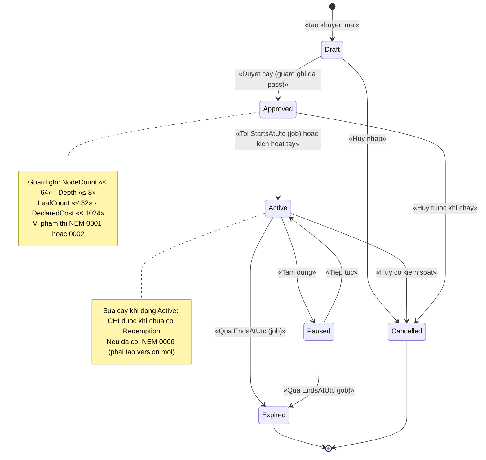
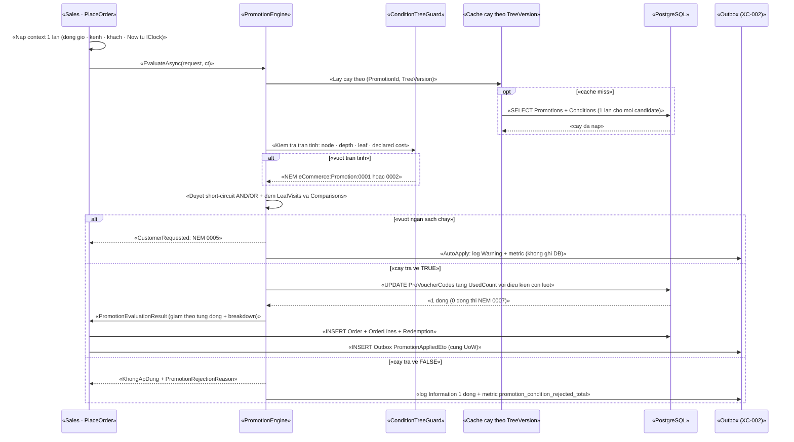
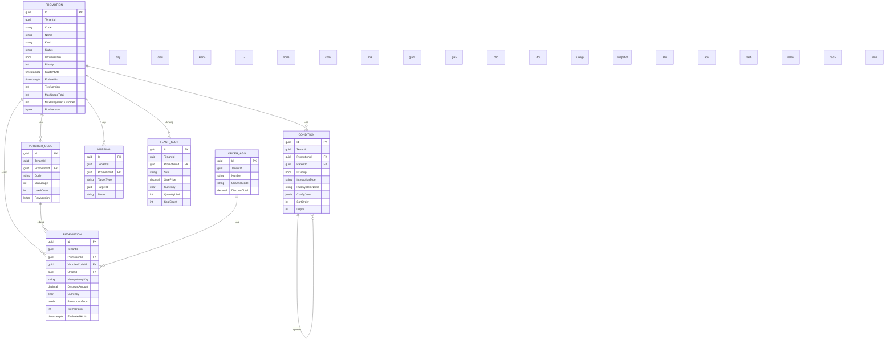

# `PRO-002` — Cây điều kiện AND/OR & engine khuyến mãi (guard bùng nổ tổ hợp)

> ⚠️ **ĐỌC TRƯỚC:** tài liệu này được viết **từ code thật đã kiểm bằng `read`/`grep`**. Mọi khẳng định về code đều kèm
> đường dẫn file: dòng. Chỗ **chưa có trong code** được ghi rõ *"chưa có trong code — kế hoạch GĐ2"*; chỗ **không
> kiểm chứng được** ghi rõ *"chưa kiểm chứng"*.

| Thuộc tính | Nội dung |
|---|---|
| **Mã** | `PRO-002` |
| **Module** | **Promotions** — đề xuất `modules/Promotions/eCommerce.Promotions.{Domain,Application,Application.Contracts,EntityFrameworkCore}` (⚠️ **chưa có trong code** — §15.2 **F5**) |
| **Giai đoạn** | **GĐ2 — Vận hành & tuân thủ VN** (`docs/implementation-plan.md:113`, `:198`) |
| **Ưu tiên** | **Must have (trong GĐ2)** — `docs/implementation-plan.md:205` đặt *"một khuyến mãi phức tạp (nhiều điều kiện AND/OR) tính đúng tiền"* làm **cổng kiểm soát GĐ2** |
| **Trạng thái** | 🟡 `Draft` — chờ review |
| **Người viết / người review** | *(điền)* / **Kiến trúc trưởng + BA** |
| **Phiên bản / ngày** | `v0.1 — 15/10/2026` |
| **Tài liệu liên quan** | `XC-001` (Money/làm tròn) · `XC-002` (outbox/inbox + `IIdempotencyGuard`) · `XC-003` (khoá phân tán + quy ước tiền tố) · `XC-004` (`[Authorize]` cấp class, tenant) · `XC-005` (log/`CorrelationId`/metric + `eCommerceMetricNames`) · `PRC-001` (giá theo kênh) · `PRC-002` (pipeline tính giá) · `SAL-002` (đặt hàng) · `SAL-003` (state machine 4 trục) · `REP-001` (`Σ OrderLine.DiscountAmount`) · `SHP-002` (webhook vận đơn — **GHTK không HMAC**) · `SHP-003`/`SHP-004` (⚠️ **chưa có file** — xem §15.2 **F6**) · `docs/business-modules-proposal.md` §6.4 · `docs/implementation-plan.md:198` |

---

## 0. Tóm tắt & quyết định thiết kế

**Tóm tắt:** `PRO-002` chốt **một** cách biểu diễn khuyến mãi bằng **cây điều kiện AND/OR** (học mô hình
`DiscountRequirement` của nopCommerce: `{ DiscountId, RuleSystemName, ParentId, InteractionTypeId, IsGroup }`,
`RequirementGroupInteractionType { And=0, Or=2 }` — `docs/business-modules-proposal.md:248`), và — phần **quan trọng
nhất** — **ba tầng guard chống bùng nổ tổ hợp**: chặn khi **GHI**, chặn khi **CHẠY**, và **hàng rào DB**.
Lý do không thể bỏ qua guard: `docs/business-modules-proposal.md:580` ghi rõ EShop dùng `OrderDiscountResolver` kiểu
**BFS** với cảnh báo *"⚠️ coi chừng bùng nổ tổ hợp"*, còn `docs/implementation-plan.md:198` yêu cầu Promotions
*"⚠️ **có guard chống bùng nổ tổ hợp** khi duyệt cây điều kiện"*.

**Điểm xuất phát thật (đã kiểm trong repo — không viết theo trí nhớ):**

| Hạng mục | Hiện trạng đã kiểm |
|---|---|
| Module **Promotions** | ❌ **chưa có trong code** — `modules/` chỉ có `ChannelHub`, `PaymentHub`, `Tax`; `src/` có `eCommerce.Domain/Application/...` nhưng **0** file promotion (**F5**) |
| Entity `Voucher`/`Coupon`/`Promotion`/`DiscountRequirement`/`FlashSale` | ❌ **chưa có** — `grep "Voucher\|Coupon\|Discount\|Promotion\|FlashSale"` trên `src/` **chỉ** ra `Order.DiscountTotal` (`src/eCommerce.Domain/Entities/Orders/Order.cs:41`) và `OrderLine.DiscountAmount` (`:135`) |
| Cột tiền giảm giá | ✅ **có** — `numeric(18,4)`: `src/eCommerce.EntityFrameworkCore/eCommerceDbContext.cs:174,202`; migration `src/eCommerce.EntityFrameworkCore/Migrations/20261009070214_Initial.cs:202,301` |
| `Money`/`MoneyAllocator` (`XC-001`) | ❌ **chưa có trong code** — `grep "Money\|MoneyAllocator\|ToMinorUnits\|IRoundingPolicy"` trên `src/` = **0** kết quả (**F4**) |
| Metric miền khuyến mãi | ❌ **chưa có** — `eCommerceMetricNames` hiện có **đúng 12** tên (`shared/eCommerce.Kernel/Observability/eCommerceMetrics.cs:13-53`) và **không** tên nào thuộc promotion |
| Permission miền khuyến mãi | ❌ **chưa có** — `eCommerceConsts.Permissions` (`src/eCommerce.Domain.Shared/eCommerceConsts.cs:15-74`) chưa có nhóm `Promotions` |
| Khoá phân tán cho promotion | ❌ **chưa có** (mẫu để noi theo: `modules/Tax/eCommerce.Tax.Domain/TaxErrorCodes.cs:38-51`) |
| `IIdempotencyGuard` | ❌ **chưa có trong code** — mới ở mức **đặc tả** (`docs/features/cross-cutting/XC-002-outbox-inbox-chong-trung-su-kien.md:696-731`) |
| Hạ tầng khoá phân tán | ✅ **có gói**: `Volo.Abp.DistributedLocking` 10.7.0 (`Directory.Packages.props:73`), `DistributedLock.Redis` 1.0.1 (`:88`) |
| `[Authorize]` cấp CLASS | ✅ **có tiền lệ trong code**: `src/eCommerce.Application/Channels/ChannelAppService.cs:27` (kèm giải thích ở `:21-25`) |
| `DbSet` bắt buộc cho `IRepository<T>` | ✅ **bài học đã ghi trong code**: `src/eCommerce.EntityFrameworkCore/eCommerceDbContext.cs:48-52`, `:61-62` |
| CSDL | PostgreSQL **17** — test tích hợp chạy trên PostgreSQL 17 thật (commit `d48b9f0`) |

**Phạm vi:**
- ✅ **Cây điều kiện AND/OR** (nhóm `And`/`Or` + lá là rule) — mô hình dữ liệu, ràng buộc, ví dụ.
- ✅ **Engine đánh giá** tách khỏi `Sales`: hợp đồng, tính **xác định** (deterministic), short-circuit, snapshot.
- ✅ **Guard bùng nổ tổ hợp 3 tầng** (ghi · chạy · DB) + **ngân sách đánh giá** và hành vi khi vượt.
- ✅ **Giới hạn lượt dùng** chống vượt bằng ràng buộc DB (không dựa vào lock).
- ✅ Idempotency ở **mọi biên vào**, phân quyền, migration, test, metric.

**Không nằm trong phạm vi:**
- ❌ **`Voucher`/`Coupon` CRUD chi tiết & phát hành mã** (sinh mã hàng loạt, gửi mã) — thuộc **`PRO-001`** (`docs/implementation-plan.md:422`).
- ❌ **Pipeline tính giá & thứ tự áp giá/phí** — thuộc **`PRC-002`** (`docs/features/pricing/prc-001-bang-gia-va-gia-theo-kenh.md:43`).
- ❌ **Chính sách làm tròn & phân bổ tiền** — thuộc **`XC-001`** (BR-11 ở đây chỉ **gọi** nó).
- ❌ **State machine 4 trục của đơn** — thuộc `SAL-003`; `PRO-002` chỉ **đọc** trạng thái để quyết định điều kiện.
- ❌ **Tích hợp hãng vận chuyển / COD thật** — thuộc `SHP-003`/`SHP-004`/`REC-003`; §7.4 chỉ ghi **ràng buộc** mà engine phải tuân.

### 0.1 Quyết định thiết kế (ADR ngắn)

| # | Quyết định | Phương án đã cân nhắc | Lý do chọn | Hệ quả |
|---|---|---|---|---|
| **ADR-01** | Cây điều kiện lưu bằng **bảng tự tham chiếu** (`ProPromotionConditions`) với `ParentId` + `IsGroup` + `InteractionType` | (a) **bảng tự tham chiếu** · (b) lưu cả cây trong **1 cột `jsonb`** · (c) lưu chuỗi XML (kiểu nopCommerce `Order.TaxRates`) | (a) cho **ràng buộc DB kiểm được** (`CHECK` node lá/nhóm, `Depth`, `ParentId <> Id`) và **đếm được** node/độ sâu bằng SQL; (b) `jsonb` **không** có FK/CHECK nên guard chỉ nằm ở code; (c) là anti-pattern đã ghi trong `docs/business-modules-proposal.md:258` | Nhiều dòng hơn; mọi thao tác sửa cây là **transaction trên nhiều dòng**; cần unique/`RowVersion` ở cấp promotion (**§5.3**) |
| **ADR-02** | **Guard 3 tầng**: (1) **GHI** (validator + `CHECK`), (2) **CHẠY** (ngân sách đếm thật), (3) **DB** (ràng buộc) | (a) chỉ guard ở code khi lưu · (b) chỉ guard khi chạy · (c) **cả ba** | Kế thừa `XC-003` **D2**: *lock/guard ở app **không** phải hàng rào cuối* — Redis chết, deploy song song, hoặc SQL tay đều có thể lọt dữ liệu nếu DB không chặn (`docs/features/cross-cutting/XC-003-khoa-phan-tan-quy-uoc.md:44-45`) | Phải viết ràng buộc DB bằng SQL thô nếu EF không hỗ trợ (tiền lệ: `EXCLUDE USING gist` ở `modules/Tax/eCommerce.Tax.EntityFrameworkCore/TaxDbContextModelCreatingExtensions.cs:64-69`) |
| **ADR-03** | **Trần tường minh, cấu hình được**: `MaxNodes = 64` · `MaxDepth = 8` · `MaxLeaves = 32` · `MaxCandidatesPerCart = 50` · `LeafVisitBudget = 512` · `ComparisonBudget = 5.000` | (a) không trần ("đủ nhanh") · (b) trần cứng trong code · (c) **trần có giá trị mặc định + cấu hình theo tenant** | NFR **phải có ngưỡng số** (`docs/design-doc-guidelines.md:112`); trần cứng trong code **cấm hard-code** theo tinh thần `XC-001` BR-012 | Vượt trần ⇒ **NÉM LỖI** (không cắt im lặng) — xem **BR-04/05/06** |
| **ADR-04** | **Short-circuit** AND/OR thật | (a) duyệt hết mọi lá rồi tổng hợp · (b) **dừng sớm** | Chi phí worst-case giảm từ "Σ mọi lá" xuống "lá quyết định"; rẻ nhất và dễ chứng minh bằng test đếm số lá đã thăm | Kết quả **phụ thuộc thứ tự** ⇒ phải duyệt **tất định**: `ORDER BY SortOrder, Id` (**BR-09**) |
| **ADR-05** | **Ngân sách đếm ĐỒNG HỒ THẬT**, không tin ước lượng tĩnh: đếm `LeafVisits` + `Comparisons` khi chạy | (a) chỉ ước lượng tĩnh khi lưu · (b) chỉ đếm khi chạy · (c) **cả hai** | Ước lượng tĩnh **không biết** kích thước giỏ; đếm khi chạy **không chặn được** cấu hình xấu từ đầu ⇒ cần cả hai | Cần thêm tham số ngân sách vào `PromotionEvaluationContext`; đo được bằng test |
| **ADR-06** | **Rule lá là hàm THUẦN, không I/O** (`IPromotionConditionRule.IsSatisfied(ctx)`, `ctx` đã nạp sẵn dữ liệu) | (a) rule tự inject `IRepository`/`HttpClient` · (b) **context nạp trước, rule thuần** | Nếu rule gọi DB/HTTP thì "cây 64 node" có thể thành **64 truy vấn** ⇒ bùng nổ **I/O**, và kết quả **không tất định** | Rule **không** thể tự lấy dữ liệu mới ⇒ mọi "sự thật" phải có trong `PromotionEvaluationContext`; thiếu ⇒ **NÉM** (không trả `false` im lặng) |
| **ADR-07** | **Engine KHÔNG nằm trong `Sales`**; `Sales` chỉ gọi qua contract | (a) engine trong `Sales` · (b) **module Promotions + contract** | `docs/implementation-plan.md:198` yêu cầu rõ: *"Engine không nằm trong `Sales`"*; quy ước dự án: **module gọi app bị cấm** (`modules/ChannelHub/eCommerce.ChannelHub.Domain/ChannelHubConsts.cs:8-10`) | `Sales` phải chịu thêm 1 dependency **contract**; `Promotions` **cấm** đọc bảng `Orders` — nhận dữ liệu qua DTO |
| **ADR-08** | Kết quả áp khuyến mãi ghi thành **snapshot bất biến** (`ProPromotionRedemptions`), **append-only** | (a) chỉ ghi `Order.DiscountTotal` · (b) **snapshot + tổng trên đơn** | `Order.DiscountTotal` (`src/eCommerce.Domain/Entities/Orders/Order.cs:41`) là **một số tổng** — không trả lời được *"vì sao đơn này được giảm 50k"* khi cây đã đổi. Tiền lệ append-only: `XC-006` `TaxClassification` (`modules/Tax/eCommerce.Tax.Domain/Classifications/TaxClassification.cs:16-17`) | Thêm 1 bảng ghi mỗi lần áp thành công; **cấm** ghi 1 dòng cho mỗi lần **bị từ chối** (chống bùng nổ dữ liệu — **BR-16**) |
| **ADR-09** | **Giới hạn lượt dùng** chống vượt bằng `UPDATE … WHERE UsedCount` **còn lượt** + `CHECK (UsedCount <= MaxUsage)` + `RowVersion` | (a) khoá phân tán · (b) đọc-rồi-ghi trong code · (c) **cập nhật có điều kiện + CHECK DB** | Kế thừa `XC-002` §8.2 dòng 3 và `XC-003` D2: lock **không** thay được ràng buộc DB | Cần `CHECK` + `RowVersion`; mất Redis vẫn **không** vượt lượt |
| **ADR-10** | **Idempotency ở MỌI biên vào** bằng `IIdempotencyGuard` (`XC-002` §6.4), khoá **ổn định** | (a) chỉ chống trùng ở tầng HTTP · (b) **guard ở mọi biên + unique index** | `docs/design-doc-guidelines.md:114`: *"Mọi cửa vào từ bên ngoài phải có chống trùng"* | Mỗi biên vào phải khai khoá ổn định (**§7.2**); **cấm** `Guid.NewGuid()` làm khoá |
| **ADR-11** | Tiền: **`decimal` + `numeric(18,4)`**, **cấm** `==`; phân bổ giảm giá **bảo toàn tổng** | (a) `double` · (b) `decimal` + so `==` · (c) **`decimal` + so theo minor units + phân bổ largest-remainder** | `XC-001` **BR-003/D3/D7**; trong code đã có quy ước `numeric(18,4)` (`src/eCommerce.EntityFrameworkCore/eCommerceDbContext.cs:173-178`) và comment **cấm `double`** ở `src/eCommerce.Domain/Entities/Orders/Order.cs:38` | ⚠️ `Money`/`MoneyAllocator` **chưa có trong code** ⇒ **điều kiện chặn**: phải có `XC-001` trước hoặc dùng `decimal` + test bảo toàn tổng tạm (**F4**, **Q3**) |
| **ADR-12** | **Vượt ngân sách khi chạy** xử lý **theo 2 chế độ tường minh**, noi theo `XC-003` **D10** | (a) luôn ném · (b) luôn bỏ qua im lặng · (c) **2 chế độ** | `XC-003` D10 (`docs/features/cross-cutting/XC-003-khoa-phan-tan-quy-uoc.md:53`) đã chốt nguyên tắc: **khách đã yêu cầu tường minh** ⇒ ném lỗi; **hệ thống tự chọn** ⇒ bỏ qua **có log + metric** (không im lặng) | Hai đường code; `Skip` **bắt buộc** có log `Warning` + metric, nếu thiếu ⇒ **vi phạm BR-07** |
| **ADR-13** | **Flash sale hiệu lực theo GIỜ** (`timestamptz`), không theo ngày | (a) `date` · (b) **`timestamptz`** | `docs/features/pricing/prc-001-bang-gia-va-gia-theo-kenh.md:913` nêu rõ rủi ro `date` nếu cần hiệu lực theo giờ và ghi *"flash sale thuộc `PRO-002`"* | Mọi so sánh thời gian dùng UTC (`StartsAtUtc`/`EndsAtUtc`); hiển thị theo locale ở tầng UI |
| **ADR-14** | **Metric mới phải cập nhật bảng đăng ký + test trong CÙNG PR** | (a) phát metric tự do · (b) **registry + test** | Kế thừa `XC-005` **BR-008** và bài học "bảng đăng ký lệch code" của `XC-003` §5.4 | 6 metric mới ở **§5.4/§13** phải thêm vào `eCommerceMetricNames` + `XC-005` §5.1 + test `TC-22` |
| **ADR-15** | **Cắt số candidate theo `Priority`** khi vượt `MaxCandidatesPerCart` | (a) đánh giá hết · (b) **cắt tất định + log + metric** | Không thể để số candidate do dữ liệu quyết định thời gian phản hồi; cắt **tất định** (ORDER BY `Priority`, `Id`) ⇒ kết quả vẫn tái lập được | Có thể bỏ sót khuyến mãi tốt hơn ⇒ **bắt buộc** log + metric `promotion_candidates_truncated_total` + màn hình cảnh báo (§10) |

---

## 1. Use Case Specification

> 📌 **Quy ước mã:** trong tài liệu này dùng dạng ngắn `BR-01`, `NFR-01`, `TC-01`, `ADR-01`. Khi trích dẫn **ra ngoài**
> tài liệu, dùng dạng đầy đủ `BR-PRO-002-01`, `NFR-PRO-002-01`, `TC-PRO-002-01`.

| Thuộc tính | Nội dung |
|---|---|
| **Use Case ID** | `PRO-002` |
| **Use Case Name** | Đánh giá **cây điều kiện AND/OR** và tính giảm giá **đúng tiền**, **không bùng nổ tổ hợp** |
| **Description** | *"Là quản trị khuyến mãi, tôi muốn dựng một khuyến mãi bằng cây điều kiện AND/OR (kèm điều kiện theo kênh), để hệ thống áp đúng cho đơn — và tôi muốn **bị chặn ngay khi lưu** nếu cây quá lớn, thay vì làm chậm/treo checkout."* · *"Là lập trình viên `Sales`, tôi muốn gọi **một** hợp đồng để biết đơn được giảm bao nhiêu, theo từng dòng, và vì sao."* |
| **Actor(s)** | **Quản trị khuyến mãi** (dựng/duyệt cây) · **Khách hàng** (nhập mã) · **Hệ thống** (engine, job hết hạn) · **`Sales`** (người gọi contract) · **Vận hành** (xem metric/cảnh báo cắt candidate) |
| **Priority** | **Must have** (GĐ2) — cổng kiểm soát GĐ2 (`docs/implementation-plan.md:205`) |
| **Trigger** | (a) `Sales` gọi engine khi **dựng giỏ/tính tiền checkout** (`SAL-002`); (b) khách **nhập mã**; (c) quản trị **lưu cây** (guard ghi); (d) job **hết hạn**/mở flash sale |
| **Pre-Condition(s)** | • **`TenantId`** hiện tại (`ICurrentTenant`) — mọi entity `IMultiTenant` (**BR-17**).<br>• **`ChannelCode`** của đơn/giỏ (`web`/`shopee`/… — `src/eCommerce.Domain/Entities/Orders/Order.cs:17-18`) — điều kiện theo kênh **bắt buộc** (`docs/business-modules-proposal.md:249`).<br>• **`Currency`** của giỏ; mọi phép tiền **cùng một** currency (**BR-12**).<br>• `Money` (`XC-001`) **đã có** — ⚠️ **hiện chưa có trong code** (**F4**); nếu chưa có ⇒ chỉ được tính bằng `decimal` + test bảo toàn tổng, **cấm** so `==`.<br>• Cây đã qua **guard ghi** (ADR-02) và `Status = Active`. |
| **Post-Condition(s)** | • Kết quả gồm **giảm giá theo TỪNG DÒNG** + tổng; `Σ` phần theo dòng **bằng đúng** tổng (**BR-11**).<br>• Nếu áp thành công: **đúng một** `ProPromotionRedemptions` (snapshot) ghi **cùng UoW** với đơn + outbox (**BR-10**).<br>• Nếu **không** áp được: **có** lý do (`PromotionRejectionReason`) ở log — **không** ghi DB (**BR-16**).<br>• Mọi lần vượt ngân sách đều **có dấu vết**: exception có mã **hoặc** log `Warning` + metric (**BR-07**).<br>• **0** truy vấn DB phát sinh trong vòng duyệt lá (**NFR-04**). |
| **Basic Flow** | 1. `Sales` nạp **một lần** dữ liệu giỏ thành `PromotionEvaluationContext` (dòng, kênh, khách, `Now` từ `IClock`).<br>2. `Sales` gọi `IPromotionEngine.EvaluateAsync(request, ct)`.<br>3. Engine nạp **cây** của các candidate (`PromotionId` + `TreeVersion`) — ngoài vòng lặp lá.<br>4. Engine kiểm **trần tĩnh** lần nữa (node/độ sâu/tổ hợp) — phòng dữ liệu lọt qua guard ghi.<br>5. Engine duyệt cây **short-circuit** (`And` dừng ở lá `false` đầu tiên; `Or` dừng ở lá `true` đầu tiên), **đếm** `LeafVisits` + `Comparisons`.<br>6. Cây `true` ⇒ kiểm **giới hạn lượt** bằng `UPDATE … WHERE` còn lượt.<br>7. Engine trả `PromotionEvaluationResult` (giảm theo dòng, tổng, `Breakdown` các lá đã quyết định); `Sales` ghi đơn + redemption + outbox trong **cùng UoW**. |
| **Alternative Flow** | **A1: Khách nhập mã** — chế độ `CustomerRequested`: không thỏa điều kiện ⇒ **NÉM** `0001`…`0010` (không im lặng).<br>**A2: Nhiều khuyến mãi `IsCumulative = true`** — engine đánh giá theo `Priority` **giảm dần**, `Id` tăng dần (tất định), cộng dồn tới trần giảm giá.<br>**A3: Vượt `MaxCandidatesPerCart`** — cắt theo `Priority` + log `Warning` + metric `promotion_candidates_truncated_total` (ADR-15).<br>**A4: Vượt ngân sách ở chế độ tự động** — **bỏ qua candidate đó**, log `Warning` + metric `promotion_eval_budget_exceeded_total`, **tiếp tục** candidate kế tiếp (ADR-12). |
| **Exception Flow** | **E1:** cây vượt trần **node/độ sâu/lá** ⇒ `BusinessException` **`eCommerce:Promotion:0001`** (`400`).<br>**E2:** cây vượt trần **tổ hợp khai báo** ⇒ **`0002`** (`400`).<br>**E3:** `ParentId` tạo **chu trình** ⇒ **`0003`** (`400`).<br>**E4:** node **lai** (vừa nhóm vừa rule) hoặc `SystemName` **không có** trong registry ⇒ **`0004`** (`400`).<br>**E5:** vượt **ngân sách chạy** ở chế độ `CustomerRequested` ⇒ **`0005`** (`422`).<br>**E6:** chuyển trạng thái sai (ví dụ `Expired → Active`) ⇒ **`0006`** (`409`).<br>**E7:** hết lượt dùng ⇒ **`0007`** (`409`).<br>**E8:** điều kiện dựa trên **COD chưa đối soát** ⇒ **`0008`** (`422`) — xem §7.4.<br>**E9:** tổng giảm **vượt** `Subtotal + ShippingTotal` ⇒ **`0009`** (`400`).<br>**E10:** khác `Currency` ⇒ dùng `eCommerce:Money:0001` của `XC-001` (§6.4). |
| **Business Rules** | • **BR-01**: Cây điều kiện **chỉ** gồm 2 loại node: **nhóm** (`IsGroup = true`, có `InteractionType` ∈ {`And`, `Or`}, **không** có `SystemName`) **hoặc** **lá** (`IsGroup = false`, có `SystemName`, **không** có `InteractionType`). **Cấm** node lai ⇒ `0004`.<br>• **BR-02**: Mọi node **phải** thuộc **đúng một** promotion; `ParentId` (nếu có) **phải** cùng `PromotionId`; **cấm** `ParentId = Id`; **cấm** chu trình ⇒ `0003`.<br>• **BR-03**: Cây **phải** có **đúng một** node gốc (`ParentId IS NULL`) cho mỗi promotion ⇒ sai ⇒ `0004`.<br>• **BR-04**: `NodeCount ≤ MaxNodes` (**mặc định 64**) — vượt ⇒ **NÉM** `0001` khi lưu **và** khi chạy.<br>• **BR-05**: `Depth ≤ MaxDepth` (**mặc định 8**) và `LeafCount ≤ MaxLeaves` (**mặc định 32**) — vượt ⇒ **NÉM** `0001`.<br>• **BR-06**: `Σ DeclaredCostFactor(leaf)` (bảng khai báo chi phí rule, §5.2 `ProPromotionRuleCosts`) `≤ MaxDeclaredCombinations` (**mặc định 1.024**) — vượt ⇒ **NÉM** `0002`. Đây là **chặn bùng nổ tổ hợp ở tầng thiết kế**.<br>• **BR-07**: Khi chạy, nếu `LeafVisits > LeafVisitBudget` (**512**) hoặc `Comparisons > ComparisonBudget` (**5.000**) ⇒ `CustomerRequested`: **NÉM** `0005`; `AutoApply`: **bỏ qua candidate** + log `Warning` + metric. **Cấm** trả `false` im lặng ở **cả hai** chế độ.<br>• **BR-08**: Rule lá (`IPromotionConditionRule`) **phải THUẦN** — **cấm** I/O (DB/HTTP/file/`DateTime.Now`/random). Dữ liệu chỉ đến từ `PromotionEvaluationContext`. **Cấm** rule trả về `null`.<br>• **BR-09**: Kết quả **phải xác định**: cùng (`TreeVersion`, context) ⇒ **cùng** kết quả. Duyệt theo `ORDER BY SortOrder, Id`; thời gian lấy **một lần** từ `IClock`; **cấm** `DateTime.Now`, `Guid.NewGuid()`, `Dictionary` không sắp xếp trong đường quyết định.<br>• **BR-10**: Thao tác áp khuyến mãi **phải** đi qua **Unit of Work**; `Redemption` + thay đổi đơn + **outbox** ghi **cùng** transaction (`XC-002` D1).<br>• **BR-11**: `Σ DiscountPerLine == DiscountTotal` **chính xác**; phân bổ theo **phần dư lớn nhất** (`XC-001` D7); `DiscountTotal ≤ Subtotal + ShippingTotal` ⇒ vượt ⇒ `0009`.<br>• **BR-12**: Mọi giá trị tiền là `decimal` + `numeric(18,4)` + `Currency`; **CẤM** `double`/`float`; **CẤM** so sánh tiền bằng `==` (so bằng minor units) — `XC-001` BR-003/BR-008.<br>• **BR-13**: Mọi app service **phải** có `[Authorize]` ở **CẤP CLASS**; permission **chỉ** dùng hằng số (tiền lệ: `src/eCommerce.Application/Channels/ChannelAppService.cs:27`, `src/eCommerce.Domain.Shared/eCommerceConsts.cs:15-74`).<br>• **BR-14**: **Mọi biên vào** phải idempotent qua `IIdempotencyGuard` + **unique index**; khoá **ổn định** — **cấm** `Guid.NewGuid()`.<br>• **BR-15**: **Mọi** chuyển trạng thái không có trong bảng (§3.2) **PHẢI NÉM** `0006` — **cấm** no-op im lặng; **cấm** `Promotion.SetStatus(...)`.<br>• **BR-16**: `ProPromotionRedemptions` là **APPEND-ONLY** (cấm UPDATE/DELETE ở tầng ứng dụng); **cấm** ghi 1 dòng DB cho mỗi lần đánh giá **bị từ chối** (chỉ log + metric) — chống bùng nổ dữ liệu.<br>• **BR-17**: Mọi entity **phải** `IMultiTenant` + `TenantId`; mọi unique index có `TenantId` **phải** `NULLS NOT DISTINCT` (migration thật đã áp cho 11 index: `src/eCommerce.EntityFrameworkCore/Migrations/20261013024226_Fix_NullableTenantId_UniqueIndexes.cs`).<br>• **BR-18**: Mọi entity cần `IRepository<T>` **phải** có `DbSet` trên `eCommerceDbContext` (`src/eCommerce.EntityFrameworkCore/eCommerceDbContext.cs:48-52`) — thiếu ⇒ runtime ném *"The requested service 'IRepository<…>' has not been registered."*<br>• **BR-19**: Điều kiện **dựa trên COD/trạng thái giao hàng** **chỉ** được đọc dữ liệu **đã đối soát**; **cấm** dùng webhook hãng vận chuyển làm nguồn sự thật (⚠️ GHTK **không** HMAC; GHN đổi COD **cần OTP**) ⇒ vi phạm ⇒ **`0008`** (§7.4).<br>• **BR-20**: Thêm/đổi metric **phải** cập nhật `eCommerceMetricNames` (`shared/eCommerce.Kernel/Observability/eCommerceMetrics.cs:13-53`) **và** `XC-005` §5.1 **và** test — **trong cùng PR**; nhãn metric **chỉ** lấy từ `eCommerceMetricTags.Allowed` (`:62-85`). |
| **Non-Functional Requirement** | • **NFR-01**: `EvaluateAsync` với cây **64 node** ⇒ p95 **≤ 20 ms** (không I/O trong vòng lá).<br>• **NFR-02**: **100 %** cây vượt trần bị **chặn khi ghi** — **0** cây > trần tồn tại trong DB.<br>• **NFR-03**: **0** lần vượt ngân sách chạy trên bộ dữ liệu hợp lệ; vượt ⇒ metric tăng + cảnh báo.<br>• **NFR-04**: **0** truy vấn DB phát sinh trong vòng duyệt lá (đo bằng đếm command EF).<br>• **NFR-05**: **1.000** lần chạy cùng (`TreeVersion`, context) ⇒ **1** kết quả (tất định).<br>• **NFR-06**: **10.000** bộ phân bổ ngẫu nhiên ⇒ `Σ phần == tổng` **100 %**.<br>• **NFR-07**: Cùng `IdempotencyKey` gửi **1.000** lần ⇒ **đúng 1** `Redemption`, **1** lần trừ lượt.<br>• **NFR-08**: Cách ly tenant: **0** trường hợp tenant B đọc/áp được khuyến mãi của tenant A.<br>• **NFR-09**: **< 100** chuỗi (series) mỗi metric mới; **0** nhãn cardinality cao.<br>• **NFR-10**: **0** `double`/`float` trong biểu thức tiền (test reflection/quét mã).<br>• **NFR-11**: Migration **rollback được** (`Down()` tạo lại đúng trạng thái trước).<br>• **NFR-12**: **100 %** log trong phạm vi engine là **một dòng JSON** có `CorrelationId` (`XC-005` BR-010/BR-002). |

---

## 2. Sơ đồ Use Case

> 📌 **Không vẽ sơ đồ Mermaid ở mục này.** Yêu cầu đặt **trần 3 sơ đồ** cho cả tài liệu; ngân sách đó được dành cho
> **§3** (state machine — nơi guard phải ném lỗi), **§4** (sequence — nơi chứng minh ngân sách) và **§5** (ERD — nơi
> ràng buộc DB sống). Thay thế: **bảng actor ↔ use case** dưới đây (đầy đủ hơn sơ đồ ở khía cạnh truy vết).

| # | Use case | Actor chính | Actor phụ | BR/NFR liên quan | Ghi chú |
|---|---|---|---|---|---|
| UC-01 | Dựng/sửa **cây điều kiện AND/OR** cho một promotion | Quản trị khuyến mãi | — | **BR-01…06**, BR-15 | Guard ghi chạy **trước** khi commit |
| UC-02 | **Duyệt** cây (Draft → Approved) | Kiểm soát viên | — | BR-15, `XC-004` | Tách quyền: người dựng ≠ người duyệt (tùy chọn, **Q5**) |
| UC-03 | **Đánh giá** giỏ/đơn để tính giảm giá | Hệ thống (`Sales`) | — | BR-07…12, NFR-01/04/05 | Qua `IPromotionEngine` |
| UC-04 | Khách **nhập mã** và áp | Khách hàng | Hệ thống | BR-07, BR-14 | Chế độ `CustomerRequested` ⇒ ném lỗi rõ |
| UC-05 | **Cộng dồn** nhiều khuyến mãi | Hệ thống | Quản trị (cấu hình `IsCumulative`) | BR-11, ADR-15 | Tất định theo `Priority` |
| UC-06 | **Hết hạn / mở flash sale** theo **giờ** | Hệ thống (job) | — | ADR-13, BR-15 | `timestamptz` UTC |
| UC-07 | **Giới hạn lượt dùng** | Hệ thống | Vận hành (xem đếm) | ADR-09, `0007` | Ràng buộc DB là chốt cuối |
| UC-08 | **Xem vì sao** một đơn được/không được giảm | CSKH · Kế toán | Hệ thống | ADR-08, BR-16 | Đọc `Redemption` snapshot |
| UC-09 | **Cảnh báo** cắt candidate / vượt ngân sách | Vận hành | — | BR-07, ADR-15, NFR-03 | Metric + màn hình §10 |

**Quan hệ giữa các use case:** UC-03 `«include»` UC-07 (mọi lần áp đều phải kiểm lượt) · UC-03 `«extend»` UC-09
(khi vượt ngân sách hoặc cắt candidate) · UC-04 `«specialize»` UC-03 (chế độ ném lỗi thay vì bỏ qua).

---

## 3. Sơ đồ trạng thái (state machine)

### 3.1 Vòng đời một `Promotion` (sơ đồ)



### 3.2 Bảng chuyển trạng thái & guard (mọi chuyển sai **phải ném lỗi** — **BR-15**)

| Từ | Sang | Guard | Nếu vi phạm |
|---|---|---|---|
| `Draft` | `Approved` | Có **đúng 1** gốc (BR-03) · `NodeCount ≤ MaxNodes` · `Depth ≤ MaxDepth` · `LeafCount ≤ MaxLeaves` · `DeclaredCost ≤ MaxDeclaredCombinations` · mọi `SystemName` có trong `PromotionRuleRegistry` | **NÉM** `0001` (trần node/độ sâu/lá) · `0002` (tổ hợp) · `0004` (node lai/rule lạ) |
| `Draft` | `Cancelled` | Không có `Redemption` nào | **NÉM** `0006` |
| `Approved` | `Active` | `Approved` **và** `Now ≥ StartsAtUtc` **và** (`EndsAtUtc` null hoặc `> Now`) | **NÉM** `0006` — **cấm** bỏ qua im lặng |
| `Approved` | `Cancelled` | Chưa `Active` | **NÉM** `0006` |
| `Active` | `Paused` | `Active` | **NÉM** `0006` |
| `Paused` | `Active` | `Paused` **và** chưa quá `EndsAtUtc` | **NÉM** `0006` |
| `Active`/`Paused` | `Expired` | `Now > EndsAtUtc` | Không chuyển nếu chưa tới hạn (job giữ nguyên — **không** phải lỗi) |
| `Expired` | `Active` | — | **NÉM** `0006` — **cấm** hồi sinh; muốn chạy lại ⇒ tạo promotion mới |
| `Cancelled` | *(bất kỳ)* | — | **NÉM** `0006` — trạng thái **hấp thụ** |
| `Active` + sửa cây | `Active` (cùng Id) | **0** `Redemption` cho promotion này | **NÉM** `0006` ⇒ phải tạo **version mới** (`TreeVersion + 1`) |

> ⚠️ **`Expired → Active` là chuyển bị cấm tuyệt đối**, vì `ProPromotionRedemptions` là snapshot: hồi sinh một
> promotion đã hết hạn sẽ làm **số tiền đã giảm** trong quá khứ trở nên không giải thích được bằng cấu hình hiện tại.

### 3.3 Vòng đời **một lần chạy engine** (bảng — không vẽ để giữ trần 3 sơ đồ)

| Từ | Sang | Guard | Nếu vi phạm |
|---|---|---|---|
| `ChuaDanhGia` | `DangDanhGia` | Context hợp lệ (có `Currency`, `ChannelCode`, `NowUtc`) | **NÉM** `ArgumentException` (thiếu ngữ cảnh — **không** mặc định ngầm) |
| `DangDanhGia` | `DaDat` | Cây trả `true` **và** `LeafVisits ≤ LeafVisitBudget` **và** `Comparisons ≤ ComparisonBudget` **và** còn lượt (ADR-09) | Vượt ngân sách ⇒ `VuotNganSach` (**BR-07**) |
| `DangDanhGia` | `KhongDat` | Cây trả `false` **và** trong ngân sách | — |
| `DangDanhGia` | `VuotNganSach` | `LeafVisits`/`Comparisons` vượt ngân sách | `CustomerRequested` ⇒ **NÉM** `0005` · `AutoApply` ⇒ log + metric **(không được im lặng)** |
| `DangDanhGia` | `LoiCauHinh` | `SystemName` không có trong registry · `ParentId` trỏ ra ngoài promotion | **NÉM** `0004` |
| `DaDat` | `DaGhiSnapshot` | Ghi `Redemption` + outbox **trong cùng UoW** | Sai ⇒ **NÉM** (transaction rollback) |
| `KhongDat` / `VuotNganSach` (AutoApply) | `[*]` | — | **Cấm** ghi `Redemption` (**BR-16**) |
| `DaGhiSnapshot` | `DaDat` (chạy lại) | — | **NÉM** `0006` — **cấm** chạy lại cùng một lần áp |

---

## 4. Sequence Diagram & luồng dữ liệu

### 4.1 Sequence — `Sales` gọi engine, guard ngân sách, chốt lượt, ghi snapshot



### 4.2 Luồng dữ liệu (bảng — thay cho DFD để giữ trần 3 sơ đồ)

| Bước | Dữ liệu vào | Xử lý | Dữ liệu ra | Chạm DB? |
|---|---|---|---|---|
| 1 | Giỏ (`Lines`), `ChannelCode`, `CustomerId`, `Currency` | Nạp `PromotionEvaluationContext` (**một lần**) | Context bất biến | ❌ |
| 2 | `TenantId`, `ChannelCode`, `Now` | Lọc **candidate**: `Status = Active` ∧ trong khung giờ ∧ mapping khớp kênh/đối tượng | Danh sách candidate (đã sắp theo `Priority` giảm dần, `Id` tăng dần) | ✅ 1 truy vấn |
| 3 | `PromotionId` | Nạp **cây** (`Conditions`) — **1 truy vấn cho mỗi candidate**, **không** nạp trong vòng lá | Cây trên RAM + `TreeVersion` | ✅ |
| 4 | Cây | **Guard tĩnh**: node · độ sâu · lá · `DeclaredCost` | `Ok` hoặc **NÉM** `0001`/`0002` | ❌ |
| 5 | Cây + context | Duyệt **short-circuit**, đếm `LeafVisits`/`Comparisons` | `true`/`false` + breakdown | ❌ (**NFR-04**) |
| 6 | `true` + `VoucherCodeId` | **Chốt lượt**: `UPDATE … WHERE còn lượt` (ADR-09) | `1` dòng hoặc **NÉM** `0007` | ✅ 1 lệnh |
| 7 | Kết quả | Phân bổ theo dòng (**largest remainder**, `XC-001` D7) | `DiscountPerLine[]`, `DiscountTotal` | ❌ |
| 8 | Kết quả + đơn | Ghi `Order` + `Redemption` + **outbox** (**cùng UoW**) | `PromotionAppliedEto` | ✅ 1 transaction |
| 9 | Mọi bước | Phát metric + log 1 dòng JSON có `CorrelationId` | Metric/log | ❌ |

---

## 5. Mô hình dữ liệu

### 5.1 ERD

> 📌 `ORDER_AGG` là **bảng của module `Sales`** — `Promotions` **chỉ** tham chiếu `OrderId` (quy ước **BR-01**/ADR-07:
> module không đọc bảng của module khác; đối chiếu tiền lệ `eCommerceDbContext.cs:1-7` nơi app tham chiếu module, không ngược lại).



### 5.2 Bảng & cột (Data Dictionary)

> ⚠️ **Toàn bộ các bảng dưới đây CHƯA CÓ TRONG CODE — kế hoạch GĐ2** (**F5**). Chúng phải được thêm `DbSet` vào
> `eCommerceDbContext` (**BR-18**, bài học ở `src/eCommerce.EntityFrameworkCore/eCommerceDbContext.cs:48-52`) và mapping
> qua hàm mở rộng `ConfigurePromotions()` theo đúng khuôn module Tax
> (`modules/Tax/eCommerce.Tax.EntityFrameworkCore/TaxDbContextModelCreatingExtensions.cs:14-70`).

**`ProPromotions`** — aggregate root, vòng đời ở §3.1

| Cột | Kiểu | Null? | Ý nghĩa | Ghi chú |
|---|---|---|---|---|
| `Id` | `uuid` | ✖ | PK | |
| `TenantId` | `uuid` | ✖ | tenant | `IMultiTenant` (**BR-17**) |
| `Code` | `varchar(64)` | ✖ | mã khuyến mãi | **unique** `(TenantId, Code)` `NULLS NOT DISTINCT` |
| `Name` | `varchar(256)` | ✖ | tên hiển thị | **cấm** HTML/script ⇒ escape ở UI |
| `Kind` | `varchar(32)` | ✖ | `Voucher` \| `Discount` \| `FlashSale` | enum lưu **chuỗi** (nhất quán `Channel.Code`, `src/eCommerce.Domain.Shared/Enums.cs:4-6`) |
| `Status` | `varchar(32)` | ✖ | `Draft`…`Cancelled` | §3.1 |
| `IsCumulative` | `bool` | ✖ | có cộng dồn với promotion khác | mặc định `false` |
| `Priority` | `int` | ✖ | thứ tự đánh giá **tất định** | `ORDER BY Priority DESC, Id` (**BR-09**) |
| `ChannelScope` | `varchar(64)` | ✔ | `null` = mọi kênh | điều kiện theo **kênh** (`docs/business-modules-proposal.md:249`) |
| `StartsAtUtc`, `EndsAtUtc` | `timestamptz` | ✖ / ✔ | khung hiệu lực **theo giờ** | **ADR-13**; `CHECK (EndsAtUtc IS NULL OR EndsAtUtc > StartsAtUtc)` |
| `TreeVersion` | `int` | ✖ | version cây | tăng khi sửa cây **sau** khi đã có `Redemption`; ghi vào snapshot (**BR-09/16**) |
| `MaxUsageTotal` | `int` | ✔ | trần lượt toàn hệ thống | `CHECK (MaxUsageTotal IS NULL OR MaxUsageTotal >= 0)` |
| `MaxUsagePerCustomer` | `int` | ✔ | trần lượt/khách | kiểm bằng truy vấn trên `Redemption` + unique `(TenantId, PromotionId, CustomerId, …)` (**Q6**) |
| `RowVersion` | `bytea`/`xmin` | ✖ | khoá lạc quan | tiền lệ `XC-002` §8.2 dòng 4 |
| audit | | | `CreationTime`…`IsDeleted` | `FullAuditedAggregateRoot<Guid>` (tiền lệ `modules/Tax/.../TaxClassification.cs:19`) |

**`ProPromotionConditions`** — **cây AND/OR** (trái tim của `PRO-002`)

| Cột | Kiểu | Null? | Ý nghĩa | Ghi chú |
|---|---|---|---|---|
| `Id` | `uuid` | ✖ | PK | |
| `PromotionId` | `uuid` | ✖ | FK → `ProPromotions` | `ON DELETE CASCADE` |
| `ParentId` | `uuid` | ✔ | node cha | `null` = **gốc**; FK tự thân cùng `PromotionId` |
| `IsGroup` | `bool` | ✖ | nhóm hay lá | **BR-01** |
| `InteractionType` | `varchar(8)` | ✔ | `And` \| `Or` | **chỉ** khi `IsGroup = true` |
| `RuleSystemName` | `varchar(128)` | ✔ | tên rule | **chỉ** khi `IsGroup = false`; phải có trong `PromotionRuleRegistry` ⇒ sai ⇒ `0004` |
| `ConfigJson` | `jsonb` | ✔ | tham số rule (ví dụ danh sách SKU) | **không** dùng để chứa cây con (**ADR-01**) |
| `SortOrder` | `int` | ✖ | thứ tự duyệt **tất định** | `ORDER BY SortOrder, Id` (**BR-09**) |
| `Depth` | `int` | ✖ | độ sâu (1 = gốc) | **lưu sẵn** để `CHECK` được ⇒ `CHECK (Depth BETWEEN 1 AND 8)` (**BR-05**) |

**`ProPromotionRuleCosts`** *(bảng tra tĩnh, seed theo migration)* — dùng cho **guard tĩnh BR-06**

| Cột | Kiểu | Null? | Ý nghĩa |
|---|---|---|---|
| `RuleSystemName` | `varchar(128)` | ✖ | PK |
| `CostKind` | `varchar(16)` | ✖ | `O1` \| `PerCartLine` \| `PerSkuSet` |
| `DeclaredCostFactor` | `int` | ✖ | hệ số chi phí **khai báo** (dùng để tính `Σ DeclaredCost` — **BR-06**) |
| `RequiresVerifiedCod` | `bool` | ✖ | `true` ⇒ rule **chỉ** chạy khi có dữ liệu COD **đã đối soát** (**BR-19** / §7.4) |

**`ProVoucherCodes`** · **`ProPromotionMappings`** · **`ProFlashSaleSlots`**

| Bảng | Cột chính | Ghi chú |
|---|---|---|
| `ProVoucherCodes` | `Id`, `TenantId`, `PromotionId`, `Code varchar(64)`, `MaxUsage int`, `UsedCount int`, `RowVersion` | **unique** `(TenantId, Code)`; `CHECK (UsedCount >= 0 AND UsedCount <= MaxUsage)` (**ADR-09**) |
| `ProPromotionMappings` | `Id`, `TenantId`, `PromotionId`, `TargetType`, `TargetId`, `Mode` | `TargetType` ∈ `Sku`\|`Category`\|`Brand`\|`Channel`\|`Shipping` (`docs/business-modules-proposal.md:248`); `Mode` ∈ `Include`\|`Exclude` |
| `ProFlashSaleSlots` | `Id`, `TenantId`, `PromotionId`, `Sku`, `SalePrice numeric(18,4)`, `Currency char(3)`, `QuantityLimit int`, `SoldCount int` | `CHECK (SalePrice >= 0 AND SoldCount >= 0 AND SoldCount <= QuantityLimit)` |

**`ProPromotionRedemptions`** — **snapshot APPEND-ONLY** (**BR-16**)

| Cột | Kiểu | Null? | Ý nghĩa | Ghi chú |
|---|---|---|---|---|
| `Id` | `uuid` | ✖ | PK | |
| `PromotionId` | `uuid` | ✖ | FK | **cấm** xoá promotion đã có redemption (soft-delete only) |
| `VoucherCodeId` | `uuid` | ✔ | mã đã dùng | `null` = khuyến mãi **tự động** |
| `OrderId` | `uuid` | ✖ | đơn được áp | **không** FK sang bảng `Sales` (ranh giới module — ADR-07) |
| `IdempotencyKey` | `varchar(256)` | ✖ | khoá ổn định | **unique** `(TenantId, IdempotencyKey)` (**BR-14**) |
| `DiscountAmount` | `numeric(18,4)` | ✖ | số giảm | `CHECK (DiscountAmount >= 0)`; **cấm** `double` (**BR-12**) |
| `Currency` | `char(3)` | ✖ | ISO-4217 (quy ước `numeric(18,4)` + currency: `eCommerceDbContext.cs:173-178`) | |
| `BreakdownJson` | `jsonb` | ✖ | đường đi quyết định (node/lá nào `true`/`false`) | để trả lời "vì sao" (UC-08) |
| `TreeVersion` | `int` | ✖ | version cây tại thời điểm áp | cùng `PromotionId` ⇒ **giải thích được** số tiền |
| `EvaluatedAtUtc` | `timestamptz` | ✖ | thời điểm đánh giá | lấy từ `IClock` (**BR-09**) |

### 5.3 Index & ràng buộc DB (hàng rào cuối — ADR-02)

| Bảng | Loại | Cột / biểu thức | Mục đích |
|---|---|---|---|
| `ProPromotions` | UNIQUE (`NULLS NOT DISTINCT`) | `(TenantId, Code)` | không hai promotion cùng mã trong tenant (**BR-17**) |
| `ProPromotions` | INDEX | `(TenantId, Status, StartsAtUtc, EndsAtUtc)` | truy vấn nóng: candidate đang hiệu lực |
| `ProPromotionConditions` | CHECK | `("IsGroup" AND "InteractionType" IS NOT NULL AND "RuleSystemName" IS NULL) OR (NOT "IsGroup" AND "InteractionType" IS NULL AND "RuleSystemName" IS NOT NULL)` | **chặn node lai** ở tầng DB (**BR-01**) — guard code có thể sai, DB thì không |
| `ProPromotionConditions` | CHECK | `"InteractionType" IN ('And','Or')` (khi `IsGroup`) | chặn giá trị lạ |
| `ProPromotionConditions` | CHECK | `"ParentId" IS NULL OR "ParentId" <> "Id"` | chặn tự làm cha (**BR-02**) |
| `ProPromotionConditions` | CHECK | `"Depth" BETWEEN 1 AND 8` | **chặn độ sâu** ở DB (**BR-05**) |
| `ProPromotionConditions` | UNIQUE | `(TenantId, PromotionId, ParentId, SortOrder)` *(xem **Q4** về `NULLS NOT DISTINCT` cho gốc)* | chặn trùng thứ tự ⇒ duyệt tất định |
| `ProVoucherCodes` | UNIQUE | `(TenantId, Code)` | |
| `ProVoucherCodes` | CHECK | `"UsedCount" >= 0 AND "UsedCount" <= "MaxUsage"` | **chặn vượt lượt** kể cả khi code sai (**ADR-09**) |
| `ProPromotionRedemptions` | UNIQUE | `(TenantId, IdempotencyKey)` | idempotency (**BR-14**) |
| `ProPromotionRedemptions` | UNIQUE *(filter)* | `(TenantId, PromotionId, OrderId, VoucherCodeId)` `WHERE VoucherCodeId IS NOT NULL` | chặn dùng **cùng mã** hai lần cho **cùng đơn** (tiền lệ filter: `eCommerceDbContext.cs:184-186`) |
| `ProFlashSaleSlots` | CHECK | `"SalePrice" >= 0 AND "SoldCount" >= 0 AND "SoldCount" <= "QuantityLimit"` | chặn bán vượt slot |
| **Cấm** | — | `CHECK` trên số **node/độ sâu** ở cấp promotion | ⚠️ **Không** diễn đạt được bằng `CHECK` (cần aggregate trên bảng con) ⇒ **phải** là guard ứng dụng **+** test; **hoặc** trigger (cân nhắc **Q2**) |

> 🚨 **Giới hạn phải ghi rõ (không tô hồng):** trần `NodeCount ≤ 64` và `LeafCount ≤ 32` là **điều kiện trên nhiều dòng**
> (`COUNT(*)` theo `PromotionId`) ⇒ PostgreSQL **không** biểu diễn được bằng `CHECK` thường. Vì vậy **BR-04/05** có
> **2 hàng rào**: (1) validator trong app service **trước khi commit**; (2) **guard tĩnh lúc chạy** (§4.2 bước 4) —
> nếu dữ liệu lọt vào qua SQL tay, engine **vẫn** ném `0001` thay vì chạy chậm. Nếu muốn hàng rào thứ 3 ở DB ⇒
> **trigger** `BEFORE INSERT/UPDATE` (ghi vào **Q2**, chưa chốt).

---

## 6. Hợp đồng API

### 6.1 Contract dùng chung cho `Sales` (`eCommerce.Promotions.Application.Contracts`)

```csharp
namespace eCommerce.Promotions.Contracts;

/// Hợp đồng DUY NHẤT mà Sales được dùng (ADR-07). Promotions cấm đọc bảng Orders.
public interface IPromotionEngine
{
    Task<PromotionEvaluationResult> EvaluateAsync(
        PromotionEvaluationRequest request,
        CancellationToken cancellationToken = default);
}

public sealed record PromotionEvaluationRequest(
    Guid OrderOrCartId,
    IReadOnlyList<PromotionCartLine> Lines,   // SKU · so luong · don gia · nhom/danh muc
    string ChannelCode,                       // web | shopee | lazada ...
    string Currency,                          // ISO-4217 (VND)
    Guid? CustomerId,
    string? VoucherCode,                      // null = che do AutoApply
    PromotionApplyMode Mode);                 // CustomerRequested | AutoApply (ADR-12)

public enum PromotionApplyMode { CustomerRequested = 0, AutoApply = 1 }

public sealed record PromotionEvaluationResult(
    bool Applied,
    decimal DiscountTotal,                    // numeric(18,4) - CUNG Currency voi request
    string Currency,
    IReadOnlyList<PromotionLineDiscount> PerLine,
    IReadOnlyList<PromotionBreakdownItem> Breakdown,   // vi sao: node/lá nào quyết định
    PromotionRejectionReason? RejectionReason,
    int LeafVisits,
    int Comparisons);

/// ⚠️ Toàn bộ dùng decimal + Currency; CẤM double/float; CẤM so sanh bang == (BR-12).
public sealed record PromotionLineDiscount(string Sku, Guid? OrderLineId, decimal Amount);

public enum PromotionRejectionReason
{
    NoCandidate = 0, ConditionFalse = 1, OutOfWindow = 2, ChannelMismatch = 3,
    UsageLimitHit = 4, BudgetExceeded = 5, CandidatesTruncated = 6, UnverifiedCod = 7
}

/// Rule la: THUAN, khong I/O, khong doc DB/HTTP (BR-08).
public interface IPromotionConditionRule
{
    string SystemName { get; }
    bool IsSatisfied(PromotionRuleContext context);
}
```

**Quy tắc hợp đồng:**

| # | Quy tắc | Lý do |
|---|---|---|
| 1 | `PromotionEvaluationRequest` **không** chứa `TenantId` | lấy từ `ICurrentTenant` (`XC-004`) |
| 2 | Engine **không** nhận `DateTime` từ caller; lấy `IClock` **một lần** khi vào | tất định (**BR-09**) |
| 3 | `PerLine` **bắt buộc**; `Σ PerLine == DiscountTotal` | **BR-11** |
| 4 | `VoucherCode` chỉ có nghĩa khi `Mode = CustomerRequested` | ngược lại ⇒ **NÉM** (không bỏ qua) |
| 5 | `IPromotionConditionRule.IsSatisfied` **không** `async`, **không** nhận `IServiceProvider` | nếu cho `async`/DI ⇒ rule gọi DB ⇒ mất guard I/O (**ADR-06**) |

### 6.2 Application Service (quản trị cây)

| Method | Vào | Ra | Permission | Ghi chú |
|---|---|---|---|---|
| `GetAsync(id)` | `Guid` | `PromotionDetailDto` (kèm **cây**) | `Promotions.View` | chỉ đọc |
| `CreateAsync(dto)` | `CreatePromotionDto` | `PromotionDto` | `Promotions.Manage` | chạy **guard ghi** |
| `SaveTreeAsync(id, treeDto)` | cây | `PromotionTreeValidationResultDto` | `Promotions.Manage` | trả **cả** vi phạm **và** số đo (`NodeCount`, `Depth`, `LeafCount`, `DeclaredCost`, `MaxDeclaredCombinations`) để UI hiển thị "còn bao nhiêu" (§10) |
| `ApproveAsync(id)` | `Guid` | `PromotionDto` | `Promotions.Approve` | `Draft → Approved`; **NÉM** `0001`/`0002`/`0004` nếu cây không hợp lệ |
| `SetStatusAsync(id, status)` | enum | `PromotionDto` | `Promotions.Manage` | mọi chuyển sai ⇒ **NÉM** `0006` (**BR-15**) |
| `ValidateVoucherAsync(code, cartDto)` | mã + giỏ | `VoucherValidationDto` | `Promotions.View` *(hoặc `[AllowAnonymous]` có chủ ý cho guest — **Q7**)* | **không** side effect (không trừ lượt) |
| `GetRedemptionsAsync(orderId)` | `Guid` | `PagedResultDto<RedemptionDto>` | `Promotions.View` | đọc snapshot (UC-08) |
| `ImportRuleCostsAsync(file)` | file seed chi phí | `ImportResultDto` | `Promotions.Import` | ⚠️ idempotent theo `Import:{tenantId}:{sha256(fileContent)}` (`XC-002` §7.3) |

> 🔐 **BẮT BUỘC:** `[Authorize]` ở **CẤP CLASS** cho **mọi** app service (tiền lệ + giải thích:
> `src/eCommerce.Application/Channels/ChannelAppService.cs:21-28`). Permission **chỉ** dùng hằng số
> (`src/eCommerce.Domain.Shared/eCommerceConsts.cs:15-74`) — **chưa có** nhóm `Promotions` ⇒ **thêm ở GĐ2** (§9).

### 6.3 REST endpoint

| Method | Route | Body/Query | Trả về | Mã lỗi có thể |
|---|---|---|---|---|
| `POST` | `/api/app/promotion/tree/{id}` | cây điều kiện | `PromotionTreeValidationResultDto` | `0001` `0002` `0003` `0004` |
| `POST` | `/api/app/promotion/{id}/approve` | — | `PromotionDto` | `0001` `0002` `0004` `0006` |
| `POST` | `/api/app/promotion/{id}/status` | `{ status }` | `PromotionDto` | `0006` |
| `POST` | `/api/app/promotion/voucher/validate` | `{ code, cart }` | `VoucherValidationDto` | `0007` `0008` |
| `POST` | `/api/app/promotion/evaluate` | `{ cart, voucherCode? }` | `PromotionEvaluationResultDto` | `0005` `0007` `0008` `0009` |
| `GET` | `/api/app/promotion/redemptions?orderId=` | query | danh sách snapshot | — |

> 📌 Route do ABP tự sinh theo `<verb>/api/app/<resource>` (`docs/design-doc-guidelines.md:46`). `Sales` **không** gọi
> các endpoint này — nó gọi **in-process** qua `IPromotionEngine` (ADR-07).

### 6.4 Mã lỗi

| Mã | Hằng số (module `Promotions`) | HTTP | Khi nào | Thông điệp |
|---|---|---|---|---|
| `eCommerce:Promotion:0001` | `TreeTooLarge` | `400` | Vượt trần **node/độ sâu/lá** | `Cây điều kiện vượt giới hạn cho phép (tối đa {MaxNodes} điều kiện, độ sâu {MaxDepth}).` |
| `eCommerce:Promotion:0002` | `CombinationExplosion` | `400` | Vượt `MaxDeclaredCombinations` | `Cây điều kiện có quá nhiều tổ hợp cần đánh giá (vượt {Max}). Hãy tách thành nhiều khuyến mãi nhỏ hơn.` |
| `eCommerce:Promotion:0003` | `ConditionCycleDetected` | `400` | `ParentId` tạo chu trình | `Cây điều kiện có vòng lặp — không thể lưu.` |
| `eCommerce:Promotion:0004` | `InvalidConditionNode` | `400` | Node lai · gốc ≠ 1 · `SystemName` lạ | `Điều kiện không hợp lệ (nhóm/điều kiện lẫn lộn hoặc rule chưa được đăng ký).` |
| `eCommerce:Promotion:0005` | `EvaluationBudgetExceeded` | `422` | Vượt ngân sách chạy ở `CustomerRequested` | `Khuyến mãi này quá phức tạp để đánh giá cho giỏ hiện tại. Vui lòng bỏ mã và thử lại.` |
| `eCommerce:Promotion:0006` | `InvalidStatusTransition` | `409` | Chuyển trạng thái sai (**BR-15**) | `Không thể chuyển khuyến mãi từ {from} sang {to}.` |
| `eCommerce:Promotion:0007` | `UsageLimitExceeded` | `409` | Hết lượt (mã hoặc promotion) | `Mã giảm giá đã hết lượt sử dụng.` |
| `eCommerce:Promotion:0008` | `UnverifiedCodCondition` | `422` | Rule cần COD **đã đối soát** nhưng chưa có | `Điều kiện dựa trên COD chưa được đối soát — tạm thời không áp dụng.` |
| `eCommerce:Promotion:0009` | `DiscountExceedsOrder` | `400` | Tổng giảm > `Subtotal + ShippingTotal` | `Số tiền giảm vượt giá trị đơn hàng.` |
| `eCommerce:Promotion:0010` | `RuleNotRegistered` | `400` | `SystemName` không có trong registry | `Điều kiện '{SystemName}' không tồn tại trong phiên bản hiện tại.` |
| `eCommerce:Money:0001` | *(của `XC-001`)* | `400` | Khác `Currency` | `Không thể tính toán hai loại tiền tệ khác nhau ({a} và {b}).` |
| `eCommerce:Messaging:0002` | *(của `XC-002`)* | `409` | Cùng `IdempotencyKey` **khác** payload | `Xung đột khoá chống trùng: cùng khoá nhưng nội dung khác.` |

> 📌 Tiền tố `eCommerce:Promotion:*` noi theo `TaxErrorCodes` (`modules/Tax/eCommerce.Tax.Domain/TaxErrorCodes.cs:13-34`)
> và `ChannelHubErrorCodes` (`modules/ChannelHub/eCommerce.ChannelHub.Domain/ChannelHubConsts.cs:36-42`): **module sở hữu
> hằng số của mình**. ⚠️ `eCommerceConsts.ErrorCodes` **chỉ còn 2 mã** (`Inventory`, `Payment` —
> `src/eCommerce.Domain.Shared/eCommerceConsts.cs:79-86`) sau khi `XC-003` **F2** dọn mã trùng ⇒ **không** thêm mã Promotion vào app.

---

## 7. Sự kiện, tích hợp ngoài & idempotency

### 7.1 Sự kiện phát ra (ETO)

> Payload **phải** kế thừa `IntegrationEventBase` (`XC-002` §7.1: `EventId`, `OccurredOn`, `AggregateId`,
> `AggregateVersion`, `TenantId`, `ChannelCode`, `CorrelationId`). Việc phát **phải** qua **outbox cùng transaction**.

| ETO | Khi nào | Trường nghiệp vụ chính | Ai tiêu thụ | Ordering? | Idempotent ở consumer? |
|---|---|---|---|---|---|
| `PromotionAppliedEto` | Sau khi đơn được tạo & áp khuyến mãi thành công | `OrderId`, `PromotionId`, `VoucherCode`, `DiscountTotal` (+`Currency`), `TreeVersion` | `Reporting` (REP-001 `DiscountAmount` — `docs/features/reporting/rep-001-read-model-job-tong-hop.md:442`), `AccountingHub` | ✅ **có** (theo `OrderId`) | ✅ qua `IdempotencyKey = Promotion:{tenantId}:{orderId}:{promotionId}` |
| `PromotionUsageLimitReachedEto` | Khi `UsedCount` chạm `MaxUsage` | `PromotionId`, `VoucherCodeId`, `UsedCount` | `Notifications` (báo quản trị), `Reporting` | ❌ không | ✅ tự nhiên (chỉ là thông báo) |
| `PromotionExpiredEto` | Job chuyển `Active → Expired` | `PromotionId`, `EndedAtUtc` | `Reporting` | ❌ không | ✅ làm lại được nhiều lần |

> 🚫 **Cấm** phát ETO trong vòng lặp duyệt candidate **bị từ chối** — chỉ log + metric (**BR-16**). Nếu phát, một giỏ
> 50 candidate sẽ sinh **50 sự kiện** cho **0** kết quả ⇒ bùng nổ chính là điều tài liệu này chống.

### 7.2 Biên vào & chống trùng (**BR-14** — mọi biên vào)

| # | Biên vào | Loại | Xác thực | Idempotency key (ổn định) | Nếu trùng | Nếu lỗi |
|---|---|---|---|---|---|---|
| 1 | `POST /promotion/evaluate` (checkout) | `api` | JWT + tenant (`XC-004`) | `Checkout:{tenantId}:{orderOrCartId}:{voucherCode ?? "auto"}:{treeVersionHash}` | `AlreadyProcessed` ⇒ **trả lại kết quả cũ** (không trừ lượt lần 2) | `4xx` + mã lỗi nghiệp vụ |
| 2 | `POST /promotion/tree/{id}` (lưu cây) | `api` | JWT + `Promotions.Manage` | `PromotionTree:{tenantId}:{promotionId}:{sha256(treeJson)}` | `AlreadyProcessed` ⇒ trả `PromotionTreeValidationResultDto` cũ + cờ `AlreadySaved` | `0001`…`0004` |
| 3 | `POST /promotion/import-rule-costs` | `import` | JWT + `Promotions.Import` | `Import:{tenantId}:{sha256(fileContent)}` (`XC-002` §7.3) | Trả kết quả cũ + `AlreadyImported` | `0004` (file sai) |
| 4 | Consumer `OrderCancelledEto` / `OrderStatusChangedEto` (hoàn lượt) | `distributed event` | nội bộ (đã qua outbox) | `PromotionRefund:{tenantId}:{orderId}:{promotionId}` | Bỏ qua + log `Information` + metric | DLQ + retry (**cấm** nuốt lỗi) |
| 5 | Job `promotion-expiry` (hết hạn, mở flash sale) | `schedule` | nội bộ | `PromotionExpiry:{tenantId}:{kỳ giờ UTC}` (**cấm** `DateTime.Now` làm khoá) | Chạy lại cùng kỳ ⇒ không đổi trạng thái 2 lần | DLQ + retry |
| 6 | **Webhook hãng vận chuyển** | ❌ **Không áp dụng cho `PRO-002`** | — | — | — | Xem §7.4 (**cấm** dùng làm điều kiện) |

### 7.3 Gọi API ra ngoài

**Không áp dụng — lý do:** engine khuyến mãi **không gọi NCC nào** (không thanh toán, không vận chuyển, không hoá đơn).
Hệ quả **bắt buộc**: rule lá **cấm** I/O (**BR-08**) ⇒ nếu một điều kiện *"đơn đã giao COD thành công"* được yêu cầu,
nó **phải** đọc từ **dữ liệu nội bộ đã đối soát** (không tự gọi API hãng) — §7.4.

### 7.4 ⚠️ Ràng buộc cứng với `SHP-003` / `SHP-004` — điều kiện dựa trên COD

> ⚠️ **Trạng thái tài liệu (đã kiểm):** repo **CHƯA CÓ** file `docs/features/shp-003-*.md` và `docs/features/shp-004-*.md`
> — `docs/features/` chỉ có **`shp-002-webhook-trang-thai-van-don.md`**. Nội dung cảnh báo về `SHP-003`/`SHP-004` hiện
> **chỉ** nằm ở `docs/implementation-plan.md:199`, `:426`, `:427` và `docs/business-modules-proposal.md:546-548` (**F6**).

| # | Sự thật (có nguồn) | Hệ quả **bắt buộc** cho `PRO-002` |
|---|---|---|
| 1 | 🔴 **`GHN` đổi COD cần OTP** ⇒ có **bước thủ công**, không tự động hoá 100 % (`docs/implementation-plan.md:199`, `:426`; `docs/business-modules-proposal.md:548`; `docs/features/reporting/rep-003-bao-cao-ton-kho-hieu-suat-kenh.md:539`) | Số COD sau khi đổi là **kết quả thao tác người** ⇒ **cấm** dùng nó làm **điều kiện** khuyến mãi có **số tiền**. Nếu muốn, chỉ được dùng **trạng thái đã đối soát** và phải ghi rõ nguồn trong `BreakdownJson` |
| 2 | 🔴 **Webhook GHTK KHÔNG có HMAC** ⇒ **có thể bị giả mạo** (`docs/features/shipping/shp-002-webhook-trang-thai-van-don.md:3-4`, `:648-649`, `:654-661`; `docs/business-modules-proposal.md:547`) | **CẤM** rule lá đọc thẳng trạng thái giao hàng từ webhook hãng. Chỉ đọc dữ liệu **đã đối soát** (`REC-003`) — **BR-19**; vi phạm ⇒ **NÉM** `0008` |
| 3 | 🟠 **`GHTK` xác minh địa chỉ 2 cấp/3 cấp chưa xác minh** (`docs/implementation-plan.md:427`; `docs/business-modules-proposal.md:546`) | **CẤM** điều kiện khuyến mãi theo **địa chỉ/vùng giao** ở GĐ2 (dữ liệu địa chỉ chưa ổn định) ⇒ ghi vào **Q8** |
| 4 | 🟠 COD **chưa đối soát** phải mang cờ `CodUnreconciled = true` và **không** được coi là số cuối (`docs/features/reporting/rep-003-bao-cao-ton-kho-hieu-suat-kenh.md:308`, `:538-539`) | Rule có `RequiresVerifiedCod = true` (`ProPromotionRuleCosts`) **không** được chạy khi cờ này còn `true` ⇒ engine **bỏ qua + metric** ở `AutoApply`, **NÉM** `0008` ở `CustomerRequested` |
| 5 | 🟠 **Phí sàn/khuyến mãi sàn đến theo settlement**, không theo đơn (`docs/features/reporting/rep-003-bao-cao-ton-kho-hieu-suat-kenh.md:541`) | Khuyến mãi **của kênh** (Shopee) **cấm** được cộng dồn như khuyến mãi **của ta** ⇒ phải phân biệt `Source = Internal` vs `External` trong `Breakdown` (**Q9**) |

> ✅ **Nguyên tắc chốt:** *"Engine khuyến mãi **chỉ** tin dữ liệu **do ta** kiểm soát hoặc **đã đối soát**. Webhook
> hãng vận chuyển là **gợi ý**, không phải sự thật"* — kế thừa `SHP-002` **D1**
> (`docs/features/shipping/shp-002-webhook-trang-thai-van-don.md:66`).

---

## 8. Bất biến & xử lý đồng thời

### 8.1 Bất biến

| # | Bất biến | Cơ chế bảo vệ |
|---|---|---|
| 1 | Mỗi promotion có **đúng một** node gốc; cây **không** có chu trình | `CHECK (ParentId <> Id)` + validator (**BR-02/03**) + `0003` |
| 2 | Mỗi node **hoặc** là nhóm **hoặc** là lá, **không** lai | `CHECK` node lai ở DB (§5.3) + `0004` — **hàng rào DB**, không chỉ code |
| 3 | **Không** cây nào vượt trần node/độ sâu/lá | validator trước commit + `CHECK (Depth BETWEEN 1 AND 8)` + **guard tĩnh lúc chạy** (ADR-02) |
| 4 | Tổng chi phí khai báo ≤ `MaxDeclaredCombinations` | **BR-06** + `ProPromotionRuleCosts` |
| 5 | Số lá **thăm thật** ≤ `LeafVisitBudget` | Đồng hồ đếm trong engine + `0005`/metric (**BR-07**) |
| 6 | **0** truy vấn DB trong vòng duyệt lá | Bất biến kiến trúc `ADR-06` (rule thuần) + test `TC-10`/`TC-21` (**NFR-04**) |
| 7 | `Σ DiscountPerLine == DiscountTotal` | Largest-remainder (`XC-001` D7) + kiểm tra lại trước khi trả (**BR-11**) |
| 8 | `DiscountTotal ≤ Subtotal + ShippingTotal` | Kiểm trong engine ⇒ `0009` |
| 9 | `UsedCount ≤ MaxUsage` **luôn đúng** | `UPDATE … WHERE` + `CHECK` DB (**ADR-09**) — đúng **kể cả khi Redis chết** |
| 10 | Một `IdempotencyKey` ⇒ **tối đa một** `Redemption` | UNIQUE `(TenantId, IdempotencyKey)` (**BR-14**) |
| 11 | `Redemption` là **append-only**, không sửa/xoá | Không có setter/`Update` trong domain + review; tiền lệ append-only `XC-006` (`TaxClassification.cs:16-17`) |
| 12 | Kết quả **tất định** theo (`TreeVersion`, context) | `IClock` một lần + `ORDER BY SortOrder, Id` + cấm random (**BR-09**) |
| 13 | Mọi thao tác ghi đi qua **Unit of Work**; redemption + đơn + outbox **cùng** transaction | `XC-002` **D1** (**BR-10**) |
| 14 | Cách ly tenant | `IMultiTenant` + `ICurrentTenant` + unique index `NULLS NOT DISTINCT` (**BR-17**) |
| 15 | **0** `double`/`float` trong biểu thức tiền | Test quét mã nguồn/reflection (**NFR-10**) |

### 8.2 Xử lý đồng thời

| # | Tình huống | Cơ chế (đủ để đúng kể cả khi mất Redis) |
|---|---|---|
| 1 | **2 khách cùng dùng lượt cuối** của một `VoucherCode` | `UPDATE ProVoucherCodes SET UsedCount = UsedCount + 1 WHERE Id = @id AND UsedCount` **còn dưới** `MaxUsage` ⇒ 0 dòng ⇒ **NÉM** `0007`; **+** `CHECK (UsedCount <= MaxUsage)`. **Không** dựa vào lock |
| 2 | 2 request cùng áp **một mã** cho **cùng một đơn** (double-submit) | UNIQUE `(TenantId, IdempotencyKey)` ⇒ 1 thắng, luồng kia nhận `AlreadyProcessed` trả **kết quả cũ** |
| 3 | 2 quản trị cùng **sửa cây** của một promotion | Khoá phân tán `ecommerce:promotion:tree:{tenantId}:{promotionId}` + `RowVersion`; **cấm** acquire lồng cùng tên khoá (`XC-003` D6) |
| 4 | **Sửa cây** trong khi checkout đang đánh giá | Engine đọc cây **một lần** theo `TreeVersion` đã nạp (**snapshot**) ⇒ checkout dùng version cũ; `Redemption` ghi `TreeVersion` đó ⇒ **giải thích được** |
| 5 | Job `expiry` chạy trên **nhiều instance** | Khoá `ecommerce:promotion:job:expiry:{tenantId}` + `SkipIfBusy` + **bắt buộc** log + metric (`XC-003` D10) |
| 6 | 2 luồng cùng **hoàn lượt** khi đơn bị huỷ | `IdempotencyKey = PromotionRefund:{tenantId}:{orderId}:{promotionId}` + unique; **không** trừ 2 lần |
| 7 | Nhiều candidate cùng khớp (`IsCumulative = true`) | Đánh giá **tuần tự** theo `Priority DESC, Id` ⇒ tất định; **cấm** song song hoá (làm mất tính tất định khi cộng dồn) |
| 8 | **Redis chết** | Lock vô hiệu (**fail-open** theo `XC-003` E2) nhưng **bất biến vẫn đúng** nhờ UNIQUE/`CHECK`/`UPDATE … WHERE` (bất biến #9/#10) |

**Khoá phân tán dùng trong feature** *(quy ước `XC-003`: tên khoá do **module** sở hữu; tiền tố do `KeyPrefix` — §5.4)*

| Tên khoá (hàm sinh) | Giá trị trả về | Phạm vi | Vì sao cần | TTL đề xuất |
|---|---|---|---|---|
| `PromotionLockKeys.Tree(tenantId, promotionId)` | `promotion:tree:{tenantId}:{promotionId}` | theo promotion | 2 quản trị cùng sửa cây ⇒ cây hỏng/chu trình | **30 s** |
| `PromotionLockKeys.VoucherUsage(tenantId, code)` | `promotion:voucher:{tenantId}:{code}` | theo mã | giảm tranh chấp khi nhiều người dùng mã "hot" (DB vẫn là chốt cuối) | **10 s** |
| `PromotionLockKeys.Job(jobName, tenantId)` | `promotion:job:{jobName}:{tenantId}` | theo job | job hết hạn/mở flash sale chạy chồng trên nhiều instance | **300 s** |
| `PromotionLockKeys.Import(tenantId)` | `promotion:import:{tenantId}` | theo tenant | 2 người cùng import bảng chi phí rule | **120 s** |

> 🚨 **F1 — tiền tố khoá KHÔNG nhất quán giữa các module (đã kiểm, xem §15.2):** `ChannelHubConsts.LockKeys`
> (`modules/ChannelHub/eCommerce.ChannelHub.Domain/ChannelHubConsts.cs:22-31`) trả `channel:…` **không** tiền tố (đúng
> `XC-003` §5.4 điểm 2), trong khi `TaxLockKeys`
> (`modules/Tax/eCommerce.Tax.Domain/TaxErrorCodes.cs:46,50`) trả `ecommerce:tax:…` **có** tiền tố ⇒ với
> `KeyPrefix = "ecommerce:"` sẽ thành **tiền tố đôi**. `PRO-002` chọn dạng **không tiền tố** (giống ChannelHub).

**Idempotency key**

| Đối tượng | Cách sinh | ⚠️ Lưu ý |
|---|---|---|
| Áp khuyến mãi khi checkout | `Checkout:{tenantId}:{orderOrCartId}:{voucherCode ?? "auto"}:{treeVersionHash}` | **cấm** `Guid.NewGuid()`; **cấm** dùng `DateTime.Now` |
| Lưu cây | `PromotionTree:{tenantId}:{promotionId}:{sha256(treeJson)}` | hash **canonical** (thứ tự khoá xác định) — `IPayloadCanonicalizer` (`XC-002` §6.4) |
| Import bảng chi phí | `Import:{tenantId}:{sha256(fileContent)}` | cùng file ⇒ kết quả cũ |
| Hoàn lượt khi huỷ đơn | `PromotionRefund:{tenantId}:{orderId}:{promotionId}` | chạy lại nhiều lần vẫn **1** lần hoàn |
| Job hết hạn | `PromotionExpiry:{tenantId}:{kỳ giờ UTC}` | kỳ **xác định được** |

---

## 9. Phân quyền

| Permission | Nhóm | Method gán | Vai trò mặc định | Ghi chú |
|---|---|---|---|---|
| `eCommerce.Promotions` | `eCommerce` | — | — | quyền gốc (nhóm) |
| `eCommerce.Promotions.View` | `eCommerce` | `GetAsync`, `ValidateVoucherAsync`, `GetRedemptionsAsync` | Sale, CSKH, Kế toán (đọc) | **không** side effect |
| `eCommerce.Promotions.Manage` | `eCommerce` | `CreateAsync`, `SaveTreeAsync`, `SetStatusAsync` | Marketing Admin | ⚠️ **không** được tự duyệt (tách nhiệm vụ — **Q5**) |
| `eCommerce.Promotions.Approve` | `eCommerce` | `ApproveAsync` | Kiểm soát viên / Quản lý | người duyệt **nên** ≠ người dựng (**Q5**) |
| `eCommerce.Promotions.Import` | `eCommerce` | `ImportRuleCostsAsync` | Kỹ thuật/Marketing | file ⇒ kiểm `sha256` + idempotent |
| `eCommerce.Promotions.Export` | `eCommerce` | (GĐ3, báo cáo hiệu quả khuyến mãi) | Kế toán | **chưa có trong code — kế hoạch GĐ3** |

> 📌 **Hiện trạng code:** nhóm permission `Promotions` **chưa có** — `eCommerceConsts.Permissions`
> (`src/eCommerce.Domain.Shared/eCommerceConsts.cs:15-74`) chỉ có `Products`, `Inventory`, `Channels`, `Orders`,
> `Payments`, `TaxClassification`, `TaxRateSchedule`; provider cũng chưa đăng ký
> (`src/eCommerce.Application.Contracts/Permissions/eCommercePermissionDefinitionProvider.cs:23-60`).
> ⇒ **Kế hoạch GĐ2:** thêm const `eCommerceConsts.Permissions.Promotions.*` + đăng ký trong provider, **giống hệt**
> khuôn Tax đang có.
>
> 🚨 **Bắt buộc:** `[Authorize]` ở **CẤP CLASS** cho **mọi** app service — bài học thật: *"Nếu chỉ đặt `[Authorize]` ở
> một vài method thì các method còn lại trở thành API CÔNG KHAI — đã quan sát được đúng như vậy khi chạy thử"*
> (`src/eCommerce.Application/Channels/ChannelAppService.cs:21-27`).
>
> 🔓 **Ngoại lệ có chủ ý (cần chốt — Q7):** endpoint kiểm mã cho **khách chưa đăng nhập** (`ValidateVoucherAsync`)
> nếu để `[AllowAnonymous]` thì **phải**: (a) rate limit, (b) **không** trả thông tin nội bộ (không trả `MaxUsage`,
> `UsedCount`), (c) **không** side effect. **Mặc định ở tài liệu này: KHÔNG allow anonymous** cho tới khi có rate limit.

---

## 10. UI Mockup & mapping dữ liệu

### 10.1 Màn hình dựng cây điều kiện (admin)

| Vùng UI | Dữ liệu | Nguồn | Quy tắc hiển thị |
|---|---|---|---|
| Khung cây (kéo-thả nhóm AND/OR, thêm lá) | `ProPromotionConditions` | `GetAsync` | Nhóm hiển thị **AND**/**OR** rõ; lá hiển thị **tên rule tiếng Việt** (không hiển thị `SystemName` thô) |
| **Đồng hồ giới hạn** (bắt buộc) | `NodeCount/MaxNodes`, `Depth/MaxDepth`, `LeafCount/MaxLeaves`, `DeclaredCost/MaxDeclaredCombinations` | `SaveTreeAsync` trả về | Hiện **số đã dùng / trần**; vượt ⇒ **nút Lưu bị khoá** + lý do (§12). **Cấm** hiển thị "lỗi hệ thống" — đây là **giới hạn đã biết** |
| Cảnh báo tổ hợp | `DeclaredCost` so với trần | như trên | ≥ **80 %** trần ⇒ vàng *"cây sắp chạm trần — nên tách"*; = 100 % ⇒ đỏ |
| Cảnh báo điều kiện COD | `RequiresVerifiedCod` của rule | `ProPromotionRuleCosts` | Rule cần COD ⇒ hiện nhãn *"⚠️ chỉ áp dụng cho đơn COD **đã đối soát** (Điều kiện theo COD chưa xác thực — SHP-003/SHP-004)"* |
| Danh sách promotion | `ProPromotions` | `GetListAsync` | Cột "**Đã dùng**" (`Σ Redemption`) cạnh "**Trần lượt**" — **luôn hiện cạnh nhau** (thói quen ghi rõ chênh lệch, `docs/design-doc-guidelines.md:33`) |

### 10.2 Màn hình checkout & chi tiết đơn

| Vùng UI | Dữ liệu | Nguồn | Quy tắc |
|---|---|---|---|
| Ô nhập mã giảm giá | `VoucherValidationDto` | `ValidateVoucherAsync` | Hợp lệ ⇒ hiện số giảm; **không** hợp lệ ⇒ hiện **lý do cụ thể** (`PromotionRejectionReason` ⇒ câu tiếng Việt), **không** hiện mã lỗi thô |
| Dòng "Giảm giá" trên đơn | `Order.DiscountTotal` | `Orders` | Hiển thị **0 chữ số thập phân** cho VND (quy ước `XC-001` §10) |
| **Vì sao giảm** (chi tiết đơn) | `BreakdownJson` | `Redemption` | Hiện **từng điều kiện đã thoả**; nếu có lá bị **bỏ qua do ngân sách** ⇒ hiện *"một số điều kiện không được kiểm tra (khuyến mãi quá phức tạp)"* — **cấm** im lặng |
| Lỗi `0005` (vượt ngân sách) | exception | response | Thông điệp thân thiện + **nút bỏ mã**; **không** hiện "lỗi hệ thống" |
| Lỗi `0007` (hết lượt) | exception | response | *"Mã đã hết lượt"* + gợi ý mã khác |
| Lỗi `0008` (COD chưa đối soát) | exception | response | *"Điều kiện COD đang chờ đối soát"* (⚠️ nhắc `SHP-003`/`SHP-004`) |
| Màn hình vận hành | `promotion_eval_budget_exceeded_total`, `promotion_candidates_truncated_total` | metric | Chỉ đọc; có phân quyền; ⚠️ `candidates_truncated > 0` ⇒ cảnh báo vì **có khuyến mãi bị bỏ qua** |

> 📌 **Ghi rõ chênh lệch (thói quen của tài liệu gốc):** `Σ` số giảm **theo dòng** và **tổng** giảm là **hai số khác
> nguồn** — tổng lấy từ `Redemption.DiscountAmount`, các dòng lấy từ `BreakdownJson`; UI **phải** hiển thị tổng từ
> `Redemption` (không tự cộng lại ở client) và nếu lệch ⇒ **log `Error`** (đây là bug, không phải ca bình thường).

---

## 11. Migration & seed

| Mục | Nội dung |
|---|---|
| Tên migration đề xuất | `Add_Promotion_Module` *(đặt tay, **cấm** dùng `DateTime.Now` làm khoá — **BR-09**)* |
| Bảng tạo mới | `ProPromotions`, `ProPromotionConditions`, `ProPromotionRuleCosts`, `ProVoucherCodes`, `ProPromotionMappings`, `ProFlashSaleSlots`, `ProPromotionRedemptions` (**7 bảng — chưa có trong code, kế hoạch GĐ2**) |
| `DbSet` bắt buộc | **7 `DbSet`** thêm vào `src/eCommerce.EntityFrameworkCore/eCommerceDbContext.cs` — thiếu ⇒ `IRepository<T>` **không** được đăng ký (**BR-18**, ghi chú thật ở `:48-52`) |
| Mapping | Thêm `ConfigurePromotions()` vào `OnModelCreating` (`eCommerceDbContext.cs:71-91`) theo khuôn module Tax (`modules/Tax/eCommerce.Tax.EntityFrameworkCore/TaxDbContextModelCreatingExtensions.cs:14-70`) |
| Index/`CHECK` | ⚠️ `CHECK` node lai, `Depth`, `UsedCount <= MaxUsage` — EF Core **không** có API cho một số dạng ⇒ dùng `HasCheckConstraint` (tiền lệ `TaxDbContextModelCreatingExtensions.cs:20-26`) hoặc **SQL thô trong migration** (tiền lệ `EXCLUDE USING gist`: `:64-69` + migration `20261013012648_Add_Tax_Module.cs`) |
| `NULLS NOT DISTINCT` | Mọi unique index có `TenantId` **phải** dùng — tiền lệ migration thật `src/eCommerce.EntityFrameworkCore/Migrations/20261013024226_Fix_NullableTenantId_UniqueIndexes.cs` (**BR-17**); yêu cầu PostgreSQL **15+** (dev/test đang dùng **17**) |
| Seed | (1) **`ProPromotionRuleCosts`** seed từ code (rule nào có `CostKind` gì) — **nguồn sự thật là code**, seed lại mỗi release; (2) **không** seed promotion nghiệp vụ thật; (3) 1 promotion mẫu **chỉ trong test** (`TC-01`) |
| Backfill | **Không có** — module mới, không có dữ liệu cũ. ⚠️ `Order.DiscountTotal`/`OrderLine.DiscountAmount` **đã tồn tại** (`eCommerceDbContext.cs:174,202`) nhưng **không** backfill `Redemption` cho đơn cũ (không có cấu hình để giải thích) |
| Rollback | `Down()` **phải** xoá đủ 7 bảng theo thứ tự FK ngược (**NFR-11**) |
| Cấu hình | `eCommerce.Promotions.MaxNodes = 64` · `MaxDepth = 8` · `MaxLeaves = 32` · `MaxDeclaredCombinations = 1024` · `MaxCandidatesPerCart = 50` · `LeafVisitBudget = 512` · `ComparisonBudget = 5000` — qua **ABP Setting** theo tenant, **đổi phải có audit** (kế thừa `XC-001` BR-004 §9) |
| ⚠️ Rủi ro migration | Thêm 7 bảng + `CHECK` trên bảng `ProPromotionConditions` (bảng **nóng** khi sửa cây) ⇒ `CHECK` chỉ chạy khi INSERT/UPDATE, **không** ảnh hưởng đọc ⇒ chấp nhận được |

---

## 12. Xử lý lỗi & trường hợp biên

| Tình huống | Nguyên nhân | Hành vi | Phản hồi |
|---|---|---|---|
| Cây vượt **trần node** khi lưu | marketing dựng cây lớn | **NÉM** `0001` **trước** commit; UI hiện số đã dùng/trần | `400` |
| Cây vượt **độ sâu** | lồng nhóm quá sâu | **NÉM** `0001`; `CHECK` DB là chốt cuối | `400` |
| Cây vượt **trần tổ hợp khai báo** | quá nhiều rule `PerCartLine`/`PerSkuSet` | **NÉM** `0002` + gợi ý *"tách thành nhiều khuyến mãi nhỏ"* | `400` |
| **Chu trình** `ParentId` | lỗi dữ liệu/kéo-thả | **NÉM** `0003`; engine **cũng** phát hiện (đếm node đã thăm > `NodeCount` ⇒ ném) | `400` |
| **Node lai** (nhóm có `SystemName`) | lỗi UI/import | `CHECK` DB chặn ⇒ `DbUpdateException` ⇒ **NÉM** `0004` (không nuốt) | `400` |
| **`SystemName` không có** trong registry | rule bị xoá/đổi tên sau khi deploy | **NÉM** `0004`/`0010` — **cấm** coi như `false` (nếu coi `false`, khuyến mãi **âm thầm** ngừng chạy) | `400` |
| Giỏ **lớn** làm vượt `LeafVisitBudget` | rule `PerCartLine` × giỏ 300 dòng | `CustomerRequested` ⇒ **NÉM** `0005`; `AutoApply` ⇒ bỏ qua + log + metric | `422` / bình thường |
| Vượt `MaxCandidatesPerCart` | quá nhiều khuyến mãi đang chạy | Cắt tất định theo `Priority`, log `Warning` + metric `promotion_candidates_truncated_total`; UI hiện *"một số khuyến mãi chưa được kiểm tra"* | bình thường (có cảnh báo) |
| **Hết lượt** ở 2 request đồng thời | tranh chấp | `UPDATE … WHERE còn lượt` ⇒ 1 thắng; luồng kia **NÉM** `0007` | `409` |
| **Double-submit** cùng đơn | người dùng bấm 2 lần | `AlreadyProcessed` ⇒ trả **kết quả cũ**, **không** trừ lượt lần 2 | `200` |
| Cùng `IdempotencyKey` **khác** payload | lỗi lập trình | **NÉM** `eCommerce:Messaging:0002` (**BR-14**) | `409` |
| Tổng giảm **> giá trị đơn** | cấu hình sai (giảm 100 % + phí) | **NÉM** `0009` — **cấm** kẹp về 0 im lặng | `400` |
| **Khác `Currency`** giữa giỏ và promotion | dữ liệu sai | **NÉM** `eCommerce:Money:0001` (`XC-001`) | `400` |
| Rule yêu cầu **COD đã đối soát** mà chưa có | `CodUnreconciled = true` | `AutoApply`: bỏ qua + metric; `CustomerRequested`: **NÉM** `0008` (**BR-19**) | `422` |
| **Sửa cây** khi đã có `Redemption` | thao tác sai | **NÉM** `0006` ⇒ phải tạo `TreeVersion` mới (**ADR-08**/§3.2) | `409` |
| Redis chết | sự cố hạ tầng | Lock vô hiệu (**fail-open**, `XC-003` E2) nhưng **bất biến vẫn đúng** nhờ DB; log `Error` + metric | bình thường |
| Ghi log/metric **thất bại** | sink hỏng | **Bỏ qua**, tăng `logging_failures_total` — **không** làm hỏng checkout (`XC-005` D10) | bình thường |
| **Không có candidate nào** | bình thường (không phải lỗi) | Trả `Applied = false`, `RejectionReason = NoCandidate`; log `Information` **một dòng** — **cấm** log mỗi candidate trong vòng lặp nóng (`XC-005` BR-004) | `200` |

**Chiến lược transaction:**

| Bước | Trong UoW? | Vì sao |
|---|---|---|
| Nạp candidate + cây (đọc) | ✅ (đọc) | dùng chung `DbContext`/connection |
| **Guard tĩnh + duyệt cây** | ❌ **không ghi gì** | nếu ném lỗi ⇒ **không** có gì để rollback |
| `UPDATE UsedCount` + `INSERT Redemption` + `INSERT Outbox` + `INSERT Order` | ✅ **cùng một** transaction | `XC-002` **D1**: sự kiện và dữ liệu nghiệp vụ **cùng sống hoặc cùng chết** |
| Phạm vi **khoá phân tán** | ❌ **ngoài** UoW | `XC-003` §12: khoá **phải** được nhả **sau** khi transaction kết thúc |
| Log + metric | ❌ ngoài | `XC-005` §12: log/metric **không** nằm trong transaction nghiệp vụ |

---

## 13. Phi chức năng

| Mã | Yêu cầu | Ngưỡng đo được | Cách kiểm chứng |
|---|---|---|---|
| **NFR-01** | Độ trễ `EvaluateAsync` (cây 64 node, 50 dòng giỏ) | p95 **≤ 20 ms** | benchmark trong integration test |
| **NFR-02** | Cây vượt trần bị chặn **khi ghi** | **100 %**; **0** cây > trần trong DB sau test | `TC-04`, `TC-05`, `TC-06` + `SELECT COUNT(*)` kiểm chứng |
| **NFR-03** | Vượt ngân sách **khi chạy** trên dữ liệu hợp lệ | **0** lần (metric `promotion_eval_budget_exceeded_total` = 0) | test + metric; vượt ⇒ **cảnh báo email kỹ thuật** (`XC-005` Q3) |
| **NFR-04** | Truy vấn DB trong vòng duyệt lá | **0** | đếm command EF trong integration test (`TC-21`) |
| **NFR-05** | Tính xác định | **1.000/1.000** lần chạy cho **cùng** kết quả | `TC-11` |
| **NFR-06** | Bảo toàn tổng khi phân bổ | **10.000** bộ ngẫu nhiên ⇒ `Σ == tổng` **100 %** | property-based test (`TC-14`) |
| **NFR-07** | Idempotency | 1.000 lần cùng khoá ⇒ **1** `Redemption`, **1** lần trừ lượt | `TC-16` |
| **NFR-08** | Cách ly tenant | **0** rò rỉ giữa 2 tenant | `TC-20` |
| **NFR-09** | Chuỗi metric | **< 100** series/metric; **0** nhãn cardinality cao | `TC-22` (đối chiếu `eCommerceMetricTags.Allowed`/`Forbidden`, `eCommerceMetrics.cs:75-84`) |
| **NFR-10** | Không `double`/`float` trong biểu thức tiền | **0** xuất hiện | quét mã nguồn `TC-15` |
| **NFR-11** | Migration rollback | `Down()` chạy sạch, **0** bảng còn lại | chạy `dotnet ef database update <bản trước>` |
| **NFR-12** | Log | **100 %** dòng log trong engine là **1 dòng JSON** có `CorrelationId` | `XC-005` `TC-11`/`TC-04` áp cho module mới |
| **NFR-13** | Số dòng DB mỗi lần đánh giá **thất bại** | **0** dòng (chỉ log + metric) | `TC-18` (**BR-16**) |
| **NFR-14** | Số candidate đánh giá mỗi request | **≤ 50** (`MaxCandidatesPerCart`) | `TC-19` |
| **NFR-15** | Số lượt thăm lá mỗi candidate | **≤ 512** (`LeafVisitBudget`) | `TC-07` |

**Metric mới (6) — ⚠️ CHƯA có trong code; phải thêm vào `eCommerceMetricNames` + `XC-005` §5.1 + test trong cùng PR (BR-20)**

| Tên metric | Loại | Nhãn (từ `Allowed`) | Ý nghĩa / ngưỡng |
|---|---|---|---|
| `promotion_eval_duration_seconds` | Histogram | `kind` | độ trễ đánh giá; p95 ≤ 20 ms |
| `promotion_eval_budget_exceeded_total` | Counter | `kind` | 🚨 số lần vượt ngân sách — kỳ vọng **0** |
| `promotion_condition_rejected_total` | Counter | `kind`, `reason` | lý do không áp được (`reason` là **enum hữu hạn** — `PromotionRejectionReason`) |
| `promotion_applied_total` | Counter | `kind`, `channel` | số lần áp thành công |
| `promotion_usage_limit_hit_total` | Counter | `kind` | số lần chạm trần lượt |
| `promotion_candidates_truncated_total` | Counter | `kind` | ⚠️ số lần **cắt** candidate (có khuyến mãi bị bỏ qua) — phải cảnh báo |

> 🚨 **Nhãn bị cấm (kế thừa `XC-005` BR-009):** `promotionId`, `voucherCode`, `orderId`, `sku`, `customerId` **không**
> được làm nhãn — chúng là cardinality cao; truy vết theo chúng **phải** dùng **log** (`CorrelationId`).
> Danh sách cấm đã có trong code: `eCommerceMetrics.cs:81-84`.

---

## 14. Test cases & Acceptance Criteria

### 14.1 Danh sách test case

| ID | Mục tiêu | Loại | Input chính | Expected | Phủ |
|---|---|---|---|---|---|
| **TC-01** | Cây AND/OR đánh giá đúng | Unit | `(A AND (B OR C))`, `B = true` | `true` | BR-01 |
| **TC-02** | **Short-circuit AND** | Unit | `A = false`, 5 lá | `LeafVisits = 1` | ADR-04, NFR-01 |
| **TC-03** | **Short-circuit OR** | Unit | `A = true`, 5 lá | `LeafVisits = 1` | ADR-04 |
| **TC-04** | Vượt trần **node** ⇒ ném `0001` | Unit | cây 65 node | `BusinessException` `eCommerce:Promotion:0001` | **BR-04**, NFR-02 |
| **TC-05** | Vượt **độ sâu** ⇒ ném `0001` | Unit + **Integration** | cây depth 9 | `0001`; `CHECK` DB **cũng** chặn nếu ghi thẳng SQL | **BR-05**, NFR-02 |
| **TC-06** | Vượt **trần tổ hợp** ⇒ ném `0002` | Unit | 40 rule `PerCartLine` × factor 50 | `0002` | **BR-06**, NFR-02 |
| **TC-07** | Vượt **ngân sách chạy** | Unit | `LeafVisitBudget = 10`, rule `PerCartLine`, giỏ 300 dòng | `CustomerRequested` ⇒ `0005`; `AutoApply` ⇒ bỏ qua + **có** log + metric | **BR-07**, NFR-03/15 |
| **TC-08** | **Chu trình** ⇒ ném `0003` | Unit | `A.ParentId = B`, `B.ParentId = A` | `0003` | **BR-02** |
| **TC-09** | **Node lai** ⇒ ném `0004` | **Integration** | INSERT nhóm có `RuleSystemName` | `CHECK` chặn ⇒ `0004` | **BR-01**, ADR-02 |
| **TC-10** | **Rule lạ** trong DB ⇒ ném `0004`/`0010` | Unit | `SystemName = "KhongTonTai"` | `0004`; **không** coi là `false` | BR-01, **ADR-06** |
| **TC-11** | **Tất định** | Unit | chạy 1.000 lần, cùng context | cùng kết quả + cùng `Breakdown` | **BR-09**, NFR-05 |
| **TC-12** | **Lượt dùng**: 2 luồng đồng thời | **Integration** (PostgreSQL thật) | `MaxUsage = 1`, 2 request song song | **đúng 1** thành công; luồng kia `0007`; `UsedCount = 1` | **ADR-09**, NFR-07 |
| **TC-13** | Tổng giảm **≤** `Subtotal + ShippingTotal` | Unit | promotion giảm 150 % | `0009` | BR-11 |
| **TC-14** | Phân bổ **bảo toàn tổng** | Unit (property) | 10.000 bộ ngẫu nhiên | `Σ phần == tổng` 100 % | **BR-11**, NFR-06 |
| **TC-15** | **Cấm `==` trên tiền** | Unit (quét mã nguồn) | regex so sánh `decimal`/tiền bằng `==` trong module Promotions | **0** match (ngoại lệ có ghi chú) | **BR-12**, NFR-10 |
| **TC-16** | **Idempotency** khi checkout | **Integration** | cùng `IdempotencyKey` 1.000 lần | **1** `Redemption`; trả kết quả cũ | **BR-14**, NFR-07 |
| **TC-17** | `Redemption` **append-only** | Unit (quét) | tìm `Update`/`Delete` trên `IRepository<ProPromotionRedemption>` | **0** match | **BR-16** |
| **TC-18** | **Không ghi DB** khi đánh giá thất bại | **Integration** | 50 candidate `false` | `Redemption` count = **0**; chỉ log/metric | **BR-16**, NFR-13 |
| **TC-19** | Cắt candidate | Unit | 120 candidate active, `Max = 50` | đánh giá **đúng 50**, cắt theo `Priority`; metric tăng | **ADR-15**, NFR-14 |
| **TC-20** | Cách ly tenant | **Integration** | tenant A tạo promotion; tenant B đánh giá | tenant B **không** thấy/không áp được | **BR-17**, NFR-08 |
| **TC-21** | **0 truy vấn DB trong vòng lá** | **Integration** | cây 64 node, đếm command EF | số command **không** tăng theo số lá | **ADR-06**, NFR-04 |
| **TC-22** | Metric mới **nằm trong registry** | Unit (quét) | so tên literal với `eCommerceMetricNames.All` | **0** metric ngoài registry; **0** nhãn cấm | **BR-20**, NFR-09 |
| **TC-23** | Flash sale theo **giờ** | Unit | `StartsAtUtc` 00:00, `EndsAtUtc` 02:00 | chỉ hiệu lực trong khung; ngoài khung ⇒ `OutOfWindow` | **ADR-13** |
| **TC-24** | Điều kiện **COD chưa đối soát** ⇒ `0008` | Unit | rule `RequiresVerifiedCod = true`, `CodUnreconciled = true` | `CustomerRequested` ⇒ `0008`; `AutoApply` ⇒ bỏ qua + metric | **BR-19** (§7.4) |
| **TC-25** | **Chuyển trạng thái sai** ⇒ ném `0006` | Unit | `Expired → Active`; sửa cây khi đã có `Redemption` | `0006` cho **cả hai** | **BR-15** |
| **TC-26** | `[Authorize]` ở **cấp CLASS** | Unit (reflection) | quét mọi app service module Promotions | **100 %** có `[Authorize]` ở class | **BR-13** |
| **TC-27** | Migration **rollback** | **Integration** | `update` rồi `update <bản trước>` | **0** bảng `Pro*` còn lại | **NFR-11** |

### 14.2 Fixture skeleton (xUnit)

```csharp
public class PromotionConditionTreeTests
{
    /// TC-02 — short-circuit AND: chi tham 1 la khi la dau tien false (ADR-04).
    [Fact]
    public void TC02_and_short_circuit_chi_tham_mot_la()
    {
        var tree = CayAnd("A=false", "B=true", "C=true", "D=true", "E=true");

        var ketQua = DanhGia(tree, NguCanhRong());

        Assert.False(ketQua.IsSatisfied);
        Assert.Equal(1, ketQua.LeafVisits);       // KHONG duyet 5 la
    }

    /// TC-04 — vuot tran node thi NEM 0001, KHONG cat im lang (BR-04).
    [Fact]
    public void TC04_cay_vuot_tran_node_thi_nem_0001()
    {
        var tree = CayAnd(Enumerable.Range(0, 65).Select(i => $"L{i}=true").ToArray());

        var ex = Assert.Throws<BusinessException>(() => Guard.KiemTraTinh(tree, Tran.MacDinh));

        Assert.Equal("eCommerce:Promotion:0001", ex.Code);
    }

    /// TC-07 — vuot ngan sach: khach da chon ma thi NEM, tu dong thi bo qua CO log + metric (BR-07).
    [Fact]
    public void TC07_vuot_ngan_sach_theo_hai_che_do()
    {
        var tree = CayAnd(Enumerable.Range(0, 20).Select(_ => "PerCartLine=true").ToArray());
        var ctx  = NguCanhVoiSoDongGio(300);           // 20 x 300 = 6.000 lan cham la
        var tran = Tran.VoiLeafVisitBudget(512);

        var ex = Assert.Throws<BusinessException>(() =>
            Engine.DanhGia(tree, ctx, tran, PromotionApplyMode.CustomerRequested));
        Assert.Equal("eCommerce:Promotion:0005", ex.Code);

        var ketQua = Engine.DanhGia(tree, ctx, tran, PromotionApplyMode.AutoApply);
        Assert.False(ketQua.Applied);
        Assert.True(ketQua.RejectionReason == PromotionRejectionReason.BudgetExceeded);
        Assert.Contains(ketQua.MetricDaPhat, m => m == "promotion_eval_budget_exceeded_total");
    }

    /// TC-11 — tat dinh: cung (TreeVersion, context) thi cung ket qua (BR-09).
    [Fact]
    public void TC11_ket_qua_phai_tat_dinh()
    {
        var tree = CayAndOrPhucTap();
        var ctx  = NguCanhCoDinh(nowUtc: new DateTimeOffset(2026, 10, 15, 3, 0, 0, TimeSpan.Zero));

        var dauTien = Engine.DanhGia(tree, ctx, Tran.MacDinh, PromotionApplyMode.AutoApply);
        for (var i = 0; i < 1_000; i++)
        {
            Assert.Equal(dauTien.Breakdown, Engine.DanhGia(tree, ctx, Tran.MacDinh, PromotionApplyMode.AutoApply).Breakdown);
        }
    }

    /// TC-21 — KHONG duoc co truy van DB trong vong duyet la (ADR-06, NFR-04).
    [Fact]
    public async Task TC21_khong_co_truy_van_db_trong_vong_lap_la()
    {
        await using var fixture = await PromotionFixture.TaoAsync();
        var tree = CayAnd(Enumerable.Range(0, 64).Select(i => $"L{i}=true").ToArray());

        var soCommandTruoc = fixture.DemCommandEf();
        var _ = fixture.Engine.DanhGia(tree, fixture.NguCanh, Tran.MacDinh, PromotionApplyMode.AutoApply);
        var soCommandSau = fixture.DemCommandEf();

        Assert.Equal(soCommandTruoc, soCommandSau);   // 0 truy van phat sinh trong vong la
    }

    /// TC-22 — metric phat ra PHAI nam trong bang dang ky (BR-20, ke thua XC-005 TC-06).
    [Fact]
    public void TC22_metric_promotion_phai_nam_trong_registry()
    {
        string[] dungTrongCode =
        [
            "promotion_eval_duration_seconds", "promotion_eval_budget_exceeded_total",
            "promotion_condition_rejected_total", "promotion_applied_total",
            "promotion_usage_limit_hit_total", "promotion_candidates_truncated_total"
        ];

        var ngoaiRegistry = dungTrongCode.Except(eCommerceMetricNames.All).ToList();

        Assert.True(ngoaiRegistry.Count == 0,
            "Metric chua dang ky o eCommerceMetricNames:\n" + string.Join("\n", ngoaiRegistry));
    }
}
```

### 14.3 Acceptance Criteria (Definition of Done)

- [ ] **27 test case** pass, phủ **hết 20 BR** và **15 NFR**
- [ ] 🚨 **`TC-04`/`TC-05`/`TC-06` chứng minh cây vượt trần bị CHẶN** — **0** cây > trần trong DB sau test (đây là **cổng GĐ2**: `docs/implementation-plan.md:198`)
- [ ] 🚨 **`TC-07` chứng minh vượt ngân sách KHÔNG bao giờ im lặng** (ném **hoặc** log + metric)
- [ ] 🚨 **`TC-21` chứng minh 0 truy vấn DB trong vòng lá** — nếu đỏ thì **thiết kế sai** (ADR-06), không phải "tối ưu sau"
- [ ] **`TC-16` + `TC-12`** chạy trên **PostgreSQL thật** (Testcontainers, như `test/eCommerce.IntegrationTests`) — không dùng in-memory
- [ ] `CHECK` **node lai** + `CHECK (Depth …)` + `CHECK (UsedCount <= MaxUsage)` **có** trong migration (**TC-09**)
- [ ] Mọi unique index có `TenantId` dùng `NULLS NOT DISTINCT` (**BR-17**) — kiểm đích danh từng index
- [ ] **7 `DbSet`** đã thêm vào `eCommerceDbContext` (**BR-18**) — nếu thiếu, `IRepository<T>` **không** resolve
- [ ] **6 metric** đã thêm vào `eCommerceMetricNames` + `XC-005` §5.1 + test `TC-22` (cùng PR — **BR-20**)
- [ ] Nhóm permission `Promotions` đã thêm vào `eCommerceConsts.Permissions` + `eCommercePermissionDefinitionProvider`
- [ ] `[Authorize]` **cấp CLASS** trên **mọi** app service (**TC-26**)
- [ ] ⚠️ **`XC-001` (`Money`/`MoneyAllocator`) đã có** — nếu **chưa**, phải có **quyết định bằng văn bản** cho phép dùng `decimal` tạm + test bảo toàn tổng (**F4**, **Q3**)
- [ ] **F1** (tiền tố khoá `Tax` có `ecommerce:` trong khi `ChannelHub` không) đã được xử lý **hoặc** ghi nhận chính thức
- [ ] Tài liệu này cập nhật khớp code

### 14.4 Definition of Ready

- [x] ✅ Đã kiểm hiện trạng bằng `read`/`grep`: **0** code promotion; **0** `Money`; **12** metric; **2** mã lỗi ở app
- [x] ✅ Mô hình cây đã có nguồn để noi theo: nopCommerce `DiscountRequirement` (`docs/business-modules-proposal.md:248`)
- [x] ✅ Yêu cầu guard đã có nguồn: `docs/implementation-plan.md:198`, `docs/business-modules-proposal.md:580`
- [ ] Chốt **giá trị trần** (`MaxNodes`/`MaxDepth`/`MaxLeaves`/`MaxDeclaredCombinations`/`LeafVisitBudget`) — đang là **đề xuất** (**Q1**)
- [ ] Chốt có dùng **trigger** DB cho trần node/lá không (**Q2**)
- [ ] Chốt **`XC-001` có xong trước GĐ2** không (**Q3**)
- [ ] Chốt **tách nhiệm vụ** dựng/duyệt (**Q5**)
- [ ] Chốt `AllowAnonymous` cho `ValidateVoucherAsync` (**Q7**)

---

## 15. Câu hỏi mở, giả định & lịch sử thay đổi

### 15.1 Câu hỏi mở

| # | Câu hỏi | Cần ai | Trạng thái | Ảnh hưởng |
|---|---|---|---|---|
| **Q1** | Giá trị **trần** cụ thể: `MaxNodes = 64` · `MaxDepth = 8` · `MaxLeaves = 32` · `MaxDeclaredCombinations = 1024` · `MaxCandidatesPerCart = 50` · `LeafVisitBudget = 512` · `ComparisonBudget = 5000` có phù hợp nghiệp vụ thật không? | Kiến trúc trưởng + BA | ⬜ `Open` | Quá chặt ⇒ marketing không dựng được khuyến mãi thật; quá lỏng ⇒ guard vô nghĩa |
| **Q2** | Có cần **trigger** `BEFORE INSERT/UPDATE` để chặn trần **node/lá** ở tầng DB (thay vì chỉ validator + guard chạy)? | Kiến trúc trưởng + DBA | ⬜ `Open` | Có trigger ⇒ an toàn hơn nhưng thêm logic ẩn trong DB; không ⇒ dữ liệu SQL tay có thể lọt (engine **vẫn** ném `0001`) |
| **Q3** | 🚨 **`XC-001` (`Money`/`MoneyAllocator`) có xong trước GĐ2 không?** Hiện **chưa có trong code** (`grep` = 0) | Kiến trúc trưởng | 🔴 `Open` — **CHẶN một phần**: nếu chưa có, **cấm** so `==` trên tiền và phải có test bảo toàn tổng thay thế | Ảnh hưởng **BR-11/BR-12** và `TC-14` |
| **Q4** | Unique index `(TenantId, PromotionId, ParentId, SortOrder)` — có cần `NULLS NOT DISTINCT` để chặn **2 gốc** `ParentId IS NULL` cùng `SortOrder`? | Dev | ⬜ `Open` | Nếu không, "đúng 1 gốc" (**BR-03**) chỉ còn validator ở app |
| **Q5** | Có **tách nhiệm vụ** (người dựng ≠ người duyệt) không? | BA + Kiểm soát nội bộ | ⬜ `Open` | Ảnh hưởng §9 (cần thêm permission `Approve` **và** quy tắc 4 mắt) |
| **Q6** | `MaxUsagePerCustomer` đếm theo `CustomerId` hay theo **số điện thoại/email** (khách vãng lai)? | BA | ⬜ `Open` | Khách vãng lai không có `CustomerId` ⇒ nếu không chốt, trần/khách **không** chặn được |
| **Q7** | `ValidateVoucherAsync` có `[AllowAnonymous]` cho khách chưa đăng nhập? | Kiến trúc trưởng + Security | ⬜ `Open` — **mặc định tài liệu: KHÔNG**, tới khi có rate limit | Không có rate limit ⇒ cho phép dò mã hàng loạt |
| **Q8** | Có điều kiện khuyến mãi theo **địa chỉ/vùng giao** không? | BA + người liên hệ GHTK | 🔴 `Open` — **CHẶN**: `GHTK` chưa xác minh địa chỉ 2 cấp (`docs/implementation-plan.md:427`) | Nếu làm sớm ⇒ khuyến mãi tính sai vùng |
| **Q9** | Phân biệt khuyến mãi **của ta** vs khuyến mãi **của sàn** (đến theo settlement) trong cùng `Breakdown`? | BA + Kế toán | ⬜ `Open` | Nếu trộn ⇒ báo cáo lãi gộp sai (`docs/features/reporting/rep-003-bao-cao-ton-kho-hieu-suat-kenh.md:541`) |
| **Q10** | Có cần **mô phỏng** (dry-run) cây trên giỏ mẫu trước khi bật? | BA | ⬜ `Open` | Rất nên có (khớp tinh thần "review trước khi chạy"), nhưng thêm 1 endpoint + 1 màn hình |

### 15.2 🚨 Phát hiện (lập từ **code thật**, không suy đoán)

| # | Phát hiện | Bằng chứng (đã `read`/`grep`) | Mức độ | Xử lý |
|---|---|---|---|---|
| **F1** | **Tiền tố khoá phân tán KHÔNG nhất quán giữa 2 module.** `ChannelHubConsts.LockKeys` trả `channel:…` (**không** tiền tố), `TaxLockKeys` trả `ecommerce:tax:…` (**có** tiền tố). Theo `XC-003` §5.4 điểm 2, tên khoá do module sinh **KHÔNG** được chứa tiền tố (tiền tố do `AbpDistributedLockOptions.KeyPrefix`) ⇒ với `KeyPrefix = "ecommerce:"`, khoá Tax thực tế sẽ là **tiền tố đôi** `ecommerce:ecommerce:tax:…` | `modules/ChannelHub/eCommerce.ChannelHub.Domain/ChannelHubConsts.cs:22-31` vs `modules/Tax/eCommerce.Tax.Domain/TaxErrorCodes.cs:46,50`; quy ước: `docs/features/cross-cutting/XC-003-khoa-phan-tan-quy-uoc.md:252-257` (mục §5.4) | 🔴 **Cao** (lỗi im lặng: khoá "vẫn chạy" nhưng sai quy ước + gỡ khoá treo bằng tay sẽ gõ sai) | ⚠️ **Chưa kiểm chứng** bằng `redis-cli MONITOR` trong lần viết tài liệu này (cách `XC-003` đã phát hiện F5). `PRO-002` **chọn dạng không tiền tố** (`promotion:…`) và **đề xuất** sửa `TaxLockKeys` — việc sửa thuộc phạm vi `XC-003`/module Tax |
| **F2** | **Không có miền mã lỗi cho Promotions**, và `eCommerceConsts.ErrorCodes` đã được dọn **chỉ còn 2 mã** (Inventory, Payment) sau khi sửa trùng lặp ở `XC-003` F2 ⇒ nếu thêm mã Promotion vào **app** sẽ **tái phạm** lỗi "hai nguồn sự thật" | `src/eCommerce.Domain.Shared/eCommerceConsts.cs:79-86` (chỉ 2 mã + comment về F2 của `XC-003`) | 🟠 Trung bình | ✅ **Đã xử lý trong thiết kế**: `PromotionErrorCodes` nằm ở **module** (noi theo `modules/Tax/eCommerce.Tax.Domain/TaxErrorCodes.cs:10-35`); **cấm** thêm vào app (§6.4) |
| **F3** | `Order.SetDiscount(decimal)` **không có guard** và **không** nhận `Currency`; `Order.SetStatus(...)` cũng **không guard** ⇒ dễ tạo trạng thái/tiền sai khi tích hợp engine | `src/eCommerce.Domain/Entities/Orders/Order.cs:98-102` (`SetDiscount`), `:111` (`SetStatus`) | 🟠 Trung bình (không sai dữ liệu **nếu** caller đúng) | ⬜ **Chưa sửa** — `PRO-002` **bắt buộc** đi qua `IPromotionEngine` + `PromotionEvaluationResult` (có `Currency`); việc thêm guard vào `Order` thuộc `SAL-002`/`SAL-003` (đồng thời với **F5** của `shp-002`); `SetDiscount` là **đường duy nhất** sửa được `DiscountTotal` vì property là `private set` (`:41`) |
| **F4** | **`Money`/`MoneyAllocator` của `XC-001` chưa có trong code** ⇒ `BR-11`/`BR-12` (phân bổ bảo toàn tổng + cấm `==`) **chưa có hạ tầng** để thực thi | `grep "Money\|MoneyAllocator\|ToMinorUnits\|IRoundingPolicy"` trên `src/` = **0** kết quả; `docs/features/cross-cutting/XC-001-money-currency-lam-tron.md` §6.1 chỉ là **đặc tả** | 🔴 **Cao (điều kiện chặn)** | ⬜ **Chưa sửa** — ghi thành **Q3**; nếu `XC-001` chưa xong ⇒ `PRO-002` chỉ được dùng `decimal(18,4)` + test bảo toàn tổng, **cấm** so `==` |
| **F5** | **Toàn bộ entity/service của `PRO-002` chưa có trong code.** `modules/` chỉ có `ChannelHub`, `PaymentHub`, `Tax`; grep `Voucher\|Coupon\|Discount\|Promotion\|FlashSale` trên `src/` chỉ ra **2** cột tiền sẵn có | `modules/` (liệt kê thư mục); `src/eCommerce.Domain/Entities/Orders/Order.cs:41,135`; `src/eCommerce.EntityFrameworkCore/eCommerceDbContext.cs:174,202` | 🟡 Thấp (bình thường với tài liệu thiết kế) | Kế hoạch **GĐ2** (`docs/implementation-plan.md:113`) — mọi mục §5/§6/§11 trong tài liệu này là **thiết kế**, chưa phải mô tả code |
| **F6** | **Hai tài liệu được yêu cầu tham chiếu `SHP-003`/`SHP-004` KHÔNG tồn tại trong repo.** `docs/features/` chỉ có `shp-002-webhook-trang-thai-van-don.md`; cảnh báo *"GHN đổi COD cần OTP"* và *"GHTK xác minh địa chỉ 2 cấp"* hiện chỉ nằm ở kế hoạch/đề xuất | `glob docs/features/*.md` (chỉ `shp-002`); `docs/implementation-plan.md:199`, `:426`, `:427`; `docs/business-modules-proposal.md:546-548` | 🟠 Trung bình (tài liệu bị tham chiếu nhưng chưa viết ⇒ dễ tưởng đã có thiết kế) | ⬜ Ghi nhận: `PRO-002` **kế thừa** cảnh báo qua nguồn **thật** đang có (§7.4) và đánh dấu **chưa kiểm chứng** phần chi tiết COD cho tới khi `SHP-003`/`SHP-004` được viết |
| **F7** | `IPromotionEngine`/`IIdempotencyGuard` **chưa có** ⇒ `Sales` **chưa thể** tích hợp; `IIdempotencyGuard` mới ở mức đặc tả | `docs/features/cross-cutting/XC-002-outbox-inbox-chong-trung-su-kien.md:696-731` (đặc tả); grep trên `src/` = 0 | 🟠 Trung bình | ⬜ **Thứ tự phụ thuộc**: `XC-002` (guard) → `XC-001` (Money) → `PRO-002`. Ghi vào **Q3** |

### 15.3 Giả định

| # | Giả định | Nếu SAI thì sao |
|---|---|---|
| 1 | Số **candidate** khuyến mãi đang bật mỗi tenant **< 50** | Nếu có hàng trăm ⇒ `MaxCandidatesPerCart` cắt nhiều ⇒ khuyến mãi bị **bỏ sót**: phải thêm chỉ mục lọc theo kênh/đối tượng trước khi đánh giá (không chỉ cắt theo `Priority`) |
| 2 | **Giỏ** trung bình **≤ 50 dòng** | Giỏ lớn (B2B) ⇒ rule `PerCartLine` vượt ngân sách thường xuyên ⇒ phải dùng rule `O1` (theo tổng) thay vì theo dòng |
| 3 | `ProPromotionRuleCosts` là **nguồn sự thật** cho chi phí rule và **được seed lại** mỗi release | Nếu ai sửa tay trong DB ⇒ guard tĩnh **sai** ⇒ cần job đối chiếu code ↔ DB (chưa thiết kế) |
| 4 | PostgreSQL **≥ 15** (đang dùng **17**) hỗ trợ `NULLS NOT DISTINCT` | Nếu hạ phiên bản ⇒ phải thay bằng partial unique index (đã có tiền lệ `HasFilter`, `eCommerceDbContext.cs:184-186`) |
| 5 | **Redis chết** không làm sai bất biến (nhờ DB) | Nếu bất biến nào **chỉ** dựa vào lock ⇒ **thiết kế sai** (kiểm bằng câu hỏi của `XC-003` D2: *"bỏ lock đi, DB có chặn không?"*) |
| 6 | Khuyến mãi **của sàn** không đi qua engine này | Nếu đưa vào ⇒ phải làm **Q9** trước, nếu không báo cáo lãi gộp sẽ sai |

### 15.4 Lịch sử thay đổi

| Phiên bản | Ngày | Người | Thay đổi |
|---|---|---|---|
| v0.1 | 15/10/2026 | *(điền)* | Bản nháp đầu — theo **đúng 16 mục** của mẫu `XC-003`. Chốt **guard bùng nổ tổ hợp 3 tầng** (ADR-02) + **ngân sách chạy đếm thật** (ADR-05) + **rule thuần không I/O** (ADR-06); mô hình **cây tự tham chiếu** có `CHECK` node lai/`Depth` (ADR-01). **15 ADR · 20 BR · 15 NFR · 27 TC · 3 sơ đồ Mermaid**. Lập §0/§15.2 **từ code thật**: phát hiện **F1** (tiền tố khoá `Tax` vs `ChannelHub` không nhất quán), **F4** (`Money`/`XC-001` chưa có trong code), **F6** (`SHP-003`/`SHP-004` chưa có file ⇒ cảnh báo GHN-OTP/GHTK-địa chỉ chỉ có ở `implementation-plan.md`) |
