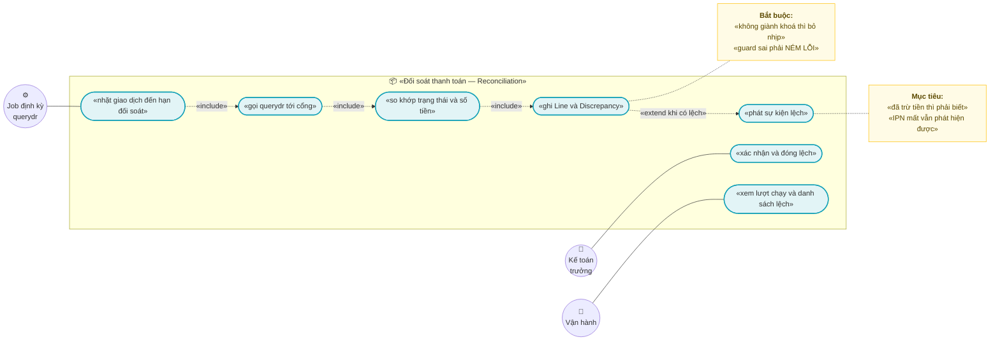
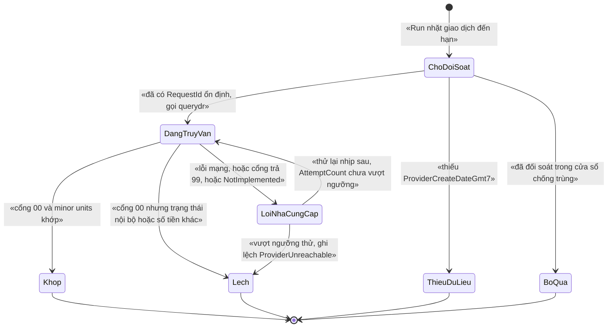
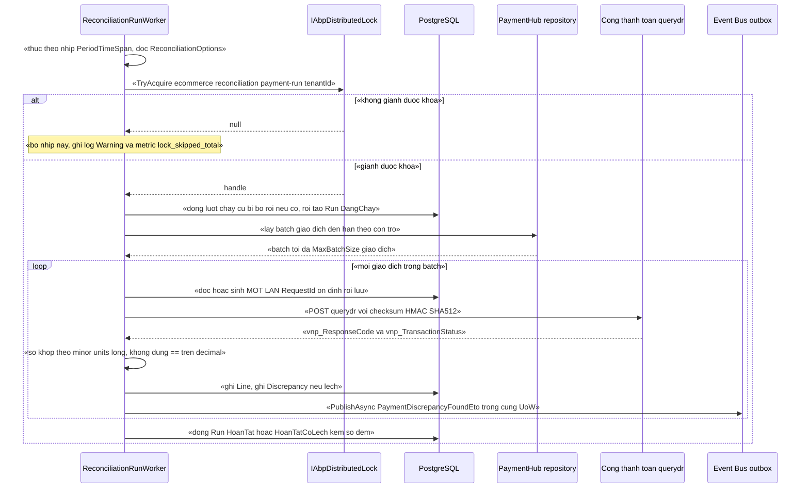

# `REC-001` — Đối soát thanh toán (querydr định kỳ)

| Thuộc tính | Nội dung |
|---|---|
| **Mã** | `REC-001` |
| **Module** | **Reconciliation** — module MỚI (`modules/Reconciliation/…`); **chưa tồn tại trong code**, kế hoạch **GĐ1** |
| **Giai đoạn** | **GĐ1 — Bán được** (xem `docs/implementation-plan.md:112` và `:182`) |
| **Ưu tiên** | **Must have** — là "cổng kiểm soát GĐ1" số 3: *"**Không mất tiền**: có job đối soát phát hiện giao dịch lệch"* (`docs/implementation-plan.md:188`) |
| **Trạng thái** | 🟡 `Draft` — chờ review |
| **Người viết / người review** | *(điền)* / **Kiến trúc trưởng + Kế toán trưởng** (bắt buộc theo `docs/design-doc-guidelines.md:134` vì có tích hợp NCC) |
| **Phiên bản / ngày** | `v0.1 — 14/10/2026` |
| **Tài liệu liên quan** | `XC-001` (tiền/làm tròn — BR-003 cấm so `==`) · `XC-002` (outbox/inbox, idempotency, DLQ) · `XC-003` (khoá phân tán, chế độ `SkipIfBusy`) · `XC-004` (permission + tenant) · `XC-005` (metric/log) · `docs/implementation-plan.md` §7.1 · `docs/architecture.md` |

> 📌 **Quy ước đọc tài liệu này:** mọi khẳng định về code **đều kèm đường dẫn file thật** đã kiểm bằng `read`/`grep`.
> Chỗ **chưa có trong code** ghi rõ *"chưa có trong code — kế hoạch GĐx"*. Chỗ **chưa kiểm chứng được** ghi rõ *"chưa kiểm chứng"*.
> Mục không áp dụng ghi *"Không áp dụng + lý do"* — **không bỏ mục nào** (`docs/design-doc-guidelines.md:86,120`).

---

## 0. Tóm tắt & quyết định thiết kế

**Tóm tắt:** `REC-001` là **job định kỳ gọi API `querydr` của cổng thanh toán** để **tự đi tìm** những giao dịch mà
hệ thống đang **hiểu sai trạng thái tiền** — đặc biệt ca *"khách **đã bị trừ tiền** ở cổng nhưng đơn nội bộ **chưa** `Paid`"*.
Lý do tồn tại của feature này nằm ngay trong mã nguồn hiện tại: `IPaymentProvider.QueryStatusAsync` được khai báo
với chú thích *"dùng cho job đối soát (webhook có thể mất)"* (`modules/PaymentHub/eCommerce.PaymentHub.Domain/Payments/IPaymentProvider.cs:80-81`)
và trong provider VNPay có ghi chú *"⚠️ BẮT BUỘC có job đối soát dùng hàm này: IPN/webhook có thể mất"*
(`modules/PaymentHub/eCommerce.PaymentHub.Application/Providers/VnPayPaymentProvider.cs:168`) — **nhưng cả hai hàm đều đang `throw new NotImplementedException`** (`…/VnPayPaymentProvider.cs:162,169`)
và **không có module `Reconciliation` nào trong repo** (kiểm bằng liệt kê thư mục `modules/`: chỉ có `ChannelHub`, `PaymentHub`, `Tax`).
Nói cách khác: **cơ chế duy nhất chống mất tiền hiện đang trống rỗng**.

**Vì sao phải là feature riêng, không nhét vào `PaymentHub`:** `PaymentHub` **sở hữu** `PaymentTransaction`
(`modules/PaymentHub/eCommerce.PaymentHub.Domain/Entities/PaymentTransaction.cs:33`) và **không** được biết
nghiệp vụ đối soát của kế toán. `Reconciliation` là **người tiêu thụ** dữ liệu thanh toán, có vòng đời riêng
(lượt chạy — dòng đối soát — sai lệch), và theo `docs/implementation-plan.md:182` module này sở hữu đúng ba entity
`PaymentReconciliationRun`, `PaymentReconciliationLine`, `Discrepancy`.

**Phạm vi:**
- ✅ Job định kỳ quét giao dịch **đến hạn đối soát** và gọi `querydr` cho **từng** giao dịch.
- ✅ So khớp **trạng thái**, **số tiền (theo minor units)**, **mã giao dịch cổng**, **cờ hoàn tiền** giữa nội bộ và cổng.
- ✅ Ba entity của module: `PaymentReconciliationRun`, `PaymentReconciliationLine`, `Discrepancy` + vòng đời có guard **ném lỗi**.
- ✅ Phát `PaymentDiscrepancyFoundEto` qua `IDistributedEventBus` + outbox (`XC-002`).
- ✅ Chạy tay (1 giao dịch hoặc 1 khoảng thời gian) qua app service có permission; xem/đóng sai lệch.
- ✅ Khoá phân tán + `SkipIfBusy` cho job định kỳ; metric + log theo `XC-005`.
- ✅ **Yêu cầu bổ sung ở `PaymentHub`** (bắt buộc để `querydr` chạy được): trường `ProviderCreateDateGmt7` và
  hợp đồng trả kết quả **giàu dữ liệu** thay cho enum trần — xem **D2/D3**.

**Không nằm trong phạm vi:**
- ❌ **Tự động sửa tiền/trạng thái đơn** (auto-heal). `REC-001` chỉ **phát hiện + báo** — đúng DoD ở
  `docs/implementation-plan.md:182` (*"phát hiện được ca…"*). Việc đổi trạng thái vẫn do `Sales`/`PaymentHub`
  thực hiện qua app service có permission (D9).
- ❌ **Đối soát sao kê ngân hàng / settlement sàn / COD** — thuộc `REC-002`/`REC-003` (GĐ2, `docs/implementation-plan.md:200`).
- ❌ **Sửa lỗi "guard im lặng" trong `PaymentTransaction.MarkSucceeded`/`MarkFailed`** và `Order.SetStatus` —
  đây là **phát hiện F1/F2 ở §15.2**, thuộc phạm vi module sở hữu (`PaymentHub`, `Sales`), **không** phải `REC-001`.
- ❌ **Hoàn tiền** (`refund`) — `VnPayPaymentProvider.RefundAsync` vẫn là khung (`…/VnPayPaymentProvider.cs:158-163`);
  `REC-001` chỉ **đối soát** trạng thái hoàn tiền **nếu** cổng báo, không khởi tạo hoàn tiền.
- ❌ **Đối soát đa cổng ở GĐ1**: chỉ `vnpay` có provider trong code (`modules/PaymentHub/eCommerce.PaymentHub.Application/PaymentHubApplicationModule.cs:19`).
  MoMo/payOS/SePay/Casso mới ở dạng TODO (`…/PaymentHubApplicationModule.cs:21-25`).
- ❌ **UI đầy đủ** — chỉ cần màn hình admin tối thiểu (§10).

### 0.1 Quyết định thiết kế (ADR ngắn)

| # | Quyết định | Phương án đã cân nhắc | Lý do chọn | Hệ quả |
|---|---|---|---|---|
| **D1** | **Module `Reconciliation` riêng**, sở hữu 3 entity của mình; **KHÔNG** sở hữu `PaymentTransaction` | (a) nhét job vào `PaymentHub` · (b) đặt trong `src/` · (c) **module `Reconciliation`** | Quy ước *"module sở hữu entity của mình"*; `docs/implementation-plan.md:182` đã định danh module + 3 entity này. `PaymentHub.Domain` đã sở hữu `PaymentTransaction.cs:33` ⇒ không được có hai chủ | `Reconciliation.Application` **được phép** tham chiếu `PaymentHub.Domain`/`.Application.Contracts` (module → module), nhưng **cấm** tham chiếu `src/` |
| **D2** | **Mở rộng hợp đồng trả kết quả truy vấn**: thêm `ProviderQueryResult` (giàu dữ liệu) bên cạnh `QueryStatusAsync` | (a) dùng enum `PaymentTransactionStatus` như hiện tại · (b) **DTO mới có số tiền/ngày/mã GD cổng** | Hợp đồng hiện tại trả **đúng một enum** (`modules/PaymentHub/eCommerce.PaymentHub.Domain/Payments/IPaymentProvider.cs:81`) ⇒ **mất** `vnp_Amount`, `vnp_PayDate`, `vnp_TransactionNo`, `vnp_TransactionType` — tức là **mất chính dữ liệu cần để đối soát**. Nguồn chính thức: [VNPay — API querydr](https://sandbox.vnpayment.vn/apis/docs/truy-van-hoan-tien/querydr&refund.html) | **Không** so khớp được số tiền nếu giữ enum trần ⇒ D2 là **điều kiện tiên quyết**. Thêm 1 type + 1 method vào `PaymentHub.Domain` (không phá vỡ tương thích) |
| **D3** | **Bắt buộc lưu `vnp_CreateDate` (GMT+7, `yyyyMMddHHmmss`)** vào `PaymentTransaction` khi tạo yêu cầu thanh toán | (a) suy ra từ `CreationTime` · (b) **lưu giá trị đã gửi** | `querydr` **bắt buộc** `vnp_TransactionDate` = *"giống `vnp_CreateDate` của `vnp_Command=pay`"* và **cùng GMT+7** ([nguồn chính thức](https://sandbox.vnpayment.vn/apis/docs/truy-van-hoan-tien/querydr&refund.html)). Code hiện **sinh tại chỗ rồi vứt đi**: `var now = DateTime.UtcNow.AddHours(7)` (`…/VnPayPaymentProvider.cs:61`) và `["vnp_CreateDate"] = now.ToString("yyyyMMddHHmmss")` (`…/VnPayPaymentProvider.cs:77`). `PaymentTransaction` **không có** trường nào giữ giá trị này (`…/PaymentTransaction.cs:33-76`) | **Migration bổ sung trên `PayTransactions`**. Suy từ `CreationTime` (ABP `IClock`, UTC) là **sai giây** và có thể lệch **ngày** ⇒ cổng trả `91` giả |
| **D4** | **So tiền bằng minor units (`long`)**, **cấm `==` trên `decimal`** | (a) `a.Amount == b.Amount` · (b) **`long` minor units** | `XC-001` **BR-003** (`docs/features/XC-001-money-currency-lam-tron.md:64`) cấm so `==` trên `decimal`; bài học eShop/payOS. VNPay trả `vnp_Amount` **không dấu thập phân** (`numeric[1,12]`), còn code ta đang `decimal.Round(request.Amount * 100m, 0, MidpointRounding.AwayFromZero)` (`…/VnPayPaymentProvider.cs:72`) | Mọi so khớp trong `REC-001` dùng `long` minor units; **cấm** `==`/`!=` trên `decimal` trong module (test quét mã nguồn — TC-16) |
| **D5** | **Idempotency ở MỌI biên vào**: `RunId` + unique index trên dòng; `vnp_RequestId` **sinh một lần rồi lưu** | (a) `Guid.NewGuid()` mỗi lần gọi · (b) **khoá ổn định, lưu DB** | VNPay: `vnp_RequestId` *"không được trùng lặp trong ngày"* và mã lỗi `94` = *"Yêu cầu trùng lặp, duplicate request"* ([nguồn](https://sandbox.vnpayment.vn/apis/docs/truy-van-hoan-tien/querydr&refund.html)) ⇒ khoá mới mỗi lần retry là **sai thiết kế**. Đây cũng đúng `XC-002` **BR-007** (khoá thanh toán phải ổn định) | `PaymentReconciliationLine.RequestId` là **cột NOT NULL, unique theo (TenantId, ProviderCode, RequestId)**; retry **đọc lại** RequestId từ DB |
| **D6** | **Chống chạy chồng** bằng khoá phân tán + chế độ **`SkipIfBusy`** (job định kỳ) | (a) tin vào "chỉ có 1 instance" · (b) **lock + SkipIfBusy** | `XC-003` **D10/BR-010**: không giành được khoá ⇒ mặc định **ném lỗi**, **riêng job định kỳ** được **bỏ nhịp + log + metric**. Code đã có đúng khuôn này: `ChannelTokenManager` bỏ lượt + `LogWarning` khi `handle is null` (`modules/ChannelHub/eCommerce.ChannelHub.Application/Sync/ChannelTokenManager.cs:74-83`) | Hai instance không tạo 2 lượt chạy; **bỏ nhịp không phải lỗi** nhưng **bắt buộc** có log + metric |
| **D7** | Bản ghi `Run`/`Line`/`Discrepancy` là **bằng chứng APPEND-ONLY**; chỉ đổi **trạng thái** qua state machine có guard | (a) `UPDATE` tự do · (b) **append-only + state machine ném lỗi** | Quy ước bất biến của dự án (sổ cái append-only, `src/eCommerce.Domain/Entities/Inventory/StockLedger.cs:80-83`) + `XC-002` **BR-008/BR-009** (guard ở DB, guard sai **NÉM LỖI**, cấm no-op im lặng) | Không có API "sửa số tiền đã đối soát"; muốn sửa ⇒ **lượt chạy mới**. Guard ở tầng DB: `UPDATE … WHERE Status = @expected`, 0 dòng ⇒ **ném** `eCommerce:Reconciliation:0002` |
| **D8** | Job dùng **`AsyncPeriodicBackgroundWorkerBase` + `AddBackgroundWorkerAsync<T>()`** | (a) `IHostedService` tự viết · (b) `BackgroundJob` của ABP · (c) **`AsyncPeriodicBackgroundWorkerBase`** | **Đã có tiền lệ chạy thật trong repo**: `ChannelSyncSupervisorWorker : AsyncPeriodicBackgroundWorkerBase` (`modules/ChannelHub/eCommerce.ChannelHub.Application/Sync/ChannelSyncSupervisorWorker.cs:27`) đăng ký ở `ChannelHubApplicationModule.cs:40`. Gói `Volo.Abp.BackgroundWorkers` **đã có** (`Directory.Packages.props:72`) ⇒ **không thêm dependency** | Phải khai báo `[DependsOn(typeof(AbpBackgroundWorkersModule))]`; nhịp đọc từ options; **không** log mỗi vòng (`XC-005` BR-004) |
| **D9** | GĐ1 **chỉ phát hiện**, **không tự sửa** tiền/trạng thái đơn | (a) job tự `MarkSucceeded` · (b) **chỉ báo cáo + để người có quyền xử lý** | Sửa tiền là **thao tác không thể hoàn tác**; `docs/design-doc-guidelines.md:134` buộc có **kế toán** tham gia review. Đồng thời `PaymentTransaction.MarkSucceeded` hiện **trả `false` im lặng** khi đã `Succeeded` (`…/PaymentTransaction.cs:96-99`) và `MarkFailed` **return im lặng** (`:114-118`) — gọi từ job sẽ **nuốt lỗi** | Giảm rủi ro tự động sai; `Discrepancy` phải có người **xác nhận rồi đóng** (permission riêng, §9) |
| **D10** | Ca *"đã trừ tiền mà đơn chưa Paid"* đọc qua **cổng `IOrderPaymentStateReader` do module sở hữu, app hiện thực** | (a) module tham chiếu `src/` để đọc `Order` · (b) **dependency inversion** | Quy ước bất di bất dịch: *"module không được tham chiếu app (app → module là hợp lệ, ngược lại là vi phạm)"* — `modules/ChannelHub/eCommerce.ChannelHub.Domain/ChannelHubConsts.cs:8-10`; lặp lại ở `modules/Tax/eCommerce.Tax.Domain/TaxErrorCodes.cs:5-8`. Bằng chứng chiều tham chiếu thật: `src/eCommerce.EntityFrameworkCore/eCommerce.EntityFrameworkCore.csproj` trỏ **vào** module, không có module nào trỏ vào `src/` | `Reconciliation.Application.Contracts` chứa interface; `eCommerce.Application` (app) implement. Module **không** biết `Order` |
| **D11** | Mã lỗi + tên khoá do **module tự sở hữu**; khoá **KHÔNG** kèm tiền tố `ecommerce:` | (a) dùng `eCommerceConsts.ErrorCodes` · (b) **`ReconciliationErrorCodes` + `ReconciliationLockKeys`** | `XC-003` **D3/BR-002** + §5.4: tiền tố do **`AbpDistributedLockOptions.KeyPrefix`** thêm, và giá trị thật đang là `"ecommerce:"` (`src/eCommerce.HttpApi.Host/eCommerceHttpApiHostModule.cs:127`) ⇒ thêm tiền tố trong hàm sinh khoá sẽ thành **tiền tố đôi**. Tiền lệ module tự sở hữu: `TaxErrorCodes` (`modules/Tax/eCommerce.Tax.Domain/TaxErrorCodes.cs:10`) | Khoá thật trong Redis là `ecommerce:reconciliation:…`; grep `ecommerce:` vẫn liệt kê đủ (NFR-09) |
| **D12** | **Mọi entity mới PHẢI có `DbSet` trên `eCommerceDbContext`** | (a) chỉ gọi `ConfigureReconciliation()` · (b) **khai `DbSet` + gọi configure** | Đã ghi rõ trong code: `AddDefaultRepositories(includeAllEntities: true)` **chỉ** tạo `IRepository<T>` cho entity **có `DbSet`**; thiếu ⇒ runtime báo *"The requested service 'IRepository<…>' has not been registered."* (`src/eCommerce.EntityFrameworkCore/eCommerceDbContext.cs:47-56`, lặp lại ở `:60-62`) | 3 `DbSet` mới + 1 dòng `builder.ConfigureReconciliation()` |
| **D13** | Metric mới **phải** vào bảng đăng ký **và** tuân quy ước hậu tố | (a) đặt tên tuỳ ý · (b) **theo `eCommerceMetricNames` + hậu tố hợp lệ** | Bảng đăng ký metric là nguồn sự thật (`src/eCommerce.Domain.Shared/Observability/eCommerceMetrics.cs:13-53`) và có **test khẳng định đúng 12 metric** (`test/eCommerce.Tests/Observability/MetricsTests.cs:64`) cùng test quy ước tên bắt buộc kết thúc `_total`/`_seconds`/`_size`/`_pending`/`_skus` (`…/MetricsTests.cs:112-127`) | Thêm **3** metric `reconciliation_run_total` (Counter, nhãn `result`), `reconciliation_discrepancy_size` (Gauge, không nhãn) và `reconciliation_provider_error_total` (Counter, nhãn `provider` + `reason`) ⇒ **phải** sửa `eCommerceMetrics.cs` **và** `MetricsTests.cs` (12 → 15). Tên `…_open` sẽ **làm đỏ CI** ⇒ dùng `_size`; **cấm** nhãn ngoài `eCommerceMetricTags.Allowed` |

> 📌 **Ánh xạ mã quyết định:** cột `#` ở trên dùng ký hiệu **`D1`…`D13`** để **khớp đúng mẫu `XC-003` §0.1**
> (`docs/features/XC-003-khoa-phan-tan-quy-uoc.md:42-53`). Theo yêu cầu mã hoá của dự án, các quyết định này
> tương ứng **`ADR-01`…`ADR-13`** theo thứ tự (`D1` ≡ `ADR-01`, …, `D13` ≡ `ADR-13`).
> Mọi tham chiếu trong tài liệu dùng dạng `Dn` cho ngắn gọn.

---

## 1. Use Case Specification

| Thuộc tính | Nội dung |
|---|---|
| **Use Case ID** | `REC-001` |
| **Use Case Name** | Đối soát định kỳ trạng thái thanh toán với cổng bằng `querydr` |
| **Description** | *"Là **kế toán trưởng** của một shop bán online, tôi muốn hệ thống **tự đi hỏi cổng thanh toán** mỗi giờ để biết giao dịch nào **đã trừ tiền của khách mà đơn nội bộ chưa ghi nhận**, để tôi không phát hiện mất tiền sau nhiều tuần — và để mọi lần đối soát đều **để lại bằng chứng**."* |
| **Actor(s)** | **Job định kỳ** (`ReconciliationRunWorker`) · **Kế toán trưởng** (đóng sai lệch) · **Vận hành** (xem lượt chạy, chạy tay) · **Hệ thống ngoài**: cổng thanh toán VNPay (`querydr`) · **`PaymentHub`** (nguồn `PaymentTransaction`) · **`Sales`** (nguồn trạng thái đơn — chỉ qua cổng D10) |
| **Priority** | **Must have** |
| **Trigger** | (a) **nhịp job** (`PeriodTimeSpan`, mặc định đề xuất **3600 s**); (b) **chạy tay** cho một giao dịch (`POST /api/app/reconciliation/line/requery`) hoặc một khoảng thời gian; (c) **lượt chạy trước kết thúc có lỗi** ⇒ nhặt lại phần dở dang |
| **Pre-Condition(s)** | • **`TenantId`** — `ICurrentTenant`; ở chế độ 1 tenant hiện nay giá trị **có thể là `NULL`** (`XC-004` §5.2 F1). Mọi unique index của module **PHẢI** `NULLS NOT DISTINCT` (`XC-004` BR-009, đã áp cho **11 index** theo `test/eCommerce.IntegrationTests/PostgreSqlSchemaTests.cs:148`).<br>• **`ChannelCode`** — **có** mặt khi giao dịch gắn với một đơn thuộc kênh; **có thể `NULL`** (giao dịch nạp ví — `PaymentTransaction.OrderId` nullable, `…/PaymentTransaction.cs:41`). `ChannelCode` **KHÔNG** tham gia khoá chống trùng.<br>• **Cổng đã cấu hình credential**: `PaymentHub:VnPay:TmnCode` và `:HashSecret` — hiện **đang rỗng** trong `src/eCommerce.HttpApi.Host/appsettings.json:22-27` ⇒ job phải **dừng có cảnh báo**, không gọi bừa.<br>• **Đã có `ProviderCreateDateGmt7`** trên `PayTransactions` (D3) — nếu **thiếu**, dòng đó chuyển `ThieuDuLieu` + sinh `Discrepancy`, **không** im lặng.<br>• **Redis 7** sẵn sàng (khoá phân tán). Redis chết ⇒ `AbortOnConnectFail = false` giữ app chạy (`src/eCommerce.HttpApi.Host/eCommerceHttpApiHostModule.cs:137-145`) nhưng **khoá vô hiệu** ⇒ ràng buộc DB là hàng rào cuối (D6, `XC-003` D2). |
| **Post-Condition(s)** | • **Mỗi** giao dịch đến hạn có **đúng một** `PaymentReconciliationLine` trong lượt chạy đó (unique index — BR-05).<br>• Mọi sai lệch giữa nội bộ và cổng đều có **một** `Discrepancy` ở trạng thái `Moi` **kèm số tiền minor units của cả hai phía** (`XC-001` BR-003).<br>• Mọi lỗi gọi cổng **đều để lại dấu vết**: `Line.Status = LoiNhaCungCap` + `FailureCode/FailureMessage`, **không** nuốt im lặng (`XC-005` BR-013).<br>• Lượt chạy kết thúc ở `HoanTat` / `HoanTatCoLech` / `ThatBai` — **không** có lượt chạy treo ở `DangChay` quá `RunStaleMinutes`.<br>• Job **luôn nhả khoá** kể cả khi ném lỗi (`await using`, `XC-003` BR-009).<br>• `PaymentDiscrepancyFoundEto` được phát **trong cùng Unit of Work** với bản ghi `Discrepancy` (`XC-002` BR-001). |
| **Basic Flow** | 1. `ReconciliationRunWorker` thức theo nhịp, đọc `ReconciliationOptions`.<br>2. Giành khoá `ecommerce:reconciliation:payment-run:{tenantId}` (D6, D11) với timeout hữu hạn.<br>3. **Không** giành được ⇒ **bỏ nhịp**: `LogWarning` + `lock_skipped_total` (chế độ `SkipIfBusy`), **không** ném lỗi.<br>4. Giành được ⇒ mở UoW **riêng** tạo `PaymentReconciliationRun` (`DangChay`, `PeriodFromUtc`, `PeriodToUtc`, `CorrelationId`).<br>5. Nhặt **batch** giao dịch đến hạn: `ProviderCode` có provider, `Status ∈ {Initiated, Pending}` quá `StalePendingHours`, **hoặc** `Status = Succeeded` trong cửa sổ `VerifySucceededDays`, **và** chưa đối soát trong `DedupWindowHours` (BR-07).<br>6. Với **từng** giao dịch: đọc/khởi tạo `RequestId` **ổn định** (D5) → gọi `IPaymentProvider.QueryStatusRichAsync` → **so khớp theo minor units** (D4) → ghi `PaymentReconciliationLine`.<br>7. Nếu lệch ⇒ tạo `Discrepancy` (`Moi`) + `PublishAsync(PaymentDiscrepancyFoundEto)` **trong cùng UoW**.<br>8. Đóng `Run`: `HoanTat` (0 lệch) hoặc `HoanTatCoLech` (≥ 1 lệch) — kèm số đếm.<br>9. Nhả khoá; ghi metric `reconciliation_run_total{result}`, `reconciliation_discrepancy_size` và `reconciliation_provider_error_total{provider,reason}` (D13). |
| **Alternative Flow** | **A1: Redis chết** — không giành được khoá ⇒ chạy **fail-open** như `XC-003` **E2**: chạy tiếp + `LogError` + metric; ràng buộc unique index là hàng rào cuối.<br>**A2: Chạy tay một giao dịch** — cùng code path; `Run` có `TriggeredBy = Manual(userId)`; **vẫn** đi qua khoá + idempotency (**cấm** đường tắt).<br>**A3: Giao dịch đã đối soát gần đây** ⇒ `Line.Status = BoQua` + lý do `TrongCuaSoChongTrung` — **không phải lỗi**, ghi metric `kind=dedup`.<br>**A4: Cổng trả `91` (không tìm thấy giao dịch)** ⇒ `Line = Lech` + `Discrepancy.Kind = ProviderTransactionNotFound`; **không** retry (đây là **kết luận**, không phải lỗi tạm thời).<br>**A5: Lượt chạy trước còn `DangChay`** (tiến trình bị kill) ⇒ job **đóng** lượt cũ thành `ThatBai` với `FailureCode = StaleRun` rồi mới mở lượt mới (BR-11).<br>**A6: Cổng đã hoàn tiền** (`vnp_TransactionType ∈ {02,03}`, `vnp_TransactionStatus ∈ {05,06,09}`) nhưng nội bộ chưa `Refunded/PartiallyRefunded` ⇒ `Discrepancy.Kind = RefundNotRecorded`. |
| **Exception Flow** | **E1:** timeout / lỗi mạng / cổng trả `99` ⇒ `Line = LoiNhaCungCap`, `AttemptCount++`, **thử lại nhịp sau**; **không** làm hỏng cả lượt chạy. Vượt `MaxAttempts` ⇒ `Lech` loại `ProviderUnreachable` + **cảnh báo** (`XC-002` A2).<br>**E2:** cổng trả `97` (**checksum không hợp lệ** — [nguồn](https://sandbox.vnpayment.vn/apis/docs/truy-van-hoan-tien/querydr&refund.html)) ⇒ **ném** `eCommerce:Reconciliation:0004`, `LogError` mức `Critical`, **KHÔNG** ghi/cập nhật bất cứ trạng thái nào (dấu hiệu cấu hình `HashSecret` sai hoặc bị can thiệp).<br>**E3:** cổng trả `02` (TmnCode sai) hoặc `03` (dữ liệu sai định dạng) ⇒ **lỗi cấu hình/lập trình** ⇒ `Run = ThatBai` + `LogError` `Critical` (đây **không phải** lỗi nghiệp vụ) — `eCommerce:Reconciliation:0005`.<br>**E4:** cổng trả `94` (duplicate request) ⇒ **không** coi là lỗi: dùng lại `RequestId` đã lưu, chờ nhịp sau; nếu lặp **> 3 lần** ⇒ `LoiNhaCungCap` + cảnh báo.<br>**E5:** chuyển trạng thái sai (ví dụ `HoanTat → DangChay`, hoặc đóng `Discrepancy` đã `DaXuLy`) ⇒ **NÉM** `eCommerce:Reconciliation:0002`; `UPDATE … WHERE Status = …` ảnh hưởng **0 dòng** ⇒ **NÉM** (không coi là thành công) — `XC-002` **BR-008/BR-009**.<br>**E6:** giao dịch thiếu `ProviderCreateDateGmt7` ⇒ `Line = ThieuDuLieu` + `Discrepancy.Kind = MissingProviderCreateDate` + **cảnh báo**; **không** đoán ngày.<br>**E7:** provider không hiện thực truy vấn (`QueryStatusRichAsync` ném `NotImplementedException` — hiện trạng `…/VnPayPaymentProvider.cs:169`) ⇒ `Line = LoiNhaCungCap`, `eCommerce:Reconciliation:0006`, **cảnh báo cấu hình**, **không** retry vô hạn.<br>**E8:** không tìm thấy `Run`/`Line`/`Discrepancy` theo id ⇒ `eCommerce:Reconciliation:0003` (`404`). |
| **Business Rules** | • **BR-01**: Mọi lượt đối soát **PHẢI** nằm trong đúng một `PaymentReconciliationRun`; **cấm** ghi `Line` ngoài lượt chạy.<br>• **BR-02**: Mỗi `(TenantId, RunId, PaymentTransactionId)` **chỉ** có **một** `Line` — ép bằng **unique index** `NULLS NOT DISTINCT` (`XC-004` BR-009).<br>• **BR-03**: `vnp_RequestId`/`RequestId` của một `Line` **sinh MỘT lần** và **lưu DB**; mọi retry **đọc lại**; **cấm** sinh mới mỗi lần gọi (D5, `XC-002` BR-007).<br>• **BR-04**: **Cấm** so sánh tiền bằng `==`/`!=` trên `decimal`; mọi so khớp dùng **minor units `long`** (`XC-001` BR-003).<br>• **BR-05**: Job định kỳ **không** giành được khoá ⇒ **bỏ nhịp** (`SkipIfBusy`) + **bắt buộc** log + metric; **cấm** bỏ qua im lặng (`XC-003` BR-010).<br>• **BR-06**: Mọi chuyển trạng thái **PHẢI** có guard ở **tầng DB** (`UPDATE … WHERE Status = @expected`); 0 dòng ảnh hưởng ⇒ **NÉM** `eCommerce:Reconciliation:0002`. **Cấm** no-op im lặng (`XC-002` BR-008/BR-009).<br>• **BR-07**: Một giao dịch **không** được đối soát lại trong `DedupWindowHours` (mặc định **20 giờ** — ngắn hơn 1 ngày để không đụng giới hạn "không trùng trong ngày" của `vnp_RequestId`).<br>• **BR-08**: `Discrepancy` **PHẢI** lưu **cả hai** số tiền dưới dạng **minor units `long`** (`LocalAmountMinorUnits`, `ProviderAmountMinorUnits`); **cấm** lưu `double`/`float`, **cấm** lưu tiền dạng chuỗi đã format.<br>• **BR-09**: **Cấm** `REC-001` tự đổi `PaymentTransaction.Status`/`Order.PaymentStatus` (D9). Chỉ **phát hiện + báo**.<br>• **BR-10**: **Mọi** `Line` kết thúc ở một trạng thái cuối (`Khop`/`Lech`/`ThieuDuLieu`/`BoQua`) — **cấm** để `DangTruyVan` khi lượt chạy đóng.<br>• **BR-11**: Lượt chạy ở `DangChay` lâu hơn `RunStaleMinutes` (mặc định **30 phút**) ⇒ **PHẢI** bị đóng `ThatBai` (`StaleRun`) trước khi mở lượt mới; **cấm** chạy chồng.<br>• **BR-12**: `Discrepancy.Kind` **PHẢI** thuộc **danh sách đóng** ở §5.4; giá trị ngoài danh sách ⇒ **NÉM** lỗi (không cho dữ liệu tự do vào cột phân loại).<br>• **BR-13**: **Cấm** log `HashSecret`, `TmnCode`, payload thô chứa số thẻ; payload phải qua che (`PaymentTransaction.MaskSensitiveData`, `…/PaymentTransaction.cs:147`) trước khi lưu/log (`XC-005` BR-005).<br>• **BR-14**: `PaymentDiscrepancyFoundEto` **PHẢI** có `AggregateId` + `AggregateVersion` + `TenantId` + `CorrelationId`, phát qua `IDistributedEventBus` **trong UoW** (`XC-002` D11/BR-001). |
| **Non-Functional Requirement** | • **NFR-01**: Một lượt chạy **1.000** giao dịch hoàn tất **p95 < 10 phút** với `MaxConcurrency = 4`.<br>• **NFR-02**: Gọi `querydr` lỗi tạm thời ⇒ **≥ 95 %** tự phục hồi trong **3** nhịp kế tiếp (không cần người can thiệp).<br>• **NFR-03**: **0** lượt chạy để lại trạng thái `DangChay` quá `RunStaleMinutes` (đo bằng test + gauge).<br>• **NFR-04**: **0** giao dịch bị đối soát 2 lần trong `DedupWindowHours` (test 2 luồng song song).<br>• **NFR-05**: **100 %** giao dịch `Succeeded` trong cửa sổ đối soát có **đúng một** `Line` (không sót).<br>• **NFR-06**: **0** lần tiền bị so bằng `==` trên `decimal` trong module (test quét mã nguồn, TC-16).<br>• **NFR-07**: Mọi lỗi gọi cổng có **bản ghi** trong **< 1 s** kể từ khi phát sinh (`XC-005` BR-013).<br>• **NFR-08**: Cách ly tenant: tenant A **không** đọc được `Run`/`Line`/`Discrepancy` của tenant B (**integration test 2 tenant**, cần PostgreSQL).<br>• **NFR-09**: Mọi khoá phân tán **grep được**: `grep "reconciliation:"` liệt kê đủ; khoá thật trong Redis có tiền tố `ecommerce:` (`XC-003` NFR-006).<br>• **NFR-10**: **0** metric phát ra ngoài bảng đăng ký; **0** nhãn cardinality cao (`test/eCommerce.Tests/Observability/MetricsTests.cs:49-77`) — metric mới dùng **chỉ** nhãn trong `eCommerceMetricTags.Allowed` (`src/eCommerce.Domain.Shared/Observability/eCommerceMetrics.cs:75-78`).<br>• **NFR-11**: `REC-001` **không** thêm gói NuGet nào (dùng `HttpClient` + `System.Text.Json` + BackgroundWorkers đã có — `Directory.Packages.props:72`).<br>• **NFR-12**: Payload `PaymentDiscrepancyFoundEto` **≤ 100 KB** (`XC-002` NFR-012) — ETO chỉ mang **tham chiếu id**, không mang payload thô của cổng. |

---

## 2. Sơ đồ Use Case



### Chú giải

| Ký hiệu | Ý nghĩa |
|---|---|
| ⭕ Xanh lá | Actor (người dùng + hệ thống) |
| 🟦 Bầu dục xanh dương | Use Case |
| 🟨 Khung vàng | Note |
| `───` | Liên kết Actor ↔ Use Case |
| `-.«include».->` | Quan hệ bao hàm |
| `-.«extend khi có lệch».->` | Quan hệ mở rộng (chỉ xảy ra khi phát hiện lệch) |

---

## 3. Sơ đồ trạng thái (state machine) — **BẮT BUỘC ném lỗi khi chuyển sai**

> Feature này có **ba vòng đời**. Sơ đồ dưới vẽ vòng đời **`PaymentReconciliationLine`** (nơi phát sinh lỗi nhiều nhất);
> hai vòng đời còn lại (`Run`, `Discrepancy`) trình bày bằng **bảng chuyển trạng thái đầy đủ** ngay sau đó —
> **không** bỏ nhánh nào (`docs/design-doc-guidelines.md:113`).



### 3.1 Vòng đời `PaymentReconciliationRun` (bảng — không vẽ sơ đồ để giữ giới hạn 3 khối mermaid)

| Từ | Sang | Guard | Nếu guard sai |
|---|---|---|---|
| `[*]` | `DangChay` | Giành được khoá **và** không còn lượt `DangChay` trong `RunStaleMinutes` | `SkipIfBusy` — **không** tạo lượt (BR-05) |
| `DangChay` | `HoanTat` | Tất cả `Line` ở trạng thái cuối **và** `DiscrepancyCount = 0` | Còn dòng dở ⇒ **NÉM** `eCommerce:Reconciliation:0002` (BR-10) |
| `DangChay` | `HoanTatCoLech` | Tất cả `Line` ở trạng thái cuối **và** `DiscrepancyCount ≥ 1` | Như trên |
| `DangChay` | `ThatBai` | Lỗi cấu hình (`02`/`03`/`97`) **hoặc** bị bỏ rơi > `RunStaleMinutes` | — |
| `HoanTat`/`HoanTatCoLech`/`ThatBai` | bất kỳ | **KHÔNG** có guard nào cho phép (**hấp thụ**) | **NÉM** `0002` |

> 📌 **Ghi chú về giới hạn sơ đồ:** §3 vẽ **1** sơ đồ cho vòng đời `Line` (nơi phát sinh lỗi nhiều nhất);
> bảng 3.1 và bảng 3.2 phủ **đủ cả ba** vòng đời (`Run`, `Line`, `Discrepancy`) — **không** bỏ nhánh nào.
> Tài liệu giữ **tổng đúng 3 khối mermaid** (§2 · §3 · §4.1); ERD và `Run` trình bày bằng bảng ở §3.1 và §5.

### 3.2 Bảng chuyển trạng thái & guard (mọi chuyển sai **phải ném lỗi**)

| # | Vòng đời | Từ → Sang | Guard (điều kiện cho phép) | Hành động kèm theo | Nếu guard sai thì? |
|---|---|---|---|---|---|
| 1 | Run | `[*]` → `DangChay` | Giành được khoá `ecommerce:reconciliation:payment-run:{tenantId}` **và** không còn lượt `DangChay` trong `RunStaleMinutes` | Tạo `Run` + đóng lượt cũ `ThatBai/StaleRun` (BR-11) | Không giành được khoá ⇒ `SkipIfBusy`, **không** tạo Run (BR-05) |
| 2 | Run | `DangChay` → `HoanTat` | Tất cả `Line` ở trạng thái cuối **và** `DiscrepancyCount = 0` | Ghi `FinishedAtUtc`, `LineMatched`, `LineTotal`; metric `reconciliation_run_total{result=ok}` | Còn `Line` ở `DangTruyVan`/`LoiNhaCungCap` ⇒ **NÉM** `eCommerce:Reconciliation:0002` (BR-10) |
| 3 | Run | `DangChay` → `HoanTatCoLech` | Tất cả `Line` ở trạng thái cuối **và** `DiscrepancyCount ≥ 1` | Ghi số đếm; metric `result=discrepancy` | Như trên |
| 4 | Run | `DangChay` → `ThatBai` | Lỗi cấu hình (`02`/`03`/`97`) **hoặc** lượt bị bỏ rơi > `RunStaleMinutes` | `FailureCode` (đóng, BR-12) + `LogError` | `HoanTat`/`HoanTatCoLech`/`ThatBai` là **hấp thụ**: mọi chuyển khỏi chúng ⇒ **NÉM** `0002` (E5) |
| 5 | Line | `[*]` → `ChoDoiSoat` | `Run` đang `DangChay` **và** giao dịch đến hạn | Ghi `PaymentTransactionId`, `ProviderCode`, `LocalStatus` | Trùng `(TenantId, RunId, PaymentTransactionId)` ⇒ **unique index** chặn (BR-02) |
| 6 | Line | `ChoDoiSoat` → `BoQua` | Đã có `Line` kết thúc trong `DedupWindowHours` | Ghi `SkipReason = TrongCuaSoChongTrung`; metric `kind=dedup` | **Không** phải lỗi (`XC-005` BR-013 nêu rõ "bỏ qua có chủ ý phải log ≥ Warning") ⇒ log `Warning` + lý do |
| 7 | Line | `ChoDoiSoat` → `ThieuDuLieu` | Thiếu `ProviderCreateDateGmt7` | `Discrepancy.Kind = MissingProviderCreateDate` + cảnh báo | **Cấm** đoán ngày từ `CreationTime` (D3) ⇒ **NÉM** nếu code cố suy diễn (review + TC-09) |
| 8 | Line | `ChoDoiSoat` → `DangTruyVan` | `RequestId` đã có **hoặc** vừa sinh **một lần** rồi lưu (BR-03) | Gọi `QueryStatusRichAsync` với timeout hữu hạn | Gọi mà chưa lưu `RequestId` ⇒ **NÉM** `eCommerce:Reconciliation:0007` (lỗi lập trình) |
| 9 | Line | `DangTruyVan` → `Khop` | Cổng `ResponseCode = 00` **và** `ProviderAmountMinorUnits == LocalAmountMinorUnits` **và** trạng thái tương đương | Ghi `ProviderTransactionStatus`, `ProviderTransactionNo`, `ProviderPayDateUtc` | Lệch **bất kỳ** tiêu chí nào ⇒ đi nhánh `Lech` |
| 10 | Line | `DangTruyVan` → `Lech` | Lệch trạng thái **hoặc** lệch số tiền **hoặc** `91` **hoặc** cờ gian lận/đảo (`07`/`04`) | Tạo `Discrepancy` (`Moi`) + `PublishAsync(PaymentDiscrepancyFoundEto)` trong **cùng UoW** | Số tiền **không** so được (thiếu 1 phía) ⇒ **NÉM** `0007`, **không** coi là khớp |
| 11 | Line | `DangTruyVan` → `LoiNhaCungCap` | Timeout/lỗi mạng/`99`/`NotImplementedException` | `AttemptCount++`, `FailureCode`, log `Error` | Vượt `MaxAttempts` (mặc định **5**) ⇒ `Lech` loại `ProviderUnreachable` + **cảnh báo** (E1) |
| 12 | Line | `LoiNhaCungCap` → `DangTruyVan` | `AttemptCount < MaxAttempts` **và** nhịp kế tiếp | Giữ **nguyên** `RequestId` (BR-03) | Nếu sinh `RequestId` mới ⇒ **NÉM** `0007` (sẽ ăn mã `94` của cổng) |
| 13 | Line | bất kỳ → `[*]` | Chỉ `Khop`/`Lech`/`ThieuDuLieu`/`BoQua` là **hấp thụ** | — | Mọi `UPDATE` trạng thái từ trạng thái hấp thụ ⇒ 0 dòng ⇒ **NÉM** `0002` (BR-06) |
| 14 | Discrepancy | `[*]` → `Moi` | `Line` vừa kết luận `Lech` **và** `Kind` thuộc danh sách đóng (§5.4) | Ghi **cả hai** minor units (BR-08) + phát ETO | `Kind` ngoài danh sách ⇒ **NÉM** lỗi (BR-12) |
| 15 | Discrepancy | `Moi` → `DaXacNhan` | Người dùng có `eCommerce.Payments.Reconciliation.Manage` | Ghi `AcknowledgedBy/At` + audit của ABP | Người không có quyền ⇒ `403` (`XC-004` BR-002/BR-007) |
| 16 | Discrepancy | `DaXacNhan` → `DaXuLy` | Người dùng có `…Reconciliation.Approve` **và** đã ghi `ResolutionNote` (≥ 10 ký tự) | Ghi `ResolvedBy/At` + `ResolutionNote` | Thiếu lý do ⇒ **NÉM** `eCommerce:Reconciliation:0008` (đóng lệch tiền mà không có lý do là **không chấp nhận**) |
| 17 | Discrepancy | `DaXacNhan` → `BoQua` | `…Approve` **và** `IgnoreReason` thuộc danh sách đóng (ví dụ `DuplicatedWebhook`, `TestTransaction`) | Ghi `IgnoredBy/At` | Lý do tự do ⇒ **NÉM** `0008`; **cấm** bỏ qua không lý do |
| 18 | Discrepancy | `Moi` → `DaXuLy` | **KHÔNG** có guard nào cho phép — **bắt buộc** qua `DaXacNhan` | — | **NÉM** `0002` (cấm nhảy bước: đóng lệch tiền phải có bước xác nhận) |
| 19 | Discrepancy | `DaXuLy`/`BoQua` → bất kỳ | **KHÔNG** có guard nào cho phép (**hấp thụ**) | — | **NÉM** `0002` (muốn mở lại ⇒ tạo lượt chạy mới, BR-06) |

> ⚠️ **Ai được phép chuyển:** `Run`/`Line` do **job** (không phải người dùng); `Discrepancy → DaXacNhan` do
> **kế toán** có `…Manage`; `→ DaXuLy`/`BoQua` do **kế toán trưởng** có `…Approve`.
> **Trạng thái hấp thụ:** `HoanTat`, `HoanTatCoLech`, `ThatBai` (của `Run`); `Khop`, `Lech`, `ThieuDuLieu`, `BoQua` (của `Line`);
> `DaXuLy`, `BoQua` (của `Discrepancy`).
> 📌 **Phát hiện liên quan (không thuộc phạm vi sửa ở đây):** `Order.SetStatus(OrderStatus status) => Status = status;`
> (`src/eCommerce.Domain/Entities/Orders/Order.cs:111`) **không có guard và không ném lỗi**; tương tự
> `PaymentTransaction.MarkSucceeded` **trả `false` im lặng** khi đã `Succeeded` (`…/PaymentTransaction.cs:96-99`) và
> `MarkFailed` **`return` im lặng** (`:114-118`). Đây là vi phạm quy ước #11 nhưng thuộc module `Sales`/`PaymentHub` — ghi ở §15.2 **F1/F2**.

---

## 4. Sequence Diagram & luồng dữ liệu

### 4.1 Sequence — một lượt chạy đối soát định kỳ



### 4.2 DFD — luồng dữ liệu (trình bày bằng bảng thay sơ đồ để giữ giới hạn 3 khối mermaid)

| Bước | Nguồn | Xử lý | Đích | Ghi chú |
|---|---|---|---|---|
| 1 | `PayTransactions` (`src/eCommerce.EntityFrameworkCore/eCommerceDbContext.cs:58`) | Lọc giao dịch đến hạn | `ReconciliationRunWorker` | **Chỉ đọc**; REC **không** sở hữu bảng này (D1) |
| 2 | `ReconciliationOptions` (`appsettings.json`) | Nhịp, batch, cửa sổ, ngưỡng thử | Worker | Cấu hình ngoài, **không** hard-code |
| 3 | Worker | Sinh/đọc `RequestId` | `RecPaymentReconciliationLines` | Khoá **ổn định** qua retry (BR-03) |
| 4 | Worker | Gọi HTTPS `POST` tới `PaymentHub:VnPay:TransactionApiUrl` | VNPay | Endpoint đã có trong cấu hình (`src/eCommerce.HttpApi.Host/appsettings.json:26`) |
| 5 | VNPay | Trả `vnp_ResponseCode` + `vnp_TransactionStatus` + `vnp_Amount` | Worker | **Bắt buộc** kiểm `vnp_SecureHash` của phản hồi trước khi tin |
| 6 | Worker | So khớp minor units + trạng thái | `RecPaymentReconciliationLines` | Cấm `==` trên `decimal` (BR-04) |
| 7 | Worker | Tạo sai lệch | `RecPaymentDiscrepancies` | **Cả hai** số tiền minor units (BR-08) |
| 8 | Worker | Phát sự kiện **trong UoW** | `AbpEventOutbox` → Event Bus | `XC-002` BR-001; outbox **chưa có trong code** — xem §15.3 G1 |

---

## 5. Mô hình dữ liệu

### 5.1 ERD (bảng quan hệ — vẽ bằng bảng để giữ giới hạn 3 khối mermaid)

| Từ | Quan hệ | Đến | Ghi chú |
|---|---|---|---|
| `RecPaymentReconciliationRuns` | 1 → n | `RecPaymentReconciliationLines` | một lượt chạy có nhiều dòng |
| `RecPaymentReconciliationLines` | 1 → 0..n | `RecPaymentDiscrepancies` | một dòng có thể sinh nhiều sai lệch (ví dụ vừa lệch tiền vừa lệch mã GD) |
| `PayTransactions` (PaymentHub) | 1 → n | `RecPaymentReconciliationLines` | **khoá ngoại logic**, **không** FK cứng (module khác sở hữu) |

### 5.2 Bảng & cột (Data Dictionary)

> **Tiền tố bảng:** module dùng tiền tố riêng, **không** dùng `eCommerceConsts.DbTablePrefix = "App"`
> (`src/eCommerce.Domain.Shared/eCommerceConsts.cs:9` — hằng số này **không** được áp cho bảng nào; bảng thật đặt tên
> tường minh: `CatProducts` (`src/eCommerce.EntityFrameworkCore/eCommerceDbContext.cs:101`), `PayTransactions`
> (`modules/PaymentHub/eCommerce.PaymentHub.EntityFrameworkCore/PaymentHubDbContextModelCreatingExtensions.cs:16`),
> `ChnChannelShops` (`modules/ChannelHub/eCommerce.ChannelHub.EntityFrameworkCore/ChannelHubDbContextModelCreatingExtensions.cs:32`), `TaxRateSchedules`
> (`modules/Tax/eCommerce.Tax.EntityFrameworkCore/TaxDbContextModelCreatingExtensions.cs:20`)).
> ⇒ `REC-001` dùng tiền tố **`Rec`**.

#### 5.2.1 Bảng `RecPaymentReconciliationRuns` — một lượt chạy đối soát

**Chưa có trong code — kế hoạch GĐ1.**

| Cột | Kiểu | Null? | Nguồn / ý nghĩa | Ghi chú |
|---|---|---|---|---|
| `Id` | `uuid` | ✖ | khoá chính | `FullAuditedAggregateRoot<Guid>` |
| `TenantId` | `uuid` | ✔ | tenant sở hữu | bắt buộc vì entity là `IMultiTenant` (`XC-004` BR-009) |
| `Status` | `int` | ✖ | `DangChay / HoanTat / HoanTatCoLech / ThatBai` | state machine §3.1 |
| `TriggeredBy` | `varchar(32)` | ✖ | `Schedule` \| `Manual` | chạy tay **vẫn** qua khoá |
| `TriggeredByUserId` | `uuid` | ✔ | user chạy tay | `NULL` khi do nhịp job |
| `PeriodFromUtc` | `timestamptz` | ✖ | cửa sổ đối soát | |
| `PeriodToUtc` | `timestamptz` | ✖ | cửa sổ đối soát | |
| `StartedAtUtc` | `timestamptz` | ✖ | mở lượt | |
| `FinishedAtUtc` | `timestamptz` | ✔ | đóng lượt | `NULL` khi `DangChay` |
| `LineTotal` | `int` | ✖ | tổng số dòng | **số liệu đếm** — xem ghi chú §10 |
| `LineMatched` | `int` | ✖ | số dòng khớp | |
| `LineSkipped` | `int` | ✖ | số dòng bỏ qua (chống trùng) | |
| `DiscrepancyCount` | `int` | ✖ | số sai lệch sinh ra | |
| `FailureCode` | `varchar(64)` | ✔ | mã lỗi **đóng** khi `ThatBai` | ví dụ `StaleRun`, `InvalidCredential` |
| `CorrelationId` | `varchar(128)` | ✔ | nối log xuyên tầng | `XC-005` BR-002 |
| `RowVersion` | `bytea`/`xmin` | ✖ | optimistic concurrency | ABP dùng `ConcurrencyStamp` (`varchar(40)`) — xem ghi chú dưới |

#### 5.2.2 Bảng `RecPaymentReconciliationLines` — một giao dịch trong một lượt chạy

**Chưa có trong code — kế hoạch GĐ1.**

| Cột | Kiểu | Null? | Nguồn / ý nghĩa | Ghi chú |
|---|---|---|---|---|
| `Id` | `uuid` | ✖ | khoá chính | |
| `TenantId` | `uuid` | ✔ | tenant | |
| `RunId` | `uuid` | ✖ | trỏ `RecPaymentReconciliationRuns` | |
| `PaymentTransactionId` | `uuid` | ✖ | trỏ `PayTransactions` (PaymentHub sở hữu) | **không** FK cứng |
| `ProviderCode` | `varchar(32)` | ✖ | `vnpay` … | khớp `PaymentTransaction.ProviderCode` (`…/PaymentTransaction.cs:38`) |
| `MerchantReference` | `varchar(64)` | ✖ | `vnp_TxnRef` | khớp unique index đã có ở `…/PaymentHubDbContextModelCreatingExtensions.cs:32` |
| `RequestId` | `varchar(32)` | ✖ | `vnp_RequestId` — **sinh một lần rồi lưu** | BR-03; `Alphanumeric[1,32]` theo spec |
| `Status` | `int` | ✖ | `ChoDoiSoat / DangTruyVan / Khop / Lech / LoiNhaCungCap / ThieuDuLieu / BoQua` | state machine §3 |
| `SkipReason` | `varchar(64)` | ✔ | lý do `BoQua` (đóng) | BR-12 |
| `AttemptCount` | `int` | ✖ | số lần thử gọi | mặc định `0`; ngưỡng `MaxAttempts` = 5 |
| `LocalStatus` | `int` | ✖ | `PaymentTransactionStatus` nội bộ **tại thời điểm đối soát** | **snapshot** — bằng chứng, không đọc lại |
| `LocalAmountMinorUnits` | `bigint` | ✖ | tiền nội bộ quy về minor units | BR-04, BR-08 |
| `ProviderResponseCode` | `varchar(8)` | ✔ | `vnp_ResponseCode` | `00/02/03/91/94/97/99` |
| `ProviderTransactionStatus` | `varchar(8)` | ✔ | `vnp_TransactionStatus` | `00/01/02/04/05/06/07/09` |
| `ProviderAmountMinorUnits` | `bigint` | ✔ | `vnp_Amount` **nguyên bản** | ⚠️ **số nguyên**, đúng như cổng gửi |
| `ProviderTransactionNo` | `varchar(32)` | ✔ | `vnp_TransactionNo` | |
| `ProviderPayDateUtc` | `timestamptz` | ✔ | `vnp_PayDate` đã đổi sang UTC | giữ **cả** giá trị gốc GMT+7 ở `ProviderPayDateGmt7` |
| `ProviderPayDateGmt7` | `char(14)` | ✔ | nguyên văn `yyyyMMddHHmmss` GMT+7 | **không** parse lại để đối chiếu bằng chứng |
| `ProviderTransactionType` | `varchar(8)` | ✔ | `01` thanh toán · `02` hoàn toàn phần · `03` hoàn một phần | |
| `FailureCode` | `varchar(64)` | ✔ | mã lỗi **đóng** khi `LoiNhaCungCap` | |
| `FailureMessage` | `varchar(1024)` | ✔ | thông điệp **đã cắt** và **đã che** | BR-13 |
| `DiscrepancyId` | `uuid` | ✔ | trỏ `RecPaymentDiscrepancies` nếu lệch | |
| `CheckedAtUtc` | `timestamptz` | ✔ | thời điểm kết luận | |
| `CorrelationId` | `varchar(128)` | ✔ | nối log | truyền sang ETO |
| `RowVersion` | — | ✖ | guard ở tầng DB | xem ghi chú |

#### 5.2.3 Bảng `RecPaymentDiscrepancies` — sai lệch cần người xử lý

**Chưa có trong code — kế hoạch GĐ1.**

| Cột | Kiểu | Null? | Nguồn / ý nghĩa | Ghi chú |
|---|---|---|---|---|
| `Id` | `uuid` | ✖ | khoá chính | |
| `TenantId` | `uuid` | ✔ | tenant | |
| `RunId` | `uuid` | ✖ | lượt chạy phát hiện | |
| `LineId` | `uuid` | ✖ | dòng sinh ra nó | |
| `PaymentTransactionId` | `uuid` | ✖ | giao dịch liên quan | |
| `OrderId` | `uuid` | ✔ | đơn liên quan (nếu có) | lấy từ `PaymentTransaction.OrderId` (`…/PaymentTransaction.cs:41`) |
| `ProviderCode` | `varchar(32)` | ✖ | cổng | |
| `MerchantReference` | `varchar(64)` | ✖ | mã giao dịch phía ta | |
| `Kind` | `varchar(64)` | ✖ | loại lệch (**danh sách đóng** — §5.4) | BR-12 |
| `Severity` | `int` | ✖ | `Cao / TrungBinh / Thap` | §5.4 |
| `LocalAmountMinorUnits` | `bigint` | ✔ | tiền nội bộ | BR-08 |
| `ProviderAmountMinorUnits` | `bigint` | ✔ | tiền cổng báo | BR-08 |
| `Currency` | `char(3)` | ✖ | mặc định `VND` | khớp `PaymentTransaction.Currency` (`…/PaymentTransaction.cs:55`) |
| `Status` | `int` | ✖ | `Moi / DaXacNhan / DaXuLy / BoQua` | state machine §3.2 |
| `AcknowledgedBy` / `AcknowledgedAtUtc` | `uuid` / `timestamptz` | ✔ | ai xác nhận, khi nào | audit ABP bổ sung |
| `ResolvedBy` / `ResolvedAtUtc` | `uuid` / `timestamptz` | ✔ | ai đóng | |
| `ResolutionNote` | `varchar(2048)` | ✔ | lý do xử lý | **bắt buộc** ≥ 10 ký tự khi → `DaXuLy` |
| `IgnoreReason` | `varchar(64)` | ✔ | lý do bỏ qua (**đóng**) | bắt buộc khi → `BoQua` |
| `DetectedAtUtc` | `timestamptz` | ✖ | thời điểm phát hiện | |
| `CorrelationId` | `varchar(128)` | ✔ | nối log | |
| `ExtraProperties` | `jsonb` | ✖ | ABP convention | chứa `AggregateVersion` để consumer `XC-002` từ chối bản cũ |

#### 5.2.4 ⚠️ Thay đổi **BẮT BUỘC** trên `PayTransactions` (module PaymentHub — D3)

**Chưa có trong code — kế hoạch GĐ1.** Bảng `PayTransactions` hiện có 15 cột theo `…/PaymentTransaction.cs:33-76`;
**thiếu** trường bắt buộc để gọi `querydr`:

| Cột mới | Kiểu | Null? | Vì sao bắt buộc |
|---|---|---|---|
| `ProviderCreateDateGmt7` | `char(14)` | ✔ | `querydr` yêu cầu `vnp_TransactionDate` = *"giống `vnp_CreateDate` của `vnp_Command=pay`"*, GMT+7, `yyyyMMddHHmmss` ([nguồn chính thức](https://sandbox.vnpayment.vn/apis/docs/truy-van-hoan-tien/querydr&refund.html)). Hiện giá trị được sinh tại `…/VnPayPaymentProvider.cs:61,77` rồi **vứt đi** |
| `ProviderCreateDateUtc` | `timestamptz` | ✔ | dạng UTC để truy vấn/lọc theo thời gian (cột trên không lọc được hiệu quả) |

> 🔴 **Vì sao NULLABLE nhưng vẫn an toàn:** dữ liệu **cũ** (đã tạo trước migration) **không** có giá trị ⇒ dòng đó sẽ
> vào `ThieuDuLieu` (BR-07/§3.2 #7) và sinh `Discrepancy` — **không** đoán ngày. Backfill **không** khả thi vì giá trị gốc
> **không** được lưu ở đâu (chỉ tồn tại trong URL checkout đã gửi khách).
> ⚠️ **Chưa kiểm chứng:** chưa đo được sai lệch thực tế giữa `vnp_CreateDate` đã gửi và `CreationTime` (ABP `IClock`) —
> vì `…/VnPayPaymentProvider.cs:61` dùng `DateTime.UtcNow` **trực tiếp**, **không** qua `IClock`.

**Index & ràng buộc** *(phần hay bị bỏ sót nhất — `docs/design-doc-guidelines.md:115`)*

| Loại | Bảng | Cột | Mục đích |
|---|---|---|---|
| UNIQUE **`NULLS NOT DISTINCT`** | `Lines` | `(TenantId, RunId, PaymentTransactionId)` | **idempotency** — BR-02; chặn ghi 2 dòng cho cùng giao dịch trong cùng lượt |
| UNIQUE **`NULLS NOT DISTINCT`** | `Lines` | `(TenantId, ProviderCode, RequestId)` | **idempotency của `vnp_RequestId`** — BR-03; chặn sinh trùng khoá trong ngày |
| UNIQUE **`NULLS NOT DISTINCT`** | `Discrepancies` | `(TenantId, LineId, Kind)` | một dòng **không** sinh 2 lệch **cùng loại** |
| INDEX | `Lines` | `(TenantId, PaymentTransactionId, CheckedAtUtc)` | cửa sổ chống trùng `DedupWindowHours` (BR-07) |
| INDEX | `Lines` | `(RunId, Status)` | đóng lượt chạy phải quét hết dòng (BR-10) |
| INDEX | `Discrepancies` | `(TenantId, Status, Severity, DetectedAtUtc)` | màn hình admin "lệch chưa xử lý, nặng trước" |
| INDEX | `Runs` | `(TenantId, Status, StartedAtUtc)` | tìm lượt `DangChay` bị bỏ rơi (BR-11) |
| CHECK | `Discrepancies` | `LocalAmountMinorUnits >= 0 AND ProviderAmountMinorUnits >= 0` | tiền âm là **lỗi dữ liệu** ở ngữ cảnh này (`XC-001` cho phép âm nói chung, nhưng `vnp_Amount` của `querydr` là số tiền **đã thu**) |
| CHECK | `Runs` | `FinishedAtUtc IS NULL OR FinishedAtUtc >= StartedAtUtc` | bất biến thời gian |
| **KHÔNG** FK cứng | `Lines.PaymentTransactionId` | — | `PayTransactions` do **module khác** sở hữu (D1); FK cứng sẽ chặn tách microservice về sau |

> 📌 **Vì sao `Runs` không có unique index:** khoá chính `Id` (`uuid`) đã là duy nhất; thêm `(TenantId, Id)` là **thừa**.
> Quy ước `NULLS NOT DISTINCT` (`XC-004` BR-009) chỉ áp cho **unique index có `TenantId` dùng để chống trùng nghiệp vụ** —
> nên module có **đúng 3** unique index loại này (bảng trên).
>
> 🚨 **Hệ quả lên test đã có:** `test/eCommerce.IntegrationTests/PostgreSqlSchemaTests.cs:148` đang khẳng định
> **đúng 11** index có `NULLS NOT DISTINCT`. Thêm **3** unique index của `REC-001` ⇒ con số thành **14**
> ⇒ **file test đó phải sửa trong cùng pull request** (cả danh sách đích danh ở `:152-165`), nếu không CI đỏ
> (đây là *lưới an toàn chống tái phát F1* — `…/PostgreSqlSchemaTests.cs:5-13`).

### 5.3 Mapping EF Core

**Chưa có trong code — kế hoạch GĐ1.**

| Mục | Giá trị |
|---|---|
| Hàm mapping | `ReconciliationDbContextModelCreatingExtensions.ConfigureReconciliation(this ModelBuilder)` — khuôn giống `ConfigurePaymentHub` (`modules/PaymentHub/eCommerce.PaymentHub.EntityFrameworkCore/PaymentHubDbContextModelCreatingExtensions.cs:10`) |
| Nơi gọi | `eCommerceDbContext.OnModelCreating` — thêm 1 dòng cạnh `builder.ConfigurePaymentHub();` (`src/eCommerce.EntityFrameworkCore/eCommerceDbContext.cs:77`) |
| `DbSet` | 3 dòng mới cạnh `PaymentTransactions` (`…/eCommerceDbContext.cs:58`) — **bắt buộc** theo D12 |
| Tiền | `bigint` cho minor units; **cấm** `double`/`float`/`real` (`XC-001` BR-008) |
| Chuỗi thời gian GMT+7 | `char(14)` — **không** `timestamptz` (đây là **chuỗi định dạng** ta đã gửi cổng, không phải mốc thời gian) |

### 5.4 Danh sách **ĐÓNG** các giá trị phân loại (BR-12)

| `Discrepancy.Kind` | Mức | Điều kiện phát hiện | Vì sao quan trọng |
|---|---|---|---|
| `MoneyReceivedButNotRecorded` | 🔴 Cao | Cổng `00` (đã thu tiền) nhưng nội bộ `Status != Succeeded` | 🎯 **Đúng ca DoD** `docs/implementation-plan.md:182`: *"đã trừ tiền mà đơn chưa `Paid`"* |
| `RecordedButMoneyNotReceived` | 🔴 Cao | Nội bộ `Succeeded` nhưng cổng `TransactionStatus ≠ 00` | Nguy cơ **giao hàng mà không có tiền** |
| `AmountMismatch` | 🔴 Cao | `ProviderAmountMinorUnits != LocalAmountMinorUnits` | Nghi gian lận/sửa số tiền |
| `ProviderFlagged` | 🔴 Cao | `TransactionStatus ∈ {04, 07}` (đảo / nghi gian lận) | Phải xử lý **ngay**, không chờ |
| `ProviderTransactionNotFound` | 🟠 Trung bình | `ResponseCode = 91` | Khách nói đã trả nhưng cổng không có giao dịch |
| `ProviderTxnIdMismatch` | 🟠 Trung bình | `vnp_TransactionNo` khác `ProviderTransactionId` đã lưu | Sai liên kết giao dịch |
| `RefundNotRecorded` | 🟠 Trung bình | Cổng `TransactionType ∈ {02,03}` **và** `TransactionStatus ∈ {05,06,09}` nhưng nội bộ **chưa** `Refunded`/`PartiallyRefunded` | Sổ sách thiếu tiền hoàn |
| `ProviderUnreachable` | 🟠 Trung bình | Vượt `MaxAttempts` vẫn không truy vấn được | Không kết luận được ⇒ **phải** có người xem |
| `MissingProviderCreateDate` | 🟠 Trung bình | Thiếu `ProviderCreateDateGmt7` (dữ liệu cũ) | Không thể truy vấn **đúng** ⇒ báo để backfill thủ công |
| `StalePendingTransaction` | 🟡 Thấp | `Initiated/Pending` quá `StalePendingHours` mà cổng chưa có giao dịch | Dọn rác vận hành |

**Danh sách ĐÓNG `IgnoreReason`** (BR-12 / §3.2 #17): `DuplicatedWebhook` · `TestTransaction` · `KnownProviderDelay` · `AlreadyHandledManually`.

**Danh sách ĐÓNG `FailureCode`** của `Run`/`Line`: `InvalidCredential` · `InvalidRequestFormat` · `InvalidResponseChecksum` · `ProviderUnavailable` · `ProviderNotImplemented` · `MissingProviderCreateDate` · `StaleRun` · `Timeout`.

---

## 6. Hợp đồng API

### 6.1 Application Service

**Chưa có trong code — kế hoạch GĐ1.** Vị trí đề xuất: `modules/Reconciliation/eCommerce.Reconciliation.Application.Contracts` (interface + DTO) và `…Application` (hiện thực).

| Mục | Giá trị |
|---|---|
| Interface | `IPaymentReconciliationAppService` |
| Implementation | `PaymentReconciliationAppService` |
| `[Authorize]` | **cấp CLASS** (`[Authorize]`) + permission cụ thể từng method — bắt buộc theo `XC-004` **BR-001/D3**; tiền lệ thật: `src/eCommerce.Application/Channels/ChannelAppService.cs:27` (class) và `:69,127,143` (method) |
| Tên quyền | Hằng số trong `ReconciliationPermissions` (module sở hữu), **cấm** magic string — `XC-004` **BR-003** |

| Method | Input (DTO) | Output (DTO) | Permission | Ghi chú |
|---|---|---|---|---|
| `GetRunsAsync` | `PagedAndSortedResultRequestDto` + `fromUtc/toUtc/status` | `PagedResultDto<ReconciliationRunDto>` | `…Reconciliation.View` | |
| `GetRunDetailAsync` | `Guid runId` | `ReconciliationRunDetailDto` | `…Reconciliation.View` | có số đếm **và** dòng |
| `GetLinesAsync` | `Guid runId` + paging | `PagedResultDto<ReconciliationLineDto>` | `…Reconciliation.View` | |
| `GetDiscrepanciesAsync` | paging + `status/severity/kind` | `PagedResultDto<DiscrepancyDto>` | `…Reconciliation.View` | mặc định lọc `Status = Moi` |
| `TriggerRunAsync` | `TriggerReconciliationDto(periodFromUtc, periodToUtc)` | `ReconciliationRunDto` | `…Reconciliation.Manage` | chạy tay; **vẫn** qua khoá (A2) |
| `RequeryLineAsync` | `Guid paymentTransactionId` | `ReconciliationLineDto` | `…Reconciliation.Manage` | chạy tay **một** giao dịch |
| `AcknowledgeAsync` | `Guid discrepancyId` | `DiscrepancyDto` | `…Reconciliation.Manage` | `Moi → DaXacNhan` |
| `ResolveAsync` | `Guid discrepancyId`, `string resolutionNote` | `DiscrepancyDto` | `…Reconciliation.Approve` | `DaXacNhan → DaXuLy`; **bắt buộc** note ≥ 10 ký tự |
| `IgnoreAsync` | `Guid discrepancyId`, `string ignoreReason` | `DiscrepancyDto` | `…Reconciliation.Approve` | `DaXacNhan → BoQua`; `ignoreReason` phải thuộc danh sách đóng |

### 6.2 REST endpoint

| Method / Route | Authentication | Permission | Content-Type |
|---|---|---|---|
| `GET /api/app/payment-reconciliation/runs` | `Bearer (OpenIddict)` | `eCommerce.Payments.Reconciliation.View` | — |
| `GET /api/app/payment-reconciliation/runs/{runId}` | `Bearer` | `…View` | — |
| `GET /api/app/payment-reconciliation/discrepancies` | `Bearer` | `…View` | — |
| `POST /api/app/payment-reconciliation/trigger` | `Bearer` | `…Manage` | `application/json` |
| `POST /api/app/payment-reconciliation/line/requery` | `Bearer` | `…Manage` | `application/json` |
| `POST /api/app/payment-reconciliation/discrepancies/{id}/acknowledge` | `Bearer` | `…Manage` | `application/json` |
| `POST /api/app/payment-reconciliation/discrepancies/{id}/resolve` | `Bearer` | `…Approve` | `application/json` |
| `POST /api/app/payment-reconciliation/discrepancies/{id}/ignore` | `Bearer` | `…Approve` | `application/json` |

> Route do **ABP auto API controller** sinh từ tên app service (`src/eCommerce.HttpApi.Host/eCommerceHttpApiHostModule.cs:152-156`);
> đường dẫn ở trên là **dự kiến** theo quy ước `…/app/…` — **chưa kiểm chứng** cho tới khi có class thật.

**Request mẫu — chạy tay**

```json
{
  "periodFromUtc": "2026-10-14T00:00:00Z",
  "periodToUtc": "2026-10-14T08:00:00Z"
}
```

**Response mẫu — một sai lệch**

```json
{
  "id": "3f1a…",
  "kind": "MoneyReceivedButNotRecorded",
  "severity": 2,
  "status": 0,
  "providerCode": "vnpay",
  "merchantReference": "ORDER-20261014-0007",
  "localAmountMinorUnits": 0,
  "providerAmountMinorUnits": 25000000,
  "currency": "VND",
  "detectedAtUtc": "2026-10-14T08:03:11Z"
}
```

> 📌 **Ghi rõ chênh lệch (thói quen tốt của tài liệu gốc — `docs/design-doc-guidelines.md:119`):**
> `localAmountMinorUnits = 0` **không** có nghĩa "chưa có tiền" mà nghĩa **"nội bộ chưa ghi nhận giao dịch thành công"**
> ⇒ UI **phải** hiển thị *"chưa ghi nhận"*, **không** hiển thị `0 ₫`. Với VND, `vnp_Amount = 25000000` nghĩa là **250.000 ₫**
> (cổng nhân **100**) — UI **phải** chia 100 **một lần duy nhất** ở tầng hiển thị.

**Mã lỗi nghiệp vụ** (`ReconciliationErrorCodes` — module sở hữu, D11)

| Mã | HTTP | Khi nào | Thông điệp |
|---|---|---|---|
| `eCommerce:Reconciliation:0001` | `409` | Không giành được khoá / lượt chạy khác đang chạy | `Đang có một lượt đối soát chạy, vui lòng thử lại sau.` |
| `eCommerce:Reconciliation:0002` | `409` | Chuyển trạng thái sai (`UPDATE` 0 dòng, nhảy bước, trạng thái hấp thụ) | `Không thể chuyển trạng thái đối soát theo yêu cầu.` |
| `eCommerce:Reconciliation:0003` | `404` | Không tìm thấy `Run`/`Line`/`Discrepancy` | `Không tìm thấy bản ghi đối soát.` |
| `eCommerce:Reconciliation:0004` | `502` | **Checksum phản hồi `querydr` không hợp lệ** (`97`) | `Phản hồi từ cổng thanh toán không hợp lệ.` |
| `eCommerce:Reconciliation:0005` | `500` | Cổng trả `02`/`03` (cấu hình/định dạng sai) | `Cấu hình cổng thanh toán không hợp lệ.` |
| `eCommerce:Reconciliation:0006` | `501` | Cổng chưa hiện thực truy vấn (`NotImplementedException`) | `Cổng thanh toán chưa hỗ trợ truy vấn trạng thái.` |
| `eCommerce:Reconciliation:0007` | `500` | Lỗi lập trình: so tiền bằng `decimal`, thiếu `RequestId` ổn định | `Lỗi nội bộ khi đối soát.` |
| `eCommerce:Reconciliation:0008` | `400` | Đóng/bỏ qua lệch mà thiếu lý do hợp lệ | `Phải ghi lý do xử lý sai lệch (tối thiểu 10 ký tự).` |

> Tiền tố `eCommerce:Reconciliation:*` **không** gắn tên project ⇒ nhất quán với `TaxErrorCodes` (`eCommerce:Tax:*`,
> `modules/Tax/eCommerce.Tax.Domain/TaxErrorCodes.cs:13-34`) và `ChannelHubErrorCodes` (`eCommerce:Channel:*`,
> `modules/ChannelHub/eCommerce.ChannelHub.Domain/ChannelHubConsts.cs:38-41`).

---

## 7. Sự kiện, tích hợp ngoài & idempotency

### 7.1 Sự kiện phát ra (ETO)

**Chưa có trong code — kế hoạch GĐ1.** Khuôn ETO theo `XC-002` **D11/BR-014** (bắt buộc `AggregateId` + `AggregateVersion` + `TenantId` + `CorrelationId`).

| ETO | Khi nào phát | Trường dữ liệu | Ai tiêu thụ | Handler có idempotent? |
|---|---|---|---|---|
| `PaymentDiscrepancyFoundEto` | Ngay khi tạo `Discrepancy` (`Moi`), **trong cùng UoW** | `EventId`, `OccurredOn`, `DiscrepancyId`, `AggregateVersion`, `TenantId`, `RunId`, `PaymentTransactionId`, `OrderId?`, `ProviderCode`, `MerchantReference`, `Kind`, `Severity`, `LocalAmountMinorUnits`, `ProviderAmountMinorUnits`, `Currency`, `CorrelationId` | `Notifications` (cảnh báo kế toán — GĐ3), có thể `Reporting` | ✅ theo `(TenantId, Kind, DiscrepancyId)`; consumer **bắt buộc** qua `IIdempotencyGuard` (`XC-002` BR-004) |
| `PaymentReconciliationRunCompletedEto` *(đề xuất, Could have)* | Khi đóng `Run` | `RunId`, `Status`, `LineTotal`, `LineMatched`, `DiscrepancyCount`, `CorrelationId` | `Reporting`/dashboard | ✅ theo `RunId` |

> ⚠️ **Phụ thuộc chưa có trong code:** ETO chỉ **không mất** nếu đi qua outbox của ABP. Hiện `IHasEventOutbox`/`IHasEventInbox`
> **không** tồn tại trong repo (grep `IHasEventOutbox|IHasEventInbox|InboxRecords|DeadLetterEvents` ⇒ **0 kết quả**)
> ⇒ `REC-001` **phụ thuộc `XC-002`**. Xem §15.3 **G1**.
> ⚠️ **Chưa kiểm chứng:** với transport in-process hiện tại (`LocalDistributedEventBus`, chưa có gói RabbitMQ trong
> `Directory.Packages.props`), `MessageId` **đổi mỗi lần phát** ⇒ chống trùng ở tầng transport **vô hiệu**; phải dựa vào
> `DiscrepancyId` ổn định. Đây là kết luận đã ghi ở `XC-002` **D3**, **không** phải kiểm chứng mới của tài liệu này.

### 7.2 Sự kiện / webhook nhận vào

`REC-001` **không** nhận webhook từ cổng (đối soát là **pull**, không phải **push**). Nhưng có **3 biên vào** — **tất cả phải idempotent** (`XC-002` BR-004):

| Nguồn | Loại | Xác thực | Chống trùng bằng | Nếu xử lý lỗi? | Thứ tự đến |
|---|---|---|---|---|---|
| Nhịp job định kỳ | **job tick** | nội bộ | khoá `ecommerce:reconciliation:payment-run:{tenantId}` + `RUNNING` guard (BR-11) | Bỏ nhịp + log `Warning` + metric | Không áp dụng |
| `POST …/trigger` (chạy tay) | **HTTP** | `Bearer` + permission `…Manage` | khoá phân tán (dùng **chung** khoá với job) | Trả `409` `0001` | Không áp dụng |
| `POST …/line/requery` | **HTTP** | `Bearer` + `…Manage` | `(TenantId, ProviderCode, RequestId)` **unique** + cửa sổ chống trùng BR-07 | Trả `409` `0001` | Không áp dụng |

> 📌 **Quan trọng:** `PaymentDiscrepancyFoundEto` **không** quay lại làm đầu vào của `REC-001` ⇒ **không** có vòng lặp sự kiện.
> Nếu sau này có consumer tự gọi `RequeryLineAsync`, idempotency của `RequestId` (BR-03) **vẫn** chặn ghi trùng.

### 7.3 Gọi API ra ngoài

| NCC | Endpoint (base URL) | Auth | Timeout | Retry | Nếu thất bại |
|---|---|---|---|---|---|
| **VNPay** `querydr` | `POST {PaymentHub:VnPay:TransactionApiUrl}` — cấu hình sẵn `https://sandbox.vnpayment.vn/merchant_webapi/api/transaction` (`src/eCommerce.HttpApi.Host/appsettings.json:26`, `modules/PaymentHub/eCommerce.PaymentHub.Application/Providers/VnPayPaymentProvider.cs:20-21`); **khớp** URL trong [tài liệu chính thức](https://sandbox.vnpayment.vn/apis/docs/truy-van-hoan-tien/querydr&refund.html) | **Checksum HMAC-SHA512** trên chuỗi `pipe` (không phải query-string): `RequestId \| Version \| Command \| TmnCode \| TxnRef \| TransactionDate \| CreateDate \| IpAddr \| OrderInfo` ([nguồn](https://sandbox.vnpayment.vn/apis/docs/truy-van-hoan-tien/querydr&refund.html)) | **10 s** (`HttpClient.Timeout`, cấu hình được) | **2** lần, backoff luỹ thừa **1 s → 4 s**; **chỉ** retry lỗi mạng/`5xx`/`99`/`94` | `Line = LoiNhaCungCap`, `AttemptCount++`; vượt `MaxAttempts = 5` ⇒ `Discrepancy.ProviderUnreachable` + cảnh báo (**không** nuốt) |

> 🚨 **Ba ràng buộc của `querydr` ĐÃ XÁC MINH từ tài liệu chính thức** (nguồn: [VNPay — API truy vấn và hoàn tiền](https://sandbox.vnpayment.vn/apis/docs/truy-van-hoan-tien/querydr&refund.html)):
> 1. `vnp_RequestId` — *"Mã này là duy nhất… **Không được trùng lặp trong ngày**"* ⇒ BR-03 + BR-07 (cửa sổ chống trùng **20 giờ** < 1 ngày).
> 2. `vnp_TransactionDate` — *"Thời gian ghi nhận giao dịch tại hệ thống của merchant tính theo **GMT+7**, định dạng `yyyyMMddHHmmss`… giống `vnp_CreateDate` của `vnp_Command=pay`"* ⇒ D3 (phải **lưu** giá trị đã gửi).
> 3. Phản hồi **có** `vnp_SecureHash` riêng — *"checksum = hashWithSecureType(secretKey, data)"* với `data = ResponseId | Command | ResponseCode | Message | TmnCode | TxnRef | Amount | BankCode | PayDate | TransactionNo | TransactionType | TransactionStatus | OrderInfo | PromotionCode | PromotionAmount` ⇒ **BẮT BUỘC** kiểm trước khi tin (`XC-001` §7.2 nêu nguyên tắc này cho adapter NCC).
>
> ⚠️ **Chú ý khác biệt thuật toán:** chuỗi ký của `querydr` dùng **dấu `|`** và **KHÔNG** URL-encode, còn code hiện tại
> của `VerifyWebhookAsync`/`CreatePaymentAsync` dùng query-string sắp xếp + `UrlEncode` (`…/VnPayPaymentProvider.cs:174-176`).
> **Không** được tái dùng `BuildQueryString`/`HmacSha512` máy móc cho `querydr` — phải viết hàm ký riêng (rủi ro **cao**, xem §12).
>
> 📌 **Không hard-code endpoint** (`docs/design-doc-guidelines.md:118`): endpoint đọc từ `PaymentHubOptions.VnPay.TransactionApiUrl`.

**Ba hệ quả bắt buộc lên `PaymentHub` (điều kiện tiên quyết của `REC-001`)** — **chưa có trong code, kế hoạch GĐ1:**

| # | Việc | Vì sao |
|---|---|---|
| H1 | Thêm `ProviderQueryResult` (DTO) + `IPaymentProvider.QueryStatusRichAsync` | Hợp đồng hiện tại trả **đúng 1 enum** (`…/IPaymentProvider.cs:81`) ⇒ mất số tiền/ngày/mã GD cổng ⇒ **không thể đối soát** |
| H2 | Thêm cột `ProviderCreateDateGmt7` + ghi giá trị vào `PaymentTransaction` khi tạo giao dịch | §5.2.4 — `querydr` bắt buộc có `vnp_TransactionDate` |
| H3 | Hiện thực `VnPayPaymentProvider.QueryStatusRichAsync` (thay `throw new NotImplementedException` ở `…/VnPayPaymentProvider.cs:169`) | Hiện gọi vào là **ném** ⇒ `Line = LoiNhaCungCap` vĩnh viễn (E7) |

---

## 8. Bất biến & xử lý đồng thời

### 8.1 Bất biến

| # | Bất biến | Cơ chế bảo vệ |
|---|---|---|
| 1 | Mỗi `(TenantId, RunId, PaymentTransactionId)` có **đúng một** `Line` | **UNIQUE index `NULLS NOT DISTINCT`** (`XC-004` BR-009) — BR-02 |
| 2 | `RequestId` của một `Line` **bất biến** qua mọi lần retry | Cột `NOT NULL` + `UPDATE` chỉ khi `Status = ChoDoiSoat`; đổi ở trạng thái khác ⇒ **ném** `0002` (BR-03) |
| 3 | Không có 2 lượt `DangChay` cho cùng tenant | Khoá phân tán + `UPDATE … WHERE Status IN (cuối)` khi mở lượt mới (BR-11) |
| 4 | **0** lần so tiền bằng `==`/`!=` trên `decimal` | Review checklist + **test quét mã nguồn** TC-16 (`XC-001` BR-003) |
| 5 | `Discrepancy.Kind` **luôn** thuộc danh sách đóng | Kiểm trong factory/constructor của entity ⇒ **ném** nếu ngoài danh sách (BR-12) |
| 6 | Bản ghi đối soát **không bị xoá/sửa nội dung** — chỉ đổi trạng thái theo guard | D7 (append-only bằng chứng) + `FullAuditedAggregateRoot` (soft delete của ABP **bị cấm dùng** cho `Line`/`Discrepancy`) |
| 7 | `Discrepancy` đã `DaXuLy`/`BoQua` **không** mở lại | Trạng thái hấp thụ (§3.2 #19) ⇒ **ném** `0002` |
| 8 | `REC-001` **không** đổi `PaymentTransaction.Status` | BR-09 + review; test quét: module `Reconciliation` **không** tham chiếu setter nào của `PaymentTransaction` |

### 8.2 Xử lý đồng thời

| # | Tình huống | Cơ chế |
|---|---|---|
| 1 | 2 instance cùng tới nhịp | Khoá `ecommerce:reconciliation:payment-run:{tenantId}`; instance sau **bỏ nhịp** (`SkipIfBusy`) + metric |
| 2 | Nhịp job **và** người chạy tay cùng lúc | **Chung một khoá** ⇒ người chạy tay nhận `409` `0001` (nhất quán, không có đường tắt) |
| 3 | 2 luồng cùng đối soát 1 giao dịch trong cùng `DedupWindowHours` | Cửa sổ chống trùng (BR-07) + `UNIQUE (TenantId, RunId, PaymentTransactionId)` |
| 4 | 2 luồng cùng sinh `RequestId` cho 1 giao dịch | `UNIQUE (TenantId, ProviderCode, RequestId)` + đọc/ghi trong UoW có transaction |
| 5 | Người dùng sửa `Discrepancy` trong khi job đang ghi cùng giao dịch | `UPDATE … WHERE Status = @expected`; 0 dòng ⇒ **NÉM** (`XC-002` BR-008) |
| 6 | Tiến trình bị kill giữa lượt chạy | Lượt ở `DangChay`; nhịp sau **đóng** `ThatBai/StaleRun` rồi mở lượt mới (BR-11) |
| 7 | Redis chết | `AbortOnConnectFail = false` ⇒ app vẫn chạy (`src/eCommerce.HttpApi.Host/eCommerceHttpApiHostModule.cs:141`); khoá **vô hiệu** ⇒ ràng buộc unique index là hàng rào cuối (`XC-003` D2) |

**Khoá phân tán dùng trong feature** *(tên chính xác — `docs/design-doc-guidelines.md:116`; hàm sinh khoá do **module** sở hữu, D11)*

| Hàm sinh khoá (module sở hữu) | Khoá **thật** trong Redis | Phạm vi | Vì sao cần |
|---|---|---|---|
| `ReconciliationLockKeys.PaymentRun(tenantId)` → `reconciliation:payment-run:{tenantId}` | `ecommerce:reconciliation:payment-run:{tenantId}` | theo **tenant** | Chống 2 instance/2 người chạy chồng (mục #1, #2) |
| `ReconciliationLockKeys.ProviderQuery(tenantId, providerCode, merchantReference)` → `reconciliation:provider-query:{tenantId}:{providerCode}:{merchantReference}` | `ecommerce:reconciliation:provider-query:…` | theo **giao dịch** | Chỉ 1 luồng gọi `querydr` cho một giao dịch tại một thời điểm (chống ăn mã `94`) |

> 🔒 **Vì sao hàm sinh khoá KHÔNG chứa `ecommerce:`** — `XC-003` §5.4 và **đã kiểm chứng bằng chạy thật**: ABP ghép
> `KeyPrefix + name` **không có dấu phân cách**, và giá trị thật đang là `"ecommerce:"`
> (`src/eCommerce.HttpApi.Host/eCommerceHttpApiHostModule.cs:115-128`, chú thích *"BUG ĐÃ SỬA (C12) — BẮT ĐƯỢC BẰNG `redis-cli MONITOR`"*).
> Thêm tiền tố trong hàm sinh khoá ⇒ khoá thật thành `ecommerce:ecommerce:…` (**tiền tố đôi**).

**Idempotency key**

| Đối tượng | Cách sinh khoá | ⚠️ Lưu ý |
|---|---|---|
| Lượt chạy | `RunId` (Guid sinh **một lần** khi mở lượt) | **Không** sinh lại khi retry mở lượt |
| Dòng đối soát | `(TenantId, RunId, PaymentTransactionId)` | unique index; **không** dùng `Guid.NewGuid()` làm khoá |
| Yêu cầu `querydr` | `vnp_RequestId` — sinh **một lần** cho `Line`, **lưu vào DB**; retry **đọc lại** | **Cấm** sinh mới mỗi lần gọi: (a) vi phạm `XC-002` BR-007, (b) ăn mã `94`, (c) mất khả năng đối chiếu yêu cầu nào đã gửi |
| Sai lệch | `(TenantId, LineId, Kind)` | unique index; chạy lại trong cùng lượt **không** tạo 2 lệch cùng loại |

---

## 9. Phân quyền

**Có endpoint ⇒ có permission.** Ba việc **tách biệt có chủ ý**, theo đúng khuôn 3 tầng đã dùng cho Tax
(`eCommerceConsts.Permissions.TaxClassification` — `src/eCommerce.Domain.Shared/eCommerceConsts.cs:58-66`):
**nhân viên xem — kế toán chạy tay/xác nhận — kế toán trưởng đóng lệch**.

| Permission (đề xuất) | Nhóm | Method được gán | Vai trò mặc định |
|---|---|---|---|
| `eCommerce.Payments.Reconciliation.View` | `eCommerce.Payments.Reconciliation` | `GetRunsAsync`, `GetRunDetailAsync`, `GetLinesAsync`, `GetDiscrepanciesAsync` | kế toán, admin |
| `eCommerce.Payments.Reconciliation.Manage` | như trên | `TriggerRunAsync`, `RequeryLineAsync`, `AcknowledgeAsync` | kế toán trưởng |
| `eCommerce.Payments.Reconciliation.Approve` | như trên | `ResolveAsync`, `IgnoreAsync` | **chỉ** kế toán trưởng |

> 🚨 **Chưa có trong code — kế hoạch GĐ1.** Hiện `eCommerceConsts.Permissions.Payments` **chỉ** có `Default` + `Refund`
> (`src/eCommerce.Domain.Shared/eCommerceConsts.cs:48-52`) và provider định nghĩa đúng 2 quyền đó
> (`src/eCommerce.Application.Contracts/Permissions/eCommercePermissionDefinitionProvider.cs:46-48`).
> ⇒ **Bắt buộc** thêm 4 hằng số + 4 `AddChild` — nếu quên, mọi lời gọi trả **`403` cho MỌI người kể cả admin**
> (`XC-004` D2/E3 — *lỗi đã xảy ra thật ở Phase 0*) và bị chặn bởi test `TC-02` của `XC-004` (`…/XC-004-…md:457-474`).
> Việc chạy `querydr` là **thao tác đọc** ở phía cổng nhưng **có thể tạo** `Discrepancy` ⇒ cần `Manage`, **không** chỉ `View`.
> **Cấm** cho `client_credentials` quyền `Approve` (`XC-004` BR-013).

**Bảo vệ cấu hình:** `PaymentHub:VnPay:HashSecret` **không** được đưa vào repo — hiện đang là chuỗi rỗng
(`src/eCommerce.HttpApi.Host/appsettings.json:24`) và **phải** đọc từ biến môi trường/secret store khi triển khai;
job **phải** kiểm `HashSecret`/`TmnCode` **không rỗng** trước khi gọi và **dừng có cảnh báo** nếu rỗng (Pre-Condition §1).

---

## 10. UI Mockup & mapping dữ liệu

**UI tối thiểu (màn hình admin kế toán).** Không có mockup HTML ở giai đoạn này — mô tả bằng bảng vùng/nội dung.

| Vùng UI | Dữ liệu hiển thị | Nguồn (DTO / trường) | Hành động |
|---|---|---|---|
| **Header — trạng thái đối soát** | lượt gần nhất, giờ chạy, số lệch **chưa xử lý** | `ReconciliationRunDto.Status`, `DiscrepancyCount`; gauge `reconciliation_discrepancy_size` | nút **Chạy ngay** (cần `…Manage`) |
| **Bảng lượt chạy** | thời gian, cửa sổ, `LineTotal/LineMatched/DiscrepancyCount`, người/kênh kích hoạt | `PagedResultDto<ReconciliationRunDto>` | bấm vào xem chi tiết |
| **Chi tiết lượt chạy** | danh sách dòng: giao dịch, mã GD, trạng thái nội bộ **và** cổng, số tiền 2 phía | `ReconciliationLineDto` | **Truy vấn lại** (cần `…Manage`) |
| **Danh sách sai lệch** | `Kind` (nhãn tiếng Việt), `Severity`, số tiền 2 phía, thời điểm, trạng thái | `PagedResultDto<DiscrepancyDto>` | **Xác nhận** · **Đã xử lý** · **Bỏ qua** |
| **Hộp thoại đóng lệch** | ô nhập lý do (**bắt buộc**), cảnh báo *"thao tác này không thể hoàn tác"* | `ResolutionNote` / `IgnoreReason` | gửi `POST …/resolve` hoặc `…/ignore` |

**Quy tắc hiển thị bắt buộc**

| # | Quy tắc | Lý do |
|---|---|---|
| 1 | Tiền hiển thị **một lần** chia 100 với `vnp_Amount` | Cổng dùng đơn vị nhỏ nhất ×100 (`…/VnPayPaymentProvider.cs:72`); chia **hai lần** là lỗi kinh điển |
| 2 | Số tiền **luôn** kèm tiền tệ; VND **0 chữ số thập phân** | `XC-001` §10 |
| 3 | `localAmountMinorUnits = 0` + `Kind = MoneyReceivedButNotRecorded` ⇒ hiển thị **"chưa ghi nhận"**, **không** `0 ₫` | Số 0 ở đây là **"chưa có bản ghi"**, không phải "không có tiền" |
| 4 | 🚨 **Nếu số đếm ≠ số dòng hiển thị thì phải ghi rõ chênh lệch** | `docs/design-doc-guidelines.md:119`. Cụ thể: `Run.LineTotal` **có thể lớn hơn** số dòng trả về của `GetLinesAsync` do **phân trang**; và `Run.DiscrepancyCount` **có thể lớn hơn** số lệch `Status = Moi` (vì đã có lệch được đóng) ⇒ UI **phải** hiển thị cả hai con số kèm nhãn, **không** suy ra số này từ số kia |
| 5 | Lỗi `0001` (đang có lượt chạy) hiển thị **thân thiện** + nút thử lại, **không** log như lỗi hệ thống | Đây là tranh chấp bình thường (`XC-003` §10) |
| 6 | Trạng thái `ThatBai` phải hiện `FailureCode` **bằng tiếng Việt dễ hiểu** + hướng dẫn | `InvalidCredential` ⇒ *"Kiểm tra lại TmnCode/HashSecret"* |
| 7 | Màn hình **không** hiển thị payload thô của cổng | Payload có thể chứa dữ liệu nhạy cảm (`PaymentTransaction.MaskSensitiveData` — `…/PaymentTransaction.cs:147`) |

---

## 11. Migration & seed

| Mục | Nội dung |
|---|---|
| Migration mới | `Add_Reconciliation_Module` — **chưa có trong code, kế hoạch GĐ1** |
| Bảng tạo mới | `RecPaymentReconciliationRuns`, `RecPaymentReconciliationLines`, `RecPaymentDiscrepancies` (§5.2) |
| Migration **bổ sung ở module khác** | `Add_PayTransactions_ProviderCreateDate` — thêm `ProviderCreateDateGmt7` + `ProviderCreateDateUtc` vào `PayTransactions` (§5.2.4, D3). **Bắt buộc**, nếu không `querydr` không chạy đúng |
| 🚨 **SQL thô bắt buộc** | **Mọi** unique index có `TenantId` của module **phải** `NULLS NOT DISTINCT` — **EF Core không khai báo được** ⇒ viết SQL thô trong migration, đúng cách đã làm ở `src/eCommerce.EntityFrameworkCore/Migrations/20261013024226_Fix_NullableTenantId_UniqueIndexes.cs` (`XC-004` §5.2 chọn phương án A; PostgreSQL 17 hỗ trợ) |
| Seed | **Không có dữ liệu nền.** Chỉ **gán permission mới** cho vai trò `admin` ở `IdentityDataSeedContributor` (đã gán **tất cả** permission cho `admin` — `XC-004` §11) ⇒ **không** phải sửa seed, nhưng **phải** chạy lại DbMigrator để bảng `AbpPermissions` có 4 quyền mới |
| Seed cấu hình | Đề xuất thêm section `Reconciliation` vào `appsettings.json`: `Enabled`, `PeriodSeconds` (3600), `MaxBatchSize` (200), `MaxConcurrency` (4), `DedupWindowHours` (20), `StalePendingHours` (6), `VerifySucceededDays` (7), `MaxAttempts` (5), `RunStaleMinutes` (30), `LockTimeoutSeconds` (30), `HttpTimeoutSeconds` (10) |
| Ảnh hưởng dữ liệu cũ | **Cột `ProviderCreateDateGmt7` để `NULL`** cho mọi giao dịch đã có — **không backfill** được vì giá trị gốc **không** được lưu ở đâu (D3). Hệ quả: các giao dịch **cũ** sẽ vào `ThieuDuLieu` + sinh `Discrepancy.MissingProviderCreateDate` ⇒ **cần kế toán xử lý tay một lần** (hoặc đối chiếu thủ công trên cổng). **Phải** ghi rõ trong release note |
| Rollback | `DROP TABLE` 3 bảng mới (không có dữ liệu nào khác tham chiếu). Cột `ProviderCreateDateGmt7` **giữ lại** khi rollback (không phá vỡ `PaymentHub`; chỉ mất khả năng đối soát sâu) |
| ⚠️ Test phải sửa kèm | `test/eCommerce.IntegrationTests/PostgreSqlSchemaTests.cs:148` (11 → 14 index `NULLS NOT DISTINCT`) + danh sách đích danh ở `:152-165`. **Chưa** sửa = CI đỏ |
| ⚠️ **Chưa kiểm chứng** | Chưa chạy thử migration trên DB có dữ liệu thật (chỉ có `Assets/schema.sql` sinh từ migration — `test/eCommerce.IntegrationTests/eCommerce.IntegrationTests.csproj:28-32`) |

---

## 12. Xử lý lỗi & trường hợp biên

> Giữ tinh thần tài liệu gốc: phân biệt **(a) không có dữ liệu — KHÔNG phải lỗi** với **(b) lỗi thật**.

### 12.1 Bảng tình huống

| Tình huống | Nguyên nhân | Hành vi hệ thống | Phản hồi tới client |
|---|---|---|---|
| **Không có giao dịch nào đến hạn** | cửa sổ trống | `Run = HoanTat`, `LineTotal = 0` — **không phải lỗi**, log `Information` **một dòng** | `200` với `lineTotal = 0` |
| Giao dịch đã đối soát trong `DedupWindowHours` | chạy lại | `Line = BoQua` + `SkipReason`; metric `kind=dedup` | **không phải lỗi** |
| Thiếu `HashSecret`/`TmnCode` | cấu hình | **Dừng** trước khi gọi; `Run = ThatBai` `InvalidCredential`; log `Critical` **một lần** (không spam mỗi giao dịch) | `500` `0005` |
| Cổng trả `97` checksum sai | `HashSecret` sai / bị can thiệp | **NÉM** `0004` + log `Critical`; **không** ghi trạng thái gì | `502` `0004` |
| Cổng trả `91` không tìm thấy | giao dịch không tồn tại ở cổng | `Line = Lech` + `Discrepancy.ProviderTransactionNotFound` — **kết luận**, **không** retry | `200` (đã ghi lệch) |
| Cổng trả `94` duplicate request | `RequestId` đã dùng trong ngày | Dùng lại `RequestId` đã lưu, chờ nhịp sau; **không** coi là lỗi | `200`/`409` tuỳ ngữ cảnh |
| Cổng trả `99` | lỗi phía cổng | `Line = LoiNhaCungCap`, `AttemptCount++`, thử nhịp sau | `200` (chưa kết luận) |
| Timeout / lỗi mạng | hạ tầng | như `99`; **không** rollback các `Line` đã ghi (đã commit theo lô nhỏ) | `200` |
| `NotImplementedException` từ provider | cổng chưa hiện thực `QueryStatusRichAsync` | `Line = LoiNhaCungCap` `ProviderNotImplemented` + **cảnh báo cấu hình**; **không** retry vô hạn | `501` `0006` |
| **Lệch số tiền** | sửa số tiền / sai đơn vị | `Discrepancy.AmountMismatch` (🔴) + `PaymentDiscrepancyFoundEto` | `200` |
| **Đã trừ tiền, chưa ghi nhận** | **IPN mất** | `Discrepancy.MoneyReceivedButNotRecorded` (🔴) + ETO | `200` |
| Giao dịch ở trạng thái cuối nhưng bị đối soát lại | gọi tay | `UPDATE` 0 dòng ⇒ **NÉM** `0002` (không coi là thành công) | `409` `0002` |
| Đóng lệch không có lý do | người dùng | **NÉM** `0008` | `400` `0008` |
| Người dùng thiếu quyền | chưa cấp quyền | Chặn ở server | `403` (`XC-004` BR-007) |
| Permission **chưa định nghĩa** | thiếu `AddChild` | `403` **cho MỌI người** kể cả admin — 🚨 phải bị CI chặn (`XC-004` TC-02) | `403` |
| Tài nguyên của tenant khác | cố truy cập | **`404`**, **không** `403` — không tiết lộ sự tồn tại (`XC-004` BR-008) | `404` |
| Redis chết | hạ tầng | Bỏ nhịp + log `Error` + metric; **DB vẫn chặn trùng** | job im lặng đúng cách |
| Lượt chạy bị bỏ rơi (`DangChay` quá hạn) | tiến trình bị kill | Nhịp sau đóng `ThatBai/StaleRun` rồi mở lượt mới | `200` |
| Nội bộ `Succeeded` nhưng cổng báo lỗi | dữ liệu sai | `Discrepancy.RecordedButMoneyNotReceived` (🔴) | `200` |

### 12.2 Bảng mã `vnp_ResponseCode` → hành vi `REC-001`

Nguồn: [VNPay — API querydr](https://sandbox.vnpayment.vn/apis/docs/truy-van-hoan-tien/querydr&refund.html).

| Mã | Ý nghĩa (nguyên văn) | `REC-001` làm gì |
|---|---|---|
| `00` | *"Yêu cầu thành công"* | Đọc `vnp_TransactionStatus` + `vnp_Amount` để kết luận `Khop`/`Lech` |
| `02` | *"Mã định danh kết nối không hợp lệ"* | `Run = ThatBai` `InvalidCredential`, log `Critical`, **dừng cả lượt** |
| `03` | *"Dữ liệu gửi sang không đúng định dạng"* | `Run = ThatBai` `InvalidRequestFormat` (lỗi lập trình) |
| `91` | *"Không tìm thấy giao dịch yêu cầu"* | `Line = Lech` + `ProviderTransactionNotFound` |
| `94` | *"Yêu cầu trùng lặp, duplicate request"* | **Không** retry bằng khoá mới; giữ `RequestId`, chờ nhịp sau (E4) |
| `97` | *"Checksum không hợp lệ"* | **NÉM** `0004`, log `Critical`, **không** ghi gì (E2) |
| `99` | *"Các lỗi khác"* | `LoiNhaCungCap`, retry có backoff (E1) |

### 12.3 Bảng mã `vnp_TransactionStatus` → kết luận

| Mã | Ý nghĩa (nguyên văn) | Kết luận của `REC-001` |
|---|---|---|
| `00` | *"Giao dịch thanh toán thành công"* | Nội bộ `Succeeded` ⇒ `Khop`; ngược lại ⇒ 🔴 `MoneyReceivedButNotRecorded` |
| `01` | *"Giao dịch chưa hoàn tất"* | **Không kết luận** — `Khop` nếu nội bộ còn `Pending/Initiated`; quá `StalePendingHours` ⇒ `StalePendingTransaction` |
| `02` | *"Giao dịch bị lỗi"* | Nội bộ `Succeeded` ⇒ 🔴 `RecordedButMoneyNotReceived`; ngược lại `Khop` |
| `04` | *"Giao dịch đảo (khách đã bị trừ tiền tại Ngân hàng nhưng GD chưa thành công ở VNPAY)"* | 🔴 `ProviderFlagged` — **bắt buộc** người xem |
| `05` / `06` | *"VNPAY đang xử lý giao dịch này (GD hoàn tiền)"* / *"đã gửi yêu cầu hoàn tiền sang Ngân hàng"* | Nội bộ chưa `Refunded` ⇒ 🟠 `RefundNotRecorded` |
| `07` | *"Giao dịch bị nghi ngờ gian lận"* | 🔴 `ProviderFlagged` — ưu tiên cao nhất |
| `09` | *"GD Hoàn trả bị từ chối"* | 🟠 `RefundNotRecorded` (kèm ghi chú hoàn tiền bị từ chối) |

### 12.4 Chiến lược transaction

| Mục | Nội dung |
|---|---|
| Phạm vi UoW | **Hai** phạm vi tách biệt: (1) UoW **mở/đóng `Run`**; (2) UoW **cho mỗi lô nhỏ `Line`** (mặc định 20 dòng) ⇒ một giao dịch lỗi **không** rollback cả lượt chạy |
| Vị trí khoá | Distributed lock **bao ngoài** UoW (giống `XC-003` §12) ⇒ khoá được nhả **sau** khi transaction kết thúc |
| Ghi outbox | `PublishAsync(PaymentDiscrepancyFoundEto)` **trong cùng UoW** với bản ghi `Discrepancy` (`XC-002` BR-001) |
| Cấu hình UoW | `UnitOfWorkTransactionBehavior.Auto` — đã đặt ở `src/eCommerce.HttpApi.Host/eCommerceHttpApiHostModule.cs:60-64` |
| Rollback | Mọi thao tác ghi qua **Unit of Work**; **cấm** `SaveChanges` rời trong module |
| **Cấm** trong transaction | Gọi HTTP `querydr` **bên trong** transaction dài: giữ transaction mở trong lúc chờ mạng ⇒ **cấm**. Nhịp đúng: gọi cổng **ngoài** transaction, chỉ mở UoW để **ghi kết quả** |

---

## 13. Phi chức năng

| Mã | Yêu cầu | Ngưỡng đo được | Cách kiểm chứng |
|---|---|---|---|
| **NFR-01** | Hiệu năng một lượt chạy | **1.000** giao dịch hoàn tất **p95 < 10 phút** (`MaxConcurrency = 4`) | Integration test có stub provider + đo thời gian |
| **NFR-02** | Tự phục hồi | **≥ 95 %** lỗi tạm thời phục hồi trong **3** nhịp | Integration test giả lập lỗi 2 lần rồi thành công |
| **NFR-03** | Không có lượt chạy treo | **0** lượt `DangChay` > `RunStaleMinutes` | Test + index `(TenantId, Status, StartedAtUtc)` |
| **NFR-04** | Không đối soát trùng | **0** giao dịch có 2 `Line` trong `DedupWindowHours` | **Integration** 2 luồng song song (Testcontainers PostgreSQL — `test/eCommerce.IntegrationTests/eCommerce.IntegrationTests.csproj:19`) |
| **NFR-05** | Độ phủ | **100 %** giao dịch `Succeeded` trong cửa sổ có đúng 1 `Line` | Integration test đếm |
| **NFR-06** | Cấm so tiền bằng `==` | **0** lần trong module | **Test quét mã nguồn** (TC-16) — `XC-001` BR-003 |
| **NFR-07** | Lỗi có dấu vết | ghi trong **< 1 s** | Integration test đọc lại DB sau khi stub ném lỗi |
| **NFR-08** | Cách ly tenant | tenant A **không** thấy dữ liệu tenant B | **Integration** 2 tenant (cần PostgreSQL) |
| **NFR-09** | Khoá grep được | `grep "reconciliation:"` liệt kê đủ **2** hàm sinh khoá; **0** literal khoá trong code nghiệp vụ | Test quét mã nguồn (`XC-003` NFR-006) |
| **NFR-10** | Metric hợp lệ | **0** metric ngoài bảng đăng ký; **0** nhãn cardinality cao | `test/eCommerce.Tests/Observability/MetricsTests.cs:49-77` (phải cập nhật 12 → 15) |
| **NFR-11** | Không thêm dependency | **0** gói NuGet mới (ngoài những gì `Directory.Packages.props` đã có) | Review `.csproj` + `dotnet list package` |
| **NFR-12** | Kích thước ETO | **≤ 100 KB** | Unit test serialize (`XC-002` NFR-012) |
| **NFR-13** | Che dữ liệu nhạy cảm | **0** log/DB chứa `HashSecret`, số thẻ đầy đủ | Test dùng `PaymentTransaction.MaskSensitiveData` (`…/PaymentTransaction.cs:147`) + quét log |
| **NFR-14** | Audit thao tác người | **100 %** `Acknowledge/Resolve/Ignore` có bản ghi audit ABP | Integration test đọc `AbpAuditLogs` |

### 13.1 Bảng đăng ký metric mới (bổ sung vào `eCommerceMetricNames` — D13)

| Tên metric | Loại | Nhãn (chỉ trong `eCommerceMetricTags.Allowed`) | Ý nghĩa |
|---|---|---|---|
| `reconciliation_run_total` | Counter | `result` (`ok`/`discrepancy`/`failed`), `module` | Số lượt chạy theo kết quả |
| `reconciliation_discrepancy_size` | Gauge | — | Số sai lệch **chưa xử lý** — `> 0` thì phải cảnh báo |
| `reconciliation_provider_error_total` | Counter | `provider`, `reason` | Số lần gọi cổng thất bại theo lý do (đóng) |

> 🔒 **Ba ràng buộc đã kiểm bằng code thật:**
> 1. Hậu tố **bắt buộc** thuộc `_total`/`_seconds`/`_size`/`_pending`/`_skus` — nếu không, test `Ten_metric_theo_dung_quy_uoc_snake_case_va_hau_to_don_vi` **đỏ** (`test/eCommerce.Tests/Observability/MetricsTests.cs:112-127`).
> 2. Tổng số metric bị **khoá cứng = 12** (`…/MetricsTests.cs:64`) ⇒ **bắt buộc** sửa thành **15** trong cùng PR.
> 3. Nhãn phải nằm trong `eCommerceMetricTags.Allowed` (`src/eCommerce.Domain.Shared/Observability/eCommerceMetrics.cs:75-78`); **cấm** `orderId`, `sku`, `userId`, `correlationId`, `email`, `phone`, `lockKey` (`…/eCommerceMetrics.cs:81-84`) ⇒ **không** được gắn `merchantReference` (cardinality cao) làm nhãn — muốn truy vết thì dùng **log** (đúng `XC-005` D5).

---

## 14. Test cases & Acceptance Criteria

### 14.1 Danh sách test case

| ID | Mục tiêu | Loại | Input chính | Expected | Phủ |
|---|---|---|---|---|---|
| **TC-01** | Happy path: giao dịch khớp | Unit | stub cổng trả `00`/`00`, `vnp_Amount` khớp | `Line = Khop`, **0** `Discrepancy` | BR-02, BR-04 |
| **TC-02** | 🔴 Ca DoD: cổng `00` nhưng nội bộ `Pending` | Unit | stub `00`/`00`, local `Pending` | `Discrepancy.Kind = MoneyReceivedButNotRecorded` | **BR-08**, DoD `implementation-plan.md:182` |
| **TC-03** | Nội bộ `Succeeded` nhưng cổng `02` | Unit | stub `00`/`02` | `RecordedButMoneyNotReceived` | BR-08 |
| **TC-04** | **Lệch số tiền** | Unit | local `25000000`, cổng `10000000` minor units | `AmountMismatch`; **hai** số minor units **lưu đúng** | **BR-04**, BR-08 |
| **TC-05** | Cổng trả `91` | Unit | stub `91` | `Line = Lech` + `ProviderTransactionNotFound`; **không** retry | A4 |
| **TC-06** | Cổng trả `97` checksum sai | Unit | stub `97` | **NÉM** `eCommerce:Reconciliation:0004`; **0** thay đổi DB | **BR-06**, E2 |
| **TC-07** | Cổng trả `99` rồi thành công | Unit | lỗi 2 lần, lần 3 `00` | `LoiNhaCungCap` → `DangTruyVan` → `Khop`; `AttemptCount = 2` | NFR-02 |
| **TC-08** | Vượt `MaxAttempts` | Unit | lỗi **6** lần | `Lech` `ProviderUnreachable` + cảnh báo | E1 |
| **TC-09** | Thiếu `ProviderCreateDateGmt7` | Unit | cột `NULL` | `ThieuDuLieu` + `MissingProviderCreateDate`; **không** suy từ `CreationTime` | **D3**, E6 |
| **TC-10** | `RequestId` **ổn định** qua retry | Unit | retry 3 lần | `RequestId` **không đổi** | **BR-03** |
| **TC-11** | Cổng trả `94` duplicate | Unit | stub `94` | **Không** sinh `RequestId` mới; không ném lỗi nghiệp vụ | E4 |
| **TC-12** | Guard trạng thái: `HoanTat → DangChay` | Unit | gọi thẳng setter/`UPDATE` | **NÉM** `eCommerce:Reconciliation:0002` | **BR-06** |
| **TC-13** | Guard trạng thái: `Discrepancy` `Moi → DaXuLy` (nhảy bước) | Unit | gọi `ResolveAsync` khi `Status = Moi` | **NÉM** `0002` | **BR-06**, §3.2 #18 |
| **TC-14** | Đóng lệch thiếu lý do | Unit | `resolutionNote = ""` | **NÉM** `eCommerce:Reconciliation:0008` | **BR-06** |
| **TC-15** | `Discrepancy.Kind` ngoài danh sách đóng | Unit | `Kind = "Foo"` | **NÉM** (không ghi được) | **BR-12** |
| **TC-16** | **Cấm so tiền bằng `==` trên `decimal`** | Unit (**quét mã nguồn**) | quét `modules/Reconciliation/**/*.cs` | **0** match `== *Amount`/`Amount *==` | **NFR-06**, `XC-001` BR-003 |
| **TC-17** | **Hai luồng cùng đối soát 1 giao dịch** | **Integration** | 2 `Task` song song (Testcontainers PG) | **Đúng 1** `Line` (`UniqueViolation` ở luồng thứ hai bị bắt) | **NFR-04**, BR-02 |
| **TC-18** | **Hai instance cùng nhịp** | **Integration** | 2 worker cùng lúc | Instance 2 **bỏ nhịp** + `lock_skipped_total` tăng; **0** `Run` thứ hai | **BR-05**, NFR-03 |
| **TC-19** | Một giao dịch lỗi **không** rollback cả lượt | **Integration** | 10 dòng, dòng 5 ném lỗi | 9 dòng đã commit; `Run` đóng bình thường | §12.4 |
| **TC-20** | Cách ly tenant | **Integration** | tenant B đọc `Run` của tenant A | không thấy (`404`/rỗng) | **NFR-08** |
| **TC-21** | Unique index chặn trùng khi `TenantId = NULL` | **Integration** | chèn 2 `Line` cùng khoá, `TenantId NULL` | `PostgresException` `23505` | **BR-02**, `XC-004` BR-009 |
| **TC-22** | Metric mới đúng bảng đăng ký | Unit | khởi tạo `eCommerceMetrics` | phát ra đúng **15** tên, **0** tên ngoài registry, **0** nhãn cấm | **NFR-10** |
| **TC-23** | ETO ≤ 100 KB và có trường bắt buộc | Unit | serialize `PaymentDiscrepancyFoundEto` | ≤ 100 KB; có `AggregateId`/`AggregateVersion`/`TenantId`/`CorrelationId` | **BR-14**, NFR-12 |
| **TC-24** | Che dữ liệu nhạy cảm | Unit | payload chứa số thẻ | `MaskSensitiveData` che; **0** log chứa `HashSecret` | **BR-13**, NFR-13 |

### 14.2 Fixture skeleton (xUnit)

```csharp
public class PaymentReconciliationTests
{
    // Stub provider: KHÔNG gọi mạng. Trả kết quả đã định trước cho từng MerchantReference.
    private static IPaymentProvider StubProvider(params ProviderQueryResult[] results) => ...;

    [Fact]
    public async Task TC02_da_tru_tien_ma_chua_ghi_nhan_thi_sinh_lach()
    {
        // Cổng: thành công, đã thu 250000.00 VND  ->  minor units 25000000
        var provider = StubProvider(ProviderQueryResult.Ok(
            amountMinorUnits: 25_000_000, transactionStatus: "00"));

        // Nội bộ: giao dịch vẫn đang Pending, chưa có IPN.
        var txn = new PaymentTransaction(Guid.NewGuid(), "vnpay", "ORDER-20261014-0007", 250_000m);

        var line = await TaoDoiSoat().ThucThiMotGiaoDichAsync(txn, provider);

        Assert.Equal(ReconciliationLineStatus.Lech, line.Status);
        Assert.Equal(DiscrepancyKind.MoneyReceivedButNotRecorded, line.Discrepancy!.Kind);
        Assert.Equal(DiscrepancySeverity.Cao, line.Discrepancy.Severity);
    }

    [Fact]
    public async Task TC04_lech_so_tien_thi_luu_CA_HAI_minor_units()
    {
        var provider = StubProvider(ProviderQueryResult.Ok(
            amountMinorUnits: 10_000_000, transactionStatus: "00"));

        var txn = new PaymentTransaction(Guid.NewGuid(), "vnpay", "ORDER-X", 250_000m);
        txn.MarkSucceeded("14000001", "idem-1", "{}", DateTime.UtcNow);

        var line = await TaoDoiSoat().ThucThiMotGiaoDichAsync(txn, provider);

        Assert.Equal(DiscrepancyKind.AmountMismatch, line.Discrepancy!.Kind);
        Assert.Equal(25_000_000L, line.Discrepancy.LocalAmountMinorUnits);
        Assert.Equal(10_000_000L, line.Discrepancy.ProviderAmountMinorUnits);

        // 🚫 CẤM: Assert.Equal(txn.Amount, provider.Amount)  -- so decimal bằng ==
    }

    [Fact]
    public async Task TC12_chuyen_trang_thai_sai_thi_nem_0002()
    {
        var run = TaoRunDaDong();   // Status = HoanTat (trang thai hap thu)

        var ex = await Assert.ThrowsAsync<BusinessException>(() => _sut.MoLaiLuotChayAsync(run.Id));

        Assert.Equal("eCommerce:Reconciliation:0002", ex.Code);
    }

    [Fact]
    public void TC16_khong_so_tien_bang_toan_tu_bang_nhau_tren_decimal()
    {
        var viPham = QuetMaNguon("modules/Reconciliation")
            .Where(dong => Regex.IsMatch(dong, @"(Amount|MinorUnits)\s*(==|!=)"))
            .ToList();

        Assert.True(viPham.Count == 0,
            "So sanh tien bang == tren decimal (vi pham XC-001 BR-003):\n" + string.Join("\n", viPham));
    }
}

public class ReconciliationSchemaTests   // cần PostgreSQL (Testcontainers)
{
    [Fact]
    public async Task TC21_unique_index_chan_trung_khi_TenantId_NULL()
    {
        await ChenLineAsync(Guid.NewGuid(), tenantId: null, runId: _runId, txnId: _txnId);

        var ex = await Assert.ThrowsAsync<PostgresException>(
            () => ChenLineAsync(Guid.NewGuid(), tenantId: null, runId: _runId, txnId: _txnId));

        Assert.Equal(PostgresErrorCodes.UniqueViolation, ex.SqlState);   // 23505
    }
}
```

### 14.3 Acceptance Criteria (Definition of Done)

- [ ] **24 test case** ở §14.1 pass, phủ **hết 14 BR** và **14 NFR**
- [ ] **Mọi nhánh của 3 vòng đời ở §3.2 đều có test** — kể cả **mọi** nhánh guard sai (bắt buộc theo `docs/design-doc-guidelines.md:435`)
- [ ] `TC-02` chứng minh **đúng ca DoD** của GĐ1: *"đã trừ tiền mà đơn chưa `Paid`"* (`docs/implementation-plan.md:182,188`)
- [ ] `TC-16` (quét mã nguồn) chứng minh **0** lần so tiền bằng `==` trên `decimal`
- [ ] **H1/H2/H3** (§7.3) đã xong ở `PaymentHub` — nếu chưa, `REC-001` **không thể** chạy thật
- [ ] Migration: 3 bảng mới **+** 2 cột mới trên `PayTransactions`, tất cả unique index có `TenantId` dùng **`NULLS NOT DISTINCT`**; `TC-21` chứng minh
- [ ] `test/eCommerce.IntegrationTests/PostgreSqlSchemaTests.cs` đã cập nhật **11 → 14** index và **pass**
- [ ] 4 permission mới đã định nghĩa trong `eCommercePermissionDefinitionProvider` ⇒ `TC-02` của `XC-004` **vẫn xanh**
- [ ] 3 metric mới đã vào `eCommerceMetricNames` **và** `MetricsTests.cs` cập nhật **12 → 15** (đặt tên kết thúc `_total`/`_size` theo `…/MetricsTests.cs:112-127`)
- [ ] Khoá phân tán: **0** literal khoá trong code nghiệp vụ; hàm sinh khoá **không** chứa `ecommerce:` (NFR-09, D11)
- [ ] **0** gói NuGet mới (NFR-11)
- [ ] **Không** log `HashSecret`, token, payload chưa che (BR-13)
- [ ] Tài liệu này đã cập nhật khớp code thực tế sau khi code xong
- [ ] **Chưa kiểm chứng** — phải xác nhận bằng **gọi sandbox VNPay thật** trước khi coi là xong: hàm ký `querydr` (dấu `|`, không URL-encode) và ngữ nghĩa thực tế của mã `94`

### 14.4 Definition of Ready (trước khi bắt đầu code)

- [ ] Tài liệu đã **review & Approved** (Kiến trúc trưởng + Kế toán trưởng)
- [ ] **Mọi câu hỏi mở §15.1 đã trả lời** — đặc biệt Q2 (chu kỳ) và Q5 (cửa sổ chống trùng)
- [ ] **H1/H2/H3** đã được chốt là **thuộc GĐ1** (không phải "làm sau") — vì chúng **chặn** `REC-001`
- [ ] `XC-002` (outbox relay) đã sẵn sàng để phát ETO **không mất** — ⚠️ **hiện chưa có trong code** (grep 0 kết quả cho `IHasEventOutbox`)
- [ ] `XC-001` (`Money`/minor units) đã sẵn sàng hoặc đã chốt cách quy đổi `long` — ⚠️ **`eCommerce.Kernel` chưa tồn tại trong code** (grep 0 kết quả)
- [ ] `ReconciliationOptions` + section `Reconciliation` trong `appsettings.json` đã chốt giá trị mặc định
- [ ] Đã có **credential sandbox VNPay** để kiểm chứng hàm ký `querydr`

---

## 15. Câu hỏi mở, giả định & lịch sử thay đổi

### 15.1 Câu hỏi mở

| # | Câu hỏi | Cần ai | Trạng thái | Ảnh hưởng |
|---|---|---|---|---|
| **Q1** | **Chu kỳ job** nên là bao lâu (`PeriodSeconds`)? Đề xuất **3600 s (1 giờ)** | Kế toán trưởng + Kiến trúc trưởng | 🟡 `Open` | Quá dài ⇒ phát hiện mất tiền muộn; quá ngắn ⇒ tốn quota/log của cổng |
| **Q2** | **Cửa sổ đối soát** `Succeeded` nên bao nhiêu ngày (`VerifySucceededDays`)? Đề xuất **7** | Kế toán trưởng | 🟡 `Open` | Càng dài càng tốn lượt gọi cổng; càng ngắn càng dễ sót |
| **Q3** | **Cửa sổ chống trùng** `DedupWindowHours = 20` có ổn không (phải < 1 ngày vì giới hạn `vnp_RequestId` "không trùng trong ngày")? | Kiến trúc trưởng | 🟡 `Open` | Đổi cửa sổ ⇒ phải đổi `ReconciliationLockKeys`/unique index tương ứng |
| **Q4** | **Có cần đối soát giao dịch `Initiated`/`Pending` quá hạn không**, hay chỉ `Succeeded`? Đề xuất **có** (`StalePendingHours = 6`) | BA + Kế toán | 🟡 `Open` | Bắt được ca khách bỏ dở/thu tiền mà chưa ghi nhận sớm hơn |
| **Q5** | `MaxAttempts = 5` và backoff `1 s → 4 s` có phù hợp **quota** của VNPay không? | Người **đã liên hệ VNPay** (`docs/design-doc-guidelines.md:134`) | 🟡 `Open` — **chưa kiểm chứng** (tài liệu `querydr` **không** nêu rate limit) | Đập quota ⇒ bị chặn IP |
| **Q6** | Mã `94` (duplicate request) có **cửa sổ giới hạn** bao lâu? Spec ghi *"trong thời gian giới hạn của API"* nhưng **không nêu số** | VNPay | 🟡 `Open` — **chưa kiểm chứng** | Ảnh hưởng BR-07 và chiến lược retry |
| **Q7** | `REC-001` **có** tự `MarkSucceeded` cho ca `MoneyReceivedButNotRecorded` không (auto-heal), hay chỉ báo? | Kiến trúc trưởng + Kế toán trưởng | ✅ `Closed` (đề xuất của tài liệu này) — **CHỈ BÁO, KHÔNG tự sửa ở GĐ1** (D9) | Nếu muốn auto-heal ⇒ cần thêm ADR + permission + audit riêng, và phải sửa F1/F2 (§15.2) **trước** |
| **Q8** | Có cần **đối soát hoàn tiền** (`refund`) ở GĐ1 không, khi `VnPayPaymentProvider.RefundAsync` còn là khung (`…/VnPayPaymentProvider.cs:158-163`)? | BA | 🟡 `Open` | Nếu chưa hoàn tiền được thì `RefundNotRecorded` khó phát sinh ⇒ có thể hạ ưu tiên |
| **Q9** | **Ai** xử lý `Discrepancy` khi kế toán trưởng vắng? Có cần uỷ quyền tạm thời không? | BA + Kế toán trưởng | 🟡 `Open` | Ảnh hưởng thiết kế permission (§9) |
| **Q10** | Có cần **DLQ** cho `PaymentDiscrepancyFoundEto` khi consumer lỗi, hay chỉ outbox + retry? | Kiến trúc trưởng | 🟡 `Open` | Phụ thuộc `XC-002` D4 — nếu không có DLQ, consumer lỗi ⇒ sự kiện rơi |

### 15.2 🚨 Phát hiện khi khảo sát code (không bịa — có đường dẫn)

| # | Phát hiện | Bằng chứng | Mức độ | Xử lý |
|---|---|---|---|---|
| **F1** | **`Order.SetStatus` không có guard và không ném lỗi** — *"guard sai phải NÉM LỖI"* bị vi phạm ở tầng đơn hàng | `src/eCommerce.Domain/Entities/Orders/Order.cs:111` — `public void SetStatus(OrderStatus status) => Status = status;` | 🔴 **Cao** (đúng bài học `SetPaidStatus()` của eShop đã ghi ở `XC-002` §0) | ⬜ **Chưa sửa** — thuộc `SAL-003` (state machine 4 trục, GĐ1). `REC-001` **không** phụ thuộc bản sửa này nhưng **không** được tự gọi `SetStatus` (BR-09) |
| **F2** | **`PaymentTransaction.MarkFailed` `return` im lặng** khi đã `Succeeded`, và `MarkSucceeded` **trả `false` im lặng** — không có mã lỗi, không ném | `modules/PaymentHub/eCommerce.PaymentHub.Domain/Entities/PaymentTransaction.cs:96-99` và `:114-118` | 🟠 **Trung bình** (im lặng ⇒ khó chẩn đoán) | ⬜ **Chưa sửa** — thuộc `PaymentHub`; `REC-001` **không** gọi hai hàm này (D9) |
| **F3** | **`querydr` không thể chạy đúng vì thiếu `vnp_CreateDate` đã gửi** — giá trị sinh ra rồi **vứt đi** | Sinh: `…/VnPayPaymentProvider.cs:61` (`DateTime.UtcNow.AddHours(7)`) và `:77`; entity **không** có trường nào giữ: `…/PaymentTransaction.cs:33-76` | 🔴 **Cao** (chặn feature) | ⬜ **Chưa sửa** — **D3** + §5.2.4 + H2. **Bắt buộc** trong GĐ1 |
| **F4** | **Hợp đồng truy vấn trả về quá nghèo** — chỉ một enum, **mất số tiền** ⇒ không đối soát được | `modules/PaymentHub/eCommerce.PaymentHub.Domain/Payments/IPaymentProvider.cs:81`; đối chiếu phản hồi thật của cổng có `vnp_Amount`/`vnp_PayDate`/`vnp_TransactionNo` ([nguồn](https://sandbox.vnpayment.vn/apis/docs/truy-van-hoan-tien/querydr&refund.html)) | 🔴 **Cao** (chặn feature) | ⬜ **Chưa sửa** — **D2** + H1. **Bắt buộc** trong GĐ1 |
| **F5** | **Không có permission nào cho đối soát** — chỉ có `Payments.Default`/`Refund` | `src/eCommerce.Domain.Shared/eCommerceConsts.cs:48-52`; provider: `src/eCommerce.Application.Contracts/Permissions/eCommercePermissionDefinitionProvider.cs:46-48` | 🟠 **Trung bình** (nếu thêm `[Authorize("…Reconcile")]` mà quên định nghĩa ⇒ **`403` cho MỌI người kể cả admin** — lỗi Phase 0, `XC-004` D2/E3) | ⬜ **Chưa sửa** — §9; **bắt buộc** cùng PR với app service |
| **F6** | **Không có metric nào cho đối soát**, và test đang **khoá cứng đúng 12 metric** | `src/eCommerce.Domain.Shared/Observability/eCommerceMetrics.cs:13-53`; `test/eCommerce.Tests/Observability/MetricsTests.cs:64` (`Assert.Equal(12, …)`) | 🟡 **Thấp** (nhưng sẽ làm đỏ CI nếu quên) | ⬜ **Chưa sửa** — D13; **phải** sửa `MetricsTests.cs` cùng PR |
| **F7** | **Test schema khoá cứng đúng 11 index `NULLS NOT DISTINCT`** — thêm unique index mới sẽ làm đỏ CI | `test/eCommerce.IntegrationTests/PostgreSqlSchemaTests.cs:148` + danh sách `:152-165` | 🟡 **Thấp** (nhưng đúng vai trò lưới an toàn) | ⬜ **Chưa sửa** — §11; **phải** cập nhật 11 → 14 |
| **F8** | **Khoá lock của ChannelHub trả về KHÔNG có tiền tố `ecommerce:`** — đúng theo `XC-003` §5.4 vì tiền tố do `KeyPrefix` thêm, **nhưng** nhìn hàm sinh khoá rất dễ tưởng là thiếu tiền tố | `modules/ChannelHub/eCommerce.ChannelHub.Domain/ChannelHubConsts.cs:22-31` (`$"channel:{channelCode}:{shopId}:token-refresh"`); tiền tố thật: `src/eCommerce.HttpApi.Host/eCommerceHttpApiHostModule.cs:127` (`options.KeyPrefix = "ecommerce:"`) | 🟡 **Thấp** (đã đúng; chỉ là bẫy đọc hiểu) | ✅ **Không cần sửa** — `REC-001` theo đúng khuôn này (D11) và ghi rõ khoá **thật** trong Redis ở §8.2 |

### 15.3 Giả định & phụ thuộc

| # | Giả định / phụ thuộc | Trạng thái thật trong code | Nếu SAI thì sao |
|---|---|---|---|
| **G1** | **`XC-002` (outbox/inbox) sẽ có trước hoặc cùng lúc** với `REC-001` | ⬜ **CHƯA có trong code** — grep `IHasEventOutbox`, `IHasEventInbox`, `InboxRecords`, `DeadLetterEvents`, `IIdempotencyGuard` trên `*.cs` ⇒ **0 kết quả** | `PaymentDiscrepancyFoundEto` phát trực tiếp ⇒ có thể **mất** khi tiến trình chết ⇒ mất cảnh báo lệch tiền. **Phải** làm G1 trước, hoặc chấp nhận rủi ro có ghi nhận |
| **G2** | **`XC-001` (`Money`/minor units) sẽ có** | ⬜ **`eCommerce.Kernel` CHƯA tồn tại trong code** — grep `eCommerce.Kernel` trên `*.cs` ⇒ **0 kết quả**; tiền hiện là `decimal` trực tiếp trên entity (ví dụ `…/PaymentTransaction.cs:53`) | `REC-001` vẫn dùng `decimal` + quy đổi `long` minor units cục bộ (theo đúng cách `…/VnPayPaymentProvider.cs:72` đang làm). **Không** chặn, nhưng quy tắc "dùng `Money`" chỉ được thoả sau khi G2 xong |
| **G3** | **Redis 7 sẵn sàng** | ✅ Cấu hình có thật: `src/eCommerce.HttpApi.Host/appsettings.json:5-7` + provider thật `RedisDistributedSynchronizationProvider` (`src/eCommerce.HttpApi.Host/eCommerceHttpApiHostModule.cs:137-145`) | Redis chết ⇒ khoá vô hiệu; **DB vẫn chặn** (D6) |
| **G4** | **PostgreSQL 17** (hỗ trợ `NULLS NOT DISTINCT`) | ✅ Đã dùng thật: `src/eCommerce.EntityFrameworkCore/Migrations/20261013024226_Fix_NullableTenantId_UniqueIndexes.cs` + test `test/eCommerce.IntegrationTests/PostgreSqlSchemaTests.cs:144-174`; image ghim qua `Testcontainers.PostgreSql 4.16.0` (`test/eCommerce.IntegrationTests/eCommerce.IntegrationTests.csproj:19`) | PG < 15 ⇒ **không** dùng được `NULLS NOT DISTINCT` ⇒ phải chuyển sang **phương án B** (2 partial index) như `XC-004` §5.2 |
| **G5** | **Cổng VNPay giữ nguyên đặc tả `querydr`** (đã đọc bản công bố hiện hành ngày 14/10/2026) | ✅ Nguồn chính thức: [VNPay — API querydr](https://sandbox.vnpayment.vn/apis/docs/truy-van-hoan-tien/querydr&refund.html) | Nếu VNPay đổi chuỗi ký/thêm tham số ⇒ hàm ký hỏng ⇒ cổng trả `97` ⇒ `Run = ThatBai` (**phát hiện được**, không sai âm thầm) |
| **G6** | **`IClock` của ABP đủ chính xác** để không lệch ngày | ⚠️ **chưa kiểm chứng** — và **không** dùng để suy `vnp_TransactionDate` (D3 lưu giá trị gốc) | Không ảnh hưởng thiết kế vì D3 **loại bỏ** việc suy diễn |
| **G7** | **Tiền tệ chỉ `VND`** trong giai đoạn này | ✅ `PaymentTransaction.Currency` mặc định `"VND"` (`…/PaymentTransaction.cs:55`); `XC-001` BR-009 | Nếu có ngoại tệ: `vnp_Amount` vẫn theo đơn vị nhỏ nhất của tiền tệ đó ⇒ công thức `×100` **không** dùng chung được ⇒ phải thêm `Currency.Decimals` |
| **G8** | **`Reconciliation` là module duy nhất** xử lý lệch thanh toán ở GĐ1; `REC-002`/`REC-003` (GĐ2) sẽ **mở rộng** cùng module | ✅ Kế hoạch: `docs/implementation-plan.md:182` (GĐ1) và `:200` (GĐ2 "Reconciliation — mở rộng") | Nếu tách module riêng cho settlement/COD ⇒ `Discrepancy` phải hỗ trợ nhiều **miền** (payment/settlement/COD) ⇒ nên thêm cột `Domain` **ngay bây giờ** để không phải migrate lại. Xem **Q3** §15.1 *(đề xuất: thêm `Domain varchar(16)` với giá trị `Payment` ở GĐ1)* |

### 15.4 Lịch sử thay đổi

| Phiên bản | Ngày | Người | Thay đổi |
|---|---|---|---|
| v0.1 | 14/10/2026 | *(điền)* | Bản nháp đầu — lập từ **code thật** (mọi khẳng định có đường dẫn file); phát hiện **F1–F8**; chốt **D1–D13**; xác minh đặc tả `querydr` từ **tài liệu chính thức của VNPay**; xác định **H1/H2/H3** là **điều kiện tiên quyết** ở `PaymentHub` |

---

## 16. 🚨 **LỊCH SỬ LƯỢT QUÉT + ÁP NGƯỠNG THẬT** — BẢNG `ReconRuns` (16/10/2026)

> ### ⚠️ ĐỌC MỤC NÀY TRƯỚC KHI ĐỌC TIẾP — **PHẠM VI TÊN GỌI**
>
> | | |
> |---|---|
> | **Tài liệu này (`REC-001`)** | **Đối soát THANH TOÁN** (`querydr` định kỳ) — mã `REC-001` **theo `docs/implementation-plan.md:413`**, **CHƯA làm** (§0–§15 giữ nguyên giá trị thiết kế) |
> | **Mục 16 này** | **Đối soát TỒN KHO** — công việc **đang chạy thật trong mã** (`InventoryReconciliationWorker` + `InventoryReconciliationService`), được `implementation-plan.md:413` ghi **dưới cùng mã `REC-001`** |
> | **Vì sao ghi vào đây** | Theo yêu cầu của phiên GĐ1 (*"ghi tài liệu vào `rec-001-…md`"*) **và** vì **không** có tài liệu `REC-*` nào khác mô tả đối soát tồn kho (grep `DoiSoatTonKho` trên `docs/features/` chỉ thấy `inv-001`). 📌 **Ghi rõ ra đây** thay vì để người sau **tự đoán** tài liệu nào nói về cái gì |
> | **Tài liệu liên quan** | Lịch sử chi tiết của **job đối soát tồn kho**: `inv-001` **§37–§39** (job · đo ca có lệch · đóng điểm mờ) · **§16.7/§16.8** của `inv-003` (cùng migration, cùng bảng) |

### 16.1 Vấn đề thật (đã đo, không phải phòng xa)

Job đối soát tồn kho đã **phát hiện + đếm đúng** lệch (`inv-001` §38–§39), nhưng **chỉ** ghi vào **log + metric**.
Ba câu hỏi vận hành **không trả lời được**:

| # | Câu hỏi | Vì sao **không** trả lời được với log/metric |
|---|---|---|
| **1** | *"Lệch này MỚI xuất hiện hay đã có từ tuần trước?"* | Log bị cuốn; **không có gì để so** giữa các lượt |
| **2** | *"Lượt quét 3 giờ sáng có **CHẠY** không, hay job im lặng chết?"* | Metric chỉ giữ **giá trị HIỆN TẠI**: `0` **không phân biệt** *"đã đo và khớp"* với *"chưa ai đo"* — đúng vấn đề mà chính job sinh ra để chặn (`inv-001` §37.1) |
| **3** | *"Lệch lúc đó được xét theo **NGƯỠNG** nào?"* | Chính sách nay là **dữ liệu cấu hình** ⇒ đổi setting về sau là **mất** ngữ cảnh của các lần chặn trước |

**Thêm một khoảng trống thứ tư (nghiệp vụ):** `Recon.Threshold.Unit` / `Value` / `Mismatch.Action` đã có trong
`ChinhSachDoiSoatVaHanMuc.cs` từ trước, nhưng job **chỉ ĐỌC rồi ghi log** — **không** dùng chúng để phân loại gì cả.
⇒ Lệch `1` đơn vị và lệch `10 000` đơn vị **giống hệt nhau**. Người vận hành đặt `0,5 %` và **tin** mình chỉ bị
báo khi lệch đáng kể — nhưng hệ thống báo **mọi** lệch. Đây đúng họ *"ô chọn có mà không đổi gì"*.

### 16.2 Hai bảng mới

#### `ReconRuns` — **một dòng cho MỘT lượt quét**

| Cột | Kiểu | Ý nghĩa |
|---|---|---|
| `BatDauUtc` / `KetThucUtc` | `timestamptz` | mốc bắt đầu / kết thúc lượt |
| `SoCapDaDo` | `int` | số cặp `(kho, SKU)` **đã đo** (kể cả cặp **khớp**) |
| `SoLech` · `SoLechVuotNguong` | `int` | tổng số lệch · số lệch **vượt** ngưỡng |
| `CoVuotNguong` | `bool` | cờ truy vấn nhanh *"lượt cần người xem"* |
| `KetLuan` | `int` | `0 = KhongVuot` · `1 = VuotCanhBao` · `2 = VuotCanXacNhan` |
| **`DonViNguong` · `GiaTriNguong` · `HanhDong` · `NguongHopLe`** | ảnh chụp | 🚨 **CHÍNH SÁCH ĐANG ÁP CỦA LƯỢT ĐÓ** |

🔑 **VÌ SAO LƯU ẢNH CHỤP CHÍNH SÁCH (không đọc lại setting khi hiển thị):** setting là **giá trị HIỆN TẠI**.
Lượt quét đã qua phải giữ **đúng** ngưỡng nó đã dùng — nếu không thì câu hỏi *"vì sao lượt đó không báo động"*
**không trả lời được** sau khi ai đó đổi setting.

🔒 **Ghi CẢ lượt KHÔNG có lệch** (`SoLech = 0`): đó chính là **bằng chứng "đã đo"**.
Nếu chỉ ghi lượt có lệch thì bảng rỗng **không phân biệt** được *"hệ thống khớp"* với *"job chưa bao giờ chạy"*.

#### `ReconRunMismatches` — **một dòng cho MỘT cặp `(kho, SKU)` lệch** của một lượt

| Cột | Ý nghĩa |
|---|---|
| `ReconRunId` | lượt sinh ra dòng (`FK … ON DELETE RESTRICT`) |
| `WarehouseId` · `Sku` | cặp bị lệch |
| `OnHand` · `TongSoCai` · `ChenhLech` | ảnh chụp **có dấu** (đọc ra được **lệch về phía nào**) |
| `VuotNguong` | dòng này có **vượt** ngưỡng của lượt hay không |

🔒 **Trần `10 000` dòng/lượt** (`SoDongLechToiDaMoiLuot`): bảng lịch sử **không** được phép phình theo **một** sự cố
diện rộng (một lần sửa SQL tay sai có thể làm **mọi** cặp lệch). Vượt trần ⇒ **không im lặng**: log `Warning`
+ số lệch **THẬT** vẫn nằm ở `ReconRuns.SoLech`.

📌 **VÌ SAO TÁCH BẢNG (không nhồi JSON vào `ReconRuns`):** câu hỏi vận hành thật là *"SKU này lệch từ lượt nào?"*
và *"cặp này lệch bao nhiêu lần?"* — nhồi JSON thì **không truy vấn** được bằng SQL ⇒ **không ai làm** ⇒ dữ liệu
trở thành **ghi cho có**.

### 16.3 Hàm **THUẦN** `NguongLech` — luật áp ngưỡng

| Đơn vị | Luật | Ghi chú |
|---|---|---|
| **`Absolute`** | vượt khi `|lệch| > giá trị` | ⚠️ **`>`** không `>=`: ngưỡng `5` nghĩa *"lệch 5 vẫn chấp nhận được"* |
| **`Percent`** | vượt khi `|lệch| × 100 > giá trị × |cơ sở|` · **cơ sở = `TongSoCai`** (sổ cái = **nguồn sự thật**) | 📌 **KHÔNG** lấy `OnHand` làm mẫu số: `OnHand` **chính là** giá trị đang nghi ngờ ⇒ *"lệch 100 % của một ảnh chụp sai"* vẫn ra 100 % ⇒ **ngưỡng tự triệt tiêu** |

🔒 **`TongSoCai = 0` mà có lệch ⇒ VƯỢT** (không có cơ sở để tính tỷ lệ; đây là ca lệch nặng nhất: ảnh chụp **có** hàng, sổ cái **không có gì**).

🔒 **`giá trị <= 0` ⇒ MỌI lệch đều VƯỢT** (hành vi cũ, fail-closed). 📌 Cố ý **không** hiểu `0` là *"bỏ qua mọi lệch"* —
làm vậy là **tắt im lặng**, đúng thứ `REC-001` sinh ra để chặn.

📌 **Nhân `100` hai vế (không chia, không làm tròn):** `33,33 %` của `3` = `0,9999`; lệch `1` **phải** được coi là vượt.
Nếu chia rồi làm tròn **sớm** thì `0,9999 → 0` ⇒ ca đó **lọt** ⇒ **bỏ sót lệch**. (Dự án **cấm** so `decimal` trần bằng `==` — `XC-001` BR-003 — ở đây **chỉ** so `>`.)

### 16.4 Mã lỗi & ánh xạ ràng buộc DB

| Thành phần | Ánh xạ | Ghi chú |
|---|---|---|
| `IX_ReconRunMismatches_TenantId_Run_Kho_Sku` (`23505`) | **`eCommerce:Recon:0001`** (`ReconErrorCodes.CapLechDaGhiTrongLuot`) | Dải **RIÊNG** `eCommerce:Recon:` — **không** mượn mã miền kho (bài học `0040`/`0042`). Ca thật: job chạy lại · hai instance cùng quét |
| `CK_ReconRuns_SoLechVuot_KhongVuotTong` (`23514`) | mã chung `eCommerce:Db:0001` | Hàng rào **phòng vệ chiều sâu**: tầng domain **đã** ném `ArgumentException` ⇒ để DB nổ nghĩa là **có đường ghi tắt qua domain** = **bug**, không phải hành vi nghiệp vụ |
| `CK_ReconRuns_SoCapDaDo_KhongAm` · `CK_ReconRuns_MocThoiGian_HopLe` | mã chung | như trên |

### 16.5 ✅ KIỂM CHỨNG THẬT — **lượt quét có ẢNH CHỤP CHÍNH SÁCH, ngưỡng CÓ tác dụng** (16/10/2026)

> 📌 **Phép đo được TÁCH riêng** (`tools\_tam-gd1\gd1-rec001-nguong.ps1`) theo **danh mục C** của `tools\README-probe.md`:
> phép đo gộp trong probe chính **đã hỏng một lần** — và lý do là bài học đáng ghi: **`UPDATE 0`**.

**Bằng chứng trực tiếp (đọc từ `ReconRuns` — nguồn sự thật):**

| # | `DonViNguong` | `GiaTriNguong` | `HanhDong` | `SoLech` | `SoLechVuotNguong` | `CoVuotNguong` | `KetLuan` |
|---|---|---|---|---|---|---|---|
| 1–5 | `0` (Percent) | `0.5` | `0` (Warn) | 1 | 1 | `true` | **`1`** (VuotCanhBao) |
| **6** (sau khi đổi chính sách) | **`1` (Absolute)** | **`1`** | **`1` (RequireConfirmation)** | 1 | 1 | `true` | **`2`** (VuotCanXacNhan) |

🔑 **HAI kết luận đo được từ bảng này:**

1. **Ảnh chụp chính sách là SỰ THẬT:** 5 lượt cũ **giữ nguyên** `Percent/0.5/Warn` + `KetLuan = 1`, dù setting trong DB
   **đã đổi** ⇒ đổi cấu hình **KHÔNG** viết lại lịch sử (đúng mục đích của 4 cột ảnh chụp).
2. **Ngưỡng CÓ tác dụng lên DỮ LIỆU:** **cùng** dữ liệu lệch (`K94SKU-LECH`: `OnHand = 7`, sổ cái `= 3`, lệch `+4`),
   **cùng** số lệch (`SoLech = 1`, `SoLechVuotNguong = 1`), nhưng **`KetLuan` KHÁC** (`1` vs `2`) **chỉ vì** `HanhDong` khác.

**Kiểm CHIỀU NGƯỢC (chống "ngưỡng chỉ trang trí"):** đặt `Recon.Threshold.Value = 999` ⇒ lượt mới nhất:

| `GiaTriNguong` | `SoLech` | `SoLechVuotNguong` | `CoVuotNguong` | `KetLuan` |
|---|---|---|---|---|
| **`999`** | `1` | **`0`** | **`false`** | **`0`** (KhongVuot) |

📌 **Vì sao ca này quan trọng nhất:** nếu ngưỡng **không** được áp thì `CoVuotNguong` vẫn `true`
(lệch `4` so với ngưỡng `999`). Nó về **`false`** ⇒ ngưỡng **thật sự** lọc được **báo động giả**.

**Log (neo ASCII — xem `inv-003` §16.6 lý do phải dùng neo):**

```
JOB D?I SOAT: b?t d?u qu�t l?ch t?n kho (m?c 10/16/2026 05:22:49). [REC001-JOB-BAT-DAU]
JOB D?I SOAT: CHINH SACH dang �p d?ng - ngu?ng Absolute(1) � khi l?ch th� RequireConfirmation. [REC001-CHINH-SACH]
JOB D?I SOAT: ph�t hi?n 1 c?p (kho, SKU) L?CH gi?a OnHand v� s? c�i. [REC001-CO-LECH]
```

📌 **`1 cặp` là con số ĐÚNG:** dữ liệu thử có **`K94SKU-LECH`** lệch **có chủ đích**;
`K94SKU-THUONG` (tồn 1000 = sổ cái 1000) và `K94SKU-PT` (100 = 100) **KHỚP** ⇒ **không** báo lệch giả.
⚠️ Ở lần chạy **đầu** tôi đã đọc `1 cặp` khi dòng sổ cái gieo **thất bại** (sai tên cột) ⇒ lúc đó con số **đúng do may**,
và **không** chứng minh được gì. **Phải đọc lại điều kiện tiên quyết** (`A2 LECH_KY_VONG`) trước khi tin con số.

### 16.6 🚨 BÀI HỌC — **`UPDATE 0` LÀ BẰNG CHỨNG, KHÔNG PHẢI LỖI VẶT**

Lần đo **gộp** đầu tiên cho `KetLuan = 1` **dù đã đổi `Recon.Mismatch.Action = RequireConfirmation`**.
Nguyên nhân **đo được**: cả 3 lệnh `UPDATE` in **`UPDATE 0`** ⇒ **4 setting `Recon.*` KHÔNG có dòng nào** trong
`AbpSettings` (giá trị đang dùng đến từ `SettingDefinitionProvider`: `Percent` / `0.5` / `Warn`).
⇒ Muốn **đổi** giá trị mặc định thì phải **`INSERT`**, không phải `UPDATE`.

**Quy tắc bổ sung (đã đưa vào neo/probe):**

| # | Quy tắc | Vì sao |
|---|---|---|
| **1** | **Sau mỗi `UPDATE`/`DELETE` để đổi cấu hình: ĐỌC SỐ DÒNG bị ảnh hưởng** | `UPDATE 0` = *"câu lệnh chạy thành công mà KHÔNG đổi gì"* — đúng họ lỗi **im lặng** dự án đã trả giá nhiều lần |
| **2** | Giá trị mặc định của setting **KHÔNG nằm trong DB** (đến từ `SettingDefinitionProvider`) | ⇒ `SELECT` **rỗng** **không** có nghĩa *"setting chưa được đặt"*; nó nghĩa *"đang dùng mặc định trong mã"* |
| **3** | Đổi setting ⇒ **xoá cache ĐÚNG key + khởi động lại Host** (xem `inv-003` §16.6) | Cache tầng 2 nằm **trong bộ nhớ tiến trình** |

### 16.7 Migration & schema (đã áp lên DB **THẬT**)

| Mục | Giá trị **đo được** |
|---|---|
| Migration | `20261016034601_Inv003_ChannelLimits_Rec001_ReconRuns` (**cùng migration** với `inv-003` §16.7 — hai việc **cùng cần migration** nên làm **một lần**) |
| Bảng | `ReconRuns` · `ReconRunMismatches` |
| Unique index | `IX_ReconRunMismatches_TenantId_Run_Kho_Sku` — **`NULLS NOT DISTINCT`** (SQL thô; EF **không** sinh được) |
| Index tra cứu | `IX_ReconRuns_TenantId_BatDauUtc` · `IX_ReconRuns_TenantId_CoVuotNguong_BatDauUtc` |
| `CHECK` | `CK_ReconRuns_SoLechVuot_KhongVuotTong` · `CK_ReconRuns_SoCapDaDo_KhongAm` · `CK_ReconRuns_MocThoiGian_HopLe` |
| FK | `FK_ReconRunMismatches_ReconRuns_ReconRunId` — **`Restrict`** (lịch sử là **bằng chứng**; xoá cứng một lượt **không** được kéo mất các dòng lệch) |
| 🔒 `ReconRuns` **KHÔNG có unique index** | **CỐ Ý:** hai lượt quét trong cùng một giây là **hợp lệ** (`RunOnStart` sau khởi động + API gọi tay). Đặt unique ở đây sẽ **chặn oan** một lượt quét thật ⇒ **mất lịch sử** |
| `UnitOfWork` của job | đổi `isTransactional: false → true`: nay lượt quét **GHI**, nên *"lượt + các dòng lệch"* phải **cùng một transaction** |
| Đếm `NULLS NOT DISTINCT` | **40 → 42** (`PostgreSqlSchemaTests.F1_du_42_…` + **danh sách đích danh**) |

### 16.8 ✅ ĐÃ KIỂM CHỨNG vs ⏳ CÒN NỢ

**✅ Đã kiểm chứng:**

1. **4 hàng rào DB mới nổ ĐÚNG MÃ ở đường lỗi** (đúng mục 4.3 #16 của gói bàn giao — *"tính năng cứu khi có lỗi phải được đo Ở ĐƯỜNG LỖI"*):

   | Ca | Kết quả **đo được** |
   |---|---|
   | Hai dòng *"hạn mức CẢ KÊNH"* cùng kênh | **`23505`** · `duplicate key … "IX_InvChannelLimits_TenantId_ChannelCode_WarehouseId"` ✅ (⇒ **`NULLS NOT DISTINCT` HOẠT ĐỘNG**) |
   | **ĐỐI CHỨNG:** cùng kênh nhưng **KHÁC kho** | **LỌT ĐÚNG** ✅ (chứng minh index **không** phải *"cấm trùng mã kênh toàn cục"*) |
   | Hai dòng cùng `(kênh, kho)` | **`23505`** ✅ |
   | `GiaTri = -1` | **`23514`** · `violates check constraint "CK_InvChannelLimits_GiaTri_KhongAm"` ✅ |
   | `SoLechVuotNguong = 4 > SoLech = 3` | **`23514`** · `"CK_ReconRuns_SoLechVuot_KhongVuotTong"` ✅ |
   | Xoá cứng một lượt còn dòng lệch | **`23503`** · `violates foreign key constraint "FK_ReconRunMismatches_ReconRuns_ReconRunId"` ✅ (⇒ FK `Restrict` **hoạt động**) |

2. **Lịch sử lượt quét được ghi thật**, kể cả lượt **không** lệch (`SoLech = 0` xuất hiện khi dữ liệu thử sạch).
3. **Ảnh chụp chính sách bất biến** (§16.5 kết luận 1) · **ngưỡng lọc được báo động giả** (§16.5 chiều ngược).
4. `793 unit` (**+47**, trong đó **có** test cho `NguongLech` · `ReconRun` · `ReconRunMismatch`) · `38 integration` · build **0 lỗi/0 cảnh báo**.

**⏳ Còn nợ (KHÔNG phải tính năng đã có):**

| # | Nợ | Ghi chú |
|---|---|---|
| 1 | **API/UI để xem lịch sử lượt quét** | Hiện **chỉ** đọc được bằng SQL. 📌 `ReconRuns` là **bảng lịch sử**, chưa có đường đọc cho người vận hành |
| 2 | **Quy trình xử lý lệch** (`RequireConfirmation` ⇒ *"chờ AI xác nhận, bằng thao tác nào?"*) | `KetLuan = 2` **đã ghi được**, nhưng **chưa có** màn hình/endpoint để người xác nhận và đóng lệch — **cần người quyết** |
| 3 | **Xoá dòng lệch theo thời gian (retention)** | Bảng có trần **mỗi lượt** nhưng **không** có chính sách xoá theo tuổi ⇒ theo năm sẽ phình. Cần người quyết số ngày |
| 4 | **`REC-001` đối soát THANH TOÁN (`querydr`)** | §0–§15 của tài liệu này — **CHƯA làm**; đây vẫn là *"cổng kiểm soát GĐ1"* còn trống |
| 5 | Ghi lượt quét vào **outbox/ETO** để báo cho kênh khác | Chưa cần ở GĐ1 (không có broker — xem `docs\handover-gd1.md` §4 mục 5) |

### 16.9 Lịch sử thay đổi (bổ sung)

| Phiên bản | Ngày | Người | Thay đổi |
|---|---|---|---|
| v0.2 | 16/10/2026 | *(agent, session GĐ1)* | **ĐỐI SOÁT TỒN KHO**: bảng `ReconRuns` (**kèm ẢNH CHỤP chính sách**: đơn vị/giá trị ngưỡng/hành động/cờ hợp lệ) + `ReconRunMismatches` (trần 10 000 dòng/lượt) · hàm thuần `NguongLech` (**cơ sở = sổ cái**, không phải `OnHand`) · mã lỗi dải riêng `eCommerce:Recon:0001` · job đổi sang `UoW` **transactional**. **Kiểm chứng thật:** ảnh chụp chính sách bất biến qua 6 lượt · ngưỡng **lọc được báo động giả** (`999` ⇒ `CoVuotNguong = false`) · **4 hàng rào DB nổ đúng mã** ở đường lỗi. Ghi **§16.1** (vấn đề) · **§16.6** (`UPDATE 0` là bằng chứng) · **§16.8** (nợ: API xem lịch sử · quy trình xử lý lệch · retention) |


---

## 17. ✅ **LÁT CẮT 2 — ĐƯỜNG ĐỌC + QUY TRÌNH XỬ LÝ LỆCH** (16/10/2026) — *đóng nợ §16.8*

> ⚠️ **PHẠM VI NÓI RÕ:** lát cắt này làm **đường đọc cho người vận hành** (4 endpoint) + **quy trình xử lý lệch**
> (trạng thái + lý do bắt buộc). 🚫 **CHƯA** làm: **retention** (dọn lượt cũ), **UI Web** cho màn hình đối soát,
> và **job đối soát chủ động `D12` của `SAL-005`**. Nợ ghi ở **§17.7**.

### 17.1 Vấn đề: **dữ liệu lệch có thật, mà không ai xem được**

| # | Sự thật **đo được** | Cách đo |
|---|---|---|
| **1** | `ReconRuns` **đã có 12 lượt thật** trong DB | `select count(*) from "ReconRuns"` |
| **2** | **KHÔNG có endpoint nào** để đọc chúng | `glob` trên `Application/` — chỉ có `InventoryReconciliationWorker` (job **ghi**) và `ChinhSachHanMucAppService` (đọc **chính sách**, không đọc **lượt**) |
| **3** | 🚨 `ReconRunMismatches` **KHÔNG có cột trạng thái** | `information_schema.columns` — chỉ có `OnHand`/`TongSoCai`/`ChenhLech`/`VuotNguong` |

⇒ Hệ quả **kép**: (a) lệch tồn kho **được phát hiện rồi nằm im**; (b) kể cả khi đọc được, một dòng **đã xử lý xong**
**trông y hệt** một dòng **chưa ai đụng tới** ⇒ mỗi nhịp job người trực phải **đọc lại toàn bộ** danh sách cũ
⇒ tới lúc danh sách dài thì **không ai đọc nữa**.
📌 Đây **đúng** họ với `SAL-006`: *"đã cài nhưng không có đường gọi tới"* — và với `XC-002` §0:
**báo thành công trong khi không ai nhận**.

### 17.2 Đã làm gì

| # | Thành phần | Nội dung |
|---|---|---|
| **1** | **`ReconRunMismatch.DanhDauDaXuLy(mốc, người, lý do)`** | Trạng thái xử lý **ở tầng domain**, **BA bất biến** (§17.3) |
| **2** | **4 cột mới** trên `ReconRunMismatches` | `DaXuLy` · `XuLyLucUtc` · `NguoiXuLy` · `LyDoXuLy` (migration `20261016104803_Rec001_XuLyLech`) |
| **3** | **Index CÓ ĐIỀU KIỆN** `IX_ReconRunMismatches_TenantId_Run_ChuaXuLy` (`WHERE NOT "DaXuLy"`) | Cho truy vấn nóng nhất: *"lượt này còn dòng nào chưa xử lý?"* — xem §17.4 |
| **4** | **`IDoiSoatAppService` + `DoiSoatAppService`** | 4 endpoint: lịch sử lượt · chi tiết lượt · danh sách dòng lệch · xử lý lệch |
| **5** | **`SoLechChuaXuLy`** trong DTO lượt | 🔑 Con số **HÀNH ĐỘNG ĐƯỢC** — xem §17.3 |
| **6** | Mã lỗi `Recon:0002` (thiếu lý do) · `Recon:0003` (không tìm thấy) | §17.5 |
| **7** | **`XuLyLechDoiSoatTests`** (15 ca) | Ba bất biến + biên |

### 17.3 🚨 **BỐN QUYẾT ĐỊNH THIẾT KẾ** (mỗi cái chặn một kiểu hỏng)

| # | Quyết định | Vì sao |
|---|---|---|
| **1** | 🔑 **`SoLechChuaXuLy` bên cạnh `SoLech`** | Nếu chỉ trả **tổng**, danh sách **mãi** hiện như cũ ⇒ **không ai đọc nữa** (số phận của mọi báo cáo **không có trạng thái**). Con số **giảm được** mới khiến người ta quay lại |
| **2** | 🚨 **Xử lý lệch CHỈ ghi trạng thái — KHÔNG sửa SỐ ĐO** | `OnHand`/`TongSoCai`/`ChenhLech` là **ảnh chụp tại thời điểm quét**. Sửa chúng là **phá bằng chứng** ⇒ lịch sử đối soát thành vô nghĩa. 🔒 Kiểu `protected set` ⇒ **không có** đường ghi từ ngoài (test `F4` khoá điều này ở **đường chạy thật**) |
| **3** | 🚨 **Lý do + người xử lý BẮT BUỘC** | Chênh lệch tồn kho là **chênh lệch TÀI SẢN**. Không có lý do thì 6 tháng sau **không ai** phân biệt được *"đã kiểm kê và khớp lại"* với *"ai đó bấm nút cho hết danh sách"* |
| **4** | 🚨 **KHÔNG ghi đè bằng chứng khi gọi lại** | Lần xử lý **ĐẦU** là bằng chứng **ai đã chấp nhận** chênh lệch. Cho ghi đè ⇒ người sau **thay được bằng chứng** — và **không có lỗi nào** để lần ra |

### 17.4 🚨 Index **CÓ ĐIỀU KIỆN** — nghịch lý của báo cáo tồn đọng

`IX_ReconRunMismatches_TenantId_Run_ChuaXuLy` có bộ lọc `WHERE NOT "DaXuLy"`.

📌 **Vì sao lọc (không phải tối ưu vặt):** sau vài tháng, **phần lớn** dòng lệch **đã xử lý** ⇒ index **có lọc**
chỉ còn chứa **việc còn lại**. Không lọc thì index phình theo **toàn bộ lịch sử**, và chính truy vấn
*"còn việc gì"* trở thành truy vấn **nặng nhất** — **nghịch lý**: báo cáo tồn đọng chậm dần cho tới khi
**không ai chạy nó nữa**, đúng lúc nó cần nhất.

🔎 **Ghi nhớ về cơ chế CI:** `RangBuocDbChuaAnhXaTests` **chỉ** quét `CREATE UNIQUE INDEX` + `CONSTRAINT … CHECK`
(xem chú thích ở `RangBuocDbChuaAnhXaTests` dòng 99-108) ⇒ index **không unique** **không** bị đòi ánh xạ.
📌 Điều này **đúng phạm vi**, không phải lỗ hổng: chỉ `UNIQUE` và `CHECK` mới **chặn một hành vi hợp lệ** và
cần **mã lỗi** để client phân biệt. Đã kiểm: index mới **có** trong `schema.sql` và test vẫn xanh.

### 17.5 Mã lỗi mới — vì sao **tách**

| Mã | Nghĩa | Chỉ dẫn cho người vận hành |
|---|---|---|
| `Recon:0001` | *"lượt này ĐÃ ghi cặp `(kho, SKU)` này rồi"* | **Không cần làm gì** |
| **`Recon:0002`** | *"xử lý lệch thiếu lý do / thiếu người xử lý"* | **Điền lý do rồi gửi lại** |
| **`Recon:0003`** | *"không tìm thấy lượt/dòng lệch"* | **Kiểm lại Id / dữ liệu đã bị xoá** |

📌 **Vì sao KHÔNG gộp `0002` vào `0001`:** `0001` dạy *"không cần làm gì"*, còn `0002` dạy *"phải làm gì đó"*.
Trả lẫn ⇒ người vận hành **tưởng đã xong** trong khi lệch **chưa** được xử lý.
🔒 `Recon:0002` còn mang `WithData` **`sku`** + **`chenhLech`** + `warehouseId` — vì danh sách có thể dài, và
một lỗi *"thiếu lý do"* **không nói được đang xử lý dòng nào** thì người dùng phải tự đi tìm.

### 17.6 ✅ Kiểm chứng

**Unit test `XuLyLechDoiSoatTests` — 15 ca:**

| Nhóm | Nội dung |
|---|---|
| Trạng thái mặc định | dòng **mới** ⇒ `DaXuLy = false`, không mốc/người/lý do |
| Ghi đủ | người + lý do + mốc · **mốc do người gọi truyền** ⇒ hàm **TẤT ĐỊNH** |
| **Bắt buộc lý do** | 3 dạng rỗng ⇒ **NÉM** `Recon:0002` + **entity nguyên vẹn** |
| **Bắt buộc người xử lý** | 2 dạng rỗng ⇒ **NÉM** `Recon:0002` |
| Lỗi mang đủ dữ liệu | có `sku` + `chenhLech` (**giữ dấu**: `96 − 100 = −4`) |
| **Không ghi đè bằng chứng** | gọi lại ⇒ giữ nguyên **người + lý do + mốc** của lần đầu |
| **Thứ tự kiểm (no-op trước)** | gọi lại với lý do rỗng ⇒ **KHÔNG ném** (nếu ném ⇒ consumer retry vô hạn) |
| Không sửa số đo | `OnHand`/`TongSoCai`/`ChenhLech`/`VuotNguong` giữ nguyên |
| Dấu của lệch | `−4` / `+4` / `0` — giữ dấu để biết **lệch về phía nào** |

**Probe HTTP thật (`tools\_tam-rec\rec-001-kiem.ps1`) — 19/19 ca ĐẠT** (Host :5000 + PostgreSQL 17):

| # | Ca | Kỳ vọng | **Đo được** |
|---|---|---|---|
| A1 | **Tiền đề**: gieo 1 kho + 3 dòng lệch | đúng số dòng | kho=**1** · lệch=**3** ✅ |
| C1 | Lịch sử lượt quét | `200` + có dữ liệu **THẬT** | **`200`** · tổng=**15** ✅ |
| C2 | Lượt trả kèm **ảnh chụp chính sách** | có ngưỡng + kết luận | `nguong=0.5` · `ketLuan=KhongVuot` ✅ |
| C3 | **Ảnh chụp chính sách NHẤT QUÁN** | `RequireConfirmation` ⇒ `VuotCanXacNhan` | đúng ✅ |
| D1 | Lọc *"còn việc chưa xử lý"* | tìm ra lượt đang có 3 dòng chưa xử lý | tổng=**1** ✅ |
| D2 | **`soLechChuaXuLy`** | `3` | **`3`** ✅ |
| E1 | Chi tiết lượt | 120 cặp · 3 lệch · 2 vượt ngưỡng | đúng ✅ |
| E2 | Dòng lệch | 3 dòng + **MÃ KHO** (không GUID) | `kho=K97KHO` ✅ |
| E3 | **Sắp xếp: vượt ngưỡng trước, rồi lệch LỚN trước** | dòng đầu vượt ngưỡng | `lech=-4` ✅ |
| E4 | Lọc `ChiVuotNguong=true` | 2 dòng | **2** ✅ |
| E5 | Lọc theo **một phần** SKU | 1 dòng | **1** ✅ |
| **F1** | Xử lý lệch **thiếu lý do** | `403` · `Recon:0002` | **`403` · `eCommerce:Recon:0002`** ✅ |
| F2 | Thiếu **người xử lý** | `403` · `Recon:0002` | **`403` · `0002`** ✅ |
| F3 | Xử lý đủ | `200` + `daXuLy=true` + người + mốc | đúng ✅ |
| **F4** | 🚨 **KHÔNG sửa số đo** | DB vẫn `96\|100\|-4` | **`96\|100\|-4`** ✅ |
| **G1** | 🚨 **Gọi lại ⇒ giữ nguyên bằng chứng** | người/lý do của **lần đầu** | `nguyen.van.a` ✅ |
| H1 | **`soLechChuaXuLy` GIẢM** sau xử lý 1 dòng | `2` | **`2`** ✅ |
| H2 | Lọc `ChiChuaXuLy=true` | 2 dòng | **2** ✅ |
| I1 | Lượt không tồn tại | `403` · `Recon:0003` (**không** `500`) | **`403` · `0003`** ✅ |
| J | Neo log | `REC-DA-XU-LY` · `REC-DA-XU-LY-TRUOC-DO` | **2** · **1** ✅ |

📌 **Ca H1 là phép đo cho thấy tính năng "có ích"**: con số **giảm** khi có người xử lý ⇒ báo cáo trở thành
**danh sách việc cần làm**, không phải **bản ghi tĩnh**.

### 17.7 🚨 **BỘ ĐO CŨNG CÓ LỖI — bắt được ngay trong lượt này**

Lần chạy **đầu** của probe: `INSERT` kho **thất bại** (`null value in column "IsActive" … violates not-null
constraint`) — nhưng probe **vẫn in "ĐẠT"** cho mọi bước sau, và tôi đọc kết quả như **kết quả đúng**
(chỉ phát hiện vì `warehouseCode` **rỗng** ở bước E2 — một **triệu chứng ngẫu nhiên**).

🔒 **Đã thêm vào probe: `A1` — KIỂM TIỀN ĐỀ CỦA BƯỚC GIEO.** Gieo xong **phải** `select` lại và **đếm số dòng**;
sai ⇒ **`throw` DỪNG NGAY**, không chạy tiếp.
📌 **Bài học:** *"bước gieo dữ liệu thất bại im lặng"* là **dạng nguy hiểm nhất** của lỗi bộ đo — nó biến
**mọi** phép đo sau thành kết quả **vô nghĩa mà vẫn xanh**. Cùng họ với bài học `tools\README-probe.md`.
🔑 Và cách duy nhất phát hiện được nó là **đọc giá trị cụ thể** (`warehouseCode`) chứ không chỉ đọc `ĐẠT/KHÔNG ĐẠT`.

### 17.8 ⏳ NỢ (KHÔNG phải tính năng đã có)

| # | Nợ | Ghi chú |
|---|---|---|
| **1** | **Retention (dọn lượt cũ)** | Bảng `ReconRuns`/`ReconRunMismatches` **chỉ tăng**. Chưa có chính sách dọn ⇒ cần người quyết **giữ bao lâu** (đối soát là **chứng từ**, không được xoá tuỳ tiện) |
| **2** | **UI Web cho màn hình đối soát** | API **đã có** (4 endpoint, đã kiểm); trang `/DoiSoat` **chưa làm** — và **chưa** thêm vào menu (`WEB-001` §95.5) |
| **3** | **Job đối soát chủ động `D12` của `SAL-005`** | Vẫn **chưa có** — index cờ `GapSuspected` đã có nhưng **chưa có worker** ⇒ cờ tồn đọng |
| **4** | **Chưa có metric cho đường xử lý lệch** | Có log `REC-DA-XU-LY` nhưng chưa có đếm theo thời gian ⇒ không dựng được biểu đồ *"tồn đọng lệch"* |
| **5** | **`DoiSoatAppService` dùng quyền `Inventory` (đọc) cho cả thao tác xử lý** | 📌 **Có chủ ý** (xử lý lệch là **ghi chú vận hành**, không đổi tồn kho — khác hẳn `Inventory.Adjust`). ⚠️ Nếu sau này muốn tách quyền thì phải thêm permission **và** seed lại (đúng lỗi `F-403`) |
| **6** | **Chưa có `số lần lệch` theo cặp `(kho, SKU)`** | Entity có `ReconRunMismatches` để trả lời *"cặp này lệch bao nhiêu lần?"* nhưng **chưa** có endpoint tổng hợp theo cặp |

### 17.9 Lịch sử thay đổi (bổ sung)

| Phiên bản | Ngày | Người | Thay đổi |
|---|---|---|---|
| v0.3 | 16/10/2026 | *(agent, session GĐ1)* | **§17 — LÁT CẮT 2: ĐƯỜNG ĐỌC + QUY TRÌNH XỬ LÝ LỆCH (đóng nợ §16.8)**: `ReconRunMismatch.DanhDauDaXuLy` (**3 bất biến** ở tầng domain) · **4 cột** + **index CÓ ĐIỀU KIỆN** (`WHERE NOT "DaXuLy"`) · `IDoiSoatAppService`/`DoiSoatAppService` (**4 endpoint**, đã đo swagger) · **`SoLechChuaXuLy`** (con số **hành động được**) · mã `Recon:0002`/`0003` · **+15 unit test** (975 tổng) · **19/19 ca HTTP thật**. 🚨 **Bộ đo cũng có lỗi** (§17.7): `INSERT` kho thất bại im lặng mà probe **vẫn in ĐẠT** — nay có **`A1` kiểm tiền đề của bước gieo** (sai ⇒ **dừng ngay**). Ghi **§17.3** (4 quyết định thiết kế) · **§17.4** (index có điều kiện — nghịch lý báo cáo tồn đọng) · **§17.8** (nợ: retention · UI Web · job `D12` · metric · số lần lệch theo cặp) |

---

## 18. ✅ **LÁT CẮT 3 — UI ĐỐI SOÁT TỒN KHO (`/DoiSoat`)** (16/10/2026) — *đóng nợ §17.8 #2*

> ⚠️ **PHẠM VI NÓI RÕ:** lát cắt này làm **hai trang Web** (`Index` = lịch sử lượt · `ChiTiet` = dòng lệch + ô xử lý)
> và **mục menu** trỏ tới chúng. 🚫 **CHƯA** làm: **retention** (§17.8 #1), **metric** cho đường xử lý lệch,
> endpoint tổng hợp *"số lần lệch theo cặp"*.

### 18.1 Vì sao rủi ro thấp

`DoiSoatAppService` (**4 endpoint**, **19/19 ca HTTP thật** — §17) **đã có và đã kiểm**. Web chạy **in-process**
và nạp `eCommerceApplicationModule` ⇒ app service **dùng được ngay**, **không** cần module mới.
📌 Phần còn lại là **nối màn hình vào API đã kiểm** — đúng khuôn `web-001` §66 (*"rủi ro đã hết: chỉ là nối nút bấm"*).

### 18.2 Đã làm gì

| # | Thành phần | Nội dung |
|---|---|---|
| **1** | **`DoiSoatController`** | `GET /DoiSoat` (lịch sử lượt) · `GET /DoiSoat/ChiTiet/{id}` (dòng lệch) · `POST /DoiSoat/XuLyLech` |
| **2** | **`Views/DoiSoat/Index.cshtml`** | Bảng lượt: thời điểm · số giây · cặp đã đo · lệch · vượt ngưỡng · **chưa xử lý** · ảnh chụp chính sách · kết luận. 🔒 Dòng **còn việc** được **tô nền vàng** + badge |
| **3** | **`Views/DoiSoat/ChiTiet.cshtml`** | Dòng lệch + **form xử lý** (ô lý do + người xử lý) có **token chống giả mạo** |
| **4** | **Mục menu `/DoiSoat`** | Thêm vào `MenuDieuHuong.TatCa` — **chỉ sau khi trang đã tồn tại** (đúng quy tắc `web-001` §95.5) |
| **5** | 🚨 **Bắt `BusinessException` ở controller** | Xem §18.4 — **phát hiện quan trọng nhất** của lát cắt |

### 18.3 🔑 Hai mặc định **NGƯỢC NHAU** của hai trang — và vì sao

| Trang | Mặc định lọc | **Vì sao** |
|---|---|---|
| `Index` (lịch sử lượt) | hiện **TẤT CẢ** | Người mới mở cần thấy **bức tranh đầy đủ** trước (kể cả lượt sạch) để biết hệ thống **có** đang chạy. Nếu mặc định chỉ hiện *"còn việc"*, một hệ thống **khoẻ mạnh** sẽ hiện **danh sách rỗng** ⇒ người dùng tưởng **tính năng hỏng** |
| `ChiTiet` (dòng lệch) | chỉ hiện dòng **CHƯA xử lý** | Mục đích là **làm việc**. Hiện cả dòng đã xong sẽ **chôn** việc cần làm |

📌 **Trạng thái rỗng phải NÓI RÕ vì sao** — nếu chỉ để trắng, người dùng không phân biệt được
*"hệ thống khoẻ"* với *"tính năng hỏng"*. Cả hai trang đều in thông báo riêng cho ca rỗng.

### 18.4 🚨 **PHÁT HIỆN QUAN TRỌNG NHẤT: `AbpExceptionFilter` biến lỗi NGHIỆP VỤ thành `500` + trang lỗi CHUNG**

**Đo được ở lần chạy probe ĐẦU TIÊN:** `POST /DoiSoat/XuLyLech` **thiếu lý do** ⇒ **`HTTP 500`**.
Log có `"code": "eCommerce:Recon:0002"` nhưng thông điệp là
*`"An internal error occurred during your request!"`* ⇒ **người dùng KHÔNG BIẾT mình thiếu gì để sửa**.

📌 **Vì sao đây là lỗi THẬT, không phải chi tiết nhỏ:** trên **API**, client là **máy** — nó đọc `code`
và tự xử lý. Trên **UI**, người dùng là **người** — họ chỉ thấy *"đã xảy ra lỗi nội bộ"* và
**không có hành động nào để làm tiếp**. Một form bắt buộc lý do mà nói *"lỗi nội bộ"* thì người dùng sẽ
**thử lại y hệt** (vì không biết sai ở đâu) — hoặc **bỏ luôn tính năng**.

🔒 **Cách sửa — và PHÂN BIỆT hai việc rất khác nhau (đây là mấu chốt):**

| | Nghĩa | Đúng/Sai |
|---|---|---|
| **Nuốt guard** | bắt exception rồi **đi tiếp như thành công** | 🚨 **SAI** — người dùng tưởng đã xong, lệch **chưa** được xử lý |
| **Hiện lỗi cho người dùng** (đã làm) | bắt exception ⇒ **dừng lại**, **không ghi gì**, **hiện đúng mã + thông điệp** | ✅ **ĐÚNG** |

📌 Bằng chứng **vẫn** được giữ nguyên: exception ném **trước** mọi phép gán trong `DanhDauDaXuLy`
⇒ entity **không** bị đụng tới. Probe ca **G1** đo được `DaXuLy = false` sau POST lỗi.

🔒 **Chỉ bắt `BusinessException`** (lỗi nghiệp vụ **có mã**); **KHÔNG** bắt `Exception` chung —
lỗi hạ tầng/lập trình **phải** nổi lên thành `500` để **không** bị che.

### 18.5 ✅ Kiểm chứng

**Probe HTML thật (`tools\_tam-rec2\rec-001-ui-kiem.ps1`) — 22/22 ca ĐẠT** (Web :5100 + PostgreSQL 17 + đăng nhập thật bằng form MVC):

| # | Ca | Kỳ vọng | **Đo được** |
|---|---|---|---|
| A1 | **Tiền đề**: 2 dòng lệch + 1 kho đã gieo | đúng số | lệch=**2** · kho=**1** ✅ |
| C1 | Đăng nhập | `200` | **`200`** ✅ |
| **D1** | Menu có mục *"Đối soát tồn kho"* trỏ `/DoiSoat` | có `href` | **có** ✅ |
| E1 | `GET /DoiSoat` | `200` (**không** `404`/`500`) | **`200`** (22 718 ký tự) ✅ |
| E2–E5 | Tiêu đề · nút lọc · lượt của ta trên bảng · badge **vượt** | có | ✅ |
| F1 | `GET /DoiSoat/ChiTiet/{id}` | `200` | **`200`** ✅ |
| F2–F4 | 2 dòng lệch · **mã kho** (không GUID) · **dấu lệch** (`−10` và `+3`) | có | ✅ |
| F5 | **Form xử lý** (ô lý do + người xử lý) | có | ✅ |
| **F6** | **Token chống giả mạo** trong form | có | ✅ |
| F7 | Nói rõ số đo là **ảnh chụp**, không sửa được | có | ✅ |
| **G1** | POST **thiếu lý do** | **KHÔNG ghi** (`DaXuLy = false`) | **`false`** ✅ |
| **G2** | 🚨 POST lỗi ⇒ trang **HIỆN mã lỗi + thông điệp** | có `Recon:0002` | **có** ✅ *(sau khi vá §18.4)* |
| H1 | POST đủ lý do | `302` (**không** `400` ⇒ token OK) | **`302`** ✅ |
| **H2** | 🚨 DB ghi **THẬT** | `DaXuLy=true` + người + lý do | **`true\|probe.web\|…kiểm kê…`** ✅ |
| **H3** | 🚨 và **KHÔNG sửa SỐ ĐO** | `90\|100` giữ nguyên | **`90\|100`** ✅ |
| **I1** | Dòng **đã xử lý BIẾN MẤT** khỏi danh sách mặc định | không còn | **không còn** ✅ |
| I2 | Bật *"hiện cả dòng đã xử lý"* ⇒ thấy lại + **bằng chứng** | có người + lý do | **`probe.web`** ✅ |
| J | Log | không lỗi | `fail:` = **0** · `Exception` = **0** ✅ |

📌 **Ca I1/I2 là cặp đo cho thấy màn hình phục vụ đúng mục đích:** mặc định **chỉ việc cần làm**,
và bằng chứng **vẫn tra được** khi cần — hai nhu cầu **ngược nhau** của cùng một dữ liệu.

### 18.6 🐞 Bộ đo lại có lỗi (lần thứ hai trong hai lượt liên tiếp)

Ca **H2** **ĐỎ** ở lần chạy đầu dù dữ liệu **hoàn toàn đúng**: tôi viết kỳ vọng `'t|probe.web|…'`
(giả định PostgreSQL trả `t` cho boolean) trong khi nó trả **`true`** — và `psql` ở đây **không** dùng
chế độ rút gọn. 📌 Cùng họ với lỗi bộ đo ở **§17.7**: **giả định về định dạng của công cụ**, không phải
về dữ liệu.
🔒 **Cách tránh:** khi so sánh giá trị của DB, **in giá trị ra trước** rồi mới viết kỳ vọng
(đúng nguyên tắc `tools\README-probe.md`: *"đo lại sau khi ghi"*).

### 18.7 ⏳ NỢ (KHÔNG phải tính năng đã có)

| # | Nợ | Ghi chú |
|---|---|---|
| **1** | **Retention** | Vẫn chưa có (như §17.8 #1) — bảng **chỉ tăng** |
| **2** | **Chưa phân trang ở trang chi tiết** | `MaxResultCount = 200` (trần API) — lượt có > 200 dòng lệch sẽ **cắt bớt mà không nói**. ⚠️ Cần phân trang **trước khi** có lượt lệch diện rộng |
| **3** | **`WarehouseCode` có thể `null`** | Nếu kho bị xoá cứng (dù FK `Restrict` cản) ⇒ view rơi về in **GUID**. Chấp nhận được nhưng **không** đẹp |
| **4** | **Chưa có nút "xử lý hàng loạt"** | Mỗi dòng một form. Với lượt lệch diện rộng, người trực phải bấm **N lần** ⇒ cần chọn nhiều + lý do chung. 📌 **Nhưng** phải giữ **lý do bắt buộc** (không được "chọn tất cả rồi bấm") |
| **5** | **UI chưa hiện `KetLuan` bằng tiếng Việt** | Hiện mã enum (`VuotCanXacNhan`) — cần bảng dịch |
| **6** | **Menu mới ở trang chủ + trang đối soát** | Như `web-001` §95.6 #5: chưa đặt trong **layout** ⇒ vẫn phải quay về trang chủ để chuyển màn hình |

### 18.8 Lịch sử thay đổi (bổ sung)

| Phiên bản | Ngày | Người | Thay đổi |
|---|---|---|---|
| v0.4 | 16/10/2026 | *(agent, session GĐ1)* | **§18 — LÁT CẮT 3: UI ĐỐI SOÁT (`/DoiSoat`)** (đóng nợ §17.8 #2): `DoiSoatController` (**3 route**) · `Views/DoiSoat/Index.cshtml` (**bảng lượt, tô đậm dòng còn việc**) · `Views/DoiSoat/ChiTiet.cshtml` (**form xử lý có token**) · **mục menu `/DoiSoat`** (thêm **sau khi** trang tồn tại) · **+1 ca menu guard vẫn xanh** · **22/22 ca probe HTML thật**. 🚨 **PHÁT HIỆN**: `AbpExceptionFilter` biến `BusinessException` thành **`500` + "An internal error occurred…"** ⇒ người dùng không biết thiếu gì; đã **bắt `BusinessException` ở controller** và **hiện mã + thông điệp** — kèm phân biệt rõ với *"nuốt guard"*. Ghi **§18.3** (hai mặc định **ngược nhau** của hai trang) · **§18.6** (bộ đo lại sai: giả định `t` vs `true`) · **§18.7** (nợ: retention · **chưa phân trang chi tiết** · chưa có xử lý hàng loạt · chưa Việt hoá `KetLuan`) |
