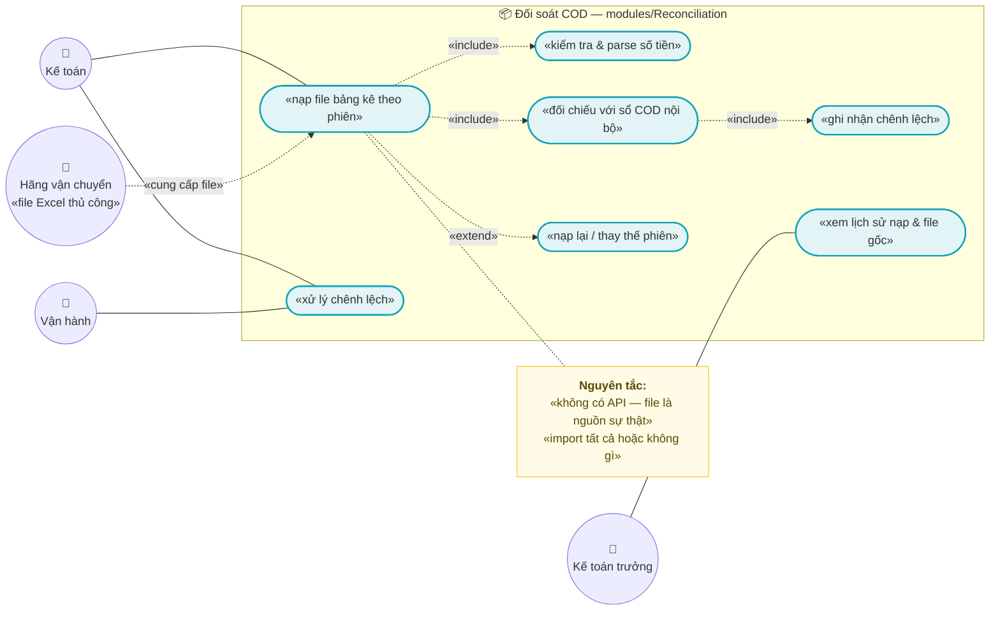
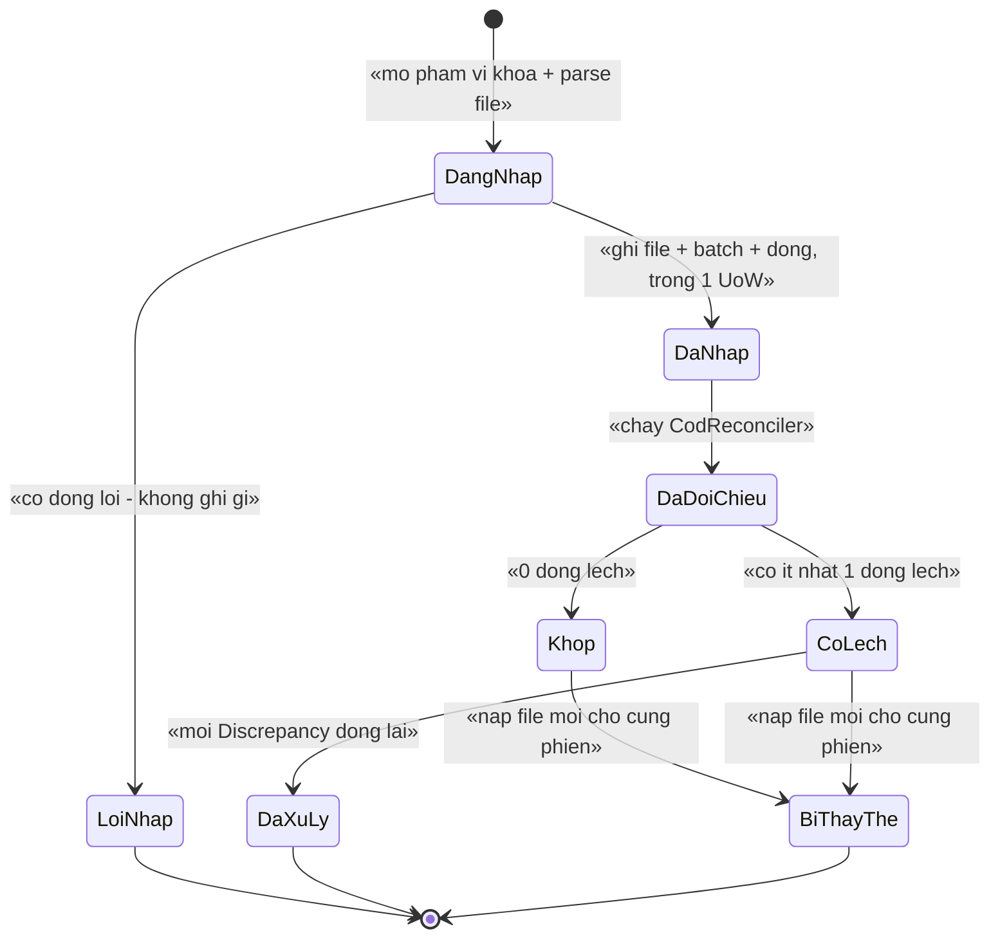
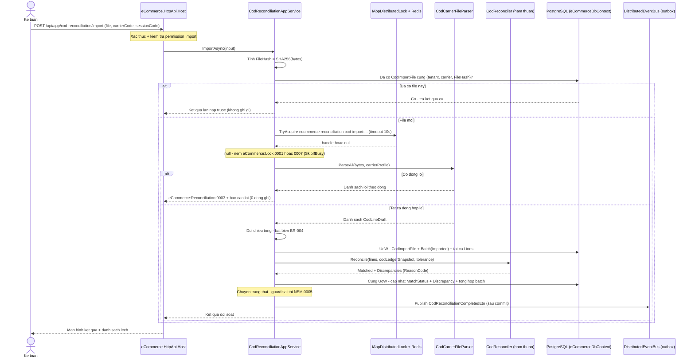
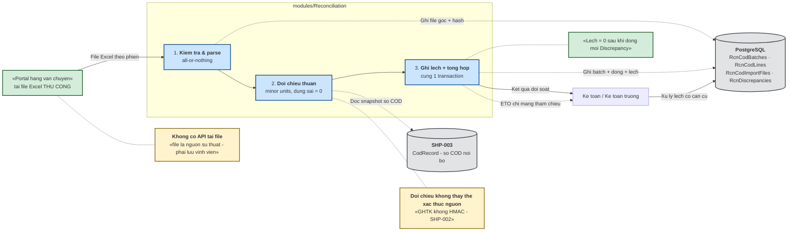
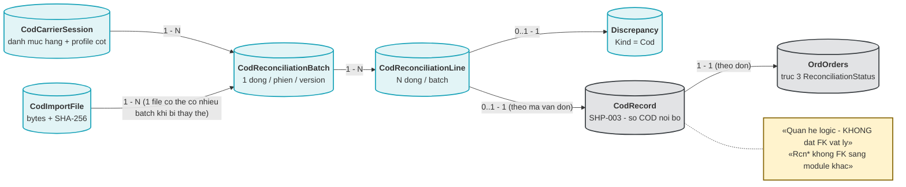

# `REC-003` — Đối soát COD: import file Excel theo "phiên"

| Thuộc tính | Nội dung |
|---|---|
| **Mã** | `REC-003` |
| **Module** | **Reconciliation** (`modules/Reconciliation/`) — ⚠️ **CHƯA TỒN TẠI TRONG CODE** (xem §15.2 **F1**) |
| **Giai đoạn** | **GĐ2 — Vận hành VN** (`docs/implementation-plan.md:113`, `:200`) |
| **Ưu tiên** | **Must have** — là **điều kiện của cổng kiểm soát GĐ2** (*"một đơn chạy hết vòng đặt → giao → COD → đối soát"* — `docs/implementation-plan.md:204`) |
| **Trạng thái** | 🟡 `Draft` — chờ review |
| **Người viết / người review** | *(điền)* / **Kiến trúc trưởng + Kế toán trưởng + Vận hành** |
| **Phiên bản / ngày** | `v0.1 — 14/10/2026` |
| **Tài liệu liên quan** | `SHP-003` (COD: thu hộ, **đổi COD cần OTP** — *chưa có tài liệu*) · `SHP-002` (webhook vận đơn — ⚠️ **GHTK không có HMAC**) · `REC-001` (đối soát thanh toán) · `REC-002` (settlement sàn) · `SAL-003` (state machine **4 trục**, trục 3 = `ReconciliationStatus`) · `REP-001`/`REP-002`/`REP-003` (read-model) · `ACC-001` (xuất liệu kế toán — *chưa có tài liệu*) · `XC-001` (Money/làm tròn) · `XC-002` (outbox/inbox + idempotency) · `XC-003` (khoá phân tán) · `XC-004` (`[Authorize]` cấp class) · `XC-005` (log/metric) · `XC-006` (thuế GTGT) · `CHN-002`/`CHN-003`/`CHN-004` (ChannelHub) · `CHN-001` (khuôn module đã có code) · `docs/implementation-plan.md:200`, `:291`, `:429` · `docs/business-modules-proposal.md:93` |

---

## 0. Tóm tắt & quyết định thiết kế

**Câu hỏi nghiệp vụ mà feature này trả lời:**

1. **Hãng vận chuyển nói đã thu hộ bao nhiêu tiền, cho những vận đơn nào, trong "phiên" nào** — và **con số đó có khớp** với số tiền COD mà hệ thống tin là phải thu không?
2. **Tiền COD đã thực sự về tài khoản ngân hàng chưa**, hay mới chỉ "hãng báo đã thu"?
3. **Chênh lệch nằm ở đâu và ai chịu trách nhiệm xử lý** — khi hãng báo thu nhiều/ít hơn, khi thiếu vận đơn, khi có vận đơn lạ (không có trong hệ thống), khi hoàn hàng?

**Tóm tắt thiết kế:** `REC-003` **không gọi API nào** để lấy bảng kê COD. Theo `docs/implementation-plan.md:200` và `docs/business-modules-proposal.md:93`: *"⚠️ **KHÔNG có API đối soát** — GHN chỉ có API **đổi** COD; bảng kê là **file Excel tải THỦ CÔNG**, kỳ theo **"phiên"** (`mã phiên`). Phải thiết kế luồng **import file thủ công + đối soát**"*. Vì vậy feature này là **một pipeline import file**:

```
file Excel của hãng  →  kiểm tra & parse (tất cả-hoặc-không-gì)  →  CodReconciliationLine  →  hàm đối chiếu thuần  →  Discrepancy  →  (kế toán xử lý)  →  cập nhật trục đối soát của đơn
```

Ba nguyên tắc xuyên suốt:

- 🔒 **File là nguồn sự thật duy nhất, và nó phải được lưu vĩnh viễn** (file gốc + SHA-256). Không có API thì **không thể tải lại**; nếu mất file, mất luôn căn cứ đối chiếu với hãng và với cơ quan thuế.
- 🔒 **Tiền so bằng `decimal` + "đơn vị nhỏ nhất" (minor units), tuyệt đối không `==` trên tiền.** Toàn bộ code hiện tại dùng `decimal` trực tiếp (`src/eCommerce.Domain/Entities/Orders/Order.cs:39–47`) và **`Money`/`ToMinorUnits` CHƯA có trong code** (`grep "class Money|ToMinorUnits"` = **0**) ⇒ feature này **phụ thuộc `XC-001`** (xem §15.2 **F2**).
- 🔒 **Import phải idempotent ở CẢ HAI chiều**: (a) nạp **cùng một file** hai lần ⇒ **không** sinh bản ghi mới; (b) cùng một "phiên" đến trong **file chia nhỏ** ⇒ **không** cộng trùng tiền. Hàng rào **cuối cùng là unique index ở DB**, không phải kiểm tra trong code (`XC-003` D2).

**Phạm vi:**

- ✅ **Khuôn module `modules/Reconciliation/`** (Domain / EntityFrameworkCore / Application / Contracts) theo đúng khuôn đã có thật của `modules/Tax/` và `modules/ChannelHub/` (`docs/structure-and-techstack.md:87–101`).
- ✅ **5 entity**: `CodReconciliationBatch`, `CodReconciliationLine`, `Discrepancy`, `CodImportFile` (file gốc + hash), `CodCarrierSession` (danh mục phiên/đối tác).
- ✅ **Import file Excel "tất cả hoặc không gì"** (all-or-nothing) + **báo cáo lỗi theo dòng** cho người nhập.
- ✅ **Hàm đối chiếu THUẦN** (`CodReconciler`) — chỉ nhận dữ liệu đã nạp, trả về kết quả khớp/lệch; **không** I/O ⇒ test được 100 %.
- ✅ **Idempotency 2 tầng** (khoá ổn định + unique index) và **state machine NÉM LỖI**.
- ✅ **Khoá phân tán** theo `XC-003`: `ecommerce:reconciliation:cod-import:{tenantId}:{carrierCode}:{sessionCode}`.
- ✅ **Metric/log** theo `XC-005` (phải đăng ký ở registry thật + `XC-005` §5.1 trong **cùng PR**).
- ✅ **Quy tắc parse số tiền VND từ Excel** (dấu nghìn `.`, dấu thập phân `,` — đây là chỗ dễ sai nhất, xem §15.2 **F3**).
- ✅ **Liên kết ra `SAL-003`** (trục 3 `ReconciliationStatus`) và **ra `ACC-001`** (xuất liệu kế toán).

**Không nằm trong phạm vi:**

- ❌ **Thu hộ/đổi COD ở hãng** (tạo COD, đổi số tiền COD, OTP của GHN) — thuộc `SHP-003` (`docs/implementation-plan.md:426`).
- ❌ **Tự động tải file từ portal của hãng** — ⚠️ **chưa kiểm chứng** ToS của GHN/GHTK có cho phép hay không (`docs/business-modules-proposal.md:557`); nếu làm được thì đó là **feature khác**, không phải `REC-003`.
- ❌ **Settlement sàn TMĐT** (phí sàn, tiền sàn phải trả) — thuộc `REC-002`.
- ❌ **Đối soát thanh toán qua cổng** (`querydr`) — thuộc `REC-001`.
- ❌ **Sổ cái COD nội bộ** (`CodRecord`: `CodPending → CodCollected → CodRemitted`) — thuộc `SHP-003` + `ShippingHub`; `REC-003` **tiêu thụ** nó, **không** sở hữu nó.
- ❌ **Định dạng file xuất kế toán** — thuộc `ACC-001`.
- ❌ **Read-model tổng hợp COD** — thuộc `REP-003` (⚠️ đang **`Open`** ở `REP-001` **Q6** / `REP-003` **Q6**: *"Projection COD có cần `REP-001` không, hay để `REC-003` tự lo bảng riêng?"* — xem §15.1 **Q4**).

### 0.1 Quyết định thiết kế (ADR ngắn)

| # | Quyết định | Phương án đã cân nhắc | Lý do chọn | Hệ quả |
|---|---|---|---|---|
| **ADR-01** | **Reconciliation là module riêng** `modules/Reconciliation/` (Domain + EntityFrameworkCore + Application + Contracts) | (a) nhét vào `src/eCommerce.Application`; (b) module riêng | Đối soát là **bounded context** đã có chỗ trong kiến trúc (`docs/structure-and-techstack.md:77`) và **khuôn module đã có thật để copy**: `modules/Tax/` (3 project) + `modules/ChannelHub/` (4 project, `docs/structure-and-techstack.md:98`, `eCommerce.slnx:3–17`) | Thêm 3–4 project; chi phí **cố ý** để cưỡng chế được ranh giới "module gọi app BỊ CẤM" |
| **ADR-02** | **File gốc + SHA-256 được lưu vĩnh viễn** (`CodImportFile`) | (a) chỉ lưu đường dẫn tạm; (b) lưu file trong DB (`bytea`); (c) lưu file trên đĩa + hash trong DB | Không có API ⇒ **không tải lại được**; kế toán/thuế phải đối chiếu lại **nhiều tháng sau**. Ảnh hưởng dung lượng: file bảng kê GHN/GHTK thường **< 2 MB/tháng/hãng** ⇒ lưu `bytea` chấp nhận được, tránh phụ thuộc ổ đĩa của container | Bảng có cột `bytea`; **cấm** xoá theo retention thông thường (xem §11) |
| **ADR-03** | **Hai tầng chống trùng**: `IdempotencyKey` ổn định + `FileHash` unique | (a) chỉ `FileHash`; (b) chỉ kiểm tra trong code; (c) **cả hai** | (a) **không** chặn được ca *"cùng phiên, hãng gửi 2 file khác nhau"* (bổ sung/điều chỉnh) ⇒ cộng trùng tiền. Kiểm trong code **không** phải hàng rào (`XC-003` D2: Redis chết ⇒ lock vô hiệu) | Cần **2 unique index**; trường hợp file hợp lệ thứ hai của cùng phiên ⇒ bắt buộc qua luồng **`Superseded`** (ADR-04), **không** ghi đè im lặng |
| **ADR-04** | **`CodReconciliationBatch` là APPEND-ONLY + thay thế bằng bản ghi mới** | (a) sửa/xoá batch đã import; (b) append-only + batch thay thế | Kế thừa `REP-003` D6 và `XC-006` D6: cần trả lời *"con số này do file nào, nạp lúc nào, có qua đối chiếu không"*. Sửa tại chỗ ⇒ **mất vết** và kế toán không biết tin bản nào | Muốn nạp lại ⇒ batch mới (`Version + 1`), batch cũ chuyển `Superseded`; **cấm** UPDATE số tiền trên batch đã `Matched` |
| **ADR-05** | **Import "tất cả hoặc không gì" (all-or-nothing) theo file** | (a) ghi dòng hợp lệ, bỏ dòng lỗi; (b) all-or-nothing + báo cáo lỗi toàn bộ | (a) làm **tổng tiền của phiên bị thiếu** mà kế toán **không biết thiếu bao nhiêu** ⇒ đúng loại lỗi *"số sai mà không ai phát hiện"*. Đây cũng là khuôn đã chốt ở `XC-006` **E2** (*"gom vào báo cáo lỗi, **không ghi dòng nào** — all-or-nothing theo lô"*) | Người nhập phải **sửa file và nạp lại**; đổi lại số liệu trong DB **luôn** là một phiên **trọn vẹn** |
| **ADR-06** | **Hàm đối chiếu là HÀM THUẦN, tách khỏi đọc/ghi DB** (`CodReconciler`) | (a) vừa đọc DB vừa so vừa ghi; (b) truyền dữ liệu vào, nhận kết quả ra | Khuôn **đã được chứng minh trong repo**: `Mau01Part2Calculator` là hàm thuần *"dùng chung cho mọi định dạng xuất"* (`modules/Tax/eCommerce.Tax.Domain/Mau01/Mau01Part2Calculator.cs:50–57`, dẫn lại ở `REP-003` D12) | Cần DTO "đầu vào phẳng"; **không** được truy vấn trong hàm ⇒ test được toàn bộ tổ hợp lệch mà **không cần** DB |
| **ADR-07** | **Khoá lock theo (tenant, hãng, phiên)**: `ecommerce:reconciliation:cod-import:{tenantId}:{carrierCode}:{sessionCode}`, TTL **600 s**, `SkipIfBusy` | (a) khoá theo tenant; (b) **không** khoá (tin unique index); (c) khoá theo phiên | (a) chặn tenant vô cớ (vi phạm `XC-003` D7). (b) đúng về **tính đúng** nhưng người nhập sẽ nhận **lỗi unique index thô** thay vì thông điệp nghiệp vụ. (c) hai kế toán cùng nạp **cùng phiên** ⇒ một người chờ/được báo rõ. Tên khoá **KHÔNG** chứa tiền tố `ecommerce:` — tiền tố do `AbpDistributedLockOptions.KeyPrefix = "ecommerce:"` cấp (`src/eCommerce.HttpApi.Host/eCommerceHttpApiHostModule.cs:127`), theo `XC-003` §5.4 hệ quả 2 | Cần đăng ký hàm sinh khoá tại `ReconciliationLockKeys`; **cấm** literal khoá trong code nghiệp vụ (`XC-003` BR-001) |
| **ADR-08** | **Quy tắc parse số tiền tường minh, dùng `InvariantCulture` sau khi chuẩn hoá dấu** | (a) `decimal.Parse(s)` theo culture của server; (b) `double.Parse`; (c) chuẩn hoá dấu rồi parse invariant | (a) **phụ thuộc culture của máy chủ** ⇒ cùng file cho ra hai số khác nhau giữa dev (vi-VN) và CI (en-US) — lỗi **im lặng** đúng loại `XC-003` F1/(`XC-003` §15.2). (b) `double` **cấm** cho tiền (`XC-001` BR-008; code hiện tại đã dùng `decimal`, xem `Order.cs:39–47`, `eCommerceDbContext.cs:173–178`). (c) tường minh, test được | Phải có **bộ test parse** riêng (`TC-02`); ô số không đúng quy tắc ⇒ **lỗi dòng**, **không** đoán |
| **ADR-09** | **`Discrepancy` thuộc sở hữu `Reconciliation`** (không tạo bản sao cho `REC-001`/`REC-002`) | (a) mỗi feature một bảng lệch; (b) **một** bảng + cột `Kind` | `docs/implementation-plan.md:182` đã liệt kê `Discrepancy` **một lần** cho cả module (`PaymentReconciliationRun`/`PaymentReconciliationLine`/`Discrepancy` ở `:182`; `CodReconciliationBatch`/`CodReconciliationLine`/`Discrepancy` ở `:200`). Hai bảng lệch ⇒ hai màn hình xử lý + hai định nghĩa "đã xử lý" | Cần cột `Kind` (`Cod` · `Payment` · `Settlement`) + `SourceId`; `REC-001`/`REC-002` **dùng lại** entity, **không** khai báo lại |
| **ADR-10** | **`decimal` + `Money` cho mọi trường tiền; so sánh bằng minor units** | (a) `double`; (b) `decimal` so bằng `==` | Kế thừa `XC-001` D (BR-003/BR-008) và `REP-003` D8. ⚠️ **`Money` CHƯA có trong code** (`grep "Money\|ToMinorUnits"` trong `src`, `modules`, `test` = **0**) ⇒ ghi rõ **phụ thuộc** thay vì giả định đã có | Nếu `XC-001` chưa xong ⇒ `REC-003` **chặn** ở §14.4; tạm thời so bằng `long` minor units viết tại module và **xoá** khi Kernel có |
| **ADR-11** | **`CodReconciliationBatch` + `CodReconciliationLine` đều có `DbSet` trên DbContext hợp nhất** | (a) chỉ gọi `builder.ConfigureReconciliation()`; (b) khai báo `DbSet` | 🚨 **Bài học đã trả giá trong repo**: `AddDefaultRepositories(includeAllEntities: true)` **chỉ** tạo `IRepository<T>` cho entity **CÓ `DbSet`**; thiếu ⇒ runtime ném *"The requested service 'IRepository<ChannelShop, Guid>' has not been registered."* — ghi rõ ở `src/eCommerce.EntityFrameworkCore/eCommerceDbContext.cs:48–52`, `:60–62` | Mọi entity của `Reconciliation` **phải** thêm `DbSet` ở DbContext hợp nhất; đây là bước dễ quên nhất khi tạo module mới |
| **ADR-12** | **Metric mới phải đăng ký ở HAI nơi** (`eCommerceMetricNames` + `XC-005` §5.1) và **nhãn chỉ từ tập hữu hạn** | (a) phát metric tự do; (b) registry | **Test đã chốt trong CI**: `MetricsTests.TC06_phat_ra_DUNG_12_metric_da_dang_ky` và `TC06_khong_co_metric_phat_ra_ngoai_bang_dang_ky` (`test/eCommerce.Tests/Observability/MetricsTests.cs:38–59`) + test hậu tố tên (`:111–127`) ⇒ phát metric lạ là **CI đỏ** | 🚨 **Cấm** nhãn `sessionCode`, `trackingCode`, `orderId`, `sku` — chúng nằm trong `eCommerceMetricTags.Forbidden` (`src/eCommerce.Domain.Shared/Observability/eCommerceMetrics.cs:81–84`) |
| **ADR-13** | **Không có job định kỳ riêng cho `REC-003` ở GĐ2** | (a) thêm `CodReconWorker` chạy nền; (b) chỉ import theo yêu cầu người dùng | Đối soát COD **không có nguồn tự động** (không API) ⇒ job nền **không có gì để quét**. Khuôn worker động của `ChannelHub` **chỉ đăng ký khi nhịp đổi** (`modules/ChannelHub/eCommerce.ChannelHub.Application/Sync/ChannelSyncSupervisorWorker.cs:81–85`) — thêm job rỗng chỉ tăng bề mặt lỗi | Việc "nhắc nạp file" (nếu cần) thuộc `NOT-*`; nếu sau này có API tải file thì mở lại quyết định này |

---

## 1. Use Case Specification

| Thuộc tính | Nội dung |
|---|---|
| **Use Case ID** | `REC-003` |
| **Use Case Name** | Nạp bảng kê COD của hãng vận chuyển (file Excel theo **phiên**) và đối soát với sổ COD nội bộ |
| **Description** | *"Là **kế toán** (hoặc nhân viên vận hành), tôi muốn **tải file bảng kê COD** của hãng vận chuyển cho một **phiên** và để hệ thống đối chiếu với sổ COD nội bộ, để tôi biết **chính xác** khoản nào khớp, khoản nào lệch, và xử lý ngay trên màn hình thay vì dò bằng Excel tay."* |
| **Actor(s)** | **Kế toán** (nạp file, xử lý lệch) · **Vận hành** (đối chiếu tiền đã về tài khoản) · **Kế toán trưởng** (duyệt kết quả phiên, xuất liệu cho `ACC-001`) · **Hệ thống** (parse, đối chiếu, ghi lệch) · **Hãng vận chuyển** (nguồn file — **ngoài hệ thống**, không có API) |
| **Priority** | **Must have** |
| **Trigger** | (a) kế toán tải file bảng kê từ portal của hãng và bấm **Nạp file**; (b) nạp lại sau khi sửa file lỗi; (c) nạp file **điều chỉnh/bổ sung** của cùng phiên; (d) kế toán bấm **Đối chiếu lại** một phiên đã `Failed` (không tạo bản ghi mới cho dòng — chỉ chạy lại hàm thuần) |
| **Pre-Condition(s)** | • **`TenantId` BẮT BUỘC** (`ICurrentTenant`); thiếu ⇒ **ném lỗi tham số** (đối soát là nghiệp vụ của tenant, host **không** chạy hộ tenant — cùng nguyên tắc `REP-003` §1).<br>• **Hãng vận chuyển** đã có trong danh mục `CodCarrierSession.CarrierCode` và có **profile cột** (ánh xạ tên cột ↔ trường) đã cấu hình; **chưa có** ⇒ `eCommerce:Reconciliation:0006`.<br>• **`SHP-003`** đã có sổ COD nội bộ (`CodRecord` + trạng thái `CodCollected` **đã được xác nhận**, không tin webhook — xem `SHP-002` D1/BR-004). ⚠️ **chưa có trong code**: `ShippingHub` **không tồn tại** (`SHP-002` §15.2 **F1**: không project, không entity, không `DbSet`).<br>• **File** đúng định dạng hãng công bố (`.xlsx`; `.xls` **không** hỗ trợ — xem §15.1 **Q5**), có **cột mã vận đơn** và **cột số tiền COD**.<br>• **`XC-001`** (`Money`/minor units) và **`XC-003`** (lock) **đã có code**. ⚠️ **`XC-001` CHƯA có code** — `shared/eCommerce.Kernel` **chưa tồn tại** (§15.2 **F2**).<br>• **Redis 7** sẵn sàng; nếu **không**, khoá vô hiệu nhưng app **vẫn chạy** (`AbortOnConnectFail = false` — `src/eCommerce.HttpApi.Host/eCommerceHttpApiHostModule.cs:141`) và **unique index ở DB là hàng rào cuối** (`XC-003` D2).<br>• ⚠️ **Máy dev hiện chưa có PostgreSQL/Redis** ⇒ các ràng buộc cần DB (`UNIQUE`, `CHECK`, `NULLS NOT DISTINCT`) **chưa kiểm chứng** trong phiên viết tài liệu này. |
| **Post-Condition(s)** | • **Đúng một** `CodReconciliationBatch` cho mỗi `(TenantId, CarrierCode, SessionCode, Version)`; **đúng một** bản ghi `CodImportFile` cho mỗi `(TenantId, CarrierCode, FileHash)`.<br>• **Mọi dòng** của phiên nằm trong `CodReconciliationLine` — **không** có dòng nào bị bỏ im lặng.<br>• **Mọi** dòng lệch có **đúng một** `Discrepancy` `Kind = Cod` với `ReasonCode` cụ thể (**cấm** "lệch không rõ lý do").<br>• **Bất biến tiền**: `Σ LineDeclaredAmount` (theo minor units) **==** `Batch.TotalDeclaredAmount`; vi phạm ⇒ **không** ghi dòng nào (BR-004).<br>• **Mọi** thay đổi trạng thái batch/`Discrepancy` đều có **audit + log có `CorrelationId`**.<br>• Đơn hàng liên quan (nếu có) chuyển trục 3 `ReconciliationStatus` **chỉ** qua API của `SAL-003` (**không** ghi thẳng DB). |
| **Basic Flow** | 1. Kế toán mở màn hình `Đối soát COD`, chọn **hãng** + **phiên**, chọn file và bấm **Nạp**.<br>2. App service kiểm tra quyền `eCommerce.Reconciliation.Import` + kiểm tra **định dạng & kích thước** file; tính `FileHash = SHA256(bytes)`.<br>3. **Idempotency tầng 1**: đã có `CodImportFile` cùng `(TenantId, CarrierCode, FileHash)` ⇒ **trả luôn** kết quả cũ (không đọc lại file) — đây là **`200`**, **không phải** lỗi (§12).<br>4. Mở phạm vi khoá `ecommerce:reconciliation:cod-import:{tenantId}:{carrierCode}:{sessionCode}` (`await using`, timeout 10 s, `SkipIfBusy` — ADR-07).<br>5. **Idempotency tầng 2**: đã có batch `Imported`/`Matched` cho cùng phiên ⇒ tạo **batch thay thế** (`Version + 1`) và chuyển batch cũ sang `Superseded` (ADR-04).<br>6. **Parse toàn bộ file** vào bộ nhớ; **bất kỳ** lỗi dòng/cột nào ⇒ **không ghi gì** + trả **báo cáo lỗi theo dòng** (ADR-05).<br>7. Trong **một Unit of Work**: ghi `CodImportFile` (bytes + hash) → `CodReconciliationBatch` (`Imported`) → **tất cả** `CodReconciliationLine`.<br>8. Gọi **hàm thuần** `CodReconciler.Reconcile(batchLines, codLedgerSnapshot, tolerance)` (ADR-06) ⇒ danh sách `Matched` + danh sách `Discrepancy`.<br>9. Trong **cùng** Unit of Work với bước 8: cập nhật `Line.MatchStatus`, ghi `Discrepancy`, cộng số tổng hợp lên batch.<br>10. Chuyển batch `Imported → Reconciled` (`Matched` nếu **0 lệch**, `DiscrepancyFound` nếu có lệch) — **ném lỗi** nếu chuyển sai (BR-009).<br>11. Phát `CodReconciliationCompletedEto` (chỉ mang **tham chiếu**, không mang số liệu) sau khi commit.<br>12. Màn hình hiện kết quả: số dòng, số khớp, số lệch, **tổng lệch** (theo minor units) + danh sách lệch để xử lý. |
| **Alternative Flow** | **A1: Nạp cùng file hai lần** — trả kết quả của lần nạp đầu, **0** bản ghi mới, log `Information` + metric `cod_import_duplicate_total{reason=file-hash}`; **không** ném lỗi (đây là hành vi mong đợi).<br>**A2: Cùng phiên, file thứ hai** (hãng gửi bổ sung/điều chỉnh) — tạo batch **`Version + 1`**; batch cũ `Superseded`; **cấm** sửa batch cũ (ADR-04).<br>**A3: File có dòng của vận đơn ngoài khoảng kỳ** — vẫn nạp (không mất tiền), nhưng **đánh dấu** dòng đó `MatchStatus = OutOfPeriod` + `Discrepancy(ReasonCode = ngoai-ky)` để kế toán quyết định.<br>**A4: Đối soát lại một phiên** (đã có sổ COD mới) — **không** nạp file mới; chạy lại `CodReconciler` trên dữ liệu đã có, **ghi thêm** `Discrepancy` mới nếu phát hiện thêm lệch; **cấm** xoá `Discrepancy` cũ.<br>**A5: Ô "số tiền" trống** — coi là **`0` tường minh** *chỉ khi* hãng công bố vậy; nếu không rõ ⇒ **lỗi dòng** (ADR-08) — **cấm** đoán. |
| **Exception Flow** | **E1:** file sai định dạng/thiếu cột bắt buộc ⇒ `BusinessException` **`eCommerce:Reconciliation:0001`** (`400`) + danh sách cột thiếu (kế thừa cách nêu lỗi của `XC-006` E5).<br>**E2:** có dòng dữ liệu sai (thiếu mã vận đơn, số tiền không parse được, trùng mã vận đơn **trong cùng file**) ⇒ **`0003`** (`422`) + **báo cáo lỗi theo dòng**, **không** ghi dòng nào (ADR-05).<br>**E3:** `Σ dòng != tổng khai báo` (hoặc tổng khai báo không có trong file) ⇒ **`0004`** (`409`) — **không** ghi gì. ⚠️ Riêng ca *"hãng không có dòng tổng"* thì bỏ **điều kiện** này và ghi cờ `DeclaredTotalMissing = true` (§15.1 **Q2**).<br>**E4:** không giành được khoá trong timeout ⇒ **`eCommerce:Lock:0001`** (`409`) theo `XC-003` §6.2; nếu chế độ `SkipIfBusy` (người dùng bấm nút) ⇒ **`0007`** (`409`) *"phiên đang được nạp bởi người khác"*.<br>**E5:** chuyển trạng thái batch sai (ví dụ `Superseded → Matched`, `Matched → Imported`) ⇒ **`0005`** (`409`) — **NÉM**, **cấm** no-op im lặng (bất biến dự án + `SAL-003` BR-002).<br>**E6:** hãng chưa có profile cột trong `CodCarrierSession` ⇒ **`0006`** (`400`).<br>**E7:** file vượt giới hạn dung lượng/số dòng cấu hình ⇒ **`0002`** (`413`).<br>**E8:** **Redis chết** ⇒ theo `XC-003` **E2**, mặc định **fail-open** (chạy tiếp) + log `Error` + metric; tính đúng vẫn được **unique index** bảo vệ. |
| **Business Rules** | • **BR-REC-003-001**: Mọi lần nạp file **phải** có **khoá idempotency ổn định** `IdempotencyKey = rec003:{tenantId}:{carrierCode}:{sessionCode}:{fileHash}`; **cấm** `Guid.NewGuid()` mỗi lần thử (kế thừa `XC-002` BR-007).<br>• **BR-REC-003-002**: **Đúng một** batch cho mỗi `(TenantId, CarrierCode, SessionCode, Version)` và **đúng một** file cho mỗi `(TenantId, CarrierCode, FileHash)` — **unique index ở DB** là hàng rào cuối, **không** chỉ kiểm trong code (`XC-003` D2).<br>• **BR-REC-003-003**: File gốc **phải** được lưu (bytes + `FileHash` + `FileSizeBytes` + `ImportedBy` + `ImportedAtUtc`) **trong cùng transaction** với việc tạo batch; **cấm** xoá file gốc khi còn batch tham chiếu.<br>• **BR-REC-003-004**: Bất biến tiền của một phiên: **`Σ LineDeclaredAmount` (minor units) == `Batch.TotalDeclaredAmount`**; lệch ⇒ **NÉM `0004`** **và** ràng buộc DB phải chặn được (kiểm lại khi đọc — xem §5.4).<br>• **BR-REC-003-005**: Parse số tiền **chỉ** theo quy tắc `CodAmountParser` (ADR-08): chuẩn hoá dấu nghìn/thập phân ⇒ `parse` **InvariantCulture** ⇒ **làm tròn về số chữ số thập phân của tiền tệ** (`VND = 0`). Ô không parse được ⇒ **lỗi dòng**, **cấm** trả `0`.<br>• **BR-REC-003-006**: **Cấm** so sánh tiền bằng `==` trên `decimal`; mọi so sánh/ngưỡng **phải** qua **minor units** (`long`) (`XC-001` BR-003). So **tuyệt đối**; dung sai phải là hằng số cấu hình **tường minh** (`ToleranceMinorUnits`, mặc định **0**).<br>• **BR-REC-003-007**: Import **all-or-nothing** theo file (ADR-05): có **bất kỳ** dòng lỗi ⇒ **0** dòng được ghi; phản hồi **phải** liệt kê **số dòng + lý do** cho **mọi** dòng lỗi (**cấm** chỉ báo dòng đầu tiên).<br>• **BR-REC-003-008**: **Mọi** dòng lệch **phải** có `Discrepancy` với `ReasonCode` **thuộc enum đã định nghĩa**; `ReasonCode` rỗng/ngoài enum ⇒ **NÉM `0005`**.<br>• **BR-REC-003-009**: State machine của batch và của `Discrepancy` **phải NÉM LỖI** khi chuyển sai; trạng thái `Superseded`/`Resolved`/`WrittenOff`/`Rejected` là **hấp thụ** (absorbing) — **cấm** chuyển tiếp, muốn làm lại ⇒ **bản ghi mới**.<br>• **BR-REC-003-010**: `CodReconciliationBatch`, `CodReconciliationLine`, `CodImportFile` là **APPEND-ONLY** sau khi batch `Reconciled` — **cấm** `UPDATE` số tiền/hash/số dòng; **cấm** `DELETE`. Sửa sai ⇒ batch thay thế (ADR-04).<br>• **BR-REC-003-011**: Mọi thao tác ghi **phải** đi qua **Unit of Work**: `CodImportFile` + `CodReconciliationBatch` + **tất cả** `CodReconciliationLine` + `Discrepancy` của cùng một lần nạp nằm trong **một** transaction.<br>• **BR-REC-003-012**: Phạm vi khoá phân tán **bao ngoài** Unit of Work; **cấm** acquire lồng cùng tên khoá (lock **không** reentrant — `XC-003` D6/BR-005).<br>• **BR-REC-003-013**: **Mọi** app service **phải** có `[Authorize]` ở **cấp class** (tiền lệ thật: `src/eCommerce.Application/Channels/ChannelAppService.cs:21–28` — thiếu `[Authorize]` cấp class thì `GetShopsAsync` từng **là API công khai**); permission dùng trong `[Authorize]` **phải** được định nghĩa ở provider (`src/eCommerce.Application.Contracts/Permissions/eCommercePermissionDefinitionProvider.cs:23–60`) — **chưa định nghĩa ⇒ luôn 403**.<br>• **BR-REC-003-014**: `REC-003` **cấm** sửa trực tiếp trạng thái đơn: muốn cập nhật trục 3 `ReconciliationStatus` **phải** gọi API của `SAL-003` (`SAL-003` §6.2 `ChangeReconciliationStatusAsync`); **cấm** viết thẳng `OrdOrders`.<br>• **BR-REC-003-015**: **Cách ly tenant**: mọi entity là `IMultiTenant`; **0** truy vấn nào của `REC-003` được đọc/ghi dữ liệu của tenant khác; file của tenant A **không** được trả cho tenant B (kể cả khi biết `batchId`).<br>• **BR-REC-003-016**: **Cấm** log nội dung file/nội dung dòng (chứa tên người nhận, địa chỉ, số điện thoại). Log **chỉ** dùng **số liệu tổng hợp** + `FileHash` + mã phiên (`XC-005` BR-005). |
| **Non-Functional Requirement** | • **NFR-REC-003-001**: File **10.000 dòng** ⇒ import + đối chiếu **p95 < 30 s** (không tính thời gian tải file lên).<br>• **NFR-REC-003-002**: Nạp **cùng một file 1.000 lần** ⇒ **đúng 1** batch, **1** file, **N** dòng (N = số dòng file), **0** dòng nhân bản.<br>• **NFR-REC-003-003**: File hợp lệ (đúng định dạng) ⇒ **0** dòng bị bỏ qua **im lặng**; mọi dòng hoặc **được ghi** hoặc **được báo lỗi**.<br>• **NFR-REC-003-004**: **0** phép so sánh tiền bằng `==`; **0** lần dùng `double`/`float` cho tiền trong module (test reflection/quét mã nguồn).<br>• **NFR-REC-003-005**: Cách ly tenant: **0** trường hợp tenant B đọc được batch/file/lệch của tenant A (integration test 2 tenant).<br>• **NFR-REC-003-006**: **100 %** app service có `[Authorize]` **cấp class**; **0** permission dùng mà chưa định nghĩa (test reflection — theo `XC-004`, khuôn đã nêu ở `CHN-004` NFR-007).<br>• **NFR-REC-003-007**: **Redis chết** ⇒ app **không** sập và **không** sinh bản ghi trùng (nhờ unique index) — integration test dừng Redis.<br>• **NFR-REC-003-008**: **0** dòng log chứa dữ liệu cá nhân của người nhận (quét mã nguồn ở CI); log là **một dòng JSON** có `CorrelationId` (`XC-005` BR-010).<br>• **NFR-REC-003-009**: **100 %** dòng lệch có `ReasonCode` thuộc enum + `DiscrepancyId`; `0` dòng lệch "không rõ lý do".<br>• **NFR-REC-003-010**: Tổng lệch tích luỹ của một phiên là **0 đồng** sau khi mọi `Discrepancy` ở trạng thái `Resolved`/`WrittenOff`/`Rejected` — kiểm bằng test ở §14 (`TC-12`). |

---

## 2. Sơ đồ Use Case



**Chú giải**

| Ký hiệu | Ý nghĩa |
|---|---|
| ⭕ Xanh lá | Actor |
| 🟦 Bầu dục xanh dương | Use Case |
| 🟨 Khung vàng | Note (nguyên tắc bất biến) |
| `───` | Liên kết Actor ↔ Use Case |
| `-.«include».->` | Quan hệ bao hàm |
| `-.«extend».->` | Quan hệ mở rộng (chỉ xảy ra trong điều kiện nhất định) |

---

## 3. Sơ đồ trạng thái (state machine)

### 3.1 Vòng đời một `CodReconciliationBatch`



| # | Từ → Sang | Guard (điều kiện cho phép) | Hành động kèm theo | Nếu guard sai thì? |
|---|---|---|---|---|
| 1 | *(mới)* → `DangNhap` | Có `TenantId` + quyền `Import` + giành được khoá phiên | Ghi `CodImportFile` (bytes+hash) tạm trong UoW đang mở | **`eCommerce:Lock:0001`** (`409`) hoặc **`0007`** (`SkipIfBusy`) |
| 2 | `DangNhap` → `LoiNhap` | Parser phát hiện **≥ 1** lỗi dòng/cột | Ghi **báo cáo lỗi theo dòng** (không lưu DB); UoW **không** ghi dòng nghiệp vụ nào | **`0001`** / **`0003`** (`400`/`422`) — **NÉM** |
| 3 | `DangNhap` → `DaNhap` | **0** lỗi dòng **và** `Σ dòng == tổng khai báo` (BR-004) | Ghi batch `Imported` + **tất cả** dòng | Lệch tổng ⇒ **`0004`** (`409`) — **NÉM** |
| 4 | `DaNhap` → `DaDoiChieu` | Hàm thuần `CodReconciler` bắt đầu chạy | Không side effect (hàm thuần — ADR-06) | — |
| 5 | `DaDoiChieu` → `Khop` | **0** dòng lệch (theo minor units, dung sai = `ToleranceMinorUnits`) | `MatchedCount = TotalLines`; phát `CodReconciliationCompletedEto` | — |
| 6 | `DaDoiChieu` → `CoLech` | **≥ 1** dòng lệch | Ghi **đúng một** `Discrepancy` cho **mỗi** dòng lệch, `ReasonCode` **bắt buộc** (BR-008) | Thiếu `ReasonCode` ⇒ **`0005`** (`409`) — **NÉM** |
| 7 | `CoLech` → `DaXuLy` | **Mọi** `Discrepancy` của batch ở trạng thái đóng | Ghi tổng lệch đã xử lý; phát ETO cho `ACC-001` (**chỉ tham chiếu**) | Còn lệch mở ⇒ **không** cho `DaXuLy` (**`0005`**) |
| 8 | `Khop`/`CoLech` → `BiThayThe` | Có lần nạp **mới hơn** (`Version + 1`) cho cùng `(tenant, hãng, phiên)` | Batch cũ **bất biến**; **cấm** sửa số tiền (BR-010) | Cố sửa batch `BiThayThe` ⇒ **`0005`** |
| 9 | `BiThayThe`/`DaXuLy` → *(kết thúc)* | — | Trạng thái **hấp thụ**: **cấm** mọi chuyển tiếp (BR-009) | Chuyển tiếp ⇒ **`0005`** (`409`) |

### 3.2 Vòng đời một `Discrepancy`

| # | Từ → Sang | Guard | Hành động | Nếu guard sai |
|---|---|---|---|---|
| 1 | *(mới)* → `Open` | Dòng lệch được phát hiện **và** có `ReasonCode` hợp lệ | Ghi `Discrepancy` (`Kind = Cod`, `SourceId = lineId`), `DetectedAtUtc`, `AmountMinorUnits` | **`0005`** (`409`) |
| 2 | `Open` → `InReview` | Kế toán bắt đầu xử lý (có `AssignedTo`) | Ghi vết ai đang xử lý | — |
| 3 | `InReview` → `Resolved` | Kế toán nhập **căn cứ** (`ResolutionNote` + `ResolutionCode`) | Ghi `ResolvedAtUtc` + `ResolvedBy` | Thiếu căn cứ ⇒ **`0005`** |
| 4 | `InReview` → `WrittenOff` | Kế toán trưởng **duyệt** xoá lệch (có quyền `Reconciliation.Approve`) | Ghi lý do + người duyệt | Không có quyền ⇒ **`403`** |
| 5 | `InReview` → `Rejected` | Lệch **không** thuộc trách nhiệm ghi nhận (chứng minh bằng căn cứ) | Ghi `ResolutionCode` | Thiếu căn cứ ⇒ **`0005`** |
| 6 | `Resolved`/`WrittenOff`/`Rejected` → *(kết thúc)* | — | **Hấp thụ** — **cấm** chuyển tiếp (BR-009) | **`0005`** |

> ⚠️ **`Open → nothing` là nhánh nguy hiểm nhất.** Nếu cho phép "đóng lệch" mà **không** có `ResolutionCode`/căn cứ,
> thì mỗi tháng kế toán có thể đóng hết lệch và **không ai biết tiền đi đâu** — đúng loại lỗi mà `XC-003` D10 gọi là
> *"im lặng bỏ qua ⇒ mất việc mà không ai biết"*.

---

## 4. Sequence Diagram & luồng dữ liệu

### 4.1 Sequence — một lần nạp file (happy path + nhánh lỗi dòng)



### 4.2 DFD — đường đi của một con số COD (từ portal hãng tới sổ kế toán)



> ⚠️ **Đọc kèm §7.4:** đối soát **không** xác thực được **nguồn**. File Excel do người tải về từ portal — nếu portal
> hoặc tài khoản portal bị xâm nhập, kẻ tấn công có thể **sửa file** và hệ thống sẽ ghi "đã khớp" theo file đó.
> Biện pháp bù: `FileHash` + người nạp (`ImportedBy`) + audit log + **khoá 4 mắt** cho việc `WrittenOff` (§9).

---

## 5. Mô hình dữ liệu

### 5.1 ERD



**Ghi chú về ERD:** quan hệ `RcnCodLines → OrdOrders` / `CodRecord` là **quan hệ luận lý**, **không** đặt FK vật lý
(theo `REP-003` §5.1: read-model/bảng đối soát dùng FK luận lý để không khoá cứng vào module khác).
Lý do: `SHP-003`/`Sales` có thể tách microservice (ADR-01) và bảng đối soát phải **giữ được** vết kể cả khi
bản ghi gốc bị xoá/đổi — nếu có FK cứng thì `DELETE` ở nơi khác sẽ **phá** vết đối soát.

### 5.2 Bảng & cột (Data Dictionary)

**Bảng `RcnCodCarrierSessions`** — danh mục hãng + **profile cột** để parse (thay đổi cấu hình, **không** sửa code)

| Cột | Kiểu | Null? | Nguồn / ý nghĩa | Ghi chú |
|---|---|---|---|---|
| `Id` | `uuid` | ✖ | khoá chính | |
| `TenantId` | `uuid` | ✔ | tenant sở hữu | ⚠️ ở chế độ 1 tenant, `TenantId` **có thể `NULL`** ⇒ index unique phải `NULLS NOT DISTINCT` (xem §5.3) |
| `CarrierCode` | `varchar(32)` | ✖ | `ghn` · `ghtk` · `viettelpost`… | khớp quy ước `Channel.Code` (`varchar(32)`, `src/eCommerce.EntityFrameworkCore/eCommerceDbContext.cs:168`) |
| `SessionCodeColumn` | `varchar(64)` | ✖ | tên cột chứa **mã phiên** trong file | thay đổi theo phiên bản file của hãng ⇒ cấu hình, **cấm** hard-code |
| `TrackingCodeColumn` | `varchar(64)` | ✖ | tên cột **mã vận đơn** | khoá đối chiếu chính |
| `CodAmountColumn` | `varchar(64)` | ✖ | tên cột **tiền COD** | |
| `TotalRowLabel` | `varchar(64)` | ✔ | nhãn dòng **tổng** (nếu file có) | `NULL` ⇒ **không** kiểm bất biến BR-004 (§15.1 **Q2**) |
| `Currency` | `varchar(8)` | ✖ | `VND` | khớp `Order.Currency` (`Order.cs:36`, `varchar(8)` tại `eCommerceDbContext.cs:170`) |
| `IsActive` | `bool` | ✖ | bật/tắt hãng | |
| `CreationTime`/`CreatorId`/… | — | — | audit của ABP | `FullAuditedAggregateRoot` như `Channel` (`modules/ChannelHub/eCommerce.ChannelHub.Domain/Entities/ChannelEntities.cs:9`) |

**Bảng `RcnCodImportFiles`** — **file gốc vĩnh viễn** (ADR-02)

| Cột | Kiểu | Null? | Nguồn / ý nghĩa | Ghi chú |
|---|---|---|---|---|
| `Id` | `uuid` | ✖ | khoá chính | |
| `TenantId` | `uuid` | ✔ | tenant | |
| `CarrierCode` | `varchar(32)` | ✖ | hãng | |
| `FileHash` | `char(64)` | ✖ | **SHA-256** của bytes | 🔒 **khoá chống nạp trùng file** |
| `FileName` | `varchar(260)` | ✖ | tên file người dùng tải lên | ⚠️ **dữ liệu người dùng** ⇒ **cấm** log nguyên văn ở mức `Information` nếu chứa PII (BR-016) |
| `Content` | `bytea` | ✖ | **bytes file gốc** | `HasColumnType("bytea")` — khuôn `HasColumnType("text")` đã dùng ở `ChannelHubDbContextModelCreatingExtensions.cs:41–42` |
| `FileSizeBytes` | `bigint` | ✖ | kích thước | dùng cho hạn mức (E7) |
| `ImportedByUserId` | `uuid` | ✖ | ai nạp | audit + trách nhiệm |
| `ImportedAtUtc` | `timestamptz` | ✖ | ** UTC** | toàn repo dùng hậu tố `Utc` (`ChannelShop.LastSyncedAtUtc`, `ChannelEntities.cs:69`) |

**Bảng `RcnCodBatches`** — một lần nạp của một phiên (theo `Version`)

| Cột | Kiểu | Null? | Nguồn / ý nghĩa | Ghi chú |
|---|---|---|---|---|
| `Id` | `uuid` | ✖ | khoá chính | |
| `TenantId` | `uuid` | ✔ | tenant | |
| `IdempotencyKey` | `varchar(256)` | ✖ | `rec003:{tenantId}:{carrier}:{session}:{fileHash}` | 🔒 BR-001; độ dài khớp `PaymentTransaction.IdempotencyKey` (`varchar(256)` — `PaymentHubDbContextModelCreatingExtensions.cs:23`) |
| `CarrierCode` | `varchar(32)` | ✖ | hãng | |
| `SessionCode` | `varchar(64)` | ✖ | **mã phiên** của hãng | ⚠️ **cấm** làm nhãn metric (`Forbidden`, `eCommerceMetrics.cs:81–84`) |
| `Version` | `int` | ✖ | 1, 2, 3… | ADR-04 |
| `Status` | `int` | ✖ | state máy §3.1 | khớp khuôn `ChannelListing.Status` là `int` (`ChannelEntities.cs:145`) |
| `ImportFileId` | `uuid` | ✖ | → `RcnCodImportFiles` | FK **trong cùng module** (được phép) |
| `TotalDeclaredAmount` | `numeric(18,4)` | ✖ | tổng tiền COD theo **file** | ⚠️ `decimal`; `HasPrecision(18,4)` như `Order.GrandTotal` (`eCommerceDbContext.cs:177`) |
| `Currency` | `varchar(8)` | ✖ | `VND` | |
| `TotalLineCount` | `int` | ✖ | số dòng đã nạp | |
| `MatchedCount` | `int` | ✖ | số dòng khớp | |
| `DiscrepancyCount` | `int` | ✖ | số dòng lệch | bất biến: `Matched + Discrepancy == TotalLineCount` |
| `DiscrepancyAmount` | `numeric(18,4)` | ✖ | **Σ chênh lệch** (có dấu) | dương = hãng báo nhiều hơn; âm = ít hơn |
| `DeclaredTotalMissing` | `bool` | ✖ | file **không** có dòng tổng | BR-004 **không** áp dụng khi `true` |
| `SupersededByBatchId` | `uuid` | ✔ | batch thay thế | ADR-04 |
| `CorrelationId` | `varchar(64)` | ✖ | `XC-005` | nối log ↔ ETO ↔ audit |
| `ImportedAtUtc` / `ReconciledAtUtc` | `timestamptz` | ✖ / ✔ | mốc thời gian | |

**Bảng `RcnCodLines`** — từng dòng của file (đã parse)

| Cột | Kiểu | Null? | Nguồn / ý nghĩa | Ghi chú |
|---|---|---|---|---|
| `Id` | `uuid` | ✖ | khoá chính | |
| `TenantId` | `uuid` | ✔ | tenant | |
| `BatchId` | `uuid` | ✖ | → `RcnCodBatches` | FK trong module |
| `SourceRowNumber` | `int` | ✖ | **số dòng trong file Excel** | để đối chiếu ngược khi kế toán mở file — **bắt buộc** |
| `SessionCode` | `varchar(64)` | ✖ | mã phiên **trong dòng** | kiểm khớp với batch (§12) |
| `TrackingCode` | `varchar(64)` | ✖ | mã vận đơn của hãng | khoá đối chiếu |
| `CodDeclaredAmount` | `numeric(18,4)` | ✖ | số tiền COD theo **file** | ⚠️ **decimal** |
| `CodLedgerAmount` | `numeric(18,4)` | ✔ | số tiền COD theo **sổ nội bộ** (`SHP-003`) | `NULL` = **không tìm thấy** vận đơn ⇒ **cấm** ghi `0` (kế thừa `REP-003` D9: *"cấm ghi 0 thay cho không biết"*) |
| `MatchStatus` | `int` | ✖ | `Matched` · `AmountMismatch` · `MissingInLedger` · `MissingInFile` · `OutOfPeriod` · `DuplicateInFile` | xem §5.5 |
| `MatchedAtUtc` | `timestamptz` | ✔ | thời điểm đối chiếu | |
| `Note` | `varchar(2048)` | ✔ | ghi chú của người nhập | độ dài khớp quy ước `varchar(2048)` (`eCommerceDbContext.cs:171`) |

**Bảng `RcnDiscrepancies`** — **dùng chung** cho COD / thanh toán / settlement (ADR-09)

| Cột | Kiểu | Null? | Nguồn / ý nghĩa | Ghi chú |
|---|---|---|---|---|
| `Id` | `uuid` | ✖ | khoá chính | |
| `TenantId` | `uuid` | ✔ | tenant | |
| `Kind` | `int` | ✖ | `Cod` · `Payment` · `Settlement` | `REC-001`/`REC-002` **dùng lại**, không tạo bảng riêng |
| `SourceType` | `varchar(64)` | ✖ | `CodReconciliationLine` / `PaymentReconciliationLine` | tránh FK đa hình |
| `SourceId` | `uuid` | ✖ | id dòng nguồn | |
| `ReasonCode` | `varchar(48)` | ✖ | enum **bắt buộc** | 🔒 BR-008 (**cấm** rỗng) |
| `ExpectedAmount` | `numeric(18,4)` | ✖ | số **hệ thống** tin | |
| `ActualAmount` | `numeric(18,4)` | ✖ | số **hãng** báo | |
| `DifferenceAmount` | `numeric(18,4)` | ✖ | `Actual − Expected` | ⚠️ **không** lưu `0` khi **không biết** — dùng `NULL` + `ReasonCode = thieu-du-lieu` |
| `Currency` | `varchar(8)` | ✖ | `VND` | |
| `Status` | `int` | ✖ | state máy §3.2 | |
| `AssignedToUserId` | `uuid` | ✔ | ai đang xử lý | |
| `ResolutionCode` | `varchar(48)` | ✔ | bắt buộc khi `Resolved`/`WrittenOff`/`Rejected` | guard §3.2 #3–#5 |
| `ResolutionNote` | `varchar(2048)` | ✔ | căn cứ | |
| `ResolvedAtUtc` / `ResolvedByUserId` | `timestamptz` / `uuid` | ✔ | vết đóng lệch | append-only |
| `DetectedAtUtc` | `timestamptz` | ✖ | thời điểm phát hiện | |

### 5.3 Index & ràng buộc **(phần hay bị bỏ sót nhất)**

| # | Loại | Bảng | Cột / điều kiện | Mục đích |
|---|---|---|---|---|
| 1 | **UNIQUE** | `RcnCodBatches` | `(TenantId, CarrierCode, SessionCode, Version)` **NULLS NOT DISTINCT** | BR-002 — chống 2 batch cùng phiên/version |
| 2 | **UNIQUE** | `RcnCodImportFiles` | `(TenantId, CarrierCode, FileHash)` **NULLS NOT DISTINCT** | BR-002 — **chống nạp trùng file** (idempotency tầng 1) |
| 3 | **UNIQUE** | `RcnCodBatches` | `IdempotencyKey` **NULLS NOT DISTINCT** | BR-001 — khoá ổn định là hàng rào cuối |
| 4 | **UNIQUE** | `RcnCodLines` | `(BatchId, TrackingCode)` | chống trùng mã vận đơn **trong cùng file** (bắt được ở §12) |
| 5 | **UNIQUE** | `RcnCodCarrierSessions` | `(TenantId, CarrierCode)` **NULLS NOT DISTINCT** | 1 profile cột cho mỗi hãng |
| 6 | **INDEX** | `RcnCodLines` | `(TenantId, TrackingCode)` | tra cứu ngược từ mã vận đơn (màn hình xử lý lệch + webhook vận đơn) |
| 7 | **INDEX** | `RcnCodLines` | `(BatchId, MatchStatus)` | màn hình "chỉ xem dòng lệch" |
| 8 | **INDEX** | `RcnCodBatches` | `(TenantId, CarrierCode, Status, ImportedAtUtc)` | danh sách phiên cần xử lý |
| 9 | **INDEX** | `RcnDiscrepancies` | `(TenantId, Kind, Status, DetectedAtUtc)` | hàng đợi lệch (dùng chung với `REC-001`/`REC-002`) |
| 10 | **INDEX** | `RcnDiscrepancies` | `(Kind, SourceType, SourceId)` | tra ngược về dòng nguồn |
| 11 | **CHECK** *(khuyến nghị)* | `RcnCodLines` | `CodDeclaredAmount >= 0` | tiền COD **thu hộ** không âm — ⚠️ ngoại lệ **hoàn COD/điều chỉnh âm** xem §15.1 **Q3** |
| 12 | **CHECK** *(khuyến nghị)* | `RcnCodBatches` | `MatchedCount + DiscrepancyCount = TotalLineCount` | bất biến đếm ở tầng DB |
| 13 | **CHECK** *(khuyến nghị)* | `RcnCodLines` | `MatchStatus <> 0 OR CodLedgerAmount IS NOT NULL` | không thể "khớp" khi chưa có số đối chiếu |
| 14 | **Ghi chú** | `RcnCodImportFiles.Content` | — | **không** đặt `CHECK` độ dài; hạn mức nằm ở tầng ứng dụng (E7) |

> 🚨 **`NULLS NOT DISTINCT` là BẮT BUỘC, không phải tuỳ chọn.** Đây là **lỗi thật đã trả giá trong repo**:
> PostgreSQL mặc định `NULLS DISTINCT` ⇒ hai dòng có `TenantId IS NULL` và cùng khoá **vẫn chèn được**.
> Xem `src/eCommerce.EntityFrameworkCore/Migrations/20261013024226_Fix_NullableTenantId_UniqueIndexes.cs:10–27`
> (*"ở chế độ 1 tenant (`TenantId = NULL`) ta có thể tạo **trùng** `Code`/`Sku`/`Number`/`MerchantReference`"*).
> ⚠️ EF Core **không** mô hình hoá `NULLS NOT DISTINCT` ⇒ migration phải viết `migrationBuilder.Sql(...)` thủ công
> (khuôn đã có ở đúng file trên, dòng 39–85).

### 5.4 ⚠️ Vì sao BR-004 **không thể** là `CHECK` constraint thuần

Bất biến *"`Σ LineDeclaredAmount` == `Batch.TotalDeclaredAmount`"* là bất biến **liên bảng** ⇒ PostgreSQL **không**
diễn đạt được bằng `CHECK`. Ba tầng bảo vệ:

| Tầng | Cơ chế | Kiểm chứng được? |
|---|---|---|
| 1. Domain | Batch **tính** `TotalDeclaredAmount` bằng cách cộng các dòng **trong cùng UoW** (không nhận từ input) | ✅ unit test |
| 2. DB | `CHECK (MatchedCount + DiscrepancyCount = TotalLineCount)` (§5.3 #12) — **đếm**, không phải **tiền** | ✅ migration test |
| 3. Đọc lại | Job/endpoint **kiểm lại** bất biến khi đọc và **đánh cờ** nếu lệch (báo cáo `InvariantViolated`) | ✅ integration test `TC-11` |

> ❌ **Cấm** giải pháp "trigger DB cộng lại tiền": trigger ẩn là **nguồn sự thật thứ hai** khó gỡ lỗi, và
> `XC-003` D2 yêu cầu trả lời được *"bỏ lock đi, DB có chặn không?"* — ở đây câu trả lời đúng là
> *"DB chặn được **đếm**, còn **tiền** do domain tính lại và kiểm lại khi đọc"*, và điều đó **phải ghi rõ**, không được giả vờ.

### 5.5 Enum của feature

| Enum | Giá trị | Ghi chú |
|---|---|---|
| `CodBatchStatus` | `Importing = 0` · `Imported = 1` · `Reconciled = 2` · `Matched = 3` · `DiscrepancyFound = 4` · `Failed = 5` · `Superseded = 6` | lưu `int` (khớp khuôn `ChannelListingStatus`, `src/eCommerce.Domain.Shared/Enums.cs:72–79`) |
| `CodLineMatchStatus` | `Matched = 0` · `AmountMismatch = 1` · `MissingInLedger = 2` · `MissingInFile = 3` · `OutOfPeriod = 4` · `DuplicateInFile = 5` | ⚠️ **chưa có trong code — kế hoạch GĐ2** |
| `CodDiscrepancyReason` | `AmountMismatch` · `MissingInLedger` · `MissingInFile` · `DuplicateTracking` · `OutOfPeriod` · `CodChanged` (⚠️ GHN cần OTP — `docs/implementation-plan.md:199`) · `ReturnedGoods` · `MissingData` | `ReasonCode` **bắt buộc** (BR-008) |
| `DiscrepancyStatus` | `Open = 0` · `InReview = 1` · `Resolved = 2` · `WrittenOff = 3` · `Rejected = 4` | dùng **chung** cho mọi `Kind` (ADR-09) |

---

## 6. Hợp đồng API

### 6.1 Application Service

| Mục | Giá trị |
|---|---|
| Interface | `ICodReconciliationAppService` — đặt tại `modules/Reconciliation/eCommerce.Reconciliation.Application.Contracts` |
| Implementation | `CodReconciliationAppService` — đặt tại `modules/Reconciliation/eCommerce.Reconciliation.Application` |
| `[Authorize]` | **cấp CLASS** + permission cụ thể ở từng method (BR-013) |
| Khuôn tham chiếu | `src/eCommerce.Application/Channels/ChannelAppService.cs:21–28` (lý do `[Authorize]` cấp class được ghi **ngay trong comment của code thật**) |

| Method | Input (DTO) | Output (DTO) | Permission | Ghi chú |
|---|---|---|---|---|
| `ImportAsync` | `ImportCodFileDto` (`CarrierCode`, `SessionCode`, `FileName`, `Content` (base64/stream), `Note?`) | `CodImportResultDto` | `eCommerce.Reconciliation.Import` | **idempotent**; không có tham số nào là **số tiền** (BR: mọi số tiền **tính ở server**) |
| `GetBatchesAsync` | `PagedCodBatchRequestDto` (hãng, phiên, trạng thái, kỳ) | `PagedResultDto<CodBatchDto>` | `eCommerce.Reconciliation.View` | |
| `GetBatchAsync` | `Guid id` | `CodBatchDetailDto` | `eCommerce.Reconciliation.View` | kèm số tổng hợp |
| `GetDiscrepanciesAsync` | `PagedDiscrepancyRequestDto` | `PagedResultDto<DiscrepancyDto>` | `eCommerce.Reconciliation.View` | |
| `ResolveDiscrepancyAsync` | `ResolveDiscrepancyDto` (`DiscrepancyId`, `ResolutionCode`, `Note`) | `DiscrepancyDto` | `eCommerce.Reconciliation.Manage` | guard §3.2 |
| `WriteOffDiscrepancyAsync` | `WriteOffDiscrepancyDto` | `DiscrepancyDto` | `eCommerce.Reconciliation.Approve` | 🔒 **khoá 4 mắt**: người duyệt **khác** người nạp |
| `GetImportFileAsync` | `Guid batchId` | file stream | `eCommerce.Reconciliation.View` | ⚠️ kiểm `TenantId` **trước** khi trả bytes (BR-015) |
| `ReconcileAgainAsync` | `Guid batchId` | `CodImportResultDto` | `eCommerce.Reconciliation.Manage` | A4 — **không** nạp file mới |

### 6.2 REST endpoint

| Method / Route | Authentication | Permission | Content-Type |
|---|---|---|---|
| `POST /api/app/cod-reconciliation/import` | `Bearer (OpenIddict)` | `eCommerce.Reconciliation.Import` | `multipart/form-data` |
| `GET /api/app/cod-reconciliation/batches` | `Bearer` | `eCommerce.Reconciliation.View` | `application/json` |
| `GET /api/app/cod-reconciliation/batches/{id}` | `Bearer` | `eCommerce.Reconciliation.View` | `application/json` |
| `GET /api/app/cod-reconciliation/discrepancies` | `Bearer` | `eCommerce.Reconciliation.View` | `application/json` |
| `POST /api/app/cod-reconciliation/discrepancies/{id}/resolve` | `Bearer` | `eCommerce.Reconciliation.Manage` | `application/json` |
| `POST /api/app/cod-reconciliation/discrepancies/{id}/write-off` | `Bearer` | `eCommerce.Reconciliation.Approve` | `application/json` |
| `GET /api/app/cod-reconciliation/batches/{id}/file` | `Bearer` | `eCommerce.Reconciliation.View` | `application/octet-stream` |

> 📌 Đường dẫn theo khuôn **auto API controller** của ABP đang dùng trong repo
> (`src/eCommerce.HttpApi.Host/eCommerceHttpApiHostModule.cs:152–156` đăng ký conventional controllers cho
> `eCommerce.Application` **và** `ChannelHub.Application`) ⇒ ⚠️ **việc cần làm ở GĐ2**: thêm
> `options.ConventionalControllers.Create(typeof(ReconciliationApplicationModule).Assembly)` — **chưa có trong code**.

**Request mẫu (import)**

```json
{
  "carrierCode": "ghn",
  "sessionCode": "GHN-2026-10-01-01",
  "fileName": "bang-ke-cod-ghn-phien-01.xlsx",
  "contentBase64": "UEsDBBQABgAI...",
  "note": "Phiên 01 tháng 10, tải từ portal"
}
```

**Response mẫu (thành công, có lệch)**

```json
{
  "batchId": "3f1c…",
  "batchVersion": 1,
  "status": "DiscrepancyFound",
  "totalLineCount": 1284,
  "matchedCount": 1279,
  "discrepancyCount": 5,
  "totalDeclaredAmountMinorUnits": 428915000,
  "discrepancyAmountMinorUnits": -1250000,
  "currency": "VND",
  "declaredTotalMissing": false,
  "correlationId": "9c2b…"
}
```

**Response mẫu (nạp lại cùng file — A1, **không** phải lỗi)**

```json
{
  "batchId": "3f1c…",
  "duplicateOfImportFileId": "aa71…",
  "message": "File này đã được nạp trước đó — trả lại kết quả lần nạp đầu.",
  "totalLineCount": 1284,
  "matchedCount": 1279,
  "discrepancyCount": 5,
  "correlationId": "b7e4…"
}
```

**Mã lỗi nghiệp vụ**

| Mã | HTTP | Khi nào | Thông điệp |
|---|---|---|---|
| `eCommerce:Reconciliation:0001` | `400` | File sai định dạng / thiếu cột bắt buộc | `File bảng kê không đúng định dạng. Thiếu cột: {danh sách cột}.` |
| `eCommerce:Reconciliation:0002` | `413` | File vượt hạn mức dung lượng/số dòng | `File vượt giới hạn cho phép ({maxRows} dòng / {maxMb} MB).` |
| `eCommerce:Reconciliation:0003` | `422` | Có dòng dữ liệu sai (all-or-nothing) | `Có {n} dòng lỗi — chưa ghi dòng nào. Xem chi tiết theo dòng.` |
| `eCommerce:Reconciliation:0004` | `409` | `Σ dòng` lệch tổng khai báo | `Tổng tiền các dòng ({sum}) không khớp tổng khai báo trong file ({declared}).` |
| `eCommerce:Reconciliation:0005` | `409` | Chuyển trạng thái sai / thiếu `ReasonCode` | `Không thể chuyển trạng thái đối soát theo yêu cầu.` |
| `eCommerce:Reconciliation:0006` | `400` | Hãng chưa có profile cột | `Hãng vận chuyển '{carrier}' chưa được cấu hình bảng kê.` |
| `eCommerce:Reconciliation:0007` | `409` | `SkipIfBusy`: phiên đang được nạp | `Phiên '{session}' đang được nạp bởi người khác, vui lòng thử lại.` |
| `eCommerce:Lock:0001` | `409` | Quá timeout không giành được khoá (`XC-003` §6.2) | `Tài nguyên đang được xử lý bởi tiến trình khác, vui lòng thử lại.` |

> 📌 Tiền tố `eCommerce:Reconciliation:*` theo quy ước **`eCommerce:<Module>:<số>`** — khớp `eCommerce:Tax:0001…0008`
> (`modules/Tax/eCommerce.Tax.Domain/TaxErrorCodes.cs:13–34`) và `eCommerce:Channel:0001…0004`
> (`modules/ChannelHub/eCommerce.ChannelHub.Domain/ChannelHubConsts.cs:38–41`).
> ⚠️ Ghi chú lệch đã biết, **không** thuộc phạm vi tài liệu này: hai tiền tố dùng **kiểu hoa-thường khác nhau**
> (`eCommerce:Channel` **HOA** vs `eCommerce:Tax` **Hoa-thường**) — đã ghi nhận ở `einv-001` **F8**;
> `REC-003` chọn **`eCommerce:Reconciliation:*`** (nhất quán với `Tax`, ngắn, không gắn `Hub`).

---

## 7. Sự kiện, tích hợp ngoài & idempotency

### 7.1 Sự kiện phát ra (ETO)

| ETO | Khi nào phát | Trường dữ liệu | Ai tiêu thụ | Handler có idempotent? |
|---|---|---|---|---|
| `CodReconciliationCompletedEto` | batch `Reconciled → Matched` hoặc `DiscrepancyFound` | `TenantId`, `BatchId`, `CarrierCode`, `SessionCode`, `Version`, `TotalLineCount`, `MatchedCount`, `DiscrepancyCount`, `DiscrepancyAmountMinorUnits`, `Currency`, `OccurredAtUtc`, `CorrelationId` — ⚠️ **KHÔNG** mang danh sách dòng (giới hạn kích thước ETO, xem ghi chú) | `REP-003` (cập nhật read-model COD — nếu `REP-001` Q6 chốt vậy), `ACC-001` (**chỉ tham chiếu**), `NOT-*` (thông báo kế toán nếu có lệch) | ✅ **CÓ** — tiêu thụ theo `(BatchId, Version)`; ghi read-model bằng **upsert** theo khoá nghiệp vụ (khuôn `REP-003` BR-003) |
| `CodDiscrepancyDetectedEto` | mỗi khi ghi `Discrepancy` `Status = Open` | `TenantId`, `DiscrepancyId`, `Kind = Cod`, `ReasonCode`, `DifferenceAmountMinorUnits`, `Currency`, `DetectedAtUtc`, `CorrelationId` | `NOT-*` (cảnh báo kế toán), `SAL-003`/Sales (**đề xuất** cập nhật trục 3 khi lệch do hoàn hàng) | ✅ theo `DiscrepancyId` (unique) |

> ⚠️ **Giới hạn kích thước ETO.** `XC-002` §1 **E5** chốt: ETO **> 100 KB** ⇒ lỗi `eCommerce:Messaging:0007`
> (dẫn lại ở `REP-003` §7.1). Một phiên **10.000 dòng** nếu nhét vào ETO sẽ vượt xa giới hạn ⇒
> **quy tắc cứng**: ETO **chỉ mang số tổng hợp + tham chiếu**, người tiêu thụ muốn chi tiết thì **đọc lại** DB.
>
> 📌 Cả hai ETO **chưa có trong code — kế hoạch GĐ2**. Khi code: thêm vào
> `modules/Reconciliation/eCommerce.Reconciliation.Application.Contracts/Events/` theo khuôn **đã có thật**
> `modules/ChannelHub/eCommerce.ChannelHub.Application.Contracts/Events/ChannelEvents.cs`.

### 7.2 Sự kiện / webhook nhận vào

| Nguồn | Loại | Xác thực | Chống trùng bằng | Nếu xử lý lỗi? | Thứ tự đến |
|---|---|---|---|---|---|
| **Hãng vận chuyển** | **KHÔNG PHẢI webhook — file do người tải** | ⚠️ **KHÔNG có** (file do người nạp; không có chữ ký số của hãng) | `CodImportFile.FileHash` + `IdempotencyKey` (BR-001/BR-002) + unique index §5.3 #1/#2/#3 | Không ghi dòng nào; báo lỗi theo dòng (BR-007) | **Có thể đến sai thứ tự/trùng**: hãng gửi lại cùng phiên ⇒ `Superseded`; hãng gửi bổ sung ⇒ `Version + 1` |
| `SHP-002` webhook trạng thái vận đơn (`ShipmentDeliveredEto` của `SHP-003`) | `webhook` | ⚠️ **GHTK KHÔNG có HMAC** ⇒ **IP allowlist** + **đối soát chủ động** (`docs/implementation-plan.md:199`, `:425`) | Inbox + unique index của `XC-002` (**không** dùng khoá phân tán để chống trùng) | Retry → DLQ | **Có thể sai thứ tự** ⇒ chỉ cập nhật `CodLedgerAmount` khi bản ghi **đã xác nhận** (`SHP-002` BR-004: `ConfirmedAtUtc`) |
| `CodCollectedEto` (**đề xuất**, từ `SHP-003`) | nội bộ | — | theo `(CodRecordId, CollectionVersion)` | Retry → DLQ | Có thể đến **sau** khi file đã được nạp ⇒ **A4** (đối soát lại) |

> 🔒 **Nguyên tắc quan trọng nhất của §7.2:** `REC-003` **không** được coi file Excel là "sự thật đã xác thực mật mã".
> File chỉ chứng minh **hãng báo** thu bao nhiêu. Việc "tiền thật đã về tài khoản" là bước **con người** xác nhận
> (sao kê ngân hàng) — đó là lý do có cột `ResolutionCode` (§3.2 #4) và **`WrittenOff` cần quyền riêng** (§9).

### 7.3 Gọi API ra ngoài

**Không áp dụng — lý do:** đây là **toàn bộ lý do tồn tại** của `REC-003`. Theo `docs/implementation-plan.md:200`:

> *"⚠️ **COD không có API** — GHN chỉ có API *đổi* COD; bảng kê là **file Excel tải thủ công** theo **"phiên"**"*

| NCC | Endpoint | Auth | Timeout | Retry | Nếu thất bại |
|---|---|---|---|---|---|
| **GHN** | ❌ **không có endpoint đối soát COD** (chỉ có API **đổi** COD — `docs/implementation-plan.md:199`, `:426`) | — | — | — | Người dùng **tải file thủ công** |
| **GHTK** | ❌ **chưa kiểm chứng** có API bảng kê hay không | — | — | — | Như trên |
| **7 hãng còn lại** | ❌ `docs/business-modules-proposal.md:569` ghi **cần khảo sát**: *"chu kỳ COD `T+n` của cả 7 hãng · NCC trung gian có **API đối soát COD**"* | — | — | — | Như trên |

⇒ **Hệ quả thiết kế:** không có `HttpClient`, không có `Polly` retry, không có timeout mạng ở feature này.
Bù lại, `REC-003` **phải** làm tốt ba việc mà một tích hợp API tự động không cần: **parse**, **báo lỗi theo dòng**,
và **lưu file gốc vĩnh viễn**.

### 7.4 ⚠️ Cảnh báo bảo mật & độ tin cậy của **nguồn dữ liệu** (kế thừa `SHP-002`/`REP-003`)

| # | Rủi ro | Bằng chứng (đường dẫn thật) | Hệ quả cho `REC-003` |
|---|---|---|---|
| 1 | 🔴 **GHTK KHÔNG có HMAC** trên webhook — chỉ có `hash` trên URL ⇒ **có thể bị giả mạo** | `docs/implementation-plan.md:199`, `:425`; `docs/features/rep-003-bao-cao-ton-kho-hieu-su-kenh.md` §7.4 (bản gốc: `rep-003-bao-cao-ton-kho-hieu-suat-kenh.md:538`) | Cột "số tiền COD hệ thống tin" (`CodLedgerAmount`) là **nguồn không xác thực mật mã** ⇒ **cấm** dùng nó làm kết luận "đã thu tiền". `REC-003` **phải** giữ **hai cột riêng** (`CodDeclaredAmount` vs `CodLedgerAmount`) và **không** trộn |
| 2 | 🟠 **GHN đổi COD cần OTP** ⇒ có **bước thủ công**, không tự động hoá 100 % | `docs/implementation-plan.md:199`, `:426`; `docs/business-modules-proposal.md:548` | File bảng kê có thể chứa **số COD đã đổi bằng tay** ⇒ cần `ReasonCode = CodChanged` và **người xác nhận** (không tự đóng lệch) |
| 3 | 🟠 **Đối soát COD không có API** | `docs/implementation-plan.md:200`, `:429`; `docs/business-modules-proposal.md:93`, `:530` | Toàn bộ feature này tồn tại vì (3) |
| 4 | 🟡 **ToS của GHN/GHTK về việc tự động tải file đối soát CHƯA được xác minh** | `docs/business-modules-proposal.md:557`: *"xác minh **ToS** của GHN/GHTK về việc **tự động tải file đối soát**"* | **Cấm** thiết kế robot tải file ở GĐ2; ghi vào §15.1 **Q1** |
| 5 | 🟡 Người nạp file có thể **sửa file trước khi nạp** | Kịch bản giả định của feature này (file do người tải) | `FileHash` + `ImportedByUserId` + audit log; **`WrittenOff` cần người khác duyệt** (§9); ⚠️ **chưa kiểm chứng** được điều này bằng code vì chưa có module (§15.2 **F1**) |

---

## 8. Bất biến & xử lý đồng thời

### 8.1 Bất biến

| # | Bất biến | Cơ chế bảo vệ |
|---|---|---|
| 1 | **Đúng một** batch cho `(TenantId, CarrierCode, SessionCode, Version)` | Unique index §5.3 #1 (`NULLS NOT DISTINCT`) + kiểm trong UoW |
| 2 | **Đúng một** file cho `(TenantId, CarrierCode, FileHash)` — nạp lại cùng file **không** sinh dữ liệu mới | Unique index §5.3 #2 + `/` `IdempotencyKey` §5.3 #3 |
| 3 | `Σ LineDeclaredAmount` == `Batch.TotalDeclaredAmount` | Domain tính lại trong UoW (§5.4) + `CHECK` đếm §5.3 #12 + **kiểm lại khi đọc** |
| 4 | `MatchedCount + DiscrepancyCount == TotalLineCount` | `CHECK` §5.3 #12 + guard §3.1 #5/#6 |
| 5 | **Mọi** dòng lệch có `Discrepancy` + `ReasonCode` hợp lệ | Guard §3.1 #6 (**NÉM `0005`**) + `ReasonCode` `NOT NULL` |
| 6 | `CodDeclaredAmount` **không** bao giờ `NULL`; `CodLedgerAmount` `NULL` nghĩa là **không biết** (không phải `0`) | Cột `NOT NULL` / `NULL` + `CHECK` §5.3 #13 + review (kế thừa `REP-003` D9) |
| 7 | Batch đã `Reconciled` là **bất biến** về số tiền/số dòng/hash | BR-010 + **không** có method `Update…` nào trên entity cho các trường đó |
| 8 | **Không** có phép so sánh tiền bằng `==` trong module | `CodReconciler` so bằng `long` minor units; test quét mã nguồn `TC-09` |
| 9 | Bất biến **vẫn đúng khi Redis chết** | Unique index (hàng rào cuối) — `XC-003` D2 + test `TC-08` |
| 10 | File gốc **luôn** tồn tại và **không** sửa được | `Content` chỉ ghi 1 lần; **không** có method sửa; giới hạn quyền xoá (§11) |

### 8.2 Xử lý đồng cấp — khoá phân tán dùng trong feature

| Tên khoá (hàm sinh) | Tên khoá **thật** trong Redis | Phạm vi | TTL | Timeout | Chế độ khi bận | Vì sao cần |
|---|---|---|---|---|---|---|
| `ReconciliationLockKeys.CodImport(tenantId, carrierCode, sessionCode)` | `ecommerce:reconciliation:cod-import:{tenantId}:{carrierCode}:{sessionCode}` | **phiên** của một hãng trong một tenant | **600 s** | **10 s** | `SkipIfBusy` (báo `0007`) | Hai kế toán cùng nạp **cùng phiên** ⇒ một người nhận thông điệp rõ ràng thay vì lỗi unique index thô |
| `ReconciliationLockKeys.CodResolve(tenantId, discrepancyId)` | `ecommerce:reconciliation:cod-resolve:{tenantId}:{discrepancyId}` | **một** lệch | **120 s** | **10 s** | `ThrowOnTimeout` (`eCommerce:Lock:0001`) | Hai người cùng đóng một lệch ⇒ cần tuần tự để `ResolutionCode`/`ResolvedBy` không đè nhau |

> 🚨 **Hai bẫy đã trả giá trong repo, `REC-003` phải tránh:**
> 1. **KHÔNG** viết tiền tố `ecommerce:` trong hàm sinh khoá. Tiền tố do
>    `AbpDistributedLockOptions.KeyPrefix = "ecommerce:"` cấp (`src/eCommerce.HttpApi.Host/eCommerceHttpApiHostModule.cs:127`),
>    và ABP ghép **`KeyPrefix + name`** *không* dấu phân cách (`:119` trong chính comment của code).
>    ⚠️ **Đã có module làm SAI**: `TaxLockKeys.Classification` trả `ecommerce:tax:…`
>    (`modules/Tax/eCommerce.Tax.Domain/TaxErrorCodes.cs:45–50`) ⇒ khoá thật thành **`ecommerce:ecommerce:tax:…`**
>    (**tiền tố đôi**) — lỗi **im lặng** đã được ghi nhận ở `inv-002` **F2**, `not-002` **F2**, `sal-002` **F1**, `shp-002` **F3**,
>    `rep-003` **F5**. `REC-003` **chọn đúng quy ước** (không tiền tố), giống `ChannelHubConsts.LockKeys`
>    (`modules/ChannelHub/eCommerce.ChannelHub.Domain/ChannelHubConsts.cs:22–31`).
> 2. **Lock không reentrant** (`XC-003` D6). Nếu `ImportAsync` giữ khoá phiên rồi gọi `ResolveAsync` (giữ khoá lệch)
>    thì **được phép** (khoá **khác** tên); nhưng **cấm** acquire lồng **cùng** tên khoá — sẽ chờ chính mình rồi hết timeout.
>
> 📌 **Chưa có trong code** `ReconciliationLockKeys` — kế hoạch GĐ2 (xem §15.2 **F1**). Hàm sinh khoá **phải** nằm
> trong consts **của module sở hữu** (`XC-003` D3/BR-001), **cấm** literal khoá trong code nghiệp vụ.

### 8.3 Idempotency key

| Đối tượng | Cách sinh khoá | ⚠️ Lưu ý |
|---|---|---|
| **Lần nạp file** (`CodReconciliationBatch`) | `rec003:{tenantId}:{carrierCode}:{sessionCode}:{fileHash}` | **Ổn định** qua mọi lần retry (băm nội dung file, **không** dùng thời gian). **Cấm** `Guid.NewGuid()` mỗi lần thử (`XC-002` BR-007) |
| **File** (`CodImportFile`) | Khoá tự nhiên `(TenantId, CarrierCode, FileHash)` | Không cần cột riêng; unique index §5.3 #2 **là** khoá |
| **Tiêu thụ `CodReconciliationCompletedEto`** | `(BatchId, Version)` | Tiêu thụ lại cùng ETO ⇒ upsert, **không** cộng dồn số liệu |
| **Tiêu thụ `CodDiscrepancyDetectedEto`** | `DiscrepancyId` | Trùng ⇒ bỏ qua có log; **không** tạo `Discrepancy` thứ hai cho cùng dòng lệch (BR: 1 dòng lệch ⇒ 1 `Discrepancy`) |

> 🔒 **Khoá idempotency Ở BIÊN VÀO, không phải ở lõi.** Biên vào duy nhất của `REC-003` là **lần nạp file** và
> **ETO nhận vào** — cả hai đều có khoá ổn định ở trên. Hàm `CodReconciler` **không** cần khoá vì nó **thuần**
> (cùng đầu vào ⇒ cùng đầu ra) và **không** ghi gì.

### 8.4 Các tình huống đồng thời

| # | Tình huống | Cơ chế |
|---|---|---|
| 1 | Hai kế toán cùng bấm **Nạp** cho cùng phiên, cùng file | Khoá phiên ⇒ người thứ hai `SkipIfBusy` → **`0007`**; nếu vẫn lọt ⇒ unique `(tenant, carrier, fileHash)` chặn ⇒ trả kết quả cũ (A1) |
| 2 | Hai kế toán nạp **2 file khác nhau** cùng phiên | Khoá phiên tuần tự hoá; file thứ hai ⇒ batch `Version + 1` + batch cũ `Superseded` (A2) |
| 3 | Nạp file **đồng thời** với webhook vận đơn `Delivered` đến | `CodLedgerAmount` có thể **cũ** hơn thực tế ⇒ ghi lệch **giả**. **Bắt buộc**: chỉ đối chiếu với sổ COD đã **xác nhận** (`SHP-002` BR-004 `ConfirmedAtUtc`), và **A4** (đối soát lại) để sửa trôi |
| 4 | Hai người cùng đóng **một** `Discrepancy` | Khoá lệch + guard §3.2 ⇒ người thứ hai nhận `409`/`0005`, không đè `ResolvedBy` |
| 5 | **Redis chết** | Fail-open (`AbortOnConnectFail = false` — `eCommerceHttpApiHostModule.cs:141`) ⇒ app **vẫn chạy**; tính đúng do **unique index** bảo vệ; ghi log `Error` + metric (`XC-003` E2) |
| 6 | Nạp file **rất lớn** (10.000 dòng) gần hết TTL khoá 600 s | Đo `DurationMs`; **nếu** vượt TTL ⇒ metric `cod_import_ttl_exceeded_total` + cảnh báo. ⚠️ Đây chính là trạng thái `HetHan` mà `XC-003` §3 gọi là **"nguy hiểm nhất"** ⇒ TTL **phải** > thời gian tối đa, nên chọn **600 s** cho `NFR-001` (p95 < 30 s) là **an toàn 20×** |

---

## 9. Phân quyền

| Permission | Nhóm | Method được gán | Vai trò mặc định | Ghi chú |
|---|---|---|---|---|
| `eCommerce.Reconciliation` | `eCommerce` | (nhóm cha) | — | thêm vào `eCommerceConsts.Permissions` — **chưa có trong code** |
| `eCommerce.Reconciliation.View` | `eCommerce` | `GetBatchesAsync`, `GetBatchAsync`, `GetDiscrepanciesAsync`, `GetImportFileAsync` | Kế toán · Vận hành · Kế toán trưởng | 🔒 file gốc chứa **tên/địa chỉ người nhận** ⇒ xem là dữ liệu nhạy cảm |
| `eCommerce.Reconciliation.Import` | `eCommerce` | `ImportAsync` | Kế toán · Vận hành | |
| `eCommerce.Reconciliation.Manage` | `eCommerce` | `ResolveDiscrepancyAsync`, `ReconcileAgainAsync` | Kế toán | |
| `eCommerce.Reconciliation.Approve` | `eCommerce` | `WriteOffDiscrepancyAsync` | **Kế toán trưởng** | 🔒 **khoá 4 mắt**: người duyệt **phải khác** người nạp file (kiểm trong app service + audit) |

**Bắt buộc kỹ thuật (đã có tiền lệ thật trong repo):**

1. 🔒 **`[Authorize]` ở CẤP CLASS.** Lý do được ghi **ngay trong comment của code thật**:
   *"ABP KHÔNG tự bảo vệ application service. Nếu chỉ đặt `[Authorize]` ở một vài method thì các method còn lại
   (ví dụ `GetShopsAsync`) trở thành API CÔNG KHAI — đã quan sát được đúng như vậy khi chạy thử"* —
   `src/eCommerce.Application/Channels/ChannelAppService.cs:21–28`.
2. 🔒 **Mọi permission dùng trong `[Authorize]` PHẢI được định nghĩa** ở
   `src/eCommerce.Application.Contracts/Permissions/eCommercePermissionDefinitionProvider.cs` — *"Nếu permission
   KHÔNG được định nghĩa thì ABP luôn coi là bị từ chối ⇒ API trả **403** dù user có role admin"* (`:8–11`).
3. 📌 **Việc cần làm khi code GĐ2**: thêm 5 permission trên vào `eCommerceConsts.Permissions` (**mới**) + provider
   (**mới**). ⚠️ Vì `Reconciliation` là module riêng, cân nhắc đặt consts trong **module** (đúng `XC-003` D3) —
   nhưng permission của ABP cần **một** provider tập trung ⇒ xem §15.1 **Q6**.

---

## 10. UI Mockup & mapping dữ liệu

**Có UI** (khác `XC-003`/`XC-005`): đây là feature **vận hành thủ công**, không có UI thì không dùng được.

### 10.1 Màn hình `Đối soát COD` — 2 vùng

| Vùng UI | Dữ liệu hiển thị | Nguồn (DTO / trường) | Hành động |
|---|---|---|---|
| **Header** | Hãng · Phiên · Kỳ · Trạng thái phiên · **nhãn độ trễ** *"file nạp lúc {ImportedAtUtc}"* | `CodBatchDetailDto` | chọn hãng/phiên; nút **Nạp file** |
| **Thẻ kết quả** | Tổng dòng · **Khớp** · **Lệch** · **Tổng lệch** (định dạng tiền) · số lượng theo từng `ReasonCode` | `CodImportResultDto` | bấm vào một `ReasonCode` ⇒ lọc danh sách bên dưới |
| **Danh sách dòng lệch** | `SourceRowNumber` (số dòng **trong file Excel**) · `TrackingCode` · `CodDeclaredAmount` · `CodLedgerAmount` · **Chênh lệch** · `MatchStatus` · `ReasonCode` · `Status` | `DiscrepancyDto` | **Xử lý** · **Ghi nhận đã xử lý** · **Duyệt xoá lệch** (chỉ `Approve`) |
| **Tab `Lịch sử nạp`** | Mọi `Version` của phiên: file, hash (rút gọn), người nạp, thời điểm, trạng thái | `CodBatchDto[]` | tải **file gốc**; xem batch `Superseded` (**chỉ đọc**) |
| **Tab `Đối chiếu tiền về`** | Số tiền đã về tài khoản (người nhập tay) vs tổng phiên | cột bổ sung ở `CodBatchDto` — ⚠️ **chưa chốt** (§15.1 **Q7**) | |

### 10.2 Quy tắc hiển thị (**phần dễ làm sai nhất**)

| Quy tắc | Lý do |
|---|---|
| **Chỗ chưa biết hiển thị `—` + nhãn lý do, TUYỆT ĐỐI không hiển thị `0`** | `CodLedgerAmount = NULL` nghĩa là *"không tìm thấy vận đơn"*; hiển thị `0` sẽ bị đọc thành *"hãng thu 0 đồng"* ⇒ **sai nghiêm trọng**. Kế thừa `REP-003` D9/BR-009 |
| **Tổng ở thẻ kết quả phải nêu rõ có/không khớp với số dòng đang hiển thị** | Nếu đang lọc theo `ReasonCode` mà vẫn hiện **tổng của cả phiên** ⇒ người dùng tưởng "đã xử lý hết". Ghi rõ *"đang lọc: 5/1284 dòng"* (kế thừa lưu ý của template) |
| **Hiện `SourceRowNumber` cạnh mỗi dòng** | Kế toán phải mở lại **file Excel** để đối chiếu; không có số dòng thì phải dò tay |
| **Chênh lệch hiển thị bằng minor units + dấu** | Tránh `-0.00` và tránh làm tròn hiển thị khác làm tròn lưu (`XC-001`) |
| **Nạp trùng file hiện thông điệp thân thiện (A1), KHÔNG hiện lỗi hệ thống** | Đây là hành vi **bình thường** — kế thừa tinh thần `XC-003` §10 (khoá bận **không** phải sự cố) |
| **Cảnh báo vàng khi `DeclaredTotalMissing = true`** | File **không** có dòng tổng ⇒ bất biến BR-004 **không** được kiểm ⇒ người dùng phải biết |
| **Nhãn "COD chưa đối soát" khi phiên chưa `Matched`** | Khớp cờ `CodUnreconciled` mà `REP-003` §10 yêu cầu hiển thị |

---

## 11. Migration & seed

| Mục | Nội dung |
|---|---|
| **Migration** | `Added_Reconciliation_CodModule` (đặt tên theo khuôn đã có: `20261013012648_Add_Tax_Module.cs`) — **chưa có trong code, kế hoạch GĐ2** |
| **Bảng tạo mới** | `RcnCodCarrierSessions`, `RcnCodImportFiles`, `RcnCodBatches`, `RcnCodLines`, `RcnDiscrepancies` + index/CHECK ở §5.3 |
| **`DbSet` phải khai báo** | 🔒 **Cả 5 entity** phải thêm `DbSet` vào `src/eCommerce.EntityFrameworkCore/eCommerceDbContext.cs` (khuôn khối `---- Tax (module) — XC-006 ----`, dòng `:60–64`) — **thiếu ⇒ `IRepository<T>` không được đăng ký** và runtime ném lỗi (lý do được ghi rõ ở `:48–52`) |
| **`OnModelCreating`** | Thêm `builder.ConfigureReconciliation();` cạnh `builder.ConfigureChannelHub(); builder.ConfigurePaymentHub(); builder.ConfigureTax();` (`eCommerceDbContext.cs:76–78`) |
| **Migration `NULLS NOT DISTINCT`** | 🚨 **BẮT BUỘC** viết tay bằng `migrationBuilder.Sql(...)` cho §5.3 #1/#2/#3/#5 — EF Core **không** mô hình hoá. Khuôn **đã có thật**: `src/eCommerce.EntityFrameworkCore/Migrations/20261013024226_Fix_NullableTenantId_UniqueIndexes.cs:39–85` |
| **Seed** | `CodCarrierSession` cho `ghn` + `ghtk` (profile cột) — **idempotent** theo khuôn `TaxRateScheduleDataSeedContributor` (`src/eCommerce.DbMigrator/TaxRateScheduleDataSeedContributor.cs`) + `eCommerceDataSeedContributor` |
| **Ảnh hưởng dữ liệu cũ** | **Không** backfill: `REC-003` là module **mới**, không có bảng cũ. ⚠️ Nhưng có **câu hỏi dữ liệu**: các phiên đã đối soát **bằng Excel tay** trước khi có hệ thống có cần nạp lại không? ⇒ §15.1 **Q8** |
| **Rollback** | `Down()` xoá 5 bảng + index. ⚠️ **CẢNH BÁO:** rollback **mất vĩnh viễn file gốc + hash** đã dùng đối chiếu với hãng và làm căn cứ cho `ACC-001` ⇒ **cấm** rollback trên production **sau khi** đã có phiên `Matched`/`Resolved`; nếu buộc phải rollback ⇒ **xuất toàn bộ file gốc + bảng tổng hợp ra ngoài** trước (kế thừa cảnh báo của `rep-003` §11 và `einv-001` §11) |
| **Retention** | 🔒 **File gốc: KHÔNG xoá tự động.** Giữ tối thiểu **10 năm** (Luật Kế toán 88/2015/QH13 Điều 41 — được nhắc ở `docs/business-modules-proposal.md:557`) ⇒ **cấm** job dọn dữ liệu áp lên `RcnCodImportFiles`. Bảng dòng/`Discrepancy` giữ **tối thiểu 24 tháng** (khớp `REP-003` D11) |

---

## 12. Xử lý lỗi & trường hợp biên

| Tình huống | Nguyên nhân | Hành vi hệ thống | Phản hồi tới client |
|---|---|---|---|
| **File rỗng (0 dòng dữ liệu)** | hãng không phát sinh COD trong phiên | **KHÔNG phải lỗi**: tạo batch với `TotalLineCount = 0`, `Status = Matched`, `DiscrepancyCount = 0` | `200` + thông điệp *"Phiên không có phát sinh"* |
| **Không có phiên/không có file** (kế toán chưa tải) | vận hành | Không có bản ghi nào ⇒ **không phải lỗi** | Màn hình hiện **trạng thái rỗng** + hướng dẫn *"chưa nạp bảng kê phiên này"* |
| File **sai định dạng** (không phải `.xlsx`, hỏng) | người dùng chọn nhầm file | **Từ chối**, không ghi gì | **`0001`** (`400`) |
| File **thiếu cột bắt buộc** | hãng đổi mẫu bảng kê | **Từ chối** + liệt kê **tên cột thiếu** | **`0001`** (`400`) |
| Hãng **chưa có profile cột** | thêm hãng mới | **Từ chối** | **`0006`** (`400`) |
| **File quá lớn** (> hạn mức dòng/MB) | phiên gộp nhiều ngày | **Từ chối** + hướng dẫn **chia nhỏ theo phiên** | **`0002`** (`413`) |
| **Có dòng lỗi** (thiếu mã vận đơn / số tiền không parse được) | file bẩn | **Không ghi dòng nào**; **liệt kê mọi dòng lỗi** (`SourceRowNumber` + lý do) | **`0003`** (`422`) |
| **`Σ dòng != tổng khai báo`** | file bị sửa/cắt dòng; hãng xuất lỗi | **Không ghi gì** | **`0004`** (`409`) |
| File **không có dòng tổng** | mẫu bảng kê của hãng khác nhau | **Vẫn nạp** (không chặn nghiệp vụ) + `DeclaredTotalMissing = true` + **cảnh báo vàng trên UI** | `200` + cờ |
| **Trùng mã vận đơn trong cùng file** | hãng xuất trùng / file nối | **Không ghi gì** | **`0003`** (`422`) + `ReasonCode = DuplicateTracking` khi chỉ trùng **giữa 2 lần nạp khác nhau** |
| **Nạp lại cùng file** | kế toán bấm 2 lần | **Trả kết quả cũ**, `0` bản ghi mới (A1) | `200` (**không** phải lỗi) |
| **Cùng phiên, file khác** | hãng gửi bổ sung/điều chỉnh | Batch `Version + 1`; batch cũ `Superseded` (A2) | `200` + `batchVersion` |
| **Mã vận đơn không có trong sổ COD** | đơn chưa giao/đã huỷ; **hoặc** sổ COD chưa cập nhật | `MatchStatus = MissingInLedger`, `CodLedgerAmount = NULL` (**không** ghi `0`), `Discrepancy(ReasonCode = MissingInLedger)` | `200` + có lệch |
| **Sổ COD có vận đơn mà file không có** | hãng chưa trả tiền phiên này | ⚠️ **Phát hiện ở chiều ngược**: hàm `CodReconciler` nhận **cả hai** tập ⇒ sinh dòng tổng hợp `MatchStatus = MissingInFile` cho mỗi vận đơn thiếu | `200` + có lệch |
| **Số tiền lệch trong dung sai** | làm tròn khác nhau | Dung sai mặc định **`0`**; nếu cấu hình > 0 thì coi là **khớp** + **ghi log** rằng đã dùng dung sai (không im lặng) | `200` + `Matched` |
| **Số tiền lệch ngoài dung sai** | hãng trả thiếu/thừa; COD đã đổi | `MatchStatus = AmountMismatch` + `Discrepancy(ReasonCode = AmountMismatch` / `CodChanged)` | `200` + có lệch |
| **`SessionCode` trong dòng khác với `SessionCode` đã chọn** | kế toán chọn nhầm phiên hoặc file gộp nhiều phiên | **Từ chối** nếu **> 0** dòng khác phiên; nêu rõ số dòng lệch phiên | **`0003`** (`422`) |
| **Không giành được khoá phiên** | người khác đang nạp | `SkipIfBusy` ⇒ bỏ qua lượt, log + metric | **`0007`** (`409`) |
| **Chuyển trạng thái sai** (`Superseded → Matched`…) | lỗi lập trình / gọi API sai | **NÉM** `BusinessException` + rollback | **`0005`** (`409`) |
| **Đóng lệch mà không có căn cứ** | người dùng bấm nhầm | **NÉM** (guard §3.2 #3–#5) | **`0005`** (`409`) |
| **Redis chết** | hạ tầng | Fail-open: **vẫn chạy**, khoá vô hiệu, **unique index** vẫn chặn trùng; log `Error` + metric | bình thường (`XC-003` E2) |
| **Webhook `Delivered` đến sau khi đã đối chiếu** | sai thứ tự | **Không** sửa `CodLedgerAmount` của dòng cũ; **A4** (đối soát lại) sinh kết quả mới | bình thường |
| **DB lỗi/timeout giữa chừng** | hạ tầng | UoW **rollback** ⇒ **không** có batch nửa vời (đúng ADR-05) | `500` + `CorrelationId` |
| **Thiếu `TenantId`** | gọi API ở context host | **NÉM** lỗi tham số; **cấm** chạy đối soát toàn hệ thống | `400`/`500` |

**Chiến lược transaction:**

| Điều | Quy tắc |
|---|---|
| Phạm vi **khoá** | Bao **ngoài** Unit of Work (`await using` ở tầng app service) ⇒ khoá được nhả **sau** khi transaction kết thúc (kế thừa `XC-003` §12) |
| Phạm vi **UoW** | **Một** UoW cho **toàn bộ** một lần nạp: `CodImportFile` + `CodReconciliationBatch` + **mọi** `CodReconciliationLine` + `Discrepancy` |
| Ràng buộc thêm | 🔒 **Cấm** dùng `IRepository.UpdateAsync(..., autoSave: true)` **lẻ tẻ** ở giữa luồng nạp. ⚠️ Đây là **lỗi thật đang tồn tại** trong repo: `ChannelTokenManager` gọi `UpdateAsync(fresh, autoSave: true, …)` **hai lần** (`modules/ChannelHub/eCommerce.ChannelHub.Application/Sync/ChannelTokenManager.cs:100`, `:114`) và `ChannelShopSyncer` cũng vậy (`Sync/ChannelShopSyncer.cs:97`, `:110`) — `einv-001` BR-011 đã ghi nhận đây là **kế thừa lỗi cần tránh**. Việc sửa `ChannelHub` **không** thuộc phạm vi `REC-003` |
| ETO | Phát **sau** commit (outbox) — không publish trong transaction đang mở |

---

## 13. Phi chức năng

| Mã | Yêu cầu | Ngưỡng đo được | Cách kiểm chứng |
|---|---|---|---|
| **NFR-REC-003-001** | Hiệu năng import + đối chiếu | File **10.000** dòng ⇒ **p95 < 30 s** (không tính upload) | integration test với file sinh tự động + đo `DurationMs` |
| **NFR-REC-003-002** | Idempotency nạp file | Nạp cùng file **1.000** lần ⇒ **đúng 1** `CodImportFile`, **1** batch, **0** dòng nhân bản | integration test `TC-06` |
| **NFR-REC-003-003** | Không bỏ im lặng | File hợp lệ ⇒ **0** dòng bị bỏ qua; mọi dòng **hoặc** ghi **hoặc** báo lỗi | unit test `TC-03` + đối chiếu `TotalLineCount` với số dòng file |
| **NFR-REC-003-004** | Tiền không dùng `double`, không so `==` | **0** lần `double`/`float` cho tiền; **0** phép `==` trên tiền trong module | test quét mã nguồn `TC-09` (kế thừa `XC-001` NFR-004) |
| **NFR-REC-003-005** | Cách ly tenant | **0** trường hợp tenant B đọc được batch/file/lệch của tenant A | integration test 2 tenant `TC-10` |
| **NFR-REC-003-006** | Phân quyền | **100 %** app service có `[Authorize]` **cấp class**; **0** permission dùng mà chưa định nghĩa | test reflection (khuôn đã nêu ở `CHN-004` NFR-007, `XC-004` NFR-002/003) |
| **NFR-REC-003-007** | Redis chết | App **không** sập; **0** bản ghi trùng; có log `Error` + metric | integration test **dừng Redis** `TC-08` |
| **NFR-REC-003-008** | Không lộ dữ liệu cá nhân vào log | **0** dòng log chứa tên/địa chỉ/điện thoại người nhận; mỗi log là **1 dòng JSON** có `CorrelationId` | quét mã nguồn + review mẫu log (`XC-005` BR-005/BR-010) |
| **NFR-REC-003-009** | Lệch có lý do | **100 %** dòng lệch có `ReasonCode` **thuộc enum** + `DiscrepancyId` | test `TC-05` + `CHECK`/`NOT NULL` ở DB |
| **NFR-REC-003-010** | Đóng lệch có căn cứ | **100 %** `Discrepancy` ở `Resolved`/`WrittenOff`/`Rejected` có `ResolutionCode` + `ResolvedByUserId` + `ResolvedAtUtc` | guard §3.2 + test `TC-07` |
| **NFR-REC-003-011** | Vết kiểm toán đầy đủ | **100 %** lần nạp có `FileHash` + `ImportedByUserId` + `ImportedAtUtc` + `CorrelationId` | test `TC-11` + đọc lại bản ghi |
| **NFR-REC-003-012** | Metric đã đăng ký | **0** metric phát ra ngoài `eCommerceMetricNames`; **0** nhãn cardinality cao | `test/eCommerce.Tests/Observability/MetricsTests.cs:38–59` (đã có, sẽ **đỏ** nếu quên đăng ký) |
| **NFR-REC-003-013** | Khoá phân tán đúng quy ước | **0** khoá sinh ra có tiền tố `ecommerce:` **bên trong** hàm sinh khoá (tránh **tiền tố đôi**) | test quét mã nguồn `TC-14` + `redis-cli MONITOR` khi có Redis |

### Metric & log mới cần đăng ký (**bắt buộc cùng PR**)

| Tên metric | Loại | Nhãn (hữu hạn) | Ý nghĩa / ngưỡng |
|---|---|---|---|
| `cod_import_total` | Counter | `carrier`, `result` (`ok` / `invalid-file` / `row-error` / `total-mismatch`) | số lần nạp theo kết quả |
| `cod_import_duplicate_total` | Counter | `carrier`, `reason` (`file-hash` / `session`) | nạp trùng — **lý do chính đáng**, không phải lỗi |
| `cod_discrepancy_total` | Counter | `carrier`, `reason` (**enum `CodDiscrepancyReason`**, hữu hạn) | số lệch theo nguyên nhân; **kỳ vọng thấp, > 0 liên tục ⇒ cảnh báo** |
| `cod_discrepancy_amount_minor_units` | Gauge | `carrier` | **tổng lệch chưa xử lý** (đơn vị nhỏ nhất); **≠ 0 kéo dài ⇒ cảnh báo** |
| `cod_import_duration_seconds` | Histogram | `carrier` | thời gian nạp; p95 < 30 s (**NFR-001**) |

> 🚨 **Ba việc phải làm CÙNG PR** (kế thừa `NOT-002` BR-008 / `CHN-004` D10):
> (1) thêm tên vào `src/eCommerce.Domain.Shared/Observability/eCommerceMetrics.cs` (`eCommerceMetricNames` + instrument);
> (2) cập nhật `XC-005` §5.1;
> (3) cập nhật test `test/eCommerce.Tests/Observability/MetricsTests.cs` (số **12** ở `Bang_dang_ky_co_du_12_ten_va_khong_trung` sẽ đổi).
> **Nhãn bị cấm** (đã có trong `eCommerceMetricTags.Forbidden`, `eCommerceMetrics.cs:81–84`): `orderId`, `orderNumber`,
> `sku`, `userId`, `correlationId`, `email`, `phone`, `lockKey` ⇒ **cấm** thêm `sessionCode`, `trackingCode`, `batchId`.

---

## 14. Test cases & Acceptance Criteria

### 14.1 Danh sách test case

| ID | Mục tiêu | Loại | Input chính | Expected | Phủ BR/NFR |
|---|---|---|---|---|---|
| **TC-01** | Happy path: file sạch, mọi dòng khớp | Unit | 100 dòng, sổ COD khớp tuyệt đối | `Status = Matched`, `DiscrepancyCount = 0` | BR-004 |
| **TC-02** | **Parse số tiền VND** theo quy tắc ADR-08 | Unit | `"1.284.000"` · `"1,284,000"` · `"1284000"` · `"1.284.000,50"` (VND ⇒ làm tròn 0 chữ số) · `""` · `"abc"` · `"(1.000)"` | 4 chuỗi đầu ⇒ **cùng** `1284000`; `""`/`"abc"` ⇒ **lỗi dòng** (không `0`) | **BR-005** |
| **TC-03** | File có **dòng lỗi** ⇒ **không ghi dòng nào** | Unit | 100 dòng, dòng 57 thiếu mã vận đơn | `0003` + báo lỗi **liệt kê dòng 57** + DB **0** dòng | **BR-007**, NFR-003 |
| **TC-04** | **`Σ dòng != tổng khai báo`** ⇒ từ chối | Unit | tổng khai báo 100.000, `Σ = 99.000` | `0004` + **0** dòng ghi | **BR-004** |
| **TC-05** | Mỗi dòng lệch ⇒ **đúng một** `Discrepancy` có `ReasonCode` | Unit | 5 dòng lệch 4 loại khác nhau | 5 `Discrepancy`, `ReasonCode` **thuộc enum** | **BR-008**, NFR-009 |
| **TC-06** | **Nạp cùng file 1.000 lần** | **Integration** | cùng bytes, 1.000 lần | **1** file, **1** batch, **0** dòng nhân bản | **BR-001/002**, NFR-002 |
| **TC-07** | Đóng lệch **thiếu căn cứ** ⇒ ném lỗi | Unit | `Resolve` không có `ResolutionCode` | `0005` | **BR-009**, NFR-010 |
| **TC-08** | **Redis chết** ⇒ app chạy, **không** trùng dữ liệu | **Integration** | dừng Redis, 2 luồng nạp cùng file | 1 batch; unique index chặn; log `Error` + metric | **BR-002**, NFR-007 |
| **TC-09** | **Không** so tiền bằng `==`; **không** `double` | Unit (quét mã nguồn) | quét `modules/Reconciliation/**/*.cs` | **0** `==` trên tiền; **0** `double`/`float` cho tiền | **BR-006**, NFR-004 |
| **TC-10** | Cách ly tenant | **Integration** | tenant B gọi `GetImportFileAsync(batchId của A)` | **404/403**, **0** byte trả về | **BR-015**, NFR-005 |
| **TC-11** | Bất biến tiền **kiểm lại khi đọc** | **Integration** | sửa tay `TotalDeclaredAmount` trong DB rồi gọi `GetBatchAsync` | phát hiện lệch ⇒ **đánh cờ `InvariantViolated`** + log `Error` | **BR-004**, NFR-011 |
| **TC-12** | Tổng lệch = 0 sau khi đóng **mọi** lệch | Unit | 5 lệch ⇒ `Resolve`/`WrittenOff`/`Rejected` hết | tổng lệch chưa xử lý **= 0** | NFR-010 |
| **TC-13** | **Sai thứ tự**: webhook `Delivered` đến sau khi đã đối chiếu | **Integration** | nạp file trước, webhook sau | dòng cũ **không** đổi; `ReconcileAgain` sinh kết quả mới | §8.4 #3 |
| **TC-14** | Khoá lock **không** có tiền tố đôi | Unit (quét) | gọi `ReconciliationLockKeys.CodImport(...)` | chuỗi **không** bắt đầu bằng `ecommerce:` | NFR-013 |
| **TC-15** | **Trạng thái hấp thụ** | Unit | `Superseded → Matched`, `Resolved → Open` | **`0005`** cả hai | **BR-009** |
| **TC-16** | Mọi app service có `[Authorize]` **cấp class** | Unit (reflection) | quét assembly `Reconciliation.Application` | **100 %** có `[Authorize]` ở class | **BR-013**, NFR-006 |
| **TC-17** | `SessionCode` trong dòng **khác** phiên đã chọn | Unit | 100 dòng, 3 dòng khác phiên | `0003` + nêu **3** dòng | §12 |
| **TC-18** | File **không có dòng tổng** | Unit | file hợp lệ, không có tổng | `200`, `DeclaredTotalMissing = true`, **vẫn** đối chiếu | §12 |
| **TC-19** | **Trùng mã vận đơn trong cùng file** | Unit | 2 dòng cùng `TrackingCode` | `0003` + 0 dòng ghi | §12 |
| **TC-20** | **Vận đơn thiếu ở chiều ngược** (`MissingInFile`) | Unit | sổ COD có 100, file có 97 | 3 dòng `MissingInFile` + 3 `Discrepancy` | §12 |
| **TC-21** | File rỗng ⇒ **không phải lỗi** | Unit | file header-only | `200`, `Matched`, `TotalLineCount = 0` | §12 |
| **TC-22** | **ETO không vượt 100 KB** | Unit | phiên 10.000 dòng | payload ETO **chỉ** có số tổng hợp; **< 1 KB** | §7.1 |

### 14.2 Fixture skeleton (xUnit)

```csharp
public class CodReconcilerTests
{
    private readonly CodReconciler _sut = new();

    [Fact]
    public void TC02_parse_so_tien_VND_theo_quy_uoc()
    {
        // ADR-08: chuan hoa dau nghìn/thap phan => parse InvariantCulture => lam tron 0 chu so (VND)
        Assert.Equal(1_284_000L, CodAmountParser.ParseMinorUnits("1.284.000", Currency.Vnd));
        Assert.Equal(1_284_000L, CodAmountParser.ParseMinorUnits("1,284,000", Currency.Vnd));
        Assert.Equal(1_284_000L, CodAmountParser.ParseMinorUnits("1284000",   Currency.Vnd));

        // KHONG duoc doan: o khong parse duoc => loi dong, KHONG tra 0
        Assert.Throws<CodCellFormatException>(() => CodAmountParser.ParseMinorUnits("", Currency.Vnd));
        Assert.Throws<CodCellFormatException>(() => CodAmountParser.ParseMinorUnits("abc", Currency.Vnd));
    }

    [Fact]
    public void TC05_moi_dong_lech_co_dung_mot_Discrepancy_co_ReasonCode()
    {
        var lines = new[]
        {
            Dong("VD-01", declared: 100_000, ledger: 100_000), // khop
            Dong("VD-02", declared: 100_000, ledger:  90_000), // lech tien
            Dong("VD-03", declared: 100_000, ledger:  null  ), // khong co trong so COD
        };

        var ketQua = _sut.Reconcile(lines, toleranceMinorUnits: 0);

        Assert.Equal(1, ketQua.MatchedCount);
        Assert.Equal(2, ketQua.Discrepancies.Count);
        Assert.All(ketQua.Discrepancies, d => Assert.NotNull(d.ReasonCode));
        Assert.All(ketQua.Discrepancies,
            d => Assert.True(Enum.IsDefined(typeof(CodDiscrepancyReason), d.ReasonCode)));
    }

    [Fact]
    public void TC04_tong_dong_lech_tong_khai_bao_thi_nem_0004()
    {
        // Bat bien BR-004: tong duoc TINH tu cac dong, khong nhan tu input
        var ex = Assert.Throws<BusinessException>(() =>
            CodBatchTotals.EnsureMatchesDeclared(
                sumOfLinesMinorUnits: 99_000_000, declaredMinorUnits: 100_000_000));

        Assert.Equal("eCommerce:Reconciliation:0004", ex.Code);
    }

    [Fact]
    public void TC15_trang_thai_hap_thu_thi_nem_0005()
    {
        Assert.Throws<BusinessException>(() =>
            CodBatchStateMachine.EnsureCanTransition(CodBatchStatus.Superseded, CodBatchStatus.Matched));
        Assert.Throws<BusinessException>(() =>
            DiscrepancyStateMachine.EnsureCanTransition(DiscrepancyStatus.Resolved, DiscrepancyStatus.Open));
    }
}

public class CodReconciliationAppServiceTests : /* Integration: PostgreSQL that (Testcontainers) */
{
    [Fact] public async Task TC06_nap_cung_file_1000_lan_chi_tao_mot_batch() { /* ... */ }

    [Fact]
    public async Task TC08_redis_chet_khong_sinh_ban_ghi_trung()
    {
        // Dung Redis => AbortOnConnectFail = false => app VAN chay
        // Hang rao cuoi: UNIQUE (TenantId, CarrierCode, FileHash) NULLS NOT DISTINCT
    }

    [Fact]
    public async Task TC10_tenant_B_khong_doc_duoc_file_cua_tenant_A()
    {
        await Assert.ThrowsAnyAsync<Exception>(() => _sut.GetImportFileAsync(batchIdCuaTenantA));
    }
}
```

### 14.3 Acceptance Criteria (Definition of Done)

- [ ] **22 test case** pass, phủ **hết 16 BR** (§1) và **13 NFR** (§13)
- [ ] **Mọi nhánh của 2 state machine** (§3.1, §3.2) có test — **kể cả nhánh guard sai** (phải **NÉM** lỗi)
- [ ] **Nạp cùng file 1.000 lần** ⇒ **0** bản ghi nhân bản (NFR-002) — **integration**, cần PostgreSQL
- [ ] **Redis chết** ⇒ app vẫn chạy + **0** bản ghi trùng (NFR-007) — **integration**, cần Redis
- [ ] **Unique index `NULLS NOT DISTINCT`** đã tạo bằng `migrationBuilder.Sql` và **có test migration** chứng minh chặn được ở `TenantId IS NULL` (bài học `20261013024226_Fix_NullableTenantId_UniqueIndexes`)
- [ ] **5 `DbSet`** đã khai báo trong `src/eCommerce.EntityFrameworkCore/eCommerceDbContext.cs` và **có test** chứng minh `IRepository<T>` resolve được (bài học ở `eCommerceDbContext.cs:48–52`)
- [ ] **Bất biến BR-004** (tổng tiền) có **cả 3 tầng** (§5.4) và test `TC-11` chứng minh tầng "kiểm lại khi đọc"
- [ ] **0** file/bytes bị mất: test chứng minh `GetImportFileAsync` trả **đúng bytes** đã nạp (so `FileHash`)
- [ ] **0** dòng log chứa PII của người nhận (quét mã nguồn) — NFR-008
- [ ] **5 metric mới** đã đăng ký ở `eCommerceMetricNames` **và** `XC-005` §5.1 **và** test `MetricsTests` đã cập nhật — **cùng PR** (NFR-012)
- [ ] **0** khoá lock sinh ra có tiền tố `ecommerce:` bên trong (TC-14)
- [ ] `ReconciliationLockKeys` **không** nằm trong `src/` mà nằm trong **module** (đúng `XC-003` D3)
- [ ] **Xác nhận bằng `redis-cli MONITOR`** khoá thật khi nạp file (đúng cách `XC-003` §5.4 đã tìm ra lỗi tiền tố) — ⚠️ **cần môi trường có Redis**
- [ ] Tài liệu này cập nhật khớp code

### 14.4 Definition of Ready (trước khi bắt đầu code)

- [ ] [x] **Khuôn module đã chốt**: copy `modules/Tax/` + `modules/ChannelHub/` (`docs/structure-and-techstack.md:87–101`)
- [ ] [x] ~~`REC-003` là GĐ2, `Must have`~~ — đã đối chiếu `docs/implementation-plan.md:113`, `:429`
- [ ] [x] **Cơ chế tiền tố khoá lock** đã kiểm chứng bằng code: `KeyPrefix + name` **không** dấu phân cách (`src/eCommerce.HttpApi.Host/eCommerceHttpApiHostModule.cs:119`, `:127`)
- [ ] [x] **`[Authorize]` cấp class** là bắt buộc (tiền lệ thật `ChannelAppService.cs:21–28`)
- [ ] ⬜ **`XC-001` phải xong TRƯỚC** (`Money`, `Currency`, `ToMinorUnits`) — hiện **CHƯA có code** (§15.2 **F2**): `shared/eCommerce.Kernel` **không tồn tại**
- [ ] ⬜ **`SHP-003` phải xong TRƯỚC** (sổ COD nội bộ `CodRecord` + `CodCollected` **đã xác nhận**) — hiện **CHƯA có code** (`SHP-002` §15.2 F1: `ShippingHub` **không tồn tại**)
- [ ] ⬜ **Chốt thư viện đọc Excel** (§15.1 **Q5**) — hiện **chưa có gói nào** trong `Directory.Packages.props` (`grep` `EPPlus|ClosedXML|NPOI|ExcelDataReader|MiniExcel|OpenXml|CsvHelper` = **0**)
- [ ] ⬜ **Lấy 2 file bảng kê THẬT** (GHN + GHTK) để chốt profile cột + quy tắc parse (§15.1 **Q2**)
- [ ] ⬜ **Chốt bộ enum `CodDiscrepancyReason`** với kế toán (§15.1 **Q3**)
- [ ] ⬜ **Chốt `TenantId` NOT NULL hay `NULLS NOT DISTINCT`** — theo `XC-004` F2 hiện **1 tenant ⇒ `TenantId` có thể `NULL`**
- [ ] ⬜ Mọi câu hỏi mở (§15.1) đã trả lời

---

## 15. Câu hỏi mở, giả định & lịch sử thay đổi

### 15.1 Câu hỏi mở

| # | Câu hỏi | Cần ai | Trạng thái | Ảnh hưởng nếu chưa trả lời |
|---|---|---|---|---|
| **Q1** | **ToS của GHN/GHTK** có cho phép **tự động tải** file bảng kê (robot) không? | **Pháp chế + Vận hành** | ⬜ `Open` — `docs/business-modules-proposal.md:557` ghi rõ đây là việc **phải xác minh** | Nếu **được phép** ⇒ có thể bỏ hẳn bước người nạp (feature khác); nếu **không** ⇒ giữ nguyên thiết kế thủ công này |
| **Q2** | Bảng kê **thật** của GHN/GHTK: có **cột mã vận đơn** không? có **dòng tổng** không? cột số tiền định dạng thế nào (`.`, `,`, ô trống)? | **Vận hành + Kế toán** | ⬜ `Open` — ⚠️ **máy viết tài liệu KHÔNG có file mẫu** ⇒ **chưa kiểm chứng** | Quyết định `CodCarrierSession` profile cột + có/không áp bất biến BR-004 + **toàn bộ** test `TC-02` |
| **Q3** | Bộ `ReasonCode` lệch COD đầy đủ là gì (có cần phân biệt `hoàn hàng` / `hãng trả thiếu` / `COD đã đổi` không)? | **Kế toán trưởng** | ⬜ `Open` — đề xuất 8 giá trị ở §5.5 | Ảnh hưởng enum, màn hình xử lý và báo cáo cho `ACC-001` |
| **Q4** | `REC-003` **tự lo bảng riêng** hay đưa projection COD vào `REP-001`? (`REP-001` **Q6** đang `Open`) | **Kiến trúc trưởng + Kế toán** | ⬜ `Open` — **kế thừa nguyên trạng** `REP-001` Q6 / `REP-003` Q6 | Nếu đưa vào `REP-001` ⇒ `Rec` chỉ ghi nguồn, reporting dựng lại; nếu không ⇒ `REC-003` phải tự lo cờ `CodUnreconciled` mà `REP-003` BR-010/§10 yêu cầu |
| **Q5** | Dùng thư viện nào để đọc `.xlsx`? (EPPlus **license** vs ClosedXML **MIT** vs MiniExcel) | **Kiến trúc trưởng + Pháp chế** | ⬜ `Open` — ⚠️ **chưa có gói nào trong repo** (`Directory.Packages.props` không có gói Excel nào) | Chặn **mọi** việc code import. ⚠️ Lưu ý **tiền lệ license trong repo**: đã **bỏ AutoMapper** để loại advisory (`Directory.Packages.props`, comment *"KHÔNG có Volo.Abp.AutoMapper"*) ⇒ chọn thư viện phải xét license/advisory |
| **Q6** | Permission `eCommerce.Reconciliation.*` đặt ở `eCommerceConsts` (app) hay ở module? | **Kiến trúc trưởng** | ⬜ `Open` — `XC-003` D3 nói **module sở hữu hằng số của mình**, nhưng **provider permission của ABP phải tập trung** (`eCommercePermissionDefinitionProvider.cs`) | Ảnh hưởng vị trí consts; nếu đặt ở module thì provider của app phải **tham chiếu module** (app → module **được phép**) |
| **Q7** | Có cần trường **"tiền đã về tài khoản"** (sao kê ngân hàng) trên batch, hay chỉ dừng ở "hãng báo đã thu"? | **Kế toán trưởng** | ⬜ `Open` | Nếu **cần** ⇒ thêm cột + bước xác nhận của người (đối soát 3 chiều); nếu **không** ⇒ `REC-003` chỉ đối soát **2 chiều** (file ↔ sổ COD) |
| **Q8** | Các phiên **trước khi có hệ thống** (đã đối soát bằng Excel tay) có cần nạp lại vào `REC-003` không? | **Kế toán trưởng** | ⬜ `Open` | Nếu **có** ⇒ cần luồng nạp "dữ liệu lịch sử" (cho phép bỏ qua kiểm tra thời gian + ghi rõ `ActorType = Migration`); nếu **không** ⇒ ghi rõ trong tài liệu để không ai thắc mắc số liệu lịch sử |
| **Q9** | File `.xls` (định dạng cũ) có phải hỗ trợ không? | **Vận hành** | ⬜ `Open` — tài liệu này đề xuất **KHÔNG** | Nếu **có** ⇒ phải thêm gói đọc `.xls` (khác `.xlsx`) ⇒ tăng dependency + bề mặt lỗ hổng |
| **Q10** | Ngưỡng dung sai (`ToleranceMinorUnits`) có bao giờ được đặt **khác 0** không? | **Kế toán trưởng** | ⬜ `Open` — đề xuất **luôn = 0** và **cấm** đặt khác nếu không có văn bản phê duyệt (kế thừa tinh thần `REP-003` setting `ReconciliationToleranceAmount` — *"đổi khác 0 phải có văn bản phê duyệt"*) | Dung sai > 0 ⇒ **che mất** lệch nhỏ ⇒ có thể che luôn lệch hệ thống (hãng trả thiếu 100đ × 10.000 đơn) |

### 15.2 🚨 Sai lệch / khoảng trống phát hiện được (lập từ **code thật**, không từ trí nhớ)

| # | Phát hiện | Bằng chứng (đã kiểm bằng `read`/`grep`/`glob`) | Mức độ | Xử lý |
|---|---|---|---|---|
| **F1** | **Module `Reconciliation` CHƯA TỒN TẠI trong code**: không project, không entity, không `DbSet`, không permission, **không** `modules/Reconciliation/`. Toàn bộ §5/§6/§9 của tài liệu này là **kế hoạch GĐ2** | `glob` `modules/**/*.csproj` ⇒ chỉ có `ChannelHub` (4 project), `PaymentHub` (3), `Tax` (2); `eCommerce.slnx:2–17` liệt kê **đúng** các project đó; `grep` trong `src/`, `modules/`, `test/` cho `CodReconcil|Reconciliation` = **0** kết quả code | 🟡 **Thấp** (đúng kế hoạch — `docs/implementation-plan.md:113` xếp `REC-003` vào **GĐ2**) | ✅ **Không phải lỗi.** Ghi rõ để người đọc **không** tưởng đã có code. Khi code: copy khuôn `modules/Tax/` |
| **F2** | **`XC-001` (`Money`/`Currency`/`ToMinorUnits`) CHƯA CÓ CODE** — `shared/eCommerce.Kernel` **không tồn tại**; code hiện tại dùng `decimal` trực tiếp | `Test-Path shared` = `False`; `grep "Money\|ToMinorUnits"` trong `*.cs` của `src`, `modules`, `test` = **0**; entity tiền là `decimal` + `string Currency` — ví dụ `src/eCommerce.Domain/Entities/Orders/Order.cs:36–50`, `src/eCommerce.Domain/Entities/Orders/Order.cs:133–139`, `src/eCommerce.Domain/Entities/Catalog/Product.cs:69–73`; DB là `numeric(18,4)` — `src/eCommerce.EntityFrameworkCore/eCommerceDbContext.cs:173–178`, `:126–127`, `:201–203`; đã ghi nhận ở `einv-001` **F3** và `not-002` **F7** | 🔴 **Cao** (BR-006/ADR-10 của tài liệu này **dựa trên** `Money`) | ⬜ `implementation-plan.md` §7.0 mục 1 là việc **bắt buộc trước GĐ1**. Tài liệu này ghi **phụ thuộc** thay vì giả định; §14.4 để **`⬜`** |
| **F3** | **Không có thư viện đọc Excel nào trong repo** | `grep` `EPPlus\|ClosedXML\|NPOI\|ExcelDataReader\|MiniExcel\|OpenXml\|CsvHelper` trên **toàn repo** = **0** kết quả; `Directory.Packages.props` (đọc toàn bộ) **không** có gói Excel nào | 🟠 **Trung bình** (chặn code, **không** chặn thiết kế) | ⬜ §15.1 **Q5** — chốt thư viện **trước** khi code; ⚠️ xét **license + advisory** theo tiền lệ đã bỏ AutoMapper |
| **F4** | 🚨 **Khoá lock của module Tax bị TIỀN TỐ ĐÔI**: `TaxLockKeys.Classification`/`RateSchedule` trả **`ecommerce:tax:…`** trong khi host đặt `KeyPrefix = "ecommerce:"` và ABP ghép `KeyPrefix + name` **không dấu phân cách** ⇒ khoá thật thành **`ecommerce:ecommerce:tax:…`** — vi phạm `XC-003` §5.4 hệ quả 2 | `modules/Tax/eCommerce.Tax.Domain/TaxErrorCodes.cs:45–50` **vs** `src/eCommerce.HttpApi.Host/eCommerceHttpApiHostModule.cs:115–128` (`options.KeyPrefix = "ecommerce:"`) **vs** `modules/ChannelHub/eCommerce.ChannelHub.Domain/ChannelHubConsts.cs:22–31` (làm **đúng**: không tiền tố). Đã ghi nhận **độc lập** ở `inv-002` **F2**, `not-002` **F2**, `sal-002` **F1**, `shp-002` **F3**, `rep-003` **F5** | 🔴 **Cao** (lỗi **im lặng**) — ⚠️ hiện **chưa** acquire ở đâu ⇒ **chưa** gây hại, nhưng **dễ copy sang `REC-003`** | ⬜ **Chưa sửa** — **không** thuộc phạm vi `REC-003`. 🔒 `REC-003` **chọn đúng quy ước** (`ReconciliationLockKeys` **không** chứa tiền tố) + test `TC-14` để **không** lặp lại lỗi |
| **F5** | 🚨 **Hai tiền tố cache/lock khác hoa-thường trong CÙNG một file**: cache = `"eCommerce:"` (chữ **E HOA**), lock = `"ecommerce:"` (chữ thường) | `src/eCommerce.HttpApi.Host/eCommerceHttpApiHostModule.cs:112` vs `:127`; đã ghi nhận ở `loy-001` (bảng §1) và `web-002` ADR-07 | 🟡 **Thấp** (chỉ gây nhầm khi gỡ khoá/cache tay) | ⬜ **Chưa sửa** — **không** thuộc phạm vi `REC-003`; ghi nhận để thống nhất sau |
| **F6** | 🚨 **`UpdateAsync(..., autoSave: true)` gọi lẻ tẻ giữa luồng nghiệp vụ** ⇒ phá tính nguyên tử của Unit of Work | `modules/ChannelHub/eCommerce.ChannelHub.Application/Sync/ChannelTokenManager.cs:100` và `:114`; `Sync/ChannelShopSyncer.cs:97` và `:110`. Đã ghi nhận ở `einv-001` BR-011 | 🟠 **Trung bình** (với `REC-003` sẽ là **thảm hoạ**: batch nửa vời) | 🔒 `REC-003` **cấm** pattern này (BR-011 + §12 "Chiến lược transaction"); **không** sửa `ChannelHub` trong phạm vi này |
| **F7** | **Không có PostgreSQL/Redis trong phiên viết tài liệu** ⇒ mọi ràng buộc cần DB (`UNIQUE NULLS NOT DISTINCT`, `CHECK`, migration) **chưa kiểm chứng bằng chạy thật** | Không có `Testcontainers` trong `test/eCommerce.IntegrationTests/eCommerce.IntegrationTests.csproj` ở dạng dùng được cho module mới; `test/eCommerce.IntegrationTests/` hiện chỉ có `PostgreSqlSchemaFixture.cs` + `PostgreSqlSchemaTests.cs` + `Assets/schema.sql`; `docker-compose.yml` có Redis 7 theo `docs/structure-and-techstack.md:114` | 🟠 **Trung bình** | ⬜ Ghi rõ **"chưa kiểm chứng"** ở §5.3, §12, §14.3; **việc đầu tiên khi có môi trường**: chạy `redis-cli MONITOR` khi nạp file (đúng cách `XC-003` §5.4 đã tìm ra lỗi tiền tố) **và** test migration trên PostgreSQL thật |
| **F8** | **`OdOrders` có cột `ReconciliationStatus` chưa?** — **CHƯA**: `Order` chỉ có `Status` (1 trục, 7 giá trị) + `PaymentStatus`; **không** có `FulfillmentStatus`/`ReconciliationStatus`/`ReturnStatus`, **không** có `OrderStatusHistory` | `src/eCommerce.Domain/Entities/Orders/Order.cs:31–33`; `src/eCommerce.Domain.Shared/Enums.cs:50–69`; đã ghi nhận ở `sal-003` **F7** (*"grep `OrderStatusHistory` toàn repo = 0"*) | 🟠 **Trung bình** (`REC-003` BR-014 nói *"phải gọi API `SAL-003`"* — API đó **chưa có**) | ⬜ `SAL-003` phải xong **trước** khi `REC-003` cập nhật trục 3. Trước đó, `REC-003` chỉ ghi `Discrepancy` (không đụng `OrdOrders`) |
| **F9** | ⚠️ **Chưa kiểm chứng được**: (a) bảng kê **thật** của GHN/GHTK có cột/dòng tổng hay không; (b) `cod` có bao giờ **âm** (hoàn COD) hay không; (c) `SessionCode` có **tái sử dụng** giữa các kỳ hay không; (d) code bảng kê có phải **duy nhất** giữa các hãng hay không | **(a)** `docs/business-modules-proposal.md:530` chỉ nói *"bảng kê là **file Excel tải THỦ CÔNG** trên portal, kỳ theo **"mã phiên"**"* — **không** có mẫu file; **(b)(c)(d)** `grep` toàn repo `mã phiên`/`SessionCode` = **0** kết quả code | 🟠 **Trung bình** | ⬜ §15.1 **Q2/Q3**; 🔒 thiết kế đã **phòng** bằng `UNIQUE (tenant, carrier, session, version)` + `Superseded` (nếu (c) đúng thì vẫn không sai số) |

### 15.3 Giả định

| # | Giả định | Nếu SAI |
|---|---|---|
| 1 | **Một "phiên" (`mã phiên`) là duy nhất trong một hãng của một tenant**, và mọi phiên cũ **không** được nạp lại sau khi đã `Matched` | Nếu phiên **tái sử dụng** giữa các kỳ ⇒ phải **thêm kỳ** vào khoá unique (`(TenantId, CarrierCode, SessionCode, PeriodStart, Version)`) ⇒ **sửa index + BR-002** trước khi code |
| 2 | File bảng kê **luôn** có **mã vận đơn** (tracking code) và nó **khớp** với mã lưu ở `SHP-003` | Nếu hãng chỉ có `order_code` riêng ⇒ cần **bảng ánh xạ** `CodCarrierSession.TrackingCodeMap` ⇒ **mở rộng** §5.2 |
| 3 | Số tiền COD là **số nguyên VND, không âm** | Nếu có **âm** (hoàn COD) ⇒ phải bỏ `CHECK >= 0` (§5.3 #11) **và** xét lại `CodDiscrepancyReason` (§5.5) |
| 4 | **Người nạp file là người của tenant**, có quyền `Import`, và file do họ tải **trực tiếp** từ portal hãng (không qua email/chat) | Nếu file đi qua kênh trung gian ⇒ nguy cơ **sửa file** tăng ⇒ **bắt buộc** thêm bước "kế toán trưởng xác nhận phiên" (thêm permission + `ApprovedByUserId`) |
| 5 | Sổ COD nội bộ (`SHP-003`) **luôn** dùng cùng `Currency` (`VND`) với file ⇒ không cần quy đổi tỷ giá | Nếu khác tiền tệ ⇒ **cấm** cộng trực tiếp (`XC-001` `Money` ném `eCommerce:Money:0001`); phải có tỷ giá ⇒ feature khác |
| 6 | Đối soát COD **không** cần real-time — chạy theo yêu cầu người dùng là đủ | Nếu cần "nhắc nạp file hằng tuần" ⇒ thêm job + thông báo (`NOT-*`), **không** phải `REC-003` (ADR-13) |
| 7 | **`tenantId` có thể `NULL`** ở chế độ 1 tenant | Nếu **bắt buộc** có tenant ⇒ có thể dùng unique index thường, nhưng ⚠️ `XC-004` F2 nói hiện **1 tenant** ⇒ **vẫn** phải `NULLS NOT DISTINCT` (§5.3) |

### 15.4 Lịch sử thay đổi

| Phiên bản | Ngày | Người | Thay đổi |
|---|---|---|---|
| v0.1 | 14/10/2026 | *(điền)* | Bản nháp đầu — chốt **import file Excel all-or-nothing** + **hàm đối chiếu thuần** + **idempotency 2 tầng**; **13 ADR · 16 BR · 13 NFR · 22 TC · 5 entity**; lập **F1–F9 bằng code thật** (module chưa tồn tại, `Money`/`XC-001` chưa có, **không** có thư viện Excel, **tiền tố đôi** ở `TaxLockKeys`, `autoSave` lẻ tẻ ở `ChannelTokenManager`, **chưa** có PostgreSQL/Redis để kiểm chứng, **chưa** có trục 3 trên `Order`); ghi rõ **cảnh báo nguồn không xác thực** (GHTK không HMAC · GHN đổi COD cần OTP · ToS tự động tải file **chưa xác minh**) |
