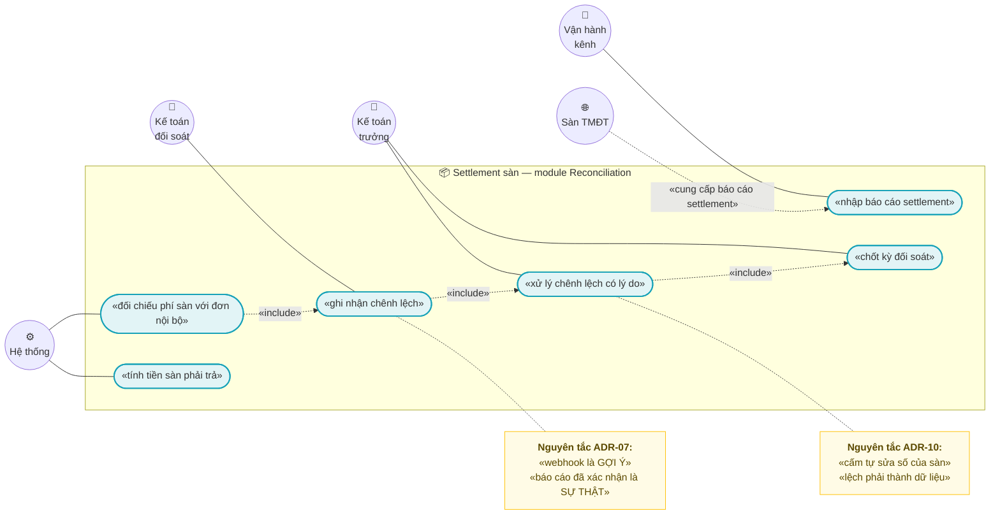
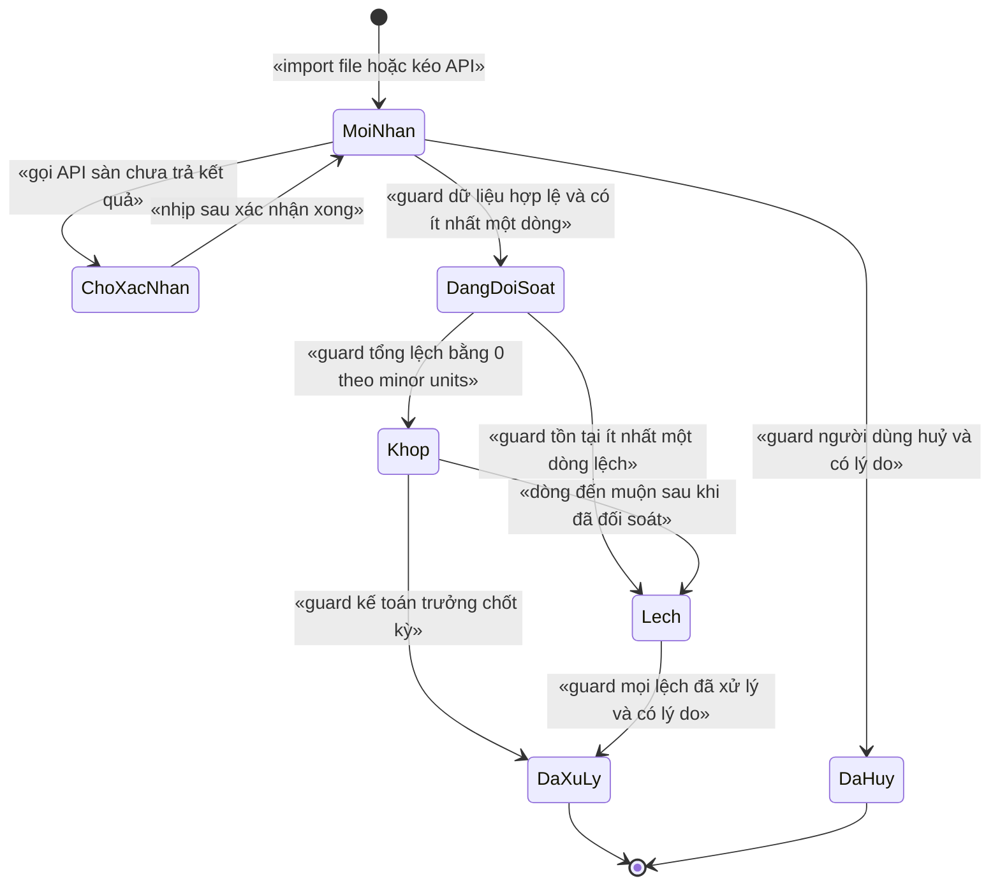
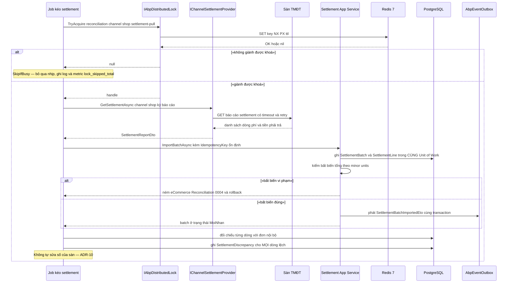

# `REC-002` — Settlement sàn (phí sàn, tiền phải trả, chênh lệch)

> ⚠️ **ĐỌC TRƯỚC:** hai tài liệu được nhắc trong yêu cầu — **`SHP-003`** (COD, ⚠️ GHN đổi COD cần OTP) và
> **`SHP-004`** (adapter GHTK) — **chưa có trong repo**. Đã kiểm bằng `Get-ChildItem docs/features`:
> chỉ có `shp-002-webhook-trang-thai-van-don.md`. Nội dung của `SHP-003`/`SHP-004` trong tài liệu này
> được dẫn **gián tiếp** từ `docs/implementation-plan.md:426-427` và `docs/business-modules-proposal.md:546-548`
> ⇒ mọi chỗ dựa vào chúng đều ghi rõ **"chưa kiểm chứng trực tiếp"** (§15.4).

| Thuộc tính | Nội dung |
|---|---|
| **Mã** | `REC-002` |
| **Module** | **Reconciliation** — *module này **chưa tồn tại** trong code; phải tạo mới* |
| **Giai đoạn** | **GĐ2 — Vận hành VN** (`docs/implementation-plan.md:113`, `:428`) |
| **Ưu tiên** | **Must have** (là điều kiện của cổng kiểm soát GĐ2 — `docs/implementation-plan.md:203-204`) |
| **Trạng thái** | 🟡 `Draft` — chờ review |
| **Người viết / người review** | *(điền)* / **Kiến trúc trưởng + Kế toán trưởng** (vì đụng số tiền phải thu) |
| **Phiên bản / ngày** | `v0.1 — 15/10/2026` |
| **Tài liệu liên quan** | `XC-001` (Money/làm tròn) · `XC-002` (outbox/inbox, idempotency) · `XC-003` (khoá phân tán) · `XC-004` (phân quyền/tenant) · `XC-005` (log/metric) · `SAL-003` (state machine 4 trục) · `CHN-002` (connector Shopee) · `CHN-004` (allotment) · `SHP-002` (webhook vận đơn) · `SHP-003` · `SHP-004` · `REC-001` (đối soát thanh toán) · `REC-003` (đối soát COD) · `REP-003` (báo cáo hiệu suất kênh) · `docs/implementation-plan.md` · `docs/business-modules-proposal.md` |

> 📌 **Quy ước mã trong tài liệu này:** BR/NFR/TC dùng dạng đầy đủ theo tiền lệ của repo
> (`BR-REC-002-001` như `BR-XC-003-001`); **ADR** đánh số ngắn `ADR-01…ADR-14` theo yêu cầu
> — tương ứng 1-1 với khuôn `D1…D14` mà `XC-003` §0.1 đang dùng.

---

## 0. Tóm tắt & quyết định thiết kế

**Tóm tắt:** `REC-002` chốt cách hệ thống **đối chiếu báo cáo settlement của sàn TMĐT với dữ liệu nội bộ**:
phí sàn **thực tế** (hoa hồng, phí thanh toán, phí dịch vụ, phí vận chuyển), **tiền sàn phải trả** cho người bán,
và **mọi chênh lệch** phải trở thành **dữ liệu hạng nhất** (`SettlementDiscrepancy`) chứ không phải một dòng log.
Đây là nơi duy nhất trong hệ thống trả lời được câu hỏi *"sàn đã trả cho ta bao nhiêu, trừ những gì, và vì sao
khác với con số ta tự tính?"*.

**Vì sao phải có tài liệu này (hiện trạng đã kiểm trong code — không viết theo trí nhớ):**

| # | Hiện trạng (đã kiểm) | Bằng chứng |
|---|---|---|
| 1 | **Đã có chỗ chứa "phí sàn dự kiến"** nhưng **không có gì đối chiếu nó** với thực tế | `src/eCommerce.Domain/Entities/Orders/Order.cs:49-50` — `ChannelFeeAmount` + chú thích *"cần cho đối soát settlement"*; mapping `numeric(18,4)` tại `src/eCommerce.EntityFrameworkCore/eCommerceDbContext.cs:178` |
| 2 | **Không tồn tại** bất kỳ entity/dịch vụ settlement hay reconciliation nào | `grep -i "Settlement\|Reconciliation\|Discrepancy"` trên toàn bộ `*.cs` ⇒ **0 match** |
| 3 | **Không có trục trạng thái "đối soát"** (trục thứ 4 của `SAL-003`) | `src/eCommerce.Domain.Shared/Enums.cs:50-69` chỉ có `OrderStatus` + `PaymentStatus`; `Order.cs:111` `SetStatus` không có guard |
| 4 | **Không có module `Reconciliation`** | `modules/` chỉ có `ChannelHub`, `PaymentHub`, `Tax` |
| 5 | **Không có permission, mã lỗi, metric, khoá phân tán** nào cho miền đối soát | `src/eCommerce.Application.Contracts/Permissions/eCommercePermissionDefinitionProvider.cs:21-60`; `src/eCommerce.Domain.Shared/eCommerceConsts.cs:76-109`; `shared/eCommerce.Kernel/Observability/eCommerceMetrics.cs:13-53`; `docs/features/cross-cutting/XC-003-khoa-phan-tan-quy-uoc.md` §5 (bảng đăng ký khoá **không** có dòng `reconciliation:`) |
| 6 | **`Money`/`Currency` của `XC-001` CHƯA có trong code** — tiền hiện là `decimal` trần + `string Currency` | `grep "Money\|ToMinorUnits\|MoneyAllocator"` trên `*.cs` ⇒ **0 match**; `Order.cs:36-47`, `PaymentTransaction.cs:53-55` |

⇒ 🔴 **Hệ quả quan trọng:** nếu không làm `REC-002` thì **phí sàn thực tế không bao giờ có trong hệ thống**,
và mọi báo cáo lợi nhuận/lãi gộp của `REP-003` sẽ mãi chỉ có cột "phí sàn dự kiến"
(`docs/features/reporting/rep-003-bao-cao-ton-kho-hieu-suat-kenh.md` §10 yêu cầu 2 cột **luôn hiện cạnh nhau**).

**Phạm vi (CÓ làm):**

- ✅ Module `Reconciliation` (project riêng) sở hữu **4 bảng**: `SettlementBatch`, `SettlementLine`,
  `SettlementLineComponent`, `SettlementDiscrepancy` (bảng `Discrepancy` **dùng chung** với `REC-001`/`REC-003`
  theo `docs/implementation-plan.md:200`).
- ✅ **Hai biên nhập dữ liệu**: (a) **API kéo báo cáo** từ sàn (kênh chính), (b) **import file** (kênh bù, có phân quyền).
- ✅ **Đối chiếu từng dòng** với đơn nội bộ + phí dự kiến; sinh `SettlementDiscrepancy` cho **mọi** lệch.
- ✅ **Tính tiền sàn phải trả** (`NetPayout`) và **bất biến tổng** giữa dòng ↔ batch.
- ✅ **State machine** cho `SettlementBatch` và `SettlementLine` — guard sai **NÉM LỖI** (quy ước #11).
- ✅ **Idempotency ở mọi biên vào** + **khoá phân tán** cho job kéo/đối soát.
- ✅ Permission, mã lỗi, metric, log có `CorrelationId` cho miền đối soát.
- ✅ UI vận hành (bảng kê lệch + nút xử lý) — phần hiển thị thuộc `WEB-001`/`REP-003`, tài liệu này chốt **mapping dữ liệu**.

**Không nằm trong phạm vi (KHÔNG làm):**

- ❌ **Đối soát thanh toán với cổng** (`querydr`) — thuộc **`REC-001`** (`docs/implementation-plan.md:182`, `:413`).
  Tài liệu này chỉ **dùng chung** bảng `Discrepancy` với `REC-001`, không định nghĩa nghiệp vụ của nó.
- ❌ **Đối soát COD theo "phiên"** (file Excel thủ công của hãng vận chuyển) — thuộc **`REC-003`**
  (`docs/implementation-plan.md:429`; `docs/business-modules-proposal.md:93`). `REC-002` chỉ **tiêu thụ** cờ
  "COD chưa xác nhận" do `SHP-003`/`REC-003` tạo ra (BR-REC-002-020).
- ❌ **Bút toán kế toán / xuất liệu cho MISA** — thuộc `ACC-001`.
- ❌ **Adapter gọi API sàn** (OAuth, ký request, phân trang của Shopee/Lazada) — thuộc `CHN-002` và các adapter
  của `ChannelHub` (`modules/ChannelHub/.../Connectors/ShopeeConnector.cs`, `IChannelConnector.cs`).
  `REC-002` **chỉ** định nghĩa **hợp đồng dữ liệu** nó cần (§6.1) và **cấm** tự gọi HTTP của sàn.
- ❌ **Sửa số của sàn**. Hệ thống **không** được sửa số tiền sàn công bố; chỉ ghi lệch + dòng điều chỉnh có duyệt
  (kế thừa `SHP-002` BR-007 — `docs/features/shipping/shp-002-webhook-trang-thai-van-don.md`).
- ❌ **Tự động hoá đổi COD** — ⚠️ GHN đổi COD **cần OTP** ⇒ có **bước thủ công**; xem BR-REC-002-020
  (nguồn gián tiếp, **chưa kiểm chứng trực tiếp** — §15.4).

### 0.1 Quyết định thiết kế (ADR ngắn)

| # | Quyết định | Phương án đã cân nhắc | Lý do chọn | Hệ quả |
|---|---|---|---|---|
| **ADR-01** | **`SettlementLine` là sổ cái APPEND-ONLY**; trạng thái khớp/lệch là **cột xử lý**, không sửa số | (a) UPDATE số tiền khi phát hiện sai · (b) **append-only + dòng điều chỉnh** | Tiền lệ **thật trong repo**: `StockLedgerEntry` ghi rõ *"Sổ cái kho — APPEND-ONLY. Không bao giờ UPDATE/DELETE… để có thể truy vết và đối soát với sàn"* (`src/eCommerce.Domain/Entities/Inventory/StockLedger.cs:80-83`). Sửa số đã ghi ⇒ mất khả năng giải trình với sàn/kế toán | Muốn "sửa" một dòng ⇒ sinh **dòng điều chỉnh** (`LineKind = Adjustment`) + `SettlementDiscrepancy` liên kết |
| **ADR-02** | **Chênh lệch là dữ liệu hạng nhất** (`SettlementDiscrepancy`), **không** phải log | (a) chỉ log `Warning` · (b) **bảng riêng + trạng thái xử lý** | Log bị xoay vòng (90 ngày — `XC-005` Q4) và **không** truy vấn được *"còn bao nhiêu lệch chưa xử lý"*. `docs/implementation-plan.md:182,200` đã liệt kê `Discrepancy` cho cả 3 tài liệu `REC-*` | Phải có permission + lý do + audit khi đóng lệch (BR-REC-002-010) |
| **ADR-03** | **So tiền bằng minor units**, **cấm** `==` trên `decimal` | (a) so `decimal` trực tiếp · (b) `ToMinorUnits()` | `XC-001` D3/BR-003 chốt đây là **đường so sánh chính thức** (bài học EShop: `ActualTotalPrice == OriginalPaymentAmount` vỡ với VND/payOS). Lệch 1 đồng do làm tròn **không** được coi là "khớp" | ⚠️ **Phụ thuộc GĐ1**: `Money`/`ToMinorUnits` **chưa có trong code** (grep 0 match) ⇒ GĐ2 phải có trước, nếu không thì **hoãn** (`REC-002` là GĐ2, `XC-001` là nền GĐ1) |
| **ADR-04** | **Một module `Reconciliation` duy nhất** cho `REC-001`/`REC-002`/`REC-003`, **một** bảng `Discrepancy` | (a) mỗi tài liệu một module/bảng riêng · (b) **một module, một bảng lệch** | Bài học **F1/F2 của `XC-003`** (`docs/features/cross-cutting/XC-003-khoa-phan-tan-quy-uoc.md` §15.2): cùng một khái niệm định nghĩa ở 2 nơi ⇒ 2 nguồn sự thật, **không có lỗi biên dịch nào**. `docs/implementation-plan.md:200` cũng gom chung | `Discrepancy` **phải** có cột `SourceKind` (Payment/Settlement/Cod) + FK nullable theo từng nguồn |
| **ADR-05** | **Module sở hữu entity của mình**; **cấm** module tham chiếu `src/` | (a) module query thẳng `OrdOrders` · (b) gọi HTTP nội bộ · (c) **ETO + bảng snapshot** | Quy ước #3/#4 của dự án (`ChannelHubConsts.cs:7-11` ghi rõ *"module không được tham chiếu app (app → module là hợp lệ, ngược lại là vi phạm)"*); tiền lệ thật: ChannelHub phát ETO qua `IDistributedEventBus` (`modules/ChannelHub/eCommerce.ChannelHub.Application/Sync/ChannelTokenManager.cs:116-119`) | `Reconciliation` giữ **snapshot** `OrderId`/`ExternalOrderId`/số tiền nội bộ tại thời điểm đối soát; dữ liệu đến qua ETO §7.1. **Không** FK xuyên module (đúng như DbContext hiện tại: `eCommerceDbContext.cs:47-64` khai `DbSet` module nhưng không có FK chéo) |
| **ADR-06** | Entity **phải có `DbSet`** trên `eCommerceDbContext` nếu dùng `IRepository<T>` mặc định | (a) chỉ gọi `builder.ConfigureReconciliation()` · (b) **DbSet + Configure** | 🚨 **Lỗi đã gặp thật, đã ghi lại trong code**: `eCommerceDbContext.cs:48-52` — *"`AddDefaultRepositories(includeAllEntities: true)` chỉ tạo `IRepository<T>` cho entity CÓ `DbSet`… nếu không: `The requested service 'IRepository<ChannelShop, Guid>' has not been registered`"*; cơ chế đăng ký tại `src/eCommerce.EntityFrameworkCore/eCommerceEntityFrameworkCoreModule.cs:42-47` | Thêm **4 dòng `DbSet`** + gọi `builder.ConfigureReconciliation()` trong `OnModelCreating` (`eCommerceDbContext.cs:71-91`) |
| **ADR-07** | **API kéo là kênh chính**, import file là kênh bù; **webhook (nếu sàn có) chỉ là gợi ý** | (a) tin webhook · (b) chỉ import tay · (c) **kéo API + đối chiếu là sự thật** | Kế thừa **D1 của `SHP-002`**: *"webhook là GỢI Ý, không phải SỰ THẬT"*, vì GHTK **không có HMAC**. Cùng loại rủi ro: một thông báo "settlement đã chốt" có thể bị giả mạo | Mọi batch từ webhook **phải** có `SourceKind = Webhook` và **không** được chuyển sang `Khop`/`DaXuLy` khi chưa có dòng khớp từ nguồn `Api`/`FileImport` (BR-REC-002-019) |
| **ADR-08** | **Khoá phân tán** cho job kéo/đối soát, dùng `SkipIfBusy` | (a) không khoá · (b) khoá + ném lỗi khi bận · (c) **khoá + `SkipIfBusy`** | Đúng `XC-003` D10 + A1: job định kỳ bỏ qua nhịp là **hợp lý** (nhịp sau chạy lại); HTTP thì phải ném lỗi. Tên khoá **không** mang tiền tố `ecommerce:` — tiền tố do `AbpDistributedLockOptions.KeyPrefix` sinh (`XC-003` §5.4; cấu hình thật ở `src/eCommerce.HttpApi.Host/eCommerceHttpApiHostModule.cs:127`) | Job **phải** log + tăng metric `lock_skipped_total{module="reconciliation"}`; thiếu ⇒ vi phạm `XC-003` BR-010 |
| **ADR-09** | **Idempotency ở MỌI biên vào** (API pull, import file, webhook, job) | (a) chỉ kiểm ở tầng HTTP · (b) **guard nghiệp vụ + unique index** | `XC-002` BR-004: *"Mọi biên vào — HTTP webhook, consumer sự kiện, job định kỳ, callback thanh toán — phải idempotent"*; bài học eShop: chống trùng chỉ ở tầng HTTP ⇒ redelivery xử lý 2 lần | Khoá ổn định `{channelCode}:{shopId}:{batchNo}` + `PayloadHash`; cùng khoá khác hash ⇒ **NÉM** (BR-REC-002-006) |
| **ADR-10** | **KHÔNG tự sửa số của sàn**; lệch ⇒ ghi `Discrepancy` + chờ kế toán duyệt | (a) tự động điều chỉnh cho khớp · (b) **ghi lệch, người duyệt** | Tự sửa ⇒ **giấu** việc sàn trả thiếu; tiền thật đã về tài khoản ngân hàng. Kế thừa `SHP-002` BR-007: *"Sai lệch tiền ⇒ ghi `Discrepancy`, **cấm** tự sửa số của hãng"* | Luồng xử lý lệch cần permission `Resolve` + `ResolutionNote` + audit |
| **ADR-11** | **Gọi API sàn KHÔNG nằm trong transaction DB** | (a) gọi API trong UoW · (b) **ghi trạng thái `ChoXacNhan` rồi xác nhận** | Nếu API sàn timeout giữa transaction ⇒ rollback **dữ liệu đã ghi đúng**; `SHP-002` D5/E10 chốt nguyên tắc *"KHÔNG rollback dữ liệu đã ghi"* | Batch có trạng thái `ChoXacNhan`; job nhịp sau xác nhận; **không** chặn request người dùng |
| **ADR-12** | Metric mới **phải** thêm vào `eCommerceMetricNames` + danh sách `All` **và** `XC-005` §5.1 **trong cùng PR** | (a) đặt tên metric tại nơi phát · (b) **registry tập trung** | `eCommerceMetrics.cs:9-12` ghi rõ lý do: *"có test tự động (`TC-06`) đối chiếu tên phát ra thật với danh sách này ⇒ không thể lệch. Nếu tên nằm rải rác ở nơi gọi thì không kiểm được"* | 4 metric mới §13 phải sửa **3 chỗ**: code, doc `XC-005`, test |
| **ADR-13** | `[Authorize]` ở **CẤP CLASS** + permission ở từng method | (a) chỉ gắn ở vài method · (b) **cấp class** | Tiền lệ thật ở `src/eCommerce.Application/Channels/ChannelAppService.cs:22-27` — *"ABP KHÔNG tự bảo vệ application service… Vì thế đặt `[Authorize]` ở cấp CLASS"* | Quên ⇒ endpoint lộ dữ liệu tiền của tenant (đã từng xảy ra ở Phase 0) |
| **ADR-14** | Mã lỗi **do module sở hữu**: `eCommerce:Reconciliation:NNNN` | (a) thêm vào `eCommerceConsts.ErrorCodes` · (b) **consts của module** | Bài học **F2 của `XC-003`** + ghi chú thật trong code: `eCommerceConsts.cs:80-85` đã **xoá** mã lỗi miền kênh vì *"hai nguồn sự thật cho cùng một mã lỗi"* | `eCommerceConsts.ErrorCodes` **không** được thêm mã `Reconciliation` nào |

---

## 1. Use Case Specification

| Thuộc tính | Nội dung |
|---|---|
| **Use Case ID** | `REC-002` |
| **Use Case Name** | Đối chiếu settlement sàn: phí sàn thực tế, tiền phải trả, chênh lệch |
| **Description** | *"Là kế toán/vận hành, tôi muốn hệ thống tự đối chiếu báo cáo settlement của sàn với đơn hàng và phí dự kiến của mình, để biết **sàn đã trả đúng chưa**, **lệch ở đơn nào, khoản nào**, và **tiền thực nhận** là bao nhiêu — thay vì đối chiếu bằng Excel."* |
| **Actor(s)** | **Kế toán đối soát** (nhập/xem/xử lý lệch) · **Kế toán trưởng** (duyệt chốt kỳ, duyệt xử lý lệch) · **Vận hành kênh** (kích hoạt kéo báo cáo) · **Hệ thống** (job kéo định kỳ, job đối soát, outbox/inbox) · **Sàn TMĐT** (nguồn báo cáo settlement) |
| **Priority** | **Must have** (GĐ2) |
| **Trigger** | (a) job định kỳ tới nhịp kéo báo cáo settlement của một shop; (b) kế toán/vận hành bấm **"Kéo báo cáo"** hoặc **import file**; (c) sàn gọi webhook thông báo settlement đã chốt (nếu có — **chưa kiểm chứng**); (d) kế toán mở bảng lệch và xử lý |
| **Pre-Condition(s)** | • **Tenant hiện tại** (`TenantId` từ `ICurrentTenant`) — mọi truy vấn/ghi đều theo tenant (`XC-004`).<br>• **`ChannelCode`** (`shopee`/`lazada`/…) + **`ChannelShopId`** — settlement luôn thuộc **một shop của một kênh**; `ChannelShop.ExternalShopId` (`modules/ChannelHub/eCommerce.ChannelHub.Domain/Entities/ChannelEntities.cs:46`) là khoá đối chiếu với sàn.<br>• Shop `IsActive = true` (`ChannelEntities.cs:71`) **hoặc** người dùng có quyền import lịch sử; shop ngừng hoạt động ⇒ **cấm** kéo mới nhưng **vẫn** được xử lý batch cũ.<br>• **Token OAuth của shop còn hiệu lực** — nếu không, job phải bỏ nhịp **có log + metric** (`ChannelTokenManager` là nơi refresh: `ChannelTokenManager.cs:52-114`).<br>• **`Money`/`ToMinorUnits` của `XC-001` đã có** — ⚠️ **hiện CHƯA có trong code** (grep 0 match) ⇒ đây là **điều kiện chặn** (Definition of Ready, §14.4).<br>• Bảng ánh xạ mã phí của sàn (`FeeCode` thô → loại phí nội bộ) **đã có** cho kênh đó; thiếu ⇒ mọi dòng phí vào `Discrepancy` loại `FeeCodeUnknown` (**không** được bỏ qua im lặng — BR-REC-002-010). |
| **Post-Condition(s)** | • Mỗi kỳ đối soát có **đúng một** `SettlementBatch` (ràng buộc unique theo `(TenantId, ChannelCode, ChannelShopId, BatchNo)` — §5.2).<br>• Mọi dòng của batch đã được đối chiếu và có `MatchStatus` **khác** `ChuaDoiSoat`.<br>• **Mọi** lệch có **một** bản ghi `SettlementDiscrepancy` ở trạng thái `Moi` hoặc `DaXuLy` — **0** lệch bị bỏ qua im lặng (NFR-REC-002-004).<br>• Bất biến tổng đúng: `Σ SettlementLine.NetAmount` (minor units) **bằng** `SettlementBatch.DeclaredNetPayout` (BR-REC-002-003).<br>• Batch ở một trạng thái **xác định** (§3); mọi chuyển trạng thái có audit (`FullAuditedAggregateRoot`) + `CorrelationId` trong log.<br>• Không có bản ghi nào chứa token/payload thô chưa che (BR-REC-002-018). |
| **Basic Flow** | 1. Job (hoặc người dùng có quyền) giành khoá phân tán `reconciliation:{channelCode}:{shopId}:settlement-pull` với timeout hữu hạn (§8.3).<br>2. Hệ thống **gọi API sàn** qua abstraction của `ChannelHub` (§6.1 `IChannelSettlementProvider`) để lấy báo cáo kỳ `[PeriodStartUtc, PeriodEndUtc)`.<br>3. Hệ thống tính `IdempotencyKey = "{channelCode}:{shopId}:{batchNo}"` và `PayloadHash` = SHA-256 của payload **chuẩn hoá**; `IIdempotencyGuard.AcquireAsync` (`XC-002` BR-004).<br>4. Mở **Unit of Work**: ghi `SettlementBatch` (`Status = MoiNhan`) + **N** `SettlementLine` + các `SettlementLineComponent` **trong cùng transaction**.<br>5. **Kiểm bất biến tổng** trước khi commit: `Σ NetAmount` vs `DeclaredNetPayout` (theo **minor units**). Lệch ⇒ **NÉM** `eCommerce:Reconciliation:0004`, rollback batch đó.<br>6. Phát `SettlementBatchImportedEto` **qua outbox cùng transaction** (`XC-002` BR-001).<br>7. Job đối soát (cùng khoá `…:settlement-reconcile`) đối chiếu **từng dòng**: tìm đơn nội bộ theo `(TenantId, ChannelCode, ExternalOrderId)` — đúng unique index đã có ở `eCommerceDbContext.cs:184-186`; so **phí dự kiến** `Order.ChannelFeeAmount` (`Order.cs:50`) với phí thực tế trong báo cáo ⇒ `MatchStatus`.<br>8. Mọi lệch ⇒ ghi `SettlementDiscrepancy` + metric `reconciliation_discrepancy_found_total{channel,kind}` + log `Warning` có `CorrelationId`.<br>9. Nếu **0** lệch ⇒ batch `Khop`; ngược lại ⇒ `Lech`. Kế toán xử lý từng lệch (permission `Resolve`, **bắt buộc** `ResolutionNote`) ⇒ `DaXuLy`.<br>10. Kế toán trưởng **chốt kỳ** (permission `Close`) ⇒ batch `DaXuLy`; phát `SettlementBatchClosedEto` cho `REP-001`/`REP-003`/`ACC-001`. |
| **Alternative Flow** | **A1: Import file thay vì gọi API** (sàn không có API báo cáo, hoặc cần nhập lịch sử) — cùng luồng bước 3-10, `SourceKind = FileImport`; file **phải** có chữ ký/`SHA-256` để phát hiện sửa tay; file trùng nội dung ⇒ `DuplicateIgnored` (**không** phải lỗi).<br>**A2: Kỳ đối soát đã có batch** — job phát hiện batch cùng `BatchNo` ⇒ **bỏ qua có log + metric** (không ném), trừ khi `PayloadHash` **khác** ⇒ `eCommerce:Messaging:0002` (xung đột khoá).<br>**A3: Đơn nội bộ chưa tồn tại** (sàn chốt trước khi webhook đơn về) — dòng ở `MatchStatus = KhongTimThayDon` + `Discrepancy(Kind = OrderNotFound)`; job nhịp sau **thử lại** (không xoá), quá **N = 7 ngày** ⇒ cảnh báo cho vận hành.<br>**A4: Đổi COD bằng OTP** (⚠️ GHN — `SHP-003`, **chưa kiểm chứng trực tiếp**) — dòng liên quan đặt `CodConfirmationState = ChoXacNhanOTP`; **không** tính vào `NetPayout` cho tới khi `REC-003`/`SHP-003` xác nhận (BR-REC-002-020).<br>**A5: Lệch do làm tròn 1 đồng** — so theo **minor units**; nếu lệch < ngưỡng cấu hình `RoundingToleranceMinorUnits` **và** đã ghi `Discrepancy(Kind = RoundingDiff)` thì được phép đóng bằng một cú bấm có ghi lý do; **cấm** đóng im lặng (BR-REC-002-010). |
| **Exception Flow** | **E1:** file/báo cáo thiếu cột bắt buộc hoặc sai định dạng ⇒ `eCommerce:Reconciliation:0002`, **không** ghi dòng nào (all-or-nothing trong 1 UoW).<br>**E2:** bất biến tổng bị vi phạm ⇒ `eCommerce:Reconciliation:0004` + rollback + log `Error` + metric; **cấm** tự bù số (ADR-10).<br>**E3:** chuyển trạng thái sai guard (ví dụ `MoiNhan → DaXuLy`, `Khop → Khop` khi có dòng mới mà không qua `Lech`) ⇒ `eCommerce:Reconciliation:0003`.<br>**E4:** `UPDATE … WHERE Status = @expected` ảnh hưởng **0** dòng ⇒ **NÉM** `eCommerce:Reconciliation:0003` (kế thừa `XC-002` BR-008/E7 — **cấm** coi là thành công).<br>**E5:** xử lý lệch **thiếu** `ResolutionNote` hoặc thiếu permission ⇒ `eCommerce:Reconciliation:0005`.<br>**E6:** gọi API sàn vượt quota / trả `429` ⇒ `eCommerce:Reconciliation:0007`; batch ở `ChoXacNhan`, **không** rollback dữ liệu đã ghi, thử lại nhịp sau (ADR-11).<br>**E7:** webhook ngoài allowlist hoặc sai `HashToken` ⇒ `eCommerce:Reconciliation:0008`, trả `403` + log `Warning` + metric (kế thừa `SHP-002` E1/E2).<br>**E8:** job không giành được khoá ⇒ **bỏ qua nhịp** + log + metric `lock_skipped_total{module="reconciliation"}` (**không** ném lỗi — `XC-003` A1).<br>**E9:** chuyển trạng thái từ batch **đã chốt** (`DaXuLy`) ⇒ `eCommerce:Reconciliation:0006` (trạng thái **hấp thụ**).<br>**E10:** dòng phí có `FeeCode` chưa có ánh xạ ⇒ `Discrepancy(Kind = FeeCodeUnknown)` + metric; **cấm** gộp vào "phí khác" im lặng (BR-REC-002-010). |
| **Business Rules** | • **BR-REC-002-001**: Mọi `SettlementLine` **phải** thuộc **đúng một** `SettlementBatch`; **cấm** ghi dòng rời khỏi batch.<br>• **BR-REC-002-002**: `SettlementLine`/`SettlementLineComponent` là **APPEND-ONLY**: **cấm** `UPDATE`/`DELETE` số tiền, `FeeCode`, `ExternalOrderId` của dòng đã ghi; chỉ được đổi **cột xử lý** (`MatchStatus`, `DiscrepancyId`, `CodConfirmationState`, `RowVersion`). "Sửa" ⇒ ghi **dòng điều chỉnh** mới.<br>• **BR-REC-002-003**: **Bất biến tổng**: `Σ SettlementLine.NetAmount` (so bằng **minor units**) **phải bằng** `SettlementBatch.DeclaredNetPayout`; lệch ⇒ **NÉM** `eCommerce:Reconciliation:0004`, **cấm** tự bù.<br>• **BR-REC-002-004**: Mọi số tiền **phải** là `decimal` + `Money`; **cấm** `double`/`float`; **cấm** so tiền bằng `==` — so bằng `ToMinorUnits()` (`XC-001` BR-003/D3).<br>• **BR-REC-002-005**: **Idempotency ở MỌI biên vào** (API kéo, import file, webhook, job): `IIdempotencyGuard` (`XC-002`) **+** unique index ở DB. Khoá **ổn định** qua retry; **cấm** `Guid.NewGuid()` mỗi lần gọi.<br>• **BR-REC-002-006**: Cùng `IdempotencyKey` nhưng **khác** `PayloadHash` ⇒ **NÉM** `eCommerce:Messaging:0002` — **cấm** coi là bản ghi trùng, **cấm** ghi đè.<br>• **BR-REC-002-007**: Mọi chuyển trạng thái **phải** qua guard §3; guard sai ⇒ **NÉM** mã lỗi có tiền tố `eCommerce:Reconciliation:` (quy ước #11) — **cấm** no-op im lặng.<br>• **BR-REC-002-008**: Mọi chuyển trạng thái **phải** có guard ở **tầng DB**: `UPDATE … WHERE Status = @expected` **hoặc** optimistic concurrency (`RowVersion`); **0** dòng ảnh hưởng ⇒ **NÉM** (`XC-002` BR-008).<br>• **BR-REC-002-009**: **Cấm tự sửa số của sàn.** Lệch ⇒ ghi `SettlementDiscrepancy`; số cuối cùng **chỉ** đổi qua **dòng điều chỉnh** được duyệt (ADR-10).<br>• **BR-REC-002-010**: **Mọi** lệch **phải** để lại dấu vết: một bản ghi `SettlementDiscrepancy` **hoặc** một dòng điều chỉnh. Xử lý lệch **bắt buộc** có `ResolutionNote` + permission `Resolve` + audit; **cấm** nuốt im lặng (kế thừa `XC-005` BR-013).<br>• **BR-REC-002-011**: Phí sàn **thực tế** **chỉ** lấy từ batch đã `Khop`/`DaXuLy`; **cấm** dùng `Order.ChannelFeeAmount` (số **dự kiến**) làm số cuối cùng cho kế toán/báo cáo.<br>• **BR-REC-002-012**: Mọi thao tác ghi đi qua **Unit of Work**; batch + line + component + outbox **cùng một transaction** (`XC-002` BR-001).<br>• **BR-REC-002-013**: **Cấm** module `Reconciliation` tham chiếu project `src/*`; dữ liệu đơn/kênh **chỉ** đến qua ETO + bảng snapshot (ADR-05).<br>• **BR-REC-002-014**: Mọi entity **phải** có `DbSet` trên `eCommerceDbContext` (nếu dùng `IRepository<T>` mặc định) — `eCommerceDbContext.cs:48-52`, `eCommerceEntityFrameworkCoreModule.cs:42-47`.<br>• **BR-REC-002-015**: Mọi app service **phải** có `[Authorize]` ở **cấp class** + permission riêng từng method (ADR-13).<br>• **BR-REC-002-016**: Khoá phân tán **chỉ** sinh từ `ReconciliationConsts.LockKeys`; **cấm** viết literal khoá; mọi acquire **phải** có timeout; job dùng `SkipIfBusy` **kèm** log + metric (`XC-003` BR-002/BR-004/BR-010).<br>• **BR-REC-002-017**: Metric mới **phải** nằm trong `eCommerceMetricNames.All` (`eCommerceMetrics.cs:38-52`); nhãn **chỉ** lấy từ `eCommerceMetricTags.Allowed` (`eCommerceMetrics.cs:75-78`); 🚨 **cấm** `orderId`/`orderNumber`/`sku` làm nhãn (`eCommerceMetrics.cs:81-84`).<br>• **BR-REC-002-018**: Mọi log **phải** có `CorrelationId` (`XC-005` BR-002); **cấm** log token của sàn, payload thô, số tài khoản; payload lưu DB **phải** đi qua hàm che (tiền lệ `PaymentTransaction.MaskSensitiveData` — `modules/PaymentHub/eCommerce.PaymentHub.Domain/Entities/PaymentTransaction.cs:147-171`).<br>• **BR-REC-002-019**: Dữ liệu đến từ nguồn **không xác thực được** (webhook hãng không HMAC — `SHP-002`/`SHP-004`; **chưa kiểm chứng trực tiếp**) **cấm** là nguồn sự thật **duy nhất** cho số tiền: batch `SourceKind = Webhook` **không** được chốt khi chưa có dòng khớp từ `Api`/`FileImport`.<br>• **BR-REC-002-020**: Dòng có COD **đã đổi bằng OTP** (⚠️ GHN — `SHP-003`) **phải** ở `CodConfirmationState = ChoXacNhanOTP` và **không** được tính vào `NetPayout` cho tới khi có xác nhận từ `REC-003`/`SHP-003`.<br>• **BR-REC-002-021**: Kỳ đối soát **phải** xác định được (deterministic): `PeriodStartUtc`/`PeriodEndUtc` tính từ **kỳ của sàn**, **cấm** dùng `DateTime.Now`/`DateTime.UtcNow` làm khoá kỳ; khoá chống trùng dạng `{channelCode}:{shopId}:{batchNo}`.<br>• **BR-REC-002-022**: Batch `DaXuLy` là trạng thái **hấp thụ**: **cấm** mọi chuyển trạng thái khác ⇒ **NÉM** `eCommerce:Reconciliation:0006`.<br>• **BR-REC-002-023**: Mọi unique index có `TenantId` **phải** tạo bằng **`NULLS NOT DISTINCT`** (SQL thô) — vì `TenantId` nullable và PostgreSQL mặc định `NULLS DISTINCT` ⇒ index **không chặn trùng** (lỗi **đã chứng minh bằng PostgreSQL thật**: `src/eCommerce.EntityFrameworkCore/Migrations/20261013024226_Fix_NullableTenantId_UniqueIndexes.cs:7-32`). |
| **Non-Functional Requirement** | • **NFR-REC-002-001**: Import 1 batch **5.000** dòng (không gọi API): p95 **< 3 s**.<br>• **NFR-REC-002-002**: Đối soát 1 shop, kỳ **7 ngày**, **5.000** dòng: p95 **< 30 s**.<br>• **NFR-REC-002-003**: **Idempotent 100 %**: import lại **cùng** file **100 lần** ⇒ **0** dòng mới, **0** tác dụng phụ.<br>• **NFR-REC-002-004**: **0** lệch bị bỏ qua im lặng; **100 %** lệch có bản ghi `SettlementDiscrepancy`.<br>• **NFR-REC-002-005**: Bất biến tổng: **10.000** bộ ngẫu nhiên ⇒ `Σ NetAmount == DeclaredNetPayout` **100 %** (dùng `MoneyAllocator` của `XC-001` khi phân bổ).<br>• **NFR-REC-002-006**: Cách ly tenant: tenant A **không** đọc/ghi được batch/lệch của tenant B (integration test 2 tenant — ⚠️ **cần PostgreSQL**).<br>• **NFR-REC-002-007**: **0** acquire khoá thiếu `timeout`; **đúng 1** khoá cho mỗi job; **0** acquire lồng (`XC-003` BR-004/BR-005).<br>• **NFR-REC-002-008**: **100 %** log của luồng import/đối soát có `CorrelationId`; **0** dòng log chứa token/payload thô (quét tự động).<br>• **NFR-REC-002-009**: Độ trễ **phát hiện lệch** ≤ **1 nhịp job** (nhịp đề xuất **6 h** cho kéo báo cáo; kỳ chốt do sàn công bố).<br>• **NFR-REC-002-010**: **0** `double`/`float` trong entity/DTO/ETO của module (test reflection).<br>• **NFR-REC-002-011**: Metric mới **nằm trong** registry; **0** nhãn cardinality cao; **< 100** series/metric (`XC-005` NFR-003).<br>• **NFR-REC-002-012**: Truy vết: từ một `SettlementLine` tra ra `OrderId`/`ExternalOrderId` + `CorrelationId` trong **< 2 s** với **100.000** dòng.<br>• **NFR-REC-002-013**: **0** dòng `SettlementLine` bị `UPDATE` ngoài cột xử lý (test DB + quét mã nguồn). |

---

## 2. Sơ đồ Use Case



### Chú giải

| Ký hiệu | Ý nghĩa |
|---|---|
| ⭕ Xanh lá | Actor (người dùng + hệ thống ngoài + hệ thống) |
| 🟦 Bầu dục xanh dương | Use Case |
| 🟨 Khung vàng | Note (nguyên tắc nền) |
| `───` | Liên kết Actor ↔ Use Case |
| `-.«include».->` | Quan hệ bao hàm |

---

## 3. Sơ đồ trạng thái (state machine)

> Feature này có **hai vòng đời** phải tách bạch: **batch** (kỳ đối soát) và **line** (một dòng của báo cáo).
> Cả hai **phải NÉM LỖI** khi chuyển sai — quy ước bất di bất dịch #11 của dự án.

### 3.1 Vòng đời `SettlementBatch`



**Bảng chuyển trạng thái & guard** — 🔒 *guard sai **phải NÉM LỖI**, không im lặng (quy ước #11):*

| # | Từ → Sang | Guard (điều kiện cho phép) | Ai được phép | Nếu guard sai thì? |
|---|---|---|---|---|
| 1 | `[*]` → `MoiNhan` | Có `IdempotencyKey` + `PayloadHash`; chưa tồn tại batch cùng `(TenantId, ChannelCode, ChannelShopId, BatchNo)` | job · người dùng có `Import` | Trùng **cùng** hash ⇒ `DuplicateIgnored` (không lỗi); trùng **khác** hash ⇒ **NÉM** `eCommerce:Messaging:0002` (§7.4) |
| 2 | `[*]` → `ChoXacNhan` | API sàn trả timeout/`429`/`5xx` (ADR-11) | job | Không phải lỗi nghiệp vụ; **phải** log + metric `reconciliation_settlement_pull_failed_total{channel,reason}` |
| 3 | `ChoXacNhan` → `MoiNhan` | Nhịp sau gọi API **thành công** và có ≥ 1 dòng | job | Thất bại **3** nhịp liên tiếp ⇒ `Discrepancy(Kind = PullFailed)` + **cảnh báo** (không im lặng) |
| 4 | `MoiNhan` → `DangDoiSoat` | ≥ 1 `SettlementLine` **và** mọi cột tiền bắt buộc không null **và** bất biến tổng đúng | job · `Reconcile` | Vi phạm bất biến tổng ⇒ **NÉM** `eCommerce:Reconciliation:0004`; thiếu dữ liệu ⇒ **NÉM** `0002` |
| 5 | `DangDoiSoat` → `Khop` | **Mọi** dòng có `MatchStatus ∈ (Khop)` **và** `Σ NetAmount == DeclaredNetPayout` | job | Còn dòng `ChuaDoiSoat` ⇒ giữ nguyên `DangDoiSoat` (**không** lỗi — chờ nhịp sau) |
| 6 | `DangDoiSoat` → `Lech` | Tồn tại ≥ 1 dòng `MatchStatus ∈ (Lech, KhongTimThayDon, DuLieuThieu)` | job | Vi phạm: muốn sang `Khop` khi còn lệch ⇒ **NÉM** `eCommerce:Reconciliation:0003` |
| 7 | `Khop` → `Lech` | Có dòng **đến muộn** (batch mới cùng kỳ) hoặc kế toán phát hiện lệch sau khi đối soát | job · `Reconcile` | **KHÔNG** được bỏ qua: **phải** ghi `Discrepancy(Kind = LateLine)` + `AggregateVersion` tăng + log `Warning` |
| 8 | `Khop` → `DaXuLy` | Có permission `Close` **và** `Σ NetAmount` vẫn khớp | kế toán trưởng | Không có permission ⇒ `403`; tổng không khớp ⇒ **NÉM** `0004` |
| 9 | `Lech` → `DaXuLy` | **Mọi** dòng lệch có `SettlementDiscrepancy` ở `DaXuLy` (không còn `Moi`) **và** có `ResolutionNote` | kế toán trưởng | Còn lệch chưa xử lý ⇒ **NÉM** `eCommerce:Reconciliation:0005` (thiếu lý do) / `0003` (guard sai) |
| 10 | `DaXuLy` → bất kỳ | **KHÔNG** có guard nào cho phép | — | 🚫 **Trạng thái hấp thụ** ⇒ **NÉM** `eCommerce:Reconciliation:0006` |
| 11 | `MoiNhan`/`DangDoiSoat` → `DaHuy` | Có permission `Close` **và** `CancelReason` không rỗng **và** batch **chưa** được dùng cho báo cáo (`REP-001`) | kế toán trưởng | Thiếu lý do ⇒ **NÉM** `0005`; đã dùng cho báo cáo ⇒ **NÉM** `0003` |
| 12 | Bất kỳ → bất kỳ (DB) | 🔒 **Guard tầng DB**: `UPDATE … WHERE Status = @expected` ảnh hưởng **≥ 1** dòng | — | **0** dòng ⇒ **NÉM** `0003` (`XC-002` BR-008) |

### 3.2 Vòng đời `SettlementLine` (`MatchStatus`)

| # | Từ → Sang | Guard | Nếu guard sai thì? |
|---|---|---|---|
| 1 | `ChuaDoiSoat` → `Khop` | Tìm thấy đơn nội bộ **và** `Σ phí thực tế` khớp `Order.ChannelFeeAmount` **theo minor units** **và** lệch COD = 0 | Lệch ⇒ chuyển `Lech` (**NÉM** nếu cố gán `Khop` khi còn lệch — `0003`) |
| 2 | `ChuaDoiSoat` → `Lech` | Tìm thấy đơn **và** tồn tại ≥ 1 khoản lệch **ngoài** ngưỡng `RoundingToleranceMinorUnits` | Ghi `SettlementDiscrepancy(Kind = FeeMismatch)`; **cấm** đóng lệch mà không có bản ghi |
| 3 | `ChuaDoiSoat` → `KhongTimThayDon` | **Không** tìm thấy đơn theo `(TenantId, ChannelCode, ExternalOrderId)` | Ghi `Discrepancy(Kind = OrderNotFound)`; **không** xoá dòng (đây là **dấu vết duy nhất**) |
| 4 | `ChuaDoiSoat` → `DuLieuThieu` | Thiếu `ExternalOrderId` **hoặc** thiếu cột tiền bắt buộc | Ghi `Discrepancy(Kind = MissingData)` + `ErrorCode = 0002`; **cấm** bỏ qua |
| 5 | `Lech`/`KhongTimThayDon`/`DuLieuThieu` → `DaXuLy` | `SettlementDiscrepancy` tương ứng đã `DaXuLy` **và** có `ResolutionNote` **và** có permission `Resolve` | Thiếu ⇒ **NÉM** `0005` |
| 6 | `Khop` → `Lech` | Dòng điều chỉnh mới của sàn ảnh hưởng dòng này | **Phải** ghi `Discrepancy(Kind = AdjustmentArrived)` — **cấm** im lặng |
| 7 | `DaXuLy` → bất kỳ | **KHÔNG** cho phép | 🚫 **Hấp thụ** ⇒ **NÉM** `0006` |
| 8 | `Khop`/`Lech`/`KhongTimThayDon` → `ChoXacNhanOTP` (cờ, không phải trạng thái) | Dòng có COD **đã đổi bằng OTP** (⚠️ GHN — `SHP-003`, **chưa kiểm chứng**) | Thiếu cờ ⇒ vi phạm BR-REC-002-020 ⇒ **NÉM** `0003` khi cố tính vào `NetPayout` |

> ⚠️ **Ghi rõ ai được chuyển:** `MoiNhan → DangDoiSoat` do **job** (không phải người dùng);
> `Lech → DaXuLy` do **kế toán trưởng** có permission; `ChuaDoiSoat → *` do **job đối soát**.
> **Trạng thái hấp thụ:** `DaXuLy` (batch) và `DaXuLy` (line), `DaHuy` (batch).

---

## 4. Sequence Diagram & luồng dữ liệu

### 4.1 Sequence — kéo báo cáo settlement và đối chiếu



### 4.2 DFD — đường đi của một dòng settlement (không dùng sơ đồ, chỉ bảng để giữ giới hạn 3 sơ đồ Mermaid)

| Bước | Nguồn | Xử lý | Đích | Bất biến áp dụng |
|---|---|---|---|---|
| 1 | Sàn TMĐT (API/file/webhook) | Chuẩn hoá payload, tính `PayloadHash` | `Reconciliation` (in-memory) | BR-005 (idempotency), BR-006 (hash conflict) |
| 2 | `Reconciliation` | Ghi `SettlementBatch` + `SettlementLine` + `SettlementLineComponent` | PostgreSQL (cùng UoW) | BR-001, BR-012 |
| 3 | PostgreSQL | Kiểm `Σ NetAmount == DeclaredNetPayout` (minor units) | — | **BR-003** |
| 4 | `Reconciliation` | Phát `SettlementBatchImportedEto` | `AbpEventOutbox` | BR-012 (`XC-002` BR-001) |
| 5 | Job đối soát | Đọc đơn nội bộ theo `(TenantId, ChannelCode, ExternalOrderId)` | Snapshot `OrderId`/số tiền | BR-011, BR-013 |
| 6 | Job đối soát | So phí thực tế vs `Order.ChannelFeeAmount` (**minor units**) | `SettlementLine.MatchStatus` | BR-004, **BR-009** |
| 7 | Job đối soát | Ghi lệch | `SettlementDiscrepancy` | **BR-010** |
| 8 | Kế toán | Duyệt xử lý + `ResolutionNote` | `SettlementDiscrepancy.DaXuLy` | BR-010, BR-015 |
| 9 | Kế toán trưởng | Chốt kỳ | `SettlementBatch.DaXuLy` + ETO | **BR-022** (hấp thụ) |
| 10 | `REP-001`/`REP-003`/`ACC-001` | Tiêu thụ `SettlementBatchClosedEto` | Read-model / bút toán | BR-011 |

> 📌 **Không vẽ ERD bằng Mermaid** vì tài liệu này **giới hạn 3 sơ đồ** (§2, §3.1, §4.1); mô hình dữ liệu
> trình bày bằng **bảng** ở §5 — cùng cách `XC-003` §5 trình bày "bảng đăng ký khoá".

---

## 5. Mô hình dữ liệu

### 5.1 Tổng quan quan hệ (mô tả bằng bảng, không dùng Mermaid — xem ghi chú §4.2)

| Quan hệ | Bội số | Ghi chú |
|---|---|---|
| `SettlementBatch` → `SettlementLine` | 1 → N | FK nội bộ module `Reconciliation` (khác module **không** có FK — `eCommerceDbContext.cs:47-64`) |
| `SettlementLine` → `SettlementLineComponent` | 1 → N | Tách **loại phí** thành bảng riêng để **không hard-code** danh mục phí của sàn |
| `SettlementLine` → `SettlementDiscrepancy` | 1 → 0..N | Một dòng có thể sinh nhiều loại lệch khác nhau |
| `SettlementBatch` → `SettlementDiscrepancy` | 1 → 0..N | Lệch ở mức kỳ (ví dụ `NetPayoutMismatch`, `PullFailed`) không gắn dòng nào |
| `Order` (app) → `SettlementLine` | 1 → 0..N | ❌ **KHÔNG FK** — chỉ `OrderId` dạng snapshot (ADR-05) |

### 5.2 Bảng & cột (Data Dictionary)

> 🚨 **Trạng thái: TẤT CẢ 4 bảng dưới đây CHƯA CÓ TRONG CODE — kế hoạch GĐ2.**
> Bằng chứng: `grep -i "Settlement\|Reconciliation\|Discrepancy"` trên toàn bộ `*.cs` ⇒ **0 match**;
> `modules/` chỉ có `ChannelHub`, `PaymentHub`, `Tax`.

**Bảng `RecSettlementBatches`** — *một kỳ đối soát settlement của một shop trên một kênh*

| Cột | Kiểu | Null? | Nguồn / ý nghĩa | Ghi chú |
|---|---|---|---|---|
| `Id` | `uuid` | ✖ | `FullAuditedAggregateRoot<Guid>` | |
| `TenantId` | `uuid` | ✔ | `IMultiTenant` | ⚠️ nullable ⇒ mọi unique index **phải** `NULLS NOT DISTINCT` (BR-023) |
| `ChannelCode` | `varchar(32)` | ✖ | `shopee`/`lazada`/… | trùng độ dài `ChnChannelShops`? — xem §6.2 của `XC-003`; ở đây theo `Order.ChannelCode` (`eCommerceDbContext.cs:168`) |
| `ChannelShopId` | `uuid` | ✖ | Guid của `ChannelHub.ChannelShop` | **snapshot**, không FK (ADR-05) |
| `ExternalShopId` | `varchar(64)` | ✖ | `shop_id` do sàn cấp | snapshot — để đối soát khi shop đổi (`ChannelEntities.cs:46`) |
| `BatchNo` | `varchar(64)` | ✖ | mã kỳ do sàn cấp | khoá chống trùng với `ExternalShopId` |
| `PeriodStartUtc` | `timestamptz` | ✖ | đầu kỳ | |
| `PeriodEndUtc` | `timestamptz` | ✖ | cuối kỳ | CHECK `> PeriodStartUtc` |
| `Currency` | `varchar(8)` | ✖ | ISO-4217 | ⚠️ **theo code hiện tại** là `varchar(8)` (`eCommerceDbContext.cs:170`, `PaymentHubDbContextModelCreatingExtensions.cs:22`); `XC-001` §5.2 **khuyến nghị** `char(3)` — **chưa áp dụng trong code** |
| `DeclaredGrossRevenue` | `numeric(18,4)` | ✖ | tổng doanh thu sàn công bố | ⚠️ **decimal, không bao giờ `double`** |
| `DeclaredTotalFee` | `numeric(18,4)` | ✖ | tổng phí sàn công bố | |
| `DeclaredRefundTotal` | `numeric(18,4)` | ✖ | tổng hoàn/trả hàng | |
| `DeclaredNetPayout` | `numeric(18,4)` | ✖ | **tiền sàn phải trả** | đối tượng của **BR-003** |
| `Status` | `int` | ✖ | enum `SettlementBatchStatus` (§3.1) | guard ở tầng DB (BR-008) |
| `SourceKind` | `int` | ✖ | `Api` / `FileImport` / `Webhook` | **BR-019** phụ thuộc cột này |
| `IdempotencyKey` | `varchar(256)` | ✖ | `{channelCode}:{shopId}:{batchNo}` | BR-005 |
| `PayloadHash` | `varchar(64)` | ✖ | SHA-256 canonical JSON | BR-006 |
| `PayloadMasked` | `text` | ✔ | payload/báo cáo **đã che** để đối soát | **BR-018**; tiền lệ `PaymentTransaction.MaskSensitiveData` (`PaymentTransaction.cs:147-171`) |
| `ImportedById` | `uuid` | ✔ | null nếu job | |
| `ImportedAtUtc` | `timestamptz` | ✖ | | |
| `ReconciledAtUtc` | `timestamptz` | ✔ | | |
| `ClosedAtUtc` | `timestamptz` | ✔ | | |
| `CancelReason` | `varchar(2048)` | ✔ | bắt buộc khi `DaHuy` | **BR-010** |
| `RowVersion` | `bytea`/`xmin` | ✖ | optimistic concurrency | guard #12 §3.1 |
| `ConcurrencyStamp` | `varchar` | ✖ | ABP `IHasConcurrencyStamp` | |

**Bảng `RecSettlementLines`** — *một dòng của báo cáo settlement (theo một đơn của sàn) — APPEND-ONLY*

| Cột | Kiểu | Null? | Nguồn / ý nghĩa | Ghi chú |
|---|---|---|---|---|
| `Id` | `uuid` | ✖ | | |
| `TenantId` | `uuid` | ✔ | `IMultiTenant` | |
| `SettlementBatchId` | `uuid` | ✖ | FK nội bộ | **BR-001** |
| `ChannelCode` | `varchar(32)` | ✖ | sao chép từ batch | tránh join khi lọc theo kênh |
| `ExternalOrderId` | `varchar(64)` | ✔ | `order_sn`/`trade_order_id` | ✔ = có ca sàn trả dòng phí **không** gắn đơn (ví dụ phí dịch vụ định kỳ) |
| `ExternalLineId` | `varchar(64)` | ✔ | id dòng phí phía sàn | |
| `OrderId` | `uuid` | ✔ | đơn nội bộ tìm được | **snapshot**, không FK (ADR-05) |
| `LineKind` | `int` | ✖ | `OrderSettlement` / `Adjustment` / `Refund` / `PeriodicFee` | **ADR-01**: sửa ⇒ `Adjustment` |
| `GrossAmount` | `numeric(18,4)` | ✖ | doanh thu gộp của dòng | |
| `TotalFeeAmount` | `numeric(18,4)` | ✖ | tổng phí sàn của dòng | = `Σ component.Amount` (bất biến phụ, kiểm khi import) |
| `RefundAmount` | `numeric(18,4)` | ✖ | hoàn/trả hàng | |
| `AdjustmentAmount` | `numeric(18,4)` | ✖ | điều chỉnh (±) | cho phép **âm** (`XC-001` §5.2: *"Không đặt CHECK (Amount > 0) vì có số tiền hợp lệ âm"*) |
| `NetAmount` | `numeric(18,4)` | ✖ | **tiền thực nhận của dòng** | đối tượng của **BR-003** |
| `CodCollectedAmount` | `numeric(18,4)` | ✔ | tiền COD sàn/hãng thu hộ | ⚠️ xem BR-020 |
| `CodConfirmationState` | `int` | ✖ | `KhongApDung` / `ChoXacNhanOTP` / `DaXacNhan` | **BR-020** |
| `Currency` | `varchar(8)` | ✖ | | |
| `MatchStatus` | `int` | ✖ | enum §3.2 | |
| `DiscrepancyId` | `uuid` | ✔ | lệch gần nhất | |
| `LineOccurredAtUtc` | `timestamptz` | ✔ | thời điểm sàn ghi nhận | ⚠️ cần cho phát hiện **dòng đến muộn** (guard #7 §3.1) |
| `RowVersion` | `bytea`/`xmin` | ✖ | | |
| `ConcurrencyStamp` | `varchar` | ✖ | | |

**Bảng `RecSettlementLineComponents`** — *tách từng loại phí (append-only)*

| Cột | Kiểu | Null? | Ý nghĩa | Ghi chú |
|---|---|---|---|---|
| `Id` | `uuid` | ✖ | | |
| `TenantId` | `uuid` | ✔ | | |
| `SettlementLineId` | `uuid` | ✖ | FK nội bộ | |
| `FeeCode` | `varchar(64)` | ✖ | **mã phí thô của sàn** (`commission_fee`, `service_fee`, `payment_fee`…) | 🔒 **không hard-code**; ánh xạ sang loại nội bộ ở cấu hình |
| `FeeNameLocal` | `varchar(256)` | ✔ | tên hiển thị tiếng Việt (từ bảng ánh xạ) | |
| `FeeGroup` | `int` | ✖ | `HoaHong` / `ThanhToan` / `DichVu` / `VanChuyen` / `Khac` | **E10**: `Khac` **chỉ** khi đã có ánh xạ tường minh |
| `Amount` | `numeric(18,4)` | ✖ | số tiền phí (thường **âm** vì bị trừ) | ⚠️ `decimal`, quy ước dấu phải ghi rõ |
| `Currency` | `varchar(8)` | ✖ | | |
| `AppliesTo` | `int` | ✖ | `DonHang` / `Ky` | phân biệt phí theo đơn vs phí định kỳ |

**Bảng `RecDiscrepancies`** — *lệch phát hiện — **DÙNG CHUNG** cho `REC-001`/`REC-002`/`REC-003`*

| Cột | Kiểu | Null? | Ý nghĩa | Ghi chú |
|---|---|---|---|---|
| `Id` | `uuid` | ✖ | | |
| `TenantId` | `uuid` | ✔ | | |
| `SourceKind` | `int` | ✖ | `Payment` / `Settlement` / `Cod` | **ADR-04** |
| `SettlementBatchId` | `uuid` | ✔ | có khi `SourceKind = Settlement` | |
| `SettlementLineId` | `uuid` | ✔ | lệch ở mức **dòng** | null ⇒ lệch ở mức **kỳ** |
| `PaymentReconciliationLineId` | `uuid` | ✔ | dùng bởi `REC-001` | ⚠️ **chưa có trong code** — GĐ1 |
| `CodReconciliationLineId` | `uuid` | ✔ | dùng bởi `REC-003` | ⚠️ **chưa có trong code** — GĐ2 |
| `Kind` | `int` | ✖ | `FeeMismatch` / `NetPayoutMismatch` / `OrderNotFound` / `MissingData` / `DuplicateLine` / `LateLine` / `FeeCodeUnknown` / `AdjustmentArrived` / `RoundingDiff` / `CodUnconfirmed` / `UnverifiedSource` / `PullFailed` | **E10** + **BR-019/020** |
| `ExpectedAmount` | `numeric(18,4)` | ✔ | số nội bộ | |
| `ActualAmount` | `numeric(18,4)` | ✔ | số của sàn | |
| `ExpectedMinorUnits` | `bigint` | ✔ | so sánh **theo minor units** | **BR-004** — lưu sẵn để truy vấn/kiểm chứng |
| `ActualMinorUnits` | `bigint` | ✔ | | |
| `Currency` | `varchar(8)` | ✖ | | |
| `Status` | `int` | ✖ | `Moi` / `DaXuLy` | **cấm** trạng thái `BoQua` (BR-010) |
| `ResolutionNote` | `varchar(2048)` | ✔ | **bắt buộc** khi `DaXuLy` | **BR-010** |
| `ResolvedById` | `uuid` | ✔ | | |
| `ResolvedAtUtc` | `timestamptz` | ✔ | | |
| `DetectedAtUtc` | `timestamptz` | ✖ | | |
| `CorrelationId` | `varchar(64)` | ✔ | truy vết (`XC-005`) | |
| `RowVersion` | `bytea`/`xmin` | ✖ | | |

### 5.3 Index & ràng buộc

| Bảng | Loại | Cột | Mục đích |
|---|---|---|---|
| `RecSettlementBatches` | **UNIQUE** `NULLS NOT DISTINCT` | `(TenantId, ChannelCode, ChannelShopId, BatchNo)` | **IDEMPOTENCY** — BR-005/BR-021; ⚠️ **phải** tạo bằng SQL thô (BR-023) |
| `RecSettlementBatches` | **UNIQUE** `NULLS NOT DISTINCT` | `(TenantId, IdempotencyKey)` | chống nhập trùng ở tầng DB (`XC-002` BR-005) |
| `RecSettlementBatches` | INDEX | `(TenantId, ChannelCode, Status, PeriodEndUtc)` | màn hình vận hành: *"batch của kênh X chưa chốt"* |
| `RecSettlementBatches` | CHECK | `PeriodEndUtc > PeriodStartUtc` | chặn kỳ vô lý ở tầng DB |
| `RecSettlementLines` | **UNIQUE** `NULLS NOT DISTINCT` | `(SettlementBatchId, ExternalOrderId, ExternalLineId, LineKind)` | chống nhân đôi dòng khi import/pull trùng |
| `RecSettlementLines` | INDEX | `(TenantId, ChannelCode, ExternalOrderId)` | job đối soát tra đơn nội bộ theo cặp này — khớp unique index đã có ở `eCommerceDbContext.cs:184-186` |
| `RecSettlementLines` | INDEX | `(SettlementBatchId, MatchStatus)` | màn hình "còn dòng chưa đối soát" |
| `RecSettlementLineComponents` | INDEX | `(SettlementLineId, FeeCode)` | tổng hợp theo loại phí |
| `RecDiscrepancies` | **UNIQUE** `NULLS NOT DISTINCT` | `(TenantId, SourceKind, SettlementLineId, Kind, DetectedAtUtc)` | chống tạo lệch trùng khi job chạy lại (**BR-005**) |
| `RecDiscrepancies` | INDEX | `(TenantId, SourceKind, Status, DetectedAtUtc)` | màn hình "lệch chưa xử lý" (NFR-004) |
| — | CHECK *(khuyến nghị)* | `Currency ~ '^[A-Z]{3}$'` | chặn mã tiền tệ sai ở tầng DB (`XC-001` §5.2) |
| — | **Không** đặt | `CHECK (NetAmount > 0)` | có số tiền hợp lệ **âm** (hoàn tiền/điều chỉnh) — `XC-001` §5.2 |

### 5.4 Ghi chú thiết kế (đã cân nhắc)

1. **Vì sao tách `SettlementLineComponent`:** danh mục phí của sàn **thay đổi theo thời gian và theo ngành hàng**
   và **chưa kiểm chứng** (Q4 §15.1). Nhét sẵn 4–6 cột phí cố định vào `SettlementLine` ⇒ mỗi lần sàn thêm loại phí
   phải **migrate schema**. Tách bảng ⇒ thêm loại phí là **dữ liệu**, không phải schema.
   Bù lại: cần bất biến phụ `TotalFeeAmount == Σ component.Amount` — nếu không, hai nguồn sự thật (bài học F1 `XC-003`).
2. **Vì sao có `DiscrepancyId` ở **cả hai** chỗ** (bảng `SettlementLine` và bảng `RecDiscrepancies`): bảng lệch là **nguồn sự thật**
   (1 → N); `SettlementLine.DiscrepancyId` chỉ là **con trỏ "lệch gần nhất"** cho màn hình. Cố ý chấp nhận
   **dư thừa có kiểm soát** — và **phải** có test kiểm chúng không lệch nhau.
3. **Vì sao lưu cả `ExpectedMinorUnits`/`ActualMinorUnits`:** vì **BR-004 cấm so `decimal` bằng `==`**.
   Lưu sẵn minor units ⇒ truy vấn SQL và kiểm chứng bằng mắt **đều** dùng đúng một cách so sánh.
4. **`TenantId` nullable:** hệ thống hiện chạy **1 tenant** ⇒ `TenantId = NULL` là giá trị **thật**
   (bài học migration `20261013024226_Fix_NullableTenantId_UniqueIndexes.cs:14-17`: *"chèn 2 dòng cùng `Code` với
   `TenantId = NULL` ⇒ INSERT 0 2 — THÀNH CÔNG"*).

---

## 6. Hợp đồng API

### 6.1 Application Service

| Mục | Giá trị |
|---|---|
| Interface | `ISettlementAppService` — đặt tại `modules/Reconciliation/eCommerce.Reconciliation.Application.Contracts` |
| Implementation | `SettlementAppService` — đặt tại `modules/Reconciliation/eCommerce.Reconciliation.Application` |
| `[Authorize]` | **cấp CLASS** (`[Authorize]` trống) + permission cụ thể ở **từng method** — theo tiền lệ `ChannelAppService.cs:27,69,127,143` |
| Đăng ký controller | Phải thêm `options.ConventionalControllers.Create(typeof(ReconciliationApplicationModule).Assembly)` vào `eCommerceHttpApiHostModule.cs:152-156` — **nếu thiếu, endpoint KHÔNG tồn tại** (đã là lỗi thật ở Phase 0) |

| Method | Input (DTO) | Output (DTO) | Permission |
|---|---|---|---|
| `ImportBatchAsync` | `ImportSettlementBatchDto` (batchNo, period, sourceKind, lines[], fileHash?) | `SettlementBatchDto` | `.Import` |
| `PullBatchAsync` | `PullSettlementBatchDto` (channelCode, channelShopId, period) | `SettlementBatchDto` | `.Reconcile` |
| `ReconcileAsync` | `Guid batchId` | `SettlementReconcileResultDto` | `.Reconcile` |
| `GetBatchAsync` | `Guid id` | `SettlementBatchDto` | `.View` |
| `GetLinesAsync` | `GetSettlementLinesDto` (batchId, matchStatus?, skip, take) | `PagedResultDto<SettlementLineDto>` | `.View` |
| `GetDiscrepanciesAsync` | `GetDiscrepanciesDto` (sourceKind, status?, skip, take) | `PagedResultDto<SettlementDiscrepancyDto>` | `.View` |
| `ResolveDiscrepancyAsync` | `ResolveDiscrepancyDto` (id, resolutionNote) | `SettlementDiscrepancyDto` | `.Resolve` |
| `CloseBatchAsync` | `CloseSettlementBatchDto` (id, note?) | `SettlementBatchDto` | `.Close` |
| `CancelBatchAsync` | `CancelSettlementBatchDto` (id, reason) | `SettlementBatchDto` | `.Close` |

**Abstraction gọi sàn (thuộc `ChannelHub`, KHÔNG thuộc `Reconciliation`)** — ADR-05 + phạm vi §0:

```csharp
namespace eCommerce.ChannelHub.Settlements;   // ⚠️ CHƯA CÓ TRONG CODE — kế hoạch GĐ2

/// <summary>
/// Hợp đồng ĐỌC báo cáo settlement của một sàn. Module Reconciliation CHỈ tiêu thụ interface này —
/// cấm tự gọi HTTP của sàn (BR-REC-002-013, ADR-05).
/// Tiền trả về dạng minor units (long) theo XC-001 BR-007: "khi gọi NCC, tiền truyền dưới dạng minor units".
/// </summary>
public interface IChannelSettlementProvider
{
    string ChannelCode { get; }

    Task<SettlementReportDto> GetSettlementAsync(
        ChannelShopContext shop,
        DateTime periodStartUtc,
        DateTime periodEndUtc,
        CancellationToken cancellationToken = default);
}
```

### 6.2 REST endpoint

| Method / Route | Auth | Permission | Ghi chú |
|---|---|---|---|
| `POST /api/app/settlement/import` | Bearer (OpenIddict) | `eCommerce.Reconciliation.Settlement.Import` | import file/báo cáo JSON |
| `POST /api/app/settlement/pull` | Bearer | `…Settlement.Reconcile` | kéo ngay từ sàn |
| `POST /api/app/settlement/{id}/reconcile` | Bearer | `…Settlement.Reconcile` | chạy lại đối soát (idempotent) |
| `GET /api/app/settlement/{id}/lines` | Bearer | `…Settlement.View` | |
| `GET /api/app/settlement/discrepancies` | Bearer | `…Settlement.View` | |
| `POST /api/app/settlement/discrepancies/{id}/resolve` | Bearer | `…Settlement.Resolve` | **bắt buộc** `resolutionNote` |
| `POST /api/app/settlement/{id}/close` | Bearer | `…Settlement.Close` | trạng thái **hấp thụ** |
| `POST /api/settlement/webhooks/{channelCode}/{tenantId}?hash=…` | **`[AllowAnonymous]` có chủ ý** | — | ⚠️ xem §7.2 — **chỉ** dùng làm **gợi ý**, không đổi số tiền |

**Request mẫu — import báo cáo**

```json
{
  "channelCode": "shopee",
  "channelShopId": "3f1c9b7e-6a2d-4f0a-9c1e-7b2d5a8c4120",
  "batchNo": "SP-2026-10-01_2026-10-07",
  "periodStartUtc": "2026-10-01T00:00:00Z",
  "periodEndUtc": "2026-10-08T00:00:00Z",
  "currency": "VND",
  "declaredGrossRevenue": 125000000.0000,
  "declaredTotalFee": 8750000.0000,
  "declaredRefundTotal": 1200000.0000,
  "declaredNetPayout": 115050000.0000,
  "sourceKind": "FileImport",
  "lines": [
    {
      "externalOrderId": "261001ABCDEF",
      "externalLineId": "261001ABCDEF-1",
      "lineKind": "OrderSettlement",
      "grossAmount": 250000.0000,
      "refundAmount": 0.0000,
      "adjustmentAmount": 0.0000,
      "netAmount": 230500.0000,
      "codCollectedAmount": 250000.0000,
      "components": [
        { "feeCode": "commission_fee", "amount": 12500.0000, "appliesTo": "DonHang" },
        { "feeCode": "service_fee",    "amount":  4000.0000, "appliesTo": "DonHang" },
        { "feeCode": "payment_fee",    "amount":  3000.0000, "appliesTo": "DonHang" }
      ]
    }
  ]
}
```

**Mã lỗi nghiệp vụ** (module sở hữu — ADR-14; **KHÔNG** thêm vào `eCommerceConsts.ErrorCodes`)

| Mã | HTTP | Khi nào | Thông điệp |
|---|---|---|---|
| `eCommerce:Reconciliation:0001` | `409` | Import/pull một kỳ **đã tồn tại** (khác `PayloadHash`) | `Kỳ đối soát này đã được nhập với nội dung khác.` |
| `eCommerce:Reconciliation:0002` | `400` | Báo cáo thiếu cột bắt buộc / sai định dạng | `Báo cáo settlement không đúng định dạng yêu cầu.` |
| `eCommerce:Reconciliation:0003` | `409` | Chuyển trạng thái sai guard / `UPDATE` ảnh hưởng 0 dòng | `Không thể chuyển trạng thái từ {from} sang {to}.` |
| `eCommerce:Reconciliation:0004` | `500` | **Bất biến tổng** bị vi phạm | `Tổng tiền các dòng không khớp tổng sàn công bố.` |
| `eCommerce:Reconciliation:0005` | `400` | Xử lý lệch thiếu lý do / huỷ batch thiếu lý do | `Phải ghi lý do xử lý chênh lệch.` |
| `eCommerce:Reconciliation:0006` | `409` | Chuyển trạng thái từ batch/dòng **đã xử lý xong** (hấp thụ) | `Bản ghi đã xử lý xong, không thể thay đổi.` |
| `eCommerce:Reconciliation:0007` | `429` | Vượt quota gọi API sàn | `Đã vượt hạn mức gọi API của sàn, vui lòng thử lại sau.` |
| `eCommerce:Reconciliation:0008` | `403` | Webhook ngoài allowlist / sai `HashToken` | `Nguồn gọi không hợp lệ.` |
| `eCommerce:Reconciliation:0009` | `503` | Không giành được khoá đối soát **ở tầng HTTP** (ép chạy ngay) | `Tài nguyên đang được xử lý bởi tiến trình khác, vui lòng thử lại.` |

> 📌 Tiền tố `eCommerce:Reconciliation:*` theo đúng khuôn `eCommerce:<Miền>:NNNN` đã dùng ở
> `eCommerceConsts.ErrorCodes` (`eCommerce:Inventory:0001`, `eCommerce:Payment:0001` — `eCommerceConsts.cs:79,85`)
> và `ChannelHubErrorCodes` (`eCommerce:Channel:0001..0004` — `ChannelHubConsts.cs:38-41`).
> ⚠️ Nhưng **chữ hoa/thường** đang **không nhất quán** trong repo (`Channel` HOA vs `Tax` xem `TaxErrorCodes.cs`)
> ⇒ ghi nhận ở §15.2 F6, không tự ý tạo nguồn thứ ba.

---

## 7. Sự kiện, tích hợp ngoài & idempotency

### 7.1 Sự kiện phát ra (ETO)

> 🚨 **TẤT CẢ ETO dưới đây CHƯA CÓ TRONG CODE — kế hoạch GĐ2** (`grep "Settlement"` trên `*.cs` ⇒ 0 match).
> Khuôn ETO theo `XC-002` D11: **bắt buộc** có `EventId`, `OccurredOn`, `AggregateId`, `AggregateVersion`,
> `TenantId`, `ChannelCode`, `CorrelationId`.

| ETO | Khi nào phát | Trường dữ liệu | Ai tiêu thụ | Handler có idempotent? |
|---|---|---|---|---|
| `SettlementBatchImportedEto` | sau khi ghi batch + line thành công | `BatchId`, `ChannelCode`, `ChannelShopId`, `BatchNo`, `PeriodStartUtc`, `PeriodEndUtc`, `DeclaredNetPayout`, `Currency`, `LineCount`, `SourceKind` + khuôn D11 | `REP-001` (read-model), `REC-003` (đối chiếu COD) | ✅ `IIdempotencyGuard` khoá `SettlementBatchImported:{batchId}` |
| `SettlementReconciledEto` | khi batch chuyển `Khop`/`Lech` | + `MatchedLineCount`, `DiscrepancyCount`, `TotalDiscrepancyAmount`, `Currency`, `AggregateVersion` | `REP-001`, `REP-003` (cột **phí sàn thực tế**), `ACC-001` | ✅ khoá `SettlementReconciled:{batchId}:{aggregateVersion}` |
| `SettlementDiscrepancyFoundEto` | khi tạo `SettlementDiscrepancy` **mới** | `DiscrepancyId`, `SourceKind`, `Kind`, `SettlementBatchId`, `SettlementLineId`, `ExpectedMinorUnits`, `ActualMinorUnits`, `Currency`, `DetectedAtUtc` | **Notifications** (email kỹ thuật — `XC-005` Q3), `REP-001` | ✅ unique `(TenantId, SourceKind, SettlementLineId, Kind, DetectedAtUtc)` |
| `SettlementBatchClosedEto` | khi batch `DaXuLy` | + `ClosedAtUtc`, `ClosedById`, `NetPayoutFinal`, `TotalFeeFinal`, `Currency` | `REP-001`, `REP-003`, `ACC-001`, **`EINV-001`** (nếu cần đối chiếu doanh thu) | ✅ khoá `SettlementClosed:{batchId}` |

**Allowlist sự kiện local (`ILocalEventBus`):** **Không áp dụng** — mọi ETO trên đều **liên module**
⇒ **bắt buộc** `IDistributedEventBus` + `useOutbox: true` (`XC-002` BR-001/BR-002, D10).

### 7.2 Sự kiện / webhook nhận vào — **4 biên vào, tất cả phải idempotent**

| Nguồn | Loại | Xác thực | Chống trùng bằng | Nếu xử lý lỗi? | Thứ tự đến |
|---|---|---|---|---|---|
| **Sàn TMĐT** (Shopee/Lazada) — "settlement đã chốt" | `webhook` | Chữ ký HMAC **nếu sàn có** — ⚠️ **chưa kiểm chứng sàn nào có** (Q2 §15.1) + IP allowlist + `HashToken` trên URL + tenant theo path | `RecSettlementBatches` unique `(TenantId, IdempotencyKey)` với `Key = {channelCode}:{shopId}:{batchNo}` | Vào DLQ (`XC-002`) + thử nhịp sau; **KHÔNG** rollback dữ liệu đã ghi | ✅ **CÓ THỂ SAI** ⇒ `AggregateVersion` trên batch (guard #7 §3.1) |
| **Sàn TMĐT** — API kéo báo cáo | `poll` (kênh **chính**) | OAuth token của shop (`ChannelShop.AccessTokenEncrypted` — `ChannelEntities.cs:56`) | cùng khoá như trên | Ghi `ChoXacNhan` + metric + thử nhịp sau (ADR-11) | N/A (ta chủ động) |
| **Kế toán** — import file | nội bộ + `Import` permission | Bearer + permission + **`SHA-256` của file** | `IdempotencyKey = {channelCode}:{shopId}:{batchNo}` + `fileHash` | Trả `400` + **0** dòng ghi (all-or-nothing) | N/A |
| **Hãng vận chuyển** (COD/trạng thái — nguồn **bổ trợ** cho cột `CodCollectedAmount`) | `webhook` (`SHP-002`/`SHP-003`/`SHP-004`) | ⚠️ **GHTK KHÔNG có HMAC** (chỉ `hash` trên URL) — `docs/business-modules-proposal.md:547`; **đã kiểm chứng qua grep tài liệu, chưa kiểm chứng payload thật** | `UNIQUE (TenantId, ProviderCode, ProviderEventId)` (`SHP-002` §5.2) | DLQ + đối soát chủ động | ✅ có thể sai |
| **Job định kỳ** (kéo báo cáo, đối soát) | `schedule` | nội bộ | `IIdempotencyGuard` khoá `{JobName}:{channelCode}:{shopId}:{batchNo}` — kỳ **xác định được** (BR-021) | Thử nhịp sau; **0** dòng ⇒ **NÉM** (`XC-002` BR-008) | N/A |

> 🚨 **CẢNH BÁO BẮT BUỘC ĐỌC TRONG REVIEW — hai nguồn KHÔNG xác thực được (liên quan `SHP-003`/`SHP-004`):**
>
> | # | Sự thật | Bằng chứng | Hệ quả cho `REC-002` |
> |---|---|---|---|
> | 1 | **GHTK không có HMAC** trên webhook (chỉ `hash` trên URL) | `docs/business-modules-proposal.md:547`; `docs/implementation-plan.md:292,425`; `docs/features/shipping/shp-002-webhook-trang-thai-van-don.md` (cảnh báo đầu tài liệu) | Dữ liệu COD/trạng thái từ GHTK **cấm** là nguồn sự thật **duy nhất** cho số tiền ⇒ **BR-REC-002-019**; `CodCollectedAmount` từ nguồn này **phải** có `Discrepancy(Kind = UnverifiedSource)` cho tới khi `REC-003` đối chiếu file |
> | 2 | **Đổi COD ở GHN bắt buộc OTP** ⇒ có **bước thủ công**, **không** tự động hoá 100 % | `docs/business-modules-proposal.md:548`; `docs/implementation-plan.md:199,426`; `docs/features/reporting/rep-003-bao-cao-ton-kho-hieu-suat-kenh.md` §7.4 (dẫn `implementation-plan.md:426`) | Trong cửa sổ chờ OTP, số COD **nội bộ ≠ số hãng đang giữ** ⇒ dòng **phải** ở `CodConfirmationState = ChoXacNhanOTP` và **không** tính vào `NetPayout` ⇒ **BR-REC-002-020** |
> | 3 | **GHTK chưa xác nhận địa chỉ 2 cấp** (payload 3 cấp) ⇒ rủi ro giao thất bại ⇒ **trả hàng** ⇒ sàn **trừ tiền** trong settlement | `docs/business-modules-proposal.md:546`; `docs/implementation-plan.md:290,338` | `SettlementLine` **phải** mô hình hoá được dòng **hoàn/trả** (`LineKind = Refund`, `RefundAmount`) và lệch do hoàn hàng **phải** thành `Discrepancy`, không gộp vào phí |
>
> ⚠️ **CHƯA KIỂM CHỨNG TRỰC TIẾP:** cả 3 dòng trên dẫn từ **tài liệu nội bộ của dự án**, **không** phải
> tài liệu chính thức của GHN/GHTK. `SHP-003`/`SHP-004` (được cho là ghi rõ 2 cảnh báo này) **không có trong repo**
> ⇒ ghi vào **Q1/Q5** (§15.1) và vào **§15.4 "chưa kiểm chứng"**.

### 7.3 Gọi API ra ngoài

| NCC | Endpoint (base URL) | Auth | Timeout | Retry | Nếu thất bại |
|---|---|---|---|---|---|
| Shopee — API settlement | ⚠️ **CHƯA KIỂM CHỨNG** — **cấm hard-code**. Khuôn cấu hình **có thật**: `ChannelHubOptions.Shopee.BaseUrl` (`modules/ChannelHub/eCommerce.ChannelHub.Application/ChannelHubOptions.cs:44`) + `EnableLiveCalls` (`:47`). ⚠️ **Chưa có** khoá riêng cho settlement ⇒ GĐ2 thêm `ChannelHub:Shopee:SettlementApiPath` (đường dẫn **tương đối**, ghép với `BaseUrl` — lưu ý ghi chú thật ở `ChannelHubOptions.cs:39-43`: *"CHỈ host, KHÔNG kèm `/api/v2`"*) | OAuth token của shop (`CHN-002`) | **30 s** (cấu hình) | **3** lần + backoff (cấu hình) | Batch `ChoXacNhan`; `ReconcileAttemptCount++`; metric `reconciliation_settlement_pull_failed_total{channel,reason}`; **KHÔNG** rollback dữ liệu đã ghi |
| Lazada / TikTok Shop — API settlement | ⚠️ **CHƯA KIỂM CHỨNG** | như trên | 30 s | 3 lần + backoff | như trên |

> 🔴 **BLOCKER (chặn code — Q3 §15.1):** chưa có tài liệu chính thức về **API báo cáo settlement** của bất kỳ sàn nào
> (`docs/features/channel/chn-002-connector-shopee.md` **Q6** còn `Open`: *"Webhook Shopee có HMAC không? Dải IP? Endpoint
> `shop-status` có tồn tại?"*). Không có ⇒ **không viết được** `IChannelSettlementProvider`.

### 7.4 Idempotency key (mọi biên vào)

| Đối tượng | Cách sinh khoá | ⚠️ Lưu ý |
|---|---|---|
| Batch settlement (pull/import/webhook) | `{channelCode}:{externalShopId}:{batchNo}` | **ỔN ĐỊNH** qua retry; **cấm** `Guid.NewGuid()` (`XC-002` BR-007) |
| Đối soát lại cùng batch | `Reconcile:Settlement:{batchId}:{aggregateVersion}` | chạy lại cùng version **không** sinh `Discrepancy` thứ hai |
| Job kéo theo nhịp | `PullSettlement:{channelCode}:{shopId}:{batchNo}` | kỳ **phải** xác định được (BR-021) — **cấm** `DateTime.Now` |
| Webhook sàn | `Webhook:{channelCode}:{shopId}:{partnerEventId}` | khuôn đã dùng ở `SAL-003` §7.2 |
| COD (từ `SHP-003`/`REC-003`) | `Cod:{channelCode}:{shopId}:{trackingCode}:{codRevision}` | `codRevision` tăng mỗi lần đổi COD ⇒ **khoá khác** cho lần đổi mới, nhưng vẫn truy vết được |
| Cùng khoá + **khác** `PayloadHash` | — | 🚨 **NÉM** `eCommerce:Messaging:0002` — **cấm** coi là trùng (**BR-006**) |

---

## 8. Bất biến & xử lý đồng thời

### 8.1 Bất biến

| # | Bất biến | Cơ chế bảo vệ |
|---|---|---|
| 1 | `Σ SettlementLine.NetAmount == SettlementBatch.DeclaredNetPayout` (minor units) | Kiểm trong app service **trước commit** (ném `0004`) + test `TC-05`; **không** kiểm được bằng CHECK constraint (khác bảng) ⇒ cần **job kiểm lại** (NFR-005) |
| 2 | `SettlementLine.TotalFeeAmount == Σ component.Amount` | Kiểm khi import; lệch ⇒ `Discrepancy(Kind = MissingFeeDetail)` |
| 3 | Mỗi kỳ đối soát có **đúng một** batch | UNIQUE `NULLS NOT DISTINCT (TenantId, ChannelCode, ChannelShopId, BatchNo)` (BR-023) + `IdempotencyGuard` |
| 4 | Mỗi dòng báo cáo có **đúng một** bản ghi | UNIQUE `NULLS NOT DISTINCT (SettlementBatchId, ExternalOrderId, ExternalLineId, LineKind)` |
| 5 | **0** lệch bị bỏ qua im lặng | `SettlementDiscrepancy` + metric + **không** có trạng thái `BoQua` trong enum (BR-010) |
| 6 | Dòng settlement **append-only** | Chỉ expose setter cho **cột xử lý**; test `TC-24` quét mã nguồn; **khuyến nghị** trigger DB (kế thừa `SAL-002` G1) |
| 7 | Chuyển trạng thái **không** thể "thắng" bằng cách bỏ qua guard | `UPDATE … WHERE Status = @expected` + `RowVersion`; 0 dòng ⇒ **NÉM** (BR-008) |
| 8 | **Không** có `double`/`float` trong tiền | test reflection (NFR-010) |
| 9 | Số tiền **của sàn** không bao giờ bị ghi đè | **BR-009**: chỉ `Adjustment` + `Discrepancy` được thêm |
| 10 | Không lộ token/payload thô | Hàm che bắt buộc (tiền lệ `MaskSensitiveData` — `PaymentTransaction.cs:147-171`) + `Discrepancy.PayloadMasked` |

### 8.2 Xử lý đồng thời

| # | Tình huống | Cơ chế |
|---|---|---|
| 1 | Job kéo chạy trên **nhiều instance** | `IAbpDistributedLock` khoá `reconciliation:{channelCode}:{shopId}:settlement-pull` + `SkipIfBusy` + log + metric (`XC-003` D10/A1) |
| 2 | Job đối soát và job kéo chạy **cùng lúc** cho cùng batch | **Hai khoá khác nhau** (pull ≠ reconcile); tranh chấp trên **cùng batch** giải bằng `RowVersion` + `UPDATE WHERE` — kẻ thua **đọc lại** và áp theo `AggregateVersion` |
| 3 | **Import file** trong khi job đang kéo cùng kỳ | UNIQUE index chặn dòng thứ hai ⇒ một bên thắng; bên thua nhận `DuplicateIgnored` (cùng hash) hoặc `eCommerce:Reconciliation:0001`/`eCommerce:Messaging:0002` |
| 4 | Kế toán bấm **Xử lý lệch** đồng thời trên 2 tab | `RowVersion` + `UPDATE … WHERE Status = 'Moi'`; 0 dòng ⇒ **NÉM** `0003` (không im lặng) |
| 5 | Sàn gửi webhook "đã chốt" **trước** khi job kéo xong | Webhook chỉ tạo **cờ** `ChoXacNhan`; số tiền **chỉ** đến từ `Api`/`FileImport` (BR-019) |
| 6 | Dòng **đến muộn** sau khi batch đã `Khop` | Guard #7 §3.1 ⇒ `Khop → Lech` + `Discrepancy(Kind = LateLine)` — **cấm** bỏ qua |
| 7 | **Redis chết** | `AbortOnConnectFail = false` (**đã sửa thật** — `eCommerceHttpApiHostModule.cs:135-145`) ⇒ app **vẫn chạy**, khoá **vô hiệu** ⇒ 2 instance có thể cùng kéo ⇒ **DB là hàng rào cuối** (UNIQUE index chặn batch trùng). Đây đúng nguyên tắc `XC-003` D2 |

### 8.3 Khoá phân tán dùng trong feature

| Tên khoá (hàm sinh) | Chuỗi (không tiền tố) | Phạm vi | TTL đề xuất | Vì sao cần |
|---|---|---|---|---|
| `ReconciliationConsts.LockKeys.SettlementPull(channelCode, shopId)` | `reconciliation:{channelCode}:{shopId}:settlement-pull` | theo shop | **300 s** | chống 2 instance cùng kéo báo cáo ⇒ tránh **đốt quota** API sàn và tạo 2 batch đua nhau |
| `ReconciliationConsts.LockKeys.SettlementReconcile(channelCode, shopId)` | `reconciliation:{channelCode}:{shopId}:settlement-reconcile` | theo shop | **300 s** | chống 2 instance cùng ghi `Discrepancy` cho cùng kỳ |

> 🔒 **Tiền tố `ecommerce:` KHÔNG nằm trong hàm sinh khoá** — nó do
> `AbpDistributedLockOptions.KeyPrefix` sinh, cấu hình thật `KeyPrefix = "ecommerce:"`
> (`src/eCommerce.HttpApi.Host/eCommerceHttpApiHostModule.cs:127`; quy ước đầy đủ + bằng chứng `redis-cli MONITOR`
> ở `docs/features/cross-cutting/XC-003-khoa-phan-tan-quy-uoc.md` §5.4). Khoá Redis **thật**:
> `ecommerce:reconciliation:shopee:SHOP-1:settlement-pull`.
>
> ⚠️ **Việc phải làm kèm theo:** `XC-003` §5 (bảng đăng ký khoá) **chưa có** dòng nào cho `reconciliation`
> ⇒ phải **thêm 2 dòng** vào bảng đó **trong cùng PR** (kế thừa `XC-005` BR-008 / `NOT-002` BR-008:
> *thêm metric/tag phải cập nhật registry trong cùng PR*).
>
> ⚠️ **`module` cho metric:** dùng `eCommerceMetricTags.Module` (`eCommerceMetrics.cs:70`) với giá trị
> **hữu hạn** `"reconciliation"` — **cấm** dùng `channelCode`/`shopId` làm nhãn metric (cardinality cao).

### 8.4 Idempotency key

Xem §7.4 — **đầy đủ 6 dòng**. Nhấn mạnh: khoá **phải ổn định** qua retry; **cấm** `Guid.NewGuid()`
(`XC-002` BR-007); khoá **phải** được lưu cùng bản ghi (`RecSettlementBatches.IdempotencyKey`) để lần retry
**đọc lại từ DB**, không sinh mới.

---

## 9. Phân quyền

| Permission | Nhóm | Method được gán | Vai trò mặc định |
|---|---|---|---|
| `eCommerce.Reconciliation.Settlement` | `eCommerce` | (permission cha, không gán trực tiếp) | — |
| `eCommerce.Reconciliation.Settlement.View` | `eCommerce` | `GetBatchAsync`, `GetLinesAsync`, `GetDiscrepanciesAsync` | Kế toán · Kế toán trưởng · Admin |
| `eCommerce.Reconciliation.Settlement.Import` | `eCommerce` | `ImportBatchAsync` | Kế toán · Admin |
| `eCommerce.Reconciliation.Settlement.Reconcile` | `eCommerce` | `PullBatchAsync`, `ReconcileAsync` | Kế toán · Vận hành kênh · Admin |
| `eCommerce.Reconciliation.Settlement.Resolve` | `eCommerce` | `ResolveDiscrepancyAsync` | **Kế toán trưởng** (ảnh hưởng số liệu) |
| `eCommerce.Reconciliation.Settlement.Close` | `eCommerce` | `CloseBatchAsync`, `CancelBatchAsync` | **Kế toán trưởng** |

**Việc phải làm (chưa có trong code):**

1. Thêm `eCommerceConsts.Permissions.Reconciliation` vào `src/eCommerce.Domain.Shared/eCommerceConsts.cs`
   (hiện `Permissions` có `Products`, `Inventory`, `Channels`, `Orders`, `Payments`, `TaxClassification`,
   `TaxRateSchedule` — `eCommerceConsts.cs:15-74`).
2. Đăng ký trong `eCommercePermissionDefinitionProvider.Define(...)`
   (`src/eCommerce.Application.Contracts/Permissions/eCommercePermissionDefinitionProvider.cs:21-60`).
   🚨 **Bắt buộc** — ghi chú thật trong file đó (dòng 8-11): *"Các app service đã dùng `[Authorize("…")]`… Nếu permission
   KHÔNG được định nghĩa thì ABP luôn coi là bị từ chối ⇒ API trả 403 dù user có role admin."*
3. Gán permission cho role trong `src/eCommerce.DbMigrator/IdentityDataSeedContributor.cs`
   (bài học ghi trong `src/eCommerce.DbMigrator/Program.cs:33`: `AbpPermissionGrants = 0` ⇒ **403 cho TẤT CẢ mọi người**).

> ⚠️ Webhook endpoint **`[AllowAnonymous]` có chủ ý** (nằm trong allowlist của `XC-004` BR-004) — nhưng
> **không** được đổi số tiền (BR-019); bảo vệ bằng IP allowlist + `HashToken` + tenant theo path (`SHP-002` D2).

---

## 10. UI Mockup & mapping dữ liệu

**Không có UI riêng** — màn hình vận hành nằm trong khung của `WEB-001`
(menu + phân quyền), dữ liệu tổng hợp hiển thị qua read-model của `REP-003`
(`docs/features/reporting/rep-003-bao-cao-ton-kho-hieu-suat-kenh.md` §10 yêu cầu 2 cột **phí sàn dự kiến** và
**phí sàn thực tế** luôn hiện cạnh nhau; cột thực tế `NULL` ⇒ hiện *"chờ settlement (REC-002)"*).

| Vùng UI | Dữ liệu hiển thị | Nguồn (DTO / trường) | Hành động |
|---|---|---|---|
| Danh sách kỳ đối soát | `BatchNo`, kỳ, kênh/shop, `DeclaredNetPayout`, `Status`, số dòng lệch | `SettlementBatchDto` | nút **Kéo báo cáo** (`.Reconcile`) · **Import file** (`.Import`) · **Xem** |
| Chi tiết kỳ | tổng gộp/phí/hoàn/net **của sàn** vs **của ta**, chênh lệch | `SettlementBatchDto` + tổng hợp line | **Đối soát lại** (`.Reconcile`) · **Chốt kỳ** (`.Close`) |
| Bảng dòng | `ExternalOrderId`, `OrderId`, `GrossAmount`, `TotalFeeAmount`, `NetAmount`, `MatchStatus`, cờ COD | `SettlementLineDto` + `SettlementLineComponentDto` | mở đơn nội bộ (deep-link) |
| Bảng lệch | `Kind`, số nội bộ vs số sàn (**minor units**), thời điểm, trạng thái | `SettlementDiscrepancyDto` | **Xử lý** (`.Resolve`) — **bắt buộc** nhập lý do |
| Banner COD chưa xác nhận | số dòng `ChoXacNhanOTP` + tổng tiền **bị loại khỏi** `NetPayout` | đếm theo `CodConfirmationState` | liên kết sang màn hình `REC-003` |

> 📌 **Ghi rõ chênh lệch (thói quen tốt của tài liệu gốc):** "Tổng phí" ở **header** = `DeclaredTotalFee`
> (**số sàn công bố**); "Tổng phí" cộng từ **bảng dòng** = `Σ SettlementLine.TotalFeeAmount`
> (**số ta bóc từ báo cáo**). Hai số này **có thể lệch** nếu báo cáo có phí **cấp kỳ** không gắn đơn
> (`LineKind = PeriodicFee`). UI **phải** hiển thị **cả hai** và ghi rõ nguồn — **cấm** hiển thị một số rồi
> để người dùng tưởng là số kia (đây đúng loại lệch `XC-001` §10 đã cảnh báo).
> Với `Discrepancy`, UI **phải** hiển thị số theo **minor units** (`ExpectedMinorUnits`/`ActualMinorUnits`)
> khi chênh lệch **nhỏ hơn 1 đơn vị tiền tệ** — nếu không, kế toán sẽ thấy "0 vs 0" mà vẫn có lệch.

---

## 11. Migration & seed

| Mục | Nội dung |
|---|---|
| **Migration** | `Add_Reconciliation_Settlement` (EF Core, đặt tại `src/eCommerce.EntityFrameworkCore/Migrations/`) — ⚠️ **chưa có** |
| **Bảng tạo mới** | `RecSettlementBatches`, `RecSettlementLines`, `RecSettlementLineComponents`, `RecDiscrepancies` |
| **Bắt buộc sửa DbContext** | Thêm 4 `DbSet` + gọi `builder.ConfigureReconciliation()` trong `eCommerceDbContext.cs:71-91` — nếu thiếu, `IRepository<…>` **không** được đăng ký (`eCommerceDbContext.cs:48-52`; `eCommerceEntityFrameworkCoreModule.cs:42-47`) |
| **Bắt buộc sửa `[DependsOn]`** | Thêm `ReconciliationEntityFrameworkCoreModule` + `ReconciliationApplicationModule` vào `src/eCommerce.EntityFrameworkCore/eCommerceEntityFrameworkCoreModule.cs:25-37` và `src/eCommerce.HttpApi.Host/eCommerceHttpApiHostModule.cs` |
| **SQL thô bắt buộc** | Mọi UNIQUE index có `TenantId` **phải** `DROP INDEX` + `CREATE UNIQUE INDEX … NULLS NOT DISTINCT` — ⚠️ EF Core **không** mô hình hoá thuộc tính này ⇒ migration do EF sinh **sẽ mất** thuộc tính (bài học + mẫu thật: `src/eCommerce.EntityFrameworkCore/Migrations/20261013024226_Fix_NullableTenantId_UniqueIndexes.cs:19-32`) |
| **Seed** | (a) **Bảng ánh xạ `FeeCode` → `FeeGroup`** cho `shopee`/`lazada`: ⚠️ **danh sách mã phí thô CHƯA KIỂM CHỨNG** ⇒ seed GĐ2 **chỉ** nạp mã **đã đọc từ tài liệu sàn**; mã chưa biết ⇒ `Discrepancy(Kind = FeeCodeUnknown)` (E10). (b) Seed **idempotent** theo khuôn có thật: `GetCountAsync() > 0 ⇒ return` (`src/eCommerce.DbMigrator/TaxRateScheduleDataSeedContributor.cs`) |
| **Ảnh hưởng dữ liệu cũ** | **Không backfill.** `Order.ChannelFeeAmount` (`Order.cs:50`) là số **dự kiến** do `CHN-002`/`SAL-*` ghi; **cấm** dùng nó để backfill settlement (BR-011). Các kỳ đã qua **trước** GĐ2 ⇒ **không** đối soát hồi tố (ghi vào §15.3 giả định) |
| **Rollback** | `Down()`: `DROP TABLE` 4 bảng. ⚠️ **Mất dữ liệu đã đối soát** — nếu đã chốt kỳ thì **cấm** rollback trên production; phải **disable** batch + giữ bảng (ghi rõ ở Q6 §15.1) |
| **Cấu hình cần thêm** | `Reconciliation:SettlementPullIntervalSeconds` (đề xuất **21600** = 6 h), `Reconciliation:HttpTimeoutSeconds` (**30**), `Reconciliation:RetryCount` (**3**), `Reconciliation:RoundingToleranceMinorUnits` (đề xuất **0** — xem Q7) |

---

## 12. Xử lý lỗi & trường hợp biên

| Tình huống | Nguyên nhân | Hành vi | Phản hồi |
|---|---|---|---|
| Báo cáo **rỗng** (sàn không có giao dịch trong kỳ) | kỳ không phát sinh đơn | Ghi batch với **0** dòng, `Status = Khop` ngay; log `Information` **một lần** | **không phải lỗi** (giữ đúng tinh thần template §12) |
| Báo cáo thiếu cột bắt buộc | sàn đổi định dạng / file hỏng | **NÉM** `0002`; **0** dòng được ghi (all-or-nothing trong 1 UoW) | `400` |
| Bất biến tổng vi phạm | bóc tách sai / sàn công bố lệch | **NÉM** `0004` + rollback + log `Error` + metric | `500` + `CorrelationId` |
| Trùng kỳ (cùng `PayloadHash`) | retry / gửi lại | `DuplicateIgnored`; **không** phải lỗi; metric `reconciliation_settlement_duplicate_total` | `200` |
| Trùng kỳ (**khác** `PayloadHash`) | sàn sửa báo cáo **hoặc** khoá bị va chạm | **NÉM** `eCommerce:Messaging:0002` — **phải điều tra thủ công** | `409` |
| Không tìm thấy đơn nội bộ | webhook đơn chưa về / đơn thuộc kênh khác | `MatchStatus = KhongTimThayDon` + `Discrepancy`; job **thử lại** nhịp sau; quá **7 ngày** ⇒ **cảnh báo** | `200` (nội bộ) |
| `FeeCode` chưa có ánh xạ | sàn thêm loại phí mới | `Discrepancy(Kind = FeeCodeUnknown)` + metric; **KHÔNG** gộp vào "phí khác" im lặng | `200` (nội bộ) |
| Lệch **1 đồng** do làm tròn | khác thứ tự làm tròn | So theo **minor units**; lệch ≤ ngưỡng **và** đã ghi `Discrepancy(Kind = RoundingDiff)` ⇒ được đóng **có ghi lý do** | `200` |
| Gọi API sàn `429`/quota | gọi quá dày | `0007`; batch `ChoXacNhan`; **KHÔNG** rollback; thử nhịp sau | `429` (nếu HTTP) |
| Redis chết | sự cố hạ tầng | Fail-open (`eCommerceHttpApiHostModule.cs:141`); 2 instance có thể cùng kéo ⇒ **UNIQUE index** chặn batch trùng; log `Error` + metric | bình thường |
| Webhook ngoài allowlist / sai token | giả mạo | `0008` + log `Warning` + metric | `403` |
| Webhook nói "đã chốt" nhưng **không** có dữ liệu từ `Api`/`FileImport` | webhook giả mạo **hoặc** sàn chưa mở API | Batch **ở lại** `ChoXacNhan`; **KHÔNG** đổi số tiền; **cảnh báo** | — (nội bộ) |
| COD đã đổi bằng OTP (⚠️ GHN) | bước thủ công (`SHP-003`) | Dòng ở `ChoXacNhanOTP`; **loại khỏi** `NetPayout`; UI hiện banner; chờ `REC-003`/`SHP-003` | — (nội bộ) |
| Nguồn COD không xác thực (⚠️ GHTK không HMAC) | NCC không ký | `Discrepancy(Kind = UnverifiedSource)`; **cấm** dùng làm số cuối cùng | — (nội bộ) |
| Chuyển trạng thái từ batch đã chốt | thao tác sai / job cũ chạy lại | **NÉM** `0006` (hấp thụ) | `409` |
| `UPDATE … WHERE Status` ảnh hưởng 0 dòng | luồng khác vừa đổi | **NÉM** `0003` — **cấm** coi là thành công | `409` |
| Payload/log chứa token sàn | lập trình sai | **Chặn ở review + test quét** (NFR-008); hàm che **bắt buộc** trước khi lưu/ghi log | — |
| Log đa dòng (nối `ex.ToString()`) | lập trình sai | Truyền `Exception` **như tham số**, không nối chuỗi (`XC-005` BR-010) | — |
| Job chạy lại cùng kỳ **cùng** `AggregateVersion` | retry | Không sinh `Discrepancy`/dòng thứ hai (idempotent, §7.4) | — |
| Đối soát một batch có **100.000** dòng | dữ liệu lớn | Chạy theo lô (`take` cấu hình); **cấm** nạp hết vào bộ nhớ; nhịp sau tiếp tục | — |

**Chiến lược transaction:**

- **Phạm vi UoW:** mở ở **app service/job**; bao trùm `SettlementBatch` + `SettlementLine` + `SettlementLineComponent`
  + bản ghi outbox ⇒ **cùng một transaction** (BR-012; `XC-002` BR-001).
- **Phạm vi khoá phân tán:** **bao ngoài** UoW (`await using` ở tầng job), **không** nằm trong transaction ⇒ khoá được
  nhả **sau** khi transaction kết thúc (`XC-003` §12).
- **Gọi API sàn:** **ngoài** transaction (ADR-11) — ghi trạng thái `ChoXacNhan` (một UoW ngắn), gọi API, rồi
  xác nhận (UoW khác). **Cấm** giữ transaction DB trong lúc chờ HTTP.
- **Ghi `Discrepancy`:** cùng UoW với việc cập nhật `MatchStatus`; nếu **không** ghi được ⇒ **vẫn phải ném lại**
  + log `Critical` + metric (`XC-002` bảng chuyển trạng thái #5).

---

## 13. Phi chức năng

**Bảng đăng ký metric mới** — ⚠️ **CHƯA CÓ TRONG CODE** (`shared/eCommerce.Kernel/Observability/eCommerceMetrics.cs:13-53`
hiện có **12** tên, **0** tên miền đối soát). Mọi nhãn dưới đây **đều** nằm trong
`eCommerceMetricTags.Allowed` (`eCommerceMetrics.cs:64,68,69`) — **không** dùng nhãn cấm.

| Tên metric | Loại | Nhãn (hữu hạn) | Nguồn yêu cầu | Ý nghĩa / ngưỡng |
|---|---|---|---|---|
| `reconciliation_discrepancy_found_total` | Counter | `channel`, `kind` | **BR-REC-002-010** · NFR-004 | Số lệch phát hiện. **> 0 là bình thường**; cảnh báo khi **tồn đọng `Discrepancy.Moi` không giảm** qua ≥ 3 nhịp job |
| `reconciliation_settlement_pull_failed_total` | Counter | `channel`, `reason` | §3.1 guard #2 · §7.3 | Số lần kéo báo cáo thất bại (timeout/`429`/`5xx`). **3** nhịp liên tiếp ⇒ cảnh báo |
| `reconciliation_settlement_duplicate_total` | Counter | `channel` | §12 (trùng kỳ **cùng** hash) | Số lần import/pull bị coi là trùng — **không** phải lỗi; dùng để phát hiện job gọi quá dày |
| `reconciliation_batch_closed_total` | Counter | `channel` | §3.1 guard #8 | Số kỳ đã chốt — đầu ra cho `REP-001`/`REP-003`/`ACC-001`; **lệch** với số kỳ sàn công bố ⇒ cảnh báo |

> 🔒 **Bắt buộc trong cùng PR:** thêm 4 tên vào `eCommerceMetricNames` **và** danh sách `All`
> (`eCommerceMetrics.cs:38-52`) **và** `docs/features/cross-cutting/XC-005-observability-log-metric.md` §5.1 — kế thừa
> `NOT-002` BR-008 / `XC-005` BR-008 (đã nêu ở **ADR-12**). Nếu không, `TC-06` của `XC-005` sẽ **đỏ**.

| Mã | Yêu cầu | Ngưỡng đo được | Cách kiểm chứng |
|---|---|---|---|
| NFR-REC-002-001 | Hiệu năng import | **5.000** dòng p95 **< 3 s** (không gọi API) | integration test (PostgreSQL thật) |
| NFR-REC-002-002 | Hiệu năng đối soát | kỳ **7 ngày**, **5.000** dòng p95 **< 30 s** | integration test |
| NFR-REC-002-003 | Idempotency import | import lại cùng file **100 lần** ⇒ **0** dòng mới | integration test `TC-03` |
| NFR-REC-002-004 | Không bỏ qua lệch | **100 %** lệch có bản ghi `SettlementDiscrepancy` | unit + quét `catch` rỗng (`TC-26`) |
| NFR-REC-002-005 | Bất biến tổng | **10.000** bộ ngẫu nhiên ⇒ khớp **100 %** | property-based test (`TC-05`) |
| NFR-REC-002-006 | Cách ly tenant | **0** bản ghi tenant khác lọt truy vấn | integration test 2 tenant (⚠️ cần PostgreSQL) |
| NFR-REC-002-007 | Khoá phân tán | **0** acquire thiếu `timeout`; **0** acquire lồng; **1** khoá/job | unit (reflection trên `ReconciliationConsts.LockKeys` + quét mã nguồn tìm `TryAcquireAsync` thiếu tham số timeout) + review — kế thừa `XC-003` `TC-08`/`TC-13` |
| NFR-REC-002-008 | Observability | **100 %** log có `CorrelationId`; **0** dòng chứa token/payload thô | integration + quét (`XC-005` `TC-05`) |
| NFR-REC-002-009 | Độ trễ phát hiện lệch | ≤ **1 nhịp job** (nhịp đề xuất **6 h**) | integration test với `TimeProvider` giả |
| NFR-REC-002-010 | Không `double`/`float` | **0** xuất hiện trong entity/DTO/ETO của module | test reflection (`TC-22`) |
| NFR-REC-002-011 | Metric/nhãn | metric mới **nằm trong** registry; **0** nhãn cấm; **< 100** series | unit (`TC-23`, khuôn `MetricsTests`) |
| NFR-REC-002-012 | Truy vết | tra `OrderId`/`CorrelationId` từ một dòng **< 2 s** với **100.000** dòng | integration test + index §5.3 |
| NFR-REC-002-013 | Append-only | **0** dòng bị `UPDATE` ngoài cột xử lý | test DB + quét mã nguồn (`TC-24`) |

---

## 14. Test cases & Acceptance Criteria

### 14.1 Danh sách test case

| ID | Mục tiêu | Loại | Input chính | Expected | Phủ |
|---|---|---|---|---|---|
| **TC-01** | Happy path: import batch khớp hoàn toàn | Unit | 3 dòng khớp `ChannelFeeAmount` | batch `Khop`, **0** lệch | BR-001/003 |
| **TC-02** | Import file thiếu cột bắt buộc | Unit | JSON thiếu `netAmount` | **NÉM** `0002`, **0** dòng ghi | BR-003, E1 |
| **TC-03** | Import lại **cùng** file 100 lần | **Integration** | cùng `PayloadHash` | **1** batch, **0** dòng mới | **BR-005**, NFR-003 |
| **TC-04** | Cùng khoá **khác** hash | Unit | `payloadHash` khác | **NÉM** `eCommerce:Messaging:0002` | **BR-006** |
| **TC-05** | Bất biến tổng | Unit (property) | 10.000 bộ ngẫu nhiên | khớp **100 %**; 1 ca cố ý lệch ⇒ **NÉM** `0004` | **BR-003**, NFR-005 |
| **TC-06** | Lệch phí ⇒ có `Discrepancy` | Unit | phí thực tế > dự kiến 1.000đ | `MatchStatus = Lech` + `Discrepancy(FeeMismatch)` | **BR-009/010** |
| **TC-07** | Không tìm thấy đơn | Unit | `ExternalOrderId` không tồn tại | `KhongTimThayDon` + `Discrepancy(OrderNotFound)`; **không** xoá dòng | BR-010, A3 |
| **TC-08** | Guard trạng thái: `MoiNhan → DaXuLy` | Unit | gọi thẳng | **NÉM** `0003` | **BR-007** |
| **TC-09** | Guard trạng thái: `DaXuLy → bất kỳ` | Unit | batch đã chốt | **NÉM** `0006` (hấp thụ) | **BR-022** |
| **TC-10** | `UPDATE … WHERE Status` 0 dòng | **Integration** | 2 luồng đổi trạng thái song song | **1** thắng; kẻ thua **NÉM** `0003` | **BR-008** |
| **TC-11** | Xử lý lệch thiếu lý do | Unit | `resolutionNote = ""` | **NÉM** `0005` | **BR-010** |
| **TC-12** | Xử lý lệch thiếu permission | **Integration** | user thiếu `.Resolve` | `403` | NFR-006 |
| **TC-13** | `Khop → Lech` khi có dòng đến muộn | Unit | batch mới cùng kỳ | `Lech` + `Discrepancy(LateLine)`; **không** im lặng | guard #7 §3.1 |
| **TC-14** | `FeeCode` chưa ánh xạ | Unit | `feeCode = "new_fee_2027"` | `Discrepancy(FeeCodeUnknown)`; **không** gộp "phí khác" | E10, BR-010 |
| **TC-15** | **Không** dùng phí dự kiến làm số cuối | Unit | order chưa có batch | DTO/báo cáo **không** trả `ChannelFeeAmount` ở trường "thực tế" | **BR-011** |
| **TC-16** | Lệch do làm tròn 1 đồng | Unit | lệch `1` minor unit | `Discrepancy(RoundingDiff)`; được đóng **có lý do** | A5, BR-004 |
| **TC-17** | Nguồn webhook chưa xác nhận **không** đổi số tiền | Unit | `SourceKind = Webhook` | batch **không** sang `Khop`; cờ `UnverifiedSource` | **BR-019** |
| **TC-18** | ⚠️ **COD đổi bằng OTP** (⚠️ GHN — `SHP-003`, **chưa kiểm chứng trực tiếp**) | Unit | dòng có `CodConfirmationState = ChoXacNhanOTP` | số COD **bị loại** khỏi `NetPayout`; banner UI có dữ liệu | **BR-020** |
| **TC-19** | Nguồn COD không xác thực (⚠️ GHTK không HMAC) | Unit | `providerCode = ghtk` | `Discrepancy(UnverifiedSource)`; **cấm** là số cuối | BR-019 |
| **TC-20** | API sàn `429` | Unit (fake provider) | provider ném `429` | batch `ChoXacNhan` + metric; **KHÔNG** rollback dữ liệu đã ghi | ADR-11, `0007` |
| **TC-21** | Job không giành được khoá | Unit | lock trả `null` | **bỏ qua nhịp** + log + `lock_skipped_total{module=reconciliation}` | ADR-08, `XC-003` BR-010 |
| **TC-22** | Không `double`/`float` | Unit (reflection) | duyệt assembly module | **0** xuất hiện | **BR-004**, NFR-010 |
| **TC-23** | Metric mới nằm trong registry | Unit (`MeterListener`) | phát 4 metric mới | khớp `eCommerceMetricNames.All`; **0** nhãn cấm | **BR-017**, NFR-011 |
| **TC-24** | Append-only | Unit (quét) + DB | tìm setter công khai trên cột tiền | **0** setter ngoài cột xử lý | **BR-002**, NFR-013 |
| **TC-25** | Cách ly tenant | **Integration** | tenant B đọc batch của tenant A | **0** bản ghi | NFR-006 |
| **TC-26** | **0** `catch` rỗng trong module | Unit (quét) | grep `catch` rỗng | **0** match | **BR-010**, NFR-004 |
| **TC-27** | Unique index chặn trùng khi `TenantId = NULL` | **Integration** (PostgreSQL 17) | chèn 2 batch cùng `BatchNo`, `TenantId = NULL` | **BỊ CHẶN** (nhờ `NULLS NOT DISTINCT`) | **BR-023** |
| **TC-28** | Báo cáo rỗng **không** phải lỗi | Unit | 0 dòng | batch `Khop`, `200`, log `Information` **một lần** | §12 |
| **TC-29** | Không log token/payload thô | Unit (quét) | tìm `token`/`payload` trong lời gọi log | **0** match | **BR-018**, NFR-008 |
| **TC-30** | Import 5.000 dòng < 3 s | **Integration** | 5.000 dòng | p95 **< 3 s** | NFR-001 |
| **TC-31** | `Close` khi còn lệch chưa xử lý | Unit | batch `Lech` + 1 `Discrepancy.Moi` | **NÉM** `0005`/`0003` | guard #9 §3.1 |
| **TC-32** | Huỷ batch **thiếu** lý do | Unit | `cancelReason = ""` | **NÉM** `0005` | guard #11 §3.1 |

### 14.2 Fixture skeleton (xUnit)

> Đặt tại `test/eCommerce.Tests/Reconciliation/SettlementReconciliationTests.cs` — theo khuôn **có thật** của repo
> (`test/eCommerce.Tests/` đã có `Domain/OrderAndInventoryTests.cs`, `Observability/MetricsTests.cs`,
> `PaymentHub/WebhookMaskingTests.cs`, `Tax/TaxRateResolverTests.cs`).

```csharp
public class SettlementReconciliationTests
{
    /// TC-05 — bất biến tổng: Σ NetAmount (minor units) PHẢI bằng DeclaredNetPayout.
    [Fact]
    public void TC05_bat_bien_tong_bi_vi_pham_thi_nem_0004()
    {
        var batch = TaoBatchVoiTong(declaredNetPayout: 115_050_000m);
        batch.ThemDong(netAmount: 230_500m);
        batch.ThemDong(netAmount: 230_000m);   // thiếu 500

        var ex = Assert.Throws<BusinessException>(() => batch.KiemBatBienTong());

        Assert.Equal("eCommerce:Reconciliation:0004", ex.Code);
    }

    /// TC-04 — cùng khoá chống trùng nhưng khác PayloadHash: NÉM, KHÔNG coi là bản ghi trùng.
    [Fact]
    public async Task TC04_cung_khoa_khac_hash_thi_nem_0002()
    {
        var sut = TaoGuardDaCoBanGhi(key: "shopee:SHOP-1:SP-2026-10-01", hash: "AAA");

        var ex = await Assert.ThrowsAsync<BusinessException>(() =>
            sut.AcquireAsync("shopee:SHOP-1:SP-2026-10-01", payloadHash: "BBB"));

        Assert.Equal("eCommerce:Messaging:0002", ex.Code);
    }

    /// TC-22 — cấm double/float trong miền tiền (kế thừa XC-001 BR-008).
    [Fact]
    public void TC22_khong_co_double_float_trong_module_reconciliation()
    {
        var bad = typeof(SettlementBatch).Assembly.GetTypes()
            .SelectMany(t => t.GetProperties().Select(p => (t, p.PropertyType))
                              .Concat(t.GetFields().Select(f => (t, f.FieldType))))
            .Where(x => x.Item2 == typeof(double) || x.Item2 == typeof(float))
            .ToList();

        Assert.Empty(bad);
    }

    /// TC-23 — metric mới PHẢI nằm trong bảng đăng ký (khuôn MetricsTests có thật trong repo).
    [Fact]
    public void TC23_metric_moi_nam_trong_bang_dang_ky()
    {
        var dungTrongCode = new[]
        {
            eCommerceMetricNames.ReconciliationDiscrepancyFoundTotal,
            eCommerceMetricNames.ReconciliationSettlementPullFailedTotal,
            eCommerceMetricNames.ReconciliationSettlementDuplicateTotal,
            eCommerceMetricNames.ReconciliationBatchClosedTotal
        };

        Assert.All(dungTrongCode, name => Assert.Contains(name, eCommerceMetricNames.All));
    }
}
```

### 14.3 Acceptance Criteria (Definition of Done)

- [ ] 32 test case ở §14.1 pass, phủ **hết 23 BR** và **13 NFR**
- [ ] **Bảng đăng ký khoá (§8.3) đã thêm vào `XC-003` §5** — trong **cùng PR** (`XC-005` BR-008)
- [ ] **4 metric mới** đã thêm vào `eCommerceMetricNames` + `All` (`eCommerceMetrics.cs:38-52`) **và** `XC-005` §5.1 — trong **cùng PR**
- [ ] **Permission** đã định nghĩa + gán role (`eCommercePermissionDefinitionProvider.cs`, `IdentityDataSeedContributor.cs`) — `TC-12` xanh
- [ ] **4 `DbSet`** đã khai trên `eCommerceDbContext` + `ConfigureReconciliation()` + `[DependsOn]` module
- [ ] **`NULLS NOT DISTINCT`** cho mọi UNIQUE index có `TenantId` — `TC-27` xanh trên PostgreSQL 17
- [ ] Test **cách ly tenant** (`TC-25`) pass — ⚠️ **cần PostgreSQL**
- [ ] **0** `double`/`float`; **0** `catch` rỗng; **0** log payload thô
- [ ] **Không** có FK xuyên module; `Reconciliation` **không** tham chiếu project `src/*` (kiểm bằng `[DependsOn]`)
- [ ] `npm --prefix tools run check:mermaid` ⇒ **0 lỗi**
- [ ] Tài liệu này cập nhật khớp code

### 14.4 Definition of Ready (trước khi bắt đầu code)

- [ ] Tài liệu đã **review & Approved** (Kiến trúc trưởng + **Kế toán trưởng**)
- [x] ✅ Đã kiểm hiện trạng: **0** entity/dịch vụ settlement; `ChannelFeeAmount` đã có (`Order.cs:50`) nhưng chưa ai đối chiếu
- [x] ✅ Đã chốt **module + vị trí entity**: module `Reconciliation` mới, bảng prefix `Rec` (theo `Chn`/`Pay`)
- [x] ✅ Đã chốt **nguyên tắc nền**: số của sàn **không** bị sửa; lệch là **dữ liệu** (ADR-02/ADR-10)
- [ ] 🔴 **`Money`/`ToMinorUnits` của `XC-001` đã có trong code** — **hiện CHƯA có** (grep 0 match) ⇒ **điều kiện chặn** (ADR-03/BR-004)
- [ ] 🔴 **Q3** — API báo cáo settlement của sàn (cấu trúc, quyền, quota) ⇒ **chặn code** `IChannelSettlementProvider`
- [ ] 🔴 **Q1** — `SHP-003`/`SHP-004` có trong repo hoặc tài liệu chính thức (GHN OTP, GHTK 2 cấp, GHTK không HMAC)
- [ ] **Q4** — danh mục `FeeCode` thực tế của sàn
- [ ] **Q7** — ngưỡng `RoundingToleranceMinorUnits` (đề xuất **0**) do **kế toán trưởng** chốt
- [ ] Chốt nhịp job kéo (`SettlementPullIntervalSeconds`, đề xuất **21600** s)

---

## 15. Câu hỏi mở, giả định & lịch sử thay đổi

### 15.1 Câu hỏi mở

| # | Câu hỏi | Cần ai trả lời | Trạng thái | Ảnh hưởng nếu chưa trả lời |
|---|---|---|---|---|
| **Q1** | `SHP-003` (GHN đổi COD cần OTP) và `SHP-004` (GHTK xác minh địa chỉ 2 cấp) **có tồn tại không**? Trong repo **không có** 2 file này | Kiến trúc trưởng / người viết `SHP-*` | ⬜ `Open` | 🔴 `BR-REC-002-019/020` dựa **gián tiếp** vào `docs/implementation-plan.md:426-427` và `docs/business-modules-proposal.md:546-548` — **chưa kiểm chứng trực tiếp** |
| **Q2** | Sàn nào **có webhook** thông báo settlement? Có **HMAC** không? Dải IP? | Shopee/Lazada (tài liệu chính thức) | ⬜ `Open` — liên quan **Q6 của `CHN-002`** | Không có HMAC ⇒ phải IP allowlist + `HashToken` + đối soát chủ động (`SHP-002` D2) |
| **Q3** | 🔴 **API báo cáo settlement**: endpoint, tham số kỳ, cấu trúc dòng phí, quota, cách phân trang? | Sàn (tài liệu chính thức) + người đã liên hệ NCC | ⬜ `Open` — **CHẶN code** | Không viết được `IChannelSettlementProvider`; phải chuyển sang **import file thủ công** làm kênh chính (đổi cả §0 phạm vi) |
| **Q4** | **Danh mục `FeeCode`** thực tế (hoa hồng, phí thanh toán, phí dịch vụ, phí ship, phí đấu giá…) + **quy ước dấu** (âm hay dương) | Sàn + Kế toán | ⬜ `Open` | Seed ánh xạ sai ⇒ `FeeCodeUnknown` tràn lan (E10); dấu sai ⇒ **mọi** tổng sai |
| **Q5** | **GHTK có HMAC không** và `hash` trên URL được tính thế nào? (⚠️ **chưa kiểm chứng** — chỉ dẫn từ tài liệu nội bộ) | GHTK + Security | ⬜ `Open` — trùng **Q1 của `SHP-002`** | Nếu không bí mật ⇒ `BR-REC-002-019` là biện pháp bù **duy nhất** |
| **Q6** | **Rollback** khi đã chốt kỳ: cho phép `DROP TABLE` trên production hay **chỉ** disable? | Vận hành + Kế toán | ⬜ `Open` | Ảnh hưởng §11 cột Rollback + quy trình sự cố |
| **Q7** | **Ngưỡng lệch làm tròn** được phép đóng nhanh: **0** hay **1** minor unit? Ai duyệt? | **Kế toán trưởng** | ⬜ `Open` | Ngưỡng > 0 ⇒ **che** lệch thật; ngưỡng = 0 ⇒ nhiều việc thủ công. **Cấm** tự chọn |
| **Q8** | Kỳ đối soát của sàn là **tuần/tháng** hay **theo "phiên"** như COD? (B4 vs B5 — `docs/business-modules-proposal.md:92-93`) | Sàn + Kế toán | ⬜ `Open` | Ảnh hưởng `BatchNo`/`PeriodStartUtc`/`PeriodEndUtc` và nhịp job |
| **Q9** | Có cần **đối soát 3 chiều** (sàn ↔ `PaymentHub` ↔ sao kê ngân hàng) ở GĐ2, hay chỉ 2 chiều? | Kiến trúc trưởng + Kế toán | ⬜ `Open` — `docs/business-modules-proposal.md:639` nêu "đối soát 3 chiều" | 3 chiều ⇒ cần thêm bảng `BankStatementLine` + đối chiếu chéo ⇒ **tăng đáng kể** phạm vi `REC-002` |
| **Q10** | `Discrepancy` **dùng chung** cho `REC-001/002/003` hay **tách**? | Kiến trúc trưởng | ✅ `Closed` — **DÙNG CHUNG**, một bảng, có `SourceKind` (**ADR-04**) *(chốt trong tài liệu này 15/10/2026)* | Nếu tách ⇒ lặp lại **F1/F2 của `XC-003`** (nhiều nguồn sự thật cho cùng khái niệm) |
| **Q11** | Tiền trả về từ sàn là **minor units** hay **chuỗi thập phân**? | Sàn | ⬜ `Open` | `XC-001` §7.3: adapter **phải** có test đối chiếu `FromMinorUnits(sàn gửi) == money nội bộ` |

### 15.2 Hiện trạng & sai lệch đã kiểm trong code

| # | Phát hiện | Bằng chứng (đã kiểm bằng read/grep) | Mức độ | Xử lý |
|---|---|---|---|---|
| **F1** | **Phí sàn "dự kiến" đã có chỗ chứa nhưng KHÔNG có gì đối chiếu** ⇒ `REP-003` vĩnh viễn chỉ có 1 trong 2 cột | `src/eCommerce.Domain/Entities/Orders/Order.cs:49-50` (*"Phí sàn (nếu là đơn sàn) — cần cho đối soát settlement"*); mapping `src/eCommerce.EntityFrameworkCore/eCommerceDbContext.cs:178`; `docs/features/reporting/rep-003-bao-cao-ton-kho-hieu-suat-kenh.md` §10 (*"cột thực tế `NULL` ⇒ hiện «chờ settlement (REC-002)»"*) | 🔴 **Cao** (báo cáo lợi nhuận sai lệch có hệ thống) | ✅ **Chính là lý do tài liệu này tồn tại**; triển khai GĐ2 |
| **F2** | **Không tồn tại bất kỳ entity/dịch vụ đối soát nào** | `grep -i "Settlement\|Reconciliation\|Discrepancy"` trên `*.cs` ⇒ **0 match**; `modules/` chỉ có `ChannelHub`, `PaymentHub`, `Tax` | 🔴 Cao | ⬜ **Chưa có trong code — kế hoạch GĐ2** (§5, §11) |
| **F3** | **`Money`/`Currency.ToMinorUnits` của `XC-001` CHƯA có trong code** — trong khi `BR-004` **cấm** so tiền bằng `==` | `grep "Money\|ToMinorUnits\|MoneyAllocator"` trên `*.cs` ⇒ **0 match**; `XC-001` §6.1 mô tả `Money`/**`ToMinorUnits`**; `docs/features/reporting/rep-003-bao-cao-ton-kho-hieu-suat-kenh.md` §15.3 F8 cũng đã ghi nhận *"`Money`/`XC-001` chưa có trong code"* | 🔴 **Cao** (không có `ToMinorUnits` ⇒ **không** thoả BR-004 được) | ⬜ **Blocker** của GĐ2 — đưa vào §14.4 Definition of Ready |
| **F4** | **`XC-003` §5 (bảng đăng ký khoá) không có dòng nào cho `reconciliation`** | `docs/features/cross-cutting/XC-003-khoa-phan-tan-quy-uoc.md` §5 liệt kê `inventory`/`channel`/`tax`/`messaging` — **không** có `reconciliation` | 🟠 Trung bình (bảng đăng ký lệch code ⇒ mất giá trị "nguồn sự thật") | ⬜ **Phải sửa `XC-003` §5 trong cùng PR** khi thêm `ReconciliationLockKeys` (§8.3) |
| **F5** | **`eCommerceMetricNames` chưa có metric miền đối soát** | `shared/eCommerce.Kernel/Observability/eCommerceMetrics.cs:13-53` — 12 tên, **0** tên `reconciliation_*` | 🟠 Trung bình | ⬜ Thêm **4** metric trong cùng PR (`XC-005` BR-008) |
| **F6** | **Tiền tố mã lỗi không nhất quán** trong repo: `eCommerce:Channel:*` (**HOA** — `ChannelHubConsts.cs:38-41`) vs `eCommerce:Tax:*` (Hoa-thường — `modules/Tax/eCommerce.Tax.Domain/TaxErrorCodes.cs`) | `src/eCommerce.Domain.Shared/eCommerceConsts.cs:79,85` + `ChannelHubConsts.cs:38-41` + `TaxErrorCodes.cs` | 🟡 Thấp (chỉ ảnh hưởng đối soát/log) | Tài liệu này chọn `eCommerce:Reconciliation:*` (ngắn, khuôn `<Miền>` viết hoa chữ đầu) và **ghi rõ** để **không** tạo nguồn sự thật thứ ba → đề xuất xử lý ở `coding-conventions.md` |
| **F7** | **Tiền tố bảng không nhất quán**: `Chn…` (`ChannelHubDbContextModelCreatingExtensions.cs:20,32,56`), `PayTransactions` (`PaymentHubDbContextModelCreatingExtensions.cs:16`) nhưng `TaxRateSchedules`/`TaxClassifications` (**không** tiền tố — `TaxDbContextModelCreatingExtensions.cs:20,47`) | 3 file mapping trên | 🟡 Thấp | Tài liệu này chọn **`Rec`** (theo đa số `Chn`/`Pay`/`Cat`/`Inv`/`Ord`) và ghi nhận lệch của `Tax` |
| **F8** | **`Order.SetStatus` không có guard** — trục trạng thái thứ 4 (đối soát) chưa tồn tại | `src/eCommerce.Domain/Entities/Orders/Order.cs:111` (`public void SetStatus(OrderStatus status) => Status = status;`); `src/eCommerce.Domain.Shared/Enums.cs:50-69` không có `ReconciliationStatus` | 🟠 Trung bình (thuộc `SAL-003`, không thuộc `REC-002`) | Ghi nhận; `REC-002` **không** sửa `Order` (ADR-05) — chỉ phát ETO để `SAL-003` cập nhật trục |
| **F9** | **Chưa có `DeadLetterEvents`/`IIdempotencyGuard` trong code** — `BR-005/BR-006` viện dẫn `XC-002` nhưng `XC-002` mới ở mức Draft | `grep "IIdempotencyGuard\|InboxRecord\|DeadLetterEvent"` trên `*.cs` ⇒ **0 match**; `docs/features/cross-cutting/XC-002-outbox-inbox-chong-trung-su-kien.md` trạng thái `Draft` | 🔴 Cao (idempotency là **bắt buộc**, không phải tuỳ chọn) | ⬜ Blocker gián tiếp: `REC-002` phụ thuộc module `Messaging` của `XC-002` (GĐ nền) |

### 15.3 Giả định

| # | Giả định | Nếu giả định SAI thì sao |
|---|---|---|
| 1 | Sàn **có** API báo cáo settlement đọc được (không chỉ file/portal) | Phải đổi kênh **chính** sang import file ⇒ thêm màn hình upload + versioning file + quy trình vận hành; **Q3** phải đóng lại |
| 2 | Báo cáo settlement **gắn được `ExternalOrderId`** cho hầu hết dòng | Nếu sàn trả về **tổng kỳ** (không theo đơn) ⇒ **không** đối chiếu được từng đơn; phải đối chiếu ở mức **aggregate** và `BR-REC-002-003` trở nên **quan trọng nhất** |
| 3 | **Kỳ đối soát là tuần/tháng, không chồng lấn** | Kỳ chồng lấn ⇒ cùng một đơn có thể nằm ở 2 batch ⇒ phải thêm luật "một đơn chỉ thuộc một kỳ" + test |
| 4 | Số tiền sàn trả về **đã làm tròn** theo đơn vị tiền tệ | Nếu sàn trả số **chưa làm tròn** ⇒ phải làm tròn khi import (ghi rõ policy) và **mọi** so sánh theo minor units sẽ lệch 1 đơn vị ⇒ `RoundingDiff` nổ |
| 5 | Chỉ vận hành **1 tiền tệ (VND)** trong GĐ2 | Nếu sàn trả **nhiều tiền tệ** trong cùng một kỳ ⇒ phải tách batch theo tiền tệ + cấm `+` khác tiền tệ (`XC-001` BR-002) |
| 6 | Hệ thống chạy **1 tenant** (`TenantId = NULL`) | Nếu bật đa tenant ⇒ `NULLS NOT DISTINCT` vẫn đúng, nhưng phải test 2 tenant (`TC-25`) và kiểm lại `ICurrentTenant` ở **job** (job không có tenant ngữ cảnh ⇒ phải duyệt **mọi** tenant) |
| 7 | **Không** đối soát hồi tố các kỳ **trước** GĐ2 | Nếu kế toán yêu cầu hồi tố ⇒ phải import lịch sử (hàng trăm kỳ) + `SourceKind = FileImport` + chịu rủi ro dữ liệu đơn cũ thiếu ⇒ **tốn kém** |
| 8 | ⚠️ **GHTK không có HMAC** và ⚠️ **GHN đổi COD cần OTP** (dẫn từ tài liệu nội bộ, **chưa kiểm chứng trực tiếp**) | Nếu GHTK **có** HMAC ⇒ nới `BR-REC-002-019` (nhưng vẫn nên đối chiếu chủ động); nếu GHN **không** cần OTP ⇒ tự động hoá được `BR-REC-002-020`, **giảm** việc thủ công |

### 15.4 Điểm **chưa kiểm chứng** (ghi rõ để không ai đọc nhầm là "đã xác minh")

| # | Nội dung | Vì sao chưa kiểm chứng | Cách kiểm dứt điểm |
|---|---|---|---|
| 1 | **`SHP-003` ghi rõ GHN đổi COD cần OTP** | File `docs/features/shp-003-*.md` **không tồn tại** trong repo (đã liệt kê `docs/features`) | Yêu cầu người viết `SHP-003` cung cấp file; hoặc đọc tài liệu GHN chính thức |
| 2 | **`SHP-004` nêu rủi ro GHTK xác minh địa chỉ 2 cấp** | File `docs/features/shp-004-*.md` **không tồn tại**; chỉ có dẫn gián tiếp ở `docs/business-modules-proposal.md:546` và `docs/implementation-plan.md:290,338` | Email GHTK (`docs/implementation-plan.md:321` còn treo) |
| 3 | **GHTK không có HMAC** | Chỉ dẫn từ tài liệu nội bộ (`docs/business-modules-proposal.md:547`), **không** phải tài liệu GHTK; `SHP-002` Q1 cũng đang `Open` | Đọc tài liệu GHTK chính thức + thử webhook thật trên sandbox |
| 4 | **Cấu trúc API báo cáo settlement của sàn** | Chưa có tài liệu chính thức; `CHN-002` Q6 còn `Open` | Tài liệu Open API của Shopee/Lazada + sandbox |
| 5 | **Danh mục `FeeCode` và quy ước dấu** | Chưa có báo cáo settlement thật | Kế toán cung cấp 1 file/báo cáo mẫu |
| 6 | **Kỳ đối soát của sàn** (tuần/tháng/"phiên") | Chưa đọc được tài liệu sàn | Q8 |
| 7 | **Số dòng thực tế mỗi kỳ** (ảnh hưởng NFR-001/002) | Chưa có dữ liệu thật ⇒ các ngưỡng **5.000 dòng / 3 s / 30 s** là **đề xuất**, chưa hiệu chỉnh | Đo trên báo cáo thật ở sandbox |

### 15.5 Lịch sử thay đổi

| Phiên bản | Ngày | Người | Thay đổi |
|---|---|---|---|
| v0.1 | 15/10/2026 | *(điền)* | Bản nháp đầu — theo **đúng 16 mục** của `XC-003`. Chốt **14 ADR · 23 BR · 13 NFR · 32 TC · 3 sơ đồ Mermaid**. Lập Data Dictionary **4 bảng** (tất cả **chưa có trong code** — F2) từ **hiện trạng thật**: `Order.ChannelFeeAmount` (`Order.cs:50`) đã có mà không có gì đối chiếu (**F1**); phát hiện **F3** (`Money`/`ToMinorUnits` của `XC-001` **chưa có trong code** ⇒ blocker), **F4** (`XC-003` §5 thiếu dòng khoá `reconciliation`), **F5** (`eCommerceMetricNames` chưa có metric đối soát), **F6/F7** (tiền tố mã lỗi & tiền tố bảng **không nhất quán**), **F8** (`Order.SetStatus` không guard — thuộc `SAL-003`), **F9** (`IIdempotencyGuard`/`DLQ` của `XC-002` chưa có trong code). Ghi rõ **7 điểm chưa kiểm chứng** (§15.4), trong đó **Q1** nêu thẳng: `SHP-003`/`SHP-004` **không có trong repo** |
