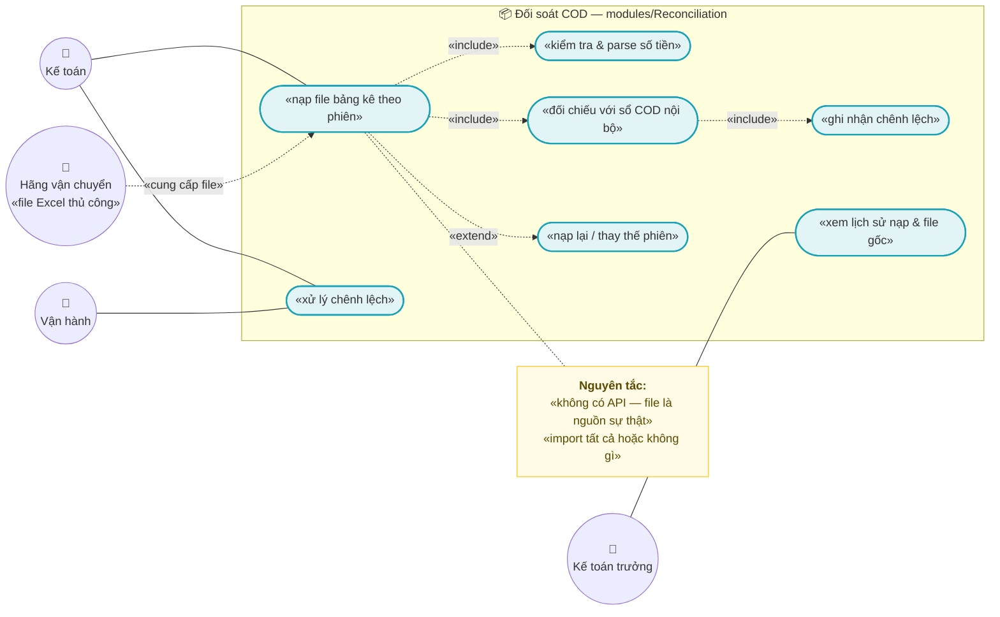
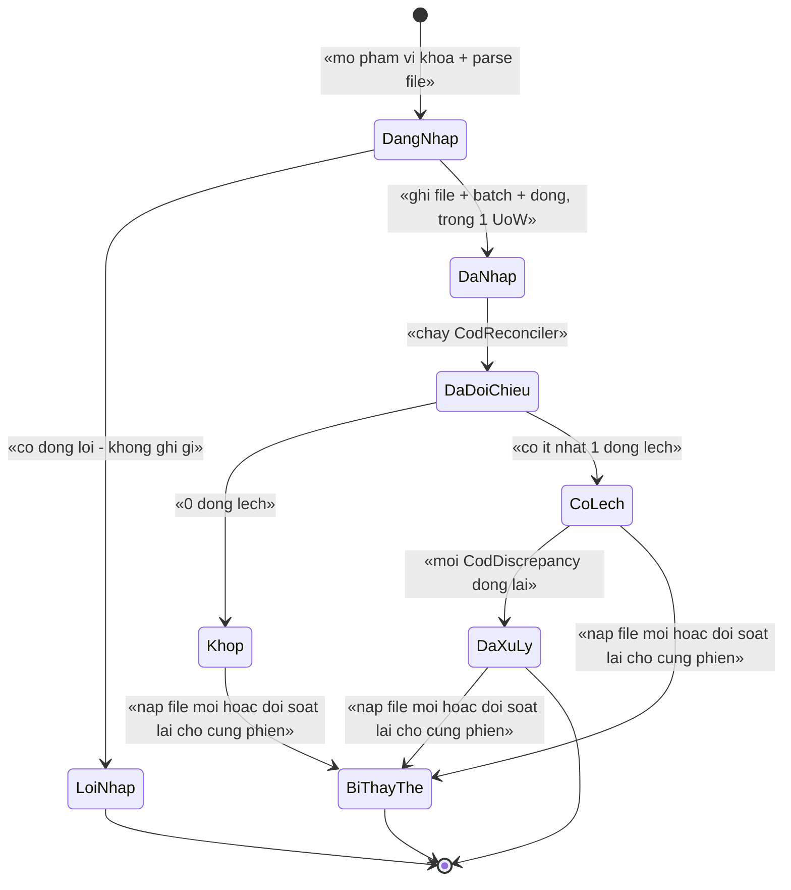
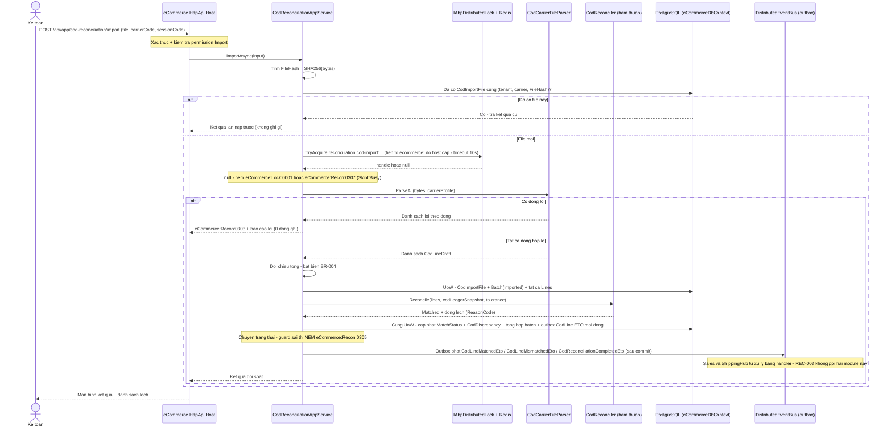
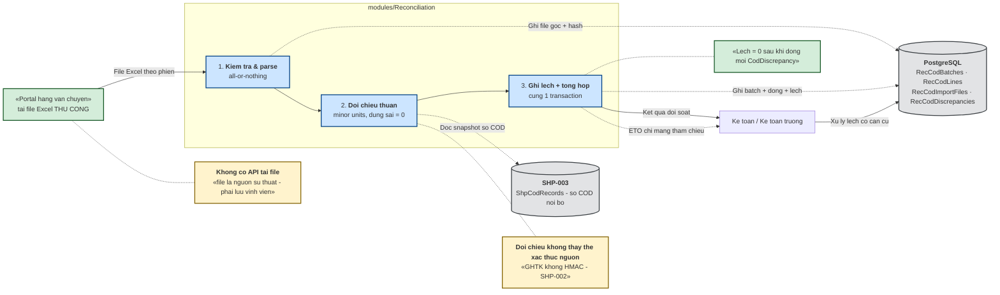
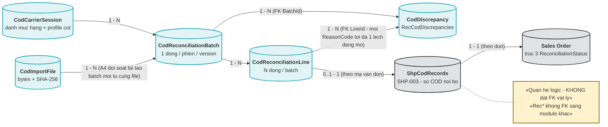

# `REC-003` — Đối soát COD: import file Excel theo "phiên"

| Thuộc tính | Nội dung |
|---|---|
| **Mã** | `REC-003` |
| **Module** | **Reconciliation** (`modules/Reconciliation/`) — ✅ module **đã có** (4 project, `eCommerce.slnx:33-37`; đang chứa `REC-001` + đối soát kho); ⬜ **toàn bộ phần COD của `REC-003` là kế hoạch** (xem §15.2 **F1**) |
| **Giai đoạn** | **GĐ2 — Vận hành VN** (`docs/implementation-plan.md:113`, `:200`) |
| **Ưu tiên** | **Must have** — là **điều kiện của cổng kiểm soát GĐ2** (*"một đơn chạy hết vòng đặt → giao → COD → đối soát"* — `docs/implementation-plan.md:204`) |
| **Trạng thái** | 🟡 `Draft` — chờ review |
| **Người viết / người review** | *(điền)* / **Kiến trúc trưởng + Kế toán trưởng + Vận hành** |
| **Phiên bản / ngày** | `v0.5 — 20/11/2026` (đối chiếu mô hình Nhanh, WP-14 — `D-71`; áp `D-121`…`D-127`; sửa theo docrev vòng 1, phiên N33) |
| **Tài liệu liên quan** | `SHP-003` (sổ COD `ShpCodRecords`, **đổi COD cần OTP** — v0.5) · `SHP-002` (webhook vận đơn — ⚠️ **GHTK không có HMAC**) · `REC-001` (đối soát thanh toán) · `REC-002` (settlement sàn) · `SAL-003` (state machine **4 trục**, trục 3 = `ReconciliationStatus`) · `REP-001`/`REP-002`/`REP-003` (read-model) · `ACC-001` (xuất liệu kế toán — *chưa có tài liệu*) · `XC-001` (Money/làm tròn) · `XC-002` (outbox/inbox + idempotency) · `XC-003` (khoá phân tán) · `XC-004` (`[Authorize]` cấp class) · `XC-005` (log/metric) · `XC-006` (thuế GTGT) · `CHN-002`/`CHN-003`/`CHN-004` (ChannelHub) · `CHN-001` (khuôn module đã có code) · `docs/implementation-plan.md:200`, `:291`, `:429` · `docs/business-modules-proposal.md:93` |

---

## 0. Tóm tắt & quyết định thiết kế

**Câu hỏi nghiệp vụ mà feature này trả lời:**

1. **Hãng vận chuyển nói đã thu hộ bao nhiêu tiền, cho những vận đơn nào, trong "phiên" nào** — và **con số đó có khớp** với số tiền COD mà hệ thống tin là phải thu không?
2. **Tiền COD đã thực sự về tài khoản ngân hàng chưa**, hay mới chỉ "hãng báo đã thu"?
3. **Chênh lệch nằm ở đâu và ai chịu trách nhiệm xử lý** — khi hãng báo thu nhiều/ít hơn, khi thiếu vận đơn, khi có vận đơn lạ (không có trong hệ thống), khi hoàn hàng?

**Tóm tắt thiết kế:** `REC-003` **không gọi API nào** để lấy bảng kê COD. Theo `docs/implementation-plan.md:200` và `docs/business-modules-proposal.md:93`: *"⚠️ **KHÔNG có API đối soát** — GHN chỉ có API **đổi** COD; bảng kê là **file Excel tải THỦ CÔNG**, kỳ theo **"phiên"** (`mã phiên`). Phải thiết kế luồng **import file thủ công + đối soát**"*. Vì vậy feature này là **một pipeline import file**:

```
file Excel của hãng  →  kiểm tra & parse (tất cả-hoặc-không-gì)  →  CodReconciliationLine  →  hàm đối chiếu thuần  →  CodDiscrepancy + CodLine*Eto (outbox)  →  (kế toán xử lý)  →  Sales tự cập nhật trục đối soát của đơn (handler)
```

Ba nguyên tắc xuyên suốt:

- 🔒 **File là nguồn sự thật duy nhất, và nó phải được lưu vĩnh viễn** (file gốc + SHA-256). Không có API thì **không thể tải lại**; nếu mất file, mất luôn căn cứ đối chiếu với hãng và với cơ quan thuế.
- 🔒 **Tiền so bằng `decimal` + "đơn vị nhỏ nhất" (minor units), tuyệt đối không `==` trên tiền.** Entity tiền hiện vẫn lưu `decimal` (vd `modules/Sales/eCommerce.Sales.Domain/Order.cs:121,164`). `Money`/`Currency` **đã có** (`shared/eCommerce.Kernel/Money/Money.cs:23`, `Currency.cs:19`: `VND` = 0 chữ số thập phân) nhưng **chưa có** `ToMinorUnits` — `D-114` (`SHP-001` Q17) chốt **không** thêm vào Kernel; hàm `decimal → long` của `REC-003` do module tự khai (xem §15.2 **F2**).
- 🔒 **Import phải idempotent ở CẢ HAI chiều**: (a) nạp **cùng một file** hai lần ⇒ **không** sinh bản ghi mới; (b) cùng một "phiên" đến trong **file chia nhỏ** ⇒ **không** cộng trùng tiền. Hàng rào **cuối cùng là unique index ở DB**, không phải kiểm tra trong code (`XC-003` D2).

**Phạm vi:**

- ✅ **Thêm vào module `modules/Reconciliation/` đã có** (Domain / EntityFrameworkCore / Application / Contracts — `eCommerce.slnx:33-37`; mapping EF ở `ReconciliationDbContextModelCreatingExtensions.cs:12`, đã gọi từ `eCommerceDbContext.cs:400`) — **không** tạo project mới.
- ✅ **5 entity** (⬜ kế hoạch, tiền tố bảng `Rec*` khớp `RecPaymentDiscrepancies` — `ReconciliationDbContextModelCreatingExtensions.cs:165`): `CodReconciliationBatch`, `CodReconciliationLine`, `CodDiscrepancy` (bảng **riêng** `RecCodDiscrepancies` theo khuôn `PaymentDiscrepancy` — `D-121`), `CodImportFile` (file gốc + hash), `CodCarrierSession` (danh mục phiên/đối tác).
- ✅ **Import file Excel "tất cả hoặc không gì"** (all-or-nothing) + **báo cáo lỗi theo dòng** cho người nhập.
- ✅ **Hàm đối chiếu THUẦN** (`CodReconciler`) — chỉ nhận dữ liệu đã nạp, trả về kết quả khớp/lệch; **không** I/O ⇒ test được 100 %.
- ✅ **Idempotency 2 tầng** (khoá ổn định + unique index) và **state machine NÉM LỖI**.
- ✅ **Khoá phân tán** theo `XC-003`: tên khoá `reconciliation:cod-import:{tenantId}:{carrierCode}:{sessionCode}` (**không** tiền tố; khoá thật trên Redis = `ecommerce:` + tên, tiền tố do host cấp — `eCommerceHttpApiHostModule.cs:229,237`, `D-82`).
- ✅ **Metric/log** theo `XC-005` (phải đăng ký ở registry thật + `XC-005` §5.1 trong **cùng PR**).
- ✅ **Quy tắc parse số tiền VND từ Excel** (dấu nghìn/thập phân **theo profile hãng** `RecCodCarrierSessions.ThousandSeparator`/`DecimalSeparator`, mặc định kiểu vi-VN `.`/`,` — 🔶 chưa xác minh, cần file thật Q2; đây là chỗ dễ sai nhất, xem ADR-08); ô có **phần lẻ khác 0** ⇒ **lỗi dòng** `CoPhanLe`, **không** làm tròn (`D-124`).
- ✅ **Liên kết ra `SAL-003`** (trục 3 `ReconciliationStatus`) và **ra `ACC-001`** (xuất liệu kế toán) **chỉ bằng ETO qua outbox** (một dòng một sự kiện — `D-123`, §7.1); `REC-003` **không** gọi `Sales`/`ShippingHub`.

**Không nằm trong phạm vi:**

- ❌ **Thu hộ/đổi COD ở hãng** (tạo COD, đổi số tiền COD, OTP của GHN) — thuộc `SHP-003` (`docs/implementation-plan.md:426`).
- ❌ **Tự động tải file từ portal của hãng** — ⚠️ **chưa kiểm chứng** ToS của GHN/GHTK có cho phép hay không (`docs/business-modules-proposal.md:557`); nếu làm được thì đó là **feature khác**, không phải `REC-003`.
- ❌ **Settlement sàn TMĐT** (phí sàn, tiền sàn phải trả) — thuộc `REC-002`.
- ❌ **Đối soát thanh toán qua cổng** (`querydr`) — thuộc `REC-001`.
- ❌ **Sổ COD nội bộ** (`ShpCodRecords`: `Pending → Collected → Remitted → Reconciled`, hoặc `Cancelled` — `SHP-003` §3.3) — thuộc `SHP-003` + `ShippingHub` (⬜ chưa có code); `REC-003` **tiêu thụ** nó, **không** sở hữu nó. Đây **không** phải sổ cái kép (`D-03`: bút toán kép để GĐ4).
- ❌ **Định dạng file xuất kế toán** — thuộc `ACC-001`.
- ❌ **Read-model tổng hợp COD** — thuộc `REP-003` (⚠️ đang **`Open`** ở `REP-001` **Q6** / `REP-003` **Q6**: *"Projection COD có cần `REP-001` không, hay để `REC-003` tự lo bảng riêng?"* — xem §15.1 **Q4**).

### 0.1 Quyết định thiết kế (ADR ngắn)

| # | Quyết định | Phương án đã cân nhắc | Lý do chọn | Hệ quả |
|---|---|---|---|---|
| **ADR-01** | **Reconciliation là module riêng** `modules/Reconciliation/` (Domain + EntityFrameworkCore + Application + Contracts) — ✅ **đã dựng** | (a) nhét vào `src/eCommerce.Application`; (b) module riêng | Đối soát là **bounded context** (`docs/structure-and-techstack.md:77`); module có 4 project (`eCommerce.slnx:33-37`) và đang chứa `REC-001` | `REC-003` **thêm** entity/service vào module này; ranh giới "module gọi app BỊ CẤM" giữ nguyên |
| **ADR-02** | **File gốc + SHA-256 được lưu vĩnh viễn** (`CodImportFile`) | (a) chỉ lưu đường dẫn tạm; (b) lưu file trong DB (`bytea`); (c) lưu file trên đĩa + hash trong DB | Không có API ⇒ **không tải lại được**; kế toán/thuế phải đối chiếu lại **nhiều tháng sau**. Ảnh hưởng dung lượng: file bảng kê GHN/GHTK ước **< 2 MB/tháng/hãng** (🔶 chưa đo — chưa có file thật, Q2) ⇒ lưu `bytea` chấp nhận được, tránh phụ thuộc ổ đĩa của container | Bảng có cột `bytea`; **cấm** xoá theo retention thông thường (xem §11) |
| **ADR-03** | **Hai tầng chống trùng**: `IdempotencyKey` ổn định + `FileHash` unique | (a) chỉ `FileHash`; (b) chỉ kiểm tra trong code; (c) **cả hai** | (a) **không** chặn được ca *"cùng phiên, hãng gửi 2 file khác nhau"* (bổ sung/điều chỉnh) ⇒ cộng trùng tiền. Kiểm trong code **không** phải hàng rào (`XC-003` D2: Redis chết ⇒ lock vô hiệu) | Cần **2 unique index**; trường hợp file hợp lệ thứ hai của cùng phiên ⇒ bắt buộc qua luồng **`Superseded`** (ADR-04), **không** ghi đè im lặng |
| **ADR-04** | **`CodReconciliationBatch` là APPEND-ONLY + thay thế bằng bản ghi mới** | (a) sửa/xoá batch đã import; (b) append-only + batch thay thế | Kế thừa `REP-003` D6 và `XC-006` D6: cần trả lời *"con số này do file nào, nạp lúc nào, có qua đối chiếu không"*. Sửa tại chỗ ⇒ **mất vết** và kế toán không biết tin bản nào | Muốn nạp lại/đối soát lại ⇒ batch mới (`Version + 1`; file khác ⇒ A2, cùng file ⇒ A4), batch cũ chuyển `Superseded`; **cấm** UPDATE số tiền trên batch đã `Matched` |
| **ADR-05** | **Import "tất cả hoặc không gì" (all-or-nothing) theo file** | (a) ghi dòng hợp lệ, bỏ dòng lỗi; (b) all-or-nothing + báo cáo lỗi toàn bộ | (a) làm **tổng tiền của phiên bị thiếu** mà kế toán **không biết thiếu bao nhiêu** ⇒ đúng loại lỗi *"số sai mà không ai phát hiện"*. Đây cũng là khuôn đã chốt ở `XC-006` **E2** (*"gom vào báo cáo lỗi, **không ghi dòng nào** — all-or-nothing theo lô"*) | Người nhập phải **sửa file và nạp lại**; đổi lại số liệu trong DB **luôn** là một phiên **trọn vẹn** |
| **ADR-06** | **Hàm đối chiếu là HÀM THUẦN, tách khỏi đọc/ghi DB** (`CodReconciler`) | (a) vừa đọc DB vừa so vừa ghi; (b) truyền dữ liệu vào, nhận kết quả ra | Khuôn **đã được chứng minh trong repo**: `Mau01Part2Calculator` là hàm thuần *"dùng chung cho mọi định dạng xuất"* (`modules/Tax/eCommerce.Tax.Domain/Mau01/Mau01Part2Calculator.cs:50–57`, dẫn lại ở `REP-003` D12) | Cần DTO "đầu vào phẳng"; **không** được truy vấn trong hàm ⇒ test được toàn bộ tổ hợp lệch mà **không cần** DB |
| **ADR-07** | **Khoá lock theo (tenant, hãng, phiên)**: tên khoá `reconciliation:cod-import:{tenantId}:{carrierCode}:{sessionCode}` (khoá thật trên Redis có thêm `ecommerce:` do host), TTL **600 s**, `SkipIfBusy` | (a) khoá theo tenant; (b) **không** khoá (tin unique index); (c) khoá theo phiên | (a) chặn tenant vô cớ (vi phạm `XC-003` D7). (b) đúng về **tính đúng** nhưng người nhập sẽ nhận **lỗi unique index thô** thay vì thông điệp nghiệp vụ. (c) hai kế toán cùng nạp **cùng phiên** ⇒ một người chờ/được báo rõ. Tên khoá **KHÔNG** chứa tiền tố `ecommerce:` — tiền tố do `AbpDistributedLockOptions.KeyPrefix = "ecommerce:"` cấp (`src/eCommerce.HttpApi.Host/eCommerceHttpApiHostModule.cs:237`), theo `XC-003` §5.4 hệ quả 2 | Cần đăng ký hàm sinh khoá tại `ReconciliationLockKeys`; **cấm** literal khoá trong code nghiệp vụ (`XC-003` BR-001) |
| **ADR-08** | **Quy tắc parse số tiền tường minh, dùng `InvariantCulture` sau khi chuẩn hoá dấu** | (a) `decimal.Parse(s)` theo culture của server; (b) `double.Parse`; (c) chuẩn hoá dấu rồi parse invariant | (a) **phụ thuộc culture của máy chủ** ⇒ cùng file cho ra hai số khác nhau giữa dev (vi-VN) và CI (en-US) — lỗi **im lặng** đúng loại `XC-003` F1/(`XC-003` §15.2). (b) `double` **cấm** cho tiền (`XC-001` BR-008; code hiện tại đã dùng `decimal`, xem `modules/Sales/eCommerce.Sales.Domain/Order.cs:164`, `SalesDbContextModelCreatingExtensions.cs:33-37`). (c) tường minh, test được | Phải có **bộ test parse** riêng (`TC-02`); ô số không đúng quy tắc ⇒ **lỗi dòng**, **không** đoán. **Thuật toán ô chuỗi (không đoán dấu):** dấu nghìn `T` và dấu thập phân `D` lấy từ **profile hãng** (§5.2), không từ culture máy; chuỗi phải khớp `^\d{1,3}(T\d{3})*(D\d+)?$` hoặc `^\d+(D\d+)?$` (nhóm nghìn đủ 3 chữ số), không khớp ⇒ lỗi dòng `SaiDinhDang`; khớp ⇒ bỏ `T`, đổi `D` thành `.`, parse `InvariantCulture`. Hệ quả: cùng ô `"1,500"` là `1.5` (⇒ `CoPhanLe`) ở profile `T='.' D=','`, nhưng là `1500` ở profile `T=',' D='.'`; `"1,284,000"` ở profile `T='.' D=','` ⇒ `SaiDinhDang`. **Phần lẻ khác 0 (vd `1.284.000,50`) ⇒ lỗi dòng `CoPhanLe`, KHÔNG làm tròn** — kiểm "× 10^`Currency.Decimals` là số nguyên" nằm **trong** `CodAmountParser`, không `Math.Round`/`IRoundingPolicy`/`Money.Of` trước bước kiểm; phần lẻ `,00` ⇒ nhận `1284000`; ô Excel kiểu số (double) đổi sang `decimal` rồi qua **cùng** phép kiểm; dung sai `ToleranceMinorUnits` **cấm** dùng để hấp thụ phần lẻ lúc parse (`D-124`, cùng nguyên tắc `D-114` + `SHP-003` BR-009) |
| **ADR-09** | **Mỗi luồng đối soát một bảng lệch, cùng chủ module `Reconciliation`** (`D-121`): COD = entity `CodDiscrepancy` → bảng `RecCodDiscrepancies` theo khuôn `PaymentDiscrepancy`; **không** có bảng chung `RecDiscrepancies`, **không** migrate/đổi `RecPaymentDiscrepancies` | (a) mỗi luồng một bảng lệch ✅; (b) **một** bảng chung + cột `Kind` | `REC-001` đã code + có migration bảng riêng `PaymentDiscrepancy` → `RecPaymentDiscrepancies` (`PaymentDiscrepancy.cs:15`, `ReconciliationDbContextModelCreatingExtensions.cs:165`; enum `PaymentDiscrepancyKind` ở `Enums.cs:706`, 10 loại lệch — nghĩa khác `Kind` ở (b)) và `SHP-002` §5.2 có `ShpDiscrepancies` ⇒ "mỗi luồng một bảng" đã là thực tế. (b) buộc đổi tên/nghĩa cột + chép dữ liệu + gộp hai máy trạng thái (4 vs 5 trạng thái) = thay đổi phá huỷ schema, trái expand-only | Chỉ **thêm** 1 bảng mới; 0 sửa `REC-001`. `REC-002` mặc định theo cùng khuôn (nợ có chủ — §15.2 **F11**). Hàng đợi lệch xuyên luồng: không làm bây giờ (§15.2 **F11**) |
| **ADR-10** | **`decimal` + `Money` cho mọi trường tiền; so sánh bằng minor units** | (a) `double`; (b) `decimal` so bằng `==` | Kế thừa `XC-001` D (BR-003/BR-008) và `REP-003` D8. ✅ `Money`/`Currency` **đã có** (`shared/eCommerce.Kernel/Money/Money.cs:23`); ⬜ `ToMinorUnits` **chưa có** và `D-114` chốt **không** thêm vào Kernel (hàm `decimal → long` do từng module khai; `REC-001` đang lưu `long?` — `PaymentDiscrepancy.cs:47-49`) | `REC-003` khai **một** hàm `decimal → long` ở `Reconciliation.Domain` (không tái dùng hàm của ShippingHub — cấm tham chiếu chéo Domain); không còn chặn ở §14.4 vì `XC-001` |
| **ADR-11** | **`CodReconciliationBatch` + `CodReconciliationLine` đều có `DbSet` trên DbContext hợp nhất** | (a) chỉ gọi `builder.ConfigureReconciliation()`; (b) khai báo `DbSet` | 🚨 **Bài học đã trả giá trong repo**: `AddDefaultRepositories(includeAllEntities: true)` **chỉ** tạo `IRepository<T>` cho entity **CÓ `DbSet`**; thiếu ⇒ runtime ném *"The requested service 'IRepository<ChannelShop, Guid>' has not been registered."* — ghi rõ ở `src/eCommerce.EntityFrameworkCore/eCommerceDbContext.cs:278-281`; `REC-001` đã làm đúng (`DbSet` ở `:57-59`) | Mọi entity **mới** của `REC-003` **phải** thêm `DbSet` ở DbContext hợp nhất cạnh `:57-59`; đây là bước dễ quên nhất |
| **ADR-12** | **Metric mới phải đăng ký ở HAI nơi** (`eCommerceMetricNames` + `XC-005` §5.1) và **nhãn chỉ từ tập hữu hạn** | (a) phát metric tự do; (b) registry | **Test đã chốt trong CI**: `MetricsTests.TC06_phat_ra_DUNG_bang_metric_da_dang_ky` (`test/eCommerce.Tests/Observability/MetricsTests.cs:39`) và `TC06_khong_co_metric_phat_ra_ngoai_bang_dang_ky` (`:50`) + test nhãn cấm (`:111`) ⇒ phát metric lạ là **CI đỏ** | 🚨 **Cấm** nhãn `sessionCode`, `trackingCode`, `batchId`. ⚠️ Hiện `eCommerceMetricTags.Forbidden` (`shared/eCommerce.Kernel/Observability/eCommerceMetrics.cs:219-221`) **chỉ** có `orderId, orderNumber, sku, userId, correlationId, email, phone, lockKey` và test nhãn cấm chỉ so `Allowed ∩ Forbidden` (`MetricsTests.cs:108-116`) ⇒ **CI không chặn** ba nhãn trên; PR code phải **thêm** chúng vào `Forbidden` (xem §13) |
| **ADR-13** | **Không có job định kỳ riêng cho `REC-003` ở GĐ2** | (a) thêm `CodReconWorker` chạy nền; (b) chỉ import theo yêu cầu người dùng | Đối soát COD **không có nguồn tự động** (không API) ⇒ job nền **không có gì để quét**. Khuôn worker động của `ChannelHub` **chỉ đăng ký khi nhịp đổi** (`modules/ChannelHub/eCommerce.ChannelHub.Application/Sync/ChannelSyncSupervisorWorker.cs:81–85`) — thêm job rỗng chỉ tăng bề mặt lỗi | Việc "nhắc nạp file" (nếu cần) thuộc `NOT-*`; nếu sau này có API tải file thì mở lại quyết định này |

---

## 1. Use Case Specification

| Thuộc tính | Nội dung |
|---|---|
| **Use Case ID** | `REC-003` |
| **Use Case Name** | Nạp bảng kê COD của hãng vận chuyển (file Excel theo **phiên**) và đối soát với sổ COD nội bộ |
| **Description** | *"Là **kế toán** (hoặc nhân viên vận hành), tôi muốn **tải file bảng kê COD** của hãng vận chuyển cho một **phiên** và để hệ thống đối chiếu với sổ COD nội bộ, để tôi biết **chính xác** khoản nào khớp, khoản nào lệch, và xử lý ngay trên màn hình thay vì dò bằng Excel tay."* |
| **Actor(s)** | **Kế toán** (nạp file, xử lý lệch) · **Vận hành** (đối chiếu tiền đã về tài khoản) · **Kế toán trưởng** (duyệt kết quả phiên, xuất liệu cho `ACC-001`) · **Hệ thống** (parse, đối chiếu, ghi lệch) · **Hãng vận chuyển** (nguồn file — **ngoài hệ thống**, không có API) |
| **Priority** | **Must have** |
| **Trigger** | (a) kế toán tải file bảng kê từ portal của hãng và bấm **Nạp file**; (b) nạp lại sau khi sửa file lỗi; (c) nạp file **điều chỉnh/bổ sung** của cùng phiên; (d) kế toán bấm **Đối chiếu lại** (A4) một phiên đang hiệu lực (`Matched`/`DiscrepancyFound`/`Resolved`) sau khi sổ COD đổi — tạo batch `Version + 1` từ **cùng file gốc** (không đọc lại file) |
| **Pre-Condition(s)** | • **`TenantId` BẮT BUỘC** (`ICurrentTenant`); thiếu ⇒ **ném lỗi tham số** (đối soát là nghiệp vụ của tenant, host **không** chạy hộ tenant — cùng nguyên tắc `REP-003` §1).<br>• **Hãng vận chuyển** đã có trong danh mục `CodCarrierSession.CarrierCode` và có **profile cột** (ánh xạ tên cột ↔ trường) đã cấu hình; **chưa có** ⇒ `eCommerce:Recon:0306` (`D-122`).<br>• **`SHP-003`** đã có sổ COD nội bộ `ShpCodRecords` (`SHP-003` §3.3; `Collected` chỉ khi dòng `REC-003` khớp **và** `Shipment.ConfirmedAtUtc ≠ null` — `D-114`/P4, `SHP-002` BR-004). ⬜ **chưa có trong code**: không có `modules/ShippingHub` (`modules/` chỉ có Address, Catalog, ChannelHub, Customers, EInvoice, Inventory, Messaging, PaymentHub, Pos, Pricing, Reconciliation, Reporting, Sales, Signing, Tax).<br>• **File** đúng định dạng hãng công bố (`.xlsx`; `.xls` **không** hỗ trợ — xem §15.1 **Q5**), có **cột mã vận đơn** và **cột số tiền COD**.<br>• **`XC-001`** (`Money`/`Currency`: `shared/eCommerce.Kernel/Money/Money.cs:23`) ✅ **đã có code**; `ToMinorUnits` ⬜ không có và không thêm (`D-114`) — §15.2 **F2**. **`XC-003`** (lock): `AbpDistributedLock` + Redis đã cấu hình (`eCommerceHttpApiHostModule.cs:225-253`).<br>• **Redis 7** sẵn sàng; nếu **không**, khoá vô hiệu nhưng app **vẫn chạy** (`AbortOnConnectFail = false` — `src/eCommerce.HttpApi.Host/eCommerceHttpApiHostModule.cs:251`) và **unique index ở DB là hàng rào cuối** (`XC-003` D2).<br>• ⚠️ **Máy dev hiện chưa có PostgreSQL/Redis** ⇒ các ràng buộc cần DB (`UNIQUE`, `CHECK`, `NULLS NOT DISTINCT`) **chưa kiểm chứng** trong phiên viết tài liệu này. |
| **Post-Condition(s)** | • **Đúng một** `CodReconciliationBatch` cho mỗi `(TenantId, CarrierCode, SessionCode, Version)`; **đúng một** bản ghi `CodImportFile` cho mỗi `(TenantId, CarrierCode, FileHash)`.<br>• **Mọi dòng** của file nằm trong `CodReconciliationLine` — **không** có dòng nào bị bỏ im lặng; thêm dòng tổng hợp `MissingInFile` (vận đơn có trong sổ COD, không có trong file) **chỉ khi** batch có kỳ (§5.2, `D-125`).<br>• **Mọi** dòng lệch có **ít nhất một** `CodDiscrepancy`, **tối đa một đang mở (`Open`/`InReview`) cho mỗi `ReasonCode`** (§5.3 #15) (bảng `RecCodDiscrepancies`, FK `BatchId` + `LineId` — `D-121`) với `ReasonCode` cụ thể (**cấm** "lệch không rõ lý do").<br>• **Bất biến tiền**: `Σ LineDeclaredAmount` (theo minor units) **==** `Batch.TotalDeclaredAmount`; vi phạm ⇒ **không** ghi dòng nào (BR-004).<br>• **Mọi** thay đổi trạng thái batch/`CodDiscrepancy` đều có **audit + log có `CorrelationId`**.<br>• **Mỗi** dòng `Matched` đã gắn được `ShipmentId` + `OrderId`, và **mỗi** dòng lệch thoả vị từ `CodLine.PhatMismatchedEto()` (§3.2 #6, `D-126`), có **đúng một** ETO kết quả (`CodLineMatchedEto` hoặc `CodLineMismatchedEto`) trong outbox **cùng UoW** với dòng (`D-123`); dòng `MissingInLedger`/`MissingInFile` **không** có ETO dòng; trục 3 `ReconciliationStatus` của đơn do **handler của Sales** tự ghi khi nhận ETO (qua hàm của aggregate `Order`) — `REC-003` **không** gọi `Sales`/`ShippingHub` và **không** ghi bảng đơn. |
| **Basic Flow** | 1. Kế toán mở màn hình `Đối soát COD`, chọn **hãng** + **phiên**, chọn file và bấm **Nạp**.<br>2. App service kiểm tra quyền `eCommerce.Reconciliation.Import` + kiểm tra **định dạng & kích thước** file; tính `FileHash = SHA256(bytes)`.<br>3. **Idempotency tầng 1**: đã có `CodImportFile` cùng `(TenantId, CarrierCode, FileHash)` ⇒ **trả luôn** kết quả cũ (không đọc lại file) — đây là **`200`**, **không phải** lỗi (§12).<br>4. Mở phạm vi khoá `reconciliation:cod-import:{tenantId}:{carrierCode}:{sessionCode}` (tên không tiền tố — §8.2; `await using`, timeout 10 s, `SkipIfBusy` — ADR-07).<br>5. **Idempotency tầng 2**: đã có batch hiệu lực (`Matched`/`DiscrepancyFound`/`Resolved` — §3.1 #8) cho cùng phiên ⇒ tạo **batch thay thế** (`Version + 1`) và chuyển batch cũ sang `Superseded` (ADR-04). (Batch `Imported`/`Reconciled` chỉ tồn tại trong một UoW đang giữ khoá phiên nên không bao giờ quan sát được từ lượt nạp khác.)<br>6. **Parse toàn bộ file** vào bộ nhớ; **bất kỳ** lỗi dòng/cột nào ⇒ **không ghi gì** + trả **báo cáo lỗi theo dòng** (ADR-05).<br>7. Trong **một Unit of Work**: ghi `CodImportFile` (bytes + hash) → `CodReconciliationBatch` (`Imported`) → **tất cả** `CodReconciliationLine`.<br>8. Gọi **hàm thuần** `CodReconciler.Reconcile(batchLines, codLedgerSnapshot, toleranceMinorUnits)` (ADR-06; chữ ký 3 tham số, đồng nhất §4.1/§14.2) ⇒ danh sách `Matched` + danh sách lệch. `codLedgerSnapshot` = bản ghi sổ COD của hãng (đọc qua `ShippingHub.Application.Contracts`, ⬜ chưa có): (i) mọi bản ghi có mã vận đơn **có trong file** — **bất kể** đã xác nhận hay chưa (`D-123` (3)); (ii) **chỉ khi batch có kỳ** (`D-125`): thêm bản ghi sổ COD cùng `TenantId` + `CarrierCode` có `Shipment.Status = Delivered`, số COD > 0, `ShpCodRecords.Status ≠ Cancelled`, `Shipment.ConfirmedAtUtc ∈ [PeriodStartUtc, PeriodEndUtc)` mà mã vận đơn **không** có trong file **và** không có dòng file (`SourceRowNumber ≠ NULL`) ở batch **khác** còn hiệu lực (không `Superseded`) cùng tenant + hãng ⇒ dòng `MissingInFile`; vận đơn hoàn/huỷ/COD 0 không sinh (không có tiền thu hộ để chờ — 🔶 chưa xác minh với file thật, Q2); đọc qua hợp đồng đọc của `ShippingHub.Application.Contracts`, theo trang (nợ `SHP-003`, F13 (b)). **Batch không có kỳ** ⇒ chỉ đối chiếu theo file: 0 `MissingInFile`, 0 `OutOfPeriod`, UI hiện nhãn cảnh báo (§10.1).<br>9. Trong **cùng** Unit of Work với bước 8: cập nhật `Line.MatchStatus`, ghi `CodDiscrepancy`, cộng số tổng hợp lên batch, và ghi vào **outbox** mỗi dòng `Matched` đã gắn được vận đơn/đơn một `CodLineMatchedEto` và mỗi dòng thoả `CodLine.PhatMismatchedEto()` một `CodLineMismatchedEto` (`D-123`, vị từ `D-126` — §3.2 #6); dòng `MissingInLedger` và `MissingInFile` (không có số khai báo của hãng để điền ETO) chỉ có `CodDiscrepancy` + `CodDiscrepancyDetectedEto`.<br>10. Chuyển batch `Imported → Reconciled` (`Matched` nếu **0 lệch**, `DiscrepancyFound` nếu có lệch) — **ném lỗi** nếu chuyển sai (BR-009).<br>11. Sau khi commit, outbox phát các ETO ở bước 9 + `CodReconciliationCompletedEto` (chỉ mang số tổng hợp + **tham chiếu**, không mang danh sách dòng). Việc đổi trục 3 của đơn và `ShpCodRecords → Collected` do **handler của Sales/ShippingHub** làm (§7.1), **không** nằm trong luồng nạp.<br>12. Màn hình hiện kết quả: số dòng, số khớp, số lệch, **tổng lệch** (theo minor units) + danh sách lệch để xử lý. |
| **Alternative Flow** | **A1: Nạp cùng file hai lần** — trả kết quả của lần nạp đầu, **0** bản ghi mới, log `Information` + metric `cod_import_duplicate_total{reason=file-hash}`; **không** ném lỗi (đây là hành vi mong đợi).<br>**A2: Cùng phiên, file thứ hai** (hãng gửi bổ sung/điều chỉnh, kể cả khi phiên đã `Resolved`) — tạo batch **`Version + 1`**; batch cũ `Superseded` (nguồn hợp lệ: `Matched`/`DiscrepancyFound`/`Resolved` — §3.1 #8); **cấm** sửa batch cũ (ADR-04).<br>**A3: File có dòng của vận đơn ngoài khoảng kỳ** — **chỉ khi batch có kỳ** (người nạp nhập `PeriodFromDate?`/`PeriodToDate?`, server quy đổi thành `PeriodStartUtc`/`PeriodEndUtc` nửa khoảng `[Start, End)` theo ngày kinh doanh UTC+7 — §5.2, `D-125`): dòng file gắn được vận đơn có `ConfirmedAtUtc ≠ NULL` **và** ngoài kỳ ⇒ vẫn nạp (không mất tiền), **đánh dấu** `MatchStatus = OutOfPeriod` + `CodDiscrepancy(ReasonCode = OutOfPeriod)` để kế toán quyết định; dòng **vẫn** được so tiền — lệch ⇒ thêm `CodDiscrepancy(AmountMismatch)` cho cùng dòng (một lý do một bản mở, §5.3 #15), không nuốt lệch tiền. `ConfirmedAtUtc = NULL` ⇒ **không** `OutOfPeriod` (khớp theo tiền — `D-123` (3)). **Batch không có kỳ** ⇒ không sinh `OutOfPeriod`/`MissingInFile`, UI nhãn *"Chưa kiểm vận đơn thiếu trong file — phiên không nhập kỳ"* (§10.1). Kỳ **bất biến** sau nạp (BR-010); A4 chép nguyên kỳ của batch gốc (đổi kỳ ở A4 = nợ BA `REC-003`, mặc định **không**).<br>**A4: Đối soát lại một phiên** (sổ COD đã đổi sau lúc nạp — vd `CodAdjustmentConfirmedEto`, hoặc nạp khi sổ chưa có vận đơn) — **không** nạp file mới và **không** sửa dòng cũ (BR-010): tạo batch **`Version + 1`** từ **cùng `CodImportFile`** (bỏ qua idempotency tầng 1; `IdempotencyKey` = khoá tầng 2 + hậu tố `:r{Version}`), đọc lại sổ COD hiện tại, chạy lại `CodReconciler` trên các dòng của file, ghi dòng/`CodDiscrepancy`/`CodLine*Eto` **của batch mới**; batch cũ `Superseded`; **cấm** xoá `CodDiscrepancy` cũ. Nhờ đó dòng `MissingInLedger` của batch cũ có thể thành `Matched` ở batch mới và phát `CodLineMatchedEto` (trục 3 và `ShpCodRecords` không kẹt im lặng). Lệch còn mở của batch cũ không tự đóng — kế toán đóng theo §3.2.<br>**A5: Ô "số tiền" trống** — coi là **`0` tường minh** *chỉ khi* hãng công bố vậy; nếu không rõ ⇒ **lỗi dòng** (ADR-08) — **cấm** đoán. |
| **Exception Flow** | **E1:** file sai định dạng/thiếu cột bắt buộc ⇒ `BusinessException` **`eCommerce:Recon:0301`** (`400`) + danh sách cột thiếu (kế thừa cách nêu lỗi của `XC-006` E5).<br>**E2:** có dòng dữ liệu sai (thiếu mã vận đơn, số tiền không parse được, ô tiền có **phần lẻ khác 0** (`CoPhanLe` — `D-124`), trùng mã vận đơn **trong cùng file**) ⇒ **`0303`** (`422`) + **báo cáo lỗi theo dòng**, **không** ghi dòng nào (ADR-05).<br>**E3:** `Σ dòng != tổng khai báo`, **hoặc** profile hãng có `TotalRowLabel` nhưng file **thiếu** dòng tổng ⇒ **`0304`** (`409`) — **không** ghi gì. ⚠️ Riêng profile `TotalRowLabel = NULL` (hãng không có dòng tổng) thì bỏ **điều kiện** này, **vẫn nạp** và ghi cờ `DeclaredTotalMissing = true` (§5.2, §12, §15.1 **Q2**).<br>**E4:** không giành được khoá trong timeout ⇒ **`eCommerce:Lock:0001`** (`409`) theo `XC-003` §6.2; nếu chế độ `SkipIfBusy` (người dùng bấm nút) ⇒ **`0307`** (`409`) *"phiên đang được nạp bởi người khác"*.<br>**E5:** chuyển trạng thái batch sai (ví dụ `Superseded → Matched`, `Matched → Imported`) ⇒ **`0305`** (`409`) — **NÉM**, **cấm** no-op im lặng (bất biến dự án + `SAL-003` BR-002).<br>**E6:** hãng chưa có profile cột trong `CodCarrierSession` ⇒ **`0306`** (`400`).<br>**E7:** file vượt giới hạn dung lượng/số dòng cấu hình ⇒ **`0302`** (`413`).<br>**E8:** **Redis chết** ⇒ theo `XC-003` **E2**, mặc định **fail-open** (chạy tiếp) + log `Error` + metric; tính đúng vẫn được **unique index** bảo vệ.<br>**E9:** kỳ sai — chỉ một trong `PeriodFromDate`/`PeriodToDate`, hoặc `PeriodFromDate > PeriodToDate` ⇒ **`eCommerce:Recon:0308`** (`400`), kiểm **trước** khi parse/giành khoá, **0** file/batch được ghi (`D-125`; mã riêng vì khác nghĩa `0301` — `D-122` (3)). |
| **Business Rules** | • **BR-REC-003-001**: Mọi lần nạp file **phải** có **khoá idempotency ổn định** `IdempotencyKey = rec003:{tenantId}:{carrierCode}:{sessionCode}:{fileHash}`; **cấm** `Guid.NewGuid()` mỗi lần thử (kế thừa `XC-002` BR-007).<br>• **BR-REC-003-002**: **Đúng một** batch cho mỗi `(TenantId, CarrierCode, SessionCode, Version)` và **đúng một** file cho mỗi `(TenantId, CarrierCode, FileHash)` — **unique index ở DB** là hàng rào cuối, **không** chỉ kiểm trong code (`XC-003` D2).<br>• **BR-REC-003-003**: File gốc **phải** được lưu (bytes + `FileHash` + `FileSizeBytes` + `ImportedBy` + `ImportedAtUtc`) **trong cùng transaction** với việc tạo batch; **cấm** xoá file gốc khi còn batch tham chiếu. Vi phạm ⇒ `TC-23` đỏ.<br>• **BR-REC-003-004**: Bất biến tiền của một phiên: **`Σ LineDeclaredAmount` (minor units) == `Batch.TotalDeclaredAmount`**; lệch ⇒ **NÉM `0304`** **và** ràng buộc DB phải chặn được (kiểm lại khi đọc — xem §5.4).<br>• **BR-REC-003-005**: Parse số tiền **chỉ** theo quy tắc `CodAmountParser` (ADR-08): chuẩn hoá dấu nghìn/thập phân **theo profile hãng** ⇒ `parse` **InvariantCulture** ⇒ **kiểm** giá trị × 10^`Currency.Decimals` là **số nguyên** (`VND = 0` chữ số, `Currency.cs:19`): phần lẻ **khác 0** (vd `1.284.000,50`) ⇒ **lỗi dòng** `CoPhanLe` (gom vào `eCommerce:Recon:0303`), **cấm** làm tròn (`Math.Round`/`IRoundingPolicy`/`Money.Of` trước bước kiểm); phần lẻ bằng 0 (`,00`) ⇒ nhận số nguyên. Áp cho **mọi** ô tiền qua `CodAmountParser` (từng dòng + dòng tổng khai báo). Ô không parse được ⇒ **lỗi dòng**, **cấm** trả `0`. Vi phạm ⇒ `TC-02` đỏ (`D-124`).<br>• **BR-REC-003-006**: **Cấm** so sánh tiền bằng `==` trên `decimal`; mọi so sánh/ngưỡng **phải** qua **minor units** (`long`) (`XC-001` BR-003). So **tuyệt đối**; dung sai phải là hằng số cấu hình **tường minh** (`ToleranceMinorUnits`, mặc định **0**).<br>• **BR-REC-003-007**: Import **all-or-nothing** theo file (ADR-05): có **bất kỳ** dòng lỗi ⇒ **0** dòng được ghi; phản hồi **phải** liệt kê **số dòng + lý do** cho **mọi** dòng lỗi (**cấm** chỉ báo dòng đầu tiên).<br>• **BR-REC-003-008**: **Mọi** dòng lệch **phải** có `CodDiscrepancy` với `ReasonCode` **thuộc enum `CodDiscrepancyReason`**; `ReasonCode` rỗng/ngoài enum ⇒ **NÉM `0305`**.<br>• **BR-REC-003-009**: State machine của batch và của `CodDiscrepancy` (enum riêng `CodDiscrepancyStatus`, §5.5) **phải NÉM LỖI** khi chuyển sai; trạng thái batch `Superseded` và trạng thái lệch `Resolved`/`WrittenOff`/`Rejected` là **hấp thụ** (absorbing) — **cấm** chuyển tiếp, muốn làm lại ⇒ **bản ghi mới**; ngoại lệ duy nhất: batch `Resolved` còn một cạnh ra `→ Superseded` (§3.1 #8).<br>• **BR-REC-003-010**: `CodReconciliationBatch`, `CodReconciliationLine`, `CodImportFile` là **APPEND-ONLY** sau khi batch `Reconciled` — **cấm** `UPDATE` số tiền/hash/số dòng/kỳ (`PeriodStartUtc`/`PeriodEndUtc`, `D-125`); **cấm** `DELETE`. Sửa sai ⇒ batch thay thế (ADR-04). **Cơ chế:** ba entity này **không** kế thừa `FullAudited*`/`ISoftDelete` (dùng `CreationAuditedAggregateRoot`/`CreationAuditedEntity` + `IMultiTenant`) để `DeleteAsync` không thành `IsDeleted` âm thầm (repo đã tự ghi soft-delete ở `DoiSoatRetention.cs:163`) ⇒ `DELETE` thật chạm FK `Restrict` (§5.3 #16), và repository của module **ném** khi gọi Delete; `CodDiscrepancy` (`FullAudited…` theo `D-121`) **không có đường xoá** (không method, repository ném). Vi phạm ⇒ `TC-24` đỏ (kỳ: `TC-44` (d)).<br>• **BR-REC-003-011**: Mọi thao tác ghi **phải** đi qua **Unit of Work**: `CodImportFile` + `CodReconciliationBatch` + **tất cả** `CodReconciliationLine` + `CodDiscrepancy` + **bản ghi outbox của các ETO `CodLine*Eto`** của cùng một lần nạp nằm trong **một** transaction. Vi phạm ⇒ `TC-25` đỏ.<br>• **BR-REC-003-012**: Phạm vi khoá phân tán **bao ngoài** Unit of Work; **cấm** acquire lồng cùng tên khoá (lock **không** reentrant — `XC-003` D6/BR-005). Vi phạm ⇒ `TC-26` đỏ.<br>• **BR-REC-003-013**: **Mọi** app service **phải** có `[Authorize]` ở **cấp class** (tiền lệ thật: `src/eCommerce.Application/Channels/ChannelAppService.cs:21–28` — thiếu `[Authorize]` cấp class thì `GetShopsAsync` từng **là API công khai**); permission dùng trong `[Authorize]` **phải** được định nghĩa ở provider (`src/eCommerce.Application.Contracts/Permissions/eCommercePermissionDefinitionProvider.cs:132` — nhóm `Reconciliation` đã có `.Confirm`) — **chưa định nghĩa ⇒ luôn 403**.<br>• **BR-REC-003-014**: `REC-003` **không** gọi `Sales`/`ShippingHub` để ghi và **không** ghi bảng đơn/`ShpCodRecords` (`D-123`; chỉ **nghe** ETO COD + **đọc** sổ COD qua `ShippingHub.Application.Contracts`, **không** tham chiếu `Sales.*`): kết quả từng dòng đi ra **chỉ** bằng ETO một-dòng-một-sự-kiện qua outbox (`CodLineMatchedEto`/`CodLineMismatchedEto`/`CodLineResolvedEto`, §7.1). **Vị từ phát ETO (`D-126`)**: một hàm thuần duy nhất `CodLine.PhatMismatchedEto()` ở `Reconciliation.Domain` = `MatchStatus ∉ {Matched, MissingInFile}` **và** `ShipmentId ≠ NULL` **và** `OrderId ≠ NULL` **và** `CodDeclaredAmount ≠ NULL`; bước ghi outbox §3.2 #6 và bước đóng lệch cuối (`CodLineResolvedEto`) **cùng gọi** hàm này (không thêm cột cờ "đã phát" — dòng bất biến, BR-010). `MissingInFile` và dòng `Matched` có lệch `LedgerChangedAfterImport` **không** phát `CodLine*Eto` (lúc mở **và** lúc đóng lệch); `DeclaredAmountMinorUnits` của ETO giữ **bắt buộc** (`D-123` (1)). Đỏ khi vi phạm: `TC-20`, `TC-43`. Trục 3 `ReconciliationStatus` (`NotRequired · AwaitingReconcile · Matched · Mismatched · Resolved`, `Enums.cs:409-425`) do **handler của Sales** ghi qua `Order.ChuyenDoiSoat(…, StatusActorType.Reconciliation, …)` (✅ cạnh có sẵn `OrderStateMachine.cs:178-180`, `StatusActorType.Reconciliation` ở `Enums.cs:509`; handler ⬜ chưa có — kế hoạch, khuôn `OrderPaymentStatusHandler.cs`): `Matched` ⇒ `AwaitingReconcile → Matched` (riêng khi trục đang `Mismatched`: hai bước `Mismatched → AwaitingReconcile → Matched` — §7.1, `D-127`); `Mismatched` ⇒ `AwaitingReconcile → Mismatched`; `Resolved` ⇒ `Mismatched → Resolved`. `IOrderStatusAppService.ChangeReconciliationStatusAsync` (✅ `IOrderStatusAppService.cs:16`, `OrderStatusAppService.cs:129-146`, quyền `eCommerce.Orders.Reconciliation.Manage`, `ExpectedVersion`) **giữ cho người** (actor `Staff`) — `REC-003` **không** gọi. Vi phạm (module `Reconciliation` có tham chiếu `eCommerce.Sales.*`/`eCommerce.ShippingHub.*` ngoài `*.Application.Contracts` của ShippingHub, hoặc có lời gọi `IOrderStatusAppService`) ⇒ `TC-27` đỏ; ETO thiếu người nhận ⇒ `EventCoverageScanTests` đỏ (§14, ca (g)).<br>• **BR-REC-003-015**: **Cách ly tenant**: mọi entity là `IMultiTenant`; **0** truy vấn nào của `REC-003` được đọc/ghi dữ liệu của tenant khác; file của tenant A **không** được trả cho tenant B (kể cả khi biết `batchId`).<br>• **BR-REC-003-016**: **Cấm** log nội dung file/nội dung dòng (chứa tên người nhận, địa chỉ, số điện thoại). Log **chỉ** dùng **số liệu tổng hợp** + `FileHash` + mã phiên (`XC-005` BR-005). Vi phạm ⇒ `TC-28` đỏ. |
| **Non-Functional Requirement** | • **NFR-REC-003-001**: File **10.000 dòng** ⇒ import + đối chiếu **p95 < 30 s** (không tính thời gian tải file lên).<br>• **NFR-REC-003-002**: Nạp **cùng một file 1.000 lần** ⇒ **đúng 1** batch, **1** file, **N** dòng (N = số dòng file), **0** dòng nhân bản.<br>• **NFR-REC-003-003**: File hợp lệ (đúng định dạng) ⇒ **0** dòng bị bỏ qua **im lặng**; mọi dòng hoặc **được ghi** hoặc **được báo lỗi**.<br>• **NFR-REC-003-004**: **0** phép so sánh tiền bằng `==`; **0** lần dùng `double`/`float` cho tiền trong module (test reflection/quét mã nguồn).<br>• **NFR-REC-003-005**: Cách ly tenant: **0** trường hợp tenant B đọc được batch/file/lệch của tenant A (integration test 2 tenant).<br>• **NFR-REC-003-006**: **100 %** app service có `[Authorize]` **cấp class**; **0** permission dùng mà chưa định nghĩa (test reflection — theo `XC-004`, khuôn đã nêu ở `CHN-004` NFR-007).<br>• **NFR-REC-003-007**: **Redis chết** ⇒ app **không** sập và **không** sinh bản ghi trùng (nhờ unique index) — integration test dừng Redis.<br>• **NFR-REC-003-008**: **0** dòng log chứa dữ liệu cá nhân của người nhận (quét mã nguồn ở CI); log là **một dòng JSON** có `CorrelationId` (`XC-005` BR-010).<br>• **NFR-REC-003-009**: **100 %** dòng lệch có `ReasonCode` thuộc enum + `DiscrepancyId`; `0` dòng lệch "không rõ lý do".<br>• **NFR-REC-003-010**: **100 %** `CodDiscrepancy` đã đóng có căn cứ (`ResolutionCode` + người + giờ) **và** tổng lệch chưa xử lý của phiên là **0 đồng** sau khi mọi lệch đóng (`TC-07`, `TC-12`).<br>• **NFR-REC-003-011/-012/-013**: vết kiểm toán đầy đủ · metric đã đăng ký · khoá không tiền tố đôi — ngưỡng + cách đo ở §13 (nguồn duy nhất của 13 NFR). |

---

## 2. Sơ đồ Use Case



**Chú giải**

| Ký hiệu | Ý nghĩa |
|---|---|
| ⭕ Xanh lá | Actor |
| 🟦 Bầu dục xanh dương | Use Case |
| 🟨 Khung vàng | Note (nguyên tắc bất biến) |
| `───` | Liên kết Actor ↔ Use Case |
| `-.«include».->` | Quan hệ bao hàm |
| `-.«extend».->` | Quan hệ mở rộng (chỉ xảy ra trong điều kiện nhất định) |

---

## 3. Sơ đồ trạng thái (state machine)

### 3.1 Vòng đời một `CodReconciliationBatch`



| # | Từ → Sang | Guard (điều kiện cho phép) | Hành động kèm theo | Nếu guard sai thì? |
|---|---|---|---|---|
| 1 | *(mới)* → `DangNhap` | Có `TenantId` + quyền `Import` + giành được khoá phiên | Ghi `CodImportFile` (bytes+hash) tạm trong UoW đang mở | **`eCommerce:Lock:0001`** (`409`) hoặc **`0307`** (`SkipIfBusy`) |
| 2 | `DangNhap` → `LoiNhap` | Parser phát hiện **≥ 1** lỗi dòng/cột | Ghi **báo cáo lỗi theo dòng** (không lưu DB); UoW **không** ghi dòng nghiệp vụ nào | **`0301`** / **`0303`** (`400`/`422`) — **NÉM** |
| 3 | `DangNhap` → `DaNhap` | **0** lỗi dòng **và** `Σ dòng == tổng khai báo` (BR-004) | Ghi batch `Imported` + **tất cả** dòng | Lệch tổng ⇒ **`0304`** (`409`) — **NÉM** |
| 4 | `DaNhap` → `DaDoiChieu` | Hàm thuần `CodReconciler` bắt đầu chạy | Không side effect (hàm thuần — ADR-06) | — |
| 5 | `DaDoiChieu` → `Khop` | **0** dòng lệch (theo minor units, dung sai = `ToleranceMinorUnits`) **và** `MissingInFileCount = 0` | `MatchedCount = TotalLineCount`; ghi outbox `CodLineMatchedEto` cho mỗi dòng đã gắn vận đơn/đơn + `CodReconciliationCompletedEto` | — |
| 6 | `DaDoiChieu` → `CoLech` | **≥ 1** dòng lệch (kể cả `MissingInFile`) | Ghi `CodDiscrepancy` `Open` cho **mỗi** dòng lệch (`D-121`; một dòng có thể có thêm lệch `LedgerChangedAfterImport` về sau — §7.2), `ReasonCode` **bắt buộc** (BR-008); ghi outbox `CodLineMismatchedEto` **chỉ** cho dòng thoả `CodLine.PhatMismatchedEto()` (BR-014, `D-126`); `MissingInFile`/`MissingInLedger` chỉ có `CodDiscrepancy` + `CodDiscrepancyDetectedEto` | Thiếu `ReasonCode` ⇒ **`0305`** (`409`) — **NÉM** |
| 7 | `CoLech` → `DaXuLy` | **Mọi** `CodDiscrepancy` của batch ở trạng thái đóng | Ghi tổng lệch đã xử lý; phát ETO cho `ACC-001` (**chỉ tham chiếu**) | Còn lệch mở ⇒ **không** cho `DaXuLy` (**`0305`**) |
| 8 | `Khop`/`CoLech`/`DaXuLy` → `BiThayThe` | Có lần nạp **mới hơn** (`Version + 1`: file khác — A2, hoặc đối soát lại cùng file — A4) cho cùng `(tenant, hãng, phiên)` | Batch cũ **bất biến**; **cấm** sửa số tiền (BR-010) | Cố sửa batch `BiThayThe` ⇒ **`0305`** |
| 9 | `BiThayThe` → *(kết thúc)*; `DaXuLy` → *(kết thúc, trừ cạnh #8)* | — | Trạng thái **hấp thụ**: **cấm** mọi chuyển tiếp khác (BR-009) | Chuyển tiếp ⇒ **`0305`** (`409`) |

**Ánh xạ tên §3.1 ↔ enum `CodBatchStatus` (§5.5):** `DaNhap` = `Imported` · `DaDoiChieu` = `Reconciled` · `Khop` = `Matched` · `CoLech` = `DiscrepancyFound` · `DaXuLy` = `Resolved` · `BiThayThe` = `Superseded`. `DangNhap`/`LoiNhap` là pha **trong bộ nhớ** (parse + giữ khoá), **không** có batch trong DB nên không có giá trị enum; `Imported`/`Reconciled` chỉ tồn tại trong một UoW. **Bộ đếm** `MatchedCount`/`DiscrepancyCount`/`MissingInFileCount` là ảnh chụp **lúc đối chiếu**; lệch phát sinh **sau** (`LedgerChangedAfterImport`, §7.2) **không** đổi trạng thái hay bộ đếm batch — màn hình hiện nhãn "COD chưa đối soát" khi `Status = CoLech` **hoặc** `OpenDiscrepancyCount > 0` (truy vấn `RecCodDiscrepancies (BatchId, Status)`, §5.3 #17) — sửa tận gốc bằng A4 (batch mới).

### 3.2 Vòng đời một `CodDiscrepancy` (enum riêng `CodDiscrepancyStatus` — `D-121`)

| # | Từ → Sang | Guard | Hành động | Nếu guard sai |
|---|---|---|---|---|
| 1 | *(mới)* → `Open` | Dòng lệch được phát hiện **và** có `ReasonCode` hợp lệ | Ghi `CodDiscrepancy` (`BatchId`, `LineId` — FK trong module), `DetectedAtUtc`, `DifferenceAmount`; ghi outbox `CodDiscrepancyDetectedEto` | **`0305`** (`409`) |
| 2 | `Open` → `InReview` | Kế toán nhận việc (`AssignDiscrepancyAsync`, có `AssignedTo`) | Ghi vết ai đang xử lý | Lệch không ở `Open` ⇒ **`0305`** |
| 3 | `InReview` → `Resolved` | Kế toán nhập **căn cứ** (`ResolutionNote` + `ResolutionCode`; `ResolveDiscrepancyAsync`) | Ghi `ResolvedAtUtc` + `ResolvedBy` | Thiếu căn cứ, hoặc lệch còn `Open` (chưa nhận việc) ⇒ **`0305`** |
| 4 | `InReview` → `WrittenOff` | Kế toán trưởng **duyệt** xoá lệch (`WriteOffDiscrepancyAsync`, quyền `Reconciliation.Approve`, người duyệt ≠ người nạp) | Ghi lý do + người duyệt | Không có quyền ⇒ **`403`**; trùng người nạp ⇒ **`0305`** |
| 5 | `InReview` → `Rejected` | Lệch **không** thuộc trách nhiệm ghi nhận (`RejectDiscrepancyAsync`, chứng minh bằng căn cứ) | Ghi `ResolutionCode` | Thiếu căn cứ, hoặc lệch còn `Open` ⇒ **`0305`** |
| 6 | `Resolved`/`WrittenOff`/`Rejected` → *(kết thúc)* | — | **Hấp thụ** — **cấm** chuyển tiếp (BR-009). Khi **mọi** `CodDiscrepancy` của dòng đã hấp thụ **và** `CodLine.PhatMismatchedEto()` của dòng = đúng (cùng hàm với bước ghi `CodLineMismatchedEto` ở #6 — `D-126`; không thêm cột cờ) ⇒ ghi outbox `CodLineResolvedEto` (`ClosedStatus ∈ {Resolved, WrittenOff, Rejected}`, `D-123`) cùng UoW với lần đóng cuối (dòng có 2 lệch `AmountMismatch` + `LedgerChangedAfterImport`: đóng lệch đầu ⇒ 0, đóng lệch hai ⇒ đúng 1). Dòng `MissingInLedger`/`MissingInFile` và dòng `Matched` (lệch `LedgerChangedAfterImport`) **không** phát `CodLineResolvedEto`, lúc mở cũng như lúc đóng (trục 3 không ở `Mismatched` do dòng đó). 🔶 **Q18 (N4, `D-127`)**: dòng của batch v1 đã `Superseded` mà trục 3 đã về `Matched` nhờ v2 ⇒ đóng lệch v1 phát `Resolved` ⇒ Sales NÉM → DLQ; hiện **chưa** có điều kiện "batch còn hiệu lực" (chờ DEC) | **`0305`** |

> ⚠️ **`Open → nothing` là nhánh nguy hiểm nhất.** Nếu cho phép "đóng lệch" mà **không** có `ResolutionCode`/căn cứ,
> thì mỗi tháng kế toán có thể đóng hết lệch và **không ai biết tiền đi đâu** — đúng loại lỗi mà `XC-003` D10 gọi là
> *"im lặng bỏ qua ⇒ mất việc mà không ai biết"*.

---

## 4. Sequence Diagram & luồng dữ liệu

### 4.1 Sequence — một lần nạp file (happy path + nhánh lỗi dòng)



### 4.2 DFD — đường đi của một con số COD (từ portal hãng tới sổ kế toán)



> ⚠️ **Đọc kèm §7.4:** đối soát **không** xác thực được **nguồn**. File Excel do người tải về từ portal — nếu portal
> hoặc tài khoản portal bị xâm nhập, kẻ tấn công có thể **sửa file** và hệ thống sẽ ghi "đã khớp" theo file đó.
> Biện pháp bù: `FileHash` + người nạp (`ImportedBy`) + audit log + **khoá 4 mắt** cho việc `WrittenOff` (§9).

---

## 5. Mô hình dữ liệu

### 5.1 ERD



**Ghi chú về ERD:** quan hệ `RecCodLines → Order` (Sales) / `ShpCodRecords` là **quan hệ luận lý**, **không** đặt FK vật lý
(theo `REP-003` §5.1: read-model/bảng đối soát dùng FK luận lý để không khoá cứng vào module khác).
Lý do: `SHP-003`/`Sales` có thể tách microservice (ADR-01) và bảng đối soát phải **giữ được** vết kể cả khi
bản ghi gốc bị xoá/đổi — nếu có FK cứng thì `DELETE` ở nơi khác sẽ **phá** vết đối soát.

### 5.2 Bảng & cột (Data Dictionary)

**Bảng `RecCodCarrierSessions`** — danh mục hãng + **profile cột** để parse (thay đổi cấu hình, **không** sửa code)

| Cột | Kiểu | Null? | Nguồn / ý nghĩa | Ghi chú |
|---|---|---|---|---|
| `Id` | `uuid` | ✖ | khoá chính | |
| `TenantId` | `uuid` | ✔ | tenant sở hữu | ⚠️ ở chế độ 1 tenant, `TenantId` **có thể `NULL`** ⇒ index unique phải `NULLS NOT DISTINCT` (xem §5.3) |
| `CarrierCode` | `varchar(32)` | ✖ | `ghn` · `ghtk` · `viettelpost`… | khớp quy ước `Order.ChannelCode` (`varchar(32)`, `modules/Sales/eCommerce.Sales.EntityFrameworkCore/SalesDbContextModelCreatingExtensions.cs:19`) |
| `SessionCodeColumn` | `varchar(64)` | ✖ | tên cột chứa **mã phiên** trong file | thay đổi theo phiên bản file của hãng ⇒ cấu hình, **cấm** hard-code |
| `TrackingCodeColumn` | `varchar(64)` | ✖ | tên cột **mã vận đơn** | khoá đối chiếu chính |
| `CodAmountColumn` | `varchar(64)` | ✖ | tên cột **tiền COD** | |
| `ThousandSeparator` / `DecimalSeparator` | `char(1)` / `char(1)` | ✖ / ✖ | dấu nghìn / dấu thập phân của ô **chuỗi** | ADR-08; khác nhau; mặc định seed `.` / `,` — 🔶 chưa xác minh, chờ file thật (Q2); ô Excel kiểu số không dùng hai cột này |
| `TotalRowLabel` | `varchar(64)` | ✔ | nhãn dòng **tổng** (nếu file có) | `NULL` ⇒ hãng không có dòng tổng: **không** kiểm BR-004, `DeclaredTotalMissing = true`; khác `NULL` mà file thiếu dòng tổng ⇒ `0304` (E3, §15.1 **Q2**) |
| `Currency` | `varchar(8)` | ✖ | `VND` | khớp `Order.Currency` (`modules/Sales/eCommerce.Sales.Domain/Order.cs:153`, `varchar(8)` tại `SalesDbContextModelCreatingExtensions.cs:21`) |
| `IsActive` | `bool` | ✖ | bật/tắt hãng | |
| `CreationTime`/`CreatorId`/… | — | — | audit của ABP | `FullAuditedAggregateRoot` như `Channel` (`modules/ChannelHub/eCommerce.ChannelHub.Domain/Entities/ChannelEntities.cs:9`) |

**Bảng `RecCodImportFiles`** — **file gốc vĩnh viễn** (ADR-02)

| Cột | Kiểu | Null? | Nguồn / ý nghĩa | Ghi chú |
|---|---|---|---|---|
| `Id` | `uuid` | ✖ | khoá chính | |
| `TenantId` | `uuid` | ✔ | tenant | |
| `CarrierCode` | `varchar(32)` | ✖ | hãng | |
| `FileHash` | `char(64)` | ✖ | **SHA-256** của bytes | 🔒 **khoá chống nạp trùng file** |
| `FileName` | `varchar(260)` | ✖ | tên file người dùng tải lên | ⚠️ **dữ liệu người dùng** ⇒ **cấm** log nguyên văn ở mức `Information` nếu chứa PII (BR-016) |
| `Content` | `bytea` | ✖ | **bytes file gốc** | `HasColumnType("bytea")` — khuôn `HasColumnType("text")` đã dùng ở `ChannelHubDbContextModelCreatingExtensions.cs:41–42` |
| `FileSizeBytes` | `bigint` | ✖ | kích thước | dùng cho hạn mức (E7) |
| `ImportedByUserId` | `uuid` | ✖ | ai nạp | audit + trách nhiệm |
| `ImportedAtUtc` | `timestamptz` | ✖ | ** UTC** | toàn repo dùng hậu tố `Utc` (`ChannelShop.LastSyncedAtUtc`, `ChannelEntities.cs:69`) |

**Bảng `RecCodBatches`** — một lần nạp của một phiên (theo `Version`)

| Cột | Kiểu | Null? | Nguồn / ý nghĩa | Ghi chú |
|---|---|---|---|---|
| `Id` | `uuid` | ✖ | khoá chính | |
| `TenantId` | `uuid` | ✔ | tenant | |
| `IdempotencyKey` | `varchar(256)` | ✖ | `rec003:{tenantId}:{carrier}:{session}:{fileHash}`; batch do A4 thêm hậu tố `:r{Version}` | 🔒 BR-001; độ dài khớp `PaymentTransaction.IdempotencyKey` (`varchar(256)` — `PaymentHubDbContextModelCreatingExtensions.cs:23`) |
| `CarrierCode` | `varchar(32)` | ✖ | hãng | |
| `SessionCode` | `varchar(64)` | ✖ | **mã phiên** của hãng | ⚠️ **cấm** làm nhãn metric — chưa nằm trong `Forbidden` (`eCommerceMetrics.cs:219-221`), PR code phải thêm (§13) |
| `Version` | `int` | ✖ | 1, 2, 3… | ADR-04 |
| `Status` | `int` | ✖ | state máy §3.1 — enum `CodBatchStatus` (§5.5) | khớp khuôn `ChannelListing.Status` là `int` (`ChannelEntities.cs:145`) |
| `PeriodStartUtc` / `PeriodEndUtc` | `timestamptz` / `timestamptz` | ✔ / ✔ | **kỳ** của phiên, người nạp nhập (tuỳ chọn), **nửa khoảng** `[Start, End)` theo ngày kinh doanh UTC+7; cùng `NULL` hoặc cùng có giá trị, `Start < End` (CHECK §5.3 #19) | ⬜ kế hoạch (`D-125`, cột additive). Server quy đổi từ `PeriodFromDate?`/`PeriodToDate?` (§6.1): `Start = NgayKinhDoanh.BatDauUtc(từ)`, `End = NgayKinhDoanh.KetThucUtc(đến)` (`modules/Reporting/eCommerce.Reporting.Domain/BaoCao/NgayKinhDoanh.cs:46-61`, giờ lệch 7) — `Reconciliation` **không** tham chiếu `Reporting.Domain`: chép hàm thuần hoặc nâng lên `shared/eCommerce.Kernel` (arch chọn ở WP code). `NULL` ⇒ không sinh `OutOfPeriod`/`MissingInFile` + nhãn cảnh báo (A3, §10.1, §12). **Bất biến** sau nạp (BR-010). Dùng cho bộ lọc "kỳ" (§6.1) và header (§10.1) |
| `ImportFileId` | `uuid` | ✖ | → `RecCodImportFiles` | FK **trong cùng module** (được phép) |
| `TotalDeclaredAmount` | `numeric(18,4)` | ✖ | tổng tiền COD theo **file** | ⚠️ `decimal`; `HasPrecision(18,4)` như `Order.GrandTotal` (`SalesDbContextModelCreatingExtensions.cs:37`) |
| `Currency` | `varchar(8)` | ✖ | `VND` | |
| `TotalLineCount` | `int` | ✖ | số dòng **của file** đã nạp (**không** tính dòng `MissingInFile`) | = số dòng dữ liệu file (NFR-003, TC-03) |
| `MatchedCount` | `int` | ✖ | số dòng của file khớp | |
| `DiscrepancyCount` | `int` | ✖ | số dòng của file lệch (`MatchStatus ≠ Matched`) | bất biến: `MatchedCount + DiscrepancyCount == TotalLineCount` |
| `MissingInFileCount` | `int` | ✖ | số dòng `MissingInFile` (vận đơn có trong sổ, không có trong file) | mặc định `0`; ngoài bất biến trên; `Khop` đòi `= 0` (§3.1 #5) |
| `DiscrepancyAmount` | `numeric(18,4)` | ✖ | **Σ chênh lệch** (có dấu) | dương = hãng báo nhiều hơn; âm = ít hơn |
| `DeclaredTotalMissing` | `bool` | ✖ | file **không** có dòng tổng | BR-004 **không** áp dụng khi `true` |
| `SupersededByBatchId` | `uuid` | ✔ | batch thay thế | ADR-04 |
| `CorrelationId` | `varchar(64)` | ✖ | `XC-005` | nối log ↔ ETO ↔ audit |
| `ImportedAtUtc` / `ReconciledAtUtc` | `timestamptz` | ✖ / ✔ | mốc thời gian | |

**Bảng `RecCodLines`** — từng dòng của file (đã parse)

| Cột | Kiểu | Null? | Nguồn / ý nghĩa | Ghi chú |
|---|---|---|---|---|
| `Id` | `uuid` | ✖ | khoá chính | |
| `TenantId` | `uuid` | ✔ | tenant | |
| `BatchId` | `uuid` | ✖ | → `RecCodBatches` | FK trong module |
| `SourceRowNumber` | `int` | ✔ | **số dòng trong file Excel** | để đối chiếu ngược khi kế toán mở file — bắt buộc với dòng của file; `NULL` **chỉ** ở dòng `MissingInFile` (không có dòng trong file) — CHECK #18 |
| `SessionCode` | `varchar(64)` | ✖ | mã phiên **trong dòng** | kiểm khớp với batch (§12) |
| `TrackingCode` | `varchar(64)` | ✖ | mã vận đơn của hãng | khoá đối chiếu |
| `ShipmentId` / `OrderId` | `uuid` / `uuid` | ✔ / ✔ | tham chiếu luận lý tới vận đơn (`SHP-003`) và đơn (Sales), lấy từ snapshot sổ COD lúc đối chiếu | **không** FK (§5.1). `NULL` = chưa gắn được (dòng `MissingInLedger`) ⇒ **không** phát `CodLine*Eto` cho dòng đó (`D-123`); bắt buộc để điền ETO. Dòng `MissingInFile` có đủ hai cột nhưng thiếu số khai báo ⇒ cũng **không** phát (vị từ `CodLine.PhatMismatchedEto()` — §3.2 #6, `D-126`) |
| `CodDeclaredAmount` | `numeric(18,4)` | ✔ | số tiền COD theo **file** | ⚠️ **decimal**; `NULL` **chỉ** ở dòng `MissingInFile` (hãng không khai báo — **cấm** ghi `0`, §10.2) — CHECK #18. Dòng `MissingInFile` có `SessionCode` = mã phiên của batch, `TrackingCode`/`ShipmentId`/`OrderId`/`CodLedgerAmount` lấy từ sổ COD; **không** tính vào `Σ LineDeclaredAmount` (BR-004) |
| `CodLedgerAmount` | `numeric(18,4)` | ✔ | số tiền COD theo **sổ nội bộ** (`SHP-003`) | `NULL` = **không tìm thấy** vận đơn ⇒ **cấm** ghi `0` (kế thừa `REP-003` D9: *"cấm ghi 0 thay cho không biết"*) |
| `MatchStatus` | `int` | ✖ | `Matched` · `AmountMismatch` · `MissingInLedger` · `MissingInFile` · `OutOfPeriod` | xem §5.5. `OutOfPeriod` chỉ khi batch có kỳ và `ConfirmedAtUtc ≠ NULL` ngoài `[Start, End)`; dòng đó vẫn so tiền (A3) |
| `MatchedAtUtc` | `timestamptz` | ✔ | thời điểm đối chiếu | |
| `Note` | `varchar(2048)` | ✔ | ghi chú của người nhập | độ dài khớp quy ước `varchar(2048)` (`SalesDbContextModelCreatingExtensions.cs:22`) |

**Bảng `RecCodDiscrepancies`** (entity `CodDiscrepancy : FullAuditedAggregateRoot<Guid>, IMultiTenant`, module chủ `Reconciliation`) — bảng lệch **riêng của luồng COD** (`D-121`, ADR-09), cạnh `RecPaymentDiscrepancies` đã có (`ReconciliationDbContextModelCreatingExtensions.cs:163-185`, `PaymentDiscrepancy.cs:15`) và **không** đụng bảng đó; ⬜ **kế hoạch** — chưa có trong code, mapping thêm cạnh `PaymentDiscrepancy` và có `DbSet` ở DbContext hợp nhất (ADR-11)

| Cột | Kiểu | Null? | Nguồn / ý nghĩa | Ghi chú |
|---|---|---|---|---|
| `Id` | `uuid` | ✖ | khoá chính | |
| `TenantId` | `uuid` | ✔ | tenant | |
| `BatchId` | `uuid` | ✖ | → `RecCodBatches` | FK **trong cùng module**, `OnDelete Restrict` (khuôn `RunId` của `PaymentDiscrepancy`) — DB chặn lệch mồ côi |
| `LineId` | `uuid` | ✖ | → `RecCodLines` | FK trong module, `Restrict`; **thay** cột đa hình `Kind`/`SourceType`/`SourceId` của bản nháp cũ |
| `ReasonCode` | `int` | ✖ | enum `CodDiscrepancyReason` (§5.5) | 🔒 BR-008 (`NOT NULL`, **cấm** giá trị ngoài enum) |
| `ExpectedAmount` | `numeric(18,4)` | ✔ | số **hệ thống** tin (`ShpCodRecords`) | `NULL` = **không biết** (vd `MissingInLedger`) — **cấm** ghi `0` thay |
| `ActualAmount` | `numeric(18,4)` | ✔ | số **hãng** báo | `NULL` khi vận đơn **không có trong file** (`MissingInFile`) |
| `DifferenceAmount` | `numeric(18,4)` | ✔ | `Actual − Expected` | ⚠️ **không** lưu `0` khi **không biết** — `NULL` + `ReasonCode = MissingData`/`MissingInLedger`/`MissingInFile` |
| `Currency` | `varchar(8)` | ✖ | `VND` | |
| `Status` | `int` | ✖ | state máy §3.2 — enum `CodDiscrepancyStatus` (§5.5) | |
| `AssignedToUserId` | `uuid` | ✔ | ai đang xử lý | |
| `ResolutionCode` | `varchar(48)` | ✔ | bắt buộc khi `Resolved`/`WrittenOff`/`Rejected` | guard §3.2 #3–#5 |
| `ResolutionNote` | `varchar(2048)` | ✔ | căn cứ | |
| `ResolvedAtUtc` / `ResolvedByUserId` | `timestamptz` / `uuid` | ✔ | vết đóng lệch | append-only |
| `DetectedAtUtc` | `timestamptz` | ✖ | thời điểm phát hiện | |

### 5.3 Index & ràng buộc **(phần hay bị bỏ sót nhất)**

| # | Loại | Bảng | Cột / điều kiện | Mục đích |
|---|---|---|---|---|
| 1 | **UNIQUE** | `RecCodBatches` | `(TenantId, CarrierCode, SessionCode, Version)` **NULLS NOT DISTINCT** | BR-002 — chống 2 batch cùng phiên/version |
| 2 | **UNIQUE** | `RecCodImportFiles` | `(TenantId, CarrierCode, FileHash)` **NULLS NOT DISTINCT** | BR-002 — **chống nạp trùng file** (idempotency tầng 1) |
| 3 | **UNIQUE** | `RecCodBatches` | `IdempotencyKey` **NULLS NOT DISTINCT** | BR-001 — khoá ổn định là hàng rào cuối |
| 4 | **UNIQUE** | `RecCodLines` | `(BatchId, TrackingCode)` | chống trùng mã vận đơn **trong cùng file** (bắt được ở §12) |
| 5 | **UNIQUE** | `RecCodCarrierSessions` | `(TenantId, CarrierCode)` **NULLS NOT DISTINCT** | 1 profile cột cho mỗi hãng |
| 6 | **INDEX** | `RecCodLines` | `(TenantId, TrackingCode)` | tra cứu ngược từ mã vận đơn (màn hình xử lý lệch + webhook vận đơn) |
| 7 | **INDEX** | `RecCodLines` | `(BatchId, MatchStatus)` | màn hình "chỉ xem dòng lệch" |
| 8 | **INDEX** | `RecCodBatches` | `(TenantId, CarrierCode, Status, ImportedAtUtc)` | danh sách phiên cần xử lý |
| 9 | **INDEX** | `RecCodDiscrepancies` | `(TenantId, Status, DetectedAtUtc)` | hàng đợi lệch **COD** (hàng đợi xuyên luồng — §15.2 **F11**) |
| 10 | **INDEX** | `RecCodDiscrepancies` | `(LineId)` | tra ngược về dòng nguồn (đồng thời là chỉ mục cho FK `LineId`) |
| 11 | **CHECK** *(khuyến nghị)* | `RecCodLines` | `CodDeclaredAmount >= 0` | tiền COD **thu hộ** không âm — ⚠️ ngoại lệ **hoàn COD/điều chỉnh âm** xem §15.1 **Q3** |
| 12 | **CHECK** *(khuyến nghị)* | `RecCodBatches` | `MatchedCount + DiscrepancyCount = TotalLineCount` | bất biến đếm ở tầng DB |
| 13 | **CHECK** *(khuyến nghị)* | `RecCodLines` | `MatchStatus <> 0 OR CodLedgerAmount IS NOT NULL` | không thể "khớp" khi chưa có số đối chiếu |
| 14 | **Ghi chú** | `RecCodImportFiles.Content` | — | **không** đặt `CHECK` độ dài; hạn mức nằm ở tầng ứng dụng (E7) |
| 15 | **UNIQUE** (một phần) | `RecCodDiscrepancies` | `(TenantId, LineId, ReasonCode)` **NULLS NOT DISTINCT** `WHERE Status IN (0, 1)` (`Open`, `InReview`) | **tối đa một lệch đang mở** cho mỗi `(dòng, lý do)` (`D-121` (4)); lệch cùng lý do đã đóng thì cho ghi mới — `SHP-003` cho đổi COD nhiều lần mỗi vận đơn (`Cod.MaxAdjustmentsPerShipmentPerDay` — `shp-003:666`). Handler `CodAdjustmentConfirmedEto` gặp lệch cùng lý do còn mở ⇒ **no-op + log `Information`** (không NÉM, tránh `23505` ⇒ DLQ — §7.2). Viết tay bằng `migrationBuilder.Sql` như #1; 🔶 chưa chạy trên PostgreSQL (docrev/QA kiểm). Đỏ khi vi phạm: `TC-35` (b), `TC-39` |
| 16 | **FK** | `RecCodDiscrepancies` | `BatchId → RecCodBatches`, `LineId → RecCodLines`, cả hai `Restrict` | DB chặn lệch mồ côi — chèn `LineId` không tồn tại ⇒ lỗi `23503` (QA thêm ca migration PostgreSQL) |
| 17 | **INDEX** | `RecCodDiscrepancies` | `(BatchId, Status)` | đếm `OpenDiscrepancyCount` của batch (§3.1, §10.1) và kiểm guard `CoLech → DaXuLy` |
| 18 | **CHECK** *(khuyến nghị)* | `RecCodLines` | `(MatchStatus = 3) = (CodDeclaredAmount IS NULL AND SourceRowNumber IS NULL)` (`3` = `MissingInFile`) | dòng `MissingInFile` là dòng duy nhất không có số khai báo/số dòng file; mọi dòng khác phải có cả hai — đỏ khi vi phạm: `TC-42` |
| 19 | **CHECK** | `RecCodBatches` | `(PeriodStartUtc IS NULL) = (PeriodEndUtc IS NULL) AND (PeriodStartUtc IS NULL OR PeriodStartUtc < PeriodEndUtc)` (`D-125`) | kỳ cùng có hoặc cùng trống, **nửa khoảng** không rỗng (`Start = End` bị chặn; không `BETWEEN`) — chèn một `NULL` một có giá trị, hoặc `Start = End` ⇒ `23514`; đỏ khi vi phạm: `TC-44` (a). 🔶 chưa chạy trên PostgreSQL |

> 🚨 **`NULLS NOT DISTINCT` là BẮT BUỘC, không phải tuỳ chọn.** Đây là **lỗi thật đã trả giá trong repo**:
> PostgreSQL mặc định `NULLS DISTINCT` ⇒ hai dòng có `TenantId IS NULL` và cùng khoá **vẫn chèn được**.
> Xem `src/eCommerce.EntityFrameworkCore/Migrations/20261013024226_Fix_NullableTenantId_UniqueIndexes.cs:10–27`
> (*"ở chế độ 1 tenant (`TenantId = NULL`) ta có thể tạo **trùng** `Code`/`Sku`/`Number`/`MerchantReference`"*).
> ⚠️ EF Core **không** mô hình hoá `NULLS NOT DISTINCT` ⇒ migration phải viết `migrationBuilder.Sql(...)` thủ công
> (khuôn đã có ở đúng file trên, dòng 39–85).

### 5.4 ⚠️ Vì sao BR-004 **không thể** là `CHECK` constraint thuần

Bất biến *"`Σ LineDeclaredAmount` == `Batch.TotalDeclaredAmount`"* là bất biến **liên bảng** ⇒ PostgreSQL **không**
diễn đạt được bằng `CHECK`. Ba tầng bảo vệ:

| Tầng | Cơ chế | Cách kiểm (🔶 kế hoạch — chưa có test nào, F1) |
|---|---|---|
| 1. Domain | Batch **tính** `TotalDeclaredAmount` bằng cách cộng các dòng **trong cùng UoW** (không nhận từ input) | 🔶 unit test (`TC-04`) |
| 2. DB | `CHECK (MatchedCount + DiscrepancyCount = TotalLineCount)` (§5.3 #12) — **đếm**, không phải **tiền** | 🔶 migration test (`TC-35`, `TC-42`) |
| 3. Đọc lại | Job/endpoint **kiểm lại** bất biến khi đọc và **đánh cờ** nếu lệch (báo cáo `InvariantViolated`) | 🔶 integration test `TC-11` |

> ❌ **Cấm** giải pháp "trigger DB cộng lại tiền": trigger ẩn là **nguồn sự thật thứ hai** khó gỡ lỗi, và
> `XC-003` D2 yêu cầu trả lời được *"bỏ lock đi, DB có chặn không?"* — ở đây câu trả lời đúng là
> *"DB chặn được **đếm**, còn **tiền** do domain tính lại và kiểm lại khi đọc"*, và điều đó **phải ghi rõ**, không được giả vờ.

### 5.5 Enum của feature

| Enum | Giá trị | Ghi chú |
|---|---|---|
| `CodBatchStatus` | `Imported = 0` · `Reconciled = 1` · `Matched = 2` · `DiscrepancyFound = 3` · `Resolved = 4` · `Superseded = 5` | ánh xạ tên §3.1 ↔ enum ở §3.1 (sau bảng); bỏ `Importing`/`Failed` của bản nháp (không có cạnh vào/ra trong DB); lưu `int` (khớp khuôn `ChannelListingStatus`, `src/eCommerce.Domain.Shared/Enums.cs:513`). Mọi enum ở bảng này là enum **mới**; sau khi có migration chỉ **thêm giá trị ở CUỐI** dải, không đổi số cũ (`D-17`) |
| `CodLineMatchStatus` | `Matched = 0` · `AmountMismatch = 1` · `MissingInLedger = 2` · `MissingInFile = 3` · `OutOfPeriod = 4` | ⚠️ **chưa có trong code — kế hoạch GĐ2** |
| `CodDiscrepancyReason` | `AmountMismatch` · `MissingInLedger` · `MissingInFile` · `OutOfPeriod` · `CodChanged` (⚠️ GHN cần OTP — `docs/implementation-plan.md:199`) · `ReturnedGoods` · `MissingData` · `LedgerChangedAfterImport` (**cuối dải**, `D-123` §7.2: sổ COD đổi sau khi nạp) | lưu `int`, `ReasonCode` **bắt buộc** (BR-008); chờ **Q3** chốt bộ đầy đủ với kế toán trưởng |
| `CodDiscrepancyStatus` | `Open = 0` · `InReview = 1` · `Resolved = 2` · `WrittenOff = 3` · `Rejected = 4` | enum **riêng** của luồng COD (`D-121`), lưu `int`; **không** dùng lại `PaymentDiscrepancyStatus` (`Moi`·`DaXacNhan`·`DaXuLy`·`BoQua` — `Enums.cs:729-735`: khác số bước, khác nghĩa); sau migration chỉ thêm cuối dải (`D-17`) |

---

## 6. Hợp đồng API

### 6.1 Application Service

| Mục | Giá trị |
|---|---|
| Interface | `ICodReconciliationAppService` — đặt tại `modules/Reconciliation/eCommerce.Reconciliation.Application.Contracts` |
| Implementation | `CodReconciliationAppService` — đặt tại `modules/Reconciliation/eCommerce.Reconciliation.Application` |
| `[Authorize]` | **cấp CLASS** + permission cụ thể ở từng method (BR-013) |
| Khuôn tham chiếu | `src/eCommerce.Application/Channels/ChannelAppService.cs:21–28` (lý do `[Authorize]` cấp class được ghi **ngay trong comment của code thật**) |

| Method | Input (DTO) | Output (DTO) | Permission | Ghi chú |
|---|---|---|---|---|
| `ImportAsync` | `ImportCodFileDto` (`CarrierCode`, `SessionCode`, `FileName`, `Content` (base64/stream), `PeriodFromDate?`, `PeriodToDate?` (`DateOnly`, giờ VN, **bao gồm** ngày cuối — `D-125`), `Note?`) | `CodImportResultDto` | `eCommerce.Reconciliation.Import` | **idempotent**; không có tham số nào là **số tiền** (BR: mọi số tiền **tính ở server**). Hai ngày kỳ **cùng có hoặc cùng trống**, từ ≤ đến — sai ⇒ **`eCommerce:Recon:0308`** (`400`, E9), kiểm trước khi ghi. Server quy đổi sang `PeriodStartUtc`/`PeriodEndUtc` (§5.2); client **không** gửi mốc UTC (tránh lỗi múi giờ kiểu `CUS-001` D12) |
| `GetBatchesAsync` | `PagedCodBatchRequestDto` (hãng, phiên, trạng thái, kỳ = giao với `[PeriodStartUtc, PeriodEndUtc)` của batch) | `PagedResultDto<CodBatchDto>` | `eCommerce.Reconciliation.View` | |
| `GetBatchAsync` | `Guid id` | `CodBatchDetailDto` | `eCommerce.Reconciliation.View` | kèm số tổng hợp + `OpenDiscrepancyCount` (đếm lệch đang mở, §3.1) + kỳ (`PeriodStartUtc`/`PeriodEndUtc` nullable) + cờ `MissingInFileNotChecked` suy từ `PeriodStartUtc IS NULL` (0 cột mới — nhãn §10.1, `D-125`) |
| `GetDiscrepanciesAsync` | `GetCodDiscrepanciesInput` | `PagedResultDto<CodDiscrepancyDto>` | `eCommerce.Reconciliation.View` | tên DTO tách khỏi `PaymentDiscrepancyDto`/`GetPaymentDiscrepanciesInput` cùng project Contracts (`PaymentReconciliationDtos.cs:49,86` — `D-121`) |
| `AssignDiscrepancyAsync` | `AssignCodDiscrepancyDto` (`DiscrepancyId`, `AssignedToUserId`) | `CodDiscrepancyDto` | `eCommerce.Reconciliation.Manage` | §3.2 #2 (`Open → InReview`) |
| `ResolveDiscrepancyAsync` | `ResolveCodDiscrepancyDto` (`DiscrepancyId`, `ResolutionCode`, `Note`) | `CodDiscrepancyDto` | `eCommerce.Reconciliation.Manage` | guard §3.2 #3 |
| `RejectDiscrepancyAsync` | `RejectCodDiscrepancyDto` (`DiscrepancyId`, `ResolutionCode`, `Note`) | `CodDiscrepancyDto` | `eCommerce.Reconciliation.Manage` | guard §3.2 #5 |
| `WriteOffDiscrepancyAsync` | `WriteOffCodDiscrepancyDto` | `CodDiscrepancyDto` | `eCommerce.Reconciliation.Approve` | 🔒 **khoá 4 mắt**: người duyệt **khác** người nạp |
| `GetImportFileAsync` | `Guid batchId` | file stream | `eCommerce.Reconciliation.View` | ⚠️ kiểm `TenantId` **trước** khi trả bytes (BR-015) |
| `ReconcileAgainAsync` | `Guid batchId` (batch đang hiệu lực) | `CodImportResultDto` (batch mới `Version + 1`) | `eCommerce.Reconciliation.Manage` | A4 — **không** nạp file mới, dùng lại file gốc; cùng khoá phiên + `IdempotencyKey` hậu tố `:r{Version}`; batch không hiệu lực (`Superseded`) ⇒ `0305` |

### 6.2 REST endpoint

| Method / Route | Authentication | Permission | Content-Type |
|---|---|---|---|
| `POST /api/app/cod-reconciliation/import` | `Bearer (OpenIddict)` | `eCommerce.Reconciliation.Import` | `multipart/form-data` |
| `GET /api/app/cod-reconciliation/batches` | `Bearer` | `eCommerce.Reconciliation.View` | `application/json` |
| `GET /api/app/cod-reconciliation/batch` (+ `id`) | `Bearer` | `eCommerce.Reconciliation.View` | `application/json` |
| `GET /api/app/cod-reconciliation/discrepancies` | `Bearer` | `eCommerce.Reconciliation.View` | `application/json` |
| `POST /api/app/cod-reconciliation/assign-discrepancy` | `Bearer` | `eCommerce.Reconciliation.Manage` | `application/json` |
| `POST /api/app/cod-reconciliation/resolve-discrepancy` | `Bearer` | `eCommerce.Reconciliation.Manage` | `application/json` |
| `POST /api/app/cod-reconciliation/reject-discrepancy` | `Bearer` | `eCommerce.Reconciliation.Manage` | `application/json` |
| `POST /api/app/cod-reconciliation/write-off-discrepancy` | `Bearer` | `eCommerce.Reconciliation.Approve` | `application/json` |
| `GET /api/app/cod-reconciliation/import-file` (+ `batchId`) | `Bearer` | `eCommerce.Reconciliation.View` | `application/octet-stream` |
| `POST /api/app/cod-reconciliation/reconcile-again` | `Bearer` | `eCommerce.Reconciliation.Manage` | `application/json` |

> 📌 **Route do ABP sinh từ tên method** (kebab-case, bỏ tiền tố `Get`/hậu tố `Async`) — đo được một mẫu ở repo: `TriggerRunAsync` ⇒ `/api/app/payment-reconciliation/trigger-run` (`tools/probe-thanh-toan.ps1:293`); bảng trên theo quy ước đó, **không** khai `[Route]` tay. 🔶 Dạng cụ thể của tham số `id`/`batchId` (path hay query) và route `GetBatchAsync`/`GetImportFileAsync` chưa đo — chốt bằng `pnpm gen:api`/swagger khi có code; nếu cần route khác quy ước thì ghi `[HttpGet("…")]` tường minh **và** sửa bảng này.
>
> 📌 Auto API controller của ABP đang dùng trong repo
> (`src/eCommerce.HttpApi.Host/eCommerceHttpApiHostModule.cs:382-383` đăng ký conventional controllers cho
> `eCommerce.Application` **và** `ChannelHub.Application`) ⇒ ✅ **không cần thêm tay**: host tự đăng ký mọi assembly `eCommerce*.Application` đã nạp
> (`eCommerceHttpApiHostModule.cs:394-414`), gồm `eCommerce.Reconciliation.Application`; endpoint `cod-reconciliation/*` **chưa có** vì `CodReconciliationAppService` chưa có (⬜ kế hoạch).

**Request mẫu (import)**

```json
{
  "carrierCode": "ghn",
  "sessionCode": "GHN-2026-10-01-01",
  "fileName": "bang-ke-cod-ghn-phien-01.xlsx",
  "contentBase64": "UEsDBBQABgAI...",
  "periodFromDate": "2026-10-01",
  "periodToDate": "2026-10-07",
  "note": "Phiên 01 tháng 10, tải từ portal"
}
```

**Response mẫu (thành công, có lệch)**

```json
{
  "batchId": "3f1c…",
  "batchVersion": 1,
  "status": "DiscrepancyFound",
  "totalLineCount": 1284,
  "matchedCount": 1279,
  "discrepancyCount": 5,
  "totalDeclaredAmountMinorUnits": 428915000,
  "discrepancyAmountMinorUnits": -1250000,
  "currency": "VND",
  "declaredTotalMissing": false,
  "correlationId": "9c2b…"
}
```

**Response mẫu (nạp lại cùng file — A1, **không** phải lỗi)**

```json
{
  "batchId": "3f1c…",
  "duplicateOfImportFileId": "aa71…",
  "message": "File này đã được nạp trước đó — trả lại kết quả lần nạp đầu.",
  "totalLineCount": 1284,
  "matchedCount": 1279,
  "discrepancyCount": 5,
  "correlationId": "b7e4…"
}
```

### 6.3 Mã lỗi nghiệp vụ

| Mã | HTTP | Khi nào | Thông điệp |
|---|---|---|---|
| `eCommerce:Recon:0301` | `400` | File sai định dạng / thiếu cột bắt buộc | `File bảng kê không đúng định dạng. Thiếu cột: {danh sách cột}.` |
| `eCommerce:Recon:0302` | `413` | File vượt hạn mức dung lượng/số dòng | `File vượt giới hạn cho phép ({maxRows} dòng / {maxMb} MB).` |
| `eCommerce:Recon:0303` | `422` | Có dòng dữ liệu sai (all-or-nothing), gồm ô tiền sai định dạng (`SaiDinhDang`) hoặc có phần lẻ khác 0 (`CoPhanLe` — lý do dòng, không lưu DB, không có mã HTTP riêng; `D-124`) | `Có {n} dòng lỗi — chưa ghi dòng nào. Xem chi tiết theo dòng.` |
| `eCommerce:Recon:0304` | `409` | `Σ dòng` lệch tổng khai báo | `Tổng tiền các dòng ({sum}) không khớp tổng khai báo trong file ({declared}).` |
| `eCommerce:Recon:0305` | `409` | Chuyển trạng thái sai / thiếu `ReasonCode` | `Không thể chuyển trạng thái đối soát theo yêu cầu.` |
| `eCommerce:Recon:0306` | `400` | Hãng chưa có profile cột | `Hãng vận chuyển '{carrier}' chưa được cấu hình bảng kê.` |
| `eCommerce:Recon:0307` | `409` | `SkipIfBusy`: phiên đang được nạp | `Phiên '{session}' đang được nạp bởi người khác, vui lòng thử lại.` |
| `eCommerce:Recon:0308` | `400` | Kỳ sai: chỉ một trong hai ngày, hoặc `PeriodFromDate > PeriodToDate` (`D-125`) | `Kỳ không hợp lệ: nhập cả hai ngày và ngày bắt đầu không sau ngày kết thúc.` |
| `eCommerce:Lock:0001` | `409` | Quá timeout không giành được khoá (`XC-003` §6.2) | `Tài nguyên đang được xử lý bởi tiến trình khác, vui lòng thử lại.` |

> 📌 **Tiền tố & dải số (`D-122`):** một module một tiền tố `eCommerce:Recon:` — đúng hằng `Nhom` ở `src/eCommerce.Domain.Shared/ReconErrorCodes.cs:13`;
> mã `REC-003` khai **thêm** vào class `ReconErrorCodes` (⬜ kế hoạch — chưa cấp), dải `03xx` (`0301`–`0308`; `0308` = kỳ sai, `D-125`); dải `00xx` (số 0001–0011 đã cấp, `ReconErrorCodes.cs:22,78`)
> giữ cho `REC-001` + đối soát kho; `02xx` cho `REC-002`. Mã `REC-003` thêm sau ⇒ `0309`, `0310`… (chỉ thêm cuối dải). **Không** dùng lại mã 0007/0008
> của `REC-001` (`LuotDaDong`/`DongDaKetThuc`) cho `0305` (khác thực thể ⇒ khác chỉ dẫn CSKH). Bảng trên ánh xạ 1:1 từ bản nháp `Reconciliation:0001…0007`.

---

## 7. Sự kiện, tích hợp ngoài & idempotency

### 7.1 Sự kiện phát ra (ETO)

| ETO | Khi nào phát | Trường dữ liệu | Ai tiêu thụ | Handler có idempotent? |
|---|---|---|---|---|
| `CodReconciliationCompletedEto` | batch `Reconciled → Matched` hoặc `DiscrepancyFound` | `TenantId`, `BatchId`, `CarrierCode`, `SessionCode`, `Version`, `TotalLineCount`, `MatchedCount`, `DiscrepancyCount`, `MissingInFileCount`, `DiscrepancyAmountMinorUnits`, `Currency`, `OccurredAtUtc`, `CorrelationId` — ⚠️ **KHÔNG** mang danh sách dòng (giới hạn kích thước ETO, xem ghi chú) | `REP-003` (cập nhật read-model COD — nếu `REP-001` Q6 chốt vậy), `ACC-001` (**chỉ tham chiếu**), `NOT-*` (thông báo kế toán nếu có lệch) | ✅ **CÓ** — tiêu thụ theo `(BatchId, Version)`; ghi read-model bằng **upsert** theo khoá nghiệp vụ (khuôn `REP-003` BR-003) |
| `CodDiscrepancyDetectedEto` | mỗi khi ghi `CodDiscrepancy` `Status = Open` | `TenantId`, `DiscrepancyId`, `ReasonCode`, `DifferenceAmountMinorUnits`, `Currency`, `DetectedAtUtc`, `CorrelationId` (không có `Kind` — loại ETO đã nói nguồn, `D-121`) | `NOT-*` (cảnh báo kế toán) | ✅ theo `DiscrepancyId` (unique) |
| `CodLineMatchedEto` | mỗi dòng **khớp** đã gắn được `ShipmentId` + `OrderId`; ghi outbox **cùng UoW** bước 9–10 (BR-011) | `TenantId`, `BatchId`, `BatchVersion`, `LineId`, `CarrierCode`, `TrackingCode`, `ShipmentId`, `OrderId`, `DeclaredAmountMinorUnits`, `LedgerAmountMinorUnits`, `Currency`, `OccurredAtUtc`, `CorrelationId` — **không** tên/SĐT/địa chỉ (BR-016) | **Sales** (handler: trục 3 `AwaitingReconcile → Matched`, `Order.ChuyenDoiSoat`, actor `StatusActorType.Reconciliation`) · **ShippingHub/`SHP-003`** (**chỉ** event này, cho `Pending → Collected` — guard §3.3 của `SHP-003` giữ nguyên: khớp **và** `Delivered` **và** `ConfirmedAtUtc ≠ null`) | ✅ inbox + `IIdempotencyGuard` khoá `CodLineRecon:{tenantId}:{lineId}:Matched`; handler mở UoW `requiresNew` |
| `CodLineMismatchedEto` | mỗi dòng thoả vị từ `CodLine.PhatMismatchedEto()` (`MatchStatus ∉ {Matched, MissingInFile}` **và** có `ShipmentId`, `OrderId`, `CodDeclaredAmount` — `D-126`, §3.2 #6); dòng `MissingInLedger`/`MissingInFile` **không** phát — chỉ có `CodDiscrepancy` + `CodDiscrepancyDetectedEto`; ghi outbox cùng UoW | như `CodLineMatchedEto` **+** `ReasonCode` | **Sales** (handler: `AwaitingReconcile → Mismatched`, `reasonCode` = `ReasonCode` của dòng); ShippingHub **không** nghe (lệch thuộc `REC-003`) | ✅ khoá `CodLineRecon:{tenantId}:{lineId}:Mismatched` |
| `CodLineResolvedEto` | khi **mọi** `CodDiscrepancy` của dòng vào trạng thái hấp thụ **và** `CodLine.PhatMismatchedEto()` của dòng = đúng (cùng hàm với `CodLineMismatchedEto`, §3.2 #6 — `D-126`), ghi outbox cùng UoW với lần đóng cuối; `MissingInFile` và `Matched` + `LedgerChangedAfterImport` **không** phát (🔶 Q18/N4: chưa loại dòng của batch `Superseded`) | như `CodLineMatchedEto` **+** `ClosedStatus ∈ {Resolved, WrittenOff, Rejected}` | **Sales** (handler: `Mismatched → Resolved`, cạnh `OrderStateMachine.cs:178-180`) | ✅ khoá `CodLineRecon:{tenantId}:{lineId}:Resolved` |

> ⚠️ **Giới hạn kích thước ETO.** `XC-002` §1 **E5** chốt: ETO **> 100 KB** ⇒ lỗi `eCommerce:Messaging:0007`
> (dẫn lại ở `REP-003` §7.1). Một phiên **10.000 dòng** nếu nhét vào ETO sẽ vượt xa giới hạn ⇒
> **quy tắc cứng**: `CodReconciliationCompletedEto` **chỉ mang số tổng hợp + tham chiếu**; kết quả từng dòng đi bằng **một ETO một dòng** (mỗi ETO **< 1 KB** ≪ 100 KB, `XC-002` NFR-012) — **không gom lô**, vì gom lô thì một mục bị NÉM làm cả lô rollback → DLQ cùng nhau = kẹt trạng thái hàng loạt (`D-123`). Người tiêu thụ muốn chi tiết thì **đọc lại** DB.
>
> 🔒 **Cách handler Sales xử lý (kế hoạch — khuôn `OrderPaymentStatusHandler.cs` + `D-117`; Sales thêm `ProjectReference` tới `Reconciliation.Application.Contracts`, Contracts này **không** tham chiếu Sales ⇒ không vòng):** đang ở **đúng** trạng thái đích ⇒ no-op + log `Debug` (bản lặp v1/v2 của cùng phiên); **`CodLineMatchedEto` đến khi trục 3 đang `Mismatched`** (v1 lệch, batch `Version + 1` khớp — **đúng một ca hai bước**, `D-127`) ⇒ handler gọi `Order.ChuyenDoiSoat(AwaitingReconcile, StatusActorType.Reconciliation, null, «reasonCode», correlationId của ETO)` rồi `Order.ChuyenDoiSoat(Matched, …, cùng correlationId)` — **hai cạnh có sẵn** (`OrderStateMachine.cs:181` rồi `:178`) trong **một UoW** `requiresNew`; vì **không có** cạnh `Mismatched → Matched` (`:178-181`) và **không** thêm cạnh/không viết bộ tìm đường tổng quát (liệt kê tường minh để docrev/QA đếm được). Bước 2 NÉM ⇒ rollback cả bước 1: trục giữ `Mismatched`, 0 dòng `OrderStatusHistory`, 0 `OrderStatusChangedEto` (outbox cùng transaction, `Order.cs:670-690`). Thành công ghi **2** dòng `OrderStatusHistory` + **2** `OrderStatusChangedEto` (cùng `correlationId`, actor `Reconciliation`); bước giữa đúng nghĩa cạnh #23 của `SAL-003` ("kỳ đối soát mới", `sal-003-state-machine-4-truc.md:212,269`) — batch v2 chính là lần đối soát lại; người nghe duy nhất hiện có là `OrderStatusMetricHandler.cs:20` (metric). Mọi ca khác giữ một cạnh (đúng đích ⇒ no-op + log `Debug`). Cạnh không có trong máy trạng thái (vd `Matched → Mismatched` sau batch `Version + 1`, trục `Resolved` nhận ETO mới, đơn `NotRequired`) ⇒ máy trạng thái **NÉM** → inbox thử lại → DLQ (fail-closed, không bỏ qua im lặng); không thấy đơn ⇒ NÉM; `Resolved` đến trước `Mismatched` ⇒ NÉM, tự lành khi thử lại.
>
> 📌 **Tất cả** ETO ở bảng trên **chưa có trong code — kế hoạch GĐ2**. Khi code: thêm vào
> `modules/Reconciliation/eCommerce.Reconciliation.Application.Contracts/Events/` theo khuôn **đã có thật**
> `modules/ChannelHub/eCommerce.ChannelHub.Application.Contracts/Events/ChannelEvents.cs`.

### 7.2 Sự kiện / webhook nhận vào

| Nguồn | Loại | Xác thực | Chống trùng bằng | Nếu xử lý lỗi? | Thứ tự đến |
|---|---|---|---|---|---|
| **Hãng vận chuyển** | **KHÔNG PHẢI webhook — file do người tải** | ⚠️ **KHÔNG có** (file do người nạp; không có chữ ký số của hãng) | `CodImportFile.FileHash` + `IdempotencyKey` (BR-001/BR-002) + unique index §5.3 #1/#2/#3 | Không ghi dòng nào; báo lỗi theo dòng (BR-007) | **Có thể đến sai thứ tự/trùng**: hãng gửi lại cùng phiên ⇒ `Superseded`; hãng gửi bổ sung ⇒ `Version + 1` |
| `ShipmentDeliveredEto`/`ShipmentStatusChangedEto` của **`SHP-002`** §7.1 (webhook trạng thái vận đơn; ⚠️ **GHTK KHÔNG có HMAC** — `docs/implementation-plan.md:199`, `:425`) | — | — | — | — | **`REC-003` KHÔNG tiêu thụ** (BR-014: chỉ nghe ETO COD): sổ COD được **đọc lúc đối chiếu/A4** qua `ShippingHub.Application.Contracts`, nên `REC-003` không có handler sửa `CodLedgerAmount` (trái BR-010). `ConfirmedAtUtc` do job đối soát trạng thái của `SHP-002` đặt (`shp-002:352`, TC-05 `shp-002:984`) — **không** do `REC-003` ⇒ không vòng phụ thuộc (docrev 20/11/2026). Dòng khớp đến **trước** khi vận đơn được xác nhận là ca bình thường (`D-123` (3)): `REC-003` vẫn khớp + phát `CodLineMatchedEto`, ShippingHub giữ `Pending` |
| `CodAdjustmentConfirmedEto` (**đã khai** ở `SHP-003` §7.1, `REC-003` là người tiêu thụ; ⬜ chưa có code) | nội bộ | — | `CodAdjustConfirmed:{tenantId}:{adjustmentId}` (khoá do `SHP-003` định nghĩa; `REC-003` dùng `IIdempotencyGuard` cùng khoá) | Retry → DLQ | Có thể đến **sau** khi file đã được nạp. Handler `REC-003` (`D-123`): **0** sửa dòng/batch (BR-010), **0** phát `CodLine*Eto` (kể cả khi dòng đang `Matched`; lệch này chỉ mở/đóng bằng `CodDiscrepancy`, đường sửa là **A4** — batch `Version + 1` phát ETO theo dòng như thường; v2 lệch trên đơn đang `Matched` ⇒ Sales NÉM → DLQ, nợ N1 `D-123`, không im lặng — `D-126` (3)), **0** gọi Sales/ShippingHub; vận đơn đã có dòng ở batch hiệu lực (tra theo `(TenantId, TrackingCode)` §5.3 #6, batch `Matched`/`DiscrepancyFound`/`Resolved`) ⇒ ghi `CodDiscrepancy` mới `ReasonCode = LedgerChangedAfterImport` (ghi thêm, cấm xoá) để kế toán chạy **A4**; **không** đổi trạng thái/bộ đếm batch (§3.1). **Đổi COD nhiều lần**: đã có lệch cùng `(LineId, LedgerChangedAfterImport)` còn mở ⇒ **no-op + log `Information`** (UNIQUE một phần §5.3 #15 là hàng rào cuối, không để `23505` ⇒ DLQ); lệch trước đã đóng ⇒ ghi lệch mới. Không có dòng ở batch hiệu lực (chưa nạp) ⇒ no-op. 🔶 tin cậy **THẤP** cho riêng điểm này — hợp đồng trường của ETO ở `SHP-003` §7.1 chưa xác minh |
| `CodCollectedEto` (của `SHP-003` §7.1) | — | — | — | — | **`REC-003` KHÔNG tiêu thụ** (`D-123` (4)): đó là tiếng vọng của chính kết quả `REC-003` (`CodLineMatchedEto` → ShippingHub → `Collected`) ⇒ nghe lại sẽ tạo vòng ping-pong. `SHP-003` bỏ `REC-003` khỏi cột "Ai tiêu thụ" (nợ có chủ — §15.2 **F12**) |

> 🔒 **Nguyên tắc quan trọng nhất của §7.2:** `REC-003` **không** được coi file Excel là "sự thật đã xác thực mật mã".
> File chỉ chứng minh **hãng báo** thu bao nhiêu. Việc "tiền thật đã về tài khoản" là bước **con người** xác nhận
> (sao kê ngân hàng) — đó là lý do có cột `ResolutionCode` (§3.2 #4) và **`WrittenOff` cần quyền riêng** (§9).

### 7.3 Gọi API ra ngoài

**Không áp dụng — lý do:** đây là **toàn bộ lý do tồn tại** của `REC-003`. Theo `docs/implementation-plan.md:200`:

> *"⚠️ **COD không có API** — GHN chỉ có API *đổi* COD; bảng kê là **file Excel tải thủ công** theo **"phiên"**"*

| NCC | Endpoint | Auth | Timeout | Retry | Nếu thất bại |
|---|---|---|---|---|---|
| **GHN** | ❌ **không có endpoint đối soát COD** (chỉ có API **đổi** COD — `docs/implementation-plan.md:199`, `:426`) | — | — | — | Người dùng **tải file thủ công** |
| **GHTK** | ❌ **chưa kiểm chứng** có API bảng kê hay không | — | — | — | Như trên |
| **7 hãng còn lại** | ❌ `docs/business-modules-proposal.md:569` ghi **cần khảo sát**: *"chu kỳ COD `T+n` của cả 7 hãng · NCC trung gian có **API đối soát COD**"* | — | — | — | Như trên |

⇒ **Hệ quả thiết kế:** không có `HttpClient`, không có `Polly` retry, không có timeout mạng ở feature này.
Bù lại, `REC-003` **phải** làm tốt ba việc mà một tích hợp API tự động không cần: **parse**, **báo lỗi theo dòng**,
và **lưu file gốc vĩnh viễn**.

### 7.4 ⚠️ Cảnh báo bảo mật & độ tin cậy của **nguồn dữ liệu** (kế thừa `SHP-002`/`REP-003`)

| # | Rủi ro | Bằng chứng (đường dẫn thật) | Hệ quả cho `REC-003` |
|---|---|---|---|
| 1 | 🔴 **GHTK KHÔNG có HMAC** trên webhook — chỉ có `hash` trên URL ⇒ **có thể bị giả mạo** | `docs/implementation-plan.md:199`, `:425`; `docs/features/reporting/rep-003-bao-cao-ton-kho-hieu-suat-kenh.md` §7.4 (bản gốc: `rep-003-bao-cao-ton-kho-hieu-suat-kenh.md:538`) | Cột "số tiền COD hệ thống tin" (`CodLedgerAmount`) là **nguồn không xác thực mật mã** ⇒ **cấm** dùng nó làm kết luận "đã thu tiền". `REC-003` **phải** giữ **hai cột riêng** (`CodDeclaredAmount` vs `CodLedgerAmount`) và **không** trộn |
| 2 | 🟠 **GHN đổi COD cần OTP** ⇒ có **bước thủ công**, không tự động hoá 100 % | `docs/implementation-plan.md:199`, `:426`; `docs/business-modules-proposal.md:548` | File bảng kê có thể chứa **số COD đã đổi bằng tay** ⇒ cần `ReasonCode = CodChanged` và **người xác nhận** (không tự đóng lệch) |
| 3 | 🟠 **Đối soát COD không có API** | `docs/implementation-plan.md:200`, `:429`; `docs/business-modules-proposal.md:93`, `:530` | Toàn bộ feature này tồn tại vì (3) |
| 4 | 🟡 **ToS của GHN/GHTK về việc tự động tải file đối soát CHƯA được xác minh** | `docs/business-modules-proposal.md:557`: *"xác minh **ToS** của GHN/GHTK về việc **tự động tải file đối soát**"* | **Cấm** thiết kế robot tải file ở GĐ2; ghi vào §15.1 **Q1** |
| 5 | 🟡 Người nạp file có thể **sửa file trước khi nạp** | Kịch bản giả định của feature này (file do người tải) | `FileHash` + `ImportedByUserId` + audit log; **`WrittenOff` cần người khác duyệt** (§9); ⚠️ **chưa kiểm chứng** được điều này bằng code vì chưa có module (§15.2 **F1**) |

---

## 8. Bất biến & xử lý đồng thời

### 8.1 Bất biến

| # | Bất biến | Cơ chế bảo vệ |
|---|---|---|
| 1 | **Đúng một** batch cho `(TenantId, CarrierCode, SessionCode, Version)` | Unique index §5.3 #1 (`NULLS NOT DISTINCT`) + kiểm trong UoW |
| 2 | **Đúng một** file cho `(TenantId, CarrierCode, FileHash)` — nạp lại cùng file **không** sinh dữ liệu mới | Unique index §5.3 #2 + `/` `IdempotencyKey` §5.3 #3 |
| 3 | `Σ LineDeclaredAmount` == `Batch.TotalDeclaredAmount` | Domain tính lại trong UoW (§5.4) + `CHECK` đếm §5.3 #12 + **kiểm lại khi đọc** |
| 4 | `MatchedCount + DiscrepancyCount == TotalLineCount` | `CHECK` §5.3 #12 + guard §3.1 #5/#6 |
| 5 | **Mọi** dòng lệch có `CodDiscrepancy` + `ReasonCode` hợp lệ | Guard §3.1 #6 (**NÉM `0305`**) + `ReasonCode` `NOT NULL` |
| 6 | `CodDeclaredAmount` chỉ `NULL` ở dòng `MissingInFile` (hãng không khai báo), mọi dòng khác **không** `NULL`; `NULL` nghĩa là **không biết/không khai** (không phải `0`); tương tự `CodLedgerAmount` | `CHECK` §5.3 #18 + #13 + review (kế thừa `REP-003` D9) |
| 7 | Batch đã `Reconciled` là **bất biến** về số tiền/số dòng/hash | BR-010 + **không** có method `Update…` nào trên entity cho các trường đó |
| 8 | **Không** có phép so sánh tiền bằng `==` trong module | `CodReconciler` so bằng `long` minor units; test quét mã nguồn `TC-09` |
| 9 | Bất biến **vẫn đúng khi Redis chết** | Unique index (hàng rào cuối) — `XC-003` D2 + test `TC-08` |
| 10 | File gốc **luôn** tồn tại và **không** sửa được | `Content` chỉ ghi 1 lần; **không** có method sửa; giới hạn quyền xoá (§11) |

### 8.2 Xử lý đồng cấp — khoá phân tán dùng trong feature

| Tên khoá (hàm sinh) | Tên khoá **thật** trong Redis | Phạm vi | TTL | Timeout | Chế độ khi bận | Vì sao cần |
|---|---|---|---|---|---|---|
| `ReconciliationLockKeys.CodImport(tenantId, carrierCode, sessionCode)` → `reconciliation:cod-import:{tenantId}:{carrierCode}:{sessionCode}` | `ecommerce:reconciliation:cod-import:{tenantId}:{carrierCode}:{sessionCode}` | **phiên** của một hãng trong một tenant | **600 s** | **10 s** | `SkipIfBusy` (báo `0307`) | Hai kế toán cùng nạp **cùng phiên** ⇒ một người nhận thông điệp rõ ràng thay vì lỗi unique index thô |
| `ReconciliationLockKeys.CodResolve(tenantId, discrepancyId)` → `reconciliation:cod-resolve:{tenantId}:{discrepancyId}` | `ecommerce:reconciliation:cod-resolve:{tenantId}:{discrepancyId}` | **một** lệch | **120 s** | **10 s** | `ThrowOnTimeout` (`eCommerce:Lock:0001`) | Hai người cùng đóng một lệch ⇒ cần tuần tự để `ResolutionCode`/`ResolvedBy` không đè nhau |

> 🚨 **Hai bẫy đã trả giá trong repo, `REC-003` phải tránh:**
> 1. **KHÔNG** viết tiền tố `ecommerce:` trong hàm sinh khoá. Tiền tố do
>    `AbpDistributedLockOptions.KeyPrefix = "ecommerce:"` cấp (`src/eCommerce.HttpApi.Host/eCommerceHttpApiHostModule.cs:237`),
>    và ABP ghép **`KeyPrefix + name`** *không* dấu phân cách (`:229` trong chính comment của code).
>    Tiền tố đôi `ecommerce:ecommerce:…` là lỗi im lặng đã gặp (`shp-002` **F3**); `REC-003` theo quy ước **không tiền tố** của
>    `ChannelHubConsts.LockKeys` (`modules/ChannelHub/eCommerce.ChannelHub.Domain/ChannelHubConsts.cs:19`) và `D-82`.
> 2. **Lock không reentrant** (`XC-003` D6). Nếu `ImportAsync` giữ khoá phiên rồi gọi `ResolveAsync` (giữ khoá lệch)
>    thì **được phép** (khoá **khác** tên); nhưng **cấm** acquire lồng **cùng** tên khoá — sẽ chờ chính mình rồi hết timeout.
>
> 📌 **Chưa có trong code** `ReconciliationLockKeys` — kế hoạch GĐ2 (xem §15.2 **F1**); hai khoá hiện có của module là literal `TenKhoa` trong worker (`InventoryReconciliationWorker.cs:46`: `inventory:reconciliation-scan`; `ReconRetentionWorker.cs:40`: `inventory:recon-retention`) — cũng không tiền tố. Hàm sinh khoá **phải** nằm
> trong consts **của module sở hữu** (`XC-003` D3/BR-001), **cấm** literal khoá trong code nghiệp vụ.

### 8.3 Idempotency key

| Đối tượng | Cách sinh khoá | ⚠️ Lưu ý |
|---|---|---|
| **Lần nạp file** (`CodReconciliationBatch`) | `rec003:{tenantId}:{carrierCode}:{sessionCode}:{fileHash}` (batch A4: thêm `:r{Version}`) | **Ổn định** qua mọi lần retry (băm nội dung file, **không** dùng thời gian). **Cấm** `Guid.NewGuid()` mỗi lần thử (`XC-002` BR-007) |
| **File** (`CodImportFile`) | Khoá tự nhiên `(TenantId, CarrierCode, FileHash)` | Không cần cột riêng; unique index §5.3 #2 **là** khoá |
| **Tiêu thụ `CodReconciliationCompletedEto`** | `(BatchId, Version)` | Tiêu thụ lại cùng ETO ⇒ upsert, **không** cộng dồn số liệu |
| **Tiêu thụ `CodDiscrepancyDetectedEto`** | `DiscrepancyId` | Trùng ⇒ bỏ qua có log; **không** tạo lệch **đang mở** thứ hai cho cùng dòng + cùng lý do (UNIQUE một phần §5.3 #15 là hàng rào cuối) |
| **Tiêu thụ `CodLineMatchedEto`/`CodLineMismatchedEto`/`CodLineResolvedEto`** (Sales, ShippingHub) | `CodLineRecon:{tenantId}:{lineId}:{loại}` (inbox + `IIdempotencyGuard`) | Cùng ETO hai lần ⇒ đổi trục 3 **đúng 1 lần**; bản lặp ở đúng trạng thái đích ⇒ no-op + log `Debug` (`D-123`) |

> 🔒 **Khoá idempotency Ở BIÊN VÀO, không phải ở lõi.** Biên vào duy nhất của `REC-003` là **lần nạp file** và
> **ETO nhận vào** — cả hai đều có khoá ổn định ở trên. Hàm `CodReconciler` **không** cần khoá vì nó **thuần**
> (cùng đầu vào ⇒ cùng đầu ra) và **không** ghi gì.

### 8.4 Các tình huống đồng thời

| # | Tình huống | Cơ chế |
|---|---|---|
| 1 | Hai kế toán cùng bấm **Nạp** cho cùng phiên, cùng file | Khoá phiên ⇒ người thứ hai `SkipIfBusy` → **`0307`**; nếu vẫn lọt ⇒ unique `(tenant, carrier, fileHash)` chặn ⇒ trả kết quả cũ (A1) |
| 2 | Hai kế toán nạp **2 file khác nhau** cùng phiên | Khoá phiên tuần tự hoá; file thứ hai ⇒ batch `Version + 1` + batch cũ `Superseded` (A2) |
| 3 | Nạp file **đồng thời** với đổi COD ở sổ (`CodAdjustmentConfirmedEto`) hoặc webhook vận đơn | Webhook `Delivered` chỉ đổi trạng thái/`ConfirmedAtUtc` của vận đơn, không phải số tiền ⇒ không làm lệch giả (🔶 chưa kiểm số tiền sổ chỉ đổi qua điều chỉnh COD — `SHP-003`). Đổi COD đến sau snapshot ⇒ batch mang số cũ: handler §7.2 ghi lệch `LedgerChangedAfterImport`, kế toán chạy **A4** (batch mới) để sửa trôi. Dòng khớp với bản ghi **chưa** xác nhận vẫn được khớp (`D-123` (3); ShippingHub giữ `Pending`) — đã gỡ câu "chỉ đối chiếu sổ đã xác nhận" (F12 (c)) |
| 4 | Hai người cùng đóng **một** `CodDiscrepancy` | Khoá lệch + guard §3.2 ⇒ người thứ hai nhận `409`/`0305`, không đè `ResolvedBy` |
| 5 | **Redis chết** | Fail-open (`AbortOnConnectFail = false` — `eCommerceHttpApiHostModule.cs:251`) ⇒ app **vẫn chạy**; tính đúng do **unique index** bảo vệ; ghi log `Error` + metric (`XC-003` E2) |
| 6 | Nạp file **rất lớn** (10.000 dòng) gần hết TTL khoá 600 s | Đo `DurationMs`; **nếu** vượt TTL ⇒ metric `cod_import_ttl_exceeded_total` + cảnh báo. ⚠️ Đây chính là trạng thái `HetHan` mà `XC-003` §3 gọi là **"nguy hiểm nhất"** ⇒ TTL **phải** > thời gian tối đa, nên chọn **600 s** cho `NFR-001` (p95 < 30 s) là **an toàn 20×** |

---

## 9. Phân quyền

| Permission | Nhóm | Method được gán | Vai trò mặc định | Ghi chú |
|---|---|---|---|---|
| `eCommerce.Reconciliation` | `eCommerce` | (nhóm cha) | — | ✅ nhóm đã có (`eCommerceConsts.cs:196`, provider `:132`) và đang chỉ chứa `.Confirm` (đối soát kho); 4 quyền con dưới đây ⬜ **chưa có trong code** |
| `eCommerce.Reconciliation.View` | `eCommerce` | `GetBatchesAsync`, `GetBatchAsync`, `GetDiscrepanciesAsync`, `GetImportFileAsync` | Kế toán · Vận hành · Kế toán trưởng | 🔒 file gốc chứa **tên/địa chỉ người nhận** ⇒ xem là dữ liệu nhạy cảm |
| `eCommerce.Reconciliation.Import` | `eCommerce` | `ImportAsync` | Kế toán · Vận hành | |
| `eCommerce.Reconciliation.Manage` | `eCommerce` | `AssignDiscrepancyAsync`, `ResolveDiscrepancyAsync`, `RejectDiscrepancyAsync`, `ReconcileAgainAsync` | Kế toán | |
| `eCommerce.Reconciliation.Approve` | `eCommerce` | `WriteOffDiscrepancyAsync` | **Kế toán trưởng** | 🔒 **khoá 4 mắt**: người duyệt **phải khác** người nạp file (kiểm trong app service + audit) |

**Bắt buộc kỹ thuật (đã có tiền lệ thật trong repo):**

1. 🔒 **`[Authorize]` ở CẤP CLASS.** Lý do được ghi **ngay trong comment của code thật**:
   *"ABP KHÔNG tự bảo vệ application service. Nếu chỉ đặt `[Authorize]` ở một vài method thì các method còn lại
   (ví dụ `GetShopsAsync`) trở thành API CÔNG KHAI — đã quan sát được đúng như vậy khi chạy thử"* —
   `src/eCommerce.Application/Channels/ChannelAppService.cs:21–28`.
2. 🔒 **Mọi permission dùng trong `[Authorize]` PHẢI được định nghĩa** ở
   `src/eCommerce.Application.Contracts/Permissions/eCommercePermissionDefinitionProvider.cs` — *"Nếu permission
   KHÔNG được định nghĩa thì ABP luôn coi là bị từ chối ⇒ API trả **403** dù user có role admin"* (`:8–11`).
3. 📌 **Việc cần làm khi code GĐ2**: thêm 4 permission con (`View`/`Import`/`Manage`/`Approve`) vào lớp `Reconciliation` có sẵn ở
   `eCommerceConsts.cs:196` + provider (`eCommercePermissionDefinitionProvider.cs:132`) — tiền lệ của `REC-001`, nên Q6 chỉ còn là
   xác nhận. `REC-003` **không** gọi `IOrderStatusAppService` nên **không** cần `eCommerce.Orders.Reconciliation.Manage` (`eCommerceConsts.cs:98`,
   provider `:88`) — quyền đó dành cho **người** đổi trục 3 bằng tay (actor `Staff`); handler Sales ghi trục 3 theo ETO bằng actor
   `StatusActorType.Reconciliation`, không qua quyền người dùng (`D-123`). Thêm quyền vào provider **không** tự cấp cho role `admin` — phải chạy `DbMigrator` (`eCommerceConsts.cs:193-194`).

---

## 10. UI Mockup & mapping dữ liệu

**Có UI** (khác `XC-003`/`XC-005`): đây là feature **vận hành thủ công**, không có UI thì không dùng được.

### 10.1 Màn hình `Đối soát COD` — 2 vùng

| Vùng UI | Dữ liệu hiển thị | Nguồn (DTO / trường) | Hành động |
|---|---|---|---|
| **Header** | Hãng · Phiên · Kỳ (từ–đến theo **ngày VN**, suy từ `PeriodStartUtc`/`PeriodEndUtc`; `—` nếu không nhập) + **nhãn vàng** *"Chưa kiểm vận đơn thiếu trong file — phiên không nhập kỳ"* khi `PeriodStartUtc IS NULL` (batch vẫn có thể `Khop` — không im lặng, `D-125`; hiện cả ở danh sách batch) · Trạng thái phiên · **nhãn độ trễ** *"file nạp lúc {ImportedAtUtc}"* | `CodBatchDetailDto` | chọn hãng/phiên; nút **Nạp file** |
| **Thẻ kết quả** | Tổng dòng · **Khớp** · **Lệch** · **Tổng lệch** (định dạng tiền) · số lượng theo từng `ReasonCode` | `CodImportResultDto` | bấm vào một `ReasonCode` ⇒ lọc danh sách bên dưới |
| **Danh sách dòng lệch** | `SourceRowNumber` (số dòng **trong file Excel**) · `TrackingCode` · `CodDeclaredAmount` · `CodLedgerAmount` · **Chênh lệch** · `MatchStatus` · `ReasonCode` · `Status` | `CodDiscrepancyDto` | **Xử lý** · **Ghi nhận đã xử lý** · **Duyệt xoá lệch** (chỉ `Approve`) |
| **Tab `Lịch sử nạp`** | Mọi `Version` của phiên: file, hash (rút gọn), người nạp, thời điểm, trạng thái | `CodBatchDto[]` | tải **file gốc**; xem batch `Superseded` (**chỉ đọc**) |
| **Tab `Đối chiếu tiền về`** | Số tiền đã về tài khoản (người nhập tay) vs tổng phiên | cột bổ sung ở `CodBatchDto` — ⚠️ **chưa chốt** (§15.1 **Q7**) | |

### 10.2 Quy tắc hiển thị (**phần dễ làm sai nhất**)

| Quy tắc | Lý do |
|---|---|
| **Chỗ chưa biết hiển thị `—` + nhãn lý do, TUYỆT ĐỐI không hiển thị `0`** | `CodLedgerAmount = NULL` nghĩa là *"không tìm thấy vận đơn"*; hiển thị `0` sẽ bị đọc thành *"hãng thu 0 đồng"* ⇒ **sai nghiêm trọng**. Kế thừa `REP-003` D9/BR-009 |
| **Tổng ở thẻ kết quả phải nêu rõ có/không khớp với số dòng đang hiển thị** | Nếu đang lọc theo `ReasonCode` mà vẫn hiện **tổng của cả phiên** ⇒ người dùng tưởng "đã xử lý hết". Ghi rõ *"đang lọc: 5/1284 dòng"* (kế thừa lưu ý của template) |
| **Hiện `SourceRowNumber` cạnh mỗi dòng** | Kế toán phải mở lại **file Excel** để đối chiếu; không có số dòng thì phải dò tay |
| **Chênh lệch hiển thị bằng minor units + dấu** | Tránh `-0.00` và tránh làm tròn hiển thị khác làm tròn lưu (`XC-001`) |
| **Nạp trùng file hiện thông điệp thân thiện (A1), KHÔNG hiện lỗi hệ thống** | Đây là hành vi **bình thường** — kế thừa tinh thần `XC-003` §10 (khoá bận **không** phải sự cố) |
| **Cảnh báo vàng khi phiên không có kỳ** (`PeriodStartUtc IS NULL`), cạnh `Khop` | `Khop` ở batch không kỳ chỉ nghĩa là *file khớp sổ*, **không** nghĩa là *sổ không thiếu vận đơn* (0 `MissingInFile` vì không kiểm) — người dùng phải biết (`D-125`) |
| **Cảnh báo vàng khi `DeclaredTotalMissing = true`** | File **không** có dòng tổng ⇒ bất biến BR-004 **không** được kiểm ⇒ người dùng phải biết |
| **Nhãn "COD chưa đối soát" khi phiên chưa `Matched` hoặc còn lệch đang mở** (`Status = CoLech` hoặc `OpenDiscrepancyCount > 0`, §3.1) | Khớp cờ `CodUnreconciled` mà `REP-003` §10 yêu cầu hiển thị |

---

## 11. Migration & seed

| Mục | Nội dung |
|---|---|
| **Migration** | `Added_Reconciliation_CodModule` (migration do EF sinh, **expand-only**; khuôn tên: `20261013012648_Add_Tax_Module.cs`) — ⬜ **chưa có trong code, kế hoạch GĐ2**; chỉ **thêm** bảng, không đổi bảng `Rec*`/`Recon*` đang có dữ liệu |
| **Bảng tạo mới** | `RecCodCarrierSessions`, `RecCodImportFiles`, `RecCodBatches`, `RecCodLines`, `RecCodDiscrepancies` (`D-121`) + index/CHECK/FK ở §5.3. **Không** đổi cột/index của `RecPaymentDiscrepancies` (QA so `test/eCommerce.IntegrationTests/Assets/schema.sql`/snapshot trước–sau migration) |
| **`DbSet` phải khai báo** | 🔒 **Cả 5 entity** phải thêm `DbSet` vào `src/eCommerce.EntityFrameworkCore/eCommerceDbContext.cs` cạnh các `DbSet` của `REC-001` (`:57-59`) — **thiếu ⇒ `IRepository<T>` không được đăng ký** và runtime ném lỗi (lý do được ghi rõ ở `:278-281`) |
| **`OnModelCreating`** | **Không** thêm dòng gọi mới: `ConfigureReconciliation()` đã được gọi (`eCommerceDbContext.cs:400`). Thêm mapping 5 bảng **vào** `ReconciliationDbContextModelCreatingExtensions.ConfigureReconciliation` (`ReconciliationDbContextModelCreatingExtensions.cs:12`) |
| **Migration `NULLS NOT DISTINCT`** | 🚨 **BẮT BUỘC** viết tay bằng `migrationBuilder.Sql(...)` cho §5.3 #1/#2/#3/#5/#15 — EF Core **không** mô hình hoá. Khuôn **đã có thật**: `src/eCommerce.EntityFrameworkCore/Migrations/20261013024226_Fix_NullableTenantId_UniqueIndexes.cs:39–85` |
| **Seed** | `CodCarrierSession` cho `ghn` + `ghtk` (profile cột) — **idempotent** theo khuôn `TaxRateScheduleDataSeedContributor` (`src/eCommerce.DbMigrator/TaxRateScheduleDataSeedContributor.cs`) + `eCommerceDataSeedContributor` |
| **Ảnh hưởng dữ liệu cũ** | **Không** backfill: `REC-003` là module **mới**, không có bảng cũ. ⚠️ Nhưng có **câu hỏi dữ liệu**: các phiên đã đối soát **bằng Excel tay** trước khi có hệ thống có cần nạp lại không? ⇒ §15.1 **Q8** |
| **Rollback** | `Down()` xoá 5 bảng + index. ⚠️ **CẢNH BÁO:** rollback **mất vĩnh viễn file gốc + hash** đã dùng đối chiếu với hãng và làm căn cứ cho `ACC-001` ⇒ **cấm** rollback trên production **sau khi** đã có phiên `Matched`/`Resolved`; nếu buộc phải rollback ⇒ **xuất toàn bộ file gốc + bảng tổng hợp ra ngoài** trước (kế thừa cảnh báo của `rep-003` §11 và `einv-001` §11) |
| **Retention** | 🔒 **File gốc: KHÔNG xoá tự động.** Giữ tối thiểu **10 năm** (Luật Kế toán 88/2015/QH13 Điều 41 — được nhắc ở `docs/business-modules-proposal.md:557`) ⇒ **cấm** job dọn dữ liệu áp lên `RecCodImportFiles`. Bảng dòng/`CodDiscrepancy` giữ **tối thiểu 24 tháng** (khớp `REP-003` D11) |

---

## 12. Xử lý lỗi & trường hợp biên

| Tình huống | Nguyên nhân | Hành vi hệ thống | Phản hồi tới client |
|---|---|---|---|
| **File rỗng (0 dòng dữ liệu)** | hãng không phát sinh COD trong phiên | **KHÔNG phải lỗi**: tạo batch với `TotalLineCount = 0`, `Status = Matched`, `DiscrepancyCount = 0` | `200` + thông điệp *"Phiên không có phát sinh"* |
| **Không có phiên/không có file** (kế toán chưa tải) | vận hành | Không có bản ghi nào ⇒ **không phải lỗi** | Màn hình hiện **trạng thái rỗng** + hướng dẫn *"chưa nạp bảng kê phiên này"* |
| File **sai định dạng** (không phải `.xlsx`, hỏng) | người dùng chọn nhầm file | **Từ chối**, không ghi gì | **`0301`** (`400`) |
| File **thiếu cột bắt buộc** | hãng đổi mẫu bảng kê | **Từ chối** + liệt kê **tên cột thiếu** | **`0301`** (`400`) |
| Hãng **chưa có profile cột** | thêm hãng mới | **Từ chối** | **`0306`** (`400`) |
| **File quá lớn** (> hạn mức dòng/MB) | phiên gộp nhiều ngày | **Từ chối** + hướng dẫn **chia nhỏ theo phiên** | **`0302`** (`413`) |
| **Có dòng lỗi** (thiếu mã vận đơn / số tiền không parse được) | file bẩn | **Không ghi dòng nào**; **liệt kê mọi dòng lỗi** (`SourceRowNumber` + lý do) | **`0303`** (`422`) |
| **Ô tiền có phần lẻ khác 0** (vd `1.284.000,50`; ô số `1284000.5`) | hãng xuất số lẻ / file bị sửa | **Lỗi dòng `CoPhanLe`**, **không** làm tròn, gom cùng các lỗi dòng khác; **không ghi dòng nào**; áp cho cả dòng tổng khai báo. Phần lẻ bằng 0 (`1.284.000,00`) ⇒ nhận `1284000` (`D-124`) | **`0303`** (`422`) + `SourceRowNumber` + lý do `CoPhanLe` |
| **`Σ dòng != tổng khai báo`** | file bị sửa/cắt dòng; hãng xuất lỗi | **Không ghi gì** | **`0304`** (`409`) |
| File **không có dòng tổng**, profile `TotalRowLabel = NULL` | hãng không xuất dòng tổng | **Vẫn nạp** (không chặn nghiệp vụ) + `DeclaredTotalMissing = true` + **cảnh báo vàng trên UI** | `200` + cờ |
| File **thiếu dòng tổng** nhưng profile có `TotalRowLabel` | file bị cắt/sai mẫu | **Không ghi gì** (E3) | **`0304`** (`409`) |
| **Trùng mã vận đơn trong cùng file** | hãng xuất trùng / file nối | **Không ghi gì**, báo mọi dòng trùng; không lưu dòng nên không có `MatchStatus` riêng | **`0303`** (`422`) |
| **Nạp lại cùng file** | kế toán bấm 2 lần | **Trả kết quả cũ**, `0` bản ghi mới (A1) | `200` (**không** phải lỗi) |
| **Cùng phiên, file khác** | hãng gửi bổ sung/điều chỉnh | Batch `Version + 1`; batch cũ `Superseded` — nguồn `Matched`/`DiscrepancyFound`/`Resolved` (A2, §3.1 #8) | `200` + `batchVersion` |
| **Mã vận đơn không có trong sổ COD** | đơn chưa giao/đã huỷ; **hoặc** sổ COD chưa cập nhật | `MatchStatus = MissingInLedger`, `CodLedgerAmount = NULL` (**không** ghi `0`), `CodDiscrepancy(ReasonCode = MissingInLedger)` (**không** phát `CodLine*Eto` — chưa gắn được vận đơn/đơn); khi sổ COD có vận đơn ⇒ kế toán chạy **A4** (batch mới khớp lại và phát ETO — §1 A4) | `200` + có lệch |
| **Sổ COD có vận đơn mà file không có** | hãng chưa trả tiền phiên này | ⚠️ **Phát hiện ở chiều ngược, chỉ khi batch có kỳ** (`D-125`): hàm `CodReconciler` nhận **cả hai** tập ⇒ sinh dòng tổng hợp `MatchStatus = MissingInFile` (`CodDeclaredAmount`/`SourceRowNumber` = `NULL`, CHECK §5.3 #18) cho mỗi vận đơn cùng hãng `Delivered`, COD > 0, `ConfirmedAtUtc ∈ [Start, End)`, chưa có dòng file ở batch khác còn hiệu lực (kỳ chồng nhau giữa hai phiên không sinh lệch giả; vận đơn hoàn/huỷ/COD 0 không sinh) mà file thiếu; không tính vào `TotalLineCount`, đếm ở `MissingInFileCount`; **0** `CodLine*Eto` (`D-126`). Batch không có kỳ ⇒ không sinh (tránh lệch giả từ mọi vận đơn `Pending`) và hiện nhãn "Chưa kiểm…" (§10.1); không suy kỳ từ `T+n` ở GĐ2 (chu kỳ hãng chưa khảo sát — `docs/business-modules-proposal.md:569`) | `200` + có lệch |
| **Kỳ sai** (chỉ một ngày, hoặc từ > đến) | người nhập nhầm | **Từ chối** trước khi parse/giành khoá; **0** file/batch ghi (E9) | **`0308`** (`400`) |
| **Dòng file có vận đơn ngoài kỳ** | kỳ nhập hẹp hơn thực tế / vận đơn xác nhận trễ | Chỉ khi batch có kỳ và `ConfirmedAtUtc ≠ NULL`: `MatchStatus = OutOfPeriod` + `CodDiscrepancy(OutOfPeriod)`; **vẫn** so tiền — lệch ⇒ thêm `CodDiscrepancy(AmountMismatch)`; `ConfirmedAtUtc = NULL` ⇒ không `OutOfPeriod` (A3) | `200` + có lệch |
| **Số tiền lệch trong dung sai** | làm tròn khác nhau | Dung sai mặc định **`0`**; nếu cấu hình > 0 thì coi là **khớp** + **ghi log** rằng đã dùng dung sai (không im lặng) | `200` + `Matched` |
| **Số tiền lệch ngoài dung sai** | hãng trả thiếu/thừa; COD đã đổi | `MatchStatus = AmountMismatch` + `CodDiscrepancy(ReasonCode = AmountMismatch` / `CodChanged)` | `200` + có lệch |
| **`SessionCode` trong dòng khác với `SessionCode` đã chọn** | kế toán chọn nhầm phiên hoặc file gộp nhiều phiên | **Từ chối** nếu **> 0** dòng khác phiên; nêu rõ số dòng lệch phiên | **`0303`** (`422`) |
| **Không giành được khoá phiên** | người khác đang nạp | `SkipIfBusy` ⇒ bỏ qua lượt, log + metric | **`0307`** (`409`) |
| **Chuyển trạng thái sai** (`Superseded → Matched`…) | lỗi lập trình / gọi API sai | **NÉM** `BusinessException` + rollback | **`0305`** (`409`) |
| **Đóng lệch mà không có căn cứ** | người dùng bấm nhầm | **NÉM** (guard §3.2 #3–#5) | **`0305`** (`409`) |
| **Redis chết** | hạ tầng | Fail-open: **vẫn chạy**, khoá vô hiệu, **unique index** vẫn chặn trùng; log `Error` + metric | bình thường (`XC-003` E2) |
| **Sổ COD đổi sau khi đã đối chiếu** (đổi COD, hoặc sổ chưa có vận đơn lúc nạp) | sai thứ tự | **Không** sửa `CodLedgerAmount` của dòng cũ; **A4** (đối soát lại) tạo batch `Version + 1` với kết quả mới (§1 A4) | bình thường |
| **DB lỗi/timeout giữa chừng** | hạ tầng | UoW **rollback** ⇒ **không** có batch nửa vời (đúng ADR-05) | `500` + `CorrelationId` |
| **Thiếu `TenantId`** | gọi API ở context host | **NÉM** lỗi tham số; **cấm** chạy đối soát toàn hệ thống | `400`/`500` |

**Chiến lược transaction:**

| Điều | Quy tắc |
|---|---|
| Phạm vi **khoá** | Bao **ngoài** Unit of Work (`await using` ở tầng app service) ⇒ khoá được nhả **sau** khi transaction kết thúc (kế thừa `XC-003` §12) |
| Phạm vi **UoW** | **Một** UoW cho **toàn bộ** một lần nạp: `CodImportFile` + `CodReconciliationBatch` + **mọi** `CodReconciliationLine` + `CodDiscrepancy` + bản ghi outbox `CodLine*Eto` |
| Ràng buộc thêm | 🔒 **Cấm** dùng `IRepository.UpdateAsync(..., autoSave: true)` **lẻ tẻ** ở giữa luồng nạp. ⚠️ Đây là **lỗi thật đang tồn tại** trong repo: `ChannelTokenManager` gọi `UpdateAsync(fresh, autoSave: true, …)` **hai lần** (`modules/ChannelHub/eCommerce.ChannelHub.Application/Sync/ChannelTokenManager.cs:119`, `:133`) và `ChannelShopSyncer` cũng vậy (`Sync/ChannelShopSyncer.cs:130`, `:232`, `:269`) — `einv-001` BR-011 đã ghi nhận đây là **kế thừa lỗi cần tránh**. Việc sửa `ChannelHub` **không** thuộc phạm vi `REC-003` |
| ETO | Phát **sau** commit (outbox) — không publish trong transaction đang mở |

---

## 13. Phi chức năng

| Mã | Yêu cầu | Ngưỡng đo được | Cách kiểm chứng |
|---|---|---|---|
| **NFR-REC-003-001** | Hiệu năng import + đối chiếu | File **10.000** dòng ⇒ **p95 < 30 s** (không tính upload) | integration test `TC-38` với file sinh tự động, 20 lượt, đo `DurationMs` (metric `cod_import_duration_seconds`) |
| **NFR-REC-003-002** | Idempotency nạp file | Nạp cùng file **1.000** lần ⇒ **đúng 1** `CodImportFile`, **1** batch, **0** dòng nhân bản | integration test `TC-06` |
| **NFR-REC-003-003** | Không bỏ im lặng | File hợp lệ ⇒ **0** dòng bị bỏ qua; mọi dòng **hoặc** ghi **hoặc** báo lỗi | unit test `TC-03` + đối chiếu `TotalLineCount` với số dòng file |
| **NFR-REC-003-004** | Tiền không dùng `double`, không so `==` | **0** lần `double`/`float` cho tiền; **0** phép `==` trên tiền trong module | test quét mã nguồn `TC-09` (kế thừa `XC-001` NFR-004) |
| **NFR-REC-003-005** | Cách ly tenant | **0** trường hợp tenant B đọc được batch/file/lệch của tenant A | integration test 2 tenant `TC-10` |
| **NFR-REC-003-006** | Phân quyền | **100 %** app service có `[Authorize]` **cấp class**; **0** permission dùng mà chưa định nghĩa | test reflection (khuôn đã nêu ở `CHN-004` NFR-007, `XC-004` NFR-002/003) |
| **NFR-REC-003-007** | Redis chết | App **không** sập; **0** bản ghi trùng; có log `Error` + metric | integration test **dừng Redis** `TC-08` |
| **NFR-REC-003-008** | Không lộ dữ liệu cá nhân vào log | **0** dòng log chứa tên/địa chỉ/điện thoại người nhận; mỗi log là **1 dòng JSON** có `CorrelationId` | quét mã nguồn + review mẫu log (`XC-005` BR-005/BR-010) |
| **NFR-REC-003-009** | Lệch có lý do | **100 %** dòng lệch có `ReasonCode` **thuộc enum** + `DiscrepancyId` | test `TC-05` + `CHECK`/`NOT NULL` ở DB |
| **NFR-REC-003-010** | Đóng lệch có căn cứ, tổng lệch về 0 | **100 %** `CodDiscrepancy` ở `Resolved`/`WrittenOff`/`Rejected` có `ResolutionCode` + `ResolvedByUserId` + `ResolvedAtUtc`; tổng lệch chưa xử lý của phiên = **0** sau khi đóng hết | guard §3.2 + test `TC-07`, `TC-12` |
| **NFR-REC-003-011** | Vết kiểm toán đầy đủ | **100 %** lần nạp có `FileHash` + `ImportedByUserId` + `ImportedAtUtc` + `CorrelationId` | test `TC-11` + đọc lại bản ghi |
| **NFR-REC-003-012** | Metric đã đăng ký | **0** metric phát ra ngoài `eCommerceMetricNames`; **0** nhãn cardinality cao | `test/eCommerce.Tests/Observability/MetricsTests.cs:39,50` (đã có, sẽ **đỏ** nếu quên đăng ký) |
| **NFR-REC-003-013** | Khoá phân tán đúng quy ước | **0** khoá sinh ra có tiền tố `ecommerce:` **bên trong** hàm sinh khoá (tránh **tiền tố đôi**) | test quét mã nguồn `TC-14` + `redis-cli MONITOR` khi có Redis |

### Metric & log mới cần đăng ký (**bắt buộc cùng PR**)

| Tên metric | Loại | Nhãn (hữu hạn) | Ý nghĩa / ngưỡng |
|---|---|---|---|
| `cod_import_total` | Counter | `carrier`, `result` (`ok` / `invalid-file` / `row-error` / `total-mismatch`) | số lần nạp theo kết quả |
| `cod_import_duplicate_total` | Counter | `carrier`, `reason` (`file-hash` / `session`) | nạp trùng — **lý do chính đáng**, không phải lỗi |
| `cod_discrepancy_total` | Counter | `carrier`, `reason` (**enum `CodDiscrepancyReason`**, hữu hạn) | số lệch theo nguyên nhân; **kỳ vọng thấp, > 0 liên tục ⇒ cảnh báo** |
| `cod_discrepancy_amount_minor_units` | Gauge | `carrier` | **tổng lệch chưa xử lý** (đơn vị nhỏ nhất); **≠ 0 kéo dài ⇒ cảnh báo** |
| `cod_import_duration_seconds` | Histogram | `carrier` | thời gian nạp; p95 < 30 s (**NFR-001**) |

> 🚨 **Bốn việc phải làm CÙNG PR** (kế thừa `NOT-002` BR-008 / `CHN-004` D10):
> (1) thêm tên vào `shared/eCommerce.Kernel/Observability/eCommerceMetrics.cs` (`eCommerceMetricNames` + instrument);
> (2) cập nhật `XC-005` §5.1;
> (3) cập nhật test `test/eCommerce.Tests/Observability/MetricsTests.cs` (bảng tên đã đăng ký mà `TC06_phat_ra_DUNG_bang_metric_da_dang_ky`, `:39`, so khớp sẽ đổi).
> (4) **thêm** `sessionCode`, `trackingCode`, `batchId` vào `eCommerceMetricTags.Forbidden` — hiện `Forbidden` chỉ có `orderId`, `orderNumber`,
> `sku`, `userId`, `correlationId`, `email`, `phone`, `lockKey` (`eCommerceMetrics.cs:219-221`) và test chỉ so `Allowed ∩ Forbidden` (`MetricsTests.cs:108-116`) ⇒ không thêm thì CI **không** chặn nhãn cardinality cao; kèm ca test mới trong `MetricsTests`.

---

## 14. Test cases & Acceptance Criteria

### 14.1 Danh sách test case

| ID | Mục tiêu | Loại | Input chính | Expected | Phủ BR/NFR |
|---|---|---|---|---|---|
| **TC-01** | Happy path: file sạch, mọi dòng khớp | Unit | 100 dòng, sổ COD khớp tuyệt đối | `Status = Matched`, `DiscrepancyCount = 0` | BR-004 |
| **TC-02** | **Parse số tiền VND** theo quy tắc ADR-08, **theo profile hãng** | Unit | Profile A (`T='.'`, `D=','`): `"1.284.000"` · `"1284000"` · `"1.284.000,00"` · `"1.284.000,50"` · `"1,284,000"` · `"1,500"` · `"1.500"`. Profile B (`T=','`, `D='.'`): `"1,284,000"` · `"1,500"` · `"1.500"`. Mọi profile: ô Excel kiểu số `1284000` / `1284000.5` · `""` · `"abc"` · `"(1.000)"` | A: `"1.284.000"`, `"1284000"`, `"1.284.000,00"` ⇒ `1284000`; `"1.500"` ⇒ `1500`; `"1.284.000,50"` và `"1,500"` (= `1,5`) ⇒ **NÉM** `CoPhanLe`; `"1,284,000"` ⇒ lỗi dòng `SaiDinhDang`. B: `"1,284,000"` ⇒ `1284000`; `"1,500"` ⇒ `1500`; `"1.500"` ⇒ `CoPhanLe`. Ô số `1284000` ⇒ `1284000`; `1284000.5` ⇒ `CoPhanLe` (**không** làm tròn — `D-124`); `""`/`"abc"`/`"(1.000)"` ⇒ **lỗi dòng** (không `0`, không đoán) | **BR-005** |
| **TC-03** | File có **dòng lỗi** ⇒ **không ghi dòng nào** | Unit | 100 dòng, dòng 57 thiếu mã vận đơn | `0303` + báo lỗi **liệt kê dòng 57** + DB **0** dòng | **BR-007**, NFR-003 |
| **TC-04** | **`Σ dòng != tổng khai báo`** ⇒ từ chối | Unit | tổng khai báo 100.000, `Σ = 99.000` | `0304` + **0** dòng ghi | **BR-004** |
| **TC-05** | Mỗi dòng lệch ⇒ có `CodDiscrepancy` `Open` với `ReasonCode` | Unit | 5 dòng lệch 4 loại khác nhau | 5 `CodDiscrepancy` (mỗi dòng 1 lệch mở lúc đối chiếu; `ReasonCode` **thuộc `CodDiscrepancyReason`**) | **BR-008**, NFR-009 |
| **TC-06** | **Nạp cùng file 1.000 lần** | **Integration** | cùng bytes, 1.000 lần | **1** file, **1** batch, **0** dòng nhân bản | **BR-001/002**, NFR-002 |
| **TC-07** | Đóng lệch **thiếu căn cứ** ⇒ ném lỗi | Unit | `Resolve` không có `ResolutionCode` | `0305` | **BR-009**, NFR-010 |
| **TC-08** | **Redis chết** ⇒ app chạy, **không** trùng dữ liệu | **Integration** | dừng Redis, 2 luồng nạp cùng file | 1 batch; unique index chặn; log `Error` + metric | **BR-002**, NFR-007 |
| **TC-09** | **Không** so tiền bằng `==`; **không** `double` | Unit (quét mã nguồn) | quét `modules/Reconciliation/**/*.cs` | **0** `==` trên tiền; **0** `double`/`float` cho tiền | **BR-006**, NFR-004 |
| **TC-10** | Cách ly tenant | **Integration** | tenant B gọi `GetImportFileAsync(batchId của A)` | **404/403**, **0** byte trả về | **BR-015**, NFR-005 |
| **TC-11** | Bất biến tiền **kiểm lại khi đọc** | **Integration** | sửa tay `TotalDeclaredAmount` trong DB rồi gọi `GetBatchAsync` | phát hiện lệch ⇒ **đánh cờ `InvariantViolated`** + log `Error` | **BR-004**, NFR-011 |
| **TC-12** | Tổng lệch = 0 sau khi đóng **mọi** lệch; đủ API cho mọi cạnh §3.2 | Unit | 5 lệch `Open` ⇒ `AssignDiscrepancyAsync` rồi `ResolveDiscrepancyAsync` / `WriteOffDiscrepancyAsync` / `RejectDiscrepancyAsync` hết; thêm: `Resolve` thẳng từ `Open` | tổng lệch chưa xử lý **= 0**; `Resolve` từ `Open` ⇒ `0305` | NFR-010, **BR-009** |
| **TC-13** | **Sai thứ tự**: sổ COD chưa có vận đơn lúc nạp, có sau đó (A4) | **Integration** | (a) nạp file khi sổ chưa có vận đơn X ⇒ dòng X `MissingInLedger`, `ShipmentId = NULL`, 0 `CodLine*Eto`; (b) sổ có X; `ReconcileAgainAsync` | (b) batch **v2** (cùng `ImportFileId`, `IdempotencyKey` hậu tố `:r2`), batch v1 `Superseded`, dòng X của v1 **không đổi**, dòng X của v2 `Matched` + **đúng 1** `CodLineMatchedEto` (`BatchVersion = 2`); nạp lại cùng file vẫn trả kết quả A1 (không tạo batch) | §8.4 #3, **BR-010** |
| **TC-14** | Khoá lock **không** có tiền tố đôi | Unit (quét) | gọi `ReconciliationLockKeys.CodImport(...)` | chuỗi **không** bắt đầu bằng `ecommerce:` | NFR-013 |
| **TC-15** | **Trạng thái hấp thụ** | Unit | `Superseded → Matched`, `Resolved → Open` | **`0305`** cả hai | **BR-009** |
| **TC-16** | Mọi app service có `[Authorize]` **cấp class** | Unit (reflection) | quét assembly `Reconciliation.Application` | **100 %** có `[Authorize]` ở class | **BR-013**, NFR-006 |
| **TC-17** | `SessionCode` trong dòng **khác** phiên đã chọn | Unit | 100 dòng, 3 dòng khác phiên | `0303` + nêu **3** dòng | §12 |
| **TC-18** | File **không có dòng tổng** | Unit | (a) profile `TotalRowLabel = NULL`, file hợp lệ không có tổng; (b) profile có `TotalRowLabel`, file thiếu dòng tổng | (a) `200`, `DeclaredTotalMissing = true`, **vẫn** đối chiếu; (b) `0304`, 0 dòng ghi | §12, **BR-004** |
| **TC-19** | **Trùng mã vận đơn trong cùng file** | Unit | 2 dòng cùng `TrackingCode` | `0303` + 0 dòng ghi | §12 |
| **TC-20** | **Vận đơn thiếu ở chiều ngược** (`MissingInFile`) + `OutOfPeriod` (`D-125`, `D-126`) | Unit | (a) batch có kỳ; sổ COD có 100 vận đơn cùng hãng `Delivered`, COD > 0, `ConfirmedAtUtc` trong kỳ, file có 97; (b) batch **không kỳ**, cùng dữ liệu; (c) biên ngày: `ConfirmedAtUtc = 16:59:59.999999 UTC` của ngày cuối (23:59 VN) vs `17:00:00 UTC`; (d) dòng file có vận đơn xác nhận ngoài kỳ: đúng tiền / lệch tiền / `ConfirmedAtUtc = NULL`; (e) vận đơn đã có dòng file ở batch **khác** còn hiệu lực / ở batch `Superseded`; (f) vận đơn `Returned`/`Cancelled`/COD 0 trong kỳ | (a) 3 dòng `MissingInFile` (`CodDeclaredAmount = NULL`, `SourceRowNumber = NULL`) + 3 `CodDiscrepancy`; `TotalLineCount = 97`, `MissingInFileCount = 3`, **0** `CodLine*Eto` cho 3 dòng đó; (b) **0** `MissingInFile`, **0** `OutOfPeriod`; (c) `16:59:59.999999` ⇒ trong kỳ, `17:00:00` ⇒ ngoài kỳ; (d) `OutOfPeriod` + 1 `CodDiscrepancy(OutOfPeriod)`; lệch tiền ⇒ thêm `AmountMismatch`; `NULL` ⇒ không `OutOfPeriod`; (e) ở batch hiệu lực khác ⇒ không `MissingInFile`, ở `Superseded` ⇒ có; (f) không `MissingInFile` | §12, **BR-014**, **BR-010** |
| **TC-21** | File rỗng ⇒ **không phải lỗi** | Unit | file header-only | `200`, `Matched`, `TotalLineCount = 0` | §12 |
| **TC-22** | **ETO không vượt 100 KB**, không PII | Unit | phiên 10.000 dòng ⇒ 1 `CodReconciliationCompletedEto` + tối đa 10.000 `CodLine*Eto` | `CodReconciliationCompletedEto` **chỉ** có số tổng hợp; **mỗi** `CodLine*Eto` **< 1 KB** (≪ 100 KB), **0** trường tên/SĐT/địa chỉ | §7.1, **BR-016** |
| **TC-23** | File gốc lưu **cùng transaction** với batch; không xoá khi còn batch tham chiếu | **Integration** | (a) ép lỗi ở bước ghi batch; (b) `DeleteAsync` `CodImportFile` đang có batch trỏ tới (qua repository **và** `DELETE` SQL trực tiếp) | (a) **0** `CodImportFile`; (b) repository **ném**, `DELETE` SQL bị FK `Restrict` chặn (`23503`), dòng **không** có `IsDeleted` (entity không `ISoftDelete`), `GetImportFileAsync` vẫn trả bytes khớp `FileHash` | **BR-003** |
| **TC-24** | Batch/dòng/file là **append-only** sau khi `Reconciled` | Unit (reflection) + Integration | quét `CodReconciliationBatch`/`CodReconciliationLine`/`CodImportFile` (không implement `ISoftDelete`); thử `DeleteAsync` batch `Matched` và `CodDiscrepancy` | **0** method công khai sửa số tiền/hash/số dòng; `DeleteAsync` ném, **không** ẩn dòng bằng `IsDeleted`; `DELETE` SQL bị FK từ chối | **BR-010** |
| **TC-25** | **Một UoW** cho cả lần nạp: lỗi giữa chừng ⇒ rollback sạch | **Integration** | ném lỗi lúc ghi `CodDiscrepancy` thứ 3 | **0** file, **0** batch, **0** dòng, **0** `CodDiscrepancy`, **0** bản ghi outbox `CodLine*Eto` | **BR-011** |
| **TC-26** | Khoá bao **ngoài** UoW và **không** acquire lồng cùng tên | Unit (khoá giả ghi thứ tự) | `ImportAsync` với khoá giả | thứ tự `acquire → UoW begin → UoW commit → release`; quét mã: **0** chỗ acquire lồng cùng tên khoá | **BR-012** |
| **TC-27** | `REC-003` **không** tham chiếu Sales/ShippingHub để ghi (`D-123`) | Unit (quét mã nguồn) | quét `modules/Reconciliation/**/*.csproj` + `*.cs` | **0** tham chiếu `eCommerce.Sales.*` và `eCommerce.ShippingHub.*` (ngoại lệ duy nhất: `eCommerce.ShippingHub.Application.Contracts` để nghe ETO COD + đọc sổ); **0** lời gọi `IOrderStatusAppService` | **BR-014** |
| **TC-28** | Log **không** chứa PII của người nhận | Unit (bắt logger) | file có tên/SĐT/địa chỉ giả ở mọi cột | **0** dòng log chứa chuỗi PII; log có `FileHash` + `CorrelationId` | **BR-016**, NFR-008 |
| **TC-29** | (`D-123` b) ETO theo dòng ghi cùng UoW, rollback thì không còn | **Integration** | (a) nạp file 3 dòng (2 khớp, 1 lệch, đều gắn được vận đơn/đơn); (b) ép lỗi ở bước ghi dòng thứ 3 | (a) outbox có **đúng 2** `CodLineMatchedEto` + **1** `CodLineMismatchedEto`; (b) rollback ⇒ **0** bản ghi outbox. **Đỏ** nếu ETO ghi ngoài UoW hoặc thiếu/thừa ETO | **BR-014**, **BR-011** |
| **TC-30** | (`D-123` d) Handler Sales đổi trục 3 đúng 1 lần, NÉM khi cạnh sai | Integration (Sales) | (a) cùng `CodLineMatchedEto` 2 lần; (b) đơn `Matched` nhận `CodLineMismatchedEto`; (c) `CodLineResolvedEto` đến trước `Mismatched`, rồi sau `Mismatched` | (a) trục 3 đổi **đúng 1 lần**, lần 2 no-op; (b) máy trạng thái **NÉM**, trục giữ `Matched`; (c) NÉM, sau `Mismatched` thì áp được. **Đỏ** nếu handler im lặng bỏ qua cạnh sai | **BR-014** |
| **TC-31** | (`D-123` e) Handler ShippingHub: khớp mà chưa xác nhận vận đơn ⇒ vẫn `Pending` | Integration (ShippingHub) | `CodLineMatchedEto` đến khi `ShpCodRecords` chưa `ConfirmedAtUtc` | vẫn `Pending`, **không** `Collected` (`SHP-003` TC-21). **Đỏ** nếu `Collected` sớm | **BR-014** |
| **TC-32** | (`D-123` f) Handler phía `REC-003` không phát `CodLine*Eto` | Unit | `CodAdjustmentConfirmedEto` (vận đơn đã có dòng ở batch còn hiệu lực); `CodCollectedEto` | `CodAdjustmentConfirmedEto` ⇒ **0** `CodLine*Eto`, **0** sửa dòng/batch, **1** `CodDiscrepancy` `LedgerChangedAfterImport`; `CodCollectedEto` ⇒ **0** handler (không tiêu thụ). **Đỏ** nếu có `CodLine*Eto` phát ra | **BR-010**, **BR-014** |
| **TC-33** | (`D-123` g) Mọi `CodLine*Eto` có người nhận | Unit (quét) | `EventCoverageScanTests` | **đỏ** nếu một `CodLine*Eto` không có handler nào | **BR-014** |
| **TC-34** | (`D-121`) Bảng lệch COD tách biệt, không đụng `RecPaymentDiscrepancies` | **Integration** (migration PostgreSQL) + quét repo | so `test/eCommerce.IntegrationTests/Assets/schema.sql`/snapshot trước–sau migration `REC-003`; quét `src/` + `modules/` | `RecPaymentDiscrepancies` **không đổi** cột/index; **0** entity map bảng `RecDiscrepancies`. **Đỏ** nếu `REC-001` bị đổi schema | **BR-008** |
| **TC-35** | (`D-121`) FK `LineId`/`BatchId` chặn lệch mồ côi; UNIQUE chặn lệch trùng | **Integration** (PostgreSQL) | (a) chèn `CodDiscrepancy` với `LineId` không tồn tại; (b) chèn 2 `CodDiscrepancy` **đang mở** cùng `(TenantId, LineId, ReasonCode)`, kể cả `TenantId IS NULL`; (c) lệch đầu đã `Resolved` rồi chèn lệch thứ hai cùng khoá | (a) lỗi `23503`; (b) lỗi `23505`; (c) chèn được (UNIQUE một phần). **Đỏ** nếu DB nhận (a)/(b) hoặc từ chối (c) | **BR-008**, **BR-002** |
| **TC-36** | (`D-122`) Mã lỗi `REC-003` đúng tiền tố/dải/ánh xạ | Unit (phản chiếu + quét) | phản chiếu `ReconErrorCodes`; quét `src/`, `modules/`, `shared/`, `apps/admin-web/src` | **0** literal `eCommerce:Reconciliation:`; mọi hằng bắt đầu `eCommerce:Recon:`, giá trị **không trùng**; mã `REC-003` trong `0301`–`0399`; `0301`–`0308` mỗi mã khai **đúng 1** lần, HTTP đúng §6.3. **Đỏ** nếu lệch | **BR-008**, **BR-007** |
| **TC-37** | (`D-124`) File có ô tiền lẻ ⇒ all-or-nothing | **Integration** + Unit (quét) | file 3 dòng, dòng 2 có `"1.284.000,50"`; quét `CodAmountParser` | `0303`, báo đúng `SourceRowNumber` = dòng 2 + lý do `CoPhanLe`, **0** dòng ghi; **0** `Math.Round`/`IRoundingPolicy`/`Money.Of` trong `CodAmountParser`. **Đỏ** nếu làm tròn hoặc ghi dòng | **BR-005**, **BR-007** |
| **TC-38** | Hiệu năng nạp 10.000 dòng (NFR-001) | **Integration** | file 10.000 dòng sinh tự động, sổ COD giả khớp 100 %; 20 lượt | p95 `DurationMs` **< 30 s** (không tính upload); nếu ≥ 30 s ⇒ đỏ. Máy đo ghi trong báo cáo QA | **BR-011**, NFR-001 |
| **TC-39** | Sổ COD đổi **nhiều lần** sau khi nạp (`CodAdjustmentConfirmedEto` ×2 cho cùng vận đơn) | **Integration** (PostgreSQL) | batch `Matched`, dòng X; (a) ETO điều chỉnh #1; (b) ETO #2 khi lệch #1 còn `Open`; (c) đóng lệch #1 rồi ETO #3; (d) ETO #1 phát lại (cùng `adjustmentId`) | (a) 1 lệch `LedgerChangedAfterImport` `Open`; batch **vẫn** `Matched`, bộ đếm không đổi, `OpenDiscrepancyCount = 1`; (b) no-op + log, **không** `23505`, không DLQ; (c) lệch mới `Open`; (d) no-op (inbox). **Đỏ** nếu handler NÉM `23505` hoặc đổi trạng thái/bộ đếm batch | **BR-010**, **BR-009**, NFR-009 |
| **TC-40** | Thay thế batch từ mọi nguồn hợp lệ (§3.1 #8) | Unit + Integration | phiên có batch (a) `Matched`, (b) `DiscrepancyFound`, (c) `Resolved`: nạp file khác cùng phiên; (d) batch `Superseded` gọi `ReconcileAgainAsync` / nạp A2 trên chính nó | (a)(b)(c) ⇒ batch mới `Version + 1`, batch cũ `Superseded`, **đúng một** batch hiệu lực; (d) `0305`; `Resolved → Open`/`Matched` ⇒ `0305` | **BR-009**, **BR-010**, **BR-002** |
| **TC-41** | (`D-123` d, `D-127`) Handler Sales khi v2 khớp mà trục 3 đang `Mismatched` | Integration (Sales) + Unit | (i) đơn trục 3 `Mismatched` (từ batch v1) nhận `CodLineMatchedEto` của v2, bước 2 bị ép NÉM; (ii) như (i) nhưng không ép lỗi; (iii) cùng ETO giao hai lần; (iv) đơn trục `Matched` nhận `CodLineMismatchedEto`; ca phụ: trục `Resolved` nhận `CodLineMatchedEto`; (v) Unit: `OrderStateMachine.CoCanh(OrderAxis.Reconciliation, (int)Mismatched, (int)Matched)` (`OrderStateMachine.cs:221`) | (i) trục giữ `Mismatched`, **0** dòng `OrderStatusHistory` mới, **0** bản ghi outbox `OrderStatusChangedEto`; (ii) **đúng 2** dòng lịch sử theo thứ tự `Mismatched→AwaitingReconcile`, `AwaitingReconcile→Matched`, cùng `CorrelationId`, actor `Reconciliation`, qua 2 cạnh `OrderStateMachine.cs:181`, `:178` trong một UoW; (iii) đúng một cặp (inbox/`IIdempotencyGuard` khoá `CodLineRecon:{tenantId}:{lineId}:Matched`); (iv) NÉM, trục giữ `Matched`; ca phụ ⇒ NÉM, trục giữ `Resolved`; (v) `== false` — đỏ nếu ai thêm cạnh mà chưa có `D-xx` cho F12 (b). **Đỏ** nếu NÉM ở ca chính, bỏ qua im lặng ở ca phụ | **BR-014** |
| **TC-42** | Dòng `MissingInFile` lưu được; bộ đếm không lệch | **Integration** (PostgreSQL) | (a) chèn `RecCodLines` `MatchStatus = MissingInFile` với `CodDeclaredAmount`/`SourceRowNumber = NULL`; (b) chèn dòng `Matched` có `CodDeclaredAmount = NULL`; (c) batch 97 dòng file + 3 `MissingInFile` | (a) nhận; (b) lỗi `23514` (CHECK §5.3 #18); (c) `TotalLineCount = 97`, `MissingInFileCount = 3`, `MatchedCount + DiscrepancyCount = 97` (CHECK #12 không đổi), UI hiện `—` không hiện `0` | **BR-004**, **BR-008** |
| **TC-43** | (`D-126`) Vị từ `CodLine.PhatMismatchedEto()` — một nguồn cho cả hai điểm phát | Unit (+ quét mã, reflection) | (i) đóng lệch của dòng `MissingInFile` (`Resolved`/`WrittenOff`); (ii) dòng `Matched` + lệch `LedgerChangedAfterImport` mở rồi đóng; (iii) dòng `AmountMismatch` có 2 lệch (`AmountMismatch` + `LedgerChangedAfterImport`): đóng lệch thứ nhất rồi lệch thứ hai; (iv) quét mã nguồn `modules/Reconciliation`; (v) reflection 3 ETO `CodLine*Eto` | (i) **0** `CodLineResolvedEto`; (ii) **0** `CodLine*Eto` ở cả lúc mở và lúc đóng; (iii) đóng lệch 1 ⇒ 0, đóng lệch 2 ⇒ **đúng 1** `CodLineResolvedEto` cùng UoW; (iv) vị từ định nghĩa **một** nơi, cả bước ghi `CodLineMismatchedEto` (§3.2 #6) và bước `CodLineResolvedEto` gọi nó, không có cột cờ "đã phát"; (v) `DeclaredAmountMinorUnits` **không** nullable. **Đỏ** nếu có ETO ở (i)/(ii), thiếu/thừa ở (iii), hoặc hai nơi định nghĩa điều kiện | **BR-014**, BR-010 |
| **TC-44** | (`D-125`) Kỳ của phiên: CHECK, DTO, nhãn, A4 | Integration (PostgreSQL) + Unit | (a) chèn `RecCodBatches` có đúng một `NULL` trong cặp kỳ; chèn `Start = End`; (b) `ImportAsync` với `PeriodFromDate > PeriodToDate` / chỉ một ngày; (c) nạp batch không kỳ rồi gọi `GetBatchAsync`; (d) `ReconcileAgainAsync` trên batch có kỳ; thử `UPDATE` kỳ batch `Reconciled`; (e) `PeriodFromDate = 2026-10-01`, `PeriodToDate = 2026-10-31` | (a) lỗi `23514` (CHECK §5.3 #19) cả hai ca; (b) `0308` (`400`), **0** file/batch ghi; (c) cờ `MissingInFileNotChecked = true` + UI nhãn "Chưa kiểm vận đơn thiếu trong file — phiên không nhập kỳ", `MissingInFileCount = 0`; (d) batch `Version + 1` giữ nguyên kỳ batch gốc, không có method sửa kỳ; (e) `Start = 2026-09-30T17:00:00Z`, `End = 2026-10-31T17:00:00Z` (`KetThucUtc` = đầu ngày kế, nửa khoảng). **Đỏ** nếu CHECK nhận hoặc quy đổi lệch 7 giờ | §12, **BR-010**, **BR-014** |

### 14.2 Fixture skeleton (xUnit)

```csharp
public class CodReconcilerTests
{
    private readonly CodReconciler _sut = new();

    [Fact]
    public void TC02_parse_so_tien_VND_theo_quy_uoc()
    {
        // ADR-08 + D-124: dau nghin/thap phan lay tu PROFILE HANG => parse InvariantCulture => phan le khac 0 => LOI DONG, KHONG lam tron
        var vn = new CodNumberFormat(Thousand: '.', Decimal: ',');   // profile A
        var us = new CodNumberFormat(Thousand: ',', Decimal: '.');   // profile B
        Assert.Equal(1_284_000L, CodAmountParser.ParseMinorUnits("1.284.000",    Currency.Vnd, vn));
        Assert.Equal(1_284_000L, CodAmountParser.ParseMinorUnits("1284000",      Currency.Vnd, vn));
        Assert.Equal(1_284_000L, CodAmountParser.ParseMinorUnits("1.284.000,00", Currency.Vnd, vn)); // phan le = 0 => nhan
        Assert.Equal(1_284_000L, CodAmountParser.ParseMinorUnits("1,284,000",    Currency.Vnd, us));
        Assert.Equal(1_284_000L, CodAmountParser.ParseMinorUnits(1284000m, Currency.Vnd));            // o Excel kieu so
        Assert.Equal(1_500L, CodAmountParser.ParseMinorUnits("1.500", Currency.Vnd, vn));             // "1,500" o profile B cung = 1500

        // Phan le khac 0 => NEM ly do CoPhanLe (khong Math.Round, khong Money.Of truoc buoc kiem)
        var ex = Assert.Throws<CodCellFormatException>(
            () => CodAmountParser.ParseMinorUnits("1.284.000,50", Currency.Vnd, vn));
        Assert.Equal(CodCellError.CoPhanLe, ex.Reason);
        Assert.Equal(CodCellError.CoPhanLe,
            Assert.Throws<CodCellFormatException>(() => CodAmountParser.ParseMinorUnits("1,500", Currency.Vnd, vn)).Reason); // = 1,5
        Assert.Throws<CodCellFormatException>(
            () => CodAmountParser.ParseMinorUnits(1284000.5m, Currency.Vnd));
        // Sai dinh dang (nhom nghin khong du 3 chu so / sai dau cua profile) => SaiDinhDang, khong doan
        Assert.Equal(CodCellError.SaiDinhDang,
            Assert.Throws<CodCellFormatException>(() => CodAmountParser.ParseMinorUnits("1,284,000", Currency.Vnd, vn)).Reason);

        // KHONG duoc doan: o khong parse duoc => loi dong, KHONG tra 0
        Assert.Throws<CodCellFormatException>(() => CodAmountParser.ParseMinorUnits("", Currency.Vnd, vn));
        Assert.Throws<CodCellFormatException>(() => CodAmountParser.ParseMinorUnits("abc", Currency.Vnd, vn));
    }

    [Fact]
    public void TC05_moi_dong_lech_co_dung_mot_CodDiscrepancy_co_ReasonCode()
    {
        var lines = new[]
        {
            Dong("VD-01", declared: 100_000), // khop
            Dong("VD-02", declared: 100_000), // lech tien
            Dong("VD-03", declared: 100_000), // khong co trong so COD
        };
        var codLedgerSnapshot = new[] { SoCod("VD-01", 100_000), SoCod("VD-02", 90_000) };

        var ketQua = _sut.Reconcile(lines, codLedgerSnapshot, toleranceMinorUnits: 0);

        Assert.Equal(1, ketQua.MatchedCount);
        Assert.Equal(2, ketQua.Discrepancies.Count);
        Assert.All(ketQua.Discrepancies, d => Assert.NotNull(d.ReasonCode));
        Assert.All(ketQua.Discrepancies,
            d => Assert.True(Enum.IsDefined(typeof(CodDiscrepancyReason), d.ReasonCode)));
    }

    [Fact]
    public void TC04_tong_dong_lech_tong_khai_bao_thi_nem_0304()
    {
        // Bat bien BR-004: tong duoc TINH tu cac dong, khong nhan tu input
        var ex = Assert.Throws<BusinessException>(() =>
            CodBatchTotals.EnsureMatchesDeclared(
                sumOfLinesMinorUnits: 99_000_000, declaredMinorUnits: 100_000_000));

        Assert.Equal("eCommerce:Recon:0304", ex.Code);
    }

    [Fact]
    public void TC15_trang_thai_hap_thu_thi_nem_0305()
    {
        Assert.Throws<BusinessException>(() =>
            CodBatchStateMachine.EnsureCanTransition(CodBatchStatus.Superseded, CodBatchStatus.Matched));
        Assert.Throws<BusinessException>(() =>
            CodDiscrepancyStateMachine.EnsureCanTransition(CodDiscrepancyStatus.Resolved, CodDiscrepancyStatus.Open));
    }
}

public class CodReconciliationAppServiceTests : /* Integration: PostgreSQL that (Testcontainers) */
{
    [Fact] public async Task TC06_nap_cung_file_1000_lan_chi_tao_mot_batch() { /* ... */ }

    [Fact]
    public async Task TC08_redis_chet_khong_sinh_ban_ghi_trung()
    {
        // Dung Redis => AbortOnConnectFail = false => app VAN chay
        // Hang rao cuoi: UNIQUE (TenantId, CarrierCode, FileHash) NULLS NOT DISTINCT
    }

    [Fact]
    public async Task TC10_tenant_B_khong_doc_duoc_file_cua_tenant_A()
    {
        await Assert.ThrowsAnyAsync<Exception>(() => _sut.GetImportFileAsync(batchIdCuaTenantA));
    }
}
```

### 14.3 Acceptance Criteria (Definition of Done)

- [ ] **44 test case** pass, phủ **hết 16 BR** (§1) và **13 NFR** (§13)
- [ ] **Mọi nhánh của 2 state machine** (§3.1, §3.2) có test — **kể cả nhánh guard sai** (phải **NÉM** lỗi)
- [ ] **Nạp cùng file 1.000 lần** ⇒ **0** bản ghi nhân bản (NFR-002) — **integration**, cần PostgreSQL
- [ ] **Redis chết** ⇒ app vẫn chạy + **0** bản ghi trùng (NFR-007) — **integration**, cần Redis
- [ ] **Unique index `NULLS NOT DISTINCT`** đã tạo bằng `migrationBuilder.Sql` và **có test migration** chứng minh chặn được ở `TenantId IS NULL` (bài học `20261013024226_Fix_NullableTenantId_UniqueIndexes`)
- [ ] **5 `DbSet`** đã khai báo trong `src/eCommerce.EntityFrameworkCore/eCommerceDbContext.cs` và **có test** chứng minh `IRepository<T>` resolve được (bài học ở `eCommerceDbContext.cs:278-281`)
- [ ] **Bất biến BR-004** (tổng tiền) có **cả 3 tầng** (§5.4) và test `TC-11` chứng minh tầng "kiểm lại khi đọc"
- [ ] **0** file/bytes bị mất: test chứng minh `GetImportFileAsync` trả **đúng bytes** đã nạp (so `FileHash`)
- [ ] **0** dòng log chứa PII của người nhận (quét mã nguồn) — NFR-008
- [ ] **5 metric mới** đã đăng ký ở `eCommerceMetricNames` **và** `XC-005` §5.1 **và** test `MetricsTests` đã cập nhật — **cùng PR** (NFR-012)
- [ ] **0** khoá lock sinh ra có tiền tố `ecommerce:` bên trong (TC-14)
- [ ] `ReconciliationLockKeys` **không** nằm trong `src/` mà nằm trong **module** (đúng `XC-003` D3)
- [ ] **Xác nhận bằng `redis-cli MONITOR`** khoá thật khi nạp file (đúng cách `XC-003` §5.4 đã tìm ra lỗi tiền tố) — ⚠️ **cần môi trường có Redis**
- [ ] Tài liệu này cập nhật khớp code

### 14.4 Definition of Ready (trước khi bắt đầu code)

- [x] **Module đã dựng**: `modules/Reconciliation/` 4 project (`eCommerce.slnx:33-37`) — `REC-003` thêm vào, không tạo mới
- [x] `REC-003` là GĐ2, `Must have` — đã đối chiếu `docs/implementation-plan.md:113`, `:429`
- [x] **Cơ chế tiền tố khoá lock** đã kiểm chứng bằng code: `KeyPrefix + name` **không** dấu phân cách (`src/eCommerce.HttpApi.Host/eCommerceHttpApiHostModule.cs:229`, `:237`)
- [x] **`[Authorize]` cấp class** là bắt buộc (tiền lệ thật `ChannelAppService.cs:21–28`)
- [x] **`XC-001` đã có** (`Money`, `Currency` — `shared/eCommerce.Kernel/Money/Money.cs:23`); `ToMinorUnits` **không** chờ vì `D-114` chốt không thêm vào Kernel (§15.2 **F2**)
- [ ] ⬜ **`SHP-003` phải xong TRƯỚC** (sổ COD `ShpCodRecords`, `Collected` chỉ qua dòng `REC-003` khớp) — hiện **CHƯA có code** (không có `modules/ShippingHub`); trong lúc chờ test dùng sổ COD giả
- [x] **Q11–Q17 đã chốt** (`D-121`…`D-127`, tạm chốt DEC — kế toán duyệt lô trước release cho Q13–Q17); còn **Q18** (N4) `Open`; ⬜ còn các việc kèm ngoài phạm vi tài liệu này ở §15.2 **F10–F12** (REC-001/REC-002/SHP-003/SAL-003) — xem lại `D-121`/`D-122` trước `migrations add` của WP code đầu tiên
- [ ] ⬜ **Chốt thư viện đọc Excel** (§15.1 **Q5**) — hiện **chưa có gói nào** trong `Directory.Packages.props` (`grep` `EPPlus|ClosedXML|NPOI|ExcelDataReader|MiniExcel|OpenXml|CsvHelper` = **0**)
- [ ] ⬜ **Lấy 2 file bảng kê THẬT** (GHN + GHTK) để chốt profile cột + quy tắc parse (§15.1 **Q2**)
- [ ] ⬜ **Chốt bộ enum `CodDiscrepancyReason`** với kế toán (§15.1 **Q3**)
- [ ] ⬜ **Chốt `TenantId` NOT NULL hay `NULLS NOT DISTINCT`** — theo `XC-004` F2 hiện **1 tenant ⇒ `TenantId` có thể `NULL`**
- [ ] ⬜ Mọi câu hỏi mở (§15.1) đã trả lời

---

## 15. Câu hỏi mở, giả định & lịch sử thay đổi

### 15.1 Câu hỏi mở

| # | Câu hỏi | Cần ai | Trạng thái | Ảnh hưởng nếu chưa trả lời |
|---|---|---|---|---|
| **Q1** | **ToS của GHN/GHTK** có cho phép **tự động tải** file bảng kê (robot) không? | **Pháp chế + Vận hành** | ⬜ `Open` — `docs/business-modules-proposal.md:557` ghi rõ đây là việc **phải xác minh** | Nếu **được phép** ⇒ có thể bỏ hẳn bước người nạp (feature khác); nếu **không** ⇒ giữ nguyên thiết kế thủ công này |
| **Q2** | Bảng kê **thật** của GHN/GHTK: có **cột mã vận đơn** không? có **dòng tổng** không? cột số tiền định dạng thế nào (`.`, `,`, ô trống)? | **Vận hành + Kế toán** | ⬜ `Open` — ⚠️ **máy viết tài liệu KHÔNG có file mẫu** ⇒ **chưa kiểm chứng** | Quyết định `CodCarrierSession` profile cột + có/không áp bất biến BR-004 + **toàn bộ** test `TC-02` |
| **Q3** | Bộ `ReasonCode` lệch COD đầy đủ là gì (có cần phân biệt `hoàn hàng` / `hãng trả thiếu` / `COD đã đổi` không)? | **Kế toán trưởng** | ⬜ `Open` — đề xuất 8 giá trị ở §5.5 (gồm `LedgerChangedAfterImport` cuối dải — `D-123`) | Ảnh hưởng enum, màn hình xử lý và báo cáo cho `ACC-001` |
| **Q4** | `REC-003` **tự lo bảng riêng** hay đưa projection COD vào `REP-001`? (`REP-001` **Q6** đang `Open`) | **Kiến trúc trưởng + Kế toán** | ⬜ `Open` — **kế thừa nguyên trạng** `REP-001` Q6 / `REP-003` Q6 | Nếu đưa vào `REP-001` ⇒ `Rec` chỉ ghi nguồn, reporting dựng lại; nếu không ⇒ `REC-003` phải tự lo cờ `CodUnreconciled` mà `REP-003` BR-010/§10 yêu cầu |
| **Q5** | Dùng thư viện nào để đọc `.xlsx`? (EPPlus **license** vs ClosedXML **MIT** vs MiniExcel) | **Kiến trúc trưởng + Pháp chế** | ⬜ `Open` — ⚠️ **chưa có gói nào trong repo** (`Directory.Packages.props` không có gói Excel nào) | Chặn **mọi** việc code import. ⚠️ Lưu ý **tiền lệ license trong repo**: đã **bỏ AutoMapper** để loại advisory (`Directory.Packages.props`, comment *"KHÔNG có Volo.Abp.AutoMapper"*) ⇒ chọn thư viện phải xét license/advisory |
| **Q6** | Permission `eCommerce.Reconciliation.*` đặt ở `eCommerceConsts` (app) hay ở module? | **Kiến trúc trưởng** | ⬜ `Open` — tiền lệ `REC-001` đã đặt `Reconciliation.Confirm` ở `eCommerceConsts.cs:196-199` + provider `:132` (khuyến nghị theo tiền lệ); `XC-003` D3 nói module sở hữu hằng số của mình, nhưng provider ABP phải tập trung | Ảnh hưởng vị trí consts; nếu đặt ở module thì provider của app phải **tham chiếu module** (app → module **được phép**) |
| **Q7** | Có cần trường **"tiền đã về tài khoản"** (sao kê ngân hàng) trên batch, hay chỉ dừng ở "hãng báo đã thu"? | **Kế toán trưởng** | ⬜ `Open` | Nếu **cần** ⇒ thêm cột + bước xác nhận của người (đối soát 3 chiều); nếu **không** ⇒ `REC-003` chỉ đối soát **2 chiều** (file ↔ sổ COD) |
| **Q8** | Các phiên **trước khi có hệ thống** (đã đối soát bằng Excel tay) có cần nạp lại vào `REC-003` không? | **Kế toán trưởng** | ⬜ `Open` | Nếu **có** ⇒ cần luồng nạp "dữ liệu lịch sử" (cho phép bỏ qua kiểm tra thời gian + ghi rõ `ActorType = Migration`); nếu **không** ⇒ ghi rõ trong tài liệu để không ai thắc mắc số liệu lịch sử |
| **Q9** | File `.xls` (định dạng cũ) có phải hỗ trợ không? | **Vận hành** | ⬜ `Open` — tài liệu này đề xuất **KHÔNG** | Nếu **có** ⇒ phải thêm gói đọc `.xls` (khác `.xlsx`) ⇒ tăng dependency + bề mặt lỗ hổng |
| **Q10** | Ngưỡng dung sai (`ToleranceMinorUnits`) có bao giờ được đặt **khác 0** không? | **Kế toán trưởng** | ⬜ `Open` — đề xuất **luôn = 0** và **cấm** đặt khác nếu không có văn bản phê duyệt (kế thừa tinh thần `REP-003` setting `ReconciliationToleranceAmount` — *"đổi khác 0 phải có văn bản phê duyệt"*) | Dung sai > 0 ⇒ **che mất** lệch nhỏ ⇒ có thể che luôn lệch hệ thống (hãng trả thiếu 100đ × 10.000 đơn) |
| **Q11** | `Discrepancy` COD: (a) bảng **riêng** `RecCodDiscrepancies` theo khuôn `PaymentDiscrepancy` đã chạy, hay (b) **một** bảng chung `RecDiscrepancies` (ADR-09) và chuyển `RecPaymentDiscrepancies` sang? | **Kiến trúc trưởng** (`needs: DEC`) | ✅ **Closed (`D-121`)** — chọn **(a)**: bảng riêng `RecCodDiscrepancies` (entity `CodDiscrepancy`), `BatchId`/`LineId` FK, enum riêng `CodDiscrepancyStatus`; không migrate `RecPaymentDiscrepancies` (tạm chốt DEC) | Đã áp ADR-09, §0, §3.2, §4.2/§5.1, §5.2–§5.5, §6.1, §7.1, §11, §14. Nợ ngoài phạm vi: §15.2 **F11** |
| **Q12** | Tiền tố mã lỗi `REC-003`: (a) `eCommerce:Recon:` tiếp từ số 0012 (cùng `ReconErrorCodes.cs:13`), hay (b) giữ tiền tố riêng `Reconciliation` cho bảy mã 0001–0007? | **Kiến trúc trưởng** (`needs: DEC`) | ✅ **Closed (`D-122`)** — tiền tố `eCommerce:Recon:`, dải `03xx` (`0301`–`0307`), ánh xạ 1:1 từ bản nháp; `00xx` giữ cho `REC-001`/kho, `02xx` cho `REC-002` | Đã áp §6.3, §1/§3/§4.1/§12/§14. Nợ ngoài phạm vi: §15.2 **F10** |
| **Q13** | Kết quả đối soát từng dòng đi tới ai và bằng cách nào: (a) `REC-003` phát ETO theo dòng/lô nhỏ (`CodLineMatchedEto`/`CodLineMismatchedEto`, mỗi ETO < 100 KB) cho `SHP-003` (`ShpCodRecords → Collected`) và Sales (trục 3: `Matched`/`Mismatched`/`Resolved`); (b) `REC-003` gọi hợp đồng của Sales/ShippingHub; (c) Sales/ShippingHub **kéo** qua hợp đồng đọc của `REC-003`? | **Kiến trúc trưởng** (`needs: DEC`) | ✅ **Closed (`D-123`)** — chọn **(a)**, hạt **một dòng một ETO** (`CodLineMatchedEto`/`CodLineMismatchedEto`/`CodLineResolvedEto`); Sales tự ghi trục 3 bằng handler, ShippingHub nghe chỉ `CodLineMatchedEto`; `REC-003` không gọi Sales/ShippingHub (tạm chốt DEC — kế toán duyệt lô trước release) | Đã áp §1, BR-014, §7.1/§7.2, §8.3, §9, §14 (TC-27, TC-29…TC-33), §15.2 F8. Nợ ngoài phạm vi: §15.2 **F12** |
| **Q14** | Ô tiền COD trong file có phần thập phân (vd `1.284.000,50`): (a) **lỗi dòng** (không làm tròn — cùng `D-114`/`SHP-003` BR-009) hay (b) làm tròn về 0 chữ số theo BR-005? | **Kế toán trưởng** (`needs: ke-toan`) | ✅ **Closed (`D-124`)** — chọn **(a)**: lỗi dòng `CoPhanLe` (gom vào `0303`), không làm tròn; `,00` ⇒ nhận (tạm chốt DEC — kế toán duyệt lô trước release; 🔶 chưa xác minh hãng có xuất phần lẻ không — cần file thật, Q2) | Đã áp BR-005, ADR-08, §12, §14 (TC-02, TC-37, mẫu test) |
| **Q15** | **Kỳ của phiên và phạm vi snapshot sổ COD** để sinh `MissingInFile`/`OutOfPeriod`: (a) người nạp nhập kỳ tuỳ chọn (`PeriodStartUtc`/`PeriodEndUtc` trên batch); snapshot `MissingInFile` = vận đơn đã xác nhận (`ConfirmedAtUtc`) trong kỳ; không có kỳ ⇒ không sinh; (b) kỳ suy từ chu kỳ `T+n` cấu hình theo hãng; (c) bỏ `MissingInFile`/`OutOfPeriod` ở GĐ2 (chỉ đối chiếu theo file) | **Kiến trúc trưởng + Kế toán** (`needs: DEC`) | ✅ **Closed (`D-125`)** — chọn **(a)** cụ thể hoá: kỳ nullable, nửa khoảng `[Start, End)` theo ngày VN, DTO `PeriodFromDate?`/`PeriodToDate?`, snapshot `MissingInFile` + `OutOfPeriod` chỉ khi có kỳ, không kỳ ⇒ nhãn "chưa kiểm", **không** suy kỳ từ `T+n` ở GĐ2; mã lỗi kỳ sai `0308` (tạm chốt DEC — kế toán duyệt lô trước release; 🔶 chưa xác minh với file thật, Q2/R3-4) | Đã áp §1 (Basic Flow 8, A3, E9, BR-010), §5.2, §5.3 #19, §6.1, §6.3, §10.1, §12, TC-20, TC-44. Nợ: BA `SHP-003` hợp đồng đọc sổ COD (F13 (b)); đổi kỳ ở A4 mặc định không || **Q16** | Dòng **`MissingInFile`** (không có số khai báo) và dòng `Matched` có lệch `LedgerChangedAfterImport`: (a) **không** phát `CodLine*Eto`, và `CodLineResolvedEto` chỉ cho dòng đã phát `CodLineMismatchedEto`; (b) phát `CodLineMismatchedEto` với `DeclaredAmountMinorUnits` nullable | **Kiến trúc trưởng** (`needs: DEC`) | ✅ **Closed (`D-126`)** — chọn **(a)** cụ thể hoá: vị từ thuần `CodLine.PhatMismatchedEto()` dùng chung cho bước phát `CodLineMismatchedEto` và bước đóng lệch `CodLineResolvedEto`; `MissingInFile` và `Matched` + `LedgerChangedAfterImport` không phát `CodLine*Eto`; `DeclaredAmountMinorUnits` giữ bắt buộc (tạm chốt DEC) | Đã áp §1 (Post-Condition, Basic Flow 9, BR-014), §3.2 #6, §5.2, §7.1, §7.2, §12, TC-20, TC-43. Nợ N3: §15.2 **F14** |
| **Q17** | Trục 3 đang `Mismatched` nhận `CodLineMatchedEto` của batch v2: (a) handler đi `Mismatched → AwaitingReconcile → Matched` bằng hai cạnh có sẵn (`OrderStateMachine.cs:181`, `:178`); (b) `SAL-003` thêm cạnh `Mismatched → Matched` (và cạnh ra từ `Resolved`) | **Kiến trúc trưởng** (`needs: DEC`) | ✅ **Closed (`D-127`)** — chọn **(a)** cụ thể hoá: đúng một ca hai bước trong một UoW, ghi 2 dòng lịch sử + 2 `OrderStatusChangedEto`; 0 cạnh mới, 0 sửa `SAL-003`; `Matched`/`Resolved` vẫn hấp thụ ⇒ NÉM (tạm chốt DEC) | Đã áp §7.1 (ghi chú handler Sales), TC-41, F12 (b). Nợ mới N4: **Q18** |
| **Q18** | **N4 (`D-127`)** — đóng lệch của dòng batch v1 **sau** khi v2 đã đưa trục 3 về `Matched`: vị từ `D-126` vẫn phát `CodLineResolvedEto` ⇒ `Matched → Resolved` không có cạnh ⇒ Sales NÉM → DLQ (đường **thường gặp**). (a) `CodLineResolvedEto` chỉ phát khi batch của dòng **còn hiệu lực** (không `Superseded`) lúc đóng lệch; (b) giữ NÉM → DLQ + `CodDiscrepancy` phía `REC-003` | **Kiến trúc trưởng** (`needs: DEC`) | ⬜ `Open` — khuyến nghị **(a)** (dòng của batch đã thay thế không còn quyết trạng thái đơn — `D-127` ①(4)); trong lúc chờ: hành vi hiện tại = (b), không im lặng | §3.2 #6, §7.1 (`CodLineResolvedEto`), TC-43 (thêm ca khi chốt); không chặn các mục khác |

### 15.2 🚨 Sai lệch / khoảng trống phát hiện được (lập từ **code thật**, không từ trí nhớ)

| # | Phát hiện | Bằng chứng (đã kiểm bằng `read`/`grep`/`glob`) | Mức độ | Xử lý |
|---|---|---|---|---|
| **F1** | **Module `Reconciliation` ĐÃ có (do `REC-001` + đối soát kho) nhưng CHƯA có gì của `REC-003`**: không có entity `Cod*`, `CodReconciler`, `CodReconciliationAppService`, permission `View/Import/Manage/Approve`, mã lỗi, ETO. Toàn bộ §5/§6/§9 là **kế hoạch GĐ2** | `eCommerce.slnx:33-37` (4 project); `glob modules/Reconciliation/**/*.cs` chỉ có `ReconRun*`, `PaymentReconciliation*`, `PaymentDiscrepancy`, `DoiSoat*`, worker kho; `grep "CodReconcil\|CodImport"` trong `src/`, `modules/`, `test/` = **0** (20/11/2026) | 🟡 **Thấp** (đúng kế hoạch — `docs/implementation-plan.md:113`) | ✅ **Không phải lỗi.** Khi code: thêm vào module có sẵn, theo khuôn `PaymentReconciliation*` (entity `FullAuditedAggregateRoot` + `IMultiTenant`, `ReconciliationDbContextModelCreatingExtensions.cs:116-185`) |
| **F2** | **`Money`/`Currency` ĐÃ có; `ToMinorUnits` KHÔNG có (và không thêm)**; entity tiền của đơn vẫn `decimal` | `glob shared/**/*.cs` ⇒ `shared/eCommerce.Kernel/Money/Money.cs:23` (`Money.Vnd`, `Cua`, so sánh `CompareTo`), `Currency.cs:19` (`VND` = 0 chữ số); `grep "ToMinorUnits"` trong `shared/` = **0**; `D-114`/`SHP-001` Q17: hàm `decimal → long` do từng module khai; `Order.GrandTotal`/`CodAmount` là `decimal` (`modules/Sales/eCommerce.Sales.Domain/Order.cs:121,164`), DB `numeric(18,4)` (`SalesDbContextModelCreatingExtensions.cs:33-37`); `REC-001` lưu `long?` minor units (`PaymentDiscrepancy.cs:47-49`) | 🟢 **Thấp** (không còn chặn) | ✅ BR-006/ADR-10 dựa trên `Money` + hàm `decimal → long` riêng của module (ADR-10) |
| **F3** | **Không có thư viện đọc Excel nào trong repo** | `grep` `EPPlus\|ClosedXML\|NPOI\|ExcelDataReader\|MiniExcel\|OpenXml\|CsvHelper` trên **toàn repo** = **0** kết quả; `Directory.Packages.props` (đọc toàn bộ) **không** có gói Excel nào | 🟠 **Trung bình** (chặn code, **không** chặn thiết kế) | ⬜ §15.1 **Q5** — chốt thư viện **trước** khi code; ⚠️ xét **license + advisory** theo tiền lệ đã bỏ AutoMapper |
| **F4** | 🚨 **Nguy cơ tiền tố đôi của khoá lock** (`ecommerce:ecommerce:…`) nếu hàm sinh khoá tự thêm `ecommerce:` | `eCommerceHttpApiHostModule.cs:229,237` (`KeyPrefix = "ecommerce:"`, ghép không dấu phân cách); module `Tax` **không còn** khoá sai (`grep "ecommerce:" modules/Tax` = 0, 20/11/2026); các module khác làm **đúng** (`ChannelHubConsts.cs:19`, `CustomersConsts.cs:19`, `InventoryReconciliationWorker.cs:46`) | 🟡 **Thấp** (đã có quy ước + `D-82`) | 🔒 `REC-003` theo quy ước không tiền tố + `TC-14` |
| **F5** | ~~Hai tiền tố cache/lock khác hoa-thường~~ — ✅ **đã được sửa** (C14): cả cache và lock dùng `"ecommerce:"` | `eCommerceHttpApiHostModule.cs:219-223` | — | Không còn việc |
| **F6** | 🚨 **`UpdateAsync(..., autoSave: true)` gọi lẻ tẻ giữa luồng nghiệp vụ** ⇒ phá tính nguyên tử của Unit of Work | `modules/ChannelHub/eCommerce.ChannelHub.Application/Sync/ChannelTokenManager.cs:119` và `:133`; `Sync/ChannelShopSyncer.cs:130`, `:232`, `:269` (kiểm lại 20/11/2026). Đã ghi nhận ở `einv-001` BR-011 | 🟠 **Trung bình** (với `REC-003` sẽ là **thảm hoạ**: batch nửa vời) | 🔒 `REC-003` **cấm** pattern này (BR-011 + §12 "Chiến lược transaction"); **không** sửa `ChannelHub` trong phạm vi này |
| **F7** | **Không có PostgreSQL/Redis trong phiên viết tài liệu** ⇒ mọi ràng buộc cần DB (`UNIQUE NULLS NOT DISTINCT`, `CHECK`, migration) **chưa kiểm chứng bằng chạy thật** | `test/eCommerce.IntegrationTests/eCommerce.IntegrationTests.csproj:19` đã có `Testcontainers.PostgreSql` (cần Docker, CLAUDE.md §3) nhưng chưa có test cho bảng COD (mới có `ReconRunXacNhanRangBuocDbTests.cs` cho `ReconRun`, khuôn dùng lại được; fixture `PostgreSqlSchemaFixture.cs`); `docker-compose.yml` có Redis 7 theo `docs/structure-and-techstack.md:114` | 🟠 **Trung bình** | ⬜ Ghi rõ **"chưa kiểm chứng"** ở §5.3, §12, §14.3; **việc đầu tiên khi có môi trường**: chạy `redis-cli MONITOR` khi nạp file (đúng cách `XC-003` §5.4 đã tìm ra lỗi tiền tố) **và** test migration trên PostgreSQL thật |
| **F8** | ✅ **Đơn đã có 4 trục (`D-08`) gồm trục 3 `ReconciliationStatus` và API đổi trục 3**; đã chốt ánh xạ + bên ghi (`D-123`): **handler của Sales** nghe `CodLine*Eto` và ghi trục 3 bằng `Order.ChuyenDoiSoat(…, StatusActorType.Reconciliation, …)` — handler ⬜ chưa có (kế hoạch) | `modules/Sales/eCommerce.Sales.Domain/Order.cs:66,393`; `IOrderStatusAppService.cs:16`; `OrderStatusAppService.cs:129-146` (`ChangeReconciliationStatusAsync`, quyền `Orders.Reconciliation.Manage`, `ExpectedVersion`); enum `Enums.cs:409-425`; comment `Order.cs:390-391` ghi rõ chờ `REC-002`/`REC-003` làm caller | 🟡 **Thấp** | ✅ Q13 đã chốt (`D-123`): `REC-003` chỉ phát ETO + ghi `CodDiscrepancy`, **không** gọi Sales; Sales ghi trục 3 qua handler. Nợ N1 (SAL-003, cạnh `Matched → Mismatched`): xem **F12** |
| **F9** | ⚠️ **Chưa kiểm chứng được**: (a) bảng kê **thật** của GHN/GHTK có cột/dòng tổng hay không; (b) `cod` có bao giờ **âm** (hoàn COD) hay không; (c) `SessionCode` có **tái sử dụng** giữa các kỳ hay không; (d) code bảng kê có phải **duy nhất** giữa các hãng hay không | **(a)** `docs/business-modules-proposal.md:530` chỉ nói *"bảng kê là **file Excel tải THỦ CÔNG** trên portal, kỳ theo **"mã phiên"**"* — **không** có mẫu file; **(b)(c)(d)** `grep` toàn repo `mã phiên`/`SessionCode` = **0** kết quả code | 🟠 **Trung bình** | ⬜ §15.1 **Q2/Q3**; 🔒 thiết kế đã **phòng** bằng `UNIQUE (tenant, carrier, session, version)` + `Superseded` (nếu (c) đúng thì vẫn không sai số) |
| **F10** | **Nợ mã lỗi `D-122`** (ngoài phạm vi sửa tài liệu này): `REC-002` còn khai `eCommerce:Reconciliation:*` (ADR-14, §3); `REC-001` (đã duyệt GĐ1) còn ghi `eCommerce:Reconciliation:*` thay mã thật `eCommerce:Recon:00xx` trong code | `src/eCommerce.Domain.Shared/ReconErrorCodes.cs:13` (`Recon:`); `D-122` mục "Nợ có chủ" | 🟡 **Thấp** | ⬜ **BA `REC-002`**: đổi ADR-14 + §3 sang `eCommerce:Recon:02xx` khi mở `REC-002`. **BA `REC-001`**: sửa tài liệu theo code (`eCommerce:Reconciliation:*` → `Recon:00xx`), **không** đổi code |
| **F11** | **Nợ hàng đợi lệch xuyên luồng** (COD + thanh toán + settlement) — `D-121` (6): **không làm bây giờ**; khi `REC-002` hoặc màn hình kế toán cần ⇒ **truy vấn đọc** gộp nhiều bảng (additive, 0 migrate). `REC-002` mặc định theo cùng khuôn bảng lệch riêng trừ khi tài liệu của nó chứng minh khác | `D-121`; `PaymentDiscrepancy.cs:15`; `REC-002` | 🟢 **Thấp** | ⬜ **Chủ: BA `REC-002`**. `REC-003` §5.3 #9 chỉ làm hàng đợi **COD** |
| **F12** | **Việc kèm `D-123`/`D-124` ngoài tài liệu này** (đã ghi ở đây, **không** sửa trong phiên này): **(a) BA `SHP-003`** — §3.3 + §5.2 (cột nullable `ReconLineId`/`ReconMatchedAtUtc` nếu theo khuyến nghị: khớp đến **trước** khi vận đơn được xác nhận là ca thứ tự bình thường — ghi nhận sự thật, giữ `Pending`, đánh giá lại guard khi xác nhận, **không** để DLQ làm cơ chế chờ) + §7.1 (bỏ `REC-003` khỏi cột "Ai tiêu thụ" của `CodCollectedEto`) + §7.2 (thêm hàng `CodLineMatchedEto`); số tiền ETO ≠ `ShpCodRecords.Amount` ⇒ NÉM `0310` (mã của `SHP-003`). **(b) BA `SAL-003`** — **N1**: có thêm cạnh `Matched → Mismatched` (batch thay thế phát hiện lệch sau khi đã khớp) **và** cạnh ra từ `Resolved` (batch v2 của A4 khớp sau khi v1 đã đóng — `OrderStateMachine.cs:178-181` chỉ có `Mismatched → Resolved`/`AwaitingReconcile`) không. `Mismatched → Matched` **đã có lối hai bước** qua `AwaitingReconcile` (`D-127`, §7.1, 0 sửa `SAL-003`); còn mở `Matched → Mismatched` + cạnh ra từ `Resolved`; trong lúc chờ các ca đó NÉM → DLQ + `CodDiscrepancy` phía `REC-003`, **không** im lặng. **(c) ✅ N2 đã đóng** (docrev 20/11/2026): `ConfirmedAtUtc` do job đối soát trạng thái của `SHP-002` đặt (`shp-002:352,984`), không do `REC-003` ⇒ không vòng phụ thuộc; câu "chỉ đối chiếu sổ đã xác nhận" **đã gỡ** (§7.2, §8.4 #3) — `REC-003` khớp cả bản ghi chưa xác nhận theo `D-123` (3). **(d)** `REC-001`/`REC-002`: việc kèm của `D-121`/`D-122` ở **F10**/**F11** | `D-123` mục "Việc kèm" + N1/N2; `modules/Sales/eCommerce.Sales.Domain/OrderStateMachine.cs:178-181` | 🟠 **Trung bình** (chặn tạm duyệt `SHP-003`/`SAL-003`, không chặn tài liệu này) | ⬜ Mỗi mục có chủ như trên; **`REC-003` không sửa `shp-003` trong phiên N33** |
| **F13** | **Nợ từ docrev vòng 1** (20/11/2026), ngoài tài liệu này: **(a)** PR code thêm `sessionCode`/`trackingCode`/`batchId` vào `eCommerceMetricTags.Forbidden` + ca `MetricsTests` + `XC-005` §5.1; **(b) BA `SHP-003`** — hợp đồng **đọc** sổ COD cho `REC-003` (tra theo mã vận đơn; liệt kê bản ghi sổ COD cùng hãng theo `Delivered`, COD > 0, `Status ≠ Cancelled`, `ConfirmedAtUtc ∈ [Start, End)` (theo trang) + index hỗ trợ — snapshot §1 bước 8, `D-125`) và trường chính xác của `CodAdjustmentConfirmedEto` (§7.2); **(c)** ✅ Q15–Q17 đã chốt (`D-125`…`D-127`) | `eCommerceMetrics.cs:219-221`; `shp-003` §7.1; docrev `docs/reviews/REC-003-docreview.md` | 🟡 **Thấp** | ⬜ Chủ: PR code `REC-003` (a); BA `SHP-003` (b) — **`REC-003` không sửa `shp-003`** |
| **F14** | **N3 (`D-126`)**: lệch `MissingInFile` đóng `WrittenOff`/`Resolved` mà **không** có batch sau chứa vận đơn đó ⇒ trục 3 của đơn kẹt `AwaitingReconcile` mãi (0 `CodLine*Eto` cho `MissingInFile`). Có cần ETO/cạnh riêng (vd `AwaitingReconcile → Resolved`) không | `D-126` mục 🔶 N3; `OrderStateMachine.cs:178-181` (không có cạnh ra `AwaitingReconcile` sang `Resolved`) | 🟡 **Thấp** | ⬜ Chủ: **BA `REC-003` + BA `SAL-003`**. Trong lúc chờ: đơn hiện ở danh sách "chờ đối soát" (thận trọng, không tuyên bố đã khớp) |
| **F15** | **N4 (`D-127`)**: đóng lệch dòng batch `Superseded` sau khi v2 đưa trục về `Matched` ⇒ `Resolved` NÉM → DLQ | `D-127` mục 🔶 N4; §3.2 #6; **Q18** | 🟠 **Trung bình** (đường thường gặp) | ⬜ Chủ: BA `REC-003`, DEC chốt Q18 (khuyến nghị: chỉ phát `Resolved` khi batch còn hiệu lực) |

### 15.3 Giả định

| # | Giả định | Nếu SAI |
|---|---|---|
| 1 | **Một "phiên" (`mã phiên`) là duy nhất trong một hãng của một tenant**, và mọi phiên cũ **không** được nạp lại sau khi đã `Matched` | Nếu phiên **tái sử dụng** giữa các kỳ ⇒ phải **thêm kỳ** vào khoá unique (`(TenantId, CarrierCode, SessionCode, PeriodStart, Version)`) ⇒ **sửa index + BR-002** trước khi code |
| 2 | File bảng kê **luôn** có **mã vận đơn** (tracking code) và nó **khớp** với mã lưu ở `SHP-003` | Nếu hãng chỉ có `order_code` riêng ⇒ cần **bảng ánh xạ** `CodCarrierSession.TrackingCodeMap` ⇒ **mở rộng** §5.2 |
| 3 | Số tiền COD là **số nguyên VND, không âm** | Nếu có **âm** (hoàn COD) ⇒ phải bỏ `CHECK >= 0` (§5.3 #11) **và** xét lại `CodDiscrepancyReason` (§5.5) |
| 4 | **Người nạp file là người của tenant**, có quyền `Import`, và file do họ tải **trực tiếp** từ portal hãng (không qua email/chat) | Nếu file đi qua kênh trung gian ⇒ nguy cơ **sửa file** tăng ⇒ **bắt buộc** thêm bước "kế toán trưởng xác nhận phiên" (thêm permission + `ApprovedByUserId`) |
| 5 | Sổ COD nội bộ (`SHP-003`) **luôn** dùng cùng `Currency` (`VND`) với file ⇒ không cần quy đổi tỷ giá | Nếu khác tiền tệ ⇒ **cấm** cộng trực tiếp (`XC-001` `Money` ném `eCommerce:Money:0001`); phải có tỷ giá ⇒ feature khác |
| 6 | Đối soát COD **không** cần real-time — chạy theo yêu cầu người dùng là đủ | Nếu cần "nhắc nạp file hằng tuần" ⇒ thêm job + thông báo (`NOT-*`), **không** phải `REC-003` (ADR-13) |
| 7 | **`tenantId` có thể `NULL`** ở chế độ 1 tenant | Nếu **bắt buộc** có tenant ⇒ có thể dùng unique index thường, nhưng ⚠️ `XC-004` F2 nói hiện **1 tenant** ⇒ **vẫn** phải `NULLS NOT DISTINCT` (§5.3) |

### 15.4 Lịch sử thay đổi

| Phiên bản | Ngày | Người | Thay đổi |
|---|---|---|---|
| v0.5 | 20/11/2026 | BA (agent) | Áp `D-125`…`D-127` (phiên N33): kỳ nullable nửa khoảng (`PeriodFromDate?`/`PeriodToDate?`, CHECK §5.3 #19, `0308`, nhãn "chưa kiểm", snapshot `MissingInFile`/`OutOfPeriod` chỉ khi có kỳ); vị từ `CodLine.PhatMismatchedEto()` cho `CodLine*Eto` (`MissingInFile`/`Matched` + `LedgerChangedAfterImport` không phát); handler Sales hai bước `Mismatched → AwaitingReconcile → Matched`; TC-20/TC-41 mở rộng, thêm `TC-43`, `TC-44` (44 TC); đóng Q15–Q17, thêm Q18 + F14 (N3), F15 (N4); cập nhật F12 (b), F13 |
| v0.4 | 20/11/2026 | BA (agent) | Sửa theo docrev vòng 1 (phiên N33, #1–#27): `MissingInFile` có CHECK + cột nullable + `MissingInFileCount`; cột kỳ nullable; A4 = batch `Version + 1` từ cùng file; nguồn `Superseded` gồm `Resolved`; ánh xạ enum batch (bỏ `Importing`/`Failed`, `DuplicateInFile`/`DuplicateTracking`); UNIQUE lệch thành một phần; profile dấu số theo hãng; bỏ hàng tiêu thụ ETO vận đơn; thêm `Assign`/`Reject`/route; entity không `ISoftDelete`; thêm `TC-38…42`, Q15–Q17, F13 |
| v0.3 | 20/11/2026 | BA (agent) | Áp `D-121`…`D-124` (phiên N33): bảng lệch COD riêng `RecCodDiscrepancies` (+ FK, UNIQUE, enum riêng; cột tiền của bảng này cho phép `NULL` khi không biết); mã lỗi `eCommerce:Recon:0301`–`0307`; ETO một-dòng-một-sự-kiện (thêm cột `ShipmentId`/`OrderId` trên `RecCodLines`), `REC-003` không gọi Sales/ShippingHub; ô tiền lẻ ⇒ lỗi dòng `CoPhanLe`; thêm `TC-29…TC-37`; đóng Q11–Q14; thêm F10–F12 |
| v0.2 | 20/11/2026 | BA (agent) | Đối chiếu mô hình Nhanh + code thật (WP-14, `D-71`): module `Reconciliation`/`Money`/trục 3 của đơn **đã có**; tiền tố bảng `Rcn`→`Rec`; khoá lock không tiền tố; thêm `TC-23…TC-28` (phủ BR-003/010/011/012/014/016); thêm **Q11–Q14**; sửa `file:dòng` đã trôi |
| v0.1 | 14/10/2026 | *(điền)* | Bản nháp đầu — chốt **import file Excel all-or-nothing** + **hàm đối chiếu thuần** + **idempotency 2 tầng**; **13 ADR · 16 BR · 13 NFR · 22 TC · 5 entity**; lập **F1–F9 bằng code thật** (module chưa tồn tại, `Money`/`XC-001` chưa có, **không** có thư viện Excel, **tiền tố đôi** ở `TaxLockKeys`, `autoSave` lẻ tẻ ở `ChannelTokenManager`, **chưa** có PostgreSQL/Redis để kiểm chứng, **chưa** có trục 3 trên `Order`); ghi rõ **cảnh báo nguồn không xác thực** (GHTK không HMAC · GHN đổi COD cần OTP · ToS tự động tải file **chưa xác minh**) |

---

## Đối chiếu mô hình Nhanh (20/11/2026)

| D-xx / nguồn | Tài liệu cũ nói (§mục) | Đã sửa thành (§mục) | Code thật (file:dòng) / kế hoạch |
|---|---|---|---|
| `D-08` | §15.2 F8: đơn 1 trục 7 giá trị, chưa có trục 3 | F8 + BR-014: đơn đã có 4 trục; trục 3 do handler Sales ghi theo ETO (`D-123`), `IOrderStatusAppService` giữ cho người | `Order.cs:66,393`, `OrderStatusAppService.cs:129-146`, `Enums.cs:409-425` |
| `D-03` | §0: "sổ cái COD" | §0: sổ COD `ShpCodRecords`, không phải sổ cái kép (bút toán kép để GĐ4) | kế hoạch (`SHP-003` §3.3) |
| `D-17` | §5.5: chưa nói quy tắc thêm enum | §5.5: enum mới, sau migration chỉ thêm ở cuối | kế hoạch |
| `D-114`, `D-117` (`SHP-003`/`SHP-001`) | §0/ADR-10/§14.4: `Money`+`ToMinorUnits` chưa có, chờ `XC-001`; §7.2: `CodRecord`, `CodCollectedEto` "đề xuất" | ADR-10/F2: `Money` đã có, `ToMinorUnits` không thêm (hàm riêng của module); §7.2: ETO đã khai ở `SHP-003` §7.1; BR-005/`TC-02` theo `D-124` | `Money.cs:23`, `Currency.cs:19`; ShippingHub ⬜ chưa có |
| `D-121` | ADR-09/§5.2: một bảng chung `RecDiscrepancies` (`Kind`+`SourceId`), chờ Q11 | ADR-09, §0, §3.2, §5.1–§5.5, §6.1, §7.1, §11, §14: bảng riêng `RecCodDiscrepancies` (FK `BatchId`/`LineId`, enum `CodDiscrepancyStatus`) | `PaymentDiscrepancy.cs:15`, `ReconciliationDbContextModelCreatingExtensions.cs:163-185`; entity COD ⬜ kế hoạch |
| `D-122` | §6.3: `eCommerce:Reconciliation:0001…0007`, chờ Q12 | §6.3 + §1/§3/§4.1/§12/§14: `eCommerce:Recon:0301`–`0307`, bỏ cảnh báo | `ReconErrorCodes.cs:13` (tiền tố thật); mã `03xx` ⬜ kế hoạch |
| `D-123` | §1/BR-014/§7.1: caller trục 3 chờ Q13; ETO chỉ tổng hợp | §1, BR-014, §7.1–§7.2, §8.3, §9, §14: ETO một dòng (`CodLine*Eto`), Sales tự ghi trục 3 bằng handler, `REC-003` không gọi Sales/ShippingHub | `OrderStateMachine.cs:178-180`, `Enums.cs:409-425,509`; ETO + handler ⬜ kế hoạch |
| `D-124` | BR-005/ADR-08/`TC-02`: làm tròn, chờ Q14 | BR-005, ADR-08, §12, §14 (`TC-02`, `TC-37`): phần lẻ ≠ 0 ⇒ lỗi dòng `CoPhanLe`, không làm tròn | `Currency.cs:19`; `CodAmountParser` ⬜ kế hoạch |
| `D-121`/`D-123` (docrev vòng 1) | §5.3 #15 UNIQUE đủ cột chặn lệch lặp; A4 không có chỗ ghi kết quả; §7.2 nghe ETO vận đơn và "chỉ đối chiếu sổ đã xác nhận" | UNIQUE một phần (`Open`/`InReview`); A4 = batch `Version + 1` từ cùng file; bỏ hàng ETO vận đơn, khớp cả bản ghi chưa xác nhận (`D-123` (3)); handler Sales đi qua `AwaitingReconcile` (`D-127`) | `OrderStateMachine.cs:178-181`; entity ⬜ kế hoạch |
| `D-125` | §5.2/§1 A3/§12: kỳ "chờ DEC Q15", `Start ≤ End`, `PeriodStartUtc?`/`PeriodEndUtc?` ở DTO | §5.2, §5.3 #19, §6.1, §6.3, §1 (Basic Flow 8, A3, E9), §10.1, §12, TC-20/TC-44: kỳ nullable nửa khoảng UTC+7, DTO `PeriodFromDate?`/`PeriodToDate?`, kỳ sai ⇒ `0308`, nhãn "chưa kiểm" | `NgayKinhDoanh.cs:46-61`; cột/DTO ⬜ kế hoạch |
| `D-126` | §3.2 #6/§7.1/§5.2: ETO theo "có số khai báo", 🔶 chờ Q16 | §3.2 #6, §7.1, §7.2, BR-014, TC-43: một vị từ `CodLine.PhatMismatchedEto()` cho cả `Mismatched` lẫn `Resolved`; `MissingInFile`/`Matched`+`LedgerChangedAfterImport` không phát | ETO + vị từ ⬜ kế hoạch; nợ N3 → F14 |
| `D-127` | §7.1: 🔶 chờ Q17 cho `Mismatched` nhận `Matched` | §7.1, TC-41, F12 (b): đúng một ca hai bước một UoW, 2 dòng lịch sử; nợ N4 → Q18/F15 | `OrderStateMachine.cs:178-181,221`, `Order.cs:393,670-690`; handler ⬜ kế hoạch |
| `D-82` | §0/ADR-07/§1/§4.1: tên khoá có `ecommerce:` | tên khoá không tiền tố; khoá Redis thật có tiền tố host | `eCommerceHttpApiHostModule.cs:229,237` |
| Code `REC-001` (không có `D-xx`) | F1: module chưa tồn tại; bảng `Rcn*`; ADR-09 một bảng `Discrepancy`; mã lỗi `eCommerce:Reconciliation:*`; quyền/DbSet/controller "chưa có" | module đã có; bảng `Rec*`; ADR-09/§6.3 theo `D-121`/`D-122` (dòng bên trên); §9/§11 trỏ chỗ thêm đúng; sửa `file:dòng` đã trôi; thêm `TC-23…28` phủ BR-003/010/011/012/014/016 | `ReconciliationDbContextModelCreatingExtensions.cs:165`, `ReconErrorCodes.cs:13`, `eCommerceDbContext.cs:57-59,400` |

Đã đối chiếu `D-07`, `D-18`/`D-42`, `D-27`, `D-31`, `D-45`, `D-47`/`D-48`, `D-06`/`D-70` — không lệch (`REC-003` không đụng sản phẩm/tồn/POS/điểm-công nợ/báo cáo/storefront).
