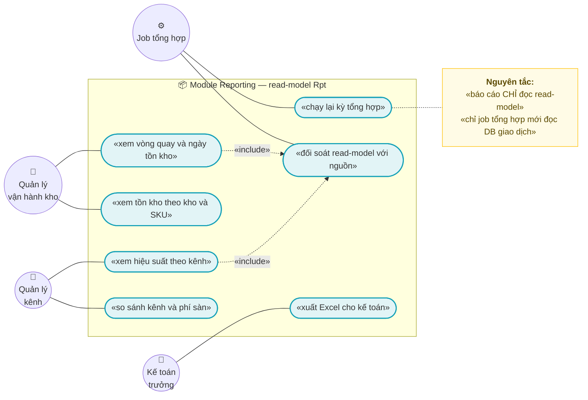
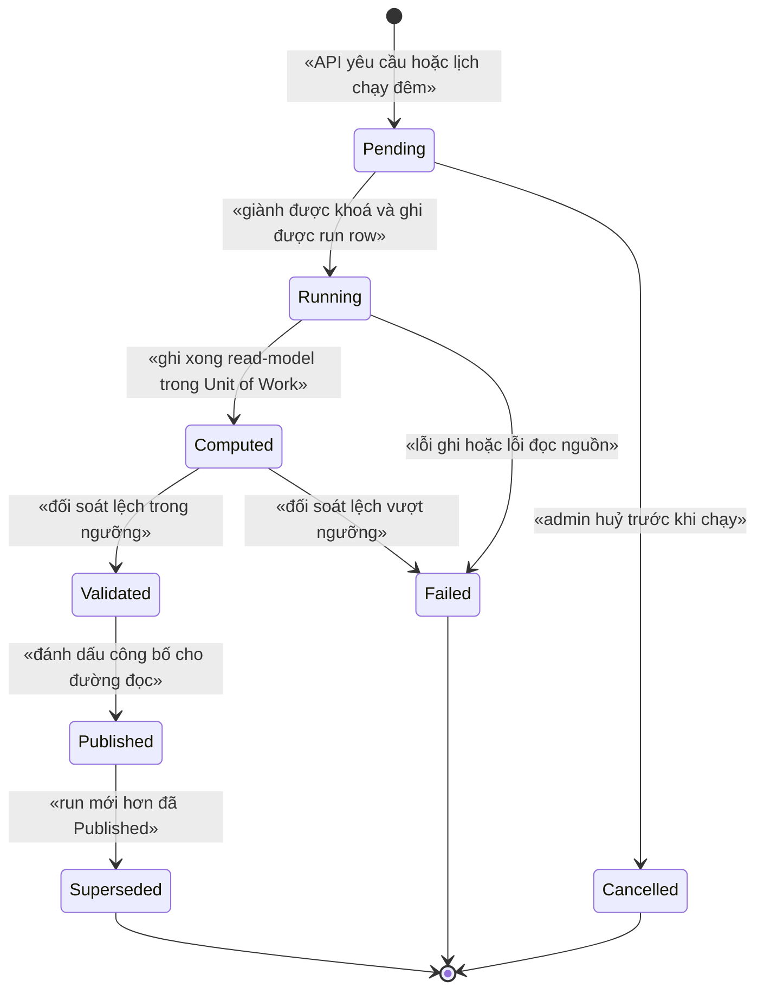
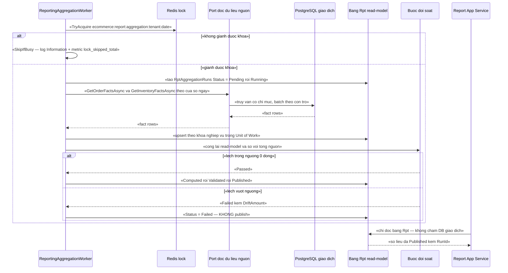

# `REP-003` — Báo cáo tồn kho luân chuyển & hiệu suất kênh

| Thuộc tính | Nội dung |
|---|---|
| **Mã** | `REP-003` |
| **Module** | **Reporting** (`modules/Reporting/`) — ⚠️ **chưa tồn tại trong code** (xem §15.2 F1) |
| **Giai đoạn** | **GĐ3 — Điều hành** (`docs/implementation-plan.md:114`, `:436–438`) |
| **Ưu tiên** | **Should have** (nhưng là **điều kiện để vận hành có số** — không có nó thì mọi quyết định nhập hàng/đấu sàn là phỏng đoán) |
| **Trạng thái** | 🟡 `Draft` — chờ review |
| **Người viết / người review** | *(điền)* / **Kiến trúc trưởng + Kế toán trưởng + Vận hành** |
| **Phiên bản / ngày** | `v0.1 — 14/10/2026` |
| **Tài liệu liên quan** | `REP-001` (read-model & job tổng hợp — **tài liệu nền của nhóm này**) · `REP-002` (doanh thu & lãi gộp) · `ACC-001` (xuất liệu kế toán) · `XC-001` (Money/làm tròn) · `XC-003` (khoá phân tán) · `XC-005` (log/metric) · `XC-006` (thuế GTGT) · `INV-001`/`INV-003` · `SAL-003`/`SAL-005` · `REC-002`/`REC-003` · `SHP-002`/`SHP-003`/`SHP-004` · `CHN-004` |

---

## 0. Tóm tắt & quyết định thiết kế

**Câu hỏi nghiệp vụ mà feature này trả lời:**

1. **Tồn kho luân chuyển:** một SKU/kho **quay vòng bao nhiêu lần** trong kỳ, **bao nhiêu ngày tồn kho**, hàng nào **chậm/đã chết**, vốn đang **nằm chết** ở đâu?
2. **Hiệu suất kênh:** mỗi kênh (`web`, `shopee`, `lazada`…) đóng góp **bao nhiêu doanh thu ròng**, **bao nhiêu đơn**, **AOV**, **tỉ lệ huỷ/hoàn**, **phí sàn**, và **lãi gộp** sau khi trừ các loại phí?

**Tóm tắt thiết kế:** `REP-003` **không** tính số liệu lúc người dùng mở báo cáo. Nó dựng **read-model riêng** (bảng tiền tố `Rpt`) do **job tổng hợp** ghi, và **API báo cáo chỉ đọc read-model**. Đây chính là yêu cầu bắt buộc của GĐ3:

> `docs/implementation-plan.md:213` — *"**Không** báo cáo nào query trực tiếp trên bảng giao dịch; có test số liệu khớp với dữ liệu gốc"*

**Vì sao phải có tài liệu này — ba rủi ro thật đã nhìn thấy trong code hiện tại:**

| # | Rủi ro | Bằng chứng (đọc code) |
|---|---|---|
| 1 | **Không có read-model nào tồn tại** ⇒ nếu cứ viết báo cáo theo cách thông thường, mọi truy vấn sẽ đổ lên `InvStockLedger` / `OrdOrders` | `grep` `readmodel|read_model|Reporting` trong `*.cs` = **0** kết quả |
| 2 | **Không thể tách doanh thu theo thuế suất** vì `OrderLine` **chưa có** `TaxRate`/`TaxClassificationId` (dù `XC-006` D3 yêu cầu snapshot) | `src/eCommerce.Domain/Entities/Orders/Order.cs:135–139` chỉ có `TaxAmount` |
| 3 | **Không tính được lãi gộp** vì **chưa có giá vốn** ở bất kỳ entity nào | `src/eCommerce.Domain/Entities/Catalog/Product.cs:56–88` (`ProductVariant` chỉ có `Price`, `CompareAtPrice`) |

**Phạm vi:**

- ✅ **Read-model** cho 2 nhóm báo cáo: luân chuyển tồn kho (snapshot ngày + vòng quay kỳ) và hiệu suất kênh (ngày × kênh × shop).
- ✅ **Job tổng hợp** (batch theo cửa sổ ngày) + **job đối soát** (read-model ↔ nguồn) + **sổ đăng ký lần chạy** (append-only, có state machine).
- ✅ **Hợp đồng port/adapter đảo chiều** để module Reporting **không** tham chiếu app (§0.1 D3).
- ✅ **Hai làn cập nhật**: batch hằng đêm (tồn kho) + incremental theo sự kiện (hiệu suất kênh trong ngày) + **đối soát hằng đêm** sửa trôi.
- ✅ **Định nghĩa chỉ tiêu** (vòng quay, ngày tồn kho, doanh thu ròng, lãi gộp) — có công thức tường minh.
- ✅ **Metric/log/CorrelationId** theo `XC-005`; **khoá phân tán** theo `XC-003`; **tiền** theo `XC-001`.
- ✅ **Đường cấp dữ liệu cho `ACC-001`** (xuất liệu kế toán) trên cùng read-model.

**Không nằm trong phạm vi:**

- ❌ **Định giá tồn kho (FIFO/bình quân gia quyền)** — thuộc `INV-001`/`PRC-001`; `REP-003` chỉ **tiêu thụ** giá vốn khi có. Chưa có ⇒ cột lãi gộp **NULL** + cờ (BR-009).
- ❌ **Bảng doanh thu & lãi gộp chi tiết theo sản phẩm/khách** — thuộc `REP-002`.
- ❌ **Settlement sàn thật** (phí sàn thực tế, tiền sàn phải trả) — thuộc `REC-002`.
- ❌ **Đối soát COD** (import file Excel theo "phiên") — thuộc `REC-003`.
- ❌ **Hạ tầng read-model dùng chung** (khung job, bảng `Rpt*` nền, registry) — thuộc **`REP-001`**; tài liệu này **giả định `REP-001` đã Approved và đã có khung**.
- ❌ **Dashboard/BI bên ngoài** (Metabase/Grafana) — chỉ nêu yêu cầu tối thiểu ở §15.
- ❌ **Dashboard thời gian thực** (sub-second) — `REP-003` là báo cáo **T+1 / gần thời gian thực 15 phút**, không phải monitoring.

### 0.1 Quyết định thiết kế (ADR ngắn)

| # | Quyết định | Phương án đã cân nhắc | Lý do chọn | Hệ quả |
|---|---|---|---|---|
| **D1** | **Reporting là module riêng** `modules/Reporting/` (Domain + EntityFrameworkCore + Application + Contracts) | (a) nhét vào `src/eCommerce.Application`; (b) module riêng | Yêu cầu GĐ3 là **read-model riêng**; nhét vào app ⇒ báo cáo và nghiệp vụ chung một tầng, không cưỡng chế được ranh giới "không query bảng giao dịch". Khuôn module đã có sẵn: `modules/Tax/` + `modules/ChannelHub/` (`docs/structure-and-techstack.md:64–99`) | Thêm 3–4 project; chi phí này **cố ý** để ranh giới kiểm được bằng test |
| **D2** | **API báo cáo CHỈ đọc bảng `Rpt*`** | (a) đọc trực tiếp bảng giao dịch; (b) read-model | Truy vấn nặng trên DB giao dịch làm chậm bán hàng; yêu cầu GĐ3 nói rõ (`docs/implementation-plan.md:213`) | Có **độ trễ dữ liệu** (T+1 cho tồn kho, < 15 phút cho kênh) — phải nói rõ trên UI (§10) |
| **D3** | **Port/adapter ĐẢO CHIỀU**: module Reporting **định nghĩa** `IInventoryFactReader`/`IOrderFactReader`; **app (hoặc module sở hữu) cài đặt** | (a) module tham chiếu entity của app; (b) app cài đặt interface do module định nghĩa | 🔒 **Module gọi app BỊ CẤM** (bất biến dự án). Đây đúng khuôn đã dùng: `ChannelHub` **phát ETO**, app subscribe và tự tạo `Order` — module không tham chiếu app (`modules/ChannelHub/eCommerce.ChannelHub.Application/Sync/ChannelShopSyncer.cs:13–19`) | Cần thêm 2 interface + 1 adapter ở tầng app; khi Inventory/Sales tách thành module (GĐ1) thì adapter **chuyển về module đó**, không đổi interface |
| **D4** | **Hai làn cập nhật**: (1) batch hằng đêm cho tồn kho; (2) incremental theo sự kiện cho hiệu suất kênh; (3) **đối soát hằng đêm** | (a) chỉ batch; (b) chỉ event-driven | Tồn kho cần **số dư cuối ngày** ⇒ batch là tự nhiên. Hiệu suất kênh cần thấy **trong ngày** ⇒ event-driven. Event-driven **luôn trôi** (mất/trùng sự kiện) ⇒ cần làn (3) để phát hiện và sửa | Thêm job đối soát; số liệu trong ngày là **tạm tính**, có nhãn rõ trên UI |
| **D5** | **Upsert theo KHOÁ NGHIỆP VỤ** thay vì "xoá rồi ghi" | (a) DELETE + INSERT theo kỳ; (b) upsert theo khoá duy nhất | `DELETE` rộng có thể xoá dữ liệu của lần chạy khác; upsert làm **chạy lại là idempotent** và **lỗi giữa chừng không mất dữ liệu cũ** | Cần unique index đúng khoá; **`ChannelShopId` phải NOT NULL** với sentinel `Guid.Empty` để unique index thật sự chặn (bài học `20261013024226_Fix_NullableTenantId_UniqueIndexes`) |
| **D6** | **Sổ đăng ký lần chạy `RptAggregationRuns` là APPEND-ONLY** + state machine **ném lỗi** | (a) sửa/xoá run row; (b) append-only + bản ghi thay thế | Cần trả lời *"con số này do lần chạy nào sinh ra, lúc nào, có qua đối soát không"* — đúng bài học `XC-006` D6 | Không xoá run; muốn chạy lại ⇒ tạo run mới + `Superseded` run cũ |
| **D7** | **Hàng rào cuối là DB**, không phải lock: **unique index có filter `WHERE Status = Running`** | (a) tin vào lock; (b) lock + partial unique index | Kế thừa `XC-003` D2: Redis chết ⇒ lock vô hiệu nhưng app vẫn chạy | Cần index filter (EF Core hỗ trợ `HasFilter`, đã dùng ở `eCommerceDbContext.cs:184–186`) |
| **D8** | **Tiền = `decimal` + `Money`**; so sánh bằng **minor units**, **cấm `==`** | (a) `double`; (b) so `decimal` bằng `==` | Kế thừa `XC-001` BR-003/BR-008 (bài học EShop vỡ với VND/payOS) | ⚠️ **`Money` CHƯA có trong code** (`grep` `Money|ToMinorUnits` = **0**) ⇒ **REP-003 phụ thuộc `XC-001` phải xong trước GĐ3** |
| **D9** | **Không được ghi `0` thay cho "không biết"** | (a) thiếu giá vốn ⇒ lãi gộp = 0; (b) `NULL` + cờ lý do | Lãi gộp = 0 nghĩa là "hoà vốn" — **sai nghiêm trọng** và không ai phát hiện | Read-model có cột cờ `CostMissing` / `SettlementPending`; UI **phải** hiện nhãn thay vì số 0 |
| **D10** | **Metric mới phải đăng ký ở HAI nơi** | (a) phát metric tự do; (b) registry `eCommerceMetricNames` + `XC-005` §5.1 | Đã có test chốt: `MetricsTests.TC06_khong_co_metric_phat_ra_ngoai_bang_dang_ky` (`test/eCommerce.Tests/Observability/MetricsTests.cs:49–59`) và test hậu tố tên (`:111–127`) ⇒ phát metric lạ là **CI đỏ** | 3 metric mới của `REP-003` **bắt buộc** sửa `src/eCommerce.Domain.Shared/Observability/eCommerceMetrics.cs` **và** `XC-005` §5.1 trong cùng PR |
| **D11** | **Retention phân tầng**: chi tiết ngày **24 tháng**, bảng tổng hợp tháng **giữ vô hạn** | (a) giữ tất cả chi tiết; (b) tổng hợp + xoá chi tiết | Chi tiết ngày tăng tuyến tính theo SKU × kho × ngày; nhưng **đối soát kế toán cần lịch sử dài** ⇒ giữ bản tổng hợp | Cần job tổng hợp tháng + job dọn dữ liệu hết hạn (tuân `REP-001`) |
| **D12** | **Xuất file tách khỏi số liệu**: tính bằng **hàm thuần**, ghi định dạng bằng lớp riêng | (a) vừa tính vừa ghi; (b) tách | Khuôn đã có và đã chứng minh: `Mau01Part2Calculator` là **hàm thuần** *"dùng chung cho mọi định dạng xuất (bảng số liệu, HTKK, eTax)"* (`modules/Tax/eCommerce.Tax.Domain/Mau01/Mau01Part2Calculator.cs:50–57`) | Xuất Excel/CSV của `ACC-001` dùng lại đúng số liệu đã kiểm thử |

---

## 1. Use Case Specification

| Thuộc tính | Nội dung |
|---|---|
| **Use Case ID** | `REP-003` |
| **Use Case Name** | Xem tồn kho luân chuyển và hiệu suất kênh **trên read-model đã đối soát** |
| **Description** | *"Là quản lý vận hành, tôi muốn biết SKU nào quay vòng chậm và kênh nào thực sự mang lại tiền — với con số khớp dữ liệu gốc và nói rõ chỗ nào chưa biết (giá vốn, phí sàn thực tế) — mà không làm chậm hệ thống bán hàng."* |
| **Actor(s)** | **Quản lý vận hành/kho** (xem luân chuyển) · **Quản lý kênh/kinh doanh** (xem hiệu suất) · **Kế toán trưởng** (xuất liệu cho `ACC-001`) · **Job tổng hợp** (hệ thống) · **Vận hành kỹ thuật** (chạy lại kỳ, xem đối soát) |
| **Priority** | **Should have** — nhưng là **điều kiện để vận hành có số**; nằm trong GĐ3 |
| **Trigger** | (a) người dùng mở màn hình báo cáo; (b) đến nhịp job tổng hợp (đêm); (c) có sự kiện đơn hàng mới/đổi trạng thái (làn incremental); (d) vận hành bấm **chạy lại** một kỳ vì nghi ngờ số liệu |
| **Pre-Condition(s)** | • **`TenantId` BẮT BUỘC** (từ `ICurrentTenant`); `TenantId` rỗng ⇒ **ném lỗi tham số** (host không xem dữ liệu nghiệp vụ của tenant — §12).<br>• **`ChannelCode`** chỉ tham gia với **báo cáo hiệu suất kênh**; báo cáo luân chuyển tồn kho **không** phân theo kênh (tồn kho là tài nguyên dùng chung — xem `Channel.HoldsInventory` ở `modules/ChannelHub/eCommerce.ChannelHub.Domain/Entities/ChannelEntities.cs:21–22`).<br>• Khoá nghiệp vụ của kỳ **đã có ít nhất 1 lần chạy `Published`**; nếu chưa ⇒ **hiện trạng thái "chưa có dữ liệu kỳ này"** (không phải lỗi — BR-013).<br>• Read-model có dữ liệu nguồn tối thiểu: `InvStockLedger` / `OrdOrders` / `OrdOrderLines` **đã được đăng ký `DbSet`** trên DbContext hợp nhất (`src/eCommerce.EntityFrameworkCore/eCommerceDbContext.cs:36–45`) ⇒ `IRepository<T>` **mới được đăng ký** (`:48–52`).<br>• `XC-001` (`Money`) đã xong (D8). |
| **Post-Condition(s)** | • Mọi số liệu trả ra **đến từ bảng `Rpt*`** đã `Published`; **0** truy vấn bảng giao dịch trong đường đọc.<br>• Mỗi bộ số liệu **truy được** về một `RptAggregationRuns` (`RunId`) kèm thời điểm chạy + kết quả đối soát.<br>• Chạy lại cùng kỳ ⇒ read-model **giống hệt** (idempotent) và **không nhân bản** dòng.<br>• Chỗ chưa biết (giá vốn, phí sàn thực tế) hiển thị **`NULL` + nhãn lý do**, **không** hiển thị `0`. |
| **Basic Flow** | 1. Job (hoặc API) mở phạm vi khoá `ecommerce:report:aggregation:{tenantId}:{businessDate}` và tạo bản ghi `RptAggregationRuns` với `Status = Pending`.<br>2. Chuyển `Running`; gọi `IOrderFactReader` / `IInventoryFactReader` để lấy **fact rows** theo **cửa sổ ngày bị chặn** + **batch theo con trỏ**.<br>3. Trong **Unit of Work**, upsert vào `RptInventoryDailySnapshots` / `RptChannelDailyPerformance` theo **khoá nghiệp vụ duy nhất** (BR-003).<br>4. Job **đối soát**: cộng lại read-model và so với tổng tính trực tiếp từ nguồn (tiền: **0 đồng**; số lượng: **0 đơn vị**).<br>5. Lệch trong ngưỡng ⇒ `Computed → Validated → Published`. Lệch vượt ngưỡng ⇒ `Failed` + `DriftAmount` (**không publish**).<br>6. Người dùng mở báo cáo ⇒ app service **chỉ đọc `Rpt*`**, lọc theo kỳ/kho/kênh, trả DTO; UI hiển thị **nhãn độ trễ** và **nhãn chỗ chưa biết**.<br>7. Kế toán bấm **xuất Excel** ⇒ số liệu dùng lại đúng hàm thuần đã kiểm thử (D12), kèm `RunId` + hash file. |
| **Alternative Flow** | **A1: Job định kỳ gặp khoá đang bận** — chế độ `SkipIfBusy`: **bỏ qua nhịp này**, ghi log `Information` + metric `lock_skipped_total{module=report}`; **không** ném lỗi (khớp `XC-003` A1 và cách `ChannelTokenManager` đang làm: `modules/ChannelHub/eCommerce.ChannelHub.Application/Sync/ChannelTokenManager.cs:74–83`).<br>**A2: Chạy lại kỳ đã `Published`** — **không** sửa run cũ; tạo **run mới** (`Version + 1`), ghi read-model đè theo khoá nghiệp vụ, run cũ chuyển `Superseded` sau khi run mới `Published`.<br>**A3: Thiếu giá vốn** — vẫn chạy và publish; cột lãi gộp = `NULL`, cờ `CostMissing = true`; UI hiện *"chưa có giá vốn — xem PRC-001"* (BR-009).<br>**A4: Kỳ rỗng (không có đơn/biến động)** — ghi đúng **0 dòng** và trả **danh sách rỗng của kỳ**, kèm thông điệp hướng dẫn ở UI; **không** trả lỗi (BR-013).<br>**A5: Dữ liệu COD chưa đối soát** — báo cáo kênh hiện cột COD là **tạm tính** + cờ `CodUnreconciled = true` (⚠️ xem cảnh báo bảo mật/nguồn ở §7.2). |
| **Exception Flow** | **E1:** đã có run `Running` cho cùng `(tenant, scope, kỳ)` ⇒ **`eCommerce:Reporting:0001`** (`409`).<br>**E2:** lỗi ghi read-model giữa chừng ⇒ UoW **rollback**, run `Failed`, **`0002`** (`500`); dữ liệu cũ **còn nguyên** (nhờ upsert theo khoá).<br>**E3:** đối soát lệch vượt ngưỡng ⇒ **`0003`** (`422`), run `Failed` + `DriftAmount`, **không** publish.<br>**E4:** publish khi run chưa `Validated` ⇒ **`0004`** (`400`).<br>**E5:** run mới thay thế khi run cũ **chưa** `Published` ⇒ **`0005`** (`409`).<br>**E6:** huỷ run ở trạng thái không cho phép (đã `Published`) ⇒ **`0006`** (`400`).<br>**E7:** sửa/xoá run đã `Published` ⇒ **`0007`** (`409`) — append-only (D6).<br>**E8:** kỳ báo cáo **ngoài cửa sổ** cho phép hoặc **ngày tương lai** ⇒ **`0008`** (`400`).<br>**E9:** yêu cầu lãi gộp khi `CostMissing` **và** tham số `BatBuocCoGiaVon = true` ⇒ **`0009`** (`409`) — "từ chối rõ ràng" tốt hơn trả số 0 sai (kế thừa tinh thần `XC-001` Q6). |
| **Business Rules** | • **BR-REP-003-001**: Báo cáo **chỉ** đọc read-model `Rpt*`; **cấm** app service của Reporting truy vấn bảng giao dịch (`OrdOrders`, `OrdOrderLines`, `InvStockLedger`, `InvItems`, `Chn*`, `Pay*`, `Tax*`).<br>• **BR-REP-003-002**: Read-model **chỉ** được ghi bởi job tổng hợp (qua port); **cấm** đường ghi từ API người dùng (trừ `RptAggregationRuns` do API tạo run).<br>• **BR-REP-003-003**: Mỗi dòng read-model có **khoá nghiệp vụ duy nhất**; mọi ghi là **upsert xác định** ⇒ chạy lại **không nhân bản** (NFR-011).<br>• **BR-REP-003-004**: `RptAggregationRuns` là **append-only**; run `Published` **bất biến** (không sửa/xoá).<br>• **BR-REP-003-005**: Mọi chuyển trạng thái run **sai** phải **NÉM lỗi có mã** — **cấm** no-op im lặng.<br>• **BR-REP-003-006**: Tiền trong read-model là `decimal` + `Money`; **cấm** `double`/`float`; **cấm** so sánh tiền bằng `==` (so bằng `ToMinorUnits()`).<br>• **BR-REP-003-007**: Báo cáo **không làm tròn lại**; dùng số đã chốt trên dòng đơn; **tổng = tổng các dòng đã làm tròn** (kế thừa `XC-001` BR-005).<br>• **BR-REP-003-008**: Run **chỉ được publish** khi đối soát đạt: **lệch tiền = 0 đồng**, **lệch số lượng = 0 đơn vị** (NFR-004).<br>• **BR-REP-003-009**: Thiếu giá vốn ⇒ cột lãi gộp = **`NULL`** + cờ `CostMissing`; **cấm** ghi `0`.<br>• **BR-REP-003-010**: Phí sàn **dự kiến** (`Order.ChannelFeeAmount`) và **thực tế** (settlement) là **hai cột riêng**; chưa có settlement ⇒ cột thực tế `NULL` + cờ `SettlementPending`.<br>• **BR-REP-003-011**: Đơn `Cancelled`/`Returned` **bị loại khỏi doanh thu ròng** (và hoàn lại số lượng đã bán) — nhưng **vẫn hiển thị** số đơn gộp để đối chiếu.<br>• **BR-REP-003-012**: Cách ly tenant: báo cáo của tenant A **không** chứa dữ liệu tenant B, kể cả qua bộ lọc/sắp xếp/xuất file.<br>• **BR-REP-003-013**: UI **phải** ghi rõ: (a) **độ trễ dữ liệu** của kỳ; (b) **chênh lệch giữa số đếm và số dòng hiển thị** khi có lọc/phân trang; (c) kết quả **rỗng không phải lỗi**.<br>• **BR-REP-003-014**: Job **phải** log khởi động/dừng/lỗi + `CorrelationId`; **cấm** log `Information` mỗi vòng; metric mới **phải** nằm trong `eCommerceMetricNames` **và** `XC-005` §5.1; nhãn metric **chỉ** lấy từ `eCommerceMetricTags.Allowed`. |
| **Non-Functional Requirement** | • **NFR-REP-003-001**: Truy vấn báo cáo **p95 < 1 s** cho kỳ 30 ngày × 50.000 SKU (chỉ đọc read-model).<br>• **NFR-REP-003-002**: Job tổng hợp **1 ngày × 100.000 dòng ledger < 5 phút**.<br>• **NFR-REP-003-003**: Độ trễ read-model: tồn kho **T+1** (xong trước **05:00** giờ VN); hiệu suất kênh **< 15 phút**.<br>• **NFR-REP-003-004**: Đối soát: lệch tiền **0 đồng**, lệch số lượng **0 đơn vị**.<br>• **NFR-REP-003-005**: **0** truy vấn trên DB giao dịch kéo dài **> 30 s**; job **chỉ** chạy trong cửa sổ **01:00–05:00** giờ VN.<br>• **NFR-REP-003-006**: Xuất Excel **12 tháng × 20 kênh < 60 s**.<br>• **NFR-REP-003-007**: Retention chi tiết ngày **24 tháng**; bảng tổng hợp tháng **giữ vô hạn**; read-model **≤ 20 %** dung lượng DB giao dịch.<br>• **NFR-REP-003-008**: Cách ly tenant **100 %** (test 2 tenant).<br>• **NFR-REP-003-009**: **0** `double`/`float` trong assembly read-model (test reflection).<br>• **NFR-REP-003-010**: Metric mới **nằm trong** bảng đăng ký ⇒ `TC-06`/`TC-07` hiện có (`test/eCommerce.Tests/Observability/MetricsTests.cs`) **vẫn xanh**.<br>• **NFR-REP-003-011**: Chạy lại 1 kỳ **10 lần** ⇒ hash read-model **không đổi**.<br>• **NFR-REP-003-012**: Khi hệ thống rỗi, log **< 10 dòng/phút** (kế thừa `XC-005` NFR-004). |

---

## 2. Sơ đồ Use Case



---

## 3. Sơ đồ trạng thái (state machine) — vòng đời một lần chạy tổng hợp



**Bảng chuyển trạng thái & guard (mọi chuyển sai **phải ném lỗi**, không im lặng):**

| Từ | Sang | Guard | Nếu vi phạm |
|---|---|---|---|
| `[*]` | `Pending` | `TenantId` có giá trị **và** kỳ nằm trong cửa sổ cho phép **và** ngày không ở tương lai | **`eCommerce:Reporting:0008`** (`400`) |
| `Pending` | `Running` | Giành được khoá `ecommerce:report:aggregation:{tenantId}:{businessDate}` **và** không có run `Running` cùng `(tenant, scope, kỳ)` **và** ghi được run row | **`0001`** (`409`); DB chặn bằng partial unique index (D7) |
| `Pending` | `Cancelled` | Có quyền `eCommerce.Reporting.Aggregation.Manage` | **`0006`** (`400`) |
| `Running` | `Computed` | **Mọi** batch ghi xong, `SourceRowCount`/`WrittenRowCount` khớp số dự kiến | Giữ `Running` nếu còn batch; lỗi ⇒ `Failed` + **`0002`** |
| `Running` | `Failed` | Đã bắt được exception **và** ghi `ErrorCode` + `CorrelationId` | **`0002`** (`500`) — **cấm** nuốt lỗi im lặng |
| `Computed` | `Validated` | Đối soát: **lệch tiền = 0 đồng** và **lệch số lượng = 0 đơn vị** | **`0003`** (`422`) |
| `Computed` | `Failed` | Đối soát vượt ngưỡng | Ghi `DriftAmount`; **`0003`**; **cấm** publish |
| `Validated` | `Published` | Run có bản ghi đối soát `Passed = true` **và** chưa từng `Published` | **`0004`** (`400`) |
| `Published` | `Superseded` | Tồn tại run mới hơn **đã** `Published` cho cùng `(tenant, scope, kỳ)` | **`0005`** (`409`) — bản thay thế phải publish trước |
| `Published` | *(bất kỳ)* | **CẤM** sửa/xoá/huỷ | **`0007`** (`409`) — append-only (D6) |
| `Failed`/`Cancelled`/`Superseded` | *(bất kỳ)* | Trạng thái kết thúc — chỉ tạo **run mới** | **`0005`** |

> ⚠️ **`Computed → Failed` là nhánh quan trọng nhất:** đây là chỗ hệ thống **từ chối công bố** một con số đã tính ra nhưng **không khớp nguồn**. Nếu cho publish, kế toán và vận hành sẽ ra quyết định trên số sai — và **không có dấu vết nào**. Kế thừa nguyên tắc `XC-003` D2: *"nếu bỏ lock đi, DB có chặn không?"* — ở đây là *"nếu bỏ đối soát đi, ai biết số sai?"*.

---

## 4. Sequence Diagram & luồng dữ liệu

### 4.1 Job tổng hợp một ngày — từ nguồn tới read-model đã công bố



### 4.2 Luồng dữ liệu & hai làn cập nhật

| Làn | Nguồn | Nhịp | Bảng đích | Độ trễ | Ghi chú |
|---|---|---|---|---|---|
| **L1 — Batch tồn kho** | `InvStockLedger` (append-only), `InvItems` (snapshot) | 1 lần/ngày, 01:00–05:00 giờ VN | `RptInventoryDailySnapshots`, `RptInventoryTurnover` | **T+1** | Cần **số dư cuối ngày** ⇒ không thể event-driven thuần |
| **L2 — Incremental kênh** | ETO đơn hàng/thanh toán/hoàn tiền | liên tục (theo sự kiện) | `RptChannelDailyPerformance` | **< 15 phút** | Số trong ngày là **tạm tính**; UI ghi rõ |
| **L3 — Đối soát & sửa trôi** | Nguồn (đọc lại theo cửa sổ) | 1 lần/ngày sau L1 | `RptReconciliations` + **sửa** dòng `Rpt*` lệch | T+1 | Bắt buộc — event-driven **luôn trôi** (mất/trùng sự kiện, xem `XC-002`) |

> 📌 **Vì sao phải có L3:** `XC-002` chốt rằng sự kiện đi qua outbox/inbox và **có thể đến trùng hoặc sai thứ tự**; consumer bỏ qua bản cũ **có ghi log + metric** (`XC-002` §1 A4). ⇒ Số liệu kênh dựng thuần từ sự kiện **không thể** là nguồn sự thật. L3 là lưới an toàn, và **`REP-003` chỉ publish sau khi L3 đạt** (BR-008).

> ⚠️ **`Rpt*` KHÔNG phải nguồn sự thật.** Nguồn sự thật vẫn là `InvStockLedger` (sổ cái kho append-only — `src/eCommerce.Domain/Entities/Inventory/StockLedger.cs:80–83`) và `OrdOrders`/`OrdOrderLines`. Read-model **được phép xoá và dựng lại**; nếu read-model và nguồn lệch ⇒ **nguồn đúng** (trừ khi chứng minh ngược lại được, và khi đó phải sửa nguồn, không sửa read-model).

---

## 5. Mô hình dữ liệu

### 5.1 ERD

**Không áp dụng dạng sơ đồ — lý do:** giới hạn **tối đa 3 sơ đồ Mermaid** cho tài liệu này (§2, §3, §4.1 đã dùng hết). Thay ERD bằng **quan hệ tường minh** dưới đây + Data Dictionary ở §5.2:

| Quan hệ | Kiểu | Khoá | Ghi chú |
|---|---|---|---|
| `RptInventoryDailySnapshots` **N—1** `RptAggregationRuns` | tham chiếu | `RunId` | Không FK cứng (read-model có thể dựng lại); truy vết bằng `RunId` |
| `RptInventoryTurnover` **N—1** `RptAggregationRuns` | tham chiếu | `RunId` | |
| `RptChannelDailyPerformance` **N—1** `RptAggregationRuns` | tham chiếu | `RunId` | |
| `RptReconciliations` **N—1** `RptAggregationRuns` | FK | `RunId` | **Append-only**, ghi một lần cho mỗi lần kiểm |
| `Rpt*` **N—1** `InvItems` / `OrdOrders` | **luận lý** (không FK) | `TenantId + WarehouseId + Sku` / `TenantId + ChannelCode + ChannelShopId` | Không FK vì read-model được `TRUNCATE`/dựng lại độc lập (D5) |

### 5.2 Data Dictionary

**Bảng `RptInventoryDailySnapshots`** — số dư & biến động **theo ngày** cho mỗi (kho, SKU). Kiểu số lượng: `int` (khớp `InventoryItem.OnHand/Reserved` là `int` — `src/eCommerce.Domain/Entities/Inventory/StockLedger.cs:19–25`).

| Cột | Kiểu | Null? | Ý nghĩa | Ghi chú |
|---|---|---|---|---|
| `Id` | `uuid` | ✗ | khoá chính | |
| `TenantId` | `uuid` | ✗ | tenant | **NOT NULL** (bắt buộc — §12) |
| `BusinessDate` | `date` | ✗ | ngày nghiệp vụ (giờ VN) | Lưu **ngày**, không lưu timestamp ⇒ tránh lệch múi giờ |
| `WarehouseId` | `uuid` | ✗ | kho | |
| `Sku` | `varchar(64)` | ✗ | SKU | Khớp `InvItems.Sku` (`eCommerceDbContext.cs:137`) |
| `ProductVariantId` | `uuid` | ✓ | biến thể | Có thể trống nếu SKU chưa map |
| `OpeningQty` | `int` | ✗ | tồn đầu ngày | = `ClosingQty` ngày trước |
| `ReceiptQty` | `int` | ✗ | nhập kho | `StockMovementType.Receipt` |
| `SaleQty` | `int` | ✗ | xuất bán | `StockMovementType.Sale` |
| `ReturnQty` | `int` | ✗ | khách trả lại | `StockMovementType.CustomerReturn` |
| `AdjustmentDelta` | `int` | ✗ | điều chỉnh kiểm kê (**có dấu**) | `StockMovementType.Adjustment` |
| `TransferInQty` / `TransferOutQty` | `int` | ✗ | chuyển kho vào/ra | `StockMovementType.Transfer` |
| `ClosingOnHand` | `int` | ✗ | tồn cuối ngày | |
| `ClosingReserved` | `int` | ✗ | đang giữ chỗ | |
| `ClosingAvailable` | `int` | ✗ | khả dụng = `OnHand − Reserved` | Khớp property `InventoryItem.Available` (`StockLedger.cs:25`) |
| `InventoryValueAmount` | `numeric(18,4)` | ✓ | giá trị tồn | ⚠️ **NULL** khi chưa có giá vốn + cờ `CostMissing` |
| `Currency` | `char(3)` | ✗ | tiền tệ của dòng | Quy ước `XC-001` §5.2; mỗi dòng **một** tiền tệ |
| `CostMissing` | `bool` | ✗ | thiếu giá vốn | BR-009 |
| `LastAggregatedAtUtc` | `timestamptz` | ✗ | thời điểm ghi | Mọi thời điểm trong DB là **UTC** (quy ước `eCommerceDomainModule.cs:47–61`) |
| `RunId` | `uuid` | ✗ | lần chạy đã sinh dòng | Truy vết |

**Bảng `RptInventoryTurnover`** — chỉ tiêu luân chuyển **theo kỳ** (tuần/tháng/quý) cho mỗi (kho, SKU).

| Cột | Kiểu | Null? | Ý nghĩa | Công thức |
|---|---|---|---|---|
| `Id` | `uuid` | ✗ | khoá chính | |
| `TenantId` | `uuid` | ✗ | tenant | |
| `PeriodStart` / `PeriodEnd` | `date` | ✗ | kỳ | |
| `WarehouseId` / `Sku` | `uuid` / `varchar(64)` | ✗ | phạm vi | |
| `OpeningQty` / `ClosingQty` | `int` | ✗ | tồn đầu/cuối kỳ | từ snapshot |
| `AverageQty` | `numeric(18,4)` | ✗ | tồn bình quân | `(OpeningQty + ClosingQty) / 2` — **không** dùng trung bình cộng các ngày (tránh lệch khi thiếu ngày) |
| `CogsAmount` | `numeric(18,4)` | ✓ | giá vốn hàng bán | **NULL** nếu thiếu giá vốn |
| `TurnoverRatio` | `numeric(18,6)` | ✓ | vòng quay | `CogsAmount / AverageQty` — **NULL** nếu `AverageQty = 0` hoặc thiếu giá vốn |
| `DaysOfInventory` | `int` | ✓ | ngày tồn kho | `SốNgàyKỳ / TurnoverRatio` — **NULL** nếu `TurnoverRatio` NULL |
| `MovementClass` | `int` | ✗ | `0=Fast · 1=Moving · 2=Slow · 3=Dead` | Ngưỡng cấu hình theo tenant (Setting) |
| `CoveredDays` | `int` | ✗ | số ngày **có** snapshot trong kỳ | 🔒 BR-013: nếu `CoveredDays < SốNgàyKỳ` ⇒ UI **phải** hiện rõ "thiếu dữ liệu n ngày", **không** nội suy |
| `CostMissing` / `Currency` | `bool` / `char(3)` | ✗ | cờ + tiền tệ | |
| `RunId` | `uuid` | ✗ | truy vết | |

**Bảng `RptChannelDailyPerformance`** — hiệu suất **ngày × kênh × shop**.

| Cột | Kiểu | Null? | Ý nghĩa | Ghi chú |
|---|---|---|---|---|
| `Id` | `uuid` | ✗ | khoá chính | |
| `TenantId` | `uuid` | ✗ | tenant | |
| `BusinessDate` | `date` | ✗ | ngày nghiệp vụ | |
| `ChannelCode` | `varchar(32)` | ✗ | mã kênh | Khớp `Order.ChannelCode` (`Order.cs:18`) và `Channel.Code` |
| `ChannelShopId` | `uuid` | ✗ | shop trên sàn | 🚨 **NOT NULL**, dùng **`Guid.Empty`** = "kênh không gắn shop" (web/offline) — nếu để NULL thì unique index **không chặn** (bài học `20261013024226_Fix_NullableTenantId_UniqueIndexes`) |
| `GrossOrders` | `int` | ✗ | số đơn gộp | Mọi trạng thái |
| `CancelledOrders` / `ReturnedOrders` | `int` | ✗ | đơn huỷ / hoàn | `OrderStatus.Cancelled` / `.Returned` (`Enums.cs:50–59`) |
| `UnitsSold` | `int` | ✗ | số lượng bán **ròng** | Trừ đơn huỷ/hoàn (BR-011) |
| `GrossRevenueAmount` | `numeric(18,4)` | ✗ | doanh thu gộp | Σ `OrderLine.LineTotal` của đơn tính doanh thu |
| `DiscountAmount` | `numeric(18,4)` | ✗ | giảm giá | |
| `TaxAmount` | `numeric(18,4)` | ✗ | thuế GTGT | Σ `OrderLine.TaxAmount` (**đã chốt** tại thời điểm bán — `XC-006` D3) |
| `ShippingCollectedAmount` | `numeric(18,4)` | ✗ | phí vận chuyển thu khách | Khớp `Order.ShippingTotal` |
| `ChannelFeeEstimatedAmount` | `numeric(18,4)` | ✓ | **phí sàn dự kiến** | Từ `Order.ChannelFeeAmount` (**nullable** — `Order.cs:50`) |
| `ChannelFeeActualAmount` | `numeric(18,4)` | ✓ | **phí sàn thực tế** | ⚠️ **Luôn NULL ở GĐ3** — `REC-002` chưa có; cờ `SettlementPending` |
| `NetRevenueAmount` | `numeric(18,4)` | ✗ | doanh thu ròng | `GrossRevenue − Discount + ShippingCollected` (**không** gồm thuế — thuế là khoản phải nộp, không phải doanh thu) |
| `RefundAmount` | `numeric(18,4)` | ✗ | đã hoàn tiền | |
| `AovAmount` | `numeric(18,4)` | ✓ | giá trị đơn bình quân | `NetRevenue / SốĐơnTínhDoanhThu`; **NULL** nếu mẫu số = 0 |
| `GrossMarginAmount` | `numeric(18,4)` | ✓ | lãi gộp | **NULL** + `CostMissing` nếu thiếu giá vốn (BR-009) |
| `CostMissing` | `bool` | ✗ | thiếu giá vốn | |
| `SettlementPending` | `bool` | ✗ | chưa có settlement | BR-010 |
| `CodUnreconciled` | `bool` | ✗ | COD chưa đối soát | ⚠️ xem §7.2 (GHTK/GHN) |
| `UnclassifiedTaxSkuCount` | `int` | ✗ | số SKU trong kỳ **chưa phân loại thuế** | Liên kết gauge `tax_unclassified_skus` (`XC-006`) — hiệu suất kênh **có thể sai thuế** nếu > 0 |
| `Currency` | `char(3)` | ✗ | tiền tệ | 1 dòng = 1 tiền tệ; GĐ3 chỉ **VND** |
| `RunId` / `LastAggregatedAtUtc` | `uuid` / `timestamptz` | ✗ | truy vết | |

**Bảng `RptAggregationRuns`** — **sổ đăng ký lần chạy, APPEND-ONLY** (D6, BR-004).

| Cột | Kiểu | Null? | Ý nghĩa |
|---|---|---|---|
| `Id` | `uuid` | ✗ | khoá chính |
| `TenantId` | `uuid` | ✗ | tenant |
| `Scope` | `int` | ✗ | `0=Inventory · 1=Channel · 2=Both` |
| `BusinessDateFrom` / `BusinessDateTo` | `date` | ✗ | cửa sổ kỳ |
| `Version` | `int` | ✗ | tăng khi chạy lại cùng kỳ |
| `Status` | `int` | ✗ | `0=Pending · 1=Running · 2=Computed · 3=Validated · 4=Published · 5=Failed · 6=Cancelled · 7=Superseded` |
| `StartedAtUtc` / `FinishedAtUtc` | `timestamptz` | ✗ / ✓ | thời gian |
| `SourceRowCount` / `WrittenRowCount` | `bigint` | ✗ | số dòng đọc nguồn / ghi read-model |
| `DriftAmount` / `DriftQuantity` | `numeric(18,4)` / `bigint` | ✗ | độ lệch đối soát (phải = 0 để publish — BR-008) |
| `ErrorCode` / `ErrorMessage` | `varchar(32)` / `varchar(2048)` | ✓ | mã lỗi `eCommerce:Reporting:*` |
| `CorrelationId` | `varchar(64)` | ✓ | truy vết `XC-005` |
| `LockKey` | `varchar(256)` | ✓ | khoá đã dùng — hỗ trợ điều tra khoá treo |
| `SupersededByRunId` | `uuid` | ✓ | run thay thế |

**Bảng `RptReconciliations`** — **append-only**, kết quả từng phép kiểm đối soát.

| Cột | Kiểu | Null? | Ý nghĩa |
|---|---|---|---|
| `Id` | `uuid` | ✗ | khoá chính |
| `RunId` | `uuid` | ✗ | FK → `RptAggregationRuns` |
| `CheckKind` | `int` | ✗ | `0=RevenueTotal · 1=TaxTotal · 2=QuantityTotal · 3=OrderCount · 4=SnapshotBalance` |
| `SourceValue` / `ReadModelValue` / `DriftValue` | `numeric(18,4)` | ✗ | giá trị nguồn / read-model / lệch |
| `Passed` | `bool` | ✗ | đạt |
| `CheckedAtUtc` | `timestamptz` | ✗ | thời điểm |

**Index & ràng buộc**

| Loại | Bảng | Cột | Mục đích |
|---|---|---|---|
| **UNIQUE** | `RptInventoryDailySnapshots` | `(TenantId, BusinessDate, WarehouseId, Sku)` | ⭐ Khoá nghiệp vụ ⇒ **idempotency** (BR-003) |
| **UNIQUE** | `RptInventoryTurnover` | `(TenantId, PeriodStart, PeriodEnd, WarehouseId, Sku)` | idempotency |
| **UNIQUE** | `RptChannelDailyPerformance` | `(TenantId, BusinessDate, ChannelCode, ChannelShopId)` | idempotency; `ChannelShopId` **NOT NULL** (sentinel `Guid.Empty`) |
| **UNIQUE (filter)** | `RptAggregationRuns` | `(TenantId, Scope, BusinessDateFrom, BusinessDateTo, Version)` | chống trùng run |
| **UNIQUE (filter)** | `RptAggregationRuns` | `(TenantId, Scope, BusinessDateFrom, BusinessDateTo) WHERE Status = 1` | 🚨 **Hàng rào DB chặn 2 run `Running` song song** (D7) — EF Core hỗ trợ `HasFilter` (đã dùng: `eCommerceDbContext.cs:184–186`) |
| **INDEX** | `RptInventoryDailySnapshots` | `(TenantId, WarehouseId, Sku, BusinessDate)` | lịch sử theo SKU |
| **INDEX** | `RptInventoryDailySnapshots` | `(TenantId, BusinessDate)` | báo cáo theo kỳ |
| **INDEX** | `RptChannelDailyPerformance` | `(TenantId, ChannelCode, BusinessDate)` | so sánh kênh |
| **INDEX** | `RptInventoryTurnover` | `(TenantId, PeriodEnd, MovementClass)` | báo cáo hàng chậm/chết |
| **CHECK** | `RptInventoryDailySnapshots` | `ClosingOnHand >= 0 AND ClosingReserved >= 0` | khớp `InventoryItem.ApplyMovement` (ném khi âm — `StockLedger.cs:70–74`) |
| **CHECK** | `RptInventoryDailySnapshots` | `ClosingAvailable = ClosingOnHand - ClosingReserved` | bất biến khả dụng |
| **CHECK** | `RptAggregationRuns` | `FinishedAtUtc IS NULL OR FinishedAtUtc >= StartedAtUtc` | dữ liệu hợp lệ |
| **CHECK** | `RptAggregationRuns` | `Status <> 4 OR (DriftAmount = 0 AND DriftQuantity = 0)` | 🚨 **DB chặn publish số liệu lệch** (BR-008) — không phụ thuộc code |
| **CHECK** | `RptInventoryTurnover` | `CostMissing = true OR CogsAmount IS NOT NULL` | không có "giá vốn biết mà thiếu" |
| Ghi chú | `RptChannelDailyPerformance` | — | **Không** đặt `CHECK (NetRevenueAmount >= 0)`: hoàn tiền/điều chỉnh có thể làm âm hợp lệ (kế thừa `XC-001` §5.2) |

**Quy ước tiền trong read-model (liên kết `XC-001` §5.2):**

| Trường hợp | Cách làm |
|---|---|
| Tiền **bắt buộc** trong entity nghiệp vụ | `ComplexProperty` ⇒ 2 cột `<Ten>Amount`, `<Ten>Currency` (`XC-001` D6) |
| Tiền trong **read-model** (`Rpt*`) | Vì mỗi dòng có **một** tiền tệ dùng chung cho mọi cột tiền, dùng **`numeric(18,4)` cho từng cột + 1 cột `Currency char(3)`** ở cấp dòng ⇒ tránh nhân đôi số cột (một dòng có tới 8 cột tiền) |
| So sánh/đối soát tiền | **Chỉ** qua `Money.ToMinorUnits()`; **cấm** `==` trên `decimal` (`XC-001` BR-003) |

---

## 6. Hợp đồng API

### 6.1 Application Service

```csharp
namespace eCommerce.Reporting.Inventory;
using eCommerce.Kernel.Monetary;   // ⚠️ XC-001 — CHƯA có trong code (xem §15.2 F5b)

public interface IInventoryTurnoverReportAppService : IApplicationService
{
    /// Vòng quay & ngày tồn kho theo kỳ. CHỈ đọc RptInventoryTurnover (BR-001).
    Task<PagedResultDto<InventoryTurnoverDto>> GetTurnoverAsync(GetInventoryTurnoverInput input);

    /// Tồn kho theo ngày (KPI + bảng chi tiết). CHỈ đọc RptInventoryDailySnapshots.
    Task<PagedResultDto<InventoryDailySnapshotDto>> GetDailySnapshotsAsync(GetInventoryDailyInput input);

    /// Hàng chậm / hàng chết (MovementClass = Slow | Dead), xếp theo giá trị tồn giảm dần.
    Task<PagedResultDto<SlowMovingStockDto>> GetSlowMovingAsync(GetSlowMovingInput input);

    /// Phân bố tuổi tồn (aging buckets: 0-30 · 31-60 · 61-90 · 91-180 · > 180 ngày).
    Task<InventoryAgingDto> GetAgingAsync(GetInventoryAgingInput input);

    Task<IRemoteStreamContent> ExportAsync(ExportInventoryTurnoverInput input); // quyền Export
}

namespace eCommerce.Reporting.Channels;

public interface IChannelPerformanceReportAppService : IApplicationService
{
    /// Hiệu suất theo ngày × kênh × shop. CHỈ đọc RptChannelDailyPerformance (BR-001).
    Task<PagedResultDto<ChannelPerformanceDto>> GetDailyAsync(GetChannelPerformanceInput input);

    /// Tổng hợp kỳ + so sánh kênh (xếp hạng theo doanh thu ròng, lãi gộp).
    Task<ChannelPerformanceSummaryDto> GetSummaryAsync(GetChannelPerformanceInput input);

    /// Chuỗi thời gian để vẽ xu hướng (theo ngày/tuần/tháng).
    Task<IReadOnlyList<ChannelTrendPointDto>> GetTrendAsync(GetChannelTrendInput input);

    Task<IRemoteStreamContent> ExportAsync(ExportChannelPerformanceInput input); // quyền Export
}

namespace eCommerce.Reporting.Aggregation;

public interface IReportingAggregationAppService : IApplicationService
{
    Task<AggregationRunDto> TriggerAsync(TriggerAggregationInput input);   // tạo run Pending → chạy
    Task<AggregationRunDto> GetRunAsync(Guid id);
    Task<PagedResultDto<AggregationRunDto>> GetRunsAsync(GetAggregationRunsInput input);
    Task<AggregationRunDto> CancelAsync(Guid id, string reason);
    Task<IReadOnlyList<ReconciliationDto>> GetReconciliationsAsync(Guid runId);
}
```

**Port đọc dữ liệu nguồn (D3 — module ĐỊNH NGHĨA, app CÀI ĐẶT):**

```csharp
namespace eCommerce.Reporting.Sources;

/// Cửa sổ ngày BỊ CHẶN — bắt buộc, chống truy vấn toàn bảng (NFR-005).
public sealed record ReportingFactQuery(
    Guid TenantId,
    DateOnly FromDate,
    DateOnly ToDate,
    IReadOnlyList<string>? ChannelCodes = null,
    IReadOnlyList<Guid>? WarehouseIds = null,
    string? AfterCursor = null,
    int BatchSize = 5000);

public sealed record InventoryMovementFact(
    DateOnly BusinessDate, Guid WarehouseId, string Sku, Guid? ProductVariantId,
    int ReceiptQty, int SaleQty, int ReturnQty, int AdjustmentDelta,
    int TransferInQty, int TransferOutQty, int ClosingOnHand, int ClosingReserved);

public sealed record OrderFact(
    Guid OrderId, DateOnly BusinessDate, string ChannelCode, Guid? ChannelShopId,
    int Status, string Currency, decimal GrossRevenue, decimal Discount,
    decimal Tax, decimal ShippingCollected, decimal? ChannelFee, decimal Refund,
    int UnitsSold, int UnclassifiedTaxSkuCount);

/// 🔒 Module Reporting KHÔNG tham chiếu entity của app (bất biến dự án).
/// App (hoặc module Inventory/Sales sau này) cài đặt 2 interface dưới đây.
public interface IInventoryFactReader
{
    Task<IReadOnlyList<InventoryMovementFact>> GetMovementsAsync(
        ReportingFactQuery query, CancellationToken ct = default);
}

public interface IOrderFactReader
{
    Task<IReadOnlyList<OrderFact>> GetOrdersAsync(
        ReportingFactQuery query, CancellationToken ct = default);
}
```

> 📌 **Đăng ký DI:** interface ở `eCommerce.Reporting.Domain`, adapter ở tầng app (`eCommerce.Application`) — **hướng phụ thuộc app → module**, hợp lệ; hướng ngược lại là vi phạm. Khi `Inventory`/`Sales` tách thành module (GĐ1), adapter **chuyển về module đó**, interface **không đổi**.

### 6.2 REST endpoint (ABP auto API controller ⇒ `/api/app/...`)

| Method | Route | Quyền | Mô tả |
|---|---|---|---|
| `GET` | `/api/app/inventory-turnover-report/turnover` | `eCommerce.Reporting.InventoryTurnover.View` | vòng quay + ngày tồn kho |
| `GET` | `/api/app/inventory-turnover-report/daily-snapshots` | `.View` | tồn kho theo ngày |
| `GET` | `/api/app/inventory-turnover-report/slow-moving` | `.View` | hàng chậm/chết |
| `GET` | `/api/app/inventory-turnover-report/aging` | `.View` | phân bố tuổi tồn |
| `POST` | `/api/app/inventory-turnover-report/export` | `eCommerce.Reporting.Export` | xuất Excel/CSV |
| `GET` | `/api/app/channel-performance-report/daily` | `eCommerce.Reporting.ChannelPerformance.View` | hiệu suất ngày × kênh × shop |
| `GET` | `/api/app/channel-performance-report/summary` | `.View` | tổng hợp kỳ + so sánh kênh |
| `GET` | `/api/app/channel-performance-report/trend` | `.View` | xu hướng |
| `POST` | `/api/app/channel-performance-report/export` | `eCommerce.Reporting.Export` | xuất Excel/CSV |
| `POST` | `/api/app/reporting-aggregation/trigger` | `eCommerce.Reporting.Aggregation.Manage` | chạy lại một kỳ |
| `GET` | `/api/app/reporting-aggregation/runs` | `.Manage` | danh sách lần chạy (append-only) |
| `GET` | `/api/app/reporting-aggregation/runs/{id}` | `.Manage` | chi tiết lần chạy |
| `POST` | `/api/app/reporting-aggregation/runs/{id}/cancel` | `.Manage` | huỷ (chỉ khi `Pending`/`Running`) |
| `GET` | `/api/app/reporting-aggregation/runs/{id}/reconciliations` | `.Manage` | kết quả đối soát |

> 🔒 **`[Authorize]` ở CẤP CLASS** cho **mọi** app service (bất biến dự án; bài học đã ghi tại `src/eCommerce.Application/Channels/ChannelAppService.cs:21–28`: *"ABP KHÔNG tự bảo vệ application service"*).

**Mã lỗi nghiệp vụ**

| Mã | HTTP | Khi nào | Thông điệp |
|---|---|---|---|
| `eCommerce:Reporting:0001` | `409` | Đã có run `Running` cho cùng `(tenant, scope, kỳ)` **hoặc** không giành được khoá ở chế độ `ThrowOnTimeout` | `Kỳ báo cáo này đang được tổng hợp bởi tiến trình khác, vui lòng thử lại.` |
| `eCommerce:Reporting:0002` | `500` | Lỗi ghi read-model / lỗi đọc nguồn | `Tổng hợp báo cáo thất bại: {reason}. Không có số liệu nào được công bố.` |
| `eCommerce:Reporting:0003` | `422` | Đối soát lệch vượt ngưỡng | `Số liệu không khớp dữ liệu gốc (lệch {drift}). Không công bố báo cáo kỳ này.` |
| `eCommerce:Reporting:0004` | `400` | Publish khi chưa `Validated` | `Chỉ công bố được báo cáo đã qua đối soát.` |
| `eCommerce:Reporting:0005` | `409` | Run thay thế khi run cũ chưa `Published` | `Lần chạy thay thế phải được công bố trước.` |
| `eCommerce:Reporting:0006` | `400` | Huỷ ở trạng thái không cho phép | `Không thể huỷ lần chạy ở trạng thái {status}.` |
| `eCommerce:Reporting:0007` | `409` | Sửa/xoá run đã `Published` | `Lần chạy đã công bố là bất biến; hãy tạo lần chạy mới.` |
| `eCommerce:Reporting:0008` | `400` | Kỳ ngoài cửa sổ cho phép / ngày tương lai / `TenantId` rỗng | `Kỳ báo cáo {from}–{to} không hợp lệ.` |
| `eCommerce:Reporting:0009` | `409` | Yêu cầu lãi gộp khi thiếu giá vốn và `BatBuocCoGiaVon = true` | `Chưa có giá vốn nên không thể tính lãi gộp. Hãy cấu hình giá vốn (PRC-001).` |

---

## 7. Sự kiện, tích hợp ngoài & idempotency

### 7.1 Sự kiện **nhận vào** (làn L2)

| ETO | Trạng thái trong code | Ai phát | Reporting dùng để | Chống trùng |
|---|---|---|---|---|
| `ChannelOrderPulledEto` | ✅ **có** — `modules/ChannelHub/eCommerce.ChannelHub.Application.Contracts/Events/ChannelEvents.cs:17–30` | ChannelHub | khởi tạo dòng kênh cho đơn sàn | `(TenantId, ChannelCode, ExternalOrderId)` là khoá nghiệp vụ; read-model **upsert** nên xử lý trùng là vô hại (BR-003) |
| `ChannelShopTokenRefreshedEto` | ✅ **có** — cùng file `:44–52` | ChannelHub | **không** dùng cho số liệu (chỉ vận hành) | — |
| `OrderPlacedEto` / `OrderStatusChangedEto` / `RefundIssuedEto` | ⬜ **chưa có trong code — kế hoạch GĐ1 (`SAL-002`/`SAL-003`/`SAL-006`)** | Sales | cập nhật doanh thu/đơn huỷ/hoàn | `AggregateVersion` theo `OrderId` (`XC-002` §1 A4) |
| `StockMovementRecordedEto` | ⬜ **chưa có trong code — kế hoạch GĐ1 (`INV-001`)** | Inventory | cập nhật tồn **trong ngày** | `(TenantId, WarehouseId, Sku, OccurredAtUtc)` + `IdempotencyKey` |
| `SettlementBatchImportedEto` | ⬜ **chưa có trong code — kế hoạch GĐ2 (`REC-002`)** | Reconciliation | cập nhật **phí sàn thực tế** | `(TenantId, BatchId)` |

> 🔒 **Nếu chưa có ETO nào ở trên, làn L2 chưa chạy được** ⇒ `REP-003` **phụ thuộc GĐ1/GĐ2**. Trong lúc đó, read-model vẫn dựng được **hoàn toàn bằng làn L1/L3 (batch)** — chỉ mất tính "trong ngày". Đây là **đường lui có chủ ý** để `REP-003` không bị chặn cứng.

### 7.2 Sự kiện **phát ra**

| ETO | Phát khi | Ai tiêu thụ | Ghi chú |
|---|---|---|---|
| `ReportingRunPublishedEto` | run `Validated → Published` | Notifications (`NOT-*`), `ACC-001` | Payload **chỉ mang tham chiếu** (`RunId`, `Scope`, kỳ, `CorrelationId`) — **cấm** nhét số liệu vào ETO (> 100 KB ⇒ `eCommerce:Messaging:0007`, `XC-002` §1 E5) |
| `ReportingReconciliationFailedEto` | run `Computed → Failed` do lệch | Notifications, Vận hành | Kèm `DriftAmount`, `CheckKind` |

Phát qua **outbox trong cùng Unit of Work** (`XC-002` BR-001) và **có `CorrelationId`** (`XC-005` BR-003).

### 7.3 Gọi API **ra ngoài**

**Không áp dụng — lý do:** `REP-003` là báo cáo nội bộ; **không** gọi NCC, **không** gửi dữ liệu ra dịch vụ ngoài. Việc xuất file là **xuất file cục bộ** rồi kế toán tự dùng (giống cách `XC-006` §7.3 chốt cho Mẫu 01: *"xuất file Excel cho kế toán nộp, không gọi API cơ quan thuế"*).

### 7.4 ⚠️ Cảnh báo bảo mật & độ tin cậy của **nguồn dữ liệu** (kế thừa `SHP-002`/`SHP-003`/`SHP-004`)

Đây **không** phải rủi ro của riêng `REP-003`, nhưng `REP-003` **trực tiếp tiêu thụ** dữ liệu sinh ra từ các luồng đó ⇒ **phải** ghi rõ để không báo cáo số liệu "chắc chắn đúng" khi nguồn chưa chắc:

| # | Cảnh báo đã biết | Nguồn | Hệ quả cho `REP-003` |
|---|---|---|---|
| 1 | 🔴 **GHTK KHÔNG có HMAC** trên webhook — chỉ có `hash` trên URL ⇒ **có thể bị giả mạo**; phải dùng **IP allowlist + đối soát chủ động** | `docs/implementation-plan.md:199`, `:425`; `XC-002` §7.2 bảng biên vào | Cột COD/trạng thái giao hàng từ GHTK là **nguồn không xác thực mật mã** ⇒ báo cáo **phải** đánh cờ `CodUnreconciled = true` cho tới khi `REC-003` đối soát bằng file Excel theo "phiên". **Cấm** dùng số COD GHTK để kết luận doanh thu đã thu |
| 2 | 🟠 **GHN đổi COD cần OTP** ⇒ có **bước thủ công**, không tự động hoá 100 % | `docs/implementation-plan.md:199`, `:426` | Số COD sau khi đổi là **kết quả thao tác người** ⇒ cùng cờ `CodUnreconciled`; báo cáo **không** được coi là số cuối cùng cho kế toán |
| 3 | 🟠 **Đối soát COD không có API** — bảng kê là **file Excel tải thủ công** theo "phiên" | `docs/implementation-plan.md:200`, `:429` | `REP-003` **không** tự lấy được phí/COD thực tế; phải chờ `REC-003` import ⇒ BR-010 |
| 4 | 🟠 **Sàn TMĐT trả phí sàn/khuyến mãi theo settlement**, không theo đơn | `docs/implementation-plan.md:200` | `ChannelFeeEstimatedAmount` ≠ thực tế; chênh lệch là **bình thường**, không phải bug ⇒ UI phải hiện **cả hai** cột |

> 🔒 **Nguyên tắc rút ra:** *"Số liệu có nguồn chưa xác thực **phải** mang cờ tin cậy, không được trộn lẫn với số liệu đã đối soát."* Đây là lý do read-model có 3 cờ `CostMissing`, `SettlementPending`, `CodUnreconciled` — và UI **bắt buộc** hiển thị chúng (BR-013).

### 7.5 Idempotency ở **mọi biên vào**

| Biên vào | Idempotency key | Hàng rào DB | Ghi chú |
|---|---|---|---|
| Job tổng hợp (định kỳ) | `report:agg:{tenantId}:{scope}:{businessDateFrom}:{businessDateTo}:{version}` | **UNIQUE (filter)** `(TenantId, Scope, From, To) WHERE Status = Running` | `XC-002` BR-004: mọi job định kỳ **phải** idempotent |
| API chạy lại kỳ | `report:agg:{tenantId}:{scope}:{from}:{to}` + `Version` tăng | UNIQUE `(…, Version)` | Gọi 2 lần cùng tham số ⇒ lần 2 **trả run đã có** nếu đang `Running`/`Published` (không tạo trùng) |
| Consumer ETO (L2) | `{EventType}:{AggregateId}:{AggregateVersion}` (kế thừa `XC-002` BR-007) | **UNIQUE khoá nghiệp vụ** của dòng `Rpt*` + upsert | Xử lý trùng ⇒ **upsert lại cùng giá trị** ⇒ vô hại |
| Nhận sự kiện settlement (`REC-002`, chưa có) | `{BatchId}:{LineNo}` | UNIQUE khoá nghiệp vụ | ⬜ chưa có trong code |
| Webhook hãng vận chuyển / callback | **Không thuộc `REP-003`** — thuộc `SHP-002`/`PaymentHub` | — | ⚠️ `REP-003` **chỉ tiêu thụ** kết quả; nhưng **phải** giữ cờ tin cậy (§7.4) |
| Xuất file cho `ACC-001` | `report:export:{tenantId}:{reportKind}:{from}:{to}:{runId}` | Ghi vết ở `ACC-001` | Xuất lại cùng `RunId` ⇒ file **giống hệt** (hash khớp) |

---

## 8. Bất biến & xử lý đồng thời

### 8.1 Bất biến

| # | Bất biến | Cơ chế bảo vệ |
|---|---|---|
| 1 | Đường **đọc** báo cáo **không** chạm bảng giao dịch | Kiến trúc module + **test quét mã nguồn** `TC-02` (không có `IRepository<Order>`/`IRepository<StockLedgerEntry>` trong app service Reporting) |
| 2 | Mỗi dòng read-model có **đúng một** bản ghi cho một khoá nghiệp vụ | **UNIQUE index** (4 bảng ở §5.2) |
| 3 | Chạy lại cùng kỳ ⇒ kết quả **giống hệt** | Upsert xác định + **test hash** `TC-09` (NFR-011) |
| 4 | **Không** publish số liệu lệch nguồn | Guard `Computed → Validated` **và** `CHECK (Status <> Published OR DriftAmount = 0 AND DriftQuantity = 0)` ở DB |
| 5 | `RptAggregationRuns` là **append-only**; run `Published` bất biến | Không có đường UPDATE/DELETE nghiệp vụ + `TC-07` |
| 6 | **Tối đa một** run `Running` cho cùng `(tenant, scope, kỳ)` | Partial **UNIQUE index** `WHERE Status = Running` (D7) — **không** chỉ dựa vào Redis lock |
| 7 | Tiền **luôn** là `decimal`; **không** `double`/`float`; **không** so `==` | Test reflection `TC-11` (kế thừa `XC-001` TC-11) + review |
| 8 | Thiếu dữ liệu ⇒ **cờ + `NULL`**, không bao giờ `0` | `CostMissing` / `SettlementPending` / `CodUnreconciled` + `TC-13` |
| 9 | Cách ly tenant ở **mọi** đường đọc kể cả xuất file | `IMultiTenant` + filter của ABP + `TC-12` (2 tenant) |
| 10 | Metric phát ra **nằm trong** registry | `eCommerceMetricNames.All` + test `TC-06` hiện có (`test/eCommerce.Tests/Observability/MetricsTests.cs`) |

### 8.2 Xử lý đồng cấp (concurrency)

| # | Tình huống | Cơ chế |
|---|---|---|
| 1 | 2 instance cùng chạy job cho cùng kỳ | Khoá `ecommerce:report:aggregation:{tenantId}:{businessDate}` (**`XC-003`** D4/D7) **+** partial unique index `WHERE Status = Running` ⇒ instance thứ hai **ném `0001`** (hoặc `SkipIfBusy` nếu là job định kỳ — `TC-06`) |
| 2 | Job chạy lâu hơn TTL khoá | TTL **1800 s** > thời gian tối đa ước tính (NFR-002: < 5 phút) ⇒ an toàn; **vẫn** có metric `lock_ttl_exceeded_total{module=report}` để phát hiện (`XC-003` NFR-007) |
| 3 | Vận hành bấm **chạy lại** đúng lúc job đêm đang chạy | Cùng cơ chế #1; API ở chế độ `ThrowOnTimeout` ⇒ trả **`409` (`0001`)** cho người dùng, **không** xếp hàng chờ |
| 4 | Consumer ETO (L2) chạy **đồng thời** với job batch (L1/L3) cho cùng ngày | 🔒 **Cấm** 2 đường ghi cùng lúc lên cùng dòng: L2 ghi qua **khoá phân tán theo dòng** `ecommerce:report:channel:{tenantId}:{channelCode}:{channelShopId}:{businessDate}`; L1/L3 **dừng L2** cho kỳ đó bằng cách đặt run `Running` + **từ chối** áp sự kiện cũ hơn `BusinessDate` đã publish (so `LastAggregatedAtUtc`) |
| 5 | Sự kiện đến **sai thứ tự** / đến muộn | So `AggregateVersion`/`OccurredAtUtc`; bản cũ hơn ⇒ **bỏ qua có log + metric** (`XC-002` §1 A4); L3 sẽ sửa trôi trong đêm |
| 6 | Redis chết | Khoá **vô hiệu** nhưng partial unique index **vẫn chặn** ⇒ không có 2 run `Running`; app vẫn chạy (fail-open theo `XC-003` D2) |
| 7 | 2 người cùng bấm **export** | Đọc-only ⇒ không tranh chấp; chỉ giới hạn tần suất ở tầng API (rate limit) nếu cần |

**Khoá phân tán dùng trong feature (bảng đăng ký bổ sung cho `XC-003` §5 — ⚠️ phải sửa `XC-003` trước khi code):**

| Khoá (mẫu) | Hàm sinh khoá | Dùng cho | TTL đề xuất | Timeout | Chế độ khi bận |
|---|---|---|---|---|---|
| `ecommerce:report:aggregation:{tenantId}:{businessDate}` | `ReportingLockKeys.Aggregation` | job tổng hợp 1 ngày cho 1 tenant | **1800 s** | 30 s (job) / 10 s (HTTP) | `SkipIfBusy` (job) · `ThrowOnTimeout` (API) |
| `ecommerce:report:turnover:{tenantId}:{periodStart}` | `ReportingLockKeys.TurnoverRollup` | tổng hợp vòng quay theo kỳ | **1800 s** | 30 s | `SkipIfBusy` |
| `ecommerce:report:channel:{tenantId}:{channelCode}:{channelShopId}:{businessDate}` | `ReportingLockKeys.ChannelDay` | áp sự kiện L2 cho một (kênh, shop, ngày) | **300 s** | 10 s | `SkipIfBusy` |
| `ecommerce:report:export:{tenantId}:{reportKind}:{from}:{to}` | `ReportingLockKeys.Export` | chống xuất trùng file lớn | **600 s** | 10 s | `SkipIfBusy` + trả file đã tạo nếu còn |

> 📌 Đoạn `<module>` = **`report`** (tên miền ngắn) theo `XC-003` D5. ⚠️ **Phải bổ sung 4 dòng này vào bảng đăng ký khoá của `XC-003` §5** trước khi code (quy tắc vàng: *"sửa tài liệu trước"* — `docs/design-doc-guidelines.md:102`).
>
> 🚨 **Vướng mắc tiền tố chưa chốt:** `XC-003` §5.4 chốt tên khoá do module sinh **KHÔNG** chứa tiền tố (vì `AbpDistributedLockOptions.KeyPrefix = "ecommerce:"`), nhưng `eCommerceConsts.LockKeys.InventorySku` **có** chứa `ecommerce:` (`src/eCommerce.Domain.Shared/eCommerceConsts.cs:103–104`) trong khi `ChannelHubConsts.LockKeys.*` **không** (`modules/ChannelHub/eCommerce.ChannelHub.Domain/ChannelHubConsts.cs:22–31`). ⇒ Xem **§15.2 F5** — **phải chốt trước khi `REP-003` thêm khoá mới**.

---

## 9. Phân quyền

Áp dụng nguyên tắc đã kiểm chứng ở Phase 0: **`[Authorize]` ở cấp class** (`src/eCommerce.Application/Channels/ChannelAppService.cs:21–28`) và **mọi permission phải khai báo tập trung**, nếu không ABP **luôn từ chối** ⇒ API trả `403` dù user có role admin (`src/eCommerce.Application.Contracts/Permissions/eCommercePermissionDefinitionProvider.cs:5–12`).

| Permission | Ai | Việc | Ghi chú |
|---|---|---|---|
| `eCommerce.Reporting.InventoryTurnover.View` | Quản lý kho, vận hành, kế toán | xem vòng quay/ngày tồn/aging/hàng chậm | đọc-only |
| `eCommerce.Reporting.ChannelPerformance.View` | Quản lý kênh, kinh doanh, kế toán trưởng | xem hiệu suất kênh | ⚠️ chứa **phí sàn & lãi gộp** ⇒ hạn chế hơn nhóm kho |
| `eCommerce.Reporting.Aggregation.Manage` | **Vận hành kỹ thuật** (không phải người dùng nghiệp vụ) | chạy lại kỳ, huỷ run, xem đối soát | 🔒 Thao tác này **ghi** read-model ⇒ cần audit (ABP audit log đã bật) |
| `eCommerce.Reporting.Export` | **Kế toán trưởng** + quản lý kênh | xuất Excel/CSV cho `ACC-001` | 🔒 File xuất chứa **doanh thu, phí, lãi gộp** — dữ liệu nhạy cảm về kinh doanh |

**Khai báo bổ sung (bắt buộc, cùng PR với code):**

```csharp
// src/eCommerce.Domain.Shared/eCommerceConsts.cs — thêm khối Reporting
public static class Reporting
{
    public const string Default = GroupName + ".Reporting";
    public const string InventoryTurnover  = Default + ".InventoryTurnover";   // .View
    public const string ChannelPerformance = Default + ".ChannelPerformance";  // .View
    public const string Aggregation        = Default + ".Aggregation";         // .Manage
    public const string Export             = Default + ".Export";
}
// + AddChild tương ứng trong eCommercePermissionDefinitionProvider.Define(...)
//   (theo đúng khuôn khối "Thuế (XC-006)" ở file đó, dòng 50–59)
```

**Setting theo tenant (có audit khi đổi — kế thừa `XC-001` BR-004):**

| Setting | Kiểu | Mặc định | Ai đổi |
|---|---|---|---|
| `eCommerce.Reporting.MovementClassThresholds` | chuỗi ngưỡng ngày tồn (`30,90,180`) | `30,90,180` | Kế toán trưởng |
| `eCommerce.Reporting.DetailRetentionMonths` | `int` | `24` | Host admin |
| `eCommerce.Reporting.ReconciliationToleranceAmount` | `decimal` | `0` | **Kế toán trưởng** — 🔒 đổi khác `0` phải có **văn bản phê duyệt** |
| `eCommerce.Reporting.ChannelIntradayDelayMinutes` | `int` | `15` | Vận hành |

---

## 10. UI Mockup & mapping dữ liệu

**Menu Reporting** (thuộc `WEB-001` — ⚠️ **project `eCommerce.Web` chưa tồn tại trong `src/`**): 3 màn hình + 1 màn hình vận hành.

| Vùng UI | Thành phần | Dữ liệu | Nguồn | Quy tắc hiển thị |
|---|---|---|---|---|
| **Tồn kho luân chuyển** | bảng + bộ lọc (kỳ, kho, danh mục, phân loại vòng quay) | SKU, tồn đầu/cuối, tồn bình quân, giá vốn, **vòng quay**, **ngày tồn kho**, `MovementClass`, `CoveredDays` | `RptInventoryTurnover` | Nhãn **độ trễ T+1**; nếu `CostMissing` ⇒ cột giá vốn/vòng quay hiện **"—  chưa có giá vốn"** (không hiện `0`); nếu `CoveredDays < kỳ` ⇒ banner *"thiếu dữ liệu n ngày trong kỳ"* |
| **Tồn kho theo ngày** | biểu đồ đường + bảng | `ClosingOnHand`, `ClosingReserved`, `ClosingAvailable` | `RptInventoryDailySnapshots` | Trục ngày theo **giờ VN**; tooltip ghi `LastAggregatedAtUtc` |
| **Hàng chậm / hàng chết** | bảng xếp hạng | SKU, `DaysOfInventory`, giá trị tồn | `RptInventoryTurnover` | Sắp theo **giá trị tồn giảm dần** (không theo số lượng — 1 SKU rẻ tồn nhiều không quan trọng bằng 1 SKU đắt tồn ít) |
| **Hiệu suất kênh** | bảng + so sánh | đơn gộp/huỷ/hoàn, SL bán ròng, doanh thu gộp, giảm giá, thuế, phí ship thu, **phí sàn dự kiến**, **phí sàn thực tế**, doanh thu ròng, AOV, **lãi gộp** | `RptChannelDailyPerformance` | 2 cột phí sàn **luôn hiện cạnh nhau**; cột thực tế `NULL` ⇒ hiện *"chờ settlement (REC-002)"*; `UnclassifiedTaxSkuCount > 0` ⇒ **cảnh báo vàng** *"n SKU chưa phân loại thuế — số thuế có thể sai"*; `CodUnreconciled` ⇒ nhãn *"COD chưa đối soát"* (⚠️ GHTK không có HMAC — §7.4) |
| **Xu hướng kênh** | biểu đồ nhiều chuỗi | chuỗi doanh thu ròng / lãi gộp theo ngày/tuần/tháng | `RptChannelDailyPerformance` | Ngày **trong ngày hiện tại** vẽ **nét đứt** = tạm tính (BR-013) |
| **Vận hành tổng hợp** | bảng lần chạy + nút "chạy lại", "huỷ" | `Scope`, kỳ, `Version`, `Status`, `SourceRowCount`/`WrittenRowCount`, `DriftAmount`, `ErrorCode`, `CorrelationId` | `RptAggregationRuns` + `RptReconciliations` | 🔒 chỉ hiện cho người có `Aggregation.Manage`; nút "chạy lại" cảnh báo *"sẽ tạo lần chạy mới, lần chạy cũ chuyển Superseded"* |
| Mọi màn hình lỗi | `CorrelationId` | response header | `XC-005` §10 | hiện mã để người dùng gửi hỗ trợ |

**Ba điểm bắt buộc ghi rõ trên UI (BR-013 — kế thừa thói quen tốt của tài liệu gốc):**

1. **Độ trễ dữ liệu:** *"Số liệu tồn kho tính đến hết ngày {date}; số liệu kênh cập nhật đến {hh:mm}"*.
2. **Chênh lệch đếm ↔ số dòng:** khi có bộ lọc, hiện *"Hiển thị {n}/{total} dòng (đã lọc)"* — **không** để người dùng tưởng `total` là số sau lọc.
3. **Kết quả rỗng không phải lỗi:** kỳ chưa có dữ liệu ⇒ hiện **hướng dẫn** *"kỳ này chưa được tổng hợp — xem Vận hành tổng hợp"* + trạng thái run gần nhất; **không** hiện bảng trống, **không** trả `500`.

---

## 11. Migration & seed

| Mục | Nội dung |
|---|---|
| **Migration** | ⬜ **chưa có trong code** — kế hoạch GĐ3. Tên đề xuất: `Add_Reporting_ReadModel` (theo khuôn `20261013012648_Add_Tax_Module`) |
| **Bảng tạo mới** | `RptInventoryDailySnapshots`, `RptInventoryTurnover`, `RptChannelDailyPerformance`, `RptAggregationRuns`, `RptReconciliations` + index/CHECK ở §5.2 |
| **DbSet bắt buộc** | 🔒 **Phải** khai báo `DbSet` cho **cả 5 entity** trên DbContext hợp nhất `src/eCommerce.EntityFrameworkCore/eCommerceDbContext.cs`, nếu không `IRepository<T>` **không được đăng ký** và runtime báo *"The requested service 'IRepository<…, Guid>' has not been registered."* (bài học đã ghi tại chỗ: `eCommerceDbContext.cs:48–52` và `:60–64`) |
| **Mapping theo khuôn module** | Thêm `ReportingDbContextModelCreatingExtensions.ConfigureReporting(this ModelBuilder)` (khuôn `modules/Tax/eCommerce.Tax.EntityFrameworkCore/TaxDbContextModelCreatingExtensions.cs:14`) + gọi trong `OnModelCreating` (`eCommerceDbContext.cs:76–78`) |
| **Partial unique index** | Viết bằng `HasFilter("\"Status\" = 1")` (EF Core) — **đã dùng đúng kỹ thuật này** ở `eCommerceDbContext.cs:184–186` |
| **Seed** | • **Không** seed số liệu (read-model sinh từ dữ liệu thật).<br>• Seed **Setting** mặc định (§9) — theo khuôn seed idempotent (`XC-006` §11).<br>• Seed **1 run "khởi tạo"** cho tenant demo **chỉ ở môi trường dev** (đánh dấu rõ) |
| **Backfill** | Job backfill chạy theo **cửa sổ ngày** từ ngày có dữ liệu đầu tiên, **không** chạy một lần toàn bộ lịch sử (NFR-005). ⚠️ Nếu chạy backfill, **phải** log + metric + chạy ngoài giờ cao điểm |
| **Ảnh hưởng dữ liệu cũ** | **Không** sửa bảng giao dịch (read-model chỉ đọc) ⇒ **0 rủi ro** cho dữ liệu đang chạy |
| **Rollback** | Xoá 5 bảng `Rpt*` + `DELETE` migration. **Không** mất dữ liệu nghiệp vụ (read-model dựng lại được từ nguồn). ⚠️ **Mất lịch sử lần chạy/đối soát** ⇒ nếu đã xuất file cho `ACC-001` thì **phải** giữ lại file + hash ở phía `ACC-001` |
| **Job dọn dữ liệu** | Xoá chi tiết ngày cũ hơn `DetailRetentionMonths` (D11) — chạy hằng tháng, có log + metric; **cấm** xoá bảng tổng hợp tháng |

---

## 12. Xử lý lỗi & trường hợp biên

| Tình huống | Nguyên nhân | Hành vi | Phản hồi |
|---|---|---|---|
| `TenantId` **rỗng** (host) | thiếu ngữ cảnh tenant | **Ném** `0008` — **cấm** báo cáo xuyên tenant | `400` |
| Kỳ báo cáo **ở tương lai** | người dùng chọn sai | **Ném** `0008` — **cấm** tổng hợp ngày chưa xảy ra | `400` |
| Kỳ **chưa có run Published** | chưa tổng hợp / kỳ quá mới | Trả **danh sách rỗng** + `latestRunStatus`; UI hiện hướng dẫn. **Không** phải lỗi | `200` |
| **Không có chuyển động kho** trong kỳ | SKU không phát sinh | Dòng có `ReceiptQty=…=0`, `ClosingQty = OpeningQty`; `MovementClass = Dead` nếu tồn > 0. **Không** phải lỗi | `200` |
| **Thiếu giá vốn** | `PRC-001`/`INV-001` chưa có | `CostMissing = true`; `CogsAmount`/`TurnoverRatio`/`DaysOfInventory`/`GrossMarginAmount` = **NULL**; UI hiện nhãn. Nếu gọi API với `BatBuocCoGiaVon = true` ⇒ **`0009`** | `200` / `409` |
| **Thiếu phí sàn thực tế** | `REC-002` chưa có | `ChannelFeeActualAmount = NULL`, `SettlementPending = true`; hiện **cả hai** cột | `200` |
| **COD chưa đối soát** | ⚠️ GHTK không có HMAC; GHN đổi COD cần OTP; `REC-003` chưa có | `CodUnreconciled = true`; báo cáo **không** dùng số COD để kết luận doanh thu | `200` + cờ |
| **SKU chưa phân loại thuế** trong kỳ | `XC-006` Q2 đã chốt: vẫn **cho bán**, **chặn hoá đơn** | `UnclassifiedTaxSkuCount > 0` ⇒ cảnh báo **vàng**; gauge `tax_unclassified_skus` đã có sẵn (`eCommerceMetrics.cs:125`) và **phải** được cập nhật | `200` + cảnh báo |
| **Đối soát lệch** | lỗi tổng hợp / sự kiện trôi / nguồn đổi | Run `Failed` + `DriftAmount`; **không publish**; cảnh báo kỹ thuật | `422` khi gọi API chạy lại |
| **Ghi read-model lỗi giữa chừng** | DB timeout / deadlock | UoW **rollback**; run `Failed`; dữ liệu của run **Published** trước đó **còn nguyên** | `500` |
| **Redis chết** | hạ tầng | Khoá vô hiệu nhưng **partial unique index** vẫn chặn 2 run `Running`; job log `Error` + tiếp tục | bình thường |
| **Khoá đang bận (job định kỳ)** | instance khác đang chạy | `SkipIfBusy`: bỏ qua nhịp, log `Information` + metric `lock_skipped_total{module=report}` | không lỗi |
| **Khoá đang bận (API chạy lại)** | người dùng bấm khi job đang chạy | **Ném** `0001` | `409` |
| **Run đã `Published` mà bị sửa** | lập trình sai | **Ném** `0007`; DB cũng chặn nếu qua đường ghi | `409` |
| **Sự kiện L2 đến muộn hơn ngày đã publish** | outbox trễ / retry | **Bỏ qua có log + metric**; L3 sửa trôi trong đêm | không lỗi |
| **Xuất file trong khi kỳ đang được tổng hợp lại** | đua giữa export và recompute | Xuất bám **`RunId`** đã chọn (snapshot đọc nhất quán 1 lần); nếu run đó bị `Superseded` ⇒ ghi chú trong file *"run {id} đã bị thay thế bởi {newId}"* | `200` |

**Chiến lược transaction:**

- Mỗi **batch ghi** nằm trong **một Unit of Work** của ABP; **outbox ghi cùng transaction** (`XC-002` BR-001).
- Phạm vi **khoá phân tán bao ngoài** UoW (`await using`), **không** nằm trong transaction ⇒ khoá được nhả **sau** khi transaction kết thúc (`XC-003` §12).
- **Không** dùng một transaction cho **toàn bộ** kỳ (quá dài ⇒ giữ lock DB lâu); thay vào đó: run row + upsert idempotent theo batch ⇒ **lỗi giữa chừng vẫn dừng được và chạy lại được** (D5).
- **Đọc** nguồn dùng **read-only** (không `SaveChanges`) và **cửa sổ ngày bắt buộc** (`ReportingFactQuery`).

---

## 13. Phi chức năng

| Mã | Yêu cầu | Ngưỡng đo được | Cách kiểm chứng |
|---|---|---|---|
| NFR-REP-003-001 | Độ trễ truy vấn báo cáo | **p95 < 1 s** (kỳ 30 ngày × 50.000 SKU) | benchmark trên dữ liệu seed lớn |
| NFR-REP-003-002 | Thời gian job tổng hợp | 1 ngày × 100.000 dòng ledger **< 5 phút** | integration test (Testcontainers.PostgreSql) |
| NFR-REP-003-003 | Độ trễ read-model | tồn kho **T+1** xong trước **05:00** giờ VN; kênh **< 15 phút** | metric `reporting_readmodel_lag_seconds` + log |
| NFR-REP-003-004 | Đối soát | lệch tiền **0 đồng**; lệch số lượng **0 đơn vị** | `TC-08` + `RptReconciliations` |
| NFR-REP-003-005 | Không ảnh hưởng DB giao dịch | **0** truy vấn > 30 s; job chỉ chạy **01:00–05:00** | log thời gian từng batch + cảnh báo |
| NFR-REP-003-006 | Xuất Excel | 12 tháng × 20 kênh **< 60 s** | benchmark |
| NFR-REP-003-007 | Retention & dung lượng | chi tiết ngày **24 tháng**; read-model **≤ 20 %** DB giao dịch | job dọn + đo kích thước bảng |
| NFR-REP-003-008 | Cách ly tenant | **100 %** (A không thấy B, kể cả xuất file) | `TC-12` (2 tenant) |
| NFR-REP-003-009 | Không `double`/`float` | **0** trong assembly read-model | test reflection `TC-11` |
| NFR-REP-003-010 | Metric trong registry | **0** metric ngoài `eCommerceMetricNames.All`; **0** nhãn cardinality cao | test `TC-06`/`TC-07` hiện có **vẫn xanh** |
| NFR-REP-003-011 | Idempotent khi chạy lại | chạy lại 1 kỳ **10 lần** ⇒ hash read-model **không đổi** | `TC-09` |
| NFR-REP-003-012 | Log khi hệ thống rỗi | **< 10 dòng/phút** | kế thừa `XC-005` `TC-09` |

**Metric mới đề xuất (⚠️ bắt buộc đăng ký ở 2 nơi — D10):**

| Tên metric | Loại | Nhãn (từ `eCommerceMetricTags.Allowed`) | Ý nghĩa / ngưỡng |
|---|---|---|---|
| `reporting_readmodel_lag_seconds` | Gauge | — | Độ trễ của read-model so với hiện tại; **> 3600 s (tồn kho) / > 900 s (kênh) ⇒ cảnh báo** |
| `reporting_aggregation_failed_total` | Counter | `reason` | Số lần run `Failed`; **> 0 ⇒ cảnh báo ngay** (không có số liệu mới = mù) |
| `reporting_snapshot_rows_pending` | Gauge | — | Số dòng read-model **chưa** qua đối soát; kỳ vọng **0** sau 05:00 |

> 🔒 **Ba tên trên ĐÃ tuân quy ước hậu tố** đang bị test chặn: `_seconds` · `_total` · `_pending` (`test/eCommerce.Tests/Observability/MetricsTests.cs:111–127`). **Cấm** dùng nhãn `sku`/`orderId`/`lockKey` — chúng nằm trong danh sách **bị cấm** (`src/eCommerce.Domain.Shared/Observability/eCommerceMetrics.cs:80–85`); cần truy vết theo SKU ⇒ dùng **log**.
>
> 📌 **Số liệu đã có, dùng lại (không tạo mới):** `lock_skipped_total` + `lock_timeout_total` + `lock_ttl_exceeded_total` (nhãn `module=report` — `eCommerceMetrics.cs:108–110`), `channel_sync_failed_total` (nhãn `channel`,`kind`), `tax_unclassified_skus` (gauge đã có setter `SetTaxUnclassifiedSkus` — `:125`), `http_request_duration_seconds`.

**Log bắt buộc (theo `XC-005` BR-011 — khởi động/dừng/lỗi, **không** log mỗi vòng):**

| Sự kiện | Mức | Trường |
|---|---|---|
| Job khởi động / dừng | `Information` | `RunId`, `Scope`, `TenantId`, `BusinessDateFrom/To`, `CorrelationId`, `DurationMs` |
| Bỏ qua nhịp do khoá bận | `Information` | `LockKey`, `CorrelationId`, `module=report` |
| Run `Failed` / đối soát lệch | `Error` | `RunId`, `ErrorCode`, `DriftAmount`, `CheckKind`, `CorrelationId` |
| Sự kiện L2 đến muộn bị bỏ qua | `Debug`/`Warning` | `EventName`, `AggregateId`, `AggregateVersion` |
| 🔒 **Cấm** | — | log token/bí mật; log **mỗi vòng** của L2; log payload thô |

---

## 14. Test cases & Acceptance Criteria

### 14.1 Danh sách test case

| ID | Mục tiêu | Loại | Input chính | Expected | Phủ |
|---|---|---|---|---|---|
| **TC-01** | Báo cáo **chỉ** đọc read-model | Unit (quét mã nguồn) | quét app service Reporting tìm `IRepository<Order>`/`IRepository<StockLedgerEntry>`/`OrdOrders` | **0** match | **BR-001**, NFR-005 |
| **TC-02** | Không có SQL/nguồn giao dịch trong đường đọc | Unit (quét) | tìm `FromSqlRaw`/tên bảng `OrdOrders`,`InvStockLedger` trong Reporting | **0** match | **BR-001** |
| **TC-03** | Read-model **chỉ** ghi từ job | Unit (quét) | tìm `InsertAsync`/`UpdateAsync` trên `Rpt*` trong app service báo cáo | chỉ có trong job + `RptAggregationRuns` | **BR-002** |
| **TC-04** | **Chạy lại** cùng kỳ ⇒ **không nhân bản** | **Integration** | chạy job 2 lần cho cùng ngày | số dòng **không đổi**; `WrittenRowCount` lần 2 = lần 1 | **BR-003**, D5 |
| **TC-05** | **Upsert đúng khoá** khi tồn kho đổi | **Integration** | chạy job → thêm 1 bút toán → chạy lại | dòng **cập nhật**, không thêm dòng | **BR-003** |
| **TC-06** | **Khoá đang bận** ⇒ job bỏ qua + log + metric | Unit | giả lập khoá đã bị giữ | không ném; có log **và** `lock_skipped_total` | **BR-014**, `XC-003` A1 |
| **TC-07** | Sửa/xoá run `Published` ⇒ **ném** | **Integration** | gọi update run `Published` | `BusinessException` `eCommerce:Reporting:0007` | **BR-004**, **BR-005** |
| **TC-08** | **Đối soát lệch** ⇒ **không publish** | **Integration** | nguồn lệch 1 đồng so với read-model | run `Failed`; **0** dòng `Published`; `DriftAmount = 1` | **BR-008**, NFR-004 |
| **TC-09** | Chạy lại **10 lần** ⇒ hash không đổi | **Integration** | 10 lần cho cùng kỳ | hash read-model **giống hệt** | **BR-003**, NFR-011 |
| **TC-10** | Chuyển trạng thái **sai** ⇒ ném đúng mã | Unit | `Pending → Published`, `Computed → Published`, `Published → Cancelled` | `0004` / `0004` / `0006` | **BR-005** |
| **TC-11** | **0** `double`/`float` trong read-model | Unit (reflection) | duyệt assembly Reporting | **0** xuất hiện | **BR-006**, NFR-009 |
| **TC-12** | **Cách ly tenant** | **Integration** | tenant A và B cùng có dữ liệu | A **không** thấy dữ liệu B (kể cả export) | **BR-012**, NFR-008 |
| **TC-13** | **Thiếu giá vốn** ⇒ `NULL` + cờ, **không** `0` | Unit | SKU không có giá vốn | `GrossMarginAmount == null` **và** `CostMissing == true` | **BR-009**, D9 |
| **TC-14** | `BatBuocCoGiaVon = true` + thiếu giá vốn ⇒ **`0009`** | Unit | tham số bắt buộc | `BusinessException` `eCommerce:Reporting:0009` | **BR-009** |
| **TC-15** | **Hai cột phí sàn** | Unit | đơn có `ChannelFeeAmount`, chưa có settlement | `ChannelFeeEstimatedAmount != null`; `ChannelFeeActualAmount == null`; `SettlementPending == true` | **BR-010** |
| **TC-16** | Đơn **huỷ/hoàn** loại khỏi doanh thu ròng | Unit | 3 đơn: 1 `Completed`, 1 `Cancelled`, 1 `Returned` | `UnitsSold` và `NetRevenue` chỉ tính đơn `Completed`; `GrossOrders = 3` | **BR-011** |
| **TC-17** | Tổng = **tổng các dòng đã chốt** (không làm tròn lại) | Unit | 3 dòng có `TaxAmount` lẻ | tổng = Σ dòng; **khác** `Round(Σ chưa làm tròn)` nếu có ca lẻ | **BR-007** |
| **TC-18** | Đối chiếu **thuế** với dữ liệu đã chốt | **Integration** | kỳ có hoá đơn đã phát hành | Σ `TaxAmount` read-model == Σ `OrderLine.TaxAmount` nguồn (**0 đồng**) | **BR-008** (`XC-006` BR-008) |
| **TC-19** | Kỳ **rỗng** ⇒ rỗng, **không** `500` | **Integration** | kỳ không có đơn/biến động | `200` + danh sách rỗng + `latestRunStatus` | **BR-013** |
| **TC-20** | Kỳ **tương lai** / `TenantId` rỗng ⇒ `0008` | Unit | `ToDate = hôm nay + 1`; `TenantId = Guid.Empty` | `BusinessException` `eCommerce:Reporting:0008` | **BR-013**, §12 |
| **TC-21** | **Hai run `Running`** cùng kỳ bị **DB chặn** | **Integration** | chèn trực tiếp 2 run `Running` cùng khoá | `DbUpdateException` do partial unique index | **D7**, bất biến 6 |
| **TC-22** | Metric mới **nằm trong** registry | Unit | duyệt `eCommerceMetricNames.All` | 3 tên mới **có** trong registry; `TC-06`/`TC-07` hiện có **vẫn xanh** | **BR-014**, NFR-010 |
| **TC-23** | Metric mới **không** dùng nhãn bị cấm | Unit | so nhãn với `eCommerceMetricTags.Forbidden` | **0** giao nhau | **BR-014**, NFR-010 |
| **TC-24** | Export bám `RunId`; run bị `Superseded` ⇒ có ghi chú | **Integration** | export → chạy lại → export lại | file 2 có ghi chú run thay thế; số liệu khác file 1 | **BR-013**, D12 |
| **TC-25** | **`CoveredDays`** thiếu ngày ⇒ hiện rõ, không nội suy | Unit | kỳ 30 ngày nhưng chỉ có 20 snapshot | `CoveredDays = 20`; `DaysOfInventory` **không** được tính lại theo 30 | **BR-013** |
| **TC-26** | Cửa sổ đọc nguồn **bị chặn** | Unit | `ReportingFactQuery` thiếu `FromDate/ToDate` | ném lỗi tham số; **không** có truy vấn toàn bảng | NFR-005, **BR-001** |

### 14.2 Fixture skeleton (xUnit)

```csharp
public class ReportingAggregationTests
{
    /// TC-04/TC-09 — chay lai PHAI idempotent (khoa nghiep vu + upsert).
    [Fact]
    public async Task TC09_chay_lai_10_lan_thi_hash_readmodel_khong_doi()
    {
        var sut = TaoJobVoiNguonCoDinh();

        await sut.RunAsync(Ngay, default);
        var hash1 = await BamHashReadModelAsync(Ngay);
        var soDong1 = await DemDongReadModelAsync(Ngay);

        for (var i = 0; i < 9; i++)
        {
            await sut.RunAsync(Ngay, default);
        }

        Assert.Equal(hash1, await BamHashReadModelAsync(Ngay));
        Assert.Equal(soDong1, await DemDongReadModelAsync(Ngay));   // KHONG nhan ban
    }

    /// TC-08 — doi soat lech thi KHONG duoc publish (BR-008).
    [Fact]
    public async Task TC08_doi_soat_lech_thi_khong_publish()
    {
        var sut = TaoJobVoiNguonLech(1m);       // lech dung 1 dong

        var run = await sut.RunAsync(Ngay, default);

        Assert.Equal(ReportingRunStatus.Failed, run.Status);
        Assert.Equal(1m, run.DriftAmount);
        Assert.Equal(0, await DemRunPublishedAsync(Ngay));
    }

    /// TC-10 — chuyen trang thai sai PHAI nem loi co ma (BR-005).
    [Fact]
    public void TC10_publish_khi_chua_validated_thi_nem_0004()
    {
        var run = TaoRun(ReportingRunStatus.Computed);

        var ex = Assert.Throws<BusinessException>(() => run.Publish());

        Assert.Equal("eCommerce:Reporting:0004", ex.Code);
    }

    /// TC-13 — thieu gia von thi la NULL + co, KHONG duoc ghi 0 (BR-009).
    [Fact]
    public void TC13_thieu_gia_von_thi_lai_gop_la_NULL()
    {
        var dto = TaoDtoKhongCoGiaVon();

        Assert.Null(dto.GrossMarginAmount);
        Assert.True(dto.CostMissing);
        Assert.NotEqual(0m, dto.GrossMarginAmount);   // 0 la gia tri SAI, khong phai "khong biet"
    }
}

public class ReportingMetricRegistryTests
{
    /// TC-22 — metric moi PHAI nam trong registry, neu khong TC-06 hien co se do.
    [Fact]
    public void TC22_metric_moi_cua_reporting_da_dang_ky()
    {
        string[] moi = ["reporting_readmodel_lag_seconds",
                        "reporting_aggregation_failed_total",
                        "reporting_snapshot_rows_pending"];

        foreach (var ten in moi)
        {
            Assert.Contains(ten, eCommerceMetricNames.All);
        }
    }

    /// TC-23 — cam nhan cardinality cao (BR-014).
    [Fact]
    public void TC23_nhan_metric_reporting_khong_cardinality_cao()
    {
        Assert.Empty(eCommerceMetricTags.Allowed
            .Intersect(eCommerceMetricTags.Forbidden, StringComparer.OrdinalIgnoreCase));
    }
}
```

### 14.3 Acceptance Criteria (Definition of Done)

- [ ] **26 test case** ở §14.1 pass, phủ **hết 14 BR** và **12 NFR**
- [ ] **TC-01/TC-02/TC-03 xanh** — chứng minh bằng **quét mã nguồn**: đường đọc báo cáo **không** chạm bảng giao dịch (đây là DoD của GĐ3: `docs/implementation-plan.md:213`)
- [ ] **TC-08 xanh** — chứng minh **không** công bố số liệu lệch nguồn (kèm `CHECK` ở DB)
- [ ] **TC-21 xanh** — partial unique index **chặn thật** ở PostgreSQL (⚠️ cần PostgreSQL thật — máy dev hiện **chưa có** Docker/PostgreSQL, xem `XC-006` §14.5)
- [ ] **TC-22/TC-23 xanh** và `MetricsTests` **hiện có vẫn xanh** (3 metric mới đã vào `eCommerceMetricNames` + `XC-005` §5.1)
- [ ] **Bảng đăng ký khoá của `XC-003` §5 đã bổ sung 4 khoá `report:*`** (sửa `XC-003` **trước** khi code — quy tắc vàng)
- [ ] **§15.2 F3** (thiếu `TaxRate`/`TaxClassificationId` trên `OrderLine`) và **F5** (tiền tố khoá) **đã được xử lý hoặc có quyết định bằng văn bản**
- [ ] UI: **độ trễ**, **chênh lệch đếm ↔ số dòng**, **kết quả rỗng**, **3 cờ tin cậy** đều hiển thị đúng (BR-013, §10)
- [ ] Xuất file khớp số liệu (`ACC-001` đối chiếu lệch **0 đồng**)
- [ ] Retention: job dọn dữ liệu chạy thật, đo dung lượng read-model (**≤ 20 %**)
- [ ] Tài liệu này cập nhật khớp code

### 14.4 Definition of Ready

- [x] ✅ Hiện trạng **đã kiểm bằng code thật**: **chưa** có module Reporting, **chưa** có read-model, `grep` `readmodel|Reporting` trong `*.cs` = **0**
- [x] ✅ **`REP-001`** (read-model & job tổng hợp) — **phải Approved TRƯỚC**; tài liệu này **giả định khung `Rpt*` + job base đã có**
- [ ] `XC-001` (`Money`) **đã xong** — ⚠️ **hiện CHƯA có trong code** (`grep` `Money|ToMinorUnits` = **0**) ⇒ **chặn** BR-006/BR-007
- [ ] **Chốt công thức** vòng quay / ngày tồn kho / lãi gộp (§15.1 Q1, Q7) — **cần kế toán trưởng + BA**
- [ ] **Chốt ngưỡng** `MovementClassThresholds` (mặc định `30,90,180` ngày) theo ngành hàng
- [ ] **Chốt** có cần làn L2 (trong ngày) ngay ở GĐ3 hay chỉ cần **T+1** (§15.1 Q3)
- [ ] **Chốt** `ChannelShopId` sentinel `Guid.Empty` (§5.2) — vì ảnh hưởng unique index
- [ ] **Đã bổ sung 4 khoá `report:*`** vào bảng đăng ký `XC-003` §5
- [ ] **Đã chốt** vị trí adapter `IOrderFactReader`/`IInventoryFactReader` (tầng app ở GĐ3; chuyển về module Inventory/Sales khi tách)
- [ ] Nguồn giá vốn đã có (`PRC-001`/`INV-001`) **hoặc** chấp nhận phát hành bản `REP-003` **không có lãi gộp** (cờ `CostMissing`)

---

## 15. Câu hỏi mở, giả định & lịch sử thay đổi

### 15.1 Câu hỏi mở

| # | Câu hỏi | Cần ai | Trạng thái | Ảnh hưởng |
|---|---|---|---|---|
| **Q1** | **Công thức chốt** cho "tồn kho luân chuyển": vòng quay = `COGS / tồn bình quân` (bình quân 2 đầu kỳ) hay bình quân **theo ngày**? Ngày tồn kho = `SốNgàyKỳ / VòngQuay`? | **Kế toán trưởng + BA** | ⬜ `Open` — đề xuất ở §5.2 (bình quân 2 đầu kỳ, có `CoveredDays` để phát hiện thiếu ngày) | Sai công thức ⇒ **mọi kết luận nhập hàng sai**; và **không có cách phát hiện** vì cả hai cách đều "ra số" |
| **Q2** | **Giá vốn lấy từ đâu** và theo phương pháp nào (bình quân gia quyền di động / FIFO)? Giá vốn lấy **tại thời điểm bán** hay **giá vốn hiện tại**? | Kế toán trưởng | ⬜ `Open` — **chưa có trong code**: `ProductVariant` chỉ có `Price`/`CompareAtPrice` (`src/eCommerce.Domain/Entities/Catalog/Product.cs:71–73`) | **Chặn** lãi gộp và vòng quay (BR-009 chỉ là giải pháp tạm) |
| **Q3** | Có cần làn **trong ngày** (< 15 phút) cho hiệu suất kênh ngay ở GĐ3, hay **T+1** là đủ? | BA + Vận hành | ⬜ `Open` — đề xuất **có**, nhưng **có thể hoãn** (đường lui: chỉ L1/L3, §7.1) | Ảnh hưởng khối lượng công việc + phụ thuộc ETO của GĐ1 |
| **Q4** | **Phí sàn thực tế** (settlement) lấy từ `REC-002`; GĐ3 đã có `REC-002` chưa? Nếu chưa, báo cáo chấp nhận chỉ có **dự kiến**? | Kiến trúc trưởng | ⬜ `Open` — `REC-002` là **GĐ2**, chưa có trong code | Ảnh hưởng cột lãi gộp kênh: có thể **âm giả** nếu chưa trừ phí thực tế |
| **Q5** | Báo cáo kênh cần chi tiết tới **từng `ChannelShop`** hay chỉ tới `ChannelCode`? | Quản lý kênh | ⬜ `Open` — đề xuất **cả hai** (khoá gồm `ChannelShopId`, sentinel `Guid.Empty` cho kênh không gắn shop) | Ảnh hưởng unique index + số dòng |
| **Q6** | **Định nghĩa lãi gộp**: đã trừ **phí sàn**, **phí vận chuyển trả hãng**, **thuế** chưa? | **Kế toán trưởng** | ⬜ `Open` — đề xuất tách rõ **2 chỉ tiêu**: `Lãi gộp 1` (doanh thu ròng − giá vốn) và `Lãi gộp 2` (trừ thêm phí sàn + phí ship) | **Cùng một từ "lãi gộp" nhưng hai con số khác nhau** ⇒ đây là loại mâu thuẫn hay gặp giữa kế toán và kinh doanh |
| **Q7** | **Retention**: chi tiết ngày 24 tháng có đủ cho giải trình thuế/kiểm toán, hay phải giữ **lâu hơn**? | Kế toán trưởng + Vận hành | ⬜ `Open` — đề xuất 24 tháng chi tiết + **tháng giữ vô hạn** (D11) | Ảnh hưởng dung lượng + nghĩa vụ lưu trữ |
| **Q8** | `ACC-001` **tự lấy** read-model hay `REP-003` **xuất file** cho `ACC-001`? | Kiến trúc trưởng + Kế toán | ⬜ `Open` — đề xuất: `REP-003` cung cấp **file xuất + hash**, `ACC-001` lưu vết file (append-only) | Ảnh hưởng ranh giới 2 module và trách nhiệm lưu vết |
| **Q9** | Có cần **API/CLI so sánh read-model với nguồn** để tự động phát hiện trôi (ngoài job đêm)? | Vận hành | ⬜ `Open` — đề xuất **có** (giống `XC-003` Q5: có công cụ để gỡ sự cố **nhanh và đúng**) | Thuộc `REP-001`/`XC-005` |

### 15.2 🚨 Phát hiện khi đọc code (làm cơ sở cho tài liệu này)

| # | Phát hiện | Bằng chứng | Mức độ | Xử lý |
|---|---|---|---|---|
| **F1** | **Chưa có module Reporting.** `modules/` chỉ có `ChannelHub`, `PaymentHub`, `Tax` | Liệt kê thư mục `modules/` | 🟡 Thông tin | ✅ Ghi nhận: **toàn bộ `REP-003` là thiết kế trước khi code**; mọi khẳng định về `Rpt*` là **kế hoạch GĐ3** |
| **F2** | **Chưa có read-model nào.** Không có entity/bảng tổng hợp, không có job tổng hợp báo cáo | `grep` `readmodel\|read_model\|Reporting` trong `*.cs` = **0** kết quả; `grep` `InventorySnapshot\|SalesDaily` = **0** | 🟠 Trung bình | ⬜ Chờ `REP-001` + `REP-003` (GĐ3) |
| **F3** | 🚨 **`OrderLine` thiếu `TaxRate` và `TaxClassificationId`** dù `XC-006` D3 yêu cầu **chốt (snapshot) thuế suất** vào dòng đơn. Hiện chỉ có `TaxAmount` | `src/eCommerce.Domain/Entities/Orders/Order.cs:137–139` vs `XC-006` §0.1 D3 (*"Thêm cột `TaxRate`, `TaxAmount`, `TaxClassificationId` trên dòng"*) | 🔴 **Cao** | ⬜ **Chặn BR-008**: không thể hiển thị "doanh thu theo từng mức thuế suất" từ read-model; đề xuất **thêm 2 cột** vào `OrderLine` ở GĐ1 (`SAL-002`) — cần sửa tài liệu `XC-006`/`SAL-002` **trước** |
| **F4** | 🚨 **Không có giá vốn** ở bất kỳ entity nào ⇒ **không thể** tính lãi gộp/vòng quay thật | `src/eCommerce.Domain/Entities/Catalog/Product.cs:71–73` (chỉ `Price`, `CompareAtPrice`); `grep` `Cost` trong entity = **0** | 🔴 **Cao** | ⬜ BR-009 là **giải pháp tạm** (NULL + cờ). Cần `PRC-001`/`INV-001` cung cấp giá vốn; **chưa có ngày** |
| **F5** | 🚨 **Tiền tố khoá phân tán KHÔNG nhất quán** giữa 2 nơi: `eCommerceConsts.LockKeys.InventorySku` trả `ecommerce:inventory:…` **có** tiền tố, còn `ChannelHubConsts.LockKeys.*` trả `channel:…` **không** có tiền tố — trong khi `XC-003` §5.4 chốt tên khoá của module **KHÔNG** chứa tiền tố vì `KeyPrefix = "ecommerce:"` | `src/eCommerce.Domain.Shared/eCommerceConsts.cs:103–104` vs `modules/ChannelHub/eCommerce.ChannelHub.Domain/ChannelHubConsts.cs:22–31` vs `XC-003` §5.4 | 🔴 **Cao** (nếu đúng như §5.4 thì khoá inventory thành **`ecommerce:ecommerce:inventory:…`**) | ⚠️ **Chưa kiểm chứng bằng chạy thật** (máy dev **chưa có Redis** trong phiên này) — **cần** `redis-cli MONITOR` xác nhận (đúng cách `XC-003` F5 từng tìm ra). 🔒 **Phải chốt trước khi `REP-003` thêm khoá `report:*`** |
| **F6** | **Chưa có `OrderStatusHistory`** — không biết một đơn chuyển sang `Cancelled`/`Returned` **lúc nào** | `grep` `OrderStatusHistory` = **0**; `Order` chỉ có `Status` + `SetStatus()` (`Order.cs:31`, `:111`) | 🟠 Trung bình | Ảnh hưởng **độ chính xác theo ngày** của báo cá́o kênh (đơn huỷ hôm nay có thể thuộc đơn đặt hôm trước). `implementation-plan.md:238` **đã yêu cầu** `OrderStatusHistory` ⇒ cần ở GĐ1 (`SAL-003`) |
| **F7** | **Chưa có settlement/phí sàn thực tế**: không có entity `Settlement*` nào | `grep` `Settlement` = **0** | 🟠 Trung bình | BR-010 là giải pháp tạm (2 cột + cờ). Cần `REC-002` (GĐ2) |
| **F8** | **Chưa có `Money`**: `XC-001` (tài liệu **Nền — phải xong TRƯỚC GĐ1**) **chưa được triển khai trong code** | `grep` `Money\|eCommerce.Kernel\|ToMinorUnits\|IRoundingPolicy` trong `*.cs` = **0** | 🔴 **Cao** (phụ thuộc) | 🔒 **REP-003 phụ thuộc `XC-001`**; nếu chưa có `Money` thì BR-006/BR-007 **không kiểm chứng được** ⇒ ghi vào DoR §14.4 |
| **F9** | **Chỉ có 1 app service trong toàn bộ solution** (`ChannelAppService`) ⇒ toàn bộ tầng ứng dụng của Reporting là **mới hoàn toàn** | `grep` `class .*AppService` = 1 kết quả; `[Authorize]` cấp class chỉ ở `ChannelAppService.cs:27` | 🟡 Thông tin | Dùng `ChannelAppService` làm **khuôn tham chiếu** cho `[Authorize]` cấp class + map thủ công (không dùng AutoMapper: `docs/implementation-plan.md:83`) |

### 15.3 Giả định

| # | Giả định | Nếu SAI thì sao |
|---|---|---|
| 1 | **Inventory & Orders vẫn nằm ở `src/`** ở GĐ3 (chưa tách module) ⇒ adapter `IOrderFactReader`/`IInventoryFactReader` đặt ở tầng app | Khi đã tách `modules/Inventory` + `modules/Sales` ⇒ **chuyển adapter về module đó**; interface **không đổi** (D3 không bị ảnh hưởng) |
| 2 | **Toàn hệ thống chỉ dùng VND** ở GĐ3 ⇒ mỗi dòng read-model có **một** tiền tệ | Bật đa tiền tệ ⇒ **không** được cộng các kênh khác tiền tệ vào một dòng; phải **tách dòng theo `Currency`** ⇒ đổi unique index (thêm `Currency`) |
| 3 | `BusinessDate` theo **giờ VN**, dữ liệu nguồn lưu **UTC** | Lệch múi giờ ⇒ đơn lúc 23:30 giờ VN rơi sang ngày hôm sau. Phải chốt `TimeZoneInfo`/`IClock` **một lần** ở `REP-001` |
| 4 | Dữ liệu nguồn **đủ tin cậy sau đối soát** (L3) | Nếu nguồn sai (webhook giả mạo — ⚠️ GHTK không có HMAC, §7.4) ⇒ báo cáo sai **dù read-model khớp nguồn**. Đối soát **không** phát hiện được loại sai này ⇒ **phải** có cờ tin cậy + đối soát với hãng/sàn bên ngoài (`REC-002`/`REC-003`) |
| 5 | Job ban đêm (01:00–05:00) **không** ảnh hưởng người dùng | Nếu có đơn hàng lớn ban đêm ⇒ **phải** dời cửa sổ hoặc giới hạn tài nguyên (statement timeout, `max_parallel_workers`) |
| 6 | `XC-005` metric phát qua `System.Diagnostics.Metrics` (**đã có** — `eCommerceMetrics.cs`) | Nếu chọn công cụ metric khác ⇒ chỉ đổi **tầng xuất**, không đổi **tên/nhãn** (`XC-005` Q1 đã chốt) |
| 7 | Số **lần chạy lại** một kỳ là **nhỏ** (vài lần/tháng) | Nếu vận hành chạy lại liên tục (do lỗi nguồn) ⇒ read-model bị **ghi đè nhiều** ⇒ cần **lịch sử giá trị** (thêm bảng version) — chi phí lớn, chỉ làm khi có yêu cầu thật |
| 8 | 5 bảng `Rpt*` **nằm cùng DB** với nghiệp vụ (modular monolith) | Khi tách service/DB ⇒ read-model phải **đồng bộ qua sự kiện** (`REP-001`); số liệu trở thành **eventually consistent** hoàn toàn ⇒ đổi §7.1 |

### 15.4 Lịch sử thay đổi

| Phiên bản | Ngày | Người | Thay đổi |
|---|---|---|---|
| v0.1 | 14/10/2026 | *(điền)* | Bản nháp đầu — chốt **read-model riêng + job tổng hợp + đối soát bắt buộc trước khi publish**; **14 BR · 12 NFR · 26 TC · 12 ADR**; phát hiện **F3** (`OrderLine` thiếu snapshot thuế suất), **F4** (không có giá vốn), **F5** (tiền tố khoá phân tán không nhất quán), **F8** (`Money`/`XC-001` chưa có trong code); ghi rõ **cảnh báo nguồn không xác thực** cho COD (GHTK không có HMAC · GHN cần OTP) và **3 cờ tin cậy** trên read-model |
