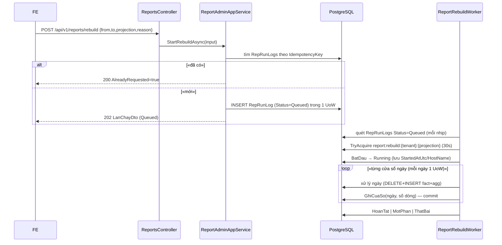

# `REP-001` — Kiến trúc liên module: read-model vận hành (rebuild · chốt kỳ · đối chiếu)

> Vai **ARCH**, phiên **N88**, chuỗi `gd3-1`, hàng `W26-1` (bước **F0–F2b** của `WP-26`), nhánh `feat/gd3-wp26-read-model`.
> Tài liệu này **chỉ thiết kế** phần **vận hành GĐ3 còn lại** của
> [`rep-001-read-model-job-tong-hop.md`](./rep-001-read-model-job-tong-hop.md) (sau đây gọi **SRS**, `v0.3 — 24/11/2026`).
> **Không** code, **không** sinh migration, **không** sửa SRS.
>
> **Module chủ của mọi bảng/DTO/endpoint/mã lỗi/khoá dưới đây: `Reporting`** (`modules/Reporting/**`, 4 project, đã có từ `WP-08`).
> Phần **lõi** (8 bảng `Rpt*` + job theo mốc + API đọc) **đã có**; phần dưới là **thiết kế MỚI** cho 3 bảng vận hành + 3 nhóm app service method
> + metric + migration. Mọi `file:dòng` nêu trong tệp đã đối chiếu trong phiên N88 (`codegraph_explore` trước, `Read`/`Grep` sau cho phần đồ thị cắt bớt).
>
> **Nguồn quyết định:** `D-47` (grain dòng chứng từ · thay thế theo `(ngày, nguồn)` · mốc chỉ tiến) · `D-48` (một công thức doanh thu) ·
> `D-171` (`btree_gist` + `EXCLUDE USING gist` cho `RepPeriodClose`, 4 ca bắt buộc trước `migrations add`) ·
> `D-172` (Setting nhịp/lookback/`IsStale`) · `D-173` (COD thuộc `REC-003`) · `D-174` (không bảng fact giờ) ·
> `D-208` dòng `REP-001` (tạm duyệt có điều kiện; 10 P3 cùng WP) · `D-216` (chuỗi WP, một chủ migration) · `D-114` P2/P4 (giá vốn, kỳ ngày UTC+7) ·
> **`D-270`…`D-274`** (5 tạm chốt phiên N88 — đóng 6 câu mở `AQ1`–`AQ6`, xem §12.2)
> — `docs/nhanh/decisions.md:60,185,186,187,188,222,230` + dòng `D-270`…`D-274` thêm cùng phiên N88.
>
> 🔄 **Cập nhật phiên N88 (sau `decider`):** 6 câu mở `AQ1`–`AQ6` **đã đóng** bằng `D-270` (permission `eCommerce.Reports.*` + thêm `Reconcile`),
> `D-271` (phạm vi `RepRunLog`), `D-272` (rebuild `TonKho` quá khứ ⇒ `0013`), `D-273` (`D-172` ngoài `WP-26`), `D-274` (ngưỡng lý do).
> Các mục §3, §6, §7, §9, §12 cập nhật theo — **không** mở lại thiết kế.
>
> 📄 **Loại tài liệu:** `-arch` là tài liệu **bổ trợ**, **ngoài** mẫu 16 mục mà `tools/agents/check-feature-doc.ps1 -WP14` áp cho **SRS** `<mã>-<slug>.md`;
> vì vậy tệp này không có `## 0.`…`## 15.` là **đúng chủng loại** (khuôn `docs/features/notifications/NOT-001-arch.md:16-18`).

---

## 1. Bối cảnh & phạm vi

### 1.1 Cái đang có trong code (đọc từ code, không viết theo trí nhớ)

| Thành phần | Hiện trạng | Bằng chứng (`file:dòng`) |
|---|---|---|
| Module `Reporting` | ✅ 4 project `.Domain`/`.EntityFrameworkCore`/`.Application`/`.Application.Contracts` | `modules/Reporting/**` |
| 8 bảng read-model `Rpt*` | ✅ đã tạo | `src/eCommerce.EntityFrameworkCore/Migrations/20261104033300_Wp08_BaoCao_Reporting.cs:14-201` |
| 8 unique index `NULLS NOT DISTINCT` (viết tay) | ✅ | cùng tệp `:202-248` |
| `DbSet` 8 entity trên DbContext hợp nhất | ✅ | `src/eCommerce.EntityFrameworkCore/eCommerceDbContext.cs:260-281` |
| `ConfigureReporting` gọi **một lần** | ✅ | `src/eCommerce.EntityFrameworkCore/eCommerceDbContext.cs:469` |
| Job tổng hợp theo mốc, **thay thế** theo `(ngày, nguồn)` | ✅ | `modules/Reporting/eCommerce.Reporting.Application/TongHopBaoCaoService.cs:108-245`; xoá+ghi theo ngày `:150-166` |
| Khoá `report:tong-hop`, `TryAcquire` **2 s** | ✅ | `TongHopBaoCaoService.cs:44,112-119` |
| Đọc nguồn POS/đơn (nửa khoảng `[bắt đầu, kết thúc)`) | ✅ | `TongHopBaoCaoService.cs:248-327` |
| Hàm thuần doanh thu | ✅ | `modules/Reporting/eCommerce.Reporting.Domain/BaoCao/TongHopDoanhThu.cs:72-100` |
| Trần 366 ngày/lượt | ✅ | `modules/Reporting/eCommerce.Reporting.Domain/BaoCao/KhoangTongHop.cs:25,83-93` |
| Mốc **chỉ tiến** | ✅ | `modules/Reporting/eCommerce.Reporting.Domain/BangTongHop/AggDailySales.cs:134-150` |
| `ReportAppService` — `[Authorize]` **cấp class** `eCommerce.Reports` | ✅ | `modules/Reporting/eCommerce.Reporting.Application/ReportAppService.cs:26`; method ghi `:254` |
| Mã lỗi `eCommerce:Reports:0001…0009` | ✅ | `modules/Reporting/eCommerce.Reporting.Domain/ReportingErrorCodes.cs:11-38` |
| Map mã lỗi → HTTP (8 mã) | ✅ **riêng `0007` chưa map** | `src/eCommerce.HttpApi.Host/eCommerceHttpApiHostModule.cs:405-412` |
| Permission `eCommerce.Reports` + `.Aggregate` khai **2 nơi** | ✅ | `src/eCommerce.Domain.Shared/eCommerceConsts.cs:340-347`; `src/eCommerce.Application.Contracts/Permissions/eCommercePermissionDefinitionProvider.cs:191-197` |
| Controller bề mặt `/api/v1/reports/**` | ✅ `GET` × 4 + `POST /aggregate` | `src/eCommerce.HttpApi/Controllers/ReportsController.cs:19-65` |
| Worker định kỳ đăng ký thật | ✅ | `modules/Reporting/eCommerce.Reporting.Application/ReportingApplicationModule.cs:34-37`; `ReportingAggregationWorker.cs:46-89` |
| Khuôn `EXCLUDE USING gist` + `btree_gist` (**đã chạy thật PG17**) | ✅ | `src/eCommerce.EntityFrameworkCore/Migrations/20261013012648_Add_Tax_Module.cs:118-130` |
| Registry metric | ⚠️ **26** tên (`All`), **0** tên `reporting_*`; `ChuaCoNoiPhat` rỗng | `shared/eCommerce.Kernel/Observability/eCommerceMetrics.cs:115-153,181-211,226-237` |
| Nhãn metric được phép | ⚠️ **15** nhãn; **chưa có** `projection` | `shared/eCommerce.Kernel/Observability/eCommerceMetrics.cs:275-279` |
| `RepRunLog` / `RepConsistencyCheck` / `RepPeriodClose` | ❌ **CHƯA CÓ** (0 entity/migration) | graph + `ls modules/Reporting` |
| `IBackgroundJobManager` dùng ở module | ❌ **0 nơi dùng** trong `modules/`+`src/`; nhưng `AbpBackgroundJobs` EF đã đăng ký | `src/eCommerce.EntityFrameworkCore/eCommerceEntityFrameworkCoreModule.cs:49` |

> 🚨 **Kết luận:** phần **lõi** ✅; phần **vận hành** (3 bảng, 3 nhóm method, 4 metric, checkpoint/rebuild) **0 dòng code** ⇒ toàn bộ §3–§11 là **thiết kế mới, kế hoạch GĐ3**.

### 1.2 Phạm vi `WP-26` (IN)

1. **3 bảng mới** trong `Reporting`: `RepRunLogs` (nhật ký + checkpoint rebuild, D9/D10), `RepConsistencyChecks` (lộ lệch, BR-012), `RepPeriodCloses` (chốt kỳ, D8 + `D-171`).
2. **Domain**: 4 enum đóng, 3 aggregate, hàm thuần đối chiếu + băm `SnapshotHash`, mã lỗi `0010–0017`, lớp `ReportingLockKeys`.
3. **Application.Contracts**: `IReportAdminAppService` + DTO thuần (không PII), **4 permission hẹp** dưới `eCommerce.Reports.*` (`Rebuild`/`PeriodClose`/`PeriodReopen`/`Reconcile` — `D-270`).
4. **Application**: `ReportAdminAppService` (rebuild/resume/chốt/mở/đối chiếu/đọc), `ReportRebuildWorker` (job nền xử lý hàng đợi `Queued`), tách hàm "xử lý một khoảng **không giành khoá**" khỏi `TongHopBaoCaoService` để rebuild tái dùng.
5. **Endpoint** `/api/v1/reports/**` (thêm vào `ReportsController`) + **map mã lỗi → HTTP** ở Host.
6. **4 metric mới** + sửa `eCommerceMetrics` (4 nơi) + bảng `XC-005` §5.1 + test **trong cùng PR**.
7. **Migration expand-only** do EF sinh (`Wp26_VanHanh_BaoCao`) + 4 ca `EXCLUDE` **đỏ→xanh trước `migrations add`** + `pg_dump` trước khi áp.

### 1.3 Ngoài phạm vi (OUT) — **không đụng**

- ❌ **Cột giá vốn / lãi gộp** trong fact (`CostAmount`) — nợ `REP-002`/`REP-003` (`D-114` P2). **Cấm** thêm cột.
- ❌ **COD** — thuộc `REC-003` (`D-173`); **0** bảng/cột/job COD.
- ❌ **Bảng fact theo giờ** — `D-174`; tổng hợp giờ = `date_trunc` lúc đọc trên `RptFactSalesLines`.
- ❌ **`REC-003`** và mọi đối soát với NCC ngoài.
- ❌ **Đổi `ReportingOptions.NhipJobPhut = 15` sang ABP Setting 5 phút** (`D-172`) — **nợ có chủ** ở WP `D-172` (**`D-273`**); `WP-26` **giữ 15 phút as-built** (`ReportingOptions.cs:18`), không đụng.
- ❌ **Dọn module mồ côi** `ChannelHub.Domain`/`PaymentHub.Domain` (SRS F5).
- ❌ **Sửa SRS** — việc của `ba` ở W26-2; mọi chỗ lệch ghi ở §12 (`docDeviation`).
- ❌ **Tách DB / microservice** — `REP-001` là monolith đọc bảng nguồn trong cùng DB (SRS §15.3 giả định 4).

---

## 2. Ranh giới module

### 2.1 Chiều phụ thuộc (một chiều, `abp-module-rules` M1/M2/M5)

```
Host (eCommerce.HttpApi.Host)
  └─ [DependsOn] Reporting.Application ──▶ Reporting.Application.Contracts ──▶ Reporting.Domain
                                         └─▶ eCommerce.Kernel (LockErrorCodes, Metrics)
     Reporting.Application ──▶ Domain · Contracts · Kernel · (ABP) Ddd.Application · BackgroundWorkers · DistributedLocking
     Reporting.Domain      ──▶ eCommerce.Kernel (Locking)
     Reporting.EntityFrameworkCore ──▶ Domain · (ABP) EntityFrameworkCore
eCommerce.EntityFrameworkCore ──▶ Reporting.EntityFrameworkCore   (gọi ConfigureReporting)
```

- **Không** thêm project/tham chiếu nào. `Reporting.Application` **đã** project-reference `Pos.Domain`/`Sales.Domain`/`Inventory.Domain` (đọc nguồn, `D-47`) — **ngoại lệ đã chấp nhận**, xem §2.3.

### 2.2 Luật áp cho `WP-26`

| # | Luật | Cách giữ |
|---|---|---|
| B1 | Module **sở hữu** 3 bảng + mọi entity/mã lỗi | tất cả trong `modules/Reporting/eCommerce.Reporting.Domain`; **không** khai `eCommerce:Reports:*` ở `eCommerceConsts.ErrorCodes` |
| B2 | Gọi chéo module **chỉ** qua `*.Application.Contracts` hoặc ETO | `WP-26` **không** gọi module nào mới; rebuild/đối chiếu **tái dùng** `TongHopBaoCaoService` (as-built, cùng module) |
| B3 | Module **không** phụ thuộc ngược app/host | **0** `using eCommerce.Web/HttpApi/Application` trong `modules/Reporting/**` |
| B4 | **Không FK** tới bảng giao dịch (`D14`); không FK xuyên module | 3 bảng **0 FK**; `DetectedByRunId`/`RequestedBy` là **tham chiếu mềm** |
| B5 | Mọi entity dùng `IRepository<T>` có `DbSet` hợp nhất | thêm **3** `DbSet` (§5.7); thiếu ⇒ repo không đăng ký, `HTTP 500` im lặng |
| B6 | Mỗi project `.Application` có `AbpModule` **và** nằm trong `[DependsOn]` Host | module đã có + Host đã nạp (`WP-08`) ⇒ **không** đổi `[DependsOn]` |
| B7 | `ConventionalControllers` đăng ký động cho assembly đã nạp | **không** sửa chỗ đăng ký; endpoint mới là **method trên `ReportsController` thủ công** (§4.2) |
| B8 | **Một chiều** — module nguồn **cấm** tham chiếu `eCommerce.Reporting.*` (BR-010) | `WP-26` **không** sửa `Sales/Pos/Inventory`; test `TC-15` giữ đỏ nếu vi phạm |

### 2.3 Ngoại lệ đã biết (không sửa ở WP-26)

`TongHopBaoCaoService` inject `IRepository<Order>`, `IRepository<RetailBill>`, `IRepository<InventoryItem>` (`TongHopBaoCaoService.cs:67-85`) — đọc **tầng Domain** module nguồn, là **ngoại lệ có chủ đích** của `D-47` (monolith, cùng DB, job đọc thẳng bảng nguồn — SRS §7.1). `WP-26` **không** mở rộng ngoại lệ: phần mới **chỉ** đọc/ghi bảng `Reporting` và **tái dùng** đúng đường đọc nguồn đã có.

> 📌 **Vi phạm ranh giới MỚI do `WP-26`: 0** (báo cáo `boundaryViolations: []`).

---

## 3. Thiết kế tầng Domain

### 3.1 Enum (một nguồn, đóng, append-only — `D-17`/`D-6`)

| Enum | Giá trị (cố định thứ tự — chỉ thêm ở **cuối**) | Ghi chú |
|---|---|---|
| `RepProjection` | `BanHang = 0` · `TonKho = 1` | mã chuỗi ổn định: `ban-hang` / `ton-kho` (dùng trong idempotency key) |
| `RepRunStatus` | `Queued = 0` · `Running = 1` · `Succeeded = 2` · `PartiallySucceeded = 3` · `Failed = 4` · `Skipped = 5` | khớp SRS §3.1; `Skipped` **dự trữ** (§6.3, `docDeviation #5`) |
| `RepPeriodStatus` | `Mo = 0` · `DangChot = 1` · `DaChot = 2` · `DaMoLai = 3` | ⚠️ `DaChot = 2` được **hằng hoá** trong `EXCLUDE` (§5.5) |
| `RepMismatchKind` | `SoDong = 0` · `DoanhThu = 1` · `SoChungTu = 2` · `AnhTonKho = 3` · `SuKienTre = 4` | `SuKienTre` = *late event in closed period* (SRS §3.3 A3) |

- Lưu DB: **`smallint`** + `CHECK (… IN (…))`; enum **chỉ thêm ở cuối**.
- Test reflection khoá **đúng tập + đúng thứ tự số** (khuôn `TC-07` SRS).

### 3.2 Aggregate `RepRunLog` (bảng `RepRunLogs`) — nhật ký + checkpoint

> 📌 **Phạm vi ghi (ĐÃ CHỐT — `D-271`):** `RepRunLog` ghi **luôn** cho `Rebuild`/`Resume` + `Reconcile`; lượt `Aggregate` (job định kỳ) **chỉ** ghi khi **có việc** (`Rong = false`) hoặc **lỗi**. Lượt **rỗng** vẫn log + metric (as-built, `ReportingAggregationWorker.cs:49,66-70`) — **không** tạo dòng rỗng. BA sửa `NFR-007` + SRS §5.2.4 cùng PR W26-2.
>
> 📌 **Khoá idempotency dòng hệ thống (§5.6):** dòng `Aggregate` (hệ thống) mang `RequestedBy IS NULL`; dòng `Reconcile` (người dùng kích hoạt) mang `RequestedBy = CurrentUser.Id` — **cả hai** dùng khoá **duy nhất theo lượt** (`…:{runId}`, `runId` = `Id` của chính dòng) ⇒ **chạy lại cùng khoảng ngày không bao giờ `unique_violation`**. Job `Aggregate` phủ **2** projection ⇒ ghi **2 dòng** (mỗi dòng `Projection` **cụ thể**, `FromDate`/`ToDate`/`WindowsTotal` xác định — xem §6.1).

**Trạng thái (SRS §3.1, mọi chuyển sai ⇒ NÉM `ReportingErrorCodes.ChuyenTrangThaiKhongHopLe` = `0015`):**

```
Queued ──(worker giành khoá)──▶ Running ──(xong mọi cửa sổ)──▶ Succeeded
   │                               ├──(còn cửa sổ lỗi, chạy tiếp được)──▶ PartiallySucceeded
   │                               └──(lỗi không chạy tiếp được)──────────▶ Failed
PartiallySucceeded / Failed ──(ResumeRebuildAsync đặt lại)──▶ Queued  (rồi worker → Running)
Succeeded ──▶ [*]  (hấp thụ; mọi chuyển khỏi Succeeded ⇒ NÉM 0015)
```

| Hàm (domain) | Chuyển | Guard | Ghi |
|---|---|---|---|
| `BatDau(lucUtc, hostName)` | `Queued → Running` | `Status == Queued` | `StartedAtUtc`, `HostName` |
| `GhiCuaSo(ngay, soDong)` | giữ `Running` | `Running`; `ngay ∈ [FromDate, ToDate]`; **`CheckpointDate IS NULL` ⇒ `ngay == FromDate`** (cửa sổ đầu); ngược lại `ngay > CheckpointDate` | `WindowsDone++`, `CheckpointDate = ngay`, `RowsWritten += soDong` |
| `HoanTat(lucUtc)` | `Running → Succeeded` | `WindowsDone == WindowsTotal` | `FinishedAtUtc` |
| `MotPhan(maLoi)` | `Running → PartiallySucceeded` | `WindowsDone < WindowsTotal` | `LastErrorCode`; **giữ** `CheckpointDate` |
| `ThatBai(maLoi, lucUtc)` | `Running → Failed` | — | `LastErrorCode`, `FinishedAtUtc` |
| `YeuCauChayLai()` | `PartiallySucceeded/Failed → Queued` | `CheckpointDate != null` (không ⇒ NÉM `CheckpointKhongCo` = `0017`) | xoá `LastErrorCode`? **không** — giữ để đối chiếu lịch sử |

> 🚨 **`CheckpointDate` = ngày cuối **đã commit**.** Chạy tiếp bắt đầu ở `CheckpointDate + 1`. `WindowsDone == WindowsTotal` mà `Status` chưa `Succeeded` ⇒ dữ liệu hỏng ⇒ NÉM.

### 3.3 Aggregate `RepConsistencyCheck` (bảng `RepConsistencyChecks`) — lộ lệch (BR-012)

- Tạo **một cửa duy nhất**: `RepConsistencyCheck.GhiNhan(id, ngay, projection, kind, factKey, expected, actual)`.
- `Delta = ActualValue − ExpectedValue` — **lưu khi cả hai vế có số**; `MismatchKind = SuKienTre` **không có số** ⇒ `ExpectedValue`/`ActualValue`/`Delta` **đều NULL**. **So tiền bằng `Delta`** (`decimal.Compare(delta, 0m) != 0`), **CẤM** `==` (`XC-001` BR-003).
- `DanhDauDaXuLy(by, lucUtc)`: idempotent (đã xử lý ⇒ không đổi dấu thời gian).
- **Không** `AutoCorrected = true` ở `WP-26` — sửa lệch **chỉ** qua `Rebuild` có audit (SRS §6.3). Cột `AutoCorrected` để dành (đóng `docDeviation #6`).

### 3.4 Aggregate `RepPeriodClose` (bảng `RepPeriodCloses`) — chốt kỳ (D8)

| Hàm | Chuyển | Guard (sai ⇒ NÉM) |
|---|---|---|
| `BatDauChot(by, lyDo)` | `Mo/DaMoLai → DangChot` | `ToDate >= FromDate`; `lyDo` ≥ 10 ký tự (sau `Trim`) ⇒ thiếu NÉM `ThieuLyDo` = `0016` |
| `Chot(snapshotHash, by, lucUtc)` | `DangChot → DaChot` | `snapshotHash` 64 hex; `by != null` |
| `MoLai(by, lyDo, lucUtc)` | `DaChot → DaMoLai` | `lyDo` ≥ 20 ký tự; `by != null` |
| (khác) | — | NÉM `ChuyenTrangThaiKhongHopLe` = `0015` |

> 📌 **Ngưỡng lý do (ĐÃ CHỐT — `D-274`):** đóng kỳ **≥ 10** ký tự, mở lại **≥ 20**, rebuild **≥ 10**; thiếu ⇒ `ThieuLyDo` = `0016` (map `400`). Kế toán **R3-3** duyệt lô trước release.
> 📌 **Rebuild `TonKho` (ĐÃ CHỐT — `D-272`):** chỉ `FromDate == ToDate == hôm nay (UTC+7)`, `WindowsTotal = 1`; ngày **quá khứ** ⇒ `KhongHoTroRebuild` = `0013` (map `400`).

- **Chốt kỳ là một UoW**: tạo `DangChot` → đối chiếu (chạy trong cùng request, §6.4) → tính `SnapshotHash` → `Chot`. Nếu bước `Chot` vi phạm `EXCLUDE` (`23P01`) ⇒ rollback cả request ⇒ `KyChongLan` = `0012`.
- **Mở lại rồi chốt lại cùng khoảng**: **tái dùng cùng dòng** (`DaMoLai → DaChot`), cập nhật `SnapshotHash`/`ClosedBy`/`ClosedAtUtc`/`CloseReason`; **giữ** `ReopenedBy`/`ReopenReason` (audit ai mở, vì sao). Lý do: idempotency key theo `(tenant, from, to)` cố định ⇒ không thể tạo dòng thứ hai cho cùng kỳ (`docDeviation #4`).

### 3.5 Hàm thuần (test được **không** cần DB)

| Hàm | Vào | Ra | Luật |
|---|---|---|---|
| `SoDoiChieu.KiemNgay(nguon, fact)` | kết quả nguồn (`TongHopDoanhThu.TinhNgay`) + fact/agg của ngày | `IReadOnlyList<LechSo>` | so `soDong`, `soChungTu`, `doanhThu` **bằng `Delta`**; **không** `==` trên tiền |
| `BamKyChot.Bam(IEnumerable<DongKy>)` | dòng `RptAggDailySales` + đếm fact của `[FromDate, ToDate]` (sắp theo `(BusinessDate, Nguon)`) | `string` 64 hex | **thuần, tất định**; định dạng `InvariantCulture`; **không** phụ thuộc `Now`/DB |
| `KhoangChot.HopLe(from, to)` | 2 `DateOnly` | bool / NÉM | `to >= from`; ≤ **366** ngày (tái dùng hằng `KhoangTongHop.SoNgayToiDa`) |

> 📌 `BamKyChot` **không** dùng `RptWatermarks`/`RptFactInventorySnapshots` trong hash — chỉ dòng tổng hợp + đếm fact doanh thu. Ảnh tồn kho **không** tất định theo lịch sử (D-47 ⑦) ⇒ không đưa vào `SnapshotHash` của kỳ doanh thu.

### 3.6 `ReportingErrorCodes` — bổ sung `0010–0017` (một tệp)

| Mã | Hằng | Nghĩa | HTTP (§4.3) |
|---|---|---|---|
| `eCommerce:Reports:0010` | `LanChayKhongTonTai` | `runId` không có (hoặc khác tenant) | `404` |
| `eCommerce:Reports:0011` | `KyDaChot` | khoảng ngày giao với kỳ `DaChot` (rebuild/ghi bị chặn) | `409` |
| `eCommerce:Reports:0012` | `KyChongLan` | hai kỳ `DaChot` chồng nhau (`23P01`) | `409` |
| `eCommerce:Reports:0013` | `KhongHoTroRebuild` | rebuild `TonKho` cho ngày quá khứ / projection không hỗ trợ | `400` |
| `eCommerce:Reports:0014` | `ConLechChuaXuLy` | chốt kỳ khi còn `RepConsistencyCheck` mở | `409` |
| `eCommerce:Reports:0015` | `ChuyenTrangThaiKhongHopLe` | chuyển trạng thái sai (máy trạng thái) | `409` |
| `eCommerce:Reports:0016` | `ThieuLyDo` | lý do rỗng/ngắn hơn ngưỡng | `400` |
| `eCommerce:Reports:0017` | `CheckpointKhongCo` | chạy tiếp khi `CheckpointDate` rỗng | `409` |

- **Không** đụng `0001–0009` (đã map ở Host `:405-412`). `0007 ChuaTongHop` vẫn **chưa map** (chưa có nơi ném — ghi nhận, **không** sửa ở `WP-26`).
- `0013` map **`400`** (`D-272` — rebuild `TonKho` quá khứ / projection không hỗ trợ); `0016` map **`400`** (`D-274` — lý do thiếu/ngắn).
- Khoá phân tán **tiếp tục** dùng mã chung `eCommerce:Lock:0001` (`Kernel/Locking/LockErrorCodes.cs:1-20`; `eCommerceConsts.cs:582`).

### 3.7 `ReportingLockKeys` (một lớp, **không** tiền tố `ecommerce:`)

`modules/Reporting/eCommerce.Reporting.Domain/ReportingLockKeys.cs` (khuôn `ChannelHubConsts.LockKeys`, `modules/ChannelHub/eCommerce.ChannelHub.Domain/ChannelHubConsts.cs:16-32`):

| Hàm | Giá trị | Ai dùng |
|---|---|---|
| `TongHop` | `report:tong-hop` (**giữ nguyên** as-built) | `TongHopBaoCaoService` (thay hằng `TenKhoaPhanTan`, `:44`) |
| `Rebuild(tenantId, projection)` | `report:rebuild:{tenantId ?? "host"}:{ma}` | `ReportRebuildWorker` |
| `PeriodClose(tenantId)` | `report:period-close:{tenantId ?? "host"}` | `ReportAdminAppService` |
| `Reconciliation(tenantId)` | `report:reconciliation:{tenantId ?? "host"}` | `ReportAdminAppService` |

> 🚨 **`AbpDistributedLockOptions.KeyPrefix` đã thêm `ecommerce:`** (`TongHopBaoCaoService.cs:41-43`) ⇒ **CẤM** tự thêm tiền tố (bài học C11/C13).

---

## 4. Hợp đồng `Application.Contracts`

### 4.1 Interface + DTO (một tệp mới `ReportingAdminDtos.cs`, namespace `eCommerce.Reporting`)

```csharp
public interface IReportAdminAppService : IApplicationService          // Application.Contracts
{
    Task<LanChayDto>        StartRebuildAsync(StartRebuildInput input);
    Task<LanChayDto>        ResumeRebuildAsync(Guid runId);
    Task<LanChayDto>        GetLanChayAsync(Guid runId);
    Task<LanChayPageDto>    GetLanChaysAsync(GetLanChayInput input);

    Task<KyChotDto>         ClosePeriodAsync(ClosePeriodInput input);
    Task<KyChotDto>         ReopenPeriodAsync(ReopenPeriodInput input);
    Task<KyChotDto>         GetKyChotAsync(Guid id);
    Task<KyChotPageDto>     GetKyChotsAsync(GetKyChotInput input);

    Task<KetQuaDoiChieuDto> RunReconciliationAsync(RunReconciliationInput input);
    Task<LechSoPageDto>     GetLechSoAsync(GetLechSoInput input);
}
```

**Input (bắt buộc tường minh — D10):**

| DTO | Trường | Luật |
|---|---|---|
| `StartRebuildInput` | `DateOnly FromDate`, `DateOnly ToDate`, `RepProjection Projection`, `string Reason` | `FromDate`/`ToDate` **bắt buộc**; ≤ 366 ngày; `Reason.Trim().Length >= 10`; `TonKho` chỉ khi `FromDate == ToDate == hôm nay` (ngày kinh doanh) |
| `ClosePeriodInput` | `FromDate`, `ToDate`, `Reason` | `ToDate >= FromDate`; `Reason` ≥ 10 |
| `ReopenPeriodInput` | `Guid PeriodId`, `Reason` | `Reason` ≥ 20 |
| `RunReconciliationInput` | `FromDate`, `ToDate`, `RepProjection? Projection` | `null` = **cả hai** ⇒ tạo **hai** dòng `RepRunLog` (mỗi projection một dòng); ≤ 366 ngày |
| `GetLanChayInput` / `GetKyChotInput` / `GetLechSoInput` | `SkipCount`/`MaxResultCount` + lọc ngày/trạng thái | phân trang ABP |

**Output (thuần, **0 PII**):**

| DTO | Trường chính |
|---|---|
| `LanChayDto` | `Id`, `JobName`, `Projection`, `Status`, `FromDate`, `ToDate`, `WindowsTotal`, `WindowsDone`, `CheckpointDate`, `RowsWritten`, `Reason`, `RequestedBy`, `StartedAtUtc`, `FinishedAtUtc`, `HostName`, `LastErrorCode`, **`AlreadyRequested`** |
| `KyChotDto` | `Id`, `FromDate`, `ToDate`, `Status`, `SnapshotHash`, `ClosedBy`, `ClosedAtUtc`, `CloseReason`, `ReopenedBy`, `ReopenReason`, `ReopenedAtUtc`, **`AlreadyClosed`** |
| `LechSoDto` | `Id`, `FactDate`, `Projection`, `MismatchKind`, `FactKey`, `ExpectedValue`, `ActualValue`, `Delta`, `AutoCorrected`, `DetectedAtUtc`, `ResolvedAtUtc` |
| `KetQuaDoiChieuDto` | `SoNgayDaSo`, `SoDongLech`, `SoDongLechMoi` |

> 📌 DTO **map tay** (không AutoMapper) — khuôn `ReportAppService`. Enum trả **số**; FE map nhãn.
> 📌 `AlreadyRequested`/`AlreadyClosed` là **cách nói idempotent cho FE** (SRS §7.3, `TC-11`): gọi lại **cùng khoảng + cùng lý do** ⇒ trả bản ghi cũ, **không** tạo lần hai. **Không** phải lỗi.

### 4.2 Endpoint REST — thêm **method** vào `ReportsController` hiện có

| Method | Route | Permission (method) | Trả |
|---|---|---|---|
| `POST` | `/api/v1/reports/rebuild` | `eCommerce.Reports.Rebuild` | `202` + `LanChayDto` (Queued) |
| `POST` | `/api/v1/reports/rebuild/{runId}/resume` | `eCommerce.Reports.Rebuild` | `202` + `LanChayDto` |
| `GET` | `/api/v1/reports/rebuild/{runId}` | `eCommerce.Reports` (class) | `LanChayDto` |
| `GET` | `/api/v1/reports/rebuilds` | `eCommerce.Reports` (class) | `LanChayPageDto` |
| `POST` | `/api/v1/reports/period-close` | `eCommerce.Reports.PeriodClose` | `KyChotDto` |
| `POST` | `/api/v1/reports/period-close/{id}/reopen` | `eCommerce.Reports.PeriodReopen` | `KyChotDto` |
| `GET` | `/api/v1/reports/period-close/{id}` · `/period-closes` | `eCommerce.Reports` (class) | `KyChotDto` / `KyChotPageDto` |
| `POST` | `/api/v1/reports/reconciliation` | `eCommerce.Reports.Reconcile` | `KetQuaDoiChieuDto` |
| `GET` | `/api/v1/reports/consistency-checks` | `eCommerce.Reports` (class) | `LechSoPageDto` |

- Class `ReportsController` đã có `[Authorize(eCommerceConsts.Permissions.Reports.Default)]` **cấp class** (`:21`) ⇒ method **chỉ cần** thêm `[Authorize(...)]` hẹp cho các method **ghi** (khuôn `POST /aggregate` `:63`).
- ⚠️ **AND-combination:** ASP.NET Core **hợp** nhiều `[Authorize]` ⇒ method ghi yêu cầu **cả** `Reports.Default` **và** quyền hẹp (giống as-built `ChayTongHopAsync`). ⇒ provider phải khai quyền hẹp **là con** của `Reports` (`AddChild`) **và** role `admin` phải được cấp **cả hai** — chạy `DbMigrator` (binary mới) sau khi thêm.
- 🚨 **`POST /rebuild` không nhận `tenantId`** (server lấy `ICurrentTenant`).

### 4.3 Map mã lỗi → HTTP (Host)

Thêm **8 dòng** vào khối Reports sẵn có (`src/eCommerce.HttpApi.Host/eCommerceHttpApiHostModule.cs:405-412`):

```csharp
options.Map(ReportingErrorCodes.LanChayKhongTonTai,        HttpStatusCode.NotFound);  // 0010
options.Map(ReportingErrorCodes.KyDaChot,                  HttpStatusCode.Conflict);  // 0011
options.Map(ReportingErrorCodes.KyChongLan,                HttpStatusCode.Conflict);  // 0012  (23P01)
options.Map(ReportingErrorCodes.KhongHoTroRebuild,         HttpStatusCode.BadRequest);// 0013  (D-272)
options.Map(ReportingErrorCodes.ConLechChuaXuLy,           HttpStatusCode.Conflict);  // 0014
options.Map(ReportingErrorCodes.ChuyenTrangThaiKhongHopLe, HttpStatusCode.Conflict);  // 0015
options.Map(ReportingErrorCodes.ThieuLyDo,                 HttpStatusCode.BadRequest);// 0016  (D-274)
options.Map(ReportingErrorCodes.CheckpointKhongCo,         HttpStatusCode.Conflict);  // 0017
```

> 🔑 Thiếu map ⇒ ABP trả `403` ⇒ client **đi xin quyền** trong khi lỗi thật là *"kỳ đã chốt"* / *"còn lệch"* (bài học `INV-003`, SRS §6.2).

### 4.4 Breaking change?

**Không.** `IReportAppService`/`ReportAppService`/`ReportsController` method cũ **giữ nguyên signature**. Thêm interface/method **additive**.

---

## 5. EF Core + DbContext hợp nhất

### 5.1 Luật chung

- `ConfigureReporting` (`ReportingDbContextModelCreatingExtensions.cs:22-215`) là **một cửa** — thêm **3** `builder.Entity<T>` vào **cùng** hàm.
- Unique index trên bảng `IMultiTenant` **PHẢI** `NULLS NOT DISTINCT` — EF **không** sinh được ⇒ `migrationBuilder.Sql("CREATE UNIQUE INDEX … NULLS NOT DISTINCT …")` (khuôn `20261104033300_Wp08_BaoCao_Reporting.cs:202-248`).
- **0 FK** (kể cả nội module) — `RepConsistencyCheck.DetectedByRunId` / `RepPeriodClose.ClosedBy` là **tham chiếu mềm** (bảng audit append-only, xoá dòng run **không** được kéo theo ràng buộc).
- Tên index ≤ **63 byte** (PostgreSQL cắt im lặng).
- Audit: `CreationAuditedEntity<Guid>` (có `CreationTime`/`CreatorId`), `TenantId` `Guid?` + `IMultiTenant`.

### 5.2 Bảng `RepRunLogs`

| Cột | Kiểu | Null? | Ghi chú |
|---|---|---|---|
| `Id` | `uuid` | ✖ | PK |
| `TenantId` | `uuid` | ✔ | `IMultiTenant`; index NND |
| `JobName` | `varchar(64)` | ✖ | `Rebuild` · `Reconcile` · `Aggregate` (đóng; CHECK `IN`) |
| `Projection` | `smallint` | ✖ | `RepProjection`; CHECK `IN (0,1)` |
| `Status` | `smallint` | ✖ | `RepRunStatus`; CHECK `IN (0..5)` |
| `FromDate` / `ToDate` | `date` | ✖ | CHECK `"ToDate" >= "FromDate"` |
| `WindowsTotal` | `int` | ✖ | CHECK `>= 0` |
| `WindowsDone` | `int` | ✖ | CHECK `>= 0 AND "WindowsDone" <= "WindowsTotal"` |
| `CheckpointDate` | `date` | ✔ | CHECK `IS NULL OR ("CheckpointDate" >= "FromDate" AND "CheckpointDate" <= "ToDate")` |
| `RowsWritten` | `bigint` | ✖ | CHECK `>= 0` |
| `Reason` | `varchar(512)` | ✖ | CHECK `length(btrim("Reason")) >= 10`; người dùng kích hoạt (rebuild/close/reopen) ⇒ lý do **≥ 10** (`D-274`); dòng **hệ thống** (Reconcile/Aggregate) ⇒ **hằng chuỗi ≥ 10** (`RepRunLog.LyDoHeThong*`), **không NULL** |
| `RequestedBy` | `uuid` | ✔ | tham chiếu mềm `AbpUsers.Id` |
| `StartedAtUtc` / `FinishedAtUtc` | `timestamptz` | ✔ | UTC (T4) |
| `HostName` | `varchar(128)` | ✔ | |
| `CorrelationId` | `varchar(64)` | ✔ | `XC-005` TC-04 |
| `LastErrorCode` | `varchar(64)` | ✔ | |
| `IdempotencyKey` | `varchar(256)` | ✖ | **NOT NULL kể cả dòng hệ thống** — xem §5.6 |

**Index**

| Loại | Cột | Tên | Mục đích |
|---|---|---|---|
| **UNIQUE (NND, partial)** | `(TenantId, IdempotencyKey)` `WHERE "RequestedBy" IS NOT NULL` | `IX_RepRunLogs_TenantId_KhoaIdempotency` | dòng **rebuild do người dùng** gọi lại cùng khoảng+lý do ⇒ **1** lần chạy; dòng không phải rebuild (`Reconcile`/`Aggregate`) có khoá **riêng mỗi lượt** (§5.6) nên **không** vướng unique khi chạy lại cùng khoảng |
| **UNIQUE (NND, partial)** | `(TenantId, JobName, Projection)` `WHERE "Status" IN (0,1)` | `UX_RepRunLogs_TenantId_Job_Projection_DangChay` | **một** lần chạy **hoạt động** /(job, projection) |
| INDEX | `(TenantId, CreationTime)` | `IX_RepRunLogs_TenantId_ThoiDiem` | màn vận hành, phân trang |

> 📌 Index **partial** dùng `... NULLS NOT DISTINCT WHERE "Status" IN (0,1)` (PostgreSQL 15+ cho phép kết hợp). Bất biến *"một lần chạy hoạt động"* là **hàng rào DB** — không phụ thuộc Redis.

> 📌 **`Reason` luôn NOT NULL — một luật (`D-274` + `D-271`):** dòng do **người dùng** kích hoạt (`Rebuild`/`Close`/`Reopen`) lấy lý do người dùng **≥ 10**; dòng do **hệ thống** sinh (`Reconcile`, `Aggregate` có việc/lỗi) dùng **hằng chuỗi ≥ 10 ký tự** (`RepRunLog.LyDoHeThong.DoiChieu = "Đối chiếu theo yêu cầu"` · `.TongHopDinhKy = "Tổng hợp định kỳ"`). ⇒ **không** thêm `Reason` vào input của hệ thống, `CHECK` giữ nguyên `length ≥ 10`, và không có giá trị NULL "trốn" khỏi audit.

### 5.3 Bảng `RepConsistencyChecks`

| Cột | Kiểu | Null? | Ghi chú |
|---|---|---|---|
| `Id` | `uuid` | ✖ | PK |
| `TenantId` | `uuid` | ✔ | `IMultiTenant` |
| `FactDate` | `date` | ✖ | ngày kinh doanh (UTC+7) |
| `Projection` | `smallint` | ✖ | CHECK `IN (0,1)` |
| `MismatchKind` | `smallint` | ✖ | CHECK `IN (0..4)` |
| `FactKey` | `varchar(128)` | ✖ | CHECK `length(btrim("FactKey")) > 0` (vd `0:2026-09-15`) |
| `ExpectedValue` | `numeric(18,4)` | ✔ | số **nguồn** |
| `ActualValue` | `numeric(18,4)` | ✔ | số **read-model** |
| `Delta` | `numeric(18,4)` | ✔ | `Actual − Expected`; **NULL khi một vế NULL** (`SuKienTre` không có số); CHECK `("Delta" IS NULL) = ("ExpectedValue" IS NULL OR "ActualValue" IS NULL)`; **so bằng `Delta`**, cấm `==` |
| `AutoCorrected` | `bool` | ✖ | default `false` (WP-26 **luôn** false) |
| `DetectedByRunId` | `uuid` | ✔ | tham chiếu mềm `RepRunLogs.Id` |
| `DetectedAtUtc` | `timestamptz` | ✖ | |
| `ResolvedAtUtc` / `ResolvedBy` | `timestamptz` / `uuid` | ✔ | cần cho `TC-19`/NFR-004 |

**Index**

| Loại | Cột | Tên |
|---|---|---|
| **UNIQUE (NND, partial)** | `(TenantId, Projection, FactDate, MismatchKind, FactKey)` `WHERE "ResolvedAtUtc" IS NULL` | `UX_RepConsistencyChecks_DangMo` |
| INDEX | `(TenantId, FactDate)` | `IX_RepConsistencyChecks_TenantId_Ngay` |
| INDEX | `(TenantId, ResolvedAtUtc)` | `IX_RepConsistencyChecks_TenantId_ChuaXuLy` |

> 🔑 Index **partial unique** chống **trùng dòng lệch mở** khi đối chiếu chạy lặp mỗi nhịp (idempotent, "không lộ ra hai lần"). Không có ⇒ mỗi lượt đối chiếu đẻ thêm dòng, màn vận hành **nhiễu** và `TC-19` không bao giờ xanh.

### 5.4 Bảng `RepPeriodCloses`

| Cột | Kiểu | Null? | Ghi chú |
|---|---|---|---|
| `Id` | `uuid` | ✖ | PK |
| `TenantId` | `uuid` | ✔ | `IMultiTenant` |
| `FromDate` / `ToDate` | `date` | ✖ | `daterange(..., '[]')` đóng **hai đầu** (UTC+7) |
| `Status` | `smallint` | ✖ | `RepPeriodStatus`; CHECK `IN (0..3)` |
| `SnapshotHash` | `char(64)` | ✔ | CHECK `"Status" <> 2 OR "SnapshotHash" IS NOT NULL` |
| `CloseReason` | `varchar(512)` | ✖ | CHECK `length(btrim("CloseReason")) >= 10` |
| `ClosedBy` / `ClosedAtUtc` | `uuid` / `timestamptz` | ✔ | CHECK `"Status" <> 2 OR ("ClosedBy" IS NOT NULL AND "ClosedAtUtc" IS NOT NULL)` |
| `ReopenedBy` | `uuid` | ✔ | |
| `ReopenReason` | `varchar(512)` | ✔ | CHECK `"ReopenReason" IS NULL OR length(btrim("ReopenReason")) >= 20` |
| `ReopenedAtUtc` | `timestamptz` | ✔ | |
| `IdempotencyKey` | `varchar(256)` | ✖ | §5.6 |

**Index**

| Loại | Cột | Tên |
|---|---|---|
| **UNIQUE (NND)** | `(TenantId, IdempotencyKey)` | `IX_RepPeriodCloses_TenantId_KhoaIdempotency` |
| INDEX | `(TenantId, Status)` | `IX_RepPeriodCloses_TenantId_TrangThai` |

### 5.5 `EXCLUDE USING gist` — **chỉ** chặn hai kỳ `DaChot` chồng nhau (`D-171`)

**Cách mã hoá `Status` (ARCH chọn, BA ghi vào SRS §5.2.6):**

```sql
CREATE EXTENSION IF NOT EXISTS btree_gist;

ALTER TABLE "RepPeriodCloses"
    ADD CONSTRAINT "EX_RepPeriodCloses_KyDaChot_KhongChong"
    EXCLUDE USING gist (
        (COALESCE("TenantId", '00000000-0000-0000-0000-000000000000'::uuid)) WITH =,
        (CASE WHEN "Status" = 2 THEN '00000000-0000-0000-0000-000000000000'::uuid
              ELSE "Id" END) WITH =,
        daterange("FromDate", "ToDate", '[]') WITH &&
    );
```

- **Vì sao khoá thứ hai là `CASE … ELSE "Id"`:** `EXCLUDE` **không** có mệnh đề `WHERE` (`Add_Tax_Module.cs:116`) ⇒ muốn **chỉ** chặn `DaChot` mà **không** vô tình chặn hai kỳ `Mo` (đang lập kế hoạch) chồng nhau:
  - **`DaChot`** → tất cả **cùng một khoá hằng** ⇒ cùng tenant + chồng `daterange` ⇒ **`23P01`**;
  - **mọi trạng thái khác** → khoá = **`Id` riêng** của dòng ⇒ **không bao giờ** trùng ⇒ **không** chặn.
- **`TenantId` nullable** ⇒ `COALESCE(..., zero)` như Tax (`Add_Tax_Module.cs:124`) — nếu không, hàng `TenantId = NULL` **không** được bảo vệ.
- **`date` + `daterange(..., '[]')`** ⇒ kỳ **đóng hai đầu**; ngày kinh doanh UTC+7 (`D-114` P4, `D-47` ④).
- `btree_gist` cung cấp lớp toán tử `uuid` cho `=` (đã dùng thật ở Tax `:123-128`).

**Đường lùi nếu ca đỏ (fallback, cùng PR — `D-171`):**
1. (a) `"Status" WITH =` thay cho biểu thức `CASE` — đơn giản hơn nhưng **cũng** chặn hai kỳ `Mo` chồng nhau (ghi rõ hệ quả);
2. (b) nếu cả (a) đỏ ⇒ `UNIQUE` phù hợp + **trigger/guard** kiểm chồng kỳ `DaChot` (PL/pgSQL trong migration), **không** hạ xuống "chỉ kiểm ở app".

> 📌 **4 ca integration bắt buộc đỏ→xanh TRƯỚC `migrations add`** (xem §10.2) — đúng `D-171` ③.

### 5.6 Idempotency key (theo SRS §7.3 + bổ sung dòng hệ thống)

| Đối tượng | Khoá | Hành vi gọi lại |
|---|---|---|
| Rebuild (người dùng) | `Report:Rebuild:{maProjection}:{tenantId}:{fromDate}:{toDate}:{sha256(Reason.Trim())}` | cùng khoá ⇒ trả bản ghi cũ (`AlreadyRequested = true`), **không** tạo dòng/không xếp việc |
| Chốt kỳ (người dùng) | `Report:PeriodClose:{tenantId}:{fromDate}:{toDate}` | cùng khoảng ⇒ trả bản ghi cũ (`AlreadyClosed = true`) |
| Reconcile (hệ thống/người yêu cầu) | `Report:Reconcile:{tenantId}:{maProjection}:{runId}` | `runId` = `Id` của **chính** dòng ⇒ **duy nhất theo lượt**; chạy lại cùng khoảng ⇒ **dòng mới**, **0** `23505`; **không** trả bản ghi cũ (đối chiếu là quan sát theo lượt) |
| Aggregate (job định kỳ) | `Report:AggregateRun:{tenantId}:{maProjection}:{runId}` | như trên; job phủ **2** projection ⇒ **2 dòng** (BanHang + TonKho), mỗi dòng `Projection` **cụ thể** |

- `sha256` = `SHA256.HashData(Encoding.UTF8.GetBytes(reason.Trim()))` → hex thường (BCL, **0** gói mới; khuôn `modules/Address/eCommerce.Address.Domain/DiaChiCanonical.cs:91`).
- `tenantId` trong khoá: `Guid?` host ⇒ `"host"` (không nối `null` thành chuỗi rỗng gây **va khoá** giữa host và tenant).
- 🔑 **`RepRunLogs` unique index là PARTIAL `WHERE "RequestedBy" IS NOT NULL`** (§5.2) ⇒ **chỉ** dòng **rebuild do người dùng** mới có nghĩa "gọi lại cùng khoá ⇒ trả bản ghi cũ". Dòng `Reconcile`/`Aggregate` có khoá duy nhất theo `runId` ⇒ **chạy lại cùng khoảng ngày không bao giờ `unique_violation`** (lỗi PG17 đã thấy nếu dùng khuôn khoá theo khoảng ngày cho dòng không phải rebuild). `RepPeriodCloses` giữ unique **đầy đủ** (mọi dòng đều do người yêu cầu).

### 5.7 `DbSet` trên `eCommerceDbContext` (3 dòng mới, sau `ReportWatermarks` `:281`)

```csharp
public DbSet<Reporting.RepRunLog>            ReportRunLogs            { get; set; } = default!;
public DbSet<Reporting.RepConsistencyCheck>  ReportConsistencyChecks  { get; set; } = default!;
public DbSet<Reporting.RepPeriodClose>       ReportPeriodCloses       { get; set; } = default!;
```

> 🚨 Thiếu `DbSet` ⇒ `IRepository<RepRunLog, Guid>` **không** đăng ký ⇒ worker **nổ** resolve; build/migration vẫn xanh. Lưới an toàn: `DbSetRegistrationTests` (mở rộng danh sách **đích danh**).

---

## 6. Luồng nghiệp vụ

### 6.1 Rebuild — hai pha (request nhanh, thực thi nền)



**Quyết định thiết kế:**

1. **Không dùng `IBackgroundJobManager`** (0 nơi dùng trong repo — §1.1). Dùng **`ReportRebuildWorker`** (`AsyncPeriodicBackgroundWorkerBase`) **quét** `RepRunLogs` `Status = Queued`, đăng ký **cùng chỗ** `ReportingAggregationWorker` (`ReportingApplicationModule.cs:34-37`). Durable (hàng đợi = DB) + không thêm `[DependsOn]` module.
2. **Tách hàm "xử lý một khoảng, không giành khoá"** khỏi `TongHopBaoCaoService`: thêm `ChayKhoangAsync(tu, den, ghiAnhTonKho, IProgress<...>)` **internal**; `ChayAsync` (as-built, `:108-245`) **giữ nguyên hành vi** = giành `report:tong-hop` (2 s) rồi gọi hàm này. Rebuild gọi hàm này **dưới khoá `report:rebuild`** ⇒ **không** giành khoá lần hai (tránh `report:tong-hop` **toàn cục** chặn rebuild tenant khác, `:44`).
3. **Tenant context của worker:** ABP background worker chạy ở host (`ICurrentTenant.Id = null`). Worker **phải** `using var _ = _currentTenant.Change(run.TenantId);` **trước** khi mở UoW xử lý — nếu không, query filter `IMultiTenant` lọc nhầm (host ⇒ chỉ thấy `TenantId = NULL`) ⇒ rebuild **rỗng im lặng**. Đây là điểm **bắt buộc** viết trong code + test tenant.
4. **Checkpoint:** mỗi ngày **một UoW** (as-built `:150-166`). Trong **cùng** UoW của ngày: ghi dữ liệu fact/agg **và** `GhiCuaSo(ngày, số dòng)` ⇒ **commit một lần**. Đứt giữa chừng ⇒ cả hai **rollback** ⇒ `WindowsDone` **không** tiến ⇒ resume từ `CheckpointDate + 1` **không** chạy lại cửa sổ đó (`TC-10`/NFR-009). Lỗi ở cửa sổ k ⇒ cửa sổ 1..k−1 **đã commit**; run → `PartiallySucceeded`, giữ `CheckpointDate`.
5. **Chạy tiếp:** `ResumeRebuildAsync` chỉ chấp nhận `PartiallySucceeded`/`Failed` **và** `CheckpointDate != null` (không ⇒ `0017`); đặt `Queued`, worker xử lý từ `CheckpointDate + 1` ⇒ **0** cửa sổ cũ chạy lại (NFR-009/`TC-10`).
6. **Idempotent từng ngày:** `DELETE` + `INSERT` theo `(ngày, nguồn)` (D-47 ①) ⇒ chạy lại cùng ngày **không** nhân đôi, kể cả khi resume lặp.
7. **`TonKho`:** ảnh là **trạng thái hiện tại**, không phải lịch sử (D-47 ⑦) ⇒ rebuild `TonKho` **chỉ** khi `FromDate == ToDate == hôm nay (UTC+7)`; ngày quá khứ NÉM `0013` (**`D-272`** — map `400`). `WindowsTotal = 1`.
8. **Quyền + audit:** `StartRebuild` cần `Reports.Rebuild`; ghi `RequestedBy = CurrentUser.Id`, `Reason`. **Không** có API sửa/xoá fact (SRS §6.3).
9. **Nhật ký `Aggregate` (D-271 + §5.6):** lượt có việc/lỗi ghi **2** dòng — `BanHang` (`FromDate`/`ToDate` = khoảng bán hàng, `WindowsTotal` = số ngày, `WindowsDone` = số ngày đã ghi) và `TonKho` (`FromDate = ToDate = hôm nay`, `WindowsTotal = 1`, `WindowsDone = 1` nếu đã chụp). Mỗi dòng `Projection` **cụ thể**, `RequestedBy = NULL`, khoá `Report:AggregateRun:{tenant}:{projection}:{runId}`.

### 6.2 Chốt kỳ (đồng bộ, một UoW)

1. Giành `report:period-close:{tenant}` (2 s); không được ⇒ `Lock:0001` (`409`).
2. Kiểm idempotency theo khoá §5.6 → trả `AlreadyClosed` nếu đã có.
3. Kiểm **chồng kỳ** trước (đọc `RepPeriodCloses` `DaChot` giao khoảng) ⇒ `0012` (`KyChongLan`).
4. **Đối chiếu lại toàn khoảng** (gọi **nội bộ** `RunDoiChieuAsync` — **không** qua app service, tránh lồng `[Authorize]`): còn dòng `RepConsistencyChecks` **mở** ⇒ NÉM `0014`, **không** chốt (SRS §3.3, `TC-19`).
5. Tính `SnapshotHash` (hàm thuần §3.5) trên dòng `RptAggDailySales` + đếm fact doanh thu của `[FromDate, ToDate]`.
6. Tạo `DangChot` → `Chot`; `ClosedBy/ClosedAtUtc`; commit. `23P01` ⇒ map `0012`.
7. **Audit:** `CloseReason`, `ClosedBy`; log `Information` một dòng.

**Mở lại:** `DaChot → DaMoLai` + `ReopenReason` ≥ 20 + audit; sau đó `Rebuild` được phép ghi khoảng đó.

> 📌 **Ngưỡng lý do (`D-274`):** `CloseReason` **≥ 10**, `ReopenReason` **≥ 20**, `Reason` (rebuild) **≥ 10** — kiểm ở **domain** (NÉM `0016`) **và** `CHECK` ở DB; kế toán **R3-3** duyệt lô trước release.

**Chặn ghi vào kỳ đã chốt** (`A3`): trước khi xử lý một ngày trong `TongHopBaoCaoService.ChayKhoangAsync`, kiểm `RepPeriodCloses` `DaChot` phủ ngày đó ⇒ **bỏ qua ngày** + log `Warning`; rebuild yêu cầu tường minh ⇒ NÉM `0011` **trước** khi ghi. Nếu phát hiện nguồn đã đổi cho ngày trong kỳ chốt ⇒ ghi `RepConsistencyCheck` `SuKienTre` (`TC-23`).

### 6.3 Đối chiếu lộ lệch (đồng bộ)

1. Giành `report:reconciliation:{tenant}` (2 s).
2. Với **từng ngày** × **từng projection**: dựng lại số **nguồn** bằng **cùng** đường đọc/hàm thuần của job (`TinhNgayAsync`), **không** ghi fact. Nếu input `Projection = null` ⇒ chạy **hai lượt** độc lập (`BanHang`, `TonKho`) — **mỗi lượt một dòng `RepRunLog`** với `Projection` cụ thể (không dùng sentinel) + khoá `Report:Reconcile:{tenant}:{maProjection}:{runId}` (§5.6).
3. So với read-model: `soDong`, `soChungTu`, `doanhThu`, `anhTonKho` — **bằng `Delta`**, `decimal.Compare(delta, 0m) != 0` ⇒ một dòng `RepConsistencyCheck` (`GhiNhan`).
4. Ghi **một** UoW (index partial unique chống trùng dòng **mở**); log `Error` cho từng `MismatchKind` (có `Projection`, `FactDate`, `Delta` — SRS §13), metric `reporting_projection_failed_total{projection,reason="mismatch"}`.
5. **Không** tự sửa (SRS §6.3): sửa = `Rebuild` có audit. `TC-05` khẳng định: chạy lại job ⇒ khớp nguồn.

> 📌 `RepRunLog` cho lượt đối chiếu: `JobName = Reconcile`, `Projection` **cụ thể** (không NULL), `Reason` = hằng `RepRunLog.LyDoHeThong.DoiChieu` (`"Đối chiếu theo yêu cầu"`), `WindowsTotal = số ngày`, `WindowsDone` = số ngày đã so.

### 6.4 UoW / transaction (SRS §12)

| Việc | UoW |
|---|---|
| `StartRebuild` / `ClosePeriod` / `ReopenPeriod` | **một** UoW của app service (ABP tự mở) |
| Worker: mỗi cửa sổ ngày | **một** UoW `requiresNew: true, isTransactional: true` — commit rồi sang ngày sau (**cố ý KHÔNG** một transaction cả lượt) |
| Worker: cập nhật trạng thái run (terminal) | **một** UoW **riêng** sau khi mọi cửa sổ đã commit (để trạng thái `PartiallySucceeded` **không** bị rollback cùng lỗi) |
| Đối chiếu: ghi dòng lệch | **một** UoW |
| API **chỉ đọc** | **không** mở transaction ghi |

---

## 7. Phân quyền

- **ĐÃ CHỐT — `D-270`:** dùng nhóm **`eCommerce.Reports.*`** (KHÔNG `eCommerce.Reporting.*`). **4 quyền hẹp** `Rebuild` · `PeriodClose` · `PeriodReopen` · **`Reconcile`** (**thêm mới**) đều là **con của `Reports.Default`**; **chỉ** cấp cho role `admin` **cấp tenant** (không cấp host).
- **Một chỗ khai:** lớp `Reports` sẵn có (`eCommerceConsts.cs:340-347`) — thêm **4 hằng**:
  - `Rebuild = Default + ".Rebuild"` · `PeriodClose = Default + ".PeriodClose"` · `PeriodReopen = Default + ".PeriodReopen"` · `Reconcile = Default + ".Reconcile"`.
- **Định nghĩa trong provider** (`eCommercePermissionDefinitionProvider.cs:196-197`): `reports.AddChild(...)` cho **cả 4** — thiếu một nơi ⇒ `403` cho **mọi** người kể cả `admin` (`XC-004` D2, `BatBienPhanQuyenTests.TC02b` khoá **hai chiều**).
- **`[Authorize]` cấp CLASS** trên `ReportAdminAppService` = `Reports.Default`; method **ghi** thêm quyền hẹp. `ReportsController` đã có class `Reports.Default` (`:21`).
- **`D-184` — chỗ lệch KHÔNG đảo ở `WP-26`:** **tên permission** `eCommerce.Reporting.Aggregation.Inspect` lệch quy ước đặt tên; đưa vào **hàng đợi khi làm `REP-003`** (không đổi ở `WP-26`).
- Chạy `DbMigrator` (binary **mới**) sau khi thêm để role `admin` được cấp (bài học `S6`); provider nằm trong `eCommerce.Application.Contracts` mà DbMigrator đã `[DependsOn]`.
- Test reflection: mọi `[Authorize]` dùng hằng ⇒ hằng **phải** có định nghĩa (2 chiều) + route ghi **phải** có quyền hẹp.

---

## 8. Metric (4 mới, **tên theo P3 #2** — KHÔNG "upsert")

`eCommerceMetrics.All` hiện **26** (`eCommerceMetrics.cs:115-153`); thêm **4** ⇒ **30**.

| Tên | Kiểu | Nhãn (tập hữu hạn) | Phát ở đâu |
|---|---|---|---|
| `reporting_watermark_lag_seconds` | Gauge | `projection` | sau mỗi lượt tổng hợp: `now − LastRunAtUtc` (SRS NFR-003) |
| `reporting_projection_failed_total` | Counter | `projection`, `reason` | cửa sổ lỗi / đối chiếu phát hiện lệch (`reason="mismatch"`) |
| `reporting_rows_written_total` | Counter | `projection` | số dòng **đã ghi** (thay thế) mỗi cửa sổ |
| `reporting_replace_conflict_total` | Counter | `projection` | số lần chạm unique/thay thế (đo "ghi lại") |

**Việc bắt buộc cùng PR (quy tắc vàng: sửa tài liệu trước, rồi code):**

| # | Việc | Vị trí |
|---|---|---|
| 1 | 4 hằng tên | `eCommerceMetrics.cs` khối `eCommerceMetricNames` |
| 2 | 4 tên vào `All` (**26 → 30**) | `eCommerceMetrics.cs:115-153` |
| 3 | 4 instrument + 4 phương thức phát tường minh | `eCommerceMetrics.cs` (khối Counter/Gauge) |
| 4 | 4 dòng `KyHieuMetric` (`= nameof(...)`) | `eCommerceMetrics.cs:181-211` |
| 5 | **Thêm nhãn `projection`** vào `eCommerceMetricTags` + `Allowed` | `eCommerceMetrics.cs:247-279` (hiện **15** nhãn) |
| 6 | **Không** thêm vào `ChuaCoNoiPhat` (rỗng — vì sẽ có điểm phát thật) | `eCommerceMetrics.cs:226-237` |
| 7 | Cập nhật bảng `XC-005` §5.1 (26 → 30 dòng) | `docs/features/cross-cutting/XC-005-observability-log-metric.md` |
| 8 | `MetricsTests` + `MetricEmitterTests` **xanh** (so **đúng tập** + chiều ngược) | `test/eCommerce.Tests/Observability/` |

- **Cấm** nhãn `tenantId`/`sku`/`factKey`/`runId` (`XC-005` BR-009). Truy vết theo `FactKey` ⇒ **log**.
- 🔒 Nhãn `reason` **chỉ** tập đóng: `mismatch`, `error`, `late_event`.

---

## 9. Migration expand-only + đường lùi

### 9.1 Kế hoạch (mô tả — **BE sinh** ở W26-2; hàng này **0** migration)

| Bước | Việc | Ai |
|---|---|---|
| 0a | **4 ca integration `EXCLUDE` viết ĐỎ trước** (§10.2) | BE/QA |
| 0b | `pg_dump` DB dev → `artifacts/pg-dump/N88-W26-2.dump` **trước** khi áp (`ef-migration-postgres` M9) | OPS/BE |
| 1 Expand | Sửa 3 entity + `ConfigureReporting` + **3 `DbSet`**; `dotnet ef migrations add Wp26_VanHanh_BaoCao` | **một** chủ migration (BE) |
| 2 Sửa tay migration (bắt buộc) | (a) **4 unique index NND** viết lại bằng `Sql("CREATE UNIQUE INDEX … NULLS NOT DISTINCT …")` + partial `WHERE`: `IX_RepRunLogs_TenantId_KhoaIdempotency` (**partial `WHERE "RequestedBy" IS NOT NULL`**), `UX_RepRunLogs_TenantId_Job_Projection_DangChay`, `IX_RepPeriodCloses_TenantId_KhoaIdempotency`, `UX_RepConsistencyChecks_DangMo`; (b) thêm `CREATE EXTENSION IF NOT EXISTS btree_gist` + `EXCLUDE` (§5.5). **0** `DROP`/`ALTER` bảng cũ | BE + review |
| 3 Kiểm diff | Chỉ `CREATE TABLE`/`INDEX`/`CHECK` trên **bảng mới** + `EXTENSION` + `EXCLUDE` | BE + `rev` |
| 4 Áp | `dotnet build` rồi `dotnet run --project src/eCommerce.DbMigrator` (binary **mới**); kiểm `__EFMigrationsHistory` + `\d` 3 bảng + `EXCLUDE` | BE/OPS (**cấm** `dotnet ef database update`, M6) |
| 5 Ca xanh | 4 ca §10.2 **xanh** | QA |
| 6 Contract | **Không có** (0 xoá/đổi kiểu) | — |

### 9.2 Thứ tự deploy

1. **Migration trước** (bảng phải tồn tại). 2. Deploy code (endpoint mới + worker). 3. Bật `Reporting:EnableRebuildWorker=true`.
- Trước khi có bảng, code mới **không** chạy (worker đọc bảng chưa có ⇒ lỗi mỗi nhịp) ⇒ **bắt buộc** `DbMigrator` trước.

### 9.3 Đường lùi (viết trước giải pháp — K-05 / A8)

| # | Cách | Hiệu quả |
|---|---|---|
| (a) | **Bảng rỗng = hành vi như trước:** không có dòng `RepPeriodCloses` ⇒ **không** ngày nào bị chặn; không có dòng `RepRunLogs` ⇒ worker **không** làm gì | rollback **không** cần migration |
| (b) | Cờ `Reporting:EnableRebuildWorker=false` + `Reporting:EnablePeriodClose=false` ⇒ endpoint mới trả `409`/lỗi cấu hình; job định kỳ **giữ nguyên** | tắt tính năng 1 dòng config |
| (c) | Trước merge: `git revert` + `dotnet ef migrations remove` (chưa có dữ liệu) | sạch |
| (d) | Sau merge: migration **mới** `Drop` **3 bảng** (`RepConsistencyChecks` → `RepRunLogs` → `RepPeriodCloses`); **không** drop `btree_gist` (Tax đang dùng) | ✅ an toàn — read-model, nguồn sự thật ở bảng giao dịch |
| (e) | Rollback code: bỏ `AddBackgroundWorkerAsync<ReportRebuildWorker>` (1 dòng) | worker ngừng |

> ⚠️ Mất `RepRunLog`/`RepPeriodClose` ⇒ mất **audit** chốt kỳ (không phải dữ liệu báo cáo). Ghi rõ khi rollback.

### 9.4 Seed

**Không** seed bảng vận hành. **Không** seed `RptWatermarks` (mốc `null` = chưa chạy). Permission seed **idempotent** qua provider + `DbMigrator`.

### 9.5 Nợ có chủ — `D-273` (`D-172` ngoài `WP-26`)

`D-172` (nhịp job **5 phút** / lookback **3 ngày** / `IsStale` **900 s** qua ABP Setting) **KHÔNG** thuộc `WP-26`: giữ `ReportingOptions.NhipJobPhut = 15` as-built (`modules/Reporting/eCommerce.Reporting.Application/ReportingOptions.cs:18`). Đây là **nợ có chủ** xử lý ở WP `D-172` (cùng việc sửa `NFR-REP-001-003`); `WP-26` **không** đổi nhịp/lookback.

---

## 10. Test / QA plan

### 10.1 Theo tầng (neo `TC-*` SRS §14.1)

| Tầng | Ca bắt buộc | Phủ |
|---|---|---|
| Domain thuần (**không** DB) | `TC-12` (so `Delta`, không `==`); `SoDoiChieu.KiemNgay`: khớp ⇒ **0** dòng, lệch ⇒ **1** dòng + `Delta` đúng; `BamKyChot` **tất định** (100 lần cùng hash, đổi thứ tự input ⇒ khác); máy trạng thái **mọi nhánh sai NÉM** `0015`; `TC-22` thiếu `ToDate`/`Reason` rỗng ⇒ `0002`/`0016`; `TC-11` idempotency key **cùng input ⇒ cùng chuỗi**, khác `Reason` ⇒ khác | BR-004/005/008/011/013 |
| Domain (reflection/quét) | enum **đúng tập + thứ tự**; 0 `double/float`; `ReportingLockKeys` **không** có `ecommerce:`; message `Reason`/`ReopenReason` dài tối thiểu | BR-004/007/011 |
| Application (fake, không DB) | `StartRebuild` rỗng lý do ⇒ `0016`; `TonKho` quá khứ ⇒ `0013`; `Resume` khi `CheckpointDate = null` ⇒ `0017`; `ClosePeriod` còn lệch ⇒ `0014`; `Reopen` lý do < 20 ⇒ `0016`; `Reopen` từ `Mo` ⇒ `0015` | BR-011/012/013 |
| Endpoint (Host/`WebApplicationFactory`) | mỗi route ghi: `401` / `403` / `2xx`; **0** `[AllowAnonymous]`; **100 %** permission có định nghĩa | `XC-004` |
| Integration (PostgreSQL) | **4 ca `EXCLUDE`** (§10.2); **4** unique index **đích danh** + NND (`IX_RepRunLogs_TenantId_KhoaIdempotency`, `UX_RepRunLogs_TenantId_Job_Projection_DangChay`, `IX_RepPeriodCloses_TenantId_KhoaIdempotency`, `UX_RepConsistencyChecks_DangMo`); `TC-11` 2 `StartRebuild` cùng key ⇒ **1** dòng + `AlreadyRequested`; **dòng hệ thống cùng khoảng 2 lượt ⇒ 2 dòng, 0 `23505`** (partial unique `WHERE RequestedBy IS NOT NULL`); `UX_…_DangChay` chặn lần chạy hoạt động thứ 2; `TC-09` lỗi cửa sổ 3/10 ⇒ `WindowsDone = 2`; `TC-10` resume **0** cửa sổ cũ; `TC-19` còn lệch ⇒ chốt **từ chối**; `TC-23` nguồn đổi ngày trong kỳ chốt ⇒ `SuKienTre`; `TC-06` cách ly 2 tenant; `TC-02` **0** query bảng giao dịch ngoài allow-list | BR-002/003/005/006/008/012/013, NFR-004/008/009 |
| Đo | `reporting_*` có điểm phát thật; `EXPLAIN` dùng index mới | NFR-003/007 |

### 10.2 **4 ca `EXCLUDE` bắt buộc** (đỏ trước migration → xanh sau; `D-171` ③)

| # | Ca | Kỳ vọng |
|---|---|---|
| EX-1 | **Constraint tồn tại:** đọc `pg_constraint` cho `RepPeriodCloses`, khẳng định `contype = 'x'`, định nghĩa chứa `EXCLUDE USING gist` + `daterange` + `&&` | **xanh** |
| EX-2 | Hai kỳ `DaChot` **chồng nhau** (vd 01–30/09 và 15/09–15/10, cùng tenant) | ném `PostgresException.SqlState = "23P01"` |
| EX-3 | Hai kỳ `DaChot` **liền kề** (vd 01–30/09 và 01–31/10) | **nhận** |
| EX-4 | **Đối chứng cách mã hoá `Status`:** `Mo` (01–30/09) chồng `DaChot` (15/09–15/10) | **nhận** (khoá thứ hai khác nhau — kết quả **đã định**, không ngẫu nhiên) |
| EX-5 (khuyến nghị) | Hai kỳ `Mo` chồng nhau | **nhận** — chứng minh "**chỉ** chặn `DaChot`" (nếu chọn fallback (a) `Status WITH =` thì ca này **đổi kỳ vọng** thành **chặn**, ghi rõ) |

> 🚨 **Ca nào đỏ ⇒ fallback** §5.5 **ngay trong cùng PR**, **không** hạ xuống "chỉ kiểm ở app".

### 10.3 Negative control (đột biến **đỏ** → khôi phục **xanh**; ORCH chạy `tools/agents/negative-control.ps1`)

| # | Đột biến | Ca phải đỏ |
|---|---|---|
| NC-1 | Bỏ `NULLS NOT DISTINCT` ở `IX_RepRunLogs_TenantId_KhoaIdempotency` | 2 `StartRebuild` với `TenantId = NULL` cùng key ⇒ phải chặn |
| NC-2 | Bỏ `(CASE … ELSE "Id")` thay bằng hằng số cho **mọi** trạng thái | EX-4/EX-5 đổi kết quả ⇒ phát hiện |
| NC-3 | Chốt kỳ **không** kiểm `RepConsistencyChecks` mở | `TC-19` (chốt khi còn lệch ⇒ phải `0014`) |
| NC-4 | Resume chạy lại từ `FromDate` thay vì `CheckpointDate + 1` | `TC-10` (0 cửa sổ cũ) |
| NC-5 | Worker **không** `ICurrentTenant.Change(run.TenantId)` | `TC-06`/tenant test (rebuild rỗng hoặc ghi nhầm tenant) |
| NC-6 | So tiền bằng `==` thay `decimal.Compare(delta,0m)` | test quét mã nguồn (`TC-12` biến thể) |
| NC-7 | Thêm metric phát ra **không** khai trong `All` | `MetricsTests` (chiều "mọi tên phát ra ⊆ All") |
| NC-8 | Thiếu map `0014` ở Host | endpoint chốt khi còn lệch trả `403` thay `409` |

---

## 11. Xử lý 10 P3 đang mở (`docs/reviews/REP-001-docreview.md:37-48`)

> ARCH **không** sửa SRS; cột "BA (W26-2)" là việc của `ba` cùng PR code. Thiết kế **không** mâu thuẫn hướng sửa.

| # | Vấn đề | Thiết kế này |
|---|---|---|
| **#1** | SRS ghi "23 test case" nhưng bảng có 25 | Không ảnh hưởng thiết kế; BA sửa 23 → **25** |
| **#2** | Metric `rows_upserted`/`upsert_conflict` sai mô hình **thay thế** | §8 dùng **`reporting_rows_written_total`** / **`reporting_replace_conflict_total`** (đúng yêu cầu) |
| **#3** | "đơn xoá mềm ⇒ read-model vẫn còn" chỉ đúng **giữa hai lượt** | §6.1 (rebuild/aggregate thay thế theo ngày) giải thích đúng; BA sửa §12 ("còn tới lượt tổng hợp kế tiếp") |
| **#4** | ERD vẽ 6 bảng, mô hình 8 | Không ảnh hưởng thiết kế; BA thêm 2 `RptDim*` |
| **#5** | SRS dẫn `NhipMacDinhPhut` sai vị trí | §1.1 dẫn đúng `ReportingOptions.NhipJobPhut = 15` (`:18`) + `ReportingAggregationWorker.NhipMacDinhPhut = 15` (`:31`); BA sửa |
| **#6** | §10 hướng dẫn "Reconciliation/Rebuild" khi cả hai ⬜ | `WP-26` **hiện thực** cả hai ⇒ hướng dẫn nay **đúng** sau W26-2 (endpoint §4.2); BA cập nhật trạng thái |
| **#7** | `TC-13` quét route `ReportAppService` là no-op | Không ảnh hưởng thiết kế; QA quét `ReportsController` (§4.2) |
| **#8** | `TC-18` vừa Unit vừa Integration | Không ảnh hưởng; QA chọn **Integration** (kiểm unique index DB) |
| **#9** | Timeout khoá 30 s (RepRunLog) vs `TryAcquire` 2 s (worker) trên **cùng** khoá | **Chốt một nguồn/lock:** `report:tong-hop` **giữ 2 s** (§3.7, as-built `:112`); `report:rebuild` **30 s** (§3.7, khoá **khác**). State machine §3.2 dùng 30 s cho `report:rebuild`. BA sửa §3.1 nêu **tên khoá** |
| **#10** | Permission `eCommerce.Reporting.*` vs as-built `eCommerce.Reports.*` | ✅ **Đã chốt — `D-270`**: dùng **`eCommerce.Reports.*`** (4 quyền hẹp là con của `Reports.Default`; **thêm** `Reports.Reconcile`; chỉ cấp role `admin` tenant). BA sửa SRS §9 |

> 📌 **Metric (P2 #4):** SRS §13/§14.3 còn ghi **16/20**, thực tế **26→30** (`eCommerceMetrics.cs:115-153`) — ghi ở `docDeviation #9`; **BA sửa SRS §13/§14.3 cùng PR W26-2**, ARCH **không** tự sửa SRS.

---

## 12. `docDeviation` (SRS ↔ ARCH) & câu hỏi mở

### 12.1 `docDeviation` — thiết kế **buộc** khác SRS (ORCH gửi `ba` sửa SRS cùng PR W26-2)

| # | SRS nói | Thiết kế chốt | Lý do |
|---|---|---|---|
| 1 | §5.2.6 gợi ý "`Status WITH =` **hoặc** cột biểu thức quy `Mo…` về một giá trị" | **`CASE WHEN "Status" = 2 THEN zero ELSE "Id" END`** (§5.5) | đạt đúng "**chỉ** chặn hai kỳ `DaChot`" — không chặn hai kỳ `Mo` đang lập |
| 2 | §5.2.4 cột `ProjectionName` / `RowsUpserted` | `Projection smallint` + `RowsWritten bigint` | enum lưu **int** (D6, append cuối); "written" đúng mô hình **thay thế** (đồng bộ P3 #2) |
| 3 | §3.1 `Queued → Running` giành `report:tong-hop` 30 s | `report:rebuild` 30 s (khoá **riêng**); `report:tong-hop` **2 s** giữ as-built | xử lý P3 #9 — **một nguồn/lock**; rebuild không chặn job toàn cục |
| 4 | §3.3 `DaChot → DaMoLai → Mo` | `DaChot → DaMoLai` (**giữ** dòng); chốt lại cùng khoảng **tái dùng** dòng (`DaMoLai → DaChot`) | idempotency key `(tenant, from, to)` cố định; giữ audit ai mở/vì sao |
| 5 | §3.1 có `Queued → Skipped` (SkipIfBusy) | `Skipped` **dự trữ**, WP-26 **không** phát (lượt bận khoá ở lại `Queued`, thử lại nhịp sau) | `RepRunLog` phạm vi = rebuild/backfill/đối chiếu; bỏ-nhịp định kỳ vẫn log + metric as-built |
| 6 | §5.2.5 chỉ có `AutoCorrected`/`DetectedByRunId` | thêm `ResolvedAtUtc`/`ResolvedBy` + unique partial **đang mở** | cần cho `TC-19`/NFR-004 ("0 dòng chưa xử lý") và chống trùng dòng lệch mỗi nhịp |
| 7 | §14.1 `TC-22` thiếu `ToDate`/`Reason` ⇒ `Reports:0003` | thiếu/sai khoảng ⇒ `0002`/`0003`; thiếu lý do ⇒ **`0016`** (map `400`); `TonKho` quá khứ ⇒ **`0013`** (map `400`) | `0003` = "khoảng quá dài", không dùng cho lý do rỗng; **`D-274`** (ngưỡng lý do) + **`D-272`** (`TonKho`) |
| 8 | NFR-007 "100 % lần chạy job có dòng `RepRunLog`" | dòng **luôn** cho **rebuild/reconcile**; lượt `Aggregate` **chỉ** khi **có việc** hoặc **lỗi** (rỗng vẫn log + metric) | **`D-271`** — tránh 288 dòng rỗng/ngày; BA sửa `NFR-007` + SRS §5.2.4 cùng PR W26-2 |
| 9 | SRS §13/§14.3 ghi **16** metric (và "20" sau khi thêm 4) | **26** hiện có → **30** sau khi thêm 4 | `All` đã **26** từ `WP-22` (`eCommerceMetrics.cs:115-153`); BA sửa SRS §13/§14.3 (**16→26**, **20→30**) cùng PR W26-2 — **không** sửa SRS ở đây |
| 10 | §7.3 chỉ định nghĩa khoá **Rebuild** + **Chốt kỳ** | thêm khoá **dòng hệ thống** (`Report:Reconcile:…:{runId}` · `Report:AggregateRun:…:{runId}`) + unique **partial** `WHERE "RequestedBy" IS NOT NULL` | dòng hệ thống chạy lại cùng khoảng sẽ `23505` nếu dùng khuôn khoá theo khoảng ngày (đã thấy trên PG17); BA ghi bổ sung vào SRS §7.3 cùng PR W26-2 |

### 12.2 Câu hỏi mở — **ĐÃ ĐÓNG** bởi `D-270`…`D-274` (phiên N88)

| ID | Câu hỏi gốc | Đã chốt |
|---|---|---|
| `REP-001-AQ1` | **P3 #10** — chốt nhóm permission: `eCommerce.Reports.*` hay `eCommerce.Reporting.*` như SRS §9? | **`D-270`:** dùng **`eCommerce.Reports.*`** (KHÔNG `eCommerce.Reporting.*`). SRS §9 sửa cùng PR W26-2 |
| `REP-001-AQ2` | Có thêm quyền **`Reports.Reconcile`** không (SRS §9 không liệt kê)? | **`D-270`:** **thêm** `Reports.Reconcile`; cả **4** quyền hẹp là **con của `Reports.Default`**, **chỉ** cấp role `admin` **tenant** |
| `REP-001-AQ3` | `RepRunLog` có ghi cho lượt job định kỳ (`Aggregate`) theo NFR-007 không? | **`D-271`:** ghi **luôn** cho rebuild+reconcile; `Aggregate` **chỉ** khi **có việc/lỗi** (lượt rỗng vẫn log+metric). BA sửa `NFR-007` + §5.2.4 cùng PR |
| `REP-001-AQ4` | Rebuild `TonKho` cho ngày quá khứ: từ chối hay cho phép? | **`D-272`:** **TỪ CHỐI** bằng `eCommerce:Reports:0013` (map `400`); chỉ `FromDate == ToDate == hôm nay (UTC+7)`, `WindowsTotal = 1` |
| `REP-001-AQ5` | `D-172` (5 phút/lookback 3 ngày/`IsStale` 900 s) có thuộc `WP-26`? | **`D-273`:** **NGOÀI** `WP-26` — giữ **15 phút** as-built; **nợ có chủ** ở WP `D-172`, không đụng |
| `REP-001-AQ6` | Ngưỡng "lý do" tối thiểu? | **`D-274`:** đóng kỳ **≥ 10**, mở lại **≥ 20**, rebuild **≥ 10** ký tự; thiếu ⇒ `0016` (map `400`); kế toán **R3-3** duyệt lô trước release |

> 📌 **`openQuestions` còn mở: 0.** Mọi câu trên đã có `D-xx`; `docrev` kiểm lại sau (giai đoạn F2b).

---

## 13. Truy vết quyết định (`D-xx` ↔ mục)

| `D-xx` | Nội dung | Mục |
|---|---|---|
| `D-47` | grain dòng chứng từ · thay thế `(ngày, nguồn)` · mốc chỉ tiến · một lượt/khoá | §1.1, §3.2, §3.7, §6.1, §6.4 |
| `D-48` | một công thức doanh thu; so `Delta` | §3.3, §3.5, §6.3 |
| `D-171` | `btree_gist` + `EXCLUDE` + 4 ca + fallback | §5.5, §10.2 |
| `D-172` | Setting nhịp/lookback/`IsStale` | §1.3, §9.5 (`D-273` — ngoài `WP-26`) |
| `D-173` | COD thuộc `REC-003` | §1.3 |
| `D-174` | không bảng fact giờ | §1.3 |
| `D-208` (REP-001) | tạm duyệt có điều kiện; 10 P3 cùng WP; không đụng giá vốn | header, §1.3, §11 |
| `D-216` | chuỗi WP, một chủ migration | header, §9.1 |
| `D-270` | permission `eCommerce.Reports.*` (4 con của `Reports.Default`, thêm `Reconcile`, chỉ role `admin` tenant); `D-184` là nợ REP-003 | §4.2, §7, §11 #10, §12.2 |
| `D-271` | phạm vi `RepRunLog` (rebuild+reconcile luôn; aggregate có việc/lỗi) | §3.2, §12.1 #8, §12.2 |
| `D-272` | rebuild `TonKho` quá khứ ⇒ `0013` (map 400); chỉ hôm nay, `WindowsTotal=1` | §3.4, §4.3, §6.1, §12.2 |
| `D-273` | `D-172` ngoài `WP-26` (giữ 15 phút as-built) | §1.3, §9.5, §12.2 |
| `D-274` | ngưỡng lý do 10/20/10; thiếu ⇒ `0016` (map 400) | §3.4, §4.3, §6.2, §12.2 |
| `D-114` P2/P4 | giá vốn (nợ), kỳ = ngày UTC+7 | §1.3, §5.4 |
| `D-17`/`D-6` | enum append cuối, máy trạng thái NÉM | §3.1, §3.2, §3.4 |

---

## 14. Tự kiểm

- **Bằng chứng đồ thị (N88):** `codegraph_explore "TongHopBaoCaoService ReportAppService ReportingDbContextModelCreatingExtensions ReportingErrorCodes"` → `ChayAsync` `:108`, xoá+ghi theo ngày `:154-166`, `TryAcquire` `:112`, `TenKey` `:44`; `codegraph_explore "RptWatermark GhiNhan RptAggDailySales TuTongHop ReportingAggregationWorker ReportingApplicationModule"` → `RptWatermark.GhiNhan` `:134-150`, worker `:31,46-89`, module `:27,34-37`. `Read`/`Grep` cho: `ReportingDbContextModelCreatingExtensions.cs:22-215`, migration `20261104033300_Wp08_BaoCao_Reporting.cs:14-248`, `Add_Tax_Module.cs:118-130`, `eCommerceDbContext.cs:260-281,469`, `eCommerceConsts.cs:340-347,582`, provider `:191-197`, `ReportsController.cs:19-65`, Host `:405-412`, `eCommerceMetrics.cs:115-153,181-211,226-237,247-279`.
- **0** `AQ` còn mở (đóng bởi `D-270`…`D-274`, §12.2); **0** cam kết endpoint NCC (không gọi ngoài); **0** sửa code/`modules/**`/`src/**`/`test/**`/SRS/`decisions.md`.
- Mọi bảng ghi **module chủ** = `Reporting`; **0** FK xuyên module; **0** FK tới bảng giao dịch.
- Mọi thay đổi schema có **migration plan** (§9) + **đường lùi** (§9.3); mọi hợp đồng có **chữ ký + bên gọi** (§4) + **permission** (§7).
- **Không** thêm cột giá vốn, COD, bảng fact giờ, `REC-003` (§1.3).
- **Áp `D-270`…`D-274` (N88):** §3.2/§3.4/§4.3/§6/§7/§9.5/§11/§12/§13 đã cập nhật; **không** đổi cấu trúc bảng ngoài việc đã nêu.
- **Sửa `DOC-CHANGES` vòng 1 (N88):** 1 P1 + 3 P2 + 5 P3 đã xử lý (§15 `v0.3`); `openQuestions` **vẫn rỗng**.
- **Đóng P3 vòng 2 (N88, DOC-OK):** khoá idempotency dòng hệ thống + partial unique `WHERE "RequestedBy" IS NOT NULL` + `Aggregate` ghi 2 dòng (§15 `v0.4`).

---

## 15. Lịch sử tài liệu

| Phiên bản | Ngày | Việc |
|---|---|---|
| `v0.1` | 27/11/2026 | **ARCH N88 (W26-1)** — thiết kế `RepRunLogs`/`RepConsistencyChecks`/`RepPeriodCloses`, `IReportAdminAppService`, worker rebuild, 4 metric, migration expand-only, 4 ca `EXCLUDE`; 6 `AQ` mở |
| `v0.2` | 27/11/2026 | **Áp `D-270`…`D-274`** (tạm chốt `decider`): permission `eCommerce.Reports.*` + `Reconcile`; phạm vi `RepRunLog`; `TonKho` quá khứ ⇒ `0013`; `D-172` ngoài WP; ngưỡng lý do 10/20/10. Đóng `AQ1`–`AQ6`, không đổi thiết kế |
| `v0.3` | 27/11/2026 | **Sửa `DOC-CHANGES` vòng 1** (1 P1 · 3 P2 · 5 P3): `Reason` hệ thống dùng hằng ≥10 (P1 #1); checkpoint ghi trong **cùng** UoW ngày (P2 #2); **4** unique NND (P2 #3); metric 16/20 → 26/30 thành `docDeviation #9` (P2 #4); `D-184` là **permission** (P3 #5); `0012` thay `0011` (P3 #6); `Delta` nullable + CHECK (P3 #7); reconcile `null` ⇒ **2** dòng (P3 #8); guard `CheckpointDate IS NULL` (P3 #9) |
| `v0.4` | 27/11/2026 | **Đóng P3 vòng 2 (DOC-OK 0 P1/0 P2):** khoá idempotency **dòng hệ thống** `Report:Reconcile…:{runId}` / `Report:AggregateRun…:{runId}`; `IX_RepRunLogs_TenantId_KhoaIdempotency` thành **partial `WHERE "RequestedBy" IS NOT NULL`**; `Aggregate` ghi **2** dòng (mỗi `Projection` cụ thể); thêm `docDeviation #10` (BA ghi SRS §7.3) |
